# National Search and Rescue (NATSAR) Manual — Master (February 2025)

> **Source**: AMSA
> **URL**: https://www.amsa.gov.au/sites/default/files/natsar-manual-february-2025-final-v2.pdf
> **Licence**: Crown / publisher copyright; practitioner reference
> **Retrieved**: 2026-05-07T23:47:10Z
> **SHA-256**: `56de29fe56e76f7b63d4637e1d5ea5dcdad8f0366a8240f9e74c611a9edfb128`
> *Converted from PDF to Markdown format.*

---
## Page 1

 
 
 
Volume 1 – Search and Rescue Administration 
NATIONAL SEARCH AND RESCUE MANUAL 
2025 EDITION Version 1 – February 2025 
 Page 1 
 
 
 
 
February 2025 Edition

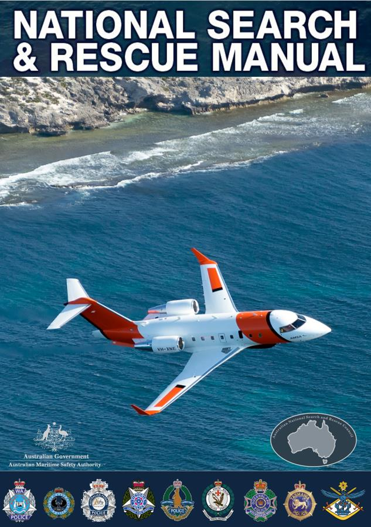

---
## Page 2

 
 
 
 
NATIONAL SEARCH AND RESCUE MANUAL 
 
2025 EDITION Version 1 – February 2025 
Published by the Australian Maritime Safety Authority (AMSA) on behalf of the Australian National 
Search and Rescue Council 
Written and amended by retired Senior Sergeant Dr Jim Whitehead, Queensland Police Service 
(2016 – 2023) on behalf of the Australian National Search and Rescue Council 
Reviewed by the Australian National Search and Rescue Council, with editing led by Leading 
Senior Constable Andrew Craig, Australian Federal Police (2025) 
© This publication is copyright. The reproduction of this work in whole or in part is invited for search 
and rescue purposes other than commercial purposes provided due acknowledgment is given to 
the Australian National Search and Rescue Council.  
For further information contact the Council Secretariat at: 
Secretariat  
National Search and Rescue Council 
GPO Box 2181 
Canberra ACT 2601 
 
Email: nationalsarcouncil@amsa.gov.au 
 
 
 
 
 
 
 
 
2025 EDITION Version 1 – February 2025

---
## Page 3

 
 
 
NATIONAL SEARCH AND RESCUE MANUAL 
2025 EDITION Version 1 – February 2025 
Page 1 
Foreword 
Search and Rescue (SAR) is the search for and provision of lifesaving assistance to 
people in distress and imminent danger of loss of life.  Australian SAR arrangements are 
intended to complement other emergency services (police, fire, ambulance) in 
circumstances where those services are unable to operate effectively. Such 
circumstances could include, for example, remote area operations, rescues at sea, and 
the need for specialist SAR facilities not normally available to emergency services. 
Depending upon the extent and complexity of the incident and on the available staff and 
facilities, SAR may take many forms in response to a distress situation. Unless the action 
is indivisible from that of safeguarding life, a SAR operation does not, however, include 
salvage or the saving of property. 
The Australian search and rescue region covers the Australian continent and large areas 
of the Indian, Pacific and Southern Oceans as well the Australian Antarctic territories. This 
is an area of about 52.8 million square kilometres, or about one tenth of the earth’s 
surface. Dedicated SAR assets are limited in Australia and other government, private and 
commercial assets may be diverted from their primary function by charter, arrangement 
and request. 
In practice, many SAR operations are conducted jointly by Commonwealth and State / 
Territory authorities.  It is, therefore, essential that the available resources and operational 
techniques are standardised and coordinated across the Australian region. 
All SAR authorities in Australia: Australian Maritime Safety Authority, Australian Defence 
Force and State, Territory and Federal Police must be able to act cooperatively. 
In 2017, the Commonwealth, State and Territory Ministers responsible for search and 
rescue response in Australia updated the Intergovernmental Agreement (IGA) on National 
Search and Rescue Response Arrangements. The IGA (Appendix A of this Manual) 
confirmed the National Search and Rescue Council’s role as the national coordinating 
body for search and rescue procedures with a function, among others, of sponsoring this 
National Search and Rescue Manual. 
Documenting standardised techniques and procedures, the National Search and Rescue 
manual enables SAR authorities to cooperate and coordinate to best effect. By 
establishing and standardising procedures, the manual seeks to promote effective saving 
of lives. 
 
Mark Morrow 
 
Chairman 
National Search Rescue Council

---
## Page 4

 
 
 
NATIONAL SEARCH AND RESCUE MANUAL 
Page 2 
2025 EDITION Version 1 – February 2025 
Australian Maritime Safety Authority 
 
First published in Australia in 1992 by the Australian Maritime Safety Authority (AMSA) on behalf of 
the Australian National Search and Rescue Council. 
Level 8, 18 Marcus Clarke Street, Canberra, ACT, 2601, Australia 
 
In 2016 Doctor Jim Whitehead, now retired Senior Sergeant, Queensland Police Service, 
combined the 2015 versions of the National Search and Rescue Manual (Aerial and Marine Search 
and Rescue) and the National Land Search Operations Manual to form a single manual.  
Over the period 2019 to 2020, as part of ongoing reviews, Dr Whitehead removed approximately 
1300 paragraphs of ‘duplicated’ text, re-drew old ‘photocopied’ diagrams, and arranged each 
chapter into: Marine, Aviation, and Land sections. 
Throughout the period from 2016 to 2023, Dr Whitehead was predominantly responsible for writing, 
amending, and editing the National Search and Rescue Manual on behalf of the Australian 
National Search and Rescue Council. 
Editing of the 2025 edition was led by Leading Senior Constable Andrew Craig, Australian Federal 
Police, Search and Rescue, on behalf of the Australian National Search and Rescue Council. This 
is part of ongoing succession-planning to ensure that knowledge of SAR requirements is utilised to 
ensure appropriate updating of the manual, and to facilitate continuous improvement of SAR 
processes. 
 
Copyright © 2025 
Australian Maritime Safety Authority (AMSA) on behalf of the Australian National Search and 
Rescue Council. 
 
The reproduction of this work in whole or in part is invited for search and rescue purposes other 
than commercial purposes provided due acknowledgment is given to the Australian National 
Search and Rescue Council. 
 
ISSN: 2653-2085 (Online) 
 
For further information contact the Council Secretariat at: 
Secretariat 
National Search and Rescue Council 
GPO Box 2181 
Canberra ACT 2601 
Email: nationalsarcouncil@amsa.gov.au

---
## Page 5

 
 
 
NATIONAL SEARCH AND RESCUE MANUAL 
2025 EDITION Version 1 – February 2025 
Page 3 
Introduction 
This National Search and Rescue Manual is the result of the recent merger of the aviation, maritime and 
land search and rescue (SAR) manuals and is the standard reference document for use by all Australian SAR 
authorities.  It is promulgated by the National SAR Council operating under direction from relevant 
Commonwealth, State and Territory Ministers.  The Manual promulgates SAR coordination procedures for 
SAR operations conducted within Australia and the Australian SAR Region (SRR). 
The manual is consistent with the relevant International Conventions to which Australia is a party and is 
supplemented by various legal, informative and instructional documents used within, and between, 
organisations concerned with search and rescue.  It has been developed with due regard to the 
International Aviation and Maritime Search and Rescue Manual (IAMSAR).  
The National SAR Manual meets the requirements of international conventions for an Australian Search and 
Rescue Plan, and includes material covering: 
a) 
Abbreviations, terminology and definitions relevant to SAR practitioners 
b) 
The elements and functions of the Australian SAR system 
c) 
Details of communications, assets and procedures for coordination 
d) 
SAR planning and techniques including worksheets 
The National Search and Rescue Manual acts as a set of procedures and guidelines in providing a search and 
rescue response within Australia. It is understood that the knowledge and experience of officers can extend 
beyond what is covered within this manual and therefore initiative should be used accordingly in search and 
rescue operations.  It is, however, necessary to follow the guidelines outlined within this manual as closely 
related to the circumstances presented and keep all relevant parties well informed throughout the process.  
Officers should be prepared to justify their actions if necessary. When developing Standard Operating 
Procedures (SOP) at the organisational level, care should be taken to ensure that procedures are written 
consistent with the National SAR Manual.  Should an SOP be identified, that may be of benefit to the wider 
SAR community, it is recommended that the issue be raised with the National SAR Council so that inclusion 
of the procedure into the National SAR Manual can be considered. 
This manual is under continual review and will be updated as necessary. The National SAR Manual is 
promulgated online for the use of all search and rescue practitioners. The Internet version is the controlled 
document and is the latest version of this manual.  The online version should always be referred to as it 
contains the most up to date information. 
Suggestions and questions regarding this Manual should be forwarded to: 
The Secretariat of the National SAR Council 
Australian Maritime Safety Authority 
GPO Box 2181 
Canberra ACT 2601

---
## Page 6

 
 
 
NATIONAL SEARCH AND RESCUE MANUAL 
Page 4 
2025 EDITION Version 1 – February 2025 
Defence Letter of Promulgation

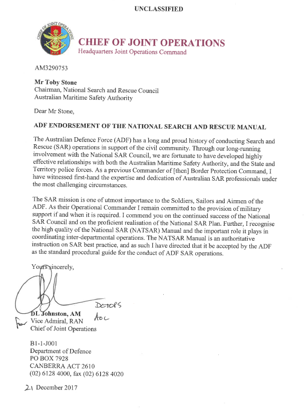

---
## Page 7

 
 
 
NATIONAL SEARCH AND RESCUE MANUAL 
2025 EDITION Version 1 – February 2025 
Page 5 
Table of Contents 
 
Foreword ........................................................................................................................................................... 1 
Introduction ....................................................................................................................................................... 3 
Defence Letter of Promulgation ........................................................................................................................ 4 
Table of Contents .............................................................................................................................................. 5 
Acronyms and Abbreviations .......................................................................................................................... 20 
Glossary ........................................................................................................................................................... 27 
Volume 1 - Search and Rescue Administration ............................................................................................... 35 
Chapter 1 SAR System Organisation ................................................................................................................ 35 
1.1. Organisation ....................................................................................................................................... 35 
Global SAR System Organisation ........................................................................................................ 35 
National and Regional SAR System Organisation ............................................................................... 35 
Australian Maritime Safety Authority (AMSA) ................................................................................... 36 
State and Territory Governments ....................................................................................................... 37 
Australian Defence Force Responsibilities – Military SAR .................................................................. 38 
Headquarters Joint Operations Command ......................................................................................... 38 
Airservices Australia ........................................................................................................................... 38 
Other Commonwealth Agencies/Authorities ..................................................................................... 39 
Bureau of Meteorology (BOM) ........................................................................................................... 39 
Emergency Management Australia (EMA) ......................................................................................... 39 
Maritime Border Command................................................................................................................ 39 
Australian Communications and Media Authority (ACMA) ................................................................ 39 
Australian Transport Safety Bureau (ATSB) ........................................................................................ 39 
Civil Aviation Safety Authority (CASA) ................................................................................................ 40 
Volunteer Organisations ..................................................................................................................... 40 
Commercial and Private Organisations .............................................................................................. 40 
1.2. SAR Coordination ................................................................................................................................ 40 
Overview ............................................................................................................................................. 40 
Alerting Post ....................................................................................................................................... 41 
Determination of SAR Authority Responsible for Overall Coordination ............................................ 41 
Initial Response ................................................................................................................................... 41 
SAR Authority Best Placed to Coordinate ........................................................................................... 41 
Effective Consultation and Coordination............................................................................................ 42 
Cooperation with Foreign Rescue Coordination Centres ................................................................... 42 
Transfer of Coordination .................................................................................................................... 43 
Requesting JRCC Australia Assistance ................................................................................................ 46 
1.3. Requesting State / Territory SAR Authority Assistance ...................................................................... 47 
Requests for Defence Assistance (DACC) ........................................................................................... 47 
Defence Requests for Civil Assistance ................................................................................................ 48 
1.4. Australian Search and Rescue Region................................................................................................. 48

---
## Page 8

 
 
 
NATIONAL SEARCH AND RESCUE MANUAL 
Page 6 
2025 EDITION Version 1 – February 2025 
1.5. SRR Coordinates.................................................................................................................................. 49 
1.6. Australian States and Land Search Area ............................................................................................. 50 
Chapter 2 SAR Management ........................................................................................................................... 51 
2.1. Overview ............................................................................................................................................. 51 
SAR Authority Responsibilities ............................................................................................................ 51 
Forward Command Post ..................................................................................................................... 52 
RCC/Field Search Headquarters (FSH) Staff ........................................................................................ 53 
Search and Rescue Roles .................................................................................................................... 54 
2.2. Search and Rescue Resources............................................................................................................. 57 
Overview ............................................................................................................................................. 57 
Personnel ............................................................................................................................................ 58 
Drop-Masters, Dispatchers and Observers ......................................................................................... 58 
Rescue Preparation ............................................................................................................................. 59 
2.3. Public Relations................................................................................................................................... 59 
Overview ............................................................................................................................................. 59 
Operations involving two or more SAR Authorities ........................................................................... 60 
Public Relations Officers (PRO's)/Media Officers (MO) ...................................................................... 60 
Press Releases ..................................................................................................................................... 60 
Requesting Public Assistance .............................................................................................................. 61 
Liaison with Relatives ......................................................................................................................... 62 
Notification of Next of Kin .................................................................................................................. 62 
Casualties ............................................................................................................................................ 62 
2.4. Other Emergency Assistance and Services available from JRCC Australia ......................................... 63 
General ............................................................................................................................................... 63 
Maritime Safety Information .............................................................................................................. 63 
Unlawful Acts ...................................................................................................................................... 63 
Chapter 3 Training and Exercises .................................................................................................................... 65 
3.1. Requirements for SAR Training........................................................................................................... 65 
Training ............................................................................................................................................... 65 
Who to Train ....................................................................................................................................... 65 
Requirement for Training ................................................................................................................... 65 
3.2. National Training Framework ............................................................................................................. 65 
Qualifications ...................................................................................................................................... 65 
Public Safety Training Package; Police Training Package ................................................................... 66 
AMSA Training .................................................................................................................................... 66 
The National Search and Rescue Manager’s Course .......................................................................... 66 
State/Territory SAR Authority Training .............................................................................................. 66 
3.3. Search and Rescue Exercises .............................................................................................................. 67 
3.4. Training of Search and Rescue Assets ................................................................................................ 67 
Land SAR Training ............................................................................................................................... 67 
Search and Rescue Crew Training ....................................................................................................... 68 
Drop-Master and Dispatchers ............................................................................................................ 68

---
## Page 9

 
 
 
NATIONAL SEARCH AND RESCUE MANUAL 
2025 EDITION Version 1 – February 2025 
Page 7 
Air Observer Training .......................................................................................................................... 68 
Aviation Search and Rescue Assets (SRA) ........................................................................................... 68 
First Aid Training ................................................................................................................................. 68 
Map Reading and Navigation ............................................................................................................. 69 
Radio Operating Procedures ............................................................................................................... 69 
Field craft ............................................................................................................................................ 69 
Observation Skills................................................................................................................................ 69 
Observation Skills-Day ........................................................................................................................ 69 
Team and Individual Skills ................................................................................................................... 70 
Searchers ............................................................................................................................................ 71 
Search Team Leaders/On-Scene Commanders .................................................................................. 71 
3.5. Photographic Records ......................................................................................................................... 72 
3.6. Liaison Visits ........................................................................................................................................ 72 
Volume 2 - Search and Rescue Operations ..................................................................................................... 73 
Chapter 1 Communications ............................................................................................................................. 73 
1.1. Aviation and Maritime ........................................................................................................................ 73 
Overview ............................................................................................................................................. 73 
1.2. Distress and Emergency Signals .......................................................................................................... 73 
Maritime Radio Alarm Signal .............................................................................................................. 73 
Radiotelephone Distress Signal .......................................................................................................... 74 
Radiotelephone Urgency Signal .......................................................................................................... 74 
Radiotelephone Safety Signal ............................................................................................................. 74 
Radiotelephony Distress/Emergency Frequencies ............................................................................. 74 
GMDSS Distress, Urgency, Safety and Calling Frequencies ................................................................ 74 
2182 kHz ............................................................................................................................................. 74 
4125, 6215, 8291, 12290 and 16420 kHz ........................................................................................... 75 
121.5 MHz ........................................................................................................................................... 75 
156.8 MHz (Marine VHF Channel) ...................................................................................................... 75 
243 MHz .............................................................................................................................................. 75 
Safety Frequencies .............................................................................................................................. 75 
1.3. Global Maritime Distress and Safety System (GMDSS) ...................................................................... 75 
1.4. Emergency Signalling Devices ............................................................................................................. 76 
Daylight Devices .................................................................................................................................. 76 
Night Vision Imaging Systems (NVIS) for aviation searching .............................................................. 76 
RADAR/IFF/SSR ................................................................................................................................... 77 
Radio and Distress Beacons ................................................................................................................ 77 
1.5. COSPAS-SARSAT Distress Beacon Detection System .......................................................................... 77 
Overview ............................................................................................................................................. 77 
Purpose ............................................................................................................................................... 78 
Satellites ............................................................................................................................................. 78 
Beacon Detection ............................................................................................................................... 79 
Beacons ............................................................................................................................................... 79 
1.6. Other Types of Distress Alerting Devices ............................................................................................ 80

---
## Page 10

 
 
 
NATIONAL SEARCH AND RESCUE MANUAL 
Page 8 
2025 EDITION Version 1 – February 2025 
SPOT Personal Satellite Messenger device (SPOT) ............................................................................. 80 
AIS-SART .............................................................................................................................................. 80 
Maritime Survivor Locating Systems. VHF DSC Maritime Survivor Locating Devices (MSLD). ........... 80 
Thuraya Satellite Devices .................................................................................................................... 81 
1.7. SAR RADAR Transponder (SART) ........................................................................................................ 81 
Overview ............................................................................................................................................. 81 
1.8. Communications in Support of SAR Operations ................................................................................. 82 
Overview ............................................................................................................................................. 82 
SAR Frequencies ................................................................................................................................. 82 
SAR Call Signs ...................................................................................................................................... 82 
1.9. Communications Facilities .................................................................................................................. 83 
Overview ............................................................................................................................................. 83 
Communications Capabilities Australian Defence Force Ships and Aircraft ...................................... 83 
Search and Rescue Visual Signals ....................................................................................................... 84 
Merchant Shipping and GMDSS.......................................................................................................... 84 
Limited Coast Radio Stations .............................................................................................................. 85 
Ship Stations ....................................................................................................................................... 85 
Fishing Vessels .................................................................................................................................... 85 
Pleasure Craft ..................................................................................................................................... 85 
Volunteer Organisations ..................................................................................................................... 86 
Communication Capabilities of State & Territory SAR Authorities .................................................... 86 
Communications Aircraft .................................................................................................................... 86 
Inmarsat Aero ..................................................................................................................................... 87 
1.10. Land Search Communications ............................................................................................................ 87 
Overview ............................................................................................................................................. 87 
1.11. Communications ................................................................................................................................. 88 
1.12. Communications Officer ..................................................................................................................... 88 
1.13. Communication Requirements ........................................................................................................... 88 
1.14. Headquarter Requirements ................................................................................................................ 88 
1.15. Telephone/Radio ................................................................................................................................ 89 
1.16. Rear Net .............................................................................................................................................. 89 
1.17. Forward Net ........................................................................................................................................ 89 
1.18. Frequencies ......................................................................................................................................... 89 
1.19. Radios in general ................................................................................................................................ 90 
1.20. Procedures and Practices ................................................................................................................... 91 
1.21. Other Methods of Communications ................................................................................................... 91 
Chapter 2 Awareness and Initial Action .......................................................................................................... 92 
2.1. Awareness Introduction ..................................................................................................................... 92 
2.2. Types of SAR Incidents ........................................................................................................................ 92 
Maritime SAR Incident ........................................................................................................................ 93 
Aviation SAR Incident ......................................................................................................................... 93

---
## Page 11

 
 
 
NATIONAL SEARCH AND RESCUE MANUAL 
2025 EDITION Version 1 – February 2025 
Page 9 
Land SAR Incident ............................................................................................................................... 94 
2.3. Recording of Events ............................................................................................................................ 94 
2.4. SAR Stages .......................................................................................................................................... 94 
2.5. Awareness and Initial Action Stages (Stage 1 and 2) .......................................................................... 95 
Types of Notification Reports ............................................................................................................. 95 
Evaluation of Notification Reports ..................................................................................................... 96 
Information: SAR Incident Information .............................................................................................. 96 
Advising States of Foreign Persons in Distress ................................................................................. 100 
2.6. Emergency Phases ............................................................................................................................ 100 
Uncertainty Phase ............................................................................................................................. 100 
Alert Phase ........................................................................................................................................ 101 
Distress Phase ................................................................................................................................... 101 
2.7. Initial Action: Procedures of the Emergency Phases ........................................................................ 102 
Overview ........................................................................................................................................... 102 
Uncertainty Phase Initial Action ....................................................................................................... 102 
Alert Phase Procedures .................................................................................................................... 103 
Distress Phase Procedures ................................................................................................................ 105 
2.8. Intelligence Gathering and Assessment ........................................................................................... 106 
Overview ........................................................................................................................................... 106 
Communication Checks .................................................................................................................... 106 
Intelligence gathering ....................................................................................................................... 108 
Sighting and Hearing Reports ........................................................................................................... 111 
Coordination with the Police ............................................................................................................ 112 
Examination of Recorded Communications - Aircraft and vessels ................................................... 112 
Flight Path Analysis - Aircraft ............................................................................................................ 113 
Weather Analysis .............................................................................................................................. 113 
Logistical Information ....................................................................................................................... 113 
General Considerations for the SMC ................................................................................................ 113 
Chapter 3 Search Planning and Evaluation .................................................................................................... 118 
3.1. Aviation and Maritime Search Planning ........................................................................................... 118 
Overview ........................................................................................................................................... 118 
3.2. Aviation and Maritime Search Planning Steps ................................................................................. 118 
Evaluating the Situation .................................................................................................................... 119 
Estimating the Distress Incident Location ........................................................................................ 119 
Datum Considerations ...................................................................................................................... 120 
Drift Considerations .......................................................................................................................... 120 
3.3. Search Response Stages ................................................................................................................... 121 
Factors Affecting the Search Response Plan .................................................................................... 122 
3.4. Aviation and Maritime Basic Search Planning .................................................................................. 123 
Controlling Factors ............................................................................................................................ 124 
Search Effort Expenditure Rate ........................................................................................................ 125 
Maximum Search Effort .................................................................................................................... 125

---
## Page 12

 
 
 
NATIONAL SEARCH AND RESCUE MANUAL 
Page 10 
2025 EDITION Version 1 – February 2025 
Search Sequence ............................................................................................................................... 125 
3.5. Aviation and Maritime Determination of Search Areas ................................................................... 127 
Aviation and Maritime Planning ....................................................................................................... 127 
Possibility Area.................................................................................................................................. 127 
Calculation of Circles of Probability .................................................................................................. 130 
Probable Errors of Position ............................................................................................................... 130 
Search Radius (R) .............................................................................................................................. 130 
Drift Error for Waterborne Targets................................................................................................... 130 
Currents ............................................................................................................................................ 131 
Leeway .............................................................................................................................................. 134 
Divergence ........................................................................................................................................ 135 
Calculating Leeway ........................................................................................................................... 135 
Plotting Drift ..................................................................................................................................... 136 
Datum Plot ........................................................................................................................................ 136 
Drift Error (De) .................................................................................................................................. 137 
Search Area Based on Non-Moving Datum ...................................................................................... 138 
Search Based on Moving Datum ....................................................................................................... 138 
Labelling the Datum .......................................................................................................................... 140 
Consideration of Possible Courses of Action by the Captain of the Target ...................................... 141 
3.6. Coastal Search Planning .................................................................................................................... 141 
Search Area ....................................................................................................................................... 141 
Position Uncertainty ......................................................................................................................... 144 
Track Line Overdue Incident ............................................................................................................. 144 
Recomputed Datum .......................................................................................................................... 145 
Track Spacing .................................................................................................................................... 147 
3.7. Land Search Planning ........................................................................................................................ 148 
Overview ........................................................................................................................................... 148 
3.8. Incident Command ........................................................................................................................... 149 
3.9. Situational Awareness ...................................................................................................................... 149 
3.10. Conducting an Appreciation ............................................................................................................. 150 
Definition .......................................................................................................................................... 150 
Sequence .......................................................................................................................................... 150 
Phases ............................................................................................................................................... 150 
Aim .................................................................................................................................................... 151 
Limitations ........................................................................................................................................ 151 
Written Statement ............................................................................................................................ 151 
Factors .............................................................................................................................................. 151 
Examination ...................................................................................................................................... 151 
3.11. Courses Open .................................................................................................................................... 152 
Plan ................................................................................................................................................... 152 
Planning Principles ............................................................................................................................ 153 
Keep it simple ................................................................................................................................... 153 
Relate to the Aim .............................................................................................................................. 153

---
## Page 13

 
 
 
NATIONAL SEARCH AND RESCUE MANUAL 
2025 EDITION Version 1 – February 2025 
Page 11 
Logical deductions ............................................................................................................................ 153 
Land Search Planning ........................................................................................................................ 153 
Scenario-based Assessment (SCENARIO) ......................................................................................... 154 
Factors Influencing Discovery ........................................................................................................... 155 
Analyse possible land strategies ....................................................................................................... 155 
Raise land search strategies ............................................................................................................. 155 
Identify priority land search area ..................................................................................................... 155 
Ongoing reassessment of land search .............................................................................................. 155 
Search Urgency Assessment (SUA) ................................................................................................... 156 
3.12. Terrain Factors .................................................................................................................................. 156 
3.13. Land Environments ........................................................................................................................... 157 
Rainforest.......................................................................................................................................... 157 
Alpine Environment .......................................................................................................................... 160 
Arid Environment .............................................................................................................................. 161 
Mountain Environment .................................................................................................................... 163 
Dangerous Animals ........................................................................................................................... 169 
Telephone Triangulation ................................................................................................................... 170 
Land Search Planning ........................................................................................................................ 170 
Reflex Search .................................................................................................................................... 171 
3.14. Formal Search (Land) ........................................................................................................................ 172 
Theoretical Search Strategy (Naismith’s Rule) ................................................................................. 172 
Statistical Strategy (Lost Person Behaviour) ..................................................................................... 174 
3.15. Subjective/Decision Point Strategy (Land) ....................................................................................... 176 
Decision Points.................................................................................................................................. 177 
3.16. Deductive Strategy (Land) ................................................................................................................ 179 
Using all four Formal Search Strategies ............................................................................................ 179 
3.17. Recording of search areas (Land) ..................................................................................................... 188 
Behaviour of Lost People .................................................................................................................. 195 
Mass Casualty SAR Incidents ............................................................................................................ 197 
Urban SAR (USAR) ............................................................................................................................. 198 
Coordination ..................................................................................................................................... 198 
Initial Actions .................................................................................................................................... 199 
Working under or within a MIR ........................................................................................................ 199 
MIR Liaison Officer ............................................................................................................................ 200 
Field Search Headquarters................................................................................................................ 200 
Searching .......................................................................................................................................... 201 
Land Search problems ...................................................................................................................... 201 
Search Area Delineation ................................................................................................................... 202 
Tasking sheets ................................................................................................................................... 204 
Briefings ............................................................................................................................................ 205 
Record Keeping ................................................................................................................................. 206 
Passive Searching .............................................................................................................................. 208 
Chapter 4 Search and Rescue Techniques ..................................................................................................... 209

---
## Page 14

 
 
 
NATIONAL SEARCH AND RESCUE MANUAL 
Page 12 
2025 EDITION Version 1 – February 2025 
4.1. Aviation and Maritime Search Operations ....................................................................................... 209 
Overview ........................................................................................................................................... 209 
4.2. General Guidelines for Searches ...................................................................................................... 209 
Stage One Search: Immediate response ........................................................................................... 209 
Stage Two Search: Nominated Area Either Side of Track ................................................................. 210 
Stage Three Search: Mathematically Derived Area .......................................................................... 211 
4.3. Aviation and Maritime Search Area Coverage ................................................................................. 211 
General ............................................................................................................................................. 211 
Sweep Width (W): Factors affecting Sweep Width .......................................................................... 212 
Track Spacing (S) ............................................................................................................................... 217 
Coverage Factor (C) .......................................................................................................................... 218 
Aviation and Maritime Probability of Detection (POD) .................................................................... 218 
4.4. Navigation of SAR Assets (Aviation and Maritime) .......................................................................... 220 
4.5. Visual Search Patterns (Aviation and Maritime)............................................................................... 221 
General ............................................................................................................................................. 221 
Parallel Track Search Pattern ............................................................................................................ 222 
Creeping Line Patterns ...................................................................................................................... 224 
Track Line Search .............................................................................................................................. 224 
Expanding Square Search ................................................................................................................. 225 
Sector Search .................................................................................................................................... 227 
Aural Search by Surface Craft ........................................................................................................... 229 
Coastal Search (Islands and their Foreshores) .................................................................................. 229 
Contour Search by Aircraft ............................................................................................................... 230 
Mountainous or Rugged Terrain Searches ....................................................................................... 232 
Line Abreast Helicopter Searches ..................................................................................................... 233 
Aviation and Maritime Search Considerations ................................................................................. 233 
4.6. Flare Searches ................................................................................................................................... 234 
4.7. Electronic Searches ........................................................................................................................... 234 
Distress Beacons ............................................................................................................................... 234 
Maximum Radio Signal Range Calculations ...................................................................................... 237 
Signal Heard, Signal Fade Plotting Method ...................................................................................... 237 
De-tuning Method ............................................................................................................................ 238 
Hill Shading ....................................................................................................................................... 238 
Locating a Signal from the Ground ................................................................................................... 238 
Search by RADAR .............................................................................................................................. 239 
Search by Infrared (IR) Devices ......................................................................................................... 241 
Night Vision Imaging Systems ........................................................................................................... 241 
4.8. Aviation and Maritime SAR Asset Selection and Characteristics ...................................................... 242 
Overview ........................................................................................................................................... 242 
Aviation Assets .................................................................................................................................. 242 
Australian Defence Force Aviation Assets ........................................................................................ 245 
Customs and Border Force Aircraft .................................................................................................. 245 
Maritime Assets ................................................................................................................................ 245

---
## Page 15

 
 
 
NATIONAL SEARCH AND RESCUE MANUAL 
2025 EDITION Version 1 – February 2025 
Page 13 
Naval Vessels .................................................................................................................................... 246 
Customs Vessels ............................................................................................................................... 246 
Use of Merchant Shipping ................................................................................................................ 246 
Equipment for Marine Craft ............................................................................................................. 247 
Land Search Facilities ........................................................................................................................ 247 
4.9. Aviation and Maritime Search Asset Allocation ............................................................................... 248 
Introduction ...................................................................................................................................... 248 
Aircraft Capability ............................................................................................................................. 248 
Calculation of Search Time Required ................................................................................................ 248 
Calculation of Search Time Available ................................................................................................ 249 
Investigation Time ............................................................................................................................ 250 
Effective Search Time ....................................................................................................................... 250 
Comparison of Search Time Required and Time Available for Search Aircraft ................................ 250 
Allocation Variations to Suit Particular Aircraft ................................................................................ 252 
Allocation Chart Presentation .......................................................................................................... 253 
4.10. SAR Crew Briefing ............................................................................................................................. 253 
General ............................................................................................................................................. 253 
Search Briefing .................................................................................................................................. 254 
Search Aircrew Briefing .................................................................................................................... 255 
Search Aircraft Operations ............................................................................................................... 256 
Communications Relay Aircraft ........................................................................................................ 256 
Top Cover Aircraft ............................................................................................................................. 257 
Maritime Search Crews..................................................................................................................... 257 
Land Assets in Aircraft Search .......................................................................................................... 258 
4.11. SAR Crew Debriefing ......................................................................................................................... 259 
Overview ........................................................................................................................................... 259 
4.12. Land Search Operations .................................................................................................................... 259 
Overview ........................................................................................................................................... 259 
4.13. Land Search Assets ........................................................................................................................... 260 
Land Assets ....................................................................................................................................... 260 
Land Search using Maritime Assets .................................................................................................. 265 
Land Search Considerations for Aviation Assets .............................................................................. 265 
Land Search Action Plan ................................................................................................................... 267 
General Search (Land SAR) ............................................................................................................... 270 
Contact Search (Land SAR) ............................................................................................................... 271 
4.14. Land Search Area Coverage .............................................................................................................. 272 
Land SAR Target Type ....................................................................................................................... 273 
Land SAR Meteorological Visibility ................................................................................................... 273 
Type of Terrain/Conditions ............................................................................................................... 273 
Land Search Speed ............................................................................................................................ 274 
Cloud Cover and Sun Light ................................................................................................................ 274 
Land SAR First and Last Search Light ................................................................................................ 274 
Land SAR Probability of Detection .................................................................................................... 275 
Visual Horizon: Ankle Rule (Land SAR).............................................................................................. 275

---
## Page 16

 
 
 
NATIONAL SEARCH AND RESCUE MANUAL 
Page 14 
2025 EDITION Version 1 – February 2025 
Area Swept (Land SAR) ..................................................................................................................... 276 
Accuracy of Navigation by Land Search Teams ................................................................................ 277 
Land SAR Night Searching ................................................................................................................. 277 
Searching in Hazardous Areas .......................................................................................................... 278 
Police Divers...................................................................................................................................... 278 
Using Police Divers for SAR ............................................................................................................... 280 
4.15. Land Search Patterns ........................................................................................................................ 281 
Common Land Search Patterns ........................................................................................................ 283 
4.16. Clue Recognition and Interpretation ................................................................................................ 295 
General Principles ............................................................................................................................. 295 
4.17. Land Search Briefings ........................................................................................................................ 297 
Preparation ....................................................................................................................................... 298 
Mattson Consensus .......................................................................................................................... 303 
Chapter 5 Rescue Planning Operations ......................................................................................................... 305 
5.1. Rescue General ................................................................................................................................. 305 
5.2. Medical Assistance ........................................................................................................................... 306 
5.3. Aircraft Accidents ............................................................................................................................. 306 
Health Hazards .................................................................................................................................. 306 
5.4. Land Rescue ...................................................................................................................................... 307 
Avoidance of Danger ........................................................................................................................ 308 
5.5. Maritime Rescue ............................................................................................................................... 308 
Use of Rescue Boats and Vessels ...................................................................................................... 309 
Marking Targets ................................................................................................................................ 309 
5.6. Rescue Assets.................................................................................................................................... 310 
Use of Aircraft for Rescue ................................................................................................................. 310 
Use of Helicopters for Rescue........................................................................................................... 310 
Use of Top Cover Aircraft with Rescue and MEDEVAC Helicopters ................................................. 311 
5.7. Supply Dropping and Delivery of Survival Equipment ...................................................................... 311 
Civil SAR Equipment .......................................................................................................................... 311 
Supply Drop from Aircraft over Sea .................................................................................................. 312 
Supply Drop from Helicopter over Sea ............................................................................................. 312 
Supply Drop from Aircraft over Land ................................................................................................ 312 
Chapter 6 Conclusion of SAR Operations ...................................................................................................... 313 
6.1. Conclusion General ........................................................................................................................... 313 
6.2. Conclusion of a successful SAR operation ........................................................................................ 313 
6.3. Suspension/termination of a search when the target is not found ................................................. 313 
6.4. Reopening a Suspended Search........................................................................................................ 315 
6.5. Records and Reports ......................................................................................................................... 315 
6.6. Incident Debriefs .............................................................................................................................. 315 
Conducting the Debrief..................................................................................................................... 316 
Lesson for improvement ................................................................................................................... 317

---
## Page 17

 
 
 
NATIONAL SEARCH AND RESCUE MANUAL 
2025 EDITION Version 1 – February 2025 
Page 15 
6.7. Case Studies ...................................................................................................................................... 317 
6.8. Peer Reviews ..................................................................................................................................... 318 
Chapter 7 Medical Factors ............................................................................................................................. 320 
7.1. General ............................................................................................................................................. 320 
7.2. Time Frame for Survival (TFFS) ......................................................................................................... 320 
7.3. Survivor Stress Factors ...................................................................................................................... 320 
7.4. Survival Environment Factors ........................................................................................................... 320 
7.5. Hypothermia ..................................................................................................................................... 321 
7.6. Water Hypothermia .......................................................................................................................... 321 
7.7. Wind Hypothermia ........................................................................................................................... 324 
7.8. Wind Chill .......................................................................................................................................... 325 
7.9. Hypothermia Survivability ................................................................................................................ 326 
7.10. Wet-Chill Survivability....................................................................................................................... 326 
7.11. Water Immersion .............................................................................................................................. 327 
7.12. Effects of Alcohol .............................................................................................................................. 327 
7.13. Hyperthermia, Heat Stress and Dehydration ................................................................................... 328 
7.14. Heat Exhaustion ................................................................................................................................ 328 
7.15. Heat Stroke ....................................................................................................................................... 329 
7.16. Hyperthermia Survivability ............................................................................................................... 330 
7.17. Terrain Factors .................................................................................................................................. 332 
7.18. Seeking Medical Advice .................................................................................................................... 333 
Appendices .................................................................................................................................................... 334 
Appendix A – Intergovernmental Agreement ............................................................................................... 334 
Appendix B – National SAR Responsibilities .................................................................................................. 345 
Appendix C – National Operational Procedure for Transfer of Coordination ............................................... 349 
Overview .................................................................................................................................................... 349 
Guidelines for Procedure to transfer coordination .......................................................................... 350 
State / Territory SAR Authority Points of Contact ............................................................................ 351 
Transfer of Coordination Information Exchange Requirements ...................................................... 351 
Example: Transfer of Coordination information............................................................................... 352 
Appendix D .................................................................................................................................................... 354 
Overview .................................................................................................................................................... 354 
Appendix D-1 Distress Emergency Signals ..................................................................................................... 355 
Overview .................................................................................................................................................... 355 
International Distress Signals ........................................................................................................... 355 
Search and Rescue Signals – Australian Area ................................................................................... 355 
Civil Air-Ground Code ....................................................................................................................... 356 
International SAR Signals .................................................................................................................. 357

---
## Page 18

 
 
 
NATIONAL SEARCH AND RESCUE MANUAL 
Page 16 
2025 EDITION Version 1 – February 2025 
Appendix D-2 Maritime SAR Recognition Code (MAREC) ............................................................................. 358 
Overview .................................................................................................................................................... 358 
Part 1 – Merchant Vessels ................................................................................................................ 358 
Complete example Merchant Ship ................................................................................................... 363 
Part 2 – Small Craft ........................................................................................................................... 364 
Complete Example: Motor Boat ....................................................................................................... 371 
Complete Example: Sailing Boat ....................................................................................................... 372 
Appendix D-3 Plotting Symbols ..................................................................................................................... 373 
Appendix D-4 Sighting and Hearing (SHR) Techniques .................................................................................. 374 
Listening Techniques ........................................................................................................................ 374 
Open Questions ................................................................................................................................ 374 
Closed Questions .............................................................................................................................. 374 
Leading Questions ............................................................................................................................ 375 
Instructions for Completing Sighting and Hearing Reports .............................................................. 375 
Sighting and/or Hearing Report for Missing Aircraft ........................................................................ 376 
Sighting and Hearing Report – Generic ............................................................................................ 377 
Sighting and/or Hearing Log ............................................................................................................. 378 
Appendix D-5 Tables and Graphs .................................................................................................................. 379 
Overview .................................................................................................................................................... 379 
Local Wind Current ........................................................................................................................... 379 
Leeway Tables (kt) ............................................................................................................................ 379 
Sweep Width Tables for Visual Search Over Water.......................................................................... 379 
Sweep Width Tables for Visual Search Over Land: ........................................................................... 379 
Probability of Detection .................................................................................................................... 379 
Local Wind Current .................................................................................................................................... 380 
Leeway Tables (kt) ..................................................................................................................................... 381 
Taxonomy Class Definitions/Descriptions ................................................................................................. 382 
Probability of Detection ............................................................................................................................ 390 
Sweep Widths and Correction Factors ...................................................................................................... 391 
Sweep Width Tables for Visual Search over Water .......................................................................... 391 
Weather Correction Factors for all Types of Search Facilities .......................................................... 392 
Uncorrected Visual Sweep Widths for Merchant Ships (NM) .......................................................... 392 
Uncorrected Sweep Widths for Fixed-Wing Aircraft (NM) at 500 ft and 1000 ft ............................. 394 
Weather Correction Factors for all Types of Search Facilities .......................................................... 395 
Uncorrected Sweep Widths for Fixed-Wing Aircraft (NM) at 1500 ft and 2000 ft ........................... 396 
Weather Correction Factors for all Types of Search Facilities .......................................................... 397 
Uncorrected Sweep Widths for Helicopters (NM) – Maritime 500 ft and 1000 ft ........................... 398 
Weather correction factors for all types of search facilities ............................................................ 399 
Uncorrected Sweep Widths for Helicopters (NM) - Maritime 1500 ft and 2000 ft .......................... 400 
Weather correction factors for all types of search facilities ............................................................ 401 
Fixed-wing Aircraft Search Facilities ................................................................................................. 401 
Sweep Width Tables for Visual Search Over Land ............................................................................ 402

---
## Page 19

 
 
 
NATIONAL SEARCH AND RESCUE MANUAL 
2025 EDITION Version 1 – February 2025 
Page 17 
Correction Factors – Vegetation and High Terrain ........................................................................... 402 
Appendix D-6 Probable Errors of Position ..................................................................................................... 403 
Probable Navigation Error of the Target (x) ..................................................................................... 403 
Probable Navigation error of the Search Craft (y) ............................................................................ 404 
Appendix D-7 Maritime and Aviation Worksheets ........................................................................................ 405 
Overview .................................................................................................................................................... 405 
Worksheet 1 – Maritime Planning .................................................................................................... 406 
Worksheet 2 – Maritime Search by Aircraft ..................................................................................... 407 
Worksheet 3 – Land Search by Aircraft ............................................................................................ 408 
Worksheet 4 – Search Radius ........................................................................................................... 409 
Worksheet 5 – Sector Search............................................................................................................ 410 
Worksheet 6 – Aircraft Allocation .................................................................................................... 411 
Worksheet 7 – Asset Allocation ........................................................................................................ 412 
Worksheet 8 – Maritime Search by Vessel ....................................................................................... 413 
Appendix D-8 Aircraft Accident Site Precautions .......................................................................................... 414 
Safety Precautions and Procedures at Aircraft Accidents ................................................................ 414 
Appendix D-9 Civil Aircraft Search and Rescue Assets (SRAs) ....................................................................... 415 
AMSA Aircraft Tier SRA Capability Definitions .................................................................................. 415 
Tier 1 SRAs ........................................................................................................................................ 415 
Opportunity Based SAR Services ...................................................................................................... 416 
Current Aircraft and Police Fixed-Wing Operators ........................................................................... 416 
Air Search Observer Programme ...................................................................................................... 416 
Air Search Equipment ....................................................................................................................... 416 
Locations of Tier 1, 2 Assets ............................................................................................................. 417 
Appendix D-10 Coastal Datum Search and Rescue Planning ........................................................................ 419 
A Step-By-Step Guide for SAR Trained Personnel ..................................................................................... 419 
Vessel Adrift ...................................................................................................................................... 419 
Position Uncertainty ......................................................................................................................... 424 
Time Uncertainty .............................................................................................................................. 428 
Track Line Overdue ........................................................................................................................... 432 
Multiple Winds ................................................................................................................................. 441 
Multiple Current and Winds ............................................................................................................. 443 
Appendix E ..................................................................................................................................................... 446 
Overview .................................................................................................................................................... 446 
Appendix E-1 Search Urgency Assessment Form .......................................................................................... 447 
Appendix E-2 Missing Person Questionnaire ................................................................................................ 449 
Appendix E-3 Object Questionnaire .............................................................................................................. 450 
Appendix E-4 Land SAR Checklist .................................................................................................................. 451 
Appendix E-5 Lost Person Behaviour ............................................................................................................. 454 
Overview .................................................................................................................................................... 454 
Lost Person Behaviour Definitions .................................................................................................... 454

---
## Page 20

 
 
 
NATIONAL SEARCH AND RESCUE MANUAL 
Page 18 
2025 EDITION Version 1 – February 2025 
Children 1-3 years ............................................................................................................................. 456 
Children 4-6 years ............................................................................................................................. 457 
Children 7-12 years ........................................................................................................................... 458 
Youth 13-15 ...................................................................................................................................... 459 
Despondent/Suicidal ........................................................................................................................ 460 
Psychological Illness .......................................................................................................................... 462 
Developmental Problems ................................................................................................................. 463 
Alzheimer’s/Dementia ...................................................................................................................... 464 
Hikers/Walkers ................................................................................................................................. 465 
Hunters ............................................................................................................................................. 466 
Climbers ............................................................................................................................................ 467 
Prospectors ....................................................................................................................................... 468 
ADD, ADHD, Asperger’s, Autism ....................................................................................................... 469 
First Nation People ........................................................................................................................... 470 
Appendix E-6 Land Search Planning Tables ................................................................................................... 471 
Land Search Planning Tables ..................................................................................................................... 471 
Searcher Speed ................................................................................................................................. 471 
Searcher Spacing ............................................................................................................................... 471 
ATNPS Calculations ........................................................................................................................... 471 
Land Search Area Quick Reference ................................................................................................... 472 
Land Air Search Planning Table ........................................................................................................ 472 
Vegetation Correction Factor (Ve) .................................................................................................... 472 
Cloud cover correction factor ........................................................................................................... 473 
Appendix E-7 Additions to Naismith’s Rule ................................................................................................... 474 
Naismith’s Land Speed / Time Calculations ...................................................................................... 474 
Tranters Corrections ......................................................................................................................... 474 
Appendix E-8 Land SAR Probability of Detection (Land) ............................................................................... 475 
Caveat ............................................................................................................................................... 475 
Area to be Search (AS) ...................................................................................................................... 475 
Area swept (AW) ............................................................................................................................... 475 
Coverage Factor (C) .......................................................................................................................... 475 
Probability of Detection (POD) ......................................................................................................... 476 
Appendix E-9 Mattson Consensus ................................................................................................................. 480 
Overview .................................................................................................................................................... 480 
Mattson Consensus Worksheet ........................................................................................................ 480 
Appendix E-10 Land Search Organisation Chart Example ............................................................................. 481 
Appendix E-11 Field Search Headquarters Layout Example.......................................................................... 482 
Appendix E-12 Search Communications Network Example .......................................................................... 483 
Appendix E-13 Clue Recognition ................................................................................................................... 484 
General Principles: ............................................................................................................................ 484 
Tracking Skills .................................................................................................................................... 484 
Trail signs .......................................................................................................................................... 484

---
## Page 21

 
 
 
NATIONAL SEARCH AND RESCUE MANUAL 
2025 EDITION Version 1 – February 2025 
Page 19 
Sight .................................................................................................................................................. 485 
Appendix E-14 SAR Tasking Sheet Example ................................................................................................... 486 
Task sheet example .......................................................................................................................... 486 
Appendix E-15 Search for Skeletal Remains .................................................................................................. 487 
Overview .................................................................................................................................................... 487 
Two search methods are recommended for skeletal searching ...................................................... 488 
Bone characteristics .......................................................................................................................... 489 
Plant growth on bones ..................................................................................................................... 492 
Fungal growth on bones ................................................................................................................... 495 
Predator damage to bones ............................................................................................................... 495 
Appendix E-16 Peer Review Form Example ................................................................................................... 496 
Overview .................................................................................................................................................... 496 
Peer review form .............................................................................................................................. 496 
Appendix E-17 Body Flotation Information ................................................................................................... 498 
Overview .................................................................................................................................................... 498 
Issues that will affect floatation times.............................................................................................. 498 
Appendix F - Aircraft Electronic Night Search Guidance ............................................................................... 500 
Definitions ......................................................................................................................................... 500 
General Considerations .................................................................................................................... 500 
Aircraft and equipment factors ........................................................................................................ 500 
Survivor factors ................................................................................................................................. 501 
Search planning factors .................................................................................................................... 502 
Surface unit support ......................................................................................................................... 504 
Circle Search technique - General guidance ..................................................................................... 504 
Index .............................................................................................................................................................. 506

---
## Page 22

 
 
 
NATIONAL SEARCH AND RESCUE MANUAL 
Page 20 
2025 EDITION Version 1 – February 2025 
Acronyms and Abbreviations 
Acronym/ Abbreviation 
Meaning 
A 
Area or search area 
ACMA 
Australian Communications and Media Authority 
ACFT 
Aircraft 
AFTN 
Aeronautical fixed telecommunications network 
ADF 
Australian Defence Force 
ADFLO 
Australian Defence Force Liaison Officer 
AGL 
Above Ground Level 
AIP 
Aeronautical Information Publication 
ALRS 
Admiralty List of Radio Signals 
AIS 
Automatic Identification System 
AIS-SART 
AIS Search and Rescue Transmitter 
AM 
Amplitude modulation 
AMVER 
Automated Mutual-assistance Vessel Rescue 
AMSA 
Australian Maritime Safety Authority 
AMSL 
Above Mean Sea Level 
A/SMC 
Assistant Search and Rescue Mission Coordinator 
ASH 
Actual Search Hours 
ASRK 
Air Sea Rescue Kit (RAAF) 
ATA 
Actual time of arrival 
ATC 
Air Traffic Control 
ATD 
actual time of departure 
ATS 
Air Traffic Services 
ATSB 
Australian Transport Safety Bureau 
AUMCC 
Australian Mission Control Centre 
AULUTE 
Australian Local User Terminal East 
C 
Coverage Factor 
CAO 
Civil Aviation Order 
CAR 
Civil Aviation Regulations 
CASR 
Civil Aviation Safety Regulations 
C/C 
Cabin cruiser 
CES 
Coast Earth Station (Inmarsat) see also LES 
CRS 
Coast radio station 
CSP 
Commence Search Point 
CSS 
Coordinator surface search (maritime) 
CTAF 
Common Traffic Advisory Frequency

---
## Page 23

 
 
 
NATIONAL SEARCH AND RESCUE MANUAL 
2025 EDITION Version 1 – February 2025 
Page 21 
Acronym/ Abbreviation 
Meaning 
D 
Datum 
D 
Diameter 
DACC 
Defence Aid to the Civil Community 
De 
Total drift error 
DCJOPS 
Deputy Chief Joint Operations 
DCS 
Defence Communications Station 
DF 
Direction finding 
DR 
Dead-reckoning 
Dre 
Dead-reckoning error 
DGPS 
Differential GPS 
DSC 
Digital selective calling 
dwt 
Dead weight tonnes 
E 
East longitude 
E 
Total probable error of position 
EGC 
Enhanced Group Call 
ELR 
Extra-long-range aircraft 
ELT 
Emergency locator transmitter 
EMA 
Emergency Management Australia 
EO/IR 
Electro-Optic/Infrared 
EPIRB 
Emergency position indicating radio beacon 
ERSA 
En Route Supplement Australia 
ETA 
Estimated time of arrival 
ETD 
Estimate time of departure 
FCP 
Forward Command Post 
FFB 
Forward Field Base 
F/V 
Fishing vessel 
Fig 
Figure 
FIR 
Flight information region 
FLIR 
Forward looking infrared 
FM 
Frequency modulation 
FSH 
Field Search Headquarters 
Ff 
Fatigue Factor 
Fs 
Safety Factor 
Ft 
Feet 
Fw 
Weather Factor 
GHz 
Gigahertz

---
## Page 24

 
 
 
NATIONAL SEARCH AND RESCUE MANUAL 
Page 22 
2025 EDITION Version 1 – February 2025 
Acronym/ Abbreviation 
Meaning 
GMDSS 
Global Maritime Distress and Safety System 
GNSS 
Global Navigation Satellite System 
GPS 
Global positioning system 
GS 
Ground speed 
gt 
Gross tonnes 
h 
Hours 
HDG 
Heading 
HPA 
Hectopascals 
HEL-H 
Heavy helicopter 
HEL-L 
Light helicopter 
HEL-M 
Medium helicopter 
HF 
High frequency 
HQAC 
Headquarters Air Command (Air Force) 
HQJOC 
Headquarters Joint Operations Command 
I/B 
Inboard motor 
ICAO 
International Civil Aviation Organization 
IERCC 
International Emergency Response Coordination Centre 
IFER 
In Flight Emergency Response 
IFR 
Instrument Flight Rules 
IGA 
The Inter-Governmental Agreement (IGA) on National Search and Rescue Response 
Arrangements 
IMO 
International Maritime Organization 
IR 
Infrared 
Inmarsat Ltd 
International Maritime Satellite Organisation – formally the international Maritime 
Satellite Organisation 
INS 
Inertial Navigation System 
INTERCO 
International Code of SIGNALS 
IPP 
Initial Planning Point 
JCC 
Joint Control Centre (ADF) 
JRCC 
Joint (aeronautical and maritime) Rescue Coordination Centre 
JOSS 
Joint Operations Support Staff 
KHz 
Kilohertz 
Km 
Kilometre (1000 metres) 
Kph 
Kilometres per hour 
kt 
knot (nautical mile per hour) 
L or l 
Length 
LCRS 
Limited Coast Radio Station

---
## Page 25

 
 
 
NATIONAL SEARCH AND RESCUE MANUAL 
2025 EDITION Version 1 – February 2025 
Page 23 
Acronym/ Abbreviation 
Meaning 
LED 
Light Emitting Diode 
LES 
Land Earth Station (Inmarsat) synonymous with CES 
LHQ 
Land Headquarters (Army) 
LKP 
Last Known Position 
LPB 
Lost Person Behaviour 
LRG 
Long range 
LO 
Liaison officer 
LUT 
Local user terminal 
LW 
Leeway 
m 
Metres 
M 
Degrees magnetic 
MAREC 
Maritime SAR recognition code 
MASTREP 
Modernised Australian Ship Tracking and Reporting System  
MAYDAY 
When repeated three times, this forms the distress call. Any subsequent messages 
including self-identification, position, nature of distress and other useful 
information, forms the distress message.  
MAX 
Maximum 
MBC 
Maritime Border Command 
MBZ 
Mandatory Broadcast Zone 
MCC 
Mission Control Centre 
MCS 
Maritime Communications Station 
MEDEVAC 
Medical evacuation 
MF 
Medium frequency 
MIN 
Minimum 
MHQ 
Maritime Headquarters (Navy) 
MHz 
Mega Hertz 
MMSI 
Maritime mobile service identity 
MPD 
Miles per day 
MP 
Missing Person 
MPP 
Most probable position 
MRG 
Medium range 
MSC 
Marine supply container (RAAF) 
MSI 
Maritime safety information 
MSLD 
Maritime Survivor Locating Devices 
MSLS 
Maritime Survivor Locating Systems 
M/V 
Motor Vessel 
MTS 
Mean track spacing (sector search)

---
## Page 26

 
 
 
NATIONAL SEARCH AND RESCUE MANUAL 
Page 24 
2025 EDITION Version 1 – February 2025 
Acronym/ Abbreviation 
Meaning 
n 
Number of required tracks spacings 
N 
North Latitude 
N 
Number of searchers 
NAVAREA X 
Navigational warning area X(ten) 
NAVTEX 
Is not provided in Australia 
NBDP 
Narrow-Band Direct Printing 
NM 
Nautical mile 
NOTAM 
Notice to airmen 
NOK 
Next of Kin 
NVD 
Night Vision Devices 
NVG 
Night Vision Goggles 
NVIS 
Night Vision Imaging System 
O/B 
Outboard motor 
OSC 
On-scene coordinator 
P 
Pacing (Land Search speed) 
PAW 
Police Air Wing 
P/C 
Pleasure craft 
PIW 
Person in water 
PLB 
Personal locator beacon 
PLS 
Position Last Seen 
POA 
Probability of Area 
POB 
Persons on board 
POD 
Probability of detection 
POM 
Period of Mobility 
PPE 
Personal Protective Equipment 
PR 
Public relations 
R 
Radius 
RAAF 
Royal Australian Air Force 
RADAR 
Radio detection and ranging 
RAN 
Royal Australian Navy 
RA-Aus 
Recreational Aviation Australia 
RB 
Rescue boat 
RC 
River current 
RCC 
Rescue Coordination Centre (Local) 
RFDS 
Royal Flying Doctor Service 
ROW 
Rest of the World

---
## Page 27

 
 
 
NATIONAL SEARCH AND RESCUE MANUAL 
2025 EDITION Version 1 – February 2025 
Page 25 
Acronym/ Abbreviation 
Meaning 
RPAS 
Remotely Piloted Aerial Systems (also known as drones, UAVs) 
RV 
Rescue Vessel 
S 
Track spacing 
S 
South latitude 
SART 
Search and Rescue Radar Transponder. Also known as ‘Survival Craft Radar 
Transponder’ or ‘Radar Transponder’ 
SF 
Signal Fade 
SH 
Signal Heard 
S/V 
Sailing vessel 
SafetyNET 
Communications service provided via Inmarsat-C for promulgation of maritime 
safety information, including shore-to-shop relays of distress alerts and 
communications for search and rescue coordination 
SAR 
Search and rescue 
SAREX 
Search and Rescue Exercise 
SART 
Search and Rescue Radar Transponder. Also known as a survival craft radar 
transponder or radar transponder 
SC 
Sea current 
SDB 
SAR Datum Buoys 
SECURITE 
The safety signal ‘SECURITE’ indicates that the station is about to transmit a 
message concerning the safety of navigation or providing an important 
meteorological warning. The safety message is preceded by the word ‘SECURITE’ 
spoken three times. 
SEND 
Satellite Emergency Notification Device 
SES 
State Emergency Service 
SH 
Search Headquarters 
SITREP 
Situation report 
SLDMB 
Self-Locating Datum Marker Buoy  
SMC 
Search and rescue mission coordinator 
SOLAS 
International Convention for the Safety of Life at Sea 
SOPs 
Standard Operating Procedures 
SOS 
Internationally recognized signal of distress, made by any method of signalling 
SP 
Splash point 
SPOC 
Search and rescue point of contact 
SRA 
Search and Rescue Asset (Aircraft, vessel, search team) 
SRG 
Short range 
SRR 
Search and rescue region 
SRS 
Single raft system 
STOL 
Short Takeoff and Landing 
SURPIC 
Surface picture

---
## Page 28

 
 
 
NATIONAL SEARCH AND RESCUE MANUAL 
Page 26 
2025 EDITION Version 1 – February 2025 
Acronym/ Abbreviation 
Meaning 
T 
Time 
T 
Degrees True 
T 
Search time available 
TAS 
True air speed 
TC 
Tidal current 
TCA 
Time of closest approach 
TELEX 
Teletype 
TFFS 
Time Frame for Survival 
TL 
Team Leader 
TWC 
Total water current 
u 
Wind speed 
UHF 
Ultra-high frequency 
ULR 
Ultra-long range 
USAR 
Urban Search and Rescue (Collapsed Buildings) 
UTC 
Coordinated universal time 
v 
Speed of search object 
V 
SAR unit ground speed or aircraft true air speed 
V 
Velocity 
Ve 
Vegetation Correction Factor 
VFR 
Visual flight rules 
VHF 
Very high frequency 
VLR 
Very long range 
VMC 
Visual meteorological conditions 
VMS 
Vessel Monitoring System 
VTS 
Vessel Tracking System 
w 
Width 
W 
Corrected Sweep Width 
W 
West longitude 
W/C 
Wind current 
W/V 
Wind velocity 
Wu 
Uncorrected sweep width 
Wx 
Weather Factor 
X 
Search target position error 
Y 
Search unit position error 
Z 
Investigation Time

---
## Page 29

 
 
 
NATIONAL SEARCH AND RESCUE MANUAL 
2025 EDITION Version 1 – February 2025 
Page 27 
Glossary 
Term 
Definition 
Aircraft Coordinator (ACO)  
A person who coordinates the involvement of multiple aircraft in SAR operations. 
Aeronautical drift (Da)  
Drift caused by bailout trajectory or aircraft gliding distance. 
Aeronautical position  
Initial position of a distressed aircraft at the time of re-entry, engine failure, 
aircrew ejection or bailout. 
Aircraft glide  
Maximum ground distance an aircraft could cover during descent. 
Alert Phase  
A situation wherein apprehension exists as to the safety of an aircraft or marine 
vessel, and of the persons on board. 
Alerting Post  
Any facility intended to serve as an intermediary between a person reporting an 
emergency and a rescue coordination centre or rescue sub-centre. 
ARGOS  
A satellite-based location and data collection system.  
Awareness Range  
Distance at which a search scanner can first detect something different from its 
surroundings but not yet recognise it. 
Awareness Stage  
A period during which the SAR system becomes aware of an actual or potential 
incident. 
Captain  
Master of a ship or pilot-in-command of an aircraft, commanding officer of a 
warship or an operator of any other vessel. 
Checksum Digit  
A digit that is appended to a numeric data element and used to verify its accuracy. 
Checksum digits are computed by adding the digits of the data element. 
Coast Earth Station (CES)  
Maritime name for an Inmarsat shore-based station linking ship earth stations with 
terrestrial communications networks. 
Conclusion Stage  
A period during a SAR incident when SAR facilities return to their regular location 
and prepare for another mission. 
Coordination  
The bringing together of organisations and elements to ensure effective search and 
rescue response.  
One SAR authority must always have overall coordination responsibility and other 
organisations are to cooperate with this agency to produce the best response 
possible within available resources. 
Coordinated Search Pattern 
Multi-unit pattern using vessel(s) and aircraft. 
Coordinated Universal Time 
(UTC) 
International term for time at the prime meridian. 
COSPAS-SARSAT System 
An international satellite system designed to provide distress alert and location 
data from 406 MHz distress beacon signals.  
Course 
The intended horizontal direction of travel of a craft. 
Coverage Factor (C) 
For parallel sweep searches, Coverage Factor (C) is computed as the ratio of sweep 
width (W) to track spacing (S).     C = W/S. 
Craft 
Any air or sea-surface vehicle, or submersible of any kind or size. 
Datum 
A geographic point, line, or area used as a reference in search planning. 
Datum Area 
Area where it is estimated that the search object is most likely to be located. 
Datum Line 
A line, such as the distressed target's intended track line or a line of bearing, which 
defines the centre of the area where it is estimated that the search object is most 
likely to be located.

---
## Page 30

 
 
 
NATIONAL SEARCH AND RESCUE MANUAL 
Page 28 
2025 EDITION Version 1 – February 2025 
Term 
Definition 
Datum Point 
A point, such as a reported or estimated position, at the centre of the area where it 
is estimated that the search object is most likely to be located. 
Dead Reckoning (DR) 
Determination of position of a target by adding to the last fix the target's course 
and speed for a given time. 
Digital Selective Calling (DSC) 
A technique using digital codes which enables a radio station to establish contact 
with, and transfer information to, another station or group of stations. 
Direction of Current 
Direction toward which a current is flowing. Also called set. 
Direction of Waves, Well or 
Seas  
Direction from which the waves, swells, or seas are moving. 
Direction of Wind 
Direction from which the wind is blowing. 
Distress Phase 
A situation wherein there is reasonable certainty that a vessel/aircraft, or person, 
is threatened by grave and imminent danger and requires immediate assistance. 
Ditching 
The forced landing of an aircraft on water. 
Drift 
The movement of a search object caused by environmental forces. 
Drift Error (De) 
See Total drift error. 
Emergency Phase 
Emergency phases are based on the level of concern for the safety of persons or 
target that may be in danger.   The three levels of emergency are classified as 
Uncertainty, Alert, and Distress. 
Electro-Optic/Infrared 
(EO/IR) 
Electronic imaging systems which include both visible and infrared sensors that can 
be used day and night and in low light conditions with the ability to view objects at 
long distance. 
Enhanced Group Call (EGC) 
System 
The international broadcast of coordinated Maritime Safety Information and 
Search and Rescue related information, to a defined geographical area using a 
recognized mobile satellite service. 
False Alarm 
Distress alert initiated for other than an appropriate test, by communications 
equipment intended for alerting, when no distress situation actually exists. 
False Alert 
Distress alert received from any source, including communications equipment 
intended for alerting, when no distress situation actually exists, and a notification 
of distress should not have resulted. 
Fetch 
The distance over which the wind blows in a constant direction, without 
obstruction. 
Field Search Coordinator 
Term for SMC who coordinates land searches only. 
Field Search Headquarters 
Land equivalent of a RCC 
First RCC 
RCC affiliated with the shore station that first acknowledges a distress alert, and 
which will accept responsibility for all subsequent SAR coordination unless and 
until coordination is transferred to another RCC. 
Fix 
A geographical position determined by visual reference to the surface, referencing 
to one or more radio navigation aids, celestial plotting, or other navigation device. 
Forward Looking Infrared 
(FLIR) 
An imaging system, mounted on board surface vessels or aircraft, designed to 
detect thermal energy (heat) emitted by targets and convert it into a visual display. 
General Communications 
Operational and public correspondence traffic other than distress, urgency and 
safety messages, transmitted or received by radio.

---
## Page 31

 
 
 
NATIONAL SEARCH AND RESCUE MANUAL 
2025 EDITION Version 1 – February 2025 
Page 29 
Term 
Definition 
Global Maritime Distress and 
Safety System (GMDSS) 
A global communications service based upon automated systems, both satellite-
based and terrestrial, to provide distress alerting and promulgation of maritime 
safety information for mariners. 
Global Navigation Satellite 
System (GNSS) 
Worldwide position and time determination system that includes one or more 
satellite constellations and receivers. 
Great Circle Route 
The shortest course between two points on the surface of a sphere. It lies in a 
plane that intersects the sphere's centre. 
Ground Speed (GS) 
The speed an aircraft is making relative to the earth's surface. 
Heading 
The horizontal direction in degrees magnetic in which a target is pointed. 
Hypothermia 
Abnormal lowering of internal body temperature (heat loss) from exposure to cold 
air, wind or water. 
Indicated Air Speed (IAS) 
The aircraft speed shown on the air speed indicator gauge. IAS corrected for 
instrument error and atmospheric density equals true air speed. 
Initial Position Error (X) 
The estimated probable error of the initially reported position of a SAR incident. 
Inmarsat Ltd 
Formally the International Maritime Satellite Organisation 
International Iridium 
SafetyCast Service 
The coordinated broadcast and automatic reception of Maritime Safety 
Information and Search and Rescue related information via the Enhanced Group 
Call system, using the English language. 
International Maritime 
Satellite Organisation 
(Inmarsat) 
A system of geostationary satellites for worldwide mobile communications 
services, and which support the Global Maritime Distress and Safety System and 
other emergency communications systems. 
Instrument Flight Rules (IFR) 
Rules governing the procedures for conducting instrument flight. It is also a term 
used by pilots and controllers to indicate type of flight plan. 
Instrument Meteorological 
Conditions (IMC) 
Meteorological conditions expressed in terms of visibility, distance from cloud, and 
ceiling less than the minima specified for visual meteorological conditions. 
Joint Rescue Coordination 
Centre (JRCC) 
A rescue coordination centre responsible for both aeronautical and maritime 
search and rescue incidents. 
Knot (kt) 
A unit of speed equal to one nautical mile per hour. 
Last Known Position (LKP) 
The Last Known Position is a term used in search planning to indicate the last 
known location of the person, marine craft or aircraft the target of a search and /or 
rescue mission. It is also known by its acronym LKP. The LKP may be a boat ramp 
where a small craft was launched, a reporting point or navigation aid where an 
aircraft last reported its position or the location where it can be confirmed a 
person was last sighted e.g., at the start of a walking track.  The Last Known 
Position differs from the other term used in marine search planning of Splash Point 
or SP. 
Leeway (LW) 
The movement of a search object through water caused by winds blowing against 
exposed surfaces. 
Land Earth Station (LES) 
Land Earth Station (Inmarsat) – synonymous with CES 
Local User Terminal (LUT) 
An earth receiving station that receives beacon signals relayed by COSPAS-SARSAT 
satellites, processes them to determine the location of the beacons, and forwards 
the signals. 
Maritime Safety Information 
(MSI) 
Navigational and meteorological warnings, meteorological forecasts and other 
urgent safety-related messages broadcast to ships.

---
## Page 32

 
 
 
NATIONAL SEARCH AND RESCUE MANUAL 
Page 30 
2025 EDITION Version 1 – February 2025 
Term 
Definition 
MAYDAY 
The distress signal “MAYDAY” is used to indicate that a target or person is 
threatened by grave and imminent danger and requires immediate assistance. It 
has precedence over all other communications. The distress message is preceded 
by the word MAYDAY spoken three times.  The word is pronounced 'Mayday' from 
the French m'aider (help me).  Any subsequent messages including self-
identification, position, nature of distress and other useful information, forms the 
distress message. 
MEDEVAC 
Evacuation of a person for medical reasons. 
Meteorological Visibility 
The maximum range at which a large object, such as landmasses or mountains, can 
be seen. Also referred to as Meteorological Range. 
Mission Control Centre (MCC) 
Part of the Cospas-Sarsat system that accepts alert messages from the local user 
terminal(s) and other mission control centres to distribute to the appropriate 
rescue coordination centres or other search and rescue points of contact. 
Narrow-Band Direct Printing 
(NBDP) 
Automated telegraphy, as used by the NAVTEX system and telex-over-radio. 
NAVAREA  
A geographical sea area established for the purpose of coordinating the broadcast 
of navigational warnings. The term NAVAREA followed by a roman numeral may be 
used to identify a particular geographical sea area. 
NAVTEX 
Telegraphy system for transmission of maritime safety information, navigation and 
meteorological warnings and urgent information to ships.   NAVTEX is not provided 
in Australia - see SafetyNet. 
Night Vision Imaging System 
 
A self-contained binocular night vision enhancement device, usually including 
goggles, that:  
 
1. is helmet mounted or otherwise worn by a person;  
and  
 
2. can detect and amplify light in both the visual and  near infrared bands 
of the electromagnetic spectrum. 
NVIS is a term used to incorporate all of the aspects associated with night vision, 
including Night Vision Devices and Night Vision Goggles. 
On-scene 
The search area or the actual distress site. 
On-scene Coordinator (OSC) 
A person designated to coordinate search and rescue operations within a specified 
area 
On-scene Endurance 
The amount of time a facility may spend at the scene engaged in search and rescue 
activities. 
Overall Coordination 
The responsibility of the SAR authority to prosecute a SAR operation for a given 
target in accordance with Volume 1, Chapter 1, section 1.2, Appendix B or the SAR 
authority best placed to coordinate efforts of the response agencies that may 
become involved in a SAR action. 
Overdue 
A situation where a target has failed to arrive at its intended destination when 
expected and remains missing. 
PAN-PAN 
The international radiotelephony urgency signal. When repeated three times, 
indicates uncertainty or alert, followed by nature of urgency. The urgency signal 
“PAN PAN” is used to indicate that the calling station has a very urgent message to 
transmit covering the safety of a ship, aircraft or person. It has precedence over all 
other communications, except distress traffic. The urgency message is preceded by 
the words ’PAN PAN’ spoken three times.  The words are pronounced 'Pan Pan' 
from the French panne (a breakdown).

---
## Page 33

 
 
 
NATIONAL SEARCH AND RESCUE MANUAL 
2025 EDITION Version 1 – February 2025 
Page 31 
Term 
Definition 
Personal Locator Beacon 
(PLB)  
Personal radio distress beacon for alerting and transmitting homing signals. 
Pilot-in-command 
The pilot responsible for the operation and safety of the aircraft during flight time. 
Planning Stage 
A period during a SAR incident when an effective plan of operations is developed. 
Position 
A geographical location normally expressed in degrees and minutes of latitude and 
longitude. 
Positioning 
Process of determining a position that can serve as a geographical reference for 
conducting a search. 
Possibility Area 
(1) The smallest area containing all possible survivor or search object locations. 
(2) For a scenario, the possibility area is the smallest area containing all possible 
survivor or search object locations that are consistent with the facts and 
assumptions used to form the scenario. 
Primary Swell 
The swell system having the greatest height from trough to crest. 
Probability Area 
The area in which a missing target and/or survivors are most likely to be found 
taking into account possible errors in the navigation of the missing target and of 
the search craft. 
Probability of Detection 
(POD) 
The probability of the search object being detected, assuming it was in the areas 
that were searched. POD is a function of coverage factor, sensor, search conditions 
and the accuracy with which the search facility navigates its assigned search 
pattern. Measures sensor effectiveness under the prevailing search conditions. 
Recognized Mobile Satellite 
Service 
Any service which operates through a satellite system and is recognised by IMO for 
use in the GMDSS. 
Rescue 
An operation to retrieve persons in distress, provide for their initial medical or 
other needs, and deliver them to a place of safety. 
Rescue Coordination Centre 
(RCC)  
The centre from which a SAR incident is controlled and coordinated. The Centre is 
known by various terms such as the Rescue Coordination Centre, Major Incident 
Room, Operations Room, Base Station or Field Search Headquarters. For the 
purposes of this manual these centres will be known generically as the Rescue 
Coordination Centre or RCC. 
Rescue Subcentre 
(RSC) 
A unit subordinate to a rescue coordination centre, established to complement the 
latter according to particular provisions of the responsible authorities. 
Rhumb Line 
A line of constant bearing that cuts meridians at the same angle. It is a straight line 
between two points on a Mercator projection chart. 
SafetyNET 
Communications service provided via Inmarsat-C for promulgation of maritime 
safety information, including shore-to-shop relays of distress alerts and 
communications for search and rescue coordination. 
SAR Datum Buoy 
Droppable floating beacon that is not self-locating requiring the beacon to be 
relocated by homing the frequency.  Once relocated used to determine actual sea 
current, or to serve as a location reference. 
Scenario 
A consistent set of known facts and assumptions describing what may have 
happened to the survivors and/or target. 
Sea 
Condition of the surface resulting from waves and swells. 
Sea Current (SC) 
The residual current when currents caused by tides and local winds are subtracted 
from local current. It is the main, large-scale flow of ocean waters.

---
## Page 34

 
 
 
NATIONAL SEARCH AND RESCUE MANUAL 
Page 32 
2025 EDITION Version 1 – February 2025 
Term 
Definition 
Search 
An operation, normally coordinated by a rescue coordination centre, using 
available personnel and facilities to locate persons in distress. 
Search and Rescue Asset 
(SRA)  
An aircraft, vessel of search team with equipment suitable for the expeditious 
conduct of search and rescue operations. 
Search and Rescue Authority 
The authority within an Administration with overall responsibility for establishing 
and providing SAR services and ensuring that planning for those services is properly 
coordinated.   The national SAR authority in Australia is the Australian Maritime 
Safety Authority with each of the States and Territories Polices services and the 
Department of Defence being the SAR Authorities within their jurisdictions. 
In Australia, the SAR Authority takes on the roles of the SAR Coordinator as 
described in the IAMSAR Manual. 
Search Action Plan 
Message, normally developed by the SMC, for passing instructions to SAR facilities 
and agencies participating in a SAR mission. 
Search and Rescue Briefing 
Officer 
An officer appointed, usually by the SMC, to brief departing SAR facilities and 
debrief returning SAR facilities. 
Search and Rescue Case 
Any potential or actual distress about which a facility opens a documentary file, 
whether or not SAR resources are dispatched. 
Search and Rescue 
Coordinating 
Communications 
Communications necessary for the coordination of facilities participating in a 
search and rescue operation. 
Search and Rescue Facility 
Any mobile resource, including designated search and rescue units, used to 
conduct search and rescue operations. 
The terms unit and asset maybe interchangeable with facility. 
Search and Rescue Incident  
Any situation requiring notification and alerting of the SAR system and which may 
require SAR operations. 
Search and Rescue Liaison 
Officer  
An officer assigned to promote coordination during a SAR mission. 
Search and Rescue Mission 
Coordinator (SMC)  
The suitably trained or qualified official temporarily assigned to coordinate a 
response to an actual or apparent distress situation.   In Australia, the acronym 
SARMC is also used in some jurisdictions.   Throughout this manual, the terms SMC 
and SARMC are synonymous.   Some jurisdictions also use the term A/SARMC to 
describe the SMC's assistants. 
Search and Rescue Plan  
A general term used to describe documents which exist at all levels of the national 
and international search and rescue structure to describe goals, arrangements, and 
procedures which support the provision of search and rescue services. 
Search and Rescue Point of 
Contact (SPOC)  
Rescue coordination centres and other established and recognised national points 
of contact that can accept responsibility to receive COSPAS-SARSAT alert data to 
enable the rescue of persons in distress. 
Search and Rescue Region 
(SRR)  
An area of defined dimensions, associated with the national rescue coordination 
centre (JRCC Australia), within which search and rescue services are provided. 
Search and Rescue Service  
The performance of distress monitoring, communication, coordination and search 
and rescue functions, including provision of medical advice, initial medical 
assistance, or medical evacuation, through the use of public and private resources, 
including cooperating aircraft, vessels and other craft and installations. 
Search and Rescue Stage  
Typical steps in the orderly progression of SAR missions. These are normally 
Awareness, Initial Action, Planning, Operations, and Mission Conclusion.

---
## Page 35

 
 
 
NATIONAL SEARCH AND RESCUE MANUAL 
2025 EDITION Version 1 – February 2025 
Page 33 
Term 
Definition 
Search Area  
The area determined by the search planner to be searched. This area may be sub-
divided into search sub-areas for the purpose of assigning specific responsibilities 
to the available search facilities. 
Search Endurance (T)  
The amount of "productive" search time available at the scene also known as 
Available Search Hours (ASH). 
This figure is usually taken to be 85% of the on-scene endurance, leaving a 15% 
allowance for investigating sightings and navigating turns at the ends of search 
legs. 
Search Facility Position Error 
(Y)  
Probable error in a search target’s position, based on its navigational capabilities. 
Search Object  
A ship, aircraft, or other target missing or in distress or survivors or related search 
objects or evidence for which a search is being conducted. 
Search Pattern  
A procedure assigned to an SRA for searching a specified area. 
Search Radius  
The actual search radius used to plan the search and to assign search facilities. It is 
usually based on adjustments to the optimal search radius that are needed for 
operational reasons. 
Secondary Swells  
Swell systems of less height than the primary swell. 
SECURITE 
The safety signal ’SECURlTÉ’ indicates that the station is about to transmit a 
message concerning the safety of navigation or providing an important 
meteorological warning. The safety message is preceded by the word “SECURITE” 
spoken three times. The word is pronounced 'See-cure-e-tay' from the French 
sécurité. 
Self-Locating Datum Marker 
Buoy 
A droppable floating beacon that is self-locating. Used to determine actual sea 
current, sea surface temperature or to serve as a location reference. 
SEND 
SEND Satellite Emergency Notification Device. Mobile, personal distress alerting 
device that functions outside the COSPAS-SARSAT System (for example SPOT, 
Thuraya SatSleeve). SENDs use different satellite communication constellations e.g. 
Iridium, Global star or Thuraya.  Distress alert messages are received by the IERCC 
in Houston and relayed to the RCC as required. 
Sensors  
Human senses (sight, hearing, touch, etc.), those of specially trained animals (such 
as dogs), or electronic devices used to detect the object of a search. 
Set  
Direction towards which a current flows 
Situation Report (SITREP)  
Reports, from the OSC to the SMC or the SMC to interested agencies, to keep them 
informed of on-scene conditions and mission progress.  
Splash Point  
A term used in maritime search planning to indicate a known point of distress. Also 
referred to by its acronym SP. 
SOS  
Internationally recognised signal of distress, made by any method of signalling. 
Surface Drift  
Vector sum of total water current and leeway. Sometimes called Total Drift. 
Surface Picture (SURPIC)  
A list or graphic display from a ship reporting system of information about vessels 
in the vicinity of a distress situation that may be called upon to render assistance. 
Surface Position  
The position of the search object on the earth's surface at the time of initial 
distress, or its first contact with the earth's surface.  
Sweep Width (W)  
A measure of the effectiveness with which a particular sensor can detect a 
particular object under specific environmental conditions.

---
## Page 36

 
 
 
NATIONAL SEARCH AND RESCUE MANUAL 
Page 34 
2025 EDITION Version 1 – February 2025 
Term 
Definition 
Swell  
Condition of the surface caused by a distant wind system. The individual swell 
appears to be regular and smooth with considerable distance between rounded 
crests.  
Swell Direction  
The direction from which a swell is moving. The direction toward which a swell is 
moving is called the down swell direction.  
Swell Face  
The side of the swell toward the observer. The backside is the side away from the 
observer. These definitions apply regardless of the direction of swell movement.  
Swell Velocity  
Velocity with which the swells advance with relation to a fixed reference point, 
measured in knots.  
Time of Closest Approach 
(TCA)  
Time during a satellite pass when the satellite is closest to a signal source.  
Total Drift Error (De)  
Sum of the individual drift errors from the time of the incident until datum. Used 
when determining Total Probable Error (E).  
Total Probable Error (E)  
The estimated error in the datum position. It is the square root of the sum of the 
squares of the total drift error, initial position error, and search facility position 
error. 
Total Water Current (TWC)  
The vector sum of currents affecting search objects.  
Track Spacing (S)  
The distance between adjacent parallel search tracks.  
Triage  
The process of sorting survivors according to medical condition and assigning them 
priorities for emergency care, treatment, and evacuation.  
True Air Speed (TAS)  
The speed an aircraft is travelling through the air mass. TAS corrected for wind 
equals ground speed. 
Uncertainty Phase  
A situation wherein uncertainty exists as to the safety of an aircraft or a marine 
vessel, and of the persons on board.  
Unreported  
A situation where a target has failed to report its location or status when expected 
and remains missing. 
Vector  
A graphic representation of a physical quantity or measurement, such as wind 
velocity, having both magnitude and direction.  
Visual Flight Rules (VFR)  
Rules governing procedures for conducting flight under visual meteorological 
conditions. In addition, used by pilots and controllers to indicate type of flight plan.  
Visual Meteorological 
Conditions (VMC)  
Meteorological conditions expressed in terms of visibility, distance from cloud, and 
ceiling equal to or better than specified minima.  
Wave (or Chop)  
The condition of the surface caused by local wind and characterised by irregularity, 
short distance between crests, whitecaps, and breaking motion.  
Wind-Corrected Heading  
The actual heading an aircraft is required to fly to make good an intended course. 
Wind Current (WC)  
The water current generated by wind acting upon the surface of water over a 
period of time.

---
## Page 37

 
 
 
Volume 1 – Search and Rescue Administration 
NATIONAL SEARCH AND RESCUE MANUAL 
2025 EDITION Version 1 – February 2025 
Page 35 
Volume 1 - Search and Rescue Administration 
NATIONAL SEARCH AND RESCUE MANUAL 
2025 EDITION Version 1 – February 2025 
Chapter 1 SAR System Organisation 
1.1. 
Organisation 
Global SAR System Organisation 
1.1.1 
The international Civil Aviation Organization (ICAO) and the International Maritime 
Organization (IMO) coordinate, on a global basis, member States’ efforts to provide search and 
rescue (SAR) services. Briefly, the goal of ICAO and IMO is to provide an effective worldwide 
system, so that wherever people may be in danger, in the air or at sea, SAR services, as 
referenced in the International Aeronautical and Maritime Search and Rescue Manual, will be 
available if needed. The overall approach a State takes in establishing, providing and improving 
SAR services is affected by the fact that these efforts are an integral part of a global SAR 
system. Land SAR is a function of SAR within each State/Territory jurisdiction.  
1.1.2 
Search and rescue services are defined as the performance of distress monitoring, 
communication, coordination and search and rescue functions, including provision of medical 
advice, initial medical assistance, or medical evacuation, through the use of public and private 
resources, including cooperating aircraft, vessels and other target and installations. 
1.1.3 
In providing assistance to persons in distress and to survivors of SAR incidents, member States 
shall do so regardless of the nationality or status of such a person or the circumstances in which 
that person is found. 
1.1.4 
Under this global approach, Australia has taken responsibility for the coordination of SAR in the 
Australian Search and Rescue Region (SRR) as shown in section 1.4.2.  JRCC Australia in 
Canberra is the Joint Rescue Coordination Centre (JRCC) responsible for the SRR.  There are no 
designated rescue sub-centres (RSC) within the Australian SRR. 
National and Regional SAR System Organisation 
1.1.5 
Australia, by being party to the Safety of Life at Sea (SOLAS) Convention, the International 
Convention on Maritime Search and Rescue, and the Convention on International Civil Aviation, 
has accepted the obligation to provide aeronautical and maritime SAR coordination and 
services for its territories, territorial seas, and the high seas within its SRR. 
1.1.6 
Australia, in acceding to the International Convention on Maritime Search and Rescue, 1979, 
noted that the implementation of the Treaty throughout Australia would be affected by the 
Commonwealth, State and Territory authorities having regard to their respective constitutional 
powers and arrangements concerning the exercise of their legislative, executive and judicial 
powers. The responsibilities of the authorities are set out in the relevant following paragraphs. 
1.1.7 
Australia has established a national SAR System that involves Commonwealth, State and 
Territory authorities and organisations: The Australian Maritime Safety Authority and the 
Australian Defence Force at the Commonwealth level; and the relevant police service or force 
at the State and Territory level, are the relevant SAR Authorities within Australia. 
1.1.8 
The Inter-Governmental Agreement (IGA) on National Search and Rescue Response 
Arrangements as signed by the responsible Commonwealth, State and Territory Ministers is at 
Appendix A in accordance with the IGA Commonwealth and the State and Territory search and 
rescue authorities shall each provide without charge unless otherwise agreed, such assistance

---
## Page 38

 
 
 
 
Volume 1 – Search and Rescue Administration 
 
NATIONAL SEARCH AND RESCUE MANUAL 
Page 36 
2025 EDITION Version 1 – February 2025 
or facilities as may reasonably be requested by the SAR authority with overall co-ordination of a 
SAR operation.  
1.1.9 
A SAR authority that hires or requisitions privately owned facilities for a SAR operation will, 
unless otherwise agreed between the SAR Authorities, bear any costs of hiring or payment of 
compensation for such requisitioning. 
1.1.10 
The costs of a SAR response to an activated distress beacon will be borne by the SAR Authority 
that tasks the SAR Facility. 
1.1.11 
Where the resources required to respond to a SAR incident exceed those available to any SAR 
Authority, or where the circumstances require significant coordination across Party agencies, a 
SAR incident may develop into an emergency management response. Where a SAR incident 
results in State, Territory or national emergency plans or arrangements being activated, they 
are to be activated in support of national SAR response arrangements established through the 
IGA. 
1.1.12 
Volume 1, Chapter 1, “SAR System Organisation” of the National Search and Rescue Manual 
constitutes the National Search and Rescue Plan for Australia. 
Australian Maritime Safety Authority (AMSA) 
1.1.13 
In accordance with Annex 12 of the Convention of International Civil Aviation, the 
Commonwealth Government, through the Australian Maritime Safety Authority (AMSA), 
accepts responsibility for the provision of Search and Rescue Services for civil and 
internationally registered aircraft in Australia’s SRR. The meaning of civil registered is taken to 
include those aircraft on the VH register managed by the Civil Aviation Safety Authority (CASA) 
and on the Recreational Aviation Australia (RA-Aus) register which the RA-Aus manages on 
behalf of the CASA. The responsibilities for the coordination of Aviation SAR response is 
exercised by JRCC Australia on behalf of AMSA. 
1.1.14 
The Commonwealth Government through AMSA, in accordance with of the Safety of Life at Sea 
(SOLAS) Convention and the International Convention on Maritime Search and Rescue, accepts 
responsibility for the coordination of maritime SAR for persons on or from a vessel at sea.  
These responsibilities are exercised jointly through JRCC Australia on behalf of AMSA and State 
and Territory Police. 
JRCC Responsibilities 
1.1.15 
JRCC Australia is staffed continuously and is responsible for: 
a) 
Coordinating SAR in respect of civil registered aircraft; 
b) 
Coordinating maritime SAR for persons on or from a vessel at sea (jointly with police); 
c) 
Managing the Australian Mission Control Centre (AUMCC) for the COSPAS - SARSAT 
distress beacon locating system; 
d) 
Operation of the Modernised Australian Ship Tracking and Reporting System (MASTREP); 
e) 
Promulgation of Maritime Safety Information (MSI); 
f) 
Provision of information on maritime activities such as oil pollution, offshore mineral 
exploration and dumping at sea; 
g) 
Providing assistance to other Australian SAR agencies to fulfil their obligations; and 
h) 
Providing assistance to other Australian and emergency response authorities to enable 
them to meet their obligations in regard to SAR. 
1.1.16 
The Australian Maritime Safety Authority (AMSA) is a Commonwealth statutory authority that 
provides support and commercial services to the Australian maritime industry. AMSA is 
responsible for setting and regulating standards for the operation of commercial shipping and 
domestic commercial vessels, the operation of an extensive network of marine navigation aids

---
## Page 39

 
 
 
Volume 1 – Search and Rescue Administration 
NATIONAL SEARCH AND RESCUE MANUAL 
2025 EDITION Version 1 – February 2025 
Page 37 
around the Australian coast, aviation and maritime search and rescue and the protection of the 
marine environment. 
1.1.17 
JRCC Australia is AMSA’s operational point of contact and provides a communications and 
coordination support function for marine pollution response. The Australian Maritime Safety 
Act 1990 sets out the functions of AMSA, including “the combating of pollution in the marine 
environment”. The Protection of the Sea (Powers of Intervention) Act 1981 implements the 
International Convention relating to intervention on the high seas in cases of oil pollution 
casualties and the protocol to that convention. AMSA is the managing agency for the National 
Marine Oil Spill Contingency Plan, and the National Marine Chemical Spill Contingency Plan. 
1.1.18 
JRCC Australia has a number of other roles during emergencies including as outlined by the 
Australian Government: 
a) 
Disaster Plans; and 
b) 
National Security, crisis and Emergency Management arrangements. 
1.1.19 
JRCC Australia can coordinate AMSA’s search and rescue assets in support of wider 
emergencies as appropriate, including major bushfires or other disasters. 
Medical Assistance to Vessels at Sea 
1.1.20 
The Joint Rescue Coordination Centre (JRCC) Australia is operated by the Australian Maritime 
Safety Authority (AMSA), a Commonwealth statutory authority established under the Australian 
Maritime Safety Act 1990. The International Convention on Maritime Search and Rescue 1979 
requires parties to the Convention to provide (among other things) on request, medical advice, 
initial medical assistance and medical evacuation (MEDEVAC).  
1.1.21 
JRCC Australia will coordinate these services in the Australian search and rescue region (SRR). 
JRCC Australia will arrange medical advice through a dedicated Tele Medical Advice Service 
(TMAS). 
1.1.22 
The assessment by the TMAS doctor determines the type and level of medical assistance 
required. This includes when a person is deemed to be in grave or imminent danger and 
requires immediate assistance and medical evacuation. For search and rescue (SAR) purposes 
this is considered a “distress” incident. 
1.1.23 
If a MEDEVAC is required, the JRCC will determine the most appropriate way to safely remove 
and transport the casualty to a medical facility or a place where medical assistance can be 
provided. Considerations including, vessel type and facilities, time of day, on-scene weather, 
available assets, location (in particular distance offshore), requirements for accompanying 
medical staff and suitability for recovery of patient by helicopter, may all play a factor in 
determining the most appropriate MEDEVAC response. 
1.1.24 
Once the requirement for a MEDEVAC and the use of state and territory resources is confirmed 
JRCC Australia may, in consultation with Australian state and territory health organisations, 
transfer coordination of the medevac incident to the appropriate jurisdictional contact. 
1.1.25 
If on TMAS advice the person/s requiring evacuation life is not at risk, the circumstances would 
not require a medical evacuation for SAR purposes. In these circumstances, a medical transport 
of the person should be arranged as considered appropriate; assistance can be requested of 
JRCC Australia to identify suitable assets as required. 
State and Territory Governments 
1.1.26 
Police are the SAR Authorities in each State and Territory.  The Australian Federal Police is the 
SAR Authority for the Australian Capital Territory, the Jervis Bay Territory and other populated 
Commonwealth territories.  
State/Territory Police Responsibilities 
1.1.27 
State and Territory Police Services are responsible for coordinating SAR in respect of:

---
## Page 40

 
 
 
 
Volume 1 – Search and Rescue Administration 
 
NATIONAL SEARCH AND RESCUE MANUAL 
Page 38 
2025 EDITION Version 1 – February 2025 
a) 
Persons and vehicles on land; 
b) 
Persons and vessels on inland waterways and in waters within the limits of the ports of 
the relevant State or Territory; 
c) 
Persons on or from a vessel at sea (jointly with the JRCC); 
d) 
Aircraft not included on the CASA and RA-Aus registers including ultra-lights, paragliders 
and gyrocopters; 
e) 
Coordinating land searches for missing registered civil aircraft in support of the Australian 
SAR Authority (JRCC Australia); and 
f) 
Coordinating the operations of volunteer rescue organisations within their respective 
jurisdictions. 
1.1.28 
Whilst the Police are the responsible authority for land SAR they can be assisted by: 
a) 
State Emergency Services:  The SES will provide manpower and equipment to enable SAR 
operations to be carried out.  The level of experience and equipment available will vary 
between States and individual SES assets.  A SMC should be familiar with their local SES 
assets and their capabilities. 
b) 
Other Volunteer Groups. 
c) 
JRCC: While JRCC is predominantly concerned with maritime and aviation SAR incidents 
they can be approached to: 
i) 
Provide assistance to other Australian SAR agencies to fulfil their obligations 
particularly with the coordination of multiple air assets; and 
ii) 
Providing assistance to other Australian emergency-response authorities to meet 
their obligations in regard to SAR. 
d) 
Australian Defence Force: Under the current DACC arrangements the ADF can be 
approached to provide assistance, under certain circumstances, to the police in SAR 
operations. 
Australian Defence Force Responsibilities – Military SAR 
1.1.29 
The Commonwealth Government, through the Australian Defence Force (ADF) is responsible 
for the provision of SAR for all ADF and visiting military ships, aircraft and personnel when 
undertaking operations and exercises. This responsibility is exercised through Chief of Joint 
Operations (CJOPS) located at Headquarters Joint Operations Command (HQJOC) unless by 
mutual agreement, is transferred to the “best placed” SAR Authority. 
Headquarters Joint Operations Command 
1.1.30 
CJOPS is responsible for managing and coordinating the ADF's operations on behalf of the Chief 
of the Defence Force (CDF). The Current Operations Commander within HQJOC is JRCC 
Australia's principal point of contact with Defence on SAR matters.  
1.1.31 
If a SAR for an ADF asset is required, the Current Operations Commander in consultation with 
the HQJOC Joint Personnel Recovery Officer (JPRO)/Search and Rescue Officer (SARO) will 
coordinate any available assets from the respective services and recommend an appropriate 
ADF SAR Commander and SMC be appointed to coordinate the SAR operation.  The HQJOC 
JPRO/SARO will remain involved as the SMC or as a conduit for information flow to government 
and civil SAR authorities. 
Airservices Australia 
1.1.32 
Airservices Australia 1.1.32 All Air Traffic Services (ATS) assets, as a function of their alerting 
service responsibilities, have a responsibility for the declaration of SAR Emergency Phases for 
aircraft, to classify the severity of emergencies and alert JRCC Australia.

---
## Page 41

 
 
 
Volume 1 – Search and Rescue Administration 
NATIONAL SEARCH AND RESCUE MANUAL 
2025 EDITION Version 1 – February 2025 
Page 39 
1.1.33 
In addition, all ATS assets are required to act as intermediaries between persons reporting an 
aircraft in need of assistance and JRCC Australia. 
1.1.34 
ATS assets are responsible for providing in–flight emergency response (IFER) services.  ATS 
assets are required to refer incidents likely to culminate in a forced landing, ditching or crash to 
JRCC Australia at the earliest opportunity. 
1.1.35 
To the extent that their traffic responsibilities allow, ATS assets are required to provide 
communications between the search aircraft and the responsible SAR Authority.  This normally 
involves the relay of requests, instructions and information between the responsible JRCC and 
aircraft. 
Other Commonwealth Agencies/Authorities 
1.1.36 
A number of Commonwealth organisations have a special interest in emergency operations; 
they provide helpful ancillary services or have SAR facilities that may be of assistance in special 
cases. 
Bureau of Meteorology (BOM) 
1.1.37 
Provides routine or special weather forecasts, wind history and a description of past and 
present weather reports. 
Emergency Management Australia (EMA) 
1.1.38 
The Commonwealth Government, through Emergency Management Australia (EMA), is 
responsible for coordinating any Commonwealth assistance to States/Territories following 
natural or technological disaster. The National Emergency Operations Centre (NEOC) in 
Canberra exercises this responsibility. 
1.1.39 
State/Territory Governments have constitutional responsibility, within their borders, for 
coordinating and planning for the response to natural or technological disasters and civil 
emergencies. When the total resources (government, community and commercial) of an 
affected State/Territory cannot reasonably cope with the needs of the situation, the 
State/Territory Government can seek assistance from the Commonwealth Government through 
EMA. 
Maritime Border Command 
1.1.40 
Maritime Border Command (MBC) is a joint ADF and Australian Customs agency that 
coordinates and manages the Australian Civil Surveillance Program and may provide assets to 
assist during SAR incidents. 
1.1.41 
In accordance with IMO directive MSC/Circ. 1073, MBC is the Australian Security Forces 
Authority with the responsibility for providing the response to acts of violence against ships. 
Australian Communications and Media Authority (ACMA) 
1.1.42 
The Australian Communications and Media Authority (ACMA) regulate the use of radio 
frequencies and may assist with direction finding services.  ACMA also issues and maintains a 
database of maritime call sign allocations to Australian holders of maritime radio licenses. 
Australian Transport Safety Bureau (ATSB) 
1.1.43 
The ATSB is responsible for investigating accidents and incidents involving certain transport 
services in Australia.  Australian SAR Authorities have responsibility for notifying ATSB of 
accidents or incidents. ATSB can provide SAR Authorities with information about the location of 
past aircraft crash sites, which can be useful in identifying wreckage located during search 
actions.

---
## Page 42

 
 
 
 
Volume 1 – Search and Rescue Administration 
 
NATIONAL SEARCH AND RESCUE MANUAL 
Page 40 
2025 EDITION Version 1 – February 2025 
Civil Aviation Safety Authority (CASA) 
1.1.44 
CASA sets aviation safety regulatory standards affecting the civil aviation industry. CASA can 
provide advice on aircraft and pilot performance, safety matters and maintain the Aircraft 
Register. 
1.1.45 
CASA through the Office of Airspace Regulation (OAR) is responsible for the declaration of 
Restricted or Danger Areas during search and rescue operations when appropriate. 
Volunteer Organisations 
1.1.46 
Volunteer rescue organisations are located throughout the country and their focus is primarily 
one of promoting safety and carrying out local rescues. The State or Territory SAR authority is 
responsible for the coordination and control of operations conducted by the volunteer 
organisations during search and rescue operations. 
1.1.47 
Volunteer organisations include groups such as the SES, Volunteer Marine Rescue groups 
(VMR), Surf Life Saving Australia (SLSA), Federated Mountain Rescue (FMR) and other state 
equivalents. These groups will provide search teams as appropriate. 
Commercial and Private Organisations 
1.1.48 
There are certain commercial and private organisations that are capable of providing assistance 
during SAR incidents. 
1.1.49 
Some of these organisations have facilities that are immediately suitable for use as SAR assets; 
others have facilities that have been adapted by way of providing them with extra equipment 
or training. 
1.1.50 
Assets considered suitable for the provision of SAR services are described as Search and Rescue 
Assets (SRAs).  The crews of these assets are trained in search and rescue techniques.   
1.1.51 
Aircraft and marine craft in transit may be able to assist in cases of distress within their area of 
operations.  Commercial towing and salvage companies may provide vessels to take over the 
towing or salvage of a vessel that is no longer in immediate danger. The owner or agent of the 
disabled vessel usually makes arrangements for these services.  SAR assets should not interfere 
with this form of private enterprise providing the commercial facilities are capable of 
completing the operation safely. 
1.1.52 
Other organisations that might volunteer to assist in a SAR operation include commercial 
airlines, general aviation operators, oil and mine companies, fishing companies, aero clubs, 
mission stations and other community groups and organisations. 
1.2. 
SAR Coordination 
Overview 
1.2.1 
There are two levels of SAR response in Australia: 
a) 
The Commonwealth level through AMSA (JRCC Australia) and the ADF; and 
b) 
The State/Territory level through the Police. 
1.2.2 
Volunteer organisations work in close liaison with State and Territory Police and the Police 
retain overall coordination of those organisations within their jurisdiction. 
1.2.3 
It is common for a number of SAR Authorities to contribute to one SAR operation.  Therefore it 
is vital that one SAR Authority is responsible for the overall coordination of the SAR operation 
and the other Authorities involved will cooperate to produce the best response possible within 
available resources.

---
## Page 43

 
 
 
Volume 1 – Search and Rescue Administration 
NATIONAL SEARCH AND RESCUE MANUAL 
2025 EDITION Version 1 – February 2025 
Page 41 
Alerting Post 
1.2.4 
Any SAR Authority may receive a distress alert as an Alerting Post, making them responsible for 
onward distribution to the responsible SAR Authority. 
1.2.5 
In this instance, the receiving SAR Authority will consult with the responsible SAR Authority as 
per Appendix B at the earliest opportunity to reach an agreement about the best placed SAR 
Authority to assume overall coordination. 
1.2.6 
For land SAR incidents, determination of best placed will take into consideration the protocol 
outlined in Appendix C, the Land SAR Coordination Procedure, in addition to Appendix B. 
Determination of SAR Authority Responsible for Overall Coordination 
1.2.7 
The fundamental aim of a SAR system is to provide assistance to persons in distress. To achieve 
this, aim the SAR system has to locate, support and rescue persons in distress in the shortest 
possible time. The success of the SAR response therefore depends on the speed with which the 
SAR situation is evaluated, and the SAR operation is planned and carried out. 
1.2.8 
To ensure the SAR response is successful there are certain principles of SAR coordination that 
must be observed. 
Initial Response 
1.2.9 
The first SAR Authority to become aware of a SAR incident is obliged to respond until overall 
coordination can be transferred to the SAR authority best placed to coordinate. 
SAR Authority Best Placed to Coordinate 
1.2.10 
Normally the SAR Authority best placed to be the Overall Coordinator of a SAR incident will be 
the SAR Authority identified in Appendix B as responsible for the target type. 
1.2.11 
Appendix B identifies the responsibilities and functions to a SAR Authority based on the type of 
target that requires assistance from the SAR service and then additionally, in some 
circumstances, by the location of the SAR incident.  
1.2.12 
Appendix B represent the table of National search and rescue responsibilities and functions 
where the table:  
a) 
Identifies the divisions of responsibilities between SAR Authorities; and 
b) 
Identifies the functional breakdown that SAR Authorities perform by, for or on behalf of, 
the overall coordinating SAR Authority. 
1.2.13 
However, it can be determined after consultation that another SAR Authority (other than the 
one specified in Appendix B) is best placed to coordinate. In this instance, overall responsibility 
may be transferred by mutual agreement. 
1.2.14 
The circumstances may include better communications, closer proximity to the area of search, 
better access to sources of intelligence, expertise in specialised areas or more readily available 
facilities. 
1.2.15 
For example, JRCC Australia is normally best placed to coordinate wide area air searches and 
coordinate search and rescue operations at sea at long range. These operations may also 
involve requests for ADF assistance. Police forces are normally best placed to coordinate local 
ground searches or inshore boat searches. 
1.2.16 
The coordination of a police land-based search cannot be transferred to JRCC Australia. 
However, JRCC Australia may provide support on request in accordance with the procedures 
stated below in “JRCC Australia Assistance to Other SAR Authorities”. 
1.2.17 
As Police always retain responsibility for land SAR incidents, transfer will only be possible 
between Police Services/Forces for incidents that occur on State Borders.  Police cannot 
transfer responsibility for land SAR incidents to JRCC Australia.  Land SAR Incidents involving

---
## Page 44

 
 
 
 
Volume 1 – Search and Rescue Administration 
 
NATIONAL SEARCH AND RESCUE MANUAL 
Page 42 
2025 EDITION Version 1 – February 2025 
military personnel may be able to be transferred to the ADF under certain circumstances.  
However, JRCC Australia may provide support on request in accordance with the procedures 
stated below in “AMSA Assistance to other SAR Authorities.” 
1.2.18 
A SAR Authority may not be better placed if it is already engaged in responding to another SAR 
incident/s or it does not have sufficient resources to be able to coordinate effectively. 
1.2.19 
The SAR authority with overall coordination may request assistance from another SAR 
authority. In such circumstances the Overall Coordinator may delegate to another SAR 
Authority responsibility for a specific part of the SAR operation. 
1.2.20 
From time to time, a SAR operation may be commenced independent of a SAR authority. Once 
a SAR authority is alerted to the incident it is their responsibility to coordinate the activities of 
the responding assets in order that the integrity of the search is maintained until such time as 
the SAR Authority best placed to coordinate the incident has been determined under this plan 
or the incident concludes. 
Effective Consultation and Coordination 
1.2.21 
In order to ensure the successful prosecution of a SAR incident involving more than one SAR 
authority, the SMC with overall coordination shall initiate consultation with all participating SAR 
Authorities at the commencement of an incident. The SMC should conduct frequent reviews of 
the progress of the incident and produce a SITREP at regular intervals.  This should not preclude 
all participants offering advice and suggestions. 
1.2.22 
All SAR authorities have specialised knowledge within their specific area of expertise and 
operation; therefore, the SMC should consult with other authorities to establish what 
assistance is available. 
Cooperation with Foreign Rescue Coordination Centres 
Coordination Principles with Foreign RCCs 
1.2.23 
When the area of SAR operations is near or straddles the boundaries between international 
search and rescue regions (SRR), JRCC Australia is to be informed and will take overall 
coordination, except for SAR involving military forces as previously discussed. JRCC Australia 
will liaise with neighbouring foreign RCCs in accordance with the relevant International SAR 
Arrangements. In general, the following procedures reflect the SAR Arrangements in place. 
1.2.24 
When the position of a party in distress is known, the responsibility for initiation of SAR action 
will be that of the International RCC in whose SRR the party is located. 
1.2.25 
The International RCC to assume responsibility for conduct of a SAR action when the distressed 
target’s position is unknown shall be the RCC responsible for: 
a) 
The SRR in which the target was operating according to its last reported position; or 
b) 
The SRR to which the target was proceeding if the last reported position was at the 
boundary of two SRRs; or 
c) 
The SRR to which the target was destined if it was not equipped with suitable two–way 
radio communication equipment or not under obligation to maintain radio 
communication. 
1.2.26 
If, after a SAR action has been initiated, it is determined that the area of probability lies across 
the boundaries of two or more adjoining SRRs, the initiating RCC shall normally remain the 
responsible SAR Authority. 
1.2.27 
Alternatively, where search areas are extensive, it may be agreed that JRCC Australia 
coordinates search efforts in the Australian SRR and the adjacent International RCC coordinates 
search efforts in the foreign SRR. Should this be considered the preferable strategy, JRCC 
Australia may initiate the proposal to its foreign counterpart.

---
## Page 45

 
 
 
Volume 1 – Search and Rescue Administration 
NATIONAL SEARCH AND RESCUE MANUAL 
2025 EDITION Version 1 – February 2025 
Page 43 
Provision for Entry of Foreign Aircraft during SAR Operations 
1.2.28 
JRCC Australia shall take responsibility for organising the entry into and departure from the 
Australian region, outside of the Australian Sovereign territory (12 Nautical Miles off coastline), 
of foreign state aircraft engaged in SAR operations. 
1.2.29 
Any Foreign State aircraft entering the 12 NM limit will require the submission of a Diplomatic 
Clearance through the Department of Defence via phone 02 6128 4819, or, email to 
dipa.hqac@defence.gov.au, and will require involvement from the relevant country’s Embassy 
or High Commission. The JRCC may assist in facilitating this requirement.  
1.2.30 
If another SAR authority becomes aware of a foreign state aircraft being tasked to conduct SAR 
operations in the Australian region, they should inform JRCC Australia immediately who will 
help facilitate approvals and diplomatic clearances as necessary.  
Requests for Assistance from Foreign RCCs 
1.2.31 
JRCC Australia or the Department of Foreign Affairs and Trade (DFAT) may receive requests 
from foreign RCCs for Australian assistance in SAR operations. If requests are received via DFAT, 
JRCC Australia shall immediately establish communications with the RCC responsible for the 
area to establish and arrange any assistance that may be required. 
Transfer of Coordination 
Reasons for Transfer of Coordination 
1.2.32 
The SAR authority with overall coordination should evaluate all available information and 
intelligence and make an initial assessment of the probable search area and assets required. If 
the required response is assessed as being beyond the capacity of the authority, then that 
authority should request assistance at an early stage.  Delaying requests for assistance, may 
lead to reduced chances of survival and/or significant increase in the size of the search area. 
1.2.33 
Overall coordination responsibility may be transferred from one SAR authority to another 
within Australia’s SRR in the following circumstances: 
a) 
Where a SAR authority has activated a SAR operation in response to a distress or other 
emergency situation that is found to be outside their responsibility. 
 
For example, a SAR operation is mounted by JRCC Australia in response to a distress 
beacon activation that is, having established the nature and location, found to be a land 
environment incident or a pleasure craft/fishing vessel in distress where Police are better 
placed to respond. In such a case JRCC Australia, depending on the operational 
circumstances of the SAR response, may transfer overall coordination of the SAR 
operation to the responsible State or Territory Police Service or Force. 
b) 
When a RCC is fully committed, overall coordination of a further incident in that region 
may be transferred to an adjacent RCC.   
Note: JRCC Australia is considered to be an adjacent RCC to State and Territory 
RCCs. 
c) 
Whenever more accurate knowledge of the distressed target’s position or movements 
comes to hand. 
d) 
When it becomes apparent that a SAR authority other than the one initiating the action is 
more favourably placed to assume responsibility. 
e) 
Where a SAR operation is beyond the State/Territory’s capabilities.  This might include 
situations where vessels are well to sea or along a remote part of the Australian coastline 
and beyond the capabilities of the SAR facilities available to the State/Territory agencies. 
f) 
Where the circumstances of the SAR operation require the implementation of the State or 
Territory’s disaster plan or the declaration of a State or Territory Emergency. For example,

---
## Page 46

 
 
 
 
Volume 1 – Search and Rescue Administration 
 
NATIONAL SEARCH AND RESCUE MANUAL 
Page 44 
2025 EDITION Version 1 – February 2025 
an aircraft incident where there are many fatalities and/or injured.  In these cases, once 
appropriate State/Territory resources are on site, the appropriate State/Territory 
authority will assume overall coordination of the operation. 
g) 
For a major search where JRCC Australia has assumed overall coordination from a 
State/Territory SAR authority and the air search has been completed but local land and 
inshore operations may continue, overall coordination may be transferred back to the 
appropriate State/Territory authority. 
Transferring Overall Coordination 
1.2.34 
A transfer of coordination responsibility between SAR Authorities may be affected at any time 
by a SAR Authority requesting another SAR Authority to assume overall coordination (or by 
another SAR Authority offering to take coordination) in accordance with Appendix B. In these 
instances: 
a) 
Consultation shall take place between the SMCs of both SAR Authorities concerned and 
verbal agreement reached on which SAR Authority is best placed to continue to 
coordinate the incident and the reasons for accepting coordination. 
b) 
Transfer of coordination will formally occur at the time verbal agreement is made by the 
appropriately qualified person(s) who is authorised to accept coordination.  
c) 
Full details of all relevant information and actions taken by the initiating SAR Authority 
shall then be passed in accordance with the information exchange requirements outlined 
in Appendix C. 
d) 
If overall coordination cannot be accepted immediately, the initiating SAR Authority shall 
retain coordination until a mutually agreed time of transfer; 
e) 
All assets or SAR Authorities concerned shall be advised of the transfer of coordination. 
1.2.35 
In assuming coordination for the SAR incident, it is essential that the accepting SMC is aware 
that SAR assistance from the (current) Coordinating SAR Authority may not be available 
depending on the reasons for the transfer of overall coordination.  
1.2.36 
Where a SAR Authority accepts overall coordination of an incident, the SMC shall ensure that 
full responsibility for the incident is accepted, in which case: 
a) 
The accepting SMC shall ensure that all aspects, including air and surface search, are 
coordinated by their authority. 
b) 
If an aspect of the search (e.g. air search) is to be supported by, or remain with another 
SAR Authority, then the terms of the assistance shall be made clear and that Authority 
shall be required to report progress and keep the SMC with overall coordination informed 
as to developments. 
1.2.37 
On completion of the SAR incident, it might be determined appropriate to transfer the event 
back to the original coordinating SAR Authority.  
Accepting Coordination for a Component of the SAR Event from another SAR Authority 
1.2.38 
Where an Authority decides to accept coordination for a component of an event (e.g. air 
search) from another SAR Authority, the accepting SMC shall ensure that responsibility for 
specific functions (e.g. air search) is accepted, in which case: 
a) 
Transfer of coordination will formally occur at the time verbal agreement is made by the 
appropriately qualified person(s) who is authorised to accept coordination. 
b) 
The accepting SMC shall operate within the terms of the agreed responsibility and report 
progress to the SAR Authority with overall coordination; and 
c) 
Conduct the specific functions in accordance with accepted standards, procedures and 
practices.

---
## Page 47

 
 
 
Volume 1 – Search and Rescue Administration 
NATIONAL SEARCH AND RESCUE MANUAL 
2025 EDITION Version 1 – February 2025 
Page 45 
Guidance in Support of Transferring Coordination of a Component of a SAR Operation 
1.2.39 
Where the overall coordinator needs or requires another cooperating SAR Authority to take 
responsibility for a component of a SAR event or a specific activity in the SAR event the 
cooperating Authority must be provided with: 
a) 
Clear objectives, scope and scale of the delegated responsibility and service required; 
b) 
Full briefing on the SAR event to the extent that it will affect the service to be provided; 
c) 
Conditions and constraints on use of assets; 
d) 
Time requirements and constraints; and 
e) 
Tactical intelligence, information and data as it becomes available that may affect the 
progress of the support service provided. 
1.2.40 
The cooperating Authority must: 
a) 
Accept or reject the proposed delegation.  If the action is other than to accept the 
delegation, then the coordinating Authority must be informed of the operational reasons; 
b) 
Operate within the terms of reference for the supporting service; 
c) 
Inform the coordinating Authority of any circumstances, if they arise where the specified 
service cannot be provided or needs to be varied, together with reasons; 
d) 
Exchange with the coordinating Authority, tactical intelligence, information and data as it 
becomes available that may affect the progress of the SAR event; and 
e) 
Report progress of the support activity to the coordinating Authority. 
Transfer of Coordination after Suspension of SAR Action 
1.2.41 
When a SAR action is suspended, the authority with overall coordination at the time shall 
inform all authorities, assets and facilities that have been activated and/or alerted. 
1.2.42 
If, at the time of suspension, the search is under the overall coordination of the Authority 
responsible for the target type, as identified in Appendix B; overall coordination shall not be 
transferred to another SAR authority.  Rather, the Police, and other SAR agencies involved in 
the SAR operation, should be informed that the search has been suspended pending the 
availability of further intelligence.  The Police may then instigate further Police (non-SAR) 
actions as appropriate. 
1.2.43 
Where a search is suspended for a target that another SAR authority has responsibility for 
under the terms of Appendix B, overall coordination shall be transferred to that authority.  The 
expectation would be that if further intelligence is received that indicates the search should be 
re-commenced, the SAR authority that has normal responsibility for the target will consider its 
capability to coordinate the search at that time and either retain coordination, seek assistance 
or transfer coordination.  Also, it may be necessary for that authority to fulfil their coronial or 
missing person responsibilities. 
1.2.44 
On occasions, after the suspension of a search, it may be necessary for State/Territory Police to 
continue to search for bodies or aircraft/vehicle/vessel wreckage.  In such cases JRCC Australia 
may: 
a) 
Provide briefings on flight path or vessel track prior to disappearance, splash/crash point, 
area searched and related intelligence; 
b) 
Review intelligence to assist search; 
c) 
Source aircraft for transport or search purposes; 
d) 
Brief search crews on (a) above; and 
e) 
Provide drift information.

---
## Page 48

 
 
 
 
Volume 1 – Search and Rescue Administration 
 
NATIONAL SEARCH AND RESCUE MANUAL 
Page 46 
2025 EDITION Version 1 – February 2025 
1.2.45 
JRCC Australia will not fund air or surface assets for the search for bodies or 
aircraft/vehicle/vessel wreckage once the search has been suspended. 
1.2.46 
Should any other organisation, e.g. the operating company, wish to continue an independent 
search, the SAR Authority with overall coordination should ascertain whether there is any new 
intelligence that indicates that the search should be continued.  If there is: 
a) 
New intelligence then this should be evaluated and, if considered valid, the search should 
be continued/re-initiated; or  
b) 
No new intelligence then the Police/RCC may assist the requesting organisation with: 
i) 
Briefings on path prior to disappearance, splash/crash point, area searched and 
related intelligence; and/or 
ii) 
Drift information; 
iii) 
Briefings on MP behaviour and intentions, LKP area searched and related 
intelligence. 
1.2.47 
JRCC Australia will neither fund nor provide air or surface assets for continuation of the search 
unless the request is supported by new intelligence. 
Requesting JRCC Australia Assistance 
Subject Matter Expertise and Advice 
1.2.48 
Australian SAR authorities may request assistance or advice from JRCC Australia during a SAR 
operation. Where resources are available, JRCC Australia can assist with SAR planning, briefings, 
prediction and management tools for a maritime or aviation search. 
Briefings 
1.2.49 
JRCC Australia can deliver a range of services as follows. 
1.2.50 
In circumstances where assistance is required to task a marine or aviation SAR asset, the 
coordinating SAR Authority can request JRCC Australia to prepare a briefing for those assets. 
JRCC Australia will: 
a) 
Prepare and provide the briefing and email it to the coordinating SAR Authority for the 
crew; or 
b) 
Prepare and provide the briefing and email it directly to the crew, copied to the 
coordinating SAR Authority. 
1.2.51 
Land SAR assets will be briefed by the police SMC coordinating the incident.  Aviation and 
maritime SAR assets being utilised in a land SAR incident will generally be briefed by the police 
SMC. 
Aviation Capability 
1.2.52 
Where significant aviation assets beyond reasonable normal capacity of the State/Territory are 
required to contribute to a SAR response plan, JRCC Australia can assist with aviation capability 
by providing three levels of aviation assistance: 
a) 
Identification of suitable aviation SAR assets to conduct a search and pass details to the 
requesting authority. 
b) 
Identification and briefing of suitable aviation SAR assets. 
c) 
Identification, briefing and tasking of suitable aviation SAR assets.  
1.2.53 
If assistance a) or b) is requested, then JRCC Australia will provide the relevant information to 
the coordinating SAR Authority to assist in further developing the SAR response plan. 
1.2.54 
If assistance c) is requested, JRCC Australia will task the asset but will still remain in a 
supporting role to the coordinating SAR Authority.

---
## Page 49

 
 
 
Volume 1 – Search and Rescue Administration 
NATIONAL SEARCH AND RESCUE MANUAL 
2025 EDITION Version 1 – February 2025 
Page 47 
1.2.55 
All subsequent activities that are related to monitoring progress of the air search, reaction to 
intelligence and re-allocation of aircraft to modified search allocations would remain with the 
coordinating SAR Authority 
1.2.56 
The cost of coordinating and responding to a search and rescue incident will be borne by the 
tasking SAR Authority unless otherwise agreed.  
Responsibilities as Air Search Coordinator 
1.2.57 
On request, JRCC Australia can take responsibility for a wide scale air search in support of a SAR 
operation under the overall coordination of another SAR Authority. The following procedures 
will apply:  
a) 
The search area will be determined by mutual agreement between the coordinating SAR 
Authority and JRCC Australia;  
b) 
When additional intelligence is received that may entail changes to the search area, the 
revised search area will be determined by mutual agreement between the coordinating 
SAR Authority and JRCC Australia;  
c) 
JRCC Australia will conduct the complete air search including aircraft identification, 
briefing, tasking and de-briefing, air asset performance monitoring and intelligence 
analysis;  
d) 
All aircraft tasking details will be provided to the coordinating SAR Authority;  
e) 
The coordinating SAR Authority and JRCC Australia will exchange and consider search area 
information and intelligence to ensure that coordination of the event is effectively 
achieved;  
f) 
When the air search has been completed and there is high confidence that if the target 
was in the search area it would have been found, and appropriate consideration for the 
probability of survival has occurred, the air search will be suspended pending the 
availability of new intelligence; and  
g) 
Requests to extend or continue the air search must be supported by the presence of new 
intelligence. If the air search is continued for other reasons, the costs of that continuation 
will be borne by the coordinating SAR Authority and not JRCC Australia.  
1.2.58 
AMSA will pay all the costs for the air search unless option (g) above is applicable. 
1.2.59 
Requests for assistance from the JRCC Australia will be made in accordance with the 
information exchange requirements outlined in Appendix C.  
1.3. 
Requesting State / Territory SAR Authority Assistance 
Requests for Defence Assistance (DACC) 
Localised Emergency Assistance to Save Life 
1.3.1 
In localised emergency situations when immediate action is necessary to save human life, the 
RCC/local SAR Authority may request assistance directly from the commander of an ADF asset 
on scene or in the area. In these circumstances ADF commanders are authorised to provide 
assistance from within their asset’s resources to civil Authorities. Within Defence this type of 
localised assistance is categorised Defence Assistance to the Civil Community (DACC) Category 
1. 
1.3.2 
Whenever this action is taken the SMC shall advise JRCC Australia as soon as possible, and the 
commander of the ADF asset will advise their superior Headquarters as soon as possible.  JRCC 
Australia is to follow up with a courtesy call to Headquarters Joint Operations Command 
(HQJOC).

---
## Page 50

 
 
 
 
Volume 1 – Search and Rescue Administration 
 
NATIONAL SEARCH AND RESCUE MANUAL 
Page 48 
2025 EDITION Version 1 – February 2025 
All Other Requests for Defence SAR Assistance 
1.3.3 
In circumstances other than those described above, civilian SAR Authorities/SMC shall pass 
requests for ADF assistance to JRCC Australia who will liaise with Headquarters Joint Operations 
Command (HQJOC). Once a military asset has been assigned, further contact can be with the 
Service concerned. JRCC Australia will contact the appropriate military asset to discuss with the 
mission commander/crew an appropriate search tasking for the asset. 
1.3.4 
All requests for ADF assistance are to include as much detail as possible about the search 
target, where assets are required, how long assets are likely to be required, what other search 
assets are in the area, who is the coordinating SAR Authority, what logistic support can be 
provided to the ADF and the relevant points of contact. 
1.3.5 
Any verbal request will be followed by a hard copy message. 
Defence Requests for Civil Assistance 
1.3.6 
In localised emergency situations when immediate action is necessary to save human life, ADF 
authorities will liaise directly with local SAR authorities/providers for the provision of civil 
support to ADF SAR operations. 
1.3.7 
In other than immediate, life-threatening circumstances, the ADF will pass requests for civil SAR 
assistance in support of military SAR operations to JRCC Australia for on forwarding to the 
appropriate civilian SAR Authorities/SMC and the facilitation of the provision of support. 
1.4. 
Australian Search and Rescue Region 
1.4.1 
The Australian search and rescue region covers the Australian continent and large areas of the 
Indian, Pacific and Southern Oceans as well the Australian Antarctic territories.  
1.4.2 
This is nearly 53 million square kilometres (one tenth of the earth’s surface) and borders the 
search and rescue regions of 10 other countries. 
 
Figure 1: Australian Search and Rescue Region

---
## Page 51

 
 
 
Volume 1 – Search and Rescue Administration 
NATIONAL SEARCH AND RESCUE MANUAL 
2025 EDITION Version 1 – February 2025 
Page 49 
 
   Figure 2: Australian SRR Antarctic Region 
1.5. 
SRR Coordinates 
1.5.1 
The coast of the Antarctic continent in longitude 75° E thence 
6° 00’ S 75° 00’ E 
9° 37’ S 141° 01’ E 
2° 00’ S 78° 00’ E 
9° 08’ S 143° 53’ E 
2° 00’ S 92° 00’ E 
9° 24’ S 144° 13’ E 
12° 00’ S 107° 00’ E 
12° 00’ S 144° 00’ E 
12° 00’ S 123° 20’ E 
12° 00’ S 155° 00’ E 
9° 20’ S 126° 50’ E 
14° 00’ S 155° 00’ E 
7° 00’ S 135° 00’ E 
14° 00’ S 161° 15’ E 
9° 50’ S 139° 40’ E 
17° 40’ S 163° 00’ E 
9° 50’ S 141° 00’ E 
Thence to the coast of the Antarctic 
continent in longitude 163° 00’ E 
Note: The Australian maritime and aviation SRRs are generally the same except that the 
maritime SRR only extends to the Antarctic coast whilst the aviation SRR extends to the South 
Pole; and there is a minor difference in the Northeast corner of the SRR.

---
## Page 52

 
 
 
 
Volume 1 – Search and Rescue Administration 
 
NATIONAL SEARCH AND RESCUE MANUAL 
Page 50 
2025 EDITION Version 1 – February 2025 
1.6. 
Australian States and Land Search Area 
 
Figure 3: Australian States and Land Search Areas 
1.6.1 
The Police Services in each State and Territory are responsible for Land Search and Rescue 
within the boundaries of their respective State or Territory, including any islands.  The ACT is 
also responsible for a small area of land at Jervis Bay, NSW. 
Statistics 
 
State/Territory 
Population 
Size (Km2) 
Australian Capital Territory 
387 000 
2 452 
New South Wales 
7 544 500 
811 428 
Northern Territory 
246 000 
1 346 200 
Queensland 
4 470 900 
1 787 100 
South Australia 
1 688 700 
1 024 377 
Tasmania 
515 000 
67 800 
Victoria 
5 866 300 
227 600 
Western Australia 
2 589 100 
2 525 500 
Territories 
6,500 
*300 
Total 
24 000 000 
*7 617 930 
* Not including Antarctica

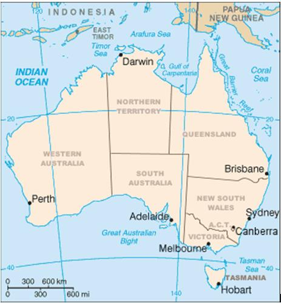

---
## Page 53

 
 
 
Volume 1 – Search and Rescue Administration 
NATIONAL SEARCH AND RESCUE MANUAL 
2025 EDITION Version 1 – February 2025 
Page 51 
Chapter 2 SAR Management 
2.1. 
Overview 
2.1.1 
There are three levels of management within the SAR system. 
a) 
Overall management of SAR responsibilities by SAR Authorities; 
b) 
Management of individual SAR incidents by SAR mission coordinators (SMCs); and 
c) 
Direction of SAR activities at an incident by on-scene coordinators (OSCs) specifically 
designated by the SMC. 
2.1.2 
This section outlines, in general terms, the management and coordination actions required 
when a decision is made to implement procedures in prosecuting a SAR. 
2.1.3 
Once it is decided to proceed with the action, plans should be enacted for the commencement 
of search activity with a minimum of delay. Coincident with progressing search activity, is the 
development of a rescue plan and obtaining and deploying rescue resources to minimise time 
between survivors' location and their recovery to a place of safety. 
SAR Authority Responsibilities  
2.1.4 
A SAR Authority shall ensure that a SAR operation can be promptly initiated and prosecuted 
with the efficient use of available SAR resources, until rescue has been completed or until 
chance of success is no longer a reasonable possibility. 
2.1.5 
The State or Territory Police shall ensure that a land SAR operation can be promptly initiated 
and prosecuted with the efficient use of available SAR resources, until rescue has been 
completed or until chance of success is no longer a reasonable possibility. 
2.1.6 
SAR Authorities have overall responsibility for establishing, staffing, equipping and managing 
the SAR system, including providing appropriate legal and funding support, establishing 
RCC/FSHs, providing or arranging for SAR assets, coordinating SAR training and developing SAR 
policies, as listed at Appendix B. SAR Authorities will focus upon resources to conduct SAR 
operations for which they are the Responsible Authority (Appendix B). The SAR authority, 
where applicable, shall: 
a)  
Designate an SMC for a specific SAR incident 
 
b) 
Establish a Rescue coordination Centre (RCC/FSH) to coordinate all participating search 
and rescue assets and facilities; 
c) 
Ensure that the RCC/FSH conforms to the SAR procedures contained in this manual or 
local SOPs and manuals; 
d) 
Establish close liaison and formulate agreements with other authorities and organisations 
having SAR potential; 
e) 
Establish liaison with SAR Authorities of adjacent areas to ensure mutual cooperation and 
coordination in combined operations; 
f) 
Ensure that a comprehensive and current SAR plan is prepared and distributed; 
g) 
Establish and supervise communication facilities and assign SAR frequencies from those 
authorised to assets designated for SAR tasks; 
h) 
Establish communications with adjoining RCC/FSHs and appropriate organisations to 
ensure two-way alerting and dissemination of SAR information; 
i) 
Ensure immediate action is taken to provide assistance, advising the appropriate SAR 
Authorities and passing all information received concerning the distress incident and any 
action taken;

---
## Page 54

 
 
 
 
Volume 1 – Search and Rescue Administration 
 
NATIONAL SEARCH AND RESCUE MANUAL 
Page 52 
2025 EDITION Version 1 – February 2025 
j) 
Ensure that the operating authority or agency of any craft, aviation asset or land party in 
need of assistance has been advised of initial actions taken, and they are kept informed of 
all pertinent developments; 
k) 
Ensure that the Next of Kin (NOK) of any missing person/s has been advised of initial 
actions taken, and they are kept informed of all pertinent developments; 
l) 
Ensure that each incident is prosecuted until assistance is no longer necessary, rescue has 
been completed or chance of success is no longer a reasonable possibility; 
m) Ensure that if the scope of the maritime/aviation operation exceeds the authority’s 
capacity to plan and execute the operation, it shall seek advice and assistance from, or by 
mutual agreement, hand over coordination, to an appropriate authority; 
n) 
Ensure that if the scope of the land operation exceeds the local capacity to plan and 
execute the operation, the FSH shall seek advice and assistance from the respective State 
SAR Coordinator for the provision of assets and/or personnel from other areas 
o) 
Maintain and preserve adequate records; and 
p) 
Develop new and improved techniques and procedures. 
Forward Command Post 
2.1.7 
It may be desirable to establish a Forward Command Post or a Forward Field Base at a suitable 
location.  The feasibility of FCP/FFB establishment will be a matter for consideration by the SAR 
Authority. 
2.1.8 
As the name suggests a Forward Field Base (FFB) differs from a Forward Command Post (FCP) in 
that a Forward Field Base does not involve transfer of any coordination responsibilities from 
the parent RCC/FSH. 
2.1.9 
JRCC/FSH will commonly establish a FFB at an aerodrome being used by several search aircraft 
for the purpose of managing tasking, allocation of personnel and equipment and conducting 
briefings and debriefings. A FFB may be also set up in conjunction with a Police headquarters or 
Police FCP to facilitate liaison between Authorities and agencies involved in a search and rescue 
operation. 
2.1.10 
The degree of delegation attributed to the FCP / FFB, and its actual responsibilities shall be at 
SMC discretion, bearing in mind the need for: 
a) 
A clear understanding of respective responsibilities; and 
b) 
An optimum response to the operational and administrative features of the current 
situation e.g.: location of search area and availability of staff. 
2.1.11 
After considering how best to exercise control over SAR assets in remote sectors of an SRR or 
where communications, administrative or political factors impact on operational efficiency, an 
SMC may recommend to management to establish a FCP/FFB close to the incident.  
2.1.12 
The responsibilities of the OIC of an FCP/FFB throughout a particular SAR action shall be 
delegated by the SMC and may include: 
a) 
Briefing and debriefing members of search teams during a land search operation; 
b) 
Briefing and debriefing search crews operating aircraft from an aerodrome close to the 
search area; 
c) 
Establishment of a base for helicopter operations, not at an aerodrome; 
d) 
Coordinating, as required, the provision of safety, survival and SAR equipment to 
participating SAR aircraft and helicopters; 
e) 
Collation of intelligence information and provision of logistical support; 
f) 
Liaison between JRCC/FSH, police and emergency services;

---
## Page 55

 
 
 
Volume 1 – Search and Rescue Administration 
NATIONAL SEARCH AND RESCUE MANUAL 
2025 EDITION Version 1 – February 2025 
Page 53 
g) 
Supervising the allocation of observers, and ensuring they obtain adequate rest; and 
h) 
Making arrangements for food, accommodation and transport for search crews and 
observers when required. 
Notes:  
1)  
Where an aerodrome is to be used for a FCP / FFB; the aerodrome operator/owner 
should be consulted prior to the final decision being made to establish an FCP / FFB at 
the location. 
2)  
For the broader responsibilities given to a SMC by a Police Search Commander, see 
Volume 2, Chapter 3.7.1 of this manual. 
2.1.13 
In considering the establishment of a FCP / FFB, the Search Commander / SMC shall consider 
communications requirements and existing facilities including terrestrial networks, satellite 
communication links, mobile phones, facsimile machines and facilities available through other 
agencies, e.g. JRCC/FSH Australia, Police, Defence assets and State/Territory Emergency 
Services. 
2.1.14 
When selecting a location for a FCP/FFB the Search Commander / SMC shall consider: 
a) 
Navigation aids; 
b) 
Geographical limitations; 
c) 
Aerodrome or landing area suitability and proximity to the search area; 
d) 
Apron capacity; 
e) 
Refuelling capabilities; 
f) 
Maintenance and logistical support; 
g) 
Crew briefing facilities; and 
h) 
Availability of accommodation in the vicinity. 
RCC/Field Search Headquarters (FSH) Staff 
2.1.15 
RCC/Field Search Headquarters (FSH) staff perform duties in the prosecution of search and 
rescue events. In addition, they have responsibility for maintaining the RCC/FSH in a continuous 
state of preparedness. RCC/FSH staff shall consist of personnel who are experienced and 
trained in SAR operations.  When a period of heavy activity is anticipated or during major SAR 
incidents, the regular staff may be supplemented as required. 
2.1.16 
Authorities and agencies that may be involved in providing services to an RCC/FSH in the event 
of an incident e.g. JRCC Australia/FSH, State and Territory Police, Airservices Australia, ADF, 
Bureau of Meteorology (BOM) and ACMA are to be alerted as early as practicable so that 
staffing can be managed. 
2.1.17 
Search Headquarters (SH): This is set up by the Search Commander (Normally a Commissioned 
Officer) who is responsible for co-ordinating the overall search effort. It will normally be at an 
existing Police Station or Police Headquarters, whichever is appropriate. 
2.1.18 
Search Headquarters provides effective support to the Field Search Headquarters. 
2.1.19 
All pre-search information is evaluated by the SMC at a convenient location prior to instituting 
a search.  This location may vary from the home of the SMC when the initial call comes through 
to a police station if the SMC is already on duty.  During this stage, there is a danger that 
rumours, and false information may produce an over-reaction and cause organisations and 
individual volunteers to enter the search area and disturb clues. It is suggested that the 
minimum number of searchers, consistent with effectiveness and safety, is most likely to lead 
to success in a land search and rescue operation.

---
## Page 56

 
 
 
 
Volume 1 – Search and Rescue Administration 
 
NATIONAL SEARCH AND RESCUE MANUAL 
Page 54 
2025 EDITION Version 1 – February 2025 
2.1.20 
Initial Actions: When the Search Commander has made the decision to mount a search, based 
on the information and advice supplied by the SMC, and a Field Search Headquarters and 
Support Base have been deployed to the search area, there are positive actions that should be 
initiated, as follows: 
a) 
Establish a communications net appropriate to the location and conditions; 
b) 
Advise all stakeholders of the location of the RCC/FSH, radio channels, telephone numbers 
and email addresses; 
c) 
Commence or continue incident logs, chronological and decision, where possible.  Format 
of the log is dependent on the situation, recording equipment and personnel available.  At 
the very least it should be handwritten; 
d) 
Establish an incident command system, identifying the SMC and those involved in the 
incident; and 
e) 
Establish a white board, or visual aid, of the search details and plans.  
Search and Rescue Roles 
SAR Mission Coordinator (SMC) 
2.1.21 
Each SAR operation is carried out under the coordination of a SAR Mission Coordinator (SMC) 
designated for the purpose by the appropriate SAR Authority. The role of the SMC may vary 
between SAR Authorities depending on their command arrangements.  The SMC must 
understand the extent of their authority and responsibility and must be capable of taking 
immediate and adequate action, basing their decisions on knowledge, logic and good 
judgement. 
2.1.22 
The SMC must have completed appropriate SAR training and must review and maintain 
proficiency as per the organisational procedures. The SMC/SARO must be capable of 
performing all SAR functions required by the SAR Authority. 
2.1.23 
To fulfil the foregoing requirements, the SMC/SARO must have a good knowledge of the 
communications available, the geographical features of the region, and the capabilities and 
limitations of SAR assets.  The SMC/SARO must use initiative and be inquisitive in the search for 
information, cross-checking the sources in doubtful cases. 
2.1.24 
 The SMC is the person coordinating a SAR incident, who is suitably qualified to undertake the 
coordination role (this will vary between State/Territories). Their responsibilities include the 
prompt dispatch of appropriate and adequate SAR assets and the prosecution of SAR 
operations until rescue has been completed, or chance of success is no longer a reasonable 
possibility. 
2.1.25 
The SMC is responsible for ensuring that the following duties are carried out depending on the 
SAR incident and local circumstances: 
a) 
Obtaining and evaluating all information pertaining to the incident, including emergency 
equipment carried by the aircraft/vessel/vehicle/person in distress; 
b) 
Classifying the SAR incident into the appropriate emergency phase (Uncertainty, 
Alert/Urgency, or Distress); 
c) 
Alerting appropriate SAR assets and SAR organisations that may be of assistance during 
the incident; 
d) 
In consultation with other SAR Authorities, confirming which Authority will exercise 
overall coordination in accordance with Appendix B; 
e) 
Conducting a risk assessment; 
f) 
Dispatching SRs immediately, if situation warrants;

---
## Page 57

 
 
 
Volume 1 – Search and Rescue Administration 
NATIONAL SEARCH AND RESCUE MANUAL 
2025 EDITION Version 1 – February 2025 
Page 55 
g) 
Conducting initial communications checks. If unsuccessful, making an extended 
communications search to obtain additional information on the incident, personnel 
involved, and equipment carried by the vessel, aircraft or party in distress; 
h) 
Calculating the search area. Preparing optimum plans and promulgating attainable plans; 
i) 
Obtaining past/present/forecast weather, drift information and oceanographic conditions 
if applicable; 
j) 
Providing for SAR crew briefing, dispatching of appropriate SRAs, or other assets; 
k) 
Organising logistical support for all SAR assets including fuel, food and accommodation, 
through to the completion of the incident; 
l) 
Making arrangements for appropriate communications; 
m) Maintaining a continuous, chronological plot showing, for example sighting and hearing 
reports, DF bearings, air plot, RADAR plot, fixes, reports of debris, areas searched or not 
searched and other intelligence; 
n) 
Maintaining a continuous, chronological record or log of the search effort, including 
actions taken in relation to intelligence, SRAs employed, sorties, hours flown/underway, 
sightings, leads, results obtained, message traffic, briefing notes, telephone calls, daily 
evaluation of progress and probability of detection; 
o) 
Initiating maritime distress broadcasts or maritime information broadcasts and initiating 
the alerting of enroute aircraft. Consideration should be given to arranging for 
announcements to be made over radio and TV networks; 
p) 
Arranging communication schedules when and if needed; 
q) 
Requesting additional SAR assets, as required; 
r) 
Exercising overall coordination of SAR assets; 
s) 
Determining the Time Frame for Survival (TFFS) in consultation with a medical practitioner 
if required. 
t) 
Maintaining liaison with the next of kin, owner, agent or management of the missing craft 
or persons; 
u) 
Keeping all authorities involved fully advised of SAR incident progress with timely and 
regular situation reports (SITREPs). SITREPs should be sent in a numbered sequence; 
v) 
Making recommendations in relation to the continuation or suspension of searches; 
w) 
Issuing news media releases on the progress of incidents in accordance with the local SAR 
organisational procedures and policies; 
x) 
Providing debriefs of SRA’s, cancel alerts, release SAR assets and organisations involved, 
and issuing the final SITREP to all concerned; and 
y) 
Acting as required to cope with unique, unusual or changing circumstances of the 
emergency. 
2.1.26 
Where a SAR Authority has overall coordination of a SAR operation, the SMC shall give 
particular attention to the following matters as relevant to the search: 
a) 
In conjunction with the meteorological office, keeping a watch on weather conditions in 
the probability area, routes used by SAR assets in transit to and from the search area and 
at aerodromes used as bases or alternate aerodromes for search aircraft; 
b) 
Coordination of search aircraft in the light of operational conditions by diverting or 
recalling aircraft or reassigning search areas as conditions dictate; 
c) 
Planning so as to minimise conflict between search aircraft in adjoining areas;

---
## Page 58

 
 
 
 
Volume 1 – Search and Rescue Administration 
 
NATIONAL SEARCH AND RESCUE MANUAL 
Page 56 
2025 EDITION Version 1 – February 2025 
d) 
Attending to logistical requirements, in particular, accommodation, fuel, availability of 
relief crews and observers and all necessary ground facilities at aerodromes to be used by 
SAR assets; 
e) 
Coordination of the use of maritime resources and facilities and efficient distribution of 
message traffic regarding sea state and weather conditions which may affect marine craft 
engaged in search activities; 
f) 
Provision of regular information to those agencies responsible for land search assets about 
actual and forecast weather conditions which may affect their operations; 
g) 
Ensure that all search assets are kept informed about actions and developments affecting 
their operations; 
h) 
Make effective use of personnel from other SAR authorities, medical agencies, public 
relations, company representatives and maritime authorities; and 
i) 
Keeping other authorities, which have been given coordination of search assets, informed 
of overall search progress and strategy. 
2.1.27 
The SMC may have access to other SAR qualified personnel.  Some functions may be shared 
where there are insufficient numbers of staff to allocate individual tasks to a staff member.  The 
following roles are listed for completeness. 
Assistant SAR Mission Coordinator (A/SMC) Responsibilities and Duties 
2.1.28 
As the title implies, the A/SMC assists, and is subordinate to, the SMC assigned to a particular 
SAR mission.  The term is used by some Australian jurisdictions to describe officers with SAR 
qualifications that allow them to provide significant support to the SMC. 
2.1.29 
The A/SMC is under the direct supervision of the SMC and therefore has the full operational 
authority of the SMC when carrying out specific duties assigned. 
2.1.30 
The A/SMC is responsible for routine documentation, allocation of SRAs and presentation of the 
search plan under the direction of the SMC. Each SAR Authority will recognise specific duties 
applicable to the A/SMC function. 
2.1.31 
Officers performing A/SMC duties should, as a rule, hold SARO qualifications, but requirements 
vary with the structure of the SAR organisation. Generally, the title A/SMC refers to the person 
assisting the SMC. 
Allocator/Planner 
2.1.32 
An Allocator/Planner is responsible to the SMC for the determination of a probability area, 
allocation of appropriate search assets to specific areas, and when required brief and debrief 
search crews. 
Recorder/Logger 
2.1.33 
A Recorder/Logger, if required, shall maintain an accurate and up–to–date chronological record 
of the SAR action, together with other necessary records, messages and details of telephone 
calls and radio logs. 
Briefing Officer 
2.1.34 
A Briefing Officer shall be responsible for briefing and debriefing search assets. 
Intelligence Officer 
2.1.35 
An Intelligence Officer shall be responsible for: 
a) 
Liaison with the duty meteorological officer for the supply of planning forecasts and 
periodic updates of weather information; 
b) 
Plotting, assessing and filing of sighting and hearing reports; 
c) 
Interrogating witnesses and assessing other reports;

---
## Page 59

 
 
 
Volume 1 – Search and Rescue Administration 
NATIONAL SEARCH AND RESCUE MANUAL 
2025 EDITION Version 1 – February 2025 
Page 57 
d) 
Obtaining data about the missing persons and/or target; 
e) 
Obtaining logistical data relating to the search area; and 
f) 
Supervising the personnel employed in gathering intelligence. 
2.1.36 
The Intelligence Officer shall immediately advise the SMC of any information that is considered 
to be significant. 
Rescue Planner 
2.1.37 
A Rescue Planner shall be responsible for devising and coordinating a rescue plan.  The rescue 
plan shall include the pre–positioning of supplies for an airdrop to survivors, the positioning of 
suitable rescue facilities at appropriate locations and the pre-hospital medical needs of 
survivors. 
Liaison Officer 
2.1.38 
Liaison Officers or advisers from other authorities/interested parties, when required, may be 
sought from or provided by JRCC/RCC/FSH, the aircraft operator, police, military authorities etc. 
and shall liaise between the RCC/FSH and their parent organisations on matters of their 
specialisation. The use of liaison officers is encouraged during SAR operations that may become 
protracted. 
On Scene Coordinator 
2.1.39 
When a number of SAR assets are working together on the same SAR mission in the same 
location, there may be an advantage if one asset is assigned to coordinate the activities of all 
participating assets.  The SMC will designate this role to an On Scene Coordinator (OSC), who 
may be the person in charge of a ship or aircraft participating in the search or someone at 
another nearby facility in a position to handle OSC duties.  The OSC should be the most capable 
person available, taking into consideration SAR training; communications capabilities of the 
asset; and the length of time that the asset the OSC is aboard can stay in the search area.  
Frequent changes in the OSC should be avoided. Duties that the SMC may assign to the OSC, 
depending on needs and qualifications include: 
a) 
Assuming operational coordination of all SAR facilities on scene; 
b) 
Receiving the search action plan from the SMC; 
c) 
Modifying the search action plan based on prevailing environmental conditions and 
keeping the SMC advised of any changes to the plan (in consultation with the SMC when 
practicable); 
d) 
Providing relevant information to the other SAR assets; 
e) 
Implementing the search and rescue plan where required; 
f) 
Monitoring the performance of other assets participating in the search; 
g) 
Implementing the rescue plan (as required); and  
h) 
Providing regular SITREPS to the SMC. 
2.2. 
Search and Rescue Resources 
Overview 
2.2.1 
Search and Rescue within the Australian SRR is based on the use of aircraft, marine craft and 
land facilities which are normally used for other purposes, but which can be made available to 
form part of the SAR effort. 
2.2.2 
The JRCC and each State/Territory Police Jurisdiction shall be responsible for developing and 
maintaining a facility register.  This register will contain the details of all resources that may be 
able to assist in the prosecution of a land SAR incident.  These details may include:

---
## Page 60

 
 
 
 
Volume 1 – Search and Rescue Administration 
 
NATIONAL SEARCH AND RESCUE MANUAL 
Page 58 
2025 EDITION Version 1 – February 2025 
a) 
24-hour contact details 
b) 
Type of personnel/asset (12 SES, 1 Bell 412 Helicopter etc.) 
c) 
Capabilities of asset (Land Search, Vertical Rescue, Dogs, Diving etc.) 
d) 
Availability of asset (24/7, after hours etc.) 
e) 
Any costs involved 
f) 
Any lead time required. 
g) 
Any restrictions 
2.2.3 
The SMC shall arrange for the provision of suitable search assets. The terms SAR asset or SAR 
facility are used to describe one or more types of air, maritime and/or land-based facility. 
2.2.4 
Some of these facilities are immediately suitable for SAR use; others have been adapted by way 
of providing them with extra equipment or training. A number of assets considered suitable for 
the provision of SAR services have been designated as specialised SAR assets with trained 
personnel and are described as SRAs. 
2.2.5 
AMSA has developed a tiered hierarchy for civil aviation SRAs in Australia that is further 
explained in Appendix D-9. 
2.2.6 
Every endeavour should be made to obtain sufficient search assets to search the determined 
area at a satisfactory coverage factor in the shortest possible time. However certain factors, 
such as inclement weather or darkness, may make an optimum air search impractical and the 
use of surface assets should be considered.  Search by land facilities alone is usually impractical 
for large search areas but it can be conducted in most weather conditions and can provide 
complete coverage of a confined area that cannot be thoroughly searched from the air. Land 
parties are also critical in operations where the search is carried out from the air and rescue by 
land facilities. 
2.2.7 
Identification and deployment of rescue assets shall commence at the time of the initial SAR 
response and a review of requirements shall continue through the action.  Assistance with 
selection of search assets is given in Volume 2, Chapter 4.8. 
Personnel 
2.2.8 
While a SAR asset will conduct a SAR operation under the general direction of the SMC, the 
person in charge of the asset will retain the responsibility for carrying out the operation 
assigned to it. 
2.2.9 
Medical personnel should be alerted in a timely manner if it is anticipated that they may be 
required. 
2.2.10 
Ideally, the best personnel to use in search operations are those who have bush craft, search 
technique skills and knowledge. Unfortunately, the number of persons with these skills is 
limited; therefore, it may be necessary to supplement search teams with inexperienced 
personnel. 
2.2.11 
SAR Authorities should ensure that regular training is undertaken by SRAs in their jurisdictions. 
Drop-Masters, Dispatchers and Observers 
2.2.12 
Many members of the State Emergency Service are trained as Drop-Masters, Dispatchers and 
Observers.  Each SMC should be aware of what skills the SES possess as they may be required 
during a SAR incident. 
2.2.13 
Drop-Masters, dispatchers and observers are an integral part of the SAR team and its effective 
operation. 
2.2.14 
Drop-Masters will be required if an aerial delivery of stores is to be made to survivors. The 
Drop-Master shall be responsible for the preparation of the equipment for delivery and for

---
## Page 61

 
 
 
Volume 1 – Search and Rescue Administration 
NATIONAL SEARCH AND RESCUE MANUAL 
2025 EDITION Version 1 – February 2025 
Page 59 
briefing the drop team and aircrew on dropping techniques. During the drop mission, the Drop-
Master will take charge of the aircraft cabin and control the dropping operation.  Dispatchers 
should be available to assist the Drop-Master in the delivery of supplies when required. 
2.2.15 
Whenever possible, trained Observer Leaders and Observers shall be used in all search aircraft. 
Where it is inevitable that some untrained Observers must be used, the SMC shall make every 
effort to have at least one trained Observer Leader or Observer in each search aircraft. 
2.2.16 
Sufficient Observers should be assigned to large aircraft to enable the Observer Leader to 
arrange relief periods.  Ideally, search sorties should be approximately of two hours duration. 
2.2.17 
An Observer Leader allocated to an aircraft shall attend the briefing with the pilot or obtain a 
copy of the briefing and will then be responsible for briefing Observers allocated to that 
aircraft. Observer Leaders may be issued with binoculars where available. 
2.2.18 
Should a prolonged search be foreseen, Observer Leaders and Observers should be rostered to 
avoid fatigue. If there are insufficient Observers available locally, additional Observers should 
be obtained and taken to the area. 
2.2.19 
It is an SMC responsibility, either directly or by delegation from the SAR Authority, to make 
reasonable provision for and to monitor the welfare of Observers.  This includes the provision 
of refreshments, accommodation and rest breaks.  Local State and Territory Emergency Service 
assets and aero clubs, especially those from which a number of search aircraft may be 
deployed, may be of assistance in this regard and should be invited to cooperate in making 
appropriate arrangements. 
Rescue Preparation 
2.2.20 
Planning for rescue shall commence at the time of the initial SAR response and continue 
throughout the action.  Plans shall be appropriately updated, as the circumstances require and 
at all times consider the pre-hospital medical needs of survivors. 
2.2.21 
For further considerations in rescue planning refer to Volume 2, Chapter 5. 
2.3. 
Public Relations 
Overview 
2.3.1 
Search and Rescue operations for missing aircraft and vessels generate considerable publicity.  
By virtue of its nature, an RCC/FSH is a source of news, and this is especially true during SAR 
incidents.  The public should be informed during SAR operations, within the limits of 
confidentiality, of SAR actions. The potential benefits of early release of information include: 
a) 
Additional information from the public, leading to more effective use of SAR resources; 
b) 
Fewer time-consuming requests from the news media; and 
c) 
Reduction of inaccurate public speculation about the SAR mission. 
2.3.2 
RCC/FSH staff should be governed by their parent authority’s public relations procedures when 
dealing with the media. It is important that a relationship between the media and an RCC/FSH 
is established such that: 
a) 
The media's legitimate interest in an incident of concern and the public's “right to know” 
is respected; 
b) 
Information reaching the public is factual and as complete as possible; 
c) 
The operational functioning of an RCC/FSH is not prejudiced; and 
d)  
Benefit is derived from publicity of an incident and from media broadcasts for information 
made at the request of SAR staff.

---
## Page 62

 
 
 
 
Volume 1 – Search and Rescue Administration 
 
NATIONAL SEARCH AND RESCUE MANUAL 
Page 60 
2025 EDITION Version 1 – February 2025 
Operations involving two or more SAR Authorities 
2.3.3 
To avoid confusion in public information it is essential that the overall coordinating authority 
responsible for the particular SAR action make any news release. 
2.3.4 
The following guidelines are recommended for releasing information on operations involving 
vessels, aircraft or other facilities during joint operations: 
a) 
Inquiries from the public made to one authority concerning the activities of another 
authority shall be directed or referred to the authority in overall coordination of the 
incident; 
b) 
Where the ADF is the SAR Authority, the ADF is responsible for issuing information to the 
public.  The ADF is to be consulted before any information is released to the public/media; 
and 
c) 
Where ADF assets are involved in supporting a civil SAR, information on the activities of 
those ADF assets is not to be released to the public/media without Defence approval.  The 
appropriate authority to consult in Defence is the Public Relations Officer at HQJOC. 
Public Relations Officers (PRO's)/Media Officers (MO) 
2.3.5 
SAR Authorities usually have a designated PRO/MO. The PRO/MO, or the officer nominated, 
should have knowledge of search and rescue and the techniques of disseminating information 
to the public. 
2.3.6 
The authority of the PRO/MO will be covered by organisational policies and procedures. The 
commercial distribution of news is highly competitive and therefore news releases must be 
impartial. Specifically, the PRO/MO will perform the following duties: 
a) 
Receive briefings from the SMC, RCC/FSH personnel, SITREPs, SAR log and interviews with 
rescued personnel if available; 
b) 
Make proper and full use of existing news media such as press, radio, television and wire 
services to disseminate information; 
c) 
Establish liaison with media sources early in the mission in order to prevent the SMC from 
being flooded with requests for information as the mission progresses; 
d) 
Keep well informed on the procedures and techniques being used in the search and in 
which stage the SAR system is functioning at any particular time; and 
e) 
Process and review for newsworthiness all photographs taken of mission activities. 
Press Releases 
2.3.7 
The early release of information will frequently aid in preventing time-consuming requests from 
news media concerning the operation. In cases where extensive searches are being conducted 
release of information to the public may bring important leads to the SMC. 
2.3.8 
News releases should be written following the time-proved format of who, what, where, when, 
why and how. In drafting a release all six of these items should be covered in paragraph one. 
Subsequent paragraphs can provide additional detailed information concerning one or more of 
these questions. By drafting releases in this fashion, the news media will be able to chop 
portions of the release in order to meet their space requirements without damaging the overall 
story. The release of names can be a sensitive issue, and organisational policies and procedures 
should be established in accordance with privacy guidelines. 
2.3.9 
A good news release will be well written, factual and newsworthy. It should not contain 
personal opinion, judgements, elaboration, colouring or any classified material.  Asking the 
following questions may test newsworthiness: 
a) 
Is story still timely?

---
## Page 63

 
 
 
Volume 1 – Search and Rescue Administration 
NATIONAL SEARCH AND RESCUE MANUAL 
2025 EDITION Version 1 – February 2025 
Page 61 
b) 
Are the people involved known? 
c) 
Is the story unusual? 
d) 
Is locality within the range of the news media’s interest? 
e) 
Does the story have general interest? 
f) 
Has the story a personal or human-interest appeal? 
2.3.10 
SAR officers shall not disclose to the media: 
a) 
The names of any crew or other missing persons; 
b) 
Any personal judgments pertaining to any persons involved in the incident; 
c) 
Any comments on the judgment, experience or training of persons involved in the 
incident; 
d) 
Degrading opinions on the conduct of the SAR operation or personalities involved; 
e) 
Personal opinions and theories; 
f) 
Names of those associated with the search; and 
g) 
Names of persons who have given information relating to the incident. 
2.3.11 
SAR Officers shall not comment on behalf of other SAR Authorities or organisations. 
2.3.12 
Media releases may include the following information: 
a) 
Type of aircraft, factual detail of the flight, details of the vessel; 
b) 
Reason for the SAR operation, e.g. aircraft/vessel overdue, report of impending crash 
landing; weather situation; beacon activation; 
c) 
Owner of the aircraft/vessel (subject to consent); 
d) 
Number of missing persons; 
e) 
Area being searched; 
f) 
Number and types of assets engaged in the search; 
g) 
Arrangements for the search; 
h) 
Details of other authorities participating in the search; and/or 
i) 
Reinforce the positive aspects relating to safety and survival. 
2.3.13 
As the operation progresses, releases should be made periodically to keep the public updated 
on the progress that is being made. A final release should be made when the mission is 
concluded. This release should summarise the activities conducted during the operation, giving 
full particulars on the efforts expended to locate and rescue the distressed persons. The final 
release should be a complete summary of the incident and detail: 
a) 
Number of search teams, SES, number of personnel used. 
b) 
The number of aircraft missions, total hours flown and use of vessels; 
c) 
Auxiliary land or maritime search, if applicable; 
d) 
The reasons for termination or suspension; and 
e) 
Any other information relevant to the incident that should be made public. 
Requesting Public Assistance 
2.3.14 
The SMC may enlist the news media to access information from the general public. In sparsely 
populated areas, information from the general public may be sought through the media,

---
## Page 64

 
 
 
 
Volume 1 – Search and Rescue Administration 
 
NATIONAL SEARCH AND RESCUE MANUAL 
Page 62 
2025 EDITION Version 1 – February 2025 
requesting members of the public to contact the RCC/FSH and/or Crime Stoppers. An RCC/FSH 
telephone number should be included as part of the release. 
Liaison with Relatives 
2.3.15 
Information that may significantly affect the conduct of a search may be obtained from 
relatives and friends of missing persons. Information relating to the personal history and 
possible courses of action taken by the missing persons should be collected by officers trained 
in investigation methods and competent to describe the current and proposed search plan in a 
reassuring manner. 
Notification of Next of Kin 
2.3.16 
The SMC should be aware of the concerns of the relatives of the missing persons. During a 
search, it is recommended that one staff member should maintain regular contact with the 
relatives to provide information and outline plans.  If appropriate, relatives should be 
encouraged to visit the RCC/FSH to enable them to see the search effort.  Next of kin/relatives 
should be advised at an early stage of any SAR operation, to ensure where possible that the 
timing of associated media releases does not cause them undue concern. 
2.3.17 
Where available, police liaison officers should be utilised to give initial advice to relatives and 
particularly when providing advice that a death or deaths have occurred. It is preferable that 
this information can be passed personally rather than by telephone, so as to ensure that 
appropriate support services are provided. 
2.3.18 
In any event, before a search is suspended or terminated the SMC should ensure that the next 
of kin are consulted as far as possible. They should be fully briefed on the complete search 
effort, conditions in the search area, and the reasons for proposing the suspension or 
termination of the search. Relatives are more able to accept the SMC’s decision to suspend or 
conclude search operations if they are privy to the processes. 
2.3.19 
Whenever foreign nationals are the targets of a search and rescue action, the Department of 
Foreign Affairs and Trade should be informed. 
2.3.20 
The ADF is the sole authority for releasing any information to next of kin of ADF members. 
Casualties 
2.3.21 
State SAR Authorities (Police) will be responsible for the releasing the names of civilian 
casualties.  The names of military casualties of a SAR Incident are only to be released by the 
ADF or the appropriate national authority for visiting military assets. 
2.3.22 
The names and addresses of survivors shall not be released until a positive check and 
identification has been accomplished. Generally, survivor information should not be released 
prior to the release of casualty information, although circumstances may dictate some 
departure from this procedure.  Survivors shall be encouraged to contact their own families as 
soon as possible and all reasonable assistance towards accomplishing this shall be provided. 
Controlling the dissemination of information by survivors is difficult and requires tactful 
briefing. Whenever possible the PRO should brief survivors on what information may be 
released.  Information on survivors who are ADF members or members of foreign military 
assets is only to be released by the ADF or the appropriate national military authority.

---
## Page 65

 
 
 
Volume 1 – Search and Rescue Administration 
NATIONAL SEARCH AND RESCUE MANUAL 
2025 EDITION Version 1 – February 2025 
Page 63 
2.4. 
Other Emergency Assistance and Services available from JRCC Australia 
General 
2.4.1 
JRCC Australia performs operations other than search and rescue, which, if not carried out, 
could result in a SAR incident. These operations include: 
a) 
Assisting a vessel or aircraft that is in a serious situation and in danger of becoming a 
casualty, thereby endangering persons on board. This assistance may be by way of direct 
action, or by way of notification to, and coordination with, other SAR authorities; 
b) 
Broadcasting Maritime Safety Information (MSI); 
c) 
Alerting appropriate authorities of unlawful acts being committed against an aircraft or ship 
(Alert Emergency Phase under IAMSAR particularly with respect to Piracy/Armed Robbery 
Attack); 
d) 
Alerting appropriate authorities after a ship or aircraft has been abandoned, to minimise 
future hazards; and 
e) 
The operation of the Modernised Australian Ship Tracking and Reporting System 
(MASTREP). 
Maritime Safety Information 
2.4.2 
Maritime Safety Information (MSI) is coordinated, collated and issued by JRCC Australia as the 
NAVAREA X Coordinator and National Coordinator for Australia. JRCC Australia broadcasts MSI 
by satellite using the Enhanced Group Call system and by HF radio, while some Limited Coast 
Radio Stations (LCRS) will broadcast by MF/VHF radio. Broadcast of MSI serves to assist with 
preventing SAR incidents from occurring. 
Unlawful Acts 
2.4.3 
JRCC Australia may become aware of an aircraft known or believed to be subject to unlawful 
interference. JRCC Australia will advise Airservices Australia as soon as possible.  Appropriate 
procedures will be implemented should the situation develop to a point that SAR action is, or 
will be, necessary. 
2.4.4 
Special signals have been developed for use by ships under attack or threat of attack from 
pirates or armed robbers. “Piracy/Armed Robbery Attack” is a category of distress message for 
all classes of digital selective call equipment and GMDSS-compliant communications terminals 
manufactured by recognized mobile satellite service providers. For their own safety, ships may 
have to covertly send out the “Piracy/Armed Robbery Attack” message. 
2.4.5 
When JRCC Australia becomes aware of such a situation, it should declare a Phase, advise 
appropriate response agencies in accordance with JRCC Australia Procedures, and begin 
preparations for possible SAR operations as appropriate. If the ship covertly sends a message 
care must be taken in any communications sent back to the ship so as not to warn the pirates.  
2.4.6 
JRCC Australia, on receiving a report of piracy/armed robbery attack, would act in accordance 
with the following: 
a) 
If the attack is within the Australian SRR, JRCC Australia would: 
i) 
Acknowledge the report unless it is suspected that it is a covert report; 
ii) 
Notify appropriate security authorities as detailed in JRCC Australia Procedures; 
iii) 
Notify the International Maritime Bureau Piracy Reporting Centre; 
iv) 
Provide assistance to those Authorities by way of information and provision of 
communications; and 
v) 
Consider the need to notify other shipping in the area. 
b) 
If the attack is outside the Australian SRR, JRCC Australia would:

---
## Page 66

 
 
 
 
Volume 1 – Search and Rescue Administration 
 
NATIONAL SEARCH AND RESCUE MANUAL 
Page 64 
2025 EDITION Version 1 – February 2025 
i) 
Acknowledge the report unless it is suspected that it is a covert report; 
ii) 
Notify the appropriate RCC; 
iii) 
Notify the International Maritime Bureau Piracy Reporting Centre; 
iv) 
If the attack is near the boundary of the Australian SRR, notify the Australian security 
authorities as in (a) above; and consider the need to notify other shipping in the 
area.

---
## Page 67

 
 
 
Volume 1 - Search and Rescue Administration 
NATIONAL SEARCH AND RESCUE MANUAL 
2025 EDITION Version 1 – February 2025 
Page 65 
Chapter 3 Training and Exercises 
3.1. 
Requirements for SAR Training 
3.1.1 
The importance of thorough training for all personnel employed on SAR missions cannot be 
over-emphasised. Failure of a single link in the often-complex chain of action required in SAR 
missions can compromise the success of the operation, resulting in loss of lives of SAR 
personnel, lives of those that might otherwise have been saved and/or loss of valuable 
resources. The purpose of training is to meet SAR system objectives by developing SAR 
specialists. Since considerable experience and judgement are needed to handle SAR situations, 
necessary skills require significant time to master. Training can be expensive but contributes to 
operational effectiveness. Quality of performance will match the quality of training.  
Training 
3.1.2 
Training is critical to performance and safety. The SAR system should save those in distress 
when it can and also use training to reduce risks to its own valuable personnel and resources. 
Training personnel in making sound risk assessment will help to ensure that these trained 
professionals and valuable resources remain available for future operations.  
3.1.3 
Consistency in training and sharing of information relating to search and rescue is promoted 
through the National SAR Council. Standardisation to the prosecution of SAR Operations is 
encouraged through these avenues.  
Who to Train 
3.1.4 
Efforts to ensure professionalism extend to career development for individuals who are 
assigned to undertake SAR duties. The aim is to ensure SAR officers are competent. In 
additions, agencies should consider making assignments of sufficient length to develop 
expertise and take advantage of SAR experience in subsequent assignments of officers. 
Requirement for Training  
3.1.5 
Search and rescue organisations are responsible for the establishment of formal training 
programs for SAR personnel to reach and maintain competence appropriate to their role.  
3.1.6 
Training of SAR personnel should focus on both the practical and theoretical application of SAR 
and may include the following:  
a) 
Study of SAR procedures, techniques and equipment through lectures, demonstrations, 
films, SAR manuals and journals;  
b) 
Assisting in or observing actual operations; and  
c) 
Exercises in which personnel are trained to coordinate individual procedures and 
techniques, or operate specialised equipment, in an actual or simulated environment.  
3.2. 
National Training Framework  
Qualifications 
3.2.1 
There are several levels of SAR qualifications within Australia: 
a) 
Advanced Diploma:  This level of qualification is designed for those personnel managing 
SAR incidents, whether at the JRCC, ADF or in the police jurisdictions. The Advanced 
Diploma of Public Safety (Police Search and Rescue Management) has recently been 
superseded by the new Advanced Diploma of Police Search and Rescue Management.  It is 
available through SAR RTOs with it on scope.  Personnel awarded this qualification are 
generally known as Senior Search and Rescue Officers (Snr SARO’s) and perform a SAR 
management role within their organisation.

---
## Page 68

 
 
 
 
Volume 1 - Search and Rescue Administration 
 
NATIONAL SEARCH AND RESCUE MANUAL 
Page 66 
2025 EDITION Version 1 – February 2025 
b) 
Diploma: This level of qualification is designed for those personnel coordinating SAR 
incidents, whether at the JRCC, ADF or in the police jurisdictions. The Diploma of Public 
Safety (Police Search and Rescue Coordination) has recently been superseded by the new 
Diploma of Police Search and Rescue Coordination.  It is available through SAR RTOs with 
it on scope.  Personnel awarded this qualification are generally known as Search and 
Rescue Officers (SARO’s) and perform a SAR coordination role within their organisation. 
Public Safety Training Package; Police Training Package 
3.2.2 
The Public Safety Training Package is available for the JRCC and ADF SAR authorities. The 
qualifications contained within the package are consistent with Australian Qualifications 
Framework (AQF) guidelines and are endorsed by the National Quality Council.  
3.2.3 
The Public Safety Training Package provides units of competence and qualifications that identify 
core competency standards for personnel who are involved in SAR activities. Units of 
competence have been packaged and aligned to a specific qualification within the AQF to 
establish the qualification level and title.  
3.2.4 
The Public Safety Training Package has been superseded by the Police Training Package for 
police jurisdiction. This has been developed through extensive consultation involving all 
state/territory SAR authorities. The qualifications contained within the package are consistent 
with Australian Qualifications Framework (AQF) guidelines and are endorsed by the National 
Quality Council.  
3.2.5 
The Police Training Package provides units of competence and qualifications that identify core 
competency standards for personnel who are involved in SAR activities. Units of competence 
have been packaged and aligned to a specific qualification within the AQF to establish the 
qualification level and title.  
AMSA Training 
3.2.6 
AMSA provides specialist aviation and maritime search and rescue training to officers primarily 
in Australia's Joint Rescue Coordination Centre. 
The National Search and Rescue Manager’s Course 
3.2.7 
The National SAR Manager’s Course is the premier course for training SAR Managers to the 
national standards.  The Course is held centrally in Canberra each year and has been in 
operation since 1989. (The course was postponed in 2000 for an academic restructure and 
again in 2020 due to COVID-19 implications).  
3.2.8 
Students are invited to participate from all Australian State/Territory Police Agencies, AMSA the 
ADF and New Zealand Police. 
3.2.9 
Directing staff of the Course, in addition to support provided by AMSA, are drawn from 
Australian Police organisations. These officers are subject matter experts in land and maritime 
search and rescue and are qualified in workplace training and assessment. 
3.2.10 
It is a necessity that all potential instructors on the above courses hold the appropriate 
Workplace Training and Assessment Certificate prior to undertaking any teaching or assessing. 
3.2.11 
The POL58115 Diploma of Police Search and Rescue Coordination (Marine/Land), and 
POL60421 Advanced Diploma of Police Search and Rescue Management, are issued though a 
Registered Training Organisation (RTO) that is accredited to provide this training/certificate. 
State/Territory SAR Authority Training  
3.2.12 
In addition to participating in the National Police SAR Managers training program the 
State/Territory Police organisations in Australia conduct search and rescue specific training with 
personnel involved, or who may become involved, in SAR operations at a local level.

---
## Page 69

 
 
 
Volume 1 - Search and Rescue Administration 
NATIONAL SEARCH AND RESCUE MANUAL 
2025 EDITION Version 1 – February 2025 
Page 67 
3.2.13 
This training involves principally land and coastal marine search and rescue operations 
employing their own personnel and personnel from other State/Territory organisations having 
a role in local search and rescue missions.  
3.2.14 
Formal training in the Diploma of Police Search and Rescue Coordination and Advanced 
Diploma in Police Search and Rescue Management is conducted by two registered training 
organisations associated with the Australian Police Services, with access provided to all police 
jurisdictions.  
3.2.15 
Ongoing training and the upkeep of SAR skills has been identified as a problem affecting all SAR 
Authorities. Each authority is responsible for maintaining a program that ensures SAR skills and 
knowledge are kept at a high level. It has been identified that merely coordinating SAR 
incidents does not constitute skills maintenance as coordinators slowly become complaisant 
and take short cuts. Good results may be often due to luck rather than good planning. Various 
Coroners’ Courts have identified many SAR incidents that have failed due to poor or non-
existent planning. Regular training exercises and practical tests that encourage the use of 
correct methods should be undertaken on an annual or biannual basis. 
3.3. 
Search and Rescue Exercises  
3.3.1 
Exercises test and improve operational plans, provide learning experience and improve liaison 
and coordination skills. Exercises, conducted on a realistic basis, help to demonstrate and 
assess the true effectiveness of training and the operational efficiency and competence of the 
SAR service. Exercises will reveal deficiencies that may exist in SAR plans and enable them to be 
improved. It is safer to have shortcomings revealed by exercises rather than during actual 
operations. 
3.3.2 
Each search and rescue authority should periodically take part in coordinated search and rescue 
exercises (SAREX). These SAREXs should be designed to exercise the SAR system, in whole or 
part, and test such things as operational plans, communication procedures and facilities, 
individual staff performance, SAR assets performance and inter-organisation and/or 
international operations.  
3.3.3 
It is equally important that personnel have a good knowledge of the duties and procedures of 
other assets and person who may be involved in a SAR operation, particularly those with whom 
they will have direct contact. It is especially important that SMCs be aware of the time, effort, 
and risk involved when requests are made to other assets or organisations.  
3.3.4 
The regular conduct of joint SAREXs between SAR Authorities should form a part of any training 
program.  
3.3.5 
The National Emergency Management Agency (NEMA) has developed the Managing Exercises 
Handbook which is part of the Australian Disaster Resilience Handbook Collection. This 
handbook should be used as a guide and to assist SAR personnel designing and conducting 
search and rescue exercises. This Handbook and other NEMA publications can be found on the 
Australian Institute for Disaster Resilience website at: 
https://knowledge.aidr.org.au/collections/handbook-collection/. 
3.4. 
Training of Search and Rescue Assets  
Land SAR Training  
3.4.1 
Land SAR training is generally conducted by State/Territory Police organisations, with assistance 
from members of the State and Territory Emergency Services  
3.4.2 
Other SAR authorities that may become involved in a land SAR incident should ensure that their 
members are familiar with police arrangements for alerting and dispatching of rescue assets.

---
## Page 70

 
 
 
 
Volume 1 - Search and Rescue Administration 
 
NATIONAL SEARCH AND RESCUE MANUAL 
Page 68 
2025 EDITION Version 1 – February 2025 
Search and Rescue Crew Training  
3.4.3 
SAR Authorities should coordinate SAR exercises in conjunction with search and rescue crews to 
ensure practice is maintained in techniques employed in SAR operations.  
Drop-Master and Dispatchers  
3.4.4 
The dispatch of survival stores and equipment from an aircraft to survivors on land or over 
water is an exacting task, which, if not performed well, can nullify or seriously delay the rescue 
effort and may endanger the aircraft and its crew.  
3.4.5 
Supply dropping operations by civil aircraft should only be carried out by personnel trained in 
the preparation and delivery of droppable equipment in accordance with CASA regulations.  
3.4.6 
Joint exercises involving all authorities that organise or participate in land rescue should be 
arranged on a periodic basis.  
Air Observer Training  
3.4.7 
Major SAR operations require a considerable number of observers who may be drawn from 
various organisations.  
3.4.8 
JRCC Australia has published a comprehensive handbook for Observers that is available to all 
SAR Authorities from the SAR Resources and Training section of AMSA.  
3.4.9 
Observer leaders, observer briefing check lists, aircraft observer instructions and observers on 
ships are discussed in detail in Volume 1, Chapter 2.2.12.  
Aviation Search and Rescue Assets (SRA)  
3.4.10 
JRCC Australia provides training to contracted aircraft operators who are considered suitable 
and capable of providing a SAR response.  
3.4.11 
These operators once formally trained and equipped are provided with appropriate 
continuation training and are known operationally as civil SRAs. The scope of training provided 
is specific to the resource capability of individual operators, in terms of human resources and 
aircraft availability.  
3.4.12 
Accordingly, operators are given training in one or more of the following aspects of SAR 
operations:  
a) 
Visual search procedures/techniques;  
b) 
Airborne location of distress beacons using aural homing techniques;  
c) 
Airborne location of distress beacons using DF equipment;  
d) 
On ground location of localised distress beacons;  
e) 
Operation of electronic sensor systems in SAR operations;  
f) 
Aerial delivery of supplies/equipment overland and/or over water; and,  
g) 
Helicopter rescue techniques.  
First Aid Training 
3.4.13 
All personnel involved in SAR need to be trained in basic first aid.  JRCC, ADF and State/Territory 
have first aid training capabilities, via their State/Territory Ambulance Services, St John’s 
Ambulance or private providers.  While all personnel should have a basic first aid knowledge, at 
least one member of each search team should be qualified to a higher level of training, Senior 
First Aid or First Response First Aid.  Regular training needs to be carried out to instil confidence 
in the delivery of first aid in remote situations. 
3.4.14 
First Aid: Adequate training in first aid is available through organisations such as the St. John 
Ambulance, Red Cross, or other recognised providers.

---
## Page 71

 
 
 
Volume 1 - Search and Rescue Administration 
NATIONAL SEARCH AND RESCUE MANUAL 
2025 EDITION Version 1 – February 2025 
Page 69 
Map Reading and Navigation 
3.4.15 
Training is to be in accordance with the established map/chart reading plans for each 
State/Territory. The World Geodetic System (WGS) is a standard for use in cartography, 
geodesy, and navigation worldwide.   It is the reference coordinate system used by the Global 
Positioning System (GPS). WGS standardises the Earth as a spheroid with its accompanying 
coordinate framework.  The Australian Geodetic Datum (AGD), both the 1966 and 1984 
versions, has been replaced by Geocentric Datum of Australia (GDA94). Therefore, for all 
practical purposes, the GDA is fully compatible with WGS84 and ITRF92 in terms of spheroid 
and datum. The National Mapping Council adopted the use of GDA94 from the 1st of January 
2000, ensuring a homogeneous GDA, as opposed to the AGD66 or AGD84 in all States and 
Territories. 
3.4.16 
Training in map/chart usage is to be based on a combination of manual/historical methods and 
electronic methods to ensure an all-round capability. 
Radio Operating Procedures 
3.4.17 
Training is to be in accordance with established standards within the JRCC, ADF and 
State/Territory and the Australian Emergency Manual—Communications. 
Field craft 
3.4.18 
Field craft is a broad subject which is difficult to define in its entirety. It is a series of practical 
skills which can only be taught in the field. The aspects of field craft which are important to the 
searcher are: 
a) 
Searching ground by eye; 
b) 
Judging distance; 
c) 
Basic tracking; and 
d) 
Living in the bush. 
Observation Skills 
3.4.19 
Observation is the skill of looking for clues and may be required to be conducted by day or 
night. The principles of clue recognition and interpretation are shown as Appendix E-13 to this 
Manual. 
Observation Skills-Day 
3.4.20 
Observation Skills – Day: The ability to ‘see’ rather than just look, may need to be taught when 
operating in the unfamiliar bush environment, and observing changes and noting details are 
skills which must be developed in most people. To understand why things are seen, it must be 
explained that several factors are involved which aid this process: 
a) 
Shape — regular shapes do not occur in nature. 
b) 
Shine — rarely do natural things shine. 
c) 
Shadow — unusual shadows will often reveal what may appear to be hidden. 
d) 
Movement — immediately attracts the eye. 
e) 
Colour — differences to the natural background are obvious to the trained eye. 
f) 
Spacing — regular spacing does not occur in nature. 
3.4.21 
These factors are best demonstrated in a bush environment, and with a better understanding 
of them, the searcher will become a better observer.

---
## Page 72

 
 
 
 
Volume 1 - Search and Rescue Administration 
 
NATIONAL SEARCH AND RESCUE MANUAL 
Page 70 
2025 EDITION Version 1 – February 2025 
3.4.22 
Observation Skills – Night: Due to the physical characteristics of the eye, if an observer looks 
directly at a small or dim object at night, it may not be seen. To optimise night vision objects 
should be observed ‘off centre’: 
a) 
Off Centre (Averted Vision): To achieve ‘off centre’ vision, the eye should be ‘aimed off’ 
from the object about a fist’s width at arm’s length. Only by experiment can the searcher 
find out which direction is most suitable for their aim off i.e. above, below or to one side 
of the object. It is important that the searcher resist the temptation to look directly at the 
object. 
b) 
Scanning: Scanning is the short, abrupt movement of the eye over or around an area of 
observation or an object that is being kept in view. It is used in conjunction with off centre 
vision in order to gain the maximum use of the eyes at night. Therefore, the observer 
should move their visual axis every 4–10 seconds. Night scanning differs from day-time 
scanning. Should the day-time technique of looking from left to right in overlapping 
parallel bands from near to far be used, then nothing would be seen. 
c) 
Starring: It is important to realise that when staring at a stationary light or prominent 
object in an otherwise black scene, the object may start moving. This happens because the 
eye has no bearing on which to check the exact position. This can be prevented by 
‘placing’ the object against something else such as a finger at arm’s length. 
d) 
Confidence: In order to gain confidence in the ability to see under low light levels, the 
correct use must be made of the eyes. Objects seen at night tend to be fuzzy and hazy 
around their extremities. Through practice, an observer must learn to recognise objects at 
night and how they differ from their day-time appearance. Once a searcher is familiar with 
the techniques of seeing at night, the confidence necessary for night operations will 
quickly follow. 
e) 
Protection of Night Vision: Any bright light will spoil night vision. It is important that the 
searcher instinctively closes or covers one eye when faced with any light at night. In 
addition, they should: 
i)  
Avoid looking at any bright light unnecessarily; 
ii)  
Shield the eyes with their hand from flares, spotlights or headlights (by so doing it is 
possible to see objects moving beyond the lights and it also protects the night 
vision); 
iii)  Avoid waving torches about as not everybody will be quick enough to close their eyes 
in order to avoid being dazzled; 
iv)  Put one hand over the glass when using torches to map read, and use the fingers to 
limit both the area illuminated and the brightness of the light (keep one eye shut and 
the time spent on reading the map to a minimum); and 
v)  
Use of coloured filters on torches will assist in maintaining night vision although 
similar coloured markings on maps cannot be seen. 
3.4.23 
Search Techniques: Training in search techniques is to be in accordance with Volume 2, Chapter 
4 of this Manual. 
Team and Individual Skills 
3.4.24 
Whilst the ability to ‘see’ in the SAR environment is probably the most important skill for a 
member of a search team, there are a number of other skills in which the searcher must be 
trained if they are to operate successfully. In addition, individuals must train together to 
increase their effectiveness as a team. The Team Leader is responsible for continuous training 
of the team to ensure that they will be capable of searching effectively. Much of this training 
only comes with regular practice and cannot be gained in one annual search exercise. 
3.4.25 
Each individual search team member must receive training in: 
a) 
Map/chart reading and navigation;

---
## Page 73

 
 
 
Volume 1 - Search and Rescue Administration 
NATIONAL SEARCH AND RESCUE MANUAL 
2025 EDITION Version 1 – February 2025 
Page 71 
b) 
Radio operating procedures; 
c) 
Basic first aid; 
d) 
Field craft/seamanship; 
e) 
Observation; and 
f) 
Search techniques. 
3.4.26 
To ensure success, it is necessary to train as a team, even if all the individual training has been 
undertaken. 
Searchers 
3.4.27 
All persons involved in searches need specific skills, attributes, equipment and both physical 
and mental capabilities: 
a) 
Attitude - Must be psychologically prepared for both the rigours of the search operation 
and for the possibility of locating a seriously injured or deceased person. 
b) 
Personal Equipment - Each searcher must be self-sufficient in personal equipment. Such 
equipment should be capable of being carried on the person, in pockets or on a belt. The 
carriage of excess equipment should be avoided as searchers must remain highly mobile. 
Suggested items include: 
i) 
Clothing and footwear appropriate to the weather and the environment; 
ii) 
Appropriate headgear; 
iii) 
Filled water bottles; 
iv) 
Pocket knife and whistle; 
v) 
Notebook and pen; 
vi) 
Compass and map (if required); 
vii) Snacks and nibbles; 
viii) Sun cream, insect repellent etc.; and 
ix) 
Minor personal first aid items. 
c) 
Readiness—A readiness for the search including: 
i) 
Commitment to the task; 
ii) 
Time commitment for the entire search rather than small segments of it; 
iii) 
Discipline and teamwork; and 
iv) 
Acceptance of hardships. 
d) 
Fitness—Searchers must be sufficiently fit to cope with the physical demands for the 
search activity. 
Search Team Leaders/On-Scene Commanders 
3.4.28 
The Search Team Leader/On-Scene Commander (STL/OSC) is the vital link between the SMC 
and the search team. The leader must be highly trained and motivated with the experience and 
background knowledge which is necessary to successfully lead the team in the field. This can 
only be gained by constant training under realistic conditions. 
3.4.29 
Desirable Qualities:  Searches involve people; therefore, it is essential that the STL/OSC has the 
knowledge, experience and personality to effectively lead and control the team.  They must be 
an effective manager, must be aware of the capabilities of the team, have an understanding of 
each member’s limitations and have their general well-being in mind. There is a need for

---
## Page 74

 
 
 
 
Volume 1 - Search and Rescue Administration 
 
NATIONAL SEARCH AND RESCUE MANUAL 
Page 72 
2025 EDITION Version 1 – February 2025 
adequate rest, food and shelter during operations and the STL/OSC must ensure that this is 
provided. 
3.4.30 
The attributes of a STL/OSC include: 
a) 
Leadership skills; 
b) 
Dedication; 
c) 
Knowledge; and 
d) 
Flexibility. 
3.4.31 
The main skills for a STL/OSC are as follows: 
a) 
Orders - The ability to give clear, concise and detailed orders; 
b) 
Map/chart Reading and Navigation - The ability to read a map/chart and navigate in a 
variety of environmental conditions; 
c) 
Use of Radios - Use a radio, pass messages and use the terrain to best effect; 
d) 
Casualty Handling - They must have a sound knowledge of first aid and casualty handling 
procedures; 
e) 
Field craft/seamanship - Must be skilled in living, navigating and operating in the field or at 
sea as appropriate; and 
f) 
Search Techniques - Must be competent in the implementation of all appropriate search 
techniques. 
3.5. 
Photographic Records  
3.5.1 
Where possible, photographic or video recordings should be taken on exercises and actual SAR 
missions for use as future training aids. Participating authorities' film crews may be helpful in 
providing this facility.  
3.6. 
Liaison Visits  
3.6.1 
It is important that personnel have a good knowledge of the duties and procedures of other 
assets and persons who may be involved in SAR operations, particularly those with whom they 
will have direct contact. It is especially important that SMCs be aware of the time, effort and 
risk involved when requests are made to other assets or persons.  
3.6.2 
Liaison visits between personnel likely to become involved together in SAR operations are 
encouraged. SMCs should inspect other assets’ facilities and where possible take part in 
appropriate activities, e.g. packing and loading equipment, helicopter rescue exercises, etc. The 
personnel of other organisations or assets should be encouraged to visit RCCs and other SAR 
related assets. Potential SAR team members, either assets or individuals, should be invited to 
participate in, or attend exercise.

---
## Page 75

 
 
 
Volume 2 - Search and Rescue Operations 
NATIONAL SEARCH AND RESCUE MANUAL 
2025 EDITION Version 1 – February 2025 
Page 73 
Volume 2 - Search and Rescue Operations 
NATIONAL SEARCH AND RESCUE MANUAL 
2025 EDITION Version 1 – February 2025 
Chapter 1 Communications 
1.1. 
Aviation and Maritime  
Overview 
1.1.1 
Distress traffic includes all messages relating to immediate assistance required by persons, 
aircraft, or marine craft in distress, including medical assistance. Distress traffic may also 
include SAR communications and on-scene communications. Distress calls take absolute priority 
over all other transmissions; anyone receiving a distress call must immediately cease any 
transmissions that may interfere with the call and listen on the frequency used for the call. 
1.1.2 
Distress and safety communications require the highest possible integrity and protection from 
harmful interference.  Any interference that puts at risk the operation of safety services 
degrades obstructs or interrupts any radio communications, is harmful. Some frequencies are 
protected, in that they have no authorised uses other than for distress and safety. SAR 
personnel should be particularly careful not to cause harmful interference and should co-
operate with authorities to report and stop incidents of interference. 
1.1.3 
The object of search and rescue (SAR) communications is to make possible the conduct of SAR 
operations. As per Regulation 7 of Chapter V of SOLAS, arrangements have been established to 
facilitate distress communication and co-ordination within the Australian SRR. Such 
communications must allow for: 
a) 
Rapid transmission of distress messages from aircraft, ships, small marine craft and 
persons, including for medical assistance; 
b) 
Rapid communication of distress information to the authorities responsible for organising 
and effecting rescue; 
c) 
Coordination of the operation of the various SAR assets; and 
d) 
Liaison between controlling/coordinating authorities and SAR assets. 
1.2. 
Distress and Emergency Signals 
1.2.1 
There are many signals that can be used to indicate a distress or other emergency. 
1.2.2 
Personnel involved in SAR operations must be familiar with the types of signals they can expect 
to encounter in order to evaluate their meaning correctly and take appropriate action. 
1.2.3 
These emergency signals may be made by radio, satellite, telephone, texting, internet (email, 
social media, etc.). RADAR (e.g. transponders), flags, pyrotechnics, flashing lights, smoke, 
sounds, shapes and ground panels. (Appendix D-1 lists the more common signals and 
terminology in use.) 
Maritime Radio Alarm Signal 
1.2.4 
With the full implementation of the Global Maritime Distress and Safety System (GMDSS) in 
February 1999 the automatic alarm devices used on 2182 kHz are no longer required.  
However, some maritime communication stations may still use the voice alarm signal consisting 
of two sinusoidal audio frequency tones, one of 2200 Hz and the other of 1300 Hz, producing a 
distinct warbling sound to draw attention to a distress broadcast. Merchant shipping complying 
with the SOLAS Convention now guard the Digital Selective Calling (DSC) distress frequencies.

---
## Page 76

 
 
 
 
Volume 2 - Search and Rescue Operations 
 
NATIONAL SEARCH AND RESCUE MANUAL 
Page 74 
2025 EDITION Version 1 – February 2025 
Radiotelephone Distress Signal 
1.2.5 
The distress signal “MAYDAY, MAYDAY, MAYDAY” is used to indicate that a ship, aircraft or 
other vehicle is threatened by grave or imminent danger and requires immediate assistance. 
Distress calls, distress messages and distress traffic have priority of communications over all 
other communications. 
Radiotelephone Urgency Signal 
1.2.6 
The urgency signal “PAN PAN, PAN PAN, PAN PAN” is used to indicate that the calling station 
has a very urgent message to transmit concerning the safety of a ship, aircraft or other vehicle 
or a person. It has priority communications over all other communications, except distress calls, 
distress messages and distress traffic. 
Radiotelephone Safety Signal 
1.2.7 
The safety signal “SECURITÉ” indicates that the station is about to transmit a message 
concerning the safety of navigation or providing an important meteorological warning. The 
safety message is preceded by the word ’SECURlTÉ’ spoken three times. 
1.2.8 
All stations hearing a distress, urgency or safety signal shall not make any transmissions that 
might interfere with those signals and be ready to copy any message that follows. 
Radiotelephony Distress/Emergency Frequencies 
1.2.9 
The following frequencies have been designated as distress or emergency frequencies. 
GMDSS Distress, Urgency, Safety and Calling Frequencies 
Radio Telephone 
DSC 
NBDP 
2182 
2187.5 
2174.5 
4125 
4207.5 
4177.5 
6215 
6312.0 
6268.0 
8291 
8414.5 
8376.5 
12 290* 
12 577.0 
12 520.0 
16 420* 
16 804.5 
16 695.0 
VHF: Ch. 16 
VHF: Ch. 70 
VHF not used 
Note: None of the MF/HF DSC or NBDP frequencies are used when calling. The AMSA HF DSC 
network monitors DSC in the 4 – 16 MHz bands.  
* The frequencies 12 290 kHz and 16 420 kHz are to be used only for distress, urgency and 
safety communications, and safety-related calling limited to that, to and from rescue 
coordination centres.  
2182 kHz 
1.2.10 
The international MF voice distress frequency primarily for ship-to-ship communications, the 
upper side band 2182 kHz is used for follow-on communications after an initial DSC distress 
alert on 2187.5 kHz for GMDSS shipping.  In Australia, some Limited Coast Radio Stations 
operated by Volunteer Marine Rescue (VMR) Groups around the coast advertise the monitoring 
of the 2182 frequency. Contact the local VMR Unit to ascertain its monitoring of 2182. The two-
tone alarm may still be used on 2182 kHz to draw attention, but auto alarms are no longer a 
part of the Radio Regulations.

---
## Page 77

 
 
 
Volume 2 - Search and Rescue Operations 
NATIONAL SEARCH AND RESCUE MANUAL 
2025 EDITION Version 1 – February 2025 
Page 75 
4125, 6215, 8291, 12290 and 16420 kHz 
1.2.11 
These frequencies have been authorised for common use by ships and coast stations using the 
HF frequencies for upper sideband radiotelephony on a simplex basis for calling, reply and 
safety purposes. The frequencies quoted are the carrier frequencies.  The State and Territory 
Coast Radio Stations monitor the distress and safety frequencies in the 4, 6 and 8 kHz bands. 
121.5 MHz 
1.2.12 
The international aeronautical emergency frequency for aircraft and those aeronautical stations 
primarily concerned with the safety and regularity of flight and having equipment in the 118-
136 MHz VHF band. 
1.2.13 
Ships fitted with the capability are authorised to communicate on this frequency with aircraft 
for safety purposes. 
156.8 MHz (Marine VHF Channel) 
1.2.14 
The international distress, safety and calling frequency for radiotelephony stations of the 
maritime mobile service, when using frequencies in the Marine VHF bands 156 to 174 MHz 
1.2.15 
State and Territory limited coast radio stations, port authorities, merchant ships, fishing craft 
and pleasure craft use VHF Ch. 16.   
1.2.16 
Merchant ships maintain a continuous bridge listening watch on VHF channel 16 to the 
maximum extent practicable when at sea; and is monitored in all active marine rescue bases 
(e.g. Marine Rescue NSW monitor VHF Ch. 16). 
1.2.17 
156.3 MHz (Marine VHF Channel 6) is used for coordination at the scene of an incident. 
243 MHz 
1.2.18 
243 MHz is the international military aeronautical emergency frequency. 
Safety Frequencies 
1.2.19 
The following table indicates Safety frequencies in use in Australia. 
156.375 MHz 
VHF FM RTF  
(Marine channel 67) 
Marine safety: Australia only (supplementary to 
Channel 16 and used to broadcast weather and 
warnings from State/Territory limited coast 
stations) 
27.88 MHz 
(Channel 88) 
HF (Marine) RTF 
27 MHz band, pleasure craft safety frequency (in 
Australia) 
27.88 MHz has been overtaken in popularity by 
VHF 16 by the general public. 
2524 kHz 
MF (Marine) RTF 
Pleasure boat safety, volunteer SAR organisations 
(in Australia) 
1.3. 
Global Maritime Distress and Safety System (GMDSS) 
1.3.1. 
Ships subject to the Safety of Life at Sea (SOLAS) Convention are obliged to be outfitted with 
certain communications equipment to participate in the Global Maritime Distress and a Safety 
System (GMDSS).  Fishing vessels and small craft around Australia, if carrying compatible 
GMDSS equipment can also participate. 
1.3.2. 
AMSA is responsible for the provision of shore facilities for the GMDSS and all distress and 
safety traffic through the GMDSS shore infrastructure in the Australian SRR will be handled by 
JRCC Australia.

---
## Page 78

 
 
 
 
Volume 2 - Search and Rescue Operations 
 
NATIONAL SEARCH AND RESCUE MANUAL 
Page 76 
2025 EDITION Version 1 – February 2025 
1.3.3. 
Ships operating under GMDSS requirements in the Australian SRR can be expected to carry: 
a) 
MF DSC; 
b) 
VHF radiotelephone (Channels 6, 13, 16 and 67); 
c) 
VHF DSC (Channel 70); 
d) 
HF DSC or a ship earth station of a recognised mobile satellite service; 
e) 
An AIS-SART or RADAR SART; and 
f) 
An EPIRB.  
1.4. 
Emergency Signalling Devices 
1.4.1. 
People in distress may use any possible means of alerting others to their situation. These 
devices range from emergency radio beacons to mirrors. 
Daylight Devices 
1.4.2. 
Reflective mirrors (heliographs), used by survivors to reflect the sun’s rays towards a SAR asset, 
are an effective daylight device.  Mirrors have been detected as far away as 80 kilometres (45 
miles) and from as high as 10,000 feet, although the average distance is about 18 kilometres 
(10 miles). Fluorescent material (known as retro-reflective tape) that reflects a large percentage 
of sunlight is usually sewn on one side of lifesaving craft coverings and has been detected as far 
away as 9 kilometres (5 miles) with an average of 6 kilometres (3.5 miles). 
1.4.3. 
Fluorescent sea dye marker, which stains the water a green or red colour, has been sighted as 
far away as 18 Kilometres (10 miles), with an average of 5 kilometres (3 miles). However, sea 
dye is not visible when searching up-sun because of surface glare. 
1.4.4. 
Orange smoke generating signals have been sighted as far away as 20 kilometres (12 miles) 
with an average of 14 kilometres (8 miles).  Smoke signals are most effective in calm wind 
conditions and open terrain.  The effectiveness of smoke signals decreases rapidly with an 
increase of wind speed above 15 knots (25 kph). 
1.4.5. 
Pyrotechnic flares may be used in daylight; however, their detectable range is only about 10 per 
cent of the night-time range. 
Night Vision Imaging Systems (NVIS) for aviation searching  
1.4.6. 
NVIS incorporates all aspects associated with night vision including Night Vision Goggles (NVGs) 
and Night Vision Devices (NVDs). 
1.4.7. 
With the use of NVIS, objects emitting small amounts of light such as mobile telephone screens 
are able to be seen from great distances. There is no need for a telephone signal, it is the lit 
screen that is being detected. Larger light sources such as fires, torches, and strobe lights can 
be viewed from considerably farther. E-Flares and some LED strobe lights have been identified 
as being invisible on NVIS due to the frequencies used. Searchers must be aware of this. 
1.4.8. 
Appendix F Aircraft Electronic Night Search Guidance contains more details on using NVIS for 
searching by aircraft. 
1.4.9. 
On land, fires are arguably the most effective nighttime signal that survivors may use.  Fires 
have been sighted as far as 90 kilometres (50 miles) away, with the average range varying with 
the size of the fire, the absence of other light sources on the earth’s surface, the terrain and 
Height of Eye of the search asset. 
1.4.10. 
Flashing strobe lights are an effective compact night signalling device available for individual 
survivors.  Strobe lights have been sighted as far as 35 kilometres (20 miles) away with an 
average of 6 kilometres (3.5 miles). 
1.4.11. 
Incandescent lights that are used on some individual lifejackets have a much smaller detectable 
range than strobe lights, generally about 1 kilometre (0.5 mile).

---
## Page 79

 
 
 
Volume 2 - Search and Rescue Operations 
NATIONAL SEARCH AND RESCUE MANUAL 
2025 EDITION Version 1 – February 2025 
Page 77 
1.4.12. 
Flares, star shells and rockets have been detected as far away as 60 kilometres (35 miles), with 
an average of 45 kilometres (25 miles) from the air. 
1.4.13. 
With the use of Night Vision Goggles (NVG) objects emitting small amounts of light such as 
mobile telephone screens are able to be seen from great distances.  There is no need for a 
telephone signal, it is the lit screen that is being detected.  Larger light sources such as fires, 
torches, and strobe lights can be viewed from considerably farther.  E-Flares and some LED 
strobe lights have been identified as being invisible on NVG due to the frequencies used.  
Searchers must be aware of this. 
RADAR/IFF/SSR 
1.4.14. 
Besides the obvious RADAR target of the distressed target itself, IFF (Identification Friend or 
Foe) may be used not only to indicate distress but also to increase the detectable range by 
RADAR. 
1.4.15. 
The basic equipment consists of an interrogator and a transponder. The interrogator, which is 
usually incorporated into air search RADAR systems, transmits electronic challenges, and if any 
replies are received will display them on the Radarscope.  The transponder, which is usually 
installed in aircraft, ships and boats, is triggered into operation by the interrogator’s challenge 
and transmits a series of pulses.  The reply is displayed as small bars slightly beyond the RADAR 
target of the transponder-equipped target. Since interrogators usually use the same antenna as 
the air search RADAR, replies are only received as the search RADAR beam sweeps across the 
transponder-equipped target.  In addition, transponder replies will be detected at much greater 
ranges than the RADAR return from the target itself. 
1.4.16. 
Secondary Surveillance RADAR (SSR) is the name used to describe similar equipment in use by 
Airservices Australia and civil aircraft. Military mode 3 is the same as civil mode A and thus the 
systems are compatible for air traffic control and emergency purposes. Military mode 3, code 
7700 and civil mode A, code 7700 transmits an emergency signal and, unless amplified by 
additional information, will be considered as a distress signal. 
Radio and Distress Beacons 
1.4.17. 
In addition to the obvious uses of standard radio for transmitting emergency signals and 
messages, there are a variety of types of emergency equipment designed for use by survivors 
or carried in the vessel’s wheelhouse.  These include: 
a) 
Handheld VHF transmitters found in life rafts; 
b) 
406 MHz distress beacons (GMDSS approved); An AIS-SART; and 
c) 
9 GHz SAR Transponders. 
1.5. 
COSPAS-SARSAT Distress Beacon Detection System 
Overview 
1.5.1 
COSPAS-SARSAT is a satellite system designed to provide distress alert and location data to 
assist SAR operations, using spacecraft and ground facilities to detect and locate the signals of 
distress beacons operating on 406 MHz. The responsible COSPAS-SARSAT Mission Control 
Centre (MCC) forwards the position of the distress and other related information to the 
appropriate SAR authorities. Its objective is to support all organisations in the world with 
responsibility for SAR operations, whether at sea, in the air or on land. 
1.5.2 
The COSPAS-SARSAT System provides distress alert and location data to RCCs for 406 MHz 
beacons activated anywhere in the world. In the Australia/New Zealand region, the Australian 
Mission Control Centre (AUMCC) is managed by AMSA and processes data collected by satellite 
tracking stations in Australia and New Zealand.

---
## Page 80

 
 
 
 
Volume 2 - Search and Rescue Operations 
 
NATIONAL SEARCH AND RESCUE MANUAL 
Page 78 
2025 EDITION Version 1 – February 2025 
Purpose 
1.5.3 
The primary purpose of this system is to detect, positively identify and provide the positions of 
406 MHz EPIRBs, ELTs and PLBs anywhere in the world. 
1.5.4 
The worldwide system comprises: 
a) 
Low-altitude Earth orbiting satellites in near polar orbits known as LEOSAR satellites; 
b) 
Satellites in geostationary orbit known as GEOSAR satellites; 
c) 
Satellites in medium-altitude Earth orbit known as MEOSAR satellites; 
d) 
Local User Terminals (LUTs) are ground stations that receive and initially process the raw 
distress signal data relayed by a satellite; 
e) 
Mission Control Centres (MCCs) which are responsible for the final processing and 
appropriate distribution of beacon detections; and 
f) 
Frequency stable 406 MHz beacons, each with a unique identification code and capable of 
transmitting for 24 or 48 hours depending on their use. 
Satellites 
1.5.5 
The COSPAS-SARSAT system uses three search and rescue satellite constellations: LEOSAR, 
GEOSAR and MEOSAR. 
1.5.6 
Each LEOSAR satellite makes a complete orbit of the earth around the poles in about 100 – 105 
minutes. The satellite views a "swath" of the earth of approximately 4000 Km wide as it circles 
the globe, giving an instantaneous "field of view" about the size of a continent. When viewed 
from the earth, the satellite crosses the sky in about 15 minutes, depending on the maximum 
elevation angle of the particular pass. 
1.5.7 
LEOSAR satellites are not equally spaced and hence do not pass over a particular place at 
regular intervals.  In view of this, pass schedules are computed for each LUT every day. On 
average a satellite will pass over continental Australia every 90 minutes but, because of the 
irregularity of passes, there could be up to five (5) hours between passes. 
1.5.8 
The current GEOSAR constellation is composed of satellites provided by the USA, India, Russia 
and Europe.  These satellites provide continuous global coverage for 406 MHz beacons with the 
exception of the Polar Regions. 
1.5.9 
As the GEOSAR satellites appear stationary from Earth, if the direct line of sight from the 
beacon to the GEOSAR satellite is blocked (for example, by terrain such as a mountain, called 
shadowing), the beacon will not be detected by the GEOSAR satellite. 
1.5.10 
The MEOSAR satellites consist of satellites provided by the United States, the Russian 
Federation and the European Union. The full MEOSAR constellation will have about 72 
satellites. These MEOSAR satellites orbit the Earth at altitudes between 19,000 and 24,000 Km, 
a range considered as a medium-altitude Earth orbit. The footprint of a MEOSAR satellite is 
between 12000 and 13000 Km and the satellites provide continuous global coverage of the 
Earth. These satellites send the beacon message back to earth where it is detected by a 
MEOLUT (MEOSAR Local User Terminal). With sufficient information, the MEOLUT will generate 
a location for the distress beacon. The beacon activation information is forwarded to a Mission 
Control Centre (MCC) and then to the relevant Rescue Coordination Centre (RCC) which 
responds to the beacon activation. The MEOSAR system will detect beacons in almost real-time 
(i.e. within 5 minutes). If the beacon is detected by three or more MEOSAR satellites, then the 
location of the beacon will be determined as well. When the full constellation of MEOSAR 
satellites is in operation, this will mean location will be determined within 10 minutes, 95 
percent of the time.

---
## Page 81

 
 
 
Volume 2 - Search and Rescue Operations 
NATIONAL SEARCH AND RESCUE MANUAL 
2025 EDITION Version 1 – February 2025 
Page 79 
Beacon Detection 
1.5.11 
A LUT tracking LEOSAR satellites is known as a LEOLUT. A LEOLUT generates the position of a 
distress beacon using Doppler shift, which is caused by the relative movement between a 
satellite and a beacon. As a satellite approaches a beacon there is an apparent rise in the 
beacon frequency and as the satellite moves away the frequency appears to fall.  When a 
satellite is at its closest point to a beacon the received frequency is the same as the transmitted 
frequency (the point of inflection) and provides the “Time of Closest Approach” (TCA). 
1.5.12 
This method of calculation produces two possible positions for each beacon (labelled A and B), 
either side of the satellite’s ground track; one is the true position, and the other is its mirror 
image.  The ambiguity is due to the equipment only being able to determine the distance 
between a satellite and a beacon and not the direction.  Position ambiguity is subsequently 
resolved by using other independent location data (for example, an encoded location or data 
from another LEOSAR satellite pass). 
1.5.13 
A LUT tracking MEOSAR satellites is known as a MEOLUT. A MEOLUT generates the position of a 
distress beacon using DOA (Difference of Arrival) processing. Upon receiving a transmission (a 
beacon burst) from a 406 MHz distress beacon via a MEOSAR satellite, a MEOLUT will generally 
measure two key values: the Time of Arrival (TOA) and the Frequency of Arrival (FOA). 
Assuming reception of a beacon transmission through at least three distinct MEOSAR satellites, 
MEOLUT processing can provide a two-dimensional (longitude and latitude) beacon location 
using a combination of time difference of arrival (TDOA) and frequency difference of arrival 
(FDOA) computations.  The location computed by a MEOLUT is known as a difference of arrival 
(DOA) location. Three-dimensional locations (i.e., with the addition of a computed altitude) are 
possible when the beacon burst is relayed to a MEOLUT via four or more MEOSAR satellites. 
1.5.14 
A GEOLUT is only able to detect a beacon within its footprint but not at the poles and cannot 
generate a location for the beacon unless the beacon transmits an encoded location. 
Beacons 
1.5.15 
There are three types of COSPAS-SARSAT distress beacons: 
a) 
Emergency Locator Transmitters (ELT)  used by aviators (generally larger devices mounted 
in the tail of an aircraft); 
b) 
Emergency Position Indicating Radio Beacons (EPIRB) used by mariners (waterproof and 
required to float upright); and 
c) 
Personal Locator Beacons (PLB) used on land (initially not required to be waterproof or 
buoyant [floatable] but new generation ones are becoming so). 
1.5.16 
A distress beacon with GNSS (Global Navigation Satellite System, also known as a GPS) 
capability is able to transmit an encoded location as part of its beacon message. There are two 
mechanisms used to derive the GNSS location: either the distress beacon has an internal GNSS 
receiver, or the distress beacon receives the GNSS data from an external device that connects 
to the beacon. Due to the popularity of the GPS system, the encoded location is often known as 
the GPS location of the beacon. 
1.5.17 
Aviators and mariners often carry PLBs as personal back up devices to ELTs and EPIRBs. 
1.5.18 
Because 406 MHz beacons transmit an extremely stable frequency, positions calculated by the 
LUT usually fall within a radius of 5 Km from the actual beacon position. All 406 MHz beacons 
sold in the Australian region are required to transmit on a side frequency of 121.5 MHz to 
facilitate homing. 
1.5.19 
406 MHz beacons use digital technology that allows an identifier to be sent when the beacon is 
activated.  This identifier correlates to a registration database held at the JRCC and allows 
additional information to be gained about the target. 406 MHz beacons should be coded with a 
country code and registered in the country that maintains the database for that country code. It 
is therefore important that all Australian 406 MHz beacons are registered with JRCC Australia.

---
## Page 82

 
 
 
 
Volume 2 - Search and Rescue Operations 
 
NATIONAL SEARCH AND RESCUE MANUAL 
Page 80 
2025 EDITION Version 1 – February 2025 
1.5.20 
If an Australian beacon is detected overseas, the overseas SAR authority may contact JRCC 
Australia for appropriate details.  Similarly, if a foreign registered 406 MHz beacon is detected 
in the Australian SAR area, JRCC Australia contacts the appropriate overseas registration 
authority to obtain further relevant SAR data. 
1.5.21 
Satellites processing of 121.5 MHz alerts ceased on 1 February 2009, from 1 February 2010, old 
analogue EPIRBs and PLBs operating on the 121.5 MHz frequency are no longer licensed for 
use. 
1.6. 
Other Types of Distress Alerting Devices 
1.6.1 
Advances in technology have seen the development of satellite tracking devices.  
SPOT Personal Satellite Messenger device (SPOT)  
1.6.2 
The SPOT device and its associated service originate from a USA company called SPOT LLC.  
SPOT is primarily a tracking device which can also send preformatted messages indicating that a 
person is safe or that they require non-emergency assistance.  In addition, the user is able to 
alert an Alerting Post that they are in distress. SPOT LLC has contracted for the provision of 24-
hour emergency monitoring and response to SPOT users through the International Emergency 
Response Coordination Centre (IERCC), an Alerting Post located in the United States of America.  
1.6.3 
These devices operate on cellular or satellite telephone networks and are therefore vulnerable 
to coverage limitations. The devices offer a range of functions which may be more attractive to 
a hiker or bushwalker than a COSPAS-SARSAT approved device but there are limitations to the 
devices that could hamper a search and rescue effort.  
Note: A Memorandum of Understanding has been reached between AMSA and the IERCC 
regarding the handling of SPOT-initiated distress alerts. The IERCC will notify JRCC Australia of 
any distress alerts within the Australian SRR. JRCC Australia will then coordinate any SAR 
response required or transfer coordination to another Australian SAR authority where 
appropriate.  
AIS-SART  
1.6.4 
The AIS-SART derives position and time synchronization from a built in GNSS receiver and 
transmits its position with an update rate of one (1) minute. Every minute the position is sent 
as a series of eight (8) equal position reports, this is to maintain a high probability that at least 
one of the position reports is sent on the highest point of a wave. 
1.6.5 
Shipboard Global Maritime Distress Safety System (GMDSS) installations include one or more 
search and rescue locating devices. These devices may be either an AIS-(AIS Search and Rescue 
Transmitter SART) (from 1 January 2010), or a RADAR-SART (Search and Rescue Transponder). 
The AIS-SART is used to locate a survival craft or distressed vessel by sending updated position 
reports using a standard AIS class (A) position report. The position and time synchronization of 
the AIS-SART is derived from a built in Global Navigation Satellite Systems GNSS receiver. 
Maritime Survivor Locating Systems. VHF DSC Maritime Survivor Locating Devices 
(MSLD).  
1.6.6 
The VHF DSC MSLD, such as the ‘Mobilarm Crewsafe’ series of beacons, transmit a MAYDAY 
using a synthesised voice on VHF Channel 16 and a distress alert on DSC (VHF Channel 70) 
immediately a man overboard incident occurs (or when the unit is manually activated), this is 
repeated once the MSLD obtains a GPS position (within 1 minute) and is updated every 5 
minutes for the first 30 minutes, and then every 10 minutes for the life of the battery (24 hrs). 
The MSLD includes the MMSI for identification; some MSLD may also transmit on AIS and a 
121.5 MHz homing signal.

---
## Page 83

 
 
 
Volume 2 - Search and Rescue Operations 
NATIONAL SEARCH AND RESCUE MANUAL 
2025 EDITION Version 1 – February 2025 
Page 81 
Thuraya Satellite Devices 
1.6.7 
The Thuraya Telecommunications Company (“Thuraya”) runs and operates the Thuraya Satellite 
Network to provide telecommunications products and services in the coverage area of the 
Thuraya Satellite System. Thuraya devices have the capability to a provide distress alerting 
function to subscribers. The Thuraya subscriber will initiate an emergency call by pressing and 
holding a “special button” or activating a special function on the Thuraya device. The device will 
then obtain a GPS fix and send the location and event request via the Thuraya satellite system. 
1.6.8 
For the Australian SRR, Thuraya is responsible for immediately notifying JRCC Australia of the 
emergency assistance request (distress alert) for necessary support and action. JRCC Australia is 
the sole Australian point of contact for Thuraya unless agreed by the Parties for the distress 
alert to be sent to another location. Furthermore, the subscriber may program their unit to 
send the same alert to other destinations in addition to JRCC Australia. 
1.6.9 
In accordance with the Australian National SAR Plan, overall coordination of a SAR operation 
may be transferred from JRCC Australia to an Australian State or Territory Police force or 
service. In such circumstances, JRCC Australia will inform Thuraya of the transfer of overall 
coordination. 
Note: There is an MOU in place between AMSA (JRCC Australia) and Thuraya 
Telecommunications Company regarding the above.       
1.7. 
SAR RADAR Transponder (SART) 
Overview 
1.7.1. 
Satellites can detect and provide the positions of the latest distress beacons to an accuracy of a 
few miles/kilometres. Though this is extremely good, in poor visibility it may not be sufficient to 
permit a searching craft to quickly locate survivors. To overcome this problem, a SAR 
transponder (SART) has been developed which will respond to the normal 3cm X-band (9 GHz) 
RADAR fitted to merchant ships. It will NOT respond to 10cm S-band (3 GHz) RADAR. It is a 
short-range homing device, which enables ships and other suitably equipped craft to home on 
the source of the signal. This facility is in accordance with IMO Resolution A. 530(13) - Use of 
RADAR transponders for search and rescue purposes. 
1.7.2. 
The SART can be either a stand-alone item of equipment or built into an EPIRB.  
1.7.3. 
When within RADAR range, the SART will respond to 3cm RADAR pulses by painting a line of 
blips extending outwards from the SART’s position along its line of bearing on the RADAR 
screen.  When within about one (1) mile of the SART, the blips may change to wide arcs or even 
complete circles thus giving an indication of the close proximity of the SART but masking its 
bearing. Decreasing the GAIN on the search craft’s RADAR should restore the blips to view. 
 
Diagram 1-1 Images projected onto a radar screen by a SART. 
1.7.4. 
Since the RADAR detection range depends primarily upon the height of the RADAR scanner and 
the height of the beacon, it is probably not realistic to expect a detection range of much more 
than 30 miles (55 Km) for an aircraft flying at 3000 ft. equipped with 3 cm (9 GHz) RADAR and 
about 10 miles (18 Km) for a ship’s RADAR and a few miles (3 Km) for a motor launch.  
However, bearing in mind that it is a short-range homing device, this should be adequate for 
final location.

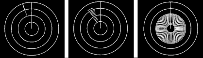

---
## Page 84

 
 
 
 
Volume 2 - Search and Rescue Operations 
 
NATIONAL SEARCH AND RESCUE MANUAL 
Page 82 
2025 EDITION Version 1 – February 2025 
1.7.5. 
Tests have shown that the operation of a SART inside the canopy of a life raft will significantly 
decrease its detection range, so every effort should be made to operate it from outside the 
canopy and as high as possible. Battery life in the “standby” mode is 96 hours and about eight 
(8) hours during RADAR interrogation. 
1.8. 
Communications in Support of SAR Operations 
Overview 
1.8.1. 
The SMC is responsible for utilising all available communication systems and designating 
specific frequencies for on-scene use during SAR operations, and for establishing reliable 
communications with adjacent operations centres. When appointed, the Coordinator Surface 
Search (CSS) or the On Scene Coordinator (OSC) is responsible for establishing reliable 
communications between all participating search assets and the RCC. 
1.8.2. 
The SMC is responsible for informing all SAR participants of the specific frequencies selected for 
an operation. The SMC should designate a primary and secondary frequency in the appropriate 
frequency bands (HF, VHF and UHF) for use as on-scene channels. 
SAR Frequencies 
1.8.3. 
The following frequencies have been authorised for use in SAR operations: 
a) 
2182, 3023, 4125, 5680 kHz. These frequencies may be used for communications between 
mobile stations when employed in coordinated search and rescue operations, including 
communications between these stations and participating land stations; 
b) 
123.1 MHz. The international SAR on-scene frequency for use in coordinated SAR 
operations.  Ships with this capability are authorised to communicate on this frequency 
with aircraft for safety purposes; 
c) 
123.2 MHz. For supplementary continental use in on-scene coordination within the 
Australian SRR; and 
d) 
282.8 MHz. Used by military ships and aircraft for communications during coordinated 
SAR operations. 
1.8.4. 
The aeronautical mobile service uses amplitude modulation (AM) for VHF telephony while the 
maritime mobile service uses frequency modulation (FM). These services are incompatible. 
SAR Call Signs 
1.8.5. 
While it was traditional for aircraft to only use ‘RESCUE’ call signs when engaged on actual SAR 
operations, the growth of the Emergency Medical Service sector has seen call signs prefixed 
with ‘RESCUE’ being used on a day-to day basis.  The authority for the use of ‘RESCUE’ call signs 
rests with Airservices Australia, which has accepted this practice.  The call signs being used are 
either in the Army aircraft block or the civil aircraft block (see below). The only organisation 
routinely using ‘RESCUE’ call signs for SAR tasks is the RAAF. The RAAF has sub- divided its block 
and allocated specific call signs to various bases. 
1.8.6. 
With the exception of the RAAF, the normal practice is for aircraft engaged in SAR operations to 
continue to use their existing civil or military call sign. In exceptional circumstances, search 
aircraft may be allocated a ’RESCUE’ call sign followed by a three-digit number that is drawn 
from the following bands: 
a) 
Army Aircraft: 001 - 100;  
b) 
RAAF aircraft: 101 - 310; 
c) 
Civil aircraft: 311 - 799;  
d) 
Naval aircraft: 800 - 930; and, 
e) 
Foreign aircraft: 931 - 999.

---
## Page 85

 
 
 
Volume 2 - Search and Rescue Operations 
NATIONAL SEARCH AND RESCUE MANUAL 
2025 EDITION Version 1 – February 2025 
Page 83 
1.8.7. 
If allocation of call signs for surface assets is required, the following may be used: 
a) 
Marine assets: ’SAR LAUNCH … (number)’; and 
b) 
Land assets: ’LAND RESCUE ... (number)’. 
1.8.8. 
Ships of the Australian Defence Force will use their names as call signs when employed on SAR 
operations, i.e. 'This is HMAS Melbourne'. 
1.9. 
Communications Facilities 
Overview 
1.9.1. 
There are many communication facilities available for use in SAR operations. It is important that 
personnel employed in SAR learn what facilities and services are available at their specific 
location and throughout their area of operations. Some of the more extensive and readily 
available facilities are: 
a) 
The AMSA HF DSC network operating two maritime communications stations (Wiluna and 
Charleville).  The network Coordination Centre is collocated with JRCC Australia that 
allows direct communications between JRCC Australia and SAR assets on scene when 
working HF frequencies; 
b) 
The State and Territory authorities have in place a network of nine limited coast radio 
stations around Australia monitoring 4, 6 and 8 MHz distress frequencies in the HF voice 
band (see Volume 2, Chapter 1.9.9). These authorities also operate VHF sites covering 
channel 16 and 67; 
c) 
Each State/Territory has an extensive volunteer marine radio network. Many of these 
stations do not operate 24 hours but do operate in the 27 MHz, VHF and MF bands; 
d) 
Discon - this is an extensive secure network linking all Defence authorities. It interfaces 
with the Naval Broadcast System for ships at sea and the RAAF ground-to-air 
communication system; 
e) 
Aeronautical Fixed Telecommunications Network (AFTN) - an international teleprinter 
network based on lCAO requirements for air navigation services, including SAR. Details of 
the network can be found in the communications section of the various lCAO Regional Air 
Navigation Plans. The AFTN in Australia is operated by Airservices Australia; 
f) 
Satellite communications offering voice, FAX and data; 
g) 
Mobile phone and texting communications; and 
h) 
Electronic (Email, internet, skype and video conferencing). 
Communications Capabilities Australian Defence Force Ships and Aircraft 
1.9.2. 
Ships and aircraft of the Australian Defence Force are fitted with communications equipment 
which allows for coverage of many of the emergency and SAR frequencies.  Table 2-1 shows the 
communications capabilities of ships of the defence force by type. 
Frequency Band 
Unit/Type 
2 to 30 MHz 
118 to 136 MHz 156 to 174 MHz 225 to 400 MHz 
Frigates and larger 
ships 
X 
 
(1) 
X 
Small ships and 
submarines 
X 
 
(1) 
X 
Table 1-1 Communication Capability Ships of the RAN 
Note: Frequency coverage in this band depends on the type of equipment fitted. However, all 
ships can monitor 156.8 MHz FM.

---
## Page 86

 
 
 
 
Volume 2 - Search and Rescue Operations 
 
NATIONAL SEARCH AND RESCUE MANUAL 
Page 84 
2025 EDITION Version 1 – February 2025 
1.9.3. 
The RAN is in the process of equipping its warships with a full suite of GMDSS communications 
comprising Inmarsat C and VHF/HF DSC. Military assets are generally fitted with 406 MHz 
distress beacons. 
International Distress Frequencies - Guarded by Royal Australian Naval Ships 
1.9.4. 
A distress watch is maintained as follows by naval ships at sea: 
Major warships  
(Frigates and above) 
HF/VHF DSC, 
VHF Channel 16 
Listening watch will be 
maintained on Channel 16 until 
further notice. 
Minor warships 
(Patrol boats and mine-hunters) 
VHF Channel 16 
Continuous loudspeaker watch. 
Table 1-1 Distress frequencies guarded by RAN 
Lines of Communications - NAVY 
1.9.5. 
When a SAR operation is in progress and RAN resources are allocated, JRCC Australia would 
normally liaise with HQJOC JCC MAROPS (MAROPS). However, in some situations, MAROPS may 
authorise the JRCC Australia to communicate directly (DIRLAUTH) with the RAN resource 
involved.  HQJOC and the appropriate involved assets are to be included as information 
addressees on all relevant signal traffic. 
Search and Rescue Visual Signals 
1.9.6. 
Appendix D-1 lists some of the international visual signals that can be used for Search and 
Rescue purposes. The appendix also contains other visual signals that maybe used by ships or 
aircraft of other nations when in the Australian SRR. 
Merchant Shipping and GMDSS 
1.9.7. 
Communications between merchant vessels in distress and SAR organisations are achieved by a 
satellite and radio watch system known as the Global Maritime Distress and Safety System 
(GMDSS). The GMDSS enables a distress alert to be transmitted and received automatically 
over short and long distances. The system allows SAR authorities as well as shipping in the 
vicinity of the distress to be rapidly alerted so that a coordinated search and rescue operation 
can be commenced with the minimum of delay. 
1.9.8. 
Additionally, the GMDSS provides for urgency and safety communications, and the 
dissemination of Maritime Safety Information (MSI). Certain fishing vessels and other marine 
craft may also carry GMDSS equipment. RCC personnel may seek advice from JRCC Australia 
staff who are familiar with the SOLAS GMDSS provisions and associated IMO documents.  
GMDSS equipped vessels can be expected to perform the following functions wherever they 
operate: 
a) 
Transmit ship-to-shore distress alerts by two independent means; 
b) 
Receive shore-to-ship alerts (usually relayed by International RCCs); 
c) 
Transmit and receive ship-to-ship distress alerts; 
d) 
SAR coordinating communications; 
e) 
On-scene communications; 
f) 
Locating signals; 
g) 
Maritime safety information; 
h) 
General radio communications to and from shore; and 
i) 
Bridge to bridge communications.

---
## Page 87

 
 
 
Volume 2 - Search and Rescue Operations 
NATIONAL SEARCH AND RESCUE MANUAL 
2025 EDITION Version 1 – February 2025 
Page 85 
Limited Coast Radio Stations 
1.9.9. 
In Australia, Limited Coast Radio Stations (LCRS) are located in nine locations: Sydney, 
Gladstone, Cairns, Darwin, Port Hedland, Fremantle, Adelaide, Melbourne and Hobart and 
maintain a continuous radio watch by monitoring the following distress frequencies: 
a) 
4125, 6215, and 8291 kHz with 8176 kHz used to broadcast weather and warnings at 
regular times; 
b) 
156.8 MHz (VHF CH16). Channel 16 is monitored in various other locations in each State / 
Territory; 
c) 
Channel 67 is used to broadcast weather and warnings. 
1.9.10. 
The State/Territory LCRS use the common call sign of “Coast Radio” preceded by the site.  For 
example:  Hedland Coast Radio or Hobart Coast Radio. 
1.9.11. 
In addition to the State/Territory LCRS, the SAR net is extended by Limited Coast Stations 
operated by fishing cooperatives and volunteer SAR organisations. Each Limited station caters 
for a group or groups of marine craft in its local area.  Depending on the capability of its 
equipment, a Limited station may monitor 2182/2524 kHz, VHF Ch16 and 27.88 MHz for 
pleasure craft, and 2182/2112/4535/4620 kHz and VHF Ch16 for fishing craft. 
Ship Stations 
1.9.12. 
There are three distinct categories of vessels to be catered for by the marine SAR system; these 
are: 
a) 
Deep sea vessels (SOLAS); 
b) 
Fishing vessels; and 
c) 
Pleasure craft. 
1.9.13. 
Most deep-sea vessels will carry communications equipment compatible with the GMDSS.  
Other vessels, most of which use satellite communications, may extend this coverage.  A 
continuous bridge listening watch is kept on VHF Ch16, as far as is practicable. 
1.9.14. 
Vessel Tracking System (VTS) is utilised by most states/territories to monitor the location of 
SOLAS vessels with the reef systems and other locations posing heavy traffic or environmental 
concerns. 
Fishing Vessels 
1.9.15. 
Some fishing vessels will carry GMDSS equipment; however, the majority of fishing vessels carry 
a variety of radio equipment and do not maintain regular watches. Frequencies allocated to 
fishing vessels are normally not compatible with large ships. 
1.9.16. 
Some fishing vessel operators are members of cooperatives and their normal procedure whilst 
fishing is to maintain daily radio schedules with the cooperative base station. 
1.9.17. 
AFMA and some State Fisheries Authorities use Vessel Monitoring Systems (VMS) utilising 
Inmarsat-C polling to track fishing vessels in their fisheries for regulatory reasons. These 
authorities may be able to assist an RCC in contacting or locating fishing vessels. 
Pleasure Craft 
1.9.18. 
These craft are under state control and hence the regulations concerning the carriage of radio 
and other SAR equipment vary from state to state, and within the state, depending upon the 
type and size of craft and its area of operations. 
1.9.19. 
There is a general acceptance by the boating community of the need to carry some type of 
radio.  The 27 MHz marine radio is a popular choice. 27.88 MHz has been designated as the 
primary distress, safety and calling frequency, with 27.86 MHz as the secondary.

---
## Page 88

 
 
 
 
Volume 2 - Search and Rescue Operations 
 
NATIONAL SEARCH AND RESCUE MANUAL 
Page 86 
2025 EDITION Version 1 – February 2025 
1.9.20. 
These frequencies are often referred to as channels 88 and 86 respectively and care must be 
taken not to confuse them with the VHF Marine FM frequencies that are always referred to as 
channels.  VHF Marine FM radio is increasingly being used by pleasure craft. 
Volunteer Organisations 
1.9.21. 
Clubs and other interested groups have set up base radio stations, mainly in popular sea 
recreational areas around Australia.  Each station is normally staffed on an “as required” or 
“considered necessary” basis.  Some offer continuous coverage, but most offer only casual 
coverage.   
1.9.22. 
The majority of voluntary organisations equipped with HF SSB equipment are capable of 
responding to calls on the 2 MHz, 4 MHz and 6 MHz marine bands. 
1.9.23. 
2182 kHz is normally monitored continuously as the internationally recognised primary Distress 
frequency on HF. However, 2524 kHz as the calling and working frequency for shore stations 
and pleasure craft, is still traditionally preferred and monitored by many operators since in the 
past informal communications on this frequency were not subject to operational controls by 
the ACMA. 
1.9.24. 
In addition to HF, the use of VHF Maritime Mobile FM (156-174 MHz) service equipment and 
27MHz Inshore Boating Radio Communication service equipment is gaining popularity with 
small craft owners. The recognised Distress/Emergency frequencies respectively are VHF Ch16 
and 27 MHZ Channel 88. 
1.9.25. 
The use of the 27MHz band is uncontrolled and not guarded on an official basis. 
Communication Capabilities of State & Territory SAR Authorities 
1.9.26. 
State SAR authorities maintain extensive communications networks both interstate and 
intrastate.  Arrangements for the use of these communications facilities are in accordance with 
Commonwealth-State SAR plans. 
Command/Communications Caravans 
1.9.27. 
There are a number of Police and emergency services communications caravans around 
Australia, and these are equipped to utilise available communications facilities and may be 
deployed to a Forward Field Base. 
Marine 
1.9.28. 
Each State/Territory SAR authority maintains radio-equipped vessels with in-shore SAR 
capabilities. Capabilities and locations of these assets are contained in local facilities registers. 
Air Wings/State and Community provided aerial assets 
1.9.29. 
States and Territories have aviation assets with appropriate communications equipment. 
Communications Aircraft 
1.9.30. 
A dedicated communications aircraft should be used when communications are expected to be 
poor in the search area and: 
a) 
HF is the only means of communication; 
b) 
It is a large scale search; 
c) 
It is necessary to improve information feedback into the RCC; 
d) 
It is necessary to improve information flow to SAR assets; 
e) 
Search aircraft are operating without contact with a ground station; or 
f) 
It is the best method of maintaining communications with survivors/ground search assets 
and ground rescue assets.

---
## Page 89

 
 
 
Volume 2 - Search and Rescue Operations 
NATIONAL SEARCH AND RESCUE MANUAL 
2025 EDITION Version 1 – February 2025 
Page 87 
1.9.31. 
A communications aircraft will normally be a suitably equipped SAR assets aircraft or a Military 
aircraft, have a minimum crew of pilot and radio operator, and have good on scene endurance. 
Inmarsat Aero 
1.9.32. 
Subscribers to the INTERNATIONAL MARITIME SATELLITE (INMARSAT) Aeronautical System may 
make telephone and facsimile calls while airborne by way of this system. Similarly, terrestrial 
subscribers may initiate communication with airborne aircraft fitted with INMARSAT 
aeronautical satellite communication (SATCOM) equipment. 
1.9.33. 
Not all countries have arrangements to route ground originated calls to the INMARSAT 
Aeronautical System. 
1.9.34. 
The INMARSAT Aeronautical System offers a capability for communication of distress calls from 
airborne aircraft via a Land Earth Station (LES) to nominated SAR centres.  The Perth LES 
provides ground-to-air and air-to-ground voice and data facilities for aircraft operations 
throughout the Indian and Pacific Oceans. It is conceivable that the Perth LES could receive 
distress calls originating from two thirds of the globe. 
1.9.35. 
Perth LES has a standing procedure to relay all distress calls received via this system to the 
Australian JRCC.  Voice calls are directed automatically to the designated JRCC telephone 
number, an alarm will be generated indicating a distress call is being processed and a hard copy 
print out will be produced detailing a LES-specific aircraft identification.  LES staff will contact 
the JRCC as a matter of urgency to ensure SAR staff have received the message.  If required, the 
LES staff can access station files to determine the aircraft registration from the LES-specific 
identification provided in the original message.  The JRCC will then be enabled to begin checks 
to ascertain the status of the aircraft. The JRCC will only consider a distress situation exists after 
voice contact with the target aircraft has been established and the situation evaluated. 
1.9.36. 
No international agreements for coordinated handling of distress calls outside Australian 
airspace are yet in place. However, in keeping with fundamental JRCC procedures, the JRCC 
when made aware of an aircraft in distress through this system shall initiate action to confirm 
the circumstances and location of the aircraft. Then render all possible assistance and work to 
establish those ground assets best placed to provide an on-going SAR service.  Checks should be 
made through ATS units and JRCCs with responsibilities in airspace in which the distressed 
aircraft is thought to be operating. 
1.10. Land Search Communications  
Overview 
1.10.1. 
Distress communications include all messages relating to immediate assistance required by 
persons, vessels or vehicles in distress, including medical assistance. Distress communications 
may also include SAR communications and on-scene communications. Distress calls take 
absolute priority over all other transmissions; anyone receiving a distress call must immediately 
cease any transmissions that may interfere with the call and listen on the frequency used for 
the call. 
1.10.2. 
Distress and safety communications require the highest possible integrity and protection from 
harmful interference.  Any interference that puts at risk the operation of safety services, 
degrades, obstructs or interrupts any radio communications, is harmful. Some frequencies are 
protected, in that they have no authorised uses other than for distress and safety. SAR 
personnel should be particularly careful not to cause harmful interference and should co-
operate with authorities to report and stop incidents of interference. 
1.10.3. 
The object of search and rescue (SAR) communications is to make possible the conduct of SAR 
operations. Such communications must allow for: 
a) 
Rapid transmission of distress messages from aircraft, persons, vessels or vehicles, 
including for medical assistance;

---
## Page 90

 
 
 
 
Volume 2 - Search and Rescue Operations 
 
NATIONAL SEARCH AND RESCUE MANUAL 
Page 88 
2025 EDITION Version 1 – February 2025 
b) 
Rapid communication of distress information to the authorities responsible for organising 
and effecting rescue; 
c) 
Coordination of the operation of the various SAR assets; and 
d) 
Liaison between controlling/coordinating authorities and SAR assets. 
1.10.4. 
The communications system is the means by which control is maintained and therefore any 
system should be: 
a) 
Efficient; 
b) 
Reliable; and 
c) 
Self-sustaining. 
1.11. Communications 
1.11.1. 
Sound communications, involving not only the use of telephones and radio, but as many 
alternative systems as possible, must be pre-planned and implemented. Basic requirements 
are: 
a) 
Between Search Headquarters, Field Search Headquarters and Support Base; 
b) 
Between Search Headquarters and Assembly Area (if set up); 
c) 
Between Field Search Headquarters, Search Teams and Sub- Headquarters if necessary; 
and 
d) 
Between Field Search Headquarters and Support Base. 
1.12. Communications Officer 
1.12.1. 
It is the task of the Communications Officer, if available, otherwise the command team, to 
ensure that as far as practicable, the SMC’s actions and decisions are never restricted through 
lack of communications. 
1.12.2. 
Although Communications Officers need not be technicians, they must understand the broad 
characteristics, capabilities and limitations of the various means of communications that may 
be employed. Good communications do not just happen—they must be planned. 
1.13. Communication Requirements 
1.13.1. 
The possible variations in requirements are almost unlimited but can be broadly classified as: 
a) 
Headquarters; 
b) 
Rear net; and 
c) 
Forward net. 
1.14. Headquarter Requirements 
1.14.1. 
The Search Headquarters may be the nearest Police Station or building which already has 
landline telephone facilities and/or mobile service and good access. If this is not available, 
consideration must be given to the following aspects in choosing the site for Search 
Headquarters: 
a) 
A house or building with telephone landline and/or mobile service, light and power 
already connected. 
b) 
Site satisfactory for radio, which is elevated and clear of possible sources of electrical or 
other interference. The Communications Officer would normally choose this site provided 
it was compatible with the other operational factors mentioned. 
c) 
Good access for both vehicles and people to provide for possible use of messengers.

---
## Page 91

 
 
 
Volume 2 - Search and Rescue Operations 
NATIONAL SEARCH AND RESCUE MANUAL 
2025 EDITION Version 1 – February 2025 
Page 89 
d) 
Consideration of radio repeaters should be made early. 
1.15. Telephone/Radio 
1.15.1. 
If a telephone is available, maximum use should be made of this facility, particularly for 
communication of long or complicated messages, but a backup radio system may be necessary. 
If distances are short, field telephones are an efficient alternative. Messengers could be used if 
no other method was available. 
1.15.2. 
Radios are always the preferred method of mass communication to all search assets. 
1.16. Rear Net  
1.16.1. 
This may involve communications from Search Headquarters to: 
a) 
Field Search Headquarters; 
b) 
Support Base; 
c) 
Assembly Area (if established); 
d) 
Statutory authorities; 
e) 
Government instrumentalities; and 
f) 
Voluntary organisations. 
1.16.2. 
Communications here would most likely be by telephone. If the search appeared to be 
escalating into a lengthy operation, consideration could be given to the provision of direct 
telephone lines by liaising with the service provider. However, cost is likely to be incurred 
therefore expenditure approval should be obtained before installation. 
1.17. Forward Net 
1.17.1. 
This can be defined as the communications required from Field Search Headquarters to the 
searchers in the field and these requirements can vary considerably. The most likely 
configuration would be from Field Search Headquarters to: 
a) 
Support Base 
b) 
Search assets; and 
c) 
Sub-headquarters if employed. 
1.17.2. 
The principle here is to use whatever communication systems are available, but generally the 
forward net would depend on radio as the primary method, and telephones can be a secondary 
method. Satisfactory communications can be quickly established provided the Communications 
Officer is aware of the SMC’s operational requirements relating to quantity, range, and the 
terrain over which they will be required to operate. If the operators understand the basic 
characteristics and limitations of the sets in use, and normal radio net discipline is maintained, 
reliable communications will be achieved. 
1.17.3. 
A sample of the search communications net diagram is shown as Appendix E-12. 
1.17.4. 
Appendix E contains the recognised radio terminology. 
1.18. Frequencies 
1.18.1. 
The most common methods of radio communications are listed below: 
a) 
HF (High Frequency) - HF operates in the band 3 to 30 MHZ. In addition to ground waves, 
sky wave operation is possible which vastly increases the range. This type of transmission 
relies on ‘bouncing’ radio waves from a layer of ionised gases 150 Km above the earth’s 
surface and back down to ground. Considerable distances can be achieved using HF. 
However, the system tends to be noisy and requires large aerial installations and some

---
## Page 92

 
 
 
 
Volume 2 - Search and Rescue Operations 
 
NATIONAL SEARCH AND RESCUE MANUAL 
Page 90 
2025 EDITION Version 1 – February 2025 
degree of expertise to operate. It would normally be used only as a rear link back to a 
search headquarters; 
b) 
VHF (Very High Frequency) - VHF operates in the band 30–300 MHZ. This type of 
transmission is commonly used by mobile radio fleets and gives reliable communications 
over a distance of 20–30 Km. It is primarily ‘line of sight’ transmissions. This means that 
hills or major obstacles may impede reliable communications, and the base site should 
always be as high as possible. Some difficulty may be experienced at times by searchers 
losing communications. If this happens, operators should be aware that a small change in 
location or moving to a high point may assist in regaining contact. This applies equally to 
UHF; and 
c) 
UHF (Ultra High Frequency) - UHF operates in the band 300– 3000 MHZ. This method is 
strictly ‘line of sight’ and in flat or open terrain; to increase its range, it requires repeater 
stations on some high point to relay messages and therefore requires some degree of 
technical expertise to install. 
1.19. Radios in general 
1.19.1. 
UHF CB style radios provide the best balance between portability and communications.  Not 
only searchers and headquarter bases should be provided with UHF radios but their carriage 
and usage by persons travelling in the more remote areas of Australia should be encouraged. 
a) 
A vehicle mounted radio attached to an external antenna will provide the best coverage 
although a hand-held device will also work, albeit with a limited range.  Spare batteries 
should always be carried if the radio is not hard wired.  
b) 
UHF Channel 9 or 40 have been identified as “listening channels”. Once a call has been 
established, users can move to a clear channel. 
c) 
UHF Channel 5 is a designated emergency channel, while this is Duplex it is also an 
emergency Simplex channel and there are no duplex repeaters on this channel in the 
bush. 
d) 
UHF Channel 11 is a dedicated Australian calling frequency which after establishing 
contact users move to another channel. 
e) 
While the above channels are dedicated, a search asset with a scanning radio will detect a 
missing person calling on any channel within range.  Modern scanning radios cover all 40-
80 channels every 4 seconds, ensuring that not active channel is missed. 
1.19.2. 
Attention must be given to the state of the batteries in portable sets and spare batteries should 
always be available. Batteries should not be left in sets which will not be used for any length of 
time. It is recognised that most radio failures are caused by a lack of care and knowledge on the 
part of operators, rather than deficiencies within the sets themselves.  
1.19.3. 
Loss of communications: During search operations it is likely that situations will arise where 
radio communications are less than 100% effective.  Teams should be briefed as to their actions 
in case of a loss of communications.  These actions may include backtracking to their last point 
of communication, problem solving, using other forms of communication, relaying through 
other stations, non-use of Distress Devices – ‘no news is good news’, or carrying on with an 
assigned task – ‘be at this spot at this time’. 
1.19.4. 
Ground to Air Communications: Aircraft operate on aviation transport group frequencies 
allocated by Australian Communications Authority and can be contacted through the airport 
control tower, but radios are available which can contact aircraft on a special frequency. Prior 
arrangement with the aircraft pilot is necessary to work on this channel as the aircraft normally 
listens out on tower frequencies.  
1.19.5. 
Another alternative is to place on board the aircraft a portable radio on the same frequency as 
is being used by the search teams.

---
## Page 93

 
 
 
Volume 2 - Search and Rescue Operations 
NATIONAL SEARCH AND RESCUE MANUAL 
2025 EDITION Version 1 – February 2025 
Page 91 
1.20. Procedures and Practices 
1.20.1. 
To achieve efficiency, standard radio procedure should be used. Although two- way 
conversations will be needed, messages should be written for reference at a future time. It may 
also be necessary to refer to past actions or decisions and this makes necessary the keeping of 
a written record. Search Team Leaders should carry a notebook to record messages. 
1.21. Other Methods of Communications 
1.21.1. 
Mobile telephones: The rapid expansion of the mobile telephone network throughout Australia 
has provided the SAR coordinator with another option for SAR communications, although it 
must be noted that they do not work in all locations.  A number of considerations must be 
taken into account by the SMC when considering mobile telephones as a communications 
method: 
a) 
The use of a radio net should always be the first option, 
b) 
The extent of the networks and coverage at the search location 
c) 
The availability and type of mobile telephones at the search location 
d) 
The battery life and ability to recharge those mobile telephones available 
e) 
The ability to send and receive spoken words, text messages and photographs. 
f) 
Mobile telephones may be considered as a secondary communication method, and when 
direct and private contact is to be made between the SMC and teams. 
g) 
The use of text messages may be more successful than verbal communications.  Text 
messages require less signal strength and will be received when a mobile telephone 
comes within range even if it is some time since it was originally sent. 
1.21.2. 
Other methods of communicating, which can be used but require some degree of prior 
planning are: 
a) 
Control of Contact or Close Search - Whistles, loud hailers, and simple voice orders. (To 
contact both single and multiple teams).  
b) 
Location of Search Teams or Finds - Smoke, light (fire), signalling mirrors. 
c) 
Recall signals - Whistles, sirens, gun shots, pyrotechnic rockets. 
d) 
The General Public - Commercial radio stations for supplying information and instructions 
to the public. 
e) 
Mobile Communications - For relay points. 
f) 
Field Signals - Searchers may be required to use field hand signals or audible sounds to 
communicate within or between teams. Recognised audible signals are: 
i) 
One short blast at irregular intervals - searchers looking for a missing person and as 
an acknowledgment of a distress signal; 
ii) 
Three short blasts together, regularly spaced—distress signal; and 
iii) 
Four short blasts together, regularly spaced—which is recall signal. 
1.21.3. 
Short blasts are regarded as sounds audible for one second. Where organisations use audible 
signals for other purposes, three blasts must be avoided. 
1.21.4. 
Summary: The success of a land search will largely depend on good planning and adequate 
control in the field. This is based on the SMC having a free hand to deal with field operations, at 
the same time receiving maximum support from the Search Commander. 
1.21.5. 
Under no circumstances should unofficial searchers be allowed in the search area, and any 
person disobeying instructions should be withdrawn immediately.

---
## Page 94

 
 
 
 
Volume 2 - Search and Rescue Operations 
 
NATIONAL SEARCH AND RESCUE MANUAL 
Page 92 
2025 EDITION Version 1 – February 2025 
Chapter 2 Awareness and Initial Action 
2.1. 
Awareness Introduction 
2.1.1. 
When the SAR system first becomes aware of an actual or potential emergency, the 
information collected, and the initial action taken are often critical to a successful SAR 
operation. It must be assumed that in each incident there are survivors who will need 
assistance and whose chances of survival are reduced by the passage of time. The success of a 
SAR operation depends on the speed with which the operation is planned and carried out. 
Information must be gathered and evaluated to determine the nature of the distress, the 
appropriate emergency phase, and what action should be taken. Prompt receipt of all available 
information by the RCC is necessary for thorough evaluation, immediate decision on the best 
course of action and a timely activation of SAR assets to make it possible to achieve the 
following:  
a) 
Locate, support and rescue persons in distress in the shortest possible time. 
b) 
Use any contribution survivors may still be able to make towards their own rescue while 
they are still capable of doing so. 
2.1.2. 
Experience has shown that the chances for survival of injured persons decrease by as much as 
80% during the first 24 hours, and those for uninjured persons diminish rapidly after the first 
three days. Following an accident, even uninjured persons who are apparently able-bodied and 
capable of rational thought are often unable to accomplish simple tasks and are known to have 
hindered, delayed or even prevented their own rescue. 
2.1.3. 
General Considerations for the SMC: SMC duties can be demanding. The gathering of 
information, evaluation of this information and initiation of action all require concentrated 
effort on many details. The SMC will find the various forms, checklists, worksheets, tables and 
graphs provided in the appendices to be very helpful. The following paragraphs provide some 
general guidance for the early stages of a SAR operation, including information gathering and 
preparation for the possible need to plan searches.  
2.1.4. 
Several factors will influence the extent and manner of an initial SAR response. In general, these 
are the:  
a) 
Extent and reliability of information about the location of the missing persons; 
b) 
Availability of aircraft, maritime assets and land parties for searching;  
c) 
Prior, actual and forecast weather conditions;  
d) 
Times of daylight / darkness;  
e) 
Nature of terrain/sea conditions;  
f) 
Availability of survival supplies and supply dropping teams; and  
g) 
Time delay in notification. 
2.2. 
Types of SAR Incidents 
2.2.1. 
There are many different types of incidents reported to the SAR system that must be evaluated 
and resolved. Most of these incidents may be grouped by the type of target involved, the 
environment, and in the case of individuals, by the type of difficulty being encountered. 
2.2.2. 
In general, a SAR incident is considered imminent or actual when it is apparent that persons 
are, or may be, in distress or when a request for assistance has been received.

---
## Page 95

 
 
 
Volume 2 - Search and Rescue Operations 
NATIONAL SEARCH AND RESCUE MANUAL 
2025 EDITION Version 1 – February 2025 
Page 93 
Maritime SAR Incident 
2.2.3. 
A maritime SAR incident is considered imminent or actual when any of the following conditions 
exist: 
a) 
A surface vessel or other marine craft has requested assistance. 
b) 
A surface vessel or other marine craft has transmitted or displayed a distress signal. 
c) 
It is apparent that a surface vessel or other marine craft is in distress. 
d) 
A surface vessel or other marine craft is reported to be sinking or to have sunk. 
e) 
The crew is reported to have abandoned ship or is about to do so. 
f) 
Reports indicate that the operating efficiency of the marine craft is so impaired that the 
craft may sink, or the crew may be forced to abandon. 
g) 
The surface vessel or marine craft is overdue or unreported (and initial evaluation has 
failed to resolve the incident). 
h) 
Persons are in the water and require assistance. 
i) 
A distress beacon has been activated. 
j) 
A MEDEVAC is required on medical advice. 
Aviation SAR Incident 
2.2.4. 
SAR alerting action is based upon the type of notification and flight procedures adopted by an 
aircraft, for example: 
a) 
Aircraft that comply with full reporting procedures where a continuous communications 
SAR watch is maintained fails to report at the next scheduled time. 
b) 
Aircraft that have nominated a SARTIME where alerting action commences at the time of 
expiration of the SARTIME.  
c) 
Aircraft that have not submitted flight notification where alerting action is commenced on 
the receipt of incidental information from any source which leads to doubt as to the 
aircraft’s safety. This includes notification from a person or organisation holding a Flight 
Note. 
2.2.5. 
An aircraft SAR incident is considered imminent or actual when: 
a) 
A SARTIME for an aircraft has not been cancelled. 
b) 
An aircraft fails to report arrival or if it has failed to report position,  
c) 
ATS declare a SAR phase (INCERFA, ALERFA or DETRESFA), 
d) 
Information is received that an aircraft on which no flight notification has been lodged is 
missing, including notification from a person or organisation holding a Flight Note.  
e) 
An aircraft, which has been given approach or landing instructions, fails to land. Fuel on 
board is considered to be exhausted or to be insufficient to enable an aircraft to reach 
safety. 
f) 
Information is received which indicates that an aircraft is about to make or has made a 
forced landing, or has ditched or crashed. 
g) 
Information is received which indicates that the operating efficiency of an aircraft has 
been impaired to the extent that a forced landing is likely. 
h) 
A distress beacon is reported to be transmitting. (Aircraft required to carry a distress 
beacon normally have an ELT and/or PLB but may also carry EPIRBs, for example in life 
rafts).

---
## Page 96

 
 
 
 
Volume 2 - Search and Rescue Operations 
 
NATIONAL SEARCH AND RESCUE MANUAL 
Page 94 
2025 EDITION Version 1 – February 2025 
Land SAR Incident 
2.2.6. 
A land SAR incident is considered imminent or actual when: 
a) 
A request for assistance is received; 
b) 
A vehicle or person is reported overdue; 
c) 
It is apparent that a vehicle or person is in distress; 
d) 
A distress beacon has been activated; and/or 
e) 
A MEDEVAC is required. 
2.3. 
Recording of Events 
2.3.1. 
The RCC shall maintain records for each incident in which all information should be recorded as 
it is received, either in full or by reference to other permanent records such as flight plans, 
forms, charts, maps, hard copy messages, recorded RADAR data etc. Details of all phases 
notified to the RCC and all information relating to action initiated by the RCC shall be recorded 
in chronological order. 
2.3.2. 
Where information is contained in other records, (messages, forms etc.), these shall be held in 
such a way that reference to them may be easily made throughout the operation. All hard copy 
information shall be retained for filing. 
2.3.3. 
Each day's search activity shall be plotted. The total search area shall be subdivided into 
sections assigned to each SAR asset showing individual search patterns, aircraft heights and 
speeds, and other relevant details. A plot shall be kept of areas searched as well as those not 
searched. Areas assigned but not searched need to be readily identified for reassignment, 
leaving no 'holes' within the search area. 
2.3.4. 
Records may be kept of the actual hours of operation of search craft, showing individual transit 
times and times engaged in search and/or rescue activity. These records will contribute to 
determining the POD of searches and may also be used for assessment of financial claims 
received from operators. 
2.3.5. 
Records shall be kept of names of all searchers (volunteers and professional) used in SAR 
operations on assets tasked by the RCC usually in the form of a manifest or 'T' cards (i.e. Aircraft 
and aerial observers, vessels and crew, search teams). 
2.3.6. 
When a search has been terminated without locating a missing target (aircraft or its occupants 
vessel or its occupants or missing person), all records, charts, maps, etc. shall be retained and 
be accessible to SAR staff to allow easy resumption of search activity should further intelligence 
be received. 
2.3.7. 
Records relating to search and rescue operations, including aviation, land and maritime 
searches, conducted by other organisations shall be retained. 
2.3.8. 
Records should be retained for coroner’s court/civil proceedings and for the possible access of 
other authorities. 
2.4. 
SAR Stages 
2.4.1. 
The response to a SAR incident usually proceeds through a sequence of five stages. These 
stages are groups of activities typically performed by the SAR system in responding to a SAR 
incident from the time the system becomes aware of the incident until its response to the 
incident is concluded. The response to a particular SAR incident may not require the 
performance of every stage. For some incidents, the activities of one stage may overlap the 
activities of another stage such that the portions of two or more stages are being performed 
simultaneously.  
2.4.2. 
Land SAR in Australia now adopts the same five SAR staged approach as Marine and Aviation 
SAR shown below.

---
## Page 97

 
 
 
Volume 2 - Search and Rescue Operations 
NATIONAL SEARCH AND RESCUE MANUAL 
2025 EDITION Version 1 – February 2025 
Page 95 
2.4.3. 
The five SAR stages are:  
a) 
Awareness. When the SAR system becomes aware that an emergency situation exists or 
may exist. 
b) 
Initial Action. Preliminary action taken to alert SAR assets and obtained more information. 
The stage may include evaluation and classification of the information, alerting of SAR 
assets, communication checks and, in urgent situations, immediate performance of 
appropriate activities from other stages. 
c) 
Planning. The development of operational plans including plans for search, rescue and 
final delivery of survivors to medical facilities or other places of safety as appropriate. 
d) 
Operations. Dispatching SAR assets to the scene, conducting searches, rescuing survivors, 
assisting distressed targets, providing necessary emergency care for survivors and 
delivering casualties to medical facilities. 
e) 
Conclusion. Return of SRAs to a location where they are debriefed, refuelled, replenished 
and prepared for other missions, return of SAR assets to their normal activities and 
completion of all required documentation. 
2.5. 
Awareness and Initial Action Stages (Stage 1 and 2)  
2.5.1. 
When a SAR authority becomes aware of a possible SAR incident the SAR system is activated. 
The information is assessed, and coordination is assumed or passed to the appropriate SAR 
authority for coordination. 
2.5.2. 
Members of the public are encouraged to report any abnormal occurrence they have witnessed 
or heard about. Notification of an event may reach an RCC from any source including a member 
of the public, an ATS Unit or through a designated alerting post such as a police station. 
2.5.3. 
For almost all emergency situations, action can be started as soon as the nature and general 
position of the emergency is known. Additional information, which might be helpful to the 
resolution of the incident, should be obtained after the initial action has been taken. 
Communications should be maintained with a target or person reporting an emergency 
situation and they should be kept advised of the action being taken. 
Types of Notification Reports 
Distress Alerts 
2.5.4. 
Distress alerts may be received by the RCC from various sources. The following are typical 
examples: 
a) 
Aural reception of a distress beacon by an aircraft.  
b) 
Detection by the COSPAS-SARSAT satellite system. 
c) 
Receipt through Airservices Australia. 
d) 
Receipt through a recognised mobile satellite service provider. 
e) 
Receipt through a coast radio station. 
f) 
Receipt through other alerting systems, e.g. ARGOS, other SEND devices. 
g) 
Direct communications from the public or the distressed target. 
h) 
Another RCC or SAR authority. 
Notification by Airservices Australia 
2.5.5. 
For aircraft communicating with Airservices Australia, the ATS unit responsible will declare the 
appropriate phase and transfer the phase to JRCC Australia in accordance with the agreed 
Memorandum of Understanding (MOU).

---
## Page 98

 
 
 
 
Volume 2 - Search and Rescue Operations 
 
NATIONAL SEARCH AND RESCUE MANUAL 
Page 96 
2025 EDITION Version 1 – February 2025 
2.5.6. 
JRCC Australia receives notification of aircraft emergencies through ATS units in most instances 
as they are in receipt of information on most flights within their areas of responsibility and are 
periodically in contact with the aircraft. Each ATS unit has a responsibility to provide an alerting 
service to all flights known to it. 
2.5.7. 
Air traffic controllers are responsible for providing In-Flight-Emergency Response (IFER) to 
distressed aircraft with which they are in contact. Alerting procedures for emergency facilities 
requested by a pilot are an Airservices Australia responsibility.  
2.5.8. 
JRCC Australia will be alerted to problems affecting a flight that could seriously jeopardise its 
safety while enroute through Airservices Australia. 
Evaluation of Notification Reports 
2.5.9. 
All reports relating to a SAR operation must be carefully evaluated to determine their validity, 
the urgency for action and the extent of the response. 
2.5.10. 
While evaluation of reports might be difficult and time-consuming, decisions must be made and 
action taken as quickly as possible. If confirmation of uncertain information cannot be obtained 
without undue delay, the SMC should act on a doubtful message rather than wait for 
verification. 
2.5.11. 
The evaluation of reports on overdue or missing persons, vessels or aircraft should take account 
of: 
a) 
Communication delays: In some areas of the SRR, communication delays may prevent 
timely reporting. This should be kept in mind when evaluating the significance of a report 
in order to prevent unnecessary activation of the SAR system while ensuring that the SAR 
response is appropriate should the circumstance be real. 
b) 
Weather conditions: Adverse weather may contribute to communication delays or 
deviations from flight plan. 
c) 
Habits of the individual: Some individuals, including pilots, masters and hikers are known 
to react or may have been briefed to react in a certain manner in certain circumstances. 
Knowledge of these habits/company procedures may provide guidance in the evaluation 
of an incident and the subsequent planning and execution of search operations. 
Information: SAR Incident Information 
2.5.12. 
Success or failure of any operation will depend on the availability of information. This 
information needs to be: 
a) 
Accurate; 
b) 
Current; and 
c) 
Relevant. 
2.5.13. 
In many search operations, the time factor is critical, so there is a need to commence the 
search as soon as the situation allows. 
2.5.14. 
All search operations present special problems in that there will be an essential conflict 
between the urgency imposed by the situation, and the initial delay caused by the need to 
gather and evaluate as much information as possible. 
2.5.15. 
An understanding of the information gathering process must be a primary qualification for the 
Search Commander and SMC. 
2.5.16. 
Information gathering aspects: There are three main aspects of information-gathering:

---
## Page 99

 
 
 
Volume 2 - Search and Rescue Operations 
NATIONAL SEARCH AND RESCUE MANUAL 
2025 EDITION Version 1 – February 2025 
Page 97 
a) 
Type of information required; 
b) 
Availability of and access to information; and 
c) 
Evaluation of information acquired. 
2.5.17. 
The Information Stages: The information process is divided into four stages: 
a) 
Collection - Information related to the search should be collected in the shortest possible 
time and often comes from unlikely sources. (Consider beacon registration, NOK, flight 
plans, manifests, intentions, BOM, etc.). Information required may relate to the: 
i) 
Missing person(s), vessel or aircraft; 
ii) 
Missing object(s); 
iii) 
Environment; 
iv) 
Sea conditions; Terrain/topography; and 
v) 
Weather. 
vi) 
Survival times 
b) 
Collation - Once the information has been obtained, it needs to be sorted into categories 
which relate to the problem. Where possible, this information should be displayed so it is 
readily available to the search command/control elements. In this way, the task of 
evaluating the information is made easier and will make decision-making simpler. 
c) 
Evaluation - Within this mass of information, there will be sections that are irrelevant, 
unreliable or dated. It becomes necessary to evaluate all information and discard all that is 
inappropriate and make decisions accordingly. To change information into intelligence it 
must be value added, verified and/or confirmed with other sources. 
d) 
Dissemination - The SMC will utilise the intelligence as the basis of briefings to pass on 
specific and relevant information to searchers in the field, to relay information to relevant 
authorities, and to pass information to the family of the person and to the media. This 
information needs to be current, accurate and relevant so that confidence is maintained. 
2.5.18. 
The following information, or as much of it as is required to address an emergency situation, 
should be obtained from the target or the individual reporting the actual or potential 
emergency situation or incident. As many of the items should be obtained as circumstances 
permit.

---
## Page 100

 
 
 
 
Volume 2 - Search and Rescue Operations 
 
NATIONAL SEARCH AND RESCUE MANUAL 
Page 98 
2025 EDITION Version 1 – February 2025 
Aviation, Maritime or Land Incident Information 
a) 
Name, address, and telephone number or contact point of person reporting.  
b) 
Distressed target (name/type/callsign/registration) or identification. 
c) 
Position of emergency (latitude/longitude or bearing/distance) from a known point or the 
last reported position and the next reporting position). 
d) 
Nature of emergency (fire, collision, person overboard, disabled, overdue, crash or missing 
hiker etc.). 
e) 
Date/time of emergency occurrence. 
f) 
Date/time of notification. 
g) 
For aircraft, altitude, attitude, heading, speed and endurance. 
h) 
Target description (size, type, markings, hull, colour of cabin, deck, rigging, fuselage 
colour, tail colour, wingtip colour, unusual features). 
i) 
Details of persons on board, persons involved (POB) including number of people involved, 
ages, state of health, injuries, and intentions. 
j) 
Date, time and departure point, planned route, speed, ETA and destination. 
k) 
Radio frequencies currently in use monitored or scheduled. 
l) 
Emergency radio equipment and frequencies, EPIRB, ELT, or flares. 
m) Actual weather/sea conditions. 
n) 
Local action being taken or assistance required. 
o) 
Owner/agent of distressed target and contact method. 
p) 
Possible route deviations. 
q) 
Navigation capabilities. 
r) 
Survival equipment including quantity of food/water and signalling devices. Other 
information sources, e.g. friends, relatives, associates, yacht clubs, and aero clubs. 
s) 
Mobile phone numbers of any person. 
Person Overboard Incident Information 
a) 
Name and call sign of ship with person overboard. 
b) 
Position, course and speed of the ship. 
c) 
Date, time and position when the person went overboard. 
d) 
If time of person overboard unknown, when last seen. 
e) 
Weather conditions (include water temperature. 
f) 
Person’s name, age and gender. 
g) 
Person’s height and weight to determine survivability. 
h) 
Person’s physical/mental condition and swimming ability. 
i) 
Person’s clothing (amount and colour). 
j) 
Height of fall from ship to water. 
k) 
Lifejacket (worn, missing). 
l) 
Has the ship been completely searched? 
m) Will the ship search for the person overboard and, if so, for how long. 
n) 
Radio frequencies in use monitored or scheduled.

---
## Page 101

 
 
 
Volume 2 - Search and Rescue Operations 
NATIONAL SEARCH AND RESCUE MANUAL 
2025 EDITION Version 1 – February 2025 
Page 99 
o) 
Whether an urgency broadcast is requested. 
p) 
Assistance desired. 
q) 
Assistance being received. 
r) 
Initial reporter (parent agency, radio station, and name/call sign of ship). 
s) 
Other pertinent information. 
Missing person 
a) 
Personal details (Name, DOB, address, telephone numbers, employment, social status, 
married); 
b) 
Physical features (Description, fitness, ability, past history); 
c) 
State of health (physical and mental); 
d) 
Medication (taken, carried or left behind) (what are the effects of this?); 
e) 
Psychological issues (Happiness, depression, family trouble, financial trouble, legal 
trouble) 
f) 
Dress (Wearing now and what taken? Is it suitable for the conditions?); 
g) 
Food/water (Any? Sufficient? Will last how long?); 
h) 
Handedness, (Left or right); 
i) 
Any means of transport (Where is it? Public transport?); 
j) 
Time last seen (Intentions, intended routes, previous routes?); and 
k) 
Any other information considered relevant. 
2.5.19. 
Such information may well dictate the urgency of the search. If, for example, the person has a 
history of going missing, it may suggest a policy of wait and see. Sample forms which may assist 
in obtaining relevant information are included as Appendices E-1, E-2, E-3 of this Manual. 
Objects/evidence 
2.5.20. 
When conducting a search for an object such as aircraft, vessel, vehicle, or any other article 
(Police evidence search, it will be necessary to gain a complete description of the object. This 
should include: 
a) 
Description; 
b) 
Make; 
c) 
Model; 
d) 
Colour; 
e) 
Size; 
f) 
Weight; 
g) 
Registration number (if available); 
h) 
Markings; and 
i) 
Safety aspects/danger. 
2.5.21. 
Where an object is unlikely to be readily identifiable, the requirement for detail is increased. If 
possible, a model, photograph, or drawing should be obtained. Particular emphasis should be 
on safety factors if the object is likely to offer a hazard to the finder. An example would be the 
hazards associated with modern aircraft. A sample Object Questionnaire is included as 
Appendix E-3 to this Manual. 
2.5.22. 
After evaluating all available information in every case, the RCC should declare the appropriate 
emergency phase (if not already declared), or review phase as appropriate.

---
## Page 102

 
 
 
 
Volume 2 - Search and Rescue Operations 
 
NATIONAL SEARCH AND RESCUE MANUAL 
Page 100 
2025 EDITION Version 1 – February 2025 
Advising States of Foreign Persons in Distress 
2.5.23. 
If a foreign registered aircraft is subject to a Distress Phase, that is found not to be a false alarm 
or is involved in an accident or a foreign national is killed or injured in a SAR related incident, 
the relevant foreign State is to be notified through the Department of Foreign Affairs and Trade 
(DFAT). SMC advice should be directed to the DFAT Communications Duty Officer or the Desk 
Officer for the State concerned. 
2.6. 
Emergency Phases 
2.6.1. 
Emergency phases are based on the level of concern for the safety of persons, vessels or 
aircraft. Upon initial notification the notified SAR authority or ATS unit classifies the SAR 
incident as being in one of the three following emergency phases: 
a) 
Uncertainty Phase (INCERFA). 
b) 
Alert Phase (ALERFA). 
c) 
Distress Phase (DETRESFA). 
2.6.2. 
The emergency phase may be reclassified by the SMC as the situation develops. The current 
emergency phase should be used in all communications about the SAR incident as a means of 
informing all interested parties of the current level of concern for the safety of persons or 
target which may be in need of assistance. 
2.6.3. 
Maritime search and rescue in Australia is based on the GMDSS and although there are three 
forms of messages from a ship to the SAR authority, there is no mention of emergency phases 
in GMDSS documentation or IAMSAR Volume 3, the SAR manual carried by ships. However, 
emergency phases are referred to in IAMSAR Volume 1 and 2 and SAR officers do escalate 
incidents as information is received that indicates a heightened level of concern for the safety 
of a vessel or aircraft. Therefore, emergency phases should be used internally among maritime 
SAR authorities to indicate the level of concern and as criteria for escalating a SAR action. An 
uncertainty phase relates to a safety broadcast, the alert phase to an urgency broadcast and a 
distress phase to the distress broadcast. 
Uncertainty Phase 
2.6.4. 
The uncertainty phase is assigned any time doubt/uncertainty exists as to the safety of an 
aircraft, vessel or person because of knowledge of possible difficulties, or because of lack of 
information concerning progress or position. The keyword is DOUBT. This does not mean that 
the SMC has doubt that a SAR situation exists, more that there is doubt about the level of 
safety of those involved. 
2.6.5. 
An Uncertainty Phase is said to exist when there is knowledge of a situation that may need to 
be monitored, or to have more information gathered, but that does not require dispatching of 
resources. When there is doubt about the safety of persons, vessel or aircraft, the situation 
should be investigated and information gathered. For aircraft, an INCERFA is declared when: 
a) 
No communication has been received from an aircraft within a period of fifteen (15) 
minutes after the time a communication should have been received, or from the time an 
unsuccessful attempt to establish communication with such aircraft was first made, 
whichever is the earlier. 
b) 
An aircraft fails to report departure from a Mandatory Broadcast Zone (MBZ) or non-
standard Common Traffic Advisory Frequency (CTAF) area after a call notifying readiness 
to taxi or take-off or after an airborne call from within a MBZ or CTAF area, within five (5) 
minutes after estimate for the boundary. 
c) 
An aircraft fails to arrive within 15 minutes of the last estimated time of arrival last 
notified to or estimated by ATS units; whichever is the later, except when no doubt exists 
as to the safety of the aircraft and its occupants.

---
## Page 103

 
 
 
Volume 2 - Search and Rescue Operations 
NATIONAL SEARCH AND RESCUE MANUAL 
2025 EDITION Version 1 – February 2025 
Page 101 
2.6.6. 
For persons, vessels or aircraft, an Uncertainty Phase is declared where the persons, vessels or 
aircraft have: 
a) 
Been reported overdue at the intended destination; 
b) 
Failed to make an expected position safety report; or 
c) 
There has been no immediate request for assistance received but the possibility exists 
that a situation could escalate. 
Alert Phase 
2.6.7. 
The alert phase is assigned any time apprehension exists for the safety of persons, vessels or 
aircraft because of definite information that serious difficulty exists which does not amount to a 
distress or because of a continued lack of information concerning progress or position. The key 
word is APPREHENSION. 
2.6.8. 
An Alert Phase exists when persons, vessels or aircraft are having some difficulty and may need 
assistance but are not in immediate danger.  
2.6.9. 
Apprehension is usually associated with the Alert Phase, but there is no known threat requiring 
immediate action. SRUs may be dispatched or other SAR assets diverted to provide assistance if 
it is believed that conditions might worsen or that SAR assets might not be available or able to 
provide assistance if conditions did worsen at a later time. 
2.6.10. 
For a SAR involving an overdue target, the Alert Phase is declared when apprehension exists as 
to the safety of an aircraft/vessel or persons. Apprehension exists due to the lack of progress or 
positions of persons, vehicles or aircraft or inability to confirm safety in a suitable timeframe. At 
the Alert Phase, coordinators should begin or continue communications searches, land searches 
and in some cases tasking of vessels/aircraft to high probability locations. Vessels in the area 
may be asked to maintain a sharp lookout, report all sightings and render assistance if needed.  
2.6.11. 
An Alert Phase is declared when:  
a) 
Following the Uncertainty Phase, subsequent attempts to establish communication with 
persons, vessels or aircraft have failed or inquiries to other relevant sources have failed to 
reveal any news. 
b) 
An aircraft has been cleared to land and fails to land within five (5) minutes of the 
estimated time of landing and communication has not been re-established with the 
aircraft.  
c) 
Information has been received which indicates that the operating efficiency of the aircraft, 
ship or other craft has been impaired but not to the extent that a forced landing or 
distress situation is likely, except when evidence exists that would allay apprehension as 
to the safety of that find and its occupants. 
d) 
An aircraft is known or believed to be the target of unlawful interference. 
Distress Phase 
2.6.12. 
The distress phase is assigned whenever immediate assistance is required by persons, vessels 
or aircraft threatened by grave or imminent danger or because of continued lack or information 
concerning progress or position. The key words are GRAVE or IMMINENT DANGER and 
IMMEDIATE ASSISTANCE. 
2.6.13. 
 The Distress Phase exists when there is reasonable certainty that the targets are in imminent 
danger and require immediate assistance. For SAR incidents involving an overdue target, a 
distress exists when communications searches and other forms of investigation have not 
succeeded in locating the target or revising its ETA so that it is no longer considered overdue. If 
there is sufficient concern for the safety of a target and the persons aboard to justify search 
operations, the incident should be classified as being in the Distress Phase. For aircraft, a 
Distress Phase is declared when:

---
## Page 104

 
 
 
 
Volume 2 - Search and Rescue Operations 
 
NATIONAL SEARCH AND RESCUE MANUAL 
Page 102 
2025 EDITION Version 1 – February 2025 
a) 
Following the Alert Phase, the further unsuccessful attempts to establish communication 
with the aircraft and more widespread unsuccessful inquiries point to the probability that 
the aircraft is in distress. 
b) 
The fuel on board is considered to be exhausted, or to be insufficient to enable the aircraft 
to reach safety. 
c) 
Information is received which indicates that the operating efficiency of the aircraft has 
been impaired to the extent that a forced landing is likely. 
d) 
Information is received, or it is reasonably certain that the aircraft is about to make or has 
made a forced landing, except when there is reasonable certainty that the aircraft and its 
occupants do not require immediate assistance. 
e) 
A report is received that a radio distress beacon has been activated or other visual distress 
signals have been observed. 
2.6.14. 
For ships, other craft or people, a Distress Phase is declared when: 
a) 
Positive information is received that a ship or other craft or people are in danger and need 
immediate assistance; or 
b) 
Information is received which indicates that the operating efficiency of the ship or other 
craft has been impaired to the extent that a distress situation is likely. 
2.7. 
Initial Action: Procedures of the Emergency Phases 
Overview 
2.7.1. 
Since no two SAR operations follow the same pattern, it is not possible to develop 
comprehensive procedures to apply to all situations. The actions described in the following 
paragraphs should be interpreted with flexibility as many of the activities described may be 
performed simultaneously or in a different order to suit specific circumstances. 
Uncertainty Phase Initial Action 
2.7.2. 
When a SAR authority has declared an uncertainty phase, the RCC should take the following 
action: 
a) 
Designate an appropriately qualified officer as SMC for that action. 
b) 
Verify the information received, considering the need to extend inquiries to: 
i) 
JRCC Australia, ATS units, Police, or the Master of a vessel. 
ii) 
Landing areas including the aerodrome of departure and other locations close to the 
route where a target aircraft might have landed (inquiries maybe made of 
groundsmen, refuellers, police and aerodrome operators etc.).  
iii) 
Aircraft, including the target aircraft, known to be on the same route, in the same area 
or within communication range, by way of ATS units, or radio contacts calling or 
listening out, including monitoring emergency frequencies. 
iv) 
Vessels known to be on the same route, in the same area or within communication 
range, by way of VMS, VTS, Coastal radio stations or vessel broadcasts. 
v) 
Persons known to be on the same route, in the same area or within communication 
range, by way of electronic/social media (television, radio, Facebook, mass texting, 
etc.) and/or speaking to persons located within the search area. 
vi) 
Family, friends, operator of the aircraft, marinas, etc. 
c) 
When no flight plan has been filed, or in the case of ships or other craft, no information is 
available on the intentions of the captain, attempt to obtain information from which the

---
## Page 105

 
 
 
Volume 2 - Search and Rescue Operations 
NATIONAL SEARCH AND RESCUE MANUAL 
2025 EDITION Version 1 – February 2025 
Page 103 
route and departure, flight and arrival times of the aircraft, ship or other craft may be 
determined. 
d) 
Establish close liaison with alerting assets to ensure that the following occurs: 
i) 
New information, (e.g.: obtained through widespread communication checks, 
requests to the public, review of weather factors, etc.), will be made immediately 
available to the RCC for evaluation, plotting, decision making etc. 
ii) 
Duplication of action will be avoided. 
e) 
Plot the route of the target, making use of all available intelligence. 
f) 
Conduct a communications search. 
g) 
Determine actual weather conditions along the route and at the destination. 
h) 
Record all incoming information and progress reports, details of action as described 
below, subsequent developments and decisions. 
Communication Search 
2.7.3. 
The communication search can be conducted by the following two primary methods: 
a) 
Attempting to communicate with the person, vessel or aircraft by all means of electronic 
communications through various paths. 
b) 
Determining the target’s most probable location by:  
i) 
Making inquiries at aerodromes (including the aerodrome of departure) and other 
locations where an aircraft might have landed or at locations where a ship or other 
craft might have stopped or called (including the point or port of departure). 
ii) 
Contacting other appropriate sources including persons who may have knowledge of 
the intentions of the pilot in command or ship’s captain. 
iii) 
Using electronic methods to track mobile telephones, leave text or voice mail 
messages or utilise electronic/social media (television for witnesses, radio, Facebook 
or similar). 
Phase Transition 
2.7.4. 
When the communications search or other information received indicates that the person, 
vessel or aircraft is not in distress, the SAR authority will close the incident and immediately 
inform the operating agency, the reporting source and any alerted authorities, centres, or 
services. However, if apprehension regarding the safety of the person, vessel or aircraft and its 
occupants continues, the Uncertainty Phase should progress to the Alert Phase. 
Alert Phase Procedures 
2.7.5. 
When an Alert Phase has been declared by the RCC or transferred from Airservices, another 
RCC or SAR authority, the RCC should: 
a) 
Initiate or continue any appropriate actions normally performed during the Uncertainty 
Phase and in particular, ensure a SMC has been appointed and that all interested parties 
have been informed of the incident. 
b) 
Record all incoming information and progress reports, details of action as described 
below, subsequent developments and decisions. 
c) 
Verify the information received. 
d) 
Obtain information about the aircraft, vessel or person from other sources not previously 
contacted, such as: 
i) 
Communications stations associated with radio navigation aids, RADAR facilities, 
direction-finding stations any may other communication stations that might have 
received transmissions from the target.

---
## Page 106

 
 
 
 
Volume 2 - Search and Rescue Operations 
 
NATIONAL SEARCH AND RESCUE MANUAL 
Page 104 
2025 EDITION Version 1 – February 2025 
ii) 
All possible landing or stopping points along the intended route and other agencies 
and assets included in the flight or voyage plan that may be capable of providing 
additional information or verifying information. 
e) 
Maintain close liaison with relevant ATS units and, as appropriate, request that they: 
i) 
Pass information to aircraft involved in the emergency; 
ii) 
Inform aircraft operating in the vicinity of the target aircraft of the nature of the 
emergency; and  
iii) 
Monitor and keep the RCC informed of progress of any aircraft whose operating 
efficiency is impaired. 
f) 
Plot relevant details obtained through the actions described above on an appropriate map 
or chart to determine the probable position of the target and its maximum range of action 
from its last known position and plot the positions of any target known to be operating in 
the vicinity. 
g) 
Consider initiating enroute diversions of other craft to attempt to locate or confirm the 
safety of the target subject to the agreement of the pilot in command/operator or master 
and there being no hazard due to weather or other factors including: 
i) 
The diverted craft's operator shall be advised whenever a diversion is undertaken, and 
ii) 
The capabilities of the aircraft considered for diversion including its navigation 
integrity and range, terrain, weather conditions and any other salient operational 
factors. 
h) 
Thoroughly evaluate the plan, weather, terrain, possible communication aberrations, last 
known position, last radio communication and operator's qualifications and experience. 
i) 
Estimate time of fuel exhaustion and research the target’s performance under possibly 
adverse conditions. 
j) 
Determine and plot the most probable position of the target and, if relevant, its maximum 
range of operation from its last known position. 
k) 
Alert SAR assets to the possible need for search and rescue action, obtaining relevant 
details of asset availability; if necessary, placing assets on a higher level of readiness. 
l) 
Notify other SAR authorities, shipping authorities, etc. as soon as possible where they are 
likely to be called upon to conduct search activity. 
m) Consider the need for military assistance where the situation is judged likely to be beyond 
the capacity of available civil resources. 
n) 
Ensure that the procedures for notification of next of kin of the occupants are 
implemented. 
Phase Transition 
2.7.6. 
When information received indicates that the person, vessel or aircraft is not in distress, the 
RCC will close the incident and immediately inform the operating agency, the reporting source 
and any alerted authorities, centres or services.  
2.7.7. 
If the person, vessel or aircraft has not been located when all efforts have been completed; if 
apprehension regarding the safety of the aircraft and its occupants continues, or if the time of 
an aircraft’s fuel exhaustion has been reached, whichever occurs first, the target and its 
occupants should be considered to be in grave and imminent danger. The Alert Phase should 
then progress to the Distress Phase. The decision to declare the Distress Phase should be taken 
without undue delay and on the basis of past experience with similar situations.

---
## Page 107

 
 
 
Volume 2 - Search and Rescue Operations 
NATIONAL SEARCH AND RESCUE MANUAL 
2025 EDITION Version 1 – February 2025 
Page 105 
Distress Phase Procedures 
2.7.8. 
When a distress phase has been declared by a SAR authority or transferred by Airservices, 
another RCC or SAR authority, the SAR authority should: 
a) 
Initiate or continue any appropriate actions normally performed during the Uncertainty 
and Alert Phases. 
b) 
Ensure an SMC has been appointed and that all interested parties have been informed of 
the incident. 
c) 
Examine the detailed plans of operation for the conduct of SAR operations in the area. 
d) 
Determine the availability of SAR assets to conduct SAR operations and attempt to obtain 
more assets if a need for them is anticipated. 
e) 
Estimate the position of the target, estimate the degree of uncertainty of this position and 
determine the extent of the area to be searched and if a significant search effort is 
anticipated, use search planning techniques to maximise the chances of finding the 
survivors. 
f) 
 Develop a search action plan or rescue plan as appropriate for the conduct of the SAR 
operation and communicate the plan to the appropriate authorities. 
g) 
Initiate action, activating SAR assets as appropriate such as: 
i) 
Search assets may be dispatched from their bases in accordance with the search plan.  
ii) 
Aircraft and vessels may be diverted in-flight or enroute. 
iii) 
Whenever practicable, aircraft dispatched early should carry droppable supplies 
(suitable for the environment in which the incident is occurring) unless these aircraft 
are unsuitable for dropping and/or an unacceptable delay would result to their 
departure on account of loading. 
iv) 
In the latter case, droppable supplies should be loaded on a suitable aircraft as soon 
as possible. Aircraft carrying droppable supplies must be configured in conformance 
with JRCC Australia documentation.  
h) 
Amend the plan as the operation develops. 
i) 
Notify the State of registry of the target, if applicable. 
j) 
Notify JRCC Australia, ADF, State or Territory Police, Maritime Authorities, ATSB and/or 
CASA, Media as appropriate. 
k) 
At an early stage, request aircraft, vessels, coastal radio stations and other relevant 
services to: 
i) 
Maintain a listening watch for transmissions from the target, by voice, survival radio 
equipment and from an emergency beacon (ELT/EPIRB/PLB) ;  
ii) 
Assist the target as far as practicable if found; and 
iii) 
Inform the RCC of any developments. 
l) 
Maintain close liaison with the following: 
i) 
Appropriate agencies for onward transmission to the target (if possible) and for traffic 
coordination.  
ii) 
Other RCCs along the planned route of the target as well as those whose SRRs are 
within the target’s maximum radius of action as determined from its last known 
position (i.e. the possibility area), ensuring that any information they receive regarding 
the incident is conveyed to the coordinating RCC. 
m) Inform community groups by way of radio and television broadcasts requesting sighting 
and hearing reports and any other intelligence regarding the whereabouts of the target

---
## Page 108

 
 
 
 
Volume 2 - Search and Rescue Operations 
 
NATIONAL SEARCH AND RESCUE MANUAL 
Page 106 
2025 EDITION Version 1 – February 2025 
using established procedures for contacting designated personnel at broadcasting stations 
and specifying messages in precise form. 
Phase Transition 
2.7.9. 
When the distressed person, vessel or aircraft has been located and the survivors rescued, the 
RCC will terminate the SAR operation, close the case and immediately advise the operating 
agency, the reporting source and any alerted authorities, centres and services. To ensure that 
search assets remain under some type of flight or vessel following system, the SMC should not 
terminate activities until all SAR assets have established alternative following plans, where they 
apply. 
2.8. 
Intelligence Gathering and Assessment 
Overview 
2.8.1. 
Information relating to a missing target may be gathered from a variety of sources, in particular 
from the owner or operator, Airservices and general maintenance records and from the public 
at large. 
2.8.2. 
Where possible, a SAR rated officer shall be appointed as the RCC Intelligence Officer and given 
the task of seeking information and assessing and verifying information received. 
2.8.3. 
Careful and accurate assessment of intelligence and information is a vital part of search action 
and may be instrumental in modifying probability areas, reprioritising search activities and 
adopting revised search strategies. 
2.8.4. 
Symbols for use in plotting intelligence information are as depicted in Appendix D-3 
Communication Checks 
General 
2.8.5. 
Communication checks are conducted by the SMC when information, in addition to the initial 
report, is required. A most common situation is where the target is overdue or unreported. It is 
the time when detective work is required of the SMC. Communication checks may be 
conducted prior to, during or after dispatching search assets, depending upon the urgency of 
the incident. 
2.8.6. 
Communication checks involve not only extensive use of various networks to provide additional 
information but also may involve physical checks of areas where the target may be located. 
Generally, the purpose of communication checks is to continue efforts to contact the target, to 
determine if the target is overdue or unreported, to localise the search area, and to get more 
factual data for evaluation of subsequent SAR action. 
2.8.7. 
Initial communication checks may consist of contacting and checking major facilities within the 
areas where the target might be or might have been seen and is normally conducted during the 
uncertainty phase. These checks should have a reasonably effective probability of locating the 
missing target within a short period of time, if the target is merely unreported rather than 
actually missing. 
2.8.8. 
Where initial checks fail to locate the target, communication checks are to be expanded to 
check a wider variety of possible sources of information on the missing target, including 
physically checking possible locations, such as car parks, harbours, marinas and airports. 
Communication Checks for Marine Craft 
2.8.9. 
Communications checks for marine craft may include the following: 
a) 
Satellite and radio communications. 
b) 
Inquiries should be made to the facilities in locations that will give reasonably thorough 
and rapid coverage of the area such as:

---
## Page 109

 
 
 
Volume 2 - Search and Rescue Operations 
NATIONAL SEARCH AND RESCUE MANUAL 
2025 EDITION Version 1 – February 2025 
Page 107 
i) 
Port authorities. 
ii) 
Marinas, yacht clubs and other water-side facilities. 
iii) 
Fishing cooperatives. 
iv) 
Harbour masters. 
v) 
Volunteer organisations. 
vi) 
If the missing craft is known to have a radio aboard, contact by Coast Radio Station. 
vii) Vessel/boat owners or agents. 
viii) Police.  
Note: Marine checks should be forwarded through the closest Water Police as they have 
extensive contact list for Marine facilities. Contact and requests should be noted in running 
logs. 
ix) 
Customs, Immigration (if applicable). 
x) 
Relatives, neighbours and associates. 
c) 
Check and confirm departure and reported non-arrival and request the RCC be notified 
immediately if it does arrive. 
Communications Checks for Aircraft 
2.8.10. 
When an aircraft subject to a SAR watch fails to report by a prescribed time, or if an aircraft 
fails to report, the responsible ATS unit shall: 
a) 
Attempt to contact the aircraft direct by calling on normal and alternative frequencies. 
b) 
Attempt to contact the aircraft via another aircraft. 
c) 
Ascertain whether another asset has received the report. 
d) 
Arrange for other ground asset to call the aircraft on normal or alternative frequencies. 
Actions by JRCC Australia 
2.8.11. 
JRCC Australia will conduct checks by: 
a) 
Contacting the aircraft/vessel operator and destination and alternative airports/ports to 
confirm that the aircraft/vessel has not arrived. 
b) 
Having physical checks of aircraft parking areas and hangars conducted at uncontrolled 
airports and airfields. 
c)  
Having physical checks of harbours and/or loading facilities at uncontrolled locations (may 
vary depending on vessel size). 
d) 
Thoroughly evaluating the flight/vessel plan, weather, terrain, sea conditions, possible 
communication delays, last known position, text of radio calls, pilot/master qualifications, 
and the performance of the aircraft/vessel under favourable conditions. 
e) 
Compute the time of fuel exhaustion if not done earlier.  
f) 
Notify the operating agency of the aircraft/vessel. 
Crashed Aircraft 
2.8.12. 
When it is known that an aircraft will crash or has crashed and the crash position is incidentally 
reported or known with reasonable certainty, the RCC is required to confirm the crash site and 
ensure the provision of medical assistance and rescue of the survivors. 
2.8.13. 
Pending assumption of the responsibility for the wreckage by ATSB or the relevant military 
authority, the RCC shall endeavour to arrange a guard at the crash site to prevent interference 
with the wreckage or with marks made by the aircraft in landing. State/Territory police 
customarily act as guards. Aircraft crashes that involve fatalities are to be treated as crime

---
## Page 110

 
 
 
 
Volume 2 - Search and Rescue Operations 
 
NATIONAL SEARCH AND RESCUE MANUAL 
Page 108 
2025 EDITION Version 1 – February 2025 
scenes from the outset and once survivors have been checked with minimal disruption to the 
scene, the RCC’s responsibility ceases, and the scene is then subject to investigation by 
State/Territory police under the State/Territory coronial legislation and/or ATSB. 
Health Hazards - Aircraft Accidents 
2.8.14. 
Movement in the vicinity of crash sites can be extremely hazardous for ground parties. Details 
of these hazards can be found in Appendix D-8. 
Intelligence gathering 
2.8.15. 
Type of Information:  
a) 
Missing target (aircraft, vessel, and person). As much information as possible regarding 
the target(s) needs to be obtained.  
b) 
Objects: When conducting a search for an object such as aircraft, vessel, vehicle, or any 
other article, it will be necessary to gain a complete description of the object.  
c) 
Weather: It is of vital importance to gain knowledge of weather conditions that have or 
are likely to prevail in the area of search prior to, during and in the immediate future. In 
extremes, this will indicate the possible time frame for any involved person’s survival. 
d) 
Area of Search: The success of an operation will depend to a large extent upon accurate 
prior knowledge of the area/locality to be covered. It will be necessary to have knowledge 
of: 
i) 
General sea conditions and topography; 
ii) 
Known problem areas; 
iii) 
Hazards and terrain; 
iv) 
Sea state/foliage/ground cover; and 
v) 
Rendezvous points. 
2.8.16. 
Therefore, it is desirable that an area reconnaissance be carried out as early as possible. 
a) 
Resources. The resources for the search operation will be those made immediately 
available by the responding organisations and may be supplemented by those obtained by 
the Commander. These resources are basically in two groups: 
b) 
Personnel. Information should include: 
i) 
Number available; 
ii) 
Experienced/inexperienced; 
iii) 
Capability and response considerations 
iv) 
Time available; and 
v) 
Special requirements (e.g. mountain rescue). 
c) 
Equipment. This may include: 
i) 
Vehicles; 
ii) 
Vessels (Inshore and offshore); 
iii) 
Aircraft; 
iv) 
RPAS (Drones); 
v) 
Radios; 
vi) 
Electronic aids (Tracking devices, mobile telephone locators, etc.); 
vii) Maps, charts and plotting equipment; and

---
## Page 111

 
 
 
Volume 2 - Search and Rescue Operations 
NATIONAL SEARCH AND RESCUE MANUAL 
2025 EDITION Version 1 – February 2025 
Page 109 
viii) Special equipment. 
2.8.17. 
With regard to resources, the appropriate allocation may determine the success of the 
operation, whilst it should be recognised that the quality of resources, both personnel and 
equipment, may decrease with time. 
2.8.18. 
Availability and access of information: Having detailed the type of information required, there 
are three factors to consider: 
a) 
Where can the information be obtained? 
b) 
How may the information be accessed (e.g. medical records)? 
c) 
How much is enough? 
2.8.19. 
Sources of Information:  
a) 
About Missing Persons (whether from vessel, aircraft or missing): Sources of quality 
information may include: 
i) 
Family; 
ii) 
Friends; 
iii) 
School; 
iv) 
Employer; 
v) 
Family doctor; 
vi) 
Last known contact; 
vii) Hospitals/medical centres; 
viii) Public transport companies; 
ix) 
Social media; and 
x) 
Mobile telephone tracking. 
b) 
About Aircraft/Vehicles/Vessels/Objects: Information sources may include the: 
i) 
Owner; 
ii) 
Operator; 
iii) 
Manufacturer; and 
iv) 
Industry. 
c) 
About the Weather: Sources may include: 
i) 
Bureau of Meteorology; 
ii) 
Local knowledge; 
iii) 
Local records; 
iv) 
Experience; 
v) 
Electronic sources and archives; and 
vi) 
Reconnaissance teams. 
d) 
About the Area: Sources may include: 
i) 
Maps (topographic, parish, forestry); 
ii) 
Charts (RAN, RN, etc.); 
iii) 
Electronic (Google maps, Google Earth, satellite images); 
iv) 
Sketches; 
v) 
Local knowledge;

---
## Page 112

 
 
 
 
Volume 2 - Search and Rescue Operations 
 
NATIONAL SEARCH AND RESCUE MANUAL 
Page 110 
2025 EDITION Version 1 – February 2025 
vi) 
Aerial photographs; and 
vii) Reconnaissance. 
e) 
About Resources: Sources may include: 
i) 
Police; 
ii) 
Emergency services; 
iii) 
Volunteer services (SES, Coast Guard, Volunteer Marine Rescue); 
iv) 
Bushwalking club; 
v) 
Defence services; 
vi) 
General aviation; 
vii) Community facilities/organisations; and 
viii) Media. 
2.8.20. 
Evaluating Information: The SMC must consider the traits of the missing person, vessel or 
aircraft, together with the merit of all available information, to predict the person’s possible 
movement, or to reduce the area of probability.   
2.8.21. 
Because total required information will not be available prior to commencing a search, 
information-gathering and evaluation will be continuous throughout an operation. 
2.8.22. 
On evaluating the information, the SMC will need to make some judgment of the urgency or 
severity of the situation and whether to take any action of not.  A useful aid in coming to this 
decision is the Search Urgency Form, located at Appendix E-1. 
2.8.23. 
Search Information Phases: The phases for gathering search information include the following: 
2.8.24. 
Pre-Search Phase (Collection, collation, evaluation): In the period between raising the alarm 
and the actual beginning of the search, as much relevant information as possible needs to be 
acquired and evaluated. The assessment of information is described earlier in this chapter, and 
this may determine that an alarm has been raised prematurely and the search should be 
delayed or cancelled, or it may reinforce the sense of urgency due to factors such as: 
a) 
Missing person’s physical or mental condition (experience, capability, preparedness); 
b) 
Vessel, vehicle or aircraft mechanical condition 
c) 
Weather conditions; or 
d) 
Sea conditions or terrain in the area. 
2.8.25. 
Briefing Phase (Dissemination) - The decision to mount a search has been made and search 
assets are being prepared to commence the operation. Pilots, masters, and team leaders are 
required to attend a briefing at which orders will be given regarding the conduct of the search. 
Details that need to be covered are: 
a) 
Briefing needs to be in the SMEAC format, standard among SAR assets; 
b) 
Information relevant to the missing target; 
c) 
The area to be searched; 
d) 
The recommended search pattern; 
e) 
The command and communications system; and 
f) 
Any special instructions (the method for producing orders and conducting briefings is 
described in Volume 2, Chapter 4.10 & 4.17). 
2.8.26. 
All this information must be clearly and fully understood by the participants. The omission of a 
single item of information may lead to an unsuccessful search conclusion.

---
## Page 113

 
 
 
Volume 2 - Search and Rescue Operations 
NATIONAL SEARCH AND RESCUE MANUAL 
2025 EDITION Version 1 – February 2025 
Page 111 
2.8.27. 
Search Operations Phase - In the conduct of the operation, the search assets must constantly 
seek and provide further relevant information. This may be provided in the form of: 
a) 
Location of physical clues; 
b) 
Information from persons in the area; 
c) 
Interpretation of topographical factors; and 
d) 
General experience. 
2.8.28. 
All such information needs to be evaluated and passed to the RCC. Information acquired by this 
means may dictate the future course of the search. A sample Team Task Sheet is shown in 
Appendix E-14. 
2.8.29. 
Debriefing Phase (Collection, collation, evaluation, dissemination)—As search assets return to 
the RCC, pilots, masters and team leaders need to be debriefed. Care needs to be taken that all 
relevant information is gathered and then re-evaluated as the situation develops. 
2.8.30. 
This information will then be distributed to assets still searching or before new assets are 
deployed. 
Sighting and Hearing Reports 
2.8.31. 
When even an approximate position of a missing target is not known, it is usual to arrange for 
media broadcasts to be made requesting information from members of the public who may 
have seen or heard the target.  
2.8.32. 
In composing a message for broadcasting, some significant feature of the target should be 
omitted from the description, thus enabling a better assessment to be made of the validity of 
reports received. Care should be taken in specifying the call-in telephone number to avoid 
engaging vital RCC lines.  Having available a dedicated intelligence telephone number is 
recommended. 
2.8.33. 
The aim of a broadcast is to promote the best reception of Sighting and Hearing reports from a 
defined area. The SMC, or delegate, will contact the Police headquarters or operations centre in 
the relevant State or Territory capital and discuss an intention to request public assistance. 
2.8.34. 
The SMC will discuss the area to be covered by the broadcast, the frequency of the broadcast 
and its duration. The SMC should be very specific about the area to be covered by the 
broadcast. Radio provides the quickest local coverage. Television may be very complicated and 
difficult to handle. Copies of all broadcasts are to be provided to the relevant police centre. 
2.8.35. 
The SAR authority should be informed when a broadcast is issued. When the Media/PR officer 
is present in the RCC, it may be more advantageous and expeditious to have them request a 
broadcast to a local station. If this occurs the police shall be advised. 
2.8.36. 
If appropriate, a sighting/hearing cell will be established to receive, plot and assess the 
information. 
2.8.37. 
RCC staff should be prepared to receive a large number of reports in the period immediately 
following a broadcast. A Sighting and Hearing Report should be completed for each call taken. 
Each report should be immediately entered in the Sighting and Hearing Log and the position 
and details plotted on the relevant map or chart.  
2.8.38. 
Sighting or Hearing Report Forms should always be used to record reports of targets being seen 
or heard to ensure that vital information is not omitted. All sighting and hearing reports are to 
be assessed by an experienced SAR officer. Guidance on sighting and hearing reports is at 
Appendix D-4. 
2.8.39. 
With respect to aircraft or vessels, to assist in the assessment of reports and to eliminate those 
that relate to other craft, every effort should be made to establish the movements of all craft 
that would have been operating in the same general area as the missing target in the same 
time period. A general description of such other craft, including their colour schemes, is 
necessary to assist the process of evaluation.

---
## Page 114

 
 
 
 
Volume 2 - Search and Rescue Operations 
 
NATIONAL SEARCH AND RESCUE MANUAL 
Page 112 
2025 EDITION Version 1 – February 2025 
Assessing Reports 
2.8.40. 
To assist in the assessment of reports and to eliminate those that relate to other craft, every 
effort should be made to establish the movements of all craft that would have been operating 
in the same general area as the missing target in the same time period. A general description of 
such other craft, including their colour schemes, is necessary to assist the process of evaluation. 
2.8.41. 
In addition to seeking reports on the missing target, it may be necessary to broadcast a request 
for information about, and descriptions of craft that were flying/sailing in the target area at the 
appropriate time and for which flight/voyage details had not been lodged. 
2.8.42. 
Reports that cannot be related to a known movement of craft other than the target shall be 
individually assessed and categorised as reliable, unreliable or doubtful. 
2.8.43. 
A plot should be made of all reports. Those considered to relate to the target shall be 
highlighted. 
2.8.44. 
It may be good procedure to interview the originators of some reports a second time, either to 
confirm the original details, or to gain additional information. 
Interviewing Witnesses 
2.8.45. 
Care must be taken in the selection of a person to interview witnesses. Consideration should be 
given to the use of specially trained officers, e.g. a police officer with SAR training. 
2.8.46. 
When interviewing witnesses, the following points should be kept in mind: 
a) 
The interview should be conducted as soon as practicable after the event. Many people 
forget important facts quickly and are influenced by other opinions, press reports. 
b) 
The interviewer should know the subject, be aware of the details reported previously, and 
have questions prepared in advance to clarify points on which further information is 
required.  
c) 
After identifying himself, the interviewer should explain the purpose of the Interview 
clearly. 
d) 
Persons being interviewed should be asked to give a personal account of events without 
coercion or suggestion. They may then be asked questions designed to solicit other facts. 
e) 
When possible, statements should be tested by related occurrences, e.g. the distance of 
the target from the observer by weather phenomena such as visibility and cloud base, the 
time of observation by the extent of daylight, position of the sun or radio program. 
f) 
If witnesses are not clear about particular aspects, they may be left to consider the 
incident further and be given opportunity to contact the RCC should additional 
information subsequently come to mind. 
2.8.47. 
Reports assessed as reliable may form a basis for modifying or extending the probability area. 
SMCs should, however, guard against neglecting the search of previously established search 
areas merely on the basis of such reports. Many compelling reports from the public have 
proven insubstantial. 
Coordination with the Police 
2.8.48. 
It is possible that the police will receive incidental reports from the public that may be of value 
to the search effort. It is essential that the police in the search area are made fully aware of the 
search activity and the need to pass all relevant reports and information to the RCC as soon as 
possible. 
Examination of Recorded Communications - Aircraft and vessels 
2.8.49. 
At an early stage in the search action, communication records shall be examined for any data 
relating to the missing target.

---
## Page 115

 
 
 
Volume 2 - Search and Rescue Operations 
NATIONAL SEARCH AND RESCUE MANUAL 
2025 EDITION Version 1 – February 2025 
Page 113 
2.8.50. 
RADAR and recordings of frequencies used or possibly used by the missing target shall be 
replayed. 
2.8.51. 
A discrete recording should be made of exchanges between the target and other craft and 
ground stations during the time of flight/voyage. The recording should then be made available 
to the RCC. 
2.8.52. 
When a target disappears without a distress call having been received on the communication 
channels in primary use, requests should be made to other assets to have recordings and 
written records examined to determine if transmissions were recorded from the target on any 
other channels. 
2.8.53. 
The assistance of specialist communication staff may be sought for transcription of dialogue 
from recordings. 
Flight Path Analysis - Aircraft 
2.8.54. 
In addition to information reported by the public, it is often possible to reconstruct a probable 
flight path from information contained in the flight plan and reports to ATS units of the targets 
flight's progress.  
2.8.55. 
A detailed study of all available navigational data should be made. Particular attention should 
be directed to the pilot's application of variation and calculation of headings and speeds. 
2.8.56. 
Mistakes have also commonly resulted from differences between forecast and actual weather, 
so contact with the BOM is of vital importance. 
Weather Analysis 
2.8.57. 
An analysis of the weather existing at the time a target encountered difficulty and the 
interaction of weather and terrain, or sea conditions should be made. The opinion of 
meteorologists should be sought in this respect, as should the views of suitably experienced 
qualified mariners, pilots and land search experts. 
2.8.58. 
Effort should be made to obtain reports of conditions in flight, at sea or land areas from 
mariners, pilots or others who were in the area at the time the target encountered difficulty. 
2.8.59. 
It is conceivable that a likely plan of action adopted by the distressed master, pilot, skipper, etc. 
can be deduced from these data of intelligence; decisions regarding priority of search effort 
may follow. 
Logistical Information 
2.8.60. 
Depending on the target, the Intelligence Cell may consider obtaining data on the following 
resources: 
a) 
Suitable landing and anchorage areas. 
b) 
Fuel and other asset replenishment supplies. 
c) 
Aircraft, vehicles and marine craft suitable as rescue assets. 
d) 
Shipping resources and facilities should the search be over water. 
General Considerations for the SMC 
2.8.61. 
SMC duties can be demanding. The gathering of information, evaluation of this information and 
initiation of action all require concentrated effort on many details. The SMC will find the various 
forms, checklists, worksheets, tables and graphs provided in the appendices to be very helpful. 
The following paragraphs provide some general guidance for the early stages of a SAR 
operation, including information gathering and preparation for the possible need to plan 
searches.

---
## Page 116

 
 
 
 
Volume 2 - Search and Rescue Operations 
 
NATIONAL SEARCH AND RESCUE MANUAL 
Page 114 
2025 EDITION Version 1 – February 2025 
2.8.62. 
Several factors will influence the extent and manner of an initial SAR response. In general, these 
are:  
a) 
Extent and reliability of information about the location of the target and its occupants. 
b) 
Availability of aircraft, marine craft and land parties for searching. 
c) 
Actual and forecast weather conditions. 
d) 
Times of daylight/darkness.  
e) 
Nature of terrain, topography, sea conditions, current, winds and other meteorological 
events. 
f) 
Availability of survival supplies and, supply dropping teams. 
g) 
Sea currents. 
h) 
Time delay in notification. 
Urgency of Response 
2.8.63. 
Evaluating incidents to determine the urgency and the extent of required SAR response, or the 
termination of response is a function requiring information, judgement and experience. In 
emergency situations requiring immediate assistance, the action taken must be accomplished 
quickly and positively. Where uncertainty exists, evaluation is usually more difficult and time 
consuming because of the many factors involved. 
2.8.64. 
Perhaps the most difficult task the SMC undertakes is the evaluation of these factors. They 
usually become apparent between the time the incident is reported and the execution of the 
search. This is a time when speed and reliability will be most important, however it is also a 
time when incident reports may be incomplete or confused. 
2.8.65. 
The most serious limitation is time. When persons are injured or are subjected to adverse 
climatic or water conditions, the chances of survival decrease rapidly. Time limitation also may 
be dictated by the number of hours left for a daylight search, although the SMC should not 
arbitrarily rule out night search, especially in unpopulated areas, over the ocean, and over flat 
terrain or deserts. 
2.8.66. 
The facilities available to conduct a search may be limited by lack of available personnel and 
search assets. The SMC must be aware of availability of SAR facilities within their region. 
2.8.67. 
Terrain, weather and oceanographic conditions can affect all areas in SAR planning and 
operations. Search visibility, aircraft limitations, search effectiveness, safety of flight and time 
available to complete the search are some of the factors that will affect search capability. 
2.8.68. 
Whenever practicable, pertinent data should be plotted on a map/chart to aid in evaluating 
related factors. never practicable, pertinent data should be plotted on a map/chart to aid in 
evaluating related factors.  
2.8.69. 
Normally the SMC determines the urgency and extent of SAR services required for an incident. 
A rapid but systematic approach is essential since prompt response to emergency incidents is 
the essence of the SAR system. 
General Time Factors 
2.8.70. 
The probability of finding survivors and their chances of survival diminish with each minute 
after an incident occurs. Prompt positive action is required so that no life will be lost or 
jeopardised through wasted or misdirected effort. Individual incidents will vary with local 
conditions such as terrain, climatic conditions, ability and endurance of survivors, emergency 
equipment available and SAR assets available to the SAR system. 
2.8.71. 
In the case of seriously injured survivors or survivors in a hostile environment, the reaction time 
of the SAR system must be measured in minutes. Critically injured survivors of any accident 
usually die within the first 24 hours if not given emergency medical care.

---
## Page 117

 
 
 
Volume 2 - Search and Rescue Operations 
NATIONAL SEARCH AND RESCUE MANUAL 
2025 EDITION Version 1 – February 2025 
Page 115 
Daylight Factor 
2.8.72. 
For survivors not equipped with any type of detection aids daylight visual search is usually the 
only search method available to the SMC. If darkness were approaching this would be another 
limiting factor for the SMC to consider. 
Night Factor 
2.8.73. 
If it is known or suspected that the survivors have detection aids such as pyrotechnic flares or 
other night signalling devices or can display other lights, night searches should always be 
conducted. Night searches, visual and electronic are particularly effective at sea, over sparsely 
populated areas, flat terrain and deserts. 
2.8.74. 
Night aural and visual search should be considered. Modern electronic detection methods may 
be effective in locating targets. The capability of these devices should be discussed with the 
operators of the equipment. Consideration should be given to the use of Night Vision Googles 
(NVG) or Forward Looking Infra-Red Radar (FLIR) particularly when searching from the air. 
First and last search light 
2.8.75. 
First and last search light describes the optimal times that searching should commence and 
cease taking into account the angle of the sun and the limiting factors caused by a low sun on 
searchers.  First search light is 45 minutes after sunrise and last search light is 45 minutes 
before sunset.  These times allow for the sun to either rise above the horizon sufficiently for 
searching towards the east, or to be sufficiently above the horizon for searching towards the 
west.  In mountainous or built-up areas these times may vary due to darkness extending for 
lengthier periods.  Given the urgency and circumstances a SMC may choose to utilise these 
times to conduct searches. 
2.8.76. 
Civil twilight is that period of time when the sun is 6° (24 minutes) below the horizon, either 
before sunrise or after sunset.  This time can be utilised by aircraft to travel to their respective 
search area but originally related to when a star sighting could be taken from an aircraft. 
2.8.77. 
Nautical twilight is that period when the sun is 12° (48 minutes) below the horizon, either 
before sunrise or after sunset.  This time can be utilised by vessels to travel to their respective 
search area but originally related to when a star sighting could be taken from a ship. 
Weather/Oceanographic Factors 
2.8.78. 
It is of vital importance to gain knowledge of weather conditions that have or are likely to 
prevail in the area of search prior to, during and in the immediate future. In extremes, this will 
indicate the possible time frame for the missing person’s survival.  Adverse weather prevailing 
in or approaching an area where survivors are located may also limit the time available to 
conduct a SAR operation. Not only are survivors of an incident more difficult to detect under 
adverse weather conditions, but also SAR assets themselves operate at lower efficiency due to 
conditions and higher stresses on the search personnel. 
2.8.79. 
Accurate knowledge of weather conditions and the prudent judgment based on it will enhance 
the likelihood of a successful mission. Knowledge of the prevailing weather conditions will also 
play an important role in the safety of the search assets. 
2.8.80. 
If weather will not allow for a search operation to be mounted without endangering additional 
lives, the search effort should be deferred or suspended. If weather is currently good but 
forecast to deteriorate in a short time, more rapid action is required and detailed planning may 
suffer due to the time available. If weather is good and forecast to remain so, more extensive 
planning may be accomplished. 
2.8.81. 
Wind, visibility and cloud cover influence the search track spacing. Therefore, the better the 
weather information, the more realistic will be the derived track spacing. Maintaining accurate 
search patterns is difficult in adverse weather. Aerial assets are particularly vulnerable. For this 
reason, the patterns selected should allow for more precise navigational accuracy.

---
## Page 118

 
 
 
 
Volume 2 - Search and Rescue Operations 
 
NATIONAL SEARCH AND RESCUE MANUAL 
Page 116 
2025 EDITION Version 1 – February 2025 
2.8.82. 
Safety may sometimes be prejudiced by actual weather conditions, which must, therefore, be 
monitored continuously by the SMC. Low cloud base and restricted visibility are particularly 
hazardous during searches that cover large areas where many aircraft are employed. Should an 
aviation search be conducted under adverse weather conditions that deteriorate below the 
required flight conditions, then the aviation search may have to be suspended. 
2.8.83. 
In situations where survivors are adrift in regions of high velocity water current, searches 
should be mounted without delay. The probability of locating survivors is high during the early 
stages of survival craft drift as the drift factor allowed for in search calculations will be of 
reasonable accuracy over a short time period. 
2.8.84. 
When missions involve overdue craft, the weather situation should be evaluated to determine 
what effect it may have had upon the craft’s operating capabilities and/or the actions of the 
craft’s operator prior to SAR system activation. To obtain an overall weather picture an attempt 
should be made to complete the following questionnaire: 
a) 
What was the weather at the departure point, destination and along the planned track at 
the time the overdue craft should have been in those areas? If no established weather 
facilities are available, the information should be obtained from local reliable sources in 
the areas concerned, such as police or marine volunteers, if possible. 
b) 
What was the enroute and forecast weather briefing given to the crew of the missing 
craft, and what was the operator’s reaction to the weather briefing? 
c) 
What was the weather in the area where the missing craft is presumed to be and if the 
time of emergency is known, what were the actual weather conditions at the craft’s 
estimated position? 
d) 
Were there any marked changes in wind or sea currents that might have resulted in 
navigation errors? 
e) 
Were there any areas of low ceiling, poor visibility, precipitation, thunderstorms, frontal 
activity, turbulence, icing, that may have caused the craft to attempt circumnavigation, or 
that could have exceeded either the crafts or operator’s capability? 
f) 
Were there any areas of marked pressure changes that may have caused aircraft altimeter 
errors? 
Terrain Factors 
2.8.85. 
Terrain may be a major factor in evaluating an incident. Terrain may dictate the type of search 
pattern required and may limit the selection of search aircraft that can be used. Aircraft that 
are highly manoeuvrable and will be effective at moderately high altitudes may be required in 
rugged mountain areas. High performance or large transport aircraft may be unusable in 
confined areas and helicopters may not be able to operate in the thin air and turbulence 
associated with mountains and contour searches. 
2.8.86. 
Terrain may also limit the time available for search. For example, low-level searches in 
mountain areas are normally limited to daylight only, often restricted by increased shadows 
due to deep valleys and high mountains. The type of survival kit carried by the target and the 
equipment, such as the type of hoist device used by available helicopters will also be 
influencing factors. Dense foliage may hamper both visual and electronic searches and require 
increased numbers of aircraft and closer search track spacing. 
2.8.87. 
Man-made additions to the terrain such as powerlines, towers and bridges must also be 
considered when planning search areas and the altitudes of search aircraft. 
2.8.88. 
The type of rescue team used after the distress site has been located is also dependent upon 
terrain. When there is doubt about survivors or the area is inaccessible, time is a factor. Should 
other help not be readily available, airdrops or parachutists may be required. Before deploying 
parachutists, the ability for them to land, to be resupplied and recovered must be considered.

---
## Page 119

 
 
 
Volume 2 - Search and Rescue Operations 
NATIONAL SEARCH AND RESCUE MANUAL 
2025 EDITION Version 1 – February 2025 
Page 117 
Available Search Asset Factors 
2.8.89. 
During the prosecution of any SAR mission the SMC will have assets at their disposal whose 
primary mission is not SAR but who have SAR capabilities.  
2.8.90. 
It is of primary importance that the SMC fully understands the limitations of all facilities 
available in their region if they are to be effectively used. The number, types, equipment and 
experience of available search assets will limit the courses of action available to the SMC. 
2.8.91. 
In addition, there may be instances when all available crews are either committed to other 
operations, in the case of flight crews or have expanded their maximum authorised crew duty 
time. 
2.8.92. 
Some time is usually required for a suitable SRA to arrive on-scene, therefore search assets 
maximum speed for short distances or normal cruising speed for long distances is a factor. The 
SRA’s range will determine both the maximum distance it can proceed from its operating base 
and its on-scene endurance. The SRA’s communication capability for working with the SMC, 
other search assets and the target must be considered.  
2.8.93. 
The SRA’s navigation capability will influence the areas to which it can be assigned, since 
accurate navigation in search areas is essential for effective coverage. 
2.8.94. 
The SRA may carry detection sensors and its ability to carry equipment that may be required 
on-scene should be considered. However, operating limitations of the search asset will override 
all other factors. These include such things as turbulence, icing and instrumentation for aircraft, 
and sea-keeping qualities for vessels and small craft. 
Survival Equipment Factors 
2.8.95. 
The amount and type of survival and signalling equipment available to the survivor will 
influence not only the urgency of the SAR system’s response, but also the methods and 
procedures employed in various SAR stages. 
2.8.96. 
The SMC may concurrently conduct a high-level electronic search and a visual search. The SMC 
must use their common sense, good judgment and background experience to evaluate the 
appropriate response for taking advantage of the survivor’s capability to signal and survive. 
Risks v Gain Factors 
2.8.97. 
SAR assets are responsible for taking whatever action they can to save life at any time and place 
where their facilities are available and can be effectively used. Nevertheless, there may be a 
point beyond which SAR services are not expected and cannot be justified. Known and inherent 
risk must be carefully weighed against the mission’s chances for success and the gains to be 
realised. 
2.8.98. 
SAR personnel and equipment shall not be placed at risk, nor the mission attempted, unless 
lives are known to be at stake and the chances for saving lives are within the capability of the 
personnel and equipment available. 
2.8.99. 
All reasonable action shall be taken to locate distressed personnel, determine their status and 
bring about their rescue. Prolonged SAR operations after all probability of survival has been 
exhausted are uneconomical and not warranted. The decision to conduct such operations must 
be based on probability of detection. 
2.8.100. Studies have shown that the period within 12 to 24 hours of a distress incident is the most 
critical for recovery of survivors. The best chance of successful recovery occurs during this time 
period. Within 48 hours, chances are still good, but after that time the chance of successful 
recovery decreases rapidly.

---
## Page 120

 
 
 
 
Volume 2 - Search and Rescue Operations 
 
NATIONAL SEARCH AND RESCUE MANUAL 
Page 118 
2025 EDITION Version 1 – February 2025 
Chapter 3 Search Planning and Evaluation 
3.1. 
Aviation and Maritime Search Planning 
Overview 
3.1.1. 
The wellbeing of survivors is critically dependent on early location and support. It is vital that as 
soon as possible after becoming aware of an incident, SAR authorities quickly implement 
procedures for a rapid search of the most likely area of distress.  In general, the initial SAR 
response requires ready application of simple procedures to quickly cover the most likely area 
of distress. The search area described will be of rudimentary construction, e.g. a circle, square 
or rectangle depending on the nature of the target. The stage 1 search area (equivalent to a 
Reflex search on land) will be of sufficient proportions to cover all reasonable alternative tracks 
of the target and will incorporate areas highlighted by intelligence information.  This strategy 
precedes the more complex calculations that will give rise to a more precise area which, failing 
the success of stage one search will form the basis for a formally planned and executed action 
at a later time. The stage one search may be undertaken in relatively short time and allow 
ready allocation and briefing of the few necessary resources. 
3.1.2. 
All of the basic search theory concepts are described in this chapter. Practical examples are 
provided for each concept, showing how it may be applied to the search-planning problem.  
These examples require only basic arithmetic skills, and an understanding of the basic 
probability concepts encountered in everyday life.  Although search planning may be perceived 
to be complex, each step is relatively simple. 
Note: It is essential when planning commences for search operations that rescue planning is 
commenced as outlined in Volume 2, Chapter 5.  This is to occur as a concurrent action.  Rescue 
planning forms an integral part of the Search Planning. 
3.2. 
Aviation and Maritime Search Planning Steps 
3.2.1. 
Search planning involves the following steps: 
a) 
Evaluating the situation, including the results of any previous searching (This may include 
incidents that have occurred in that location in the past and search efforts on previous 
days); 
b) 
Estimating the distress incident location and probable error of that location; 
c) 
Estimating the survivors’ post-distress movements and probable error of that estimate; 
d) 
Using these results to estimate the most probable location (datum) of survivors and the 
uncertainty (probable error of position) about that location; 
e) 
Determining the best way to use the available search assets so the chances of finding the 
survivors are maximised (optimal search effort allocation); 
f) 
Defining search sub-areas and search patterns for assignment to specific search assets; 
and 
g) 
Providing a search plan that includes a current description of the situation, search target 
description(s), specific search responsibilities to search assets, on-scene coordination 
instructions and search asset reporting requirements.

---
## Page 121

 
 
 
Volume 2 - Search and Rescue Operations 
NATIONAL SEARCH AND RESCUE MANUAL 
2025 EDITION Version 1 – February 2025 
Page 119 
3.2.2. 
These steps are repeated until either the survivors are located, or evaluation of the situation 
shows that further searching would be futile. While the JRCC and the ADF generally cease 
search efforts upon the Time Frame for Survival (TFFS) being reached, police have obligations 
under jurisdictional Coroner's Acts to continue searching for, and recovering, deceased persons 
that were previously the target of a SAR operation. 
Evaluating the Situation 
3.2.3. 
Searching is the most expensive, risky and complex aspect of the SAR system. Often it is also 
the only way survivors may be located and assisted. All information received about the incident 
must be carefully analysed and evaluated before a search is undertaken and at frequent 
intervals during its progress.  In the early stages of a SAR incident, it is almost certain that the 
SMC will need to make some assumptions about the nature, time or place of the incident. It is 
very important that such assumptions be kept separate from the known facts. It is important to 
distinguish conclusions based on known facts from those based partially on assumptions.  It is 
also important to re-evaluate all assumptions regularly and as new information becomes 
available.  Any assumption, which is allowed to go unquestioned for too long a period, begins to 
falsely assume the appearance of fact, and can compromise the search effort. 
3.2.4. 
Some of the clues that may indicate the survivors’ location or situation include: 
a) 
Intentions; 
b) 
Last known position; 
c) 
Hazards; 
d) 
Condition and capabilities; 
e) 
Crew behaviour; 
f) 
On scene environmental conditions; and  
g) 
Results of previous searching. 
Estimating the Distress Incident Location 
3.2.5. 
The first step in search planning is to determine the limits of the area containing all possible 
survivor locations. This is usually done by determining the maximum distance survivors could 
have travelled (by aircraft, vessel, vehicle or on foot), or survivors in the water might have 
drifted, between the time of their last known position (LKP) or splash point (SP), and the known 
or assumed time that search assets can reach the commence search point, by drawing a circle 
with a radius equal to that distance around the LKP (S/T/D calculation) or SP. Knowing the 
extreme limits of possible locations allows the search planner to determine where to seek 
further information related to the target and whether any incoming intelligence might apply to 
the incident. This initially may result in a very large search area that may be too large to search 
with the available resources. Therefore, the next step is to develop one or more scenario/s or 
sets of known facts plus some carefully considered assumptions, describing what may have 
happened to the survivors since they were last known to be safe. Each scenario must be 
consistent with the known facts of the case, have a high likelihood of being true and allow the 
search planner to establish a corresponding geographic reference or datum for the survivors’ 
most probable position (MPP). 
3.2.6. 
Three possible situations may exist with respect to the location of a distress incident when it is 
reported. 
3.2.7. 
Approximate Position Known. The incident may have been witnessed: reported as a 
navigational fix by another craft or the target in distress; or computed by the SMC as a dead 
reckoning position from a previously reported and reliable position of the target in distress 
(manually or electronically). 
3.2.8. 
Approximate Track Known.  The target in distress may have filed a trip or voyage plan prior to 
departure that included the intended track or route but the target’s actual position along the

---
## Page 122

 
 
 
 
Volume 2 - Search and Rescue Operations 
 
NATIONAL SEARCH AND RESCUE MANUAL 
Page 120 
2025 EDITION Version 1 – February 2025 
track is unknown. A single line of position, such as a flare sighting or DF, should be treated the 
same as a track known situation. 
3.2.9. 
Approximate Area Known.  When neither the position nor the intended track is known, at least 
an area that the target in distress was probably within can usually be determined.  The SMC 
should try to reduce this area to an area of high probability that can be used as the initial 
search area or, if the area is small enough for adequate searching with available assets, use it. 
Datum Considerations 
3.2.10. 
The datum is the geographic point, line or area used as a reference in search planning. A datum 
for the initial distress incident is first estimated from the known facts of the case and possibly 
some assumptions that have a high likelihood of being true. This datum for the distress incident 
is then adjusted to account for estimates of post-distress survivor motion, either through 
effects of drift or possible movement of survivor over land, at any particular moment during the 
incident. Finally, the level of uncertainty about the new datum is evaluated and limits are 
estimated for the smallest area containing all possible locations consistent with the scenario on 
which the new datum is based. This area is called the possibility area for that scenario. 
3.2.11. 
Datum: The first step in search planning is to determine Datum. Datum is a calculated reference 
for the possible location of a target allowing for all environmental factors and forms the basis 
for all marine and aviation search drift modelling. Datum calculations begin with the reported 
position of the SAR incident. The initially reported location may be a point, a line or an area. 
The 'position known' category are the reported positions of vessels sinking, boat's engine 
breakdown, sailboat's dismasting, man overboard, etc. 
3.2.12. 
A datum point is the most probable location of the target, corrected for drift, calculated for a 
specific time.  It is only possible to determine a datum if an origin location is known. 
3.2.13. 
A datum line is the line connecting two or more datum points computed for the same specified 
time, along which the search object is assumed to be located with equal probability.  The most 
common instance when a datum line is developed is when the initial location reported of the 
search object falls within the track line - known category. Datum lines are also developed when 
there is a known start and end point in a vessel/aircraft's route, with drift calculated off that 
base line. 
3.2.14. 
A datum area is an area in which the search object is assumed to be located with equal 
probability throughout the area.  A datum area is most often necessary in those incidents in 
which there is no initial position or track line known. 
3.2.15. 
Datum is computed periodically during a search incident when drift forces continue to affect 
the position of the search target.  Updated ‘datum’ are usually labelled sequentially: - ‘Datum1’, 
‘Datum2’, ‘Datum3’, etc. A new computation is required on each asset tasking or at regular 
intervals during a SAR incident. Drift should also be validated against local environmental data 
when available. This allows for the movement of the water through a search area and ensures 
assets are searching the correct area in relation to the LKP. 
Drift Considerations 
3.2.16. 
Drift is vector movement, (direction and distance), of the search target caused by momentum, 
drag, wind, water and other external forces. Drift may be spoken of as individual drift (d), which 
is the drift occurring in a specified time interval (t); or may be spoken of as a total drift (D), for a 
specified clock time or total elapsed time since the incident occurred (T). Total Drift (D) of a 
search object is the vector sum of all the individual drifts accumulated during an incident, from 
the elapsed time since the search target was first exposed to any external forces which cause 
drift movement, to the time of the latest computed datum. 
3.2.17. 
Both total drift and individual drifts may be given subscripts to indicate their specified time or 
time intervals e.g.: ‘ds 1500’ is sinking drift for 3.00pm. 
3.2.18. 
Drifts caused by wind and water currents must be continually recomputed during an incident to 
correct the datum as the errors become greater with the passage of time.

---
## Page 123

 
 
 
Volume 2 - Search and Rescue Operations 
NATIONAL SEARCH AND RESCUE MANUAL 
2025 EDITION Version 1 – February 2025 
Page 121 
3.2.19. 
External forces may move a distressed target or distressed person away from the initial position 
of distress.  These include such things as water current drifts, leeway, etc. 
3.3. 
Search Response Stages 
3.3.1. 
A search typically involves three stages: 
a) 
Stage 1 - Immediate response. An initial visual and/or electronic search along the missing 
target’s planned route. 
b) 
Stage 2 - Nominated area either side of track.  Normally a search conducted in an area 10 
nautical miles either side of track, but this can be varied depending on circumstances. 
c) 
Stage 3 - Mathematically derived area.  An expanded search of a probability area 
calculated using the navigational tolerances of the missing and search craft, allowing for 
drift if applicable and the application of a safety factor. 
3.3.2. 
Stage 1 and 2 searches can be run concurrently.  By way of example, if a distress incident occurs 
at the end of daylight or during the night, when the first visual search cannot be undertaken 
until the following day, then it may be appropriate to conduct both stages simultaneously. 
3.3.3. 
Note that an essential part of any search stage will be the establishment of a rescue plan, 
coordination with the Police and consideration of the early dropping of SAR datum buoys. 
3.3.4. 
Some emergency situations will suggest a still more spontaneous reaction. Where a target 
reports encountering a distress situation, the location is reasonably well known and there are 
other assets of opportunity in the near vicinity, it may be possible to divert an asset to the area 
or intercept the distressed target’s track with instructions to undertake a track crawl search 
along the known route. 
3.3.5. 
If circumstances allow, the diverted asset may be instructed to proceed parallel to the 
distressed targets track at an appropriate off-set distance to one side and to return at the same 
off-set distance on a reciprocal heading on the other side of the target’s track. Such a 
procedure can provide coverage of the distressed target’s track and the most likely lateral area 
either side of it.  Whether this is practicable will be dependent on such factors as endurance of 
the diverted craft, its suitability for the task, weather, daylight and terrain. The pertinent 
factors should be discussed with the crew of the diverted craft prior to tasking. 
3.3.6. 
In other types of situations, a similarly rapid response may be made by tasking an airborne 
aircraft or one ready for departure at a nearby aerodrome or a vessel to undertake a square or 
sector search around a known distress position. In any case, the imperatives of this response 
are: 
a) 
Rapid assessment of the type of emergency circumstance; 
b) 
Early assessment of the most likely position of distress; 
c) 
A quick appraisal of readily available assets (from a local facilities or asset register); 
d) 
Rapid determination of achievable effort in the prevailing circumstances; 
e) 
Consultation with crew well placed to assist; 
f) 
Dispatch or diversion of SAR asset(s) without delay; and  
g) 
Deployment of rescue platform(s).

---
## Page 124

 
 
 
 
Volume 2 - Search and Rescue Operations 
 
NATIONAL SEARCH AND RESCUE MANUAL 
Page 122 
2025 EDITION Version 1 – February 2025 
Factors Affecting the Search Response Plan 
3.3.7. 
There is a wide spectrum of factors that may influence the extent and manner of an initial SAR 
response. To summarise some of the more important ones: 
a) 
Extent and reliability of information about the location of the target and its occupants; 
b) 
Availability of aircraft, marine craft and land parties for searching; 
c) 
Actual and forecast weather conditions; 
d) 
Times of daylight / darkness; 
e) 
Nature of terrain; and 
f) 
Availability of survival supplies and rescue assets. 
Initial Search Procedures 
3.3.8. 
When the distress position is not known with certainty, the procedure most frequently used 
first is to search along the intended track of the missing target.  If not already completed, 
inspection of possible landing places should continue. It may be necessary to allocate one or 
more aircraft to the task of examining those possible landing areas that have not been 
inspected during the landing site and communications checks. The size of the area to be 
considered for this purpose will be at the discretion of the SMC, however, they should be 
guided in determining final limits to landing site checks by the size of the probability area, 
modified by any pertinent intelligence information. 
3.3.9. 
Unless it is positively determined that the missing target does not have an emergency beacon, 
information should be obtained from the JRCC on the satellite pass schedule and an aircraft 
should be quickly allocated to an electronic search. It may be possible to arrange for an 
electronic search to be flown either before or after some other task but it should be noted that 
it is not practicable for an aircraft to be tasked for a combined electronic and visual search. All 
aircraft on visual searches however, as on other tasks, should be briefed to keep a listening 
watch on 121.5 MHz and 406.0 MHz, but the maintenance of a listening watch will be 
supplementary to the primary task.  Likewise, an aircraft assigned to an electronic search 
should be briefed to keep a general look out for visual signals if possible. 
3.3.10. 
In addition to aircraft being tasked to conduct an electronic search, a general request should be 
promulgated through Air Traffic Services (ATS) for other non-search aircraft to monitor 121.5 
MHz. 
3.3.11. 
In a situation where a target has been reported missing, the time of the next programmed 
COSPAS-SARSAT satellite pass from which an ELT/EPIRB/PLB signal radiating from the target 
area may be received should be established. Otherwise obtain a history of satellite passes for 
the period the target was known to be in transit.  
Possible Location of a Distressed Target 
3.3.12. 
If the target is in radio communication, or reports have been received from other sources, the 
problem of where to search is simplified and may only require the calculation of a DR position.  
However, should a target disappear without a distress call being received, the following 
assumptions are made: 
a) 
That the target is probably between the last reported position and its destination; and 
b) 
That the target is most likely to be found on the section of the planned track between the 
last reported position and the position where the next report was due. 
3.3.13. 
The possibility of a communications failure, and a subsequent diversion should not be 
overlooked. The operating agency, in the event of a commercial target, should be questioned 
concerning policy as to diversion.  In the event of it being a non-commercial or pleasure target, 
inquiries should be made with family and friends as to possible diversion actions. 
3.3.14. 
New intelligence information may cause the SMC to re-evaluate the assumptions made during 
the initial planning phase.  The possibility of these evolutionary changes to search strategy

---
## Page 125

 
 
 
Volume 2 - Search and Rescue Operations 
NATIONAL SEARCH AND RESCUE MANUAL 
2025 EDITION Version 1 – February 2025 
Page 123 
should not, however, dissuade a SMC from basing initial search procedures on the above 
assumptions as long as there is, at that time, no indication of contrary tracking by the 
distressed target. 
3.3.15. 
When conducting an initial response, it is not necessary to draw up a probability area 
accurately based on the navigational history of the distressed target’s route, nor is it normally 
necessary to take water movement into account, unless the interval between the Last Known 
Position Time and the estimated time of arrival of search assets at the scene is longer than four 
hours. This will vary in high drift areas and the SMC may make an arbitrary allowance in the first 
instance, which may be applied until an accurate probability area is calculated in readiness for a 
more intensive search. 
3.3.16. 
The terms "Last Known Position" and "Last Known Position Time" are used when referring to 
last known position and associated times. For simplicity, they are used to describe both land 
and water positions. 
Parachute Drift 
3.3.17. 
When an aircraft has been abandoned in flight, consideration must be given to drift when 
determining the probable location of survivors who have descended by parachute.  The 
displacement from the point at which the aircraft was abandoned can be significant.  Advice 
should be obtained from the military or sporting organisations to assess the drift factor. 
Aircraft Incidents 
3.3.18. 
Studies of SAR incident data confirm that in a majority of situations in which VFR aircraft have 
crashed without warning, the distress site has been located within a reasonable lateral distance 
of the intended track. 
3.3.19. 
More precisely, an extensive Canadian study has found that 77% of crashed VFR aircraft flying 
random tracks, e.g. through mountain valleys and over gaps, were located within five (5) NM 
either side of track and 87% within 10 NM. 
3.3.20. 
With respect to VFR aircraft flying straight line tracks, 79% of crashes were located within 10 
NM either side of track and 83% within 15 NM. These statistical distances were from incidents 
prior to GPS enabled navigation.  It could reasonably be assumed that GPS navigation would 
result in aircraft crashes being closer to the intended track of the target aircraft but there have 
been not recent studies to confirm this. 
3.3.21. 
These statistics may assist in an SMC's decision about the width of the area to be initially 
searched. In the first instance, the width of area may be dependent upon the number of search 
hours available from SAR assets.  If achievable, a common strategy is to initially search for 
missing VFR aircraft within 10 NM either side of planned track. 
Note: Based on empirical data collected on Canadian inland SAR incidents from 1981 to 1986. 
3.4. 
Aviation and Maritime Basic Search Planning 
3.4.1. 
A search plan is required for every mission.  It may be an abbreviated plan for a single search 
asset, or it may be a complex plan involving a large number of assets.  In any case, a search plan 
should always be developed by the SMC, as many lives may depend upon the care with which 
the search is planned and conducted. When a search mission is required, four factors are of 
immediate importance to the search asset for conducting their search: 
a) 
An adequate description of the search target; 
b) 
The search area, including weather conditions and any possible risks or dangers; 
c) 
The best search pattern; and  
d) 
The appropriate track spacing. 
3.4.2. 
The SMC will most likely provide much more detailed information to the first search asset to be 
dispatched to the search area, but the above four items comprise a minimum.  The SMC

---
## Page 126

 
 
 
 
Volume 2 - Search and Rescue Operations 
 
NATIONAL SEARCH AND RESCUE MANUAL 
Page 124 
2025 EDITION Version 1 – February 2025 
develops the original or optimum search plan on the assumption that sufficient and suitable 
search assets will be available for conducting the operation.  Once the optimum plan is 
developed, the SMC must make every effort to obtain the services of the search assets they 
need. 
Controlling Factors 
3.4.3. 
When developing a search plan, the SMC must carefully weigh the limitations of time, terrain, 
weather, navigational aids, search target detect ability, suitability of available search assets, 
search area size, distance between search area and SAR asset staging bases, and the particular 
POD desired under the circumstances. 
3.4.4. 
As the ability to survive after an emergency is limited, time is of paramount importance, and 
any delay or misdirected effort will greatly diminish the chances of locating survivors. While 
thorough mission planning and good conditions for search are desirable, positive and 
immediate action is also required. The SMC should exercise best judgement and initiate search 
with a minimum of information and few SAR assets while additional data is obtained, and more 
extensive search operations are planned. 
3.4.5. 
Of all the factors involved in search planning, one or more may prove so important in a 
particular situation that the others can generally be regarded as secondary or even disregarded 
entirely. These important factors are referred to as the controlling factors, and are the ones 
given the most consideration when developing the attainable search plan.  For example, when 
only a limited number of SAR assets are available, the following relationships might exist 
between datum, search area, time available and probability of detection (POD): 
a) 
Inaccurate datum requires a larger search area at the expense of time or POD; 
b) 
Limited time available for the search requires a rapid search rate at the expense of the 
POD; and 
c) 
High POD requires close track spacing at the expense of area searched or time. 
3.4.6. 
The preceding paragraph illustrates a few of the factors that the particular circumstances may 
dictate as controlling factors.  In any of the above circumstances additional SAR assets would 
alleviate the situation, but (apart from SAR asset availability) there is a practical limit to the 
number of search assets that can be safely used within a given area. With the realisation that 
emphasis on any factor will usually be at the expense of others, the SMC must decide which 
factors are the most important.  Once this is decided, the search effort is planned to meet the 
requirements of the controlling factors, while at the same time satisfying the other factors as 
much as possible. The ATNPS formula is a useful tool in understanding the relationships 
between areas covered, time available, number of assets, speed of the assets and track spacing 
or distance between assets. 
3.4.7. 
A controlling factor peculiar to most maritime areas is the drift rate. In situations where a high 
drift rate is encountered, the SMC must allow for sufficient extension of the search area in the 
direction of drift in order to prevent the target from slipping out of the area during the search. 
An alternative to this is to plan smaller successive search areas in the direction of the drift, 
thereby reducing search legs and ensuring the target remains in the searched area. 
3.4.8. 
Search legs must be planned so that the target cannot slip out of the search craft’s track 
spacing during successive sweeps. The simplest and most effective way of accomplishing the 
latter is to orientate the search legs with the drift direction. 
3.4.9. 
If the search leg must be oriented across the drift direction, then the search craft should take 
no longer than 30 minutes to complete each search leg. 
3.4.10. 
To ascertain if the drift rate presents a problem, compare the targets drift rate to the rate of 
creep of the search aircraft or vessels.  If the targets drift rate exceeds the asset’s rate of creep, 
remedial action is necessary. This may take the form of a barrier search at the end of the search 
area.

---
## Page 127

 
 
 
Volume 2 - Search and Rescue Operations 
NATIONAL SEARCH AND RESCUE MANUAL 
2025 EDITION Version 1 – February 2025 
Page 125 
Search Effort Expenditure Rate 
3.4.11. 
Some situations, such as a declared distress or overdue target, call for an initial maximum 
search effort over wide areas. However, a maximum search effort cannot be mounted every 
time a fishing vessel or aircraft is first reported overdue. The great majority of overdue aircraft 
and small vessel missions can be effectively handled by a planned build-up of the search effort. 
By using the repeated expansion concept with a small coverage factor, a reasonable build-up of 
search effort is possible.  This build-up of search effort is combined with an expansion of the 
search area and reaches the maximum effort and largest area on the last search.  At that time, 
if no contact has been made with the target, the POD will have been strongly established that 
the target is not visible in the area searched. 
Maximum Search Effort 
3.4.12. 
When a situation of actual distress is either known or strongly suspected to exist, the time 
available for search will usually be limited.  A maximum search effort must be completed within 
this time.  Quite often a large search area is also involved, further compounding the SMC’s 
problems.  The following method has proved successful in approaching this situation: 
a) 
Determine a search area that gives a high POD of successfully finding the search object; 
b) 
Use a track spacing equal to sweep width (C = 1.0, or no lower than 0.5); 
c) 
Decide the time by which the search must be completed (available light, first and last 
search light, electronic searching); 
d) 
Select the number of SAR asset hours required to complete one search of the area within 
the allocated time (refer to the ATNPS formula); 
e) 
Dispatch sufficient SAR assets to complete one search of the area within the allocated 
time; and 
f) 
If unsuccessful, expand and/or repeat in accordance with the repeated expansion concept. 
3.4.13. 
Do not re-orientate the search or change SAR assets assignments whilst on task if it can be 
avoided. 
3.4.14. 
Once a large-scale search is ordered and SAR assets are dispatched, reorientation of the search 
area for that particular search is both difficult and wasteful. Planning should therefore be 
thorough and then adhered to. The SMC must also resist the temptation to re-deploy assets 
whenever new intelligence or doubtful hearing or sighting reports are received. New 
intelligence should be evaluated with the possibility that the information needs immediate 
action.  Additional assets should be dispatched to investigate leads that come to light after the 
assigned assets have commenced searching. This will prevent unsearched areas and maintain 
the momentum of the search.  It is almost impossible to resume a search in an area after that 
asset has been diverted to another search area.  Holes in searches create doubt and reduce the 
overall POD. 
Search Sequence 
3.4.15. 
There is no single sequence of search types, search patterns, etc. which can be suggested as 
standard procedures. The matrix in Table 3-1 shows one search sequence employing various 
factors and search parameters for an aircraft search. Such a sequence could be used where 
large areas must be searched initially and search assets are limited.  Each incident will require 
its own specific sequence, and parameters should be recalculated for each search. Searching 
both a land and marine environment with aircraft provides the most rapid response and 
greatest chance of survival.  In instances where aircraft are unavailable or in insufficient 
numbers then a vessel search will become necessary in a maritime incident.  A vessel search 
may be limited initially to a track line search to provide a maximum POD.  Vessel visual, 
electronic, wreckage and beacon searches are limited by the height of eye (Hoe) of searchers 
and the sea conditions at the time.

---
## Page 128

 
 
 
 
Volume 2 - Search and Rescue Operations 
 
NATIONAL SEARCH AND RESCUE MANUAL 
Page 126 
2025 EDITION Version 1 – February 2025 
Search 
No 
Type 
Period 
Target 
Speed (Kt) 
Track 
Spacing 
(NM) 
Altitude AGL/ 
AMSL (FT) 
Initial 
Track line 
Day / Night 
Active target 
100/200 
5 
Below 5000 
1 
Electronic   
Beacons 
Day / Night 
Electronic 
150/500 
20 
High as 
practicable 
2 
Visual 
(aids) 
Night 
Fires, flares, 
torch, etc. 
100/150 
10 
1500-3000 
3 
Visual 
(aids) 
Day 
Mirrors, dye, 
smoke, etc. 
100/150 
10 
1500-2000 
4 
Visual 
(rafts) 
Day 
Life rafts 
100/150 
1.5 
300-1500 
5 
Visual 
(wreckage) 
Day 
Wreckage, 
survivors 
75/130 
0.5 
200-2000 
Table 3-1: Search Sequence (Aircraft) 
Notes: 
1.  
Some specialist aircraft may be able to provide RADAR and or electronic sensor searches. 
This type of search must be considered when conditions are favourable. 
2.  
Searches Initial, 1 and 2 could take place simultaneously at night and 3, 4 and 5 during the 
ensuing daylight hours; hence all five searches could be completed by the end of a 24- or 
36-hour period. Search number is not to be confused with Day number. 
3.4.16. 
The most effective search, by far, is an electronic search for a beacon. Electronic searches cover 
larger areas very rapidly with a high POD.  Given that survivors may have illumination aids that 
assist detection at night by visual or Night Vision Imaging Systems, such as distress flares, lights 
and fire, a night search can be very effective. The SMC therefore plans to conduct a night 
search during the first darkness period.  The search pattern used should be guided by the 
search asset crew’s expertise in best use of their capability appropriate to the conditions. Since 
the survivors will be in better physical and mental condition during the early stages of their 
ordeal, the SMC takes advantage of this by deploying a night search at the first opportunity. 
This minimises the possibility of the detection aids being lost prior to their use, or of the 
survivors becoming too weak to use them effectively. 
3.4.17. 
The third most effective group of detection aids are the daylight aids such as mirrors, smoke 
and sea dye marker.  The first daylight visual search is therefore based on this group of 
detection aids. A larger area can be covered initially by using 10-mile track spacing.  In addition, 
the SMC is taking advantage of the probable better physical and mental condition of the 
survivors, in the same manner as when the early night search for the luminous detection aids 
was commenced. 
3.4.18. 
If in a maritime incident, the electronic search, the night visual search and the day visual search 
for detection aids are unsuccessful; the SMC must next plan to search for life rafts. Just as the 
SMC assumed that the survivors were able to use their beacon, luminous detection aids and 
daylight detection aids in previous searches, he now assumes that the survivors were able to 
board their life rafts after ditching or abandoning their vessel.  Therefore, the SMC uses slower 
aircraft at close track spacing to search visually for life rafts. 
3.4.19. 
If these raft searches were also unsuccessful, the SMC must then use extremely small track 
spacing and search for survivors in the water, wreckage and debris. From the second search on, 
the SMC should have also directed that all SAR assets maintain RADAR search, where RADAR is 
available, even though the search was planned on the more tangible effective detection aids 
available to the survivors.

---
## Page 129

 
 
 
Volume 2 - Search and Rescue Operations 
NATIONAL SEARCH AND RESCUE MANUAL 
2025 EDITION Version 1 – February 2025 
Page 127 
3.5. 
Aviation and Maritime Determination of Search Areas 
Aviation and Maritime Planning 
3.5.1. 
Should an initial response fail to locate either the target or its occupants, it will be necessary to 
plan and execute an intensive search. The planning of a search may be considered under six 
broad headings: 
a) 
Determination of the most probable position of the target and/or its occupants; 
b) 
Delineation of an area large enough to ensure that the survivors are within the area; 
c) 
Selection of facilities and equipment to be employed; 
d) 
Selection of the search procedures to be used; 
e) 
Allocation of search resources; and 
f) 
Preparation for rescue. 
3.5.2. 
Additionally, it must be decided what is desirable in terms of search coverage and what may be 
achievable using available resources. 
3.5.3. 
The most probable position (MPP) of a distress incident may be determined from a position 
reported at the time of the incident, or by the calculation of a DR position. 
3.5.4. 
The extent of a search area is based on the accuracy with which the position of the occurrence 
is known. The SMC should take into account such factors as the possible navigation error of the 
target and the search craft, meteorological conditions, and drift of the target or survivors if in 
the water. 
3.5.5. 
When the location of a target is not known, a reconstruction of the probable route and some 
estimation of the most likely position of the incident must be made by the RCC. 
3.5.6. 
Two concepts of value in SAR Planning are the Possibility Area, and the Probability Area. 
Possibility Area 
3.5.7. 
The possibility area is the area in which a missing target could be located.  Usually, the area is 
too big to be considered the search area but knowledge of its extent and boundaries may be of 
use when assessing intelligence information, in particular sighting or hearing reports. 
3.5.8. 
The possibility area is displayed as a circle drawn around the last known position (LKP) of the 
target. The radius of this circle should equal the endurance at the time of the LKP expressed in 
terms of distance and taking into account wind velocity for aircraft or drift for vessels. It is 
assumed that the target may have proceeded in any direction until its fuel was exhausted. 
3.5.9. 
The possibility area may be determined by: 
a) 
For aircraft, drawing a wind vector downwind from the LKP to a scale representing a 
distance equal to the wind speed multiplied by the known or estimated remaining fuel 
endurance time, while for vessels, drawing the drift for the time period since the LKP; then 
b) 
Drawing a circle from the end of the wind vector or drift, of a radius (using the same scale) 
representing a distance equal to the aircraft TAS or vessel speed multiplied by the known 
or estimated remaining fuel endurance. 
3.5.10. 
Figure 3-1 shows the possibility area for an aircraft with a last known position of A.  Position B is 
the aircraft’s datum once the wind vector has been applied.  The circle is derived using a radius, 
centred on B, of the aircrafts remaining endurance, which in this example is 150 NM.  
 
Where: A = LKP, TAS = 100 kt, W/V +180/15 (Wind vector is 180°T (Blowing from the south) at 
15 kts), Endurance remaining at A = 90 minutes. Therefore A-B = 22.5 NM (15 kt winds x 90 
mins endurance (1.5 hrs) and radius B-C = 150 NM (100 kt speed x 90 mins endurance (1.5 hrs)).

---
## Page 130

 
 
 
 
Volume 2 - Search and Rescue Operations 
 
NATIONAL SEARCH AND RESCUE MANUAL 
Page 128 
2025 EDITION Version 1 – February 2025 
 
Figure 3-1 Possibility Area  
3.5.11. 
The probability area is the area in which a missing target and/or survivors are most likely to be 
found, taking into account possible errors in the navigation of the missing target and of the 
search asset, together with an allowance for any water movement (should the incident occur 
on or over water) and a safety factor. 
3.5.12. 
When the position of an incident is reported by a witness or reported as a navigational fix 
determined by RADAR or another craft or by the target itself or calculated by the RCC in the 
form of DR position, the probability area is enclosed by a circle of probability centred on that 
position, taking into account the applicable above-mentioned factors. 
3.5.13. 
In the case of a downed aircraft (see Figure 3-2), joining lines 10 NM either side of the aircraft’s 
known, planned or suspected route will normally form the initial probability area for an aircraft 
search. The 10 NM may be adjusted to allow for the type of flight, e.g. a transiting helicopter 
may be 5 NM either side of track whereas a turbo prop or jet aircraft may be 15 NM or more.  
This is referred to as a Stage 2 search. 
 
Figure 3-2: Stage 2 Search Area

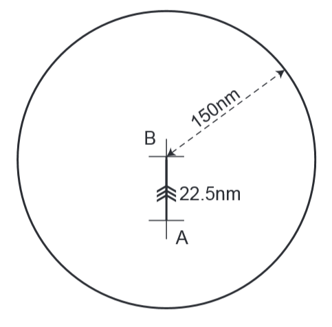

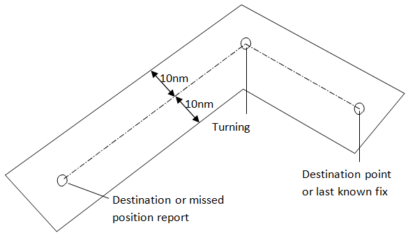

---
## Page 131

 
 
 
Volume 2 - Search and Rescue Operations 
NATIONAL SEARCH AND RESCUE MANUAL 
2025 EDITION Version 1 – February 2025 
Page 129 
3.5.14. 
When Stage 1 and Stage 2 search actions fail to locate the target, the probability area should be 
determined by drawing circles of probability around the last known position, the first missed 
report position, and any turning points along the planned track. Tangents to the circles then 
enclose the intervening area.  This is referred to as a Stage 3 search and is shown in Figure 3.3. 
Planning for the Stage 3 search should commence when it is apparent the target cannot be 
located by the Stage 2 search. 
 
Figure 3-3: Stage 3 Search Area (Mathematically Derived) 
3.5.15. 
When a route had been planned to cross the sea, or a large expanse of inland water, or the 
search involves a marine craft, allowance must be made for movement of survivors in or on the 
water, brought about by currents and wind. 
 
Figure 3-4: Probability Area for an over water Flight or Marine Craft Incident when Track is known 
3.5.16. 
The assumption is made that unless otherwise known, or indicated, the pilot/master would 
follow their planned track as closely as possible. Use of information indicating otherwise would 
be at the discretion of the SMC. 
3.5.17. 
When neither the position nor the intended track of a missing aircraft is known, a probability 
area must be determined by assessing likely pilot/master decisions in the light of intelligence 
information received, e.g. the disposition of a township, recent weather conditions; 
geographical features etc. 
3.5.18. 
The examples illustrated in Figure 3-3 and Figure 3-4 are representative of a situation where 
nothing has been heard from the pilot/master since departure and the pilot/master’s route was 
known. Subsequent intelligence information that is gathered from witnesses and observers 
near the intended route might allow for the elimination of some route segments.

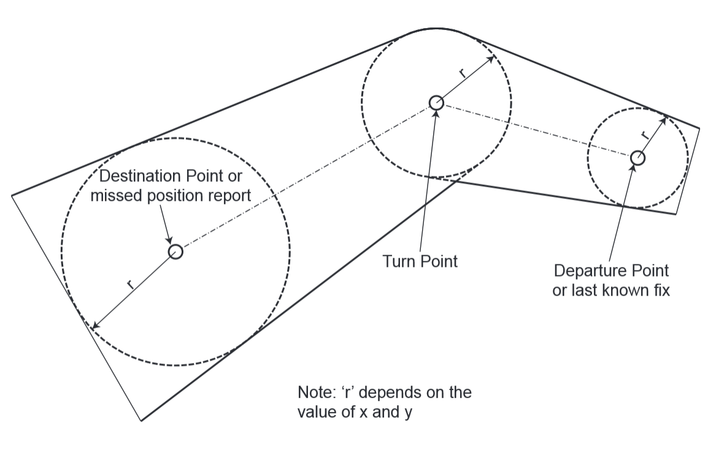

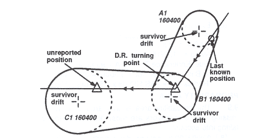

---
## Page 132

 
 
 
 
Volume 2 - Search and Rescue Operations 
 
NATIONAL SEARCH AND RESCUE MANUAL 
Page 130 
2025 EDITION Version 1 – February 2025 
Calculation of Circles of Probability 
3.5.19. 
The Total Probable Error of Position (E) is found from the formula: 
where: 
‘x’ is the probable navigation error of the target (initial position error); 
‘y’ is the probable navigation error of a search craft (search craft error); and 
‘De’ is the probable error of the calculated drift of a target in water (total error). 
3.5.20. 
In an environment where drift is not available or does not exist (e.g. coastal or land), the value 
for de should be zero. 
Probable Errors of Position 
3.5.21. 
Initial Position Error (x) of the target and Search Asset Position Error (y) are the estimated 
errors of position based on navigational accuracy of the target and of the search assets. These 
errors of position for the calculation of (E) can be found in Appendix D-6. 
3.5.22. 
X is given the figure of 5NM when it is not known what method, if any, had been used to 
determine LKP.  The SMC can modify this distance based on reliable intelligence and/or 
information from the pilot/master. 
3.5.23. 
Y is given the figure of 1 NM as almost all search assets will be making continuous navigation 
checks using GPS and/or other manual fix methods. 
Search Radius (R) 
3.5.24. 
This is defined as the radius of a circle, centred at the most probable position of the target at 
any given time (the Datum), equal in length to the Total Probable Error of Position (E) in 
nautical miles, increased by a safety factor. For successive searches of the probability area the 
safety factor is increased progressively. 
3.5.25. 
The safety factors applied to the Total Probable Error of Position to obtain a Search Radius (R) 
are shown in Table 3-2. 
Search Effort 
Safety Factor 
Initial Probability Area 
1.1 
First Expansion 
1.6 
Second Expansion 
2.0 
Third Expansion 
2.3 
Final Expansion 
2.5 
Table 3-2: Safety Factors 
3.5.26. 
Worksheet 4 (Appendix D7) is available to assist with calculations. 
3.5.27. 
JRCC Australia does not use the above safety factors in its programs for computer generating 
search planning. However, they can be applied to Coastal Search Planning, see Volume 2, 
Chapter 3.6. 
Drift Error for Waterborne Targets 
3.5.28. 
Over land, the Datum is the last known position; however, when survivors are known or 
thought to be in or on the water an allowance must be made for movement of the water 
E = √x² + y² + De²

---
## Page 133

 
 
 
Volume 2 - Search and Rescue Operations 
NATIONAL SEARCH AND RESCUE MANUAL 
2025 EDITION Version 1 – February 2025 
Page 131 
resulting from the effects of wind and current.  The degree of displacement of the Datum from 
the last known position assumes increasing importance with the passing of time and MUST be 
allowed for in search planning. This displacement is a function of: 
a) 
The average sea current; 
b) 
The average wind current; and 
c) 
Leeway. 
3.5.29. 
The deployment of electronic SAR Datum Buoys should be considered as a means of measuring 
the movement (direction and speed) of the total water column in which the search target is 
believed to be immersed.  Other sources of information include data held in the JRCC, vessels 
passing through the search area, and individuals with local knowledge. 
3.5.30. 
The direction and speed of these factors is referred to as ‘SET’. Contrary to the convention of 
expressing wind velocity, the direction component indicates the direction of movement. The 
speed component is usually quoted in knots. Care must be taken to ensure that the speed unit 
is both stated, and interpreted, correctly. 
3.5.31. 
To determine a value for Drift Error (De) it is necessary to complete a Datum Plot. A Datum Plot 
provides information both to calculate De and to measure the displacement of the Datum from 
the Last known Position (LKP) or Splash Point (SP) for the period under consideration. Drift 
error is derived by the resolution of the three factors (average sea current, average wind 
current, leeway), by way of vector addition. 
Currents  
Sea Current 
3.5.32. 
Sea current data can be obtained from JRCC Australia, which has access to various sources of 
information and computer drift modelling software to provide up to date information. 
3.5.33. 
Tidal and local geographic features may affect sea currents near the coast. When areas near the 
coast are to be searched, the water movement for the area should be discussed more fully with 
local experts. 
 
Figure 3-5 Tidal Movements 
Tidal Streams 
3.5.34. 
Tides are caused by the gravitational pull of the moon and sun, modified by the depth and 
shape of the sea basin along the coastal areas. Currents in coastal waters are usually affected 
by tides, changing in predictable velocity as the state of the tide changes. In some locations

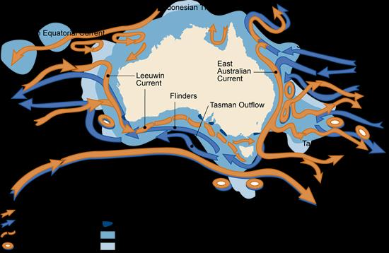

---
## Page 134

 
 
 
 
Volume 2 - Search and Rescue Operations 
 
NATIONAL SEARCH AND RESCUE MANUAL 
Page 132 
2025 EDITION Version 1 – February 2025 
tidal streams are of the reversing type, abruptly changing direction 180 degrees at about the 
time of high and low water. In other places the direction will change in small increments so as 
to create a constant rotary movement. Variations of these tidal effects may also be found. 
3.5.35. 
The exact effect of the tide on currents in any specific area may be found by consulting tide 
tables or local charts.  Local knowledge is again of great value in dealing with movements of 
tidal streams.  While the changes in direction of tidal streams have a tendency to nullify the 
cumulative effect, they must nevertheless be considered in computing drift for the following 
reasons: 
a) 
Often, with reversing streams, the effect in one direction is greater than in the other so 
that, over a period of time, the resultant effect is more in one direction than in the other; 
and 
b) 
Even over short periods of time the flow of tidal streams will cause significant changes in 
the probable position of a search object. 
 
Figure 3-6 Tidal Flow 
3.5.36. 
Since most areas affected by tidal streams will be close to landmasses, wind current will usually 
not be a factor in determining drift.  Because of this, drift occurring in in-shore waters over 
short periods will be more greatly affected by tidal streams than current or leeway.  However, if 
the cumulative effect of tidal streams and coastal currents thrusts the target into areas where 
sea current takes effect then drift considerations will need to be revised. 
River Current 
3.5.37. 
River current will affect SAR incidents that occur in offshore areas near river mouths.  Tidal 
streams affect the river current speeds near the mouths of the rivers. In large rivers this affect 
may be noticed several kilometres upstream from the mouth. Published current tables often 
give values which are combinations of tidal and river flow effects.  These are among areas 
where reversing streams will be greater in one direction that the other. 
 
Figure 3-7 River Discharge 
3 kt 
Mean peak flow of flood tide at 
springs (Feather = flood) 
3 kt 
Mean peak flow of ebb 
tide at springs 
Ocean current, often has a note  
giving further information

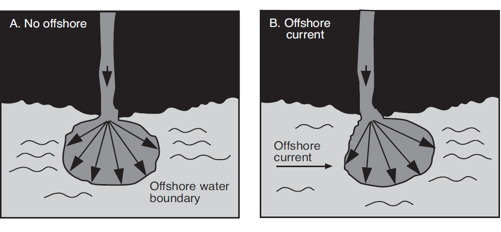

---
## Page 135

 
 
 
Volume 2 - Search and Rescue Operations 
NATIONAL SEARCH AND RESCUE MANUAL 
2025 EDITION Version 1 – February 2025 
Page 133 
3.5.38. 
On the other hand, river current affects both total current and sea current at its mouth.  Some 
major rivers extend their influence quite significantly offshore. Seasonal variations in water 
volume and velocity should be considered. 
3.5.39. 
When estimating river current in the discharge area an assumption that the current direction is 
a straight line from the river mouth to the discharge boundary and the river current speed 
decreases linearly from the river mouth to the discharge boundary should be made. The river 
current speed at the mouth can usually be obtained from local knowledge or by direct 
observation. 
3.5.40. 
If any type of offshore current is present, the SMC should expect that the river discharge will 
not fan out symmetrically but will be displaced in the direction of the offshore current. 
Longshore Current 
3.5.41. 
Longshore currents are caused by incoming swells striking the shore at an angle.  Longshore 
current information must be obtained from direct observation or local knowledge. 
 
Figure 3-8 Longshore Currents 
Swell/Wave Current 
3.5.42. 
In calm conditions, swells and waves may affect rafts and other small marine search targets. 
The effect is similar to leeway in that the raft is being moved through the water. However, 
swell/wave current speed is so small, under 0.1 knot, that the drift force is usually ignored in 
determining general search areas. It is useful however for determining probable direction of 
target movement in some cases. 
Surf Current 
3.5.43. 
Surf current is only considered for incidents occurring in coastal surf areas.  It is more of a 
rescue or salvage factor than a search planning factor.  Surf currents will move a drifting object 
after it enters the surf zone.  If no longshore current is present, the surf current will move the 
object towards the shore perpendicular to the line of breakers. If a longshore current is 
present, the object will be displaced in the direction of the longshore current. 
Rip Current 
3.5.44. 
Rip current is a special type of surf current.  It is a narrow band of current flowing seaward 
through the surf line as a result of the longshore current building up a large volume of water 
along the beach line and then bursting through the incoming surf on its way back to sea.  Rip 
currents are only a few metres wide through the surf line, but they fan out and slow down 
when in smoother water.  Rip currents occur when longshore currents are present, and in 
places where some form of bottom trough, bottom rise or shoreline feature assists in deflecting 
the long shore current build up in a seaward direction. 
Local Wind Current 
3.5.45. 
Local wind current is the current generated by wind acting on the surface of the water. The 
current changes with variations of the wind pattern.

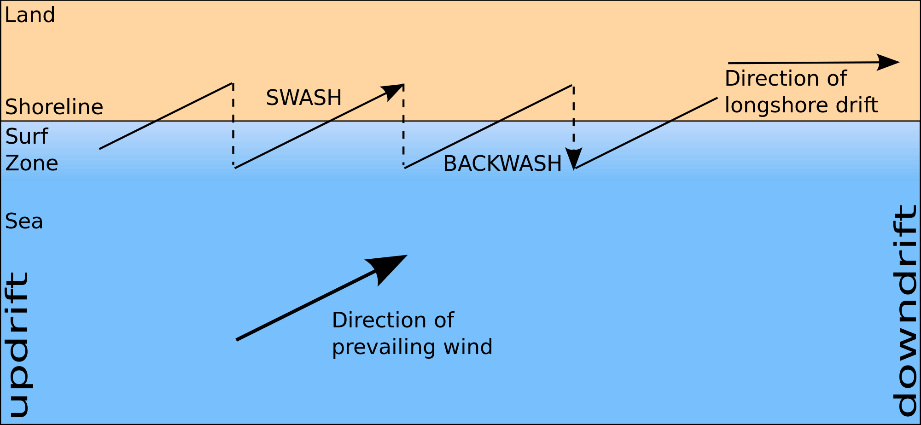

---
## Page 136

 
 
 
 
Volume 2 - Search and Rescue Operations 
 
NATIONAL SEARCH AND RESCUE MANUAL 
Page 134 
2025 EDITION Version 1 – February 2025 
3.5.46. 
Near the coast, wind current can be affected by various factors and consideration should be 
given to omitting the wind current vector from search areas close to the coast. Offshore, 
consideration should also be given to omitting the wind current vector, if it is considered to be 
an area of consistent winds. The velocity of a wind current is calculated from: 
a) 
Wind data for the 48 hours preceding splash time; 
b) 
Actual and forecast winds between splash time and Datum time; and  
c) 
The application of coefficients taken from tables held in RCCs. 
3.5.47. 
Wind current is calculated for 6-hour periods, the periods being coincident with the 
meteorological synoptic periods.  The current for any given synoptic period is the cumulative 
effect of the wind in the area for the 48 hours prior to the end of the synoptic period being 
considered. The direction and speed coefficients obtained from the tables allow for the effect 
of Coriolis, and the reversal of wind direction, to express the result as ’SET’. 
 
Figure 3-9 Wind Direction and Speed 
Leeway 
3.5.48. 
Leeway is the movement of a search object caused by it being pushed through the water by 
local winds blowing against its exposed surfaces.  A boat, raft or any other type of marine craft 
has a certain proportion of its hull and superstructure exposed above the surface of the water 
at all times. This exposed area is blown against by local winds, which in turn have the effect of 
pushing the marine craft through the water. The more surface area the wind has to blow 
against, the greater will be the wind’s effect on drift. If the silhouette of a boat were projected 
onto a flat plane, which was perpendicular to the wind direction, the area enclosed by the 
silhouette would be called the exposed flat-plane area. As the boat’s heading changes relative 
to the wind, its flat-plane area also changes, usually becoming least when the boat is heading 
directly into the wind or downwind. 
3.5.49. 
The pushing force of the wind is countered by the water drag on the underwater hull. The drag 
varies with the volume, shape, depth and orientation of the underwater hull. When a marine 
craft is parallel to the wind direction the least amount of underwater drag will exist since the 
craft will be pushed through the water in the direction its hull is designed to move. Almost the 
same conditions exist when the boat is pointed directly into the wind and is being pushed 
backwards through the water longitudinally. When the boat’s heading is perpendicular to the 
local wind, however, the greatest amount of underwater drag will exist since the boat must 
now be pushed sideways through the water. Between these extremes the amount of 
underwater drag will vary depending on the heading of the boat.

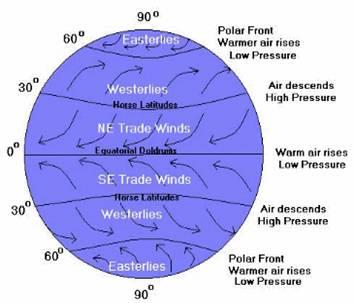

---
## Page 137

 
 
 
Volume 2 - Search and Rescue Operations 
NATIONAL SEARCH AND RESCUE MANUAL 
2025 EDITION Version 1 – February 2025 
Page 135 
Divergence 
3.5.50. 
When a search object first begins to drift, the wind will push the object in a downwind 
direction. As the search object continues to drift, the wind will cause the search object to 
deflect (or diverge) to either the left or to the right of the downwind direction. The amount of 
divergence is dependent upon the shape of the exposed flat-plane area of the search object. 
Divergence is caused by the lack of symmetry of the drift object. 
Calculating Leeway 
3.5.51. 
A search object’s leeway speed is measured as a percentage of the of the wind speed. The 
Multiplier value listed in the Taxonomy (Appendix D-5:1 & D-5:2) provides the leeway speed 
percentage. Because of drag factors, type of object and other environmental effects the wind 
does not push the target at its full power, and these tables have been calculated to determine 
at what strength the wind does move an object. In some cases, it is necessary to add or 
subtract a Modifier to further refine the search object’s leeway speed. 
3.5.52. 
The formula to determine leeway speed is: 
Leeway Speed (knots) = [Multiplier x Wind Speed (knots)] ± Modifier 
Note: By international agreement, wind direction is reported in most places based on the 
direction the wind is blowing from. For search planning we are interested in the direction the 
wind is blowing to. When using downwind leeway, the leeway direction is equal to the 
reciprocal of the wind direction (Wind direction + or – 180°). 
3.5.53. 
The leeway for a person in the water with a wind speed of 20 kt would be: 
Lw = [(0.011 x 20) + 0.07] 
Lw = [0.22 + 0.07] 
Lw = 0.29 kt 
3.5.54. 
When directional uncertainty applies, the divergence angle is both added and subtracted to the 
downwind direction to account for the search object’s divergence to the left or right of the 
downwind direction. Thus, the formula to determine the direction of the divergence is: 
Wind Direction +/- 180° = Downwind Direction 
Downwind Direction + Divergence Angle = Angle to right of Downwind Direction 
Downwind Direction – Divergence Angle = Angle to left of Downwind Direction 
3.5.55. 
The following example illustrates how the Taxonomy is used to determine directional 
uncertainty leeway. Refer to the Leeway Taxonomy to obtain the appropriate multiplier, 
modifier, and divergence angle for specific target types. 
A search is being conducted for a missing scuba diver. The winds are blowing from 270° True at 
15 knots. 
Leeway Speed = Multiplier (Table I-1 or I-2) x Wind Speed (knots) + Modifier 
Leeway Speed = (0.007 x 15 knots) + 0.08 
Leeway Speed = 0.185 knots 
Leeway Drift distance (NM) = Leeway Speed (knots) x hours of drift 
Vector length (NM) @ Divergence Right (270° - 180°) + 30° = 120° T 
Vector length (NM) @ Divergence Left (270° - 180°) – 30° = 060° T 
3.5.56. 
The leeway speed would be multiplied by the number of hours of drift to determine the leeway 
vector’s length. The two leeway vectors would be added to the end of the total water current 
vector to determine the Right and Left Datum. 
3.5.57. 
The magnitude of leeway speed in relation to wind speed (u) and leeway divergence for 
persons in water and various types of marine craft can be found in  Appendix D-5:1 & D-5:2.

---
## Page 138

 
 
 
 
Volume 2 - Search and Rescue Operations 
 
NATIONAL SEARCH AND RESCUE MANUAL 
Page 136 
2025 EDITION Version 1 – February 2025 
The tables have been adapted from Allen and Plourde 1999 Review of Leeway: Field 
Experiments and Implementation, USCG Research and Development Centre Report No CG-D-
08-99. Appendix D-5 also contains the Taxonomy Class Definitions/Descriptions. 
Note: Prior to the publication of the data the USCG Research and Development Centre made 
the decision that the only data published would be data that was based on actual results 
derived from documented research and observation during controlled field experiments. 
However, it has been recognised that some anomalies exist in the data pertaining to maritime 
life rafts with no ballast systems. There has been significant time elapse between the initial 
research done by Hufford and Broida in 1974 and later research by Nash and Willcox in 1991 
and it is probable that the make of life raft used for the experiments may no longer be in use. 
SAR Mission Coordinators should evaluate the calculated results obtained from using the 
tables, compare the results with actual known conditions and, if required, adjust leeway values 
as appropriate. 
Plotting Drift 
3.5.58. 
Using the vector values determined for average sea current, wind current and leeway it is 
possible to plot a simple vector diagram and obtain a datum point. However, as the leeway 
data is generally uncertain it is necessary to plot both a left and right drift, and to calculate drift 
error (De). Whenever possible the owner or operating agency should be contacted to verify the 
type of life raft carried and its equipment. 
3.5.59. 
When plotting on a chart there are a number of standard conventions to identify each of the 
vectors: 
 
Figure 3-10 Wind Direction and Speed 
3.5.60. 
Any change to surface wind conditions has an immediate effect on a craft’s leeway, and a 
recalculation of vectors is required. 
Datum Plot 
3.5.61. 
The bearing and distance of a Datum from its associated Last known position is found by 
combining four vectors as shown in Figure 3-11: 
a) 
The sea current; 
b) 
The wind current; and 
c) 
Two leeway vectors, one each for left and right divergence.

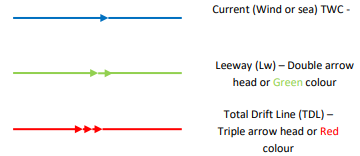

---
## Page 139

 
 
 
Volume 2 - Search and Rescue Operations 
NATIONAL SEARCH AND RESCUE MANUAL 
2025 EDITION Version 1 – February 2025 
Page 137 
 
Figure 3-11 Datum Plot 
3.5.62. 
The value of the vectors may change with time; therefore, it is necessary to calculate a mean 
value for each vector for the period between splash time and datum time.  All calculations are 
related to meteorological synoptic periods, or part thereof. The objective being to calculate the 
movement attributable to each factor during the period under consideration, with a vector 
summation for the whole period and then to combine the individual effects to establish a most 
probable position for the target.  When the most probable position has been established, an 
allowance is made for possible errors, which is then combined with the navigation error 
allowances in the Total Probable Error (E) of Position formula. 
3.5.63. 
A Datum Plot should be drawn on the appropriate Chart.  To construct the plot, draw the sea 
current vector from the last known position, add the wind current vector, and then from the 
end of the wind current vector draw the two leeway vectors.  Although not quite correct 
mathematically, the mid-point between the ends of the leeway vectors may be taken as the 
Datum. 
Drift Error (De) 
3.5.64. 
Drift Error (De) is the radius of a circle of probability around the Datum. The circle is externally 
tangential to two circles of drift error probability drawn around the end of each leeway vector. 
Generally, the radius of each circle is equal to 12.5% of the distance from the Last Known 
Position (LKP) or Splash Point (SP) to the end of the appropriate leeway vector. The value of De, 
therefore, is the sum of the radii of the two leeway probability circles and the distance between 
the ends of the leeway vector [Distance Left-Right (LR)] divided by two, i.e.  
 
3.5.65. 
However, if the search planner lacks confidence in the data being used to establish drift, a value 
between 12.5% (1/8) and 33% (1/3) may be used.  The less confidence the search planner has in 
the data, the larger the value used to estimate drift error.

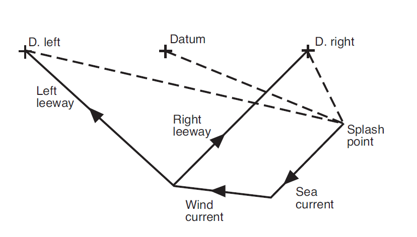

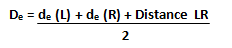

---
## Page 140

 
 
 
 
Volume 2 - Search and Rescue Operations 
 
NATIONAL SEARCH AND RESCUE MANUAL 
Page 138 
2025 EDITION Version 1 – February 2025 
 
Figure 3-12 Plotting Drift Error 
Search Area Based on Non-Moving Datum 
3.5.66. 
For a typical last report / missed report situation, where the track between positions is a 
straight line, the probability area may be modified as in Figure 3-13 to form a trapezium. The 
area of the trapezium may be found from the formula: 
 
 
3.5.67. 
Where: 
a) 
‘L’ is the distance between ‘datum A’ and ‘datum B’, plus the two radii of the circles of 
probability, and, 
b)  
‘D’ and ‘d’ are the measured distances across the ends of the trapezium.   
It will be readily apparent that this modification will result in a larger area than the original 
probability area.  An estimate of the excess area can be made and taken into account in 
planning calculations if necessary. 
 
 
Figure 3-13 Search Area (Non-Moving Datum) 
Search Based on Moving Datum 
3.5.68. 
To calculate the area of an irregularly shaped probability or search area, it will be necessary to 
sub-divide the area into squares, rectangles or triangles, calculate the size of the smaller area, 
and sum the results.  Use may be made of a surveyor’s grid to determine the size of the 
irregularly shaped areas.  In a maritime situation the datum point is moving, and areas will 
move on the chart as depicted in Figure 3-14.

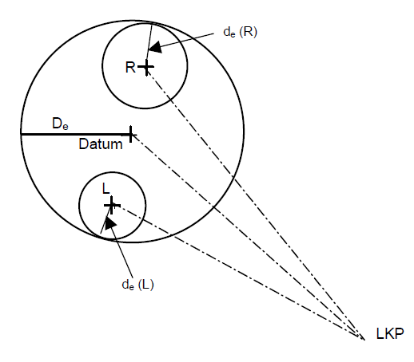

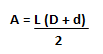

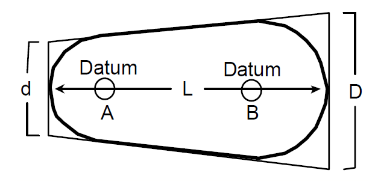

---
## Page 141

 
 
 
Volume 2 - Search and Rescue Operations 
NATIONAL SEARCH AND RESCUE MANUAL 
2025 EDITION Version 1 – February 2025 
Page 139 
 
Figure 3-14 Search Areas (Moving Datum Point) 
 
Figure 3-15 Area being Searched at Significantly Different Times 
3.5.69. 
It may be necessary to redefine a search area, which is either an unsearched portion of an area, 
or one derived from intelligence information but located wholly, or partly, over water.  In such 
cases one, or more points on the boundary of the area should be selected, which may then be 
treated in the same way as any other last known position from which a Datum may be 
determined. 
3.5.70. 
That is, drift vectors and drift error should be applied to them to give new boundary positions 
that will compensate for drift effect over the intervening period. The area may then be 
reconstructed relative to these Data and expanded in proportion to the Search Radii.  In doing 
this it is necessary to draw circles of probability around the Data with Radii equal to “de” and 
joined by tangents. 
3.5.71. 
The appropriate safety factor will have been included in the calculations to determine the 
original area (see Figure 3-15).

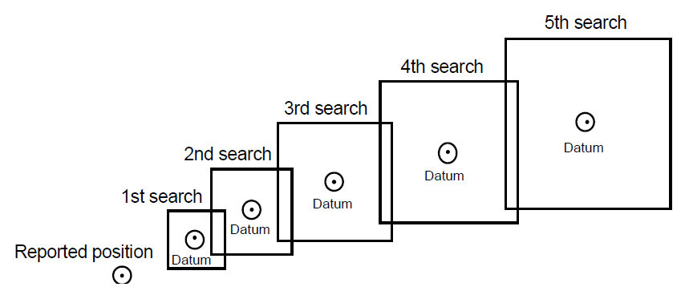

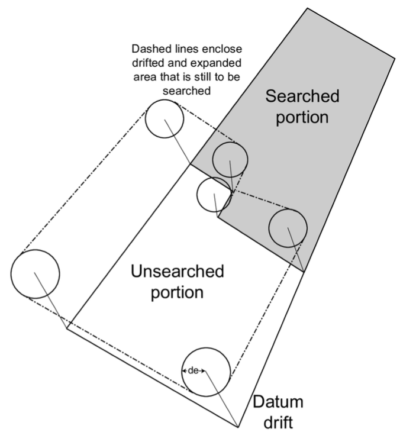

---
## Page 142

 
 
 
 
Volume 2 - Search and Rescue Operations 
 
NATIONAL SEARCH AND RESCUE MANUAL 
Page 140 
2025 EDITION Version 1 – February 2025 
Labelling the Datum 
3.5.72. 
During an extended over water search involving several Datum Points it may be necessary to 
calculate a series of Data. To avoid confusion when referring to Data, a standard system shall be 
used. The Datum referring to the distress position or last known position shall be identified as 
’A’, with subsequent positions along a path identified in alphabetical order. Data referring to a 
particular Datum Point shall be numbered consecutively, and in addition, shall be annotated 
with a date/time group when depicted on a chart as shown in Figure 3-16. 
 
Figure 3-16 Labelling of Data 
Modification of the Probability Area 
3.5.73. 
Modification of a calculated probability area may be suggested from an assessment of 
intelligence information received in the RCC, limitations imposed by search asset availability or 
for other reasons. 
3.5.74. 
It should always be understood that SAR calculations are intended to be a guide to search 
planning and may be modified to suit any particular situation as suggested by the accumulated 
SAR experience within the RCC. 
3.5.75. 
Any member of the RCC team who considers that a modification would be to advantage shall 
make the SMC aware of the suggestion. When offering such suggestions, every attempt should 
be made to present viable alternatives, together with a summary of the advantages, and 
disadvantages of each. The authority to make any such modification rests solely with the SMC. 
Modification Suggested by Intelligence Information 
3.5.76. 
During the course of a SAR action, reports and information may be received from a variety of 
sources claiming that the target had been seen or heard. Detailed analysis of these reports, and 
comparison with data about known flights, may lead the SMC to delineate a modified, or totally 
different, search area.  Discussion with owners or operators of a target may bring forth 
information concerning the course of action that would be followed in particular circumstances.  
Similar information may be gathered from relatives, friends and colleagues. 
Modification Resulting from a Shortage of Search Aircraft 
3.5.77. 
When it is not possible to search the whole of the probability area in the course of a single 
sortie by each available aircraft, a number of factors may be changed to facilitate modification 
of the area. For example: track spacing, aircraft speed, search height or the size of the 
probability area.  After consideration of these factors, the SMC will make a decision which 
section of a probability area should be searched first. 
3.5.78. 
Worksheets 2 (Maritime) and 3 (Land) have been developed to assist in determining the extent 
of the probability area that can be searched with available resources. It is designed to present 
the SMC with a statement in numerical terms of: 
a) 
The desirable intensity of the search, that is, the optimum coverage factor; 
b) 
The amount of area which can be searched at the desired coverage factor, and, if this is 
less than the area described; and

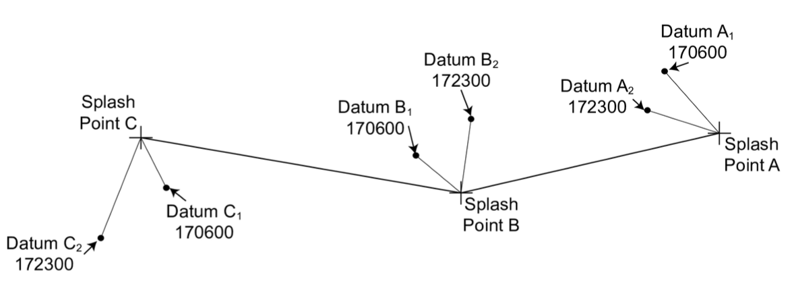

---
## Page 143

 
 
 
Volume 2 - Search and Rescue Operations 
NATIONAL SEARCH AND RESCUE MANUAL 
2025 EDITION Version 1 – February 2025 
Page 141 
c) 
The quality of search that can be obtained by covering the whole area with the search 
aircraft available. 
Modification of Areas Incorporating De and Increased Safety Factors 
3.5.79. 
Care must be taken not to waste search effort on the section of the probability area that 
encompasses land areas as a result of incorporating allowance for water movement. To avoid 
this, reference should be made to the fundamental probability area, calculated by using only 
the ’x’ factor.  A search of any coastline included in a drifted area should always be made. 
3.5.80. 
Similar consideration should be made when an area that is predominantly over land is 
expanded, and subsequently includes an area of water.  This situation is not so simple and clear 
cut and may require reference to intelligence information to justify the inclusion, or exclusion, 
of the over-water area.  Should it be decided to search the over-water part of an expanded 
probability area, movement of the now included over-water part must be taken into account 
for the period between Splash Time and Datum Time.  
Modification for the Allocation of Areas to Search Assets Other than Aircraft 
3.5.81. 
When drawing up a probability area the allowance for search craft navigation is usually that 
specified for aircraft. When using other types of search assets, i.e. land or marine, it will be 
advantageous to recalculate the probability area using the appropriate value for ‘y’.  
Consideration of Possible Courses of Action by the Captain of the Target 
3.5.82. 
Through an analysis of intelligence information, or because of the failure to locate a target in 
the probability area, even after the expansion to the 2.5 safety factor (Table 3-2: Safety 
Factors), it may be considered necessary to search other areas or tracks. All decisions of this 
nature are the responsibility of the SMC. The general guidelines for determination or 
probability areas should be applied. 
3.6. 
Coastal Search Planning 
Search Area 
3.6.1. 
A great number of maritime search and rescue incidents occur within 25 NM of the coast, in 
under 100 metres of water. The coastal search-planning model is to assist with a rapid response 
and should ideally be used when the report of a target in distress is notified to a SAR authority 
within six (6) hours of the actual distress situation arising. 
3.6.2. 
This section is aimed at simplifying the search planning methods when this situation arises.  If 
time and asset availability allow, the oceanic model should be used. The principles in other 
sections under search planning should be referred to.  If this model is used and overall 
coordination of the incident is handed to another SAR authority that SAR authority should be 
made aware of the situation and model used. 
3.6.3. 
In most cases, considering the short response time to coastal SAR incidents, if the search asset 
proceeds to the Splash Point (SP) of the target in distress it will be found. However, the target 
in distress may not be in sight because of inaccuracies in the initial position reported; inherent 
errors associated with drift factors; and/or errors in the navigation of the search asset. 
3.6.4. 
If the time since the target became distressed is less than four (4) hours and it is not located at 
the SP draw a 6 NM radius centred at the LKP. Then draw a square search area with the sides 
tangential to the circle. This will give a search area of 144 NM² (as shown in Figure 3-16).

---
## Page 144

 
 
 
 
Volume 2 - Search and Rescue Operations 
 
NATIONAL SEARCH AND RESCUE MANUAL 
Page 142 
2025 EDITION Version 1 – February 2025 
 
 
Figure 3-17 Circle of Probability using Coastal Method 
3.6.5. 
The purpose of drawing a radius around the datum is to describe the geographical area most 
likely to contain the search object. The formula uses the Total Probable Error (E), which 
includes the Initial Position Error (X) of the target and the Navigation Error of the SRA (Y), but 
does not include Drift Error (De). 
 
3.6.6. 
For coastal SAR cases when an SRA arrives on scene and the search object is not seen, a five (5) 
NM position error for the target and a one (1) NM navigation error for the SRA may be 
assumed.  Using the formula, when X = 5 and Y = 1 then: 
 
3.6.7. 
Applying the safety factor for the first search (fs = 1.1), then:  
Radius = (E)(fs) 
Radius = (5.099)(1.1)   
Radius = 5.6 NM.  
This is rounded up to six (6) NM. 
3.6.8. 
If the time is greater than four (4) hours but less than six (6) hours, and/or the drift, based on 
local knowledge and/or on scene conditions, is considered to be significant, the search objects 
drift should be established, and the six (6) NM radius applied to the drift datum position. 
3.6.9. 
In coastal SAR, the initial datum is determined by calculating drift using the object’s LKP and the 
effects of water current and leeway speed and direction without considering leeway divergence 
(leeway direction is considered to be directly downwind). Time of datum must take the 
underway transit time for the SRA into consideration Figure 3-18.

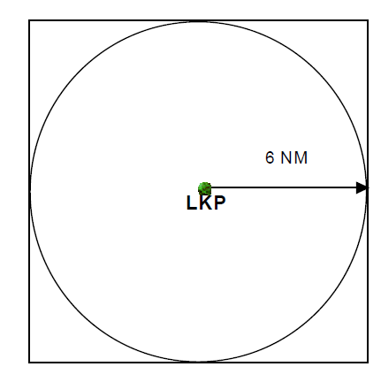

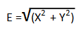

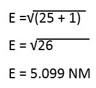

---
## Page 145

 
 
 
Volume 2 - Search and Rescue Operations 
NATIONAL SEARCH AND RESCUE MANUAL 
2025 EDITION Version 1 – February 2025 
Page 143 
 
 
Figure 3-18 Circle of Probability Using Coastal Method and Allowing for Drift 
3.6.10. 
If the target in distress reports a position in shallow water, there is always the possibility that 
the vessel may attempt to anchor. Therefore, particular attention should be paid to the 
situation when the LKP or SP is outside the established search area. In many cases, it should be 
possible to search along the drift line from the LKP or SP to the datum during the initial search. 
However, it may be necessary to search the drift line after the search area has been completed. 
3.6.11. 
If the time of the incident is uncertain, calculate a datum for the shortest possible time the 
vessel could be adrift, and calculate a second datum for the longest possible time the vessel 
could be adrift. Draw a circle of six (6) NM around each datum point and then enclose the 
circles in a rectangle (Figure 3-19). To determine the size of the area, multiply the length in 
miles by the width in miles.  
 
Figure 3-19 Circles of Probability when Time Uncertain

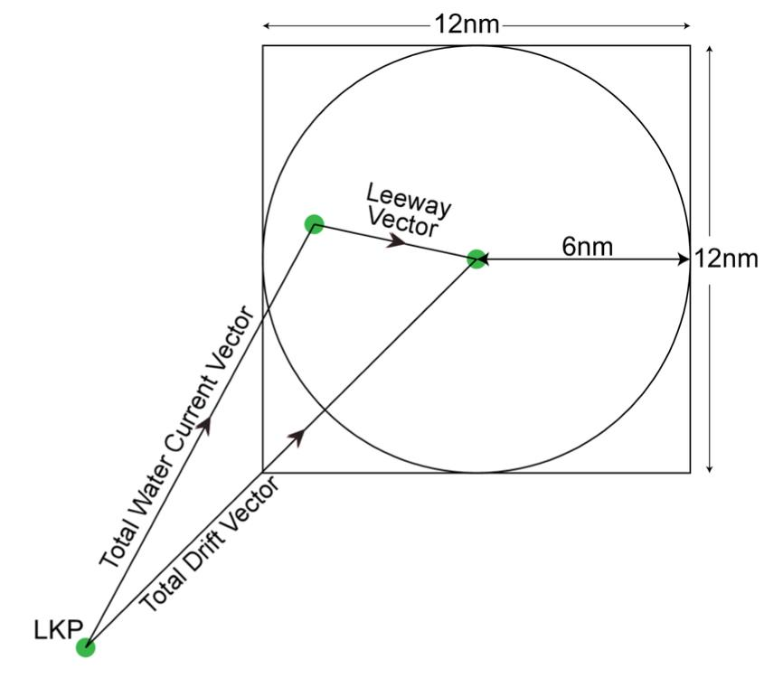

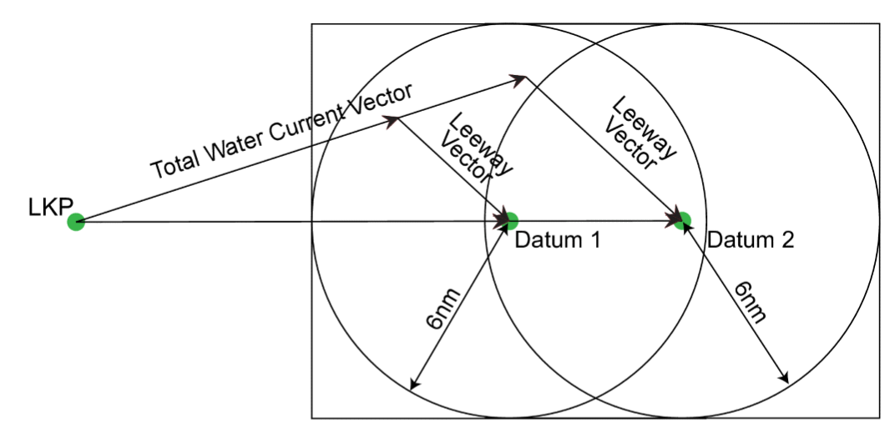

---
## Page 146

 
 
 
 
Volume 2 - Search and Rescue Operations 
 
NATIONAL SEARCH AND RESCUE MANUAL 
Page 144 
2025 EDITION Version 1 – February 2025 
Position Uncertainty 
3.6.12. 
If the position of the target in distress is in question, calculate a datum for each position (LKP 1 
and LKP 2) and draw a six (6) NM circle around each and enclose the circles (Figure 3 19). The 
search Datum can be assumed as a point midway between the two individually calculated Data. 
If extreme distances separate the positions in doubt, (More than 12 NM), consideration should 
be given to treating them as separate vessel adrift incidents (Figure 3 21). 
 
Figure 3-20 Circles of Probability when Time Uncertain 
 
  
 
Figure 3-21 Circles of Probability when position Uncertain and Extreme Distances Separate Positions 
Track Line Overdue Incident 
3.6.13. 
If a target in distress is overdue along a track line, determine a datum near the beginning of the 
track, another near the end of track and one at each turning point. The datum line is the line 
joining each datum. Draw a six (6) NM circle around each datum and enclose the circles in 
rectangles with sides drawn tangentially to the datum circles (Figure 3-22).

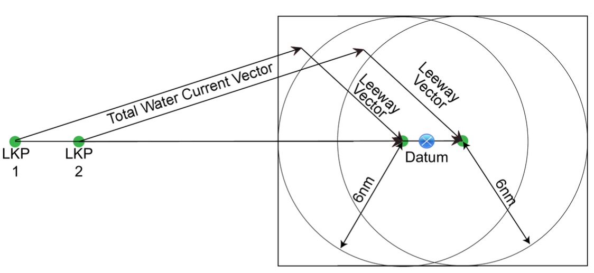

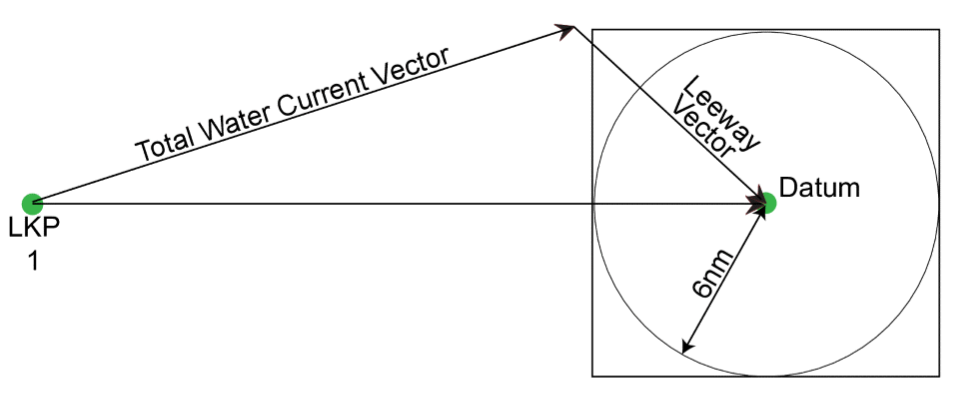

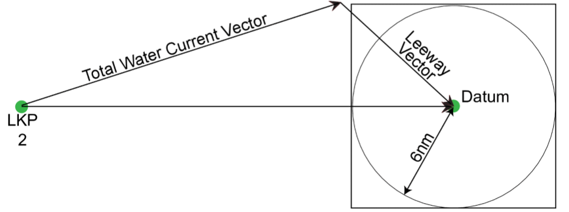

---
## Page 147

 
 
 
Volume 2 - Search and Rescue Operations 
NATIONAL SEARCH AND RESCUE MANUAL 
2025 EDITION Version 1 – February 2025 
Page 145 
 
 
Figure 3-22 Track Line Overdue Incident ≤ 4 Hours 
3.6.14. 
If time to datum is more than four (4) hours allow for drift of starting, ending and turning points 
as seen in Figure 3-23. 
 
Figure 3-23 Track Line Overdue Incident > 4 Hours 
Recomputed Datum 
3.6.15. 
As a general rule in coastal situations, the datum is recomputed every two (2) to four (4) hours. 
3.6.16. 
When re-computing a datum that was initially established using the coastal model the drift 
error (de) of the target must be calculated.  As with the case in oceanic search planning, drift 
error rate estimates usually fall between 12.5% (1/8) and 33% (1/3) of the total distance 
drifted.  The search planner, depending on the confidence or lack thereof in the relevant drift 
data, would use a value between 12.5 % (1/8) and 33% (1/3), increasing in size as the 
confidence in the data decreases. The higher the confidence in the data the smaller the value 
used to estimate drift error. The search planner may also use values outside this range.  
3.6.17. 
In addition, the total drift error for two or more successive drift updates is the sum of all the 
individual drift errors up to that point therefore, drift error always increases with the passage 
of time. 
3.6.18. 
In this model, the distance from datum1 to the recomputed datum2 is measured. The de of the 
position is established, generally using 1/8th of the drifted distance as error, and then adding 
this distance to the 6 NM assumed error (E) used to establish the initial search area. 
Example 
The target is drifted from its LKP or SP to datum1 and an E = 6 NM is plotted. The target’s drift is 
recalculated sometime later, and its drift is established as eight (8) NM from datum1. Using

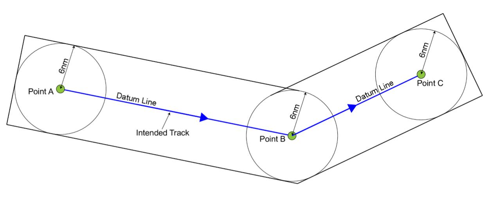

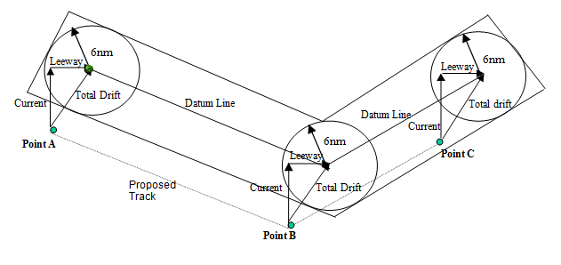

---
## Page 148

 
 
 
 
Volume 2 - Search and Rescue Operations 
 
NATIONAL SEARCH AND RESCUE MANUAL 
Page 146 
2025 EDITION Version 1 – February 2025 
1/8th of the targets drift as error, one (1) NM is added to the initial six (6) NM error used for 
the first datum. Therefore, the error used for datum2 is 6 NM + 1 NM = 7 NM. See Figure 3-23 
below. 
 
Figure 3-24 Re-computing Datum 
 
Figure 3-25 Boxed off search area 
Lw 
TWC
8.5 NM 
TDL is 20 NM.  IDE = 20 NM/8 = 2.5 NM.  
Radius of circle around Datum B = 6 NM + 
2.5 NM = 8.5 NM. 
Datum B
Datum A
6 NM 
TDL is less than 8 NM.  
No IDE applied. 6 NM 
circle around datum. 
TWC 
Lw 
D1 
LKP/SP 
TDL 
The sides of the squared off search area 
must be parallel to the TDL where 
practical.

---
## Page 149

 
 
 
Volume 2 - Search and Rescue Operations 
NATIONAL SEARCH AND RESCUE MANUAL 
2025 EDITION Version 1 – February 2025 
Page 147 
 
Figure 3-26 Total search area 
Track Spacing 
3.6.19. 
For the coastal search model, the following standard track spacing is recommended on search 
objects less than 30 feet high. 
Good Search Conditions 
3.6.20. 
In conditions where the wind speed is less than 15 knots and/or visibility is greater than three 
(3) NM (5 Km), use a track spacing of up to three (3) NM by day or night but reduce the 
separation depending on the size of the search target. After dark, the effect of the search light 
should be considered. 
Poor Search Conditions 
3.6.21. 
Where winds are greater than 15 knots and /or visibility is less than three (3) NM but greater 
than one (1) NM (2-5 Km), a track spacing of 1 NM should be considered by day or night but 
reduced depending on the size of the search target. After dark, the effect of the search light 
should be considered. 
Person in Water 
3.6.22. 
When searching for a person in the water, it should be assumed that the person is not wearing 
a floatation device and will therefore be more difficult to detect. For good search conditions a 
track spacing of a 0.25 nautical mile should be considered.  For poor search conditions, the 
track spacing should be reduced as appropriate, taking into account the visibility and the 
navigational and operational capabilities of the search asset. 
3.6.23. 
Note that the track spacing suggested is given as a guide only. The track spacing used in any one 
(1) search will be decided by the SMC in consultation with the OSC taking into consideration all 
the available information at the time. 
TWC 
Lw 
D1 
LKP/SP 
TDL 
The SMC should consider searching the area between the LKP/SP and the 
Datum Point (D1) if the possibility exists that the target could anchor or if 
there are any fixed structures such as offshore platforms, buoys, or beacons 
from which a vessel could be attached or a person in the water could gain 
support.

---
## Page 150

 
 
 
 
Volume 2 - Search and Rescue Operations 
 
NATIONAL SEARCH AND RESCUE MANUAL 
Page 148 
2025 EDITION Version 1 – February 2025 
General considerations 
3.6.24. 
As outlined earlier, the coastal SAR planning model described here is used to facilitate ease of 
determining a search area and a rapid deployment of search assets into a search area. 
3.6.25. 
Although it is ideally used when the response is mounted less than six (6) hours from the time 
of distress the principles can also be applied for up to 24 hours after this time by drifting the 
datum as described in the section headed Recomputed Datum.  This provides the SMC with a 
tool to rapidly determine a search area. 
3.6.26. 
The oceanic model incorporating leeway divergence and solving for total probable error should 
be used for all situations in excess of 24 hours or when time and asset availability allows. 
3.7. 
Land Search Planning 
Overview 
3.7.1. 
Land SAR is the operational coordination and management of a search and rescue response for 
the following situations: 
a) 
A person/vehicle/vessel or aircraft reported missing in a land environment. 
b) 
A person/vehicle/vessel or aircraft reported overdue as a result of either scheduled 
contact time or a planned excursion in a land environment. 
c) 
A request from another SAR authority to assist in a land-based SAR incident 
d) 
Evidentiary and crime searching in a land-based environment 
3.7.2. 
It is important for the SMC to make an assessment of the facts of the situation relating to the 
missing person, as soon as possible after receiving significant information. These assessments 
may prevent any of the following errors being made: 
a)  
A search operation too slowly implemented due to a poor appreciation of the missing 
person’s life and death situation. 
b)  
A search operation which is terminated prematurely because it is falsely assumed that the 
missing person could not have survived. 
c) 
A search operation which is conducted in too small or large a search area because of a lack 
of knowledge related to the missing person’s mobility. 
3.7.3. 
While there will be many similarities in individual searches, each search will present its own 
peculiar problems. 
3.7.4. 
Unless each search is considered in detail and likely problems identified, the result could be: 
a)  
Loss of life 
b)  
An ineffective search 
c) 
An aggravation of the situation 
d)  
Bad publicity 
e)  
A loss of community credibility for the SAR Authority and/or searchers 
f) 
A loss of organisation or individual morale 
g)  
Any combination of the above

---
## Page 151

 
 
 
Volume 2 - Search and Rescue Operations 
NATIONAL SEARCH AND RESCUE MANUAL 
2025 EDITION Version 1 – February 2025 
Page 149 
3.8. 
Incident Command 
3.8.1. 
There are a variety of Incident Command Systems in use in Australia, including ICS, CIMS, AIMS 
and AIMS II.  All of these systems have much in common, including the five principle core 
functions. 
3.8.2. 
The five mutually inclusive and interlocking roles are command, planning, operations, 
intelligence and administration and logistics.   
3.8.3. 
The command role is responsible for the command, control and coordination of the incident, 
including gaining situational awareness, establishing command and leadership, establishing a 
Field Search Headquarters (FSH), assign tasks, provide situation reports (sitreps) to senior 
members and to ensure a log is maintained.   
3.8.4. 
The planning role is responsible for the development of the Search Plan and the Rescue Plan, 
and also includes conducting ongoing situational awareness.  
3.8.5. 
The operations role is responsible for coordinating activities in accordance with the Search and 
Rescue plans.  This also includes briefing personnel, coordinating external agencies and 
preserving the scene in the case of an evidentiary search.   
3.8.6. 
The intelligence role is responsible for collection, collation, evaluation and dissemination of 
information relating to the SAR incident.  This includes gathering information on topography, 
weather, missing person/vehicle/aircraft or vessel, previous searches in the area, maps of the 
area and to ensure the security of incident documentation.   
3.8.7. 
The final role, administration and logistics, is responsible for acquiring, recording and tracking 
of resources used for the SAR and includes identifying all personnel involved, provision of 
equipment, obtaining specialist support, arranging transport, provision of food and welfare and 
medical assistance. 
3.8.8. 
Initially the SMC will need to undertake all five roles until further assistance arrives. 
3.9. 
Situational Awareness 
3.9.1. 
Before any SAR incident can be prosecuted the SMC must have situational awareness in 
relation to the incident.  Without this the SMC is blindfolded and will be making decisions that 
are not based on the actualities of the incident.  If the SMC is in unfamiliar terrain, then any 
time spent gaining situational awareness, either through a drive around, a fly over or at the 
least, a study of a topographical map, is never wasted. 
3.9.2. 
Definition: The accepted definition of situational awareness is ‘The perception of the elements 
in the environment within a volume of space and time, the comprehension of their meaning 
and the projection of their status in the near future.’ 
3.9.3. 
The first part is recognising all the small components that make up the SAR scenario at that 
particular time and location.  As the scenario develops these small components will change, 
making them only valid for a short period.   These small components may include: 
a) 
Weather 
b) 
Missing person/vehicle/vessel or aircraft 
c) 
Terrain/topography 
d) 
Incident location 
e) 
Daylight/darkness 
f) 
Resources available 
g) 
Lead times for resources 
h) 
Coordination activities

---
## Page 152

 
 
 
 
Volume 2 - Search and Rescue Operations 
 
NATIONAL SEARCH AND RESCUE MANUAL 
Page 150 
2025 EDITION Version 1 – February 2025 
3.9.4. 
The second part is understanding what each of these small components means.  Examples of 
this are as follows: 
a) 
Weather – What impact will the immediate weather have on the search, the searchers, 
the missing person/vehicle/vessel or aircraft, visibility, specialised clothing and food 
requirements? 
b) 
Missing person/vehicle/vessel or aircraft – What is the description of the target, changes 
that may occur as a result of the incident causes (Crash, overturned, fire), difficult of 
finding the target, location of the target, safety and/or danger features. 
c) 
Terrain/topography – how will this impact on the search, searchers, search area 
determination, person/vehicle/vessel or aircraft, resource requirements, time, funnel 
points, barriers. 
d) 
Incident location – transport to and from scene, travel from FSH to search areas, lead 
time, specialist transport/search techniques, resource availability. 
e) 
Daylight/darkness – search time available, travel time, search visibility 
f) 
Resources available – type and number, suitability, availability, lead time, specialist 
resources. 
g) 
Lead times for resources – time to scene, time on scene, resupply 
h) 
Coordination activities – availability of trained coordination staff, incident command 
system, availability of maps, electronic aids, printers, communication systems. 
3.9.5. 
The last part is how each of these components will affect the immediate future of the SAR 
incident.  Some of these components will not change allowing for easily identified future 
planning, whereas other will change from hour to hour, with the associated difficulty in 
predicting how to use them of if they are usable at all. 
3.10. Conducting an Appreciation 
3.10.1. 
Before any search is conducted, the situation must be examined to determine: 
a) 
What has/or may have happened; 
b) 
What has/or needs to be done; 
c) 
What problems might be present or occur as the search develops; 
d) 
How these problems might be overcome; and 
e) 
How the operation is going to be conducted. 
3.10.2. 
This process is called ‘conducting an appreciation’ and can range from ‘a quick think’ of a few 
seconds to a deliberate consideration taking hours of work. 
Definition 
3.10.3. 
An appreciation is an examination of all factors present in any situation which, in turn, will 
suggest possible courses of action. 
Sequence 
3.10.4. 
No matter what the situation, the sequence of conducting an appreciation for any search 
should always be the same. This will ensure no point is overlooked. 
Phases 
3.10.5. 
The phases in conducting an appreciation are: 
a) 
Determine the aim;

---
## Page 153

 
 
 
Volume 2 - Search and Rescue Operations 
NATIONAL SEARCH AND RESCUE MANUAL 
2025 EDITION Version 1 – February 2025 
Page 151 
b) 
Examine the relevant factors; 
c) 
Determine the courses open; 
d) 
Select the best course of action; and 
e) 
Formulate the plan. 
Aim 
3.10.6. 
By correctly defining the aim, the problem will be identified and what is to be achieved will be 
stated. The aim must be: 
a) 
Clear; 
b) 
Concise; and 
c) 
Achievable. 
3.10.7. 
The aim should be one short, concise sentence and should start with a positive action 
statement.  The standard aim for a land search is ‘To locate the missing person and remove 
them to a place of safety’. On the face of it this appears to be an aim with two parts.  In reality 
it is a single aim in the same way search and rescue is a single action.  Locating the target 
person is not the end of the incident, the SAR does not conclude until the missing person is in a 
place of safety.  This also applies to deceased persons as the recovery of a body is paramount to 
the SAR.  There will instances where the missing person is never located, therefore the aim will 
never be achieved. 
Limitations 
3.10.8. 
Sometimes there may be problems that will place limitations on the aim. If the missing person 
is a child or has a medical problem requiring urgent attention, the search will have to be an 
immediate continuous search until found or called off. In a case such as this, the aim will have 
to be modified to take account of the limitation, e.g. ‘To locate the missing person within a 
specified time’. 
Written Statement 
3.10.9. 
The aim should be written down and constantly referred to as the appreciation is developed. 
Factors 
3.10.10. Factors are pieces of information which can affect the plan and can dictate the urgency of 
response. Not all factors will be relevant, and some will have a greater effect on the plan than 
others. 
Examination 
3.10.11. Only a careful examination of each factor will decide which is relevant and establish the 
importance of the relevant factors to the plan. In examining each factor, it will be possible to 
make deductions which may have a bearing on the search. To do this, ask the question ‘so 
what?’ of each factor and answer until a logical conclusion is reached. 
3.10.12. Example: To determine the timetable necessary to enable the Field Search Headquarters to be 
operational by 0600 hours. 
a)  
Factor: It takes 90 minutes to get the headquarters operational once on site. 
 
So what? 
 
Will have to be on site not later than 0430 hours. 
b)  
Factor: It will take 45 minutes to travel to the headquarters site. 
 
So what?

---
## Page 154

 
 
 
 
Volume 2 - Search and Rescue Operations 
 
NATIONAL SEARCH AND RESCUE MANUAL 
Page 152 
2025 EDITION Version 1 – February 2025 
 
Will have to depart base area not later than 0345 hours. 
c) 
Factor: It will take 15 minutes to load stores prior to departure from base. 
 
So what? 
 
Loading must commence not later than 0330 hours. 
d)  
Factor: The Equipment Officer will require 30 minutes to prepare and check equipment 
prior to loading. 
 
So what? 
 
The Equipment Officer is to commence task not later than 0300 hours. 
3.10.13. Using this process to examine each factor, it is possible to determine the course of action 
necessary to achieve the aim. 
3.11. Courses Open 
3.11.1. 
The courses open are all the possible solutions to the problem which have been found through 
an analysis of the factors. Whilst all of them might work, an analysis of each course will show 
their advantages and disadvantages. 
3.11.2. 
Example: In a search for a missing child from the point where the child was last seen: 
a)  
Course One - Using people already there as searchers: 
 
Advantages: 
i) 
The child may be found quickly. 
ii) 
May not need to organise other searchers. 
 
Disadvantages: 
i) 
The people on site are unlikely to have previous search experience which means they 
will be unable to start without basic instruction in search techniques. 
ii) 
Instructing these people will take time. 
iii) 
Because of inexperience, they may become lost or injured. 
iv) 
They may also destroy clues of value to trained searchers. 
b) Course Two - Await the arrival of trained searchers: 
 
Advantages: 
i) 
They require no training before commencing the search. 
ii)  
They are less likely to become lost or injured. 
iii)  The likelihood of finding clues of value is greater. 
 
Disadvantages: 
i) 
It will take time to organise the call-out. 
ii)  
They will take time to travel to the site. 
Plan 
3.11.3. 
From the examination of the courses open, it can be determined that while both courses have 
advantages and disadvantages, it may be more appropriate to await the arrival of trained 
searchers. 
3.11.4. 
From this selection, a plan to allow for the use of trained searchers can be formulated.

---
## Page 155

 
 
 
Volume 2 - Search and Rescue Operations 
NATIONAL SEARCH AND RESCUE MANUAL 
2025 EDITION Version 1 – February 2025 
Page 153 
Planning Principles 
3.11.5. 
The principles which should be observed when formulating any plan are: 
a) 
Keep it simple; 
b) 
Ensure it relates directly to the aim; and 
c) 
Ensure it is based on logical deductions. 
Keep it simple 
3.11.6. 
The best plans are simple, easy to prepare and are usually flexible enough to adapt. 
Complicated plans are not only more difficult to prepare, but they may be difficult to change 
once activated. 
Relate to the Aim 
3.11.7. 
If the plan does not relate to the aim, the aim will not be achieved, and the operation may be a 
failure. 
Logical deductions 
3.11.8. 
If the plan is based on logical deductions, the plan will generally work. 
3.11.9. 
It is essential that prior to taking any action and committing searchers to an operation, an 
appreciation is conducted identifying the most appropriate plan for the conduct of the 
operation.  This does not mean that a reflex search cannot be commenced as soon as the need 
for it arises and if the urgency dictates. 
Land Search Planning 
3.11.10. The wellbeing of survivors is critically dependent on their early location and support. It is vital 
that as soon as possible after becoming aware of an incident, the SMC quickly implements 
procedures for a rapid search of the most likely area of distress. In general, the initial SAR 
response requires ready application of simple procedures to quickly cover the most likely areas 
of distress. The search area described will be of rudimentary construction, e.g. a circle, square 
or rectangle depending on the Lost Person Behaviour and other intelligence gathered on the 
MP. The area will be of sufficient size to cover all reasonable alternative tracks of the MP and 
will incorporate all areas highlighted by intelligence information. This strategy precedes the 
more complex calculations that will give rise to a more precise area which, failing the success of 
the reconnaissance search will form the basis for a formally planned and executed action at a 
later time. The stage one search may be undertaken in relatively short time and allow ready 
allocation and briefing of the few necessary resources. 
3.11.11. All of the basic land search theory concepts are described in this chapter. Practical examples 
are provided for each concept, showing how it may be applied to the search-planning problem. 
These examples require only basic mathematic skills, and an understanding of the basic 
probability concepts encountered in everyday life. Although search planning may be perceived 
to be complex, each step is relatively simple. 
Note: It is essential when planning commences for search operations that rescue planning is 
commenced as outlined in Volume 2, Chapter 5. This is to occur as a concurrent action. Rescue 
planning forms an integral part of the Search Planning. 
3.11.12. There are three possible places to commence a land search from: 
a)  
LKP: This is the ‘Last Known Position’ of the target and relates to when the target was 
visually seen by a witness.  This may be at the start of a bush walk or perhaps in their 
room at a care facility.

---
## Page 156

 
 
 
 
Volume 2 - Search and Rescue Operations 
 
NATIONAL SEARCH AND RESCUE MANUAL 
Page 154 
2025 EDITION Version 1 – February 2025 
b) 
PLS: This is the ‘Place Last Seen’ and is subtly different from LKP.  A PLS is often identified 
during the intelligence phase when witnesses come forward with information on possible 
sightings of the target.  This information should be assessed against time, ability of target 
to travel to that location and other factors of the incident. 
c) 
IPP: This is an ‘Initial Planning Point’ and is a location identified by the SMC where the 
search should commence. An example may be a missing bush walker, their LKP was their 
bedroom at their dwelling the day before, and the PLS may be the same location.  This is 
not the best location to commence a search unless information suggests the target never 
left home.  If their vehicle was located at the entrance to bush walking area, and their 
intention was to go bush walking it is logical to commence the search from the vehicle.  
Even though there was no visual sighting of the target leaving the vehicle it becomes a 
good Initial Planning Point until further information comes to light. 
3.11.13. Search planning involves the following steps: 
a) 
Evaluating the situation, including the results of any previous searching; 
b) 
Identifying the Last Known Position (LKP) of the MP and any error associated with that 
location; 
c) 
Estimating the MP’s post LKP movements and any associated error of that estimate; 
d) 
Using these results to estimate the most probable location or route of the MP and the 
uncertainty about that location; 
e) 
Determining the best way to use the available search assets so the chances of finding the 
MP are maximized (optimal search effort allocation); 
f) 
Defining search sub-areas and search patterns for assignment to specific search assets; 
and 
g) 
Providing a search plan that includes a current description of the situation, search object 
description(s), specific search responsibilities to search assets, on-scene coordination 
instructions and search asset reporting requirements. 
3.11.14. These steps are repeated until either the MP/s’ are located or an evaluation of the situation 
shows that further searching would be futile. 
Scenario-based Assessment (SCENARIO) 
3.11.15. Scenario-based searching assesses the reasons for the loss of an object or the disappearance of 
a person and can be used alone or in conjunction with an appreciation.  Consideration is given 
to all factors that may assist or impede the discovery of the missing person or object.  A search 
strategy is developed from this in the eight-stage process as described below.  This method 
presents a better alternative to speculative searching as it is based on a full evaluation of all 
information available.  It also allows for the consideration of multiple scenarios and ensures 
that the most appropriate assets available are used.  If more than one scenario emerges, action 
must be prioritised according to the relevant merits of each scenario and the resources 
available. 
3.11.16. The eight-stage process, SCENARIO, is a mnemonic designed to ensure that all of the objectives 
are achieved when searching for any type of object. 
S  
Specify person or item sought 
C 
Confirm last location 
E 
Establish circumstances of disappearance 
N 
Note factors influencing discovery 
A 
Analyse possible strategies 
R 
Raise search strategies

---
## Page 157

 
 
 
Volume 2 - Search and Rescue Operations 
NATIONAL SEARCH AND RESCUE MANUAL 
2025 EDITION Version 1 – February 2025 
Page 155 
I 
Identify priority search 
O 
Ongoing reassessment 
Factors Influencing Discovery 
3.11.17. It is important to keep the search area contained and free of extraneous distractions such as 
other members of the public.  Family of the target may also have a detrimental effect of the 
search.  Other factors that may hamper discovery are the terrain, weather, resources and the 
need to preserve clues if the search is running parallel with a criminal inquiry. 
Analyse possible land strategies 
3.11.18. What are the likely scenarios from the above information?  What happened for the person to 
become missing? 
Raise land search strategies 
3.11.19. A search strategy should be planned for the most likely scenario, based on resources available, 
search areas, containment and possible routes.  If one scenario stands out a search should be 
instigated immediately.  Searches of areas and routes must be achievable by the allocated 
resources within the allotted time. 
Identify priority land search area 
3.11.20. The above information will identify the priority search area.  This area may change as further 
information comes to hand.  As resources become available further scenarios can be searched.  
Where resources are limited, the area of highest priority should be given preference.  The 
decision-making process behind this needs to be recorded in the running log. 
Ongoing reassessment of land search 
3.11.21. The whole process must be continually reassessed to ensure the appropriate use of available 
resources within the high priority scenario.  It is also prudent to seek the opinions of another 
SAR trained personnel in the form of a consensus.  
3.11.22. It is appropriate for the SMC to use as many SAR planning techniques as possible to cover all 
possible situations and eventualities. 
3.11.23. Searching is the most expensive, risky and complex aspect of the SAR system. Often it is also 
the only way survivors may be located and assisted. All information received about the incident 
must be carefully analysed and evaluated before a search is undertaken and at frequent 
intervals during its progress. In the early stages of a SAR incident, it is almost certain that the 
SMC will need to make some assumptions about the nature, time or place of the incident. It is 
very important that such assumptions be kept separate from the known facts. It is important to 
distinguish conclusions based on known facts from those based partially on assumptions and to 
record these in the SAR running log. It is also important to re-evaluate all assumptions regularly 
and as new information becomes available. Any assumption, which is allowed to go 
unquestioned for too long a period, begins to falsely assume the appearance of fact, and can 
compromise the search effort. 
3.11.24. Where possible the Last Known Position (LKP) should be used as the point to begin the initial 
search.  The LKP can be either the location when the target was seen by a credible witness or 
the location identified from clues or evidence.  If the target is responsive and self-helping the 
LKP may change as clues and evidence are located.  This may also identify a direction of travel. 
In the event that a LKP cannot be identified an Initial Planning Point (IPP) may be used.  An IPP 
is a location from which the missing person is most likely to have left from.  A vehicle located at 
a national park may represent an IPP as this is a likely point of departure even though there are 
no credible witnesses. 
3.11.25. Some of the clues that may indicate the MP’s location or situation include:

---
## Page 158

 
 
 
 
Volume 2 - Search and Rescue Operations 
 
NATIONAL SEARCH AND RESCUE MANUAL 
Page 156 
2025 EDITION Version 1 – February 2025 
a) 
Their intentions; 
b) 
Last known position; 
c) 
Terrain and hazards; 
d) 
Health, experience and physical capabilities; 
e) 
Lost person behaviour; 
f) 
Environmental conditions; and 
g) 
Results of previous searching. 
Search Urgency Assessment (SUA) 
3.11.26. A Search Urgency Form will be completed as soon as possible to establish the seriousness of the 
incident to determine the appropriate response.  An example of this form is contained in 
Appendix E-1. 
3.11.27. There are eleven categories to be assessed: 
a) 
Number of MP’s in group; 
b) 
Age; 
c) 
Medical conditions; 
d)  
Intent 
e) 
Cognitive capacity 
f) 
Experience profile 
g) 
Physical condition; 
h) 
Clothing; 
i) 
Equipment; 
j) 
Experience; 
k) 
Weather; and 
l) 
Terrain and hazards 
3.11.28. Each of the eleven categories are individually assessed in line with information received.  Each 
category is then assigned a number depending upon the situation. For example, Section 1 
relates to the number of missing persons.  If there is only one missing person, then the number 
1 is assigned to that section; if there are two MP’s then a 2 is assigned etc.  
3.11.29. After the completion of the assessment the assigned numbers are added to determine the 
overall seriousness of the incident.  The appropriate responses are: 
a)  
11-17 Immediate response 
b) 
18-27 Measured response 
c) 
28-39 Conduct further inquiries and re-evaluate the situation 
3.11.30. Also, if there is a number 1 assigned to any of the categories then an immediate response is 
required. 
3.12. Terrain Factors 
3.12.1. 
Terrain may be a major factor in evaluating an incident. Terrain may dictate the type of search 
pattern required and may limit the selection of search assets that can be used.  
3.12.2. 
Terrain may also limit the time available for search. For example, low-level searches in 
mountain areas are normally limited to daylight only. Equipment, such as the type of hoist

---
## Page 159

 
 
 
Volume 2 - Search and Rescue Operations 
NATIONAL SEARCH AND RESCUE MANUAL 
2025 EDITION Version 1 – February 2025 
Page 157 
device used by available helicopters will also be influencing factors. Dense foliage may hamper 
both visual and electronic searches and require increased numbers of aircraft and closer search 
track spacing.  
3.12.3. 
Man-made additions to the terrain such as powerlines, towers and bridges must also be 
considered when planning search areas and the altitudes of search aircraft.  
3.12.4. 
The type of rescue team used after the distress site has been located is also dependent upon 
terrain. When there is doubt about survivors or the area is inaccessible, time is a factor. Should 
other help not be readily available, search teams may need to be winched into the search area.  
Before deploying assets under these conditions, the ability for them to land, to be re-supplied 
and recovered must be considered.  
3.13. Land Environments 
Rainforest  
3.13.1. 
All rainforests have a crown cover of 80 per cent or more and so are classified as closed forests. 
Rainforests comprise a significant proportion of Australia’s closed forest, but only 2.6 per cent 
of the total area of native forests. 
3.13.2. 
Rainforest groundcovers are often sparse due to the low levels of light under the dense 
canopies. Understoreys are varied depending on the kind of rainforest. Some are characterised 
by vines or ferns. Mosses and other epiphytes are often a feature of rainforests. Vine forests 
are a kind of rainforest characterised by the presence of significant vines growing on the trees. 
They are largely confined to the tropics and sub-tropics. Rainforest with a significant cover of 
ferns and mosses are concentrated in the temperate zones and at high altitudes in the tropics. 
3.13.3. 
There are many types of rainforest, varying mainly with rainfall and latitude. Tropical and sub-
tropical rainforests occur in northern and eastern Australia in the wetter, coastal areas as far 
south as New South Wales. Dry rainforests are a variation of tropical/sub-tropical rainforest 
that occur in pockets protected from frequent fire in sub-coastal and inland areas across 
northern and eastern Australia. Monsoon rainforests occur in northern and north-western 
Australia in the seasonally dry coastal and sub-coastal regions. Temperate rainforests occur in 
eastern and south-eastern Australia, warm temperate rainforests in New South Wales and 
Victoria, and cool temperate rainforests in Victoria and Tasmania, with a few outliers in the 
high altitudes of New South Wales and Queensland.

---
## Page 160

 
 
 
 
Volume 2 - Search and Rescue Operations 
 
NATIONAL SEARCH AND RESCUE MANUAL 
Page 158 
2025 EDITION Version 1 – February 2025 
 
Figure 3-27  Distribution of Rainforest in Australia 
Rainforest Considerations 
3.13.4. 
The following considerations should be taken into account: 
a) 
Time frame for Survival (see Volume 2, Chapter 7, Medical Factors).  In the rain forest 
environment, it is critical that action is taken to consider time frame for survival.  Forests 
have widely varied weather conditions from tropical to temperate this will impact of the 
survival time.  The temperature variation within rain forests is much less than that of open 
plains.  Because of the canopy and its shielding ability rain forests are slower to heat up 
during the day and slower to cool down during the nights. This results in a narrower 
difference between night and day temperatures.  Although they are rain forests, and grow 
primarily due to a higher incidence of rain, there is often a scarcity of surface water, 
except in those areas with running streams or rivers.  The ground is usually moist which 
has an effect of increasing the humidity of the atmosphere within the forests.  This moist 
ground will also contribute to accelerated core body temperature loss for someone lying 
on the ground for any length of time.  Wind can funnel through these forests, as a result of 
differences in temperature and air pressure from uneven heating of the canopy by the 
sun.  These winds, coupled with a high humidity, will contribute to greater wind chill than 
would normally be expected; 
b) 
Forests will have dense canopy covers which are often multi layered.  Dense canopy cover 
will cause problems with communications (SATPHONE) and navigation equipment (GPS). 
Secondary communication systems and navigation techniques will need to be employed.  
Standard navigation techniques, such as identifying a distant object to align a search team 
on a particular bearing or counting of steps to determine distance, often fail due to the 
restricted visibility and hidden obstacles on the ground.  A search team leader will find it 
much harder to maintain a search line with more than a small team.  In these conditions it 
is better to have several smaller teams under the overall control of a senior search 
controller.  Compasses will be an essential item, although even the most ‘bush savvy’ 
person can easily become disorientated; 
c) 
Forest density will restrict visibility on the ground (long distance). In the denser areas of 
the rain forest visibility may be reduced to as little as 2 - 3 metres.  Rain, mist and fog can 
also restrict visibility for searchers.  Sparse ground cover is characteristic of rain forests, 
although this is often offset by a layer of leaf litter.  Depending on the forest and the

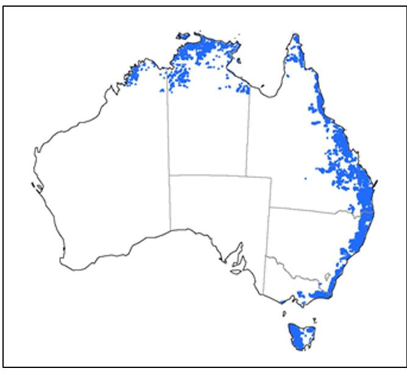

---
## Page 161

 
 
 
Volume 2 - Search and Rescue Operations 
NATIONAL SEARCH AND RESCUE MANUAL 
2025 EDITION Version 1 – February 2025 
Page 159 
frequency of natural events this leaf litter will vary in depth, up to as much as 50-cm.  The 
leaf litter will hide or disguise potential hazards, such as rocky outcrops and gullies.  This 
will impede search efforts as well as increasing the degree of difficulty for ground teams. 
Toilet paper or other similar ‘forest friendly’ marking material will be a necessity to mark 
the boundaries of search areas as it will be extremely difficult to locate them using 
standard methods of grid references or GPS points; 
d) 
Canopy cover will also limit the effectiveness for aerial search – aircraft using Forward 
Looking Infrared will be unable to penetrate dense canopies with sensors. Thick canopy 
cover results in little natural light reaching the forest floor.  Outside overcast conditions 
will mean that visibility will be considerably reduced at ground level.  A combination of 
poor light and mist/fog will considerably reduce the probability of detection of a lost 
person.  It may be necessary for search teams to carry portable lights with them and may 
also limit the amount of search time available to the search coordinator; 
e) 
While rain forests are spectacular places to visit, and sight see, they can also have a 
detrimental psychological effect upon those who are lost in them.  The continuous low 
light levels, lack of direction, apparent never-ending forest and dampness will contribute 
to depression and feelings of despair among lost persons.  These same conditions can also 
affect searchers, but often to a lesser extent.  Rain forest conditions can also cause our 
human primeval fear of the dark, which can result in a lost person moving aimlessly 
around in the forest seeking an escape.  There are very few large animals which will 
actively harm humans, the exception being the cassowary of northern Queensland, with 
rain forests, but there are many smaller animals that can cause an unreasonable level of 
fear in some humans.  These include leeches, ticks, spiders and the many nocturnal forest 
creatures; 
f) 
Good maps of rain forest areas are not common.  The standard practice of aerial 
cartography does not work well when the ground cannot be seen; 
g) 
Due to moist conditions, it is often very difficult to light a fire, for either warmth or 
cooking.  Artificial means are almost always required, such as small gas cylinders or 
hexamine.  Unless the lost person is well trained in survival it is best to consider that there 
are no edible fruits or animals within the forest.  A large number of plant species are toxic 
as are the crayfish and eels of rain forest streams if eaten raw.  
Rainforest Behavioural Characteristics (missing persons) 
3.13.5. 
Be aware that lost person in rainforest conditions may exhibit any or all of the following: 
a) 
Failure to make shelter; 
b) 
May be hidden in the buttress roots of many rain forest fig varieties; 
c) 
Discard their equipment; 
d) 
Disorientated – walking any direction; 
e) 
Tend to walk down hill (depending on level of experience – experienced walkers may try 
to access high areas to resolve their position or to gain telephone service); 
f) 
Following a path of least resistance; 
g) 
Cold Temperate areas – may exhibit characteristics of Alpine areas. 
3.13.6. 
Rainforest Resources considerations:  
a) 
Experienced Search Teams – with local knowledge and the ability to navigate within a 
featureless environment; 
b) 
National Park Rangers – or local rangers; 
c) 
Police Mounted Assets, Search and Rescue Mounted Assets; 
d) 
Aviation support – consider limitations;

---
## Page 162

 
 
 
 
Volume 2 - Search and Rescue Operations 
 
NATIONAL SEARCH AND RESCUE MANUAL 
Page 160 
2025 EDITION Version 1 – February 2025 
e) 
Tracker dogs, may be valuable first up but will otherwise be easily distracted by the many 
rain forest smells; 
f) 
Motorcycles / bicycles- search and rescue trained. 
Alpine Environment 
3.13.7. 
Alpine areas relate to high mountainous areas which are subject to extreme environment 
changes involving rain, snow, hail and strong winds. 
 
Figure 3-28  Alpine Areas of Australia (dlsweb.rmit) 
3.13.8. 
Alpine search teams differ from normal ground search teams mainly due to the different 
weather, altitude and hazards they must face and the different variety equipment and skills 
they use to overcome and travel in these hazardous conditions.  
3.13.9. 
Due to these hazardous conditions an Alpine searcher should be a trained SAR member skilled 
in movement over snow & alpine survival skills able to move efficiently, skilfully and with safety 
in winter or sub winter conditions through terrain at low or high altitudes.  This member must 
be of a high fitness level, able to cope with the physical and mental demands required to move 
efficiently in this changing environment.  All alpine SAR members must be able to work as a 
team member and prepared and equipped for overnight survival when necessary. 
3.13.10. These guidelines are intended to differentiate Alpine searchers from normal searchers to allow 
for the selection of teams to handle situations that are specific to their expertise and training.  
Alpine Considerations 
3.13.11. The following considerations should be taken into account: 
a) 
Equipment - Alpine equipment is very specialized to deal with extreme temperatures and 
conditions.  All equipment should be suitable for the conditions and be checked by a team 
leader before entering an alpine environment.  Poor equipment can put searchers lives in 
danger. 
b) 
Alpine searchers - Due to extreme conditions and change environment only trained alpine 
searchers should be used in the field on an alpine search.  When entering remote areas, a 
team should be no less than four members who are self-sufficient for overnight. 
c) 
Time frame for Survival (see Volume 2, Chapter 7, Medical Factors) In Alpine environment 
it is critical that immediate actions be taken to reduce the likely risk of exposure to 
hypothermia of the missing person/s.  
d) 
Medical training - Due to difficult access and remoteness of an alpine search, Paramedics 
or equivalent medical expertise in search teams or readily available to render assistance.

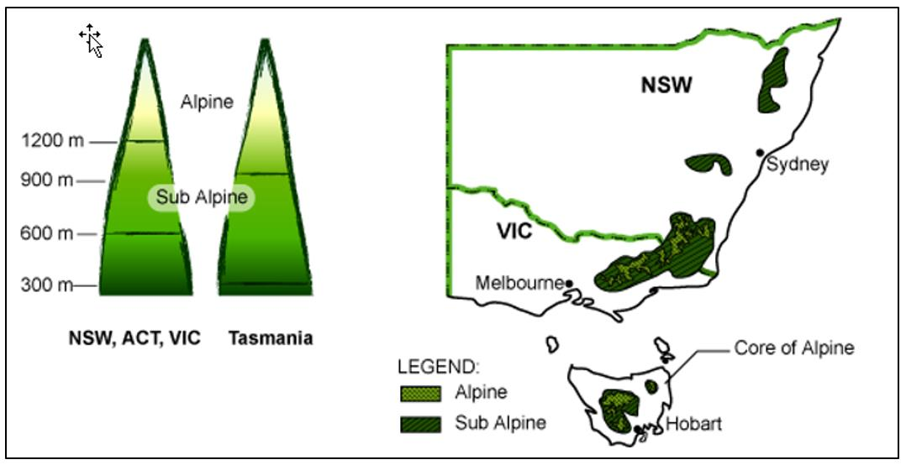

---
## Page 163

 
 
 
Volume 2 - Search and Rescue Operations 
NATIONAL SEARCH AND RESCUE MANUAL 
2025 EDITION Version 1 – February 2025 
Page 161 
e) 
Search techniques and search patterns – A search manager should utilize local knowledge 
of Alpine SAR members and/or ski patrol to assist in search tactics due to alpine mobility 
issues of search teams and lost persons. 
f) 
Restrictions in mobility of search teams and lost persons. Allow for greater time periods in 
the travel of distances. 
g) 
Makeup, search technique and search patterns used by searchers. 
h) 
Avalanche risks - A search manager should use only trained avalanche specialist in 
declaring search areas safe and when leading search teams in specialized searching using 
probes and avalanche receivers. 
Alpine Behavioural characteristics (missing persons) 
3.13.12. Hypothermia is the lowering of a body’s core temperature (see Volume 2, Chapter 7) and is the 
most common condition missing persons will suffer from in an alpine environment.  A search 
manager and team leaders should be aware that lost person in alpine conditions may exhibit 
any or all of the following: 
a) 
Failure to make shelter 
b) 
Discard their equipment 
c) 
Disrobing of clothing (Paradoxical undressing as a result of severe hypothermia) 
d) 
Failure to respond to searchers 
e) 
Following a path of least resistance 
3.13.13. This should be considered when clothing or equipment is located by search teams. 
3.13.14. The majority of missing persons in alpine environments wear high visibility clothing and 
equipment.  Due to changing weather conditions they become disorientated, misjudge 
distances and become benighted. 
3.13.15. Alpine Resources considerations: 
a) 
Overland snow/all-terrain vehicles 
b) 
Ski patrols 
c) 
Alpine horse riders and bush walkers from volunteer rescue agencies 
d) 
Aviation support  
e) 
Thermal imaging / night vision 
f) 
Avalanche specialists 
g) 
Mountain trained members in mountaineering, steep, snow and ice techniques 
h) 
GPS – carried by search teams 
i) 
Medical staff on standby. 
Arid Environment 
3.13.16. Australia is the world’s driest inhabited continent.  Over 70% of the continent receives between 
100 mm and 350 mm of rainfall per year, classifying it as semi-arid or arid.  Desert regions are 
found mostly in central and Western Australia, which makes up approximately 18% of the 
mainland.  All of Australia’s deserts are classed as subtropical deserts, given their location 
between the latitudes of 20 degrees and 30 degrees south of the Equator.  They are hot 
deserts, which means they have little rainfall and extreme temperatures, often reaching over 
50°C.  Humidity averages at between 10 and 20 percent.  Searing day time temperatures, cold 
nights and lack of surface water are just a few of the challenges facing travellers in the desert.

---
## Page 164

 
 
 
 
Volume 2 - Search and Rescue Operations 
 
NATIONAL SEARCH AND RESCUE MANUAL 
Page 162 
2025 EDITION Version 1 – February 2025 
 
Figure 3-29 Distribution of Deserts 
3.13.17. Desert surfaces are not always sandy; some consist of stones or ‘gibbers’ and have no sand at 
all.  Sandy deserts in Australia are The Simpson Desert, The Great Sandy Desert and the Great 
Victoria Desert. Stony deserts include The Gibson Desert, and the Sturt Stony Desert.  
Arid Environment Considerations 
3.13.18. In desert conditions, because of the extremes of temperature, both hyperthermia and 
hypothermia can affect the missing person.  The amount of water carried and the methods 
which it is used by the missing person can have a critical effect on survival times. During the 
initial action stage an assessment of the target needs to be made in relation to their possible 
actions while the search is being conducted.  Persons who are level-headed and remain in a 
sheltered or shady location will survive for much longer periods than a person who is 
attempting to self-help by walking throughout the day.  The general rule is for a target to 
remain with their vehicle if lost as it is far easier to find a larger object such as a vehicle than a 
smaller target such as a person. 
3.13.19. Historically most targets will spend a small percentage of time with their vehicle and then 
decide to walk off in search of help.  In areas that are familiar to the target this may be a 
successful strategy, but in most instances, it results in death. 
3.13.20. It is unusual for the SMC to be the first person on the scene of a SAR incident.  Vital clues as to 
the direction, speed and condition of the target can be gathered from observations of their 
footprints or other markings in the immediate vicinity of a vehicle.  Consideration should be 
given by the SMC to brief all teams about the possible destruction of clues around vehicles.  
When the target’s vehicle is located one team member should approach it from the hardest 
surface possible to ascertain if there are persons inside or if notes or other information has 
been left.  The area in the vicinity of the vehicle should then be thoroughly inspected for 
footprints and other marks and the direction in which they are going.  Further planning can 
then be made on the information obtained.  If there are no obvious signs left at the vehicle, 
then this would be used as a possible LKP with search planning concentrated on that point. 
3.13.21. In featureless country it is almost impossible to navigate accurately without extensive 
equipment.  A target will often aim to walk a straight path but in reality, will wander.  The 
handedness of the target will provide a clue the direction of the wanderings.  Right-handed 
persons will tend to walk in circles veering off to the left, with left-handed persons going in 
right hand circles.

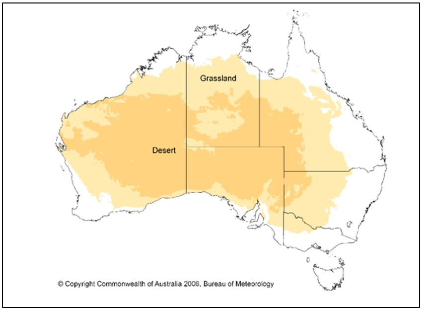

---
## Page 165

 
 
 
Volume 2 - Search and Rescue Operations 
NATIONAL SEARCH AND RESCUE MANUAL 
2025 EDITION Version 1 – February 2025 
Page 163 
3.13.22. Mental condition will also play a significant part in the survival of the target.  There are many 
stories of the explorers surviving tremendously difficult conditions without water for days.  
Historically this has been attributed to the harder living conditions and tougher lifestyles of 
those explorers.  With the increased pampering of people today the physical ability to survive in 
harsh desert conditions has diminished.  The mental state will have a large effect on a target’s 
survival.  Those with a ‘no give up’ attitude may have better odds of survival that a person with 
no will power. 
Arid Environment Behavioural Characteristics (missing persons) 
3.13.23. Be aware that lost persons in arid conditions may exhibit any or all of the following: 
a) 
May shelter in or under their vehicle; 
b) 
May dig themselves in under the sand, if experienced; 
c) 
May discard their equipment; 
d) 
May become disorientated – walking any direction; 
e) 
May sleep by day and walk by night, if experienced; 
f) 
Following a path of least resistance; and 
g) 
May seek out riverbeds and ranges in search for water. 
Arid Environment Resource Considerations 
3.13.24. The following resource considerations should be made: 
a) 
The use of indigenous trackers or visual trackers; 
b) 
Making aviation search a priority; 
c) 
The use of trail bikes and helicopters; 
d) 
Use of helicopters for transport of searchers and logistics supplies; 
e) 
Hardening experienced Search Teams to the environment; and 
f) 
The use of ground teams to recover the missing person once located, unless a helicopter 
has access. 
Mountain Environment 
3.13.25. Although Australia is considered the flattest of the world’s continents it does contain some 
significant mountain areas with respect to SAR.  Whilst about 10% of the country may be 
considered mountainous due to the elevation, a much smaller proportion contains areas of high 
relief that create substantial SAR issues.  Due to the fact that many of Australia’s mountain 
areas are National or Wilderness Parks they are often in close proximity too many of Australia’s 
largest population centres.

---
## Page 166

 
 
 
 
Volume 2 - Search and Rescue Operations 
 
NATIONAL SEARCH AND RESCUE MANUAL 
Page 164 
2025 EDITION Version 1 – February 2025 
 
Figure 3-30 Mountain Areas are highlighted in Light Shades 
Mountain Considerations 
3.13.26. Access:  Many mountain areas are in wilderness or National parks.  As such access into these 
areas is often limited.  Resources in terms of searchers often have to trek great distances to 
reach their allotted search areas.  Air support may not be available due to weather conditions, 
terrain or vegetation.  Additional human resources may be needed to move equipment. 
3.13.27. Communications: Many of the mountain areas are not serviced by regular communication 
networks.  It is important to liaise with emergency services that may be able to provide 
additional portable sites to improve forward net coverage.  Even with additional radio 
communications, there will be no guarantee of continuous coverage.  It means that briefings 
and operational instructions to Team leaders must be absolutely and thoroughly conveyed. 
3.13.28. Containment: It is almost impossible to contain an area in mountainous terrain to keep the 
target within it.  The importance of continually monitoring trails, significant points, logbooks or 
known ‘trap points’ where persons could move through is essential. 
3.13.29. TFFS: In mountainous areas the targets are often adventurous, with activities such as bush 
walking, canyoning, trekking, rafting, abseiling and climbing.  Often the report of a missing 
person will not be received until the person is well overdue.  With many adventurous activities 
extending over many days, time becomes critical as injury or misadventure may well have 
occurred earlier in the activity.  Therefore, the missing person or group may well be 
approaching their TFFS by the time emergency services are notified.  Search strategies that 
emphasise fast and reconnaissance methods are indicated. 
3.13.30. LPB: Persons who venture into mountainous areas are often motivated and aim to achieve a 
task.  Ascertaining as much data as possible regarding the MP will enable the SMC to determine 
the likely characteristics of the person.  Often these persons are trail orientated and will seek 
water and/or shelter if injured (see Appendix E-5). 
3.13.31. Vertical Rescue: Where called to search areas of high relief for missing people it is advisable to 
ensure that emergency services with skills in Vertical Rescue are placed on Alert or called to be 
part of the search so as not to delay the arrival of these trained operators should they 
subsequently be needed.

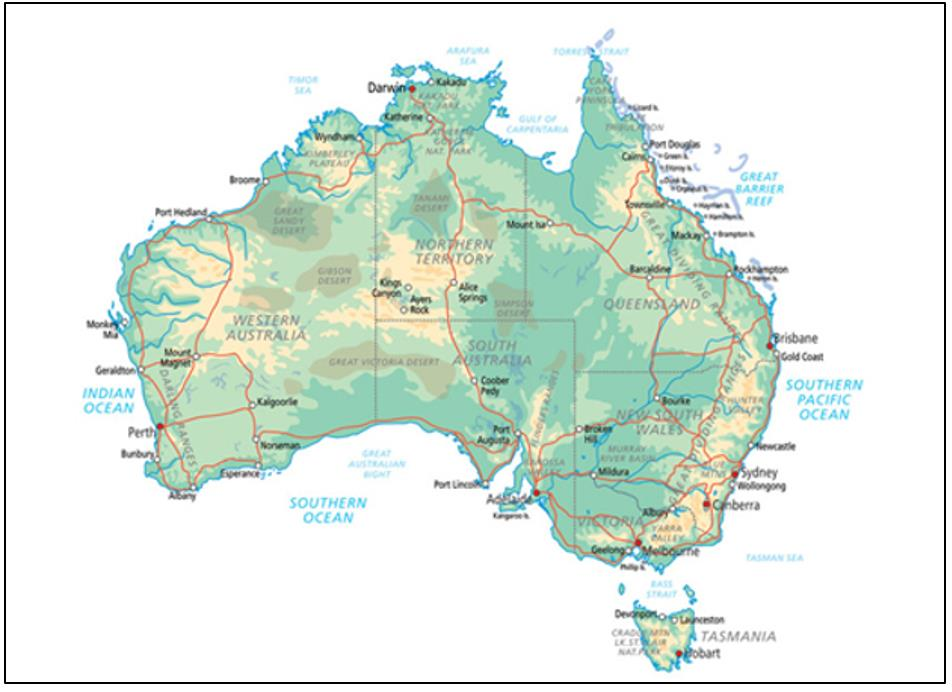

---
## Page 167

 
 
 
Volume 2 - Search and Rescue Operations 
NATIONAL SEARCH AND RESCUE MANUAL 
2025 EDITION Version 1 – February 2025 
Page 165 
3.13.32. Training: High levels of fitness and resourcefulness are needed as Mountain search crews may 
well be deployed not only in difficult terrain but over protracted days without opportunity of 
relief in often poor or changeable weather.  Excellent navigation and map reading skills are 
required in any search team.  The ability to effectively use GPS technology should also be 
considered as a skill within each search team. 
Mountain Environment Search Strategies 
3.13.33. Contain any search area as quickly as possible. This can be done by using FAST and 
reconnaissance strategies in deploying teams to tracks, LKP, intended destination, lookouts, 
major campgrounds or known ‘trap points’ where a person or persons must pass through. 
These would be the initial high probability areas. 
3.13.34. Many mountainous area and lookouts contain logbooks or visitors’ books.  It is imperative that 
these are checked as soon as possible in an effort to narrow down the search area. 
3.13.35. Set up a forward net communication as soon as possible. 
3.13.36. Postpone a general search strategy until there is clear evidence or a definite clue to the missing 
person’s whereabouts (e.g. Found backpack, clothing, footprints etc.) Be flexible about search 
team sizes, e.g. A team of 2 where communications is excellent across most of the area being 
searched, a team of 3 where communications is intermittent and a team of 4 where 
communications is poor or marginal. 
3.13.37. A search team of 3 is a very flexible team size as this size can strike a good balance between 
rapid movement and deployment and team security.  A team of 3 can search in a Single File, 
Track Sweep, Point and Flank and Purposeful Meandering. 
3.13.38. Use the ‘call and listen’ techniques.  Note that in calling from a ridgeline, the sound will not 
travel down the sides of a ridge or spur, sound will only travel out to the facing slopes.  It is 
important to therefore call out from opposite ridges into a valley. 
3.13.39. Caves and Mines: Enthusiasts are now delving deeper and further underground into 
increasingly more difficult areas of caves or abandoned mines.  Caves and older mines pose 
many problems to both the caver and potential rescuers, including narrow constrictions, 
vertical shafts, water at varying levels, risk of collapse and rock falls, bad air and almost 
complete darkness.  Search and rescue in these environments should only be undertaken by 
trained specialists.  There are several spelunking groups in the southern states and most of the 
underground mines have mine rescue specialists that could be called upon in an emergency. 
Urban searching 
3.13.40. Urban Environment: Land searches in urban areas are often required for targets such as those 
intending suicide and those with dementia or similar ailments. The general strategy employed 
for urban search is similar to that of the rural or ‘bush’ search, but the problems encountered 
are different. Urban search problems include: 
a) 
Greater number of places of concealment; 
b) 
Complicated search areas; 
c) 
Greater number of property owners; and 
d) 
Distinguishing between the missing person and the local population. It is vital to have a 
good description and preferably, a current photograph of the missing person or object. 
3.13.41. Urban Search (Major Complex): In the case of a major complex, e.g. a large hospital, each of 
these stages would be included within the boundaries of the complex. If the lost person is not 
found, then a new search area surrounding the complex is determined: 
a) 
Reconnaissance; 
b) 
General search; and 
c) 
Building/contact search.

---
## Page 168

 
 
 
 
Volume 2 - Search and Rescue Operations 
 
NATIONAL SEARCH AND RESCUE MANUAL 
Page 166 
2025 EDITION Version 1 – February 2025 
3.13.42. Though the stages are similar to that of a rural search, variations to some of the methods and 
techniques are required. 
3.13.43. Urban Search - Major Complex: In the case of a major complex, e.g. a large hospital, each of 
these stages would be included within the boundaries of the complex. If the lost person is not 
found, then a new search area surrounding the complex is determined. 
3.13.44. Urban Search Area Segmentation: The same segmentation principles apply as for rural search 
operations.  Boundaries will generally be defined by artificial features, such as roads, drainage 
channels, railway lines and major complexes (industry, commerce, government). Some natural 
features which may form boundaries include rivers, shorelines and nature strips.  Where roads 
are used as boundaries between search segments, the boundary would normally follow the 
centre line of the road. 
3.13.45. Urban Environment - Reconnaissance Search: The reconnaissance stage requires small search 
teams to carry out a quick check of specific areas of high probability within the area of 
possibility. Areas which should be checked during the reconnaissance stage: 
a) 
Locations that are familiar to the lost person, e.g. current or previous residence, the home 
of friends and family, church, hotel, even if assurances are given that these areas have 
been checked. 
b) 
Hazardous areas e.g. construction sites, quarries, rooms/buildings that are rarely used 
(locked or unlocked). 
3.13.46. Urban Environment -General Search: A general search stage is carried out in an area of 
probability, checking for signs or indications of the missing person.  A check of such places as 
public buildings e.g. public toilets, railway station and other shelters, such as store and plant 
rooms or a large building, large culverts and beneath bridges, should be carried out. A special 
check of hazardous areas, including railway tracks, banks of rivers, lakes, swimming pools, 
drains, dams and construction sites where the missing person could be trapped or injured, 
should be made. 
3.13.47. Urban Environment - Building/Contact Search: Building search as it implies, requires the 
systematic searching of each and every corridor, room and possible place of concealment 
within a building. Several buildings may be contained within one property, therefore requiring a 
systematic search of the property surrounding the buildings. Always gain permission to search 
property or seek police assistance.  Building searches in large complexes, such as a hospital or 
shopping centre, present a different problem. Divide these buildings into sectors by wings or, in 
the case of a multi-story building, by floors. Appoint a separate team leader for each of these 
sectors and, where possible, have a member of the staff who occupy the building (with 
knowledge of the building) accompany the team leader. 
3.13.48. The team leader must progressively report those areas searched and list those areas not 
searched, ensure that they are searched, later. 
3.13.49. Urban Environment, Conclusion: Don’t be misled by thoughts or statements such as ‘there 
wouldn’t be anyone in there’, or information like ‘I’ve already searched that building’. If you 
have the responsibility to search an area, then you make sure that you or those for whom you 
are responsible cover the whole area. 
Forensic Searching 
3.13.50. Forensic Search: The Police may request assistance with searching for forensic evidence. A high 
level of skill and motivation is required as searchers may be required to spend long, sometimes 
tedious, hours scanning small areas for any evidence such as: 
a) 
Human teeth/bones/prosthetic devices 
b) 
Bullets and/or bullet casings 
c) 
Hair  
d) 
Jewellery

---
## Page 169

 
 
 
Volume 2 - Search and Rescue Operations 
NATIONAL SEARCH AND RESCUE MANUAL 
2025 EDITION Version 1 – February 2025 
Page 167 
e) 
Shoes/clothing 
f) 
Footprints 
g) 
Weapons. 
3.13.51. The method employed will usually be a contact style search: 
a) 
Members crawl on hands and knees, often shoulder to shoulder, with no gaps in the 
search line 
b) 
The ground is intensively and physically searched in front of each searcher to the width of 
their shoulders or midway to the adjoining searchers.  All ground matter, leaves, rocks, 
stones and loose soil is examined.  
c) 
The search progresses at approximately 1 (One) metre per minute or slower depending on 
the thickness of ground cover and terrain.   
 
d) 
All the principles for preserving clues are applied  
e) 
Items of interest are identified without moving where practicable.  Forensic guidance will 
determine if the item is applicable to the search.  If so, it will be photographed in-situ, 
bagged and tagged for further examination by police. 
f) 
Specialised searching may require the bringing of soil and/or vegetation to a sorting table 
or bench for sifting.  
Land SAR Resources 
3.13.52. Resources: While there are a wide range of resources available throughout Australia to assist 
the SMC conducting a SAR mission, not every resource will be available in every location for 
each search. A SMC should ensure that they keep an up-to-date register of available resources 
within their SAR area, including telephone numbers and alternatives, manpower and 
equipment, capabilities, travel times and other information. 
3.13.53. Resources must be assessed in terms of capability, availability and durability. Such resources 
are: 
a)  
Human; and 
b)  
Physical resources. 
3.13.54. Human Resources: Human resources should be categories as trained and untrained. Trained 
searchers must be proficient and effective in skills such as: 
a)  
Leadership; 
b)  
Working as team members; and 
c) 
Use of map and compass, bush craft, communications, first-aid, skiing, etc. have an 
understanding of the organisational functions supporting the operation. 
3.13.55. It is preferable to use trained teams who are experienced in working together. This, however, is 
not always possible. If untrained searchers are to be used, they must be under the control of a 
trained and experienced leader. People with specialist skills should be utilized within their area 
of expertise. The tasks allocated to teams need to be within the capacity of those teams. This 
includes their area of search, terrain, conditions and functions. 
3.13.56. Human Trackers: The art of tracking a person through bush is fast vanishing; however, it should 
not be overlooked as a means of finding a missing person. In parts of Australia, there are 
indigenous people who have maintained this art and there are others who have developed 
these skills. 
3.13.57. If a suitable tracker is available, consideration should be given to their use as valuable time can 
be saved by going directly to the missing person rather than conducting a slow methodical 
search. This does not mean that if a tracker is available, there is no need for search teams.

---
## Page 170

 
 
 
 
Volume 2 - Search and Rescue Operations 
 
NATIONAL SEARCH AND RESCUE MANUAL 
Page 168 
2025 EDITION Version 1 – February 2025 
3.13.58. Trackers are not infallible and tracking over rocky ground or through swamps may not be 
possible. Where the tracker has lost the trail or cannot proceed, the search team takes over 
until the trail is relocated. The tracker and the search team can and must work in harmony, but 
the team must ensure that they do not obliterate the trail which the tracker is following.  
Trackers use visual tracking techniques, the requirements for which are good eyesight, 
memory, practical intelligence, fitness and an understanding of nature. 
3.13.59. Physical resources: Physical resources available to each area will be many and varied, each 
having a special function. Therefore, each should be employed accordingly. Such resources 
include: 
a) 
Aircraft; 
b)  
Vehicles; 
c) 
Horses; 
d)  
Dogs; and 
e) 
Vessels. 
3.13.60. Aircraft: There are aircraft available to suit specific circumstances. Provided weather prevailing 
in the area is suitable, aircraft can cover an area quickly and economically, thus relieving the 
problem initially of utilizing ground teams. Aircraft are particularly useful in the reconnaissance 
stage. 
3.13.61. Fixed Wing Aircraft:  
a) 
This should preferably be of high-wing monoplane construction, with a low stalling speed, 
economical fuel usage and an air dropping capability. This will allow good visibility from 
the aircraft and a viable time period over the search area. 
b)  
Refuelling points should be as close to the search area as possible. 
c) 
Observers should be trained and rotated regularly. 
d)  
In protracted flying operations, consideration must be given to the limitations of flying 
hours for the pilot(s). 
3.13.62. Rotary Wing Aircraft: due to their ability to hover and fly slowly helicopters are a very valuable 
land SAR assets and are also a common form of rescue platform. Specialised SAR helicopters 
are usually equipped with a winch and night search capability. They normally also have mobile 
telephones and a variety of radio communications, GPS and can often land near the search 
area. Each state has SOP’s regarding the use of helicopters in searches. 
3.13.63. Helicopters, advantages:  Some of the advantages of using a helicopter are: 
a) 
Large open areas can be searched with relative speed. 
b) 
Water areas can be searched in most weathers when a surface search may be dangerous. 
c) 
The size of the area covered may reduce the necessity of other resources. 
d) 
Good observation capability. 
e) 
Can give the SMC an overall appreciation of the search area. 
f) 
Routes can be identified. 
g) 
Hazards to searchers can be identified. 
h) 
Rooftops of buildings can be searched without risk. 
i)  
If equipped, night search can be aided by a Nite Sun (searchlight), NVIS and EO/IR.  
j) 
May enhance public perception of the search. 
k) 
Assist in the coordination of ground resources. 
l) 
Have the capacity to hover over and land in remote locations.

---
## Page 171

 
 
 
Volume 2 - Search and Rescue Operations 
NATIONAL SEARCH AND RESCUE MANUAL 
2025 EDITION Version 1 – February 2025 
Page 169 
m) If the aircraft is fitted with a hoist (winch), placement or extrication of individuals may be 
accomplished without landing. In protracted flying operations, consideration must be 
given to the limitation of flying hours for the pilot(s). 
3.13.64. Helicopter, Disadvantages: Some of the disadvantages include: 
a) 
Effectiveness is governed by the weather. 
b) 
Restricted visibility by forest canopy, buildings etc. 
c) 
Restricted flight times 
d) 
Requirement for fuel in the more remote areas. 
e) 
FLIR unable to penetrate forest canopy. 
f) 
Restricted operating distance from shore in the marine environment. 
Dangerous Animals 
3.13.65. Australia is known for its wildlife and every year thousands of locals and tourists gravitate to 
wildlife parks to view and hold our cuddly furry creatures.  It is not these that searchers need to 
worry about, it is the more unpleasant looking critters that cause the problems. 
3.13.66. Saltwater Crocodiles: The Australian Estuarine or Saltwater Crocodile is found across the entire 
north of Australia a as per the below map.  They are the largest reptiles in the world growing up 
to 5-6 metres in length.  The Saltwater name is a misnomer as they are quite happy in 
freshwater billabongs long distances from the coast.  They are very aggressive and territorial.  
While their normal diet consists of wild pigs, water buffaloes, cattle and horses they will also 
eat the occasional human.  On average 1-2 people are devoured by crocodiles somewhere in 
Australia per year. 
 
Figure 3-31 Areas known to be inhabited by Crocodiles 
3.13.67. When searching in areas known to be inhabited by crocodiles it is imperative that all members 
of a search team keep a very good look out.  It may be worthwhile having a member of the 
State/Territory Parks and Wildlife Service or Crocodile Management Team accompany any 
search team as they will be able to identify crocodile habitats and signs of recent crocodile 
activity.  A firearm may also be prudent in some circumstances, but only at the instruction of 
the SMC. 
3.13.68. Snakes:  Be aware of what snakes are likely to be encountered within a search area. Australia 
has a great many of the world’s most venomous snakes and apart from the colder reaches of 
the Tasmanian and mainland Alps they can be found just about everywhere.  Very few snakes 
are aggressive towards humans by nature, but all will respond to being trodden on, poked and

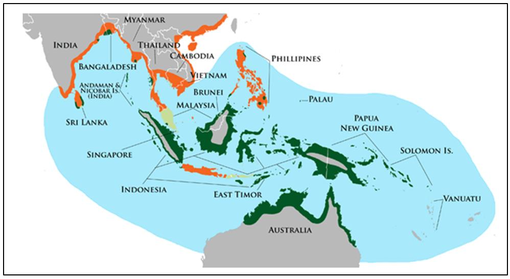

---
## Page 172

 
 
 
 
Volume 2 - Search and Rescue Operations 
 
NATIONAL SEARCH AND RESCUE MANUAL 
Page 170 
2025 EDITION Version 1 – February 2025 
prodded.  Most will slither away from searchers long before they are spotted but occasionally a 
snake will be caught out in the open by an unsuspecting team member.  Common sense 
prevails in most situations.  Remain calm and still and let the snake leave the scene under its 
own steam.  Do not try to pick one up or hurry them along.  In the heat of the moment, it is 
difficult to identify the harmless from the dangerous.  Treat all snakes as being dangerous and 
remember that they are protected. 
3.13.69. If bitten by a snake remain calm.  Have another team member commence first aid in the form 
of a pressure immobilisation bandage and immobilise the area.  Seek medical assistance.  Do 
not wash the area as any residual venom may be able to be identified.  Most major hospitals 
carry anti-venom for snakes in their area.  Where possible identification should be made of the 
snake that caused the bite but do not attempt to apprehend the snake as another bite may 
result. 
3.13.70. Spiders: There are a wide range of venomous spiders scattered throughout the country, all of 
which do not actively stalk humans.  Most spider bites arise from the spider being disturbed.  
Wearing gloves when searching undergrowth, under objects or back yards and stout footwear 
will prevent many potential spider bites.  If bitten by any spider seek medical attention as soon 
as possible.  Identification of the spider can assist with any medical treatment provided. 
3.13.71. Scorpions, Centipedes and Millipedes: As per spiders these creatures can be located 
throughout Australia.  While all of them are not poisonous they can all cause a very nasty sting.  
Gloves and footwear will prevent most encounters from turning nasty. 
3.13.72. Tasmanian Devil, Dingoes, Foxes, Goannas, Monitors, Birds of Prey: While not dangerous 
these animals have one SAR related characteristic, they all feed on dead or decaying animals, 
including humans.  If it is possible that a MP is deceased, then there is a possibility that local 
animals have had the opportunity to devour some or all of the flesh and to scatter the bones.  
This may be the case with a person missing in the outback or more remote areas.  The SMC 
should be aware that this detail should be included in the briefings, for teams to also look for 
scattered human bones and remains. 
Telephone Triangulation 
3.13.73. With most people now carrying mobile telephones the potential for telephone triangulation by 
the various telephone carriers can reduce SAR efforts dramatically.  During the information 
gathering stages it should be canvassed as to whether the MP has a mobile telephone with 
them.  Something as simple as making a telephone call, sending a text message or leaving a 
voice message may resolve a SAR incident.  If these methods do not produce results, contact 
with the service provided can often produce a location or direction from a mobile telephone 
tower.  The individual State/Territory methods in contacting service providers will differ, as will 
any charges that are made by these providers.  If the MP is in an urban area and their 
telephone is on, a triangulation can be reasonably successful within a small space of time.  A 
large number of mobile telephone towers in an area can produce a very defined search area, 
whereas a small number or only one tower will produce a much larger search area, such as a 
bearing and distance from a particular tower.  MP’s lost in rural, mountainous or remote areas 
may have little mobile reception, with an associated small chance of triangulation.  Mobile 
telephones with dead batteries will not be of much use.  A triangulation should be requested as 
part of the initial intelligence gathering. 
Land Search Planning 
3.13.74. Estimating the Missing Person Location:  The search plan consists of two components:  
a) 
Reflex Tasking (Initial Search) 
b) 
Formal Land Search.  
3.13.75. The search response has been separated into two distinct actions; Reflex or Initial actions and a 
Formal Land Search.  The reflex action is exactly as it says, an instinctive search of those areas

---
## Page 173

 
 
 
Volume 2 - Search and Rescue Operations 
NATIONAL SEARCH AND RESCUE MANUAL 
2025 EDITION Version 1 – February 2025 
Page 171 
near the LKP or IPP where the MP could have met with trouble.  The formal search is one 
utilising the four search strategies as discussed further in this section. 
Reflex Search 
3.13.76. Reflex tasking can be likened to a bicycle wheel with the hub situated on the LKP or IPP.  The 
spokes represent the various routes, tracks, trails or directions that could have been taken by 
the MP. The tyre represents the limit of the reflex search which is recommended at 300-50m.  
The reflectors represent places of high probability within this reflex area.  These could include 
huts, track junctions, hazards, lookouts, cliffs and water courses.  
3.13.77. A reflex task requires minimal planning, and it used as a first response search.  The first SRA on 
scene can be tasked while the SMC is on route. 
 
Figure 3-32 Bicycle method for Reflex Tasking 
3.13.78. The below diagram illustrates this concept. There are six identified possible routes, 3 tracks 
radiating from LKP and three water courses. Without any further intelligence each is as likely as 
the others. The circle around LKP is a 300-500 m radius for the reflex search.  The green 
reflector is an area of high probability inside the reflex search area (Group of huts) while the 
red reflectors are high probability areas, track junctions, just outside the initial search.

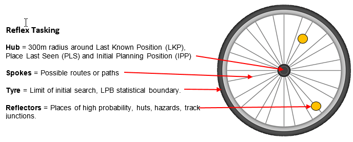

---
## Page 174

 
 
 
 
Volume 2 - Search and Rescue Operations 
 
NATIONAL SEARCH AND RESCUE MANUAL 
Page 172 
2025 EDITION Version 1 – February 2025 
 
Figure 3-33 Reflex tasking example 
3.14. Formal Search (Land) 
3.14.1. 
There are four strategies in determining the formal search area in a land environment: 
a) 
Theoretical (How far could the MP have travelled in the time period) 
b) 
Statistical (Using Lost Person Behaviour, what is the statistical distance the MP could be 
located within) 
c) 
Subjective/Decision Points (Using the terrain to determine likely search areas) 
d) 
Deductive (Looking closely at the facts, clues and assumptions) 
3.14.2. 
Each of the methods are laid over each other to give a very accurate representation of the 
situation, and if done correctly will serve to reduce the search area to the highest probable 
locations. 
Theoretical Search Strategy (Naismith’s Rule) 
3.14.3. 
The first step in land search planning is to determine the limits of the area containing all 
possible MP locations. This is usually done by determining the maximum distance the MPs 
could have travelled between the time of their last known position (LKP) and the known or 
assumed time the SAR incident occurred. By utilising Naismith’s Rule a general indication of the 
maximum distance that could be travelled by the MP will be obtained.  Using this as the radius 
a circle can then be drawn around the LKP, which will indicate the maximum distance the MP 
will have walked from the LKP.  This method only works when it is known that the MP does not 
have access to other forms of transport. Knowing the extreme limits of possible locations allows 
the SMC to determine where to seek further information related to the MP’s and whether an 
incoming report might apply to the incident. However, systematic search of such a large area is 
normally not practical.  
3.14.4. 
Time missing: This time is calculated from when the MP was last seen (Time last seen TLS), not 
the time they were reported missing or the time they were due back.  If there is no definite 
time last seen this may have to be estimated, on similar lines to estimating the IPP if a LKP is

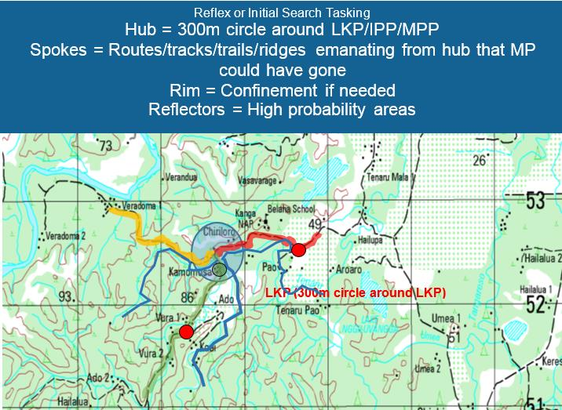

---
## Page 175

 
 
 
Volume 2 - Search and Rescue Operations 
NATIONAL SEARCH AND RESCUE MANUAL 
2025 EDITION Version 1 – February 2025 
Page 173 
not viable.  Commencing this calculation from TLS is done because an incident may have 
occurred at any time between when they started their activity and the planned return time. 
3.14.5. 
Naismith’s Rule: In gauging the speed of travel, Naismith’s Rule describes the distance a person 
may travel per hour over flat terrain and was devised in 1892. 
5 Km/hour - Easy going over open country. 
3 Km/hour - Easy scrambling over rocky ground. 
1–1.5 Km/hour - Difficult going through thick scrub, heavy sand or snow. 
3.14.6. 
Where a person is missing for extended periods or is likely to traverse hilly country, the possible 
search radius will need to be reduced due to fatigue and slower travel.  For each 500 metres of 
ascent or 1000 metres of descent over the estimated distance travelled, reduced the possible 
search radius by the equivalent of one hour travel.  For every 5 hours the person is missing, 
reduce the possible search radius by the equivalent of one hour travel for fatigue.  The 
calculation for the possible distance travelled by the MP is relatively simple to perform. 
Appendix E-6 and E-7 expands on Naismith’s Rule and provides further information. 
3.14.7. 
Example: A 3-year-old MP has been missing 13 hours in the Lamington NP. The intended route 
suggests medium conditions or easy scrambling (3 kph) with a 500 m ascent and a 500 m 
descent.  
13 hrs missing -  
1. 
Calculate any fatigue by dividing the time missing by 5 and ignore any remainders. 
(13÷5=2 3/5 = 2 hrs) 13 hrs – 2 hrs = 11 hrs 
2. 
Calculate any ascent 
Rule is for every 500 m of climbing one hour of travel time is taken off: 
 
500 m = 1 hr.  11 hrs – 1 hr = 10 hrs  
3. 
Calculate any descent 
 
Rule is for every 1000 m of going downhill one hour of travel time is taken off, therefore 
500 m would be the equivalent of 0.5 hrs being taken off the total: 
500 m = 0.5 hrs.  10 hrs - 0.5 hr = 9.5 hrs.  
4. 
Calculate distance travelled 
9.5 hrs x 3 kph = 28.5 Km 
 
Figure 3-34 Theoretical search using Naismith's rule 
3.14.8. 
It is very unlikely that a 3-year-old child will have walked 28.5 Km however, this is an indication 
of the maximum distance it could be possible to walk in the time frame.  Without using

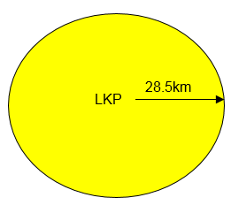

---
## Page 176

 
 
 
 
Volume 2 - Search and Rescue Operations 
 
NATIONAL SEARCH AND RESCUE MANUAL 
Page 174 
2025 EDITION Version 1 – February 2025 
Naismith’s Rule, this calculation would have been 13 hrs x 3 kph = 39 Km. The area 
encompassed by a 39 Km radius circle is vastly larger, almost double, that of a 28.5 Km circle.  
3.14.9. 
This initial calculation provides the SMC with a possible distance that the MP could have 
travelled in the time since they were last seen.  It does not provide a direction or take into 
account any other factors, including age or behaviour, at this stage.  This area is much too large 
to search adequately, being approximately 2550 Km².  Being a theoretical distance it is highly 
probable that this distance would not be walked in a straight line but that the MP would 
wander somewhat and cover a shorter linear distance from LKP. 
Statistical Strategy (Lost Person Behaviour) 
3.14.10. Lost Person Behaviour: This method relies on Lost Person Behaviour (LPB) to determine the 
distance that the MP may have travelled from the LKP.  By analysing the behaviour of past lost 
persons in similar situations, it may be possible to ‘predict’ what the target now being sought 
might do, where he/she might go or where he/she might be.  This concept is a search planning 
tool, dealing with generalities, and not absolutes.  Lost person behaviour studies provide the 
SMC with two important items: 
a) 
Behaviour traits of lost persons by category. 
b) 
Distances travelled by specific categories of lost person. 
3.14.11. General Categories of Lost Persons:  The following are the commonly used categories of lost 
persons: 
a) 
Children 1 to 3 years 
b) 
Children 4 to 6 years 
c) 
Children 7 to 12 years 
d) 
Adolescent Youth 13 to 15 years 
e) 
Mental Development Problems. 
f) 
Despondent 
g) 
Psychological problems 
h) 
Bushwalkers 
i) 
Dementia/Alzheimer’s  
j) 
Climbers 
k) 
Hunters 
l) 
Prospectors 
m) Children with ADD, ADHD, Asperger’s and Autism 
n) 
First Nation People. 
3.14.12. Appendix E-5 contains lost person behaviours in the above categories and provides statistical 
strategies, characteristics, locations and distances travelled by members of each group.  This 
will be useful in creating the linear graph as outlined below. 
3.14.13. Pertinent characteristics set each category apart.  Although each of the groups exhibit specific 
traits, there are always exceptions and good search strategy concentrates on the most likely.  
The statistics provided further on relate to the activities of 80% of persons in each category.  
Knowledge of the actions of the remaining 20% of persons in each category may be useful in 
planning for search containment. (Appendix E-5). 
3.14.14. An initial Australian LPB study was conducted between 2000-2006. The statistics used in this 
manual are a combination of those developed in Australian, USA, Canada and the United 
Kingdom.  While these statistics will provide a solid base upon which to base a Statistical Search

---
## Page 177

 
 
 
Volume 2 - Search and Rescue Operations 
NATIONAL SEARCH AND RESCUE MANUAL 
2025 EDITION Version 1 – February 2025 
Page 175 
method there are some discrepancies when used for Australian subjects.  Studies to date have 
found that due to the more favourable climate in most of Australia and the more outdoor 
nature of Australians their behaviour when lost is somewhat different, in that they will often 
attempt to self-help more often.  Bearing this in mind, the international statistics can be used 
with confidence as one of a number of search planning methods.  The current Australian Lost 
Person Behaviour Statistical base commenced in 2010. Entries into the LPB database can be 
made at http://goo.gl/OLZmW  
3.14.15. The Lost Person Behaviour statistics have been put into a tabular format showing the average 
distance at which a variety of person groups have been located in relation to LKP. The tables 
cover all of the statistics but is suggested that the statistics to 80% only be used as the 
remaining 20% of targets skew the figures as can be seen.  
3.14.16. Creating a linear percentage line as below will provide a visual representation of the distances 
that a MP could be located.  The table of figures for one (1) – three (3) year old children have 
been reproduced below.  This table shows that 10% of missing children in this group were 
located within approximately 110 metres of LKP.  It also shows that 80% of children in this age 
group were located within approximately 2.10 Km of LKP.  Using these figures a linear graph of 
the respective percentages can be shown in a form that more easily translates to map 
distances.  The SMC can place LKP over the position on a map and then draw circles of various 
sizes to represent the statistical distances travelled by children of that age group. 
% of MP’s  
10% 
20% 
30% 
40% 
50% 
60% 
70% 
80% 
95% 
Dist. from LKP (Km) 
0.11 
0.25 
0.30 
0.42 
0.60 
1.15 
1.60 
2.10 
4.45 
Table 3-3 Statistical distances travelled by Children 1-3 years (contained in Appendix E-5) 
3.14.17. Using the LPB tables to produce a Linear Percentage line a SMC can observe that statistically 
80% of missing child between 1-3 years of age will, on average, be located within 2.10 Km of 
the LKP.  Using the statistical method the initial search for a child of that age will be a circle with 
a radius of 2.10 Km.  
3.14.18. Superimposing this search area over that of the Theoretical method will show a dramatic 
reduction in the probable search area. 
 
Figure 3-35 Comparison of Theoretical and Statistical Search Areas 
3.14.19. The probable search area has been reduced from approximately 2,550 Km² to approximately 
13.8 Km² based on the first two of the planning steps.  Using the theoretical method, it is 
possible, although not likely, that the child has walked 28.5 Km from LKP in the 13 hours they 
have been report missing and this is portrayed in the yellow circle above.  LPB suggests that 
80% of all children of this age lost have been located within 2.10 Km of LKP, represented by the 
green circle.  The SMC must always be cognisant that there are 20% of children in the age group 
that were not located within that distance due to other circumstances. Continued intelligence 
gathering will assist in determining whether the MP fits into the 80% or 20% category.  While 
the statistical area is considerably smaller than the theoretical area it is still an extremely large 
area to search on foot.

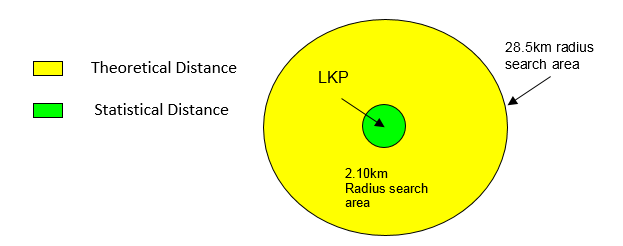

---
## Page 178

 
 
 
 
Volume 2 - Search and Rescue Operations 
 
NATIONAL SEARCH AND RESCUE MANUAL 
Page 176 
2025 EDITION Version 1 – February 2025 
3.14.20. In those instances where a missing person may fit into two or more LPB categories (for instance 
8-year-old autistic child), consideration should be given to using the category that has the larger 
search radius while taking into account the characteristics, traits and strategies of all relevant 
categories.  
3.15. Subjective/Decision Point Strategy (Land) 
3.15.1. 
The subjective method uses the terrain, boundaries, fences etc. as a method of identifying a 
search area.  As most categories of targets tend to take the path of least resistance, i.e. walk 
down hill, identifying the lay of the land will suggest funnels that will channel a target in a 
particular direction.  This method will differ from person to person. 
3.15.2. 
The reduction of the possible search area to the probable search area requires the evaluation 
of factors of the missing person that may reduce their distance travelled, and terrain features 
and their effects: 
a) 
Factors which may reduce the projected travel may include: 
i)  
Physical condition; 
ii) 
Age and sex; 
iii) 
Experience in the area and general outdoor ability; and 
iv)  Weather. 
b) 
Certain terrain features may also assist in reducing the search area to only a sector of the 
original circle of the possible search area. For example, features which cannot be crossed 
or only crossed with difficulty, (fast-flowing rivers, gorges, cliffs, shorelines or very dense 
scrub) can significantly limit the area which must be searched. The probable search area 
may only be a fraction of the possible search area when all these factors are applied. 
3.15.3. 
On the below map the search area has been identified by the circle.  The roads, tracks, creek 
and ridge lines have been identified and coloured for clarity.  These are all potential barriers for 
use in search planning and could be used to funnel a target to lower country.  They also reduce 
the initial size of the search area. The contours have been checked and the downward slopes 
identified with red arrows.  This may indicate possible directions that a missing person will 
travel.  Using this information, it is now possible to contain a search area and divide it into 
smaller sub search areas for individual searching.

---
## Page 179

 
 
 
Volume 2 - Search and Rescue Operations 
NATIONAL SEARCH AND RESCUE MANUAL 
2025 EDITION Version 1 – February 2025 
Page 177 
 
Figure 3-36 Identifying possible barriers in a search area. 
3.15.4. 
Once the salient terrain features have been identified it is possible to locate ‘paths of least 
resistance’ or ‘funnel points’ within your search area.  The former are routes, normally 
downhill, that a lost person will subconsciously take while still mobile.  Imagine a lost person, 
tired, demoralised and unable to rationally make a decision, they will naturally gravitate 
downhill, taking a path that does not offer them any trouble.  This path may not be direct and 
will tend to wander, but always downhill.  In these circumstances a barrier search is a 
worthwhile consideration.  Funnel points are exactly as named, locations that tracks, gullies or 
ridges converge.  This has the effect of funnelling persons in a particular direction.  Re-entrants 
are a good example of this.  A person lost in a re-entrant will often remain in it, following it 
downhill, being funnelled to another location.  Being able to identify these potential routs will 
assist is allocating areas to search teams. 
Decision Points 
3.15.5. 
The diagram below shows what a decision point is.  Whether the MP is walking on formed 
tracks or wilderness they will come across a number of decision points that will require 
identifying and searching.  A decision point is a location where the MP could veer off course or 
lose the track or bearing entirely.  Track junctions are a classic example, with the MP going left 
instead of right due to a number of reasons such as poor map skills, darkness, inattention 
and/or fatigue.  Other decision points include water crossings, sharp bends in tracks or routes, 
contouring and elevation changes.  The result of poor decision making will leave the MP 
disorientated.

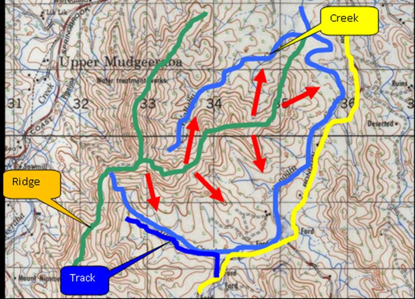

---
## Page 180

 
 
 
 
Volume 2 - Search and Rescue Operations 
 
NATIONAL SEARCH AND RESCUE MANUAL 
Page 178 
2025 EDITION Version 1 – February 2025 
3.15.6. 
Examples of decisions points are contained below: 
 
 
 
 
Figure 3-37 Decision Points 
 
 
Track junction: Track junctions are the 
classic location for a target to make an 
error.  Poor map reading, inattention, 
fatigue will all contribute to a wrong track 
being taken.

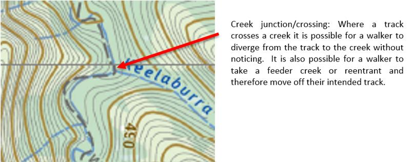

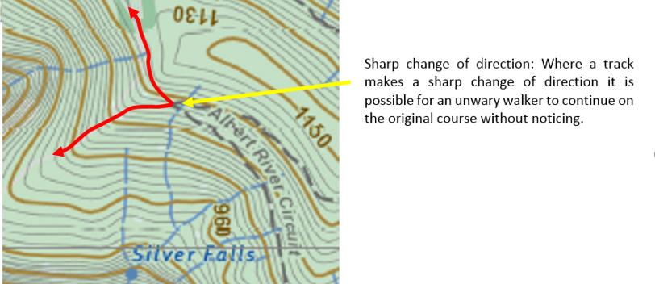

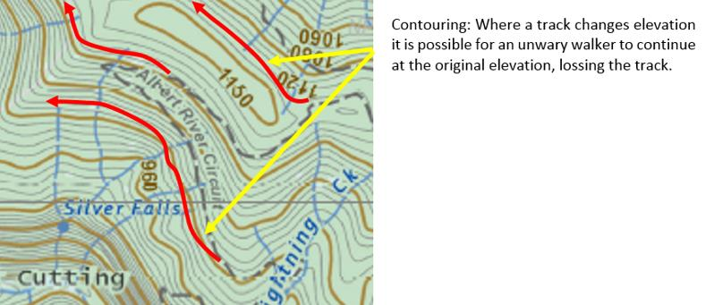

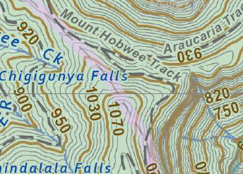

---
## Page 181

 
 
 
Volume 2 - Search and Rescue Operations 
NATIONAL SEARCH AND RESCUE MANUAL 
2025 EDITION Version 1 – February 2025 
Page 179 
3.16. Deductive Strategy (Land) 
3.16.1. 
This method relies on the SMC looking at all the clues and information provided and making 
some deductions or assumptions on what the missing person was doing and where they may 
be.  If the MP was an avid photographer, then locations for photography may identify areas for 
a FAST search, similarly if an MP is into abseiling, then local abseiling locales will be worth 
searching. 
3.16.2. 
Where the direction of travel of the missing person is known or suspected from sighting, from 
intentions, or from clues found, the search area may be reduced. However, the missing person 
may have altered direction intentionally or may not be able to maintain a particular direction.  
Deductive is not a method to use alone, it must always be corroborated with some other search 
intelligence. 
Using all four Formal Search Strategies 
3.16.3. 
It is now possible to utilise all four search planning methods to determine a possible search 
area, or area of highest probability.  For example:  
3.16.4. 
Scenario 1: It is 0900 hrs when the following information is received. A 78-year-old dementia 
sufferer has gone missing from her home at 30 Brisbane St, Mt Ommaney.  She has no history 
of going missing before.  She has lived at that address for over 30 years but due to illness does 
not know the address.  She has no money or ID and was last seen at 0600 hrs wearing a cotton 
night dress and no shoes inside her residence.  She is not a good walker but does not require 
any walking aides.  The weather is a typical winter day, wind 15 kph S, 15°C and drizzle. 
 
Figure 3-38 LKP of missing person identified. 
3.16.5. 
The LKP of missing person is plotted on a suitable map.

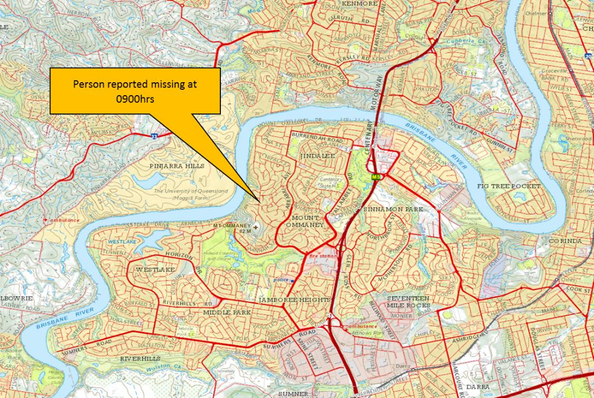

---
## Page 182

 
 
 
 
Volume 2 - Search and Rescue Operations 
 
NATIONAL SEARCH AND RESCUE MANUAL 
Page 180 
2025 EDITION Version 1 – February 2025 
 
Figure 3-39 Three (3) hours missing 
3.16.6. 
It is now 1200 hrs, and the MP has been missing for three (3) hours.  According to Naismith’s 
Rule, a person could walk about 5 kph in suburban terrain; this rule does not differentiate 
between ages or ability.  A speed of 1.5 kph is more reasonable for an MP of this age and 
condition. Therefore 3 hours x 1.5 kph will give a theoretical distance of 4.5 Km. Draw a circle 
with a radius of 4.5 Km around LKP and this will provide the theoretical search area for the MP.  
 
 
Figure 3-40 Theoretical Area plotted.

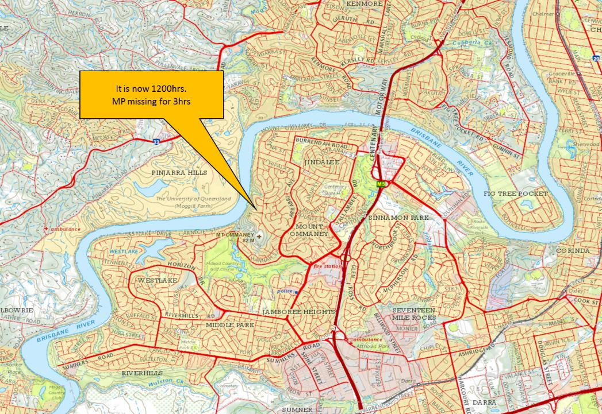

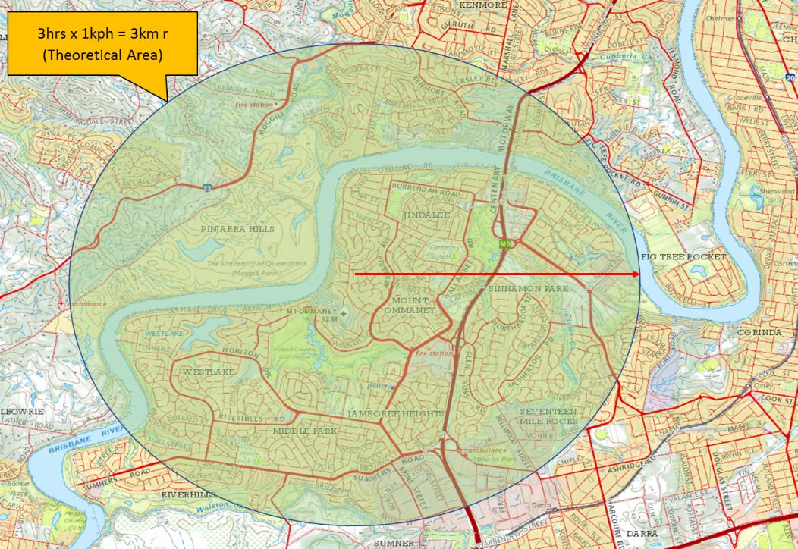

---
## Page 183

 
 
 
Volume 2 - Search and Rescue Operations 
NATIONAL SEARCH AND RESCUE MANUAL 
2025 EDITION Version 1 – February 2025 
Page 181 
 
Figure 3-41 Statistical Area plotted. 
3.16.7. 
Lost person behaviour for dementia or Alzheimer suffers suggests that 80% of MP in that 
category have been located within 3.2 Km of LKP.  Using this information draw a circle of radius 
3.2 Km around the LKP.  This has reduced our search area by a considerable amount, based on 
statistics of previous lost people.  It is necessary to keep in mind that this is only a statistical 
measurement and that of the studies there were 20% of MP’s who were located outside of this 
circle.  The SMC must devote a portion of their planning to this until intelligence suggests 
otherwise. 
 
Figure 3-42 Subjective search area plotted. 
3.16.8. 
Use the subjective method and look carefully within the 3.2 Km circle.  A number of defined 
boundaries can be seen and marked.  These will include the Brisbane River, a creek and the 
Western Motorway.  It is a reasonable assumption that a missing person will be contained 
within these boundaries.  They are considerable boundaries and clearly mark the area.  It has to

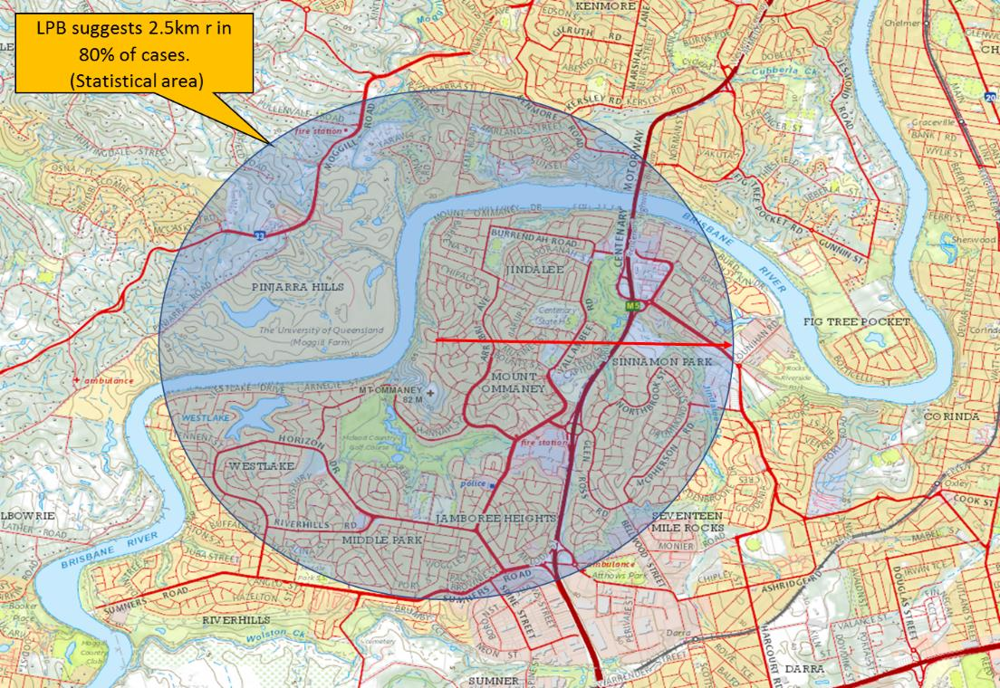

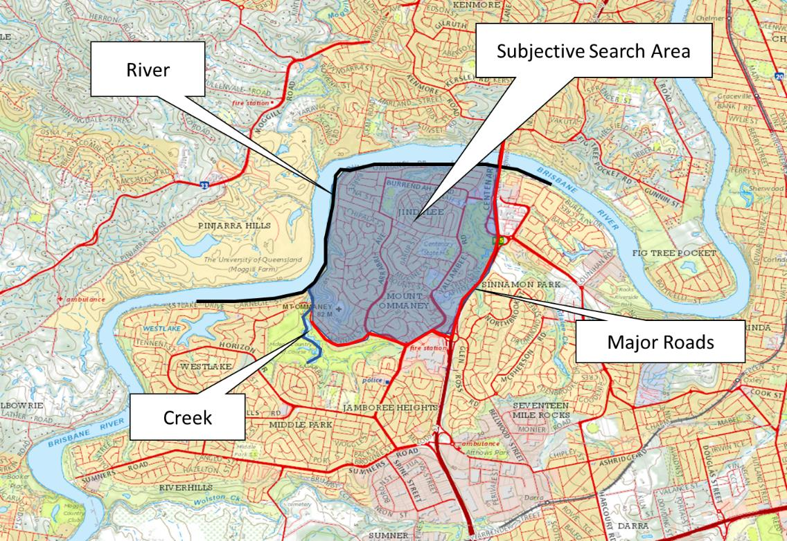

---
## Page 184

 
 
 
 
Volume 2 - Search and Rescue Operations 
 
NATIONAL SEARCH AND RESCUE MANUAL 
Page 182 
2025 EDITION Version 1 – February 2025 
be remembered that there will be a small percentage of MP’s that will pass through or over any 
boundaries. Using the above boundaries, it is now possible to reduce further the search area 
for our MP, in blue above. 
 
Figure 3-43 Deductive Search Area plotted. 
3.16.9. 
A deductive look at the map will show that there is a ridge, identified in red.  The land slopes 
downward toward the river on the west and north of this ridge.  An assumption is that an 
elderly MP who is experiencing walking difficulties will not walk uphill and will seek the path of 
least resistance, gradually going downhill towards the river.  This assumption should be 
accurately recorded within your log to justify your search plan. 
 
 
Figure 3-44 Probable search area identified 
3.16.10. The most probable search area for the MP is now a small area between the river and the ridge, 
as shown in green above.  Planning can now go ahead to commence a SAR mission.

---
## Page 185

 
 
 
Volume 2 - Search and Rescue Operations 
NATIONAL SEARCH AND RESCUE MANUAL 
2025 EDITION Version 1 – February 2025 
Page 183 
3.16.11. Scenario 2: A bushwalker has been report missing in the Gold Coast Hinterland.  She was last 
seen in the above saddle at 1200 hrs after which she became separated from her group.  It is 
now 1500 hrs, with three hours having elapsed. 
 
Figure 3-45 LKP of missing bushwalker 
 
Figure 3-46 Working out time missing

---
## Page 186

 
 
 
 
Volume 2 - Search and Rescue Operations 
 
NATIONAL SEARCH AND RESCUE MANUAL 
Page 184 
2025 EDITION Version 1 – February 2025 
 
Figure 3-47 Reflex search 
 
Figure 3-48 The theory of a Theoretical search

---
## Page 187

 
 
 
Volume 2 - Search and Rescue Operations 
NATIONAL SEARCH AND RESCUE MANUAL 
2025 EDITION Version 1 – February 2025 
Page 185 
 
Figure 3-49 Theoretical area is entire map portion. 
3.16.12. A look at the map shows that the terrain is moderate sloping hills and has open sclerophyll 
vegetation. Naismith’s Rule suggests that a person can walk at 3 kph in light wooded terrain, 
but again does not take into account age or fitness. The MP has been missing for 3 hours and at 
3 kph, this gives a circle with a radius of 9 Km. This area covers the entire area of the above 
map. 
3.16.13. Statistically, the lost person behaviour for hikers shows that 80% are normally located within 
5.76 Km of LKP.  After drawing a circle of 5.76 Km radius from LKP it can be seen that it still 
covers the entire section of the above map.  In the above instance this has not tightened the 
search area by much. 
 
 
Figure 3-50 Statistical area is also entire portion of map 
5.76 km LPB 
Search radius

---
## Page 188

 
 
 
 
Volume 2 - Search and Rescue Operations 
 
NATIONAL SEARCH AND RESCUE MANUAL 
Page 186 
2025 EDITION Version 1 – February 2025 
 
Figure 3-51 Subjective features plotted 
3.16.14. Looking subjectively at the map a number of natural and manmade boundaries can be 
identified, including the road, creek, ridge line, re-entrant and tracks.  Marking these will reveal 
an irregular shaped search area, shown in green above.  An inspection of the terrain has also 
identified that from the LKP the land slopes downward towards the creeks on both sides of the 
ridge.  An assumption could be made that a missing person would walk downhill towards a 
watercourse and then follow it to help.  An equally valid assumption could be that a missing 
person would seek higher ground to attempt to identify their location.  Which course the 
missing person will take will depend on their experience, ability to navigate, mental state and 
fitness.  Intelligence gathered during pre, and ex comms may shed light on this assumption.  In 
either instance the area contained within the identified boundaries would be the area of 
highest probability.

---
## Page 189

 
 
 
Volume 2 - Search and Rescue Operations 
NATIONAL SEARCH AND RESCUE MANUAL 
2025 EDITION Version 1 – February 2025 
Page 187 
Figure 3-52 Decision Points identified 
 
 
Figure 3-53 Probable search area plotted 
3.16.15. Search Area Segmentation: It is now essential that the search area be segmented into task 
areas. These should be small enough for efficient coverage by a team in a reasonable time. 
Where segmentation results in more task areas than teams, it is necessary to prioritise the task 
areas. Where specialist skills are required to search an area, e.g., mine shafts, sink holes or 
cliffs, these should be treated as specific task areas. Segmentation into task areas on a map 
may not easily translate into identifiable blocks on the ground. It may be necessary to modify 
task areas to suit the ground conditions. The boundaries of task areas should be readily 
identifiable features such as: 
a) 
Natural features (e.g., rivers, creeks, ridges, re-entrants, spurs, tree and grass lines, and 
shorelines); and 
b) 
Artificial features (e.g., roads, tracks, power lines, water pipelines, fences, railway lines 
etc.). 
3.16.16. Where readily identifiable features are not available as task boundaries, use may be made of 
global positioning systems (GPS), compass bearings or markers.  
3.16.17. In some environments there will be no natural barriers within your possible search area.  This 
often occurs in the inland areas of all states except Tasmania, where there are large tracts of 
open plains with no watercourses, hills or other obstacles, but can also happen in large 
rainforest areas or sclerophyll forests. In these cases, it is not possible to reduce the search area 
by these means and it is necessary to look elsewhere for clues and assistance.

---
## Page 190

 
 
 
 
Volume 2 - Search and Rescue Operations 
 
NATIONAL SEARCH AND RESCUE MANUAL 
Page 188 
2025 EDITION Version 1 – February 2025 
 
 
Figure 3-54 Search area divided into smaller searchable areas. 
3.16.18. The intention of the MP can be a pointer to possible directions of travel.  The fall of the land 
may suggest natural funnels, which will draw a missing person.  Lost and tired persons tend to 
walk down hill, following the path of least resistance where possible.  Cattle and animal tracks 
will often be followed by lost persons. 
3.17. Recording of search areas (Land) 
3.17.1. 
Once a search area has been determined it is necessary to keep a permanent record for future 
reference and as the basis for sub-search areas. 
3.17.2. 
Overlays: The actual search areas are not recorded directly on the map.  If this is done the map 
is then unable to be used for further searches within that incident or for other incidents.  In the 
event the missing person/vessel/vehicle or aircraft is not found this map then becomes 
evidence and may never be used again.  Acetate sheet or tracing paper have been traditionally 
used to record search areas.  In doing so it allows the map to be used for other parts of the 
search and for future searches.   
3.17.3. 
Each overlay should represent a part of the search.  Overlays can represent: 
a) 
The entire search if resolved in a short period of time 
b) 
The search area for one day 
c) 
The search area for one period of time such as AM or PM 
d) 
The search area for individual search teams. 
3.17.4. 
Each overlay should have the date, name and number of the map and the SMC’s recorded in a 
top corner.  The overlay should also have at least two cross hairs (+) at diagonal locations 
marked with the four-figure grid reference to enable the overlay to be replaced in the correct 
location on the map in the future. 
3.17.5. 
At the end of each search the individual search area recorded on the overlay can be hatched 
out (#) in red to show that that area has been search.  This should correspond with the 
completed task sheet for that search.

---
## Page 191

 
 
 
Volume 2 - Search and Rescue Operations 
NATIONAL SEARCH AND RESCUE MANUAL 
2025 EDITION Version 1 – February 2025 
Page 189 
3.17.6. 
At the end of each search day all overlays should be collected.  By superimposing them the SMC 
will be able to see which areas have not been searched and which will need researching. 
3.17.7. 
At the end of the search, the overlays will provide a detailed day by day representation of the 
search activities and search development. 
 
Figure 3-55 Identify search location. 
 
 
Figure 3-56 Place overlay sheet on map, location in centre.

---
## Page 192

 
 
 
 
Volume 2 - Search and Rescue Operations 
 
NATIONAL SEARCH AND RESCUE MANUAL 
Page 190 
2025 EDITION Version 1 – February 2025 
 
Figure 3-57 Mark two grid line intersections, Map name, SMC and date. 
 
 
Figure 3-58 Theoretical search area marked.

---
## Page 193

 
 
 
Volume 2 - Search and Rescue Operations 
NATIONAL SEARCH AND RESCUE MANUAL 
2025 EDITION Version 1 – February 2025 
Page 191 
 
Figure 3-59 Statistical search area marked. 
 
 
Figure 3-60 First stage of Subjective analysis.

---
## Page 194

 
 
 
 
Volume 2 - Search and Rescue Operations 
 
NATIONAL SEARCH AND RESCUE MANUAL 
Page 192 
2025 EDITION Version 1 – February 2025 
 
Figure 3-61 Continual Subjective analysis 
 
 
Figure 3-62 Continual Subjective analysis (Buildings)

---
## Page 195

 
 
 
Volume 2 - Search and Rescue Operations 
NATIONAL SEARCH AND RESCUE MANUAL 
2025 EDITION Version 1 – February 2025 
Page 193 
 
Figure 3-63 Continual Subjective analysis (Fences and roads) 
 
 
Figure 3-64 Search area allocation

---
## Page 196

 
 
 
 
Volume 2 - Search and Rescue Operations 
 
NATIONAL SEARCH AND RESCUE MANUAL 
Page 194 
2025 EDITION Version 1 – February 2025 
 
Figure 3-65 Deductive search analysis. 
3.17.8. 
Electronic Recording of search areas: Recently there have been advances in electronic 
recording of search areas.  The methodology is the same as for overlays, just done of a 
computerised map.  Mapping software, such as Google Earth, allows search areas to be marked 
and assigned to individual search teams.  As would be done with overlays, the search areas 
determined electronically need to be saved as per operating instructions.  Search teams can be 
assigned to areas and details recorded.  Completed searches can be hatched (#) out on the 
electronic map providing a ready reference for those areas being searched, those to be 
searched and those that have been completed. 
a) 
At the end of each period, day and search the electronic search areas will be saved for 
reproduction at a later date. 
b) 
Items of interest can be recorded directly onto an electronic map, with attachments such 
as photographs, commentary and situational factors. 
c) 
Electronic search mapping also has the benefit that it can be electronically sent to distal 
search teams, used for briefings and displayed on screens at a number of locations 
simultaneously. 
3.17.9. 
Downloading and storing GPS Data: For the purposes of standardising the downloading and 
storage of SAR related GPS data, such as search asset tracks, the following guidelines are to be 
followed to ensure that data security is maintained. 
a) 
Where possible, only data from SAR Authority owned GPS receivers is to be used. 
b) 
GPS receivers are to be downloaded in accordance with manufacturer’s instructions. 
c) 
GPS data is to be downloaded from search assets on a daily basis to ensure it is not 
overwritten or otherwise lost. 
d) 
The GPS data is to be overlayed onto a mapping program such as Google Earth or 
OziExplorer.

---
## Page 197

 
 
 
Volume 2 - Search and Rescue Operations 
NATIONAL SEARCH AND RESCUE MANUAL 
2025 EDITION Version 1 – February 2025 
Page 195 
e) 
The original downloaded track overlay is to be immediately saved.  Any subsequent 
changes to the overlay, such as shading; other search areas or briefings are to be done on 
a copy and subsequently saved. 
f) 
At the conclusion of the SAR incident, or daily, if possible, GPS downloads are to be saved 
in the electronic SAR occurrence. 
g) 
If evidence of the provenance and integrity of GPS receivers is required in a Coronial 
matter the SMC will provide a statement testifying to its integrity or use a method under 
each state/territory Evidence Act. 
Behaviour of Lost People 
Specific factors of LPB that may affect search planning:   
3.17.10. State of Health: The physical health of the lost person will have a direct impact on their ability 
to self-help and formulate rational decisions.  Recent illnesses, poor fitness, disease, lack of 
adequate nutrition and lack of sleep will restrict a person’s ability to cope with situations such 
as being lost in an unfamiliar environment.  Increased physical stress will result in fatigue and 
exhaustion setting in, reducing the ability to think clearly.  Good physical health may be an 
indication of an ability to withstand the rigors of being lost. 
3.17.11. Past Experiences: Studies have shown that persons who often challenge themselves in new 
ways or expand their comfort zones will be more adaptable to adverse situations, such as being 
lost.  Gathering evidence of past experiences will provide an insight as to the missing person’s 
ability to cope with challenging or stressful situations.  A person who rarely does or tries 
anything new is more likely to be helpless and a liability when lost. 
3.17.12. Physiological effects of the environment: While it is acknowledged that extremes of heat and 
cold will have a detrimental effect on a missing person, a combination of normal temperatures 
with rain and/or wind will quickly have adverse effects on a missing person.  Wind and wet chill 
can quickly lower the core body temperature and will cause a person to seek shelter which will 
limit their detectability by searchers. Hypothermia has been identified as a leading cause in 
death and accidents in the outdoors from a search and rescue perspective.  Persons suffering 
from either hypothermia or hyperthermia become irrational and lose the ability to help 
themselves.  Altitude exacerbates any effects of these debilitating conditions.  
3.17.13. Fear Factors 
a) 
An aspect that is often overlooked with respect to missing persons is general fear.  Fear 
can be categorised as five basic types; fear of being alone, fear of the dark, fear of animals, 
fear of suffering and fear of death. A SMC must take these fears into account when 
planning a SAR mission, not just from a lost person point of view but also from a searcher 
viewpoint.   
b) 
Fear of being alone: In Australia this could also be termed fear of the bush. While some 
people choose the isolation of the bush the average person finds it haunting.  The bush, 
and this term covers everything from the central deserts, coastal rain forests, snowy alps, 
eucalypt, brigalow and gidyea forests and northern swamps, is a very harsh and difficult 
place to survive adequately.  Most of the continent has very little surface water and native 
foods are difficult to safely identify. 
c) 
Fear of the dark: Most humans have a primeval fear of the dark.  This coupled with the 
noisy nocturnal activities of most native animals makes the bush darkness a stressful place 
to be.  Compounding this is the general loss of our most important sense, sight.  Without 
being able to see objects in the darkness our imagination can often conjure up images that 
can cause the strongest to be afraid.  This sensation is not confined to lost persons, as it 
also has an effect on searchers.  Those searchers on the extremes of any line search will 
eventually creep closer to the centre because of this fear of the dark, hence a 100-m wide 
search initially will eventually diminish to cover a much smaller area. It is amazing how a 
small amount of light, from a torch or fire, can alleviate this fear.

---
## Page 198

 
 
 
 
Volume 2 - Search and Rescue Operations 
 
NATIONAL SEARCH AND RESCUE MANUAL 
Page 196 
2025 EDITION Version 1 – February 2025 
d) 
Fear of animals: Although Australia has no known predatory animals that actively prey on 
humans there is an irrational fear of being in the bush alone. Most native animals are 
nocturnal, and their nightly activity can unnerve people and preclude a good night sleep, 
with the associated reduction in rational thinking and self-help ability. 
e) 
Fear of suffering: The spectre of survival can cause a fear of suffering in lost persons.  
Australia is an extremely harsh continent, not designed to support lost persons.  The 
possibility of dehydration, starvation, hypo- and hyperthermia, illness and injury are all 
real possibilities, and there are many examples of each throughout our history.  The 
thought of the lingering agony of each situation can create a very real fear among some 
lost persons. 
f) 
Fear of death: The fear of a lingering death can haunt many people, particularly when they 
consider the many things yet to do; leaving loved ones behind, tying up loose ends and the 
hereafter.  In some instances, the fear of death can actually hasten it. 
3.17.14. Biological Cycles 
a) 
These cycles have been recognised in the medical world for many years and do have some 
application to search and rescue.  Most humans go through a cycle of highs and lows 
which can vary from periods as short as a day to periods of months.  
b) 
Female biological cycles are relatively easy to map and generally fall in line with their 
menstruation cycle.   
c) 
Males have similar but less detectable cycles.  Studies have shown that males will 
generally mirror their female partner’s cycles.   
d) 
A person at the high point of a cycle may see being lost as a challenge to be met head on.  
These people will attempt to self-help and have a greater chance of survival in adverse 
conditions.  Conversely, a person at a low point of a cycle may have little energy to assist 
themselves and may succumb to conditions more quickly.  
3.17.15. Behaviour while Lost 
a) 
The recognition of being lost occurs at different stages for people.  It may be the slow 
awareness that it is taking far longer to reach a destination than was calculated or the 
instant realisation that what was once familiar territory is now not. A lost person can go 
one of two ways; sit tight and quietly reflect the situation and work out a solution or to 
hasten their pace as the destination ‘could just be over the next hill’.  This second situation 
can then also go in two directions; the realisation that they are getting further into 
unknown territory and sit down to reflect the situation or to increase their pace and run to 
avoid the fear of the bush, which now appears to be closing in around them.  In other 
words, they are panicking. 
b) 
Those persons who take the time to ponder may identify their location and self-help to 
safety.  If this is not possible, they will often form a shelter and wait for rescue. 
c) 
Those who are compelled to continue in a blind rush often find themselves injured in 
locations often far removed from their original intended track and therefore take longer 
to locate and rescue.  It is worth considering that these people may often attempt to 
travel up hill to either locate a path or orientate themselves to their environment before 
fatigue, despair and/or depression takes over and they tend downwards on the path of 
least resistance.  These people will often take risks beyond their capability and as a result 
suffer more injuries than would normally be expected. 
d) 
In both the above circumstances shock will be suffered by the lost person.  This will 
manifest itself in many different ways depending on the person’s mental strength, from 
simply forgetting incidents that have occurred to failing to seek shelter from rain or snow. 
3.17.16. The trauma of being lost may also have the following effects on a lost person: 
a) 
Not seeking shelter.  Many persons do not make an adequate shelter nor build a fire for 
warmth.  With hypothermia and hyperthermia being very prevalent, particularly in desert,

---
## Page 199

 
 
 
Volume 2 - Search and Rescue Operations 
NATIONAL SEARCH AND RESCUE MANUAL 
2025 EDITION Version 1 – February 2025 
Page 197 
mountainous and urban areas, this is a vital necessity and will extend a person’s chances 
of survival. Survivor questioning has often elicited the assumption that it is not worth the 
effort of making a shelter even if it will limit heat loss and provide a measure of mental 
comfort. 
b) 
Discarding equipment: Many persons discard their equipment without thought for using it 
to survive. While it is true that most lost persons are not prepared for the conditions as 
they only expected to be out for a few hours, there have been many instances of people 
being extremely well prepared and failing to use the items that had with them, particularly 
tents and fire making apparatus.  Discarding clothing and backpacks is common and may 
be contributed to the shock of being lost. 
c) 
Discarding clothing: Many persons discard their clothing while wandering in the bush.  This 
may because of overheating in warm areas, but soon becomes regrettable as the sun sets 
and the temperature cools down.  While understandable in hotter areas it also happens 
during the early stages of hypothermia in colder areas.  The net benefit of discarding 
clothing is that the lost person succumbs sooner. 
d) 
Sense of abandonment: Often with the shock of being lost is the sense of abandonment, 
the feeling that nobody is looking for them.  Throughout Australia a search mission will be 
commenced once the alarm has been raised by a concerned party.  If the SMC has an 
itinerary and LKP then the task of locating the MP is much easier.  If there is no itinerary, 
no LKP and the MP has not been seen for some time then the task is that much harder. 
e) 
Clothing: Self-helping and responsiveness is a big factor in determining what type of 
search to opt for.  A MP wearing bright clothing and actively seeking assistance will be 
easily located when compared to a small child dressed in dark clothing hiding in the 
undergrowth for shelter.  Children are often taught ‘stranger danger’ and are reluctant to 
approach a stranger in these circumstances.  MP suffering shock or other mental issues 
may make no attempt to draw attention to themselves even if they see a searcher, motor 
vehicle or helicopter. 
f) 
Navigation aids: Ignoring aids such as tracks, paths and fences is a common problem 
associated with MP’s suffering shock.  Common sense dictates that if a MP locates one of 
the above it will lead to a main road, gate or house where help can be obtained.  On many 
occasions a MP will cross a track, path or fence, often without realising it, only to be 
further lost in an area outside a high probability search area. 
Mass Casualty SAR Incidents 
3.17.17. Causal factors: Throughout the world manmade or natural disasters regularly overwhelm small 
communities with the resulting loss of live and missing persons.  These causal factors include: 
a) 
Mud slides: ‘A mass of mud and other earthy material that is falling or has fallen down a 
hillside or other slope.’  Mudslides are very common in the wetter parts of the world, 
northern South America, central Africa and south-east Asia as a result of large amounts of 
localised rain which causes a portion of surrounding hills to shift downwards, wiping out 
small villages and destroying communities. Statistical evidence suggests that most people 
caught in the mudslide will either self-recover or make it to safe ground or they will not.  
There is very little evidence that people survive for any length of time in mudslides. 
Missing persons swept up in the mud will be taken some distance from where they began, 
possibly being pushed to the side of the mud flow or buried deep within the flow. 
b) 
Tsunamis: A long sea wave caused by an earthquake or other underwater disturbance. 
Tsunamis are more common in the Pacific Ocean, primarily because this ocean is 
surrounded by moving tectonic plates. While not common, tsunamis are not all that rare 
and occur on a semi regular basis with little effect on the surrounding countries due to the 
distances involved and depth of the ocean.  In recent times they have involved several 
waves or walls of water surging inshore for distances up to ten and twelve kilometres 
depending on the topography of the ground.  The waves or wall of water may be only a 
few centimetres up to four and five metres in height.  The water gathers up all loose items

---
## Page 200

 
 
 
 
Volume 2 - Search and Rescue Operations 
 
NATIONAL SEARCH AND RESCUE MANUAL 
Page 198 
2025 EDITION Version 1 – February 2025 
in the way, and it is these that often cause the damage to structures and persons. The 
initial force of the water and the amount of debris are what prove fatal to people caught 
in the first or subsequent waves. Similar to mud, people swept up in the tsunami will often 
be taken some distance from where they first entered the water.  These people may be 
deposited far inland or carried back out to sea as the wave recedes.  In both instances 
survival would depend on their ability to get out of the way of the water.  Once trapped in 
the water chances of survival quickly fall.    
c) 
Flash flooding: A sudden local flood of great volume and short duration.  Flash flooding is 
different to general flooding in which the community normally has some prior knowledge.  
Flash flooding can occur as a result of a sudden downpour of rain in a localised area or as a 
result of heavy rainfall in another location flooding into a second area.  There is generally 
little prior knowledge or warning of a flash flood. General information suggests that those 
persons trapped in the flood waters have a limited chance of survival unless they manage 
to extricate themselves within the first few minutes.  The longer the period trapped in the 
water, the less likely they will survive due the buffeting and collision with water borne 
debris and other obstacles including vehicles, trees and ground fixtures. 
d) 
Bush fire: A fire that occurs in the bush, started by lightning, burn off or deliberately.  
Australia is plagued by bushfires, particularly during the hotter months of the year.  They 
can be limited to a single property or cover vast tracts of land driven by favourable winds.  
There is no large-scale effective countermeasure against bushfires except burning off the 
ground fuel before the fire front.  Official advice for those facing a bushfire is to either 
leave the area or stay and defend their properties.  Information and investigation into 
bushfires suggest that those persons that are caught and perish in the flames do so in-situ 
and are not carried away as in floods. 
e) 
Earthquakes: A sudden and violent shaking of the ground, sometimes causing great 
destruction.  They are usually caused as a result of movement within the earth’s crust.  
Australia is situated approximately in the centre of our tectonic plate and is therefore 
spared major earthquakes, although as a nation we do suffer from smaller earth 
movements, which are not as severe as many other countries. 
f) 
Avalanche: An avalanche is a sudden rapid flow of snow down a slope, occurring when 
either natural triggers or human activity causes a critical escalating transition from the 
slow equilibrium evolution of the snowpack. Typically occurring in mountainous terrain, an 
avalanche can mix air and water with the descending snow. Powerful avalanches have the 
capability to entrain ice, rocks, trees, and other material on the slope. In contrast to other 
natural events which can cause disasters, avalanches are not rare or random events and 
are endemic to any mountain range that accumulates a standing snowpack.  
g) 
Subsidence: The gradual or swift caving in or sinking of an area of land. This is becoming a 
more common feature in areas where developments have been built over old coal mines. 
Urban SAR (USAR) 
3.17.18. Urban search and rescue (USAR) is the search for and recovery of survivors and deceased 
persons trapped within or under the rubble of collapsed buildings, tunnels or other structures.  
This type of search is generally the province of the Fire Service within each State/Territory and 
as such will not be touched upon in this section.  SMCs should bear in mind that these searches 
will often go hand in hand with normal SAR incidents. 
Coordination 
3.17.19. It is imperative that a search and rescue mission be commenced at the earliest opportunity in 
order that any survivors are given the maximum chance of being located and recovered safely.  
At the time it is determined that persons are missing as a result of a disaster a senior SAR 
Coordinator should be advised and called into the MIR or Operations Room.  This Coordinator 
will be responsible for initially assembling a team, recommended five SAR trained member 
minimum, to travel to the disaster area.  While there are normally SAR trained members spread

---
## Page 201

 
 
 
Volume 2 - Search and Rescue Operations 
NATIONAL SEARCH AND RESCUE MANUAL 
2025 EDITION Version 1 – February 2025 
Page 199 
throughout each State the major source of experienced members would be the Search and 
rescue Assets/Water Police in the short term.  These members can be deployed immediately 
and should be rotated and/or replaced on a roster system in conjunction with the Senior SAR 
Coordinator and other assets.  Where required an Overarching SAR Supervisor should be 
appointed to provide advice, guidance and support in situations where more than one search 
location is required. 
Initial Actions 
3.17.20. The incidents described above can occur without any warning or with minimal warning. The 
science of disaster prediction is still in its infancy and authorities are always caught between 
issuing warnings too early and panicking the community or issuing warnings too late and not 
allowing the community to take proper preparations.  In many instances the trigger points for 
the issuing of warnings are very close to the actual occurrence of the event. 
a) 
Extent of the incident: The SMC should endeavour to determine the extent of the 
incident.  In many of the above disasters the actual area of destruction will be limited to a 
relatively small area.  Flooding and bushfires have the potential to cover large areas. 
b) 
Population details prior to incident: In order to determine the number of missing persons 
within a particular area the SMC will need to obtain information as to the original 
population in that area.  This is inherently difficult as many families and persons are 
displaced from their homes and are either placed in shelters in other locations or with 
friends and relatives.  In the first instance the number of missing persons will always be 
high until detailed lists of survivors can be compiled by agencies such as Police, 
Community Services and the Salvation Army.  Although this information is vital in the 
planning for a SAR incident, don’t postpone the commencement of the SAR because this 
information is not immediately forthcoming. 
c) 
Last known location of the MP’s: Where possible information of the last known point of 
each missing person should be obtained as a starting place for the planning of the SAR 
response.  Again, this is very similar to the problem above in that this information may not 
be forthcoming until several days into the operation. 
d) 
Lost Person Behaviour: There is no LPB that details the post distress actions of persons 
caught up in the above disasters.  Given sufficient warning for some of the disaster types, 
such as bushfires, persons have the choice of either fleeing the area for a safer location or 
staying and fighting. The actions of the other disaster types are so difficult to predict that 
general advice is to evacuate the area.  For those persons that remain behind and are 
caught up in the incident it is extremely difficult to predict where will be the best locations 
to commence a search.   
Working under or within a MIR 
3.17.21. A MIR and/or PFCP will be set up in conjunction with a Local Government Disaster Centre.  The 
State Disaster Coordination Centre may also be activated if the initial incident warranted.  The 
SAR component of the incident is but one small role within a wider response and recovery 
operation. The most senior member assigned to the incident will be the Incident Commander 
and will therefore set the tone of the response and recovery.  The SAR system fits underneath 
but is separate to the MIR.  Whilst he/she must follow the directions of the Incident 
Commander, the SMC is the member running the SAR response.  The SMC will be competing 
with other assets and agencies for the limited resources available initially at any disaster 
incident.  The SES required to conduct searches will also be required to assist in disaster 
centres, other activities and generally assisting the surviving population.  Other assets such as 
helicopters, four-wheel drive vehicles, boats, heavy machinery and ADF resources will be 
competed for. The SMC should prepare a detailed search plan, outlining the objectives and 
equipment/resources required to conduct the search phase.

---
## Page 202

 
 
 
 
Volume 2 - Search and Rescue Operations 
 
NATIONAL SEARCH AND RESCUE MANUAL 
Page 200 
2025 EDITION Version 1 – February 2025 
MIR Liaison Officer 
3.17.22. The SMC should consider, at the earliest opportunity, in having a Liaison officer appointed 
between the MIR and the SMC.  This member would work from within the MIR and be in a 
position to pass on details that would be useful in a SAR incident that may otherwise not be 
forwarded.  These details will include information obtained from a variety of sources such as 
detectives, traffic, SES, Local Government.  The type of information useful in a SAR incident will 
include: 
a) 
Last known location of missing persons 
b) 
Clothing worn when last seen 
c) 
Statements from people last seeing MP’s. 
d) 
Other people with MP’s 
e) 
Other sightings of MP’s 
Field Search Headquarters 
3.17.23. The location of the FSH is normally determined by the SMC.   
3.17.24. Where possible it should be in or very near the search area.  This is to limit time travel, to allow 
the SMC to have very good situational awareness and allow ground to map accuracy.  As the 
area will have recently suffered destruction there may not be the normal facilities found at 
most FSH’s.  The SMC will need to source communications, tents, power, tables, maps etc. 
(local SES can assist).  The ADF can also assist if a DACC request is made.  The FSH needs to be 
secured and away from the public eye.  Access should be limited to necessary SAR personnel.  A 
briefing area should be set up adjacent to the FSH, close to an assembly area.  Welfare, toilets, 
food, communications and stores will be within the immediate area.   
3.17.25. Each distinct search location should have a separate SMC to coordinate the SAR response.  If 
there are two or more distinct search locations, then a senior SMC will need to be appointed to 
provide an overarching supervisory and coordinating role. 
3.17.26. Each SMC should be provided with a team of four SAR trained members: 
a) 
Assistant Search and Rescue Mission Coordinator: This member will provide day to day 
assistance to the SMC.  They will be responsible for putting into action the SMC’s plans 
and for providing an alternate opinion during the plan development stage to ensure that 
all contingencies are being covered. 
b) 
Planner:  This member will be responsible for determining the search areas, plotting these 
onto the map on a daily basis or otherwise as determined by the SMC.  They are also 
responsible for the allocation of the search teams and completion of all areas, speed, 
distance and time calculations in order to provide advice to the SMC. This member will 
also manage the task sheet distribution and collection. 
c) 
Intelligence:  This member will be responsible to the SMC for the collection, collation, 
evaluation and dissemination of all information arriving at the FSH.  They will filter and 
value add to any information obtained, check it against current and past tasks and where 
necessary forward the information to the Planner for assigning. This member will also 
manage the white board at FSH. 
d) 
Administration and Logistics:  This member, working in conjunction with the A/SMC, 
Planner and Intelligence will source the necessary resources to enable the search to 
proceed.  They will also be responsible for re-supply of teams, rest and rotation of teams, 
food, welfare, fuel, travel arrangements and any other task assigned by the SMC. 
3.17.27. On a protracted search it would be necessary to rotate the entire FSH staff on a five-day basis.  
The Senior SAR Coordinator will be responsible for organising fresh teams to rotate through 
each FSH.  On the morning of day five the new team will arrive at the FSH, with each fresh 
member pairing off with the member they are replacing.  Past experience suggests that a four-

---
## Page 203

 
 
 
Volume 2 - Search and Rescue Operations 
NATIONAL SEARCH AND RESCUE MANUAL 
2025 EDITION Version 1 – February 2025 
Page 201 
hour handover will provide all the necessary information, thought processes, plans and current 
tasks to the oncoming team.  The original team can then depart for their home stations for rest 
and relaxation. 
3.17.28. A five (5) member FSH will provide a professional response to a delicate and sensitive situation.  
It will also provide the Incident Commander with the best possible chance of achieving a 
reasonable outcome. 
Searching 
3.17.29. There are a number of steps to follow to ensure that the best possible search is conducted 
within the area of the disaster.  In most instances the SMC will be looking for deceased persons, 
more than likely hidden in the debris left behind after the incident. 
a) 
First Land Search: Once the area of destruction has been identified and the initial danger 
has passed the first search can commence.  The aim of the first search is to clear all 
buildings, houses, shops, sheds, barns, vehicles and other potential places of entrapment.  
The first search will be similar to a fast search, the aim of which is to ensure that all 
survivors are located and removed to a place of assistance.  While the best medical advice 
suggests that there would be very few survivors in most of the disaster types there are 
numerous instances where a survivor has been located days after the initial incident, often 
protected by the very debris that proves fatal for most persons.  Local SOP’s will deal with 
the actions to be taken in this event. 
b) 
Second Land Search: The second search is a more thorough search of the areas covered by 
the first search and any other areas identified as requiring searching.  This search is more 
akin to a general search in which the searchers are going to make a more thorough search 
of each of the buildings and surrounding countryside within each search area.  This search 
will require a large number of searchers to ensure an adequate coverage of the search 
area.  In those areas inundated with mud, flash flooding, tsunamis, earthquake and 
subsidence there will be large amounts of debris piled up against any solid walls or 
barriers in the destruction area.  These debris fields will need to be thoroughly searched, 
to the extent that these debris walls will need to be pulled apart and sifted through.  In 
many instances the mud will eventually set as hard as concrete and will require heavy 
machinery to dismantle.  During this stage it is very important that searchers sift through 
the debris as it is pulled apart to ensure that deceased persons are located. 
c) 
Third Land Search: If necessary, a third search may be conducted of all or a part of the 
search area.  This may be required due to weather or other circumstances that may have 
degraded earlier searches.  Unusual odours or debris piles not previously dismantled will 
need clearing before an area can be identified as clear.  
d) 
Fourth and subsequent Land Search: A fourth and subsequent searches may need to be 
carried out in some areas of the search location due to a variety of factors including: 
i)  
Area still inundated with water; 
ii) 
Conditions are not conducive to conducting a thorough search; 
iii) 
Current conditions are considered unsafe, particularly where buildings are 
concerned; 
iv) 
Continued ground tremors; 
v) 
Continuing rain; and 
vi) 
Insufficient resources, necessity for specialist crews, to complete search. 
Land Search problems 
3.17.30. Unlike general SAR operations, searching in mass victim incidents will require different 
techniques.  There are a number of different situations that will need to be taken into account 
by the SMC:

---
## Page 204

 
 
 
 
Volume 2 - Search and Rescue Operations 
 
NATIONAL SEARCH AND RESCUE MANUAL 
Page 202 
2025 EDITION Version 1 – February 2025 
a) 
Searching shops, houses, flats and apartments: A full search will need to be conducted of 
the interior of all houses, flats and apartments that were affected by the incident.  This 
search should include all rooms, cupboards, wardrobes, hutches, fridges, washing 
machines, etc. Underneath all buildings will also need to be cleared.  Those buildings on 
stumps may not pose the problem of those buildings closer to the ground.  Flood water 
and mud can carry persons into and under buildings where they may become trapped.  
(Before doing so, ensure buildings are determined structurally sound.) 
b) 
Searching open areas, paddocks, parks and farmland: As a result of flooding and/or mud 
these open areas can be covered in either water, mud or a combination of both. Searching 
these areas is manpower extensive and time consuming.  They must be covered slowly, 
with a visual horizon as close as 2-m, and a slow walking pace.  Long metal poles will also 
assist in testing the mud for buried persons.  A searcher will notice the difference as they 
push a metal pole through the mud and into a deceased person. Searchers should also 
beware that there will be cattle, sheep and wildlife buried within the mud that will 
produce a similar smell and feel to a deceased person. 
c) 
Search creeks, waterways, gullies, drains etc.: Flooding water and mud will generally take 
the path of least resistance, which normally will be creeks, gullies, waterways and drains.  
The depth of water in these may require specialist assets to assist in searching, such as 
Divers.  The force of the water and mud will also push motor vehicles, household items 
and other debris into these waterways.  Each one of these items will need to be located 
and recovered from the water in order that they can be cleared as empty.  Animals such as 
horses, cattle and wildlife will also be found in the water.  As they could be masking 
human remains, they will also need to be recovered and checked. 
d) 
Searching mountainous areas: Mountainous areas pose a wide variety of problems for a 
SMC, in particular the necessity for searchers to have specialist skills in mountain climbing 
and/or snow searching. Avalanche victims have a very limited golden period requiring 
searchers to be deployed within minutes of the incident occurring. Transport to the 
incident site may be limited due to road and rail closures.  Rotary wing assets will be the 
best option. 
e) 
Search Fatigue: Although the search areas used in these situations will be smaller than in 
general SAR operations the intensive searching required will cause the searchers to 
succumb to fatigue quicker than usual.  Searching areas while wading through water and 
mud will also impact on the physical ability of searchers, limiting their useful capability 
and requiring regular rest and rotation. 
Search Area Delineation 
3.17.31. As in normal SAR operations the overall search area should be divided into sub search areas 
that are capable of being identified and then searched. The use of natural or man-made 
barriers or boundaries will ensure that each search area can be properly identified by its 
respective search team. The SMC has a range of options in which to delineate the search area 
depending upon the severity of the event.  Depending on the number of volunteers available 
each team should be assigned an area no larger than a normal town block per task.  This will 
provide sufficient work for a four-hour period. If teams are working in open fields an area of 
approximately ½-1 Km² would be sufficient per four-hour period. An expanding square or 
circular search from the point of origin or centre of the disaster will ensure that all areas are 
covered.

---
## Page 205

 
 
 
Volume 2 - Search and Rescue Operations 
NATIONAL SEARCH AND RESCUE MANUAL 
2025 EDITION Version 1 – February 2025 
Page 203 
 
Figure 3-66 Expanding Square Search 
 
Figure 3-67 Creeping Line Search 
3.17.32. Obtaining plans from the local government of the area of the disaster will give the SMC an 
appreciation of the number and location of all houses, shops and other buildings within the 
search area.  Depending upon the time of year and location there may also be considerations of 
children in school, shopping malls full of shoppers or popular holiday destinations packed with 
weekend campers. 
3.17.33. Utilising the urban property plan below the SMC can allocate a block to each SES or other team 
for searching.  The briefing would be able to include the number of properties within the search 
area and the type of buildings likely to be encountered.  As each property is checked for 
survivors, deceased or other it can be marked of accordingly.  Those properties that cannot be 
searched for a particular reason (Unable to reach location, building structurally unsound etc.) 
can then be easily identified at a later stage for further investigation.

---
## Page 206

 
 
 
 
Volume 2 - Search and Rescue Operations 
 
NATIONAL SEARCH AND RESCUE MANUAL 
Page 204 
2025 EDITION Version 1 – February 2025 
 
 
 
Figure 3-68 Utilising Urban Property Plans 
Tasking sheets 
3.17.34. Tasking sheets have been developed to ensure that all of the identified tasks within the search 
are properly undertaken and completed.  The SMC should ensure that each task is recorded in 
duplicate at least, providing one to the search team leader and keeping one at the FSH as 
reference.  As the task is completed the original can be signed off and filed.   
3.17.35. At the conclusion of each day any uncompleted tasks can be identified and reassigned if 
necessary.  The task sheets will enable the SMC to provide a detailed summary of the searching 
on a daily basis.   
3.17.36. Electronic mapping programs allow easy input of search areas as they are completed, again 
providing the SMC with an easily readable summary of the daily activities. They will also for the 
basis of a Coronial File, which will always follow a major disaster with loss of life.

---
## Page 207

 
 
 
Volume 2 - Search and Rescue Operations 
NATIONAL SEARCH AND RESCUE MANUAL 
2025 EDITION Version 1 – February 2025 
Page 205 
Briefings 
3.17.37. Briefings to search teams and search team leaders are generally given in the SMEAC format.   
a) 
Situation: The situation will be a precise of the incident occurrence and subsequent 
events. 
b) 
Mission:  The mission should be a short statement of intent i.e. to locate missing persons 
in the search area. 
c) 
Execution: The execution section will be the most important part of the briefing as it will 
provide the search teams with the tools to perform their assigned tasks.  Each situation 
will be different, and the methods of searching will be dependent on the terrain, disaster 
type, number of volunteers, weather and time frames.   
Execution Factors:  
i) 
Deceased persons: Deceased persons meet their demise in many different ways.  
Bushfire victims may vary from no visible signs of burning to totally incinerated with 
no resemblance to a human.  The degree of destruction depends on the severity of 
the fire, location of person, speed of the fire and any actions the victim may have 
made to protect themselves.  Many bushfire victims succumb to asphyxiation as the 
fire consumes all the oxygen in the area.  Others will breathe in the superheated air 
and perish as a result of the complications of the internal burning.  Searchers must 
be made aware that their targets will range from an intact human to a small pile of 
dark ash. Flood and mudslide victims will normally retain their human shape, 
although due to the force of the water/mud it may be distorted and out of shape 
with broken bones and internal injuries.  These victims will not often be found on the 
surface.  They may be entombed within a metre or more of mud or mud and debris. 
The deceased may not be easily recognised as they are often coated with mud and 
blend into the background.  Those that are left uncovered after the waters recede 
will often discolour and darker quickly as decay and sunburn sets in. Victims from 
building collapse as a result of earthquake or subsidence are often distorted and 
misshapen due to the extreme weight suddenly falling on them. 
ii) 
Searching for deceased is a combination of all senses as sight alone will not be 
enough.  The distinctive smell of decaying flesh may greet the searcher as they near a 
potential area.  Keeping an eye on the shape of the ground may unearth a buried 
victim.  Observing an area of darker ash in a human shape may identify a victim. 
Searchers may also use thin metal poles to prod into the ground, the change of 
pressure or sudden change of odour may suggest the location of a body underneath.  
Thermal imaging cameras and ground radar can be used if available.  There is no 
record of any success to date.  Cadaver dogs may also be considered, although they 
work best when the deceased are about week old. 
iii) 
Location of deceased:  Local SOP’s will determine the actions on location of deceased 
persons.  These should be included in the briefing to ensure photographs and 
examinations are made prior to recovery in case of foul play.  The location should be 
recorded by GPS or other accurate means to enable it to be plotted for the final 
report. Depending on the incident, a large number of animals will be located and will 
require the services of a doctor or forensic member to determine if they are human 
or otherwise. 
d) 
Administration and Logistics: Re-supply, body bags, disinfectant, insect repellent, 
sunscreen, fatigue, meals, water, transport, PPE are some of the items needed to be 
covered in this section. 
e) 
Command and Communications: This section is common for all SAR incidents. 
3.17.38. Ensure a full and detailed description of the person or item sought, including clothing.  This will 
enable recognition of any discarded items of clothing or parts.  When searching for missing 
persons the most obvious identified is often the only feature needed to be included in the

---
## Page 208

 
 
 
 
Volume 2 - Search and Rescue Operations 
 
NATIONAL SEARCH AND RESCUE MANUAL 
Page 206 
2025 EDITION Version 1 – February 2025 
briefing.  Too much detail provided to searchers can sometimes obscure their ability to identify 
their target. 
Record Keeping 
3.17.39. As per all SAR incidents, detailed recorded must be kept for future reference.  They will include: 
a) 
SAR Log: A detailed chronological record of decisions and actions taken during the SAR 
incident.  With respect to disaster searches, all decisions with respect to deployments, 
asset allocation, briefings, and debriefings should be recorded.  The log will also include 
such details as daily sunrise and sunset, weather conditions, topographic hazards, SAR 
teams and hand over notes. 
b) 
Task sheets:  Should be completed in duplicate, original for the search team and duplicate 
for the FSH. The original sheets should be collected from the search teams as they return 
to FSH.  If the task has been completed it can be closed.  If the search team was unable to 
complete the task for whatever reason, the task can be reassigned at a later date. 
c) 
Map overlays: Depending on the size of the search area and the number of search teams 
there may be a map overlay for morning and afternoon or for a single day.  Each overlay 
should have the map number, date, time and SMC name in the top right corner.  The top 
left and bottom right should have two reference marks so that the overlay can be aligned 
with the map at a later date.  The actual areas designated and those searched can then be 
drawn in permanent marker on the overlay.  As the SAR develops successive overlays can 
be placed on top of each other to determine what areas have been missed and what need 
to be researched. 
d) 
Radio log: This log will normally be maintained by the SES and will be a complete record of 
all radio traffic to and from FSH for the duration of the SAR operation. 
e) 
Briefing notes: A written copy of each daily briefing should be filed for future reference. 
3.17.40. Electronic recording of search: There are a number of electronic aids that can greatly assist the 
SMC in recording information and briefing up and down the chain of command.  One of the 
biggest problems associated with SAR is the accurate identification of areas searched.  At 
present this is done through a combination of map work and GPS usage.  Where available GPS 
data can be downloaded onto a mapping program to give an accurate picture of where search 
teams went.  This enables the SMC to know if the briefings were sufficient and if the directions 
were followed.   
3.17.41. Other electronic devices such as ArcPad’s or similar instruments have the ability to provide 
mobile field mapping and data collection.  This information can then be sent via the mobile 
telephone system to a server for instant production on a FSH computer terminal.  Used in 
conjunction with a GPS and date stamp enabled digital camera, pictures can be taken of any 
object of interest and transmitted instantaneously to the FSH.  This has the ability to allow the 
SMC to observe victims in-situ, debris mounts and other points of interest while communicating 
with the search team.  These photos can then be saved against that location for future 
reference. 
3.17.42. This information instantly allows the SMC to identify each property as it is being searched, and 
what the property looks like in real time.  The Incident Commander could also view these 
details from their office without the need to visit the scene.  These electronic aides could also 
provide information to assist the Coroner during any subsequent inquest as any of the 
properties involved in the incident can be viewed, as can the initial location of motor vehicles, 
persons and buildings if necessary. 
3.17.43. Summary: It is important to consider all the factors described in this chapter, along with 
information obtained about the missing person(s) prior to planning the search.

---
## Page 209

 
 
 
Volume 2 - Search and Rescue Operations 
NATIONAL SEARCH AND RESCUE MANUAL 
2025 EDITION Version 1 – February 2025 
Page 207 
Evidentiary Searches 
3.17.44. The skills associated with SAR are transferable to searching for crime evidence and this has 
become an increasing practice for land SAR coordinators. 
3.17.45. Although generally outside the scope of actual SAR the processes for an evidence search 
follows the same procedure as would be adopted for a missing person. 
3.17.46. Most evidentiary searches fall into the following categories: 
a) 
Searching for weapons from a crime 
b) 
Searching for evidence discarded by a fleeing offender 
c) 
Searching for victims of violent crime 
d) 
Searching for clandestine graves 
3.17.47. The targets for these types of searches can include: 
a) 
Bladed weapons 
b) 
Blunt force trauma weapons 
c) 
Firearms 
d) 
Rope and binding materials 
e) 
Stolen property 
f) 
Clothing 
g) 
Blood and hair 
h) 
Deceased persons 
i) 
Clandestine graves 
3.17.48. General and contact searches are the most commonly used for evidence location.  A detailed 
search can be undertaken in a relatively small area, such as the side of a road or farm paddock.  
Search patterns such as purposeful meandering and parallel sweep are best suited to this type 
of search. 
3.17.49. The format of an evidence search will be the same as for a lost/missing person.  The following 
steps are to be considered in the planning stage: 
a) 
Obtain all possible information about the incident, including: 
i) 
Target details, size, shape, colour, description, photographs, similar item for 
reference (There are instances where the exact search target is unknown, such as a 
blunt trauma instrument.) 
ii) 
Method of disposal 
iii) 
Location of disposal and the accuracy thereof 
iv) 
Weather conditions at the time of disposal and at time of search 
v) 
Size of search area, actual or speculative 
vi) 
Search assets and availability (It may be worthwhile considering a planned 
deployment at a time more suitable to searchers if possible) 
b) 
Identify resources as contained in the local resource register 
c) 
Method of searching 
d) 
Search aids (Cadaver dog, thermal imaging, terrain profiling, satellite imagery) 
e) 
Probability of detection 
3.17.50. A briefing, on similar lines to a normal lost person and in the SMEAC format, is to be prepared 
for the search teams.

---
## Page 210

 
 
 
 
Volume 2 - Search and Rescue Operations 
 
NATIONAL SEARCH AND RESCUE MANUAL 
Page 208 
2025 EDITION Version 1 – February 2025 
3.17.51. Actions on locating any potential items of evidence will be included, as will the need for 
adequate personnel protection equipment for all searchers. 
3.17.52. Attention needs to be paid to the actual target and what effects this will have on the searchers, 
particularly volunteers.  As these searches can be psychologically and physically upsetting, 
adequate warning by the SMC will allow consideration by the volunteers as to their 
participation or not. 
3.17.53. The search for body parts will always be undertaken by Police. 
3.17.54. Recording details of the search, including search area maps, chronological and radio logs, and 
briefings will be undertaken as per a lost person search. 
Passive Searching 
3.17.55. Passive searching is a type of search technique where there is no physical search involved, but 
more designed to allow the target to self-help. 
3.17.56. Passive searching is most often used at the conclusion of a day search, when all teams have 
returned and the FSH is winding down.  During the hours of darkness, the FSH does not close, 
but remains active in that electric lighting is left on and personnel are tasked to activate strobe 
lighting, beacon lighting on vehicles and possibly have bonfires at strategic locations. 
3.17.57. Aural searching may also be effective at night, loud sounds in groups of three at intervals, such 
as a vehicle horn, siren, air horn or firearms.  A suitable amount of time needs to be left 
between bursts of noise to allow for any responses. 
3.17.58. Passive techniques can also include pre-prepared deployable containers fitted with a radio, 
siren and strobe light.  These can be deployed to strategic locations within the search area if it 
is believed that the target is moving and possibly attempting to self-help. 
3.17.59. Passive techniques are not often successful with small children or persons suffering from 
dementia or Alzheimer’s disease, although children with ADD and/or Asperger’s do often 
respond to names or nicknames.

---
## Page 211

 
 
 
Volume 2 - Search and Rescue Operations 
NATIONAL SEARCH AND RESCUE MANUAL 
2025 EDITION Version 1 – February 2025 
Page 209 
Chapter 4  Search and Rescue Techniques 
4.1. 
Aviation and Maritime Search Operations 
Overview 
4.1.1. 
Volume 2, Chapter 3 described how to determine the optimal area where the available search 
effort should be deployed.  Once the optimal search area has been determined, a systematic 
search for the search object should be planned. Before a search operation takes place, the 
search planner should provide a detailed search action plan to all involved, specifying when, 
where and how individual search assets are to conduct their search operations. Coordination 
instructions, communications frequency assignments, reporting requirements, and any other 
details required for the safe, efficient and effective conduct of the search must also be included 
in the search action plan. 
4.1.2. 
As a minimum, developing a search action plan consists of the following steps: 
a) 
Selecting search assets and equipment to be used (this may be a combination of SAR 
specific assets, other local assets or assets of opportunity that happen to be in or near the 
search area); 
b) 
Assessing search conditions; 
c) 
Selecting search patterns to cover the optimal search area as nearly as may be practical; 
d) 
Dividing the search area into appropriate sub-areas for assignment to individual search 
assets; and 
e) 
Planning on-scene coordination. 
Note: JRCC Australia and most police jurisdictions use a computer-based program to design 
search areas, assign search patterns, allocate assets to a search area and create briefings for 
search assets. The program uses the same data as is provided in this Manual. 
4.2. 
General Guidelines for Searches 
4.2.1. 
As discussed in the previous chapter, an aerial or maritime (whether using oceanic principles or 
coastal search planning) search typically involves three stages: 
a) 
Stage 1:  The immediate response; 
b) 
Stage 2: a search based on a nominated area either side of track, and; 
c)  
Stage 3: a search based on a mathematically derived search area. 
The following sections describe these stages in further depth. 
Stage One Search: Immediate response 
4.2.2. 
The stage one, initial or reflex search normally consists of: 
a) 
A visual search along, and possibly also parallel to, the track of the target; 
b) 
Action to detect a signal from an emergency beacon; 
c) 
Formulation of a rescue plan; 
d) 
Coordination with Police, Airservices Australia and other agencies as appropriate; and

---
## Page 212

 
 
 
 
Volume 2 - Search and Rescue Operations 
 
NATIONAL SEARCH AND RESCUE MANUAL 
Page 210 
2025 EDITION Version 1 – February 2025 
4.2.3. 
The stage one search may comprise of: 
a) 
Single or multiple track line searches: 
b) 
Implementing procedures to detect a signal from an emergency beacon, such as 
monitoring by aircraft flying over the area; tasking a dedicated search asset; monitoring by 
aircraft or vessel on a visual Track Line search; monitoring by passes of the satellite 
system; 
c) 
Developing a rescue plan to return survivors to a place of safety; 
d) 
Preparing aircraft with SAR droppable supplies; 
e) 
Arranging observers; and 
f) 
Gathering intelligence relevant to the search. 
4.2.4. 
The SMC should consider: 
a) 
Diverting aircraft or ships if they are available; 
b) 
Tasking aircraft from an SRA or local resources where the urgency of the situation and the 
locality will determine the assets to be used; 
c) 
Deploying a surface asset for search and/or rescue as may be required by the situation 
and location; 
d) 
That the height and track spacing of search aircraft can be higher than book values as 
there is an expectation that an active target may be available to assist (only in this initial 
stage of the search); 
e) 
That the coverage factor should generally not be less than 0.5; and 
f) 
The use of electronic or thermal imagery equipment. 
Stage Two Search: Nominated Area Either Side of Track 
4.2.5. 
During stage two, the search area is normally 10 NM either side of the missing targets track for 
aircraft and vessels when undertaking an aerial search.  Surface searching will be at smaller 
distances either side of the track. 
4.2.6. 
This distance may be reduced or extended either side of the track after consideration of the 
following factors, as applicable: 
a) 
The speed of the missing aircraft or vessel; 
b)  
The height of the missing aircraft; 
c) 
Possible actions of the missing target during an emergency, e.g. an aircraft searching for a 
suitable area to land or attempting to reach land if flying over water, or a vessel 
attempting to run for shelter; 
d) 
A ferry flight using GPS; 
e) 
A scenic flight; and  
f) 
Drift, if applicable. 
4.2.7. 
A Stage Two search may comprise: 
a) 
A number of aircraft and surface assets assigned an area (normally ten legs) to conduct a 
visual search; 
b) 
Helicopters assigned a specific area to conduct a visual contour search; 
c) 
Arranging observers; 
d) 
Provision of a dedicated communications aircraft; 
e) 
Preparing and deploying aircraft with SAR droppable supplies;

---
## Page 213

 
 
 
Volume 2 - Search and Rescue Operations 
NATIONAL SEARCH AND RESCUE MANUAL 
2025 EDITION Version 1 – February 2025 
Page 211 
f) 
Provision of a surface search and or rescue response; 
g) 
Establishment of a Forward Command Post or Forward Field Base; 
h) 
Implementing a structured rescue plan; 
i) 
The use of thermal imagery to locate the target; and 
j) 
Establishing an intelligence cell. 
4.2.8. 
The SMC should consider: 
a) 
Drift if the search is over water and it begins more than four hours after Splash Time; 
b) 
Location of deployed SAR Datum Buoys to establish water movement; 
c) 
Exercising caution in using aircraft with an endurance of less than four hours; 
d) 
Increasing the distance either side of track following an unsuccessful search or searches; 
e) 
Ensuring the search area includes the possible departure path and the approach pattern 
areas at both the departure and destination aerodromes; and 
f) 
Increasing detection time over rugged terrain or rough seas. 
Stage Three Search: Mathematically Derived Area 
4.2.9. 
A Stage Three search is a further development of Stage Two, where the search area is expanded 
to cover the probability area mathematically calculated by reference to the potential 
navigational errors of the missing target and search assets. These errors will be modified by 
intelligence and any allowance for drift. 
4.2.10. 
The SMC should consider: 
a) 
The on-going availability of search aircraft; 
b) 
Provision of a suitable surface response; 
c) 
The on-going availability of search crews, including pilots and observers; 
d) 
Accommodation and financial arrangements for observers if operating away from home 
base; 
e) 
Logistical support including availability of fuel for search aircraft and vessels if operating 
from more remote airfields and bases; 
f) 
Refining rescue plans including deployment of rescue assets to the area if considered 
beneficial; 
g) 
Location of deployed SAR Datum Buoys to establish water movement; 
h) 
Further deployment of supply dropping aircraft; and 
i) 
Any further avenues to obtain intelligence. 
4.3. 
Aviation and Maritime Search Area Coverage 
General 
4.3.1. 
Many of the general factors involved in aerial and maritime search have similarities in their 
prosecution and planning and are considered together in this manual.  Once the search area 
has been determined, a systematic search for the target should be planned.  Factors such as the 
weather conditions, time available for search, aircraft and vessel speed, search altitude, 
sighting range and height of eye, size of target, etc., should be taken into account. These factors 
are related but some may be more important than others. In planning a search operation, the 
SMC should endeavour to meet the requirements of the more important factors while 
satisfying the requirements of the others as far as practicable.

---
## Page 214

 
 
 
 
Volume 2 - Search and Rescue Operations 
 
NATIONAL SEARCH AND RESCUE MANUAL 
Page 212 
2025 EDITION Version 1 – February 2025 
4.3.2. 
Search Area coverage is the systematic search of selected areas of land, or water, to ensure the 
optimum probability of detection of the object being sought. The factors affecting detection 
capability have been reduced to four inter-related expressions.  The terms and their symbols 
are: 
a) 
Sweep Width (W) 
b) 
Track spacing (S) 
c) 
Coverage Factor (C) 
d) 
Probability of Detection (POD) 
4.3.3. 
The type and number of available search assets will be a factor in determining search area 
coverage. More time will be required to search a large area thoroughly when there are limited 
numbers of search assets available unless the distance between successive sweeps of the area 
is increased.  This is not desirable since it would reduce the probability of detection of the 
target. It may, therefore, be necessary to seek additional search assets from other sources. It is 
usually preferable to cover a search area from the beginning with an adequate number of 
search assets. 
4.3.4. 
When search assets operate far from their home base, consideration should be given to them 
being redeployed at an advance base so that more time will be available for the search and less 
time will be spent on travel to and from the search area. 
4.3.5. 
When using an aircraft as a search asset an adequate number of well-placed, trained observers 
as well as altitude and speed are important factors determining the POD of a target. 
Sweep Width (W): Factors affecting Sweep Width 
4.3.6. 
Sweep Width, "W", is a function of Search Visibility.  It is the ideal width of the area that should 
be scanned after the appropriate correction factors have been applied. 
 
Figure 4-1 Sweep Width 
4.3.7. 
There are a number of terms relating to visibility from a search asset: 
a)  
Meteorological visibility: This is the maximum visibility taking into account the weather 
features present in the search area at the time of the search.  This will vary depending on 
height of asset, cloud base, cloud coverage, clear skies etc. 
b) 
Search visibility is the actual distance a searcher can see under good conditions.  A 
searcher may be able to see the horizon from a vessel or aircraft but would have very little 
chance of seeing a target at that distance.

---
## Page 215

 
 
 
Volume 2 - Search and Rescue Operations 
NATIONAL SEARCH AND RESCUE MANUAL 
2025 EDITION Version 1 – February 2025 
Page 213 
c) 
Sweep width is the calculated distance that a searcher has a reasonable chance of locating 
the target.  It is based on a bell curve where the probability of a search not seeing the 
target within the sweep width is the same as them seeing the target beyond the sweep 
width.  In Figure 4.2 (Below) the number of missed detections (B) inside the effective area 
swept equals the number of detections (A) that occur outside the area swept. 
 
 
 
Figure 4-2 Bell curve for POD 
d) 
Track spacing is the mathematically derived distance between each search leg.  Where 
possible the track spacing should be equal to or less that the sweep width to ensure a high 
POD. 
4.3.8. 
Search visibility and sweep width are equally split across the search track of a searching asset 
(refer Figure 4.1). Search visibility is the range within which a particular search target has a 
reasonable probability of being detected.  Search visibility is affected by the numerous factors 
discussed below will constitute sweep width. 
Type of Aviation and Maritime Target 
4.3.9. 
The sweep width will depend on the type, size, colour and shape of the target, its colour 
contrast with the surrounding medium, amount of freeboard, and whether or not the target is 
moving. Targets may vary from wreckage of an aircraft on land to a person in the water.  All 
targets should be sought from a direction in which they receive the best illumination, colour 
brightness or contrast.  Over water, this is usually the direction in which whitecaps can be seen 
at the farthest distance. 
Meteorological Visibility 
4.3.10. 
If visibility conditions are poor, the subsequent reduction in sweep width and POD may cause 
an interruption or necessitate a suspension of search effort, e.g.: 
a) 
Fog makes visual search ineffective if not impossible.  Only an electronic search to 
determine the approximate position of the target, or, perhaps, a ground search, may 
normally be an appropriate option; 
b) 
Smog and haze may reduce the effectiveness of daylight search and, to a lesser extent, 
night signals; 
c) 
Low clouds may render search ineffective or impossible; 
d) 
Precipitation, sleet and snow or other storm event reduces visibility; and 
e) 
Terrain or Sea Condition. 
Type of Terrain/Conditions of the Sea 
4.3.11. 
The type of terrain to be searched obviously affects the ease with which the search target will 
be detected.  The more level the terrain the more effective will be the search. Not only can the 
search aircraft maintain a constant search altitude, but also there is less likelihood that 
undulations or irregularities on the terrain surface will hide the target, wreckage or survivors. 
Thus, calm water areas and flat deserts are easier to search than rough seas or rolling hills, 
while rugged mountain areas are the most difficult. The more trees, vegetation, rock 
 
A        Sweep Width         A 
1 
 
0.5   POD 
 
0

---
## Page 216

 
 
 
 
Volume 2 - Search and Rescue Operations 
 
NATIONAL SEARCH AND RESCUE MANUAL 
Page 214 
2025 EDITION Version 1 – February 2025 
outcroppings and other surface irregularities that exist on land, the more difficult will be the 
search.  Likewise, the more whitecaps, wind streaks, foam streaks, breaking seas, swell systems, 
salt spray and sun reflections, the more difficult will be a search over water. 
4.3.12. 
In addition, patches of seaweed, oil slicks and flotsam may be mistaken for life rafts, or worse, a 
life raft may be mistakenly identified as seaweed or flotsam. On a glassy sea any object, or 
disturbance, will probably attract the attention of a searcher’s eye.  On a glassy or smooth sea 
accompanied by a swell system, chance of detection is also good, being lessened primarily by 
the intervals in which the object is in the trough between swells.  During such intervals, the 
object may be hidden from the observers of a low-flying search aircraft or the lookouts of a 
ship.  With small targets on glassy seas, however, difficulty will be experienced in detection due 
to the reflections of sun, sky and clouds on the sea surface. 
4.3.13. 
The presence of whitecaps and foam streaks on the water breaks the uniformity of the surface 
and markedly reduces lookout effectiveness. As the whitecaps become more numerous, the 
probability of detecting a small object becomes less.  With numerous whitecaps and foam 
streaks in a heavy, breaking sea, even very large objects are difficult to detect, and small 
objects are unlikely to be detected at all. 
4.3.14. 
With high winds, which accompany rough seas, visual aids are rendered less effective. Dye 
marker tends to dissipate rapidly and smoke signals cling close to the surface and cannot be 
differentiated from the foam streaks. The reflection of the sun off the breaking seas and 
whitecaps tends to dull the perception of lookouts to visual signals.  With high winds, the wind-
driven salt spray constitutes a very real visual obscuration due to both a reduction in visibility 
and the accumulation of salt on the search craft’s windows. 
4.3.15. 
Rough seas also adversely affect RADAR detection due to the large amount of sea return on the 
scope, and the fact that small targets in the trough of a sea cannot be detected. 
4.3.16. 
The weather correction factor (Fw) is applied to the sweep width calculation to account for the 
degradation in weather conditions.  This generally means that sweep widths will need to be 
closed to achieve a good POD in poor conditions. 
Search Aircraft Speed 
4.3.17. 
At low search altitudes the speed of the aircraft will affect the sweep width due to the angular 
velocity causing targets to: 
a)  
Move through the RADAR scanner’s field of view, blurring the targets at very close ranges, 
and decreasing the exposure time the targets to the scanner. 
b) 
Move through a searchers field of view, again resulting in the blurring of the targets and 
limiting the time to identify and respond to a target being seen. 
c) 
Generally, higher speeds will increase the adverse influence of these factors at search 
altitudes below 500 feet. 
Fatigue Factor 
4.3.18. 
The effectiveness of observers depends on the number available, their experience, alertness, 
physical condition, incentive and the suitability of observing positions. The speed at which the 
search asset moves also has a direct relationship to the effectiveness of the observers’ overall 
performance. 
4.3.19. 
If feedback from the search asset indicates that search crews were excessively fatigued, use a 
correction figure for fatigue and reduce the sweep width by 10 per cent (multiply the 
uncorrected sweep width by 0.9). 
Search Aircraft Height 
4.3.20. 
Several factors: the prime ones being the size and nature of the target being sought, and the 
surface conditions surrounding the probable location of the target dictate the selection of the 
search height.  Recommended search heights for particular targets are listed in Table 4-1.

---
## Page 217

 
 
 
Volume 2 - Search and Rescue Operations 
NATIONAL SEARCH AND RESCUE MANUAL 
2025 EDITION Version 1 – February 2025 
Page 215 
4.3.21. 
Search heights will be quoted as height above ground level (AGL) or above mean sea level 
(AMSL). 
Over Water 
Recommended Height 
Survivor without raft or dye marker 
Below 500 ft 
Survivor in raft without dye marker, or signalling equipment 
800 - 1500 ft 
Survivors with dye marker 
1000 - 2000 ft 
Survivors with signalling equipment and/or RADAR reflector 
1000 - 3000 ft 
Over Land 
Recommended Height 
Level terrain with little or no foliage 
1000 ft 
Level terrain with heavy foliage 
500 ft 
Mountainous terrain (height selection governed by turbulence 
and foliage density) 
500 - 1000 ft 
Table 4-1 Recommended Search Heights 
4.3.22. 
Meteorological conditions must be taken into account when selecting search heights. 
Turbulence, cloud base, and visibility are the chief considerations. 
4.3.23. 
For reasons mostly related to the apparent movement of the surface below a search aircraft, 
certain minimum heights are recommended according to an aircraft’s speed. They are: 
a) 
2000 ft., where the speed exceeds 200 kt; and 
b) 
1000 ft., where the speed is between 150-200 kt. 
4.3.24. 
Advantage should be taken of the characteristics of helicopters to search at low level, possibly 
in conjunction with fixed wing aircraft operating at higher levels above. This practice is 
supported by IMO Resolutions; A.225 (VII) – Homing Capability of search and rescue aircraft, 
and A.616 (15) – Search and rescue homing capability. 
Cloud Cover 
4.3.25. 
The greater the amount of cloud cover, the less will be the ambient light in the search area. This 
has a detrimental effect on the sweep widths of surface targets. In addition, the variable 
surface shadows caused by scattered or broken clouds make it more difficult to visually detect 
targets due to the constant dulling effect of the shadows and the mottled appearance of the 
surface. Although a high, solid overcast will eliminate glare, shadows and reflection from the 
surface, this advantage is not as large as the detrimental effect of less ambient lighting. 
4.3.26. 
Cloud cover is often referred to in Octa's (Eights). Zero (0) Octa's is a cloud free sky, while eight 
(8) Octa's is total cloud cover. 
Position of the Sun 
4.3.27. 
Objects are seen at a greater distance when looking down-sun as opposed to up- sun 
particularly when the sun is in a position to reflect from water. With a clear sky and a bright 
sun, search conditions are at an optimum between mid-morning and mid-afternoon when the 
sun is high.  Waterborne objects that have a high free board may sometimes be seen even in 
the sun’s glare.  Bright sunlight is especially detrimental when haze is present, due to the 
diffusion of light. Colour contrast is lost when looking up sun, with the result that small objects 
merge into a confused pattern of glaring light and shadow. Down-sun the sea appears much 
darker, glare is absent, haze is more transparent, and coloured objects show a marked contrast 
to their background. Observers forced to look into the sun suffer loss of visual acuity and may 
fail to detect an object.  When possible, search legs should be orientated to prevent observers 
having to look directly into the sun. If this is not possible observers should be equipped with 
sunglasses.

---
## Page 218

 
 
 
 
Volume 2 - Search and Rescue Operations 
 
NATIONAL SEARCH AND RESCUE MANUAL 
Page 216 
2025 EDITION Version 1 – February 2025 
Day and Night Factors 
4.3.28. 
In some conditions of wind and sea, daylight visual aids may be ineffective.  The heliograph is 
an exception, but sunlight cannot always be expected. Sea conditions and wind have little effect 
on a night flare search, or on lights. When high winds and seas prevail, night search techniques 
usually offer the best POD. The quantity of pyrotechnics available to survivors is usually limited, 
and survivors are unlikely to fire pyrotechnic signals until sighting the lights of the search asset. 
For this reason, sweep width for a night search should be based, not on the expected sighting 
range of the pyrotechnic aids, but on the range at which survivors may see the navigation lights 
of the search asset. On entering a search area, search assets should turn on all possible lights, 
and from time-to-time display searchlights, or landing lights, to facilitate sighting of the search 
assets by survivors; however, observer night vision needs must be taken into account. Ships in a 
search area should be asked to make smoke at intervals, during daylight hours. 
First Search Light/Last Search Light 
4.3.29. 
Times of first and last light at the departure and destination points may limit the time available 
in a search area when all or part of a flight is governed by Visual Flight Rules. 
4.3.30. 
Any limitations to visual searching indicated in a search forecast must be allowed for at the 
planning stage. 
4.3.31. 
The 45-minute periods after sunrise and before sunset are considered unsuitable for daylight 
visual searching due to visibility restrictions produced by the low elevation of the sun, causing 
lengthy shadows. 
4.3.32. 
These periods are therefore commonly discounted for visual search at the planning stage. The 
periods may, however, be varied at the SMC's discretion to accommodate local conditions. 
There may be other factors arise that impact upon search planning with greater moment thus 
indicating the relative suitability of visual search during some or all of these periods. 
4.3.33. 
Within proximity of the equator, where the apparent movement of the sun is at a greater angle 
to the earth's horizon and its rising and setting phases more rapid, these periods are less 
critical. 
4.3.34. 
Examples of local factors that may need to be considered in the context of available search light 
are: 
a) 
A search over tropical rain forest may best be started at dawn in consideration of a likely 
deterioration in local weather conditions later in the day; 
b) 
A search of the western slopes of steep sided valleys may best be delayed until mid-
morning; and 
c) 
A search of steep eastern slopes may best be abandoned earlier than 45 minutes before 
sunset. 
4.3.35. 
Time available to aircraft outside the periods suitable for visual search may be utilised in other 
ways, for example, beacon homing, RADAR search or FLIR search. 
Miscellaneous Factors 
4.3.36. 
Among the miscellaneous factors affecting sighting are shadows cast by clouds, rain showers, 
large patches of seaweed, and pure chance.  Shadows cast by scattered and broken clouds are a 
distracting influence on the observers.  Rain showers can result in areas not being searched 
effectively, as the object of search may be hidden by a squall.  Despite all other factors, some 
sightings are made as a result of pure chance.  An observer may just look at the right spot at the 
right time, conversely a momentary lapse on the part of the observer may allow the object of 
search to be passed unseen.  The only safeguard against this possibility is to make repeated 
searches of an area if sufficient search assets are available, and the use of the maximum 
number of observers.

---
## Page 219

 
 
 
Volume 2 - Search and Rescue Operations 
NATIONAL SEARCH AND RESCUE MANUAL 
2025 EDITION Version 1 – February 2025 
Page 217 
4.3.37. 
Searches begun early in the day or extending late in the day have reduced chance of success in 
wooded terrain due to the shadows cast by the trees and the oblique angle of the sun. These 
areas are preferably searched when the sun is higher in the sky. Likewise, because of the sun, 
mountainsides may be better searched in the early or late in the day depending on the 
direction the particular slope faces. 
4.3.38. 
Different search heights will produce different sweep width values. It is good practice to 
calculate sweep widths for several search heights, enabling the search planner to select a 
sweep width to suit a search height dictated either by the target, or one best suited to the 
search aircraft to be used. 
Sweep Width Calculations (W) 
4.3.39. 
Tables of uncorrected sweep width values and correction factors are provided in Appendix D-
5:3 to D-5:6. The sweep width used in planning and evaluating the search is computed as the 
product of the uncorrected sweep width and all the correction factors that apply.  When using 
Appendix D-5:7 weather correction factors use the worst case.  Therefore, if the wind is 10 
knots but the sea is 5 ft., use the figures in the second row. 
4.3.40. 
To use the Sweep Width tables the following formula applies: 
Vessels: Sweep Width (W) = Uncorrected sweep Width (Wu) x Weather Correction (Fw or Wx) 
x Fatigue (Ff) 
(Target is a person in the water, height of eye of vessel is 8', visibility is 15 Km, wind is 20 kts 
and seas are 1.5-m.  The vessel crew is fatigued. 
W = 0.3 NM (from the Sweep Width table for vessels) x 0.5 (Weather correction factor 
table) x 0.9 (Fatigue section 4.3.18) 
W = 0.3 x 0.5 x 0.9 
W = 0.135 NM (0.25 Km) 
 
Aircraft: Sweep Width (W) = Uncorrected sweep Width (Wu) x Weather Correction (Fw of Wx) x 
Velocity (Fv) 
(Target is a person in the water, helicopter is flying at 500', speed of 60 kts, visibility is 10 Km, 
wind is 20 kts and seas are 1.5 m) 
W = 0.1 (from Sweep Width for helicopter table) x 0.5 (Weather correction factor table) x 
1.5 (Speed correction factor table) 
W = 0.1 x 0.5 x 1.5 
W = 0.075 NM (0.14 Km) 
Track Spacing (S) 
4.3.41. 
Track Spacing (S) is the distance in nautical miles between adjacent search legs.  The desired 
track spacing is a function of detection capability. The more difficult the target to detect, the 
closer the search legs should be. Decreasing the track spacing increases the POD, but at the 
expense of reducing the area searched in a given time.  There is a limit to which S may be 
reduced due to the limits of search assets navigation ability and accuracy. The optimum track 
spacing is one which permits the maximum expectation of target detection in the available time 
or is consistent with the economic employment of search assets. Whenever possible Track 
Spacing (S) should be used that is equal to the Sweep Width (W). 
Note: For the coastal search model, the following standard track spacing is recommended on 
search objects less than 30 feet high. 
4.3.42. 
Good Search Conditions. In conditions where the wind speed is less than 15 kts and/or visibility 
is greater than 3 NM (5.5 Km), use a track spacing of up to 3 NM (5.5 Km) by day or night but

---
## Page 220

 
 
 
 
Volume 2 - Search and Rescue Operations 
 
NATIONAL SEARCH AND RESCUE MANUAL 
Page 218 
2025 EDITION Version 1 – February 2025 
reduce the separation depending on the size of the search target.  After dark, the effect of the 
searchlight should be considered. 
4.3.43. 
Poor Search Conditions. Where winds are greater than 15 kts and /or visibility is less than 3 NM 
(5.5 Km) but greater than 1 NM (1.9 Km), a track spacing of 1 NM (1.9 Km) should be 
considered by day or night but reduced depending on the size of the search target.  After dark, 
the effect of the searchlight should be considered. 
4.3.44. 
Person in Water. When searching for a person in the water it should be assumed that the 
person is not wearing a floatation device and will therefore be more difficult to detect. For 
good search conditions a track spacing of 0.25 NM (0.45 Km) should be considered. For poor 
search conditions, the track spacing should be reduced as appropriate, taking into account the 
visibility and the navigational and operational capabilities of the search assets. 
Note: The track spacing suggested is given as a guide only. The track spacing used in any one 
search will be decided by the SMC in consultation with the OSC taking into consideration all the 
available information at the time. 
Coverage Factor (C) 
4.3.45. 
The quality of coverage for any sweep depends on the relationship between Sweep Width and 
Track Spacing. The relationship is termed Coverage Factor. 
 
4.3.46. 
The relationship between Sweep Width and Track Spacing determines the Probability of 
Detection (POD). 
4.3.47. 
Higher coverage factors indicate a more thorough coverage.  Higher values of C offer a higher 
probability of target detection; however, the higher POD is not proportional to the extra search 
effort required. 
4.3.48. 
Whilst a coverage factor of 1.0 is most desirable there are occasions when terrain, time 
limitations, large search area, or shortage of search craft, prevent its attainment.  For such 
occasions an alternative approach must be used that balances the factors of available search 
hours, size of area and C. 
4.3.49. 
A coverage factor of less than 0.5 is unsatisfactory in itself. 
Aviation and Maritime Probability of Detection (POD) 
4.3.50. 
Probability of detection (POD) is the statistical measure of search sensor detection 
performance.  It is a function of sweep width and track spacing. It is a conditional probability 
meaning that search planners assume the search target is in the search area. 
4.3.51. 
A definite POD exists for each scan made by a search observer or piece of detection equipment. 
The probability that a contact will be made in a single scan of a point on the surface is called the 
instantaneous POD.  The instantaneous POD, repeated by successive scans as the search assets 
moves along the track, develops the probability pattern of a given search. The POD is not 
uniform over the swept area. In general, it is highest near the search asset and decreases with 
distance from the search asset. 
4.3.52. 
POD is a function of the coverage factor (c), which itself is derived from the relationship of 
sweep width to track spacing, and the total number of searches in an area. For repeated 
searches of the same area, the cumulative POD is obtained by making use of the average 
coverage factor. The application of this concept results in a progressive increase in the POD of a 
target in the most likely sector of the search area by repeatedly searching the original area 
within progressively larger areas, a part of each overlaying the original.  Thus, this results an 
aggregate POD after successive searches of part of a probability area.  
Coverage factor (C)   = 
Sweep Width (W) 
Track Spacing (S)

---
## Page 221

 
 
 
Volume 2 - Search and Rescue Operations 
NATIONAL SEARCH AND RESCUE MANUAL 
2025 EDITION Version 1 – February 2025 
Page 219 
4.3.53. 
For each successive search, the safety factor is increased, and, as a result, the size of the 
probability area is enlarged.  It is not to be thought that early search effort should be restricted 
in anticipation of the benefits of the expanded search technique; these will take time to accrue, 
and time, in the rescue of survivors, is of the essence. Neither should a particular search be 
prolonged unnecessarily in similar anticipation.  Still, the concept of expanded search does 
allow flexibility in search planning in as much as the desired quality of search, if unattainable on 
account of limitations in the availability of search asset, may be attained by repeated effort, 
while ensuring that the most likely area is rapidly and repeatedly covered. 
 
Coverage Factor 1 
Coverage Factor 0.5 
Initial Search (R1) 
78% POD 
47% POD 
First Expansion (R2) 
95.6 
71.9 
Second Expansion (R3) 
98.9 
85.1 
Third Expansion (R4) 
99.7 
92.1 
Final Expansion (R5) 
99.9 
95.8 
Table 4-2 Coverage Data Example 
4.3.54. 
The data in Table 4-2 confirms that by making five searches of the initial probability area, each 
to a coverage factor of 0.5, the cumulative POD (95.8%) is only slightly less than if the same five 
searches had each been made at a coverage factor of 1.0, (99.9%).  The search effort in the 
former case would have been considerably less in terms of aircraft/vessel hours than in the 
latter. Further, a significantly larger area surrounding the initial probability area would have 
been searched, albeit at a progressively diminished level of intensity. 
4.3.55. 
From the foregoing, it is apparent that for prolonged and repeated searches when aircraft and 
vessel numbers are limited, a coverage factor of 0.5 offers a reasonable coverage of an 
expanded area resulting, over time, in a good POD.  Search of areas at a coverage factor less 
than 0.5 is not recommended. 
 
Figure 4-3 Search Area Expansion (Not to Scale) 
4.3.56. 
Statistically, the target is more likely to be nearer the last known position, or datum, than in the 
outer reaches of the expanded search area.  Application of the expanded search concept 
ensures that the greatest search effort is concentrated over the most probable position of the 
target where the POD is highest.  Clearly, the expanding search procedure is best suited to 
situations where the approximate position or, at least, the planned track of the target is known. 
To ensure the concentration of search effort around the most probable position, drift and other 
environmental factors must be continuously factored in. 
4.3.57. 
POD graph is contained in Appendix D-5:12. The bottom horizontal line is the Coverage factor 
(C), and the vertical side is the Probability of detection (POD) as a percentage, starting from 0%

---
## Page 222

 
 
 
 
Volume 2 - Search and Rescue Operations 
 
NATIONAL SEARCH AND RESCUE MANUAL 
Page 220 
2025 EDITION Version 1 – February 2025 
at the bottom to 100% at the top.  The graph also contains five search lines, relating to the first, 
second, third, fourth and fifth search of the same area.  To use the graph, identify the Coverage 
factor (C) from the search, then follow this factor upwards until it crosses the appropriate 
search line.  The POD can then be read on the vertical scale, e.g. a Coverage factor for a first 
search is 0.8, and the POD would be approximately 68%. 
1st Search 
Coverage Factor 
0.5 
2nd Search 
Coverage Factor 
0.7 
3rd Search 
Coverage Factor 
0.3 
4th Search 
Coverage Factor 
0.2 
5th Search 
Coverage Factor 
0.3 
 
2.0 
Over 5 searches, the average coverage factor =  
(0.5+0.7+0.3+0.2+0.3) 
= 2.0/5  
= C of 0.4 for five searches 
4.3.58. 
In entering Appendix D-5:12 with an average coverage factor 0.4, the cumulative POD after five 
searches may be read off from fifth search graph line as 92%. 
4.3.59. 
The projected value of the POD may be used by an SMC in deliberation of track spacing. Use of 
POD may also be conveniently made in describing the results of a search, or part of a search, to 
interested persons not familiar with search planning techniques. 
4.3.60. 
The probability of detection curve is valid only when the search pattern tracks are accurately 
followed. 
4.3.61. 
Should the target not be located within the fully expanded probability area, the SMC must 
decide whether to continue searching it, recalculate the probability area using alternative data, 
or recommend the termination of search effort. 
4.4. 
Navigation of SAR Assets (Aviation and Maritime) 
4.4.1. 
The navigational accuracy with which a search aircraft and vessels are able to reach a search 
area and undertake a search pattern has an important bearing on the coverage of the area and 
the POD. Dead reckoning navigation alone generally produces poor results.  Map/chart reading 
can be effective but normally only over land or coastal areas in visual meteorological 
conditions.  With the advent of the Global Positioning Systems (GPS) and the provision of 
satellites from a variety of nations (preventing monopoly on access and potential disruption in 
times of conflict) almost remove any navigational inaccuracies due to manual navigation and 
does not require the search asset to be within visual range of navigational markers.  The GPS 
does not alleviate the need to keep a visual appreciation of location where possible.  In areas 
where navigation aids are limited, search patterns should be selected so that greatest possible 
use is made of them.  Aircraft with area navigation capabilities can be used for all search 
patterns in all areas.  Alternatively, patterns providing a reference point or a visual navigation 
aid, e.g. a vessel or a smoke float should be considered. 
4.4.2. 
The navigational accuracy of available search assets is a primary consideration for selecting the 
types of patterns to be used, particularly if the available search assets are aircraft. While the 
accuracy of navigation of surface craft is generally not too great a problem, aircraft present a 
more difficult picture due to drift from prevailing winds. 
4.4.3. 
Significant errors will result from accumulated errors in turns and from wind forecast errors, 
especially for high-speed aircraft. Consideration must be given to selecting the type of pattern, 
which gives minimum turns and maximum search leg lengths in order to reduce turning errors 
and to make it easier for navigation, observations and corrective action. However, there may be 
a limit to the maximum search leg lengths when the search area covers water surfaces with

---
## Page 223

 
 
 
Volume 2 - Search and Rescue Operations 
NATIONAL SEARCH AND RESCUE MANUAL 
2025 EDITION Version 1 – February 2025 
Page 221 
strong currents or with high survivor drift rates. In these circumstances aircraft search legs are 
usually limited to 30 minutes or less of flying time if the legs are oriented across the drift 
direction. This is to avoid the possibility of the survivors drifting from one side of a track to 
beyond the next search track by the time the search aircraft returns to that same general area. 
A more satisfactory solution to this problem is to orientate the search legs with the drift 
direction. Marine searching would generally orient the search legs parallel to the drift unless a 
barrier type search is being undertaken. 
4.4.4. 
Greater search accuracy is obtained when visual, RADAR or radio navigational aids are within 
reception range of search assets or when aircraft/vessels are equipped with area type 
navigation equipment (RNAV) e.g. GPS or Inertial Navigational Systems (INS). 
4.4.5. 
When dividing up the total search area into areas for assignment to individual SAR assets it 
should be kept in mind that elongated search areas are covered better navigationally than small 
square areas.  When two or more search aircraft or vessels are available, elongated search 
areas are preferred. 
4.5. 
Visual Search Patterns (Aviation and Maritime) 
General 
4.5.1. 
Search pattern factors: The selection of a search pattern is very important and should only be 
made after all factors have been considered. The search pattern selected should meet the 
following criteria: 
a) 
Suitability:  It should permit the search to be completed within the time limits; 
b) 
Feasibility:  It should be within the operational capability of the available search assets; 
c) 
Acceptability: The expected result should be worth the estimated time and effort; 
d) 
Safety of the search assets: Close attention should be paid to air traffic in the area of the 
search.  Normally more than one aircraft should not be assigned to a search area segment 
at the same time.  Multiple aircraft operating in the same search area distracts aircrew 
attention from the search and decreases the flexibility to respond to sightings and drop 
markers or flares, if required.  This does not preclude an electronic search from taking 
place at high altitude while a visual search is done at a lower level. The SMC needs to be 
cognisant of vertical and horizontal separation requirements of aerial assets.  In instances 
where multiple aerial assets are being used for a single search, aircraft tasking expertise 
should be sought from the JRCC Australia. 
4.5.2. 
To assist with the pilot’s responsibility of maintaining separation from other aircraft, the SMC 
may consider assigning aircraft in adjacent search area segments different search heights, the 
same creep direction and different start times. 
4.5.3. 
Non-search aircraft can be informed about the search by the issue of a NOTAM. 
4.5.4. 
Non-search aircraft can be excluded from the search area or informed about the search activity 
by the issue of a NOTAM. 
4.5.5. 
There is no NOTAM equivalent with the maritime search area.  The SMC, and vessel masters, 
must have continual situational awareness of the search environment, the possibility of both 
small and large vessels transiting the area, and the need to halt or modify the search patterns 
to avoid collisions or dangerous situations. 
4.5.6. 
The choice of search pattern is the prerogative of the SMC, who may elect to use only one 
pattern or several patterns simultaneously but in different areas.  A series of search patterns 
may be used in sequence for the same area, e.g. track crawls, sector search. The following 
factors will influence the SMC’s selection of search pattern: 
a) 
The accuracy of the distress position (non-GPS beacon, GPS beacon, GPS location, 2- or 3-
point fix, dead reckoning, unknown);

---
## Page 224

 
 
 
 
Volume 2 - Search and Rescue Operations 
 
NATIONAL SEARCH AND RESCUE MANUAL 
Page 222 
2025 EDITION Version 1 – February 2025 
b) 
The size and shape of the search area; 
c) 
The number and type of SRUs available;  
d) 
The enroute and on-scene weather; 
e) 
The distance between search area and SRA base (transit time to search area); 
f) 
The availability of navigation aids in the search area; 
g) 
The size and detectability of the search object; 
h) 
The desired probability of detection; 
i) 
The limitations of time; and 
j) 
The terrain of the area where the search will be conducted. 
4.5.7. 
Careful thought is essential when considering search pattern selection and the allocation of 
specific SAR assets to execute these patterns. Once a large-scale search has been commenced, 
redeployment of search assets or changing assigned patterns becomes complex and should be 
avoided unless new intelligence indicates such change is mandatory. 
4.5.8. 
There are six main groups of search patterns: 
a) 
Track line; 
b) 
Parallel track (search legs are aligned with the major axis of an individual search area); 
c) 
Creeping line (search legs are aligned parallel with the minor axis of an individual search 
area); 
d) 
Expanding square; 
e) 
Sector; and  
f) 
Contour. 
4.5.9. 
When it is known, or likely, that an emergency radio beacon (EPIRB,  ELT or PLB)  may be 
available in the target vessel or aircraft or with the survivors, an electronic search using an 
appropriate pattern, (e.g. track line search), should be carried out by aircraft flying at a high 
level.  This may occur at the same time as a visual search is carried out at a lower altitude or on 
the surface.  In planning this search the coverage and possibility of detection by the COSPAS-
SARSAT system may be considered through contact with the JRCC Australia.  It is also valuable 
to consider the location of the incident and the possibility of overflying aircraft detecting a 
signal. 
4.5.10. 
Maritime assets may search relatively small areas.  This type of search is generally very 
thorough and provides a greater chance that the target will be detected. 
Parallel Track Search Pattern 
4.5.11. 
Parallel track search patterns can be used for searches involving one or a group of search assets 
and are the simplest patterns available.  The pilot/coxswain of a search vessel steers straight 
courses or search legs, each leg being one track spacing from the other. 
4.5.12. 
Parallel track patterns are normally used when: 
a) 
The search area is large, and the terrain is relatively level, e.g. desert and maritime areas; 
b) 
Uniform coverage is required; and 
c) 
The location of the target is not known with any precision. 
4.5.13. 
Search legs are aligned parallel to the major axis (long side) of the individual search area. This is 
generally the track line if known. 
4.5.14. 
The pattern is best used in rectangular or square areas.  It is a very suitable pattern for a search 
conducted over water. The search aircraft proceeds from one corner of the search area

---
## Page 225

 
 
 
Volume 2 - Search and Rescue Operations 
NATIONAL SEARCH AND RESCUE MANUAL 
2025 EDITION Version 1 – February 2025 
Page 223 
maintaining parallel tracks, the first of which is at a distance equal to one-half the track spacing 
from a side of the area. Successive tracks are maintained parallel to each other and one track 
spacing apart.  This type of search may be carried out by one aircraft or by several aircraft 
following parallel tracks or each searching smaller rectangular areas separately. In a marine 
environment the search vessel/s will follow the track line initially, the second leg would be off 
set to one side, at one track spacing for the length of the search.  The third and subsequent legs 
would alternate either side of the track line until the entire area has been completed.  The SMC 
should be aware of drift effects to ensure the target will not drift out of the search area before 
it is completed. 
4.5.15. 
When aircraft search hours and adjacent traffic permits, turns will be conducted outside the 
search area boundaries as shown in Figure 4-5. This allows observer rest and crew position 
changes. 
 
Figure 4-4 Vessel track line search 
 
Figure 4-5 Aircraft Parallel Track Search Pattern 
Parallel Track Pattern Single Asset 
4.5.16. 
This pattern is conducted by a single asset.  The SMC will detail the area to be searched by 
giving depth and distance, visual reference points or latitude, longitude if the Search Asset is so 
capable. 
Parallel Track Pattern Multi-Asset 
4.5.17. 
This is based on the same principle as the single asset search, except that more than one boat is 
searching in line abreast, one track spacing apart.  It is particularly useful when a number of 
search assets, fishing boats or pleasure craft are available for searching an area and can be 
instructed what to do by radio. The OSC will direct the search from his position with all turns 
and distances taken from the OSC’s vessel. Aircraft would not likely be tasked to perform a 
multi asset parallel track search. 
Turn outside of  
search area 
Third search track 
Second search track 
Trackline and first search track 
Track Spacing 
Turn outside of  
search area 
Third search track 
Second search track 
Track line and first search track 
Track Spacing

---
## Page 226

 
 
 
 
Volume 2 - Search and Rescue Operations 
 
NATIONAL SEARCH AND RESCUE MANUAL 
Page 224 
2025 EDITION Version 1 – February 2025 
Creeping Line Patterns 
4.5.18. 
These are the same type of searches, but the legs are parallel to the short side of the search 
area. These patterns would be used when there is a stronger probability of the target being 
closer to one end of the search area. The SMC should be aware of the drift rate to ensure that 
the target is not drifting through the search area faster than the search assets are capable of 
searching. 
4.5.19. 
The search asset begins the pattern at the end of the search area where the target is most likely 
to be.  These patterns can also be used both in single and multi-asset searches. 
4.5.20. 
The multi-asset creeping line pattern is used when there are five or more search assets 
available in a search of a high probability area for small size targets, such a person in the water. 
This pattern concentrates the search assets in the datum area and is structured to avoid gaps 
developing at the end of each sweep. 
4.5.21. 
Search assets pivot on the second search assets.  By the time the first, second and third vessels 
take up their allotted positions, the fourth and fifth search assets will have moved with the 
prevailing drift to position them at the top of the next sweep.  This method will ensure total 
coverage of the search area; however, it must be borne in mind that this pattern is slower than 
other patterns and requires a greater degree of coordination by the OSC. 
Track Line Search 
4.5.22. 
This procedure is normally employed when an aircraft or vessel has disappeared without a 
trace.  It is based on the assumption that the target has crashed, made a forced landing or 
ditched on or near the intended route and will be easily seen, or that there are survivors 
capable of signalling their position by a flashing lamp or other means. It consists of a rapid and 
reasonably thorough search on either side of the intended route of the target, normally at a 
height of 1000 to 2000 ft. during the day or at 2000 to 3000 ft. at night.  A track line pattern is 
often used as an initial reaction to a distress situation, the second, intensive phase being 
introduced on the failure of the track line search. 
4.5.23. 
Aircraft and ships following the same route as that of the missing aircraft or ship should be 
asked if they are available to divert to assist in the search for the target.  For ships, this will 
mean diverting to intercept the most probable track line of the target.  For aircraft, this type of 
search should be regarded as additional to searches by SAR assets, as an enroute aircraft may 
not be entirely suitable as a search platform due to its performance, configuration, endurance, 
navigational capabilities or lack of observers. 
 
 
Figure 4-6 Track Line Search where aircraft is returning back along track 
Destination 
Departure 
Search Area 
Third search track 
Second search track 
Track line and first search track 
1 x Track Spacing 
1 x Track Spacing

---
## Page 227

 
 
 
Volume 2 - Search and Rescue Operations 
NATIONAL SEARCH AND RESCUE MANUAL 
2025 EDITION Version 1 – February 2025 
Page 225 
 
Figure 4-7 Track Line Search where aircraft is not returning back along track 
Note: The first leg may be displaced 1/2 S into Search Area. Turns should be made outside 
Search Area Boundary. 
Expanding Square Search 
4.5.24. 
This procedure is referred to as an expanding square search as it begins at the reported 
position or most probable location and expands outwards in concentric squares. It is a very 
precise pattern and requires accurate navigation. It may be advisable for vessels, especially 
when searching for a person in the water with either, an expanding square search (SS) to use 
dead reckoning (DR) navigation rather than more accurate navigational methods. DR navigation 
will minimize pattern distortion relative to the search object since it will automatically account 
for the currents affecting the search object’s drift during the search. (Using timings for search 
legs rather than fixed or electronic navigation aids the search vessel and target will generally be 
drifting at similar rates through the search area.) 
4.5.25. 
For both vessels and aircraft, if a smoke float or other highly visible, expendable object is 
available, it should be deployed at datum and the pattern should be performed relative to it. 
4.5.26. 
Precise search pattern navigation using high-precision methods such as global satellite 
navigation systems will produce good patterns relative to the ocean bottom, but not relative to 
the drifting search object. This could allow the search object to drift out of the search area 
before the search facility arrives in the vicinity or during the search.  
4.5.27. 
The square search pattern is used when the target is known to be in a relatively small area, no 
more than 15-20 NM from the start point. 
4.5.28. 
The first two legs are held to a distance equal to the track spacing and every succeeding two 
legs are increased by another track spacing. Turns may be to the left or right, depending upon 
the observer positions.  
4.5.29. 
For successive searches, the direction of the search legs should be changed by 45 degrees.  The 
final track should be the same as the initial search track from the start point. The number of 
search legs may be 5, or, increasing by increments of 4, 9, 13, 17 etc. 
4.5.30. 
Scanning should start at a distance of "S" before reaching the most probable position to avoid 
leaving an area not scanned near the start point. Observers should be briefed to pay particular 
attention to the areas outwards of each turn to avoid leaving areas not scanned. 
4.5.31. 
To minimise navigational errors, the first leg is usually oriented directly into the wind. 
½ x Track Spacing 
½ x Track Spacing 
Search Area 
1 x Track Spacing 
1 x Track Spacing 
1 x Track Spacing

---
## Page 228

 
 
 
 
Volume 2 - Search and Rescue Operations 
 
NATIONAL SEARCH AND RESCUE MANUAL 
Page 226 
2025 EDITION Version 1 – February 2025 
 
 
Figure 4-8 Expanding Square Search Pattern 
4.5.32. 
Table 4-3 may be used to determine the number of search legs (N) and total track distance (D), 
given a particular radius (R) and selected practical track spacing (S), e.g. 
If R = 10 NM and practical S = 2 NM, then N = 21 and D = 240 NM. The total track distance can 
then be used to determine whether a suitable SAR aircraft has sufficient endurance to 
effectively complete the task. 
Note: The total track miles that an asset has available on search can be calculated by multiplying 
the effective time available on search (from Worksheet 6: actual search hours (ASH) – 15%) by 
asset search speed. 
RADIUS 
(NM) 
S=0.5 
S=1 
S=2 
S=3 
S=4 
S=5 
S=10 
N       D 
N       D 
N       D 
N       D 
N       D 
N       D 
N       D 
1 
9      12 
5        8 
 
 
 
 
 
2 
17    40 
9      24 
 
 
 
 
 
3 
25    84 
13    48 
5      16 
 
 
 
 
4 
33  144 
17    80 
9      48 
5      24 
 
 
 
5 
41  220 
21  120 
9      48 
9      72 
 
 
 
6 
49  312 
25  168 
13    96 
9      72 
5      32 
 
 
7 
57  420 
29  224 
13    96 
9      72 
9      36 
5      40 
 
8 
65  544 
33  288 
17  160 
13  144 
9      36 
9    120 
 
9 
73  684 
37  360 
17  160 
13  144 
9      36 
9    120 
 
10 
81  840 
41  440 
21  240 
13  144 
9      36 
9    120 
 
11 
 
45  528 
21  240 
17  240 
13  192 
9    120 
 
12 
 
49  624 
25  336 
17  240 
13  192 
9    120 
 
13 
 
53  728 
25  336 
17  240 
13  192 
13  240 
 
14 
 
57  840 
29  448 
21  360 
13  192 
13  240 
 
15 
 
 
29  448 
21  360 
17  320 
13  240 
5      80 
16 
 
 
33  576 
21  360 
17  320 
13  240 
9    240 
5S 
2S 
2S 
3S 
3S 
4S 
4S 
5S 
6S 
6S 
7S 
Last known position, 
Splash Point or 
Datum 
Wind Vector

---
## Page 229

 
 
 
Volume 2 - Search and Rescue Operations 
NATIONAL SEARCH AND RESCUE MANUAL 
2025 EDITION Version 1 – February 2025 
Page 227 
17 
 
 
33  576 
25  504 
17  320 
13  240 
9    240 
18 
 
 
37  720 
25  504 
17  320 
17  400 
9    240 
19 
 
 
37  720 
25  504 
21  480 
17  400 
9    240 
20 
 
 
41  880 
29  672 
21  480 
17  400 
9    240 
Table 4-3 Number of Search Legs in Expanding Square Search given Radius 
Table Notes: 
1.  
Do not interpolate. 
2.  
Tabular values of D are based on the search aircraft completing the search at the boundary 
of the square area. To achieve this, the final 3 search legs of a square search pattern are 
of equal length. 
4.5.33. 
Maritime surface SAR assets are not normally assigned a radius in excess of five miles. 
Sector Search 
4.5.34. 
This pattern may be employed when the LKP, Splash Point or Datum is known within close 
limits and the area to be searched is not extensive. It is simple to execute, is likely to provide 
greater navigational accuracy than a square search and, because the track spacing is very small 
near the centre, it ensures a high probability of detection in the area where the target is most 
likely to be located, in the centre. 
4.5.35. 
A suitable marker is chosen as a datum and navigation aid on each search leg. For practical 
purposes, the datum may be moved a mile or two, either at the planning stage or on scene, to 
take advantage of a prominent landmark well suited as a navigation reference.  When using the 
pattern over water, it is useful to drop either a visual or electronic beacon to mark the datum. 
Adjustment for total water current is automatic and only leeway need be separately 
considered. 
4.5.36. 
Trained crews using an aircraft with capable electronic navigational equipment should only be 
used to fly this search. 
 
Figure 4-9 Sector Search Pattern - Aircraft 
Start 
MTS is measured  
at ½ radius 
Datum 
(Prominent feature of GPS 
Position) 
Angular displacement constant 
for all search legs 
Radius of 
Search 
MTS = Mean Track Spacing 
MTS (S) 
Finish 
Distance along chord is 
twice MTS (2S)

---
## Page 230

 
 
 
 
Volume 2 - Search and Rescue Operations 
 
NATIONAL SEARCH AND RESCUE MANUAL 
Page 228 
2025 EDITION Version 1 – February 2025 
4.5.37. 
Each search leg is separated by an angle based on the maximum track spacing at the end of the 
legs and the search radius.  For convenience, the angular displacement between each search 
leg and the distance required to fly the pattern for various track spacing and search radii may 
be extracted from Table 4-4, Sector Search Calculations, on the following page. The table has 
also been modified for ease in reading. 
4.5.38. 
The table makes use of Mean Track Spacing (MTS) as a basis for deriving angular displacement 
and distance to be flown.  MTS is the track spacing at a distance of half the radius of the search 
area from the datum. The table may also be used to determine the track spacing that can be 
used for a given track distance and search radius. 
4.5.39. 
The search start point may be either on the perimeter of the pattern or over the datum 
depending on the approach track of the search aircraft and the orientation of the first leg.  To 
keep track computation simple, the first leg may be oriented to the north, but this is not 
essential.  Successive tracks may be calculated by adding 90 degrees plus half the angular 
displacement to the previous track, and so on. The length of the cross leg is twice the mean 
track spacing. 
4.5.40. 
The coverage factor, obtained using sweep width information and mean track spacing, may be 
used to determine the POD. 
4.5.41. 
If a further sector search is necessary, it should be carried out on tracks plotted halfway 
between the tracks of the pattern followed during the first search: 
SECTOR SEARCH CALCULATIONS  
(This table must not be interpolated) 
S (MTS) 
1 
2 
3 
4 
R (Radius) 
Deg. 
D 
Deg. 
D 
Deg. 
D 
Deg. 
D 
5 
24 
90 
48 
45 
72 
30 
100 
30 
10 
12 
330 
24 
180 
36 
120 
48 
90 
15 
8 
720 
16 
375 
24 
270 
32 
210 
Table 4-4 Sector Search Calculations 
Table Notes: 
1.  
Deg = number of degrees between successive legs 
    D = total track distance (NM) to complete the search pattern 
    R = Sector Search Radius 
    S = mean track spacing (MTS) 
2.  
The total track miles that an asset has available on search can be calculated by multiplying 
the effective time available on search (from Appendix D-7 Worksheet 5: actual search 
hours (ASH) – 15%) by asset search speed. 
Example: 
An area 10 miles radius is to be searched at a mean track spacing of 3NM. From the table, the 
angle between tracks is 36 degrees and the total distance to be flown by a single search aircraft 
is 120 NM.  120 NM flown at 120 kts will take 1 hour to search (A helicopter at 60 kts would 
take twice as long at 2 hours). 
Sector Search Pattern for a Vessel 
4.5.42. 
For vessels search pattern radius is normally between 2 NM and 5 NM and each turn is 120 
degrees. The length of each chord is the same of the radius (R), therefore the total track miles 
to complete the search area is 9R.

---
## Page 231

 
 
 
Volume 2 - Search and Rescue Operations 
NATIONAL SEARCH AND RESCUE MANUAL 
2025 EDITION Version 1 – February 2025 
Page 229 
 
Figure 4-10 Sector Search Pattern - Vessel 
Note: CSP = Commence Search Point 
Aural Search by Surface Craft 
4.5.43. 
An aural search by search vessels may also be required at night for person in water situations.  
Such a search is accomplished by periodically stopping all engines of the search vessel and 
listening for the calls for help from survivors. The sounding of a ship’s horn should precede an 
aural search in an attempt to attract the attention of survivors. 
Note: The conduct of an aural search may be hazardous under certain conditions and will only 
be conducted at the direction of OSC, after consultation with the SMC. However, serious 
consideration must always be given to conducting this search at night for person in water 
situations, especially where it is thought the survivors may not have any detection aids. 
Coastal Search (Islands and their Foreshores) 
4.5.44. 
The searching of coastal islands and their foreshores must always be considered when they are 
located within the search area, or near to it.  Uninjured survivors in sight of land may attempt 
to make landfall, however they often overestimate their physical capabilities or underestimate 
the distances involved (The distance to the horizon (Km) calculation is 3.57 x √h, therefore a 
person floating in the water would have visibility out to 1.59 Km (0.85 NM) [3.57 x √0.2 m (eye 
height of approx. 20 cm above water level)].   
4.5.45. 
A small coral key may be visible from a distance of 6.5 Km, while land of 20m above sea level 
may be visible from 17.5 Km in flat sea conditions). Island foreshores may provide evidence of 
flotsam or debris that may further aid in SMC’s search planning. 
4.5.46. 
In situations where a coastal island lies directly within a search asset’s track, it may be 
necessary to interrupt the progress of the search asset to search the island and its foreshores.  
Alternatively, a second search using additional search assets should be considered. 
4.5.47. 
Surface craft engaged to perform this search must be suitably equipped with adequate depth 
sounding equipment and remain constantly aware of the dangers involved from operating near 
to land.  If conditions allow, an aural search should be conducted in case survivors are asleep or 
have secreted themselves to obtain shelter.  In these cases, the sounding of a ship’s horn or 
other form of noise making may alert survivors to the search asset’s presence. 
4.5.48. 
Should an island fall within a high probability area or there is evidence available that may 
suggest survivors have reached that point, serious consideration should be given to conducting 
a land search. Consideration could also be given to the use of RPAS or drones to cover the 
foreshores and searchable areas of all islands if available. If there are conventional aircraft 
searching for police or if the JRCC has aviation coordination, for safety reasons drones should

---
## Page 232

 
 
 
 
Volume 2 - Search and Rescue Operations 
 
NATIONAL SEARCH AND RESCUE MANUAL 
Page 230 
2025 EDITION Version 1 – February 2025 
not be used without prior approval from the Aviation Coordinator. It is possible that with good 
planning drones may be suitable to be included in some searches. 
4.5.49. 
When only a visual foreshore search is considered necessary, it is important that the entry and 
exit points the search asset take when approaching and leaving the island overlap to avoid blind 
spots developing.  Small vessels, or aircraft, especially helicopters, capable of safely flying at 
low altitudes and speeds, can be used to pass close enough to the shoreline to permit careful 
inspection and are ideally suited to conduct island and foreshore searches.  At night, an aircraft 
fitted with NVIS and/or EO/IR would be an advantage. Vessels engaged in shoreline searches 
must be aware of navigational constraints and any limitations imposed by sea conditions.  The 
SMC should consider the possibility of survivors clinging to buoys or rocks offshore. 
Contour Search by Aircraft 
4.5.50. 
Contour search is used to examine mountain slopes and valleys when sharp changes in 
elevation make other types of searches impractical. 
4.5.51. 
The procedure requires that the search aircraft be flown at a selected contour level adjacent to 
the side of steep terrain, starting at the highest selected level. The search is started above the 
highest peak with the search aircraft completely circling the mountain at that level.  Then the 
search aircraft descends a planned vertical distance while making an orbit in the direction 
opposite to the search (forming a figure eight), then it makes another circuit of the mountain, 
and so on.  When there is not enough space to make an orbit opposite to the direction of the 
search, the search aircraft may spiral downwards around the mountain. If the mountain cannot 
be circled, successive sweeps at the same intervals should be flown along its side. Valleys are 
searched in circles, moving the centre of the circuit one track spacing after each completed 
circuit. 
 
Figure 4-11 Contour Search Pattern 
4.5.52. 
It is common to plan for search aircraft to descend a particular vertical distance between 
successive sweeps.  The vertical distance between contours may be selected on a case-by-case 
basis after consideration of factors similar to those governing the determination of track 
spacing, i.e. visibility, nature of terrain, type of target etc.

---
## Page 233

 
 
 
Volume 2 - Search and Rescue Operations 
NATIONAL SEARCH AND RESCUE MANUAL 
2025 EDITION Version 1 – February 2025 
Page 231 
4.5.53. 
A contour search may be very dangerous. Extreme caution should therefore be exercised when 
searching mountains and valleys.  The following safety matters should be considered: 
a) 
The crew must be very experienced and well briefed and possess accurate large-scale 
maps (1: 100,000 scale maps or larger are recommended); 
b) 
Mountainous search areas should be assigned to multi-engine aircraft whenever possible, 
in the same manner that multi-engine aircraft are used over water for safety in the event 
of a mechanical issue; 
c) 
During the search, the entire pilot's attention will be devoted to flying the aircraft.  The 
pilot must evaluate forward terrain to avoid any hazard such as power lines, cables etc.  
When searching valleys, the pilot must plan ahead to ensure that the aircraft can either 
climb out of a difficulty or turn around, knowing at all times which way to turn in case of 
an emergency; 
d) 
The weather conditions in the search area must be good, including both good visibility and 
lack of turbulence, and must be constantly checked. Flights in mountainous areas should 
be avoided when winds exceed 30 knots because downdraughts can exceed 2000 feet per 
minute; 
e) 
Aircraft should not enter any valley that is too narrow to permit a 180 degree turn at the 
altitude flown. Searches should be flown close to one side of a canyon or valley so that the 
entire width may be used if a 180-degree turn becomes necessary.  A similar method 
should be applied when making a contour search of a mountain; and 
f) 
The aircraft should be highly manoeuvrable and have a high rate of climb and a small 
turning radius. 
4.5.54. 
Orographic turbulence may be found as up-draughts on the upwind side of slopes and ridges 
and on the downwind side as downdraughts. The extent of the effect depends on the wind 
speed and the steepness of the slope. Orographic turbulence will be more intense over a rough 
surface. 
4.5.55. 
The safest crossing of mountain peaks and ridges at low altitude under windy or turbulent 
conditions is downwind, where any downdraughts will be encountered after the terrain is 
crossed. If this is not practical, altitude should be increased before crossing these areas. Best 
procedure in transiting a mountain pass is to fly close to that side of the pass where there is an 
upwind. This will provide additional lift in case of an emergency. Maximum turning space is 
available and a turn into wind will be towards lower terrain.  Flying through the middle of a 
pass may be dangerous as this allows the least turning space and is often the area of greatest 
turbulence. 
4.5.56. 
Should it not be practical to search the entire surface of a mountainous area, a SMC may 
initiate plans on the basis of certain assumptions, e.g., if limited to VMC, the target pilot in a 
missing aircraft would neither willingly enter cloud nor descend below the lowest height at 
which a valley or a gap could be safely traversed. There may, on the other hand, be intelligence 
information to hand indicating that the target pilot in a missing aircraft did enter cloud, in 
which case the aircraft may be found at an elevation within the extent of the then existing 
cloud layer. These possibilities should be examined carefully if it is known that a pilot was 
flying, or intended to fly, through a valley or gap in the proximity of cloud. 
4.5.57. 
To determine a probability area in such circumstances, a SMC may proceed as follows: 
a) 
Mark the contour line at a level 500 ft. higher than the highest level it is considered that 
the missing aircraft would have been flown, and colour all areas above this height in RED; 
b) 
Mark the contour line at a level 500 ft. lower than the height at which the area could be 
safely traversed, and colour all areas below this height in GREEN; and 
c) 
The uncoloured area will be the probability area, and, on an appropriate map, may be 
used as a three-dimensional representation of ridges, gullies, etc.  Figure 4.11 
demonstrates a resultant diagram after using this procedure.

---
## Page 234

 
 
 
 
Volume 2 - Search and Rescue Operations 
 
NATIONAL SEARCH AND RESCUE MANUAL 
Page 232 
2025 EDITION Version 1 – February 2025 
 
Figure 4-12 Example of Probability Area of Contour Search 
4.5.58. 
Crews must be well briefed and possess accurate, large-scale maps showing the contour lines. 
(1:100,000 is the smallest practical scale). Crews shall be reminded to make all positioning turns 
away from the mountainside and to exercise extreme caution when searching valleys where 
climb-out or turn-around is difficult or impossible. 
4.5.59. 
As with other forms of search, an accurate account of the areas actually searched is required by 
the RCC.  The search crews should plot actual areas covered as the flight progresses. Areas that 
have been searched should be shaded in on a large-scale topographical map, leaving the 
unsearched area outlined. Where possible a GPS record of the search tracks should be 
downloaded at the completion of each search task and overlaid on a master map.  Further 
information can then be added by the flight crew. 
4.5.60. 
Only one aircraft shall be assigned to an area at any one time. 
Mountainous or Rugged Terrain Searches 
4.5.61. 
Searches by fixed wing aircraft become ineffective over certain types of terrain. Helicopters 
should be tasked for these areas.  Individual areas may be defined by using: 
a) 
Squares or rectangles (using a GPS or similar to define the boundary); or 
b) 
Geographical areas, referenced to geographical, topographical or man-made features. 
4.5.62. 
Points to note: 
a) 
An area of approximately 20 – 30 square nautical miles (65 – 100 Km2) is a good size, 
depending on the type of helicopters available and the transit distance; 
b) 
A number of sorties will normally be required to complete each area; 
c) 
The closer a refuelling point can be established to the area the better; an oval or open 
area in town is suitable; 
d) 
A Forward Command Post or Forward Field Base is very desirable; and  
e) 
If using non-geographical areas, i.e. squares or rectangles, GPS is required. 
 
Figure 4-13 Helicopter Search Area 
Distressed aircraft track 
Squares/Rectangles 
Approximately 10 NM x 
8 NM (18 km x 15 km) 
will require to be varied 
to meet the situation.

---
## Page 235

 
 
 
Volume 2 - Search and Rescue Operations 
NATIONAL SEARCH AND RESCUE MANUAL 
2025 EDITION Version 1 – February 2025 
Page 233 
Line Abreast Helicopter Searches 
4.5.63. 
Where a small area requires a saturated visual search the use of helicopters on an “emu-hop”, 
or line abreast search is an effective search method. 
4.5.64. 
This search is best achieved by assembling all search assets at one location for briefing by 
Forward Command Post/Forward Field Base personnel or the assigned ‘On Scene Coordinator’. 
4.5.65. 
When on task, the assigned coordinator should ensure all search assets keep their position, and 
care is exercised with any target inspections. 
Aviation and Maritime Search Considerations 
Night Time Multi-Asset Searches 
4.5.66. 
Extreme care should be taken during multi-asset searches to maintain the observers' night 
vision whilst working in close proximity to search lights. The operators of searchlights should 
always remain aware of this concern and direct the search light from a bearing right ahead to a 
bearing of approximately 45° to port or starboard. 
4.5.67. 
For small targets such as a person in the water, search asset track spacing must be adjusted so 
that the beams of the searchlights maintain a good overlap at all times. 
Drift Compensation 
4.5.68. 
In maritime areas where there is a high drift rate, care must be taken to ensure the target does 
not drift out of a SAR asset’s area.  This problem occurs when the rate of creep of the SAR asset 
is less than the rate of drift of the target. 
4.5.69. 
When this condition exists some methods of resolving the problem are to: 
a) 
Align the SAR assets search legs with the drift vector; 
b) 
Use shorter legs for the SAR asset to increase the rate of creep; and  
c) 
Increase the SAR asset’s speed. 
Irregularly Shaped Areas 
4.5.70. 
The foregoing method of allocating aircraft assumes a regularly shaped search area.  At times it 
is more practical to define search area boundaries by geographical features. In these situations, 
it is frequently impossible to set out geometrically aligned, regularly spaced search tracks. Pilots 
should be briefed to make every effort to conform to the standard patterns, but it may be 
necessary, at times, to leave the execution of the search pattern to the discretion of the pilots. 
 
Figure 4-14 Irregularly Shaped Search Area 
4.5.71. 
Some difficulty may be encountered in determining the extent of an irregular area to be 
allocated to any one aircraft.

---
## Page 236

 
 
 
 
Volume 2 - Search and Rescue Operations 
 
NATIONAL SEARCH AND RESCUE MANUAL 
Page 234 
2025 EDITION Version 1 – February 2025 
4.5.72. 
Search effort should be calculated on Appendix D-7 Worksheet 6 in the prescribed manner and 
a process of estimation, based on the worksheet calculations, and, if necessary, trial and error, 
adopted to fit aircraft into suitable areas. 
4.5.73. 
When allocating irregular sectors, it is good practice to allocate somewhat smaller areas than 
were they regular to make allowance for positioning turns and additional manoeuvres. 
4.6. 
Flare Searches 
4.6.1. 
Military aircraft may be capable of conducting a Flare Search at night. The procedure is 
appropriate to night time operations when it is known that survivors are equipped with distress 
signal flares. The military authority concerned will decide the practicality of such a search. 
4.6.2. 
The search is flown at 5000 feet or below the cloud base, if lower. The crew fires a green flare 
every 3-5 minutes after entering the search area and at each turning point of the search 
pattern. 
4.6.3. 
The frequency with which flares are fired from the aircraft should ensure that survivors could 
sight at least two successive flares. The survivors are expected to respond to green flares by 
firing their own red flares. The crew will acknowledge the sighting of the distress flares by firing 
a succession of green flares and switching on the aircraft's landing lights. 
 
Figure 4-15 Flare Search Pattern 
 
4.6.4. 
The spacing between adjacent tracks (S) will depend upon visibility. The quality of pyrotechnics 
available to survivors is usually limited and survivors are unlikely to fire flares until sighting the 
lights of or flares from a search aircraft. For this reason, sweep width for a flare search should 
be based on the range at which survivors may see the search asset. On entering a search area, 
search assets may turn on all possible lights and from time-to-time display search lights or 
landing lights to facilitate sighting of the search asset by survivors. However, night vision of on-
board observers needs to be taken into account. 
4.7. 
Electronic Searches 
Distress Beacons 
4.7.1. 
Distress beacons are carried by ships, aircraft and land parties and operate on one or more of 
the international distress, safety and calling frequencies. When activated to indicate a distress 
situation, they emit a characteristic signal. The signal serves, in the first instance, to alert to a 
distress situation and, during an ensuing electronic search, as a homing beacon. The equipment 
Search Area Boundary 
S 
S 
Aircraft 
Track 
Green Flare 
fired here

---
## Page 237

 
 
 
Volume 2 - Search and Rescue Operations 
NATIONAL SEARCH AND RESCUE MANUAL 
2025 EDITION Version 1 – February 2025 
Page 235 
can be activated either manually or automatically as a result of immersion in water (EPIRB)  or 
on aircraft impact (ELT). 
4.7.2. 
The RCC shall use whatever resources are required to locate a distress beacon even if it is 
believed to be an inadvertent activation. 
4.7.3. 
Another authority, (e.g. ACMA or the police) is not to be given a large area in which to locate a 
beacon. SMCs should use aircraft to isolate an area as precisely as possible, then request 
determination of exact location by a cooperating authority. 
Beacon Types  
4.7.4. 
Today’s technology takes most of the ‘search’ out of search and rescue through the utilisation 
of satellites and evolved radio distress beacons. There are three types of beacons that are 
carried, and in some cases, are mandated by law, that can be detected by satellite. 
4.7.5. 
ELT (Emergency Locator Transmitter)  is the name given to an aviation distress beacon carried 
by aircraft, these operate on 406 MHz, with some transmitting on 121.5 MHz for final stage 
homing. 
4.7.6. 
EPIRB (Emergency Position Indicator Radio Beacon)  is the name for a maritime beacon. A 
specific feature of an EPIRB is that it should be able to float upright. An EPIRB operates on 406 
MHz with some transmitting on 121.5 MHz for final stage homing. New generation EPIRBs can 
be hydrostatically operated at pre-determined depths, eliminating the necessity of manual 
activation.  Float Free mountings are becoming mandatory for commercial vessels within 
Australian waters. 
4.7.7. 
PLB (Personal Locator Beacon)  is a beacon designed for land use and also operates on 406 
MHz, with some transmitting on 121.5 MHz for final stage homing. New generation PLB's are 
becoming waterproof with limited floatation, making them popular for mariners.  They are 
often carried by individual crew members on larger vessels in case of falling overboard. 
4.7.8. 
Beacons operating on 406 MHz have no audio signal but transmit in microbursts. Transmitted 
data, generally, cannot be monitored or interrogated by aircraft as the signal is generated by 
chip as a discrete data-package. Homing on 406 MHz beacons can be achieved by using 
specialised airborne equipment or by homing on the beacons’ supplementary low-powered 
121.5 MHz transmitters.  The Australian Standard for 406 MHz beacons requires that beacons 
manufactured for use in Australia be fitted with a 121.5 MHz transmitter to provide a homing 
signal. AMSA Challenger CL604 aircraft and several civil SAR aircraft can home and decode 406 
MHz signals. 
Beacon Transmission Characteristics 
4.7.9. 
The range at which a beacon may be detected varies considerably, being dependent on a 
number of factors: 
a) 
Surrounding terrain - the range will be extended if the transmitter is located on the top of 
a mountain or hill and reduced if located in a valley, on a hillside or mountainside, 
amongst trees or bushes, or in a rain forest; 
b) 
Sea conditions can effectively limit a beacons detectability.  Signals can be masked when 
the beacon is in the trough between successive wave crests, creating an intermittent 
signal that may be difficult to accurately home in on; 
c) 
Power output of the transmitter; 
d) 
Condition of the beacon - if a transmitter's aerial or aerial lead has been broken or 
disconnected, it will, if the asset is otherwise serviceable, still transmit but its range may 
be reduced to 1 Km or less; 
e) 
Nature of surrounding surface - the range will be reduced if the transmitter is operated in 
dry, sandy country unless placed on a good earth mat, e.g. a space blanket, aircraft wing, 
or similar reflective surface; and

---
## Page 238

 
 
 
 
Volume 2 - Search and Rescue Operations 
 
NATIONAL SEARCH AND RESCUE MANUAL 
Page 236 
2025 EDITION Version 1 – February 2025 
f) 
Presence of interference - interference sources can cause beacon-like transmissions, e.g. 
strobe and navigational lights. 
4.7.10. 
A transmitter operating over water or relatively flat country will emit a radiation pattern 
approximately circular in horizontal cross section. However, if activated in rough country, 
between trees or amongst wreckage, its radiation pattern will be interrupted by obstructions 
and shaped as a series of irregular lobes. Flying a track that cuts these lobes, a pilot will hear 
the signal while within their coverage but receive only noise or hash between them. 
4.7.11. 
Depending on the aircraft's distance from the transmitter and the particular pattern of the 
lobes, the period during which the signal is heard will vary from a few seconds to several 
minutes. 
4.7.12. 
It should be noted that when a beacon is placed above a water surface, lobes are formed in the 
vertical plane, one additional lobe for each 112 cm that the beacon is located above the water 
level. The presence of vertical lobes will be indicated by variations in the received signal. 
Regardless of aircraft heading, the signal will fluctuate, and may disappear completely, for a 
distance of several miles. 
4.7.13. 
When a buoyant beacon is radiating in rough seas, its aerial may dip into the waves. This results 
in the swept tone missing a beat or two without any increase in hash. There is little discernible 
effect on the radiation pattern should an aerial be bent or otherwise distorted, provided it is 
clear of the water. 
Beacon Search Procedures 
4.7.14. 
Searches to identify and locate signals from emergency beacons will normally be initiated 
immediately following the confirmation of the receipt of a beacon signal. Electronic searches 
may be supplementary to visual searches. Rescue planning must be commenced with all 
beacon activations. 
4.7.15. 
When it is known or believed that an aircraft or persons in distress are equipped with a beacon, 
an electronic search at a high level should be initiated immediately. In addition to beacons 
designed for operation by survivors, many aircraft carry ELTs that start operating automatically 
when G forces reach a certain level, such as in a crash. Larger vessels are increasingly carrying 
hydrostatically operated beacons that activate at pre-determined depths, generally as a result 
of the vessel sinking. 
4.7.16. 
The electronic search should not preclude the initiation of a visual search at lower levels since 
the success of an electronic search depends on a beacon actually radiating a signal. 
4.7.17. 
When tasking aircraft to search for a beacon signal, it may be necessary to select a search 
pattern from one of those already described. The most commonly employed are the track line 
and parallel track patterns. Track spacing should take into account terrain and the height of the 
aircraft and Table 4-5 lists suggested maximum track spacing. 
ALTITUDE 
AGL/AMSL 
(ft.) 
MOUNTAINOUS 
DENSE TIMBER 
(NM) 
PLAINS or  
DESERT 
(NM) 
MARITIME 
(NM) 
1000 
2 
10 
20 
5000 
10 
20 
50 
8000 
15 
25 
60 
10000 
20 
30 
70 
15000 
30 
60 
100 
20000 
40 
80 
150 
30000 
50 
100 
180 
Table 4-5 Suggested Maximum Track Spacing for Aircraft Conducting Beacon Searches 
Table Note:  Beacon search altitude should, initially, be as high as possible for the aircraft tasked, 
subject to air traffic and meteorological conditions.

---
## Page 239

 
 
 
Volume 2 - Search and Rescue Operations 
NATIONAL SEARCH AND RESCUE MANUAL 
2025 EDITION Version 1 – February 2025 
Page 237 
4.7.18. 
Pilots should be briefed to disable the receiver squelch, if fitted, and to leave it disabled 
throughout the search for a beacon signal. On modern receivers not fitted with squelch control, 
it may be possible to use the test switch to achieve the same end. 
4.7.19. 
When searching for beacon signals on 243.0 MHz over water, the track spacing quoted in Table 
4-5 should be reduced by 20% due to the lesser strength of signal. 
4.7.20. 
When searching over mountainous terrain, it is recommended that the track spacing 
approximates the lesser of that listed for "heavy timber, jungle or mountainous terrain" and the 
distance between ridges. The search pattern tracks should, as far as possible, be oriented 
parallel with the ridges. 
Locating a Beacon Signal Source by Homing Devices 
4.7.21. 
A number of civil and military aircraft are fitted with direction finding equipment that enables a 
pilot to home onto the source of a beacon signal and fix its position. 
4.7.22. 
RCC staff are not required to be familiar with the equipment or to brief pilots for in-flight 
operation. Procedures have been developed to localise the position of a radiating beacon when 
homing devices are not available and the only information available are reports of beacon 
signals being heard. 
4.7.23. 
A number of agencies and volunteer organisations also have handheld homing devices. 
Aural Location of Beacons 
4.7.24. 
Aural procedures are based on the assumption that an undistorted radiation pattern is very 
nearly circular. 
4.7.25. 
Some guidance on the flying of aural searches for beacons is given in AIP/ERSA. Whenever 
possible, JRCC Australia shall individually brief pilots unfamiliar with the procedure. 
Maximum Radio Signal Range Calculations 
4.7.26. 
By using the following formula:  
Maximum Range (in NM) = 1.2 x √h 
(Where: h = height/altitude of the receiving antenna in feet) 
Maximum Range (in Km) = 3.57 x √h  
(Where: h = height/altitude of the receiving antenna in metres) 
The theoretical maximum range of the transmitter may be calculated, or for search purposes, 
the theoretical maximum distance at which a beacon signal may be received given the receiving 
antenna’s height above ground level. 
Note: The transmitting antenna is assumed to be at ground level. 
4.7.27. 
The area in which the transmitter is located may be determined by plotting a circle, with radius 
equal to the calculated range, from the position at which the beacon was heard. The 
intersection of circles plotted from two or more hearing positions will result in a fix of the 
probable position of the transmitter. 
Signal Heard, Signal Fade Plotting Method 
4.7.28. 
From reports of "signal heard" (SH) and "signal fade" (SF) positions received from aircraft flying 
at a constant level, it is possible to determine the limits of a beacon radiation pattern. 
4.7.29. 
En-route aircraft may be very helpful in this respect. They should be asked to monitor 121.5 
MHz and report the positions where the signal was first heard and where it faded. Lines joining 
the positions at which the signal was first heard (SH) and the positions at which it faded (SF) 
form chords of a circle, the perpendicular bisectors of which should intersect at the location of 
the transmitter. When three or more position lines are obtained in this fashion and plotted, it is

---
## Page 240

 
 
 
 
Volume 2 - Search and Rescue Operations 
 
NATIONAL SEARCH AND RESCUE MANUAL 
Page 238 
2025 EDITION Version 1 – February 2025 
most likely that a "cocked hat" will be formed, the centre of which should be taken as the MPP 
of the beacon. An example of a two-position line fix is shown in Figure 4.13. 
 
 
Figure 4-16 Signal Heard and Signal Fade Plotting 
4.7.30. 
It is not recommended to join SH and SF positions from different aircraft due to variations in 
the aircraft’s receiver sensitivity, and variations in altitude between different aircraft. Both 
these factors will alter the effective radiation pattern of the beacon. 
De-tuning Method 
4.7.31. 
Detailed instructions for the use of the De-tuning Method are set out at AIP/ERSA and in the 
SAR Manual for SAR Asset Pilots and Drop Masters.  
Hill Shading 
4.7.32. 
When a beacon has been localised to a general area of mountainous terrain, it is possible to 
eliminate smaller specific areas by flying the search aircraft over specific sectors. For example, 
along valleys, around isolated hills etc., noting those areas where the signal is not heard or 
where it cuts out sharply as a result of shading. 
4.7.33. 
When a more precise target area has been isolated in this way, the de-tuning method or visual 
search may be employed to pinpoint the exact site. 
Locating a Signal from the Ground 
4.7.34. 
Ground parties may be able to locate the source of a signal using a portable Aviation Band 
Multi-channel AM VHF Radio. If the radio is tuned to 121.55 or 121.45 MHz and a signal is 
heard, it is likely that the source of the signal is within 100 metres.  Progressive detuning whilst 
retaining the signal will locate the source of the signal. 
4.7.35. 
If a beacon signal can only be heard on 121.5 MHz, the beacon is some distance away. Using a 
building or obstruction as a shield, if the signal is lost the building or obstruction is between the 
receiver and the beacon.  It is also possible to use the body as a shield by holding the receiver 
to the chest. The signal should be weakest with the back to the signal. 
4.7.36. 
To check individual craft as the source of a signal, a domestic FM/AM radio tuned to FM 99.5 
MHz is likely to receive the signal if placed within a few metres of the source. Also, the aerial 
may be removed from an Aviation VHF radio, if the signal is still received the source is very 
close. 
Signal heard (SH) 
Signal fade (SF) 
MPP 
Perpendicular bisectors for 
SH and SF for aircraft 
reports at the same level.

---
## Page 241

 
 
 
Volume 2 - Search and Rescue Operations 
NATIONAL SEARCH AND RESCUE MANUAL 
2025 EDITION Version 1 – February 2025 
Page 239 
4.7.37. 
Detecting a beacon by hand can be done with one or more hand-held 121.5 MHz DF sets.  A 
single device is used in a gentle sweeping action from side to side, attempting to maintain the 
strongest signal in the centre of the arc of swing.  Slowly walking towards the strongest signal 
while continually sweeping from side to side will eventually arrive at the beacon.  With two or 
more DF sets each can be set some distance apart and the apparent direction of the strongest 
signal plotted onto a map, the 'cocked hat' where the bearings intersect should be the most 
probable location of the beacon.  The DF sets may have to be moved several times to take into 
account obstructions caused by the environment. 
 
Figure 4-17 Hand-held DF Set usage 
Search by RADAR 
4.7.38. 
RADAR may be primarily used for maritime searches. Most available airborne RADAR would be 
unlikely to detect typical search objects on land except for metal wreckage in open areas such 
as desert. 
4.7.39. 
The sweep width and track spacing to employ will depend on the type of RADAR, height, 
environmental clutter and noise, RADAR cross-section of the target, RADAR beam refraction 
due to atmospherics and operator ability. W and S should be agreed between SMC and 
operator. 
Beacon location at 
intersection of signals 
Strongest signal 
Cone of signal detection, 
signal limits on each side 
of the triangle 
Hand-held DF 
Set

---
## Page 242

 
 
 
 
Volume 2 - Search and Rescue Operations 
 
NATIONAL SEARCH AND RESCUE MANUAL 
Page 240 
2025 EDITION Version 1 – February 2025 
4.7.40. 
During search planning, the aircraft sensor operator should provide a theoretical target 
detection range based on target type and prevailing meteorological conditions to the SMC. 
Detection range is a radius figure as the aircraft is at the centre of the RADAR search annulus, 
therefore the theoretical detection range figure should be doubled in order to determine an 
agreed W. 
 
Figure 4-18 Detection Range 
4.7.41. 
It should be noted that when the wave height increases to above one to two metres, the 
probability of detecting a small object rapidly decreases for most RADAR and consequently so 
does the sweep width. 
4.7.42. 
RADAR minimum range is determined by the RADAR pulse width and aircraft search height. W 
of less than 2 NM should not be considered as this is likely correspondent with the minimum 
range of most modern search RADAR. 
4.7.43. 
Table 4-6 provides the theoretical RADAR horizon correspondent with aircraft search height. 
Search heights between 500 to 1500 ft for small targets allow for visual search to be conducted 
concurrently with RADAR. This is a delicate balance as operations at lower altitude will also 
increase the occurrence of RADAR ‘clutter’ which may present as false targets which will reduce 
the efficiency of the search and speed of advance through the search area. 
Aircraft Height in Feet 
RADAR Horizon 
500 
27 NM 
1000 
39 NM 
1500 
48 NM 
2000 
55 NM 
2500 
62 NM 
3000 
67 NM 
4000 
78 NM 
5000 
87 NM 
Table 4-6 RADAR Horizon Correspondent 
4.7.44. 
The presence of atmospheric inversion layers should also be considered during the execution of 
a RADAR search. Aircraft operating below an inversion layer may experience greater than 
anticipated detection ranges due to a ducting effect. Conversely, operations above an inversion 
layer will reduce probability of detection.

---
## Page 243

 
 
 
Volume 2 - Search and Rescue Operations 
NATIONAL SEARCH AND RESCUE MANUAL 
2025 EDITION Version 1 – February 2025 
Page 241 
Search by Infrared (IR) Devices 
4.7.45. 
Infrared (IR) devices such as IR TV cameras or Forward Looking Infrared (FLIR) are passive 
detection systems used to detect thermal radiation. They operate on the principle of detecting 
temperature differences to produce a video picture. Therefore, IR devices may detect survivors 
by their body heat, or other search target heat sources. 
4.7.46. 
IR devices are normally preferred for night use. Search heights, patterns and track spacings 
should be guided by search target size, search conditions and consultation with the search asset 
crew taking into consideration the capability of their equipment. Given the range of variables 
for IR searches, search planners and coordinators should be guided by the aircrew’s expertise 
and plan the search accordingly with safety of the operation the priority. 
4.7.47. 
Appendix F contains more details on using IR for searching by aircraft. 
Night Vision Imaging Systems 
4.7.48. 
Use of night vision imaging systems (NVIS) can be effective in search carried out by various 
types of search assets. 
4.7.49. 
There are a range of factors which may influence the effectiveness of NVIS for searching, such 
as:  
a) 
NVIS type and quality; 
b) 
Crew training and experience; 
c) 
Environmental conditions, visibility, moonlight, cloud coverage, rain; 
d) 
Level and glare effects of ambient light, natural and artificial; 
e) 
SAR asset speed; 
f) 
Height of the observer above the surface; 
g) 
Surface conditions (like snow), sea state, type of terrain and vegetation; 
h) 
 Size, illumination, and reflectivity of the search object. The presence of reflective tape 
greatly enhances detectability; and 
i) 
Types of survival equipment or light sources used by the survivors. 
4.7.50. 
Glare and non-essential lighting should be minimised as much as possible within the facility 
where the NVIS users are stationed. This may involve opening or removing windows where 
practicable. Also, proper scanning techniques are important for reducing the adverse effects of 
moonlight or artificial light sources like, lighthouses, offshore rigs, ships, navigation and strobe 
lights. 
4.7.51. 
Visible moonlight can significantly improve detection of unlit search objects when using NVIS. 
Search object light sources, like strobe or similar lights, mobile telephone screens or even 
cigarettes, can greatly improve detection even in poor visibility conditions.  
4.7.52. 
Some Light Emitting Diode (LED) lighting systems, clearly visible to the naked eye, fall outside 
the combined visible and near-infrared spectrum of NVIS and therefore will not be visible to 
aircrew using NVIS. This may present a hazard where LED lighting is used for surface obstacles. 
Emergency or other equipment fitted with LED lighting used by survivors may also impact 
detectability using NVIS. 
4.7.53. 
Given the range of variables for NVIS searches, search planners and coordinators should be 
guided by the aircrew’s expertise and plan the search accordingly with safety of the operation 
the priority. 
4.7.54. 
NVIS searches by air can be enhanced by the support of surface ground units (land or marine). 
4.7.55. 
Appendix F Aircraft Electronic Night Search Guidance contains more details on using NVIS for 
searching by aircraft.

---
## Page 244

 
 
 
 
Volume 2 - Search and Rescue Operations 
 
NATIONAL SEARCH AND RESCUE MANUAL 
Page 242 
2025 EDITION Version 1 – February 2025 
4.8. 
Aviation and Maritime SAR Asset Selection and Characteristics 
Overview 
4.8.1. 
The selection by SAR staff of available SAR assets to be used in SAR operations should take into 
account the following considerations: 
a) 
The need to reach the distress scene quickly; and 
b) 
Suitability for at least one of the following operations: 
i) 
Provision of assistance to prevent or lessen the severity of accidents; 
ii) 
Conduct of a search, primarily by air but with the assistance of maritime or land 
assets as required; 
iii) 
Carriage of supplies to the scene of an accident and, if necessary, delivery of 
supplies; or 
iv) 
Execution of a rescue, (by marine and land assets or by helicopters; and as required 
fixed wing aircraft to provide guidance to assets or to relay communications). 
4.8.2. 
In coordinating a search, the SMC, as guided by local procedures, may charter, arrange or 
request the provision of suitable aircraft or resources. JRCC Australia can assist with advice on 
suitable aircraft for SAR operations (see Volume 1, Chapter 1.1.15, Requesting JRCC Australia 
Assistance). 
Aviation Assets 
4.8.3. 
Many types of aircraft will be suitable as SAR assets with little or no modification. 
4.8.4. 
However, care should be taken to ensure that, even in an emergency, safety of flight is the 
primary consideration and should never be compromised.  The normal operational and 
technical limitations of an aircraft, as well as the qualifications of the crew, should be carefully 
noted by the SMC. SMCs must ensure they are cognisant of the factors relating to the aircraft 
and crew that may compromise the conduct of the SAR mission. 
4.8.5. 
Some specialist SRUs that have undergone training from JRCC Australia are organised in Tiers 
and can be fixed wing aircraft or helicopters. The tiers relate to the capabilities and training of 
the aircraft and crews. Aircraft should be used where the tier relates to the capability required 
for the task with due regard to responsiveness and availability.  Tier capabilities are detailed in 
Appendix D-9, Table D-9:1. SRUs are strategically located around Australia as shown in 
Appendix D-9, Figure D-9:1, 9:2, 9:3 to ensure the best coverage of the area of responsibility. 
4.8.6. 
When chartering aircraft for use as SAR assets, SAR staff shall, whenever practical and effective, 
select aircraft from trained SAR/Emergency operators including; 
a) 
Search and Rescue Assets (SRAs); and 
b) 
Police and State Emergency Service aircraft. 
4.8.7. 
Advice on suitable aircraft can be obtained from JRCC Australia (see Volume 1, Chapter 1.2, 
Requesting JRCC Australia Assistance). 
4.8.8. 
If additional aircraft are required, call out could be made according to the following priority 
bearing in mind suitability, location and availability: 
a) 
Domestic commercial aircraft, 
b) 
Customs aircraft, 
c) 
ADF aircraft, 
d) 
Scheduled Regular Public Transport (RPT) aircraft, and  
e) 
Private aircraft.

---
## Page 245

 
 
 
Volume 2 - Search and Rescue Operations 
NATIONAL SEARCH AND RESCUE MANUAL 
2025 EDITION Version 1 – February 2025 
Page 243 
4.8.9. 
When the circumstances are appropriate, SAR staff may seek assistance from foreign aircraft. 
4.8.10. 
Private aircraft may be used when so situated as to more readily effect the saving of life, 
operated by crew having particularly valuable local knowledge of the area to be searched, or 
when no other commercial aircraft are available. 
4.8.11. 
As a general rule, slow aircraft or aircraft capable of reducing speed to 100 - 150 knots are most 
efficient for visual searches.  Small and partially hidden targets are easily missed at higher 
speeds and faster aircraft may be subject to operational limitations making them unsuitable for 
low-level flights. 
4.8.12. 
Nevertheless, fast and or highflying aircraft also play an important role in search operations, for 
instance when these aircraft carry out: 
a) 
An electronic (radio) search to home on distress signals; and 
b) 
An exploratory sweep of a large search area simultaneously with a search by a slower 
aircraft flying at lowers levels, a method that is particularly effective in maritime or other 
flat and unobstructed areas. 
4.8.13. 
The suitability and efficiency of an aircraft for search, support and rescue operations will 
depend on which and how many of the following desirable features it possesses: 
a) 
Operational characteristics: 
i) 
Safe low-speed and low-level flight capability; 
ii) 
Short take-off and landing (STOL) capability; 
iii) 
Sufficient range to cover the area, with due regard to the location of redeployment 
bases; 
iv) 
Manoeuvrability, especially for searches in mountainous areas; and 
v) 
Payload capacity. 
b) 
Equipment: 
i) 
Suitable navigation and instrument flying aids; 
ii) 
Radio equipment capable of receiving and homing on emergency radio signals; and 
iii) 
Adequate communications equipment; 
c) 
Availability of good observation posts; 
d) 
Suitability for the delivery of supplies, emergency equipment and personnel; and 
e) 
Facilities for the treatment and carriage of survivors. 
4.8.14. 
The SMC shall select aircraft for use as SAR Assets after consideration of the following factors: 
a) 
Type of search necessary; 
b) 
Type of terrain; 
c) 
Type of navigation involved; 
d) 
Need for dropping supplies; 
e) 
Disposition of aircraft with respect to search area; 
f) 
Crew experience and familiarity with the area; 
g) 
Weather conditions at and enroute to search area; and 
h) 
Rescue considerations. 
4.8.15. 
Aircraft not equipped with radios should not be used on SAR operations except as a last resort. 
4.8.16. 
Fast, high flying aircraft equipped with homing and or direction-finding equipment that have 
the operational flexibility to descend to low level for final search are recommended for beacon 
searches.

---
## Page 246

 
 
 
 
Volume 2 - Search and Rescue Operations 
 
NATIONAL SEARCH AND RESCUE MANUAL 
Page 244 
2025 EDITION Version 1 – February 2025 
4.8.17. 
Seaplanes and amphibians are useful for search or for carrying supplies and personnel over 
water. Their use as rescue assets or carriers of personnel is limited to operations in lakes and 
river areas or sheltered waters and bays. Under favourable weather and sea conditions, 
suitable seaplanes may also be used for rescue operations in protected waters, e.g. large lakes, 
bays, shore areas etc. Rescue operations on open water or at sea are generally only feasible for 
large seaplanes designed for rough-water work. 
4.8.18. 
Helicopters are particularly useful SAR assets as their slow speed and ability to hover make 
them suitable for search as well as rescue operations, particularly where small targets are 
sought, or close scrutiny of terrain or sea is required. They also have the ability to land in a 
confined area and, in some instances, to operate from some vessels. 
4.8.19. 
Some helicopters are fitted with winches, floats or equipped for flight in instrument 
meteorological conditions (IMC) and at night giving them an added advantage for search and 
rescue response. Turbulence, gusting winds and icing are conditions that the SMC should 
consider when determining helicopters as appropriate SAR assets. 
4.8.20. 
Ship based aircraft operate with great flexibility at sea because they have the advantage of a 
well-equipped and mobile base. 
4.8.21. 
Where terrain and vegetation are such that a contour search is necessary, preference should be 
given to: 
a) 
Helicopters; 
b) 
High-performance short take-off and landing (STOL) aircraft; or  
c) 
Light, manoeuvrable twin engine aircraft. 
4.8.22. 
Where possible, single engine aircraft should be restricted to areas where the terrain would 
permit forced landings. 
4.8.23. 
When possible, consideration should be given to engaging aircraft capable of carrying at least 
four observers in order to permit rotation and rest. Observers are generally supplied by the 
State Emergency Services in most states/territories. 
4.8.24. 
Where possible, landing sites should be as close to the distress scene as possible.  The landing 
area selected should be clear of loose articles that may be blown into the air by the rotor 
downwash.  On beaches, it is best to use the water’s edge to form one side of the landing area.  
Communications should be established with the aircraft before its arrival and the pilot briefed 
on the landing site.  If the pilot is unfamiliar with the location, a description of the area using 
large geographical features may need to be passed.  If possible, a number of people should be 
deployed to secure the area before the aircraft arrives so that no one enters the landing area 
until the rotors of the aircraft have stopped, or the pilot indicates that it is safe to do so.  If the 
landing area is in a populated area, extreme care should be taken to ensure that no children 
run toward the aircraft once it has landed. When communicating with the aircraft, it is 
important to inform the pilot of any obstacles in the immediate area.  This is especially 
applicable to wire strung between trees and power lines as these types of obstacles are difficult 
to see from the air and present a danger to the safe operation of the aircraft. 
4.8.25. 
Fixed wing aircraft that can land close to a distress site can speed up the evacuation of survivors 
rescued by helicopter, rescue party or other means. 
4.8.26. 
All flights for search and rescue purposes are to be planned and undertaken in compliance with 
Civil Aviation Regulations (CARs) and Civil Aviation Safety Regulations (CASRs). In the case of a 
SAR event where safety of life is at stake and exemptions from regulatory requirements maybe 
necessary and appropriate for the pilot to undertake the mission, the SMC shall review with the 
pilot all possible risk factors. It is the pilot’s responsibility to ensure that dispensations are 
obtained from those officers holding the power to delegate under CARs and CASRs. 
4.8.27. 
It is the SMC’s responsibility to provide a complete brief of the situation, including any hazards 
such as adverse weather or conditions, to the pilot so that a pilot can make an independent

---
## Page 247

 
 
 
Volume 2 - Search and Rescue Operations 
NATIONAL SEARCH AND RESCUE MANUAL 
2025 EDITION Version 1 – February 2025 
Page 245 
decision to become involved in the incident dependent on aircraft capabilities and their own 
competence. 
Australian Defence Force Aviation Assets 
4.8.28. 
The RAAF maintain one aircraft on SAR standby for support to any ADF SAR event that may 
occur. This asset can be requested for DACC 2 tasking through JRCC Australia and HQJOC. The 
SMC should plan on a minimum response time from receipt of orders to take off of three hours 
and a maximum of twelve. Response times will vary due to the availability of SAR qualified 
crews and the location of the SAR stand-by aircraft. Often the response will prove more rapid 
than indicated by these guidelines, but planning should be predicated upon these times. 
4.8.29. 
RAAF P-8A and C-130J aircraft maintain SAR standby with notice to move at no longer than 12 
hours. The response aircraft and location are dependent on effects requested and operational 
or maintenance requirements. The Joint Operations Room (JOR) will act as the POC for 
information regarding the RAAF standby aircraft through the AOC. 
4.8.30. 
Other military aircraft suited to civil SAR operations may be available subject to HQJOC 
approval. 
4.8.31. 
Stocks of droppable supplies are held at various RAAF aerodromes. 
Control of ADF Aircraft 
4.8.32. 
RAAF aircraft assigned to SAR operations coordinated by the RCC will always remain under ADF 
Operational control. In addition to normal service channels, ADF authorities may exercise 
operational control of SAR aircraft through the Defence Communications Station Australia 
(DCSA). DCSA is located in Canberra but has transmit and receive nodes in Exmouth, Darwin 
Townsville, and Riverina. DCSA provides Voice Contact Nets (VCN), discrete nets and telephone 
patch facilities on HF radio voice channels.  Control of ADF aircraft may also be exercised using 
SATCOM, or Satellite phone, depending on the aircraft fit. 
Customs and Border Force Aircraft 
4.8.33. 
An SMC may seek assistance from Customs aircraft through JRCC Australia. JRCC Australia will 
request assistance in sourcing aircraft through Customs Operations Centre.  Where a specific 
type of search is required, e.g. RADAR or night, JRCC Australia will consult with Customs and the 
contracted provider to ascertain the best response. 
Maritime Assets 
4.8.34. 
Search operations are generally best carried out by aircraft while rescue is best carried out by 
helicopter, marine craft or land assets. However, it will sometimes be necessary to use marine 
craft or land assets for some search efforts, particularly when weather conditions prevent or 
hamper air search, when the location of the distress scene is known with reasonable accuracy, 
or the location is remote and non-aviation assets are best placed to render assistance. 
4.8.35. 
The speed of marine craft is usually their maximum speed possible under the prevailing sea 
conditions. Generally, small boats search at 10–20 kts and larger vessels search at 10–30 kts. At 
these speeds, excellent coverage for small targets is possible. However, the area that can be 
searched is limited due to the low level of the vessel and the earth’s curvature. Appendix D-5, 
Table D-5:3 & D-5:4 provide uncorrected visual sweep widths for visual search over water at 
eye heights of eight and fourteen feet and from the height of a merchantman’s bridge. 
Category 
Abbreviation 
Rescue boat - short-range coastal and/or river craft 
RB 
Rescue vessel - long-range seagoing craft 
RV 
Note: The boat/vessel’s speed may be inserted, e.g. RB (14) or RV (10).

---
## Page 248

 
 
 
 
Volume 2 - Search and Rescue Operations 
 
NATIONAL SEARCH AND RESCUE MANUAL 
Page 246 
2025 EDITION Version 1 – February 2025 
4.8.36. 
The abbreviations listed in the table above may be used when referring to vessels made 
available for SAR purposes. The SMC must also be aware that many police and volunteer rescue 
vessels will use their name as part of their call sign. 
4.8.37. 
Rescue vessels can participate in operations at considerable distance from their base. Their 
main design requirements are good manoeuvrability, seaworthiness, long range, relatively high 
speed and sufficient size to accommodate survivors and equipment. Naval vessels, police 
vessels, offshore lifeboats, seagoing tugs, customs and pilot launches and patrol boats are of 
particular value because of their special equipment, including communications equipment, and 
trained personnel. 
4.8.38. 
Generally, the strategy for sustenance and rescue of survivors of accidents in oceanic areas will 
depend upon aerial supply drops and or deployment of parachute rescue personnel pending 
rescue by ship or helicopter. 
4.8.39. 
Rescue boats such as lifeboats, patrol boats and crash boats are short-range vessels capable of 
operating a limited distance offshore in good sea conditions. Pleasure craft, yachts or rigid 
inflatable boats fitted with an outboard motor could also be used provided they carry 
appropriate equipment. 
4.8.40. 
Other sources of maritime assistance may include: 
a) 
Naval vessels; 
b) 
Customs vessels; 
c) 
Merchant vessels;  
d) 
Fishing vessels; 
e) 
Police vessels; 
f) 
Volunteer marine rescue groups e.g. Volunteer Coast Guard; 
g) 
Harbour craft, ferries, pilot launches and tugs; 
h) 
Oil drilling rigs; and 
i) 
Offshore oil industry support vessels. 
Naval Vessels 
4.8.41. 
When available, it is usually preferable to use naval vessels for SAR operations. The training and 
discipline of naval crews, communications fits and other specialised equipment with which the 
ships are fitted makes naval vessels eminently suitable for SAR operations.  Some naval vessels 
can also be more freely used for combined aircraft surface vessel search operations than 
merchant vessels.  In the event of a major operation a navy vessel may be appointed 
Coordinator Surface Search and coordinate the activities of other vessels. 
Customs Vessels 
4.8.42. 
Customs vessels are also patrolling the approaches to Australia and, where available, can be 
used to assist with SAR. In a similar way to Customs aircraft, an SMC may request the assistance 
from Customs vessels through JRCC Australia. 
Use of Merchant Shipping 
4.8.43. 
Some ships do not maintain a continuous communication watch and consequently must be 
alerted by means of an automatic alarm system.  As this system is traditionally employed only 
for emergencies involving the safety of human life, the decision to request its use must be 
made advisedly and responsibly.  Actual requests for use of the automatic alarm shall be limited 
to genuine emergencies.

---
## Page 249

 
 
 
Volume 2 - Search and Rescue Operations 
NATIONAL SEARCH AND RESCUE MANUAL 
2025 EDITION Version 1 – February 2025 
Page 247 
4.8.44. 
Knowledge of the positions of merchant ships is of considerable value in SAR operations as 
merchant ships are often the nearest means of rescue during an incident offshore. The 
International Convention for the Safety of Life at Sea (SOLAS) contains an obligatory provision 
for the captain of a vessel to proceed with all speed to the assistance of persons in distress at 
sea, provided the safety of his ship or crew is not compromised.  
4.8.45. 
At all times the safety of the vessel and crew is the responsibility of the master and RCCs should 
ensure this responsibility is not compromised. In a distress situation, where doubt exists as to a 
vessel’s intentions, the master should be requested to advise his intentions and confirm that he 
is responding. Given that a master is not obliged to respond to situations that are not distress, 
during these situations the master should be requested to divert and assist if practicable.   
4.8.46. 
When vessels are known to be proceeding to assist, it is incumbent on the RCC to ensure that 
only the most suitable vessel or vessels are used and to release other responding vessels as 
soon as possible. 
Equipment for Marine Craft 
4.8.47. 
In the case of oceanic SAR operations, it is desirable that the ship(s) used are fitted with basic 
equipment appropriate to the task: navigation aids, communication equipment, and  lifesaving 
and rescue items, (e.g.: inflatable life rafts, signalling devices, line-throwing apparatus, non-
sparking boat hooks, rescue baskets, litters, boarding ladders and scrambling nets). 
4.8.48. 
Some larger merchant vessels and all service ships will possess equipment for rescue 
operations.  However, additional assistance and supplies, particularly medical, may be required 
to sustain survivors until they can be landed at a point of safety or transferred to an evacuation 
vehicle. 
4.8.49. 
Depending on the distance from the coast, inshore rescue craft may be available to assist and 
will be coordinated through the State or Territory Police. 
Land Search Facilities 
4.8.50. 
Search by land facilities alone is usually impractical for large search areas but it can be 
conducted in most weather conditions and can provide complete coverage of a confined area 
that cannot be thoroughly searched from the air. Land parties are also critical in operations 
where the search is carried out from the air and rescue by land facilities. 
4.8.51. 
Police authorities in all State/Territories undertake the responsibility for coordination of land 
search. 
4.8.52. 
The need for coordination between land rescue assets and search aircraft should be 
considered, and plans should cater for the need for two-way radio communication.  There may 
also be a need in remote areas to keep land assets supplied with fuel, water and food by means 
of airdrops. 
4.8.53. 
When the survivors are located, the SMC should liaise with the police commander with a view 
to expediting the return of survivors to a place of safety. Consideration should be given to 
aircraft relay and the use of suitable motor transport: ambulances, four-wheel drive vehicles, 
buses, etc. 
4.8.54. 
Specialist police and military land parties are equipped with material useful to the SAR role. It is 
desirable that land SAR assets be equipped with basic navigation aids, two-way communication 
equipment, sufficient clothing, medical supplies and rations to reduce the need for air drops 
and specialist equipment appropriate to the asset’s particular role. 
4.8.55. 
Details on land searching is contained within this manual.

---
## Page 250

 
 
 
 
Volume 2 - Search and Rescue Operations 
 
NATIONAL SEARCH AND RESCUE MANUAL 
Page 248 
2025 EDITION Version 1 – February 2025 
4.9. 
Aviation and Maritime Search Asset Allocation 
Introduction 
4.9.1. 
Before committing resources to an intensive search, an evaluation should be made of the total 
search effort required and the contribution that may reasonably be expected from each search 
asset. 
4.9.2. 
When assessing available search capacity, care must be taken not to over- estimate the 
capability of assets with respect to: 
a) 
The time that a particular aircraft and its crew can spend in a search area or the capability 
of the observers to remain effective over long periods of flight time. 
b) 
The time that a particular vessel and crew can spend in a search area or the capability of 
the crew to remain effective over long periods of cruising time.  This is very relevant in 
poor sea conditions and where there is significant distance to the search area. 
c)  
The time that any land search team can spend in the search area and remain effective.  
Weather, terrain, distance to search area and vegetation has a large impact on this 
capability. 
4.9.3. 
Failure to make a sound estimation of these factors may result in one or more of the search 
assets being unable to complete its allocated task and the efficiency of the entire effort being 
seriously compromised. 
Aircraft Capability 
4.9.4. 
Search aircraft are expected to comply with the rules for navigation as stipulated in AIP or the 
appropriate military documents, including limitations on crew times and navigation. 
4.9.5. 
Guidance on the limitations on search time for Defence crews should be sought from the 
relevant controlling authorities. CARs, CASRs and CAOs govern civil operations. 
4.9.6. 
As a general principle, search aircraft of the smaller variety should be planned in such a way 
that a rest period on the ground is possible after about two hours of searching. 
Calculation of Search Time Required 
4.9.7. 
There is a simple but important formula that should be used to quickly calculate “search ability” 
and thus gives practical answers to these typical questions: 
a) 
How long will it take to search the whole area? 
b) 
I’ve got 6 hours, how much of the area can I search? 
c) 
How many assets will I need to cover the search area? 
d) 
We’ve got 5 hours and 4 boats, what track spacing must I use? 
e)  
We’ve got to cover the area by 1600 hrs, how many craft will I need? 
4.9.8. 
The factors to be considered are: 
a) 
The area to be searched in square nautical miles (Km²) 
b) 
Time in hours 
c) 
Number of assets 
d) 
Velocity of the search assets in NM (Km) 
e) 
Track spacing in nautical miles (Km) 
Note: If any four are known then the fifth can be calculated using the formula: 
A = T (Time) x N (Number) x P (Pacing/velocity) x S (Spacing)

---
## Page 251

 
 
 
Volume 2 - Search and Rescue Operations 
NATIONAL SEARCH AND RESCUE MANUAL 
2025 EDITION Version 1 – February 2025 
Page 249 
Example 1:     
How much area can be searched with 3 aircraft flying at 100 kts in 3 hours at a track spacing of 
2 NM? 
A = T x N x P x S 
A = 3 hrs x 3 aircraft x 100 kts x 2 NM 
A = 1800 NM² 
Example 2:  
How long will it take to search an area of 2000 NM² with 4 aircraft flying at 90 kts and a track 
spacing of 3 NM? 
T = A ÷ (N x P x S) 
T = 2000 NM² ÷ (4 aircraft x 90 kts x 3 NM) 
T = 2000 NM² ÷ 1080 
T = 1.85 hrs (1 hr and 51 minutes) 
4.9.9. 
If diverting from the assigned pattern track to investigate a sighting, the search asset must fix 
its position with care.  This is to ensure if the sighting is not the target, the search asset can 
return to and resume the assigned search from the position at which it diverted. 
Calculation of Search Time Available 
4.9.10. 
When evaluating the search time available from search assets, certain factors must be taken 
into account, where applicable: 
a) 
Total endurance; 
b) 
Transit time; 
c) 
Necessary fuel reserves at final destination; 
d) 
First and last light at departure and destination aerodromes, unless flight: 
i) 
Is permissible and practical under Instrument Flight Rules (IFR); or 
ii) 
Night Visual Flight Rules (VFR) operation is possible; 
e) 
Weather conditions in the search area, and destination points, and any requirement for 
holding fuel or alternate aerodrome for aircraft. 
f) 
Any other operational limitations; and  
g) 
Investigation time while on search provides an allowance for investigating sightings and 
navigating turns at the end of search legs. It is normally 15% of the time available but may 
be increased where terrain or conditions dictates. This investigation time is signified by 
the letter ‘Z’.  
4.9.11. 
In most cases, time in transit to the search area may be calculated using speed and the distance 
between the points of departure and destination and the mid- point of a search area. 
4.9.12. 
For aircraft, when wind speeds are high, it may be advisable to compute a ground speed for use 
in transit-time calculations. This is especially appropriate for aircraft with low TAS. In a situation 
where an aircraft will depart from an aerodrome on one side of its allotted area, conduct its 
search, then recover to an aerodrome on the other side of the area, if the tracks are aligned 
with or against the wind direction, calculation of ground speeds is proper. 
4.9.13. 
Fuel reserves shall comply with current regulations for the category of flight. The variable 
reserve allowance for IFR operations is not applied to the time spent in a search area (i.e.: it is 
only applied to the transit times).

---
## Page 252

 
 
 
 
Volume 2 - Search and Rescue Operations 
 
NATIONAL SEARCH AND RESCUE MANUAL 
Page 250 
2025 EDITION Version 1 – February 2025 
4.9.14. 
Operational factors may limit the search time available from a specific aircraft, examples being 
the time at which an aircraft will become available, distance from mandatory servicing facilities, 
and other commitments of the operator that may require the return of an aircraft at a 
particular time. 
Investigation Time 
4.9.15. 
A search asset may sight objects that require investigation; therefore, an allowance for the time 
taken to investigate must be made. The basic allowance is 15% of total time available in the 
search area, but the SMC may decide to increase this figure. The number of sightings 
investigated by previous search crews will influence any such decision. These, in turn, will be 
influenced by the nature of the terrain, the amount of flotsam on the sea etc. Over heavily 
timbered, mountainous terrain, the allowance may need to be as high as 50% of total search 
time. This investigation time is signified by the letter ‘Z’.  
Effective Search Time 
4.9.16. 
Effective search time is the resultant of the actual search hours (ASH) available minus the 
investigation time. 
4.9.17. 
After making allowance for "investigation time", it may be convenient to convert the effective 
search time to an equivalent time at 120 kt before calculating the size of the area to be 
allocated to any given aircraft. 
The conversion is made by using the formula: 
𝐓 (𝐡𝐨𝐮𝐫𝐬 𝐚𝐭 𝟏𝟐𝟎 𝐤𝐭𝐬) = 𝐒𝐞𝐚𝐫𝐜𝐡 𝐓𝐀𝐒 𝐱 𝐄𝐟𝐟𝐞𝐜𝐭𝐢𝐯𝐞 𝐒𝐞𝐚𝐫𝐜𝐡 𝐓𝐢𝐦𝐞
𝟏𝟐𝟎
 
Example:   
If an aircraft can be in the search area for a total time (ASH) of six (6) hours at a TAS of 180 kts 
and 15% is allowed for target investigations, then 5.1 (6 hrs - 15%) hours may be planned for 
actual searching. The equivalent time at 120 kts would be: 
 
4.9.18. 
When obtaining data about aircraft availability, special consideration should be given to the 
speed at which the aircraft will be flown whilst on search. In general, to provide for optimum 
scanning by observers, search aircraft should fly as slowly as possible. There are, however, 
other aspects to be considered, particularly the time available for search and the need to cover 
the area expeditiously. It may be beneficial to discuss these interacting considerations with 
operators. Some aircraft operate in excess of 120 kts when on search; although this is less than 
optimum, logistic considerations may dictate the use of these speeds. 
4.9.19. 
When the track spacing to be assigned to each aircraft has been decided, the area each aircraft 
can cover may then be calculated from the formula: A = TVS. 
Comparison of Search Time Required and Time Available for Search Aircraft 
4.9.20. 
Comparison of the search time required with that available, (both denominated at 120 kts), will 
reveal whether the aircraft resources available are enough, too much or too little. 
4.9.21. 
At this point, a critical decision related to aircraft allocation may be made. The time required 
for search is directly related to track spacing; track spacing, in turn, is directly related to search 
height. It is feasible, therefore, that despite first indications that insufficient resources are to 
hand, timely coverage of the whole search area could be achieved by the available aircraft for 
the sake of a higher-than-optimum search height. 
180 x 5.1 
120 
T (Hours at 120 kts) = 
=       7.65 Hours

---
## Page 253

 
 
 
Volume 2 - Search and Rescue Operations 
NATIONAL SEARCH AND RESCUE MANUAL 
2025 EDITION Version 1 – February 2025 
Page 251 
Sufficient Search Time for Search Aircraft 
4.9.22. 
Having calculated the time available from each search aircraft and converted it to time at 120 
kts, it is possible to calculate the area that each aircraft can cover, and to allocate a specific 
sector of the area to each aircraft. 
4.9.23. 
Various factors may influence the positioning of search aircraft in the area. These include: 
a) 
The type of aircraft; 
b) 
Time of arrival in the search area; 
c) 
Supply dropping capability; 
d) 
Navigation capability; 
e) 
Suitability to a particular type of search; 
f) 
Search height, or speed limitations; and 
g) 
Location of recovery aerodrome. 
4.9.24. 
When the search area is shaped as a trapezium, (as it usually is in a "last report/missed report" 
SAR situation), it is simplest to start allocation from the wider end of the area, as follows: 
a) 
The distance D1 should be measured; 
b) 
Consider the area that can be searched by the first aircraft to be allocated; 
c) 
Divide this by the distance D1, and thereby determine the width of the resulting 
rectangular search area. This width may then need to be adjusted so that the number of 
legs to be flown will be complete; 
d) 
Consideration should also be given to the location of the departure and recovery 
aerodromes relative to the search area. If they are on opposite sides of the search area, 
the number of legs should be odd, if on the same, even. In any case, this relationship may 
require a further adjustment to the number of legs to be flown; and 
e) 
By multiplying the number of legs by the track spacing, the width of the area to be 
assigned may be deduced. Repeat the procedure for areas A, B, C  
 
Figure 4-12 Allocation when Sufficient Search Time is Available 
4.9.25. 
It is apparent from Figure 4-12 that this method of allocation results in small areas of individual 
search areas extending beyond the limits of the original search area. To reduce the incidence of 
unnecessary areas being searched, the length of D1 may be reduced to the diameter of the 
larger circle of probability. The length of the major axis of ensuing search areas will remain at 
this reduced length until the centre of the larger circle of probability has been included in a 
specific search area. 
4.9.26. 
Little can be done to eliminate other portions of the rectangular areas that extend beyond the 
probability area, except perhaps, to split large areas into smaller sections, or use different 
allocation methods. 
ACFT A 
ACFT F 
ACFT E 
ACFT D 
ACFT C 
ACFT B 
Radius 
D1 = 28 NM

---
## Page 254

 
 
 
 
Volume 2 - Search and Rescue Operations 
 
NATIONAL SEARCH AND RESCUE MANUAL 
Page 252 
2025 EDITION Version 1 – February 2025 
Over Sufficiency of Search Time 
4.9.27. 
To employ time in excess of that required for first search coverage, several alternatives may be 
considered, e.g. first and second searches may be conducted simultaneously thus increasing the 
probability of detection or adjacent search areas may be overlapped. Other options include a 
reduction in track spacing and a reduction in sortie times to lengthen search crew rest periods. 
Insufficient Search Time 
4.9.28. 
A more normal situation is that insufficient time is available to complete the first search of the 
probability area in due time. When this occurs, a compromise must be devised. 
4.9.29. 
In reaching a compromise, the probability area may be reduced, the track spacing may be 
increased, the search height may be increased, or a variation may be made to a number, or all, 
of these factors. The methods for variation of search area size and track spacing will now be 
considered. 
4.9.30. 
By reducing search quality to the point of C = 0.5, that being taken as the minimum acceptable 
value, a suitable combination of area, track spacing and search height may be calculated to best 
utilise limited resources. Application of the expanding search concept will ensure good 
coverage over ensuing sorties. 
4.9.31. 
Worksheets 2,3 and 8 (Appendix D-7) has been constructed to assist in the determination of 
variable search parameters to achieve the best possible compromise: 
a) 
Section "A" is a statement of desired area and track spacing for a specified search height, 
associated coverage factor and POD; 
b) 
Section "B" records the maximum area that can be searched if the practical track spacing 
(S) is used. The C and POD, in this case, will be identical to "A"; and 
c) 
Section "C" records the widest track spacing required to search the whole of the area with 
the available aircraft hours, the resulting C and POD. 
4.9.32. 
Having established the extremes of optimum track spacing and adjusted area (Section B), and 
optimum area and adjusted track spacing (Section C), it is appropriate to decide on the best 
possible option. This may be either one of these extremes or a compromise solution that 
requires amendment of each of area, track spacing and search height. 
4.9.33. 
Section "D" may be used to examine the values of C and POD for various combinations of area 
and track spacing. It is good procedure, as a first step, to calculate the values necessary to 
achieve C = 0.5 and then look for a solution of compromise that results in a value of C between 
1 and 0.5. The process may be repeated for different search heights before making a final 
decision. 
4.9.34. 
With the area and track space determined, it is appropriate to calculate the area capable of 
search by individual aircraft then allocate them accordingly. 
Allocation Variations to Suit Particular Aircraft 
4.9.35. 
An improved search plan may result from the assignment of individual track spacing and or 
search heights to particular aircraft. These adjustments may arise after consideration of the 
need for separation of search aircraft and each aircraft's search TAS, search height limitations 
and turn diameter. Variations specified, as a result of these considerations, should be gauged 
against the calculated practical track spacing to indicate resulting C and POD. 
4.9.36. 
An overall POD may be obtained by calculating C for each individual search aircraft then 
determining a weighted average of these coverage factors to arrive at an overall figure for C 
and POD. These, although of little value to an SMC in their own right, may be included in a 
Situation Report or prove beneficial when determining the cumulative POD for a number of 
searches.

---
## Page 255

 
 
 
Volume 2 - Search and Rescue Operations 
NATIONAL SEARCH AND RESCUE MANUAL 
2025 EDITION Version 1 – February 2025 
Page 253 
Allocation Chart Presentation 
4.9.37. 
It is desirable that as much pertinent information as possible be depicted on a chart. All 
appropriate information may be plotted on one chart, or it may be divided according to type 
and plotted on discreet charts. In either case, data may be plotted directly onto charts or on 
transparent overlays. 
4.9.38. 
Individual aircraft search areas shall be identified by a "letter number", e.g. "A1". 
a) 
The letters used shall start at "A" and progress through the alphabet. If there are more 
than twenty-four aircraft on search, then double letters shall be used. 
b) 
The number will indicate the day of the search, (not the sortie number or the search 
number).  
 
 For example:  
i) 
The first aircraft tasked on day one of a search would be given "A1";  
ii) 
The twenty-fifth would be given "AA1".  
iii) 
The first aircraft tasked on day two would be given "A2";  
iv) 
The twenty-sixth would be given "BB2".  
Numbering will recommence with the first daylight search on each successive day. 
Note:  The letters ‘I’ and ‘O’ are not used to identify a search area because of the possibility of 
confusion with numbers. 
 
 
Figure 4-19 Information Displayed on Allocations Chart 
4.10. SAR Crew Briefing 
General 
4.10.1. 
Comprehensive briefing and de-briefing of search crews is a vital component of search 
planning. They are time consuming processes, and in the case of briefing, preparation must 
commence at an early stage and, whenever possible, in good time before departure. It must be 
appreciated that many personnel engaged for search operations are neither trained for nor 
experienced in the search role. Field SAR personnel shall therefore be given every opportunity 
to familiarise themselves all relevant details of the distress. All instructions for the SAR 
operation shall be clearly and precisely presented. 
4.10.2. 
The officer appointed to the briefing task, must be thoroughly familiar with the overall plan and 
individual search assets tasks. 
B1 
R161 
C130 E 
1000ft

---
## Page 256

 
 
 
 
Volume 2 - Search and Rescue Operations 
 
NATIONAL SEARCH AND RESCUE MANUAL 
Page 254 
2025 EDITION Version 1 – February 2025 
Search Briefing 
4.10.3. 
Comprehensive briefing of search assets is vital to every search operation. The SMC should be 
satisfied that the briefings are well prepared, and that where group briefings are to be 
conducted, the venue is suitable for the purpose. 
4.10.4. 
Briefings for maritime assets will cover similar topics to those given to aviation and land assets, 
but there may be less opportunity for face-to-face briefing.  Briefing Officers should be aware of 
the difficulties inherent in briefing indirectly and the increased potential for misunderstanding. 
4.10.5. 
Similar arrangements shall be made for debriefing SAR assets. 
Search Area Description 
4.10.6. 
There are many ways of describing search patterns and the boundaries of search areas. In 
selecting the method to be used, RCC staff must consider the SAR knowledge of the recipients 
and the method to be used for the transmission of the information. Where possible two 
systems of description should be used simultaneously, such as a map/chart overly with 
coordinates for the search area boundaries.  Two methods of explanation will minimise any 
confusion.  This will become problematic for searches over water out of sight of land. 
Geographical Coordinates 
4.10.7. 
This is the generally accepted method of designating an area, the corners of a search area being 
defined by latitude and longitude. To avoid confusion, the positions should be listed in a 
clockwise sequence, ending with a repeat of the initial coordinates. The disadvantages of this 
system are the possibilities of error in measurement and transmission. 
Universal Grid Reference 
4.10.8. 
The Universal Grid is overprinted on all charts of the Joint Operations Graphic (JOG) (Military) 
series and is also shown on the majority of larger scale maps. These grid lines are also printed 
on all civilian topographic maps produced under the Universal Transverse Mercator (UTM) 
system. 
4.10.9. 
The grid consists of numbered blue lines spaced 1000 metres apart at chart scale, both 
vertically and horizontally. Instructions for its use are printed in the margin of each sheet. 
4.10.10. Another grid system may be encountered on earlier editions of the R502 series and the 
associated large-scale maps. This is based on a military 1000-yard grid and is overprinted in 
black. The method of use is similar in both cases. Some maps show both grids. 
4.10.11. When using grid references, it is essential to identify the map used by name and edition 
number. (There are a number of maps that have the same name although they are of different 
scales, making the edition number a necessity) 
4.10.12. It should be noted that the military might use a numerical system of sheet reference in 
combination with the grid reference. If this method is encountered, it will be necessary to seek 
interpretive guidance from a military source. 
Track Line 
4.10.13. A track line search may be designated by stating relevant points along the track together with 
the width of coverage, for example: 
"Fly a track 4 NM each side of a line between 16° 20’ S 135° 15’ E and 17° 50’ S 137° 28’ E." 
Landmarks 
4.10.14. Description of a search area by way of natural or man-made boundaries is particularly suitable 
when describing mountainous areas. Care must be taken to be precise. Vague descriptions such 
as "7 NM SSW of..." shall not be used. Proper direction in this case would be by way of positive 
bearing and distance, i.e. "bearing 202° (T) from Dixon Island at 7 NM".

---
## Page 257

 
 
 
Volume 2 - Search and Rescue Operations 
NATIONAL SEARCH AND RESCUE MANUAL 
2025 EDITION Version 1 – February 2025 
Page 255 
Search Pattern Abbreviations 
4.10.15. The international abbreviations are normally not used to brief domestic aircraft. Other RCCs 
may use the abbreviations when sending a briefing to an Australian SAR asset. If this briefing is 
to be forwarded to a SAR asset, JRCC Australia should ensure the pilot fully understands the 
type of search required. 
Search Aircrew Briefing 
4.10.16. A written record shall be kept of all briefings given to aircrew and other assets. Filing a copy of 
the Search Briefing Form most conveniently satisfies this requirement. 
4.10.17. Search Briefing Forms shall be prepared for each aircraft task and dispatched or handed to the 
pilot in command or their delegate personally. 
4.10.18. When the task for a search aircraft is amended, a hard copy amended briefing will be sent, 
where possible, to the aircraft crew otherwise it may be passed verbally, either directly or 
through a third party. Where a third party is used a hard copy of the amended briefing will be 
sent to that party. Confirmation will be obtained from the search crew that they have received 
and understood the amended briefing. 
4.10.19. When pilots or their delegates are unable to personally attend for a briefing, the information 
may be dispatched by facsimile, email or telephone. The facsimile or email methods are 
preferred as the opportunity for errors of understanding is minimised and the transmission of 
maps, diagrams and other relevant hard-copy material can be achieved. 
4.10.20. A pilot is, whenever possible, to be given a copy or reproduction of the relevant portion of the 
map in use by the RCC; it shall show the assigned search area and those areas adjacent to it. 
4.10.21. Care must be taken in determining whether maps in use depict elevations in metres or feet. 
Pilots shall be left in no doubt in this regard. 
4.10.22. In any case, where it is not possible to provide a pilot with a map or reproduction thereof, the 
briefing officer shall determine the maps and editions available to the pilot and ensure that the 
crew is totally aware of the areas, locations, and features that the RCC requires it to search. The 
briefing officer shall make every effort to eliminate any possibility of errors due to differences 
in data on the respective maps. 
4.10.23. A briefing shall include the following factors: 
a) 
Full description and nature of the distress, and details that are already known not to be of 
any significance to the present search should be pointed out; 
b) 
Present and forecast weather conditions to, from and in the search area and at 
destination and alternate aerodromes; 
c) 
Search area and any description of clues that may indicate the presence of the target; 
d) 
Instructions concerning the flight to and from the search area including route and levels; 
e) 
Search task, including patterns to be flown and method to record areas searched; 
f) 
Other aircraft in or near the area; 
g) 
Communication procedures, frequencies to be used and controlling authority; 
h) 
Frequencies to be monitored for transmissions from survivors; 
i) 
Details of droppable supplies to be carried and any special dropping procedures; 
j) 
Action to be taken on sighting the target; 
k) 
Distress signals and visual codes; 
l) 
Location and means of debriefing, including details of information which will be required; 
m) Restricted airspace or airspace arrangements; and

---
## Page 258

 
 
 
 
Volume 2 - Search and Rescue Operations 
 
NATIONAL SEARCH AND RESCUE MANUAL 
Page 256 
2025 EDITION Version 1 – February 2025 
n) 
Observer arrangement and the requirement to ensure they have a copy of the briefing. 
Where an observer leader is available, he should brief the observers. 
4.10.24. A Flight Debrief Form should be supplied with the Aircraft Search Briefing Form. 
Search Aircraft Operations 
4.10.25. Pilots shall be briefed that before beginning a search, they should have established 
communications (air to ground, air to air and on board), have observers in position and be 
listening on any special frequencies. Pilots shall be instructed that after becoming airborne, if it 
appears necessary for search height or track spacing to be modified, the RCC should be advised 
accordingly. 
4.10.26. Before beginning a search, the aircraft should be flown at search height for a time to familiarise 
observers with the apparent size and appearance of known objects on the surface. Observers 
may also develop an appreciation of distances at height, bearing in mind the planned limit of 
scan. 
4.10.27. Aircraft that are engaged on a beacon search should start the search procedure at the highest 
practicable cruising level unless a small probability area has been defined when a search may 
start at a lower level. 
4.10.28. Pilots or navigators should log all areas, heights and appropriate times, and indicate on a map 
the areas covered by the search. 
4.10.29. When an object is sighted that requires investigation, the pilot should, if possible, mark the 
aircraft's position before deviating from track to ensure that it will be possible to resume track 
at the correct place. The use of GPS navigational equipment facilitates this. 
4.10.30. In marginal visibility and when the aircraft carries no markers, the crew can keep a target in 
sight by executing a turn with the target in the approximate centre. When the target is further 
away, the observer should keep the general area of the sighting in view and call out the 
position or distance as the pilot turns the aircraft towards the sighting. 
4.10.31. In sighting a missing target or survivors, the pilot should pinpoint the position, advise the RCC 
and survey the surrounding area with a view to assisting those who will be required to proceed 
to the scene later. When a target is sighted over water, the position should be recorded by GPS 
or if possible, be marked by some form of sea marker, smoke float, buoyant light or dye 
marker. 
4.10.32. It is desirable that continuous aerial surveillance be maintained over the location of the target 
or survivors. 
4.10.33. It is particularly important that continuous surveillance is maintained at sea, subject only to 
consideration of aircraft safety. Whenever possible, should a pilot be forced to leave the scene 
before the arrival of a relief aircraft, a buoyant radio beacon should be dropped, with the GPS 
position recorded. 
4.10.34. The need to dispatch additional aircraft to the scene should be considered as early as possible 
to avoid survivors being left unattended and to avoid the problem of relocation. 
Communications Relay Aircraft 
4.10.35. A dedicated communications aircraft should be used when communications are expected to be 
poor in the search area, for example: 
a) 
HF is the only means of communication; 
b) 
The search is of a large scale; 
c) 
It is necessary to improve information feedback into the RCC; 
d) 
It is necessary to improve information flow to search assets;

---
## Page 259

 
 
 
Volume 2 - Search and Rescue Operations 
NATIONAL SEARCH AND RESCUE MANUAL 
2025 EDITION Version 1 – February 2025 
Page 257 
e) 
Search aircraft are operating without contact with the ground station;  
f)  
It is the best method of maintaining communications with survivors or ground search 
parties and ground rescue assets. 
4.10.36. A communications relay aircraft will normally be a suitably equipped SRA aircraft or military 
aircraft, have a minimum crew of pilot and radio operator, and have good on scene endurance. 
Top Cover Aircraft 
4.10.37. The provision of a top cover aircraft should be considered as a risk mitigation measure during 
operations that may expose SAR aircraft to undue increased risk. 
4.10.38. The SMC is to discuss the requirement for a top cover aircraft with the pilot in command of the 
helicopter. The decision to task a top cover aircraft can be made by the SMC alone or on 
request by the helicopter pilot in command. 
4.10.39. Circumstances that may require the provision of a top cover aircraft may include: 
a) 
Helicopters operating over water, although this will vary with the type of helicopter 
involved; 
b) 
Helicopters operating at or near the limit of their endurance; 
c) 
Helicopters operating in poor or marginal weather conditions; and 
d) 
Helicopters operating at a rescue scene presenting special dangers, e.g. at night. 
Note: If in doubt, consult the helicopter crews. 
4.10.40. Aircraft tasked for top cover should be an SRA aircraft carrying supply drop equipment suitable 
for the environment. The primary tasks of the top cover aircraft will be to: 
a) 
Provide navigation assistance to the helicopter to locate the target; 
b) 
Provide communications assistance to the helicopter; and 
c) 
Provide immediate assistance by way of supply drop should the helicopter ditch. 
Maritime Search Crews 
4.10.41. When maritime assets are used for search operations, staff of other SAR authorities, i.e. police 
and military, may brief the search crews. The coordinating SAR authority shall require copies of 
briefing forms issued on its behalf to ensure that personnel are adequately briefed on all 
matters relevant to assets tasks. Maritime assets must be capable of carrying out the operation 
safely in the prevailing and forecast weather and sea conditions in the area. 
4.10.42. All search preparations should be completed before the surface assets enter the search area 
including the establishment of communication with the agency coordinating the surface search 
and other assets (surface or air) participating in the search.  Search crews should be briefed on: 
a) 
SAR frequencies and homing equipment monitored; 
b) 
Observers positioned; and  
c) 
Rescue gear made ready. 
4.10.43. A surface asset carrying out a systematic search of an area with no visual reference points 
should maintain a dead reckoning (DR) plot of the last known position of the target, its own 
position, and the position of other ships and aircraft in the vicinity. The plot should also show 
date, time and possible drift of the target or survivors. Areas searched should be plotted on a 
chart. The use of a GPS or on-board electronic navigation system to provide the LKP or SP of the 
target and bearing continuously will provide the surface asset with situational awareness, 
bearing in mind it does not provide any subsequent movement due to drift or leeway.

---
## Page 260

 
 
 
 
Volume 2 - Search and Rescue Operations 
 
NATIONAL SEARCH AND RESCUE MANUAL 
Page 258 
2025 EDITION Version 1 – February 2025 
4.10.44. To attract the attention of survivors, a surface asset should, if practicable, periodically make its 
presence known by making smoke during daylight and, at night, by rotating a searchlight beam 
around the horizon or, if clouds are low, by directing the searchlight vertically. When visibility is 
restricted, the engine should be stopped periodically to listen for shouts or whistles from the 
survivors. 
4.10.45. Observers should be stationed as high as possible to increase the sighting range. Observers on 
board surface assets can also use the scanning techniques used by aircraft observers. 
Land Assets in Aircraft Search  
4.10.46. When land assets are used for search operations, the state or territory police or ADF SAR 
authority will conduct briefings. Search by land parties is normally only employed when aerial 
search is not possible or has been ineffective or when a closer examination of a certain area is 
desirable. It can be effective in forests, jungles and mountainous areas. Land assets may be 
used for both search and rescue. 
4.10.47. JRCC Australia staff shall ensure that the coordinating authority is adequately briefed on the 
following: 
a) 
The current situation; 
b) 
A description of the missing aircraft, and a photograph if available; 
c) 
Details of the persons on board; 
d) 
A plan showing emergency break in points for the aircraft (if available); 
e) 
An instruction that unless accompanied by a Transport Safety Investigator, the aircraft 
wreckage is to be disturbed as little as possible; 
f) 
An instruction that unless on the direction of a coroner or a representative of ATSB the 
bodies of dead persons should not be moved except to the minimum extent necessary to 
extract survivors from the wreckage; 
g) 
The need to carry standard navigation and communication equipment and air to ground 
signal codes and materials; 
h) 
Details of communications arrangements; 
i) 
A warning that team members must not smoke, nor use naked flames near the wreckage;  
j) 
Information concerning any dangerous cargo known to be aboard an aircraft. In the case 
of a military aircraft, the need to exercise extreme care on account of ejector seats (being 
powered by explosives) and the potential incidence of ammunition, bombs, torpedoes, 
rockets, carbon fibre, noxious gases, poisonous substances etc.; 
k) 
Note: Contact with gases and substances associated with wrecked military aircraft can be 
lethal. Before approaching a military crash site, clearance shall be obtained from the 
responsible military authority; and 
l) 
an instruction that the wreckage must not be left unattended until taken into custody by a 
representative of the ATSB, or placed under guard by the police. 
Note: More complete information on the responsibilities of ground parties upon locating a crash 
site is contained in the booklet Civil and military aircraft accident Procedures for Police Officers 
and Emergency Services Personnel. 
4.10.48. RCC staff shall ensure that land parties are aware that serious hazards to health and safety may 
exist at aircraft crash sites. Ground personnel have been injured and become ill and died as a 
result of crash damage, fire of composite materials, exposure to gases and poisonous 
substances. Certain radioactive substances may exist in military aircraft structures. Carbon 
fibres are electrically conductive and may short-circuit nearby electrical equipment. It is 
repeated that for the safety of ground party personnel, it is imperative that clearance be 
obtained from the responsible military authority before approaching a military crash site.

---
## Page 261

 
 
 
Volume 2 - Search and Rescue Operations 
NATIONAL SEARCH AND RESCUE MANUAL 
2025 EDITION Version 1 – February 2025 
Page 259 
4.10.49. At the request of a land party operating in unfamiliar terrain, an aircraft may be provided to 
enable the asset leader to make an aerial reconnaissance of access routes in difficult terrain. 
4.10.50. It may be necessary to position an aircraft over a crash site after the arrival of a land asset, to 
relay radio messages, or to interpret and relay ground signals. 
4.11. SAR Crew Debriefing 
Overview 
4.11.1. 
Full and proper de-briefing of search assets is as important as the briefing process. Included in 
the briefing shall be instructions on the de-briefing procedure to be followed on completion of 
the search task. Where possible, blank debriefing forms will be given to the aircrew. A careful 
interrogation and evaluation of each search crew's effort is essential for intelligent forward 
planning. 
4.11.2. 
Where a FCP or FFB is established, pilots, observer leaders, surface search asset leaders and 
others shall be instructed to attend after their sortie for de-briefing. 
4.11.3. 
Reports are required on anything that the search teams themselves consider pertinent, and 
may include: 
a) 
Report on actual weather conditions; 
b) 
Positions at which sighting investigations were made; 
c) 
Descriptions of items which were investigated; 
d) 
Accurate description of areas searched and not searched with an assessment of the 
effectiveness of the search; 
e) 
Results of monitoring of radio frequencies; 
f) 
Any operational difficulties encountered; and 
g) 
Observer debrief forms when available and completed. 
4.12. Land Search Operations 
Overview 
4.12.1. 
Police authorities undertake the responsibility for coordination of land search and rescue. 
4.12.2. 
The previous chapter, Search Planning and Evaluation describes how to determine the area 
where available search efforts should be deployed.  Once this area has been determined, a 
systematic search for the target should be planned.  Prior to a search operation commencing, 
the search planner should provide a detailed search action plan to all involved, specifying when, 
where and how individual search assets are to conduct their operations.  Coordination 
instructions, communications frequency assignments, reporting requirements, and any other 
details required for the safe, efficient and effective conduction of the search must also be 
included in the search action plan. 
4.12.3. 
The selection by the SMC of available SAR assets to be used in SAR operations should take into 
account the following considerations: 
a) 
The need to reach the distress scene quickly; and 
b) 
Suitability for at least one of the following operations: 
i) 
Provision of assistance to prevent or lessen the severity of accidents; 
ii) 
Conduct of a search, primarily by air but with the assistance of maritime or land 
assets as required;

---
## Page 262

 
 
 
 
Volume 2 - Search and Rescue Operations 
 
NATIONAL SEARCH AND RESCUE MANUAL 
Page 260 
2025 EDITION Version 1 – February 2025 
iii) 
Carriage of supplies to the scene of an accident and, if necessary, delivery of 
supplies; or 
iv) 
Execution of a rescue, (by maritime and land assets or by helicopters; and as required 
fixed wing aircraft to provide guidance to assets or to relay communications). 
4.12.4. 
In coordinating a land search, the SMC, as guided by local procedures, will activate land, 
maritime or aviation assets depending upon the situation. JRCC can assist with advice on 
suitable aircraft for SAR operations. 
4.13. Land Search Assets 
Land Assets 
4.13.1. 
Search by land facilities alone is usually impractical for large search areas but it can be 
conducted in most weather conditions and can provide complete coverage of a confined area 
that cannot be thoroughly searched from the air. Land parties are also critical in operations 
where the search is carried out from the air and the rescue is needed by land facilities. 
4.13.2. 
The need for coordination between land rescue assets and search aircraft should be 
considered, and plans should cater for the need of two-way radio communication. There may 
also be a need in remote areas to keep land asset supplied with fuel, water and food by means 
of airdrops. 
4.13.3. 
When the survivors are located, the SMC should liaise with the police commander with a view 
to expediting the return of survivors to a place of safety. Consideration should be given to 
aircraft relay and the use of suitable motor transport: ambulances, four-wheel drive vehicles, 
buses, etc. The location of deceased persons will require adherence to local procedures in 
compliance with the respective Coroner's Acts. 
4.13.4. 
Specialist police and military land parties are equipped with material useful to the SAR role. It is 
desirable that land SAR assets be equipped with basic navigation aids, two-way communication 
equipment, sufficient clothing, medical supplies and rations to reduce the need for air drops 
and specialist equipment appropriate to the asset’s particular role. 
State Emergency Services (SES) 
4.13.5. 
The SES or equivalent in each State or Territory will provide trained and disciplined teams of 
volunteer search personnel.  The training will vary depending on: 
a) 
The location of the SES Asset,  
b) 
Type of terrain likely to be encountered by members of that asset (i.e. Victorian SES would 
have a snow capability while western Queensland and Western Australian Asset would 
have a desert capability),  
c) 
Number of staff available for training 
d) 
Support provided by individual State and local governments, and  
e) 
Necessity of the assets for SAR incidents. 
4.13.6. 
With respect to SAR, SES members are trained in any/or all of the following depending on 
location: 
a) 
Basic land search techniques, 
b) 
Radio operation 
c) 
Log taking 
d) 
First aid 
e) 
Crime or suspicious scene preservation 
f) 
Vertical rescue

---
## Page 263

 
 
 
Volume 2 - Search and Rescue Operations 
NATIONAL SEARCH AND RESCUE MANUAL 
2025 EDITION Version 1 – February 2025 
Page 261 
g) 
Logistics 
h) 
Planning 
i) 
Flood boat operations 
4.13.7. 
Well trained search dog and handler are an effective search tool, provided that they are used 
correctly. To obtain the maximum value from search dog teams, it is essential to have an 
understanding of the search dog capabilities available and the conditions best suited for their 
deployment. 
4.13.8. 
Lost Person Behaviour methodology recommends the use of dogs in all missing person 
categories. They are particularly valuable in searches for missing persons with dementia, 
autism, and who are despondent, as these subjects can often be passively or actively evasive of 
search teams. 
Search Dog Capabilities 
4.13.9. 
Search dogs can be trained in a range of different ways to respond to different conditions and 
circumstances. Understanding these differences, including the benefits and limitations, will 
assist in determining the most effective search dog capability to be utilised. Search dog 
capabilities are categorised into 6 main groups indicated in the table below: 
SEARCH DOG CATEGORISATION 
TYPE 
DESCRIPTION 
USES 
Air Scenting 
Area Search 
Work off lead and 
use airborne scent.  
They are normally 
non-discriminate 
and will detect any 
human scent and 
other relevant 
scents to home in 
on their target. 
Considered to be the most efficient tool for search 
controllers 
Can efficiently search large areas  
Can search difficult, steep terrain more easily than humans 
Can easily integrate into a search area 
Not bounded by time constraints 
Can catalogue the smell of team members 
Can search buildings that have collapsed or otherwise 
damaged 
Will detect live and deceased people on land and underwater   
Best used in less populated areas such as bush land and rural 
areas including farmland, parkland, golf courses and car 
parks, shopping centres and sporting complexes after closing 
Able to locate people who are actively hiding, deceased 
bodies, deliberately concealed bodies and submerged bodies 
‘Live find’ trained 
Ground 
Disturbance 
Tracking  
Working on lead, 
this category 
follows a target’s 
footsteps by 
utilising ground 
scent. 
Most effective when a short period of time has passed 
(preferably 1-2 hours) 
Requires the search area to be uncontaminated where there 
has been no other recent foot traffic 
‘Live find’ trained 
Scent Specific 
Tracking 
By working on a 
harness and long 
lead, this category 
is trained to detect 
human scent on the 
ground.  
After smelling a 
scent article/source 
Scent discriminating by following the scent trail of a specific 
individual 
Can be used to rapidly establish direction of travel where a 
scent source or article of the missing person is available  
Requires an uncontaminated scent article/source of the 
target 
Handlers prefer to obtain the scent article themselves

---
## Page 264

 
 
 
 
Volume 2 - Search and Rescue Operations 
 
NATIONAL SEARCH AND RESCUE MANUAL 
Page 262 
2025 EDITION Version 1 – February 2025 
SEARCH DOG CATEGORISATION 
TYPE 
DESCRIPTION 
USES 
from the missing 
person they will 
search around the 
last known position 
to determine the 
path the missing 
person walked in 
order to find them. 
People in the area are not to interfere with a scent specific 
tracking dog 
There is no time constraint. 24 hours on any surface is within 
their capability and 48 hours or more if the conditions are 
suitable 
‘Live find’ trained 
Cadaver/Human 
Remains 
Detection (HRD) 
Work off lead and 
search for the 
presence of 
deceased persons 
or human remains 
that may be on the 
surface, buried, or 
hanging. 
Used in missing persons response, cold cases, mass graves, 
disaster responses including fires, floods, earthquakes etc. 
Water Search 
Predominantly 
Cadaver/HRD 
trained dogs that 
are trained to work 
along the shoreline 
or from a boat, to 
search for the 
presence of human 
remains in salt or 
fresh water. 
Can work in rivers, lakes, dams, or the ocean 
Dogs are trained to alert and their handlers who then take a 
GPS reading to mark location 
Important that they work closely with Police dive teams on 
the scene to pinpoint location for divers 
‘Live find’ trained 
Avalanche 
Search avalanche 
and heavy snow 
conditions for the 
presence of persons 
buried. 
Rapid activation of teams is essential 
Pre-developed MOUs and activation protocols should be in 
place to optimise response 
‘Live find’ trained 
Urban Search 
and Rescue 
(USAR) 
Search collapsed 
structures and 
debris piles from 
man-made or 
natural disasters for 
the presence of live 
victims. 
Work off lead without a collar 
Used to working at distance from their handlers 
Particularly valuable in areas that are too difficult or 
dangerous to send humans 
‘Live find’ trained 
 
Explanatory terms 
4.13.10. ‘Live find’ Dogs - The term ‘live find’ dog is used for dogs that have been trained to find missing 
people that are still alive. However, most ‘live find’ dogs will also be able to find deceased 
people.  
4.13.11. All search dogs have been trained as ‘live find’ dogs, with the exception of Cadaver/HRD Dogs 
which have been trained specifically to focus on deceased persons. 
4.13.12. ‘Scent picture’ - All matter gives off scent to some degree which enables Search dogs to utilise 
their superior sense of smell as their primary search tool. They are able to do this by following a 
‘scent picture' that is made up of a combination of minute particles that tend to fall to the 
ground at varying distances from the source.

---
## Page 265

 
 
 
Volume 2 - Search and Rescue Operations 
NATIONAL SEARCH AND RESCUE MANUAL 
2025 EDITION Version 1 – February 2025 
Page 263 
4.13.13. Composite scents consist of natural and artificial scent. The scent picture will vary with each 
individual, depending on ethnicity, diet and habits. Other contributing scents may include body 
odour, hair oil, toothpaste, equipment, footwear and those scents released from brushing and 
breaking of vegetation and the crushing of small insects. 
Using Search Dog capability for SAR 
4.13.14. Determining which type of search dog capability to use for a search can depend on several 
factors, which need to be considered in the planning stages of a search operation. These factors 
include: 
a) 
Time elapsed; 
b) 
Environmental and weather conditions; 
c) 
Proximity of search teams; and  
d) 
Availability.   
Additional considerations for Search Dogs 
4.13.15. Types of Dogs - The different search dog capabilities mentioned in the table above can be 
utilised in tandem for a search and rescue operation. For instance, a Scent Specific Tracking Dog 
can be utilised to establish direction of travel, and Air Scent Dogs can search offside to the 
track.  
4.13.16. Cadaver/HRD Dogs and ‘live find’ dogs can also be used in the same search.  
4.13.17. Some handlers have their dogs trained for multiple capabilities. For instance, a dog may be 
trained as air scent and scent specific, cadaver and live find trained etc.   
4.13.18. Scent Specific Tracking Dogs require an uncontaminated scent source or article. This can be 
collected from a scent article such as the missing person’s clothing, pillowslip, hairbrush etc. 
The scent can also be obtained using a gauze pad to absorb scent from the seat of a car or 
steering wheel. The most important thing is to ensure the scent is collected properly and not 
contaminated by another person’ scent. Most dog handlers like to collect the scent article 
themselves to ensure its purity. If this is not feasible, it is best to contact the dog handler and 
find out how they would like the scent article to be collected. 
4.13.19. Environmental considerations - It is important to understand that dogs, like other animals, are 
subject to outside influences which have a direct bearing on their behaviour. Therefore, the 
performance of any dog, no matter how highly trained, is not always consistent and cannot be 
expected to work effectively under all conditions. This is often misinterpreted as a fault and 
instances have occurred where the use of dogs in SAR has been refused, simply due to a 
misunderstanding of the capabilities and limitations of search dogs as a search tool. 
4.13.20. The following will affect the success of a search depending on the type of search dog used: 
a) 
Time - This is of prime importance. Search dogs should be deployed early as a fresh scent 
is easier for a dog to track. Dog teams can be activated and deployed quickly and 
independently of other search resources and are a highly effective first response.  
b) 
Ground Disturbance Tracking Dogs may be limited to shorter timeframes when a person 
has been reported missing due to their training of working footprint to footprint. They are 
most effective in areas that have been uncontaminated, because they are trained to scent 
on the most recent person that has walked in the area.   
c) 
Vegetation - High undergrowth can restrict the distribution of scent making it more 
difficult for the dogs to detect.  
d) 
Time of Day - Night and early morning is best as evaporation is less rapid. Environmental 
conditions can also impact a dog’s ability to search an area. Search dogs can be utilised 
both during the day and at night, with scent conditions often more favourable early in the 
morning and in the afternoon and evening.

---
## Page 266

 
 
 
 
Volume 2 - Search and Rescue Operations 
 
NATIONAL SEARCH AND RESCUE MANUAL 
Page 264 
2025 EDITION Version 1 – February 2025 
e) 
Start Point - Ground Disturbance Tracking Dogs do not need a piece of clothing belonging 
to the missing person to enable them to find and follow a scent, but if available, this 
should be preserved. Scent Specific Tracking Dogs require an uncontaminated scent 
article/source. Air Scent Area Search Dogs do not need a scent source.   
f) 
Weather - A mild overcast day favours search dogs as it limits evaporation of scent. Most 
search dogs can be utilised in any weather, including wet and damp conditions where the 
scent ‘drops’ to the ground. 
4.13.21. Missing person considerations include: 
a) 
Personal Hygiene - A person, because of circumstances or carelessness, who is unclean 
gives off a greater amount of body odour.  
b) 
Food and Equipment - Strong smelling foodstuffs eaten by the missing person increases 
the scent picture, e.g. curry powder or spicy food as do deodorants, perfume etc. 
c) 
Running - A person running gives off more scent than a person walking.  
4.13.22. The following factors adversely limit the dog’s effectiveness: 
a) 
Temperature – High (dry) temperature will quickly reduce the scent due to evaporation. 
b) 
Wind – A strong wind rapidly disperses the scent. 
c) 
Dry and windy conditions are less optimal than cool and still conditions, however the dog 
handler will be able to advise the search coordinator as to how they will most effectively 
undertake the search, and what constraints they may have. 
d) 
Ground surface – Dry, bare ground adversely affects tracking dogs.  
e) 
Manure – Heavily manured land may disguise the scent. 
f) 
Water – Substantial running water courses can be an obstacle for tracking dogs. 
g) 
Scene contamination – People and vehicles in the search are do not necessarily interfere 
with search dogs. Dogs can work on contaminated ground, but it is best practise to keep 
foot searchers out of the area being searched by a search dog while it is working. 
Search Dog teams in Australia 
4.13.23. Search dog teams have been developed in most states across Australia and may be sourced 
(dependent on availability) from: 
a) 
Police 
b) 
State Emergency Services 
c) 
Private Search Dog Groups 
4.13.24. Currently there is no Australian standard for search dog capabilities in place. Many search dog 
teams have been trained and assessed to UK, New Zealand, Swiss or other standards.  
Establishing strong working relationships between Police and Search Dog teams is fundamental 
to ensuring that mutual understanding, trust and confidence is built. These relationships are 
established through combined training and exercising between the different agencies and 
groups involved in SAR operations within that area. 
4.13.25. Please note that bite trained police dogs that have been trained for more specific policing 
duties and not trained as a search dog, have limitations in searches particularly when required 
off lead. These types of dogs may in turn, be unsuitable when search teams are being used in 
the field or in public places.   
Tasking Search Dog teams 
4.13.26. It is important for the Police to have state arrangements and protocols in place with search dog 
teams to allow for rapid tasking to occur, this means the search dog team can begin responding

---
## Page 267

 
 
 
Volume 2 - Search and Rescue Operations 
NATIONAL SEARCH AND RESCUE MANUAL 
2025 EDITION Version 1 – February 2025 
Page 265 
while the human search teams are being mobilised. This is a distinct advantage, particularly in 
time critical response efforts. 
Land Search using Maritime Assets 
4.13.27. The water component of a land SAR incident might involve inland waterways, lakes, dams and 
coastal areas of the country. 
4.13.28. While most of the land SAR maritime environment will be smooth water there are areas in 
Australia that have fast flowing white water, such as north Queensland and Tasmania; or have 
large bodies of dammed water.  After adverse weather conditions, these larger areas of water 
can be affected by swell, waves and current beyond what would normally be encountered. The 
SES in most states have a flood boat capability which is also available as a SAR asset.  Flood 
boats are of shallow draft and made of metal to resist floating debris.  They are capable of 
getting close into the banks of creeks, rivers dams and other water areas to search sections not 
easily visible from the land side. 
4.13.29. White water rapids require a different approach as they are not easily navigated by the larger 
flood boats.  Searching from smaller man powered craft or from landward may be necessary.   
4.13.30. As with aircraft, the discretion to use the boat is in the hands of the skipper.  Being of shallow 
draft and low freeboard they are not suitable for rough conditions or surf. 
4.13.31. Local Surf Lifesaving Assets may have a capability to assist in searches in or near the shoreline 
of beaches.  In the more populated or tourist areas the Surf Life Saving Association will have 
watercraft, suitable operators and a wealth of local knowledge. 
Land Search Considerations for Aviation Assets 
Considerations for Aviation Assets 
4.13.32. As a general rule, slow aircraft or aircraft capable of reducing speed to 100 - 150 knots are most 
efficient for visual searches. Small and partially hidden targets are easily missed at higher 
speeds and faster aircraft may be subject to operational limitations making them unsuitable for 
low-level flights. Nevertheless, fast and/or highflying aircraft also play an important role in 
search operations, for instance when these aircraft carry out: 
a) 
An electronic (radio) search to home on distress signals; and 
b) 
An exploratory sweep of a large search area simultaneously with a search by a slower 
aircraft flying at lowers levels, a method that is particularly effective in flat and 
unobstructed areas. 
4.13.33. The suitability and efficiency of an aircraft for search, support and rescue operations will 
depend on which and how many of the following desirable features it possesses: 
a) 
Operational characteristics: 
i) 
Safe low-speed and low-level flight capability, 
ii) 
Short take-off and landing (STOL) capability, 
iii) 
Sufficient range to cover the area, with due regard to the location of redeployment 
bases, 
iv) 
Manoeuvrability, especially for searches in mountainous areas, and 
v) 
Payload capacity; 
b) 
Equipment: 
i) 
Suitable navigation and instrument flying aids, 
ii) 
Radio equipment capable of receiving and homing on emergency radio signals, and 
iii) 
Adequate communications equipment;

---
## Page 268

 
 
 
 
Volume 2 - Search and Rescue Operations 
 
NATIONAL SEARCH AND RESCUE MANUAL 
Page 266 
2025 EDITION Version 1 – February 2025 
c) 
Availability of good observation posts; 
d) 
Suitability for the delivery of supplies, emergency equipment and personnel; and 
e) 
Facilities for the treatment and carriage of survivors. 
4.13.34. The SMC shall select aircraft for use as SAR assets after consideration of the following factors: 
a) 
Type of search necessary; 
b) 
Type of terrain; 
c) 
Type of navigation involved; 
d) 
Need for dropping supplies; 
e) 
Disposition of aircraft with respect to search area; 
f) 
Crew experience and familiarity with the area; 
g) 
Weather conditions at and enroute to search area; and 
h) 
Rescue considerations. 
4.13.35. Aircraft not equipped with radios should not be used on SAR operations except as a last resort. 
4.13.36. Fast, high flying aircraft equipped with homing and/or direction–finding equipment that have 
the operational flexibility to descend to low level for final search are recommended for beacon 
monitoring. 
4.13.37. Where terrain and vegetation are such that a contour search is necessary, preference should be 
given to: 
a) 
Helicopters, 
b) 
High-performance short take-off and landing (STOL) aircraft, or 
c) 
Light, manoeuvrable twin engine aircraft. 
4.13.38. Where possible, single engine aircraft should be restricted to areas where the terrain would 
permit forced landings. 
4.13.39. When possible, consideration should be given to engaging aircraft capable of carrying at least 
two Observers. 
4.13.40. Where possible, landing sites should be as close to the search area as possible. The landing area 
selected should be clear of loose articles that may be blown into the air by the rotor downwash. 
On beaches, it is best to use the water’s edge to form one side of the landing area. 
Communications should be established with the aircraft before its arrival and the pilot briefed 
on the landing site. If the pilot is unfamiliar with the location, a description of the area using 
large geographical features may need to be passed. If possible, a number of people should be 
deployed to secure the area before the aircraft arrives so that no one enters the landing area 
until the rotors of the aircraft have stopped, or the pilot indicates that it is safe to do so. If the 
landing area is in a populated area, extreme care should be taken to ensure that no children 
run toward the aircraft once it has landed. When communicating with the aircraft it is 
important to inform the pilot of any obstacles in the immediate area. This is especially 
applicable to wire strung between trees and power lines as these types of obstacles are difficult 
to see from the air and present a danger to the safe operation of the aircraft. 
Land Search and Rescue Assets (SRA) 
4.13.41. Many types of aircraft will be suitable as SAR assets with little or no modification. However, 
care should be taken to ensure that even in an emergency, safety of flight is the primary 
consideration and should never be compromised. The normal operational and technical 
limitations of an aircraft as well as the qualifications of the crew, should be carefully noted by 
the SMC. SMC’s must ensure they are cognisant of the factors relating to the aircraft and crew 
that may compromise the conduct of the SAR mission.

---
## Page 269

 
 
 
Volume 2 - Search and Rescue Operations 
NATIONAL SEARCH AND RESCUE MANUAL 
2025 EDITION Version 1 – February 2025 
Page 267 
4.13.42. Some specialist SRA’s that have undergone training from the JRCC are organised in Tiers and 
can be fixed wing aircraft or helicopters. The tiers relate to the capabilities and training of the 
aircraft and crews. When chartering aircraft for use as SAR Asset, the SMC shall, whenever 
practical and effective, select aircraft from trained SAR/Emergency operators including; 
a) 
Search and Rescue Assets (SRAs); 
b) 
Police and State Emergency Service aircraft. 
4.13.43. Advice on suitable aircraft can be obtained from JRCC. 
Land SAR Additional Aircraft  
4.13.44. If additional aircraft are required, call out could be made according to the following priority 
bearing in mind suitability, location and availability: 
a) 
Domestic commercial aircraft, 
b) 
Coast watch aircraft 
c) 
ADF aircraft 
d) 
Scheduled Regular Public Transport (RPT) aircraft. 
e) 
Private aircraft 
Land Search Private aircraft 
4.13.45. Private aircraft may be used when so situated as to more readily effect the saving of life, 
operated by crew having particularly valuable local knowledge of the area to be searched, or 
when no other commercial aircraft are available. 
Land Search Seaplanes 
4.13.46. Seaplanes and amphibians are useful for search or for carrying supplies and personnel over 
water. Their use as rescue assets or carriers of personnel is limited to operations in lakes and 
river areas or sheltered waters and bays. Under favourable weather and sea conditions, 
suitable seaplanes may also be used for rescue operations in protected waters, e.g. large lakes, 
bays, shore areas etc.  
Land Search Helicopters 
4.13.47. Helicopters are particularly useful SAR assets as their slow speed and ability to hover make 
them suitable for search as well as rescue operations, particularly where small targets are 
sought, or close scrutiny of terrain is required. They also have the ability to land in a confined 
area and, in some instances, to operate from some vessels. 
4.13.48. Some helicopters are fitted with winches or are equipped for flight in instrument 
meteorological conditions (IMC) and at night giving them an added advantage for search and 
rescue response. Turbulence, gusting winds and icing are conditions that the SMC should 
consider when determining helicopters as appropriate SAR assets. 
Land Search Action Plan 
4.13.49. At a minimum, developing a search action plan consists of the following steps: 
a) 
Selecting search assets and equipment to be used. 
b) 
Assessing search conditions 
c) 
Selecting search patterns to cover the search area as closely as practicable 
d) 
Dividing the search area into appropriate sub-areas for assignment to individual search 
teams; and 
e) 
Planning on-scene coordination

---
## Page 270

 
 
 
 
Volume 2 - Search and Rescue Operations 
 
NATIONAL SEARCH AND RESCUE MANUAL 
Page 268 
2025 EDITION Version 1 – February 2025 
Note: While maritime search areas are calculated from well-established tables, land search areas 
will be a combination of theoretical, statistical, subjective and deductive reasoning. 
4.13.50. Before committing resources to an intensive search, an evaluation should be made of the total 
search effort required and the contribution that may reasonably be expected from each search 
asset.  When assessing available search capacity, care must be taken not to over-estimate 
either the time that a particular search team can spend in a search area or the capability of that 
team to remain effective over long periods of continuous searching. 
4.13.51. Failure to make a sound estimation of these factors may result in one or more of the search 
assets being unable to complete its allocated task and the efficiency of the entire effort being 
seriously compromised. 
Search Strategies for Land SAR  
4.13.52. Although specific search plans will vary with the circumstances, a system has evolved which can 
apply to most situations.  Land searching may be divided into three strategies: 
a) 
Fast / Reconnaissance 
b) 
General Search 
c) 
Contact Search  
4.13.53. In land search, it is not necessary to go through the strategies in order. The SMC has to apply 
the most appropriate search strategy in order to maximize the POD. 
4.13.54. Therefore, in the initial of a search the SMC may employ a Fast/Reconnaissance strategy may 
be employed. As time goes by and a person approaches their TFFS and/ or the search area 
expands for whatever reason, the SMC may employ a General Strategy in a high probability 
search segment, other teams for further Reconnaissance strategies in other segments. It is a 
Strategy that is applied to the search, NOT a stage that the search goes through. 
4.13.55. Often a search will progress from one predominant strategy to another. However, depending 
on urgency, TFFS and resources, etc., varying strategies may be employed simultaneously in 
differing search segments. 
4.13.56. With each of the three strategies there are associated search patterns that utilise the resources 
available to the best effect.  Further details are provided in the search pattern section. 
4.13.57. Approximately 70-80% of missing persons are located using the Fast/Reconnaissance strategies; 
therefore, this strategy should be the first considerations of the SMC when planning for a SAR. 
Immediate Response (Land SAR) 
4.13.58. The initial search will normally consist of: 
a) 
A visual search along, and also parallel to, the track or intended route of the missing 
target. (A fast/Reconnaissance search) 
b) 
Actions to determine whether a signal from an emergency beacon has been detected. 
c) 
Formulation of a rescue plan 
d) 
Coordination with other resources and agencies as appropriate. 
4.13.59. The search may comprise: 
a) 
Developing a search area utilising a combination of theoretical, statistical, subjective and 
deductive reasoning 
b) 
Developing sub-search areas 
c) 
Allocating search teams 
d) 
Searches utilising any one or a combination of the below search patterns. 
e) 
Developing a rescue plan to return survivors to safety.

---
## Page 271

 
 
 
Volume 2 - Search and Rescue Operations 
NATIONAL SEARCH AND RESCUE MANUAL 
2025 EDITION Version 1 – February 2025 
Page 269 
f) 
Gathering intelligence relevant to the search 
4.13.60. The SMC should consider: 
a) 
Utilising the media if appropriate 
b) 
Tasking local resources where the urgency of the situation dictates. 
c) 
That a search and/or rescue may be required. 
d) 
The terrain, vegetation, weather, intentions of missing persons, ability of the search 
teams, search light available and resources available. 
e) 
That the coverage factor should generally not be less that 0.5; and 
f) 
The use of electronic or thermal imagery equipment. 
Reflex Search (Land SAR) 
4.13.61. A reflex search (Bicycle Wheel Search) is one undertaken in the very beginning of a SAR when 
time is limited to develop a formal search plan.  It is based on the premise that the missing 
person maybe close to their LKP. 
4.13.62. The SMC identifies the likely routes of the missing person based on information received, 
knowledge of the location, past events and the nature of the terrain.  The first available search 
assets are initially tasked to search a limited distance along each identified route, checking for 
signs of the missing person and making visual and aural searches.  This initial search should be 
timed to be completed by the time the SMC arrives on scene. 
4.13.63. A reflex search will provide the SMC with situational awareness if the missing person is not 
located.  Information on the terrain, weather, vegetation, likely routes, unlikely routes and 
hazards will be available for the SMC. 
Fast/Reconnaissance Search (Land SAR) 
4.13.64. This method is best used when the search team arrives at the scene not long after the target 
has been reported missing.  There is an assumption that teams are looking for a responsive 
target.  This search provides an immediate SAR effort and requires minimal search planning to 
commence. 
4.13.65. Land Search techniques: Teams are briefed to check the LKP and tracks or route intended by 
the target.  This is normally done by lightly burdened teams of faster searchers.  Track running, 
with regular stops for aural searching, is the standard technique.  Checks of perimeters or 
barriers, roads, track cutting, ridge running and obvious hazards or attractions can also be 
incorporated.   
4.13.66. Land Search considerations: Teams used in this type should have some experience in clue and 
track detection and bush awareness.  While there is a high percentage change that this type of 
search will locate a missing target it will also assist in defining the search area and providing 
information to the SMC of areas that need not be searched. 
4.13.67. The main reason for the fast/reconnaissance is to carry out a quick search of the intended or 
calculated route, and also to obtain essential information about the search area, both of which 
will affect any future search planning.  Fast/Reconnaissance teams may also find the missing 
person or object.  A fast/reconnaissance search can be conducted using ground teams, vehicles 
or aircraft depending on the situation.  A fast/reconnaissance strategy can be used, not only 
early in the search, but at any time to check on unconfirmed sightings or to recheck specific 
areas. 
4.13.68. Land Search Containment: In any search, containment should be affected by cordoning the 
area where possible.  This may through identifying physical barriers around the search area, 
regular patrols of roadways or tracks or the placing of physical barriers such as ropes, bon fires 
or vehicles across likely exit points from the search area.

---
## Page 272

 
 
 
 
Volume 2 - Search and Rescue Operations 
 
NATIONAL SEARCH AND RESCUE MANUAL 
Page 270 
2025 EDITION Version 1 – February 2025 
4.13.69. Composition of fast/reconnaissance teams: Since they must travel light and fast, these teams 
should be kept small; ideally four persons.  It is desirable that the leader or at least one 
member of the team have a good local knowledge of the task area and that all members are fit 
and capable. 
4.13.70. Task of fast/reconnaissance teams: The area to be covered by these teams will concentrate on 
the area of highest probability.  This area may be further limited by the existence of natural 
barriers such as large rivers, cliffs, etc. 
4.13.71. Orders given to the fast/reconnaissance team may include the following: 
a) 
Check of all hazards which may have trapped or caused injury to the missing persons such 
as waterfalls, cliffs and caves. 
b) 
Check tracks, huts, routes, sandbars, waterways, waterholes, waterfalls and other likely 
areas for clues such as footprints, discarded items of clothing and equipment, food 
scrapes or wrappings. 
c) 
At regular intervals call out to a missing person and listen for a reply.  When vehicles are 
employed, the vehicle should be stopped and the engine turned off. 
d) 
Interview any person found in the search area and brief them on the situation.  Record 
their names, addresses, car registrations and other details. 
e) 
Notify the Field Search Headquarters of any clues found.  Do not disturb the clues, mark 
off the area as well as recording the time found and the name of the finder. 
4.13.72. Fast/Reconnaissance Team Briefing: The fast/reconnaissance team must be supplied with as 
much relevant information as possible about the missing person.  Details of clothing, footwear, 
equipment or items carried, all of which if discarded by the missing person, could provide vital 
clues.  Often the importance of clues is only realised long after they have been dismissed as 
irrelevant. 
General Search (Land SAR) 
4.13.73. When the SMC is able to define a search area, a decision may be made to cover the area with a 
general search.  This is a general search of the area and may be used: 
a) 
Early in a search operation where there is a high degree of urgency; and 
b) 
To reduce the search area in those situations where the search area is large. 
4.13.74. Composition of teams for general search: Teams should be kept small (8 to 10 persons) and as 
far as possible comprise persons of equal fitness and ability.  Larger teams can be utilised 
depending on the terrain. 
4.13.75. General Search Method: Having determined search areas, the method of searching a particular 
area must then be decided.  The term ‘general search’ does not imply an examination of every 
square metre, but rather a check for signs or indications of the missing person. A General 
search involves searchers moving in a straight line through the area, evenly spaced and in sight 
of the adjacent searchers.  Line searches (parallel or creeping) are the most common 
undertaken in the General Search strategy.  A single line of searchers, evenly spread apart, 
searching to either side ensuring good coverage of the search area.  The spacing between 
searchers is highly dependent on the vegetation and terrain, the thicker the vegetation the 
closer the searchers need to be to each other.  The general rule of thumb is that searchers 
should be able to see the ankle of the person next to them, the Ankle Rule. 
4.13.76. A check of campsites and other sheltered areas, such as hollow logs or caves, may produce 
results.  A more detailed check of any natural hazards or areas where the missing person could 
be trapped or injured, should be made. 
4.13.77. For areas of high probability, a modified form of general search may be employed using the 
same strength in the teams, but designating smaller task areas, resulting in a closer coverage of 
the areas involved.  As for the reconnaissance search, the team should call out to a missing

---
## Page 273

 
 
 
Volume 2 - Search and Rescue Operations 
NATIONAL SEARCH AND RESCUE MANUAL 
2025 EDITION Version 1 – February 2025 
Page 271 
person at regular intervals and listen for a reply.  This may need to be considered against the 
lost person behaviour. 
Contact Search (Land SAR) 
4.13.78. The contact search can be used to saturate an area of high probability, although it is usually the 
concluding stage of a search operation when searching for an unresponsive target or physical 
evidence of the target. Searchers are in contact with each other, very close together to prevent 
any area of ground not being searched. 
Composition of Contact Search Teams 
4.13.79. There is a practical limit on the size of a contact search team under the control of a single 
leader.  This varies with conditions but is normally 8 to 12 persons.  The most experienced 
searchers should be at the ends and the centre of the search line. 
Tasks of Contact Search Teams 
4.13.80. The contact search team must search every possible refuge, since a missing person suffering in 
the bush is unlikely to remain in the open but will rather seek refuge in a sheltered place, out of 
the wind, wet or extreme heat.  These will include ditches, hollow logs, amongst large rocks and 
under small ground scrub.  All areas must be searched. 
Contact Search Considerations 
4.13.81. Searchers must look on both sides of obstacles and must continually look back as it is possible 
to completely by-pass an unconscious person lying behind an obstacle.  A high degree of 
concentration is required in contact searchers, so the team leader should ensure that the 
searchers do not talk excessively or let their concentration lapse. 
4.13.82. The contact search line must be kept straight. This is very difficult because different sections of 
the line will encounter varying obstacles, e.g. thick scrub. Some control must operate to ensure 
that faster searchers in clearer areas slow down and wait for those encountering difficulties. 
The best method is for the Team leader to be positioned in the centre of the search line, 
preferably to the rear and call instructions to the flanks. An area can be covered more 
effectively by a series of short sweeps, rather than a single long sweep. (This is both physically 
and psychologically beneficial to searchers). 
4.13.83. Spacing of the line is maintained from whichever flank is following the boundary or otherwise 
defined track. The other flank indicates their progress by using markers. It can be an advantage 
to use different coloured markers on each day of the search. At the end of each sweep, the 
markers become a guide for the next sweep. Markers should be placed in such a manner that 
they can be seen easily when returning in the opposite direction. Consideration should be given 
to using biodegradable marker material, such as toilet or tissue paper so that it will disintegrate 
shortly after a search if it is not retrieved. 
4.13.84. The contact search is continued sweep by sweep until the area is covered.  This is exhausting, 
time consuming and requires large numbers of searchers.  It is important that search teams, 
operating in the same area, maintain contact to ensure that mutual boundaries are properly 
searched. 
4.13.85. In the instance that evidence is the search target a contact search with searchers on their hands 
and knees will be the norm.  Crawling searchers will be able to use their hands or small tools to 
move all the ground cover aside.  There will be no gaps between searchers, and the speed of 
progress will be that of the slowest searcher. 
Calculated Search Area 
4.13.86. This is a continuation of the immediate response, where the search area is expanded to cover 
the probability area calculated by reference to the target’s location, targets intentions, 
estimated speed over the terrain, search area boundaries and hazards, and the target’s 
medical, physical and mental condition, modified by ongoing intelligence gathering.  This area

---
## Page 274

 
 
 
 
Volume 2 - Search and Rescue Operations 
 
NATIONAL SEARCH AND RESCUE MANUAL 
Page 272 
2025 EDITION Version 1 – February 2025 
may increase or decrease as further information comes to hand, which will incrementally 
increase the POD over the centre of the search area. 
4.13.87. The SMC should consider: 
a) 
The availability of search aircraft 
b) 
The availability of suitable ground assets 
c) 
Logistical support for search teams 
d) 
Location of Field Headquarters 
e) 
Local weather conditions and expected forecasts. 
f) 
Continual intelligence gathering 
4.14. Land Search Area Coverage 
4.14.1. 
Once the search area has been determined, systematic search for the target should be planned.  
Factors such as the weather conditions, time available for the search, search assets available, 
size and dress of target, etc., should be taken into account.  These factors are related but some 
are more important than others. In planning a search operation, the SMC should endeavour to 
meet the requirements of the more important factors while satisfying the requirements of the 
others as far as practicable. 
4.14.2. 
Search area coverage is the systematic search of a selected parcel of land to ensure the 
optimum probability of detecting the object being sought.  The factors affecting detection 
capability have been reduced to four inter-related expressions.  The terms and their symbols 
are: 
a) 
Area Swept (W) 
b) 
Probability of Detection (POD) 
c) 
Track Spacing (S) 
d) 
Coverage Factor (C) 
4.14.3. 
For land searches the Coverage factor (C) is a relationship between the mathematical area 
capable of being searched (ATNPS formula) and the area (A) given to each search asset to 
search.  
Example 1:  
A team have been given 1 Km² to search with 10 searchers, 10m spacing, 2 kph search speed 
and 4 hours to search. At the conclusion of the search they advise that they have completed the 
entire 1 Km² search area. 
A = T x N x P x S 
A = 4 hrs x 10 searchers x 2 kph x 0.01 Km (10 m as a kilometre) 
A = 0.8 
C = As ÷ A 
C = 0.8 ÷ 1 
C = 0.8  
(A Coverage factor of 0.8 in a land SAR gives a POD of 56%)  This is not a reflection on the 
search team, what it means is that even though the team did search the entire area given 
to them, in the time taken with the resources and spacing it was mathematically only 
possible to search 0.8 Km², indicating that there were gaps and periods when the searchers 
were more than 10 m apart.

---
## Page 275

 
 
 
Volume 2 - Search and Rescue Operations 
NATIONAL SEARCH AND RESCUE MANUAL 
2025 EDITION Version 1 – February 2025 
Page 273 
4.14.4. 
Appendix E-6 contains details on the calculation to determine: 
a) 
Area: How much area can be searched? 
b) 
Time: How long will it take to search a given area? 
c) 
Number: How many searchers will be required to cover a given area? 
d) 
Pacing: How fast will the searchers need to walk to cover a given area in the time 
available? 
e) 
Spacing: What spacing will be needed between searchers? 
4.14.5. 
Appendix E-7 contains additions to Naismith’s Rule and will assist in determining target travel 
distances and times. 
4.14.6. 
The number of searchers and search teams will be a factor in determining search area 
coverage.  More time will be required to search a large area thoroughly when there are limited 
numbers of search assets unless the distance between searchers and search teams is increased.  
This is not desirable since it would reduce the probability of detecting the target.  It may, 
therefore, be necessary to seek additional assets, either land or air, from other sources.  It is 
usually preferable to cover a search area from the beginning with an adequate number of 
search assets. 
4.14.7. 
When search assets are operating far from the Field Headquarters, consideration should be 
given to them being redeployed to an advance base so that more time will be available for the 
search and less time will be spent travelling to and from the search area. 
Land SAR Target Type 
4.14.8. 
The spacing (sweep width) will depend on the type, size, colour and shape of the target, its 
colour contrast with the surrounding medium and whether or not the target is moving and 
responsive, or immobile and unresponsive. Targets may vary from small children missing alone 
to a group of persons.  It may also include a person in an inland waterway. All targets should be 
sought from a direction in which they receive the best illumination, colour brightness or 
contrast. This will normally be with the sun behind the searcher. 
Land SAR Meteorological Visibility 
4.14.9. 
If visibility conditions are poor, a reduction in spacing (sweep width) will be necessary, with the 
subsequent reduction in POD.  Other weather conditions that may affect a search effort 
include:  
a) 
Fog, snow, and rain will make visual searching difficult and will require very close spacing 
between searchers.  
b) 
Smog and haze may reduce the effectiveness of night signals; 
c) 
Low clouds may reduce the amount of contrast between the target and the surrounding 
medium;  
d) 
Precipitation reduces visibility; and 
e) 
Terrain and vegetation in the search area. 
Type of Terrain/Conditions 
4.14.10. The type of terrain to be searched obviously affects the ease with which the search target will 
be detected.  The more level the terrain the more effective will be the search. Not only can the 
searchers maintain a constant distance apart, but there is also less likelihood that undulations 
or irregularities on the terrain surface will hide the target. Thus, flat deserts are easier to search 
than rolling hills, while rugged mountain areas are the most difficult. The more trees, 
vegetation, rock outcroppings and other surface irregularities that exist on land, the more 
difficult will be the search.

---
## Page 276

 
 
 
 
Volume 2 - Search and Rescue Operations 
 
NATIONAL SEARCH AND RESCUE MANUAL 
Page 274 
2025 EDITION Version 1 – February 2025 
4.14.11. Open flat areas with little vegetation produce fewer shadows to confuse the searcher while 
dense forests have a multitude of shadows that can cause confusion to searchers.  It is 
necessary for all searchers to be aware of the prevailing conditions and to modify their search 
techniques appropriately.  The use of all six visual signals; silhouette, shine, movement, shape, 
spacing and shadow, when searching will provide the greatest chance of success. 
Land Search Speed 
4.14.12. The speed of all land searching will be dependent upon the slowest team member, but in some 
instances a slower speed will benefit target location, particularly in denser vegetation or in 
areas with a large amount of ground cover.  A slower speed will enable team members to stop 
and search to their rear at regular intervals, thus looking behind ground objects. 
4.14.13. The effectiveness of a search team depends on the number of searchers available, their 
experience, alertness, physical condition, incentive and the suitability of the search pattern. The 
speed at which they search also has a direct relationship to the effectiveness of the team’s 
overall performance. 
4.14.14. If feedback from the search teams indicates that searchers were excessively fatigued, it may be 
prudent to use a correction figure for fatigue and reduce the sweep width by 10 percent in any 
POD calculations.  In the interests of Workplace Health and Safety if a team reported excessive 
fatigue the SMC should be considering removing them from the field and resting them. 
Cloud Cover and Sun Light 
4.14.15. The greater the amount of cloud cover, the less will be the ambient light in the search area. In a 
land situation this will reduce the amount of light with which to locate the target.  In open 
areas with little vegetation the effects will be small, but in denser rain forests the effects may 
be to reduce the available search times dramatically.  
4.14.16. Objects are seen at a greater distance when looking down-sun as opposed to up-sun 
particularly in early morning or late afternoon. With a clear sky and a bright sun, search 
conditions are at an optimum between mid-morning and mid-afternoon when the sun is high. 
Bright sunlight is especially detrimental when haze is present, due to the diffusion of light. 
Colour contrast is lost when looking up sun, with the result that small objects merge into a 
confused pattern of glaring light and shadow. Down-sun the glare is absent, haze is more 
transparent, and coloured objects show a marked contrast to their background. 
Land SAR First and Last Search Light 
4.14.17. The 45-minute periods after sunrise and before sunset are considered unsuitable for daylight 
visual searching on account of the sun's low elevation and resulting lengthy shadows. 
4.14.18. These periods are therefore commonly discounted for visual searching at the planning stage 
but may be used to move teams to and from their search areas, maximising the time available 
on scene.  There may be other factors arising that impact upon search planning thus indicating 
the relative suitability of visual search during some or all of these periods. 
4.14.19. Within proximity of the equator, where the apparent movement of the sun is at a greater angle 
to the earth's horizon and its rising and setting phases more rapid, these periods are less 
critical. 
4.14.20. Examples of local factors that may need to be considered in the context of available search light 
are: 
a) 
A search within a tropical rain forest may best be started at dawn in consideration of a 
likely deterioration in local weather conditions later in the day. 
b) 
A search of the western slopes of steep sided valleys may best be delayed until mid-
morning.

---
## Page 277

 
 
 
Volume 2 - Search and Rescue Operations 
NATIONAL SEARCH AND RESCUE MANUAL 
2025 EDITION Version 1 – February 2025 
Page 275 
c) 
A search of steep eastern slopes may best be abandoned earlier than 45 minutes before 
sunset. 
d) 
The search of desert areas may be suspended during the middle of the day as the sun will 
bleach out the environment and create mirages which will limit the effectiveness of any 
search. 
4.14.21. Time available to aircraft outside the periods suitable for visual search may be utilised in other 
ways, for example, beacon search, radar search or FLIR search. 
4.14.22. Searches begun early in the day or extending late in the day have a reduced chance of success 
in wooded terrain due to the shadows cast by the trees and the oblique angle of the sun. These 
areas are preferably searched when the sun is higher in the sky. Likewise, because of the sun, 
mountainsides may be better searched in the early or late in the day depending on the 
direction the particular slope faces. 
4.14.23. Unlike maritime SAR there are no tables developed for land SAR.  The sweep width used in a 
land SAR will be entirely dependent upon the vegetation and terrain being searched.  The 
search horizon is the distance from the searcher to where the chances of locating the target are 
zero.  In open vegetation this distance can be considerable, while in a rain forest it may only be 
a few metres.   
Land SAR Probability of Detection 
4.14.24. Probability of Detection (POD) is a percentage value assigned to each search as an aid to the 
SMC.  A low POD will necessitate researching, whereas a high POD may allow that area to be 
declared searched. 
4.14.25. Appendix E-8 covers how to determine the POD of a search area.  This is based on the marine 
POD calculations modified for land search.  SMC’s should be aiming for POD’s of at least 80% 
for all areas searched.  
4.14.26. While a maritime search concentrates on the surface of the water, basically two dimensional, a 
land search is very much four dimensional.  There are the traditional three dimensions of the 
physical environment, which include the subsurface caverns and holes, the ground surface and 
all the associated concealment places and the super-surface, trees and canopy.  The fourth 
dimension, time, also has an effect as targets will deteriorate over time.  A missing person will 
physically slow down and take on some aspects of the environment such as sunburn, dirt and 
grim and discolouration.  All of which contribute to difficulty in searching. 
Visual Horizon: Ankle Rule (Land SAR) 
4.14.27. In order to determine how far apart each searcher should be it is necessary to measure the 
search horizon for a particular vegetation type.  This can be estimated from previous 
experience in this type of vegetation or can be determined through a more scientific method. 
 
Figure 4-20 Search Horizon 
100% 
Chance 
X m 
0 m 
Distance from searcher 
The point where the chance of 
seeing the target becomes zero is 
the ‘Searcher Horizon’ 
Visual Horizon

---
## Page 278

 
 
 
 
Volume 2 - Search and Rescue Operations 
 
NATIONAL SEARCH AND RESCUE MANUAL 
Page 276 
2025 EDITION Version 1 – February 2025 
4.14.28. Place an object of similar size and colour to the search target in the vegetation.  Starting at the 
target searchers will walk into the vegetation until a point is reached when the target is not 
visible.  Repeating this from several directions an average can be made of the distance 
measurements.  This then becomes the search horizon for that particular vegetation.  The 
searchers are then placed that distance from each other.  This is the equivalent to sweep width 
in a marine world.  The sweep width for an individual searcher will be the search horizon, 
spread evenly each side of the searcher.   
4.14.29. Another term for the visual horizon is the Ankle Rule, where each searcher is separated by a 
distance such that the ankle of the next searcher in line is just visible. Therefore, anything 
between the searchers should be visible to both. 
Area Swept (Land SAR) 
4.14.30. The Area Swept (Aw) is the total combined sweep width of all searchers in a team multiplied by 
the distance searched; the area searched by the entire team.  E.g. If there are 10 searchers with 
a search horizon of 10 metres (0.01 Km) who have searched a distance of 2 Km then the total W 
for that team is 10 searchers x 0.01 Km x 2 Km = 0.2 Km².  All measurements should be in 
kilometres for the calculations to work. This is covered in more depth in Appendix E-8. 
 
Figure 4-21 Effective Sweep Width 
4.14.31. The zero-detectability area of one searcher will meet that of the next searcher.  The Bell Curve, 
figure 4-17, indicates that the probability of locating a target outside the sweep width is equal 
to the probability of missing a target within the sweep width if the visual horizon rule is utilised.  
Aside from these calculations, the standard rule of thumb is that searchers should be able to 
see the ankles of the searcher next to them.  This ensures that theoretically, the area between 
searchers is searched twice, once by each searcher. In practice this is not often the case as both 
searchers may be looking in the same direction or looking away from each other. 
 
Figure 4-22 Search Bell Curve 
100% 
½ search horizon 
½ search horizon 
Effective sweep width 
Visual Horizon 
B                   B 
A        Sweep Width         A 
1 
 
0.5   POD 
 
0

---
## Page 279

 
 
 
Volume 2 - Search and Rescue Operations 
NATIONAL SEARCH AND RESCUE MANUAL 
2025 EDITION Version 1 – February 2025 
Page 277 
Accuracy of Navigation by Land Search Teams 
4.14.32. The navigational accuracy with which a search team is able to reach a search area and then 
execute the search pattern has an important bearing on the coverage of the area and the POD. 
Dead reckoning navigation alone generally produces poor results.  Map reading can be effective 
with the assistance of visual markers such as mountains, rivers and man-made objects, but is 
very dependent on having good meteorological conditions. In areas where navigation aids are 
limited, search patterns should be selected so that greatest possible use is made of these aids.  
Regular checks need to be made by team leaders to ensure the search is still in the area 
assigned.  The use of electronic navigation aids is becoming increasingly prevalent and while a 
valuable tool, the basics of old-fashioned map reading cannot be eliminated. 
Land SAR Night Searching 
4.14.33. Before deciding to search at night, there is a need to assess the urgency as well as the 
possibility of success against the risk to search team members.  Night searching is not a task for 
inexperienced searchers.  Some advantages and disadvantages are listed below: 
a) 
Advantages of Night Searching 
i) 
Tracks and signs show up much better at night when illuminated by a torchlight.  The 
torchlight forces the searcher to concentrate on the small field of view given by the 
light beam.  The concentration assists with the detection of small clues. 
ii) 
Footprints and tracks are better preserved at night because they do not dry out as 
quickly and therefore maintain their shape and integrity. 
iii) 
In hot weather, night travel is much less strenuous than day-time travel. 
iv) 
Human voices carry further at night. 
v) 
Torchlight and fires can be seen by missing persons and can act as an attractant 
technique. 
b) 
Disadvantages of Night Searching 
i) 
Possible risk to searchers through not being able to see obstacles. 
ii) 
The missing person may be injured whilst attempting to move to, or away from 
searchers that are heard in the dark. 
iii) 
The possible accidental destruction of vital clues outside the torchlight. 
iv) 
Missing vital clues 
v) 
Use of lights destroys searcher’s night vision.  On nights where there is a moon it is 
often beneficial to search without the use of torchlight.  Given sufficient time for 
eyes to adjust it is surprising how much can be seen at night.  Non-use of a torch also 
allows eyes to be drawn to areas of colour difference which would otherwise have 
been missed outside the torch beam.  The use of a red covering over the torch can 
provide a reasonable combination of light to see by but sufficient darkness to notice 
small details in the bush. 
vi) 
Greater control problems for searchers. 
vii) The natural fear of the dark may cause greater apprehension in the missing person 
and searchers.  Do not disregard the fear of the dark.  The searchers at the end of a 
line search conducted at night can be greatly affected by this fear, to the extent that 
they gradually move towards the centre of the line.  Their concentration is also very 
limited although their imagination often becomes heightened.  
4.14.34. Vehicle boundary patrols are recommended at night and should utilise calling and listening 
techniques. A high point lookout or aircraft should also be considered.

---
## Page 280

 
 
 
 
Volume 2 - Search and Rescue Operations 
 
NATIONAL SEARCH AND RESCUE MANUAL 
Page 278 
2025 EDITION Version 1 – February 2025 
Searching in Hazardous Areas 
4.14.35. Many different types of man-made hazardous areas will be encountered by search teams in a 
wide variety of environments.  Country or rural searching will necessitate searchers entering 
sheds, barns, machinery spaces during a search.  Prior to entry the SMC should ascertain as 
much information as possible about the potential hazards to searchers.  Information may 
include poisonous chemicals that should not be touched without gloves, potential breathing 
hazards that require face masks.  Other dangers may include unprotected machines such as 
water pumps, grain augers, air compressors, all of which can cause severe injuries if clothing or 
limbs become trapped. 
4.14.36. Grain silos, feed bins and other containers that store large amounts of produce can be 
particularly dangerous and should only be searched by those who have operational experience 
with them. 
4.14.37. Within an urban environment building and construction sites present particular hazards to 
searchers.  With the increasing occurrence of missing persons with dementia/Alzheimer’s 
wandering from their homes it is often necessary to search these sites.  Search team leaders 
should always approach the site foreman before entering onto a building or construction site.  
The foreman can then assign a person to guide the searchers around the site and provide 
advice about dangerous areas such as crane operating areas, concrete pouring sites, welding 
and cutting areas, compressor and electrical areas.  On the larger construction site, it may be 
necessary for searchers to undertake a quick orientation or induction to that work site.  It may 
also be a requirement that all searchers wear hard hats whilst on the work site.  While these 
sites need to be searched if they are within the search area unnecessary risks are not to be 
taken by searchers. 
4.14.38. If the search is being conducted at night or over the weekend/public holiday it will be necessary 
for the SMC to locate a site foreman prior to any searchers entering those particular areas. 
Police Divers 
4.14.39. Most states/territories in Australia have a Police Dive Team, generally located in the 
state/territory capital city.  Police divers are an effective search tool, provided they are tasked 
correctly.  To obtain the maximum value from a dive team, it is essential to have an 
understanding of the search capabilities available and the conditions best suited for their 
deployment.  Always seek advice from divers about the possibility of using their skills to aid in 
locating a missing person. 
4.14.40. While police divers are trained to dive in a wide variety of locations, in most instances it is in 
black water.  Black water is water polluted with sediment, debris, vegetation to the extent that 
visibility is almost zero.  Sewerage and other contaminants such as sludge ponds also fit within 
the category of black water and require special dive suits to protect the diver.  Divers have also 
been known to have dived into molasses tanks, submerged vessels, stolen vehicles disposed 
into dams and narrow confined spaces associated with waterfalls and boulder strewn rivers. 
4.14.41. The Lost Person Behaviour methodology recommends the use of divers in all instances where 
water is involved, and it is suspected that the MP may have entered it. In instances where the 
MP is believed to be underwater, early notification and activation of divers to the LKP may 
reduce a protracted resource intensive SAR. 
4.14.42. Diver capabilities: Intelligence gathering is vital to dive operations.  The SMC should make 
every effort to obtain as much information about the last location of the MP.  This should 
include, where possible, a triangulated LKP of the missing person (See below), time when the 
MP was last seen, the activity the MP was doing at that time (attempting to swim across a river, 
playing with children, hit by a vessel etc.)

---
## Page 281

 
 
 
Volume 2 - Search and Rescue Operations 
NATIONAL SEARCH AND RESCUE MANUAL 
2025 EDITION Version 1 – February 2025 
Page 279 
 
 
 
 
 
 
 
 
 
 
Triangulation of MP sighting 
4.14.43. Police Dive Teams are generally self-sufficient with respect to searching, in that they bring their 
own specialised gear.  They may seek assistance in identifying the search area and recovering 
objects.  
4.14.44. Diver searching can be done while other searching is progressing.  The divers generally have 
little effect on other land searching. 
4.14.45. Police divers are trained to search in a variety of marine situations and circumstances.  
Understanding these differences, including the benefits and limitations, will assist in 
determining the most effective use of diver capability.  Diver capabilities are categorised into 4 
main groups indicated in the table below: 
Police Diver situation categorisation 
Type 
Description 
Considerations 
Dams, ponds & lakes 
Enclosed bodies of water.  
Generally little visible surface 
movement apart from wind.  
May have Coriolis effect and 
thermal movement of water. 
Activities of MP.  
Depth of water. 
Generally, not bounded by time 
constraints. 
Will locate submerged deceased 
persons/evidence. 
Creeks, rivers and 
flowing water 
Any waterway where there is 
an obvious flow of water. 
Activities of MP. 
Flow rate of water (Initially can be 
estimated by putting something in 
the water and walking beside it). 
Time since target MP was last seen. 
Potential search area based on the 
flow rate. 
Obstacles and barriers in the 
waterway. 
Conditions of the waterway (Free 
of vegetation, chocked from recent 
floods etc.) 
Waterfalls and 
Stoppers 
Where flowing water 
cascades over a ledge and 
creates a turbulent pool of 
water below 
Activities of MP. 
Flow rate of water (Initially can be 
estimated by putting something in 
the water and walking beside it). 
Time since target MP was last seen. 
Potential search area based on the 
flow rate. 
Type of pool at bottom of falls 
(Free of debris, clocked due to 
Witness 1 
House 
Tree 
LKP of MP 
River

---
## Page 282

 
 
 
 
Volume 2 - Search and Rescue Operations 
 
NATIONAL SEARCH AND RESCUE MANUAL 
Page 280 
2025 EDITION Version 1 – February 2025 
Police Diver situation categorisation 
Type 
Description 
Considerations 
recent flooding, full of 
rocks/boulders etc) 
Depth of the stopper. 
Offshore waters 
Surf beaches, estuaries, open 
waters. 
Current (Surface and at depth). 
Tidal effects. 
Leeway (Wind effects). 
Depth of water. 
Time since target MP was last seen. 
Activities of MP. 
Man-made structures 
Sewerage systems, cess pits, 
tank. 
Activities of MP.  
Depth of water. 
Generally, not bounded by time 
constraints. 
Will locate submerged deceased 
persons/evidence. 
Using Police Divers for SAR 
4.14.46. When waterways are involved in a search the SMC should seek advice from their respective 
Police Dive Units as to their suitability for deployment.  The Dive Unit will require information 
such as: 
a) 
Location of the incident; 
b) 
The time elapsed since the MP went missing; 
c) 
The environmental and weather conditions; 
d) 
Access to the location; 
e) 
What assistance can be provided if needed (In the case of waterfall or similar incidents the 
assistance of the Fire Department and/or SES may be required) 
4.14.47. Environmental conditions – It is important to understand that divers are subject to outside 
influences which may have a bearing on their ability to undertake a task.  The following will 
impact a dive search: 
a) 
Time - This is prime importance.  Divers should be deployed as early as possible to limit 
the movement of a MP or piece of evidence.  The greater the time delay, the greater the 
chances of the search target moving beyond the search area. 
b) 
Vegetation – The vegetation and plant growth in and around a body of water can impede 
searching.  As most police diving is in black water, they are heavily depending on feeling 
for a target object with their fingers and any weed or other growth can slow this process 
down. 
c) 
Time of day – This is of less importance to divers with respect to the actual search as they 
are mostly done in a black water environment.  Daylight hours do assist in the preparation 
of a dive, allow for reconnaissance with sufficient visibility and can aid a safety diver in the 
event trouble. 
d) 
Start point or LKP – This is of vital importance to a successful dive.  It is imperative that the 
SMC provide divers with the best location from which to start a search.  For 
disappearances in ponds, lakes and dams the triangulation of the LKP (A known location of 
a witness and reference to an object in the background in line with the last sighting of the 
MP) will provide the best opportunity for a valid search.  If there is going to be a delay in 
divers arriving the location can be marked with a float if possible.  A similar method can be 
used in flowing water situations, being able to identify LKP can allow the divers to 
calculate the water flow rate and possible movement of the target.

---
## Page 283

 
 
 
Volume 2 - Search and Rescue Operations 
NATIONAL SEARCH AND RESCUE MANUAL 
2025 EDITION Version 1 – February 2025 
Page 281 
e) 
Weather – Divers can function in a wide variety of weather extremes but are vulnerable to 
rain and flooding events.  Information about the local weather conditions prior to the 
MP’s disappearance will provide some historical context to the environment.  Information 
about the weather at the time of the disappearance will aid in calculating movement and 
possible search areas.  Information post disappearance will determine the extent of diving 
able to be completed.  The forecast for severe storms in the search area may limit diving 
due to the dangers of increased water flows and debris in the water. 
4.14.48. Missing person considerations – There are a number of factors relating to the missing person 
that can assist in planning a dive operation: 
a) 
Biometrics such as height and weight will provide a body/mass index (BMI) for buoyancy. 
b) 
Clothing worn at the time of disappearance can aid in identifying potential sub-surface 
movement of the MP. 
c) 
Food and drink consumed prior to the disappearance of the MP can aid in determining 
floatation and buoyancy.  Alcohol can play a major role in drowning. 
d) 
Activities immediately prior to the MP’s disappearance can help in determining 
subsequent movement under water.  A person diving into water and not reappearing may 
suggest a head injury with an object underwater.  A person playing water polo or 
swimming may suggest cramping and sinking below the water surface. 
4.15. Land Search Patterns 
4.15.1. 
The selection of a search pattern is very important and should only be made after all factors 
have been considered. The search pattern selected should meet the following criteria: 
a) 
Suitability: It should permit the search to be completed within the time limits; 
b) 
Feasibility: It should be within the operational capability of the available search asset; 
c) 
Acceptability: The expected result should be worth the estimated time and effort. 
d) 
Safety: Any search undertaken should have the safety of searchers as a paramount 
concern.  While SAR can be a risky and dangerous operation the risk - v - gain has to be 
assessed constantly. 
4.15.2. 
Safety of the search assets: Land search teams will not normally sustain injuries or damage if 
they run into each other, but the SMC must be aware of the terrain and any known or potential 
hazards that may endanger the searchers.  Where possible only those teams capable of 
negotiating the hazards should be used in those areas. E.g. only teams experienced in vertical 
rescue should attempt searching cliff lines.  Other hazards may include wildlife, bush fires, 
storms, lose or rocky ground, hidden caves or mines.  These hazards should form part of the 
team briefing prior to commencing a search. 
4.15.3. 
If using vehicles, motorcycles, quad bikes or other motorised assets, specific attention needs to 
be paid to the disposition of assets within search areas.  All vehicles should have their head 
lights on, regardless of the time of day.  They should also carry, on their front bumpers, flags or 
pennants on flexible poles that exceed the height of the vehicles to warn other vehicle whilst 
negotiating crests.  If flashing warning lights are fitted, they should also be activated.  A team 
leader should be assigned to coordinate vehicle searching. 
4.15.4. 
It is common to utilise aircraft, both fixed and rotary wing, in land searches.  A single aircraft 
assigned to a single search area can easily be coordinated by the SMC.  Multiple aircraft 
searching multiple areas can become a nightmare.  Civil Aviation Regulations specify separation 
and height distances for aircraft.  It is recommended that the aviation section of JRCC be 
contacted to assist in the coordination of air searches involving multiple aerial assets.  This will 
relieve the SMC of the necessity of developing search areas, asset spacing, heights and 
briefings.  JRCC will seek what areas need to be searched and all other relevant information and 
then develop suitable plans, including the issue of appropriate NOTAM’s.  These plans will be 
forwarded to the SMC for approval prior to being implemented.  The SMC will brief each

---
## Page 284

 
 
 
 
Volume 2 - Search and Rescue Operations 
 
NATIONAL SEARCH AND RESCUE MANUAL 
Page 282 
2025 EDITION Version 1 – February 2025 
individual aircraft and collate the subsequent results.  Overall coordination of the land search 
will remain with the SMC. 
4.15.5. 
The choice of search pattern is the prerogative of the SMC, who may elect to use only one 
pattern or several patterns simultaneously but in different areas. A series of search patterns 
may be used in sequence for the same area, e.g. single file, track sweep. The following factors 
will influence the SMC’s selection of search pattern: 
a) 
The accuracy of the LKP; 
b) 
The size and shape of the search area; 
c) 
The number and type of SRUs available; 
d) 
On-scene weather; 
e) 
The distance to the search area; 
f) 
The availability of navigation aids in the search area; 
g) 
The size and detectability of the search object; 
h) 
The desired probability of detection; 
i) 
The limitations of time; and 
j) 
The terrain of the area where the search will be conducted. 
4.15.6. 
In order to achieve the greatest efficiency from search teams, it is necessary that each team be 
deployed to ensure the maximum terrain is covered in a sweep and all members are actively 
employed.  This particularly applies where team members are tired and may tend to follow the 
leader without attempting to search. 
4.15.7. 
The SMC will determine the search pattern that is required to search a particular area.  This will 
take into account the terrain to be searched, the target, number of searchers and capabilities of 
the search teams.   
4.15.8. 
The Team Leaders will be responsible for implementing the search pattern of the SMC.  The 
Team Leader will also be able to modify the SMC search pattern if the situation on-scene 
changes or a more efficient pattern is available.  The Team Leader will communicate these 
changes to the SMC. 
4.15.9. 
The Team Leader will place individual members within the search pattern and allocate primary 
areas to be searched by each member.  While on the move, the Leader must ensure members 
maintain their position within the pattern and remain alert. 
4.15.10. Global Positioning Systems (GPS): The use of GPS for navigation has been increasing over the 
last decade as they have been reduced in both size and cost.  GPS are to be considered as 
another tool in the SMC’s arsenal.  While each search team should be able to navigate via a 
map and compass the issuing of a GPS to each team will provide a backup method of 
determining their exact location.  When training, emphasis needs to be placed on gaining 
navigations skills using the older methods and not relying on GPS or other systems.  The 
reasons for this are the bugbear for most modern technology, flat batteries.  A GPS with a flat 
battery is no more than a paper weight.  The GPS should be used as a method of confirmation 
rather than the primary navigation tool.   
4.15.11. Where they do come into their own is providing an exact recording of the search areas 
undertaken by that particular team.  The search details can be downloaded onto a computer 
and overlaid on a map.  This will indicate precisely to the SMC what areas were searched and 
what areas remain.  This removes any doubt that a team leader may have in relation to their 
search.   
4.15.12. A GPS will assist when searching in featureless terrain or when natural boundaries are not 
available to define a search area.  Spare batteries need to be carried by the search team.  
Although all GPS’s provide similar basic information there is such a variety of operating

---
## Page 285

 
 
 
Volume 2 - Search and Rescue Operations 
NATIONAL SEARCH AND RESCUE MANUAL 
2025 EDITION Version 1 – February 2025 
Page 283 
procedures that training needs to be model or brand specific.  Where possible GPSs of the same 
type should be carried by search teams in the same search, allowing for technical information 
to be passed from the FSH to teams easily. 
Common Land Search Patterns  
4.15.13. Common search patterns which may be used to suit varying terrain and circumstances include 
the following: 
a) 
Single File 
b) 
Track Sweep 
c) 
Point and Flank 
d) 
Purposeful Meandering 
e) 
Parallel Sweep 
f) 
Creeping Line Ahead 
g) 
Square Search 
h) 
Contour Search 
i) 
Vehicles in Echelon 
Single File Search 
4.15.14. This pattern may be adopted when searching a foot track or narrow defile. 
4.15.15. The team travels along the track, one behind the other, searching the track and its immediate 
surrounds, paying particular attention to the member’s primary arc of search.   
a) 
Position 1 will search ahead on the track and to approximately 45° to both sides.   
b) 
Positions 2 and 3 will be searching each side of the track from 45° ahead to 45° behind.   
c) 
Position 4 or the rear member will be searching the track but stopping every ten metres to 
check behind all obstacles.   
d) 
The Team Leader is not assigned a search sector but will check all areas as required. 
 
Figure 4-23 Single File Search Pattern

---
## Page 286

 
 
 
 
Volume 2 - Search and Rescue Operations 
 
NATIONAL SEARCH AND RESCUE MANUAL 
Page 284 
2025 EDITION Version 1 – February 2025 
4.15.16. The Leader is positioned where best control of the team can be affected, usually towards the 
middle of the team. 
4.15.17. This search pattern can be used when searching for a person who is expected to be mobile. 
Track Sweep 
4.15.18. Where terrain and vegetation permit, a more efficient pattern for searching a track may be a 
track sweep. 
4.15.19. In this pattern, the Leader is positioned on the track, with the team forming a line extending 
either side of the track.  This allows for searching an area out to the full span of the team. 
4.15.20. The distance between team members will be greatly dependent on the thickness and type of 
terrain being searched.  Refer to earlier sections for more details on separation distances. 
 
Figure 4-24 Track Sweep Pattern 
4.15.21. This pattern can be used when the missing person is predicted to be mobile but could also 
include persons who may sprain an ankle or fall injuring themselves.  Missing persons have 
been known to sit or find shelter just off the edge of the track.  Possessions, food wrappers and 
items of clothing may be discarded and tossed aside, landing a short distance from the track’s 
edge. 
Point and Flank 
4.15.22. A common approach to following a track is with a three-person team.  The three-person team, 
comprised of a point person and two flankers, has several advantages.  This is a method 
commonly used by armies throughout the world to locate targets, enemy or otherwise. 
4.15.23. This pattern allows for consultation in difficult situations because three heads are better than 
one.  If a searcher can convince another searcher that they are seeing a sign, then the chances 
are that it is a sign that is being observed.

---
## Page 287

 
 
 
Volume 2 - Search and Rescue Operations 
NATIONAL SEARCH AND RESCUE MANUAL 
2025 EDITION Version 1 – February 2025 
Page 285 
 
Figure 4-253 Point and Flank Search 
4.15.24. When training, this method builds confidence, reduces errors, and benefits searchers by 
allowing a verbal exchange of the details of what is being observed rather than just mutually 
looking at a clue or disturbance. 
4.15.25. It allows for the rotation of the point person, who may be physically on their hands and knees 
on the ground searching for a sign.  Point is a tiring position, especially when signs are limited. 
4.15.26. The team can split up at track junctions, with team members going down each track for a short 
distance.  Any team member can call the team back together when they find a sign indicating 
the correct track. 
4.15.27. This search pattern is not suitable in all terrain or conditions.  Three member teams may not 
always fit in with the current team structures in some organisations. 
 
Barrier 
4.15.28. This type of search is set up between two search boundaries and is aimed at locating the 
missing person as they travel through a search area. 
4.15.29. The boundaries need to of sufficient definition to funnel the missing person through, such as 
rivers or cliff lines. 
4.15.30. The search team travels back and forth between the boundaries, keeping a lookout for the 
missing person.  The search is also valuable in state forestry areas and new growth forests used 
for logging.  The grid nature of these areas allows searchers to be stationed at diagonal corners, 
providing vision on two sides while other searching is undertaken within the forests. 
4.15.31. This can be done with a small number of searchers or by vehicle if need be.

---
## Page 288

 
 
 
 
Volume 2 - Search and Rescue Operations 
 
NATIONAL SEARCH AND RESCUE MANUAL 
Page 286 
2025 EDITION Version 1 – February 2025 
 
Figure 4-26 Barrier Search 
Purposeful Meandering 
4.15.32. This type of search can be used in most circumstances when the search area is defined. 
Statistically, this search pattern provides the best chance of detecting a responsive or 
unresponsive target. 
a) 
The team is arranged in a line facing the direction of travel. 
b) 
Several members of the team have compasses and act as guides to the remainder of the 
team. 
c) 
The Team leader remains at the rear to provide overall supervision. 
d) 
Each team member is free to wander or meander through the search area, to check out 
objects or sightings that catch their attention.  Some objects may be better seen from the 
side and so escape the attention of a searcher coming from the front. 
e) 
Each searcher has a definite visual horizon, and as can be seen in the diagram there will be 
areas searched or scanned several times by different searchers and also that there will be 
areas that are not searched at all. Those areas not searched are done so because there is 
nothing that has caught the eyes of the searchers (Shape, shine silhouette, movement, 
spacing and lines). 
 
Figure 4-27 Purposeful Meandering Search

---
## Page 289

 
 
 
Volume 2 - Search and Rescue Operations 
NATIONAL SEARCH AND RESCUE MANUAL 
2025 EDITION Version 1 – February 2025 
Page 287 
Square Search 
4.15.33. When searching on a restricted front such as a gorge, the square pattern may be adopted.  This 
will gain the maximum advantage from a team which cannot be extended to a full span. 
4.15.34. This pattern can also be adopted while conducting a Track Sweep Search when the terrain 
closes in on the ends of the search team.  Rather than bunching up the team members they can 
for formed into this pattern. 
4.15.35. In this pattern, the Leader is positioned to best advantage, usually in the middle of the team.  
The members are placed in pairs to the front and the rear sides of the Leaders position. 
4.15.36. The two forward groups will search ahead and to 45° each side.  The two rear groups will search 
from 45° each side to 45° to the rear. 
 
Figure 4-28 Square Search 
Parallel Sweep (Single Team) 
4.15.37. Parallel sweep pattern searches are used when the terrain and vegetation allow adequate 
control.  This formation is normally used in both general and contact searches when thorough 
coverage of the ground is required. 
4.15.38. It is used when the area to be covered can be done in sweeps.  Some search areas may require 
several sweeps of a search team due to size or density of the vegetation.  If a single team is 
conducting this search the outside searcher will be marking objects at 10m intervals to identify 
the area that has already been searched and will allow for alignment on the following search.  
Marking is now done with biodegradable tape on trees or other objects at eye height. At the 
conclusion of each sweep the team will move one team width to the side and resume the 
search in the opposite direction. 
4.15.39. The simplest method of conducting a search is generally by the parallel sweep where a team 
will move through the search area paralleling a feature, such as a fence or road, or moving on a 
determined compass bearing. 
4.15.40. In this pattern, the members are positioned parallel to a start line with the Leader located at 
the rear middle of the team.  Under the direction of the Leader, the team sweeps forward from 
the start line until the area has been completely searched. 
4.15.41. Refer to earlier section for more details on determining the distance of separation between 
searchers.

---
## Page 290

 
 
 
 
Volume 2 - Search and Rescue Operations 
 
NATIONAL SEARCH AND RESCUE MANUAL 
Page 288 
2025 EDITION Version 1 – February 2025 
4.15.42. The speed of this search is governed by that of the slowest searcher.  The Leader must ensure 
than all members proceed at the same pace, as this will ensure that there are no gaps left in the 
line and all areas are covered. 
4.15.43. This search should only be used in areas where the terrain is of the same type, therefore 
allowing all team members to search at a similar pace.   
 
Figure 4-29 Parallel Sweep 
Parallel Sweep (Multiple Teams) 
4.15.44. Where a large area is to be searched, it is possible to use multiple teams in an extended line. 
4.15.45. When using multiple teams, it is better to stagger the teams rather than combine all personnel 
into one large line.  
4.15.46. The terrain and vegetation for all search teams across the line should be of similar type, 
allowing for all searchers to proceed at a similar pace.  If there are great disparities in terrain or 
vegetation type or thickness, consideration should be given to dividing the area into smaller 
areas of the same type. 
4.15.47. In the example shown below: 
a) 
The left-hand team with the boundary on the left begins the sweep.  
b) 
The left-hand member keeps the boundary while the right-hand member marks the right-
hand edge of the line.   
c) 
After a suitable period of time, the second Team begins the advance, with the left-hand 
member finding the marked boundary left by the previous team.   
d) 
The right-hand member of the second team marks the right-hand edge of the second 
team’s line.  
e) 
After a suitable period, the third team begins the advance, and so on.   
4.15.48. The search boundaries should be marked out with a biodegradable material such as toilet 
paper, used at regular intervals but close enough to be able to be easily seen by all searchers.  
The paper can be dyed for use on different days.

---
## Page 291

 
 
 
Volume 2 - Search and Rescue Operations 
NATIONAL SEARCH AND RESCUE MANUAL 
2025 EDITION Version 1 – February 2025 
Page 289 
 
Figure 4-30 Parallel Sweep (Multiple Teams) 
4.15.49. If a team catches up to the team in front in the staggered formation, it will be necessary for 
that team to pause to enable the front team to advance further ahead. Do not allow the teams 
to combine into a single line as control is too difficult. 
4.15.50. The search line leader controls the movement of the teams through individual Team Leaders. 
4.15.51. To assist in control, the search line leader will generally need to have available a radio operator 
to transmit instructions directly to the Team Leaders. 
4.15.52. The search line leader’s radio should be on a separate frequency to the search control net. 
Creeping Line Ahead 
4.15.53. Where team strength does not permit the searching of an area in a single sweep, the area may 
be searched in a series of sweeps known as the creeping line ahead search formation. 
4.15.54. This method is particularly applicable in thick vegetation or rough terrain where control 
problems may preclude the use or employment of large teams. It is also a good search where 
there is a possibility the target has sustained an injury (perhaps as a result of a traffic 
crash/aircraft incident) and has wandered of a track or road a short distance and has collapsed. 
4.15.55. To conduct this search: 
a) 
A start line and search boundaries are determined. 
b) 
The team is placed in a parallel line along one of the boundaries, perpendicular to the line 
of advance. 
c) 
The leader is positioned toward the middle and behind the team. 
d) 
The team members on the flanks are tasked with marking the limits of their search.   
e) 
The search boundaries should be marked out with a biodegradable material such as toilet 
paper, used at regular intervals but close enough to be able to be easily seen by all 
searchers.  The paper can be dyed for use on different days.

---
## Page 292

 
 
 
 
Volume 2 - Search and Rescue Operations 
 
NATIONAL SEARCH AND RESCUE MANUAL 
Page 290 
2025 EDITION Version 1 – February 2025 
f) 
The team member acting as the marker will not be able to concentrate entirely on 
searching because of the distraction of tying the material to the tree. This needs to be 
allowed for in relation to the area covered and to the speed of advance. 
g) 
Before beginning, a number of strips of toilet paper can be prepared, assisting the marker 
in carrying out the task. 
h) 
The team searches the area from boundary to boundary in a series of sweeps, moving 
back and forth from the start line until the area has been searched. 
i) 
When redeploying for a return sweep, it is essential that the team leader maintains 
control and ensures that the changeover is conducted as smoothly as possible. 
4.15.56. To ensure a smooth change, there are two suggested methods: 
a) 
Method One: 
i) 
The team on reaching the boundary halts and the member at the axis of advance 
(end of the line) marks the limit of search. 
ii) 
The team then turns in the direction required and moves one team span past the 
marked limit thus maintaining their original position within the search line. 
iii) 
The team then sweeps towards the opposite boundary. 
 
Figure 4-31 Creeping Line Ahead Search 
b) 
Method Two: 
i) 
On reaching the boundary marking the limit of search and turning in the direction of 
the axis of advance. 
ii) 
The member at the axis maintains position, the remainder of the team by-passes and 
forms up after one team span. 
iii) 
The team then sweeps towards the opposite boundary. 
Contour Search by foot 
4.15.57. It is rare that an entire hill or mountain will be searched in one go.  It is more often that 
segments of slopes will need to be searched.  
4.15.58. When searching hills, ridges or spurs, it is advisable to:

---
## Page 293

 
 
 
Volume 2 - Search and Rescue Operations 
NATIONAL SEARCH AND RESCUE MANUAL 
2025 EDITION Version 1 – February 2025 
Page 291 
a) 
Commence searching from the high ground. This allows searchers to observe the ground 
from height, rather than attempting to look up a slope.  There is often a road or track on a 
spur from which to commence a search. 
b) 
Segment a hill, spur or slope into sections and search between the sections using 
boundary markers. 
4.15.59. Safety is paramount as walking across slope is always riskier than walking down slope or up 
slope. 
4.15.60. When searching the face of a slope consider using either a creeping line ahead approach or a 
staggered line approach to minimize rocks and debris being moved down the slope to other 
searchers. 
4.15.61. In any search of hilly or steep ground, control must be maintained and the speed of advance 
adjusted to suit the terrain and the capacity of the searchers. If this is not done, injuries, 
particularly to ankles and knees, may occur. 
 
Figure 4-32 Search a portion of a hill 
Expanding Square 
4.15.62. The purpose of this technique is to closely search an area of high probability. It is particularly 
useful for thorough coverage of small areas.  
a) 
This technique is suitable for a maximum of 10 searchers. 
b) 
A person is required to mark the outer boundary and ensure that the correct boundary is 
being followed. 
c) 
Another person is required to locate the inner boundary. This ensures an even movement 
of the search line from the inside edge. 
d) 
It is essential that the Team Leader directs the search from a central position behind the 
line. 
4.15.63. Method: Mark out a grid square of approximately 50 metres centred around the area where 
close searching is required by using compass bearings and toilet paper or similar. Next: 
a) 
Search the inside of the grid with a contact search;

---
## Page 294

 
 
 
 
Volume 2 - Search and Rescue Operations 
 
NATIONAL SEARCH AND RESCUE MANUAL 
Page 292 
2025 EDITION Version 1 – February 2025 
b) 
Set up a line from one of the outside corners of the grid and move around the grid in one 
direction; 
c) 
Continue searching in this manner, spiralling out and around the grid square (it will 
gradually become circular); 
d) 
The line will become unmanageable with more than 10 searchers; and 
e) 
In very thick bush, an expanding square search will take about 3 hours to search an area 
300 x 300 metres. 
 
Figure 4-33 Expanding Square Search 
Vehicle Search Patterns 
4.15.64. The search patterns discussed so far are suitable for searchers on foot or horseback and may be 
adapted for use with vehicles.  Vehicles can be a major asset to a search when they are used to 
patrol boundaries, firebreaks and tracks.  Where the land is open for long distances, particularly 
in the drier, more barren regions, vehicles can be sued to conduct sweeps across the land much 
the same as a foot team.   
4.15.65. Visibility: A problem with vehicles travelling in formation is the loss of visibility owing to dust. 
This will be particularly prevalent in dry or arid conditions. When driving vehicles in dusty 
conditions, it will be necessary for following vehicles to travel outside the dust cloud of 
preceding vehicles. 
Echelon Pattern 
4.15.66. The most suitable method under these conditions will be to echelon to the right or left of the 
leading vehicle. The vehicles need to maintain a position just slightly in front of the dust cloud 
so as to have adequate vision and adjust their position to suit the circumstances. 
4.15.67. If this method is adopted, the likelihood of vehicles colliding, striking obstacles or ditches, or 
becoming bogged is reduced. 
1 Team width (S) 
2 S 
2 S 
4 S
4 S 
3 S 
5 S

---
## Page 295

 
 
 
Volume 2 - Search and Rescue Operations 
NATIONAL SEARCH AND RESCUE MANUAL 
2025 EDITION Version 1 – February 2025 
Page 293 
 
Figure 4-34 Echelon Pattern 
4.15.68. The distance between the vehicles will depend on the terrain and the size of the object to be 
found.  A general rule of thumb is that the bottom of the tyres must be able to be seen on the 
next vehicle.  This will ensure that the vehicles are close enough to be able to see any missing 
person in between. 
4.15.69. Searchers within the vehicle must be strategically placed to scan the ground.  At no time must 
any searcher be placed externally to the vehicle, e.g. on the roof rack or bull bar, while the 
vehicle is in motion.  Standing on the roof rack while using binoculars to scan the area is a valid 
technique while the ignition keys are removed from the ignition of that vehicle. 
4.15.70. Each vehicle should have at least four personnel.  The driver’s role is to only safely navigate the 
vehicle.  The passengers search where they are directed to by their team leader.  The front 
passenger will search forward and 45° to each side.  The rear passengers will search from 45° 
ahead to the rear on their respective sides. 
Urban Search Patterns 
4.15.71. Searching in an urban area can present some difficulties when it comes to determining which 
search pattern is best.  Most of the above patterns are not suited to an urban environment and 
would present some safety hazards as members would be walking on roadways.   
4.15.72. Urban searching requires houses, yards, industrial areas, vacant allotments as well as the 
drains, creeks, underpasses and associated urban hiding places being searched and cleared.  To 
ensure each is done correctly and to ensure that all areas are covered they should be done 
systematically and methodically. 
4.15.73. When searching a house (this can also include any dwelling, apartments, nursing or care 
facilities) it is important to ensure that all persons are outside and that no one enters except 
the searchers.  One searcher will remain at a doorway to limit entry.  Two further searchers (A 
male and female if possible as we search differently) will enter the house and search all the 
rooms in a circular direction, starting with the rooms on the left.  Each individual room is then 
searched in a circular pattern, looking in, under and over every piece of furniture in the room. 
As a room is cleared the door should be closed indicating that it has been done.  Once the

---
## Page 296

 
 
 
 
Volume 2 - Search and Rescue Operations 
 
NATIONAL SEARCH AND RESCUE MANUAL 
Page 294 
2025 EDITION Version 1 – February 2025 
house is cleared the doors should be closed or the owners allowed to return.  It has to be 
remembered, that if the target person can leave the house, then there is also a possibility that 
they could return.  Re-searching the house should be done as the opportunity arises but at least 
twice daily. 
 
Figure 4-35 House Search 
4.15.74. A similar pattern is adopted when searching a yard, vacant block or industrial area. One 
searcher remains at the entry point to prevent other from entering.  One or more searchers 
clear the area in a circular pattern.  This will enable to entire area to be searched to a high 
probability and also ensures that no areas are left unsearched. 
4.15.75. As with the house search, it is necessary for every object of a size capable of hiding a person to 
be searched.  All buildings, sheds, outhouses and even dog kennels should be checked.  
Searchers should be instructed to look under objects, over then and in them.  They should also 
look behind at regular intervals to check the reverse sides of objects.  While adults may find it 
difficult to hide in a yard a child can quite easily located a small nook and fall asleep while 
searchers pass by unaware.  Where possible have a mixture of male and female searchers in 
teams, as their different search techniques will complement each other.

---
## Page 297

 
 
 
Volume 2 - Search and Rescue Operations 
NATIONAL SEARCH AND RESCUE MANUAL 
2025 EDITION Version 1 – February 2025 
Page 295 
 
Figure 4-36 Yard Search 
Search Pattern Conclusion 
4.15.76. The Team Leader is responsible for ensuring the team is employed to best effect, so the search 
pattern adopted must suit the circumstances.   
4.15.77. The leader should check team members at frequent intervals to ensure their safety and physical 
condition. 
4.15.78. When vehicle extrication of the missing person or the search team is contemplated, it is 
advisable for a team member to move to the road, track or identified rendezvous to: 
a) 
Await the arrival of the vehicle; and 
b) 
Then guide the vehicle to the site. 
4.15.79. When conducting a search, it is desirable to navigate by identifiable features rather than 
committing teams to navigate by compass. In areas where map and compass must be used, 
ensure that there are members within the team who are competent in their use. 
4.16. Clue Recognition and Interpretation 
General Principles 
4.16.1. 
A clue is a fact, an object, information or some type of evidence that helps to solve a mystery or 
problem. The purpose of seeking clues (gathering all the facts and information) is to assist in 
the reasoning of a problem and its ultimate solution. 
4.16.2. 
The following principles apply: 
a) 
Clue seeking is an ongoing process that starts with planning, continues throughout a 
mission and doesn’t end until the debrief concludes. 
b) 
Clue seeking is a skill and must be practiced developing a sense of what is the minimum 
information to work with. 
c) 
Avoid forming opinions and then gathering information to support that opinion. 
d) 
Don’t immediately form an opinion about the value of a clue.

---
## Page 298

 
 
 
 
Volume 2 - Search and Rescue Operations 
 
NATIONAL SEARCH AND RESCUE MANUAL 
Page 296 
2025 EDITION Version 1 – February 2025 
e) 
Gather information from everyone, as no one person can adequately gather all the facts. 
f) 
Assemble a complete profile of the missing target and the situation, and let it offer 
direction. 
4.16.3. 
The theory of successful searching is dependent on clue detection and comprises five basic 
elements: 
a) 
Target or clue generator. 
b) 
Clues or messages. 
c) 
Search area. 
d) 
Searchers or clue seeker. 
e) 
Time, as it relates to a sequence of events. 
Target or Clue Generator 
4.16.4. 
Target or Clue Generator: A lost person can become a prolific clue generator. The difficulty for 
searchers is separating these clues from those generated by other persons in the area. Strategic 
clues may suggest the period the person has been missing, their intent or destination. Tactical 
clues relate to clothing, equipment, footprints and discarded articles. 
Clues or Messages 
4.16.5. 
Clues to be Sought: Searchers should try to locate clues that provide the following messages: 
a) 
The present location of the target is ............ 
b) 
The previous location of the target was ............ 
c) 
The destination or intent of the target was ............ 
d) 
The target was not here. 
4.16.6. 
Categories of Clues: The categories of clues that searchers should seek are as follows: 
a) 
Physical (e.g., footprints, clothing, equipment or food wrappers). 
b) 
Recorded Information (e.g., a trip plan or trail register). 
c) 
Witnesses—People who knew of the intent or destination, or people who have seen the 
target, or other persons in the search area. 
d) 
Events (e.g. beacons, distress calls, flashing lights, smoke, fire, or noise such as a whistle). 
Search Area 
4.16.7. 
Search Area: Steps should be taken to contain the search area to reduce the number of clues 
that may be generated. Where clues are found outside a designated search area, it may be 
necessary to extend the search area. 
Searchers or Clue Seekers 
4.16.8. 
Searchers or Clue Seekers: The SMC needs to deploy the searchers or clue seekers throughout 
the search area and in particular, the most probable areas. A strategy is required to ensure that 
all clues are reported and assessed, and pertinent clues are acted upon. 
4.16.9. 
Clue detection demands intelligence, concentration and determination on the part of the 
searcher. The loss of concentration and fatigue may inhibit clue detection. Therefore, the SMC 
should employ a redundancy principle with the searchers to ensure that searchers can maintain 
their effectiveness. 
Clue Time Sequence 
4.16.10. Time Sequence: Time as it relates to a sequence of events is very important. All clues found 
should be time-tagged by searchers to assist in the reconstruction of events. It is essential that 
a log be maintained at the FSH to record the time and locations that clues were located.

---
## Page 299

 
 
 
Volume 2 - Search and Rescue Operations 
NATIONAL SEARCH AND RESCUE MANUAL 
2025 EDITION Version 1 – February 2025 
Page 297 
4.16.11. Calculation of Search Time: When evaluating the search time available from search assets, 
certain factors must be taken into account, where applicable: 
a) 
Total endurance of each SAR asset; 
b) 
Transit time from FSH or base to search area; 
c) 
Necessary fuel reserves at final destination; 
d) 
First and last light at departure and destination  
e) 
Weather conditions in the search area, and destination points, and any requirement for 
holding fuel or alternate aerodrome for aircraft. 
f) 
Any other operational limitations. 
4.16.12. In most cases, time in transit to the search area may be calculated using speed and the distance 
between the points of departure and destination and the mid-point of a search area. 
4.16.13. Operational factors may limit the search time available from a specific aircraft, examples being 
the time at which an aircraft will become available, distance from mandatory servicing facilities, 
and other commitments of the operator that may require the return of an aircraft at a 
particular time. 
4.16.14. Investigation Time: A search asset may sight objects that require investigation; therefore, an 
allowance for the time taken to investigate must be made. The basic allowance is 15% of total 
time available in the search area, but the SMC may decide to increase this figure. The number 
of sightings investigated by previous search crews will influence any such decision. Unlike 
maritime searching, searchers in a land search remain in situ during any investigation and are 
generally ready to move on within a very short space of time.   
a) 
Investigation time is signified by the letter 'Z’ . 
4.16.15. When obtaining data about aircraft availability, special consideration should be given to the 
speed at which the aircraft will be flown whilst on search. In general, to provide for optimum 
scanning by observers, search aircraft should fly as slowly as possible. There are, however, 
other aspects to be considered, particularly the time available for search and the need to cover 
the area expeditiously. It may be beneficial to discuss these interacting considerations with 
operators. Some aircraft operate in excess of 120 kt when on search; although this is less than 
optimum, logistic considerations may dictate the use of these speeds. 
4.16.16. Comparison of the search time required with that available will reveal whether the aircraft 
resources available are enough, too much or too little. 
4.16.17. At this point, a critical decision related to aircraft allocation may be made. The time required 
for search is directly related to track spacing; track spacing, in turn, is directly related to search 
height. It is feasible, therefore, that despite first indications that insufficient resources are to 
hand, timely coverage of the whole search area could be achieved by the available aircraft for 
the sake of a higher-than-optimum search height. 
4.17. Land Search Briefings 
4.17.1. 
Briefing and debriefing is essential to the success of any search task.  It would be difficult to 
locate a person if those involved are not correctly briefed as to what they are looking for and 
where they should be looking.  It will also be difficult to identify and address issues that come 
to light if debriefing methods are ineffective.  Searchers must understand their role and how to 
deal with any finds and other issues. 
4.17.2. 
The two distinct parts to a briefing are: 
a) 
The preparation; and 
b) 
The conduct.

---
## Page 300

 
 
 
 
Volume 2 - Search and Rescue Operations 
 
NATIONAL SEARCH AND RESCUE MANUAL 
Page 298 
2025 EDITION Version 1 – February 2025 
Preparation 
4.17.3. 
Experience has proven that the selection of the best possible venue and the use of suitable aids 
will enhance the value of the briefing. 
4.17.4. 
Presentation: The credibility of the briefing can be diminished if the briefing officer fails to 
project a professional approach. 
4.17.5. 
Venue: The selection and preparation of the best venue available is vital for the delivering of 
information and retaining attention.  Consideration should be given to: 
a) 
Large enough to accommodate all attendees comfortably. 
b) 
Open to authorised personnel only. 
c) 
Identified as a briefing area so that seating and display arrangements may be laid out in 
advance. This area may also function for media/public relations/briefings. 
d) 
Situated so there is minimum distraction by outside activities. 
4.17.6. 
Lighting: Adequate lighting needs to be provided so that all persons present can see displays 
clearly and take notes. 
4.17.7. 
Weather Protection: Where possible, the briefing should be held in a covered location where 
protection from wind, rain or sun is provided. In field conditions, efforts should be made to 
ensure that the area is as protected as the circumstances allow. 
4.17.8. 
Briefing Aids: The following may be considered for use during a briefing: 
a) 
Maps - A map will be required to show Team Leaders their areas of responsibilities and 
their relationship to other teams and activities. These may range from a topographical 
map to a map scratched on the ground. In any case, do not clutter the map with 
unnecessary detail. If possible, copies of the map should be provided to Team Leaders for 
their own reference and their subsequent briefings of their teams. If maps are not 
provided, time needs to be allowed at the end of the briefing for Team Leaders to make 
copies of their relevant sections. 
b) 
Models: 
i) 
Map models take a long time to prepare and are generally of little use. 
ii) 
A mannequin similar in stature and dress to the missing person may be useful in 
some circumstances. 
c) 
Photographs - Attempt to obtain a recent photograph and circulate copies to searchers. If 
employing aerial photographs, ensure that those interpreting them are competent in their 
use. This style of photography may be very confusing to the uninitiated. 
d) 
Display/Chalk Boards - One of the most useful aids is the display/chalk board. If 
information is to be displayed using this system, ensure that it is kept out of sight until 
required. When the board is produced, ensure that it can be seen by everybody. To gain 
the most advantage from this medium, coloured chalks or pens should be used to 
highlight the display so as to make it as clear as possible. The briefing officer should 
explain clearly the information displayed. 
4.17.9. 
Conduct: Once having prepared the venue and aids, the briefing must be conducted in such a 
manner that the briefing officer controls the activity. 
4.17.10. Sequence: To ensure the briefing flows smoothly, observe this sequence: 
a) 
Introduction - The briefing officer should thank all for attending and introduce 
him/herself. State his/her position and operational role. State the content of the briefing; 
b) 
Visibility—Ensure that all persons present can see the briefing officer, and any aids used; 
c) 
Notes—Ensure that everybody present has writing materials, and is prepared to take 
notes (writing materials should be on hand);

---
## Page 301

 
 
 
Volume 2 - Search and Rescue Operations 
NATIONAL SEARCH AND RESCUE MANUAL 
2025 EDITION Version 1 – February 2025 
Page 299 
d) 
Maps - Maps should be issued before the start of the briefing so that they may be marked 
or referred to as the briefing proceeds; 
e) 
Questions - Stipulate that there will be no questions or interruptions during the conduct of 
the briefing and that time will be made at the end for any questions. Regardless of 
circumstances, time must be allowed at the end for questions and answers; and 
f) 
Topography - Before the briefing, it is necessary to describe the area where the teams will 
be operating. Ensure that all persons present can identify this location and can orientate 
themselves to the ground. The briefing officer should then explain all features relevant to 
or likely to affect the plan, including: 
i) 
The terrain in the area; 
ii) 
Difficulties in travel; 
iii) 
Possible hazards; and 
iv) 
Any other similar related information. Control features, such as start and finish 
points and boundaries, should be highlighted. 
4.17.11. Orders: Operation orders are conveyed to those whose task it is to carry out the Search 
Commander/SMC’s requirement. Such orders need to be: 
a) 
Correctly prepared; 
b) 
Presented in a systematic way to ensure those receiving the orders understand their tasks; 
and 
c) 
Re-examined as a result of information gained through debriefs. 
4.17.12. Orders must: 
a) 
Be accurate; 
b) 
Be brief but clear; 
c) 
Contain all necessary information; 
d) 
Be capable of being actioned; and 
e) 
Be received in time to be acted upon. 
4.17.13. Land SAR SMEAC Layout of Orders: Orders need to follow a logical sequence to ensure all 
aspects of the plan are covered. To achieve this, orders are divided into five main headings of: 
a) 
Situation; 
b) 
Mission; 
c) 
Execution; 
d) 
Administration and logistics; and 
e) 
Command and communications. 
4.17.14. By employing the first letter of each heading, the catch-word SMEAC is derived. 
4.17.15. Situation (What has happened): This gives the background of events in sequence (what has 
happened what is happening) and gives general details of the teams that will be employed. 
4.17.16. This may include the following: 
a) 
Person/Object - Relevant details regarding the missing person or object. 
b) 
Topography - A general description of the search area using maps, sketches, air 
photographs, sand models etc. 
c) 
Other Search Teams Operating - The teams which share search boundaries with your area. 
Details include:

---
## Page 302

 
 
 
 
Volume 2 - Search and Rescue Operations 
 
NATIONAL SEARCH AND RESCUE MANUAL 
Page 300 
2025 EDITION Version 1 – February 2025 
i) 
Identification; and 
ii) 
Other relevant information as applicable. 
d)  
Additional Resources - Those which need to be available for the operation are: 
i) 
Aircraft: fixed-wing and helicopters (if helicopters are available for support, give 
locations of known landing points in the search area); 
ii) 
Vehicles; 
iii) 
Dogs; 
iv) 
Horses; and 
v) 
Trackers. 
e)  
Own Resources - This is particularly important when briefing search teams from other 
areas who are not familiar with your procedure. This should include names of key 
personnel, layout of headquarters, medical and welfare facilities etc. 
4.17.17. Mission (What the task is): The mission is a clear, concise statement of the task. It should begin 
with: ‘Our mission is to ..........................’. This statement should be only one sentence long and 
needs to be repeated so that teams are sure of their task. 
4.17.18. The general land SAR mission is “To locate the target and remove them to a place of safety”.  
As SAR is a two-part operation, with both the search and rescue being intertwined any mission 
statement would require both parts to be met in order to achieve the aim. 
4.17.19. Execution (How the task is to be accomplished): This begins with an outline description of how 
the task is to be conducted, immediately followed by a detailed description of the roles and 
tasks of each team. To ensure that no relevant points are missed, these sub-headings should be 
used: 
a) 
General Outline - This is a short description of the overall conduct of the operation so all 
teams involved are aware of the broad picture, e.g. ‘the search will be conducted in the 
areas shown and will involve six teams. Four teams will be employed in the initial search 
and two will be held in reserve. Should there be no result in this area, the search will be 
expanded’. 
b) 
Detailed Roles and Tasks - Each team will be given all the relevant instructions required so 
that the team may perform the allocated tasks: 
c) 
Role - A general statement is required. e.g. ‘Team One will be searching the area marked A 
on the map’. 
d) 
Tasks - This should be used only where there is a requirement for a team to perform other 
tasks not described under its role, e.g. ‘Team One, in addition to searching your allocated 
area, you will act as a radio relay between other search teams, and this headquarters as 
required’. 
e) 
Method - It may be necessary to explain how the role will be performed, e.g. ‘Team One, it 
is suggested that the creeping line ahead search method would prove suitable. Commence 
at the junction of the road and wire fence at (grid reference, and/or description), search to 
the north so as to finish at this point (grid reference and/or description). Pay particular 
attention to any heavy cover or heavily grassed areas, make sure the boundaries of each 
sweep are clearly marked’. 
f) 
Boundaries - If boundaries are to be employed by search teams, they must either: 
i) 
Be clearly defined physical features (roads, fences, power lines); or 
II) 
Be marked by the teams as they progress. 
g) 
Special Equipment - This will apply to special items allocated to specific teams, (details of 
equipment common to all should be detailed under the administration and logistics 
heading).

---
## Page 303

 
 
 
Volume 2 - Search and Rescue Operations 
NATIONAL SEARCH AND RESCUE MANUAL 
2025 EDITION Version 1 – February 2025 
Page 301 
h) 
Co-ordinating Instructions - These are the details common to all teams by which the SMC 
maintains control of the operation: 
i) 
All timings should be given in this block. If the operation is to proceed by phases or 
teams are to commence their tasks at differing times, this is where such timing 
should be specified. 
ii) 
Movement/Navigation Details: 
1) 
To and from start/finish point; 
2) 
What routes will be employed; 
3) 
What method of transport will be employed (by foot, vehicle, aircraft, etc.); and 
4)  
Any specialised transport arrangements such as helicopter, to include landing 
and pick up zones. 
i) 
Action If.....: 
i) 
The operation is terminated before the planned finish time; 
ii) 
The person is found uninjured; 
iii) 
The person is found injured; 
iv) 
The person is found dead; 
v) 
A team member becomes injured; or 
vi) 
A team member becomes lost. 
j) 
Medical Casualty Evacuation - This details the procedure to be adopted for both team 
members and the missing person(s). 
4.17.20. Administration and Logistics (What support will be provided and how):  The following should 
be considered under this heading:  
a) 
Food and Water - If a meal will be provided before commencement (where and when). If 
water is to be carried by participants, how long it will be required to last. 
b) 
Re-supply - If re-supply of food, water or equipment in the field is planned, what the 
arrangements will be. 
c) 
Dress and Equipment - Directed initially at the individual member, then for the team 
(team items include first aid kits, stretchers, maps, compasses or any other equipment to 
be carried within the team). 
4.17.21. Command and Communications (Who will be in control and how the communications will 
function): The following should be considered under this heading: 
a) 
Where is the headquarters is located? 
b) 
Who is in charge of specific tasks and command structure? 
c) 
Communications: 
i) 
Radio net diagram; 
ii) 
Type of radio to be employed; 
iii) 
Primary and secondary frequencies; 
iv) 
Call signs; 
v) 
Radio net establishment times; 
vi) 
Situation reports/radio schedule times; 
vii) Code words (if situation requires); 
viii) Method of notifying the conclusion of, or change to operation; and

---
## Page 304

 
 
 
 
Volume 2 - Search and Rescue Operations 
 
NATIONAL SEARCH AND RESCUE MANUAL 
Page 302 
2025 EDITION Version 1 – February 2025 
ix) 
Synchronisation of watches. 
4.17.22. Other methods of communicating in the field apart from radios may be employed. No matter 
what system is selected, all details must be given to ensure the effective functioning of the 
system. 
4.17.23. Issuing orders: At the conclusion of a briefing, those persons required to be issued with orders 
should be directed to remain whilst others are released to continue with preparations. To 
ensure that orders are presented in a logical, detailed manner: 
a) 
Utilise the SMEAC system; 
b) 
Read from prepared, sequentially numbered pages; 
c) Present the orders at a speed which enables attendees to write down pertinent 
information; and 
d) 
Repeat the mission and all grid references to ensure clarity. 
4.17.24. Synchronisation of watches: This should occur before taking questions. 
4.17.25. Questions from the teams: To maintain control, it should be indicated that questions will be 
taken after a nominated period, (e.g. five (5) minutes). Then, the briefing officer should ask 
each Team Leader in turn, if there are any questions and then provide the answers. 
4.17.26. Questions to the teams: Check that the briefing has been assimilated by directing questions to 
the Team Leaders about roles, tasks, boundaries, timings, call signs and other relevant 
information. The briefing officer should then indicate that the briefing has concluded, and all 
participants may carry out their allotted tasks. Time should be allowed for Team Leaders to 
conduct a briefing of their team prior to commencing the search. 
4.17.27. Action on locating the missing person(s): Prior to the deployment of search teams, the action 
to be taken in the event of a team locating the person must be defined and clearly understood 
by all searchers.  This action must form part of the briefing to search teams.   
4.17.28. Code Word: A code word, to be employed in the event that the person is found and believed to 
be dead, should be given.  This will notify the SMC immediately of the situation and should be 
followed by the location of the team.  The standard code words are: 
a) 
Door open: This is for an alive target 
b) 
Door ajar: This is when medical attention is required. 
c) 
Door closed: This is for a deceased target. 
4.17.29. Alive and uninjured target: If the target is located alive and well and not in any need of medical 
assistance, they should be walked out from the location point back to the FSH for a debrief. 
4.17.30. Alive and injured target: If the target is located alive but injured first aid should be 
administered as per the capabilities of the search team.  If the injury requires professional 
medical assistance the FSH should be notified of: 
a) 
Exact location 
b) 
Nature of injury 
c) 
Access for aerial assets 
d) 
Medical equipment available at the scene 
4.17.31. An informed decision by the SMC and medical professionals will be made to provide assistance 
as required.  The SMC will activate the rescue plan and detail assets according to medical 
requirements. 
4.17.32. Deceased target: The suggested action to be taken where a person is found dead is as follows: 
a) 
The searcher locating the missing person immediately informs the Team Leader who will 
make an assessment.

---
## Page 305

 
 
 
Volume 2 - Search and Rescue Operations 
NATIONAL SEARCH AND RESCUE MANUAL 
2025 EDITION Version 1 – February 2025 
Page 303 
b) 
In the event that the person is believed to be dead, the Team Leader will ensure minimal 
disturbance of the immediate scene by instructing all members of the team to remain 
clear of that person, to a distance of approximately 30 metres.  If possible, the area should 
be marked off with tape or rope. 
c) 
Only the Team Leader and a First Aid Qualified person will approach the body to check for 
pulse and breathing.  It is essential that two people check the body to prevent mistakes. 
d) 
In the event the person is alive all medical assistance possible will be given.   
e) 
If the person is deceased, the finder and Team Leader will retrace their steps and maintain 
the cordon.  All deceased persons and their locations are to be treated as Crime Scenes 
until advised otherwise by an investigating police officer. 
f) 
As soon as practicable, the SMC and/or Field Headquarters should be informed using the 
assigned code word and arrangements made for the Police to attend that location. 
g) 
The team will maintain the security of the scene until relieved.  
4.17.33. It must be remembered that information transmitted through the radio network may be heard 
by many people including the media, relatives and friends of the missing person.  Some of these 
people may already be in a distressed state and will be sensitive to any thoughtless comments 
on the condition of the missing person.  Therefore, it is important that all searchers use the 
designated code word and think before passing their assessment on any person’s condition 
through the radio network. 
Mattson Consensus 
4.17.34. Mattson Consensus: Determining which segments to search when there are not enough 
resources to cover the entire search can be daunting for any SMC, especially when there is 
pressure to get the job done.  One aid that can spread the burden of this is the Mattson 
Consensus, although the ultimate responsibility will always rest with the SMC.   
4.17.35. The search area is divided into smaller search segments with each being given a letter or 
number.  This letter or number is entered into the ‘Search area’ column of the table.  The SMC 
then chooses a number of trustworthy persons, such as the SES Controller, a knowledgeable 
local, Park ranger etc., who then look at the various search segments.  Each person 
independently determines the probability of the target being in each of the segments.  There is 
always one extra segment, called ‘The Rest of the World’ or ROW which covers everywhere 
outside the search area.   
4.17.36. Each of the people assign a number value to each segment with the highest value going the 
segment they believe the target has the greatest chance of being located in.  There is no total 
value for this exercise.  Adding across the table you arrive at the total for each of the search 
segments.  Working out the percentage you can see that area C has the highest with a 
consensus of a 0.23 chance that the target will be in that area, with area B coming in second at 
0.19.  Area F and ROW are the least likely areas according to the consensus. 
4.17.37. A Mattson Consensus Worksheet and full explanation can be found in Appendix E-9. 
4.17.38. The SMC can now allocate resources according to the priorities as in the consensus or can 
ignore it and go their own way.

---
## Page 306

 
 
 
 
Volume 2 - Search and Rescue Operations 
 
NATIONAL SEARCH AND RESCUE MANUAL 
Page 304 
2025 EDITION Version 1 – February 2025 
 
Figure 4-37 Search areas given letter for Consensus 
 
Figure 4-38 Consensus Worksheet

---
## Page 307

 
 
 
Volume 2 - Search and Rescue Operations 
NATIONAL SEARCH AND RESCUE MANUAL 
2025 EDITION Version 1 – February 2025 
Page 305 
Chapter 5 Rescue Planning Operations 
5.1. 
Rescue General 
5.1.1. 
The primary purpose of any SAR action is the speedy return to a place of safety of the survivors 
of a distress situation. 
5.1.2. 
When planning and conducting SAR operations the safety of the search party members is also 
paramount. Safety is an essential aspect of every search operation, and as such, all participants 
have responsibility. It includes such factors as adequate and appropriate equipment and 
clothing, proper preparation of team members and skilled leadership. 
5.1.3. 
It is essential that from the start of any SAR action, the coordinating SAR Authority plans for the 
rescue of survivors and ensures that the appropriate resources are alerted, briefed and 
positioned so that the rescue may take place with the minimum of delay after the location of 
the survivors. For every search plan there has to be a partner rescue plan.  
5.1.4. 
Without jeopardising the ultimate safety of survivors, foremost consideration shall be given to 
the potential impact on any medical condition of survivors by the method of recovery or the 
actions of unqualified persons. 
5.1.5. 
The method of rescue to be used shall be decided after consideration of all relevant factors 
including: 
a) 
Location of the survivors; 
b) 
Action taken by sighting asset and the action that can be taken by other asset at the 
distress scene; 
c) 
Condition of survivors and medical considerations; 
d) 
Number of persons reported to be on board the target and number who have been 
located; 
e) 
Environmental considerations; 
f) 
Available SAR facilities and their state of readiness; 
g) 
Effect of weather; 
h) 
Time of day; and 
i) 
Any risks involved to SAR personnel at a crash site, e.g. dangerous goods. 
5.1.6. 
To reduce delay, the SAR facilities that are likely to be used should be alerted and deployed to a 
suitable location while the search is still in progress. Pre-deployment should be considered 
taking into account the location and/or track line of the incident. 
5.1.7. 
It is the responsibility of the SMC to ensure that appropriate rescue resources are brought to a 
state of readiness and, as necessary, strategically positioned to be moved quickly into action 
immediately survivors are located. 
5.1.8. 
The SMC shall ensure that proper attention is given to the preparation and execution of the 
rescue effort.  Rescue assets should be included in the initial briefing even if they are not going 
to be immediately deployed.

---
## Page 308

 
 
 
 
Volume 2 - Search and Rescue Operations 
 
NATIONAL SEARCH AND RESCUE MANUAL 
Page 306 
2025 EDITION Version 1 – February 2025 
5.2. 
Medical Assistance 
5.2.1. 
It must be assumed that the survivors of an emergency will be in need of medical attention, and 
arrangements should be made to include medically qualified persons in the rescue team. 
Medical Factors are contained within Volume 2, Chapter 7 of this manual. 
5.2.2. 
First Aid: Although many crashed aircraft or vehicles are located by helicopter it is not always 
possible to lower a paramedic or doctor to the scene.  In other instances, it will be a land search 
team who locates and arrives on scene first.  In either instance it is vital that all land search 
teams contain one or more persons with a good knowledge for first aid and have a well-stocked 
first aid bag. First aid will most often be limited to immobilising broken bones, stemming blood 
loss and making the patient comfortable.  CPR will not be required if it has been some time 
since the incident, unless the MP or victims suffer a problem in the presence of the search 
team.  Although the actual first aid provided may be limited, the psychological value cannot be 
underestimated. 
5.3. 
Aircraft Accidents 
5.3.1. 
When it is known that an aircraft will crash or has crashed and the crash position is incidentally 
reported or known with reasonable certainty, the RCC shall confirm the crash site and ensure 
the provision of medical assistance to the occupants and rescue of survivors. 
5.3.2. 
Police and the ATSB should be given early notification of a crash for a decision for their 
attendance at the crash site. Next of kin should be kept fully informed through the appropriate 
liaison channel, normally the police. 
5.3.3. 
Pending assumption of the responsibility by ATSB or relevant military authority, the RCC shall 
endeavour to arrange security at the crash site to prevent interference with the wreckage or 
with marks made by the aircraft in landing. State police are responsible for securing the 
accident scene. Instructions for police officers and emergency services personnel can be found 
in the ATSB and Department of Defence handbook: Civil and Military Aircraft Accident 
Procedures for Police Officers and Emergency Personnel. (This publication is available on the 
National Search and Rescue Council website).  
Health Hazards  
5.3.4. 
Where practicable always approach an air crash incident from up wind. Movement in the 
vicinity of crash sites can be extremely hazardous for ground parties on account of toxic fumes, 
dangerous substances and explosives. Deaths have resulted from ground personnel breathing 
noxious air and contacting extremely poisonous substances in the proximity of wrecked aircraft. 
5.3.5. 
Some points made in the ATSB/Department of Defence handbook are in Appendix D-8. 
Personnel should refer to the ATSB/Department of Defence handbook for more detailed 
procedures and precautions to be taken (see Section 5.3). 
5.3.6. 
To the extent that it can be governed, the RCC shall advise that permission should be secured 
from the appropriate ADF authority before members of the public or other agencies approach a 
crash site of a service aircraft. 
5.3.7. 
Modern aircraft use composite materials for some of their structure, skin, and access panels. 
Significant health hazards exist at crash sites from the effects of crash damage and fire on 
composite materials. When burnt, released fibres and resins may be toxic through inhalation 
and/or skin and eye contact. Damaged composites may also produce needle-like edges that 
render handling hazardous. Carbon fibres are electrically conductive and may short-circuit 
nearby electrical equipment. 
5.3.8. 
Certain exotic metals (radioactive substances) can also be found in ADF aircraft types, which are 
also poisonous in their own right. The inhalation, ingestion or absorption of radioactive 
substances is hazardous, as low-level radiation will continue to be emitted inside the body, 
possibly resulting in damage to surrounding tissues and organs.

---
## Page 309

 
 
 
Volume 2 - Search and Rescue Operations 
NATIONAL SEARCH AND RESCUE MANUAL 
2025 EDITION Version 1 – February 2025 
Page 307 
5.3.9. 
ATSB and CASA officers and police shall be given reasonable access to SAR facilities and staff 
during salvage operations. 
5.4. 
Land Rescue  
5.4.1. 
Although the location of the distress scene may be known, it may be extremely difficult for a 
land party to reach it. Therefore, the operation should be undertaken only after proper and 
complete planning. 
5.4.2. 
The rescue team should be taken to a locality as near as possible to the distress scene by some 
means of rapid transport. If access to the site is possible, an aerial survey of the site may be 
made to determine the best route. The equipment carried should be carefully selected and 
arrangements made for supplies to be dropped should re-equipment be necessary. 
5.4.3. 
The SMC will determine equipment necessary for land rescue parties. A portable radio capable 
of communicating with other SAR Assets should always be included in a rescue party's 
equipment. JRCC Australia can authorise the issue of radios and other supplies from SAR stores 
for this purpose upon request. 
5.4.4. 
In cases where all occupants of a crashed aircraft or vehicle are not immediately accounted for, 
the search for missing persons must be continued. In the meantime, activities for the rescue of 
the others should be started. 
5.4.5. 
Advice to police officers, other emergency services personnel and the public of the necessary 
actions to be taken in the event of a civilian aircraft crash in their area is obtained from the 
ATSB publication, Civil and Military Aircraft Accident Procedures for Police Officers and 
Emergency Personnel. 
5.4.6. 
The rescue team should make a report to the SMC as soon as possible. 
5.4.7. 
The SMC will relay advice of the condition of persons on board and disposition of wreckage to 
other authorities as appropriate. 
5.4.8. 
The aircraft wreckage should not be disturbed except to assist in the recovery of survivors. Not 
only may the wreckage pose dangers by way of toxic materials and fumes, but also the position 
of flight controls, the location of debris and other factors are important to the accident 
investigation. 
5.4.9. 
Survivors should be removed from the distress scene and transported to receiving medical 
facilities by the most expeditious means. When selecting the method of transport, the SMC 
should consider: 
a) 
The condition of survivors; 
b) 
The capability of the rescue asset(s) to reach the survivors in the shortest possible time; 
c) 
The medical training, qualifications and operational abilities of the rescue personnel; 
d) 
The rescue assets’ capability to transport survivors without aggravating injuries or 
producing new complications; 
e) 
The difficulties that may be encountered by land parties, e.g. provision of shelter; 
f) 
The need for food and water (medical advice should be sought before giving anything to 
survivors); 
g) 
The weather conditions; and 
h) 
Methods of maintaining communication with the rescue party, either directly or through 
their organisation's operational office. 
5.4.10. 
Evacuation of survivors will be relatively simple if they are located in an area where medical and 
rescue facilities are available locally and from where aerial, road or water transport is possible. 
However, if the distress site is in a difficult or inaccessible area, the evacuation will have to be

---
## Page 310

 
 
 
 
Volume 2 - Search and Rescue Operations 
 
NATIONAL SEARCH AND RESCUE MANUAL 
Page 308 
2025 EDITION Version 1 – February 2025 
made on foot to a place from where transport can be provided. This may require sufficient 
foliage to be cleared by the land party to allow helicopter operation into the site. 
5.4.11. 
The overland route to be followed should be made known to the RCC. This will simplify the 
provision of aerial coverage, if this is considered necessary. 
5.4.12. 
If it is decided to evacuate the survivors by air, the rescue team may provide advice of a 
suitable landing area for fixed wing aircraft or a landing or hovering site for a helicopter. If 
verbal communication is not possible, the land party should prepare the appropriate ground/air 
visual signals. 
5.4.13. 
ATSB should be given early notification of a crash for a decision for their attendance at the 
crash site.  
5.4.14. 
Next of kin should be kept fully informed through the appropriate liaison channel, normally the 
police. 
Avoidance of Danger  
5.4.15. 
All members have a responsibility for safety.  In the event of a dangerous situation developing, 
all activity must cease until the problem is resolved. 
5.4.16. 
Accidents and injuries to rescue personnel:  In the event of an accident or injury to rescue 
personnel (either on roads or in the field), it is the team leader’s responsibility to report the 
incident to the SMC, and to decide on the appropriate course of action. 
5.4.17. 
Personal injury from unsafe practices is a threat to searchers and may jeopardise the operation.  
Where possible any hazardous or dangers condition should be included in the briefing and 
actions taken to mitigate where possible (Specialist personnel, PPE, waiting until daylight etc.). 
Training programs must include lectures and information on safety, hazardous situations and 
hazardous materials. 
5.4.18. 
Night search training should be carried out in safe areas, with checks made beforehand as to 
the extent of hazards in the training area. 
5.4.19. 
Operational Safety:  The team leader must keep a firm control of the team, ensuring: 
a) 
A written list of team members is carried, and frequent checks are made to confirm all 
personnel are accounted for. 
b) 
Members are aware of the search orders. 
c) 
All personnel are aware of field signals. 
d) 
Members are observant and always maintain contact with their team. 
e) 
The capabilities and pace of all members is considered; and 
f) 
That appropriate care is taken, having regard to the prevailing conditions. 
In the interests of safety, all team members must obey orders given to them by the team leader. 
5.5. 
Maritime Rescue 
5.5.1. 
The SMC is responsible for the coordination of surface vessels engaged in the rescue of 
survivors in or on the sea.  Both the JRCC and Police are responsible for rescue at sea, with the 
first alerted assuming initial responsibility to coordinate a response prior to transfer to the best 
placed authority to take overall coordination if required, in accordance with the 
Intergovernmental Agreement (IGA) paragraph 5.1 III, Appendix A, and National SAR 
Responsibilities, Appendix B, in this manual. 
5.5.2. 
The RCC shall make flotation equipment available for use by survivors whilst awaiting 
transportation to the shore. Details of the availability and types of equipment held by SAR 
Resources and Training, AMSA may be obtained from JRCC Australia.

---
## Page 311

 
 
 
Volume 2 - Search and Rescue Operations 
NATIONAL SEARCH AND RESCUE MANUAL 
2025 EDITION Version 1 – February 2025 
Page 309 
5.5.3. 
When an aircraft has ditched, or a vessel is in danger of sinking, or sunk, it is imperative that 
rescue action is taken immediately. The time that a marine craft will float may be very limited, 
entry to life rafts is difficult, especially for children, aged or infirm personnel in rough seas, and 
the sea is a hostile survival environment. 
5.5.4. 
When both maritime rescue assets and helicopters are dispatched to the same distress scene, it 
may be advisable to transfer survivors to the helicopters for a more rapid delivery to medical 
facilities. 
Use of Rescue Boats and Vessels 
5.5.5. 
Specialised rescue vessels are available only in scattered localities and their capacity is small. 
Each vessel dispatched to a distress scene should, if possible, carry additional life-saving devices 
to enable those survivors, who cannot be rescued immediately, to stay afloat while awaiting 
the arrival of another asset. 
5.5.6. 
If specialised rescue assets or vessels are not available, merchant vessels may be the only 
means of implementing an early rescue. However, if possible, support or alternative rescue 
assets should be considered because merchant ships have significant limitations as a rescue 
platform, including: 
a) 
Generally, not readily available; 
b) 
Relatively slow speed; 
c) 
Restricted manoeuvrability; 
d) 
High freeboard, making retrieval of survivors difficult; 
e) 
Small crew numbers; and 
f) 
Language difficulties if foreign-crewed. 
5.5.7. 
Ocean oil rigs and production platforms maintain fixed positions for periods of time. The JRCC 
Australia maintains data on their positions and means of contact for SAR purposes. 
5.5.8. 
It is desirable that SAR vessels be equipped to lift survivors from the water without expecting 
any help from the survivors. 
Marking Targets 
5.5.9. 
Where rescue of maritime survivors is delayed it may be necessary to track their position by 
dropping visual or electronic aids, which have long and short-term characteristics. 
5.5.10. 
Long-term devices include: 
a) 
EPIRBS,  which are packed in life rafts, transmit both a 406 MHz digital identification code 
and a final stage homing signal on 121.5 MHz; 
b) 
Self-Locating Datum Marker Buoys using the Iridium System; 
Note: the buoys are colour coded for ease of identification. Details of each buoy deployed are 
recorded and passed to JRCC Australia. 
c) 
See-Blitz Strobe light. Provides a white strobe light for 4 – 5 hours. 
5.5.11. 
Short term devices include: 
a) 
Marine Location Markers (Orange smoke markers); and 
b) 
Sea Marker Dye.

---
## Page 312

 
 
 
 
Volume 2 - Search and Rescue Operations 
 
NATIONAL SEARCH AND RESCUE MANUAL 
Page 310 
2025 EDITION Version 1 – February 2025 
5.6. 
Rescue Assets 
Use of Aircraft for Rescue 
5.6.1. 
When considering the use of aircraft to bring about the recovery of survivors, care must be 
taken to ensure that the rescue aircraft and crew are not exposed to inordinate danger. 
5.6.2. 
Fixed wing aircraft should only be used to retrieve survivors when there is significant advantage 
over the use of surface transport and when there is a suitable aerodrome or landing area near 
the scene. Pilots shall be discouraged from attempting to land at other than prepared landing 
areas to pick up survivors. However, should this prove to be the best or only viable option, all 
available specialist advice concerning the operation shall be obtained. It may be possible to 
have a qualified person lowered or parachuted in to survey the area. Helicopters may be 
employed to shuttle survivors from a distress site to a suitable fixed-wing landing area. 
Use of Helicopters for Rescue 
5.6.3. 
When available, helicopters should be considered for rescue work. While eminently suited to 
the task in many respects, helicopters do have specific limitations that may be summarised as: 
a) 
The adverse effects of turbulence; 
b) 
The need for a level, or near level, landing area; 
c) 
A requirement for a cleared landing area of specific dimensions to avoid rotor blade 
damage; 
d) 
A requirement for safe approach and take-off paths; 
e) 
Potential for adverse effects on certain serious injuries; 
f) 
Limited endurance; 
g) 
Inability to hover with loads at high altitudes; and  
h) 
Limited accommodation. 
5.6.4. 
Helicopters can be used to rescue survivors by winching or by landing at a suitable location. 
Owing to their unique flying characteristics, helicopters should be considered for use as a 
rescue asset as a matter of course. 
5.6.5. 
They are particularly suitable for rescues at locations where surface assets are unable to 
operate. At the same time, some helicopter evacuations may be hazardous, particularly in 
mountainous areas at high altitudes and over rough seas. Such evacuations should therefore 
only be carried out by specially qualified and experienced crews and then only in the event of 
serious injury or illness or when lack of other means of rescue might result in loss of life. It is 
important that any information on the condition of survivors is considered by specialists before 
committing to helicopter use. 
5.6.6. 
Operations by rescue teams may be hampered by the noise and rotor wash produced by 
helicopters. To avoid damage to rotor blades, the landing site should be cleared to a diameter 
specified by the pilot-in-command for each proposed operation. To facilitate the coordination 
between helicopters and surface rescue teams and to minimise the hazard of collision 
associated with helicopters operating in a confined space during rescue operations, their 
operations should be carefully planned by the RCC and coordinated by the OSC in 
communication with them. 
5.6.7. 
The helicopter's mass may be a factor limiting the number of survivors that may be taken 
aboard each trip. It may, therefore, be necessary to reduce weight by all possible means, e.g. 
removal of non-essential equipment, minimum fuel, use of advance bases with fuelling 
capabilities, etc. 
5.6.8. 
It must be ensured that the route followed by the helicopter as well as the location where the 
survivors are to disembark are known to the SMC.

---
## Page 313

 
 
 
Volume 2 - Search and Rescue Operations 
NATIONAL SEARCH AND RESCUE MANUAL 
2025 EDITION Version 1 – February 2025 
Page 311 
5.6.9. 
A medically qualified person, medical equipment and respiratory equipment, when available, 
should be carried on a helicopter recovery mission, at least on the first flight to the distress 
scene. 
5.6.10. 
When being rescued by helicopter, survivors in a life raft may have to leave the raft to catch the 
sling since the rotor downwash below the helicopter will blow the raft away. 
5.6.11. 
Survivors may not know how to operate a strop. A two-person winch is preferred to a single 
winch. A double strop allows one rescuer to supervise while being winched down and up again 
with each survivor. 
Note: A helicopter should not be approached unless directed and/or escorted by a member of 
the helicopter's crew. Helicopters may require approach from different aspects dependent on 
type. 
Use of Top Cover Aircraft with Rescue and MEDEVAC Helicopters 
5.6.12. 
Refer to ‘Top Cover Aircraft’ 
5.7. 
Supply Dropping and Delivery of Survival Equipment 
5.7.1. 
Situations will arise where the immediate recovery of survivors is not possible and 
arrangements will have to be made to deliver sustenance, medical and survival equipment.  
Such situations shall be anticipated and planned for by the SMC during the conduct of a search. 
5.7.2. 
Where possible delivery will be by way of vehicle, vessel, helicopter or aircraft landing nearby.  
An example of this would be a situation with seriously injured survivors who may need 
stabilising prior to being moved or where specialised evacuation vehicles/vessels/aircraft 
needed are not immediately available. 
5.7.3. 
Supply of survival equipment by air should be considered where there is an expected delay in 
the recovery of survivors from remote locations either at sea or on land. 
Civil SAR Equipment 
5.7.4. 
The inventory of Civil SAR Equipment provided by AMSA includes: 
a) 
Six-person droppable Marine Life Rafts; 
b) 
Droppable Stores Containers, Marine Supply Containers, Light Stores Canisters and the 
Small Payload Delivery System for the supply of communications, sustenance, medical and 
survival equipment; 
c) 
De-watering Pumps; 
d) 
Self-Locating Datum Marker Buoys; 
e) 
Target marking devices including SAR Datum Buoys, See-Blitz Strobe, Lights, Smoke 
Markers and Sea Marker Dye; and  
f) 
Search and Rescue Communicators (SARCOM) emergency AM transceiver operating on 
either the aviation band of 123.1 MHz or marine band Ch16 that are suitable for dropping 
in Droppable Stores Containers, Marine Supply Containers, Light Stores Canisters and the 
Small Payload Delivery System. Droppable Life Rafts are also equipped with these 
transceivers. 
5.7.5. 
AMSA staff are familiar with the type and disposition of Civil and ADF SAR equipment and its 
usage and can be contacted for advice. 
5.7.6. 
Only suitably qualified, trained and equipped crews shall be tasked for supply dropping. 
5.7.7. 
Aircraft tasked for supply dropping will be suitable for the purpose. It is the aircraft operator’s 
responsibility to ensure the appropriate flight manual supplements / flight manual limitations 
and dispensations are held. Routinely such dispensations will be against:

---
## Page 314

 
 
 
 
Volume 2 - Search and Rescue Operations 
 
NATIONAL SEARCH AND RESCUE MANUAL 
Page 312 
2025 EDITION Version 1 – February 2025 
a) 
Civil Aviation Act Section 23 (Carriage of Dangerous Goods); 
b) 
Civil Aviation Regulations 175(3) (IFR Flight); and 
c) 
Civil Aviation Orders 29.5 (Dropping of articles from aircraft). 
Supply Drop from Aircraft over Sea 
5.7.8. 
The following can be delivered from suitable fixed wing aircraft, including ADF aircraft: 
a) 
Light Stores Canisters or Marine Supply Containers containing communications, 
sustenance, medical and survival equipment etc.; 
b) 
One or more single Life Rafts; 
c) 
One or more multi-asset drops consisting of two Life Rafts or a combination of Life Raft 
and Marine Supply Container linked by 400 metres of buoyant rope; and/or 
d) 
De-watering Pumps. 
Supply Drop from Helicopter over Sea 
5.7.9. 
If recovery by helicopter is not feasible, or if recovery can be assisted by the supply of 
equipment such as rafts, a helicopter may be able to deliver a Life Raft using the Helicopter 
Delivery Line System or lower a Life Raft, Stores Container or De-watering Pump to survivors 
with great accuracy. Due to the limited capacity of some helicopters, not all survivors may be 
rescued at one time in which case the provision of additional floatation equipment (Life Rafts, 
Life Jackets) may be necessary to support the remaining survivors. 
Supply Drop from Aircraft over Land 
5.7.10. 
Where it may take too long to get to survivors by land, stores and equipment can be dropped 
from civil or ADF aircraft.  The main method of delivering supplies to survivors on land from 
fixed wing aircraft is by Droppable Stores Containers, Light Stores Canisters or the Small 
Payload Delivery System.   
5.7.11. 
All these methods can contain a combination of food, water, blankets, transceivers and medical 
equipment.  In situations where it is important to provide survivors with shelter, it may be 
appropriate to drop one or more life rafts using a Bag – Storage or Deployment MkII and 
Parachute. Where there is no suitable landing place close to the survivors, vital survival 
equipment, food and stores could also be winched or dropped from a helicopter with great 
accuracy.

---
## Page 315

 
 
 
Volume 2 - Search and Rescue Operations 
NATIONAL SEARCH AND RESCUE MANUAL 
2025 EDITION Version 1 – February 2025 
Page 313 
Chapter 6  Conclusion of SAR Operations 
6.1. 
Conclusion General 
6.1.1. 
SAR operations enter the conclusion stage when: 
a)  
The target is located, and the survivors are rescued; 
b) 
The emergency beacon has been located and the survivors rescued, or if there was no 
distress, the beacon has been turned off; 
c) 
Information is received that the target is no longer in distress; 
d) 
All known persons on board are accounted for, or it has been determined that there is no 
longer a chance of survival (time frame for survival has been exceeded based on medical 
opinion); or 
e)  
The SAR Authority determines that further searching has no significant chance of 
succeeding and either suspend or terminate the search. 
6.1.2. 
The authority to end a search rests with different levels within the SAR organisation, depending 
on the circumstances. In particular, the SAR Authority is responsible for deciding when to 
suspend or terminate an unsuccessful search where lives were known to be at risk. 
6.1.3. 
The SAR Authority may delegate to the SMC the authority to conclude the operation in all other 
circumstances (i.e. when the SMC determines that the target is no longer in distress and in 
situations where an identified beacon has ceased transmitting). 
6.2. 
Conclusion of a successful SAR operation 
6.2.1. 
When the target of a search operation has been located and the survivors removed to a place 
of safety, the SMC shall ensure: 
a) 
All people and organisations involved in the SAR operation are stood down; 
b) 
All appropriate agencies are notified; 
c) 
Next of kin are fully informed; 
d) 
Shipping is advised of any hazard caused by abandoned vessels etc.; 
e) 
Arrangements are made for the recovery of dropped survival equipment e.g. rafts; 
f) 
The collection of all maps, charts, overlays, worksheets, logs, notes, messages in 
chronological order and filed on a SAR incident file; and 
g) 
That administrative and financial procedures are completed. 
6.3. 
Suspension/termination of a search when the target is not found 
6.3.1. 
When it is determined that further search would be of no avail, the SMC shall consider 
recommending the suspension or termination of the SAR operation. However, a search 
operation shall not be suspended or terminated, nor the distress phase cancelled without the 
specific concurrence of the SAR Authority. 
6.3.2. 
The decision to suspend a search shall not be made until a thorough review of the search is 
conducted. The review will focus on the probability of there being survivors from the initial 
incident, the probability of survival after the incident, the probability that the survivors were in 
the search area, and the effectiveness of the search. 
6.3.3. 
The review should: 
a) 
Examine search decisions to ensure that proper assumptions were made and that 
planning scenarios were reasonable;

---
## Page 316

 
 
 
 
Volume 2 - Search and Rescue Operations 
 
NATIONAL SEARCH AND RESCUE MANUAL 
Page 314 
2025 EDITION Version 1 – February 2025 
b) 
Reconfirm the certainty of initial position and any drift/ lost person behaviour factors used 
in determining the search area; 
c) 
Re-evaluate any significant clues and leads; 
d) 
Examine datum computations and data calculations; 
e) 
Confirm that all reasonable means of obtaining information about the target have been 
exhausted; 
f) 
Review all intelligence material to ensure no information was overlooked; 
g) 
Examine the search plan to ensure that: 
i) 
Assigned areas were searched; 
ii) 
The probability of detection was as high as desired; and 
iii) 
Compensation was made for search degradation caused by weather, navigational, 
mechanical or other difficulties; 
h) 
Consider the survivability of the survivor/s, taking into account: 
i) 
Time elapsed since the incident; 
ii) 
Environmental conditions; 
iii) 
Age, experience and physical condition of (potential) survivors; 
iv) 
Survival equipment available; and 
v) 
Studies or information relating to survival in similar circumstances; 
i) 
Consider the rescue plan to ensure that: 
i) 
Best use was made of available resources; 
ii) 
Contingency plans were sufficient to cater for unexpected developments; and 
iii) 
Coordination with other agencies was effective in ensuring best treatment of 
survivors. 
6.3.4. 
Before an unsuccessful search is suspended or terminated, the SAR Authority shall make 
arrangements to ensure that the next of kin are fully briefed on the complete search effort, 
including conditions in the search area, other salient operational factors and the reasons for 
proposing the suspension or termination of the search. 
6.3.5. 
Consideration may be given to notifying the next of kin of the decision to suspend or terminate 
search effort at least one day prior to suspension of operations. This provides the next of kin at 
least one more day of hope while giving them time to accept that the search cannot continue 
indefinitely.  Accordingly, the SMC should maintain regular contact with the relatives during the 
conduct of the search, providing access to the RCC if practical and appropriate. 
6.3.6. 
In a case where foreign nationals are involved, liaison shall occur with the Department of 
Foreign Affairs and Trade. 
6.3.7. 
The reasons for suspending a search shall be clearly recorded. 
6.3.8. 
When a SAR operation is discontinued or a search is suspended, the SMC shall inform all 
authorities, assets and facilities that have been activated and/or alerted. 
6.3.9. 
On occasions, after the suspension/termination of a search for a live target, it may be necessary 
for the Police or Defence to continue to search for bodies and/or aircraft/vessel wreckage. In 
such cases the SAR Authority that had responsibility for the coordination of the search and 
rescue operation may, where possible: 
a) 
Provide briefings on the path of the person/aircraft/vessel prior to disappearance, last 
known position, area searched and related intelligence; 
b) 
Review intelligence to assist search;

---
## Page 317

 
 
 
Volume 2 - Search and Rescue Operations 
NATIONAL SEARCH AND RESCUE MANUAL 
2025 EDITION Version 1 – February 2025 
Page 315 
c) 
Source aircraft for transport or search purposes; and/or  
d) 
Provide drift information. 
6.3.10. 
Should any other organisation, such as the operating company, wish to continue with or initiate 
an independent search, the SAR Authority that had responsibility for the coordination of the 
search and rescue operation should ascertain whether there is any new intelligence that 
provides grounds to resume or continue the search. Under the circumstances where there is 
new intelligence, it should be evaluated and if considered valid the search should be continued 
or resumed. Where there is no new intelligence, then the SAR Authority may assist the 
requesting organisation by: 
a) 
Briefing the person/aircraft/vessel’s path prior to disappearance, LKP/splash/crash point, 
area searched and related intelligence; 
b) 
Advising the possible location of suitable search aircraft; and/or  
c) 
Providing drift information. 
6.3.11. 
There are instances where family members are not satisfied with the search efforts prior to 
suspension/Termination and wish to continue the search using their own funds and/or assets.  
In these instances, the SAR authority that had responsibility for the coordination of the initial 
operation should provide assistance with: 
a) 
Providing details of what searching had been undertaken; 
b) 
Advising of possible suitable search assets; and/or 
c) 
Providing drift information. 
6.4. 
Reopening a Suspended Search 
6.4.1. 
If significant new information is received, reopening of a suspended case should be considered. 
An evaluation and assessment of the new intelligence is necessary, as is assessing the value of 
any further searching.  Reopening without good reason may lead to unwarranted use of 
resources, risk of injury to searchers, possible inability to respond to other emergencies, and 
false hopes among relatives. 
6.5. 
Records and Reports 
6.5.1. 
Records relating to search and rescue operations, including air searches on behalf of other 
organisations, shall be retained for periods as required under the relevant legislation and 
regulation. 
6.5.2. 
When a search has been terminated or suspended without locating the target or its occupants, 
all records, charts etc. shall be retained and be accessible to SAR staff to allow easy resumption 
of search activity should further intelligence be received. 
6.5.3. 
Reports on SAR operations shall be generated as required for Coroners Inquiries, Management 
purposes and for training requirements. 
6.6. 
Incident Debriefs 
6.6.1. 
Following any SAR incident the conduct of a debrief of agencies and groups involved should be 
considered. The purpose of incident debriefs are to establish opportunities for improvement in 
the operation of the national SAR system. 
6.6.2. 
Incidents worthy of debrief may include those where: 
a) 
Lives have been lost; 
b) 
Large and complex searches have been conducted; 
c) 
Multi agency involvement occurred; or

---
## Page 318

 
 
 
 
Volume 2 - Search and Rescue Operations 
 
NATIONAL SEARCH AND RESCUE MANUAL 
Page 316 
2025 EDITION Version 1 – February 2025 
d) 
Where coordination, communication or response challenges were experienced during the 
incident. 
6.6.3. 
This list is not exhaustive and the conduct of a post incident, multi-agency debrief is at the 
discretion of the SAR Authority in overall coordination of the incident with mutual agreement 
of other SAR Authorities and agencies involved. 
6.6.4. 
Post incident debriefs should be used to: 
a) 
Establish opportunities for improvement in the operation of the National SAR System; and 
b) 
Ensure current policies and procedures are appropriate. 
6.6.5. 
The SAR Authority with overall coordination is to: 
a) 
Decide the need for a debrief in consultation with other SAR participants; 
b) 
Organise and host the debrief unless otherwise agreed by the participants; 
c) 
Establish a venue that maximises opportunity for participation in, and learning from, the 
debrief; 
d) 
Capture and share the opportunities for improvement arising; 
e) 
Initiate changes to the National SAR Manual as appropriate arising from the debrief; and 
f) 
Include lessons learned from debriefs in their jurisdiction reports to the annual National 
SAR Council meeting. 
6.6.6. 
No matter how simple or complex the operation may be, it cannot be concluded until a debrief 
has been conducted. 
6.6.7. 
This is the primary method employed to assess the effectiveness of the plan, and for Team 
Leaders to assess their own conduct. 
6.6.8. 
Depending on the size of the activity and/or the number of participants, there may be different 
types of debriefings: 
a) 
At the end of each phase of the operation. This is to update information and revise plans 
for subsequent phases. 
b) 
By the leaders of individual teams to determine the effectiveness of their training and/or 
operating procedure and the conduct of their allotted tasks. 
c) 
A debrief by the SMC of everyone involved in the conduct of the operation prior to the 
conclusion. 
d) 
After the initial information has been analysed and the control element has had time to 
study all the records and data relevant to the activity. 
6.6.9. 
Provided the debrief is conducted correctly, many valuable lessons may be learnt which may be 
applied to the conduct of the immediate operation and may be incorporated into future plans 
and procedures. A poorly conducted debrief may not only fail to achieve its aim but also have 
negative effect on those participating. 
Conducting the Debrief  
6.6.10. 
The points discussed in briefing are just as relevant in debriefing.  However, the debriefing 
officer needs to do the following: 
a) 
Control the debrief and not allow it to degenerate into a witch hunt. 
b) 
Stress that the aim of the debrief is to examine the operation to determine what went 
right, what went wrong, and why? 
c) 
Address specific questions, such as: 
i) 
Accuracy of maps and charts (paper and electronic)

---
## Page 319

 
 
 
Volume 2 - Search and Rescue Operations 
NATIONAL SEARCH AND RESCUE MANUAL 
2025 EDITION Version 1 – February 2025 
Page 317 
ii) 
Terrain, sea conditions and state, weather 
iii) 
Suitability of search method, 
iv) 
Effectiveness of communication system, 
v) 
Resupply, and 
vi) 
Any other related subjects. 
d) 
Identify good points and make special mention of them. People prefer to be praised rather 
than criticised. No matter how often it is stressed that the debrief is not a witch hunt, 
somebody will believe that they are being criticised, either personally or on behalf of the 
organisation they represent. Be aware that this will occur. 
e) 
Seek comments from those being debriefed. Once the major points have been identified, 
ask for any comments. Maintain control by employing the same system as that used 
during the briefing. Stress that the information being sought is constructive criticism that 
will be employed to improve the conduct of operation in the future. 
f) 
Take written notes. Not only does this ensure that all points are recorded for future use, 
but it will also allow those being debriefed to observe that a genuine effort has been 
made. Further comments may not be forthcoming unless it is noted that relevant points 
are recorded. 
g) 
Read out a summary of the points discussed to confirm that they have all been addressed. 
h) 
Issue confirmatory notes to all organisations detailing all points discussed and what 
actions need to be taken. 
6.6.11. 
Participation at debriefs may be restricted to particular SAR Authorities and agencies depending 
on the issues that are likely to arise and would be a decision for the SAR Authority with overall 
coordination for the incident. 
6.6.12. 
SAR Authorities that participate in the debrief will meet their own attendance costs, unless 
otherwise agreed by the participants. 
6.6.13. 
The debrief should include the opportunity for all significant parties involved in the incident to 
contribute and learn from it. 
Lesson for improvement 
6.6.14. 
Constant improvement in the performance of the SAR system should be a clearly stated goal of 
SAR managers. One method to encourage performance improvement is to set up goals whose 
degree of attainment can be measured by key performance data. This data should be collected, 
analysed, and published on a routine basis so that individuals can see how the system as a 
whole is doing, and how their performance is contributing to the achievement of the 
established goals. Routine reports from the SMCs to the SAR managers can be used for 
monitoring system performance and highlighting areas where improvement is possible through 
changes in policies, procedures, or resource allocation. 
6.7. 
Case Studies 
6.7.1. 
Case studies may be conducted at the direction of the SAR Authority. IAMSAR provides 
guidance on case studies as follows. 
6.7.2. 
Sometimes a SAR case has a surprise ending, as when the survivors are found by someone not 
involved in the search effort in a location outside the search area, or they are found, alive and 
well, in the search area after the search effort has been suspended. There are also occasions 
when there seems to have been an unusual number of problems in spite of the best efforts of 
the SAR personnel. Finally, there may be important and valuable lessons to learn from a SAR 
incident and the subsequent response of the SAR system that would be revealed only by a 
careful after-the-fact review.

---
## Page 320

 
 
 
 
Volume 2 - Search and Rescue Operations 
 
NATIONAL SEARCH AND RESCUE MANUAL 
Page 318 
2025 EDITION Version 1 – February 2025 
6.7.3. 
A SAR case study is an appropriate method for addressing those aspects of an incident that are 
of particular interest. Individual aspects of interest could include problems with 
communications, assumptions made, scenario development, search planning, or international 
co-ordination. SAR case studies or incident reviews also provide opportunities to analyse 
survivor experiences and lifesaving equipment performance. Survival in hostile environments is 
affected by many variables, including the physical condition of the survivors, survivor actions, 
reinforcement given by rescue crews prior to rescue, and the effectiveness of safety or survival 
equipment. Knowing more about these factors can help the SAR system become more 
effective. 
6.7.4. 
When used to review and evaluate all aspects of a response to an incident, SAR case studies are 
one of the most valuable and effective tools for improving SAR system performance. Therefore, 
SAR case studies or reviews should be performed periodically even when no problems are 
apparent. There is almost always room for improvement, especially in large, complex cases. The 
most important outcome, however, is that early detection and correction of apparently small 
problems or potential problems will prevent them from growing into serious deficiencies later. 
6.7.5. 
To get a balanced view, more than one person should conduct SAR case studies. 
6.7.6. 
The case study team should include recognised experts in those aspects of the case being 
reviewed. To achieve maximum effectiveness, case studies should not assign blame, but rather, 
should make constructive suggestions for change where analysis shows that such change will 
improve future performance. 
6.8. 
Peer Reviews 
6.8.1. 
A Peer Review is a formal structured review of a SAR incident prior to it going forward to the 
coroner or an inquest. 
6.8.2. 
The review is designed to provide a comprehensive overview of the SAR incident in-line with 
the requirements identified earlier in this chapter.  A review will focus on the following: 
a) 
The incident situation 
b) 
The National SAR Arrangements 
c) 
Assessment of the survivability of the incident 
d) 
Assessment of the Last Know Position (LKP) or Splash Point (SP) 
e) 
Assessment of the Search Plan 
f) 
Assessment of the Time Frame for Survival (TFFS) and Probability of Detection (POD) 
g) 
Assessment of the Rescue Plan 
h) 
Assessment of intelligence, information, clues and leads 
i) 
Conclusion 
j) 
Recommendations 
6.8.3. 
A Peer Review may be initiated by the SMC, in-line manager, SAR Authority or Coroner.  A Peer 
Review should be undertaken by a Senior SARO or other suitably qualified SAR person that had 
no involvement in the original incident.  This may include seeking assistance from another SAR 
authority. 
6.8.4. 
A suggested Peer Review format is contained in Appendix E-16 of this manual.  This form should 
be used as a guide to ensure coverage of all aspects of the SAR incident. 
6.8.5. 
Any recommendations made as a result of the review should be considered by the relevant 
SMC and SAR Managers.  This may involve further searching to increase the POD, following up 
of clues and leads or seeking assistance from external agencies for inquiries.

---
## Page 321

 
 
 
Volume 2 - Search and Rescue Operations 
NATIONAL SEARCH AND RESCUE MANUAL 
2025 EDITION Version 1 – February 2025 
Page 319 
6.8.6. 
A Peer review is a means of identifying shortfalls in the SAR incident, training, policy or 
procedures that can be addressed through amendments to the manual and procedures or 
improved training.  It is also a means of identifying the strengths within the SAR system or 
directions in which further work can be undertaken. 
6.8.7. 
Issues relating to this manual or SAR training should be directed through the relevant SAR 
Authority for discussion by the National SAR Council.

---
## Page 322

 
 
 
Volume 2 - Search and Rescue Operations 
NATIONAL SEARCH AND RESCUE MANUAL 
2025 EDITION Version 1 – February 2025 
Page 320 
Chapter 7 Medical Factors 
7.1. 
General 
7.1.1. 
The SMC must be aware of the potential medical factors that may have an impact on the 
survivability or otherwise of the target persons. 
7.2. 
Time Frame for Survival (TFFS) 
7.2.1. 
The timeframe for survival is an assessment of the minimum and maximum period a missing 
person is likely to live. This assessment is subjective and contains numerous variables including 
the physical condition of the person, their age, general health, clothing, weather conditions, the 
ability to remain dry, and their consumption of food, water and alcohol. There are a number of 
medical conditions that go hand in hand with search and rescue missions.  These can be loosely 
divided into cold weather problems and hot weather problems.  We will touch briefly on both 
of these topics to give you, as a co-ordinator, a basic understanding and awareness. 
7.3. 
Survivor Stress Factors 
7.3.1. 
Two basic assumptions are to be made concerning survivors of a distress incident:  
a) 
There are always survivors who require emergency medical care; and  
b) 
They are under a condition of great stress and experiencing shock.  
7.3.2. 
It may also be assumed that not even able-bodied, logical-thinking survivors will be able to help 
themselves.  
7.3.3. 
Records include numerous accounts where supposedly able-bodied, logical-thinking survivors 
failed to accomplish extremely simple tasks in a logical order, and thus hindered, delayed or 
even prevented their own rescue.  
7.3.4. 
This is due to shock that, following an accident, is often so great that even those of strong mind 
think and act illogically. All survivors will be in some degree of shock. Some may be calm and 
somewhat rational, some may be hysterical and in panic, while the remainder will be 
temporarily stunned and bewildered.  
7.3.5. 
This last group will generally have passive attitude and can be easily led during the first 24 
hours after the incident. As the shock wears off, most of them will develop active attitudes. 
Those that do not develop active attitudes will die unless rescued quickly.  
7.3.6. 
Individuals who observe an emergency situation and who are reporting it to the SAR system 
should also be considered as being under stress. It will be necessary for SAR personnel to 
specifically request essential information from an individual reporting an emergency, as it may 
not be forthcoming. This situation should be expected, and SAR personnel should be prepared 
to cope with it. 
7.3.7. 
Persons assessing a time frame for survival must recognise the limitations of such an 
assessment and not regard it as an arbitrary period for survival. The following subsections may 
assist in providing a guide to assist in search planning. 
7.4. 
Survival Environment Factors 
7.4.1. 
The environment in which the survivor is exposed is another factor that limits the time available 
to complete their rescue. In some cases, environment will be the most time critical of all. 
Climatic atlases are useful to evaluate probable climatic conditions in regions where few or no 
weather reporting facilities are available.  
7.4.2. 
The relation of survival time to water temperature, air temperature, humidity and wind velocity 
is not a simple one. These and other factors often exist in combination to complicate the

---
## Page 323

 
 
 
Volume 2 - Search and Rescue Operations Volume 2 - Search and Rescue Operations 
NATIONAL SEARCH AND RESCUE MANUAL 
2025 EDITION Version 1 – February 2025 
Page 321 
problem of estimating life expectancy of survivors. Individuals will vary in their reaction to cold 
and heat stresses.  
7.4.3. 
Additional factors which will vary a survivor’s life expectancy include the type of clothing worn, 
the clothing’s wetness, the survivor’s activity during their exposure, initial body temperature, 
physical conditions, thirst, exhaustion, hunger, and various psychological stresses such as 
isolation, loneliness and remoteness, and the all-important individual will to live.  
7.4.4. 
The graphs contained in this chapter are provided to assist the SMC in determining the urgency 
required to remove survivors from the environment, and to assist in evaluating the practicality 
of terminating a search. These graphs are based upon case histories, field tests, laboratory 
experiments and analysis of all known data. However, the SMC must understand that some 
individuals will exceed the life expectancy or tolerance times indicated in these figures and 
therefore should consider these figures as helpful guidelines rather than absolute controlling 
factors. 
7.5. 
Hypothermia 
7.5.1. 
Hypothermia is the abnormal lowering of internal body temperature (heat loss) and results 
from exposure to the chilling effects of cold air, wind or water. Death from hypothermia may 
occur in both land survival and water survival situations. Hypothermia is the leading cause of 
death for dementia suffers located deceased after being reported missing.  
7.5.2. 
Internal body temperature is the critical factor in hypothermia. If the body temperature is 
depressed to only 35°C, most persons will survive. If the body temperature is depressed to 
approximately 33°C, most persons will return to useful activity. At about 32°C, the level of 
consciousness becomes clouded, and unconsciousness occurs at 30°C. Only 30 percent would 
be expected to survive these temperatures. At body temperature depressions of 26°C and 
below, the average individual will die, and ventricular fibrillation (heart attack) will usually 
occur as the final event. However, in some cases individuals have survived with body 
temperatures as low as 17°C.  
7.5.3. 
Hypothermia in a field environment can result from cold water immersion, exposure to cold 
wet conditions, or from a variety of medical conditions. As this is a life-threatening condition, 
the possibility of hypothermia will influence the timeframe for survival. As environmental 
conditions of rain, wind and snow worsen, the opportunity for body heat loss increases. This 
loss can be countered by insulation with clothing and/or insulation, both windproof and/or 
rainproof. As a rough guide, a person suffering from hypothermia when the temperature is 0°C 
may be expected to survive from as little as four hours up to ten or more days if they have the 
ability to find shelter and retain their body warmth. 
7.6. 
Water Hypothermia 
7.6.1. 
The body will cool when immersed in water having a temperature of less than 33°C. The 
warmest temperature that ocean water can be at any time of year is 29°C. Approximately one-
third of the earth’s oceans have water temperatures of 19°C or above.  Most dams and inland 
waterways have water at temperatures far less than that of the ocean. Figure 7.1 illustrates the 
relationship between water temperature and immersion time. 
7.6.2. 
The rate of body heat loss increases as the temperature of air and water decreases. If a survivor 
is immersed in water, hypothermia will occur very rapidly due to the decreased insulating 
quality of wet clothing and the fact that water will displace the layer of still air that normally 
surrounds the body. Water allows a rate of heat exchange approximately twenty-five times 
greater than that of air at the same temperature.  
7.6.3. 
In water temperatures above 21°C survival time depends solely upon the fatigue factor of the 
individual, with some individuals having survived in excess of 80 hours at these temperatures.  
7.6.4. 
Between 15°C and 21°C an individual can survive up to 12 hours. At 15°C skin temperatures will 
decrease to near water temperature within 10 minutes of entry and shivering and discomfort is

---
## Page 324

 
 
 
 
Volume 2 - Search and Rescue Operations 
 
NATIONAL SEARCH AND RESCUE MANUAL 
Page 322 
2025 EDITION Version 1 – February 2025 
experienced immediately upon immersion. Dunking and submersion difficulties become 
increasingly distressful to the survivor.  
7.6.5. 
From 10°C to 15°C the survivor has a reasonably good chance if rescue is completed within 6 
hours. Faintness and disorientation occur at water temperatures of 10°C and below. Violent 
shivering and muscle cramps will be present almost from the time of entering the water and 
intense pain will be experienced in the hands and feet. This very painful experience will 
continue until numbness sets in. 
 
Figure 7-1 Realistic upper limit of survival time for people wearing normal clothing in water at various 
temperatures. 
7.6.6. 
All skin temperatures decrease to that of the surrounding water temperature in about 10 
minutes. In the temperature range from 4°C to 10°C, only about 50 per cent of a group can be 
expected to survive longer than 1 hour. In water temperatures of 2°C and below the survivor 
suffers a severe shock and intense pain on entering the water. This shock in some instances 
may be fatal owing to loss of consciousness and subsequent drowning. 
7.6.7. 
Water survivors who die within 10 to 15 minutes after entry into frigid water apparently do not 
succumb because of reduced body temperature, but rather from the shock of rapid entry into 
cold water. Fifteen minutes is too short a time for the internal body temperature to fall to a 
fatal level, even though the outer skin temperatures are at the same temperature as the water. 
In addition, the temperatures of the hands and feet fall so rapidly that such immersions are 
frequently less painful than those in 4°C to 10°C water.  
7.6.8. 
Factors that slow the loss of body heat are:  
a) 
High body weight; 
b) 
Heavy clothing; 
c) 
Survival clothing; or  
d) 
The use of a huddling or other protective behaviour.  
7.6.9. 
Factors that make a person lose body heat faster are:  
a) 
Age, (Young and elderly are more prone to hypothermia); 
b) 
Low body weight; 
c) 
Light clothing; 
d) 
Exercising (such as the situation where a survivor without a lifejacket must swim to stay 
afloat); or

---
## Page 325

 
 
 
Volume 2 - Search and Rescue Operations Volume 2 - Search and Rescue Operations 
NATIONAL SEARCH AND RESCUE MANUAL 
2025 EDITION Version 1 – February 2025 
Page 323 
e) 
Seasickness. 
7.6.10. 
Specialised insulated protective clothing, such as immersion suits or wet suits, is capable of 
increasing survival time from 2 to 10 times the basic duration shown on Figure 7.1. 
7.6.11. 
Thus, in water at 5°C, the 50% survival time for a normally clothed individual is estimated to be 
about one hour, with a recommended search time of six hours.  The corresponding times for 
10°C are two hours and 12 hours.  While in water at 15°C the 50% survival time is about six 
hours, with the recommended search time of 18 hours.  Between 20°C and 30°C search times 
exceeding 24 hours should be considered and searching for several days should be considered 
for water temperatures at the upper end of this temperature scale. 
7.6.12. 
As there are many factors to consider, this model cannot be used for all situations.  SOLAS 
survival suits are meant to keep a person alive for 24 hours in extremely cold water and a 
person may be able to keep himself out of the water by climbing onto wreckage, for example.  
It should be kept in mind that factors working positively on survival times are often unknown to 
the SMC. Some of these factors include, but are not limited to, the following: 
7.6.13. 
Near-naked swimmers would be at the lower ranges of these times.  In calm water there may 
be an exceptional individual (someone who is very fat and fit, for example) who will exceed 
expectations.  If it is known that the victim is such an individual, consideration should, 
exceptionally, be given to extending the search times from 3-6 to 10 times the predicted 50% 
survival time. 
7.6.14. 
For inshore incidents, survival times may be less because of breaking water and adverse 
currents.  However, consideration must be given to the possibility that the inshore survivor 
managed to get ashore.  Consequently, the limiting effects of cold-water cooling will no longer 
be the only consideration, and the search must be continued until the shore has been 
thoroughly searched. 
7.6.15. 
For offshore incidents, it is reasonable to expect that individuals may be better equipped to 
survive and have access to appropriate protective clothing, such as lifejackets and possible life 
rafts.  Consequently, search times for them should be at the upper limits of those expected (10 
times predicted 50% survival time), unless obviously adverse conditions prevail, and should 
exceed them if it is possible that survivors may have been able to get out of the water. 
7.6.16. 
Survival time is shortened by physical activity (such as swimming) and increased by wearing 
heavy clothing and, if wearing a lifejacket, adopting protective behaviours (such as huddling 
with other survivors or adopting a foetal position in the water).  Specialised insulated protective 
clothing (such as immersion suits or wet suits) is capable of increasing survival time from two to 
10 times.  The SMC should bear in mind that ingress of as little as half a litre of water into an 
immersion/survival sit can reduce its insulation value by 30% and that wave height of one 
metre can reduce it by an additional 15%. 
7.6.17. 
Predicting survival times for immersion victims is not a precise science; there is no formula to 
determine exactly how long someone will survive or how long a search should continue.  The 
SMC must make some difficult decisions based on the best information available and a number 
of assumptions and should extend the search time beyond that which they can reasonably 
expect anyone to survive.

---
## Page 326

 
 
 
 
Volume 2 - Search and Rescue Operations 
 
NATIONAL SEARCH AND RESCUE MANUAL 
Page 324 
2025 EDITION Version 1 – February 2025 
 
Figure 7-2 Wind Chill and Hypothermia 
7.7. 
Wind Hypothermia 
7.7.1. 
Although the body will lose heat approximately twenty-five times slower in calm air than when 
immersed in water, the body heat loss will be accelerated with increasing wind velocities. This 
is an additional factor to consider for exposed survivors. 
7.7.2. 
Hypothermia can occur on land as well as at sea.  A human has a much greater chance of 
suffering hypothermia if immersed in the sea or other waterway.  The warmest sea water will 
generally get is about 29°C, with a worldwide average of 19°C. Temperature loss in water is 
about 25 times greater than in air of the same temperature.  Therefore, immersion in the sea 
can drop body core temperatures very quickly. 
7.7.3. 
Hypothermia can happen during cold nights in desert country or anytime in the colder areas of 
Australia. It occurs when the body’s core temperature falls below 35°C.  It is characterised by 
intense shivering, followed by loss of co-ordination, confusion and irrationality.  If it is not 
halted unconsciousness will follow and then ultimately death. This can happen in a period as 
short as one hour.  Once the body’s core temperature falls to 28°C the heart will stop.  If a 
person is wet, ill or dehydrated it will lessen their chances of fighting off hypothermia.   
7.7.4. 
Symptoms are shivering, poor co-ordination, and decreasing levels of consciousness, slow and 
irregular pulse and numbness.  This is a medical emergency.  To treat, remove from the cold, 
remove any wet clothing, move to a warm area if possible.  Cover the victim with blankets and 
apply hot water bottles or pads.  Remember that the victim has lost body heat and will not be 
able to warm themselves so just covering them with a blanket will not do, you have to provide 
a source of warmth.  Warm slowly.  Seek urgent medical attention.  Do not allow the victim to 
relax as the sudden rush of cold blood from the extremities can cause the heart to stop.  This 
has happened during previous SAR missions when the victim has been located, relaxed and has 
gone into cardiac arrest. 
 
 
10/50
0/32
-12/10
-23/0.9
-35/-31
-45/-49
0
10
20
30
40 or more
Estimated 
wind speed 
(knots)
Actual air temperature (°C/F)
Little danger for properly 
dressed persons
Increased danger of 
freezing of exposed flesh
Great danger of freezing 
of exposed flesh

---
## Page 327

 
 
 
Volume 2 - Search and Rescue Operations Volume 2 - Search and Rescue Operations 
NATIONAL SEARCH AND RESCUE MANUAL 
2025 EDITION Version 1 – February 2025 
Page 325 
7.8. 
Wind Chill 
7.8.1. 
This is the sensation of cold felt by humans as a result of wind movement. This causes people to 
feel colder than the actual temperature, even in low wind conditions. The wind-chill diagram 
below is an adaptation of the work of Steadman and Dixon where the wind speed has been 
converted from metres per second to kilometres per hour, rounded up or down to the nearest 
5 Km. 
 
Figure 7-3 Wind Chill Table 
7.8.2. 
The above table, Figure 7-3, replaces the older axionomic diagram and makes determining wind 
chill easier.  An air temperature is -20°C and a wind speed of approximately 30 Km/h produces 
an equivalent wind chill temperature of approximately -33°C on exposed flesh.   
a) 
The Green areas will not pose much threat to exposed flesh for short periods and can be 
tolerated by most healthy people.   
b) 
The Yellow areas are temperatures that pose an increase in frostbite risk for exposures 
over 10 to 30 minutes.   
c) 
The Orange areas will pose a frostbite threat in 5 to 10 minutes.   
d) 
The Pink areas are high risk of frostbite between 2 to 5 minutes, and, 
e) 
The Red areas are very high risk for exposures of more than 2 minutes. 
 
 
 
 
Air Temp C°
5
0
-5
-10
-15
-20
-25
-30
-35
-40
-45
Wind Speed 
kph
5
4
-2
-7
-13
-19
-24
-30
-36
-41
-47
-53
10
3
-3
-9
-15
-21
-27
-33
-39
-45
-51
-57
15
2
-4
-11
-17
-23
-29
-35
-41
-48
-54
-60
20
1
-5
-12
-18
-24
-30
-37
-43
-49
-56
-62
25
1
-6
-12
-19
-25
-32
-38
-44
-51
-57
-64
30
0
-6
-13
-20
-26
-33
-39
-46
-52
-59
-65
35
0
-7
-14
-20
-27
-33
-40
-47
-53
-60
-66
40
-1
-7
-14
-21
-27
-34
-41
-48
-54
-61
-68
45
-1
-8
-15
-21
-28
-35
-42
-48
-55
-62
-69
50
-1
-8
-15
-22
-29
-35
-42
-49
-56
-63
-69
55
-2
-8
-15
-22
-29
-36
-43
-50
-57
-63
-70
60
-2
-9
-16
-23
-30
-36
-43
-50
-57
-64
-71
65
-2
-9
-16
-23
-30
-37
-44
-51
-58
-65
-72
70
-2
-9
-16
-23
-30
-37
-44
-51
-58
-65
-72
75
-3
-10
-17
-24
-31
-38
-45
-52
-59
-66
-73
80
-3
-10
-17
-24
-31
-38
-45
-52
-60
-67
-74
Wind Chill Chart

---
## Page 328

 
 
 
 
Volume 2 - Search and Rescue Operations 
 
NATIONAL SEARCH AND RESCUE MANUAL 
Page 326 
2025 EDITION Version 1 – February 2025 
7.9. 
Hypothermia Survivability 
7.9.1. 
The below graph describes the range of days for fatal exposure or hypothermia survivability, for 
a given temperature. The information calculated is a guide only and is based upon a healthy 25-
year-old male wearing the equivalent of normal clothing, including a jacket, and is also based 
on a survivor not undertaking any strenuous activities. 
 
Figure 7-4 Hypothermia Survivability Graph 
7.9.2. 
The temperature on the bottom line is the ambient air temperature corrected for wind chill 
using Table 7-2 to make the conversion.  The scale on the left represents survival time in days. 
7.9.3. 
This graph is relatively old and does not take into account any environmental or survivability 
factors.  Any activities that increase the rate of perspiration or body fluid loss may initially 
warm that person up but will contribute to wet chill and will ultimately shorten the time frames 
provided by this graph. 
7.10. Wet-Chill Survivability 
7.10.1. 
The below graph, Figure 7-5, describes wet-chill survivability. Accidental hypothermia resulting 
from wet chill is the most dangerous and commonly fatal weather hazard. Essentially, wet chill 
is the wetting of the missing person in cold and windy weather and the subsequent increased 
cooling down resulting from the evaporation of the moisture. 
 
Figure 7-5 Wet Chill Survivability Graph

---
## Page 329

 
 
 
Volume 2 - Search and Rescue Operations Volume 2 - Search and Rescue Operations 
NATIONAL SEARCH AND RESCUE MANUAL 
2025 EDITION Version 1 – February 2025 
Page 327 
7.10.2. 
The result is a significant decrease in that person’s ability to survive unless they can find or 
made heat and/or shelter. 
7.10.3. 
The temperature on the bottom line is the ambient air temperature corrected for wind chill.  
The scale on the left represents survival time in days. 
7.10.4. 
This graph is relatively old and does not take into account any environmental or survivability 
factors of the missing person. 
7.11. Water Immersion 
7.11.1. 
Hypothermia induced by immersion in cold water has a more rapid onset. There is no ready 
answer to how long a person will survive as there are many factors involved including: 
a) 
Water temperature; 
b) 
Duration of immersion; 
c) 
Insulation (body fat and clothing worn); 
d) 
Level of activity; and 
e) 
Weather conditions (especially wind and wave action). 
7.11.2. 
The following chart is a guide to the survival time of a lean person in rough water and should 
not be regarded as arbitrary. For this reason, searchers must treat cold water areas such as 
streams, lakes and dams as significant danger to the missing person(s). 
Clothing Type 
Time to 
Incapacity (Body 
Core Temp 34°C) 
Time to 
Unconsciousness 
(Body Core Temp 30°C) 
Time to Cardiac 
Arrest (Body Core 
Temp 25°C) 
Light Clothing 
0.4 hrs 
0.8 hrs 
1.3 hrs 
4.8 mm Wet Suit 
1.6 hrs 
3.2 hrs 
4.9 hrs 
Insulated Dry Clothing 
3.0 hrs 
5.7 hrs 
9.1 hrs 
Table 7-1 Water Immersion Table Based on Steinman and Kublis (1986) 
Note: The above times are not cumulative and are a guide only. An example of the variation in 
survival time between two persons in light clothing immersed in water at 6°C is that one could 
remain capacitated for 1.3 hours whilst the second could go into cardiac arrest in the same 
time. 
7.12. Effects of Alcohol 
7.12.1. 
The consumption of alcohol can impact upon the timeframe for survival, both in hot and cold 
environments. Alcohol is likely to accelerate dehydration in hot climate and may lessen the 
ability to retain heat in cold areas. 
7.12.2. 
Alcohol has the tendency to vasodilate (widen) the smaller peripheral blood vessels, allowing 
warm core blood to flow to the extremities, which in cold weather may initially provide a 
feeling of warmth.  In reality, it has the effect of allowing warm blood to become closer to the 
skin surface, which if in contact with cold air, will cool the blood down, resulting in the lowering 
the core body temperature, increasing the effects of hypothermia. 
7.12.3. 
In warmer climates the physiological process is the same, this time allowing cooler core blood 
to heat up in the extremities, resulting in an increase in core body temperature, hastening the 
effects of hyperthermia.

---
## Page 330

 
 
 
 
Volume 2 - Search and Rescue Operations 
 
NATIONAL SEARCH AND RESCUE MANUAL 
Page 328 
2025 EDITION Version 1 – February 2025 
7.13. Hyperthermia, Heat Stress and Dehydration 
7.13.1. 
Hyperthermia, heat stress and dehydration are dangers in hot climates, particularly in desert 
areas. The most severe form of heat stress is heatstroke, during which the body temperature 
rises due to the collapse of the temperature control mechanism of the body. If the body 
temperature rises above 42°C, the average person will die. Milder forms of heat stress are heat 
cramps and heat exhaustion. Another limiting factor both in hot climates and in survival 
situations at sea is dehydration. A person totally without water can die within a few hours 
(Western Qld 1999 4 hrs from leaving vehicle to death), although some have survived for a 
week or more in environments where moisture loss was at a minimum. 
7.13.2. 
Dehydration is the excessive loss of water from the body, this leads to an imbalance in the 
electrolytes.  As the body is composed mostly of water there needs to be equilibrium between 
water lost, as in sweat and urine, and water gained as in drinking and food.  If more water is 
lost than ingested, then dehydration is the result.  Severe dehydration can end in death.  Small 
amounts of water or clear fluids can assist a person suffering dehydration, but ultimately 
medical attention needs to be sought as fluids can be replaced more efficiently intravenously.  
The body can only take in approximately 1.1 litres of liquid per hour via the stomach whereas 
intravenous fluids can be introduced at a much greater rate if necessary. 
7.13.3. 
The human body functions best at 38°C ± 2°C, although it will tolerate the core temperature 
dropping to 33°C or rising to 42°C with a good chance of full recovery.  Between 32°C and 26°C 
body functions begin to shut down and unconsciousness usually follows.  Below 26°C the 
average individual will perish, although there have been many cases of persons surviving.  
Temperatures above 43°C will prove fatal in most circumstances unless urgent medical 
assistance is sought. Death can occur in as short a period as four hours. 
7.13.4. 
The least serious, but still potentially dangerous, of the heat related problems are muscular 
cramps.  The exact cause is unknown, but the onset of cramps can be rapid.  They mostly affect 
the larger muscles of the body but can occur in any of the body’s muscles.  Cramping is brought 
on by strenuous activity in warm or moderate temperature conditions and can be described as 
a bunching of shortening of the muscles causing what feels like a knot.  To alleviate cramps, 
place the victim in a cool, comfortable place, provide cool water but do not give salt or salt 
tablets as a normal diet contains adequate salt for recovery.  The cramped muscles may be 
lightly stretched and massaged to hasten recovery.  Recovery is normally swift. 
7.14. Heat Exhaustion 
7.14.1. 
This is the next most serious of the heat related illnesses.  It is brought on by long periods of 
activity in a hot environment.  This not only occurs with persons in arid areas but also to fire-
fighter and factory workers working in confined spaces with high temperatures.   
7.14.2. 
To maintain a constant body temperature in hot weather the body sweats, using the 
evaporation of body fluids from the skin to produce a cooling effect.  A side effect of this is the 
loss of vital body fluids which in turn decreases blood volume.  Blood temperature then rises 
resulting in an increased blood flow to the limbs to assist in cooling, reducing blood flow to the 
internal organs.  This lack of blood can cause shock and heat exhaustion.  If recognised early 
heat exhaustion can often be controlled and reversed.  If left undetected the body’s 
temperature will continue to rise and will result in changes in levels of consciousness.  
Symptoms include dizziness and weakness, exhaustion, rapid and weak pulse, nausea, 
headache, skin that may feel cool and moist and look pale but progressing to hot and red.  
7.14.3. 
First aid treatment of heat exhaustion is vital.  If conscious lay the victim down in a cool and 
shaded area with legs slightly elevated, remove or loosen tight clothing, give water in small 
quantities.  If vomiting or unable to drink seek urgent medical attention.  If the victim is 
unconscious place them in the recovery position in a cool and shaded area.  Check breathing, 
airway and circulation.  Keep them cool and seek urgent medical attention. Lowering core body 
temperature via a wet sheet fanned to produce a cooling effect through evaporation is very 
effective.

---
## Page 331

 
 
 
Volume 2 - Search and Rescue Operations Volume 2 - Search and Rescue Operations 
NATIONAL SEARCH AND RESCUE MANUAL 
2025 EDITION Version 1 – February 2025 
Page 329 
7.14.4. 
Danger considerations when conducting search operations in hot and humid conditions.  The 
areas identified in RED and BLACK are considered extremely dangerous for searchers (refer to 
figure below). 
Wet Bulb Globe Temperature (WBGT) from Temperature and Relative Humidity 
Temperature in Degrees Celsius 
  
  
20 
22 
24 
26 
28 
30 
32 
34 
36 
38 
40 
42 
44 
46 
48 
50 
Relative 
Humidity 
(%) 
0 
14.8 
16.1 
18 
18.6 
19.8 
21.2 
22.3 
23.5 
24.7 
25.8 
27 
28.1 
29.3 
30 
31.4 
32.5 
5 
15.3 
16.7 
18.7 
19.4 
20.7 
22 
23.3 
24.6 
25.9 
27.2 
28.4 
29.6 
30.9 
32.3 
33.4 
34.6 
10 
16 
17.4 
19.4 
20.2 
21.6 
23 
24.3 
25.7 
27.1 
28.4 
29.7 
31.1 
32.4 
33.8 
35.1 
36.4 
15 
16.5 
18 
20.1 
20.9 
22.4 
23.8 
25.2 
26.7 
28.1 
29.6 
31 
32.4 
33.8 
35.2 
36.7 
38.1 
20 
17.1 
18.7 
20.8 
21.6 
23.1 
24.6 
26.2 
27.7 
29.2 
30.6 
32.1 
33.6 
35.1 
36.6 
38.2 
39.7 
25 
17.6 
19.3 
21.4 
22.3 
24 
25.5 
27 
28.6 
30.1 
31.7 
33.2 
34.8 
36.3 
37.9 
39.5  
30 
18.2 
19.8 
22 
23 
24.6 
26.2 
27.8 
29.4 
31 
32.7 
34.2 
35.9 
37.4 
39.1  
 
35 
18.7 
20.3 
22.6 
23.6 
25.3 
26.9 
28.6 
30.2 
31.9 
33.5 
35.2 
36.8 
38.5  
 
 
40 
19.3 
20.9 
23.2 
24.3 
26 
27.6 
29.4 
31 
32.7 
34.4 
36.1 
37.8 
39.5  
 
 
45 
19.7 
21.5 
23.8 
24.9 
26.6 
28.3 
30.1 
31.8 
33.5 
35.2 
37 
38.7  
 
 
 
50 
20.2 
22 
24.3 
25.5 
27.3 
29 
30.8 
32.5 
34.3 
36.1 
37.9 
39.6  
 
 
 
55 
20.7 
22.4 
24.8 
26 
27.8 
29.6 
31.4 
33.3 
35 
36.8 
38.6  
 
 
 
 
60 
21.1 
22.9 
25.4 
26.6 
28.4 
30.2 
32.1 
34 
35.7 
37.5 
39.4  
 
 
 
 
65 
21.6 
23.2 
25.9 
27.1 
29 
30.9 
32.5 
34.4 
36.3 
38.2  
 
 
 
 
 
70 
22.1 
23.9 
26.4 
27.6 
29.4 
31.4 
33.3 
35.1 
37 
38.9  
 
 
 
 
 
75 
22.5 
24.4 
26.9 
28.2 
30.1 
32 
33.8 
35.8 
37.7 
39.5  
 
 
 
 
 
80 
22.9 
24.8 
27.4 
28.7 
30.6 
32.5 
34.4 
36.3 
38.2  
 
 
 
 
 
 
85 
23.3 
25.2 
27.8 
29.2 
31.1 
33 
35 
36.9 
38.9  
 
 
 
 
 
 
90 
23.7 
25.7 
28.3 
29.6 
31.6 
33.5 
35.5 
37.5 
39.5  
 
 
 
 
 
 
95 
24.2 
26.1 
28.7 
30.1 
32 
34 
36 
38 
40 
 
 
 
 
 
 
 
100 
24.5 
26.5 
29.1 
30.5 
32.5 
34.5 
36.5 
38.5  
 
 
 
 
 
 
 
Note: This chart is calculated using temperature and humidity, assuming a very clear sky (Maximum solar load), and atmospheric pressure of 1 ATA (760 
mmHg). This chart was developed by Professor Yoram Epstein.  It was to be used with Areil's Checklist for hikers in Israel but has relevance to Australian 
Arid environments. 
CAUTION 
EXTREME CAUTION 
DANGER 
EXTREME DANGER 
 
Fatigue possible 
Muscle cramps, Heat exhaustion, 
Heat stroke possible 
Heat exhaustion, Heat 
stroke likely 
Heat stroke, collapse, death 
possible 
 
Figure 6: Wet Bulb Globe Temperature (WBGT) from Temperature and Relative Humidity Temperature in Degrees Celsius 
7.15. Heat Stroke 
7.15.1. 
This is the most serious of the heat related illnesses.  As the body’s fluid levels become low 
sweating stops.  As a result of this the body’s core temperature continues to rise.  The lack of 
blood to the vital organs necessitates that blood be brought from the limbs back to the core, 
thereby contributing to a further increase in body temperature.  At this stage the body is 
unable to cool itself and the temperature rises rapidly.  Vital organs then begin to fail; 
convulsions, unconsciousness and death soon result.   
7.15.2. 
Symptoms of heat stroke include rapid, shallow breathing, a pulse that may be strong and rapid 
at first but deteriorating to weak and irregular, falling in and out of consciousness, hot, dry and 
red skin and a high body temperature. Immediately seek urgent medical assistance.  
7.15.3. 
Treatment is similar to heat exhaustion.

---
## Page 332

 
 
 
 
Volume 2 - Search and Rescue Operations 
 
NATIONAL SEARCH AND RESCUE MANUAL 
Page 330 
2025 EDITION Version 1 – February 2025 
a)  
Stop the victim from doing anything; at this stage they will have lost the ability to make 
rational decisions.   
b) 
Place them in a cool area, lying down with the legs elevated.   
c) 
Cool the body and given small quantities of cool water.   
d) 
Seek urgent medical assistance.  
e) 
To cool the body, remove any tight or restrictive clothing and any clothing soaked with 
perspiration.   
f) 
Cover the skin with cool and wet items such as towels.   
g) 
Fan the body to aid in evaporation and cooling.   
h) 
Continue to do so until the body’s temperature falls to 38°C. 
7.15.4. 
In all cases rapid assessment of the situation and prompt first aid can mean the difference 
between life and death.  If you have any doubt about which stage a victim may be in, then 
assume the worst and treat accordingly. 
7.16. Hyperthermia Survivability 
7.16.1. 
The below graphs, Figures 7-4 and 7-5, provide a guide to expected desert survivability but 
should not be regarded as arbitrary.  The old survival adage of three (3) minutes without air, 3 
days without water and 3 weeks without food should be remembered when referring to these 
graphs. 
 
Figure 7-8 Approximate Desert Survival (Survivor Stationary) 
7.16.2. 
The shade air temperature on the bottom line of both graphs represents the temperature as 
measured by a thermometer out of direct sunlight, such as you would find in a Stevenson 
Screen. 
7.16.3. 
The survival time on the left side is measured in days, while the curved lines represent the 
amount of water, in litres, available.

---
## Page 333

 
 
 
Volume 2 - Search and Rescue Operations Volume 2 - Search and Rescue Operations 
NATIONAL SEARCH AND RESCUE MANUAL 
2025 EDITION Version 1 – February 2025 
Page 331 
7.16.4. 
Figure 7-4 provides the time frames for a missing person who is stationary, either in a vehicle, 
shelter or other location not directly exposed to the sun. 
7.16.5. 
Figure 7-5 provides a similar time frame for a person attempting self-help, walking at nighttime. 
7.16.6. 
Any activity undertaken that would cause loss of body fluids through excessive sweating or 
urination will significantly reduce the potential time frame for survival.  Survival manuals often 
suggest constructing solar stills or other means of water production in these situations.  Doing 
so will often expend far more fluids than can be collected, particularly within the Australian 
outback where most plants have adapted strategies to reduce moisture loss. 
 
Figure 7-9 Desert Survival (Survivor night walking) 
7.16.7. 
Dehydration: The rate of dehydration will vary with the temperature, movement of the missing 
person, their medical condition and other factors. As a guide, a person missing and who has 
access to only 2 litres of water may be expected to survive from as little as a few hours in 
extremely hot climates, to as much as 20 or more days in temperate climate. It should be 
remembered that alcohol is not a substitute for water and may accelerate dehydration.  
7.16.8. 
Period of Mobility (POM): The period of mobility or time to confinement since missing are used 
to assess the maximum distance a missing person could travel which will, in turn, dictate the 
size of the overall search area. An assessment of the period of mobility can be made by 
assuming a mobility period of 2/3 or 67% the missing person’s time frame for survival. 
7.16.9. 
Search Area Time Scale: The total search area timescale may be plotted to give a clear picture 
of the situation and the time by which the missing person should be found, to ensure the 
greatest chance of survival.

---
## Page 334

 
 
 
 
Volume 2 - Search and Rescue Operations 
 
NATIONAL SEARCH AND RESCUE MANUAL 
Page 332 
2025 EDITION Version 1 – February 2025 
 
Figure 7-10 Search Area Time Scale 
7.16.10. Example:  A person is missing in the alpine area of NSW. 
a) 
The wind is 40 kph from the south,  
b) 
Air temperature is 0°C degrees, and,  
c) 
they are wearing nothing but underclothes. 
7.16.11. Using the wind chill table (Table 7-3) we can ascertain that: 
a) 
The equivalent air temperature is going to be very cold, about -7°C,   
b) 
Consultation with the hypothermia graph (Figure 7-2) will give an approximate period of 
survival of between ¼ day (6 hrs) and 4 ½ days,   
c) 
If our missing person can find shelter and warmth, they may survive to the 4 ½ day period,   
d) 
If they remain out in the open with limited clothing they will possibly perish within the 6 
hours.   
7.16.12. It now starts to rain, soaking our MP.  Consulting the Wet Chill Survival graph (Figure 7-3) we 
can see that: 
a) 
There will be a distinct shortening of the TFFS.  It is now between about 4 hours and 2 
days, depending on what the MP is able to find by way of shelter and warmth,  
b) 
The POM can be as short as 2 ½ hours to just over a day,   
c) 
There is a definite amount of urgency required now.   
7.16.13. The desert survival charts can be read in a similar way but be aware these were developed for 
the northern hemisphere.  There are a number of recorded instances where persons have 
perished in the deserts of Australia in as little as four hours without water. 
7.16.14. Starvation: If a person is recovered alive and they have been without food and water for a 
significant period of time be aware that there are pitfalls to offering them food and/or water 
even though they may request it.  Advice is to initially provide them with UHT (Long Life) milk 
and dried meat similar to biltong or jerky.  Both of these are easily digested and do not 
generally cause problems if given in small doses.  If in doubt always seek medical advice. 
7.17. Terrain Factors 
7.17.1. 
Terrain may be a major factor in evaluating an incident. Terrain may dictate the type of search 
pattern required and may limit the selection of search aircraft that can be used. Aircraft that 
are highly manoeuvrable and will be effective at moderately high altitudes may be required in 
rugged mountain areas. High performance or large transport aircraft may be unusable in

---
## Page 335

 
 
 
Volume 2 - Search and Rescue Operations  
NATIONAL SEARCH AND RESCUE MANUAL 
2025 EDITION Version 1 – February 2025 
Page 333 
confined areas and helicopters may not be able to operate in the thin air and turbulence 
associated with mountains and contour searches. 
7.17.2. 
Terrain may also limit the time available for search. For example, low-level searches in 
mountain areas are normally limited to daylight only. The type of survival kit carried by the 
distressed target and the equipment, such as the type of hoist device used by available 
helicopters will also be influencing factors. Dense foliage may hamper both visual and 
electronic searches and require increased numbers of aircraft and closer search track spacing. 
7.17.3. 
Man-made additions to the terrain such as powerlines, towers and bridges must also be 
considered when planning search areas and the altitudes of search aircraft. 
7.17.4. 
The type of rescue team used after the distress site has been located is also dependent upon 
terrain. When there is doubt about survivors or the area is inaccessible, time is a factor. Should 
other help not be readily available, airdrops or parachutists may be required. Before deploying 
parachutists, the ability for them to land, to be resupplied and recovered must be considered. 
7.18. Seeking Medical Advice 
7.18.1. 
The following mnemonic (INSPECTOR) has been developed to assist SMC’s in ensuring that they 
have sufficient information for a considered medical opinion to be given: 
I 
Incident details as they pertain to the medical factors 
N 
Name of the missing person/s 
S 
Scenario, background information to assist in determining the TFFS. (Why or how is 
the person/s lost, overdue, accidents, falls, situational awareness) 
P 
Physical/Medical/Behavioural characteristics of the missing person/s (Including 
physical impairments or abilities, medical issues, disease, health conditions, 
medication taken and do they have it, despondency, paranoia, mental issues) 
E 
Experience/ability in the situation they are currently in, past incidents they have 
survived, traumatic events, work history that may be relevant 
C 
Clothing/equipment worn or carried 
T 
Terrain/sea conditions; vegetation, topography, wave heights, swell, distance from 
assistance 
O 
Oral: Water and food carried, availability, ability to find food and water 
R 
Rain/weather; before the incident, at the time of the incident and predicted weather 
for following days

---
## Page 336

 
 
 
Appendices 
NATIONAL SEARCH AND RESCUE MANUAL 
2025 EDITION Version 1 – February 2025 
Page 334 
Appendices 
NATIONAL SEARCH AND RESCUE MANUAL 
2025 EDITION Version 1 – February 2025 
Appendix A – Intergovernmental Agreement 
This appendix contains a copy of the 2017 IGA applicable to the Australian National SAR Plan.

---
## Page 337

 
 
 
Appendices 
NATIONAL SEARCH AND RESCUE MANUAL 
2025 EDITION Version 1 – February 2025 
Page 335

---
## Page 338

 
 
 
 
Appendices 
 
NATIONAL SEARCH AND RESCUE MANUAL 
Page 336 
2025 EDITION Version 1 – February 2025

---
## Page 339

 
 
 
Appendices 
NATIONAL SEARCH AND RESCUE MANUAL 
2025 EDITION Version 1 – February 2025 
Page 337

---
## Page 340

 
 
 
 
Appendices 
 
NATIONAL SEARCH AND RESCUE MANUAL 
Page 338 
2025 EDITION Version 1 – February 2025

---
## Page 341

 
 
 
Appendices 
NATIONAL SEARCH AND RESCUE MANUAL 
2025 EDITION Version 1 – February 2025 
Page 339

---
## Page 342

 
 
 
 
Appendices 
 
NATIONAL SEARCH AND RESCUE MANUAL 
Page 340 
2025 EDITION Version 1 – February 2025

---
## Page 343

 
 
 
Appendices 
NATIONAL SEARCH AND RESCUE MANUAL 
2025 EDITION Version 1 – February 2025 
Page 341

---
## Page 344

 
 
 
 
Appendices 
 
NATIONAL SEARCH AND RESCUE MANUAL 
Page 342 
2025 EDITION Version 1 – February 2025

---
## Page 345

 
 
 
Appendices 
NATIONAL SEARCH AND RESCUE MANUAL 
2025 EDITION Version 1 – February 2025 
Page 343

---
## Page 346

---
## Page 347

 
 
 
Appendices 
NATIONAL SEARCH AND RESCUE MANUAL 
2025 EDITION Version 1 – February 2025 
Page 345 
Appendix B – National SAR Responsibilities 
D I V I S I O N  O F  R E S P O N S I B I L I T Y F U N C T I O N  T O  B E  P E R F O R M E D  B Y ,  O R  O N  B E H A L F  O F ,  T H E  O V E R A L L  C O O R D I N A T I N G  A U T H O R I T Y 
For land, sea and air SAR, 
in respect of: 
Responsible 
Authority1 
Provision and 
coordination of air 
SAR Assets. 
Provision and 
coordination of 
land SAR Assets. 
Provision and 
coordination of 
maritime SAR 
Assets. 
Communication 
(other than 
air/surface) 
Air/ground 
communication for 
land search and 
rescue. 
Aircraft/ship 
communication were 
direct 
communications not 
available. 
International civil aircraft, 
manned space vehicles and 
aircraft on the Civil Aviation 
Safety Authority (CASA) and 
Recreational Aviation 
Australia (RA-Aus) Registers 
JRCC Australia 
JRCC Australia 
Police 
JRCC Australia Police 
JRCC Australia 
Police 
Airservices Australia 
Police 
Airservices Australia 
Persons on or from a Vessel 
at Sea 2 
 
JRCC Australia 
Police3 
 
JRCC Australia 
Police 
Police 
JRCC Australia Police JRCC Australia Police Airservices Australia 
Police 
Airservices Australia 
Police 
 
1 The first SAR Authority to become aware of a SAR incident is obliged to respond until overall coordination can be transferred to the ‘Best Placed’ SAR Authority in accordance with the provisions of the Inter-
Governmental Agreement on National Search and Rescue Arrangements 2017 and the principles set out in the National SAR Manual 
2 Other than those for which the ADF is responsible 
3 JRCC Australia involvement when requested to arrange for the provision of aircraft or accept coordination of air search in accordance with the principles set out in the National SAR Manual

---
## Page 348

 
 
 
 
Appendices 
 
NATIONAL SEARCH AND RESCUE MANUAL 
Page 346 
2025 EDITION Version 1 – February 2025 
D I V I S I O N  O F  R E S P O N S I B I L I T Y F U N C T I O N  T O  B E  P E R F O R M E D  B Y ,  O R  O N  B E H A L F  O F ,  T H E  O V E R A L L  C O O R D I N A T I N G  A U T H O R I T Y 
For land, sea and air SAR, 
in respect of: 
Responsible 
Authority1 
Provision and 
coordination of air 
SAR Assets. 
Provision and 
coordination of 
land SAR Assets. 
Provision and 
coordination of 
maritime SAR 
Assets. 
Communication 
(other than 
air/surface) 
Air/ground 
communication for 
land search and 
rescue. 
Aircraft/ship 
communication were 
direct 
communications not 
available. 
Persons and vehicles on 
land4; and 
Persons and vessels on 
inland waterways and in 
waters within the limits of 
the ports of the relevant 
State or Territory 
 
Police 
Police 
JRCC Australia 
Police 
Police 
Police 
Police  
Airservices Australia 
Police 
Airservices Australia 
Aircraft not included in the 
CASA and RA-Aus registers 
including ultralights, 
paragliders, hang-gliders, 
and gyrocopters 
(unregistered aircraft). 
Police 
Police 
JRCC Australia 
Police 
Police 
JRCC Australia 
Police 
Airservices Australia 
Police 
Airservices Australia 
Police 
Airservices Australia 
Australian Defence Force 
(ADF) and Foreign Military 
Personnel, Aircraft, Ships 
and Submarines 
ADF5 
ADF 
ADF 
ADF 
ADF 
ADF 
ADF 
 
4 JRCC Australia involvement when requested to arrange for the provision of aircraft or accept coordination of air search in accordance with the principles set out in the National SAR Manual 
5 ADF involvement in search and rescue is arranged through HQJOC (Headquarters Joint Operations Command) in accordance with the principles set out in the National SAR Manual

---
## Page 349

 
 
 
Appendices 
NATIONAL SEARCH AND RESCUE MANUAL 
2025 EDITION Version 1 – February 2025 
Page 347 
D I V I S I O N  O F  R E S P O N S I B I L I T Y F U N C T I O N  T O  B E  P E R F O R M E D  B Y ,  O R  O N  B E H A L F  O F ,  T H E  O V E R A L L  C O O R D I N A T I N G  A U T H O R I T Y 
For land, sea and air SAR, 
in respect of: 
Responsible 
Authority1 
Provision and 
coordination of air 
SAR Assets. 
Provision and 
coordination of 
land SAR Assets. 
Provision and 
coordination of 
maritime SAR 
Assets. 
Communication 
(other than 
air/surface) 
Air/ground 
communication for 
land search and 
rescue. 
Aircraft/ship 
communication were 
direct 
communications not 
available. 
Unidentified Distress Beacon 
Alerts 
JRCC Australia 
JRCC Australia 
Police 
JRCC Australia 
Police 
JRCC Australia 
JRCC Australia 
Airservices Australia 
JRCC Australia 
Airservices Australia 
In respect to persons on oil 
and gas facilitates at sea 
associated with the 
exploration, production, 
storage and offloading of 
product. 
 
JRCC Australia 
Police*6 
JRCC Australia 
Police 
Police 
JRCC Australia 
Police 
JRCC Australia 
Police 
Airservices Australia 
Police 
Airservices Australia 
Police 
 
NB: This responsibility matrix relates only to search and rescue responsibilities and does not replace the responsibilities of other organisations as they relate to 
safety, security and environmental issues on Oil and Gas facilities. 
*Responsibility for the rescue of persons from oil and gas facilities at sea will be determined in accordance with the ‘Best Placed’ provisions. 
Will require that National Offshore Petroleum Safety and Environmental Management Authority (NOPSEMA) is informed of this change.

---
## Page 350

---
## Page 351

 
 
 
Appendices 
NATIONAL SEARCH AND RESCUE MANUAL 
2025 EDITION Version 1 – February 2025 
Page 349 
Appendix C – National Operational Procedure for Transfer of Coordination 
Overview

---
## Page 352

 
 
 
 
Appendices 
 
NATIONAL SEARCH AND RESCUE MANUAL 
Page 350 
2025 EDITION Version 1 – February 2025 
Guidelines for Procedure to transfer coordination 
1.0 
 
The term ‘position known’ means that the position accuracy is nominally within 5 kilometres, and for 
GPS encoded positions are normally within 150 meters.  An appropriately trained response team 
should be able to localise the final beacon position on scene in line with respective procedures. 
1.3 
Transfer of coordination and information between JRCC Australia and State/Territory will occur with 
the agreed SAR point of contact in each jurisdiction, which already exists (attachment 1). 
Provision of transfer of coordination and incident information will occur both in writing and verbally: 
Written exchange – Written information will include, position information, beacon registration 
information if known, and any other relevant intelligence obtained.  
Verbal exchange – The recognised time of transfer of coordination will be when verbal agreement 
occurs.  
Example of this information is provided in Appendix D of the NATSAR Manual. The information 
exchange will occur almost simultaneously, normally with the written information provided first, 
followed by a telephone call. Other means of transferring information to the coordinating authority 
will be considered upon request. 
1.4 
A response will be planned by the respective jurisdiction in line with their procedures. 
1.4a 
 
When developing the SAR Response Plan, the coordinating SAR authority may determine that 
aviation assistance is required from JRCC Australia due to circumstances specific to that incident e.g. 
the location is in a particularly remote area. 
1.4b 
 
JRCC Australia can provide three types of aviation assistance: 
a) 
Identification of suitable aviation SAR assets  
b) 
Identification and briefing provided for suitable aviation SAR assets 
c) 
Identification, briefing and tasking of suitable aviation SAR assets.  
If assistance a) or b) is requested, then JRCC Australia will provide the relevant information to the 
coordinating authority to assist in further developing the SAR Response Plan. 
If assistance c) is requested, then JRCC Australia will task the asset but will still remain in a supporting 
role to the coordinating SAR Authority.  The intention is for the coordination SAR Authority to have 
direct communications with the aircraft responding to the incident where possible.  This is the best 
practice to ensure the SMC and the ground parties responding have real time and accurate 
information without delay.  It is understood that there may be some communications limitations 
especially outside of state contracted assets, but the intention is to transition to this operational 
practice.  If this capability does not exist, JRCC Australia will provide a relay of relevant information as 
required. 
1.6 
The SMC of the coordinating SAR authority has responsibility to monitor the progress of the SAR 
Response Plan and will be provided with updates of ongoing information if obtained by JRCC 
Australia.  
1.7 
As international SPOC, JRCC Australia is required to provide incident reports to COSPAS-SARSAT as 
per our international agreement, including reason for activation and number of lives saved etc.  Upon 
incident conclusion, the coordinating SAR authority will forward this information to JRCC Australia. 
2.2 
 
If registration details are not available JRCC Australia will continue with inquiries to obtain additional 
information.  Unless it is determined that it is an aviation incident, coordination will be transferred to 
the appropriate State/Territory SAR Authority. 
3.2 
When the position is unknown, JRCC Australia will retain coordination and take appropriate action to 
confirm the position.  In accordance with the NATSAR Manual Volume 1, Chapter 1.2.10, JRCC 
Australia and the respective State/Territory SAR authority will have a discussion regarding the best 
placed SAR authority to take coordination, based on the incident circumstances.

---
## Page 353

 
 
 
Appendices 
NATIONAL SEARCH AND RESCUE MANUAL 
2025 EDITION Version 1 – February 2025 
Page 351 
State / Territory SAR Authority Points of Contact 
State 
Contact  
NSW 
Sydney Police COM Centre Rescue Coordinator (RCO) 
QLD 
Police SARMC for the district, backup Brisbane Police COM Centre Duty Sergeant 
NT 
Police COM Centre Darwin 
WA 
Police COM Centre Perth Duty Inspector, then as agreed for local Police contacts 
SA 
Police STAR Group Shift Manager, if no contact Police COM Centre 
VIC 
Police RCC 
TAS 
Police Radio Dispatch Services (RDS) Centre, Tasmania Police COM Centre Hobart 
ACT 
ACT Policing Operations Centre 
Australian 
External 
Territories 
Australian Federal Police Nation Operations State Service Centre (NOSSC) 
Transfer of Coordination Information Exchange Requirements 
In accordance with Section 1.2.30 and 1.2.35 of the manual, transfer of coordination is deemed to have 
taken place at the time verbal agreement is reached.  The transfer of coordination is to be recorded 
appropriately within each Authority’s incident management system. 
The transfer of coordination can involve overall coordination or specific sub-components of the search 
activity e.g. Land\Air\Sea search coordination.  Transfer discussions will only be undertaken between 
appropriately authorised person(s) of respective SAR Authority’s.  
Noting that each SAR Authority has fit for purpose record keeping systems the following is to be used as a 
guide for information that shall be transferred electronically to another SAR agency as part of the transfer 
of coordination process. 
Item 
Comment 
Timestamp 
System generated Date\Time stamp 
Reference telephone call for 
time of verbal transfer 
Reference telephone call between SAR Authorities in which verbal 
transfer of coordination was agreed 
Incident Identifier and short 
description 
Authority Incident\CAD reference number, short title of incident and 
plain language description 
Coordination Transfer 
Details of coordination element to be transferred, possibilities 
include6: 
- Overall Coordination 
- Land Search 
- Sea Search 
- Air Search 
Current Situation  
Assessment of the current situation by the coordinating SAR authority 
Intelligence and Actions 
undertaken 
A summary of known information and actions completed 
 
6 Delete those that are not applicable

---
## Page 354

 
 
 
 
Appendices 
 
NATIONAL SEARCH AND RESCUE MANUAL 
Page 352 
2025 EDITION Version 1 – February 2025 
Incident location 
Incident location details, at a minimum Latitude and Longitude 
(decimal degrees) are to be provided 
Additional positional formats can be provided, e.g.  Grid Reference, 
embedded GPS position 
Additional incident support 
requirements 
Additional incident support requirements as agreed between SAR 
authorities, examples could include forward command post support, 
next of kin liaison, radio broadcasts etc. 
Supplementary Information 
Information pertaining to the target e.g. beacon registration details, 
target operator details and contacts, trip details 
Example: Transfer of Coordination information 
192359 UTC Jun 2015 
FM JRCC AUSTRALIA 
TO [State\Territory SPOC] 
INFO [As required] 
INCIDENT 2015/1234 - TRANSFER OF SEARCH AND RESCUE [OVERALL COORDINATION\AIR SEARCH\LAND 
SEARCH\SEA SEARCH] – PLB\SEND DEVICE LOCATED XXX 
Ref A. Telecon JRCC Australia \ [State\Territory SPOC] 192350 UTC JUN 2015 
Ref B. NATSARMAN xx.x 
1. COORDINATION TRANSFER 
IN ACCORDANCE WITH REF A, JRCC AUSTRALIA HEREBY FORMALLY REQUEST THE TRANSFER OF 
[OVERALL\AIR SEARCH\LAND SEARCH\SEA SEARCH, IN ACCORDANCE WITH PARAGRAPH 1.2.31 OF THE 
NATIONAL SEARCH AND RESCUE MANUAL, FOR THE SEARCH AND RESCUE ACTION FOR RESPONSE TO THE 
ACTIVATION OF A [DEVICE] ACTIVATED AT [DDHHMM UTC MMM YYYY]. 
2. CURRENT SITUATION: 
JRCC AUSTRALIA RECEIVED PLB DETECTION AT 19 2230UTC. THE JRCC HAS CONFIRMED THERE IS A PARTY 
OF FOUR PERSONS CANYONING IN X AREA AND THAT THEY REPORTED THEY WOULD ONLY ACTIVATE THE 
BEACON IN CASE OF A SERIOUS INJURY OR ACCIDENT. THE PARTY DEPARTED THIS MORNING, NO OTHER 
INFORMATION REGARDS SAFETY EQUIPMENT IS KNOWN. AIRCRAFT TRANSITING THE AREA HAVE BEEN 
REQUESTED TO REPORT ANY HEARING REPORTS IN THE AREA.  
3. INTELLIGENCE AND ACTIONS UNDERTAKEN: 
JRCC AUSTRALIA HAS CONTACTED THE REGISTERED BEACON OWNER EMERGENCY CONTACTS. THEY 
ADVISE THAT THE BEACON HAS BEEN LOANED TO X AND Y, THEY ARE CURRENTLY CANYONING IN THE X 
AREA WITH FOUR OTHER PERSONS.  THE FOLLOWING CONTACT\COMMUNICATION DEVICES ARE IN 
POSSESSION OF THE REGISTERED OWNERS.  
4. INCIDENT LOCATION: 
A. 
LATITUDE\LONGITUDE:  
39-14.5S 142-54.76E 
B. 
*GRID REFERENCE:  
54H 665062 5654661 UTM 
C. 
*EMBEDDED GPS POSITION:  
39-14.5S 142-54.7E 
* AS APPLICABLE

---
## Page 355

 
 
 
Appendices 
NATIONAL SEARCH AND RESCUE MANUAL 
2025 EDITION Version 1 – February 2025 
Page 353 
5. ADDITIONAL INCIDENT SUPPORT REQUIREMENTS 
IN ACCORDANCE WITH REQUEST OF [STATE\TERRITORY SPOC] JRCC AUSTRALIA HAS TASKED [RESCUE 431 
CHALLENGER 604 TIER 1 AIRCRAFT] ETA ON SCENE IS ADVISED AS 200112 UTCJUN 2015. 
6. SUPPLEMENTARY INFORMATION, BEACON REGISTRATION INFORMATION 
 
REGARDS, 
JRCC AUSTRALIA

---
## Page 356

 
 
 
 
Appendices 
 
NATIONAL SEARCH AND RESCUE MANUAL 
Page 354 
2025 EDITION Version 1 – February 2025 
Appendix D 
Overview 
• 
Appendix D-1 Distress Emergency Signals 
• 
Appendix D-2 Maritime SAR Recognition Codes 
• 
Appendix D-3 Plotting Symbols 
• 
Appendix D-4 Sighting and Hearing Techniques 
• 
Appendix D-5 Tables and Graphs 
• 
Appendix D-6 Probable Positions of Error 
• 
Appendix D-7 Worksheets 
• 
Appendix D-8 Aircraft Accident Site Precautions 
• 
Appendix D-9 Civil Aircraft Search and Rescue Assets (SRAs) 
• 
Appendix D-10 Coastal Datum Search and Rescue Planning

---
## Page 357

 
 
 
Appendices 
NATIONAL SEARCH AND RESCUE MANUAL 
2025 EDITION Version 1 – February 2025 
Page 355 
Appendix D-1 Distress Emergency Signals 
Overview 
Many signals have been devised over the years to signal a condition of distress or other emergency status. 
Those listed in this Appendix are those which are most common, have been accepted by international 
agreement or national custom, or which may be significant for occasional use by SAR assets. 
Because of the large number of possible signals of various types that may be used to indicate an 
emergency condition or may be used for emergency communication, this list is not all-inclusive. 
International Distress Signals 
a) 
A gun or other explosive signal fired at intervals of about one minute; 
b) 
A continuous sounding of any fog-signalling apparatus; 
c) 
Rockets or shells, throwing red stars fired one at a time at short intervals.  
d) 
A signal made by any signalling method consisting of the group …---… (SOS) in the Morse Code; 
e) 
A signal sent by radiotelephony consisting of the spoken word ’Mayday’ 
f) 
The International Code Signal of distress indicated by the code group NC; (See the International Code 
of Signals for other code groups with emergency significance.) 
g) 
A signal consisting of a square flag having above or below it a ball or anything resembling a ball; 
h) 
Flames on a vessel (as from a burning tar barrel, etc.); 
i) 
A rocket parachute flare or a hand flare showing a red light; 
j) 
A smoke signal giving off a volume of orange-coloured smoke; 
k) 
An orange-coloured sheet with a black square and circle or a black “V” or other appropriate symbol; 
l) 
Slowly and repeatedly raising and lowering arms outstretched to each side; 
m) The radiotelephone alarm signal consisting of two tones transmitted alternatively over periods of 
from 30 seconds to 1 minute; 
n) 
Signals transmitted by Emergency Position Indicating Radio Beacons, EPIRB’s or Personal Locator 
Beacons (PLBs) , Emergency Locator Transmitters (ELT’s) ; 
o) 
Approved signals transmitted by radio communication systems; 
p) 
A dye marker; and  
q) 
Transponder Squawk Codes 7700 Emergency, 7600 Communications failure, 7500 Unlawful 
interference. 
Search and Rescue Signals – Australian Area 
Signals with Surface Craft 
When it is necessary for an aircraft to direct a surface craft to the place where an aircraft or surface craft 
is in distress, the aircraft shall do so by transmitting precise instructions by any means at its disposal.  If 
such precise instructions cannot be transmitted or when necessary for any other reason, the instructions 
shall be given by using the procedure prescribed herein. 
The following procedures performed in sequence by an aircraft shall mean that the aircraft is directing a 
surface craft towards an aircraft or a surface craft in distress: 
a) 
Circling the surface craft at least once; 
b) 
Crossing the projected course of the surface craft, close ahead at a low altitude, opening and closing 
the throttle or changing the propeller pitch; and 
c) 
Heading in the direction in which the surface craft is to be directed. 
The following procedure performed by an aircraft shall mean that the assistance of the surface craft to 
which the signal is directed is no longer required:

---
## Page 358

 
 
 
 
Appendices 
 
NATIONAL SEARCH AND RESCUE MANUAL 
Page 356 
2025 EDITION Version 1 – February 2025 
a) 
Crossing the wake of the surface craft close astern at a low altitude, opening and closing the throttle 
or changing the propeller pitch. 
b) 
Repetition of such procedures shall have the same meaning. Current maritime signalling procedures 
include: 
i) 
For acknowledging receipt of signals: 
ii) 
The hoisting of the Code Pennant (vertical red and white stripes) close up (meaning 
understood); 
iii) 
The flashing of a succession of T’s by signal lamp in Morse code; and  
iv) 
The changing of heading. 
c) 
For indicating inability to comply: 
i) 
The hoisting of the international flag N (a blue and white checked square); and 
ii) 
The flashing of a succession of Ns in Morse code. 
Civil Air-Ground Code 
Australian Civil Authorities use the following air-ground codes: 
Signal 
Meaning 
Aircraft orbits ground party at low level 
changing engine noise 
I require your attention 
Aircraft flies overhead of ground party at low 
level and sets off in a particular direction. 
Follow aircraft in same direction 
Aircraft rocks wings and orbits. 
Investigate object/position underneath aircraft orbit 
Aircraft drops smoke on a particular location 
Investigate object/position adjacent to smoke 
Aircraft drops message canister. 
Retrieve and read instructions contained in the 
canister 
Table D-1:1 Ground Air Visual Signal Code

---
## Page 359

 
 
 
Appendices 
NATIONAL SEARCH AND RESCUE MANUAL 
2025 EDITION Version 1 – February 2025 
Page 357 
International SAR Signals 
The following visual signals are internationally recognised. They are authorised for use in the Australian 
SRR. 
Number 
Message 
Code Symbol 
1 
Require Assistance 
V 
2 
Require Medical Assistance 
X 
3 
Proceeding in this Direction 
 
4 
Yes, or Affirmative 
Y 
5 
No, or Negative 
N 
Table D-1:2 Ground-Air Visual Signal Code for Use by Survivors  
Note: If in doubt use International Signal – SOS 
 
Number 
Message 
Code Symbol 
1 
Require Fodder 
FF 
2 
Require Evacuation 
III 
3 
Power Failure 
VI 
Table D-1:3 Ground-Air Visual Signal Code for Use in Civil Emergencies 
Notes: 
1. 
Aldis Lamp Signals 
a) 
Red flashes indicate not understood 
b) 
Green flashes indicate message understood 
2. 
Air-Ground Signals 
The following signals by aircraft mean that the signals have been understood: 
a) 
During hours of daylight – rocking the aircraft’s wings 
b) 
During hours of darkness – by flashing the aircraft’s landing or navigation lights ON and OFF 
twice. Lack of the above signals indicates that the message has not been understood. 
3. 
Tables D-1:1, D-1:2 and D-1:3 conform to ICAO and NATO standards

---
## Page 360

 
 
 
 
Appendices 
 
NATIONAL SEARCH AND RESCUE MANUAL 
Page 358 
2025 EDITION Version 1 – February 2025 
Appendix D-2 Maritime SAR Recognition Code (MAREC) 
Overview 
The purpose of this Code is to facilitate the communication of essential descriptive information regarding 
merchant ships and small craft within and between SAR maritime organisations. 
The MAREC Code is in two parts:  
• 
Part 1 – Merchant Vessels; and  
• 
Part 2 – Small Craft. 
All messages should be preceded with the prefix MAREC followed by a local serial number, assigned by 
the RCC. 
The message should contain all the lettered identification groups as separate paragraphs. If the 
information is not known, the symbol UNK should be inserted or alternatively the symbol NA, where the 
lettered group is not applicable. 
Fishing vessels have not been included due to the multiplicity of types and configurations. Use should be 
made of the Merchant Vessels description code to report the description of fishing vessels. 
Part 1 – Merchant Vessels 
Merchant Vessels MAREC Messages 
The Message is composed of the following identification groups and will be transmitted in the following 
sequence: 
Group 
Description 
A 
Type of vessel - name - call sign 
B 
Superstructure - location - colour 
C 
Hull profile - colour 
D 
Sequence of uprights 
E 
Length 
F 
Condition of loading 
G 
Other characteristics. 
Table D-2:2 MAREC – Local Serial Number 
A. Type of Vessel – Name – Callsign 
Merchant ships are classified as follows: 
VOICE 
TLX/RTG 
Passenger ships 
PAX 
Ferry 
FERRY 
Tankers 
TANK 
Bulk carriers 
BULK 
General cargo ships 
GEN 
Coaster 
COAST 
Fishing vessels 
FISH 
Container ships 
CONT 
Specialised ships 
SPEC 
Table D-2:3 Mership Classifications

---
## Page 361

 
 
 
Appendices 
NATIONAL SEARCH AND RESCUE MANUAL 
2025 EDITION Version 1 – February 2025 
Page 359 
The name and callsign is added to the above classification. 
For specialised vessels, the specific type of vessel should be given, as appropriate, e.g. gas carrier, tug, 
icebreaker, etc. 
Example: 
Voice:  ALFA, SPECIALISED SHIP GAS CARRIER, FLYING DRAGON, CHARLIE GOLF HOTEL INDIA. 
TLX/RTG:  A/SPEC/GAS CARRIER/FLYING DRAGON/CGHI 
B. Superstructure – Location and Colour 
Superstructures are referred to as being located forward, midship or aft or a combination of these 
positions, and may be described as long or short. Colour is given in plain language. 
 
Figure D-2: 7 Superstructure Locations/Colour 
Note:  A superstructure that has a very distinct gap, as in the fourth illustration above should be reported 
as “location” split. 
Example (as in the first illustration above) 
Voice: BRAVO, SUPERSTRUCTURE MIDSHIP AND AFT, WHITE  
TLX/RTG: B/MIDSHIPS AND AFT/WHITE 
C. Hull – Profile and Colour 
The hull profile is divided into three sections numbered 1, 2 and 3 from stem to stern as follows: 
 
Figure D-2:8 Hull Division

---
## Page 362

 
 
 
 
Appendices 
 
NATIONAL SEARCH AND RESCUE MANUAL 
Page 360 
2025 EDITION Version 1 – February 2025 
If any section of the main weather deck of a vessel (except for superstructure) is raised, this is reported by 
its respective number as shown below.  Should there be a break between deck raises, an oblique line 
(voice - ’SLANT’) will be inserted in between the relevant section numbers.  Should there be no break as 
referred to above, the numbers will be written consecutively. 
 
Figure D-2:9 Full Profiles 
Note of Caution: 
Do not confuse raises in the decline with bulwarks which extend the height of the hull profile about 1 m 
and are used to protect deck cargo and personnel from washing over the side. They look like fences 
around exposed weather decks and can be usually recognised by the presence of small holes for deck 
drainage (scuppers) and the lack of handrails (see Figure D-2:12 below). 
 
Figure D-2:10 Bulwark 
The colour of the hull is given in plain language. 
Example: 
Voice: CHARLIE, PROFILE ONE TWO SLANT THREE, BLACK  
TLX/RTG: C/12/3/BLACK.

---
## Page 363

 
 
 
Appendices 
NATIONAL SEARCH AND RESCUE MANUAL 
2025 EDITION Version 1 – February 2025 
Page 361 
D. Uprights 
Uprights include everything, other than the profile and the superstructures that are prominent and can 
clearly be seen at a distance. The uprights are reported from stem to stern according to the list below: 
 
Figure D-2:11 Uprights 
Uprights located close to a superstructure such that they cannot be clearly seen from a distance should 
not be included.

---
## Page 364

 
 
 
 
Appendices 
 
NATIONAL SEARCH AND RESCUE MANUAL 
Page 362 
2025 EDITION Version 1 – February 2025 
 
Figure D-2:12 Example of Uprights 
Example:  
Voice:  DELTA, MAST, KINGPOST, MAST, KINGPOST, FUNNEL 
TLX/RTG: D/M K M F 
E. Length 
Length is the length overall (LOA) given in metres. 
Note: Length can be estimated by observing the vessel’s lifeboats, normally 10 metres long, in proportion 
to the ship’s length. 
Example: 
Voice: ECHO, TWO ZERO METRES  
TLX/RTG: E/LOA 20 
F. Conditions of Loading 
The condition of loading is indicated as follows: 
 
Figure D-2:13 Conditions of Loading

---
## Page 365

 
 
 
Appendices 
NATIONAL SEARCH AND RESCUE MANUAL 
2025 EDITION Version 1 – February 2025 
Page 363 
Example 
Voice: FOXTROT, PARTIALLY LOADED  
TLX/RTG: F/PART 
G. Other characteristics 
Other prominent characteristics should be given, e.g. stack insignia, conspicuous deck cargo, or other 
distinguishing marks or colour variations, e.g. name in big letters on ship’s side or company insignia 
painted on side of hull.  In the message, such specific characteristics should be given in full. 
Example: 
Voice: GOLF, RAILROAD CARS ON DECK 
TLX/RTG: G/RAILROAD CARS ON DECK 
Complete example Merchant Ship 
The following illustrates a typical merchant vessel and how it would be described in a message according 
to this system. 
Voice: 
TLX/RTG: 
MAREC 5/03 RCC AUSTRALIA 
ALFA, GENERAL CARGO SHIP, ARAFURA, VICTOR 
ROMEO ROMEO YANKEE 
BRAVO, SUPERSTRUCTURE AFT, WHITE  
CHARLIE, PROFILE ONE, SLANT THREE, BLACK  
DELTA, MAST, MAST, MAST, FUNNEL, KINGPOST  
ECHO, TWO FOUR ZERO METRES 
FOXTROT, PART 
GOLF, NOT APPLICABLE 
MAREC 5/76 RCC AUSTRALIA  
A/GEN/ARAFURA/VRRY  
 
B/AFT/WHITE 
C/1/3/BLACK  
D/M M M F K  
E/LOA 240 
F/PART  
G/NA. 
 
 
Figure D-2:14 Typical Merchant Ship

---
## Page 366

 
 
 
 
Appendices 
 
NATIONAL SEARCH AND RESCUE MANUAL 
Page 364 
2025 EDITION Version 1 – February 2025 
Part 2 – Small Craft 
Small Craft MAREC Message 
The message is composed of the following identification groups and will be transmitted in the following 
sequence: 
A 
Type of craft/ number of hulls – name – callsign or ship station identity – use 
B 
Make - distinctive markings 
C 
Motor installation or rigging 
D 
Construction - material – colour 
E 
Stern – stern 
F 
Type of bottom 
G 
Length. 
H 
Other characteristics 
I 
Number of persons on board. 
Table D-2:4 MAREC - Local Serial Number 
A. Type, configuration and superstructure of craft/number of hulls, name, callsign and use 
Type is based on primary means of propulsion.  
Propulsion 
Type 
Voice 
TLX/RTG 
Motor 
Motor Boat 
Motor 
MOT 
Sail 
Sailing Boat 
Sailing 
SAIL 
Oars 
Rowing Boat 
Rowing 
ROW 
Paddles 
Canoe 
Canoe 
CAN 
Motor and sail (in equal proportion) 
Motor/Sailer 
Motorsail 
MOTSAIL 
Various 
Inflatable 
Inflatable 
INFLAT 
Table D-2:5 Type of Small Craft 
Configuration is based on decked-in watertight areas. 
Voice 
TLX/RTG 
Description 
Open 
O 
Free of decks that enclose a watertight area 
Part Open 
PO 
Partly decked to create watertight areas 
Closed 
CL 
Fully decked so that, with all hatches closed and bungs in, 
the entire hull volume is watertight 
Superstructure 
TLX/RTG 
Description 
Full Cabin 
FC 
Cabin superstructure from bow to stern 
Part Cabin 
PC 
Any cabin superstructure not from bow to stern 
Full Raised Deck 
RD 
Entire deck level is raised to provide accommodation in the 
hull. Identified by the presence of windows in the hull 
without any superstructure 
Part Raised Deck 
PD 
Where only part deck level is raised as above 
Table D-2:6 Configuration of Small Craft

---
## Page 367

 
 
 
Appendices 
NATIONAL SEARCH AND RESCUE MANUAL 
2025 EDITION Version 1 – February 2025 
Page 365 
When reporting the above both voice and TLX/RTG items should be incorporated in one group as below: 
An open, part cabin motor boat should be reported as:  
• 
Voice: MOTOR OPEN PART CABIN 
• 
TLX/RTG: MOTOPC 
A closed, part cabin sailing boat should be reported as:  
• 
Voice: SAIL CLOSED PART CABIN 
• 
TLX/RTG: SAILCLPC 
Where the number of hulls is more than one, adding the words or group as follows should indicate this: 
• 
2 hulls - Catamaran – CAT 
• 
3 hulls -Trimaran - TRI 
The craft’s name, call sign and use should be added to words or groups above. Under use, indicate the 
purpose for which the craft is being used, e.g. fishing, pilot boat, offshore racer, etc. 
Example: 
Voice: ALFA, MOTOR PART OPEN PART CABIN CATAMARAN, LUCKY LADY, NAVIS ONE THREE, 
PLEASURE 
TLX/RTG: A/MOTPOPC/CAT/LUCKY LADY/NAVIS 13/PLEASURE 
B. Make and Distinctive Markings 
The make and distinctive markings should be given in plain language. 
Example:  
Voice: BRAVO, MAKE STORTRISS, SAIL MARKINGS TWO OVERLAPPING TRIANGLES WITH POINTS UP 
AND NUMBER SIERRA ONE THREE EIGHT  
TLX/RTG: B/STORTRISS/SAILMARKINGS TWO OVERLAPPING TRIANGLES POINTS UP/ S138 
C. Motor Installation or Sail Rigging 
The motor installation is given according to the figures shown below:

---
## Page 368

 
 
 
 
Appendices 
 
NATIONAL SEARCH AND RESCUE MANUAL 
Page 366 
2025 EDITION Version 1 – February 2025 
 
Figure D-2:15 Motor Installation  
Example 
Voice: CHARLIE, OUTBOARD MOTOR, DOUBLE 
TLX/RTG: C/OUTB 2 
Rigging (sailing boats) - Type of rigging is described on sailing boats and motor sailers according to the 
figures below. (The number of masts is denoted by the appropriate number):

---
## Page 369

 
 
 
Appendices 
NATIONAL SEARCH AND RESCUE MANUAL 
2025 EDITION Version 1 – February 2025 
Page 367

---
## Page 370

 
 
 
 
Appendices 
 
NATIONAL SEARCH AND RESCUE MANUAL 
Page 368 
2025 EDITION Version 1 – February 2025 
 
Figure D-2:16 Sailing Rigging 
These boats have the capability to carry a bowsprit, that is a spar extending from the bow to which 
headsails are attached.  These are reported on: 
Voice: Bowsprit or  
TLX/RTG: BS. 
 
The difference between a ketch and a yawl is: 
a) The ketch’s aft mast is stepped forward of the rudder post; and  
b) The yawl’s mast is stepped behind the rudder post. 
Most sailing boats carry sails known as “extras” to improve the boat’s performance in specific conditions 
and include spinnakers, spinnaker staysails, jib staysails, main staysails and mizzen staysails.  If these sails 
are in use, identification of the yacht’s rig becomes more difficult.  These should be reported in section H. 
Name 
Voice 
TLX/RTG 
Spinnaker 
Spinnaker 
SPIN 
Spinnaker Staysail 
Spinnaker Staysail 
SPINSS 
Jib Staysail 
Jib Staysail 
JIBSS 
Main Staysail 
Main Staysail 
MAINSS 
Mizzen Staysail 
Mizzen Staysail 
MIZZENSS 
Table D-2:7 Sail Types

---
## Page 371

 
 
 
Appendices 
NATIONAL SEARCH AND RESCUE MANUAL 
2025 EDITION Version 1 – February 2025 
Page 369 
D. Construction/Material/Colour 
Construction 
Two different types of construction exist, viz. clinker-built and carvel built or smooth sided. 
 
Figure D-2:17 Construction 
Material 
The materials commonly used to construct small craft are wood, metal, glass reinforced plastic (fibreglass) 
(GRP), rubber (inflatables) or ferro- cement. Construction material and colour should be given in voice 
reports and given the abbreviations WOD, MTL, GRP, INFLAT or FERC in TLX/RTG reports. 
Example: 
Voice: DELTA, CLINKER, GLASS FIBRE, WHITE  
TLX/RTG: D/CLINKER/GRP/WHITE. 
 
E. Stem/Stern 
Stem and stern designs are described according to the figures below: 
 
Figure D-2:18 Stem Designs

---
## Page 372

 
 
 
 
Appendices 
 
NATIONAL SEARCH AND RESCUE MANUAL 
Page 370 
2025 EDITION Version 1 – February 2025 
Example: 
Voice: ECHO, FALLING STEM, CANOE STERN  
TLX/RTG: E/FALL/CAN 
 
F. Type of Bottom 
Bottom types are described according to the figures below: 
 
Figure D-2:19 Bottom Designs

---
## Page 373

 
 
 
Appendices 
NATIONAL SEARCH AND RESCUE MANUAL 
2025 EDITION Version 1 – February 2025 
Page 371 
Example: 
Voice: FOXTROT, RIBBED BOTTOM  
TLX/RTG: F/RIB 
G. Length 
Length is the length overall (LOA) given in metres. 
Example: 
Voice: GOLF, TWO ZERO METRES 
TLX/RTG: G/LOA/20. 
H. Other Characteristics 
Other characteristics should be included to describe certain details that might facilitate identification, e.g. 
flying bridge, windscreens, dodger, spinnaker sail colouring, pulpit, pushpit, steering vane etc. 
Example: 
Voice: HOTEL, RED SPINNAKER  
TLX/RTG: H/RED SPINNAKER. 
I. Number of Persons on Board (POB) 
Example: 
Voice: INDIA, THREE  
TLX/RTG: I/3. 
Complete Example: Motor Boat 
1..1 
Voice 
1..2 
TLX/RTG 
MAREC 7/03, RCC AUSTRALIA 
ALFA, MOTORBOAT PART CABIN, GALANT, VICTOR 
KILO ONE EIGHT ZERO, PLEASURE 
BRAVO, MAKE SOLO TWO FIVE  
CHARLIE, INBOARD MOTOR 
DELTA, CLINKER, GLASS FIBRE, WHITE  
ECHO, FALLING STEM, SQUARE STERN  
FOXTROT, V-BOTTOM 
GOLF, SEVEN AND A HALF METRES  
HOTEL, PULPIT FORWARD, WINDSCREEN ONE AFT 
EDGE OF CABIN WITH A RED DODGER 
INDIA, TWO 
MAREC 7/76 RCC AUSTRALIA  
A/MOTPC/GALANT/VK180/PLEASURE  
B/SOLO/25 
C/INB  
D/CLINKER/GRP/WHITE 
E/FALL/SQUARE 
F/VBOT  
G/LOA 7.5 
H/PULPIT FORWARD, WINDSCREEN ON AFT EDGE 
OF CABIN WITH RED DODGER 
I/2

---
## Page 374

 
 
 
 
Appendices 
 
NATIONAL SEARCH AND RESCUE MANUAL 
Page 372 
2025 EDITION Version 1 – February 2025 
 
Figure D-2:20 Motor Boat 
 
Complete Example: Sailing Boat 
Voice 
TLX/RTG 
MAREC 8/03, RCC AUSTRALIA 
ALFA, SAILING PART CABIN, FAMILY OF MAN, 
VICTOR KILO SEVEN FOUR EIGHT TWO, OFF SHORE 
RACING 
BRAVO, MAKE PETERSON FOUR ZERO, SAIL 
MARKINGS SIERRA ONE ONE  
CHARLIE, MASTHEAD SLOOP RIG  
DELTA, CARVEL, WOOD, BLACK WITH WHITE CABIN 
ECHO, FALLING STEM, NEGATIVE TRANSOM STERN 
FOXTROT, KEEL  
GOLF, EIGHT METRES  
HOTEL, PULPIT FORWARD  
INDIA, TWO 
MAREC 8/03, RCC AUSTRALIA 
A/SAILPC/ FAMILY OF MAN/NAVIS 12/PLEASURE 
B/PETERSON 40/S 11 
C/SLOOP 
D/CARVEL/WOOD/BLACK WITH WHITE CABIN  
E/FALL/NTRANS 
F/KEEL 
G/LOA 8 
H/PULPIT FORWARD  
I/2 
 
 
Figure D-2:21 Sailing Boat

---
## Page 375

 
 
 
Appendices 
NATIONAL SEARCH AND RESCUE MANUAL 
2025 EDITION Version 1 – February 2025 
Page 373 
Appendix D-3 Plotting Symbols 
 
Symbol 
Description 
 
Heading and TAS 
 
Track and ground speed 
 
Wind velocity 
 
Position line 
 
Transferred position line 
 
Average position line 
(TIME)  
 
Air position 
(TIME)  
 
Dead reckoning position 
 
                (TIME) 
Most probable position (MPP) 
(TIME)  
 
Fix (position line) 
(TIME)  
 
Fix (Other than position line – RADAR, GPS etc.) 
(TIME)  
 
Visual fix (pinpoint) 
 
Ship position  
 
Sighting and Hearing Reports  
red - probable 
black - all other sighting and hearing reports 
 
Aircraft position

---
## Page 376

 
 
 
 
Appendices 
 
NATIONAL SEARCH AND RESCUE MANUAL 
Page 374 
2025 EDITION Version 1 – February 2025 
Appendix D-4 Sighting and Hearing (SHR) Techniques 
Listening Techniques 
It is important when questioning an individual either in person or over the phone to actively listen to the 
information being provided. Practice the following listening techniques when questioning an individual 
during a SAR incident. 
a) 
Put the individual at ease; 
b) 
Remove distractions: don't doodle, tap or shuffle paper; 
c) 
Empathise with the individual: attempt to see the other person's point of view; 
d) 
Be patient: allow plenty of time and don't interrupt; 
e) 
Ask questions: this encourages the individual and shows that you're listening; and 
f) 
Stop talking: you can't listen if you're talking. 
Open Questions 
Open questions are a good way to question an individual. Open questions avoid influencing or guiding the 
individual in their answer. This ensures the integrity of the answers given. 
For example: What was the colour of the aircraft you saw?  
Open questions usually begin with: 
a) 
How; 
b) 
Where; 
c) 
When; 
d) 
What; 
e) 
Who; or 
f) 
Why. 
Closed Questions 
Closed questions follow on from an open question, helping to refine the information already given. They 
usually require a yes or no answer and are good for gaining information quickly. 
For example: Are you saying the colour of the aircraft was white?  
The closed question usually begins with: 
a) 
Do; 
b) 
Is; 
c) 
Are; 
d) 
Can; or 
e) 
Have.

---
## Page 377

 
 
 
Appendices 
NATIONAL SEARCH AND RESCUE MANUAL 
2025 EDITION Version 1 – February 2025 
Page 375 
Leading Questions 
The problem with leading questions is that they can elicit unreliable information. The individual being 
questioned may tell you what they think you want to hear. 
For example: 
Do not ask: 'You say you saw an aircraft. Was it white with a red tail?'  
Ask: 'You say you saw an aircraft. What colour was it?' 
Instructions for Completing Sighting and Hearing Reports 
The objective of the Sighting or Hearing Report is to obtain the maximum information available from an 
observer at the initial contact. 
The following points assist persons untrained in SAR to correctly complete the Sighting and Hearing 
Report: 
a) 
When taking a call, introduce yourself with your organisation such as 'Australian Search and Rescue'. 
b) 
Establish follow-up by first obtaining a call back number and the person's availability. 
c) 
Print CLEARLY on the Sighting or Hearing Report. 
d) 
Number each report by referral to the Sighting and Hearing Log. 
e) 
If you find that a component of the report is important, put the caller on hold and obtain the 
attention of the Intelligence Officer. Use your initiative.  
f) 
Time. Be cautious: use local time only. This is very critical: try to narrow down an exact time. Record 
how the time was assessed. If the operation is in an area near a State or Territory border, be mindful 
of time changes. Also be aware of Daylight-Saving Time. 
g) 
target location. Attempt to obtain as much detail as possible. If necessary, ask pointed questions. 
Height may be 'low', 'well above the hills', 'just above the trees'. 
h) 
Remarks. Be on the lookout for key words. Words like 'slow' can help to assess a report. 
i) 
Target description. For aircraft searches, the broadcast is normally a little vague and you must be 
likewise. For example, do not ask if the aircraft was a high-wing aircraft, as the caller may tend to 
agree with you. 
j) 
Weather. Obtain accurate reports of cloud, rain, and fog. Most people will report wind speed as 
'light' or 'strong'. Direction may be only known as 'north'. 
k) 
Other witnesses. Obtain full details and interview these separately. This may help to verify parts of 
another report. 
l) 
Reliability. Annotate only if this is obvious, for example, whether the person reporting was a police 
officer or an intoxicated person. 
m) Final check. Check the entire form before hanging up. Ensure the form is SIGNED, DATED and your 
NAME IS PRINTED.

---
## Page 378

 
 
 
 
Appendices 
 
NATIONAL SEARCH AND RESCUE MANUAL 
Page 376 
2025 EDITION Version 1 – February 2025 
Sighting and/or Hearing Report for Missing Aircraft

---
## Page 379

 
 
 
Appendices 
NATIONAL SEARCH AND RESCUE MANUAL 
2025 EDITION Version 1 – February 2025 
Page 377 
Sighting and Hearing Report – Generic

---
## Page 380

 
 
 
 
Appendices 
 
NATIONAL SEARCH AND RESCUE MANUAL 
Page 378 
2025 EDITION Version 1 – February 2025 
Sighting and/or Hearing Log

---
## Page 381

 
 
 
Appendices 
NATIONAL SEARCH AND RESCUE MANUAL 
2025 EDITION Version 1 – February 2025 
Page 379 
Appendix D-5 Tables and Graphs 
Overview 
Local Wind Current 
Figure D-5:1 Local Wind Current Graph 
Leeway Tables (kt) 
Table D-5:1 Leeway Speed and Direction Values for Drift Objects 
Table D-5:2 Sub-Table for Maritime Life Rafts with Deep Ballast Systems and Canopies 
Sweep Width Tables for Visual Search Over Water 
Table D-5:3 Uncorrected Visual Sweep Width for Vessels and Small Boats 
Table D-5:4 Weather Correction Factors for All Types of Search Facilities 
Table D-5:5 Uncorrected Visual Sweep Widths for Merchant Ships [Km (NM)] 
Table D-5:6 (1) Uncorrected Sweep Widths for Fixed-Wing Aircraft (NM) at 500 feet and 1000 feet 
Table D-5:6 (2) Uncorrected Sweep Widths for Fixed-Wing Aircraft (NM) 1500 feet and 2000 feet 
Table D-5:7 (1) Uncorrected Sweep Widths for Helicopters (NM) – Maritime 500 feet and 1000 feet  
Table D-5:7 (2) Uncorrected Sweep Widths for Helicopters (NM) – Maritime 1500 feet and 2000 feet  
Table D-5:8 Speed (velocity) Correction Factors for Helicopter and Fixed-Wing Aircraft Search Facilities 
Sweep Width Tables for Visual Search Over Land: 
Table D-5:9 Uncorrected Sweep Widths for Visual Land Search [Km (NM)]  
Table D-5:10 Correction Factors – Vegetation and High Terrain  
Probability of Detection 
Figure D-5:13 Probability of Detection Graph

---
## Page 382

 
 
 
 
Appendices 
 
NATIONAL SEARCH AND RESCUE MANUAL 
Page 380 
2025 EDITION Version 1 – February 2025 
Local Wind Current 
 
Figure D-5:1 Local Wind Current Graph

---
## Page 383

 
 
 
Appendices 
NATIONAL SEARCH AND RESCUE MANUAL 
2025 EDITION Version 1 – February 2025 
Page 381 
Leeway Tables (kt) 
Leeway Target Class 
Leeway Speed 
Divergence 
Category 
Subcategories 
Primary Leeway 
Descriptors 
Secondary Leeway 
Descriptors 
Multiplier 
Modifier 
(kt) 
Angle 
(deg) 
 
 
0.011 
0.07 
30 
 
Vertical 
 
0.005 
0.07 
18 
PIW 
Sitting 
 
0.012 
0.00 
18 
 
Horizontal 
Survival Suit 
0.014 
0.10 
30 
 
 
Scuba Suit 
0.007 
0.08 
30 
 
 
Deceased 
0.015 
0.08 
30 
Survival Craft 
Maritime  
Life  
Rafts 
No 
Ballast 
Systems 
 
0.042 
0.03 
28 
no canopy, no drogue 
0.057 
0.21 
24 
no canopy, w/ drogue 
0.044 
-0.20 
28 
canopy, no drogue 
0.037 
0.11 
24 
canopy, w/ drogue  
0.030 
0.00 
28 
Shallow  
Ballast  
Systems and  
Canopy 
 
0.029 
0.00 
22 
no drogue 
0.032 
-0.02 
22 
with drogue 
0.025 
0.01 
22 
Capsized 
0.017 
-0.10 
8 
Deep Ballast  
Systems & Canopies 
(See Table I-2 
for Levels 4-6) 
0.030 
0.02 
13 
Other Maritime 
Survival Craft 
life capsule 
0.038 
-0.08 
22 
USCG Sea Rescue Kit 
0.025 
-0.04 
7 
Aviation 
Life Rafts 
no ballast, w/canopy 
Evac/ Slide 
4-6 person, w/o drogue 
0.037 
0.11 
24 
46-person 
0.028 
-0.01 
15 
Person- 
Powered Craft 
Sea Kayak 
W/ Person on aft deck 
0.011 
0.24 
15 
Surfboard 
w/ person 
0.020 
0.00 
15 
Windsurfer 
w/ person and mast & sail in water 
0.023 
0.10 
12 
Sailing 
Vessels 
Mono-hull 
Full Keel  
Deep Draft 
0.030 
0.00 
48 
 
Fin Keel  
Shoal Draft 
0.040 
0.00 
48 
Power Vessels 
Skiffs 
Flat Bottom 
Boston whaler 
0.034 
0.04 
22 
V-hull 
Std. Configuration. 
0.030 
0.08 
15 
Swamped 
0.017 
0.00 
15 
Sport Boats 
Cuddy Cabin 
Modified V-hull 
0.069 
-0.08 
19 
Sport Fisher 
Centre Console 
Open cockpit 
0.060 
-0.09 
22 
Power Vessels 
Commercial  
Fishing 
Vessels 
 
0.037 
0.02 
48 
Sampans 
0.040 
0.00 
48 
Side-stern Trawler 
0.042 
0.00 
48 
Longliners 
0.037 
0.00 
48 
Junk 
0.027 
0.10 
48 
Gill-netter 
w/rear reel 
0.040 
0.01 
33 
Coastal Freighter 
0.028 
0.00 
48 
Boating 
Debris 
F/V debris 
0.020 
0.00 
10 
Bait/wharf box 
holds a cubic 
meter of ice 
 
0.013 
0.27 
31 
lightly loaded  
0.026 
0.18 
15 
fully loaded  
0.016 
0.16 
33 
Table D-5:1 Leeway Speed and Direction Values for Drift Objects (kt)

---
## Page 384

 
 
 
 
Appendices 
 
NATIONAL SEARCH AND RESCUE MANUAL 
Page 382 
2025 EDITION Version 1 – February 2025 
 
Leeway Target Class 
Leeway Speed 
Divergence 
Secondary 
Leeway 
Descriptors 
Capacity 
Modifier 
Drogue Modifier 
Loading Modifier 
Multiplier 
Modifier 
(Kts) 
Angle 
(Deg) 
Maritime  
Life Rafts  
with 
Deep 
Ballast 
Systems 
and 
Canopies 
4-6  
person  
capacity 
 
0.029 
0.04 
15 
without drogue 
 
0.038 
-0.04 
15 
light loading  
0.038 
-0.04 
15 
heavy loading  
0.036 
-0.03 
15 
with drogue 
 
0.018 
0.03 
12 
light loading 
0.016 
0.05 
24 
heavy loading 
0.021 
0.00 
20 
15-25  
person  
capacity 
 
0.036 
-0.09 
10 
without drogue 
light loading 
0.039 
-0.06 
9 
with drogue 
heavy loading 
0.031 
-0.07 
9 
Capsized  
0.009 
0.00 
12 
Swamped  
0.010 
-0.04 
8 
Table D-5:2 Sub-Table for Maritime Life Rafts with Deep Ballast Systems and Canopies (kt) 
Notes: 
1.  
These tables are adapted from Allen and Plourde 1999 Review of Leeway: Field Experiments and 
Implementation. USCG Research and Development Centre Report No CG-D-08-99. 
2.  
Prior to the publication of the data the USCG Research and Development Centre made the decision 
that the only data published would be data that was based on actual results derived from 
documented research and observation during controlled field experiments. However, it has been 
recognised that some anomalies exist in the data pertaining to maritime life rafts with no ballast 
systems. There had been significant time between the initial research done by Hufford and Broida in 
1974 and later research by Nash and Willcox in 1991. Also, it is probable that the make of life raft 
used for the experiments may no longer be in use. 
3.  
SMCs should evaluate the calculated results obtained from using the tables with actual known 
conditions and adjust leeway values as appropriate. 
Taxonomy Class Definitions/Descriptions 
The following section provides information about each of the leeway drift objects in Table D-5:1. For each 
description, the target characteristics are summarised, and pictures are provided where available. These 
target descriptions are in no way meant to be all-inclusive.  They are intended to assist a search planner in 
target identification. Proper identification will make the application of more specific leeway values 
possible.  Some categories in Table D-5:1 do not require further explanation and therefore 
descriptions/pictures are not included. The SAR planner should also be reminded that any classification 
system will have overlap between some categories.  In these cases, a decision must be made about the 
most probable situation. 
a) 
Person-in-Water (PIW) 
b) 
Persons in water including persons without any floatation, and those with a throwable cushion, with 
a PFD, in an anti-exposure suit and in survival/immersion suits

---
## Page 385

 
 
 
Appendices 
NATIONAL SEARCH AND RESCUE MANUAL 
2025 EDITION Version 1 – February 2025 
Page 383 
i) 
Vertical 
Generally, requires a conscious and active PIW to maintain this position. A PIW wearing a 
sport/work vest, anti-exposure suit, or float coat or having no flotation must actively maintain a 
vertical position in the water or become victims in the horizontal position 
ii) 
Sitting 
The classic foetal position with legs drawn up and arms huddled across the PFD. This is the 
preferred position a conscious or unconscious person assumes, especially in cold water, when 
wearing offshore lifejackets, horse-collar lifejackets, or inflatable vests. A conscious PIW 
hanging onto a throwable device will also assume the sitting position until he become 
unconscious at which time he become a victim. 
iii) 
Horizontal 
Three separate configurations place the PIW in a horizontal position. A conscious or 
unconscious PIW wearing a survival suit will float flat on his back. A PIW in scuba gear, with an 
inflated buoyancy vest, will float in a semi-reclined position. The classic floating position of a 
victim is floating face down in the water. 
c) 
Maritime Survival Craft 
This section includes life rafts, lifeboats, and life capsules as illustrated at Figure D-5:2.  It does not 
include dinghies or inflatable boats that may be carried for the same purpose. 
i) 
Maritime Life Rafts 
If there is any question about what type of life raft a vessel may carry, a phone call to life raft 
repair and repackaging facilities close to the homeport of the distressed vessel may provide 
ballast, canopy, size, and drogue information. 
ii) 
Shallow Ballast 
Consists of a series of fabric pockets generally four (4) inches in diameter and less than six 
inches in depth. 
iii) 
Deep Ballast 
Consist of large fabric bags, from three (3)–seven (7) on the raft, that are at least 1’ x 2’ x 2’. 
d) 
Other Maritime Survival Craft 
i) 
Life Capsule 
Fully enclosed crafts commonly used on large merchant and military vessels. 
e) 
Aviation Life Rafts 
 Fall basically into two groups, life rafts and slide rafts. Aviation life rafts are similar to marine life 
rafts but are usually made from lighter materials. 
i) 
Evacuation/Slide 
Slide rafts are specifically designed devices intended to ease evacuation from an aircraft. They 
mount to doorframes or near wing emergency exits and are cut loose from the airframe once 
fully loaded. 
f) 
Person-Powered Craft 
 This description includes all forms of rowed or paddled boats including rowboats, inflatable boats 
without motors, canoes, kayaks, stand up paddle boards, surfboards and windsurfers.  
 For examples, see Figure D-5:3.

---
## Page 386

 
 
 
 
Appendices 
 
NATIONAL SEARCH AND RESCUE MANUAL 
Page 384 
2025 EDITION Version 1 – February 2025 
g) 
Mono-hull Sailing Vessel 
 It is assumed that all targets in this category are adrift; therefore, sails are down or missing and the 
crew is unable to manoeuvre the vessel at all. A class of small to medium sized sailing vessels 
generally less than 20 ft and never more than 30 ft in length, they are typically designed for a single 
purpose such as racing or day sailing. 
i) 
Full Keel 
Small to medium sized sailboats whose keel runs the full length or nearly the full length of the 
hull.  While the forward portion of the keel is modified or eliminated on some full keel 
sailboats, the keel on all full keel sailboats extends aft to the rudder. This is an old hull design 
and is not commonly used in new hull construction due to the relatively slow sailing speeds of 
this hull design. 
ii) 
Fin Keel 
Small to medium sized sailboats with permanent keel skegs that do not extend aft to the 
rudder. 
h) 
Skiffs 
Open boats less than 20 ft long that use an outboard motor as the primary source of propulsion.  
Some have characteristics identical to rowed boats with the exception that an outboard motor has 
been attached to the stern.  This group includes, but is not limited to, tenders for larger vessels, bass 
boats, hunting boats, Jon boats, and a large category of utility boats. Skiffs are usually found on lakes 
and rivers but are also common in the calm waters of many bays and rivers that provide access to 
the open ocean. 
i) 
Personal Water Craft 
Include a number of different designs for one or more persons. Generally, there are stand up models 
and ride on models. Some craft marketed as PWC closely resemble small sport boats. Most PWC’s 
have water jet propulsion.  No leeway drift experiments have yet been performed on PWC’s and 
they do not appear within Table D-5-1. Leeway category choice should be based on number of 
passengers / loading, size of PWC (draft, length, freeboard) of PWC. These factors may be 
comparable (not exactly) to several other leeway targets. 
j) 
Sport Boats 
Includes pleasure craft from 15 to 28 feet long with beamwidths from roughly 6 to 9 feet. 
They include metal, fibreglass, and wood vessels with a V, modified-V, or deep-V hull form.  Sport 
boats can be outfitted with inboard, outboard, or I/O propulsion. This category includes side console 
(closed bow and bow riders) and cuddy cabin boats. (Figure D-5:8) 
k) 
Sport Fisher 
Include pleasure and commercial craft from 17 to approximately 100 feet long with beam widths up 
to 24 ft. The majority are between 30 and 50 ft long, with beam widths between 10 and 15 ft. This 
class includes both semi-displacement and planning hull forms that can be outfitted with inboard, 
outboard, or I/O propulsion.  This category includes boats with simple centre console or walk-round 
cabin. Convertibles are sport fishers with a walk around cabin and flying bridge. Convertibles 
designed for offshore fishing may also have a spotting tower. Many convertibles provide extended 
cruising capabilities similar to sport cruisers, but their after-deck design provides a larger open area 
to work fishing gear.  Some of these vessels can also be found in the cruiser or motor yacht 
categories. (Figure D-5:9) 
l) 
Multi-hulled vessels 
Multi-hulled vessels: these vessels differ from monohulls in that they have either two similar sized 
parallel hulls or a larger centre hull with two smaller ones on either beam. These vessels range in 
size from small hobby vessels of 4-5m in length to ferries and tourist vessels. All but the smallest 
have living quarters in the hulls and possible on the deck that joins them. They can be sail or motor

---
## Page 387

 
 
 
Appendices 
NATIONAL SEARCH AND RESCUE MANUAL 
2025 EDITION Version 1 – February 2025 
Page 385 
driven, or a combination of both. There is no current separate category in the leeway tables for 
vessels of this style. (Figure D-5:10) 
m) Commercial Fishing Vessels 
Include vessels from 45 to 100 feet long designed for fishing or shell fishing in coastal and ocean 
waters.  They include side and stern trawling rigs, long liners, bottom dragging rigs, and purse 
seiners. Pole fishers are simply modified use of a sport fisher or sport cruiser and should be treated 
as such. Commercial fishers can be working alone, as paired vessels, or can be the mother ship to a 
group of smaller fishing skiffs.  These vessels have different design features based on their purpose, 
but all have some form of deckhouse and an open area from which nets can lines are worked.  A 
deck winch and boom system are commonly used to handle nets or lines. (Figure D-5:11) 
n) 
Coastal Freighter 
Include a wide range of commercial shipping platforms up to 100 feet in length. These vessels 
transfer cargo from one port to another, and shipping agents can provide estimated voyage 
schedules.  Coastal freighters include vessels with a deckhouse on the forecastle, a midships 
deckhouse (common to cargo vessels), and an aft deckhouse (common to tankers and container 
ships).  Leeway of these vessels will of course not only vary with respect to deckhouse location; it 
will also be greatly affected by loading, amount, and type of cargo. (Figure D-5:12) 
o) 
Boating Debris 
Includes any debris that can be expected from a boat that is sinking and/or breaking up.  It may 
include paper or plastic containers, bedding or clothing, and a variety of fragmented boat sections. 
i) 
Fishing Debris 
Debris typical to a fishing vessel such as lifejacket, life ring, fishing float balls, a fishing box lid, 
or wooden boards 
ii) 
Bait/Wharf Box 
Commercially available 1.1 X 1.5 metre plastic box used by commercial fisherman for holding 
ice and/or fish. Although not it’s intended use, it could also serve as a floatation/life raft by 
persons in distress. 
• 
Lightly loaded.  Approximately 200 lbs / 90.7 kg. (simulation of one person) 
• 
Fully loaded. Approximately 800 lbs / 362.8 kg. (simulation of four persons)

---
## Page 388

 
 
 
 
Appendices 
 
NATIONAL SEARCH AND RESCUE MANUAL 
Page 386 
2025 EDITION Version 1 – February 2025 
 
Figure D-5:2 Maritime Survival Craft 
 
 
 
 
 
Figure D-5:3 Person-Powered Craft 
 
Figure D-5:4 Full Keel One Design Sailboat 
Sail Board 
Sea Kayak 
Surf Board 
Row Boat 
Canoe

---
## Page 389

 
 
 
Appendices 
NATIONAL SEARCH AND RESCUE MANUAL 
2025 EDITION Version 1 – February 2025 
Page 387 
 
Figure D-5:5 22 Dagger Keel One-Design Sailboat 
 
Figure D-5:6 Skiffs 
 
Figure D:5-7 Personal Water Craft 
 
Figure D-5:8 Sports Boats

---
## Page 390

 
 
 
 
Appendices 
 
NATIONAL SEARCH AND RESCUE MANUAL 
Page 388 
2025 EDITION Version 1 – February 2025 
 
Figure D-5:9 Sport Fishers 
 
 
 
 
 
Figure D-5:10 Multi-hulled vessels

---
## Page 391

 
 
 
Appendices 
NATIONAL SEARCH AND RESCUE MANUAL 
2025 EDITION Version 1 – February 2025 
Page 389 
 
Figure D-5:11 Commercial Fishers 
 
Figure D-5:12 Coastal Freighters

---
## Page 392

 
 
 
 
Appendices 
 
NATIONAL SEARCH AND RESCUE MANUAL 
Page 390 
2025 EDITION Version 1 – February 2025 
Probability of Detection 
 
Figure D-5:13 Probability of Detection

---
## Page 393

 
 
 
Appendices 
NATIONAL SEARCH AND RESCUE MANUAL 
2025 EDITION Version 1 – February 2025 
Page 391 
Sweep Widths and Correction Factors 
Sweep Width Tables for Visual Search over Water 
SEARCH OBJECT 
Height of eye 8’ 
Visibility in kilometres/NM 
Height of eye 14’ 
Visibility in kilometres/NM 
2/ 
1.1 
5/ 
2.7 
10/ 
5.4 
15/ 
8.1 
20/ 
10.8 
>25/ 
13.5 
2/ 
1.1 
5/ 
2.7 
10/ 
5.4 
15/ 
8.1 
20/ 
10.8 
>25/ 
13.5 
Person in water 
0.2 
0.2 
0.3 
0.3 
0.3 
0.3 
0.3 
0.4 
0.5 
0.6 
0.6 
0.6 
Raft 1 Person 
0.7 
1.2 
1.8 
2.1 
2.4 
2.5 
1.0 
1.6 
2.5 
2.9 
3.2 
3.3 
Raft 4 Person 
0.8 
1.5 
2.3 
2.9 
3.2 
3.4 
1.1 
2.0 
3.1 
3.8 
4.2 
4.4 
Raft 6 Person 
0.9 
1.7 
2.7 
3.4 
3.8 
4.1 
1.2 
2.2 
3.5 
4.4 
5.0 
5.3 
Raft 8 Person 
0.9 
1.7 
2.8 
3.5 
4.0 
4.2 
1.2 
2.3 
3.6 
4.5 
5.1 
5.4 
Raft 10 person 
0.9 
1.8 
2.9 
3.7 
4.2 
4.6 
1.2 
2.3 
3.7 
4.7 
5.4 
5.8 
Raft 15 Person 
1.0 
2.0 
3.2 
4.0 
4.5 
4.9 
1.2 
2.5 
4.0 
5.1 
5.7 
6.2 
Raft 20 Person 
1.0 
2.1 
3.5 
4.4 
5.1 
5.6 
1.3 
2.6 
4.3 
5.7 
6.4 
6.9 
Raft 25 Person 
1.0 
2.2 
3.7 
4.7 
5.5 
6.0 
1.3 
2.7 
4.3 
5.8 
6.7 
7.5 
Power Boat <5 m (15 ft) 
0.5 
0.7 
1.0 
1.2 
1.3 
1.4 
0.5 
1.0 
1.5 
1.8 
1.9 
2.0 
Power Boat 5-8 m (15-25 ft) 
0.8 
1.4 
2.3 
2.9 
3.4 
3.8 
1.0 
1.9 
3.0 
3.9 
4.5 
5.0 
Power Boat 8-12 m (25-40 ft) 
0.8 
1.8 
3.1 
4.1 
4.9 
5.6 
1.2 
2.3 
4.0 
5.3 
6.4 
7.3 
Power Boat 12-20 m (40-65 ft) 
0.9 
2.2 
4.2 
5.9 
7.4 
8.7 
1.2 
3.0 
5.4 
7.6 
9.6 
11.3 
Power Boat 20-27 m (65-90 ft) 
0.9 
2.3 
4.6 
6.8 
8.8 
10.6 
1.2 
3.0 
6.0 
8.7 
11.3 
13.6 
Sail Boat 5 m (15 ft) 
0.8 
1.4 
2.2 
2.7 
3.1 
3.4 
1.0 
1.8 
2.8 
3.5 
4.1 
4.5 
Sail Boat 6 m (20 ft) 
0.8 
1.6 
2.6 
3.3 
3.9 
4.4 
1.1 
2.0 
3.3 
4.3 
5.0 
5.6 
Sail Boat 8 m (25 ft) 
0.9 
1.8 
2.9 
3.9 
4.6 
5.1 
1.1 
2.2 
3.8 
5.0 
5.9 
6.7 
Sail Boat 9 m (30 ft) 
0.9 
2.0 
3.4 
4.6 
5.5 
6.3 
1.2 
2.5 
4.4 
5.9 
7.1 
8.1 
Sail Boat 12 m (40 ft) 
0.9 
2.2 
4.1 
5.7 
7.0 
8.1 
1.3 
2.8 
5.2 
7.2 
9.0 
10.5 
Sail Boat 15 m (50 ft) 
0.9 
2.2 
4.3 
6.1 
7.7 
9.1 
1.2 
2.9 
5.2 
7.9 
9.9 
11.7 
Sail Boat 20-23 m (65-75 ft) 
0.9 
2.3 
4.5 
6.5 
8.3 
9.9 
1.2 
3.0 
5.8 
8.4 
10.8 
12.9 
Sail Boat 23-27 m (75-90 ft) 
0.9 
2.4 
4.7 
6.8 
8.9 
10.7 
1.2 
3.1 
6.1 
8.9 
11.5 
13.8 
Table D-5:3 Uncorrected Visual Sweep Width for Vessels and Small Boats (NM) 
Note: A sailboat is only a sailboat if the sails are up. If the sails are down, the craft should be classed as a 
powerboat.

---
## Page 394

 
 
 
 
Appendices 
 
NATIONAL SEARCH AND RESCUE MANUAL 
Page 392 
2025 EDITION Version 1 – February 2025 
Weather Correction Factors for all Types of Search Facilities 
 
Search Object 
Weather: Winds Km/h (kt) or seas m (ft) 
Person in water, raft 
or boat <10 m (33 ft) 
Other search 
objects 
Winds <28 Km/h (<15 kts) or seas 0-1 m (0-3 ft) 
1.0 
1.0 
Winds 28-46 Km/h (15-25 kts) or seas 1-1.5 m (3-5 ft) 
0.5 
0.8 
Winds >46 Km/h (>25 kts) or seas >1.5 m (>5 ft) 
0.25 
0.5 
Table D-5:4 Weather Correction Factors for all Types of Search Facilities 
Note: This table differs from IAMSAR for other search objects in winds greater than 15 kts. This is based 
on previous values used and observations of the reported effects of high winds on sweep width values in 
actual SAR incidents. 
Uncorrected Visual Sweep Widths for Merchant Ships (NM) 
Height of eye correlates to 
bridge of a merchant ship 
Meteorological visibility [Km] 
Search Object 
5 Km 
10 Km 
20 Km 
30 Km 
40 Km 
Person in water 
0.4 
0.5 
0.6 
0.7 
0.7 
4-person life raft 
2.3 
3.2 
4.2 
4.9 
5.5 
6-person life raft 
2.5 
3.6 
5.0 
6.2 
6.9 
15-person life raft 
2.6 
4.0 
5.1 
6.4 
7.3 
25-person life raft 
2.7 
4.2 
5.2 
6.5 
7.5 
Boat <5 m (17 ft) 
1.1 
1.4 
1.9 
2.1 
2.3 
Boat <7 m (23 ft) 
2.0 
2.9 
4.3 
5.2 
5.8 
Boat <12 m (40 ft) 
2.8 
4.5 
7.6 
9.4 
11.6 
Boat <24 m (79 ft) 
3.2 
5.6 
10.7 
14.7 
18.1 
Table D-5:5 Uncorrected Visual Sweep Widths for Merchant Ships (NM)

---
## Page 395

 
 
 
Appendices 
NATIONAL SEARCH AND RESCUE MANUAL 
2025 EDITION Version 1 – February 2025 
Page 393 
 
 
 
 
 
 
 
 
 
 
 
This page has intentionally been left blank

---
## Page 396

 
 
 
 
Appendices 
 
NATIONAL SEARCH AND RESCUE MANUAL 
Page 394 
2025 EDITION Version 1 – February 2025 
Uncorrected Sweep Widths for Fixed-Wing Aircraft (NM) at 500 ft and 1000 ft 
Search Object 
Altitude 500 (ft) 
Altitude 1000 (ft) 
Visibility Km/NM 
Visibility Km/NM 
2/ 
1.1 
5/ 
2.7 
10/ 
5.4 
20/ 
10.8 
30/ 
16.2 
>40/ 
21.6 
2/ 
1.1 
5/ 
2.7 
10/ 
5.4 
20/ 
10.8 
30/ 
16.2 
>40/ 
21.6 
Person in water 
0.0 
0.1 
0.1 
0.1 
0.1 
0.1 
0.0 
0.1 
0.1 
0.1 
0.1 
0.1 
Raft 1 person 
0.3 
0.7 
0.9 
1.2 
1.4 
1.4 
0.3 
0.7 
0.9 
1.2 
1.4 
1.4 
Raft 4 Person 
0.4 
1.0 
1.3 
1.8 
2.0 
2.2 
0.3 
1.0 
1.3 
1.8 
2.1 
2.3 
Raft 6 Person 
0.4 
1.1 
1.5 
2.2 
2.5 
2.8 
0.4 
1.1 
1.6 
2.2 
2.6 
2.8 
Raft 8 Person 
0.4 
1.2 
1.6 
2.3 
2.7 
2.9 
0.4 
1.2 
1.7 
2.4 
2.8 
3.0 
Raft 10 Person 
0.4 
1.2 
1.7 
2.5 
2.9 
3.2 
0.4 
1.3 
1.8 
2.6 
3.0 
3.3 
Raft 15 Person 
0.5 
1.3 
1.9 
2.7 
3.3 
3.6 
0.4 
1.4 
2.0 
2.8 
3.4 
3.7 
Raft 20 Person 
0.5 
1.5 
2.1 
3.2 
3.8 
4.2 
0.4 
1.5 
2.2 
3.2 
3.9 
4.3 
Raft 25 Person 
0.5 
1.6 
2.3 
3.4 
4.1 
4.6 
0.4 
1.6 
2.3 
3.5 
4.2 
4.7 
Power Boat <5 m (15 ft) 
0.4 
0.9 
1.2 
1.5 
1.7 
1.8 
0.4 
1.0 
1.3 
1.7 
1.8 
2.0 
Power Boat 5-8 m (15-25 ft) 
0.5 
1.7 
2.4 
3.6 
4.3 
4.8 
0.5 
1.7 
2.5 
3.7 
4.4 
5.0 
Power Boat 8-12 m (25-40 ft) 
0.6 
2.1 
3.3 
5.3 
6.7 
7.7 
0.5 
2.2 
3.4 
5.4 
6.8 
7.8 
Power Boat 12-20 m (40-65 ft) 
0.6 
2.7 
4.5 
8.1 
10.9 
13.1 
0.6 
2.7 
4.5 
8.2 
10.9 
13.1 
Power Boat 20-27 m (65-90 ft) 
0.6 
2.8 
5.0 
9.8 
13.5 
16.7 
0.6 
2.8 
5.1 
9.8 
13.6 
16.7 
Sail Boat 5 m (15 ft) 
0.5 
1.6 
2.2 
3.2 
3.9 
4.3 
0.5 
1.6 
2.3 
3.3 
4.0 
4.4 
Sail Boat 8 m (25 ft) 
0.6 
2.0 
3.1 
4.9 
6.1 
7.0 
0.5 
2.1 
3.2 
5.0 
6.2 
7.1 
Sail Boat 12 m (40 ft) 
0.6 
2.6 
4.3 
7.6 
10.0 
11.9 
0.6 
2.6 
4.3 
7.6 
10.9 
12.0 
Sail Boat 15 m (50 ft) 
0.8 
2.7 
4.6 
8.4 
11.3 
13.7 
0.6 
2.7 
4.6 
8.5 
11.4 
13.7 
Sail Boat 20-23 m (65-75 ft) 
0.6 
2.8 
4.9 
9.3 
12.7 
15.5 
0.6 
2.8 
4.9 
9.3 
12.8 
15.6 
Sail Boat 23-27 m (75-90 ft) 
0.6 
2.8 
5.1 
9.9 
13.7 
17.0 
0.6 
2.8 
5.1 
9.9 
13.6 
17.0 
Ship 27-46 m (90-150 ft) 
0.6 
2.9 
5.4 
11.1 
15.9 
20.1 
0.6 
2.9 
5.4 
11.1 
15.9 
20.1 
Ship 46-91 m (150-300 ft) 
0.6 
3.0 
5.7 
12.5 
18.9 
24.7 
0.6 
3.0 
5.7 
12.5 
18.9 
24.7 
Ship >91 m (>300 ft) 
0.7 
3.0 
5.8 
13.2 
20.6 
27.9 
0.6 
3.0 
5.8 
13.2 
20.6 
27.9 
Table D-5:6 (1) Uncorrected Sweep Widths for Fixed-Wing Aircraft (NM) at 500 ft and 1000 ft 
Notes:  
1. 
For search altitudes of 500 feet only, the sweep width values for a person in water may be multiplied 
by four (4), if it is known that the person is wearing a flotation device. 
2. 
A sailboat is only a sailboat if the sails are up. If the sails are down, the craft should be classed as a 
powerboat.

---
## Page 397

 
 
 
Appendices 
NATIONAL SEARCH AND RESCUE MANUAL 
2025 EDITION Version 1 – February 2025 
Page 395 
Weather Correction Factors for all Types of Search Facilities 
 
Search Object 
Weather: Winds Km/h (kt) or seas m (ft) 
Person in water, raft 
or boat <10 m (33 ft) 
Other search 
objects 
Winds <28 Km/h (<15 kts) or seas 0-1 m (0-3 ft) 
1.0 
1.0 
Winds 28-46 Km/h (15-25 kts) or seas 1-1.5 m (3-5 ft) 
0.5 
0.8 
Winds >46 Km/h (>25 kts) or seas >1.5 m (>5 ft) 
0.25 
0.5 
Table D-5:4 Weather Correction Factors for all Types of Search Facilities 
 
Note: This table differs from IAMSAR for other search objects in winds greater than 15 kts. This is based 
on previous values used and observations of the reported effects of high winds on sweep width values in 
actual SAR incidents.

---
## Page 398

 
 
 
 
Appendices 
 
NATIONAL SEARCH AND RESCUE MANUAL 
Page 396 
2025 EDITION Version 1 – February 2025 
Uncorrected Sweep Widths for Fixed-Wing Aircraft (NM) at 1500 ft and 2000 ft 
Search Object 
[Metres (ft)] 
Altitude 1500 (ft) 
Altitude 2000 (ft) 
Visibility [Km] 
Visibility [Km] 
2 
5 
10 
20 
30 
>40 
2 
5 
10 
20 
30 
>40 
Person in Water 
0.0 
0.0 
0.0 
0.0 
0.0 
0.1 
0.0 
0.0 
0.0 
0.0 
0.0 
0.0 
  
 
 
 
 
 
 
 
 
 
 
 
 
Raft 1 person 
0.2 
0.7 
0.9 
1.3 
1.4 
1.4 
0.1 
0.6 
0.9 
1.2 
1.4 
1.4 
Raft 4 person 
0.3 
1.0 
1.3 
1.9 
2.1 
2.3 
0.2 
0.9 
1.3 
1.9 
2.2 
2.3 
Raft 6 person 
0.3 
1.1 
1.6 
2.3 
2.6 
2.9 
0.2 
1.1 
1.6 
2.3 
2.7 
2.9 
Raft 8 person 
0.3 
1.2 
1.7 
2.4 
2.8 
3.1 
0.2 
1.2 
1.7 
2.5 
2.9 
3.2 
Raft 10 person 
0.3 
1.3 
1.8 
2.6 
3.1 
3.4 
0.2 
1.2 
1.8 
2.7 
3.1 
3.5 
Raft 15 person 
0.3 
1.4 
2.0 
2.9 
3.4 
3.8 
0.2 
1.4 
2.0 
3.0 
3.5 
3.9 
Raft 20 person 
0.4 
1.5 
2.2 
3.3 
4.0 
4.4 
0.4 
1.5 
2.2 
3.4 
4.0 
4.5 
Raft 25 person 
0.4 
1.6 
2.4 
3.6 
4.3 
4.8 
0.3 
1.6 
2.4 
3.6 
4.4 
4.9 
 
 
 
 
 
 
 
 
 
 
 
 
 
Power Boat <5 (15 ft) 
0.3 
1.0 
1.3 
1.7 
2.0 
2.1 
0.2 
1.0 
1.3 
1.8 
2.0 
2.2 
Power Boat 6 (20 ft) 
0.4 
1.7 
2.5 
3.7 
4.5 
5.1 
0.3 
1.7 
2.5 
3.8 
4.6 
5.1 
Power Boat 10 (33 ft) 
0.5 
2.2 
3.4 
5.5 
6.8 
7.9 
0.3 
2.2 
3.4 
5.5 
6.9 
8.0 
Power Boat 16 (53 ft) 
0.5 
2.6 
4.5 
8.2 
11.0 13.2 
0.4 
2.6 
4.5 
8.3 
11.0 13.3 
Power Boat 24 (78 ft) 
0.5 
2.8 
5.1 
9.8 
13.6 16.7 
0.4 
2.8 
5.0 
9.8 
13.6 16.8 
  
 
 
 
 
 
 
 
 
 
 
 
 
Sail Boat 5 (15 ft) 
0.4 
1.6 
2.3 
3.4 
4.1 
4.5 
0.3 
1.6 
2.3 
3.5 
4.1 
4.5 
Sail Boat 8 (26 ft) 
0.5 
2.1 
3.2 
5.1 
6.3 
7.2 
0.3 
2.1 
3.3 
5.2 
6.4 
7.3 
Sail Boat 12 (39 ft) 
0.5 
2.6 
4.3 
7.6 
10.1 12.0 
0.4 
2.5 
4.3 
7.7 
10.1 12.1 
Sail Boat 15 (49 ft) 
0.5 
2.7 
4.6 
8.5 
11.4 13.8 
0.4 
2.7 
4.6 
8.6 
11.5 13.9 
Sail Boat 21 (69 ft) 
0.5 
2.8 
4.9 
9.4 
12.8 15.7 
0.4 
2.7 
4.9 
9.4 
12.9 15.7 
Sail Boat 25 (83 ft) 
0.5 
2.8 
5.1 
10.0 13.8 17.1 
0.4 
2.8 
5.1 
10.0 13.9 17.1 
  
 
 
 
 
 
 
 
 
 
 
 
 
Ship 27-46 (90-150 ft) 
0.5 
2.9 
5.4 
11.1 16.0 20.1 
0.4 
2.9 
5.4 
11.1 16.0 20.1 
Ship 46-91 (150-300 ft) 
0.5 
3.0 
5.7 
12.5 18.9 24.7 
0.4 
3.0 
5.7 
12.5 18.9 24.7 
Ship > 91 (>300 ft) 
0.6 
3.0 
5.8 
13.2 20.7 27.9 
0.5 
3.0 
5.8 
13.2 20.6 27.9 
Table D-5:6 (2) Uncorrected Sweep Widths for Fixed-Wing Aircraft (NM) at 1500 ft and 2000 ft 
Note:  
 
1. 
For search altitudes of 500 feet only, the sweep width values for a person in water may be multiplied 
by 4, if it is known that the person is wearing a flotation device. 
2. 
A sailboat is only a sailboat if the sails are up. If the sails are down, the craft should be classed as a 
powerboat.

---
## Page 399

 
 
 
Appendices 
NATIONAL SEARCH AND RESCUE MANUAL 
2025 EDITION Version 1 – February 2025 
Page 397 
Weather Correction Factors for all Types of Search Facilities 
 
Search Object 
Weather: Winds Km/h (kt) or seas m (ft) 
Person in water, raft 
or boat <10 m (33 ft) 
Other search 
objects 
Winds <28 Km/h (<15 kts) or seas 0-1 m (0-3 ft) 
1.0 
1.0 
Winds 28-46 Km/h (15-25 kts) or seas 1-1.5 m (3-5 ft) 
0.5 
0.8 
Winds >46 Km/h (>25 kts) or seas >1.5 m (>5 ft) 
0.25 
0.5 
Table D-5:4 Weather Correction Factors for all Types of Search Facilities 
Note: This table differs from IAMSAR for other search objects in winds greater than 15 kts.  This is based 
on previous values used and observations of the reported effects of high winds on sweep width values in 
actual SAR incidents.

---
## Page 400

 
 
 
 
Appendices 
 
NATIONAL SEARCH AND RESCUE MANUAL 
Page 398 
2025 EDITION Version 1 – February 2025 
Uncorrected Sweep Widths for Helicopters (NM) – Maritime 500 ft and 1000 ft 
Search Object 
[Metres (ft)] 
Altitude 500 (ft) 
Altitude 1000 (ft) 
Visibility [Km] 
Visibility [Km] 
2 
5 
10 
20 
30 
>40 
2 
5 
10 
20 
30 
>40 
Person in Water 
0.0 
0.1 
0.1 
0.1 
0.1 
0.1 
0.0 
0.1 
0.1 
0.1 
0.1 
0.1 
  
 
 
 
 
 
 
 
 
 
 
 
 
Raft 1 person 
0.4 
0.9 
1.2 
1.6 
1.8 
1.8 
0.4 
0.9 
1.2 
1.6 
1.8 
1.8 
Raft 4 person 
0.5 
1.2 
1.6 
2.2 
2.6 
2.8 
0.5 
1.2 
1.7 
2.3 
2.6 
2.9 
Raft 6 person 
0.5 
1.4 
1.9 
2.7 
3.2 
3.5 
0.5 
1.4 
2.0 
2.8 
3.2 
3.5 
Raft 8 person 
0.6 
1.5 
2.0 
2.8 
3.3 
3.7 
0.5 
1.5 
2.1 
2.9 
3.4 
3.8 
Raft 10 person 
0.6 
1.6 
2.2 
3.1 
3.6 
4.0 
0.5 
1.6 
2.2 
3.2 
3.7 
4.1 
Raft 15 person 
0.6 
1.7 
2.3 
3.3 
4.0 
4.4 
0.6 
1.7 
2.4 
3.5 
4.1 
4.5 
Raft 20 person 
0.6 
1.8 
2.6 
3.8 
4.6 
5.1 
0.6 
1.8 
2.7 
3.9 
4.7 
5.2 
Raft 25 person 
0.6 
1.9 
2.7 
4.1 
5.0 
5.6 
0.6 
1.9 
2.8 
4.2 
5.1 
5.7 
  
 
 
 
 
 
 
 
 
 
 
 
 
Power Boat <5 (15 ft) 
0.5 
1.2 
1.5 
1.9 
2.2 
2.3 
0.5 
1.2 
1.6 
2.1 
2.3 
2.5 
Power Boat 6 (20 ft) 
0.7 
2.0 
2.9 
4.3 
5.2 
5.8 
0.7 
2.1 
3.0 
4.4 
5.3 
5.9 
Power Boat 10 (33 ft) 
0.8 
2.5 
3.9 
6.2 
7.8 
9.0 
0.7 
2.6 
3.9 
6.3 
7.9 
9.1 
Power Boat 16 (53 ft) 
0.8 
3.1 
5.1 
9.2 
12.3 
14.7 
0.7 
3.1 
5.2 
9.2 
12.3 
14.8 
Power Boat 24 (78 ft) 
0.8 
3.3 
5.7 
10.8 15.0 
18.4 
0.8 
3.3 
5.7 
10.9 15.0 
18.5 
  
 
 
 
 
 
 
 
 
 
 
 
 
Sail Boat 5 (15 ft) 
0.7 
1.9 
2.7 
3.9 
4.7 
5.2 
0.6 
1.9 
2.8 
4.0 
4.8 
5.4 
Sail Boat 8 (26 ft) 
0.8 
2.4 
3.7 
5.7 
7.1 
8.2 
0.7 
2.5 
3.7 
5.8 
7.3 
8.3 
Sail Boat 12 (39 ft) 
0.8 
3.0 
4.9 
8.3 
11.3 
13.5 
0.7 
3.0 
4.9 
8.6 
11.4 
13.5 
Sail Boat 15 (49 ft) 
0.8 
3.1 
5.2 
9.5 
12.7 
15.3 
0.7 
3.1 
5.3 
9.5 
12.8 
15.4 
Sail Boat 21 (69 ft) 
0.8 
3.2 
5.5 
10.4 14.1 
17.3 
0.8 
3.2 
5.6 
10.4 14.2 
17.3 
Sail Boat 25 (83 ft) 
0.8 
3.3 
5.7 
11.0 15.2 
18.7 
0.8 
3.3 
5.7 
11.0 15.3 
18.8 
  
 
 
 
 
 
 
 
 
 
 
 
 
Ship 27-46 (90-150 ft) 
0.8 
3.4 
6.0 
12.2 17.4 
21.9 
0.8 
3.4 
6.0 
12.2 17.4 
21.9 
Ship 46-91 (150-300 ft) 
0.8 
3.4 
6.3 
13.6 20.4 
26.6 
0.8 
3.4 
6.3 
13.6 20.4 
26.6 
Ship > 91 (>300 ft) 
0.8 
3.5 
6.4 
14.3 22.1 
29.8 
0.8 
3.5 
6.4 
14.3 22.2 
29.8 
Table D-5:7 (1) Uncorrected Sweep Widths for Helicopters (NM) – Maritime 500 ft and 1000 ft 
Notes:  
1. 
For search altitudes of 500 feet only, the sweep width values for a person in water may be multiplied 
by four (4), if it is known that the person is wearing a flotation device. 
2. 
A sailboat is only a sailboat if the sails are up. If the sails are down, the craft should be classed as a 
powerboat.

---
## Page 401

 
 
 
Appendices 
NATIONAL SEARCH AND RESCUE MANUAL 
2025 EDITION Version 1 – February 2025 
Page 399 
Weather correction factors for all types of search facilities 
 
Search Object 
Weather: winds Km/h (kt) or seas m (ft) 
Person in water, raft 
or boat < 10 m (33 ft) 
Other search 
objects 
Winds <28 Km/h (<15 kt) or seas 0-1 m (0-3 ft) 
1.0 
1.0 
Winds 28-46 Km/h (15-25 kt) or seas 1-1.5 m (3-5 ft) 
0.5 
0.8 
Winds >46 Km/h (> 25 kt) or seas > 1.5 m (> 5 ft) 
0.25 
0.5 
Table D-5:4 Weather Correction Factors for all Types of Search Facilities 
Note: This table differs from IAMSAR for other search objects in winds greater than 15 kts.  This is based 
on previous values used and observations of the reported effects of high winds on sweep width values in 
actual SAR incidents.

---
## Page 402

 
 
 
 
Appendices 
 
NATIONAL SEARCH AND RESCUE MANUAL 
Page 400 
2025 EDITION Version 1 – February 2025 
Uncorrected Sweep Widths for Helicopters (NM) - Maritime 1500 ft and 2000 ft 
Search Object 
[Metres (ft)] 
Altitude 1500 (ft) 
Altitude 2000 (ft) 
Visibility [Km] 
Visibility [Km] 
2 
5 
10 
20 
30 
>40 
2 
5 
10 
20 
30 
>40 
Person in Water 
0.0 
0.0 
0.0 
0.1 
0.1 
0.1 
0.0 
0.0 
0.0 
0.0 
0.0 
0.1 
  
 
 
 
 
 
 
 
 
 
 
 
 
Raft 1 person 
0.3 
0.9 
1.2 
1.6 
1.8 
1.8 
0.2 
0.8 
1.2 
1.6 
1.8 
1.8 
Raft 4 person 
0.4 
1.2 
1.7 
2.3 
2.7 
2.9 
0.3 
1.2 
1.7 
2.3 
2.7 
3.0 
Raft 6 person 
0.4 
1.4 
2.0 
2.8 
3.3 
3.6 
0.3 
1.4 
2.0 
2.8 
3.3 
3.6 
Raft 8 person 
0.4 
1.5 
2.1 
3.0 
3.5 
3.9 
0.3 
1.5 
2.1 
3.0 
3.6 
3.9 
Raft 10 person 
0.4 
1.6 
2.2 
3.2 
3.8 
4.2 
0.3 
1.6 
2.3 
3.3 
3.9 
4.2 
Raft 15 person 
0.5 
1.7 
2.4 
3.5 
4.2 
4.6 
0.3 
1.7 
2.5 
3.6 
4.3 
4.7 
Raft 20 person 
0.5 
1.9 
2.7 
4.0 
4.8 
5.3 
0.4 
1.8 
2.7 
4.0 
4.9 
5.4 
Raft 25 person 
0.5 
2.0 
2.9 
4.3 
5.2 
5.6 
0.4 
1.9 
2.9 
4.3 
5.3 
5.9 
  
 
 
 
 
 
 
 
 
 
 
 
 
Power Boat <5 (15 ft) 
0.4 
1.3 
1.7 
2.2 
2.5 
2.6 
0.3 
1.3 
1.7 
2.3 
2.6 
2.7 
Power Boat 6 (20 ft) 
0.6 
2.1 
3.0 
4.5 
5.4 
6.1 
0.4 
2.1 
3.0 
4.5 
5.5 
6.1 
Power Boat 10 (33 ft) 
0.6 
2.6 
4.0 
6.3 
7.9 
9.2 
0.5 
2.6 
4.0 
6.4 
8.0 
9.3 
Power Boat 16 (53 ft) 
0.7 
3.1 
5.2 
9.3 
12.4 
14.8 
0.5 
3.0 
5.2 
9.3 
12.4 14.9 
Power Boat 24 (78 ft) 
0.7 
3.2 
5.7 
10.9 15.1 
18.5 
0.5 
3.2 
5.7 
10.9 15.1 18.5 
  
 
 
 
 
 
 
 
 
 
 
 
 
Sail Boat 5 (15 ft) 
0.6 
2.0 
2.8 
4.1 
4.9 
5.5 
0.4 
1.9 
2.8 
4.2 
5.0 
5.6 
Sail Boat 8 (26 ft) 
0.6 
2.5 
3.8 
5.9 
7.4 
8.4 
0.5 
2.5 
3.8 
6.0 
7.5 
8.6 
Sail Boat 12 (39 ft) 
0.6 
3.0 
4.9 
8.7 
11.4 
13.6 
0.5 
3.0 
4.9 
8.7 
11.4 13.6 
Sail Boat 15 (49 ft) 
0.7 
3.1 
5.3 
9.6 
12.8 
15.5 
0.5 
3.1 
5.3 
9.6 
12.9 15.5 
Sail Boat 21 (69 ft) 
0.7 
3.2 
5.6 
10.4 14.3 
17.4 
0.5 
3.2 
5.6 
10.5 14.3 17.4 
Sail Boat 25 (83 ft) 
0.7 
3.3 
5.7 
11.1 15.3 
18.8 
0.5 
3.2 
5.7 
11.1 15.4 18.9 
  
 
 
 
 
 
 
 
 
 
 
 
 
Ship 27-46 (90-150 ft) 
0.7 
3.3 
6.0 
12.2 17.5 
22.0 
0.5 
3.3 
6.0 
12.2 17.5 22.0 
Ship 46-91 (150-300 ft) 
0.7 
3.4 
6.3 
13.6 20.4 
26.6 
0.5 
3.4 
6.3 
13.6 20.4 26.6 
Ship > 91 (>300 ft) 
0.7 
3.4 
6.4 
14.3 22.2 
29.8 
0.6 
3.4 
6.4 
14.3 22.2 29.8 
Table D-5:7 (2) Uncorrected Sweep Widths for Helicopters (NM) - Maritime 1500 ft and 2000 ft 
Notes:  
1. 
For search altitudes of 500 feet only, the sweep width values for a person in water may be multiplied 
by four (4), if it is known that the person is wearing a flotation device. 
2. 
A sailboat is only a sailboat if the sails are up. If the sails are down, the craft should be classed as a 
powerboat.

---
## Page 403

 
 
 
Appendices 
NATIONAL SEARCH AND RESCUE MANUAL 
2025 EDITION Version 1 – February 2025 
Page 401 
Weather correction factors for all types of search facilities 
 
Search Object 
Weather: winds Km/h (kt) or seas m (ft) 
Person in water, raft 
or boat < 10 m (33 ft) 
Other search 
objects 
Winds <28 Km/h (<15 kt) or seas 0-1 m (0-3 ft) 
1.0 
1.0 
Winds 28-46 Km/h (15-25 kt) or seas 1-1.5 m (3-5 ft) 
0.5 
0.8 
Winds >46 Km/h (> 25 kt) or seas > 1.5 m (> 5 ft) 
0.25 
0.5 
Table D-5:4 Weather Correction Factors for all Types of Search Facilities 
Note: This table differs from IAMSAR for other search objects in winds greater than 15 kts.  This is based 
on previous values used and observations of the reported effects of high winds on sweep width values in 
actual SAR incidents. 
 
Fixed-wing Aircraft Search Facilities 
 
Fixed Wing Speed (kt) 
Helicopter speed (kt) 
Search Object 
< or = 150 
180 
210 
< or = 60 
90 
120 
140 
Person in Water 
1.2 
1.0 
0.9 
1.5 
1.0 
0.8 
0.7 
Raft 1-4 Person 
1.1 
1.0 
0.9 
1.3 
1.0 
0.9 
0.8 
Raft 6-25 Person 
1.1 
1.0 
0.9 
1.2 
1.0 
0.9 
0.8 
Power Boat - < 8 m (< 25 ft) 
1.1 
1.0 
0.9 
1.2 
1.0 
0.9 
0.8 
Power Boat – 10 m (33 ft) 
1.1 
1.0 
0.9 
1.1 
1.0 
0.9 
0.9 
Power Boat – 16 m (53 ft) 
1.1 
1.0 
1.0 
1.1 
1.0 
0.9 
0.9 
Power Boat – 24 m (78 ft) 
1.1 
1.0 
1.0 
1.1 
1.0 
1.0 
0.9 
Sail Boat - < 8 m (< 25 ft) 
1.1 
1.0 
0.9 
1.2 
1.0 
0.9 
0.9 
Sail Boat – 12 m (39 ft) 
1.1 
1.0 
1.0 
1.1 
1.0 
0.9 
0.9 
Sail Boat – 25 m (83 ft) 
1.1 
1.0 
1.0 
1.1 
1.0 
1.0 
0.9 
Ship – > 27 m (> 90 ft) 
1.0 
1.0 
1.0 
1.1 
1.0 
1.0 
0.9 
Table D-5:8 Speed (velocity) Correction Factors for Helicopter and Fixed-wing Aircraft Search Facilities

---
## Page 404

 
 
 
 
Appendices 
 
NATIONAL SEARCH AND RESCUE MANUAL 
Page 402 
2025 EDITION Version 1 – February 2025 
Sweep Width Tables for Visual Search Over Land 
 
 
Visibility [Km] 
Search object 
Height (ft) 
5 Km 
10 Km 
20 Km 
30 Km 
40 Km 
Person 
500 
0.4 
0.4 
0.5 
0.5 
0.5 
 
1000 
0.4 
0.4 
0.5 
0.5 
0.5 
 
1500 
- 
- 
- 
- 
- 
 
2000 
- 
- 
- 
- 
- 
Vehicle 
500 
0.9 
1.3 
1.3 
1.3 
1.3 
 
1000 
1.0 
1.4 
1.4 
1.5 
1.5 
 
1500 
1.0 
1.4 
1.7 
1.7 
1.7 
 
2000 
1.0 
1.5 
2.0 
2.0 
2.0 
Aircraft less than 5700 kg 
500 
1.0 
1.4 
1.4 
1.4 
1.4 
 
1000 
1.0 
1.5 
1.5 
1.6 
1.6 
 
1500 
1.0 
1.5 
1.8 
1.8 
1.8 
 
2000 
1.0 
1.6 
2.0 
2.0 
2.0 
Aircraft over 5700 kg 
500 
1.2 
2.0 
2.2 
2.2 
2.2 
 
1000 
1.8 
2.7 
3.0 
3.0 
3.0 
 
1500 
2.0 
2.8 
3.2 
3.2 
3.2 
 
2000 
2.2 
2.9 
3.5 
3.5 
3.5 
Table D-5:9 Uncorrected Sweep Widths for Visual Land Search (NM) 
 
Correction Factors – Vegetation and High Terrain 
Search object 
Less than 15% 
vegetation, open 
areas or 
scattered timber 
15-60% 
vegetation or 
hilly; medium 
forest or scrub 
60-85% vegetation 
or mountainous; 
dense forest or 
scrub 
Over 85% 
vegetation; rain 
forest 
Person 
0.8 
0.5 
0.3 
0.1 
Vehicle 
1.0 
0.7 
0.4 
0.1 
Aircraft < 5700 kg 
1.0 
0.7 
0.4 
0.1 
Aircraft > 5700 kg 
1.0 
0.8 
0.4 
0.1 
Table D-5:10 Correction Factors – Vegetation and High Terrain

---
## Page 405

 
 
 
Appendices 
NATIONAL SEARCH AND RESCUE MANUAL 
2025 EDITION Version 1 – February 2025 
Page 403 
Appendix D-6 Probable Errors of Position 
Probable Navigation Error of the Target (x) 
1. 
Initial Position Error (X) of the target and Search Craft Position Error (Y) are the estimated errors of 
position based on navigational accuracy of the target and of the search assets. 
 If the information on the means of navigation to be used by the target or by a search facility is 
available, the navigational fix errors listed in Table D-6:1 may be used for positions reported as 
navigational fixes. 
Means of Navigation 
Fix error (NM) 
GPS 
0.1 NM 
RADAR 
1 NM 
Visual fix (3 lines) * 
1 NM 
Celestial fix (3 lines) * 
2 NM 
Marine Radio Beacon 
4 NM (3 beacon fix) 
INS 
0.5 NM per flight hour without update 
VOR 
+ or - 3 DEG arc and 3% of distance or 0.5 NM radius, whichever is greater 
TACAN 
+ or - 3 DEG arc and 3% of distance or 0.5 NM radius, whichever is greater 
Table D-6:1 Navigational Fixed Errors 
 * Should be evaluated upward according to circumstances 
Note: Variation from IAMSAR for Tables D-6:2 & D-6:3, the National SAR Manual uses the values 
previously used by JRCC Australia because experience has shown it is more practicable to base fix 
errors on the navigation equipment carried in a craft. 
2. 
The above values for Fix errors in Table D-6:1 are appropriate for the actual position of a target 
and/or search assets. An SMC should be aware that if the values in Table D-6:1, particularly that for 
GPS, are used to calculate a Total Probable Error of Position (E) for a Stage 3 search, particularly for a 
search over land or any search for an aircraft, the search area produced, because of its dimensions, 
may not be practical to use. 
3. 
When designing a search area an SMC can always use his discretion, however, to obtain a practical 
search area it is recommended that the fix errors in Tables D-6:2 & D-6:3 be utilised. 
4. 
When the means of navigation used by the target or by a search asset is unknown or the SMC wishes 
to produce a practical search area for a Stage 3 search, the following Fix errors may be applied: 
Type of Craft 
Fix Error 
Ships, military submarines 
5 NM radius 
Aircraft navigated by a self-contained navigation system 
5 NM radius 
Aircraft (other) 
10 NM radius 
Small craft, Submersibles 
15 NM radius 
Table D-6:2 Type of Craft

---
## Page 406

 
 
 
 
Appendices 
 
NATIONAL SEARCH AND RESCUE MANUAL 
Page 404 
2025 EDITION Version 1 – February 2025 
 
5. 
When the initially reported position of the target is based on dead reckoning (DR) or the search asset 
must use DR navigation, an additional error is assumed for the distance travelled since the last fix. 
The position error is the sum of the fix error plus the DR error (DRe) as shown in Table D-6:3. 
Type of craft 
DR error (DRe) 
Ship, Submarine (Military) 
The error of the last positive fix plus 5% of the distance from that fix 
Aircraft 
The error of the last positive fix plus 10% of the distance from that fix 
Small craft, Submersibles 
The error of the last positive fix plus 15% of the distance from that fix 
Table D-6:3 Dead Reckoning (DR) Errors 
6. 
The figures and factors shown in Tables D-6:1 to D-6:3 are minimum values and may be increased at 
the SMC’s discretion should information be received indicating that the navigational accuracy of 
either the distressed or the search craft differs significantly from the accepted standard. 
7. 
As an example, the ’x’ factor for a missing aircraft with two or more engines not using a self-
contained navigation system which reported at position ’A’, but failed to report at position ’B’ 200 
NM distant, would be: 
 
for ’A’ 10 NM, and, 
for ’B’, 10 + 20 = 30 NM. 
8. 
Should a pressurised aircraft suffer a major loss of cabin pressure when flying above the oxygen 
height the pilot will put the aircraft into a steep diving turn to bring the aircraft down to 10,000 ft as 
quickly as possible. The possibility of this manoeuvre being made and the consequent diversion from 
track should be considered when constructing a probability area. 
Probable Navigation error of the Search Craft (y) 
9. 
All search craft are expected to obtain frequent, and near continuous navigational fixes while 
conducting their search; therefore, only fix error is considered for search craft. Should it be 
necessary to navigate a search craft by DR in a search area, the RCC should be notified so that both 
fix, and DR error can be taken into account in determining the ’y’ factor. 
 
The figures selected in respect of a search craft will depend on the method of navigation to be used 
by the search craft. The figures in Tables D-6:1 to D-6:3 shall be taken as minimum values and may 
be increased at the discretion of the SMC.

---
## Page 407

 
 
 
Appendices 
NATIONAL SEARCH AND RESCUE MANUAL 
2025 EDITION Version 1 – February 2025 
Page 405 
Appendix D-7 Maritime and Aviation Worksheets 
Overview 
The following pages provide worksheets to assist in calculating various SAR related problems: 
• 
Worksheet 1: Maritime Planning 
• 
Worksheet 2: Maritime Area (searching by aircraft)  
• 
Worksheet 3: Land Search Calculations 
• 
Worksheet 4: Search Radius 
• 
Worksheet 5: Sector Search 
• 
Worksheet 6: Aircraft Allocation 
• 
Worksheet 7: Maritime Allocation 
• 
Worksheet 8: Maritime Area (searching by vessel)

---
## Page 408

 
 
 
 
Appendices 
 
NATIONAL SEARCH AND RESCUE MANUAL 
Page 406 
2025 EDITION Version 1 – February 2025 
Worksheet 1 – Maritime Planning 
Worksheet 1: Maritime Planning 
INCIDENT 
Search target (description): 
 
LKP (Lat / Long): 
 
@Time (UTC): 
 
Hours of drift (a): 
 
SEA CURRENT 
Sea / tidal current / knots: 
°(T)           knots 
Sea Current vector / distance: 
°(T)           knots       x              (a) hrs =                    NM             
SURFACE WIND and WIND CURRENT 
Surface winds / knots 
°(T)           knots 
Wind Current Divergence = Reciprocal Surface 
Wind - 30° for LKP greater than 10° South Latitude 
Reciprocal of Surface Winds / Knots (b) 
°(T)           knots 
-30°T =  
°(T)           knots 
Wind current vector: (use reciprocal bearing and 
divergence (Figure D-5:25): 
(a) 
hours x              knots                           °(T)            NM 
TARGET LEEWAY 
Leeway Angles (divergence) 
(Table D-5:1 or D-5:2): 
Reciprocal Surface Wind (b)                °(T) 
±                                °(T) 
Leeway vector: (LW) 
L W (L) -                  °(T) 
L W (R) +                           °(T) 
Leeway speed: (knots) = (Multiplier x Wind 
Speed) ± Modifier (Table D-5:1 or D-5:2) 
[          Multiplier x           Wind Speed =            ] ±          Modifier =  
Leeway distance: 
Leeway speed                   x (a)                 hrs =                     NM 
DRIFT ERROR 
Distance (L): 
NM 
Distance (R): 
NM 
de(L):(12.5 to 33% of Distance L) 
NM 
de (R): (12.5 to 33% of Distance R) 
NM 
Distance Left / Right = 
                            
NM 
De = [de (L) + de (R) + Distance L/R]  
                               2 
De =  
FIX ERRORS 
Target errors (x): (Table D-6:1, D-6:2 & D-6:3) 
                                                      NM 
Search craft error (y): (Table D-6:1, D-6:2 & D-6:3) 
                                                      NM 
TOTAL ERROR (E) 
Total probable error (E): E = √ (De²+x²+y²) 
E =  
SEARCH AREA 
Safety Factor (circle) (fs) 
            1.1          1.6        2.0        2.3          2.5 
Search radius (E x fs) 
                                         NM 
Rounded up to whole figure: 
                                         NM 
Search area:  
                                         NM²

---
## Page 409

 
 
 
Appendices 
NATIONAL SEARCH AND RESCUE MANUAL 
2025 EDITION Version 1 – February 2025 
Page 407 
Worksheet 2 – Maritime Search by Aircraft 
Worksheet 2: Maritime Search by Aircraft 
INCIDENT REFERENCE: 
COMPLIED BY: 
DATE:  
Search Platform………………………….    Search Platform TAS…………     Search Object……………………… 
MET Visibility….................Km                   Wind………/………..                     Fatigue Factor:     YES   or   NO 
Search Height (AGL) 
500 ft 
1000 ft 
1500 ft 
2000 ft 
Uncorrected Sweep Width (WU) 
-Tables D-5:3, D-5:5, D-5:6(1), D-5:6(2), D-5:7(1), D-5:7(2) 
NM 
NM 
NM 
NM 
Maritime: Weather Correction Factor (Fw)   
-Table D-5:4 
 
 
 
 
Speed Correction Factor (Fs) 
a) 
Aircraft searching over water use Fs from Table D-5:8 
b) 
Searches by vessels enter 1.0 
 
 
 
 
Fatigue Correction Factor (Ff) if crew will be suffering significant 
fatigue enter 0.9 otherwise enter 1.0 
 
 
 
 
Sweep Width Factor W = (Wu x Fw x Fs x Ff) 
 
 
 
 
Practical Track Spacing S (NM) 
 
 
 
 
Coverage Factor C = W/S 
 
 
 
 
Probability of Detection (POD) 
 
 
 
 
Search Area A (SQ NM) 
 
 
 
 
Search Hours (T) Required at 120 KTSS (V)  T = A/VS 
 
 
 
 
Total Search Hours Available at 120 KTC (……………………..)  -  (from Worksheet 6) 
A. 
Whole Area Calculated at a Search Height of …………………FT          (A = TVS     C = W/S     S = W/C)    
A               SQ. NM 
S                      NM 
C  
P                         % 
FOR        SEARCH 
B. 
Modified Area at Calculated Track Spacing in Available Hours 
A               SQ. NM 
S                      NM 
C  
P                         % 
FOR        SEARCH 
C. 
Whole Area at Modified Track Spacing in Available Hours 
A               SQ. NM 
S                      NM 
C  
P                         % 
FOR        SEARCH 
D. 
Compromise Area and Modified Practical Track Spacing in Available Hours 
(i) A            SQ. NM 
S                      NM 
C  
P                         % 
FOR        SEARCH 
(ii) A           SQ. NM 
S                      NM 
C  
P                         % 
FOR        SEARCH 
(iii) A          SQ. NM 
S                      NM 
C  
P                         % 
FOR        SEARCH 
(iv) A          SQ. NM 
        S                      NM 
C  
P                         % 
FOR        SEARCH 
Mark selected variables with *

---
## Page 410

 
 
 
 
Appendices 
 
NATIONAL SEARCH AND RESCUE MANUAL 
Page 408 
2025 EDITION Version 1 – February 2025 
Worksheet 3 – Land Search by Aircraft 
Worksheet 3: Land Search by Aircraft 
INCIDENT REFERENCE: 
COMPLIED BY: 
DATE:  
Search Object………………………….       Vegetation:        Less than 15%              15-60%              60-85%              +85%    
MET Visibility………………..Km                Fatigue Factor:     YES   or   NO 
Search Height (AGL) 
500 ft 
1000 ft 
1500 ft 
2000 ft 
Uncorrected Sweep Width (WU) - Table D-5:9 
NM 
NM 
NM 
NM 
Searches over land: use Terrain/Vegetation Correction Factor (Fv) - 
Table D-5:10 
 
 
 
 
Fatigue Correction Factor (Ff) if crew will be suffering significant 
fatigue enter 0.9 otherwise enter 1.0 
 
 
 
 
Sweep Width Factor W = (Wu x Fv x Ff) 
 
 
 
 
Practical Track Spacing S (NM) 
 
 
 
 
Coverage Factor C = W/S 
 
 
 
 
Probability of Detection (POD) 
 
 
 
 
Search Area A (SQ NM) 
 
 
 
 
Search Hours (T) Required at 120 KTSS (V)  T = A/VS 
 
 
 
 
Total Search Hours Available at 120 KTC (……………………..)  -  (from Worksheet 6) 
E. 
Whole Area Calculated at a Search Height of …………………FT        (A = TVS     C = W/S     S = W/C)    
A               SQ. NM 
S                      NM 
C  
P                         % 
FOR        SEARCH 
F. 
Modified Area at Calculated Track Spacing in Available Hours 
A               SQ. NM 
S                      NM 
C  
P                         % 
FOR        SEARCH 
G. 
Whole Area at Modified Track Spacing in Available Hours 
A               SQ. NM 
S                      NM 
C  
P                         % 
FOR        SEARCH 
H. 
Compromise Area and Modified Practical Track Spacing in Available Hours 
(i) A            SQ. NM 
S                      NM 
C  
P                         % 
FOR        SEARCH 
(ii) A           SQ. NM 
S                      NM 
C  
P                         % 
FOR        SEARCH 
(iii) A          SQ. NM 
S                      NM 
C  
P                         % 
FOR        SEARCH 
(iv) A          SQ. NM 
S                      NM 
C  
P                         % 
FOR        SEARCH 
Mark selected variables with *

---
## Page 411

 
 
 
Appendices 
NATIONAL SEARCH AND RESCUE MANUAL 
2025 EDITION Version 1 – February 2025 
Page 409 
Worksheet 4 – Search Radius

---
## Page 412

 
 
 
 
Appendices 
 
NATIONAL SEARCH AND RESCUE MANUAL 
Page 410 
2025 EDITION Version 1 – February 2025 
Worksheet 5 – Sector Search 
INCIDENT REFERENCE 
SEARCH AND RESCUE 
WORKSHEET NO. 5 SECTOR SEARCH 
COMPILED BY __________________ 
DATE: 
 
SECTOR SEARCH CALCULATIONS: SPLASH POINT or DATUM __________________ S / __________________ E 
 
RADIUS _________ NM 
C = W/MTS 
TRACK MILES AVAILABLE FROM  
WORKSHEET No 6     
                                     _____________ NM 
SEARCH 
HEIGHT (ft) 
W 
MTS 
C 
TRACK DISTANCE 
(D) 
ANGULAR 
DISPLACEMENT 
(AD) 
INITIAL 
TRACK (IT) 
SUBSEQUENT TRACK 
ADJUSTMENT 
+/- (90 + AD/2) 
POD 
500 
 
 
 
 
 
 
 
 
1000 
 
 
 
 
 
 
 
 
1500 
 
 
 
 
 
 
 
 
2000 
 
 
 
 
 
 
 
 
 
RADIUS _________ NM 
C = W/MTS 
TRACK MILES AVAILABLE FROM  
WORKSHEET No 6     
                                     _____________ NM 
SEARCH 
HEIGHT (ft) 
W 
MTS 
C 
TRACK DISTANCE 
(D) 
ANGULAR 
DISPLACEMENT 
(AD) 
INITIAL 
TRACK (IT) 
SUBSEQUENT TRACK 
ADJUSTMENT 
+/- (90 + AD/2) 
POD 
500 
 
 
 
 
 
 
 
 
1000 
 
 
 
 
 
 
 
 
1500 
 
 
 
 
 
 
 
 
2000 
 
 
 
 
 
 
 
 
 
RADIUS _________ NM 
C = W/MTS 
TRACK MILES AVAILABLE FROM  
WORKSHEET No 6     
                                     _____________ NM 
SEARCH 
HEIGHT (ft) 
W 
MTS 
C 
TRACK DISTANCE 
(D) 
ANGULAR 
DISPLACEMENT 
(AD) 
INITIAL 
TRACK (IT) 
SUBSEQUENT TRACK 
ADJUSTMENT 
+/- (90 + AD/2) 
POD 
500 
 
 
 
 
 
 
 
 
1000 
 
 
 
 
 
 
 
 
1500 
 
 
 
 
 
 
 
 
2000

---
## Page 413

 
 
 
Appendices 
NATIONAL SEARCH AND RESCUE MANUAL 
2025 EDITION Version 1 – February 2025 
Page 411 
Worksheet 6 – Aircraft Allocation

---
## Page 414

 
 
 
 
Appendices 
 
NATIONAL SEARCH AND RESCUE MANUAL 
Page 412 
2025 EDITION Version 1 – February 2025 
Worksheet 7 – Asset Allocation

---
## Page 415

 
 
 
Appendices 
NATIONAL SEARCH AND RESCUE MANUAL 
2025 EDITION Version 1 – February 2025 
Page 413 
Worksheet 8 – Maritime Search by Vessel 
INCIDENT REFERENCE 
SEARCH AND RESCUE 
WORKSHEET NO. 8  
MARITIME SEARCH BY VESSEL 
COMPILED BY _______________ 
DATE 
Search Platform …………………….……………………..                  Search Object .......................................... 
MET Visibility ................. Km              Wind ........... /.......... kt                Fatigue Factor:   Yes or No   
Search Height (AGL) 
Eye height 
8 ft 
Eye height 
14 ft 
MERSHIP 
Uncorrected Sweep Width (Wu) -Tables D-5:3 & D-5:5  
                   NM 
                   NM 
                   NM 
Maritime: Weather Correction Factor (Fw) – Table D-5:4 
 
 
 
Fatigue Correction Factor (Ff) if crew will be suffering significant 
fatigue enter 0.9, otherwise enter 1.0 
 
 
 
Sweep Width Factor W = (Wu x Fw x Ff) 
 
 
 
Practical Track Spacing S (NM) 
 
 
 
Coverage Factor C = W/S 
 
 
 
Probability of Detection (POD) 
 
 
 
Search Area A (SQ NM) 
 
 
 
Search Hours (T) Required    T = A/VS 
 
 
 
   Total Search Hours Available (...........................)  -  (from Worksheet No. 7) 
 
     A.     Whole Area Calculated at a Search Height of ............. ft    (A = TVS     C = W/S     S = W/C) 
 
A                   SQ. NM 
S               NM 
C 
P                 % 
FOR                SEARCH 
 
B.     Modified Area at Calculated Track Spacing in Available Hours 
 
A                   SQ. NM 
S               NM 
C 
P                 % 
FOR                SEARCH 
 
C.     Whole Area at Modified Track Spacing in Available Hours 
 
A                   SQ. NM 
S               NM 
C 
P                 % 
FOR                SEARCH 
 
D.      Compromise Area and Modified Practical Track Spacing in Available Hours 
 
(i) A               SQ. NM 
S               NM 
C 
P                 % 
FOR                SEARCH 
 
(ii) A              SQ. NM 
S               NM 
C 
P                 % 
FOR                SEARCH 
 
(iii) A             SQ. NM 
S               NM 
C 
P                 % 
FOR                SEARCH 
 
(iv) A             SQ. NM 
S               NM 
C 
P                 % 
FOR                SEARCH 
Mark selected variables with *

---
## Page 416

 
 
 
 
Appendices 
 
NATIONAL SEARCH AND RESCUE MANUAL 
Page 414 
2025 EDITION Version 1 – February 2025 
Appendix D-8 Aircraft Accident Site Precautions 
Safety Precautions and Procedures at Aircraft Accidents 
1. 
Always remember that ADF aircraft may be carrying ammunition, bombs, rockets, etc. Ejector seats 
are powered by explosives. Contact ADF authorities as soon as possible. 
2. 
The following precautions should be observed at all aircraft accident sites: 
a) 
Attendance at crash sites should be limited to essential personnel; 
b) 
Personnel should wear Personnel Protective Equipment (PPE) - see paragraph 2; 
c) 
All work at the crash site should be conducted upwind of the wreckage wherever possible; 
d) 
The location of helicopter landing zones in close proximity to crash sites should be avoided to 
prevent the possible spread of contamination; 
e) 
Eating, drinking, and smoking in or around the crash site should be prohibited; 
f) 
Aircraft technical personnel familiar with the aircraft type should be utilised in the location, 
identification, and salvage of hazardous materials and remnants; 
g) 
Environmental health personnel should also be notified when suspected dangerous substances 
are present at the accident site; 
h) 
SAR personnel who were working at the accident site should shower as soon as possible after 
leaving the area; 
i) 
If time permits, advice to civilians in fallout areas that are not otherwise threatened should be: 
i) 
Remain indoors; 
ii) 
Shut external doors and windows; 
iii) 
Turn off forced air intakes; and 
iv) 
Await further notification.  
3. 
Cordon off the area. 
4. 
Personnel working within 10 m of any ADF crash site should wear the following protective 
equipment: 
a) 
Respiratory protection; wear National Institute of Occupational Safety and Health approved 
full-face or half-mask respirators with cartridges for organic vapours (for protection from jet 
fuel) and for dust, mist, and fumes (for airborne particulate fibres and other dust). All personnel 
must be fit, tested, and trained in the use of respirators. The use of full-face respirators will 
eliminate the need for goggles or safety glasses; 
b) 
Eye protection such as goggles or safety glasses with side shields shall be worn when a half-face 
respirator is used; and 
c) 
Skin protection: 
i) 
Coverall - Tyvek, coated with 1.25 mm polyethylene with hood. The coveralls should have 
a zipper front, elastic sleeves, legs, and drawstring hood; 
ii) 
Gloves - Puncture resistant leather gloves shall be worn. The environmental engineers will 
determine any additional requirements; 
iii) 
Boots - Steel toed shoes or boots should be worn; and 
iv) 
All equipment should be thoroughly washed before removal.

---
## Page 417

 
 
 
Appendices 
NATIONAL SEARCH AND RESCUE MANUAL 
2025 EDITION Version 1 – February 2025 
Page 415 
Appendix D-9 Civil Aircraft Search and Rescue Assets (SRAs) 
AMSA Aircraft Tier SRA Capability Definitions 
CAPABILITY 
DESCRIPTION 
TIER 1 
Dedicated fixed wing aircraft and crews, capable of electronic and visual 
search, deployment of emergency supplies, command and control, and 
homing to distress beacons. 
Rotary Wing Rescue (RWR) 
Rescue capable and winch-equipped helicopters and crew for rescue, 
homing to distress beacons, visual search, and limited supply dropping. 
Rotary Wing Search (RWS) 
Helicopters and crew for homing to distress beacons and visual search. 
Fixed Wing Search (FWS) 
Fixed wing aircraft and crew for homing to distress beacons, visual search 
and communications relay. 
Table D-9:1 AMSA Aircraft SRA Tier Definitions 
Tier 1 SRAs 
AMSA contracts four dedicated Bombardier Challenger 604 jet aircraft for SAR at bases in Perth, Cairns 
and Melbourne with the fourth aircraft an operational spare. These aircraft have been modified to have a 
large visual observation window on each side and are fitted with a range of communications (UHF, VHF, 
HF and satellite telephones) and sensor systems (search RADAR, high definition EO/IR turret, NVDs, DF, 
AIS, ADS-B, video anomaly detection). These Challenger 604’s are able to drop a range of life-support 
equipment on land and sea, by day and night including life rafts, SAR datum marker buoys and de-
watering pumps. Communications equipment (radios and satellite phones) can also be dropped which, 
using the multi-mode communications relay capability of the aircraft, enable communications to be 
established between the surface and JRCC Australia or another command/control or response facility. 
The aircraft are available to other government agencies, such as the police, fire and emergency services, 
on a whole-of-government basis, for assistance with response to emergency operations. 
 
Photo: AMSA Challenger 604

---
## Page 418

 
 
 
 
Appendices 
 
NATIONAL SEARCH AND RESCUE MANUAL 
Page 416 
2025 EDITION Version 1 – February 2025 
Opportunity Based SAR Services 
In addition to the dedicated Challenger 604 services contracted to Cobham SAR Services Pty Ltd, AMSA 
has existing arrangements with a number of Federal, State and Territory governments and agencies and 
other fixed wing and helicopter operators to provide AMSA with SAR services on an opportunity basis, 
that is, they are not dedicated AMSA services. These fall into the three categories in Table D – 9.1 above. 
The aircraft available to AMSA include a range of aircraft operated or used by Federal, State and Territory 
governments, such as Australian Border Force, State/Territory Ambulance and Police Services and 
Australian Defence Force aircraft. AMSA also has arrangements with commercial operators for the use of 
a large selection of aircraft located around Australia. 
The tasks capable of being conducted by these aircraft will vary based on individual capability, but aircraft 
will be capable of providing one or possibly more of the following: 
• 
Visual searches - (both fixed wing and rotary wing) conducted either over land or water. Visual 
searches will be conducted either over land or water. Visual searches will be conducted during 
daylight hours and will not usually be conducted at altitudes below 500ft for fixed wing, but often 
lower for rotary wing. Observers, trained in aerial visual searching techniques, may be nominated 
by AMSA for carriage on the aircraft during search operations. 
• 
Rescue - generally effected by rescue winch either over land or water. Winching operations will 
typically be conducted only during day visual meteorological conditions (VMC) unless operators are 
equipped, trained and authorised to conduct winching operations at night. 
• 
Electronic searches - will be conducted by aircraft with electronic sensors, including search RADAR, 
NVDs or EO/IR. These aircraft may be used over land or water. Electronic searching can be 
conducted by day and/or night in VMC and/or instrument meteorological conditions (IMC). 
• 
Deployment of emergency supplies - by rescue helicopters. This will be conducted only during day 
VMC, unless the operator is approved to deploy supplies at night. 
• 
Homing to distress beacons - (both fixed wing and rotary wing) is conducted by aircraft equipped 
with an electronic homer (direction finder), or using aural homing techniques, either over land or 
water. Homing to beacons can be conducted either by day or night in both VMC and IMC. 
• 
Communications relay - is conducted by fixed wing aircraft when communications with other 
search assets are poor or where there is a need to relieve congestion on ATS frequencies.  Aircraft 
are required to be able to maintain communication with SAR or other assets or a ground station. 
Current Aircraft and Police Fixed-Wing Operators 
Fixed Wing Search (FWS) aircraft operators provide air search capability (visual search and DF) supportive 
and supplementary to the Tier 1 Challenger fleet. Each operator is supplied with safety and role 
equipment. Training, including emergency procedures drills, is provided by AMSA. AMSA Fixed Wing 
Search operators are located at various locations as shown in Figure D-9:3. AMSA also provides police 
fixed-wing operators with safety and role equipment for selected aircraft. 
Air Search Observer Programme 
AMSA maintains a partnership with State/Territory Emergency Service organisations to provide the SAR 
system with a large and dispersed pool of trained and readily mobilised air search observers. State and 
Territory Emergency Service volunteers undertake several days of initial training and regular refresher 
training, addressing safety on and around aircraft, emergency procedures (including pool drills with life 
rafts and lifejackets) and air search operations. 
Air Search Equipment 
AMSA maintains stocks of air search equipment (aircraft safety and role equipment) at strategic sites 
which can be transported to locations where search operations are being conducted.

---
## Page 419

 
 
 
Appendices 
NATIONAL SEARCH AND RESCUE MANUAL 
2025 EDITION Version 1 – February 2025 
Page 417 
Locations of Tier 1, 2 Assets 
The following charts show the distribution of assets as at August 2018. 
 
Figure D-9:1 Base Locations of AMSA Dedicated Tier 1 Aircraft SRAs 
 
 
Figure D-9:2 Base Locations of Rotary Wing Search and Rotary Wing Rescue SRAs

---
## Page 420

 
 
 
 
Appendices 
 
NATIONAL SEARCH AND RESCUE MANUAL 
Page 418 
2025 EDITION Version 1 – February 2025 
 
 
Figure D-9:3 Base Locations of Fixed-Wing Search and Police Fixed-Wing Aircraft SRAs

---
## Page 421

 
 
 
Appendices 
NATIONAL SEARCH AND RESCUE MANUAL 
2025 EDITION Version 1 – February 2025 
Page 419 
Appendix D-10 Coastal Datum Search and Rescue Planning 
A Step-By-Step Guide for SAR Trained Personnel 
Vessel Adrift 
This is the simplest of all the datum SAR planning models.  It is used when the last position of the vessel is 
known to within a high degree of accuracy.   
Datum should be calculated for a time when the search assets are likely to be on scene. There is no point 
in calculating datum for a specific time, if there will be no resources in place to commence a search at this 
time. 
Remember: 
• 
All chart work is plotted in true on the chart. 
• 
Wind is always referred to as blowing from (a Southerly wind is blowing South to North). 
• 
Current is referred to as setting towards (a Westerly current is travelling East to West). 
To commence the planning process, the planner needs some critical information, which is outlined below: 
a) 
Target type(s) must be determined. 
b) 
Current, the sea current direction and velocity must be determined as accurately as possible.  With 
more accurate intelligence, as the operation progress, this part of the plan can be adjusted.  All plots 
are directly down current, and the current rate multiplied by the number of hours adrift is applied. 
c) 
Wind, the wind direction and velocity must be determined as accurately as possible for the time that 
the incident occurred as well as what is happening for when datum is calculated.  The target type is 
then used to calculate the leeway effect by referring to the Leeway Tables.  All plots are directly 
downwind with the leeway rate determined (as described) multiplied by the number of hours adrift 
is applied. 
d) 
Splash Point (SP), sometimes referred to as the Last Known Position (LKP) or Initial Position (IP).  This 
is the last known position of the target when it became the target of the operation.  In accordance 
with the definition of datum a time (clock time) and position (Latitude and Longitude) must be given. 
For the purpose of this user guide the following example, with critical information, is used: 
a) 
Target 
 Light Displacement Cabin Cruiser (Without Drogue). 
b) 
Current 
 2 knots South Easterly (towards the S.E.) 
c) 
Wind 
 10 knots North Easterly (from the N. E.) 
d) 
Splash Point 
 27° 45.2’ S 151° 27.1’ E at 0800 hrs. 
e) 
Calculate a Datum for 1000 hrs 
f) 
Current (WC) 
 135° at 2 kts per hour.  2 kts x 2 hrs = 4 NM for the water current leg 
g) 
Wind 
 045° at 10 kts.  Using the Leeway Formula: 
 [(0.07 x 10) + 0.04] x 2 hrs = 1.48 NM

---
## Page 422

 
 
 
 
Appendices 
 
NATIONAL SEARCH AND RESCUE MANUAL 
Page 420 
2025 EDITION Version 1 – February 2025 
Step-By-Step Guide 
1. 
Plot the Splash Point (SP) on the chart and notate as shown below in diagram 1.  Splash point can 
also be known as Last Known Position (LKP) or Initial Planning Point (IPP). 
 
Diagram 1 
2. 
Plot the Total Water Current (WC) leg first, as shown in diagram 2 below.  The reason for this is that 
if there is a possibility that the target is a person in the water, then the end of the WC leg becomes 
datum (D1).  As shown in diagram 3. 
 
 
Diagram 2 
Diagram 3 
 
Note: If there is doubt as to whether the target is a person in the water or a vessel, then D1 is 
plotted at the end of the WC leg, D2 would then be plotted at the intersection of the Leeway (LW) 
leg and Total Drift (TD) leg.  See diagram 9. Vessel Adrift 
3. 
Plot the Leeway leg (LW) second.  This leg commences at the end of the WC leg.  The length of the 
LW leg is calculated by using the Leeway tables.  See Diagram 4 below. 
 
Diagram 4 
SP  0800hrs
27o 45.2’S
151o 27.1’E
WC
SP  0800hrs
(4nm)
27o 45.2’S
151o 27.1’E
6nm
WC
SP  0800hrs
(4nm)
27o 45.2’S
151o 27.1’E
D1  1000hrs
WC
SP  0800hrs
(4nm)
D1
1000hrs
LW
(1.48nm)
27o 45.2’S
151o 27.1’E

---
## Page 423

 
 
 
Appendices 
NATIONAL SEARCH AND RESCUE MANUAL 
2025 EDITION Version 1 – February 2025 
Page 421 
 The target type must be interpolated with the classes of vessels given.  If it appears that the target 
could fall into more than one type, then calculate for both and plot both.  The datum points arrived 
at will not differ by a great deal.  Use both datum points to calculate the search area. 
 In this case using the formula for the target, which is a light displacement cabin cruiser without 
drogue: 
 
0.07U + 0.04. 
 
0.07 x the wind speed + 0.04 x hours and decimals of an hour the vessel had been adrift. 
4. 
Once both the WC and LW legs have been plotted, draw a line from SP to D1.  The name of the line is 
called the 'Total Drift' or 'Resultant', indicate the direction of travel with an arrowhead in the centre 
of the line.  Also note the direction of the TD line with a True bearing and measure the distance.  See 
Diagram 5 below. 
 
Diagram 5 
5. 
A 6 NM radius circle is drawn centred on datum (a 6 NM radius is used if the TD line is less than 8 NM 
in length), as indicated in Diagram 6 below. 
 
Diagram 6 
 
WC
SP  0800hrs
(4nm)
D1
1000hrs
LW
(1.48nm)
TD
27o 45.2’S
151o 27.1’E
TD 158o T / 5.5nm
6nm
WC
SP  0800hrs
(4nm)
TD
D1
1000hrs
LW
(1.48nm)
27o 45.2’S
151o 27.1’E

---
## Page 424

 
 
 
 
Appendices 
 
NATIONAL SEARCH AND RESCUE MANUAL 
Page 422 
2025 EDITION Version 1 – February 2025 
6. 
Once the circle is drawn, the area should be boxed, with the sides of the box touching the edges of 
the circle (tangential), and oriented in the direction of drift.  This errs on the side of safety by 
building in a greater safety margin.  It is also easier to plan search patterns and brief resources.  See 
Diagram 7 below. 
Diagram 7 
7. 
Diagram 8 below, shows what the datum SAR plan will look like on a chart. 
 
Diagram 8 
 
12nm
6nm
12nm
WC
SP  0800hrs
(4nm)
TD
1000hrs
LW
(1.48nm)
27o 45.2’S
151o 27.1’E
TD 158o T / 5.5nm
12nm
6nm
WC
SP  0800hrs
(4nm)
TD
D1
1000hrs
LW
(1.48nm)
12nm
27o 45.2’S
151o 27.1’E
TD 158o T / 5.5nm

---
## Page 425

 
 
 
Appendices 
NATIONAL SEARCH AND RESCUE MANUAL 
2025 EDITION Version 1 – February 2025 
Page 423 
8. 
If there was uncertainty as to whether the target was a person in the water or a vessel adrift then 
Datum 1 (D1) should be located at the end of the water leg and Datum 2 (D2) should be located at 
the end of the leeway leg.  Diagram 9 below shows the two circles one centred at (D1) and the other 
centred on (D2).  The two circles would then be boxed (rectangle) together, with the box oriented in 
the direction of drift. 
 
Diagram 9 
9. 
As stated, if the total drift (TD) line is less than 8 nautical miles, then the radius of the circle is 6 NM, 
see Diagram 10 below. 
 
Diagram 10 
 
6nm
WC
SP  0800hrs
(4nm)
TD
1000hrs D2
LW
(1.48nm)
27o 45.2’S
151o 27.1’E
TD 158o T / 5.5nm
D1 1000hrs
SP  0800hrs
D1
LW
6nm
TD
WC
27o 45.2’S
151o 27.1’E

---
## Page 426

 
 
 
 
Appendices 
 
NATIONAL SEARCH AND RESCUE MANUAL 
Page 424 
2025 EDITION Version 1 – February 2025 
10. If the total drift (TD) line is greater than 8 nautical miles, then the length of the total drift line is 
divided by 8.  This is known as individual drift error. 
 The result is ADDED to the 6 NM radius circle usually used, creating a larger circle. 
 In Diagram 11 below, the TD line is 12 NM long.  Therefore 12 ÷ 8 = 1.5 NM.  1.5 NM is then added to 
6 NM (the standard circle diameter) and the result is 7.5 NM for the radius of the circle. 
 
Diagram 11 
Position Uncertainty 
This model is a little bit more complex.  It is the search procedure used when the intelligence has placed 
the Splash Point at more than one location, at the same point in time.  It is important that Splash Points 
are calculated for the same specified time, it is just the positions that are different. 
Datum should be calculated for a time when the search assets are likely to be on scene. There is no point 
in calculating datum for a specific time, if there will be no resources in place to commence a search at this 
time. 
For the purpose of this user guide the following example, with critical information, is used: 
a) 
Target 
 Light Displacement Cabin Cruiser (Without Drogue). 
b) 
Current 
 1.5 knots 010°T 
c) 
Wind 
 10 knots Westerly (from the West) 270°T 
d) 
Splash Point 
 Two positions for the same specified time at 1000 hrs 
e) 
Calculate a Datum for 1330 hrs 
f) 
Current (WC) 
 030°T at 1.5 kts per hour.  1.5 kts x 3.5 hrs = 5.25 NM for the water current leg 
g) 
Wind (LW) 
 270°T at 10 kts.  Using the Formula: [(0.07 x 10) + 0.04] x 3.5 hrs = 2.59 NM 
 
WC
SP  0800hrs
7.5nm
TD
1000hrs D1
LW
27o 45.2’S
151o 27.1’E

---
## Page 427

 
 
 
Appendices 
NATIONAL SEARCH AND RESCUE MANUAL 
2025 EDITION Version 1 – February 2025 
Page 425 
Step-By-Step Guide 
1. 
Plot the splash points (SP) on the chart and notate as shown below in diagram 1.  Splash point can 
also be known as Last Known Position (LKP) or Initial Position (IP).  Two positions geographically 
separated at the same time.  This position can be caused by conflicting intelligence, confusion over a 
headland, island or bay. 
 
Diagram 12 
2. 
Plot the Water Current (WC) leg first as per convention (see Diagram 13).   
 
Diagram 13 
Note: If there is doubt as to whether the target is a person in the water or a vessel, then two 
separate plots will be done, one for the person and one for the vessel, with both plotted together 
resulting in a larger search area. 
 
3. 
Plot the Leeway leg (LW) second.  This leg commences at the end of the WC leg.  The length of the 
LW leg is calculated by using the Leeway Tables.  
SP A
1000 hrs
SP B
1000 hrs
27o 45.2’S
151o 27.1’E
27o 45.2’S
151o 27.8’E
WC
WC
5.25nm
5.25nm
SP A
1000 hrs
SP B
1000 hrs
27o 45.2’S
151o 27.1’E
27o 45.2’S
151o 27.8’E

---
## Page 428

 
 
 
 
Appendices 
 
NATIONAL SEARCH AND RESCUE MANUAL 
Page 426 
2025 EDITION Version 1 – February 2025 
 
Diagram 14 
4. 
Once both the WC and LW legs have been plotted, draw a line from SP to D1.  The name of the line is 
called the 'Total Drift' or 'Resultant', indicate the direction of travel with an arrowhead in the centre 
of the line.  Also note the direction of the TD line with a True bearing and measure the distance (see 
Diagram 15 below). 
 
Diagram 15 
5. 
A 6 NM radius circle is drawn centred on datum (a 6 NM radius circle is used if the TD line is less than 
8 NM in length, if greater than 8 NM apply the error mentioned in the Vessel Adrift example).  As 
indicated in Diagram 16 below.  A circle is drawn on both datums. 
WC
LW
WC
LW
2.59nm
2.59nm
SP A
1000 hrs
SP B
1000 hrs
27o 45.2’S
151o 27.1’E
27o 45.2’S
151o 27.8’E
WC
LW
TD
WC
LW
TD
TD  023o T / 7nm
 SP A
1000 hrs
 SP B
1000 hrs
27o 45.2’S
151o 27.1’E
27o 45.2’S
151o 27.8’E

---
## Page 429

 
 
 
Appendices 
NATIONAL SEARCH AND RESCUE MANUAL 
2025 EDITION Version 1 – February 2025 
Page 427 
 
Diagram 16 
6. 
Once the circles are drawn, the area should be boxed, with the sides of the box touching the edges 
of the circles (tangential), and oriented in the direction of drift.  This errs on the side of safety by 
building in a greater safety margin.  It is also easier to plan search patterns and brief resources.  See 
Diagram 17 below. 
 
Diagram 17 
7. 
If the circles are separated by extreme distance, greater than 12 NM apart, then each area should be 
treated separately.  In the prioritisation of search areas, the area between the two circles would be 
considered high in priority.  If practicable, and a suitable number of resources are available, the area 
between the circles should be incorporated into the initial search area.  See Diagram 18 below. 
WC
LW
TD
D1A
1330 hrs
6 nm
WC
LW
TD
D1B
1330 hrs
6 nm
TD  023o T / 7nm
 SP A
1000 hrs
 SP B
1000 hrs
27o 45.2’S
151o 27.1’E
27o 45.2’S
151o 27.8’E
WC
LW
TD
D1A
1330 hrs
6 nm
WC
LW
TD
D1B
1330 hrs
6 nm
TD  023o T / 7nm
 SP A
1000 hrs
 SP B
1000 hrs
27o 45.2’S
151o 27.1’E
27o 45.2’S
151o 27.8’E

---
## Page 430

 
 
 
 
Appendices 
 
NATIONAL SEARCH AND RESCUE MANUAL 
Page 428 
2025 EDITION Version 1 – February 2025 
 
Diagram 18 
Time Uncertainty 
This model again is a little bit more complex.  It is the search procedure used when the intelligence has 
placed the Splash Point at the one location, but at different points in time.  For example, the target was 
known to be at the splash point, however there is conflicting evidence as to the time. 
It is important that Splash Point is calculated for the both the minimum and maximum amount of time 
that the target could be missing, ascertained through the gathering of intelligence. 
For the purpose of this user guide the following example, with critical information, is used: 
a) 
Target 
 Light Displacement Cabin Cruiser (Without Drogue). 
b) 
Current 
 1.5 knots 100°T 
c) 
Wind 
 10 knots 018°T 
d) 
Splash Point 
 27° 45.2’ S 151° 27.1’ E.  The earliest the target may have got into trouble is 1000 hrs and the latest 
time the target may have got into trouble is 1200 hrs. 
e) 
Calculate a Datum for 1400 hrs 
f) 
Current (WC) 
100°T at 1.5 kts per hour. 
 Position A - 1.5 kts x 2 hrs = 3 NM for the TWC (1200 hrs to 1400 hrs = 2 hrs) 
 Position B - 1.5 kts x 4 hrs = 6 NM for the TWC (1000 hrs to 1400 hrs = 6 hrs) 
g) 
Wind (LW) 
 018°T at 10 kts.  Using the Formula: [(0.07 x 10) + 0.04] = 0.74 NM per hr 
 Position A - 0.74 NM x 2 hrs (time adrift) = 1.48 NM for the Leeway leg 
 Position B - 0.74 NM x 4 hrs (time adrift) = 2.96 NM for the Leeway leg 
If more than 12nm apart 
treat as seperate search
areas
WC
LW
TD
D1A
1330 hrs
6 nm
WC
LW
TD
D1B
1330 hrs
6 nm
 SP A
1000 hrs
 SP B
1000 hrs
27o 45.2’S
151o 27.1’E
27o 45.2’S
151o 27.8’E
TD  023o T / 7nm

---
## Page 431

 
 
 
Appendices 
NATIONAL SEARCH AND RESCUE MANUAL 
2025 EDITION Version 1 – February 2025 
Page 429 
Step-By-Step Guide 
1. 
Plot the Splash Point (SP) on the chart and notate as shown below in Diagram 19.  Splash point can 
also be known as Last Known Position (LKP) or Initial Position (IP). 
 
Diagram 19 
2. 
Plot the Water Current (WC) leg first.  The reason for this is that if there is a possibility that the target 
is a person in the water, then the end of the WC leg becomes datum (D1).  As shown in Diagram 20 
below. 
 
Diagram 20 
3. 
Plot the Leeway leg (LW) second.  In this case there are two leeway legs.  The first of the leeway legs 
calculated is the amount of leeway effect on the vessel between 1000 hrs and 1400 hrs (this is the 
longest period of time in the calculation) and commences at the end of the WC leg. 
 
Diagram 21 
4. 
Plot the second Leeway leg (LW).  In this case the second leeway leg calculated is the amount of 
leeway effect on the vessel between 1200 hrs and 1400 hrs (this is the shortest period of time in the 
calculation).  The leg commences at the corresponding point along the WC leg (which in this scenario 
is at the 2nd hour of water current effect along the WC line).   
 
Diagram 22 
5. 
Once both the WC and both LW legs have been plotted, draw a line from SP to through D1A to D1B.  
The name of the line is called the 'Total Drift' or 'Resultant'.  Indicate the direction of travel with an 
SP  1000hrs to 1200hrs
27o 45.2’S
151o 27.1’E
WC
SP  1000hrs to 1200hrs
27o 45.2’S
151o 27.1’E
A = 3nm, B = 6nm
LW
SP  1000hrs to 1200hrs
27o 45.2’S
151o 27.1’E
2.96nm
WC
LW
SP  1000hrs to 1200hrs
27o 45.2’S
151o 27.1’E
LW 1.48nm
2.96nm
WC

---
## Page 432

 
 
 
 
Appendices 
 
NATIONAL SEARCH AND RESCUE MANUAL 
Page 430 
2025 EDITION Version 1 – February 2025 
arrowhead in the centre of the line.  The TD line should touch the end of the shortest LW line.  If it 
does not touch, or the LW is too long or too short, re-check the calculations.  See Diagram 23 below. 
 
Diagram 23 
6. 
D1A is plotted at the end of the first LW leg and D1B is plotted at the end of the longest LW leg.  
Note the direction of the TD line with a True bearing and distance.   
7. 
The length of the TD line between SP and D1B is 9 NM in this particular scenario.  Therefore, the 
length of the TD line is divided by 8 and the result is added to the 6 NM radius circle, which is 
normally used.  In this case the radius of the circle centred on datum D1B is calculated as 9 ÷ 8 = 
1.125.  6 + 1.1 = 7.1 NM.  See Diagram 24 below. 
 
Diagram 24 
8. 
The length of the TD line between SP and D1A is less than 8 NM in length.  Therefore, a 6 NM radius 
circle is drawn centred on datum D1A. See Diagram 25 below. 
LW
TD
D1A TD 143o T / 5nm
D1B TD 143o T /9nm
SP  1000hrs to 1200hrs
27o 45.2’S
151o 27.1’E
D1A 1400hrs
D1B 1400hrs
LW
WC
7.1nm
LW
TD
SP  1000hrs to 1200hrs
27o 45.2’S
151o 27.1’E
D1A 1400hrs
D1B 1400hrs
LW
D1A TD 143o T / 5nm
D1B TD 143o T /9nm
WC

---
## Page 433

 
 
 
Appendices 
NATIONAL SEARCH AND RESCUE MANUAL 
2025 EDITION Version 1 – February 2025 
Page 431 
 
Diagram 25 
9. 
Once the circles are drawn, the area should be boxed, with the sides of the box touching the edges 
of the circles (tangential), and oriented in the direction of drift.  This errs on the side of safety by 
building in a greater safety margin.  See Diagram 26 below. 
 
Diagram 26 
10. Assuming that the length of the TD line is less than 8 NM in length for both SP to D1A and SP to D1B, 
then a 6 NM radius circle is drawn centred on both datums, as indicated in Diagram 27 below. 
7.1nm
6nm
LW
TD
SP  1000hrs to 1200hrs
27o 45.2’S
151o 27.1’E
D1A 1400hrs
D1B 1400hrs
LW
D1A TD 143o T / 5nm
D1B TD 143o T /9nm
WC
7.1nm
6nm
LW
TD
SP  1000hrs to 1200hrs
27o 45.2’S
151o 27.1’E
D1A 1400hrs
D1B 1400hrs
LW
D1A TD 143o T / 5nm
D1B TD 143o T /9nm
WC

---
## Page 434

 
 
 
 
Appendices 
 
NATIONAL SEARCH AND RESCUE MANUAL 
Page 432 
2025 EDITION Version 1 – February 2025 
 
Diagram 27 
Track Line Overdue 
This is the most complex of all the datum SAR planning models.  It is used when the track of the target is 
known 
Datum should be calculated for a time when the search assets are likely to be on scene.  There is no point 
in calculating datum if there are no resources in place to commence a search. 
In the Track Line Overdue model, the departure point and arrival points are SPs.  Along the target’s 
intended track, the Co-ordinator may need to incorporate arbitrary turn points (e.g. to go around 
headlands etc.), there is no limit on the number of arbitrary turn points that can be incorporated into this 
model.  See Diagram 28 below. 
 
Diagram 28 
For the purpose of this user guide the following example, with critical information, is used: 
a) 
Target 
 Light Displacement Cabin Cruiser (Without Drogue). 
b) 
Cruise Speed 
 The vessel’s approximate speed in this case is 8 knots. 
c) 
Current 
 192°T at 1 knot 
6nm
6nm
LW
TD
SP  1000hrs to 1200hrs
27o 45.2’S
151o 27.1’E
D1A 1400hrs
D1B 1400hrs
LW
Assuming the following TD lines:
D1A TD 140o T / 4nm
D1B TD 140o T / 7nm
WC
A.  0600hrs
C.  1000hrs
27o 43.2’S
147o 30’E
27o 43.8’S
147o 58’E

---
## Page 435

 
 
 
Appendices 
NATIONAL SEARCH AND RESCUE MANUAL 
2025 EDITION Version 1 – February 2025 
Page 433 
d) 
Wind 
 318°T at 10 knots 
e) 
Splash Point 
 Departure Point A - 27° 43.2’ S 147° 30’ E at 0600 hrs. 
 Arbitrary Turn Point B - 27° 43.5’ S 147° 00’ E at 0800 hrs. 
 Arrival Point C - 27° 43.8’ S 147° 58’ E at 1000 hrs. 
 In this case with a speed of 8 knots - Point A to B is 16 NM and Point B to C is 16 NM. 
d) 
Calculate a Datum for 1200 hrs 
Note: 
i. 
measure the route; 
ii. 
divide the distance by the vessel’s approximate speed; 
iii. 
this will give the approximate time at the arbitrary turn point(s); and 
iv. 
this will also assist in confirming the intended arrival time. 
 
Step-By-Step Guide 
1. 
Do the calculations for each point separately.  The points will need to be plotted.  The chart and the 
distance of not only the intended track needs to be measured, but also the distance between each 
point. 
 If the time of departure and anticipated time of arrival can be ascertained, then the approximate 
speed of the vessel can be calculated.  If not the cruising speed of the vessel will need to be 
estimated, taking into account the sea conditions, vessel type and power unit on board. 
 In this example the target departed Point A at 0600 hrs and was supposed to have arrived at Point C 
at 1000 hrs.  Because there is a headland between Points A and C the target will have needed to 
have adjusted course on its intended track.  Point B has been arbitrarily selected (it is a safe distance 
off the headland and one the target’s skipper is likely to have taken). 
 The distance A to B to C has been measured and the target’s cruise speed has been estimated.  
Based on the estimated cruise speed of the vessel, it would have reached Point B at 0800 hrs. 
a) 
Position A - point of departure at 0600 hrs (calculate to datum time of 1200 hrs) 
i) 
0600 hrs to 1200 hrs 
= 6 hrs 
ii) 
WC 1 kt x 6 hrs  
= 6 NM 
iii) 
LW 0.74 kt per hr x 6 hrs = 4.44 NM 
b) 
Position B - arbitrary turn point at 0800 hrs (calculate to datum time of 1200 hrs) 
i) 
0800 hrs to 1200 hrs 
= 4 hrs 
ii) 
WC 1 kt x 4 hrs  
= 4 NM 
iii) 
LW 0.74 kt per hr x 4 hrs = 2.96 NM 
c) 
Position C - arrival point at 1000 hrs (calculate to datum time of 1200 hrs) 
i) 
1000 hrs to 1200 hrs 
= 2 hrs 
ii) 
WC 1 kt x 2 hrs  
= 2 NM 
iii) 
LW 0.74 kt per hr x 2 hrs = 1.48 NM

---
## Page 436

 
 
 
 
Appendices 
 
NATIONAL SEARCH AND RESCUE MANUAL 
Page 434 
2025 EDITION Version 1 – February 2025 
Calculations for the example based on the following: 
a) 
WC 192°T at 1 knot per hour multiplied by the number of hours adrift. 
b) 
Wind 318°T at 10 knots.   
Using the Formula [(0.07 x 10 kt) + 0.04] = .74 NM per hour, multiplied by the number of hours 
adrift. 
2. 
Points A, B and C have been plotted on the chart and the intended track drawn in.  It is important to 
check to see whether there is an opportunity for the target to have anchored, sought shelter in ports 
or taken made any likely deviations from the intended course (e.g. to visit a scenic island or beach) 
etc.  See diagram 29 below. 
 
Diagram 29 
3. 
Once both the WC and both LW legs have been plotted for the first datum, draw a line from SP to 
D1A.  The name of the line is called the 'Total Drift' or 'Resultant'.  Indicate the direction of travel 
with an arrowhead in the centre of the line.  Note the bearing and distance of the TD line.  See 
Diagram 30 below. 
 
Diagram 30 
4. 
Once both the WC and both LW legs have been plotted for the second datum, draw a line from SP to 
D1B.  The name of the line is called the 'Total Drift' or 'Resultant'.  Indicate the direction of travel 
with an arrowhead in the centre of the line.  Note the bearing and distance of the TD line.  See 
Diagram 31 below. 
Intended Track
Intended Track
A.  0600hrs
B.  0800hrs
C.  1000hrs
27o 43.2’S
147o 30’E
27o 43.8’S
147o 58’E
27o 43.5’S
147o 47’E
A.  0600hrs
B.  0800hrs
C.  1000hrs
TD
LW
WC
1200hrs
D1A
27o 43.2’S
147o 30’E
27o 43.8’S
147o 58’E
27o 43.5’S
147o 47’E
D1A TD = 177o  T / 10.5nm

---
## Page 437

 
 
 
Appendices 
NATIONAL SEARCH AND RESCUE MANUAL 
2025 EDITION Version 1 – February 2025 
Page 435 
 
Diagram 31 
5. 
Once both the WC and both LW legs have been plotted for the third datum, draw a line from SP to 
D1C.  The name of the line is called the 'Total Drift' or 'Resultant'.  Indicate the direction of travel 
with an arrowhead in the centre of the line.  Note the bearing and distance of the TD line.  See 
Diagram 32 below. 
 
Diagram 32 
6. 
Once all three datums have been plotted, draw a line connecting all three datum points.  The name 
of the line is called the ‘Datum Line’.  See Diagram 33 below. 
A.  0600hrs
B.  0800hrs
C.  1000hrs
TD
TD
LW
LW
WC
WC
1200hrs
1200hrs
D1A
D1B
27o 43.2’S
147o 30’E
27o 43.8’S
147o 58’E
27o 43.5’S
147o 47’E
D1A TD = 177o  T / 10.5nm
D1B TD = 177o  T / 7nm
A.  0600hrs
B.  0800hrs
C.  1000hrs
TD
TD
TD
LW
LW
LW
WC
WC
WC
1200hrs
1200hrs
1200hrs
D1A
D1B
D1C
27o 43.2’S
147o 30’E
27o 43.8’S
147o 58’E
27o 43.5’S
147o 47’E
D1A TD = 177o  T / 10.5nm
D1B TD = 177o  T / 7nm
D1C TD = 177o  T /3.5nm

---
## Page 438

 
 
 
 
Appendices 
 
NATIONAL SEARCH AND RESCUE MANUAL 
Page 436 
2025 EDITION Version 1 – February 2025 
 
Diagram 33 
7. 
A circle is drawn centred on datum (a 6 NM radius circle is used if the TD line is less than 8 NM in 
length).  In this case the TD line between SP A and D1A is 10.5 NM.  Therefore, the individual drift 
error must be applied, 10.5 ÷ 8 = 1.3125.  The radius of the circle drawn centred on D1A is 6 + 1.3 = 
7.3 NM.  As indicated in Diagram 34 below. 
 
Diagram 34 
8. 
The length of the TD line between SP B and D1B is 7 NM in length, therefore individual drift error 
does not apply.  A 6 NM radius circle is drawn centred on datum D1B. See Diagram 35 below. 
A.  0600hrs
B.  0800hrs
C.  1000hrs
TD
TD
TD
LW
LW
LW
WC
WC
WC
1200hrs
1200hrs
1200hrs
D1A
D1B
D1C
Datum 
Line
Datum 
Line
27o 43.2’S
147o 30’E
27o 43.8’S
147o 58’E
27o 43.5’S
147o 47’E
D1A TD = 177o  T / 10.5nm
D1B TD = 177o  T / 7nm
D1C TD = 177o  T /3.5nm
A.  0600hrs
B.  0800hrs
C.  1000hrs
TD
TD
TD
LW
LW
LW
WC
WC
WC
1200hrs
1200hrs
1200hrs
D1A
D1B
D1C
7.3nm
Datum 
Line
Datum 
Line
27o 43.2’S
147o 30’E
27o 43.8’S
147o 58’E
27o 43.5’S
147o 47’E
D1A TD = 177o  T / 10.5nm
D1B TD = 177o  T / 7nm
D1C TD = 177o  T /3.5nm

---
## Page 439

 
 
 
Appendices 
NATIONAL SEARCH AND RESCUE MANUAL 
2025 EDITION Version 1 – February 2025 
Page 437 
 
Diagram 35 
9. 
The length of the TD line between SP C and D1C is 3.5 NM in length, therefore individual drift error 
does not apply.  A 6 NM radius circle is drawn centred on datum D1C. See Diagram 36 below. 
 
Diagram 36 
10. Once the circles are drawn, the area should be boxed, with the sides of the box touching the edges 
of the circles (tangential), and oriented in the direction of drift.  This errs on the side of safety by 
building in a greater safety margin.  See Diagram 37 below. 
A.  0600hrs
B.  0800hrs
C.  1000hrs
TD
TD
TD
LW
LW
LW
WC
WC
WC
1200hrs
1200hrs
1200hrs
D1A
D1B
D1C
7.3nm
6nm
Datum 
Line
Datum 
Line
27o 43.2’S
147o 30’E
27o 43.8’S
147o 58’E
27o 43.5’S
147o 47’E
D1A TD = 177o  T / 10.5nm
D1B TD = 177o  T / 7nm
D1C TD = 177o  T /3.5nm
6nm
A.  0600hrs
B.  0800hrs
C.  1000hrs
TD
TD
TD
LW
LW
LW
WC
WC
WC
1200hrs
1200hrs
1200hrs
D1A
D1B
D1C
7.3nm
6nm
Datum 
Line
Datum 
Line
27o 43.2’S
147o 30’E
27o 43.8’S
147o 58’E
27o 43.5’S
147o 47’E
D1A TD = 177o  T / 10.5nm
D1B TD = 177o  T / 7nm
D1C TD = 177o  T /3.5nm

---
## Page 440

 
 
 
 
Appendices 
 
NATIONAL SEARCH AND RESCUE MANUAL 
Page 438 
2025 EDITION Version 1 – February 2025 
 
Diagram 37 
 
 
Diagram 38 
11. The shaded area in Diagram 38 on the next page, is the area of high probability.  It does not mean 
than you can discount areas outside of this initial search area. 
6nm
A.  0600hrs
B.  0800hrs
C.  1000hrs
TD
TD
TD
LW
LW
LW
WC
WC
WC
1200hrs
1200hrs
1200hrs
D1A
D1B
D1C
7.3nm
6nm
Datum 
Line
Datum 
Line
27o 43.2’S
147o 30’E
27o 43.8’S
147o 58’E
27o 43.5’S
147o 47’E
D1A TD = 177o  T / 10.5nm
D1B TD = 177o  T / 7nm
D1C TD = 177o  T /3.5nm
6nm
A.  0600hrs
B.  0800hrs
C.  1000hrs
TD
TD
TD
LW
LW
LW
WC
WC
WC
1200hrs
1200hrs
1200hrs
D1A
D1B
D1C
7.3nm
6nm
Datum 
Line
Datum 
Line
27o 43.2’S
147o 30’E
27o 43.8’S
147o 58’E
27o 43.5’S
147o 47’E
D1A TD = 177o  T / 10.5nm
D1B TD = 177o  T / 7nm
D1C TD = 177o  T /3.5nm

---
## Page 441

 
 
 
Appendices 
NATIONAL SEARCH AND RESCUE MANUAL 
2025 EDITION Version 1 – February 2025 
Page 439 
 
Diagram 39 
12. There may cases where the area to be searched may need to be ‘stretched’.  Diagram 39 below gives 
such an example where the search area has been stretched back to the mainland.  At one end of the 
search area the foreshores are covered, at the other end they are not, but are close enough that 
they should be searched. 
 
Diagram 40 
13. In some cases, it may be necessary to draw a 6 NM radius circle centred on each on each SP.  
Especially where there are confused currents, water flows, eddies around reefs, islands or there is 
intelligence that indicates that there is a possibility that the target may be taken out the back of the 
search area.  See Diagram 40 below. 
6nm
A.  0600hrs
B.  0800hrs
C.  1000hrs
TD
TD
TD
LW
LW
LW
WC
WC
WC
1200hrs
1200hrs
1200hrs
D1A
D1B
D1C
7.3nm
6nm
Datum 
Line
Datum 
Line
27o 43.2’S
147o 30’E
27o 43.8’S
147o 58’E
27o 43.5’S
147o 47’E
D1A TD = 177o  T / 10.5nm
D1B TD = 177o  T / 7nm
D1C TD = 177o  T /3.5nm
6nm
A.  0600hrs
B.  0800hrs
C.  1000hrs
TD
TD
TD
LW
LW
LW
WC
WC
WC
1200hrs
1200hrs
1200hrs
D1A
D1B
D1C
7.3nm
6nm
Datum 
Line
Datum 
Line
27o 43.2’S
147o 30’E
27o 43.8’S
147o 58’E
27o 43.5’S
147o 47’E
D1A TD = 177o  T / 10.5nm
D1B TD = 177o  T / 7nm
D1C TD = 177o  T /3.5nm

---
## Page 442

 
 
 
 
Appendices 
 
NATIONAL SEARCH AND RESCUE MANUAL 
Page 440 
2025 EDITION Version 1 – February 2025 
 
Diagram 41 
14. Assuming that the length of the TD line is less than 8 NM in length for SP A to D1A, SP B to D1B and 
SP C to D1C then a 6 NM radius circle is drawn centred on all datums, as indicated in Diagram 41 
below. 
 
Diagram 42 
 
 
 
6nm
A.  0600hrs
B.  0800hrs
C.  1000hrs
TD
TD
TD
Datum Line
1200hrs
1200hrs
1200hrs
D1A
D1B
D1C
7.3nm
6nm
27o 43.2’S
147o 30’E
27o 43.8’S
147o 58’E
27o 43.5’S
147o 47’E
Datum Line
6nm
6nm
A.  0600hrs
B.  0800hrs
C.  1000hrs
TD
TD
TD
LW
LW
LW
WC
WC
WC
1200hrs
1200hrs
1200hrs
D1A
D1B
D1C
6nm
Datum Line
Datum Line
Assuming all TDs were less than 8nm in length:
D1A TD = 177o  T / 7nm,  D1B TD = 177o  T /6nm,  D1C TD = 177o  T /3.5nm

---
## Page 443

 
 
 
Appendices 
NATIONAL SEARCH AND RESCUE MANUAL 
2025 EDITION Version 1 – February 2025 
Page 441 
Multiple Winds 
This model is used when the water current is consistent, yet the wind direction and velocity may have 
varied between the time the target got into trouble and the time datum is calculated for. 
Datum should be calculated for a time when the search assets are likely to be on scene.  There is no point 
in calculating datum for a specific time, if there will be no resources in place to commence a search at this 
time. 
For the purpose of this user guide the following example, with critical information, is used: 
a) 
Target 
 Light Displacement Cabin Cruiser (Without Drogue). 
b) 
Current (WC) 
 1 knot South Easterly (towards the S.E.) 
 135° T at 1 kt per hour.  1 kts x 3 hrs = 3 NM for the water current leg 
c) 
Wind 
 Varied (see diagram 1 below) 
d) 
Splash Point 
 27° 31.5’ S 147° 30’ E at 1300 hrs 
e) 
Calculate a Datum for 1600 hrs 
 The search will commence at this time 
f) 
Wind 
 To calculate the leeway applicable to the target: 0.07U + 0.04 = the rate (kts). 
g) 
Total hours adrift 
 3 hours 
 
Step-By-Step Guide 
1. 
The table in diagram 42 below has been designed to assist SAR trained personnel to calculate the 
various legs to plot in datum SAR planning.  The form is split into two components, Leeway (LW) and 
Water Current (WC). 
Leeway component of the form 
Wind Times - From - To 
Enter here the time the wind starts to the time it shifts.  Thereby 
showing a period of time for a wind blowing from a given direction.  
Can also be used where the wind is blowing at a relatively constant 
speed for a given period of time and then increases for another period 
of time to a higher relatively constant speed.  Two entries can be 
made. 
Wind Direction / Speed 
Show here the direction wind is blowing from and the speed in knots. 
Leeway direction + 180° 
Add 180° to the wind direction in the previous column.  This will give 
you the vector to plot.  Remember there can only be 360° in a circle 
(obvious, but mistakes can be made). 
Leeway rate per hr
 
 
By using the Leeway Tables. Calculate the leeway speed (kts) per hour 
and enter in this column.

---
## Page 444

 
 
 
 
Appendices 
 
NATIONAL SEARCH AND RESCUE MANUAL 
Page 442 
2025 EDITION Version 1 – February 2025 
Time interval 
Referring to “Wind Times -From - To” calculate the period of time the 
wind had been blowing in hours and decimals of an hour for this 
particular entry. 
Vector to plot 
 
Enter the direction calculated in column “Leeway direction + 180°”.  
Then multiply the “Leeway rate per hr” by the “Time interval”.  The 
result, is the amount of leeway effect caused by this period of wind 
for that specific period of time. 
 
Current 
Time - From - To 
Enter here the time the water current starts to affect the target to the 
time it shifts.  Thereby showing a period of time for a current setting 
towards a given direction.  Can also be used where the current is at a 
relatively constant speed for a given period of time and then increases 
for another period of time to a higher relatively constant speed or 
changes direction.  Two entries can be made. 
Direction/Speed 
Calculate the water current direction and speed (kts) per hour and 
enter in this column. 
Time interval 
 
Referring to “Time -From - To” calculate the period of time the current 
has been flowing in hours and decimals of an hour for this particular 
entry. 
Vector to plot 
 
Enter the direction calculated in column “Direction/Speed”.  Then 
multiply the speed of the current by the “Time interval”.  The result, is 
the amount of current effect caused by this period of current flow for 
that specific period of time. 
 
From To 
Wind Times 
Wind Direc 
/ Speed 
Leeway 
direction +180 
Leeway 
rate per hr 
Time 
interval 
Vector to 
plot 
1300 1330 
280 o / 18 
100 o 
1.3 
.5 
100 o / .65nm 
1330 1500 
250 o / 20 
070 o 
1.44 
1.44 
1.5 
070 o / 2.16nm 
1500 1600 
230 o / 20 
050 o 
1.0 
050 o / 1.44nm 
From To 
Direction/Speed 
Time Interval 
Vector to plot 
135 o / 1 
1300 
1600 
3 
135 o / 3nm 
Leeway  (Formula 0.07U+0.04) 
Current 
   Time 
 
Diagram 42 
2. 
Plot the Splash Point (SP) on the chart and notate as shown below in diagram 2.  Splash point can 
also be known as Last Known Position (LKP) or Initial Planning Position (IPP).  Plot the Water Current 
(WC) leg first.

---
## Page 445

 
 
 
Appendices 
NATIONAL SEARCH AND RESCUE MANUAL 
2025 EDITION Version 1 – February 2025 
Page 443 
 
Plot the Leeway legs (LW) second.  These legs commence at the end of the WC leg.  See Diagram 43 
below. 
 
Diagram 43 
3. 
Once the circle is drawn, the area should be boxed, with the sides of the box touching the edges of 
the circle (tangential), and oriented in the direction of drift.  This errs on the side of safety by 
building in a greater safety margin. 
Multiple Current and Winds 
This model is used when the water current and wind direction/velocity may have varied between the time 
the target got into trouble and the time datum is calculated for. 
For the purpose of this user guide the following example, with critical information, is used: 
a) 
Target 
 Light Displacement Cabin Cruiser (Without Drogue). 
b) 
Current (WC) 
 1 knot, South Easterly (towards the S.E.) 
 135° T at 1 kt per hour.  1 kt x 3 hrs = 3 NM for the water current leg 
c) 
Wind 
 Varied (see diagram 1 below) 
d) 
Splash Point 
 27° 31.5’ S 147° 30’ E at 1300 hrs 
e) 
Calculate a Datum for 1600 hrs 
 The search will commence at this time 
f) 
Wind 
 To calculate the leeway applicable to the target: [(0.07U) + 0.04] = kts. 
g) 
Total hours adrift 
 3 hours 
Step-By-Step Guide 
1. 
The table in diagram 44 below has been designed to assist SAR trained police officers to calculate the 
various legs to plot in datum SAR planning.  The form is split into two components, Leeway (LW) and 
Water Current (WC). 
TD
WC 3nm
LKP
1300hrs
D1
1600hrs
TD = 107o / 7nm
LW
100o / .65nm
070o / 2.16nm
050o / 1.44nm

---
## Page 446

 
 
 
 
Appendices 
 
NATIONAL SEARCH AND RESCUE MANUAL 
Page 444 
2025 EDITION Version 1 – February 2025 
Leeway component of the form 
Wind Times - From - To 
Enter here the time the wind starts to the time it shifts.  Thereby 
showing a period of time for a wind blowing from a given direction.  
Can also be used where the wind is blowing at a relatively constant 
speed for a given period of time and then increases for another period 
of time to a higher relatively constant speed.  Two entries can be 
made. 
Wind Direction / Speed 
Show here the direction wind is blowing from and the speed in knots. 
Leeway direction + 180° 
Add 180° to the wind direction in the previous column.  This will give 
you the vector to plot.  Remember there can only be 360° in a circle 
(obvious, but mistakes can be made). 
Leeway rate per hr
 
 
By using the Leeway Tables.  Calculate the leeway speed enter in this 
column. 
Time interval 
Referring to “Wind Times -From - To” calculate the period of time the 
wind had been blowing in hours and decimals of an hour for this 
particular entry. 
Vector to plot 
 
Enter the direction calculated in column “Leeway direction + 180°”.  
Then multiply the “Leeway rate per hr” by the “Time interval”.  The 
result, is the amount of leeway effect caused by this period of wind 
for that specific period of time. 
 
Current 
Time - From - To 
Enter here the time the water current starts to affect the target to the 
time it shifts.  Thereby showing a period of time for a current setting 
towards a given direction.  Can also be used where the current is at a 
relatively constant speed for a given period of time and then increases 
for another period of time to a higher relatively constant speed or 
changes direction.  Two entries can be made. 
 
Direction/Speed 
Calculate the water current direction and speed per hour and enter in 
this column. 
Time interval 
 
Referring to “Time -From - To” calculate the period of time the current 
has been flowing in hours and decimals of an hour for this particular 
entry. 
Vector to plot 
Enter the direction calculated in column “Direction/Speed”.  Then 
multiply the speed of the current by the “Time interval”.  The result, is 
the amount of current effect caused by this period of current flow for 
that specific period of time.

---
## Page 447

 
 
 
Appendices 
NATIONAL SEARCH AND RESCUE MANUAL 
2025 EDITION Version 1 – February 2025 
Page 445 
 
 
Diagram 44 
2. 
Plot the Splash Point (SP) on the chart and notate as shown below in diagram 2.  Splash point can 
also be known as Last Known Position (LKP) or Initial Position (IP).  Plot the Water Current (WC) legs 
first.  The reason for this is that if there is a possibility that the target is a person in the water, then 
the end of the WC legs becomes datum (D1). 
 Plot the Leeway legs (LW) second.  These legs commence at the end of the last WC leg.  See Diagram 
45 below. 
 
Diagram 45 
3. 
Once the circle is drawn, the area should be boxed, with the sides of the box touching the edges of 
the circle (tangential), and oriented in the direction of drift.  This errs on the side of safety by 
building in a greater safety margin. 
From
To
Wind Times
Wind Direc
/ Speed
Leeway
direction +180
Leeway
rate per hr
Time
interval
Vector to
plot
1300
1330
280o / 18
100o
1.3
.5
100o / .65nm
1330
1500
250o / 20
070o
1.44
1.44
1.5
070o / 2.16nm
1500
1600
230o / 20
050o
1.0
050o / 1.44nm
From
To
Direction/Speed
Time Interval
Vector to plot
135o / 1
1300
1400
1
135o / 1nm
1400
1600
150o / 1
2
150o / 2nm
Leeway (Formula 0.07U+0.04)
Current
     Time
TD
D1
1600hrs
TD = 107o T / 7nm
LKP 1300hrs
27o 31.5’ S 
147o  30 ’E
LW
100o / .65nm
070o / 2.16nm
050o / 1.44nm
WC
135o / 1nm
150o / 2nm

---
## Page 448

 
 
 
Appendices 
 
NATIONAL SEARCH AND RESCUE MANUAL 
Page 446 
2025 EDITION Version 1 – February 2025 
Appendix E 
Overview 
Appendix E includes the following: 
• 
Appendix E-1 Search Urgency Form 
• 
Appendix E-2 Missing Persons Questionnaire 
• 
Appendix E-3 Object Questionnaire 
• 
Appendix E-4 Land SAR Checklist 
• 
Appendix E-5 Lost Person Behaviour 
• 
Appendix E-6 Land Search Planning Tables 
• 
Appendix E-7 Additions to Naismith’s Rule 
• 
Appendix E-8 Probability of Detection (Land) 
• 
Appendix E-9 Mattson Consensus 
• 
Appendix E-10 Land SAR Organisation Chart 
• 
Appendix E-11 FSH Layout 
• 
Appendix E-12 Search Communication Network 
• 
Appendix E-13 Clue Recognition 
• 
Appendix E-14 SAR Tasking Sheet 
• 
Appendix E-15 Search for Skeletal Remains 
• 
Appendix E-16 Peer Review 
• 
Appendix E-17 Body Flotation Information

---
## Page 449

 
 
 
Appendices 
NATIONAL SEARCH AND RESCUE MANUAL 
2025 EDITION Version 1 – February 2025 
Page 447 
Appendix E-1 Search Urgency Assessment Form 
Search Urgency Assessment 
Name of Incident: 
No: 
Date Completed: 
Time completed: 
Initials: 
Incident date: 
 
Number of subjects 
1 person 
1 
 
2 people or 3 or more – separated 
2 
3 people or more – together 
3 
Age 
Very young 
1 
 
Other 
2-4 
Very Old 
1 
Medical Condition 
Known illness or requires medication 
1 
 
Suspected illness or injury 
1 
Healthy 
3 
Known frailty  
1 
Potential vision impairment 
1 
Intent 
Suicidal 
1 
 
No known intent 
3 
Absconder from facility 
4 
Cognitive Capacity 
Dementia / Alzheimer’s /Parkinson’s 
1 
 
Capacity of 16-year-old or less 
1 
Diagnosed mental illness, depression or anxiety 
2 
No known capacity issues 
3 
Experience profile 
Not experienced – not familiar with area 
1 
 
Not experienced – familiar with area 
2 
Experienced – not familiar with area 
3 
Experienced – familiar with area 
4 
Physical Condition 
Unfit 
1 
 
Fit 
2 
Very fit 
3 
Clothing profile 
Inadequate/insufficient 
1 
 
Adequate 
2 
Very good 
3 
Equipment Profile 
Inadequate for activity/environment 
1 
 
Questionable 
2 
Adequate 
3 
Very Well equipped 
4 
Weather profile 
Existing Hazardous weather 
1 
 
Hazardous forecast (8 hours or less) 
2 
Hazardous forecast (more than 8 hours) 
3 
No hazardous weather forecast 
4 
Terrain and Hazards profile 
Known hazards 
1 
 
Difficult terrain 
2 
Few hazards 
3 
Easy terrain, no known hazards 
4 
11-17 Emergency Response        18-27 Measured response         28-39 Evaluate & Investigate 
Note: If any individual category above is rated as ONE (1), regardless of its total – the search could require an emergency response 
Remember: the lower the number the more urgent the response!!!

---
## Page 450

 
 
 
Appendices 
 
NATIONAL SEARCH AND RESCUE MANUAL 
Page 448 
2025 EDITION Version 1 – February 2025 
Notes: The SUA should be completed by the SMC.  When completing the SUA form please look at the SAR 
incident in its entirety to get a better understanding of the urgency involved.   
An example of this may be a reported overdue skier in the alpine region of NSW.  Making the assessment 
based on the activity that was being undertaking may provide a higher score than the actual situation 
requires.  For the skiing activity the MP may be experienced and familiar with the area, scoring a 4.  If they 
are overdue and the likelihood of them spending the night above the snow line is a possibility a re-
assessment should be made.  While they may be experienced to ski the various runs, they may have little 
or no experience at overnighting, dropping the score down to a 1. 
If the MP was prepared for a day of skiing the popular ski runs with appropriate clothing, there is little 
likelihood that they took additional clothing for an overnight stay, again dropping the score from a 3 to a 
1.  Equipment is the same as clothing; a day skier is not likely to be carrying a tent and overnight 
provisions but may be perfectly equipped for a day ski. 
The weather and hazard profile are similar in context.  Weather and hazards in one area of the alpine 
region may be different in another area, and both can change during the course of a single day.  A 
pleasant day of skiing can change in an instant, be aware of this and review the SUA form as appropriate. 
It is appropriate for the SMC to ask the question of why the MP did not return from a scheduled activity, 
and from that make deductions on the potential possibilities and what the SAR response should be.

---
## Page 451

 
 
 
Appendices 
NATIONAL SEARCH AND RESCUE MANUAL 
2025 EDITION Version 1 – February 2025 
Page 449 
Appendix E-2 Missing Person Questionnaire 
Missing Person Questionnaire 
Incident: 
Date: 
Time: 
Surname: 
Given names: 
Address: 
Telephone: 
Mobile: 
DOB: 
Ethnicity: 
Sex: 
NOK: 
Telephone: 
Hgt: 
Wgt: 
Bld: 
Eyes: 
Cmp: 
Beard: 
Scars: 
Hair: 
Lgth: 
Hiker Exp: 
 
Climber Exp: 
Swim Exp: 
Snow Exp: 
 
Military Exp: 
Camping Exp: 
First Aid Trn: 
Map/Compass Trn: 
Knowledge of area: 
Smoke: 
Drink: 
Fears: 
Lost before: 
Action then: 
Shirt: 
 
Jumper: 
Trousers: 
Jacket: 
Raingear: 
Hat: 
Shoes: 
 
Sole pattern: 
Scarf: 
Glasses: 
Watch: 
Jewellery: 
Other Clothing: 
 
Clothes for dog scent: 
Pack: 
Colour: 
Tent: 
Colour: 
Slp Bag: 
Colour: 
Water Bottle: 
Colour: 
Torch: 
Colour: 
Slp mat: 
Colour: 
Knife: 
Matches: 
Compass: 
Firearm: 
Fishing gear: 
Camera: 
Ropes: 
Climb Equip: 
Kayak: 
Radio AM: 
Radio CB: 
PLB: 
Map: 
 
Food: 
Name: 
Scale: 
Number: 
Vehicle Reg No: 
Make/Model: 
Colour: 
Medical History: 
Physical Problems: 
Psych Problems: 
 
Medication: 
 
Amount carried: 
Consequences: 
Doctor: 
Address: 
Telephone: 
Family Problems: (Financial, family) 
 
Request for Aid (Welfare) 
Person to notify if found ALIVE: 
 
Address: 
Telephone: 
Person to notify if found DEAD: 
 
Address: 
Telephone: 
Remarks: 
 
 
Name: 
Rank: 
Station:

---
## Page 452

 
 
 
Appendices 
 
NATIONAL SEARCH AND RESCUE MANUAL 
Page 450 
2025 EDITION Version 1 – February 2025 
Appendix E-3 Object Questionnaire 
Object Questionnaire 
SAR Number: 
Date/Time: 
Description of Object: (If photo/drawing is available please attach) 
 
 
 
 
 
 
Make: 
Model: 
Reg/Serial No: 
 
Colour: 
Dimensions: 
Weight: 
 
Special Markings/Identifiers: 
 
 
 
 
Does this object pose any dangers to humans, animals or the environment?  If so, describe in detail: 
 
 
 
 
Who can be contacted to provide expert advice? 
Name: 
Organisation: 
Telephone Number: 
Fax No: 
 
 
What action is to be taken by searchers if object found? 
 
 
 
 
Information provided by: 
Name: 
Organisation: 
Telephone Number: 
Fax No: 
 
 
Remarks: 
 
 
Name: 
Rank: 
Section/Station:

---
## Page 453

 
 
 
Appendices 
NATIONAL SEARCH AND RESCUE MANUAL 
2025 EDITION Version 1 – February 2025 
Page 451 
Appendix E-4 Land SAR Checklist 
Land SAR Checklist 
Maintain chronological action log: (Who spoken to? Times, Dates) 
Missing person Questionnaire: 
 
Completed: 
Search Area: 
Terrain 
 
Hazards 
 
Communications 
 
Assessment of scenarios 
 
Availability of resources 
 
What’s been done to date 
 
Isolate/Contain area 
 
Local SAR Plan 
 
Weather (www.bom.com.au) 
At present 
 
Forecast 
 
Sunset/sunrise 
 
Potential hazardous weather 
 
Search Urgency 
Complete Search Urgency Form 
 
Determine appropriate response 
 
Update briefing to Insp/Sen Sgt/Duty Officer 
 
Update JRCC 
 
Advise Media Section 
 
Advise Coroner (If death) 
 
Advise SES and other resources 
 
 
Field Search Headquarters 
Set up Field Search Headquarters 
 
Suitable location 
 
Access 
 
Parking 
 
Transport 
 
Communications 
 
Facilities 
 
Equipment 
 
Missing Person Locations 
Confirm Initial Planning Point IPP 
 
Last Known Point LKP 
 
Point Last Seen PLS 
 
 
Lost Person behaviour LPB 
Establish distances 
 
Characteristics 
 
Likely search areas 
 
Medical considerations 
 
TFFS 
 
POM 
 
Mapping 
Suitable maps 
 
Mark IPP, LKP, PLS 
 
Areas searched 
 
Areas to be searched 
 
SITREPS: 
To local command 
 
SAR Command 
 
OIC 
 
Media 
 
NOK 
 
Other agencies 
 
Planning: 
Identify Operations Commander (Liaise with same) 
 
Identify SMC 
 
Search appreciation conducted 
 
Designate sub roles 
 
A/SMC 
 
Planning member 
 
Intelligence member 
 
Log keeper 
 
Communications member 
 
Logistics member 
 
Consider Criminal Investigation Branch if suspicious 
 
NOK Liaison officer 
 
Establish White Board 
 
Establish Communications Plan 
 
Updated weather information 
 
Mapping/tasking 
 
Identify search areas (Manageable in 4-6 hrs) 
 
Consider Mattson Consensus 
 
Allocate Operational periods for future taskings 
 
Rescue Plan 
 
Allocate resources to teams 
 
Brief Search Personnel 
 
Team leader Briefings 
SMEAC 
 
Emphasise clues

---
## Page 454

 
 
 
Appendices 
 
NATIONAL SEARCH AND RESCUE MANUAL 
Page 452 
2025 EDITION Version 1 – February 2025 
Land SAR Checklist 
Calling method 
 
Description/clothing 
 
Search method 
 
SITREP requirements 
 
Questions? Understood 
 
Rescue Plan 
 
Actions on 
 
 
Search patterns 
FAST Teams 
 
Static Teams (SES Light trailer) 
 
Roadblocks 
 
Patrols 
 
Track Traps 
 
Broad Sweeps 
 
Sound Sweeps 
 
Night Search 
 
Contact Search 
 
Line (Parallel) Search 
 
Records 
Action log 
 
Equipment issued log 
 
Radio log 
 
Search team records 
 
Personnel records- Attendances 
 
Intelligence Records 
 
Update Map/Chart/white boards 
 
Daily summary of personnel 
 
Debrief 
Thoroughness of search 
 
POD 
 
Mark searched areas on map 
 
Team leader to sign search record 
 
Clues 
 
Further areas to search 
 
Issues raised 
 
Download GPS information 
 
Manage welfare 
 
 
Future Issues 
Allocate time callout for more resources 
 
Search/rescue plans 
 
Evacuation plan 
 
Operational periods 
 
Changeover of staff/SMC 
 
Equipment/fuel 
 
Conclusion of SAR Operations - 
At the conclusion of a SAR operation due to a target being located or the operation is suspended when a target is 
not located, the designated SMC should consider the following points and determine the correct course of action. 
Confirm information is accurate and target has been located 
 
Alert all SRU – Stand down units 
 
Sign in all members and document any injuries 
 
All appropriate agencies notified 
 
Sitrep to local command 
 
Log assets / resources 
Equipment repair & return 
 
NOK Notified 
Insure they are updated regularly. 
Appoint a liaison member 
Ensure active participation in process were possible 
Prepare NOK for suspension decision at least one day prior   
 
Consider bringing in coroner or coroner’s assistant  
 
Involve Police Investigators early - If MP not located 
 
Consult Doctor – private and independent 
 
Media release 
Ensure you communicate correct message if SAR suspended. 
Seek advice from Police Media liaison unit 
Consider signs or pamphlets left in area – if target not located 
 
Debrief the MP – document / consider taping 
 
Review who has command – If SMC leaving area 
 
Hazards ID e.g. abandoned vessel – advised shipping 
 
Records collated and filed 


---
## Page 455

 
 
 
Appendices 
NATIONAL SEARCH AND RESCUE MANUAL 
2025 EDITION Version 1 – February 2025 
Page 453 
Land SAR Checklist 
If target not located – Document reasons for suspension 
Document by - police statement or Specific suspension of SAR documentation 
Signed off by district officer or higher 
 
Administration / Financial procedures completed 
 
Conduct & organize debriefs – Hot & Full  
 
Ensure Debriefs documented – Action items identified   
Improvements, what went well, further investigation, encourage feedback 
Designate actions items to specific members 
Full debrief with relevant team leaders within 2 weeks of conclusion 
 
Safety issues after search. Driving whilst tired / alcohol 
 
Consider critical incident stress management issues 
 
Letters of thanks to outside agencies 
Certificates for good work 
 
Conduct review – conclusion or suspension of SAR operation 
By SMC and independent member 
Examine search plan 
Review planning scenarios 
Confirm initial planning point 
Evaluated all intelligence 
Examine all calculations 
Consult other experts – Police/medical/JRCC 
Review TFFS with all available information 
Quality and effectiveness of search 
Consult doctor - personnel and independent 
Coverage of all areas searched 
POD high as desired 
Can you justify what has been done or not done? 
Never assume anything – information must be confirmed 
 
Consider – 
Future Case study NATSAR 
Review NATSAR Manual Volume 2 Chapter 6 Conclusion of SAR Operations 
Exercises in area 
Over flights by Helicopter  
 
CONCLUSION OR SUSPENSION - NOT TERMINATION 
 
Resources 
JRCC 
 
Local Police 
 
Command Truck 
 
Dog Squad 
 
Mounted Unit 
 
Radio Techs 
 
Field Catering 
 
Media Unit 
 
Psychologist 
 
Forensic Unit 
 
Scenes of Crime Unit 
 
JRCC 
 
DACC 
 
Ambulance 
 
SES 
 
Fire Service 
 
Cave/Mine rescue 
 
Salvation Army 
 
Surf Life saving 
 
Volunteer Marine Rescue 
 
Coast Guard 
 
Ski Patrol 
 
Customs 
 
BOM 
 
Harbour master

---
## Page 456

 
 
 
Appendices 
 
NATIONAL SEARCH AND RESCUE MANUAL 
Page 454 
2025 EDITION Version 1 – February 2025 
Appendix E-5 Lost Person Behaviour 
Overview 
Lost Person Behaviour (LPB) has been derived from many studies and statistics gathering from search and 
rescue groups in many countries of the world.  It has been found that certain categories of missing 
persons tend to have similar characteristics with respect to being lost.  These categories have been 
broken down into the following groups: 
a) 
Children 1-3 years of age, 
b) 
Children 4-6 years of age, 
c) 
Children 7-12 years of age, 
d) 
Youths 13-15 years of age, 
e) 
Despondent or Suicide, 
f) 
Psychological Illness, 
g) 
Developmental Problems, 
h) 
Alzheimer’s and Dementia, 
i) 
Hikers and Walkers, 
j) 
Climbers, 
k) 
Hunters, 
l) 
Prospectors, 
m) ADD, ADHD, Autism and Asperger’s,  
n)  
First Nation People. 
Lost Person Behaviour Definitions 
Children 1-3yrs: All children aged 1-3 years of age. 
Children 4-6yrs: Al children aged 4-6 years of age. 
Children 7-12yrs: All children aged 7-12 years of age. 
Youths 13-15yrs: All teens aged 13-15 years of age. 
Despondent: A person feeling or showing signs of profound hopelessness, dejection, discouragement 
and/or gloom. This includes depression and people who have expressed the intent to commit suicide.  Not 
all despondent persons are suicidal and similarly not all suicidal persons are despondent, but they have 
similar characteristics and are therefore combined for SAR purposes. 
Psychological Illness: This category covers persons suffering from a wide range of mental disorders that 
medically would not be used together.  They include persons suffering from schizophrenia, paranoia, 
psychotic disorders and bipolar disorders. These disorders can be naturally occurring or artificially induced 
such as by substance abuse. This category does not include dementia. 
Developmental Problems: Also called Mental Retardation or Intellectual disability is a combination of 
below average intellectual functioning, impairments in daily life (communication, self-care, social skills, 
work, safety, health) and was onset prior to the age of 18 years.  This category also applies to persons 
suffering brain injuries after 18 years that exhibit the same symptoms. 
Dementia:  Dementia is the loss of memory, reason, judgement and language to such extent that it 
interferes with daily living.  Dementia includes AIDS and Alcohol related dementia, Alzheimer’s Disease, 
Down Syndrome, Early or Younger Onset Dementia, Fronto Temporal Lobar Degeneration, Vascular

---
## Page 457

 
 
 
Appendices 
NATIONAL SEARCH AND RESCUE MANUAL 
2025 EDITION Version 1 – February 2025 
Page 455 
Dementia and Dementia with Lewy bodies. Dementia often results in severe disturbances in how a person 
perceives and interprets events, sights, and sounds around them. 
Hikers and Walkers: This category includes day walkers, members of bush walking clubs, hill/fell walkers, 
multi-day hikers, trekkers, orienteers and other persons who purposefully enter the bush for recreational 
walking purposes.  Mountaineers are included in the climbing category. 
Climbers: This category includes day climbers (single day outings, bouldering, rock and cliff climbers, 
traditional climbers and sport climbers) and mountaineers (those who attempt prominent peaks or alpine 
travel). 
Hunters: This category includes all forms of hunting (pigs, water buffalo, brumbies, game fowl, kangaroos, 
cattle) on land.  There is insufficient data for a further breakdown. 
Prospectors: This category includes professional and amateur prospectors, regardless of what they are 
searching for (Gold, opal, gemstones etc.).  It does not include geologists, surveyors or other professionals 
in the exploration industry. 
Children with ADD, ADHD, Autism and Asperger’s: This category includes all children who have been 
medically diagnosed with one or more of these conditions.  It also includes children that are suspected of 
having one or more of these disorders but have not yet been diagnosed. 
First Nation Persons: This includes all First Nation people who reside outside the major urban areas. 
These are the most common groups of missing persons likely to be the subject of a search in Australia. 
There have been numerous studies on missing person behaviour with the most recent being Robert 
Koester’s (ISRID) International Search and Rescue Incident database www.dbs-sar.com collating 
thousands of incidents, statistics and previous studies for an international database. This information is 
continually being analysed and updated with Koester currently dividing missing person statistics to eco 
regions around the world that will enable more defined distances of travel for particular areas such as 
Victoria, a temperate terrain, as opposed to Northern Territory a hot dry terrain.  The only specific 
Australian project on missing person behaviour was the SARBAYES project which was completed by 
Charles Twardy: http://sarbayes.org/natsar.pdf. The current Australian data base for the entry of LPB 
details is: http://goo.gl/OLZmW  
Overseas studies also look at other categories such as hunters, skiers and miscellaneous adults.  The three 
main LPB studies used for this manual have been taken from the UK, USA and Canada.  Although Australia 
has many links with the UK and the majority of our citizens have a British background, we are a more 
mobile and active society more closely resembling Canada in our lost person behaviour.  These tables 
have been prepared as a guide only and are a compilation of studies in the above countries.  They 
represent the statistical properties and characteristics of missing persons and what could be expected of 
them when they are lost, but ultimately these are only probabilities, not certainties. 
This information can be used as the basis of search planning when no other information is available.  
Obtaining a good profile of the target person will assist the SMC in determining whether that 
person/group fits into the known behavioural patterns of the various categories studied.  If so, then 
further planning can be carried out on the information contained within this section.  The SMC must 
always be aware that not everyone will adhere to these profiles.  As can be seen in the distances travelled, 
80% are within a relatively small area while the last 20% of persons in each category tend to travel much 
greater distances.   
The studies show what the majority will do, there will always be someone outside the box who will do the 
opposite of what is expected.

---
## Page 458

 
 
 
Appendices 
 
NATIONAL SEARCH AND RESCUE MANUAL 
Page 456 
2025 EDITION Version 1 – February 2025 
Children 1-3 years 
Children 1-3 years 
Characteristics: 1–3-year-olds 
a. Have no concept of being lost. 
b. Navigational skills are non-existent. 
c. Will appear to wander aimlessly, although studies suggest that there may be a plan only 
known to them. 
d. Will not often respond to commands or whistles. 
e. Will tend to find shelter, which increases their survivability. 
 
Tendencies: 
a. Will often seek out a place of shelter.  Thick bushes, tables, old vehicles or appliances, 
caves. 
b. Difficult to detect. 
c. Will rarely self-help or walk out. 
 
Strategies: 
a. Urgent response due to their vulnerability to the environment (Pools, ponds, dams, weirs, 
creeks, rivers and other waterways are a priority). 
b. Confinement is a low priority. 
c. Passive techniques are not often successful. 
d. Dogs may be helpful if used quickly, but do not delay searching to wait. 
e. Checks of places of highest probability to be made initially. 
f. Teams to run main tracks and trails.   
g. May require getting down onto hands and knees to identify other less obvious tracks. 
 
Where located statistically: 
a. Habitation 
27% 
b. Building/shelter 
26% 
c. Open ground 
23% 
d. Linear feature (Fence, hedge) 12% 
e. Water, water’s edge 
12% 
 
% of category 
25% 
50% 
75% 
80% 
95% 
Distance from 
LKP (Km) 
0.27 
0.6 
1.7 
2.0 
4.45

---
## Page 459

 
 
 
Appendices 
NATIONAL SEARCH AND RESCUE MANUAL 
2025 EDITION Version 1 – February 2025 
Page 457 
Children 4-6 years 
Children 4-6 years 
Characteristics: 4–6-year-olds 
f. Have an idea of being lost and will endeavour to return to home or to a familiar place. 
g. Will panic, which may cause them to become further lost. 
h. Explorations are usually one way. This is a result of not comprehending to need to make a 
return journey. 
i. 
Will tend to remain on tracks or what they perceive as tracks.  Not always visible to taller 
adults. 
j. 
Are considerably more mobile than smaller children. 
k. May have been following an adult or animal prior to getting lost. 
 
Tendencies: 
a. Will often seek out a place of shelter.  Thick bushes, tables, old vehicles or appliances, 
caves. 
b. Difficult to detect. 
c. Will rarely self-help or walk out. 
 
Strategies: 
a. Urgent response due to their vulnerability (Pools, ponds, dams, weirs, creeks, rivers and 
other waterways are a priority). 
b. Confinement is a low priority. 
c. Passive techniques are not often successful (Consider nicknames or favourite music). 
d. Dogs may be helpful if used quickly, but do not delay searching to wait. 
e. Checks of places of highest probability to be made initially. 
f. Teams to run main tracks and trails.   
g. May require getting down onto hands and knees to identify other less obvious tracks. 
 
Where located statistically: 
a. Habitation 
29% 
b. Building/shelter 
28% 
c. Road, linear feature (Fence, hedge) 
19% 
d. Bush, scrub 
10% 
e. Open ground 
7% 
f. Water, water’s edge 
7% 
 
% of category 
25% 
50% 
75% 
80% 
95% 
Distance from 
LKP (Km) 
0.34 
0.95 
1.89 
2.51 
5.47

---
## Page 460

 
 
 
Appendices 
 
NATIONAL SEARCH AND RESCUE MANUAL 
Page 458 
2025 EDITION Version 1 – February 2025 
Children 7-12 years 
Children 7-12 years 
Characteristics:  
a. Have developing navigational skills. 
b. Are developing mental pictures of their environments, which are often inaccurate and 
highly distorted. 
c. Often become lost while attempting a short cut. 
d. Often become lost while ‘role playing’ or adventuring. 
e. Often become upset upon being lost and will act irrationally. 
f. May attempt to track run which can take them further from their LKP. 
g. Will act more rationally if with a friend or sibling. 
h. Will often attempt to self-help, not always successfully. 
 
Tendencies: 
a. Will mostly stay on tracks or trails, or what they perceive to be tracks/trails. 
b. May seek out favourite places, hideouts etc, check with friends 
c. May seek out known landmarks, lookouts, high points, places they have been to in the 
past, lakes, ponds, areas where vegetation changes such as forest edges. 
 
Strategies: 
a. Urgent response as this category can walk considerable distances. 
b. Confinement is a high priority. 
c. Reflex search teams to highest probability areas. 
d. Use dogs if available but do not delay search to wait.  
d. Passive techniques are not often successful. (Nicknames and favourite music may work). 
 
Where located statistically: 
a. Habitation 
25% 
b. Building/shelter 
30% 
c. Road, Linear feature (Fence, hedge) 
20% 
d. Forest/woods 
12% 
e. Open ground 
8% 
f. Water, water’s edge 
5% 
 
 
 
% of category 
25% 
50% 
75% 
80% 
95% 
Distance from 
LKP (Km) 
0.58 
1.98 
4.6 
5.10 
10.2

---
## Page 461

 
 
 
Appendices 
NATIONAL SEARCH AND RESCUE MANUAL 
2025 EDITION Version 1 – February 2025 
Page 459 
Youth 13-15 
Youth 13-15 
Characteristics:  
a. Moderately developed navigational skills. 
b. Often become lost as part of a group engaged in exploring. 
c. Don’t often travel far. 
d. Often respond to attractant techniques. 
e. Often seek familiar locations by direction sampling. 
f. Will act more responsibly as part of a group. 
g. Will often attempt to self-help. 
h. May panic if alone 
 
Tendencies: 
a. Will mostly stay on tracks or trails. 
b. May seek out favourite places, hideouts etc, check with friends 
c. May seek out known landmarks, lookouts, high points, places they have been to in the 
past, lakes, ponds, areas where vegetation changes such as forest edges 
 
Strategies: 
a. Urgent response 
b. Confinement is a low priority unless MP is alone 
c. Reflex search teams to highest probability areas. 
d. Use dogs if available but do not delay search to wait. 
e. Passive techniques are not often successful. 
 
Where located statistically: 
a. Habitation 
25% 
b. Waterway/Stream 
17% 
c. Building/shelter 
26% 
d. Forest/ woods 
10% 
e. Road, Linear feature (Fence, hedge) 11% 
f. Forest edge or clearing 
11% 
 
% of category 
25% 
50% 
75% 
80% 
95% 
Distance from 
LKP (Km) 
1.37 
2.2 
4.1 
4.34 
14.43

---
## Page 462

 
 
 
Appendices 
 
NATIONAL SEARCH AND RESCUE MANUAL 
Page 460 
2025 EDITION Version 1 – February 2025 
Despondent/Suicidal 
Despondent/Suicidal 
Characteristics: 
a. Don’t often travel far, but intent to be alone. 
b. Often located a border of two types of terrain and/or vegetation boundary. 
c. May head for a scenic location or well-known beauty spot. 
d. Locations are often well known to MP, check with family/friends. 
e. Rarely located in dense underbrush or trees. 
f. Rarely respond to call and whistles and may hide. 
g. Very high fatality rate. 
h. Drugs and/or alcohol often involved. 
 
Tendencies: 
a. Go to high points or scenic locations. 
b. Well known or favourite places. 
c. Terrain interfaces 
d. Group 1- merely seeking to get out of sight. 
e. Group 2- will seek out a specific location, significant to their life.   
f. Some in this category may travel further and adopt concealment methods. 
 
Strategies: 
a. Investigation into background circumstances is important. 
b. Obtain a good subject profile from family, friends, GP (May be on depression meds) and 
social media. 
c. Urgent response. 
d. Thorough search of a small area. 
e. Confinement is a low priority. 
f. Passive techniques not successful. 
 
Where located statistically: 
a. Habitation (Building or structure) 
31% 
b. Water/water’s edge 
14% 
c. Forest/woods 
24% 
d. No trace 
13% 
e. Road/linear feature (Fence, hedge) 
7% 
f. Forest edge/clearing (Near road/track) 11% 
 
% of category 
25% 
50% 
75% 
80% 
95% 
Distance from 
LKP (Km) 
0.41 
1.05 
2.29 
2.43 
18.14

---
## Page 463

 
 
 
Appendices 
NATIONAL SEARCH AND RESCUE MANUAL 
2025 EDITION Version 1 – February 2025 
Page 461 
A small percentage of all persons who go missing do so with the intent of committing suicide.  The reasons 
for this are beyond the scope of this document but a wide and varied. The SMC should consider whether 
the MP is genuinely at risk of taking their own lives and what strategy should be used.  Studies have 
shown that there is a strong link between depression and suicide.  The two strongest indicators that a 
depressed person may contemplate suicide are: 
a) 
They have left a suicide note indicating their intentions of taking their own lives. 
b) 
They have recently talked about taking their own lives. 
The SMC needs to obtain a detailed profile of the target person.  There is often something in their 
background that is either the cause or trigger for them to contemplate suicide.  Problems to look for are: 
• 
Relationships 
• 
Finances 
• 
Sexual 
• 
Employment 
• 
Education 
• 
Medical 
• 
Mental health 
• 
Addictions 
If someone who is suffering depression has indicated an intention to take their own life, and has one or 
more of the above triggers present, there is a high probability that the person poses a high risk of taking 
their own life.  The risk is normally low pre-teens and increases during puberty and adolescence, reaching 
a peak in the mid-twenties and remaining relatively constant until old age. 
Religious conviction may be an indicator of suicide intent.  Strongly Christian believers are less likely to 
commit suicide.  Those with no religious believes have a high tendency towards suicide.  In some religions, 
such as Judaism, Islamic, Hindu, Shinto, suicide is a valid way to depart earth. 
If there is a suicide note, the contents may provide important information regarding where and how the 
person intends to suicide.  It may provide specific information about a favourite or known location.  It may 
also indicate that they will not be found which may point out that they will be in a secluded or difficult to 
reach location.  The presence of a note does not automatically mean that the target has committed 
suicide as some people sue these notes for shock tactics to get attention or they change their minds and 
not follow through. 
Gender is very important in determining whether suicide is a possibility.  Men are three times more likely 
to take their own lives than women (ABS 2012).  Men, 18-45, are the greatest at risk.  Within the men 
group Aboriginal and Islander males are at a higher risk than average.  Hanging is the most popular 
method (51%), with poisoning by drugs (15%) and poisoning by other methods such as car exhaust (16%) 
following.  Jumping from high buildings, drowning, and firearms etc account for the remainder.  Married 
men are less likely to commit suicide. 
Once a person has reached the decision to commit suicide, they generally want to carry it out as soon as 
possible for the least amount of effort.  Access to the means to do so should be investigated by the SMC 
as this may determine how and where it may take place. 
There are many recorded instances where an adult has gone missing with their children.  The killing of the 
children prior to suicide is not uncommon. 
With the increased mobility of today’s young people, it is often difficult to obtain sufficient details of a 
missing person because they have not established a close circle of friends.  Social media sites such as 
‘Facebook’, ‘YouTube’, and ‘Instagram’ may provide details about a missing person and any intentions 
that they may have.

---
## Page 464

 
 
 
Appendices 
 
NATIONAL SEARCH AND RESCUE MANUAL 
Page 462 
2025 EDITION Version 1 – February 2025 
Psychological Illness 
Psychological Illness 
Characteristics: 
a. May be evasive and run or hide. 
b. Often not respond to their name. 
c. Rarely travel purposely to a target. 
d. Medication or lack of it may be a problem. 
e. May be frightened of authority and of being found. 
f. Can be aggressive. 
g. Not actually lost in the normal sense. 
h. Difficult to predict behaviour. 
 
Tendencies: 
a. Do not often penetrate forest or thick undergrowth 
b. Will seek shelter and seclusion 
c. May walk out when ready 
 
Strategies: 
a. Check all buildings and places of shelter/seclusion. 
b. Check drains, streams and tracks. 
c. Obtain profile by talking to family, friends and medical experts. 
d. Dogs may be of use. 
e. Containment a priority. 
f. Re-search areas and tracks. 
g. On-going search of buildings as target may return to areas already searched. 
 
Where located statistically: 
a. 
Road/Linear feature       29% 
b. 
Habitation                      18% 
c. 
Building/shelter              22% 
d. 
Watercourse                    14% 
e. 
No trace                             6% 
f. 
Open ground                    11% 
 
% of category 
25% 
50% 
75% 
80% 
95% 
Distance from 
LKP (Km) 
0.56 
1.23 
3.58 
4.3 
11.73

---
## Page 465

 
 
 
Appendices 
NATIONAL SEARCH AND RESCUE MANUAL 
2025 EDITION Version 1 – February 2025 
Page 463 
Developmental Problems 
Developmental Problems 
Characteristics: 
a. Lack the concept of being lost. 
b. Cross between young children and Alzheimer’s. 
c. Generally good survivability. 
d. Do not often respond to names or other signals. 
e. May also have a physical impairment. 
f. Rarely travel to a specific target but will seek shelter. 
g. Will often penetrate thick forest and undergrowth. 
h. Will often run away and avoid searchers. 
 
Tendencies: 
a. Not route orientated. 
 
Strategies: 
a. High urgency. 
b. Obtain profile from family. 
c. Dogs may assist. 
d. Detailed ground search. 
e. Check streams and drains. 
f. Re-searching areas is important. 
g. Check buildings etc ongoing. 
 
Where located statistically:  
a. 
Building/shelter      
39% 
b. 
Road, linear feature  28% 
c. 
Forest/Wood    
22% 
d. 
No trace                     
3% 
e. 
Open ground             8% 
 
% of category 
25% 
50% 
75% 
80% 
95% 
Distance from 
LKP (Km) 
0.63 
1.85 
4.1 
5.02 
23.9

---
## Page 466

 
 
 
Appendices 
 
NATIONAL SEARCH AND RESCUE MANUAL 
Page 464 
2025 EDITION Version 1 – February 2025 
Alzheimer’s/Dementia 
Alzheimer’s/Dementia 
Characteristics: 
a. Poor short-term memory but may remember things that happened many years ago, such as address 
while a child. 
b. Impaired ability to rationalise surroundings. 
c. 
Often last seen in their home or a nursing home. 
d. May have a previous history of wandering. 
e. Other physical problems may exist (Limited mobility, poor sight or hearing). 
f. 
May be seeking a secluded location. 
g. 
Will not attract attention or respond to calls (Often no concept of being lost). 
h. Possible no concept of being lost. 
i. 
Will not often leave any clues apart from paradoxical undressing. 
j. 
Often succumbs to the environment (Hypothermia etc). 
k. 
18% fatality rate if not located within first 24-hrs. 
l. 
Two types, walkers (Younger/fitter) and non-walkers (Elderly/medical issues). 
Tendencies: 
a. Often located a short distance from a road or path. 
b. Will often attempt to travel to a place previously known to them (Even if this is an impossibility). 
c. 
Will be stopped by fences, hedges etc (Limited peripheral vision). 
d. Will tend to walk on the path of least resistance, downhill, and not often uphill. (Be aware: more 
physically capable, MP’s may walk uphill or in a direct line regardless of terrain).  
e. Can be found in drains or streams due to then being downhill. 
f. 
May remove items of clothing, particularly in cold weather. 
Strategies: 
a. High urgency, this category is very vulnerable to the environment. 
b. Early containment is essential. 
c. 
Use dogs or trackers but do not delay a search while waiting. 
d. Check all drains and low-lying areas. 
e. Check all fences, hedges and private yards in vicinity. 
f. 
Thorough search of the house, nursing home, and repeat every few hours. 
g. 
Search heavy bush. 
h. 
Search previous home locations. 
Where located statistically: 
a. Habitation/ structure 
35% 
b. Road (Rural and urban) 
36% 
c. Water/waterway 
10% 
d. Open ground (Fields etc) 
10% 
e. No trace 
5% 
f. Forest/Wood 
4% 
 
% of category 
25% 
50% 
75% 
80% 
95% 
Elderly/non-walker 
Distance from LKP 
(Km) 
0.19 
0.51 
1.4 
1.5 
3.9 
Younger/walker 
Distance from LKP 
(Km) 
0.49 
1.28 
2.65 
3.2 
14.0

---
## Page 467

 
 
 
Appendices 
NATIONAL SEARCH AND RESCUE MANUAL 
2025 EDITION Version 1 – February 2025 
Page 465 
Hikers/Walkers 
Hikers/Walkers 
Characteristics: 
a. Often track orientated but become disoriented if they miss their track junctions or it is 
overgrown and not easily found. 
b. Tend to travel further than other categories. 
c. At times poorly prepared or experienced for type of walk. 
d. Will often attempt to self-help by track running or seeking a high spot. 
e. May follow paths of least resistance, such as streams and forest boundaries. 
f. May panic and be irrational. 
g. May look for shelter in poor weather, at nightfall or if injured. 
h. May seek higher ground to attempt a reorientation or re-section. 
i. 
May seek higher ground to gain mobile telephone reception. 
j. 
Will often make their situation worst by direction testing. 
k. Approximately 2% have died doing an activity or trying to self-help (A small % of these are 
never located). 
 
Tendencies: 
a. Stay on tracks. 
b. Seek shelter. 
c. Seek high ground. 
 
Strategies: 
a. Containment 
b. FAST and Reconnaissance teams to high probability areas. 
c. Track searches. 
d. Obtain profile and route details. 
e. Being clue aware. 
f. Be aware of the potentially large distances the MP could have walked. 
 
Where statistically located: 
a. Road/track 
45% 
b. Water/watercourse/waterfall 
25% 
c. Building/shelter/hut 
4% 
d. Fence 
4% 
e. Forest edge 
3% 
f. Forest 
11% 
g. Open ground/farmland/agriculture 
1% 
h. Ground feature (Spot height, cliff etc) 7% 
 
% of category 
25% 
50% 
75% 
80% 
95% 
Distance from 
LKP (Km) 
1.1 
2.56 
4.71 
5.45 
15.15

---
## Page 468

 
 
 
Appendices 
 
NATIONAL SEARCH AND RESCUE MANUAL 
Page 466 
2025 EDITION Version 1 – February 2025 
Hunters 
Hunters 
Characteristics: 
a. Often game focused, which tends to contribute to their being lost. 
b. Will not often acknowledge that they are lost. 
c. Following targets often leads them to deadfall areas, boulder fields, underbrush or dense 
forest. 
d. Will go to great lengths to self-help. 
e. Will sometimes avoid searchers for fear of embarrassment. 
f. Often rely on GPS, radios and mobile phones. 
g. Usually mobile and responsive. 
h. Tend to travel at night and will follow linear features. 
i. 
Will take easy routes, ridge lines, cross country. 
j. 
Will make shelter and fire where possible. 
 
Tendencies: 
a. Will attempt to self-help. 
b. Seek shelter. 
c. Seek high ground. 
 
Strategies: 
a. Containment. 
b. FAST and Reconnaissance teams to high probability areas. 
c. Use of attraction techniques. 
d. Check historical finds. 
e. Air searches. 
f. Be aware of the potentially large distances the MP could have walked. 
 
Where statistically located: 
a. Road 
46% 
b. Forest 
10% 
c. Building/shelter 
5% 
d. Water/watercourse (with/without water) 
17% 
e. Ridge lines 
6% 
f. Open ground/grassland/unfenced areas 
6% 
g. Re-entrants 
10% 
 
% of category 
25% 
50% 
75% 
100% 
Distance from 
LKP (Km) 
0.96 
2.09 
4.82 
17.2

---
## Page 469

 
 
 
Appendices 
NATIONAL SEARCH AND RESCUE MANUAL 
2025 EDITION Version 1 – February 2025 
Page 467 
Climbers 
Climbers 
Characteristics: 
a. Will often travel considerable distances to reach climb site. 
b. Generally, well equipped but beginners may attempt difficult climbs without adequate 
equipment. 
c. Often overdue because of over estimation of climbing ability (39%). 
d. May be caught out in bad weather (24%). 
e. Being lost is not common (17%). 
f. Being stuck because of weather is common. 
g. Trauma is often experienced (Rocks falling on them or others). 
h. Will often be lost going to and from the climb site. 
i. 
Some climbers are stranded by nightfall (12%) and cannot go up or down. 
 
Tendencies: 
a. Will attempt to self-help. 
b. Seek shelter. 
c. Seek high ground. 
 
Strategies: 
a. Containment. 
b. FAST and Reconnaissance teams to high probability areas and tracks. 
c. Use of attraction techniques. 
d. Snow/Avalanche search if necessary. 
e. Thorough search of 25% zone. 
f. Climbing location is the immediate area. 
g. Check other climbs and routes in area. 
 
Where statistically located: 
a. Scree slope 
24% 
b. Water/watercourse/waterfall 25% 
c. Re-entrant/rocks 
30% 
d. Ridgelines 
10% 
e. Open ground 
6% 
f. Forest/forest edge 
9%  
g. Road/track 
2% 
 
% of category 
25% 
50% 
75% 
100% 
Day climber 
Distance from 
LKP (Km)  
0.0 
0.3 
0.8 
1.8 
Mountaineer 
Distance from 
LKP (Km) 
0.1 
1.0 
3.0 
10.5

---
## Page 470

 
 
 
Appendices 
 
NATIONAL SEARCH AND RESCUE MANUAL 
Page 468 
2025 EDITION Version 1 – February 2025 
Prospectors 
Prospectors 
Characteristics: 
a. Often do not tell family and/or friends of exact location. 
b. Often prospect alone, even if with a group. 
c. Often become distracted by detection equipment, ore formations on ground. 
d. Often well prepared for prospecting. 
e. Not often well prepared for extended survival, limited water/food carried. 
f. Not often equipped with GPS, compass, map. 
g. Often rely on memory or maps kept on their person. 
h. Not always fit. 
 
Tendencies: 
a. Are not track orientated. 
b. Tend to take limited notice of surroundings outside of immediate area of interest. 
c. Tend to prospect out and back from a central location. 
d. May travel larger distances following a possible ore seam, ground formation. 
e. May lose track of time. 
f. May attempt to self-help. 
g. May seek shade, water where possible. 
 
Strategies: 
a. Identification of central location, camp or LKP. 
b. Obtain information on where ore has been located previously in area. 
c. Check all abandoned/old/current mine shafts. 
d. Thorough search of a small area around identified central location. 
e. Confinement is a low priority. 
f. Passive techniques should be attempted. 
g. Aerial searching may provide clues and aid in self-help. 
 
Where located statistically: 
a. Open country (Tracks/desert/lightly wooded areas) 32% 
b. Closed country (Thick scrub/woodland) 
32% 
c. Watercourses (Wet or dry) 
18% 
d. No trace  
12% 
e. Mine shafts (Abandoned/used 
6% 
 
% of category 
25% 
50% 
75% 
95% 
Distance from 
LKP (Km) 
0.75 
1.7 
3.5 
6.5

---
## Page 471

 
 
 
Appendices 
NATIONAL SEARCH AND RESCUE MANUAL 
2025 EDITION Version 1 – February 2025 
Page 469 
ADD, ADHD, Asperger’s, Autism 
ADD, ADHD, Asperger’s, Autism 
Characteristics: 
a. Tend to travel alone. 
b. Not track or trail orientated. 
c. Have an affinity for water. 
d. Have difficulty concentrating. 
e. Have limited social skills. 
f. Often don’t recognise/understand they are lost. 
g. Limited survival skills but survivability is increased due to rapid response. 
h. Rarely respond to call and whistles and may hide. 
 
Tendencies: 
a. Appear to wander aimlessly but may have a destination or plan in mind.  
b. Will often head to water (Pools, creeks, canals, drains, golf course water hazards). 
c. Will possibly be avoiding searchers. 
d. Limited fear of the unknown. 
e. Often unresponsive to passive search techniques. 
f. May be attracted to vessels, vehicles, trains or aircraft. 
 
Strategies: 
a. Investigation of characteristics of MP is important (May think they are playing). 
b. Urgent response required. 
c. Check all water hazards. 
d. Establish barriers and/or confinement. 
e. In an urban environment a minute systematic search is required. 
f. Utilise media. 
g. Passive techniques not successful (Nick names, favourite music/toys may be useful). 
 
Where located statistically: 
a. Habitation (Buildings and yards) 
35% 
b. Water/watercourses  
35% 
c. Forest/woods/paddocks/fields 
20% 
d. Road/track/path 
8% 
 
% of category 
25% 
50% 
75% 
95% 
Distance from 
LKP (Km) 
0.25 
0.6 
1.2 
6.0

---
## Page 472

 
 
 
Appendices 
 
NATIONAL SEARCH AND RESCUE MANUAL 
Page 470 
2025 EDITION Version 1 – February 2025 
First Nation People 
First Nation People 
Characteristics: 
a. Often travel further than other LPB categories. 
b. Often have a good understanding of their locale. 
c. May head for a location known to them or of significance (Spiritual or totem). 
d. Locations may or not be known by other family and totem members. 
e. Generally, travel to an area with survival resources (Water). 
f. Rarely respond to call and whistles and may hide. 
g. May be involved in rites such as singing/boning. 
h. Drugs and/or alcohol can be involved. 
i. 
May not want to be found (Particularly by searchers). 
 
Tendencies: 
a. They do not wander aimlessly, there is often a purpose. 
b. Well known or spiritual places. 
c. Can travel significant distance compared to people of similar age/build. 
d. May be going to die. 
e. May be undertaking a ritual activity and will return upon completion. 
 
Strategies: 
a. Investigation into circumstances is important. 
b. Cultural understanding is vital, particularly of rituals, totem aspects and seasonal activities. 
c. Obtain a good subject profile from family, friends, and social media. 
d. Urgent response, but MP generally has survival skills in their own environment. 
e. Will require searching further than anticipated. 
f. Confinement is a low priority. 
g. Passive techniques not successful. 
 
Where statistically located: 
a. Open wilderness (Desert/plains) 
28% 
b. Water holes (Known/secret) 
24% 
c. Forest/vegetation 
18% 
d. Sacred locations 
18% 
e. No trace 
12% 
 
% of category 
25% 
50% 
75% 
80% 
95% 
Distance from 
LKP (Km) 
7.0 
12.0 
19.0 
23.0 
43.0

---
## Page 473

 
 
 
Appendices 
NATIONAL SEARCH AND RESCUE MANUAL 
2025 EDITION Version 1 – February 2025 
Page 471 
Appendix E-6 Land Search Planning Tables 
Land Search Planning Tables 
Searcher Speed 
1. 
Select speed of Searcher: 
Search member speed kph 
5 kph 
Consistent walking pace, undulating ground, light vegetation 
4 kph 
Steady walking pace partly restrained by vegetation and topography 
3 kph 
Walking pace restrained by vegetation and topography 
2 kph 
Slow walking pace considerably restrained by vegetation and topography 
1 kph 
Dead slow walk severely hampered by vegetation and topography 
Searcher Spacing 
2. 
Select search spacing (in kph): 
Searcher spacing 
50 m (0.05 Km) 
Open grassland or pasture 
40 m (0.04 Km) 
Open grassland interspersed with light shrubbery 
30 m (0.03 Km) 
Open country with low lying scrub and light undergrowth 
20 m (0.02 Km) 
Heavier scrub, medium undergrowth 
15 m (0.015 Km) 
Heavy scrub, undergrowth to shoulder height 
10 m (0.01 Km) 
Heavy shrub, dense undergrowth 
5 m (0.005 Km) 
Ground visual between searchers 
2.5 m (0.0025 Km) 
Dense undergrowth, ground visual 
ATNPS Calculations 
3. 
Then calculate Area (A), Time (T), Number of searchers (N), Search Pace (P) or Spacing (S)  
A = T x N x P x S 
T = A ÷ (N x P x S) 
N = A ÷ (T x P x S) 
P = A ÷ (T x N x S) 
S = A ÷ (T x N x P) 
 
 Example: What area could I search with 20 personnel, at 5 m spacing, walking at 2 kph in 3 hours? 
A = T x V x S = 3 hrs x 20 x 2 kph x 0.005 Km = 0.6 Km² 
T = A ÷ (N x P x S) = 0.6 Km² ÷ (20 x 2 kph x 0.005 Km) = 3 hrs 
N = A ÷ (T x P x S) = 0.6 Km² ÷ (3 hrs x 2 kph x 0.005 Km) = 20 searchers 
P = A ÷ (T x N x S) = 0.6 Km² ÷ (3 hrs x 20 x 0.005 Km) = 2 kph 
S = A ÷ (T x N x P) = 0.6 Km² ÷ (3 hrs x 20 x 2 kph) = 0.005 Km = 5 m 
S 
P 
N 
T 
A

---
## Page 474

 
 
 
Appendices 
 
NATIONAL SEARCH AND RESCUE MANUAL 
Page 472 
2025 EDITION Version 1 – February 2025 
Land Search Area Quick Reference 
Example: At 1 kph and 5m spacing = 0.005 Km²/searcher/hour 
Speed 
Area covered in Km² at track spacing of: 
Kph 
2.5 m 
5 m 
10 m 
15 m 
20 m 
30 m 
40 m 
50 m 
1 
0.0025 
0.005 
0.01 
0.015 
0.02 
0.03 
0.04 
0.05 
2 
0.005 
0.01 
0.02 
0.03 
0.04 
0.06 
0.08 
0.1 
3 
0.0075 
0.015 
0.03 
0.045 
0.06 
0.09 
0.12 
0.15 
4 
0.01 
0.02 
0.04 
0.06 
0.08 
0.12 
0.16 
0.2 
5 
0.0125 
0.025 
0.05 
0.075 
0.1 
0.15 
0.2 
0.25 
Land Air Search Planning Table 
Uncorrected Sweep width (Wu) for visual search OVER LAND.  ‘Wu’ is in kilometres for this table (Pilots 
will be able to convert back to NM if necessary). 
 
 
Human 
Vehicle 
Search Height (ft) 
0 
500 
1000 
1500 
2000 
0 
500 
1000 
1500 
2000 
Visibility 
2 Km 
- 
0.75 
0.75 
- 
- 
0.93 
1.11 
1.3 
1.11 
0.93 
5 Km 
- 
0.75 
0.75 
- 
- 
1.3 
1.66 
2.78 
3.15 
3.7 
10 Km 
- 
0.75 
0.75 
- 
- 
1.66 
2.40 
2.78 
3.15 
3.7 
15 Km 
- 
0.93 
0.75 
- 
- 
1.66 
2.40 
2.78 
3.15 
3.7 
20 Km 
0.75 
1.11 
0.93 
0.75 
0.75 
1.66 
2.40 
2.78 
3.15 
3.7 
25 Km 
0.75 
1.11 
0.93 
0.75 
0.75 
1.66 
2.40 
2.78 
3.15 
3.7 
30 Km 
0.75 
1.11 
0.93 
0.75 
0.75 
1.66 
2.40 
2.78 
3.15 
3.7 
35 Km 
0.75 
1.11 
0.93 
0.75 
0.75 
1.66 
2.40 
2.78 
3.15 
3.7 
40 Km 
0.75 
1.11 
0.93 
0.75 
0.75 
1.66 
2.40 
2.78 
3.15 
3.7 
55 Km 
0.75 
1.11 
0.93 
0.75 
0.75 
1.66 
2.40 
2.78 
3.15 
3.7 
75 Km 
0.75 
1.11 
0.93 
0.75 
0.75 
1.66 
2.40 
2.78 
3.15 
3.7 
90 Km 
0.75 
1.11 
0.93 
0.75 
0.75 
1.66 
2.40 
2.78 
3.15 
3.7 
Vegetation Correction Factor (Ve) 
Vegetation 
Human 
Vehicle 
Less than 15%  
(Open areas or scattered shrub)  
0.8 
1.0 
15% to 60%  
(Medium scrub or forest) 
0.5 
0.7 
60% to 85%  
(Dense scrub or forest) 
0.3 
0.4 
Over 85%       
(Rain Forest) 
0.1 
0.1

---
## Page 475

 
 
 
Appendices 
NATIONAL SEARCH AND RESCUE MANUAL 
2025 EDITION Version 1 – February 2025 
Page 473 
Cloud cover correction factor 
Shadows cast by scattered and broken clouds are a distracting influence on observers.  Compensate for 
this by rounding down the corrected sweep width when the sky is partially obscured. 
Example: Target is a missing person, Vis = 20 Km, Search height is 1000 ft, vegetation is 15-60% 
Corrected Sweep Width(W) = Wu x Ve 
W = 0.93 x 0.5 
W = 0.465 Km (Round down to 0.45 Km or 0.4 Km for partly obscured sky) 
 
Most Common Applications 
Land searching for: 
1. 
Missing person open terrain (Farming country, desert areas) = SEARCH HEIGHT 500 ft TRACK 
SPACING 500 m 
2. 
Missing vehicle in relatively open terrain = SEARCH HEIGHT 2000 ft TRACK SPACING 3 Km

---
## Page 476

 
 
 
Appendices 
 
NATIONAL SEARCH AND RESCUE MANUAL 
Page 474 
2025 EDITION Version 1 – February 2025 
Appendix E-7 Additions to Naismith’s Rule 
Naismith’s Land Speed / Time Calculations 
Land Speed/Time Calculations 
Terrain 
Speed 
Per minute equivalent 
Road 
5 kph 
100 m each 1.2 minutes 
Track 
4 kph 
100 m each 1.5 minutes 
Trail 
3 kph 
100 m each 2.0 minutes 
Off Track 
2 kph 
100 m each 3.0 minutes 
Scrub 
1 kph 
100 m each 6.0 minutes 
Ascending: Add 12 minutes per 100 m for overall time taken (Equivalent to 1 hr every 500 m ascent) 
Descending: Add 6 minutes per 100 m for overall time taken (Equivalent to 1 hr every 1000 m 
descent) 
Fatigue 
2 hours add 10 minutes 
3 hours add 25 minutes 
4 hours add 40 minutes 
5 hours add 60 minutes 
Tranters Corrections 
In the past three decades much work has been devoted to modifying Naismith’s rule to meet modern 
conditions.  One such system is to utilise Naismith's Rule to calculate a time then apply Tranter’s 
Corrections when working out a possible search area. 
The fitness level in the first column is the time it takes to climb 300 m over 800 m and can be determined 
through series of trials. 
The following corrections to Tranter’s Corrections should also be made for the following conditions: 
20 kg load being carried 
Drop one fitness level 
Conditions underfoot 
Drop one level or more according to conditions 
Conditions overhead 
Drop one level for journey at night or if wind is blowing against you 
 
 
Tranters Corrections 
Time taken to climb 300 m over 800 m 
Individual fitness 
in minutes 
Times taken in hours estimated using Naismith's Rule 
2 
3 
4 
5 
6 
7 
8 
9 
10 
12 
14 
16 
18 
20 
22 
24 
15 (very fit) 
1 
1.5 
2 2.25 3.5 4.5 5.5 6.8 7.8 10 
13 
14.5 
17 19.5 22 
24 
20 
1.25 2.25 3.25 4.5 5.5 6.5 7.75 8.8 10 
13 
15 
17.5 
20 
23 
 
 
25 
1.5 
3 4.25 5.5 
7 
8.5 10 
12 
13 
15 
18 
 
 
 
 
 
30 
2 
3.5 
5 6.75 8.5 10.5 12.5 15 
 
 
 
 
 
 
 
 
40 
2.75 4.25 5.75 7.5 9.5 11.5 
 
 
 
 
 
 
 
 
 
 
50 (unfit) 
3.25 4.75 6.5 8.5     
  
  
Too much to be attempted 
Limit Line

---
## Page 477

 
 
 
Appendices 
NATIONAL SEARCH AND RESCUE MANUAL 
2025 EDITION Version 1 – February 2025 
Page 475 
Appendix E-8 Land SAR Probability of Detection (Land) 
Caveat 
POD for land is a new concept within Australia.  It is more common in Canada, UK and New Zealand.  The 
theory behind this is based on the Marine POD.   
Area to be Search (AS)  
Area to be Search (AS) is the actual area, in square kilometres, to be searched by a particular team and 
where possible should be equal to or less than 1 Km² per search team task.   
Area swept (AW)  
Area swept is the mathematical area that was able to be searched (Swept) by the search team. The 
spacing of searchers is a function of detection capability. The more difficult the target is to detect, the 
closer the searchers should be. Decreasing the spacing increases the POD, but at the expense of reducing 
the area able to be searched in a given time. The optimum spacing is one which permits the maximum 
expectation of target detection in the available time or is consistent with the economic employment of 
search units. Whenever possible the Area Swept (AW) used should be equal to the Area of Search (AS). 
Coverage Factor (C) 
The coverage for a land search is a relationship between Area Swept (AW) and the Area to be Searched 
(AS). The relationship is termed Coverage Factor.   
Coverage Factor (C) =  
_Area Swept (W)__ 
 
 
 Area of Search (S) 
The relationship between Area Swept and the Area to be Searched determines the Probability of 
Detection (POD).  The area swept is the actual area that was covered by the searchers (Calculated using 
ATNPS or on area determined at team debrief), while the area to be searched is the area given to that 
team to search. Higher coverage factors indicate that a search has been thorough and offer a higher 
probability of target detection; however, the higher POD is not proportional to the extra search effort 
required.  
Where possible the SMC should be aiming for a coverage factor of 1, that is, the area given to the team is 
capable of being searched in the time frames available.  There will be many occasions when terrain, time 
limitations, largeness of the search area, or shortage of searchers will prevent this.  These situations will 
need an alternative approach that balances the factors of available search hours, size of area and C.

---
## Page 478

 
 
 
Appendices 
 
NATIONAL SEARCH AND RESCUE MANUAL 
Page 476 
2025 EDITION Version 1 – February 2025 
 
Figure E-8:1: Area Swept 
Probability of Detection (POD) 
Probability of detection (POD) is the statistical measure of search detection performance. It is a function 
of: 
a) 
Number of searchers 
b) 
Size of area to be searched 
c) 
Speed of searchers 
d) 
Spacing of searchers 
e) 
Fatigue 
f) 
Responsiveness or not of the target 
g) 
Detectability of target 
h) 
Daylight or darkness 
i) 
Vegetation and terrain 
j) 
Weather 
These factors ultimately equate to the ratio of the Area Swept and the Area to be Searched.  It is also 
conditional, meaning that search planners assume the search target is in the search area.  A definite POD 
exists for each scan made by an individual searcher. The probability that a discovery will be made in a 
single search scan is called the instantaneous POD. The instantaneous POD, repeated by successive scans 
as the searcher moves along the track, develops the probability pattern of a given search.  
The POD is not uniform over the swept area. In general, it is highest near the searcher and decreases with 
distance from the searcher.  Although POD is based upon each searcher the end calculation will pertain to 
the entire search team.  POD is a function of the coverage factor (C), which itself is derived from the 
relationship of Area Swept and the Area to be Searched.  Searching areas for second or more times will 
have the effect of increasing the cumulative POD.  The application of this concept results in a progressive 
increase in the POD of a target in the most likely sector of the search area by repeatedly searching the 
original area within progressively larger areas, a part of each overlaying the original.   
Utilising the land POD v Coverage Table below it can be seen that, when compared with marine SAR, there 
is only one search line which is to be used for all searches.  A Coverage Factor (C) of 1.0 will give a POD of 
 
 
 
 
S
h
Area Swept (W) 
Sweep Width = Spacing ≠ Search Horizon 
Area actually searched

---
## Page 479

 
 
 
Appendices 
NATIONAL SEARCH AND RESCUE MANUAL 
2025 EDITION Version 1 – February 2025 
Page 477 
approximately 63%, whereas a Coverage Factor (C) of 0.5 will give a POD of approximately 40%.  Some 
confusion may exist over this graph.  It is generally assumed that if the area swept and the area to be 
searched is the same, the Coverage Factor (C) will be 1 or 100%.  This is not the case as land search is in a 
three-dimensional environment and it is not possible for any search team to search every location within 
a land search area, hence the 63% POD (Searchers may be looking left instead of right, down instead of 
up).  This is because there are always going to be gaps where searchers search, refer to the Area Swept 
diagram on the previous page.  The yellow areas are those searched while the white areas in between are 
those that were missed.  In reality, a searcher has searched approximately 63% of the area assigned to 
them.  The following example will make this clearer:   
There are 2 hours to search an area of 1 Km².  There is a team of 10 personnel who will walk at 2 kph with 
a space of 20 metres between searchers. (20 m = 0.02 Km).  All measurements need to be in the same 
terms, either metres or kilometres. 
 
Area Swept 
 
Area Swept (A) = Time (T) x Number (N) x Pacing (P) x Spacing (S) 
 
i.e.  A = TNPS 
 
A = 2 hrs x 10 searchers x 2 kph x 0.02 Km 
 
A = 0.8 Km² 
 
Coverage: 
 
C = Area Swept ÷ Area of search 
 
C = 0.8 Km² ÷ 1.0 Km²  
 
C = 0.8 
This figure can now be used in a Land SAR POD Table as shown below.  Using the 0.8 on the bottom line 
we arrive at a coverage figure of 56%.  This is because land search is always a compromise between 
spacing and the ability to see objects on the ground.  It is almost impossible to achieve a 100% POD for 
any land SAR. 
A coverage factor of less than 0.5 may be unsatisfactory.

---
## Page 480

 
 
 
Appendices 
 
NATIONAL SEARCH AND RESCUE MANUAL 
Page 478 
2025 EDITION Version 1 – February 2025 
 
Figure E-8:2: Land SAR POD Table 
 
Technically it is not possible to search an area greater than that assigned so how do you get a Coverage 
Factor (C) greater than 1?  If you have a 2 Km² area to search and have the following: 2 hours, 10 
searchers walking at 2 kph and spacing of 50 m. 
Using the ATNPS formula this will give a Coverage Factor (C) of 1 
A = 2 hrs x 10 searchers x 2 kph x 0.05 Km spacing = 2 Km² 
C = 2 Km² ÷ 2 Km² = 1 = 63% 
 
If I increase the number of searchers by 5, but utilise them in the same area: 
A = 2 hrs x 15 searchers x 2 kph x 0.05 Km spacing = 3 Km² 
C = 3 Km² ÷ 2 Km² = 1.5 = 78% 
 
Although the formula gives a larger area searched, in reality we have searched the original area to a 
greater extent, with the five extra searchers.  We can increase either the time allowed to search an area, 
the number of searchers, search pacing or their distance apart to increase the C. (Twice the speed will 
double the area searched, or in our case, searching the same area twice, going up and back.  The same will 
apply if the spacing is increased.)   
The Land Cumulative POD Table (At end of this appendix) shows that two searches with an initial C of 0.5 
(39% POD) will combine to produce a total POD of 64%, which is equivalent to conducting one search with 
a C of 1.0.  It can also be seen that as more searches are conducted within that particular search area the 
POD slowly increases, as would be expected.   
Two searches in a particular area can be worked directly off the Land Cumulative POD table with the first 
search POD being entered on the left and the second across the top.  For a third search the cumulative 
POD for the first two searches is entered into the left side of the table and the new search POD across the 
top.   
 
 
56%

---
## Page 481

 
 
 
Appendices 
NATIONAL SEARCH AND RESCUE MANUAL 
2025 EDITION Version 1 – February 2025 
Page 479 
Example:  
Search 1 has a POD of 40%, search 2 has a POD of 50%.  A cumulative POD for these two searches is 
70%.  Search 3 has a POD of 40%.   
Using the 70% from the first two searches on the left of the table (Figure E-8:3) and the new POD of 
40% across the top a three-search cumulative POD is 82%.  This process is continued for each 
subsequent search.   
From the foregoing, it is apparent that for lengthy and repeated searches when searcher numbers are 
limited, a coverage factor of 0.5 offers a reasonable coverage of an expanded area resulting, over time, in 
a good POD.  Search of areas at a coverage factor less than 0.5 is not recommended.  Statistically, the 
target is more likely to be nearer the last known position than in the extremities of the search area.  
Application of the expanded search concept ensures that the greatest search effort is concentrated over 
the most probable position of the target where the POD is highest. Clearly, the expanding search 
procedure is best suited to situations where the approximate position or, at least, the planned route of 
the target is known.   
The projected value of the POD may be used by a SMC in determining the area of search. Use of POD may 
also be conveniently made in describing the results of a search, or part of a search, to interested persons 
not familiar with search planning techniques. Should the target not be located within the entire search 
area, the SMC must decide whether to continue searching it, recalculate the probability area using 
alternative data, or recommend the suspension of search effort. 
 
Cumulative POD Table 
POD this search 
Previous POD 
% 
5 
10 
15 
20 
25 
30 
35 
40 
45 
50 
55 
60 
65 
70 
75 
80 
85 
90 
95 
5 
10 
15 
19 
24 
29 
34 
38 
43 
48 
53 
57 
62 
67 
72 
76 
81 
86 
91 
95 
10 
15 
19 
24 
28 
33 
37 
42 
46 
51 
55 
60 
64 
69 
73 
78 
82 
87 
91 
96 
15 
19 
24 
28 
32 
36 
41 
45 
49 
53 
58 
62 
66 
70 
75 
79 
83 
87 
92 
96 
20 
24 
28 
32 
36 
40 
44 
48 
52 
56 
60 
64 
68 
72 
76 
80 
84 
88 
92 
96 
25 
29 
33 
36 
40 
44 
48 
51 
55 
59 
63 
66 
70 
74 
78 
81 
85 
89 
93 
96 
30 
34 
37 
41 
44 
48 
51 
55 
58 
62 
65 
69 
72 
76 
79 
83 
86 
90 
93 
97 
35 
38 
42 
45 
48 
51 
55 
58 
61 
64 
68 
71 
74 
77 
81 
84 
87 
90 
94 
97 
40 
43 
46 
49 
52 
55 
58 
61 
64 
67 
70 
73 
76 
79 
83 
85 
88 
91 
94 
97 
45 
48 
51 
53 
56 
59 
62 
64 
67 
70 
73 
75 
78 
81 
84 
86 
89 
92 
95 
97 
50 
53 
55 
58 
60 
63 
65 
68 
70 
73 
75 
78 
80 
83 
85 
88 
90 
93 
95 
98 
55 
57 
60 
62 
64 
66 
69 
71 
73 
75 
78 
80 
82 
84 
87 
89 
91 
93 
96 
98 
60 
62 
64 
66 
68 
70 
72 
74 
76 
78 
80 
82 
84 
86 
88 
90 
92 
94 
96 
98 
65 
67 
69 
70 
72 
74 
76 
77 
79 
81 
83 
84 
86 
88 
90 
91 
93 
95 
97 
98 
70 
72 
73 
75 
76 
78 
79 
81 
82 
84 
85 
87 
88 
90 
91 
93 
94 
96 
97 
99 
75 
76 
78 
79 
80 
81 
83 
84 
85 
86 
88 
89 
90 
91 
93 
94 
95 
96 
98 
99 
80 
81 
82 
83 
84 
85 
86 
87 
88 
89 
90 
91 
92 
93 
94 
95 
96 
97 
98 
99 
85 
86 
87 
87 
88 
89 
90 
90 
91 
92 
93 
93 
94 
95 
96 
96 
97 
98 
99 
99 
90 
91 
91 
92 
92 
93 
93 
94 
94 
95 
95 
96 
96 
97 
97 
98 
98 
99 
99 
99 
95 
96 
96 
96 
96 
96 
97 
97 
97 
97 
98 
98 
98 
98 
99 
99 
99 
99 
99 
99 
Figure E-8:3: Cumulative POD for Land Search

---
## Page 482

 
 
 
Appendices 
 
NATIONAL SEARCH AND RESCUE MANUAL 
Page 480 
2025 EDITION Version 1 – February 2025 
Appendix E-9 Mattson Consensus 
Overview 
The Mattson Consensus is used when two or more search areas have an equal chance of being the area of 
highest probability. The search areas are identified across the top of the form (Areas A, B, C etc.) as is the 
Rest of the World (ROW) as it may be the case that the MP is outside the identified search areas. The 
names of the senior or more expert members of the SAR Team are listed on the left side (Name 1, Name 2 
etc.), remembering that there should be at least five members. 
Each member then independently gives a weighting score to each search area and the ROW. Generally, 
the higher number weighting, the greater belief by the member that the target will be in that search area.  
There is no need for the weightings to add up to one hundred as this can cause skewing to ensure a fit. 
The columns and rows are totalled and recorded in the appropriate places. The Consensus Weight is the 
total in each column at (a) divided by the total at (c). The Consensus Weight (d) is then multiplied by 100 
to obtain the search area percentage (e). The search area with the highest percentage is considered, by 
consensus, to be the area of highest probability and would be searched first, followed by search area 2 
and so on. 
Mattson Consensus Worksheet 
Mattson Consensus Worksheet 
Search areas 
Area A 
Area B 
Area C 
Area D 
Area E 
ROW 
Subtotal Across 
(b) 
Name 1 
10 
12 
30 
10 
5 
2 
69 
Name 2 
15 
21 
50 
2 
2 
0 
90 
Name 3 
10 
20 
30 
10 
10 
10 
90 
Name 4 
5 
30 
40 
5 
10 
5 
95 
Name 5 
10 
20 
20 
10 
10 
10 
80 
Subtotal Down (a) 
50 
103 
170 
37 
37 
27 
= sum of  
(a)’s or (b)’s  
424 (c) 
Consensus Weight (d)    
=> (a) ÷ (c) = Weight 
(d) 
50/424   
= 0.12 
103/424   
= 0.24 
170/424   
= 0.40 
37/424   
= 0.087 
37/424   
= 0.087 
27/424   
= 0.06 
 
Percentage (e) 
=> (d) x 100 = (e) 
12% 
24% 
40% 
9% 
9% 
6% 
100% 
Figure E-8:4: Cumulative POD for Land Search

---
## Page 483

 
 
 
Appendices 
NATIONAL SEARCH AND RESCUE MANUAL 
2025 EDITION Version 1 – February 2025 
Page 481 
Appendix E-10 Land Search Organisation Chart Example 
 
 
Figure E-10:1: Land Search Organisation Chart

---
## Page 484

 
 
 
Appendices 
 
NATIONAL SEARCH AND RESCUE MANUAL 
Page 482 
2025 EDITION Version 1 – February 2025 
Appendix E-11 Field Search Headquarters Layout Example 
 
 
Figure E-11:1: Headquarters Layout

---
## Page 485

 
 
 
Appendices 
NATIONAL SEARCH AND RESCUE MANUAL 
2025 EDITION Version 1 – February 2025 
Page 483 
Appendix E-12 Search Communications Network Example 
 
 
Figure E-12:1 Search Communications Network

---
## Page 486

 
 
 
Appendices 
 
NATIONAL SEARCH AND RESCUE MANUAL 
Page 484 
2025 EDITION Version 1 – February 2025 
Appendix E-13 Clue Recognition 
 
A clue is a fact, an object, information or some type of evidence that helps to solve a mystery or problem.  
The purpose of seeking clues (gathering all the facts and information) is to assist in the reasoning of a 
problem and its ultimate solution.  In SAR this assists in the ongoing development and assessment of the 
SAR Plan. 
General Principles: 
The following principles apply: 
a) 
Clue seeking is an ongoing process that starts with the planning, continues throughout a mission 
until the debrief concludes. 
b) 
Clue seeking is a skill and must be practiced to develop a sense of what is the minimum information 
to work with. 
c) 
Avoid forming opinions and then gathering information to support that opinion. 
d) 
Don’t immediately form an opinion about the value of a clue. 
e) 
Gather information from everyone, as no one person can adequately gather all the facts. 
f) 
Assemble a complete profile of the missing target and the situation, and let it offer direction. 
Tracking Skills 
The ability for searchers to recognise signs that are not obvious clues within their search area can 
dramatically reduce the duration of the search.  These signs may be quite obvious to some searchers but 
may go unseen by others.  Developing skills in reading signs of activity within the landscape can greatly 
benefit the searcher and enhance their observation skills. 
Trail signs 
Once the size and shape of footprints is determined, another factor that can aid your search is terrain.  
Look at the ground.  If no footprints are apparent, look for freshly overturned stones (darker on top than 
the others, maybe even moist looking). 
Look for broken twigs and tree branches.  They will usually break forward as a person pushes through 
unless deliberately snapped back to lay a false trail.  Fresh breaks will show up as unweathered timber, 
differently coloured to the rest of the tree.  The underside of the leaves will be duller or more brightly 
coloured as well, depending on the species. 
Through thick bush a lighter area can often be apparent when scrub is pushed aside, much like long grass 
that is flattened in the direction of travel. 
When footprints are found, use the weather that has occurred since the person went missing to estimate 
the time since the print was left.  The amount of dryness of the print can determine an approximate time 
the person passed that way.  Other factors that should be considered are described below: 
a) 
If the weather was previously damp and windy, a predominantly dry print will indicate it has been in 
the open to the wind longer and has had time to dry out. 
b) 
If wetter weather had occurred but no real rain has fallen recently, the same print may have been 
there for a lesser period.  The heel will be the last area to dry.  If the heel depression is dry, the 
person travelled that area a longer time ago than if the print is partially damp. 
c) 
If heavy rain has fallen, most prints will appear to wash back into the soil and be little more than a 
depression.  Newer laid prints will be more defined. 
d) 
If it is currently drizzling/raining, fresh footprints may disturb the ground surface layer and produce a 
dry under surface. 
Scuff marks on the ground, which also kicks up rocks, scuff marks on rocks where someone has climbed, 
broken pieces of rotted wood are all indictors of someone, or something, having travelled that way. A lost

---
## Page 487

 
 
 
Appendices 
NATIONAL SEARCH AND RESCUE MANUAL 
2025 EDITION Version 1 – February 2025 
Page 485 
person may sit down and rest regularly, so look for heel and seat marks where they may have sat down.  
Think what you would do in their position and identify likely locations for rest. 
Flattened ground beneath trees or amongst the undergrowth can indicate a sleeping place, either of the 
missing person or fauna.  A check for animal cast may indicate occupation by animals.  A thorough search 
of the area might show footprints where a person has used an animal lair.  Personal items or human 
faeces may also be detected in these areas. 
Keep an eye out for signals that have been made by the missing person.  These include rock piles 
(sometimes a message may have been left within the layers of rocks), arrows or other marks left on the 
ground to indicate their direction of travel, flashes from mirrors, or items of clothing. 
When tracking, work as a pair if possible.  Work to either side of the track rather than directly on top of 
the person’s track.  With this method if you lose the trail, you can backtrack and pick it up again and 
resume.  If you have trampled all over it, you will have destroyed the clues. 
When finding signs treat them the same as when finding search clues.  Preserve them for analysis and 
report them. 
Like all other search aspects, tracking takes much practice to develop the skill.  The eye needs to be 
thoroughly trained, and then is used in conjunction with a knowledge of the bush. 
Sight 
a) 
Smoke from campfires (day) 
b) 
Light from campfires (night) 
c) 
Light from torches (night) 
d) 
Footprints 
e) 
Clothing 
f) 
Pieces of foam sleeping mat 
g) 
Trail register 
h) 
Disturbed foliage 
i) 
Witnesses 
j) 
‘Discardables’, such as lolly wrappers, drink or food cans, cigarette butts etc.

---
## Page 488

 
 
 
Appendices 
 
NATIONAL SEARCH AND RESCUE MANUAL 
Page 486 
2025 EDITION Version 1 – February 2025 
Appendix E-14 SAR Tasking Sheet Example 
Task sheet example 
 
Incident No.
Task No.
How Tasked
Date Task Issued
Time Task Issued
Call Sign
Search Location
Radio Ch
GPS Issued
Y/N
GPS No.
Radio No.
Role
DOB
Organisation
Phone
Team Leader
Search Category
Search Pattern
Time Out
Search Start
Search Finish
Time In
Signed - T/L
Date & Time
SARO/FSC COMMENTS - PFC USE
Signed - SARO/FSC
Date & Time
Finalised
Y/N
RESULTS
SAR TASKING SHEET
T/L - Understood & Signed
SEARCH BRIEF - Map attached Y/N
Name

---
## Page 489

 
 
 
Appendices 
NATIONAL SEARCH AND RESCUE MANUAL 
2025 EDITION Version 1 – February 2025 
Page 487 
Appendix E-15 Search for Skeletal Remains 
Overview 
The search for human remains from crime involves a number of techniques depending on the stage of 
decomposition of the target. Searches may be for the following target types: 
a) 
Grave sites, deep or shallow: Searchers are looking for disturbances in the landscape, vegetation 
changes, dips or hollows, ground discolouration and cracking.  It is near impossible to dig a grave and 
return the scene to its original condition. An aerial search may uncover potential sites of ground 
and/or vegetation disturbance. Historically, once a victim is buried, they are generally undisturbed 
until located by a search team, although there is evidence that shallow graves have been disturbed 
by wild and/or domestic animals. 
b) 
Disposal locations: Bodies may be quickly disposed of by criminals using what is readily available. 
(Covered with sticks and branches, leaf litter, rolled in carpet or other items, pushed into hollow 
items such as pipes and logs). There may be signs of darkened earth or dead vegetation caused by 
volatile fatty acids leeching from the body. 
c) 
Initial crime scene locations: The initial crime scene will provide forensic evidence and may be 
identified by signs of a struggle, broken branches, trampled grasses, ground disturbance, clothing, 
blood stains and/or other visible signs of a crime.  This may not necessarily be the location of the 
victim.  
d) 
Skeletal remains and bone dispersion: Searches conducted after lengthy periods of disappearance 
may be looking for skeletal remains. The search for skeletal remains is dependent on a number of 
factors: 
i) 
Length of time since initial incident:  Skeletisation periods can vary from 2-3 years for persons 
buried in deep graves, 6-12 months for those in shallow graves and much shorter periods for 
those left on the surface or loosely covered.  Cold weather will also slow the process of 
decomposition down, but warm, moist weather can have the opposite effect.  Wildlife 
distribution in the area, insects, dogs, pigs, cats, birds and other carnivores will contribute to 
decomposition. 
ii) 
Method of disposal: Burial inhibits decomposition due to a number of factors, including limited 
oxygen, limited exposure to flies and animals and generally cooler temperatures. 
iii) 
Animal predation in area: Animals will hasten the decomposition of flesh, leaving only the 
skeletal remains. Evidence shows that bone dispersion often results from animal activity.  There 
are some generalisations for bone dispersal: 
• 
During the initial stages of decomposition, the tendons and ligaments tend to hold a body 
together.  This limits animal activity to removing flesh and softer body parts. 
• 
The body disarticulates from the outside in, with the limbs being the first to separate, 
allowing them to be moved by predatory animals. The skull will also separate from the 
vertebra and the neck vertebra from each other. 
• 
The limbs may be taken as a whole by predators, to be further disarticulated at other 
locations. 
• 
The skull is one of the last items to be moved due to its size and the difficulty in grasping it 
with teeth. 
• 
Bone dispersal is generally in an oval shape, with the body core being at the higher 
elevation focus of the oval.  The limbs and other bones are mostly located in a downhill 
direction. 
• 
The oval shape is dependent on the terrain, with animals skirting rocky outcrops, thicker 
vegetation and waterways.  The bone dispersion will generally follow animal tracks. 
• 
As limbs disarticulate, the dispersal pattern will go from the larger bones, femur and 
humerus, to the medium bones of the tibia, fibula, radius and ulna, to the individual hand 
and foot bones.  The smaller bones are often difficult to recognise as bones, so it is

---
## Page 490

 
 
 
Appendices 
 
NATIONAL SEARCH AND RESCUE MANUAL 
Page 488 
2025 EDITION Version 1 – February 2025 
recommended that a forensic osteologist be available on scene to assist with 
identification. 
• 
The main section of the body will eventually collapse on itself with some of the smaller 
bones, such as ribs, being moved by animals. 
• 
The length of the dispersal oval can be between 10 and 135 m depending on the local 
animal population.  It is recommended that the latter be considered during the initial 
stages of the search. 
• 
Bones can be discoloured by the environment and are often not the bleached white colour 
expected by searchers.  They can take on the hues of the local environment due to the 
leeching effect of rain and the natural tannins found in plant life.  The search briefing 
should be very clear on this point (Bone details are contained at end of this appendix). 
• 
The age of the victim will also impact on what bones remain to be found.  The bones of 
children and teenagers will not have fully ossified or calcified leaving only misshapen 
slivers or portions of bone to be discovered. 
• 
Any objects suspected of being a bone should be examined in-situ, as the location of each 
bone can provide an indication of what position the victim was originally placed.  
 
Figure E-15:1: Bone scattering 
Two search methods are recommended for skeletal searching 
a) 
Single direction contact search.  All search members are lined up shoulder to shoulder and proceed 
at a set pace through the search area.  They should be armed with a hooked pole to move vegetation 
and other ground debris.  Each member is responsible for their own search path.  The usual rules on 
locating an object will apply.  When a bone is located the searchers will commence a ‘hands and 
knees’ search of the area at least 10m around the located bone.   
b) 
Search teams start at opposite ends of the search area, shoulder to shoulder and walk towards each 
other.  The teams pass and continue on to the end of the search area.  While this is more labour 
intensive it does allow the area to be search twice, from different directions at once, increasing to 
probability of detection to beyond what would be possible from two separate searches. 
The pre-search briefing must be comprehensive with respect to potential search objects, bone shape, 
colour and size, to ensure a thorough search is undertaken. Good investigative information is necessary to 
reduce the potential search area to a minimum as these types of searches are labour intensive, physically 
tiring and mentally straining.

---
## Page 491

 
 
 
Appendices 
NATIONAL SEARCH AND RESCUE MANUAL 
2025 EDITION Version 1 – February 2025 
Page 489 
Bone characteristics 
Exposure on ground surface causes a number of effects: 
a) 
Bone collagen protein content is degraded by UV light and water (rain) exposure 
b) 
Bone mineral content is degraded by water exposure 
c) 
Overall, the loss of collagen is greater than the loss of bone mineral. 
d) 
The key phenomenon with ground surface exposure is transpiration.   
• 
Bone acts as a wick, drawing moisture from the soil and evaporating that moisture from the 
uppermost surface of the bone. 
• 
The result is the deposition of minerals from the soil pore water inside the bone cavities and 
the formation of surface crusts of evaporate minerals on the uppermost surface of the bone. 
e) Bones can be heavily degraded in as little as 2-15 years. 
Surface exposed bones are typically white or light grey in colour, their surface is cracked or has a 
“woodgrain” appearance and is rough to the touch like sandpaper.  Surface exposed bones often get 
snagged on clothing due to their rough texture. 
 
Bone exposed on ground surface showing mineral crust formed on the uppermost surface of 
the bone due to transpiration

---
## Page 492

 
 
 
Appendices 
 
NATIONAL SEARCH AND RESCUE MANUAL 
Page 490 
2025 EDITION Version 1 – February 2025 
Bone exposed on ground surface showing brittle cracking due to loss of collagen 
 
A series of 6 pictures of animal bones exposed on ground surface demonstrating cracking of the bone

---
## Page 493

 
 
 
Appendices 
NATIONAL SEARCH AND RESCUE MANUAL 
2025 EDITION Version 1 – February 2025 
Page 491 
 
Cortex and “wood grain” appearance

---
## Page 494

 
 
 
Appendices 
 
NATIONAL SEARCH AND RESCUE MANUAL 
Page 492 
2025 EDITION Version 1 – February 2025 
Plant growth on bones 
Plant root growth on bones causes shallow, etched depressions.

---
## Page 495

 
 
 
Appendices 
NATIONAL SEARCH AND RESCUE MANUAL 
2025 EDITION Version 1 – February 2025 
Page 493 
 
Plant roots may also obscure the shape of bones, making them difficult to detect.  Buried up to 20 yrs. 
 
Experiments had demonstrated that skeletonisation in Spain takes 3 yrs. Plant growth on bones would 
occur after skeletonisation. 
 
a) 
Plant growth consistent with person missing for 6 yrs. Rib case encased in shrub root growth 
consistent with >3 yrs growth. 
 
Botanical evidence used in a Spanish case to demonstrate time since death. 
b) 
Plant growth consistent with person missing for 6 yrs. Bryophyte growth on exposed tibia.  
Bryophytes only grow on bone when organic matter is absent (i.e. after skeletonisation).

---
## Page 496

 
 
 
Appendices 
 
NATIONAL SEARCH AND RESCUE MANUAL 
Page 494 
2025 EDITION Version 1 – February 2025 
Skeletonisation takes up to 3 yrs in Spain.  Bryophyte annual segments on its stems indicates 3 yrs of 
growth.

---
## Page 497

 
 
 
Appendices 
NATIONAL SEARCH AND RESCUE MANUAL 
2025 EDITION Version 1 – February 2025 
Page 495 
Fungal growth on bones 
Fungal attack indicates that the bone has been in an oxygenated environment.  Fungi are stunted or do 
not grow in low oxygen/sealed environments. 
 
 
Irregular white or dark grey patches of fungal growth on surface of human hip bone. 
Predator damage to bones 
Bone that has passed thought a carnivore’s digestive system.  The bone cortex can be eroded to reveal 
the spongy bone underneath.  There may be hair sticking to the bones from the rest of the carnivore’s 
meal.

---
## Page 498

 
 
 
Appendices 
 
NATIONAL SEARCH AND RESCUE MANUAL 
Page 496 
2025 EDITION Version 1 – February 2025 
Appendix E-16 Peer Review Form Example 
Overview 
This is a Peer Review of a search and rescue operation under Volume 2 Chapter 6 of the National Search 
and Rescue Manual.  This process is aimed at identifying issues within the SAR system and providing 
recommendations to address any such findings. 
Peer review form 
Reviewer 
 
Date of review 
 
Missing person/s 
 
Incident location 
 
Date of incident 
 
SAR Coordinator/s 
 
Reference number 
 
 
Review Sections 
Outcomes (Suggested lines of enquiry) 
Situation 
a. A brief summary of the events leading to the incident. 
b. Summary of targets (description, age, experience, clothing, equipment carried, 
medical history, mental issues, disabilities. 
c. Summary of location, topography, vegetation, day light hours, weather, hazards 
d. Identification of SAR Coordinators and experience 
The National SAR 
Arrangements 
a. Does this incident fall into one of the categories identified in Appendix A-2? 
b. Which SAR authority was best placed to initiate a response? 
c. Which SAR authority was responsible for this incident? 
Assessment of the 
survivability of the 
incident 
a. Time elapsed since the incident;  
b. Environmental conditions;  
c. Age, experience and physical condition of (potential) survivors;  
d. Survival equipment available;  
e. Studies or information relating to survival in similar circumstances;  
f. Survivability of the incident 
g. Were survivors able to walk/drift away from incident site? 
h. Was there a possibility of third-party involvement 
Assessment of the Last 
Known Position (LKP) 
or Splash Point (SP) 
a. Calculations of LKP/SP utilising information available at the time. 
b. Correct application of current and leeway/ or Lost Person Behaviour 
c. Review the initial information available and any subsequent intelligence.   
Examination of the 
search plan 
a. Were proper assumptions were made on the information obtained 
b. Was a Search Urgency (SU) Form was completed 
c. Was the appropriate priority given to the urgency 
d. Were tasking sheets used, and signed upon return 
e. Were assigned areas were searched;  
f. Were resources activated and briefed in accordance with information  
g. Is a copy of the briefing/s available 
h. Was compensation made for search degradation caused by weather, 
navigation, mechanical or other difficulties 
Assessment of the 
Time Frame for 
a. Was an initial TFFS calculated and updated with medical advice 
b. Were POD calculations made

---
## Page 499

 
 
 
Appendices 
NATIONAL SEARCH AND RESCUE MANUAL 
2025 EDITION Version 1 – February 2025 
Page 497 
Survival (TFFS) and 
Probability of 
Detection (POD) 
c. Was the POD of a sufficiently high value to provide the best chance of location 
of the target/s 
d. Were there factors that impacted on the POD 
Assessment of the 
rescue plan 
a. Was best use was made of available resources;  
b. Were contingency plans sufficient to cater with unexpected developments; 
c. Was coordination with other agencies was effective in ensuring best treatment 
of survivors.  
d. The probability of detection was as high as desired 
Assessment of 
intelligence, 
information, clues and 
leads 
a. Were all available sources of information used? 
b. Was a review done of the information obtained 
c. Was the intelligence collated and evaluated? 
d. Was the intelligence disseminated as necessary? 
e. Was all intelligence utilised, and appropriate weight given to it? 
f. Were items of information missed or overlooked? 
g. Was a SAR Log kept and available 
h. Were tasking sheets used, returned and filed 
i. 
Were data entry systems completed 
j. 
Was a termination Form completed and available 
k. What other strategies were used to locate target (Banks, ATO, Centrelink, Tolls, 
Telephone etc.) 
Conclusion 
a. Search location 
b. Urgency 
c. Sufficient and experienced coordinators 
d. SMC advised 
e. Value of search 
f. TFFS and POD 
g. Search reasoning 
h. Identified deficiencies in SAR (staffing, training, experience, support, POD) 
Recommendations 
a. Incident issues 
b. System issues or amendments 
c. Policy issues 
d. Support issues 
 
Name: 
Title: 
Division/Branch/Unit/Police Station: 
Distribution: 
Original goes back to requesting Unit 
Copy direct to State SAR Coordinator/Manager for information 
Attachments 
List attachments if applicable

---
## Page 500

 
 
 
Appendices 
 
NATIONAL SEARCH AND RESCUE MANUAL 
Page 498 
2025 EDITION Version 1 – February 2025 
Appendix E-17 Body Flotation Information 
Overview 
While as accurate as possible the data contained below is based on historical incidents throughout 
Australia.  There has been no systematic study of human body flotation after immersion in water. 
Humans have large numbers of bacteria within the body cavities such as the gut and chest.  These 
bacteria don’t immediately die when a body does but continue to metabolise and produce gas.  It is this 
accumulation of body gasses that can raise a deceased body to the surface. 
The actions of the surface, waves, and movement, combined with bird and animal activities quickly causes 
the built-up gas to dissipate into the atmosphere.  Without this buoyancy a body will then sink back down, 
more than likely to never re-emerge. 
Issues that will affect floatation times 
a) 
For every 10 m of depth the pressure increases by one (1) atmosphere.  This means that for depths 
of 30-40 m or more the increased pressure and lower temperatures with generally retard any 
flotation of a body. 
b) 
Temperatures of below 5°C may not allow sufficient gas build-up for a body to float.  In these 
instances, it may take until the water warms for any floatation to occur. 
c) 
Food ingestion is a factor that should be considered.  A last meal high in carbohydrates will facilitate 
gas production, whereas a meal high in proteins will produce gas at a slower rate. 
d) 
Water temperature is an important factor for consideration.  The below graph represents likely 
floatation times based on water temperature.  This graph is based on reported floatation times for 
deceased bodies in inland waterways, rivers and dams.  There is considerable leeway involved and is 
only to be used as a guide. 
e) 
Some medications and all alcohol will assist in gas production. 
f) 
Body composition is an important factor; a large obese person has more opportunity to float than a 
lighter muscled person.  Fat or adipose is lighter than muscle mass. 
g) 
Children, although lighter, also have proportionally less gut.  This can have the effect of slowing their 
floatation, and contrary to this, their higher proportion of body fat can aid in floatation. 
h) 
Clothing will impact the ability to float.  It has been found that fishing waders and the like can inhibit 
floatation, whereas heavy clothing can require a significantly larger amount of gas generation for 
floatation.  Layered clothing has been found to aid floatation in the short term, possibly through the 
retention of air between the layers, while in the long term is becomes an extra weight to be 
overcome.  Light clothing and swimmers will generally have no effect. 
i) 
Any significant injuries to the body have been found to slow floatation.  Open wounds, particularly in 
the chest and abdomen area can allow body gasses to escape, limiting floatation.  The gasses 
produced by the body, hydrogen, hydrogen sulphide, carbon dioxide and methane, are all water 
soluble, meaning that they will dissolve if water is able to enter the body.  Dissolved gasses have no 
lifting power.  These gasses are also compressible, meaning that as depth increases their lifting 
power decreases. 
j) 
Because humans are not hydrodynamic in shape it takes very little in the way of snags to trap a body.  
The composition of the bottom in shallower areas can have an effect on floatation, things such as 
flood debris, rocks, car bodies etc.  Mud and silt can have a strong vacuum suction effect on a body. 
k) 
People who are already deceased when they enter the water may not immediately sink.  Without 
active respiration water entry into the lungs and gut may not immediately occur. 
l) 
Floatation of suicidal drowning victims can be problematic.  Most of these people are weighted 
down by either an object such as a large concrete brick or layered clothing.  Floatation does happen 
on occasion, but it is often more likely that they are located by a diver.

---
## Page 501

 
 
 
Appendices 
NATIONAL SEARCH AND RESCUE MANUAL 
2025 EDITION Version 1 – February 2025 
Page 499 
m) Almost all bodies will surface face down, the arms and legs hanging down will cause this.  Bodies 
thrown into the water during the early stages of rigor mortis may float face up, but this is rare. 
 
 
 
 
 
 
 
 
 
 
 
 
 
 
 
 
 
 
 
 
 
Figure E-16:1 Average flotation times in water (Australia) 
 
 
 
 
 0 
     5 
         10              15                 20 
    25 
       30 
Water Temperature in °C 
Days to Floatation 
 0 
    3 
           6                9                      12 
          15                18 
    21 
Average floatation times in water (Australia)

---
## Page 502

 
 
 
Appendices 
 
NATIONAL SEARCH AND RESCUE MANUAL 
Page 500 
2025 EDITION Version 1 – February 2025 
Appendix F - Aircraft Electronic Night Search Guidance  
Definitions 
Term 
Definition 
EO/IR, or Electro-
Optic/Infrared 
systems 
Electronic imaging systems which include both visible and infrared sensors 
that can be used day and night and in low light conditions with the ability 
to view objects at long distance.  
NVD, or night 
vision device 
Night vision enhancement equipment fitted to, or mounted in or on, an 
aircraft, vessel or vehicle, or worn by a person, that can:  
1.  detect and amplify light in both the visual and near infrared bands of 
the electromagnetic spectrum; or  
2.  provide an artificial image representing topographical displays. 
NVIS, or night 
vision imaging 
system 
A self-contained binocular night vision enhancement device, usually 
including goggles, that:  
1.  is helmet mounted or otherwise worn by a person; and  
2.  can detect and amplify light in both the visual and near infrared bands 
of the electromagnetic spectrum. 
NVIS is a term used to incorporate all aspects associated with night vision, 
including NVD. 
General Considerations 
1. 
This information provides general guidance for search planners when considering night searches by 
aircraft using Electro-Optic/Infrared (EO/IR) equipment and/or Night Vision Imaging Systems (NVIS). 
Note 1 - day searches using visual observation plus EO may be beneficial, but this guidance focuses 
on night search only.   
Note 2 – NVIS is used in this guidance as a collective term incorporating all aspects associated with 
night vision such as Night Vision Devices (NVDs) and Night Vision Goggles (NVGs).   
2. 
It is preferable, safer, and normally more effective to search in daylight. Of course, the timing of 
distress situations is not always optimal for a daylight search. Where suitably capable night search 
aircraft with aircrew trained and competent in safe night search operations are available, SMCs may 
consider a night search is necessary where the urgency of the situation may be critical to saving lives. 
3. 
Factors generally common to selection of aircraft and the ability for pilots to safely accept any search 
task apply such as regulatory requirements, risk factors, aircraft performance and capability, 
equipment fitted, aircrew training and experience, weather, nature of search area (topography, 
vegetation, distance offshore, availability of forced landing areas, obstacles, and powerlines, etc), fuel 
endurance available, transit times, available time on scene, fatigue, etc.  
4. 
Search planners and coordinators should have a good understanding of the capability and limitations 
of EO/IR and NVIS searching to be able to discuss and brief an effective search plan with the aircrew 
to establish reasonable expectations of possible outcomes and best use of the asset. Given the range 
of variables for these types of searches, search planners should be guided by the aircrew’s expertise 
and plan the search accordingly with safety of the operation the priority.  
Aircraft and equipment factors 
5. 
Aircraft type and the type of EO/IR and NVIS equipment available on board provide different search 
options. Aircrew training and experience play a central role in night search effectiveness. 
6. 
Ideally the use of a combination of EO/IR and NVIS is the most effective. NVIS can provide a wide 
viewing area with any sightings being able to be examined in more detail using IR which has a narrower 
field of view and greater acuity. EO/IR cameras with the ability to zoom in on sightings provides

---
## Page 503

 
 
 
Appendices 
NATIONAL SEARCH AND RESCUE MANUAL 
2025 EDITION Version 1 – February 2025 
Page 501 
advantages over EO/IR systems without this capability. Aircraft lighting, both internal and external, 
needs to be compatible with NVIS.  
7. 
It is possible that an object can be visible in the NVIS but not be visible in the EO/IR, or vice versa 
depending on the object’s characteristics. This may present challenges where search aircraft equipped 
with only one of these two types of electronic night search capability needs to transfer sighting details 
to another search aircraft with the other means of detection for investigation.  
8. 
Advanced systems integrated with navigation systems, moving map displays and recording capabilities 
provide additional benefits to assist operators to provide greater search integrity, efficiency, and 
effectiveness. For search aircraft suitably fitted, the ability for the RCC to send search patterns and 
search areas via data files (e.g., KML files) to be uploaded to aircraft mission management systems, 
GNSS units or aircrew portable electronic devices (if equipped) can provide efficiencies by reducing 
the need for complex conversations, relay of information and human error. Such aircraft if also fitted 
with a GNSS flight tracking system may also be able to provide the RCC with a debrief of the actual 
search tracks flown.  
9. 
Visual and IR lasers are visible using NVIS. SAR coordinators should note that some aircraft operators 
may have visual or IR laser capability which may be used for the purpose of guiding other aircraft and 
surface SAR units to a distress location. IR lasers can also be used by crew members on the same 
aircraft operating with different sensors to help each other acquire a sighting, for example, the crew 
member operating the EO/IR is having difficulty acquiring a sighting detected on NVIS by another crew 
member. Depending on the laser type there may be hazards associated with their use. SAR units who 
intend to use lasers should be appropriately authorised and trained in their use. Other assets involved 
in a search operation, both aircraft and surface units, should be informed when lasers are being used 
by search assets so they can take their own precautions with respect to laser safety and prevent 
confusion as to the reason for the laser.  
10. Aircraft fitted with an external public address or loudhailer system may assist with providing verbal 
directions to a person on the surface and may give comfort to a missing person not yet located that 
they are being looked for.  
11. Safety and capability can be enhanced for aircraft fitted with a terrain warning system, weather, or 
ground mapping radar and, for helicopters, auto-hover. 
12. Some Light Emitting Diode (LED) lighting systems, clearly visible to the naked eye, fall outside the 
combined visible and near-infrared spectrum of NVIS and therefore will not be visible to aircrew using 
NVIS. This may present a hazard where LED lighting is used for surface obstacles. Emergency or other 
equipment fitted with LED lighting used by survivors may also impact detectability using NVIS. 
13. Poor visibility due to contaminants in the air such as dust or smoke may compromise EO/IR and NVIS 
effectiveness. In maritime areas, strong winds can blow salt spray across camera lenses and windows 
obscuring the electronic image or view through windows, potentially leading to missed detection. Rain 
in the area can help clear this residue away.  
14. In maritime areas, detectability of unlit targets on the sea surface using NVIS will be degraded, 
particularly in calm conditions because of the low albedo (reflective properties) and contrast.  
Survivor factors 
15. Search success can be limited where people being searched for are not actively trying to be located or 
are not capable of actively aiding search crews, for example due to exposure or injury, or if they are 
hiding. 
16. Ideally persons in distress will have a light source which can be easily seen by NVIS equipped crews, 
such as a torch, light from a mobile phone or signal fire. Reflective material may also assist. It is also 
possible that laser pointers may be used by persons in distress. 
17. A person in the water without a light or reflective surface in broad scale searches where a specific 
splash point is not known is very difficult to locate at night. A known splash point with a short time 
frame between the splash point time and arrival of the search aircraft will increase the probability of 
locating the target.

---
## Page 504

 
 
 
Appendices 
 
NATIONAL SEARCH AND RESCUE MANUAL 
Page 502 
2025 EDITION Version 1 – February 2025 
18. To assist survivor awareness of the presence of the search aircraft and to elicit a survivor response 
signal, when the aircraft first arrives in the search area, if possible, the aircraft should be made as 
conspicuous as it can be by flying through the search area or orbiting at lowest safe altitude with as 
many external lights visible before commencing the search pattern. 
19. A person in distress may see or hear the search aircraft and respond by activating a light or flare. Crews 
should be alert that it is possible the person in distress may not have had the opportunity to activate 
their light signal by the time their aircraft passes and where possible adjust their search technique 
accordingly, for example, by flying both directions along the same search leg or, if capable and 
practicable, directing their detection equipment to search both forward and behind the aircraft.  
20. Survivor morale can be lifted when a search aircraft is sighted or heard during the night, even if the 
search aircraft does not find the survivor. 
Search planning factors 
21. The timeliness and accuracy of intelligence information for search area determination has a bearing 
on search effectiveness. 
22. Search coordinators should also consider that a NVIS capable aircraft may not necessarily be capable 
of conducting a NVIS search. This is because: 
a) 
NVIS may be used by pilots and aircrew solely for the purposes of safe air navigation and terrain 
avoidance functions in compliance with aviation regulations and may not have any capacity to 
conduct dedicated NVIS searching, whereas 
b) 
other aircrew not directly involved in air navigation and terrain avoidance functions may use NVIS 
solely for the purposes of searching and observation. 
23. Search planning should also take into account that search crews, when using EO/IR and NVIS 
equipment, will need periodic breaks to manage operator fatigue and provide an opportunity to view 
the search area with unaided electronic vision which may pick up lights that both EO/IR and NVIS 
cannot.     
24. It is important to note that aircraft EO/IR equipment can normally only search one side of a search leg 
at a time, or only a forward or rear splay area at any time. Using NVIS to detect possible search targets, 
then using the EO/IR to investigate those sightings is generally the most effective search technique 
especially for small targets. 
25. The target type will influence the type of night search to be conducted. Considerations include 
whether the primary target is to be a person, aircraft, vessel, or other object, its size, and its potential 
to provide a light source or light signal, and the amount of heat it may produce. The potential condition 
of the target should also be considered such as whether a survivor is likely to be capable of signalling 
or moving, a distressed aircraft has been damaged, or a vessel has capsized or is semi-submerged.  
26. Night searches may be more effective in areas with reduced numbers of people to avoid false sightings. 
Wildlife and livestock can be a distraction. 
27. Environmental conditions to consider include:  
a) 
Weather conditions - both for search effectiveness and compliance with flight operations 
regulations, such as NVIS minima, ability to maintain visual meteorological conditions (VMC), risk 
of inadvertently entering instrument meteorological conditions (IMC), availability of optimal 
search altitude due to amount of cloud cover, precipitation, visibility, the action of wind over 
terrain and impacts of turbulence, freezing level, surface and air temperature, humidity, fog or 
mist, thunderstorms and sea conditions. 
b) 
Ambient light - amount of moonlight and moon phase, position and elevation, effect of twilight 
and other ambient light sources. Nights with good ambient light enables more effective searching 
with NVIS.  
c) 
Thermal crossover - the natural phenomenon that normally occurs twice daily when 
temperature conditions result in a loss of contrast between two adjacent objects on IR imagery 
which may have an adverse effect on IR detection.

---
## Page 505

 
 
 
Appendices 
NATIONAL SEARCH AND RESCUE MANUAL 
2025 EDITION Version 1 – February 2025 
Page 503 
d) 
Bushfire activity - EO/IR detection capability will be affected by the heat from the fire(s). NVIS 
detection capability will be affected by the light from the fire(s) which can cause blooming 
(distortion or blotting out of the image) and smoke can reduce visibility. 
e) 
Thunderstorms – search aircraft should avoid thunderstorms by a safe distance to avoid the 
hazardous effects of severe turbulence, lightning, icing, etc. Distances from thunderstorms may 
be difficult to estimate visually when using NVIS and the fitment of airborne weather radar or 
other electronic detection devices to the aircraft will assist. The NVIS image may be adversely 
affected by lightning flashes.  
f) 
For searches over land - the topography including type of terrain, type and degree of vegetation, 
ground cover such as snow, and shadows from overhanging rocks and cliffs can impact search 
effectiveness. Different terrain can have positive and negative impacts on night searches. For 
EO/IR, a hot night may cause image wash out and a lack of obvious contrast between hot and 
cold and cause other structures and material to maintain heat for a longer period. Rocky terrain 
can be difficult to search by EO/IR where objects have the ability to retain heat during the day 
and provide ‘false positives’ during a night search. Time spent by ground crews checking these 
sightings can limit overall search effort.  
g) 
For searches over water - sea conditions will determine search effectiveness. Rough water, 
waves, choppy surfaces, and whitecaps can impede identification of people in the water. 
Whitecaps splashing over the head of a survivor limits detectability.  
28. Searching over water presents different challenges to searching over land. Helicopter operations may 
be limited by the ability of the crew to maintain continuous visual contact using NVIS with land or a 
shoreline, including any illumination levels and potential hover references. Large areas of open water 
such as oceans can be difficult to comprehensively search. Operations in close proximity to coastline, 
islands or other obstacles can limit ability to search at optimum search altitude due to minimum safe 
altitude requirements. 
29. A more finite and smaller search area would benefit from a low altitude and slow speed search 
however a vast expansive search area such as in an open rural environment might require a higher 
altitude and faster search speed to cover. Higher probability locations may need smaller and repeated 
sweep widths or multiple orbits depending on field of view and to vary the slant ranges to potentially 
reveal previously unseen detail. Lower altitudes and low search speeds are most suitable for searching 
for a person in the water. 
30. For best use of available aircraft search time, the best search progression will generally be in order of 
firstly covering the Last Known Position, then the intended route, likely routes or locations based on 
local knowledge and intelligence, before a broad area search. For overwater searches, search planners 
will need to allow for drift of the target. 
31. Search pattern and sweep width choice and suitability will be dependent on the various factors 
described in this guidance and should be guided by aircrew expertise. Search patterns using parallel 
legs may be best in some cases while flying orbits/circular patterns may be better. Adjustments may 
be required when the aircraft arrives in the search area due to the conditions encountered and 
aircrews should be provided with flexibility to adjust their search parameters where possible.   
32. Search altitude variations may be applicable depending on the type of search, search aircraft type, its 
electronic night search capability and aviation regulatory requirements. The lowest safe search 
altitude at night over land is terrain and weather dependant but generally 1,500 – 2,000 feet above 
ground level (AGL) would be reasonable. For helicopters with NVIS capability and regulatory approval, 
lower altitudes may be possible where conditions allow, and it is safe to do so. Higher search altitudes 
may be optimal such as the those generally flown by AMSA’s Challenger CL604 using a circle search 
technique which would normally be flown between 5,000 – 10,000 feet AGL and typically not above 
15,000 feet AGL. As different aircraft operators, both civil and military, may have different capabilities 
and regulatory authorisations, SAR coordinators should be guided by the operator/aircrew on a case-
by-case basis when planning search altitudes. 
33. Searching areas of thick vegetation such as forested areas can be difficult. Searching over forested 
areas can be more effective at a higher altitude to allow for a higher viewing angle through the tree 
canopy. Circling an area of thick vegetation to provide a view from different angles may also assist.

---
## Page 506

 
 
 
Appendices 
 
NATIONAL SEARCH AND RESCUE MANUAL 
Page 504 
2025 EDITION Version 1 – February 2025 
34. EO/IR and NVIS can fail to detect a person due to the limitations and variables outlined in this guidance, 
and depending on where and how they are situated, for example under thick vegetation, covered in 
mud, etc. Search planning decisions made regarding potentially discounting areas searched by EO/IR 
and NVIS need to be carefully considered and searching those areas again by different search methods 
are likely to be needed for better search integrity. 
35. Sector searches over a datum improve detectability through the cumulative effect of repeatedly 
covering the datum area. Circular patterns or orbits may also offer the same effect. 
36. Most night search operations are likely to occur outside controlled airspace and where more than one 
aircraft is to be used for searching in the same area, as for day searches, those aircraft should be 
planned to allow aircrew to maintain deconflicted operations, both laterally and vertically, not only 
for safety purposes but also to maximise available search time while minimising the need for pilots to 
organise self-separation with other aircraft. For helicopter NVD operations, Australian civil aviation 
rules (CAO 82.6, Appendix 3, 12 Close proximity flights) require those flights operating in close 
proximity to another aircraft to be a minimum of 250 metres horizontally and 500 feet vertically apart 
and to be arranged and discussed between the pilots in command of those aircraft before the close 
proximity flight begins. For operations within controlled airspace, Air Traffic Services (ATS) 
requirements will need to be factored into the planning in consultation with the responsible ATS unit. 
Surface unit support  
37. The success of night searches can be dependent on surface (land or marine) unit support to investigate 
sightings by search aircraft. The deployment of surface units in the search area in support of the 
aircraft night search may also assist the aircrew to establish suitable reference parameters for their 
sensor equipment for the search conditions. 
38. Where aircraft and surface resources are to search concurrently, identification of high probability 
areas suitable for air search while surface resources search more easily accessible areas can provide 
more efficient search area coverage.  
39. Where surface search personnel are likely to be present there should be a method for the aircraft 
search crew to easily identify them, for example, radio communications, identifying light signals, and 
IR strobes where aircraft NVIS are used. Surface units may be assisted by search aircraft to locate 
distress locations or identify a point of interest, for example by use of helicopter search lights to 
illuminate a search location or use of search aircraft laser systems  
NOTE – see precautions regarding aircraft laser systems in Aircraft and equipment factors section 
above.   
40. Helicopter night winching has limitations, especially overwater, where a suitable visual reference is 
required or an auto-hover capability. NVIS capability may assist to safely permit a night winching within 
regulatory requirements, however, using surface unit support to investigate sightings or perform a 
rescue presents a lower risk option.   
Circle Search technique - General guidance  
41. A circle search is based on the search aircraft having the capability to search using a combination of 
EO/IR and NVIS operating at a fixed distance around a datum. As the aircraft flies the circular search 
pattern, the aircraft’s NVIS and EO/IR are used as search sensors. Observers are afforded a broad but 
less detailed view of the search area utilising NVIS while EO/IR may provide both a wide field of view 
for target acquisition and a detailed, narrow field of view for target investigation. Due to the nature of 
this search technique and aircraft bank angle, observers and search equipment only search from the 
one side of the aircraft, i.e., towards the inside of the circle.    
42. The circle search flight profile depends on three key inputs: 
a) 
A datum to define the centre of the search area; 
b) 
A search radius, typically 3 NM for faster fixed-wing aircraft, to balance search area coverage 
against the aircraft’s NVIS and EO/IR capability, aircraft handling characteristics and search 
platform stability. The optimum radius will depend on the aircraft performance limitations; and

---
## Page 507

 
 
 
Appendices 
NATIONAL SEARCH AND RESCUE MANUAL 
2025 EDITION Version 1 – February 2025 
Page 505 
c) 
An altitude, normally between 5,000-10,000 ft AGL and typically not above 15,000 ft for aircraft 
capable of higher altitudes. 
43. Search planners need to be guided by the aircrew as to the optimum circle search radius, search 
altitude and speed. 
44. The search area should be relatively confined and made up of terrain considered suitable for a circle 
search.  
45. Before the search is initiated, the aircrew sensor operator breaks the search area into several smaller 
areas defined by human made or geographic boundaries such as roads, rivers, and property lines. 
Multiple orbits of the search area allow for each sub-area to be observed from multiple angles until 
the crew is confident the entire area has been searched as effectively as possible within the limits of 
the aircraft sensor capability and search conditions. For this reason, circle searches are ordinarily 
confined to land areas and are not normally appropriate for over water searches due to the lack of 
maritime surface features available. However, if multiple fixed points of reference are available 
overwater, like islands, reefs, and mud flats, then a circle search may be an option if the search area 
is geographically constrained to those areas. 
46. For broader areas, several circle searches may be combined adjacent to each other to complete that 
area in stages, for example a search along a track. This is dependent, of course, on aircraft endurance, 
crew duty time and on-scene search time available.   
47. The number of circle searches required will depend on the time taken to clear each individual search 
area and this will depend on the nature of the terrain, weather, light levels, and aircrew operator skill. 
48. The nature of terrain will determine the ideal search altitude. For example, heavily wooded or 
mountainous terrain are best searched at higher altitudes to improve the look down capability of the 
EO/IR, but the ideal search height will always be secondary to the Lowest Safe Altitude. 
49. Cloud and/or poor visibility may compromise a circle search; however, the EO/IR capability can be 
utilised to look through cloud breaks where they occur. 
50. When search planners are considering tasking suitably capable aircraft for a sector or expanding 
square search, the use of a circle search should also be considered.

---
## Page 508

 
 
 
Index 
NATIONAL SEARCH AND RESCUE MANUAL 
Page 506 
2025 EDITION Version 1 – February 2025 
Index
121.5 MHz .......................................................... 75 
156.8 MHz (Marine VHF Channel 16) ................ 75 
2182 kHz ............................................................ 74 
243 MHz ............................................................. 75 
4125, 6215, 8291, 12290 and 16420 kHz .......... 75 
Accepting Coordination for a Component of the 
SAR Event from another SAR Authority ......... 44 
Accuracy of Navigation by Land Search Teams
 ..................................................................... 277 
Actions by JRCC Australia ................................ 107 
Additional considerations for Search Dogs ..... 263 
Advising States of Foreign Persons in Distress 100 
Air Assets ......................................................... 242 
Air Observer Training ......................................... 68 
Air Wings/State and Community provided aerial 
assets Communications ................................. 86 
Air, Marine or Land Incident Information ......... 98 
Aircraft Accidents ............................................ 306 
Aircraft Capability ............................................ 248 
Aircraft Incidents ............................................. 123 
Airservices Australia .......................................... 38 
AIS-SART ............................................................ 80 
Alert Phase ....................................................... 101 
Alert Phase Procedures ................................... 103 
Alert Phase Transition ..................................... 104 
Alerting Post ...................................................... 41 
All Other Requests for Defence SAR Assistance 48 
Allocation Chart Presentation ......................... 253 
Allocation Variations to Suit Particular Aircraft
 ..................................................................... 252 
Allocator/Planner .............................................. 56 
Alpine Environment ......................................... 160 
Area Swept ...................................................... 276 
Arid Environment ............................................ 161 
Assessing Reports ............................................ 112 
Assistant SAR Mission Coordinator (A/SMC) 
Responsibilities and Duties ............................ 56 
Aural Location of Beacons ............................... 237 
Aural Search by Surface Craft .......................... 229 
Australian Communications and Media Authority 
(ACMA) .......................................................... 39 
Australian Defence Force Air Assets ................ 245 
Control of ADF Aircraft ................................. 245 
Australian Defence Force Responsibilities – 
Military SAR ................................................... 38 
Australian Maritime Safety Authority (AMSA) .. 36 
Australian Search and Rescue Region ............... 48 
Australian States and Land Search Area ............ 50 
Australian Transport Safety Bureau (ATSB) ...... 39 
Available Search Asset Factors ....................... 117 
Aviation and Marine Basic Search Planning ... 123 
Aviation and Marine Determination of Search 
Areas ........................................................... 127 
Aviation and Marine Planning ........................ 127 
Aviation and Marine Probability of Detection 
(POD) ........................................................... 218 
Aviation and Marine Search Planning Steps ... 118 
Aviation and Maritime Communications .......... 73 
Aviation and Maritime Search Operations ..... 209 
Aviation and Maritime Search Planning ......... 118 
Aviation Capability ............................................ 46 
Aviation SAR Incident ....................................... 93 
Aviation Search and Rescue Units (SRU) .......... 68 
Avoidance of Danger ...................................... 308 
Awareness and Initial Action ............................ 92 
Awareness and Initial Action Stages (Stage 1 and 
2) ................................................................... 95 
Awareness Introduction ................................... 92 
Barrier ............................................................. 285 
Beacon Detection ............................................. 79 
Beacon Search Procedures ............................. 236 
Beacon Transmission Characteristics ............. 235 
Beacon Types .................................................. 235 
Beacons ............................................................. 79 
Behaviour of Lost People ................................ 195 
Briefing Officer .................................................. 56 
Briefings .................................................... 46, 205 
Bureau of Meteorology (BOM) ......................... 39 
Calculated Search Area ................................... 271 
Calculating Leeway ......................................... 135 
Calculation of Circles of Probability ................ 130 
Calculation of Search Time Available .............. 249 
Calculation of Search Time Required .............. 248 
Case Studies .................................................... 317 
Casualties .......................................................... 62 
Civil Aviation Safety Authority (CASA) .............. 40 
Civil SAR Equipment ........................................ 311 
Cloud Cover..................................................... 215 
Cloud Cover and Sun Light .............................. 274 
Clue Recognition and Interpretation .............. 295 
Clue Time Sequence ....................................... 296 
Clues or Messages .......................................... 296 
Coastal Search (Islands and their Foreshores) 229 
Coastal Search Planning .................................. 141 
Command/Communications Caravans ............. 86 
Commercial and Private Organisations ............ 40

---
## Page 509

 
 
 
Index 
NATIONAL SEARCH AND RESCUE MANUAL 
2025 EDITION Version 1 – February 2025 
Page 507 
Common Land Search Patterns ....................... 283 
Communication Capabilities of State & Territory 
SAR Authorities .............................................. 86 
Communication Checks ................................... 106 
Communication Checks for Marine Craft ........ 106 
Communication Requirements .......................... 88 
Communication Search ................................... 103 
Communications ................................................ 88 
Communications Aircraft ................................... 86 
Communications Capabilities Australian Defence 
Force Ships and Aircraft ................................. 83 
Communications Checks for Aircraft ............... 107 
Communications Facilities ................................. 83 
Communications in Support of SAR Operations 82 
Communications Officer .................................... 88 
Communications Relay Aircraft ....................... 256 
Comparison of Search Time Required and Time 
Available for Search Aircraft ........................ 250 
Composition of Contact Search Teams ........... 271 
Conclusion General .......................................... 313 
Conclusion of a successful SAR operation ....... 313 
Conclusion of SAR Operations ......................... 313 
Conducting an Appreciation ............................ 150 
Conducting the Debrief ................................... 316 
Consideration of Possible Courses of Action by 
the Captain of the Distress Craft ................. 141 
Considerations for Air Assets .......................... 265 
Contact Search ................................................. 271 
Contact Search Considerations ........................ 271 
Contour Search by Aircraft .............................. 230 
Contour Search by foot.................................... 290 
Control of ADF Aircraft .................................... 245 
Controlling Factors .......................................... 124 
Cooperation with Foreign Rescue Coordination 
Centres........................................................... 42 
Coordination .................................................... 198 
Coordination Principles with Foreign RCCs ....... 42 
Coordination with the Police ........................... 112 
COSPAS-SARSAT 
Distress 
Beacon 
Detection 
System ........................................................... 77 
Courses Open .................................................. 152 
Coverage Factor (C) ......................................... 218 
Crashed Aircraft Communication Checks ........ 107 
Creeping Line Ahead ........................................ 289 
Creeping Line Patterns .................................... 224 
Currents ........................................................... 131 
Customs and Border Force Aircraft ................. 245 
Customs Vessels .............................................. 246 
Dangerous Animals .......................................... 169 
Datum Considerations ..................................... 120 
Datum Plot ....................................................... 136 
Day and Night Factors ..................................... 216 
Daylight Devices ................................................ 76 
Daylight Factor ................................................ 115 
Decision Points................................................ 177 
Deductive Strategy ......................................... 179 
Defence Requests for Civil Assistance .............. 48 
De-tuning Method .......................................... 238 
Distress Alerts ................................................... 95 
Distress and Emergency Signals ........................ 73 
Distress Beacons ............................................. 234 
Distress Phase ................................................. 101 
Distress Phase Procedures .............................. 105 
Distress Phase Transition ................................ 106 
Divergence ...................................................... 135 
Drift Compensation ........................................ 233 
Drift Considerations ........................................ 120 
Drift Error (De) ................................................ 137 
Drift Error for Waterborne Targets................. 130 
Dropmaster and Dispatchers ............................ 68 
Dropmasters, Dispatchers and Observers ........ 58 
Echelon Pattern .............................................. 292 
Effective Consultation and Coordination.......... 42 
Effective Search Time ..................................... 250 
Effects of Alcohol ............................................ 327 
Electronic Searches ......................................... 234 
ELT .... 78, 79, 93, 98, 105, 122, 222, 235, 236, 355 
Emergency Management Australia (EMA) ....... 39 
Emergency Phases .......................................... 100 
Emergency Signalling Devices ........................... 76 
EPIRB ...... 78, 81, 98, 105, 122, 222, 235, 309, 355 
Equipment for Marine Craft ........................... 247 
Estimating the Distress Incident Location ...... 119 
Evaluating the Situation .................................. 119 
Evaluation of Notification Reports ................... 96 
Evidentiary Searches ....................................... 207 
Examination of Recorded Communications - 
Aircraft and vessels ..................................... 112 
Execution Factors:........................................... 205 
Expanding Square ........................................... 291 
Expanding Square Search ............................... 225 
Explanatory terms ........................................... 262 
Factors Affecting the Search Response Plan .. 122 
Fast/Reconnaissance Search .......................... 269 
Fatigue Factor ................................................. 214 
Field craft .......................................................... 69 
Field Search Headquarters.............................. 200 
First Aid Training ............................................... 68 
First and last search light ................................ 115 
First Search Light/Last Search Light ................ 216 
Fishing Vessels .................................................. 85 
Flare Searches ................................................. 234 
Flight Path Analysis - Aircraft .......................... 113 
Forensic Searching .......................................... 166 
Formal Search ................................................. 172 
Forward Command Post ................................... 52

---
## Page 510

 
 
 
 
Index 
 
NATIONAL SEARCH AND RESCUE MANUAL 
Page 508 
2025 EDITION Version 1 – February 2025 
Forward Net ....................................................... 89 
Frequencies ....................................................... 89 
General .............................................................. 63 
General - Communication Checks ................... 106 
General considerations .................................... 148 
General Considerations for the SMC ............... 113 
General Guidelines for Searches ..................... 209 
General Search ................................................ 270 
General Search Method................................... 270 
General Time Factors ....................................... 114 
Geographical Coordinates ............................... 254 
Global Maritime Distress and Safety System 
(GMDSS) ......................................................... 75 
Global SAR System Organisation ....................... 35 
GMDSS Distress, Urgency, Safety and Calling 
Frequencies ................................................... 74 
Good Search Conditions .................................. 147 
Guidance in Support of Transferring Coordination 
of a Component of a SAR Operation ............. 45 
Headquarter Requirements ............................... 88 
Headquarters Joint Operations Command ........ 38 
Health Hazards ................................................ 306 
Health Hazards - Aircraft Accidents ................. 108 
Heat Exhaustion ............................................... 328 
Heat Stroke ...................................................... 329 
Hill Shading ...................................................... 238 
Hyperthermia Survivability .............................. 330 
Hyperthermia, Heat Stress and Dehydration .. 328 
Hypothermia .................................................... 321 
Hypothermia Survivability ............................... 326 
Immediate Response ....................................... 268 
Incident Command .......................................... 149 
Incident Debriefs ............................................. 315 
Information: SAR Incident Information ............. 96 
Initial Action: Procedures of the Emergency 
Phases .......................................................... 102 
Initial Actions ................................................... 199 
Initial Response ................................................. 41 
Initial Search Procedures ................................. 122 
Inmarsat Aero .................................................... 87 
Insufficient Search Time .................................. 252 
Intelligence gathering ...................................... 108 
Intelligence Gathering and Assessment .......... 106 
Intelligence Officer ............................................ 56 
International Distress Frequencies - Guarded by 
Royal Australian Naval Ships ......................... 84 
Interviewing Witnesses ................................... 112 
Introduction ..................................................... 248 
Investigation time ............................ 249, 250, 297 
Investigation Time ........................................... 250 
Irregularly Shaped Areas ................................. 233 
JRCC Responsibilities ......................................... 36 
Labelling the Datum ........................................ 140 
Land Assets ..................................................... 260 
Land Assets in Aircraft Search ........................ 258 
Land Environments ......................................... 157 
Land SAR Additional Aircraft ........................... 267 
Land SAR First and Last Search Light .............. 274 
Land SAR Incident ............................................. 94 
Land SAR Meteorological Visibility ................. 273 
Land SAR Night Searching ............................... 277 
Land SAR Probability of Detection .................. 275 
Land SAR Resources ........................................ 167 
Land SAR Target Type ..................................... 273 
Land SAR Training ............................................. 67 
Land Search Action Plan ................................. 267 
Land Search and Rescue Units (SRU) .............. 266 
Land Search Area Coverage ............................ 272 
Land Search Assets ......................................... 260 
Land Search Briefings ...................................... 297 
Land Search Communications .......................... 87 
Land Search Considerations for Air Assets ..... 265 
Land Search Facilities ...................................... 247 
Land Search Helicopters ................................. 267 
Land Search Operations .................................. 259 
Land Search Patterns ...................................... 281 
Land Search Planning .............................. 148, 170 
Land Search Private aircraft ............................ 267 
Land Search problems .................................... 201 
Land Search Seaplanes ................................... 267 
Land Search Speed .......................................... 274 
Land Search using Marine Assets ................... 265 
Landmarks ....................................................... 254 
Leeway ............................................................ 134 
Lesson for improvement ................................. 317 
Liaison Officer ................................................... 57 
Liaison Visits ...................................................... 72 
Liaison with Relatives ....................................... 62 
Limited Coast Radio Stations ............................ 85 
Line Abreast Helicopter Searches ................... 233 
Lines of Communications - NAVY ..................... 84 
Local Wind Current ......................................... 133 
Localised Emergency Assistance to Save Life ... 47 
Locating a Beacon Signal Source by Homing 
Devices ........................................................ 237 
Locating a Signal from the Ground ................. 238 
Logistical Information ..................................... 113 
Longshore Current .......................................... 133 
Map Reading and Navigation ........................... 69 
Marine and Aviation SAR Asset Selection and 
Characteristics ............................................ 242 
Marine and Aviation Search Area Coverage ... 211 
Marine and Aviation Search Asset Allocation . 248 
Marine and Aviation Search Considerations .. 233 
Marine Communications ................................. See 
Marine Radio Alarm Signal ............................... 73

---
## Page 511

 
 
 
Index 
NATIONAL SEARCH AND RESCUE MANUAL 
2025 EDITION Version 1 – February 2025 
Page 509 
Maritime Assets ............................................... 245 
Maritime Border Command .............................. 39 
Maritime Safety Information ............................. 63 
Maritime SAR Incident ....................................... 93 
Maritime Search Crews ................................... 257 
Marking Targets ............................................... 309 
Mass Casualty SAR Incidents ........................... 197 
Mattson Consensus ......................................... 303 
Maximum Radio Signal Range Calculations ..... 237 
Maximum Search Effort ................................... 125 
MEDEVAC ....................................... 37, 93, 94, 311 
Medical Assistance .......................................... 306 
Medical Assistance to Vessels at Sea ................ 37 
Medical Factors ............................................... 320 
MEOSAR ............................................................. 78 
Merchant Shipping and GMDSS ........................ 84 
Meteorological Visibility .................................. 213 
MIR Liaison Officer .......................................... 200 
Miscellaneous Factors ..................................... 216 
Missing person ................................................... 99 
Modification for the Allocation of Areas to Search 
Units Other than Aircraft ............................. 141 
Modification of Areas Incorporating De and 
Increased Safety Factors .............................. 141 
Modification of the Probability Area ............... 140 
Modification Resulting from a Shortage of Search 
Aircraft ......................................................... 140 
Modification 
Suggested 
by 
Intelligence 
Information .................................................. 140 
Mountain Considerations ................................ 164 
Mountain Environment ................................... 163 
Mountain Environment Search Strategies ...... 165 
Mountainous or Rugged Terrain Searches ...... 232 
National and Regional SAR System Organisation
 ....................................................................... 35 
National Training Framework ............................ 65 
Naval Vessels ................................................... 246 
Navigation of SAR Units ................................... 220 
Night Factor ..................................................... 115 
Night Time Multi-Unit Searches ...................... 233 
Night Vision Goggles ........................................ 241 
Night-time Devices ............................................ 76 
Notification by Airservices Australia ................. 95 
Notification of Next of Kin ................................. 62 
Objects/evidence ............................................... 99 
Observation Skills .............................................. 69 
Observation Skills-Day ....................................... 69 
On Scene Coordinator ....................................... 57 
Operations involving two or more SAR Authorities
 ....................................................................... 60 
Organisation ...................................................... 35 
Other Commonwealth Agencies/Authorities .... 39 
Other Emergency Assistance and Services 
available from JRCC Australia ....................... 63 
Other Methods of Communications ................. 91 
Other Types of Distress Alerting Devices .......... 80 
Over Sufficiency of Search Time ..................... 252 
Overall ............................................................... 41 
Overview .......................................... 40, 51, 57, 59 
Parachute Drift................................................ 123 
Parallel Sweep (Multiple Teams) .................... 288 
Parallel Sweep (Single Team) .......................... 287 
Parallel Track Pattern Multi-Unit .................... 223 
Parallel Track Pattern Single Unit ................... 223 
Parallel Track Search Pattern .......................... 222 
Passive Searching ............................................ 208 
Peer Reviews ................................................... 318 
Person in Water .............................................. 147 
Person Overboard Incident Information .......... 98 
Personal Locator Beacon ....... 78, 79, 93, 105, 122 
Personnel .......................................................... 58 
Phase Transition ............................................. 103 
Photographic Records ....................................... 72 
PLB ................. 78, 79, 93, 105, 122, 222, 235, 355 
Pleasure Craft ................................................... 85 
Plotting Drift ................................................... 136 
Point and Flank ............................................... 284 
Poor Search Conditions .................................. 147 
Position of the Sun .......................................... 215 
Position Uncertainty ....................................... 144 
Possibility Area................................................ 127 
Possible Location of a Distressed Target ........ 122 
Preparation - Land search briefings ................ 298 
Press Releases ................................................... 60 
Probable Errors of Position ............................. 130 
Procedures and Practices ................................. 91 
Provision for Entry of Foreign Aircraft during SAR 
Operations .................................................... 43 
Public Relations................................................. 59 
Public Relations Officers (PRO's)/Media Officers 
(MO) .............................................................. 60 
Purpose ............................................................. 78 
Purposeful Meandering .................................. 286 
Qualifications .................................................... 65 
RADAR/IFF/SSR ................................................. 77 
Radio and Distress Beacons .............................. 77 
Radio Operating Procedures ............................. 69 
Radios in general .............................................. 90 
Radiotelephony Distress/Emergency Frequencies
 ...................................................................... 74 
Rainforest........................................................ 157 
RCC/Field Search Headquarters (FSH) Staff ...... 53 
Rear Net ............................................................ 89 
Reasons for Transfer of Coordination............... 43 
Recomputed Datum ........................................ 145

---
## Page 512

 
 
 
 
Index 
 
NATIONAL SEARCH AND RESCUE MANUAL 
Page 510 
2025 EDITION Version 1 – February 2025 
Record Keeping ................................................ 206 
Recorder/Logger ................................................ 56 
Recording of Events ........................................... 94 
Recording of search areas ............................... 188 
Records and Reports ....................................... 315 
Reflex Search ................................................... 269 
Reopening a Suspended Search ...................... 315 
Requesting JRCC Australia Assistance ............... 46 
Requesting Public Assistance ............................ 61 
Requests for Assistance from Foreign RCCs ...... 43 
Requests for Defence Assistance (DACC) .......... 47 
Requirement for Training .................................. 65 
Requirements for SAR Training ......................... 65 
Rescue Assets .................................................. 310 
Rescue at Sea ................................................... 308 
Rescue General ................................................ 305 
Rescue on Land ................................................ 307 
Rescue Planner .................................................. 57 
Rescue Planning Operations ............................ 305 
Rescue Preparation ........................................... 59 
Responsibilities as Air Search Coordinator ........ 47 
Rip Current....................................................... 133 
Risks v Gain Factors ......................................... 117 
River Current ................................................... 132 
RTF Distress Signal ............................................. 74 
RTF Safety Signal ................................................ 74 
RTF Urgency Signal ............................................ 74 
Safety Frequencies ............................................ 75 
SAR Authority Best Placed to Coordinate .......... 41 
SAR Authority Responsibilities .......................... 51 
SAR Call Signs ..................................................... 82 
SAR Coordination ......................................... 40, 47 
SAR Crew Briefing ............................................ 253 
SAR Crew Debriefing ........................................ 259 
SAR Frequencies ................................................ 82 
SAR Management .............................................. 51 
SAR Mission Coordinator (SMC) ........................ 54 
SAR RADAR Transponder (SART) ....................... 81 
SAR Stages ......................................................... 94 
SAR System Organisation .................................. 35 
Satellites ............................................................ 78 
Sea Current ...................................................... 131 
Search Aircraft Height ..................................... 214 
Search Aircraft Operations .............................. 256 
Search Aircraft Speed ...................................... 214 
Search Aircrew Briefing ................................... 255 
Search and Rescue Crew Training ..................... 68 
Search and Rescue Exercises ............................. 67 
Search and Rescue Resources ........................... 57 
Search and Rescue Roles ................................... 54 
Search and Rescue Techniques ....................... 209 
Search and Rescue Visual Signals ...................... 84 
Search Area .............................................. 141, 296 
Search Area Based on Non-Moving Datum .... 138 
Search Area Delineation ................................. 202 
Search Area Description ................................. 254 
Search Based on Moving Datum ..................... 138 
Search Briefing ................................................ 254 
Search by Infrared (IR) Devices ....................... 241 
Search by RADAR ............................................ 239 
Search Dog Capabilities .................................. 261 
Search Dog teams in Australia ........................ 264 
Search Effort Expenditure Rate ...................... 125 
Search Pattern Abbreviations ......................... 255 
Search Pattern Conclusion .............................. 295 
Search Planning and Evaluation...................... 118 
Search Radius (R) ............................................ 130 
Search Response Stages ................................. 121 
Search Sequence ............................................. 125 
Search Strategies for Land SAR ....................... 268 
Search Team Leaders/ On-Scene Commanders 71 
Searchers .......................................................... 71 
Searchers or Clue Seekers .............................. 296 
Searching ........................................................ 201 
Searching in Hazardous Areas ........................ 278 
Sector Search .................................................. 227 
Sector Search Pattern for a Vessel ................. 228 
Seeking Medical Advice .................................. 333 
Ship Stations ..................................................... 85 
Sighting and Hearing Reports ......................... 111 
Signal Heard, Signal Fade Plotting Method .... 237 
Single File Search ............................................ 283 
Situational Awareness .................................... 149 
Specific factors of LPB that may affect search 
planning: ..................................................... 195 
SPOT Personal Satellite Messenger device (SPOT)
 ...................................................................... 80 
Square Search ................................................. 287 
SRR Coordinates................................................ 49 
Stage One Search: Immediate response ......... 209 
Stage Three Search: Mathematically Derived Area
 .................................................................... 211 
Stage Two Search: Nominated Area Either Side of 
Track ........................................................... 210 
State and Territory Governments ..................... 37 
State Emergency Services (SES) ...................... 260 
State/Territory Police Responsibilities ............. 37 
State/Territory SAR Authority Training ............ 66 
Statistical Strategy (Lost Person Behaviour) ... 174 
Subject Matter Expertise and Advice ............... 46 
Subject or Clue Generator .............................. 296 
Subjective/Decision Point Strategy ................ 176 
Sufficient Search Time for Search Aircraft ...... 251 
Supply Drop from Aircraft over Land .............. 312 
Supply Drop from Aircraft over Sea ................ 312 
Supply Drop from Helicopter over Sea ........... 312

---
## Page 513

 
 
 
Index 
NATIONAL SEARCH AND RESCUE MANUAL 
2025 EDITION Version 1 – February 2025 
Page 511 
Supply Dropping and Delivery of Survival 
Equipment ................................................... 311 
Surf Current ..................................................... 133 
Survival Environment Factors .......................... 320 
Survival Equipment Factors ............................. 117 
Survivor .............................................................. 80 
Survivor Stress Factors .................................... 320 
Suspension/termination of a search when the 
target is not found ....................................... 313 
Sweep Width (W): Factors affecting Sweep Width
 ..................................................................... 212 
Sweep Width Calculations (W) ........................ 217 
Swell/Wave Current ........................................ 133 
Tasking Search Dog teams ............................... 264 
Tasking sheets ................................................. 204 
Tasks of Contact Search Teams ....................... 271 
Team and Individual Skills ................................. 70 
Telephone Triangulation ................................. 170 
Telephone/Radio ............................................... 89 
Terrain Factors ................................. 116, 156, 332 
Theoretical Search Strategy (Naismith’s Rule) 172 
Thuraya Satellite Devices ................................... 81 
Tidal Streams ................................................... 131 
Time Frame for Survival (TFFS) ........................ 320 
Top Cover Aircraft............................................ 257 
Track Line ......................................................... 254 
Track Line Overdue Incident ............................ 144 
Track Line Search ............................................. 224 
Track Spacing ................................................... 147 
Track Spacing (S) .............................................. 217 
Track Sweep ..................................................... 284 
Training .............................................................. 65 
Training and Exercises ....................................... 65 
Transfer of Coordination ................................... 43 
Transfer of Coordination after Suspension of SAR 
Action ............................................................. 45 
Transferring Overall Coordination ..................... 44 
Type of Aviation and Marine Target ............... 213 
Type of Terrain/Conditions ............................. 273 
Type of Terrain/Conditions of the Sea ............ 213 
Types of Notification Reports ........................... 95 
Types of SAR Incidents ...................................... 92 
Uncertainty Phase ........................................... 100 
Uncertainty Phase Initial Action ..................... 102 
Uncorrected Sweep Widths for Fixed-Wing 
Aircraft (NM) at 500 ft and 1000 ft ............. 394 
Universal Grid Reference ................................ 254 
Unlawful Acts .................................................... 63 
Urban SAR (USAR) ........................................... 198 
Urban Search Patterns .................................... 293 
Urban searching .............................................. 165 
Urgency of Response ...................................... 114 
Use of Aircraft for Rescue ............................... 310 
Use of Helicopters for Rescue......................... 310 
Use of Merchant Shipping .............................. 246 
Use of Rescue Boats and Vessels .................... 309 
Use of Top Cover Aircraft with Rescue and 
MEDEVAC Helicopters ................................ 311 
Using all four Formal Search Strategies .......... 179 
Using Search Dog capability for SAR ............... 263 
Vehicle Search Patterns .................................. 292 
Visual Horizon: Ankle Rule .............................. 275 
Visual Search Patterns (Marine and Aviation) 221 
Volunteer Organisations ..............................40, 86 
Water Hypothermia ........................................ 321 
Water Immersion ............................................ 327 
Weather Analysis ............................................ 113 
Weather/Oceanographic Factors ................... 115 
Wet-Chill Survivability..................................... 326 
Who to Train ..................................................... 65 
Wind Chill ........................................................ 325 
Wind Hypothermia ......................................... 324 
Working under or within a MIR ...................... 199 
Z (Investigation Time) ......................249, 250, 297

