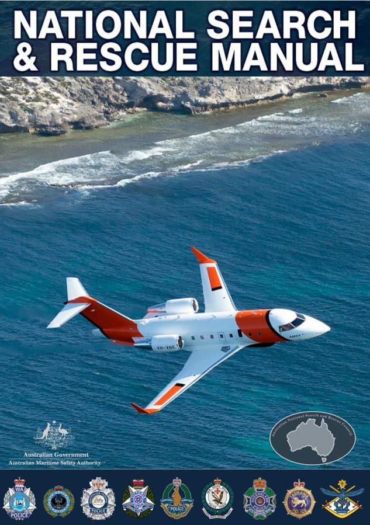

# National Search and Rescue (NATSAR) Manual — Preliminaries (February 2025)

> **Source**: AMSA
> **URL**: https://www.amsa.gov.au/sites/default/files/natsar-manual-february-2025-preliminaries.pdf
> **Licence**: Crown / publisher copyright; practitioner reference
> **Retrieved**: 2026-05-07T23:47:18Z
> **SHA-256**: `4759c41d932cf2e26eb3d1e5035e0c75c1fc6ce1c385a9483517fa8ba8b0dbd6`
> *Converted from PDF to Markdown format.*

---
## Page 1

 
 
 
Volume 1 – Search and Rescue Administration 
NATIONAL SEARCH AND RESCUE MANUAL 
2025 EDITION Version 1 – February 2025 
 Page 1 
 
 
 
 
February 2025 Edition

---
## Page 2

 
 
 
 
NATIONAL SEARCH AND RESCUE MANUAL 
 
2025 EDITION Version 1 – February 2025 
Published by the Australian Maritime Safety Authority (AMSA) on behalf of the Australian National 
Search and Rescue Council 
Written and amended by retired Senior Sergeant Dr Jim Whitehead, Queensland Police Service 
(2016 – 2023) on behalf of the Australian National Search and Rescue Council 
Reviewed by the Australian National Search and Rescue Council, with editing led by Leading 
Senior Constable Andrew Craig, Australian Federal Police (2025) 
© This publication is copyright. The reproduction of this work in whole or in part is invited for search 
and rescue purposes other than commercial purposes provided due acknowledgment is given to 
the Australian National Search and Rescue Council.  
For further information contact the Council Secretariat at: 
Secretariat  
National Search and Rescue Council 
GPO Box 2181 
Canberra ACT 2601 
 
Email: nationalsarcouncil@amsa.gov.au 
 
 
 
 
 
 
 
 
2025 EDITION Version 1 – February 2025

---
## Page 3

 
 
 
NATIONAL SEARCH AND RESCUE MANUAL 
2025 EDITION Version 1 – February 2025 
Page 1 
Foreword 
Search and Rescue (SAR) is the search for and provision of lifesaving assistance to 
people in distress and imminent danger of loss of life.  Australian SAR arrangements are 
intended to complement other emergency services (police, fire, ambulance) in 
circumstances where those services are unable to operate effectively. Such 
circumstances could include, for example, remote area operations, rescues at sea, and 
the need for specialist SAR facilities not normally available to emergency services. 
Depending upon the extent and complexity of the incident and on the available staff and 
facilities, SAR may take many forms in response to a distress situation. Unless the action 
is indivisible from that of safeguarding life, a SAR operation does not, however, include 
salvage or the saving of property. 
The Australian search and rescue region covers the Australian continent and large areas 
of the Indian, Pacific and Southern Oceans as well the Australian Antarctic territories. This 
is an area of about 52.8 million square kilometres, or about one tenth of the earth’s 
surface. Dedicated SAR assets are limited in Australia and other government, private and 
commercial assets may be diverted from their primary function by charter, arrangement 
and request. 
In practice, many SAR operations are conducted jointly by Commonwealth and State / 
Territory authorities.  It is, therefore, essential that the available resources and operational 
techniques are standardised and coordinated across the Australian region. 
All SAR authorities in Australia: Australian Maritime Safety Authority, Australian Defence 
Force and State, Territory and Federal Police must be able to act cooperatively. 
In 2017, the Commonwealth, State and Territory Ministers responsible for search and 
rescue response in Australia updated the Intergovernmental Agreement (IGA) on National 
Search and Rescue Response Arrangements. The IGA (Appendix A of this Manual) 
confirmed the National Search and Rescue Council’s role as the national coordinating 
body for search and rescue procedures with a function, among others, of sponsoring this 
National Search and Rescue Manual. 
Documenting standardised techniques and procedures, the National Search and Rescue 
manual enables SAR authorities to cooperate and coordinate to best effect. By 
establishing and standardising procedures, the manual seeks to promote effective saving 
of lives. 
 
Mark Morrow 
 
Chairman 
National Search Rescue Council

---
## Page 4

 
 
 
NATIONAL SEARCH AND RESCUE MANUAL 
Page 2 
2025 EDITION Version 1 – February 2025 
Australian Maritime Safety Authority 
 
First published in Australia in 1992 by the Australian Maritime Safety Authority (AMSA) on behalf of 
the Australian National Search and Rescue Council. 
Level 8, 18 Marcus Clarke Street, Canberra, ACT, 2601, Australia 
 
In 2016 Doctor Jim Whitehead, now retired Senior Sergeant, Queensland Police Service, 
combined the 2015 versions of the National Search and Rescue Manual (Aerial and Marine Search 
and Rescue) and the National Land Search Operations Manual to form a single manual.  
Over the period 2019 to 2020, as part of ongoing reviews, Dr Whitehead removed approximately 
1300 paragraphs of ‘duplicated’ text, re-drew old ‘photocopied’ diagrams, and arranged each 
chapter into: Marine, Aviation, and Land sections. 
Throughout the period from 2016 to 2023, Dr Whitehead was predominantly responsible for writing, 
amending, and editing the National Search and Rescue Manual on behalf of the Australian 
National Search and Rescue Council. 
Editing of the 2025 edition was led by Leading Senior Constable Andrew Craig, Australian Federal 
Police, Search and Rescue, on behalf of the Australian National Search and Rescue Council. This 
is part of ongoing succession-planning to ensure that knowledge of SAR requirements is utilised to 
ensure appropriate updating of the manual, and to facilitate continuous improvement of SAR 
processes. 
 
Copyright © 2025 
Australian Maritime Safety Authority (AMSA) on behalf of the Australian National Search and 
Rescue Council. 
 
The reproduction of this work in whole or in part is invited for search and rescue purposes other 
than commercial purposes provided due acknowledgment is given to the Australian National 
Search and Rescue Council. 
 
ISSN: 2653-2085 (Online) 
 
For further information contact the Council Secretariat at: 
Secretariat 
National Search and Rescue Council 
GPO Box 2181 
Canberra ACT 2601 
Email: nationalsarcouncil@amsa.gov.au

---
## Page 5

 
 
 
NATIONAL SEARCH AND RESCUE MANUAL 
2025 EDITION Version 1 – February 2025 
Page 3 
Introduction 
This National Search and Rescue Manual is the result of the recent merger of the aviation, maritime and 
land search and rescue (SAR) manuals and is the standard reference document for use by all Australian SAR 
authorities.  It is promulgated by the National SAR Council operating under direction from relevant 
Commonwealth, State and Territory Ministers.  The Manual promulgates SAR coordination procedures for 
SAR operations conducted within Australia and the Australian SAR Region (SRR). 
The manual is consistent with the relevant International Conventions to which Australia is a party and is 
supplemented by various legal, informative and instructional documents used within, and between, 
organisations concerned with search and rescue.  It has been developed with due regard to the 
International Aviation and Maritime Search and Rescue Manual (IAMSAR).  
The National SAR Manual meets the requirements of international conventions for an Australian Search and 
Rescue Plan, and includes material covering: 
a) 
Abbreviations, terminology and definitions relevant to SAR practitioners 
b) 
The elements and functions of the Australian SAR system 
c) 
Details of communications, assets and procedures for coordination 
d) 
SAR planning and techniques including worksheets 
The National Search and Rescue Manual acts as a set of procedures and guidelines in providing a search and 
rescue response within Australia. It is understood that the knowledge and experience of officers can extend 
beyond what is covered within this manual and therefore initiative should be used accordingly in search and 
rescue operations.  It is, however, necessary to follow the guidelines outlined within this manual as closely 
related to the circumstances presented and keep all relevant parties well informed throughout the process.  
Officers should be prepared to justify their actions if necessary. When developing Standard Operating 
Procedures (SOP) at the organisational level, care should be taken to ensure that procedures are written 
consistent with the National SAR Manual.  Should an SOP be identified, that may be of benefit to the wider 
SAR community, it is recommended that the issue be raised with the National SAR Council so that inclusion 
of the procedure into the National SAR Manual can be considered. 
This manual is under continual review and will be updated as necessary. The National SAR Manual is 
promulgated online for the use of all search and rescue practitioners. The Internet version is the controlled 
document and is the latest version of this manual.  The online version should always be referred to as it 
contains the most up to date information. 
Suggestions and questions regarding this Manual should be forwarded to: 
The Secretariat of the National SAR Council 
Australian Maritime Safety Authority 
GPO Box 2181 
Canberra ACT 2601

---
## Page 6

 
 
 
NATIONAL SEARCH AND RESCUE MANUAL 
Page 4 
2025 EDITION Version 1 – February 2025 
Defence Letter of Promulgation

---
## Page 7

 
 
 
NATIONAL SEARCH AND RESCUE MANUAL 
2025 EDITION Version 1 – February 2025 
Page 5 
Table of Contents 
 
Foreword ........................................................................................................................................................... 1 
Introduction ....................................................................................................................................................... 3 
Defence Letter of Promulgation ........................................................................................................................ 4 
Table of Contents .............................................................................................................................................. 5 
Acronyms and Abbreviations .......................................................................................................................... 20 
Glossary ........................................................................................................................................................... 27 
Volume 1 - Search and Rescue Administration ............................................................................................... 35 
Chapter 1 SAR System Organisation ................................................................................................................ 35 
1.1. Organisation ....................................................................................................................................... 35 
Global SAR System Organisation ........................................................................................................ 35 
National and Regional SAR System Organisation ............................................................................... 35 
Australian Maritime Safety Authority (AMSA) ................................................................................... 36 
State and Territory Governments ....................................................................................................... 37 
Australian Defence Force Responsibilities – Military SAR .................................................................. 38 
Headquarters Joint Operations Command ......................................................................................... 38 
Airservices Australia ........................................................................................................................... 38 
Other Commonwealth Agencies/Authorities ..................................................................................... 39 
Bureau of Meteorology (BOM) ........................................................................................................... 39 
Emergency Management Australia (EMA) ......................................................................................... 39 
Maritime Border Command................................................................................................................ 39 
Australian Communications and Media Authority (ACMA) ................................................................ 39 
Australian Transport Safety Bureau (ATSB) ........................................................................................ 39 
Civil Aviation Safety Authority (CASA) ................................................................................................ 40 
Volunteer Organisations ..................................................................................................................... 40 
Commercial and Private Organisations .............................................................................................. 40 
1.2. SAR Coordination ................................................................................................................................ 40 
Overview ............................................................................................................................................. 40 
Alerting Post ....................................................................................................................................... 41 
Determination of SAR Authority Responsible for Overall Coordination ............................................ 41 
Initial Response ................................................................................................................................... 41 
SAR Authority Best Placed to Coordinate ........................................................................................... 41 
Effective Consultation and Coordination............................................................................................ 42 
Cooperation with Foreign Rescue Coordination Centres ................................................................... 42 
Transfer of Coordination .................................................................................................................... 43 
Requesting JRCC Australia Assistance ................................................................................................ 46 
1.3. Requesting State / Territory SAR Authority Assistance ...................................................................... 47 
Requests for Defence Assistance (DACC) ........................................................................................... 47 
Defence Requests for Civil Assistance ................................................................................................ 48 
1.4. Australian Search and Rescue Region................................................................................................. 48

---
## Page 8

 
 
 
NATIONAL SEARCH AND RESCUE MANUAL 
Page 6 
2025 EDITION Version 1 – February 2025 
1.5. SRR Coordinates.................................................................................................................................. 49 
1.6. Australian States and Land Search Area ............................................................................................. 50 
Chapter 2 SAR Management ........................................................................................................................... 51 
2.1. Overview ............................................................................................................................................. 51 
SAR Authority Responsibilities ............................................................................................................ 51 
Forward Command Post ..................................................................................................................... 52 
RCC/Field Search Headquarters (FSH) Staff ........................................................................................ 53 
Search and Rescue Roles .................................................................................................................... 54 
2.2. Search and Rescue Resources............................................................................................................. 57 
Overview ............................................................................................................................................. 57 
Personnel ............................................................................................................................................ 58 
Drop-Masters, Dispatchers and Observers ......................................................................................... 58 
Rescue Preparation ............................................................................................................................. 59 
2.3. Public Relations................................................................................................................................... 59 
Overview ............................................................................................................................................. 59 
Operations involving two or more SAR Authorities ........................................................................... 60 
Public Relations Officers (PRO's)/Media Officers (MO) ...................................................................... 60 
Press Releases ..................................................................................................................................... 60 
Requesting Public Assistance .............................................................................................................. 61 
Liaison with Relatives ......................................................................................................................... 62 
Notification of Next of Kin .................................................................................................................. 62 
Casualties ............................................................................................................................................ 62 
2.4. Other Emergency Assistance and Services available from JRCC Australia ......................................... 63 
General ............................................................................................................................................... 63 
Maritime Safety Information .............................................................................................................. 63 
Unlawful Acts ...................................................................................................................................... 63 
Chapter 3 Training and Exercises .................................................................................................................... 65 
3.1. Requirements for SAR Training........................................................................................................... 65 
Training ............................................................................................................................................... 65 
Who to Train ....................................................................................................................................... 65 
Requirement for Training ................................................................................................................... 65 
3.2. National Training Framework ............................................................................................................. 65 
Qualifications ...................................................................................................................................... 65 
Public Safety Training Package; Police Training Package ................................................................... 66 
AMSA Training .................................................................................................................................... 66 
The National Search and Rescue Manager’s Course .......................................................................... 66 
State/Territory SAR Authority Training .............................................................................................. 66 
3.3. Search and Rescue Exercises .............................................................................................................. 67 
3.4. Training of Search and Rescue Assets ................................................................................................ 67 
Land SAR Training ............................................................................................................................... 67 
Search and Rescue Crew Training ....................................................................................................... 68 
Drop-Master and Dispatchers ............................................................................................................ 68

---
## Page 9

 
 
 
NATIONAL SEARCH AND RESCUE MANUAL 
2025 EDITION Version 1 – February 2025 
Page 7 
Air Observer Training .......................................................................................................................... 68 
Aviation Search and Rescue Assets (SRA) ........................................................................................... 68 
First Aid Training ................................................................................................................................. 68 
Map Reading and Navigation ............................................................................................................. 69 
Radio Operating Procedures ............................................................................................................... 69 
Field craft ............................................................................................................................................ 69 
Observation Skills................................................................................................................................ 69 
Observation Skills-Day ........................................................................................................................ 69 
Team and Individual Skills ................................................................................................................... 70 
Searchers ............................................................................................................................................ 71 
Search Team Leaders/On-Scene Commanders .................................................................................. 71 
3.5. Photographic Records ......................................................................................................................... 72 
3.6. Liaison Visits ........................................................................................................................................ 72 
Volume 2 - Search and Rescue Operations ..................................................................................................... 73 
Chapter 1 Communications ............................................................................................................................. 73 
1.1. Aviation and Maritime ........................................................................................................................ 73 
Overview ............................................................................................................................................. 73 
1.2. Distress and Emergency Signals .......................................................................................................... 73 
Maritime Radio Alarm Signal .............................................................................................................. 73 
Radiotelephone Distress Signal .......................................................................................................... 74 
Radiotelephone Urgency Signal .......................................................................................................... 74 
Radiotelephone Safety Signal ............................................................................................................. 74 
Radiotelephony Distress/Emergency Frequencies ............................................................................. 74 
GMDSS Distress, Urgency, Safety and Calling Frequencies ................................................................ 74 
2182 kHz ............................................................................................................................................. 74 
4125, 6215, 8291, 12290 and 16420 kHz ........................................................................................... 75 
121.5 MHz ........................................................................................................................................... 75 
156.8 MHz (Marine VHF Channel) ...................................................................................................... 75 
243 MHz .............................................................................................................................................. 75 
Safety Frequencies .............................................................................................................................. 75 
1.3. Global Maritime Distress and Safety System (GMDSS) ...................................................................... 75 
1.4. Emergency Signalling Devices ............................................................................................................. 76 
Daylight Devices .................................................................................................................................. 76 
Night Vision Imaging Systems (NVIS) for aviation searching .............................................................. 76 
RADAR/IFF/SSR ................................................................................................................................... 77 
Radio and Distress Beacons ................................................................................................................ 77 
1.5. COSPAS-SARSAT Distress Beacon Detection System .......................................................................... 77 
Overview ............................................................................................................................................. 77 
Purpose ............................................................................................................................................... 78 
Satellites ............................................................................................................................................. 78 
Beacon Detection ............................................................................................................................... 79 
Beacons ............................................................................................................................................... 79 
1.6. Other Types of Distress Alerting Devices ............................................................................................ 80

---
## Page 10

 
 
 
NATIONAL SEARCH AND RESCUE MANUAL 
Page 8 
2025 EDITION Version 1 – February 2025 
SPOT Personal Satellite Messenger device (SPOT) ............................................................................. 80 
AIS-SART .............................................................................................................................................. 80 
Maritime Survivor Locating Systems. VHF DSC Maritime Survivor Locating Devices (MSLD). ........... 80 
Thuraya Satellite Devices .................................................................................................................... 81 
1.7. SAR RADAR Transponder (SART) ........................................................................................................ 81 
Overview ............................................................................................................................................. 81 
1.8. Communications in Support of SAR Operations ................................................................................. 82 
Overview ............................................................................................................................................. 82 
SAR Frequencies ................................................................................................................................. 82 
SAR Call Signs ...................................................................................................................................... 82 
1.9. Communications Facilities .................................................................................................................. 83 
Overview ............................................................................................................................................. 83 
Communications Capabilities Australian Defence Force Ships and Aircraft ...................................... 83 
Search and Rescue Visual Signals ....................................................................................................... 84 
Merchant Shipping and GMDSS.......................................................................................................... 84 
Limited Coast Radio Stations .............................................................................................................. 85 
Ship Stations ....................................................................................................................................... 85 
Fishing Vessels .................................................................................................................................... 85 
Pleasure Craft ..................................................................................................................................... 85 
Volunteer Organisations ..................................................................................................................... 86 
Communication Capabilities of State & Territory SAR Authorities .................................................... 86 
Communications Aircraft .................................................................................................................... 86 
Inmarsat Aero ..................................................................................................................................... 87 
1.10. Land Search Communications ............................................................................................................ 87 
Overview ............................................................................................................................................. 87 
1.11. Communications ................................................................................................................................. 88 
1.12. Communications Officer ..................................................................................................................... 88 
1.13. Communication Requirements ........................................................................................................... 88 
1.14. Headquarter Requirements ................................................................................................................ 88 
1.15. Telephone/Radio ................................................................................................................................ 89 
1.16. Rear Net .............................................................................................................................................. 89 
1.17. Forward Net ........................................................................................................................................ 89 
1.18. Frequencies ......................................................................................................................................... 89 
1.19. Radios in general ................................................................................................................................ 90 
1.20. Procedures and Practices ................................................................................................................... 91 
1.21. Other Methods of Communications ................................................................................................... 91 
Chapter 2 Awareness and Initial Action .......................................................................................................... 92 
2.1. Awareness Introduction ..................................................................................................................... 92 
2.2. Types of SAR Incidents ........................................................................................................................ 92 
Maritime SAR Incident ........................................................................................................................ 93 
Aviation SAR Incident ......................................................................................................................... 93

---
## Page 11

 
 
 
NATIONAL SEARCH AND RESCUE MANUAL 
2025 EDITION Version 1 – February 2025 
Page 9 
Land SAR Incident ............................................................................................................................... 94 
2.3. Recording of Events ............................................................................................................................ 94 
2.4. SAR Stages .......................................................................................................................................... 94 
2.5. Awareness and Initial Action Stages (Stage 1 and 2) .......................................................................... 95 
Types of Notification Reports ............................................................................................................. 95 
Evaluation of Notification Reports ..................................................................................................... 96 
Information: SAR Incident Information .............................................................................................. 96 
Advising States of Foreign Persons in Distress ................................................................................. 100 
2.6. Emergency Phases ............................................................................................................................ 100 
Uncertainty Phase ............................................................................................................................. 100 
Alert Phase ........................................................................................................................................ 101 
Distress Phase ................................................................................................................................... 101 
2.7. Initial Action: Procedures of the Emergency Phases ........................................................................ 102 
Overview ........................................................................................................................................... 102 
Uncertainty Phase Initial Action ....................................................................................................... 102 
Alert Phase Procedures .................................................................................................................... 103 
Distress Phase Procedures ................................................................................................................ 105 
2.8. Intelligence Gathering and Assessment ........................................................................................... 106 
Overview ........................................................................................................................................... 106 
Communication Checks .................................................................................................................... 106 
Intelligence gathering ....................................................................................................................... 108 
Sighting and Hearing Reports ........................................................................................................... 111 
Coordination with the Police ............................................................................................................ 112 
Examination of Recorded Communications - Aircraft and vessels ................................................... 112 
Flight Path Analysis - Aircraft ............................................................................................................ 113 
Weather Analysis .............................................................................................................................. 113 
Logistical Information ....................................................................................................................... 113 
General Considerations for the SMC ................................................................................................ 113 
Chapter 3 Search Planning and Evaluation .................................................................................................... 118 
3.1. Aviation and Maritime Search Planning ........................................................................................... 118 
Overview ........................................................................................................................................... 118 
3.2. Aviation and Maritime Search Planning Steps ................................................................................. 118 
Evaluating the Situation .................................................................................................................... 119 
Estimating the Distress Incident Location ........................................................................................ 119 
Datum Considerations ...................................................................................................................... 120 
Drift Considerations .......................................................................................................................... 120 
3.3. Search Response Stages ................................................................................................................... 121 
Factors Affecting the Search Response Plan .................................................................................... 122 
3.4. Aviation and Maritime Basic Search Planning .................................................................................. 123 
Controlling Factors ............................................................................................................................ 124 
Search Effort Expenditure Rate ........................................................................................................ 125 
Maximum Search Effort .................................................................................................................... 125

---
## Page 12

 
 
 
NATIONAL SEARCH AND RESCUE MANUAL 
Page 10 
2025 EDITION Version 1 – February 2025 
Search Sequence ............................................................................................................................... 125 
3.5. Aviation and Maritime Determination of Search Areas ................................................................... 127 
Aviation and Maritime Planning ....................................................................................................... 127 
Possibility Area.................................................................................................................................. 127 
Calculation of Circles of Probability .................................................................................................. 130 
Probable Errors of Position ............................................................................................................... 130 
Search Radius (R) .............................................................................................................................. 130 
Drift Error for Waterborne Targets................................................................................................... 130 
Currents ............................................................................................................................................ 131 
Leeway .............................................................................................................................................. 134 
Divergence ........................................................................................................................................ 135 
Calculating Leeway ........................................................................................................................... 135 
Plotting Drift ..................................................................................................................................... 136 
Datum Plot ........................................................................................................................................ 136 
Drift Error (De) .................................................................................................................................. 137 
Search Area Based on Non-Moving Datum ...................................................................................... 138 
Search Based on Moving Datum ....................................................................................................... 138 
Labelling the Datum .......................................................................................................................... 140 
Consideration of Possible Courses of Action by the Captain of the Target ...................................... 141 
3.6. Coastal Search Planning .................................................................................................................... 141 
Search Area ....................................................................................................................................... 141 
Position Uncertainty ......................................................................................................................... 144 
Track Line Overdue Incident ............................................................................................................. 144 
Recomputed Datum .......................................................................................................................... 145 
Track Spacing .................................................................................................................................... 147 
3.7. Land Search Planning ........................................................................................................................ 148 
Overview ........................................................................................................................................... 148 
3.8. Incident Command ........................................................................................................................... 149 
3.9. Situational Awareness ...................................................................................................................... 149 
3.10. Conducting an Appreciation ............................................................................................................. 150 
Definition .......................................................................................................................................... 150 
Sequence .......................................................................................................................................... 150 
Phases ............................................................................................................................................... 150 
Aim .................................................................................................................................................... 151 
Limitations ........................................................................................................................................ 151 
Written Statement ............................................................................................................................ 151 
Factors .............................................................................................................................................. 151 
Examination ...................................................................................................................................... 151 
3.11. Courses Open .................................................................................................................................... 152 
Plan ................................................................................................................................................... 152 
Planning Principles ............................................................................................................................ 153 
Keep it simple ................................................................................................................................... 153 
Relate to the Aim .............................................................................................................................. 153

---
## Page 13

 
 
 
NATIONAL SEARCH AND RESCUE MANUAL 
2025 EDITION Version 1 – February 2025 
Page 11 
Logical deductions ............................................................................................................................ 153 
Land Search Planning ........................................................................................................................ 153 
Scenario-based Assessment (SCENARIO) ......................................................................................... 154 
Factors Influencing Discovery ........................................................................................................... 155 
Analyse possible land strategies ....................................................................................................... 155 
Raise land search strategies ............................................................................................................. 155 
Identify priority land search area ..................................................................................................... 155 
Ongoing reassessment of land search .............................................................................................. 155 
Search Urgency Assessment (SUA) ................................................................................................... 156 
3.12. Terrain Factors .................................................................................................................................. 156 
3.13. Land Environments ........................................................................................................................... 157 
Rainforest.......................................................................................................................................... 157 
Alpine Environment .......................................................................................................................... 160 
Arid Environment .............................................................................................................................. 161 
Mountain Environment .................................................................................................................... 163 
Dangerous Animals ........................................................................................................................... 169 
Telephone Triangulation ................................................................................................................... 170 
Land Search Planning ........................................................................................................................ 170 
Reflex Search .................................................................................................................................... 171 
3.14. Formal Search (Land) ........................................................................................................................ 172 
Theoretical Search Strategy (Naismith’s Rule) ................................................................................. 172 
Statistical Strategy (Lost Person Behaviour) ..................................................................................... 174 
3.15. Subjective/Decision Point Strategy (Land) ....................................................................................... 176 
Decision Points.................................................................................................................................. 177 
3.16. Deductive Strategy (Land) ................................................................................................................ 179 
Using all four Formal Search Strategies ............................................................................................ 179 
3.17. Recording of search areas (Land) ..................................................................................................... 188 
Behaviour of Lost People .................................................................................................................. 195 
Mass Casualty SAR Incidents ............................................................................................................ 197 
Urban SAR (USAR) ............................................................................................................................. 198 
Coordination ..................................................................................................................................... 198 
Initial Actions .................................................................................................................................... 199 
Working under or within a MIR ........................................................................................................ 199 
MIR Liaison Officer ............................................................................................................................ 200 
Field Search Headquarters................................................................................................................ 200 
Searching .......................................................................................................................................... 201 
Land Search problems ...................................................................................................................... 201 
Search Area Delineation ................................................................................................................... 202 
Tasking sheets ................................................................................................................................... 204 
Briefings ............................................................................................................................................ 205 
Record Keeping ................................................................................................................................. 206 
Passive Searching .............................................................................................................................. 208 
Chapter 4 Search and Rescue Techniques ..................................................................................................... 209

---
## Page 14

 
 
 
NATIONAL SEARCH AND RESCUE MANUAL 
Page 12 
2025 EDITION Version 1 – February 2025 
4.1. Aviation and Maritime Search Operations ....................................................................................... 209 
Overview ........................................................................................................................................... 209 
4.2. General Guidelines for Searches ...................................................................................................... 209 
Stage One Search: Immediate response ........................................................................................... 209 
Stage Two Search: Nominated Area Either Side of Track ................................................................. 210 
Stage Three Search: Mathematically Derived Area .......................................................................... 211 
4.3. Aviation and Maritime Search Area Coverage ................................................................................. 211 
General ............................................................................................................................................. 211 
Sweep Width (W): Factors affecting Sweep Width .......................................................................... 212 
Track Spacing (S) ............................................................................................................................... 217 
Coverage Factor (C) .......................................................................................................................... 218 
Aviation and Maritime Probability of Detection (POD) .................................................................... 218 
4.4. Navigation of SAR Assets (Aviation and Maritime) .......................................................................... 220 
4.5. Visual Search Patterns (Aviation and Maritime)............................................................................... 221 
General ............................................................................................................................................. 221 
Parallel Track Search Pattern ............................................................................................................ 222 
Creeping Line Patterns ...................................................................................................................... 224 
Track Line Search .............................................................................................................................. 224 
Expanding Square Search ................................................................................................................. 225 
Sector Search .................................................................................................................................... 227 
Aural Search by Surface Craft ........................................................................................................... 229 
Coastal Search (Islands and their Foreshores) .................................................................................. 229 
Contour Search by Aircraft ............................................................................................................... 230 
Mountainous or Rugged Terrain Searches ....................................................................................... 232 
Line Abreast Helicopter Searches ..................................................................................................... 233 
Aviation and Maritime Search Considerations ................................................................................. 233 
4.6. Flare Searches ................................................................................................................................... 234 
4.7. Electronic Searches ........................................................................................................................... 234 
Distress Beacons ............................................................................................................................... 234 
Maximum Radio Signal Range Calculations ...................................................................................... 237 
Signal Heard, Signal Fade Plotting Method ...................................................................................... 237 
De-tuning Method ............................................................................................................................ 238 
Hill Shading ....................................................................................................................................... 238 
Locating a Signal from the Ground ................................................................................................... 238 
Search by RADAR .............................................................................................................................. 239 
Search by Infrared (IR) Devices ......................................................................................................... 241 
Night Vision Imaging Systems ........................................................................................................... 241 
4.8. Aviation and Maritime SAR Asset Selection and Characteristics ...................................................... 242 
Overview ........................................................................................................................................... 242 
Aviation Assets .................................................................................................................................. 242 
Australian Defence Force Aviation Assets ........................................................................................ 245 
Customs and Border Force Aircraft .................................................................................................. 245 
Maritime Assets ................................................................................................................................ 245

---
## Page 15

 
 
 
NATIONAL SEARCH AND RESCUE MANUAL 
2025 EDITION Version 1 – February 2025 
Page 13 
Naval Vessels .................................................................................................................................... 246 
Customs Vessels ............................................................................................................................... 246 
Use of Merchant Shipping ................................................................................................................ 246 
Equipment for Marine Craft ............................................................................................................. 247 
Land Search Facilities ........................................................................................................................ 247 
4.9. Aviation and Maritime Search Asset Allocation ............................................................................... 248 
Introduction ...................................................................................................................................... 248 
Aircraft Capability ............................................................................................................................. 248 
Calculation of Search Time Required ................................................................................................ 248 
Calculation of Search Time Available ................................................................................................ 249 
Investigation Time ............................................................................................................................ 250 
Effective Search Time ....................................................................................................................... 250 
Comparison of Search Time Required and Time Available for Search Aircraft ................................ 250 
Allocation Variations to Suit Particular Aircraft ................................................................................ 252 
Allocation Chart Presentation .......................................................................................................... 253 
4.10. SAR Crew Briefing ............................................................................................................................. 253 
General ............................................................................................................................................. 253 
Search Briefing .................................................................................................................................. 254 
Search Aircrew Briefing .................................................................................................................... 255 
Search Aircraft Operations ............................................................................................................... 256 
Communications Relay Aircraft ........................................................................................................ 256 
Top Cover Aircraft ............................................................................................................................. 257 
Maritime Search Crews..................................................................................................................... 257 
Land Assets in Aircraft Search .......................................................................................................... 258 
4.11. SAR Crew Debriefing ......................................................................................................................... 259 
Overview ........................................................................................................................................... 259 
4.12. Land Search Operations .................................................................................................................... 259 
Overview ........................................................................................................................................... 259 
4.13. Land Search Assets ........................................................................................................................... 260 
Land Assets ....................................................................................................................................... 260 
Land Search using Maritime Assets .................................................................................................. 265 
Land Search Considerations for Aviation Assets .............................................................................. 265 
Land Search Action Plan ................................................................................................................... 267 
General Search (Land SAR) ............................................................................................................... 270 
Contact Search (Land SAR) ............................................................................................................... 271 
4.14. Land Search Area Coverage .............................................................................................................. 272 
Land SAR Target Type ....................................................................................................................... 273 
Land SAR Meteorological Visibility ................................................................................................... 273 
Type of Terrain/Conditions ............................................................................................................... 273 
Land Search Speed ............................................................................................................................ 274 
Cloud Cover and Sun Light ................................................................................................................ 274 
Land SAR First and Last Search Light ................................................................................................ 274 
Land SAR Probability of Detection .................................................................................................... 275 
Visual Horizon: Ankle Rule (Land SAR).............................................................................................. 275

---
## Page 16

 
 
 
NATIONAL SEARCH AND RESCUE MANUAL 
Page 14 
2025 EDITION Version 1 – February 2025 
Area Swept (Land SAR) ..................................................................................................................... 276 
Accuracy of Navigation by Land Search Teams ................................................................................ 277 
Land SAR Night Searching ................................................................................................................. 277 
Searching in Hazardous Areas .......................................................................................................... 278 
Police Divers...................................................................................................................................... 278 
Using Police Divers for SAR ............................................................................................................... 280 
4.15. Land Search Patterns ........................................................................................................................ 281 
Common Land Search Patterns ........................................................................................................ 283 
4.16. Clue Recognition and Interpretation ................................................................................................ 295 
General Principles ............................................................................................................................. 295 
4.17. Land Search Briefings ........................................................................................................................ 297 
Preparation ....................................................................................................................................... 298 
Mattson Consensus .......................................................................................................................... 303 
Chapter 5 Rescue Planning Operations ......................................................................................................... 305 
5.1. Rescue General ................................................................................................................................. 305 
5.2. Medical Assistance ........................................................................................................................... 306 
5.3. Aircraft Accidents ............................................................................................................................. 306 
Health Hazards .................................................................................................................................. 306 
5.4. Land Rescue ...................................................................................................................................... 307 
Avoidance of Danger ........................................................................................................................ 308 
5.5. Maritime Rescue ............................................................................................................................... 308 
Use of Rescue Boats and Vessels ...................................................................................................... 309 
Marking Targets ................................................................................................................................ 309 
5.6. Rescue Assets.................................................................................................................................... 310 
Use of Aircraft for Rescue ................................................................................................................. 310 
Use of Helicopters for Rescue........................................................................................................... 310 
Use of Top Cover Aircraft with Rescue and MEDEVAC Helicopters ................................................. 311 
5.7. Supply Dropping and Delivery of Survival Equipment ...................................................................... 311 
Civil SAR Equipment .......................................................................................................................... 311 
Supply Drop from Aircraft over Sea .................................................................................................. 312 
Supply Drop from Helicopter over Sea ............................................................................................. 312 
Supply Drop from Aircraft over Land ................................................................................................ 312 
Chapter 6 Conclusion of SAR Operations ...................................................................................................... 313 
6.1. Conclusion General ........................................................................................................................... 313 
6.2. Conclusion of a successful SAR operation ........................................................................................ 313 
6.3. Suspension/termination of a search when the target is not found ................................................. 313 
6.4. Reopening a Suspended Search........................................................................................................ 315 
6.5. Records and Reports ......................................................................................................................... 315 
6.6. Incident Debriefs .............................................................................................................................. 315 
Conducting the Debrief..................................................................................................................... 316 
Lesson for improvement ................................................................................................................... 317

---
## Page 17

 
 
 
NATIONAL SEARCH AND RESCUE MANUAL 
2025 EDITION Version 1 – February 2025 
Page 15 
6.7. Case Studies ...................................................................................................................................... 317 
6.8. Peer Reviews ..................................................................................................................................... 318 
Chapter 7 Medical Factors ............................................................................................................................. 320 
7.1. General ............................................................................................................................................. 320 
7.2. Time Frame for Survival (TFFS) ......................................................................................................... 320 
7.3. Survivor Stress Factors ...................................................................................................................... 320 
7.4. Survival Environment Factors ........................................................................................................... 320 
7.5. Hypothermia ..................................................................................................................................... 321 
7.6. Water Hypothermia .......................................................................................................................... 321 
7.7. Wind Hypothermia ........................................................................................................................... 324 
7.8. Wind Chill .......................................................................................................................................... 325 
7.9. Hypothermia Survivability ................................................................................................................ 326 
7.10. Wet-Chill Survivability....................................................................................................................... 326 
7.11. Water Immersion .............................................................................................................................. 327 
7.12. Effects of Alcohol .............................................................................................................................. 327 
7.13. Hyperthermia, Heat Stress and Dehydration ................................................................................... 328 
7.14. Heat Exhaustion ................................................................................................................................ 328 
7.15. Heat Stroke ....................................................................................................................................... 329 
7.16. Hyperthermia Survivability ............................................................................................................... 330 
7.17. Terrain Factors .................................................................................................................................. 332 
7.18. Seeking Medical Advice .................................................................................................................... 333 
Appendices .................................................................................................................................................... 334 
Appendix A – Intergovernmental Agreement ............................................................................................... 334 
Appendix B – National SAR Responsibilities .................................................................................................. 345 
Appendix C – National Operational Procedure for Transfer of Coordination ............................................... 349 
Overview .................................................................................................................................................... 349 
Guidelines for Procedure to transfer coordination .......................................................................... 350 
State / Territory SAR Authority Points of Contact ............................................................................ 351 
Transfer of Coordination Information Exchange Requirements ...................................................... 351 
Example: Transfer of Coordination information............................................................................... 352 
Appendix D .................................................................................................................................................... 354 
Overview .................................................................................................................................................... 354 
Appendix D-1 Distress Emergency Signals ..................................................................................................... 355 
Overview .................................................................................................................................................... 355 
International Distress Signals ........................................................................................................... 355 
Search and Rescue Signals – Australian Area ................................................................................... 355 
Civil Air-Ground Code ....................................................................................................................... 356 
International SAR Signals .................................................................................................................. 357

---
## Page 18

 
 
 
NATIONAL SEARCH AND RESCUE MANUAL 
Page 16 
2025 EDITION Version 1 – February 2025 
Appendix D-2 Maritime SAR Recognition Code (MAREC) ............................................................................. 358 
Overview .................................................................................................................................................... 358 
Part 1 – Merchant Vessels ................................................................................................................ 358 
Complete example Merchant Ship ................................................................................................... 363 
Part 2 – Small Craft ........................................................................................................................... 364 
Complete Example: Motor Boat ....................................................................................................... 371 
Complete Example: Sailing Boat ....................................................................................................... 372 
Appendix D-3 Plotting Symbols ..................................................................................................................... 373 
Appendix D-4 Sighting and Hearing (SHR) Techniques .................................................................................. 374 
Listening Techniques ........................................................................................................................ 374 
Open Questions ................................................................................................................................ 374 
Closed Questions .............................................................................................................................. 374 
Leading Questions ............................................................................................................................ 375 
Instructions for Completing Sighting and Hearing Reports .............................................................. 375 
Sighting and/or Hearing Report for Missing Aircraft ........................................................................ 376 
Sighting and Hearing Report – Generic ............................................................................................ 377 
Sighting and/or Hearing Log ............................................................................................................. 378 
Appendix D-5 Tables and Graphs .................................................................................................................. 379 
Overview .................................................................................................................................................... 379 
Local Wind Current ........................................................................................................................... 379 
Leeway Tables (kt) ............................................................................................................................ 379 
Sweep Width Tables for Visual Search Over Water.......................................................................... 379 
Sweep Width Tables for Visual Search Over Land: ........................................................................... 379 
Probability of Detection .................................................................................................................... 379 
Local Wind Current .................................................................................................................................... 380 
Leeway Tables (kt) ..................................................................................................................................... 381 
Taxonomy Class Definitions/Descriptions ................................................................................................. 382 
Probability of Detection ............................................................................................................................ 390 
Sweep Widths and Correction Factors ...................................................................................................... 391 
Sweep Width Tables for Visual Search over Water .......................................................................... 391 
Weather Correction Factors for all Types of Search Facilities .......................................................... 392 
Uncorrected Visual Sweep Widths for Merchant Ships (NM) .......................................................... 392 
Uncorrected Sweep Widths for Fixed-Wing Aircraft (NM) at 500 ft and 1000 ft ............................. 394 
Weather Correction Factors for all Types of Search Facilities .......................................................... 395 
Uncorrected Sweep Widths for Fixed-Wing Aircraft (NM) at 1500 ft and 2000 ft ........................... 396 
Weather Correction Factors for all Types of Search Facilities .......................................................... 397 
Uncorrected Sweep Widths for Helicopters (NM) – Maritime 500 ft and 1000 ft ........................... 398 
Weather correction factors for all types of search facilities ............................................................ 399 
Uncorrected Sweep Widths for Helicopters (NM) - Maritime 1500 ft and 2000 ft .......................... 400 
Weather correction factors for all types of search facilities ............................................................ 401 
Fixed-wing Aircraft Search Facilities ................................................................................................. 401 
Sweep Width Tables for Visual Search Over Land ............................................................................ 402

---
## Page 19

 
 
 
NATIONAL SEARCH AND RESCUE MANUAL 
2025 EDITION Version 1 – February 2025 
Page 17 
Correction Factors – Vegetation and High Terrain ........................................................................... 402 
Appendix D-6 Probable Errors of Position ..................................................................................................... 403 
Probable Navigation Error of the Target (x) ..................................................................................... 403 
Probable Navigation error of the Search Craft (y) ............................................................................ 404 
Appendix D-7 Maritime and Aviation Worksheets ........................................................................................ 405 
Overview .................................................................................................................................................... 405 
Worksheet 1 – Maritime Planning .................................................................................................... 406 
Worksheet 2 – Maritime Search by Aircraft ..................................................................................... 407 
Worksheet 3 – Land Search by Aircraft ............................................................................................ 408 
Worksheet 4 – Search Radius ........................................................................................................... 409 
Worksheet 5 – Sector Search............................................................................................................ 410 
Worksheet 6 – Aircraft Allocation .................................................................................................... 411 
Worksheet 7 – Asset Allocation ........................................................................................................ 412 
Worksheet 8 – Maritime Search by Vessel ....................................................................................... 413 
Appendix D-8 Aircraft Accident Site Precautions .......................................................................................... 414 
Safety Precautions and Procedures at Aircraft Accidents ................................................................ 414 
Appendix D-9 Civil Aircraft Search and Rescue Assets (SRAs) ....................................................................... 415 
AMSA Aircraft Tier SRA Capability Definitions .................................................................................. 415 
Tier 1 SRAs ........................................................................................................................................ 415 
Opportunity Based SAR Services ...................................................................................................... 416 
Current Aircraft and Police Fixed-Wing Operators ........................................................................... 416 
Air Search Observer Programme ...................................................................................................... 416 
Air Search Equipment ....................................................................................................................... 416 
Locations of Tier 1, 2 Assets ............................................................................................................. 417 
Appendix D-10 Coastal Datum Search and Rescue Planning ........................................................................ 419 
A Step-By-Step Guide for SAR Trained Personnel ..................................................................................... 419 
Vessel Adrift ...................................................................................................................................... 419 
Position Uncertainty ......................................................................................................................... 424 
Time Uncertainty .............................................................................................................................. 428 
Track Line Overdue ........................................................................................................................... 432 
Multiple Winds ................................................................................................................................. 441 
Multiple Current and Winds ............................................................................................................. 443 
Appendix E ..................................................................................................................................................... 446 
Overview .................................................................................................................................................... 446 
Appendix E-1 Search Urgency Assessment Form .......................................................................................... 447 
Appendix E-2 Missing Person Questionnaire ................................................................................................ 449 
Appendix E-3 Object Questionnaire .............................................................................................................. 450 
Appendix E-4 Land SAR Checklist .................................................................................................................. 451 
Appendix E-5 Lost Person Behaviour ............................................................................................................. 454 
Overview .................................................................................................................................................... 454 
Lost Person Behaviour Definitions .................................................................................................... 454

---
## Page 20

 
 
 
NATIONAL SEARCH AND RESCUE MANUAL 
Page 18 
2025 EDITION Version 1 – February 2025 
Children 1-3 years ............................................................................................................................. 456 
Children 4-6 years ............................................................................................................................. 457 
Children 7-12 years ........................................................................................................................... 458 
Youth 13-15 ...................................................................................................................................... 459 
Despondent/Suicidal ........................................................................................................................ 460 
Psychological Illness .......................................................................................................................... 462 
Developmental Problems ................................................................................................................. 463 
Alzheimer’s/Dementia ...................................................................................................................... 464 
Hikers/Walkers ................................................................................................................................. 465 
Hunters ............................................................................................................................................. 466 
Climbers ............................................................................................................................................ 467 
Prospectors ....................................................................................................................................... 468 
ADD, ADHD, Asperger’s, Autism ....................................................................................................... 469 
First Nation People ........................................................................................................................... 470 
Appendix E-6 Land Search Planning Tables ................................................................................................... 471 
Land Search Planning Tables ..................................................................................................................... 471 
Searcher Speed ................................................................................................................................. 471 
Searcher Spacing ............................................................................................................................... 471 
ATNPS Calculations ........................................................................................................................... 471 
Land Search Area Quick Reference ................................................................................................... 472 
Land Air Search Planning Table ........................................................................................................ 472 
Vegetation Correction Factor (Ve) .................................................................................................... 472 
Cloud cover correction factor ........................................................................................................... 473 
Appendix E-7 Additions to Naismith’s Rule ................................................................................................... 474 
Naismith’s Land Speed / Time Calculations ...................................................................................... 474 
Tranters Corrections ......................................................................................................................... 474 
Appendix E-8 Land SAR Probability of Detection (Land) ............................................................................... 475 
Caveat ............................................................................................................................................... 475 
Area to be Search (AS) ...................................................................................................................... 475 
Area swept (AW) ............................................................................................................................... 475 
Coverage Factor (C) .......................................................................................................................... 475 
Probability of Detection (POD) ......................................................................................................... 476 
Appendix E-9 Mattson Consensus ................................................................................................................. 480 
Overview .................................................................................................................................................... 480 
Mattson Consensus Worksheet ........................................................................................................ 480 
Appendix E-10 Land Search Organisation Chart Example ............................................................................. 481 
Appendix E-11 Field Search Headquarters Layout Example.......................................................................... 482 
Appendix E-12 Search Communications Network Example .......................................................................... 483 
Appendix E-13 Clue Recognition ................................................................................................................... 484 
General Principles: ............................................................................................................................ 484 
Tracking Skills .................................................................................................................................... 484 
Trail signs .......................................................................................................................................... 484

---
## Page 21

 
 
 
NATIONAL SEARCH AND RESCUE MANUAL 
2025 EDITION Version 1 – February 2025 
Page 19 
Sight .................................................................................................................................................. 485 
Appendix E-14 SAR Tasking Sheet Example ................................................................................................... 486 
Task sheet example .......................................................................................................................... 486 
Appendix E-15 Search for Skeletal Remains .................................................................................................. 487 
Overview .................................................................................................................................................... 487 
Two search methods are recommended for skeletal searching ...................................................... 488 
Bone characteristics .......................................................................................................................... 489 
Plant growth on bones ..................................................................................................................... 492 
Fungal growth on bones ................................................................................................................... 495 
Predator damage to bones ............................................................................................................... 495 
Appendix E-16 Peer Review Form Example ................................................................................................... 496 
Overview .................................................................................................................................................... 496 
Peer review form .............................................................................................................................. 496 
Appendix E-17 Body Flotation Information ................................................................................................... 498 
Overview .................................................................................................................................................... 498 
Issues that will affect floatation times.............................................................................................. 498 
Appendix F - Aircraft Electronic Night Search Guidance ............................................................................... 500 
Definitions ......................................................................................................................................... 500 
General Considerations .................................................................................................................... 500 
Aircraft and equipment factors ........................................................................................................ 500 
Survivor factors ................................................................................................................................. 501 
Search planning factors .................................................................................................................... 502 
Surface unit support ......................................................................................................................... 504 
Circle Search technique - General guidance ..................................................................................... 504 
Index .............................................................................................................................................................. 506

---
## Page 22

 
 
 
NATIONAL SEARCH AND RESCUE MANUAL 
Page 20 
2025 EDITION Version 1 – February 2025 
Acronyms and Abbreviations 
Acronym/ Abbreviation 
Meaning 
A 
Area or search area 
ACMA 
Australian Communications and Media Authority 
ACFT 
Aircraft 
AFTN 
Aeronautical fixed telecommunications network 
ADF 
Australian Defence Force 
ADFLO 
Australian Defence Force Liaison Officer 
AGL 
Above Ground Level 
AIP 
Aeronautical Information Publication 
ALRS 
Admiralty List of Radio Signals 
AIS 
Automatic Identification System 
AIS-SART 
AIS Search and Rescue Transmitter 
AM 
Amplitude modulation 
AMVER 
Automated Mutual-assistance Vessel Rescue 
AMSA 
Australian Maritime Safety Authority 
AMSL 
Above Mean Sea Level 
A/SMC 
Assistant Search and Rescue Mission Coordinator 
ASH 
Actual Search Hours 
ASRK 
Air Sea Rescue Kit (RAAF) 
ATA 
Actual time of arrival 
ATC 
Air Traffic Control 
ATD 
actual time of departure 
ATS 
Air Traffic Services 
ATSB 
Australian Transport Safety Bureau 
AUMCC 
Australian Mission Control Centre 
AULUTE 
Australian Local User Terminal East 
C 
Coverage Factor 
CAO 
Civil Aviation Order 
CAR 
Civil Aviation Regulations 
CASR 
Civil Aviation Safety Regulations 
C/C 
Cabin cruiser 
CES 
Coast Earth Station (Inmarsat) see also LES 
CRS 
Coast radio station 
CSP 
Commence Search Point 
CSS 
Coordinator surface search (maritime) 
CTAF 
Common Traffic Advisory Frequency

---
## Page 23

 
 
 
NATIONAL SEARCH AND RESCUE MANUAL 
2025 EDITION Version 1 – February 2025 
Page 21 
Acronym/ Abbreviation 
Meaning 
D 
Datum 
D 
Diameter 
DACC 
Defence Aid to the Civil Community 
De 
Total drift error 
DCJOPS 
Deputy Chief Joint Operations 
DCS 
Defence Communications Station 
DF 
Direction finding 
DR 
Dead-reckoning 
Dre 
Dead-reckoning error 
DGPS 
Differential GPS 
DSC 
Digital selective calling 
dwt 
Dead weight tonnes 
E 
East longitude 
E 
Total probable error of position 
EGC 
Enhanced Group Call 
ELR 
Extra-long-range aircraft 
ELT 
Emergency locator transmitter 
EMA 
Emergency Management Australia 
EO/IR 
Electro-Optic/Infrared 
EPIRB 
Emergency position indicating radio beacon 
ERSA 
En Route Supplement Australia 
ETA 
Estimated time of arrival 
ETD 
Estimate time of departure 
FCP 
Forward Command Post 
FFB 
Forward Field Base 
F/V 
Fishing vessel 
Fig 
Figure 
FIR 
Flight information region 
FLIR 
Forward looking infrared 
FM 
Frequency modulation 
FSH 
Field Search Headquarters 
Ff 
Fatigue Factor 
Fs 
Safety Factor 
Ft 
Feet 
Fw 
Weather Factor 
GHz 
Gigahertz

---
## Page 24

 
 
 
NATIONAL SEARCH AND RESCUE MANUAL 
Page 22 
2025 EDITION Version 1 – February 2025 
Acronym/ Abbreviation 
Meaning 
GMDSS 
Global Maritime Distress and Safety System 
GNSS 
Global Navigation Satellite System 
GPS 
Global positioning system 
GS 
Ground speed 
gt 
Gross tonnes 
h 
Hours 
HDG 
Heading 
HPA 
Hectopascals 
HEL-H 
Heavy helicopter 
HEL-L 
Light helicopter 
HEL-M 
Medium helicopter 
HF 
High frequency 
HQAC 
Headquarters Air Command (Air Force) 
HQJOC 
Headquarters Joint Operations Command 
I/B 
Inboard motor 
ICAO 
International Civil Aviation Organization 
IERCC 
International Emergency Response Coordination Centre 
IFER 
In Flight Emergency Response 
IFR 
Instrument Flight Rules 
IGA 
The Inter-Governmental Agreement (IGA) on National Search and Rescue Response 
Arrangements 
IMO 
International Maritime Organization 
IR 
Infrared 
Inmarsat Ltd 
International Maritime Satellite Organisation – formally the international Maritime 
Satellite Organisation 
INS 
Inertial Navigation System 
INTERCO 
International Code of SIGNALS 
IPP 
Initial Planning Point 
JCC 
Joint Control Centre (ADF) 
JRCC 
Joint (aeronautical and maritime) Rescue Coordination Centre 
JOSS 
Joint Operations Support Staff 
KHz 
Kilohertz 
Km 
Kilometre (1000 metres) 
Kph 
Kilometres per hour 
kt 
knot (nautical mile per hour) 
L or l 
Length 
LCRS 
Limited Coast Radio Station

---
## Page 25

 
 
 
NATIONAL SEARCH AND RESCUE MANUAL 
2025 EDITION Version 1 – February 2025 
Page 23 
Acronym/ Abbreviation 
Meaning 
LED 
Light Emitting Diode 
LES 
Land Earth Station (Inmarsat) synonymous with CES 
LHQ 
Land Headquarters (Army) 
LKP 
Last Known Position 
LPB 
Lost Person Behaviour 
LRG 
Long range 
LO 
Liaison officer 
LUT 
Local user terminal 
LW 
Leeway 
m 
Metres 
M 
Degrees magnetic 
MAREC 
Maritime SAR recognition code 
MASTREP 
Modernised Australian Ship Tracking and Reporting System  
MAYDAY 
When repeated three times, this forms the distress call. Any subsequent messages 
including self-identification, position, nature of distress and other useful 
information, forms the distress message.  
MAX 
Maximum 
MBC 
Maritime Border Command 
MBZ 
Mandatory Broadcast Zone 
MCC 
Mission Control Centre 
MCS 
Maritime Communications Station 
MEDEVAC 
Medical evacuation 
MF 
Medium frequency 
MIN 
Minimum 
MHQ 
Maritime Headquarters (Navy) 
MHz 
Mega Hertz 
MMSI 
Maritime mobile service identity 
MPD 
Miles per day 
MP 
Missing Person 
MPP 
Most probable position 
MRG 
Medium range 
MSC 
Marine supply container (RAAF) 
MSI 
Maritime safety information 
MSLD 
Maritime Survivor Locating Devices 
MSLS 
Maritime Survivor Locating Systems 
M/V 
Motor Vessel 
MTS 
Mean track spacing (sector search)

---
## Page 26

 
 
 
NATIONAL SEARCH AND RESCUE MANUAL 
Page 24 
2025 EDITION Version 1 – February 2025 
Acronym/ Abbreviation 
Meaning 
n 
Number of required tracks spacings 
N 
North Latitude 
N 
Number of searchers 
NAVAREA X 
Navigational warning area X(ten) 
NAVTEX 
Is not provided in Australia 
NBDP 
Narrow-Band Direct Printing 
NM 
Nautical mile 
NOTAM 
Notice to airmen 
NOK 
Next of Kin 
NVD 
Night Vision Devices 
NVG 
Night Vision Goggles 
NVIS 
Night Vision Imaging System 
O/B 
Outboard motor 
OSC 
On-scene coordinator 
P 
Pacing (Land Search speed) 
PAW 
Police Air Wing 
P/C 
Pleasure craft 
PIW 
Person in water 
PLB 
Personal locator beacon 
PLS 
Position Last Seen 
POA 
Probability of Area 
POB 
Persons on board 
POD 
Probability of detection 
POM 
Period of Mobility 
PPE 
Personal Protective Equipment 
PR 
Public relations 
R 
Radius 
RAAF 
Royal Australian Air Force 
RADAR 
Radio detection and ranging 
RAN 
Royal Australian Navy 
RA-Aus 
Recreational Aviation Australia 
RB 
Rescue boat 
RC 
River current 
RCC 
Rescue Coordination Centre (Local) 
RFDS 
Royal Flying Doctor Service 
ROW 
Rest of the World

---
## Page 27

 
 
 
NATIONAL SEARCH AND RESCUE MANUAL 
2025 EDITION Version 1 – February 2025 
Page 25 
Acronym/ Abbreviation 
Meaning 
RPAS 
Remotely Piloted Aerial Systems (also known as drones, UAVs) 
RV 
Rescue Vessel 
S 
Track spacing 
S 
South latitude 
SART 
Search and Rescue Radar Transponder. Also known as ‘Survival Craft Radar 
Transponder’ or ‘Radar Transponder’ 
SF 
Signal Fade 
SH 
Signal Heard 
S/V 
Sailing vessel 
SafetyNET 
Communications service provided via Inmarsat-C for promulgation of maritime 
safety information, including shore-to-shop relays of distress alerts and 
communications for search and rescue coordination 
SAR 
Search and rescue 
SAREX 
Search and Rescue Exercise 
SART 
Search and Rescue Radar Transponder. Also known as a survival craft radar 
transponder or radar transponder 
SC 
Sea current 
SDB 
SAR Datum Buoys 
SECURITE 
The safety signal ‘SECURITE’ indicates that the station is about to transmit a 
message concerning the safety of navigation or providing an important 
meteorological warning. The safety message is preceded by the word ‘SECURITE’ 
spoken three times. 
SEND 
Satellite Emergency Notification Device 
SES 
State Emergency Service 
SH 
Search Headquarters 
SITREP 
Situation report 
SLDMB 
Self-Locating Datum Marker Buoy  
SMC 
Search and rescue mission coordinator 
SOLAS 
International Convention for the Safety of Life at Sea 
SOPs 
Standard Operating Procedures 
SOS 
Internationally recognized signal of distress, made by any method of signalling 
SP 
Splash point 
SPOC 
Search and rescue point of contact 
SRA 
Search and Rescue Asset (Aircraft, vessel, search team) 
SRG 
Short range 
SRR 
Search and rescue region 
SRS 
Single raft system 
STOL 
Short Takeoff and Landing 
SURPIC 
Surface picture

---
## Page 28

 
 
 
NATIONAL SEARCH AND RESCUE MANUAL 
Page 26 
2025 EDITION Version 1 – February 2025 
Acronym/ Abbreviation 
Meaning 
T 
Time 
T 
Degrees True 
T 
Search time available 
TAS 
True air speed 
TC 
Tidal current 
TCA 
Time of closest approach 
TELEX 
Teletype 
TFFS 
Time Frame for Survival 
TL 
Team Leader 
TWC 
Total water current 
u 
Wind speed 
UHF 
Ultra-high frequency 
ULR 
Ultra-long range 
USAR 
Urban Search and Rescue (Collapsed Buildings) 
UTC 
Coordinated universal time 
v 
Speed of search object 
V 
SAR unit ground speed or aircraft true air speed 
V 
Velocity 
Ve 
Vegetation Correction Factor 
VFR 
Visual flight rules 
VHF 
Very high frequency 
VLR 
Very long range 
VMC 
Visual meteorological conditions 
VMS 
Vessel Monitoring System 
VTS 
Vessel Tracking System 
w 
Width 
W 
Corrected Sweep Width 
W 
West longitude 
W/C 
Wind current 
W/V 
Wind velocity 
Wu 
Uncorrected sweep width 
Wx 
Weather Factor 
X 
Search target position error 
Y 
Search unit position error 
Z 
Investigation Time

---
## Page 29

 
 
 
NATIONAL SEARCH AND RESCUE MANUAL 
2025 EDITION Version 1 – February 2025 
Page 27 
Glossary 
Term 
Definition 
Aircraft Coordinator (ACO)  
A person who coordinates the involvement of multiple aircraft in SAR operations. 
Aeronautical drift (Da)  
Drift caused by bailout trajectory or aircraft gliding distance. 
Aeronautical position  
Initial position of a distressed aircraft at the time of re-entry, engine failure, 
aircrew ejection or bailout. 
Aircraft glide  
Maximum ground distance an aircraft could cover during descent. 
Alert Phase  
A situation wherein apprehension exists as to the safety of an aircraft or marine 
vessel, and of the persons on board. 
Alerting Post  
Any facility intended to serve as an intermediary between a person reporting an 
emergency and a rescue coordination centre or rescue sub-centre. 
ARGOS  
A satellite-based location and data collection system.  
Awareness Range  
Distance at which a search scanner can first detect something different from its 
surroundings but not yet recognise it. 
Awareness Stage  
A period during which the SAR system becomes aware of an actual or potential 
incident. 
Captain  
Master of a ship or pilot-in-command of an aircraft, commanding officer of a 
warship or an operator of any other vessel. 
Checksum Digit  
A digit that is appended to a numeric data element and used to verify its accuracy. 
Checksum digits are computed by adding the digits of the data element. 
Coast Earth Station (CES)  
Maritime name for an Inmarsat shore-based station linking ship earth stations with 
terrestrial communications networks. 
Conclusion Stage  
A period during a SAR incident when SAR facilities return to their regular location 
and prepare for another mission. 
Coordination  
The bringing together of organisations and elements to ensure effective search and 
rescue response.  
One SAR authority must always have overall coordination responsibility and other 
organisations are to cooperate with this agency to produce the best response 
possible within available resources. 
Coordinated Search Pattern 
Multi-unit pattern using vessel(s) and aircraft. 
Coordinated Universal Time 
(UTC) 
International term for time at the prime meridian. 
COSPAS-SARSAT System 
An international satellite system designed to provide distress alert and location 
data from 406 MHz distress beacon signals.  
Course 
The intended horizontal direction of travel of a craft. 
Coverage Factor (C) 
For parallel sweep searches, Coverage Factor (C) is computed as the ratio of sweep 
width (W) to track spacing (S).     C = W/S. 
Craft 
Any air or sea-surface vehicle, or submersible of any kind or size. 
Datum 
A geographic point, line, or area used as a reference in search planning. 
Datum Area 
Area where it is estimated that the search object is most likely to be located. 
Datum Line 
A line, such as the distressed target's intended track line or a line of bearing, which 
defines the centre of the area where it is estimated that the search object is most 
likely to be located.

---
## Page 30

 
 
 
NATIONAL SEARCH AND RESCUE MANUAL 
Page 28 
2025 EDITION Version 1 – February 2025 
Term 
Definition 
Datum Point 
A point, such as a reported or estimated position, at the centre of the area where it 
is estimated that the search object is most likely to be located. 
Dead Reckoning (DR) 
Determination of position of a target by adding to the last fix the target's course 
and speed for a given time. 
Digital Selective Calling (DSC) 
A technique using digital codes which enables a radio station to establish contact 
with, and transfer information to, another station or group of stations. 
Direction of Current 
Direction toward which a current is flowing. Also called set. 
Direction of Waves, Well or 
Seas  
Direction from which the waves, swells, or seas are moving. 
Direction of Wind 
Direction from which the wind is blowing. 
Distress Phase 
A situation wherein there is reasonable certainty that a vessel/aircraft, or person, 
is threatened by grave and imminent danger and requires immediate assistance. 
Ditching 
The forced landing of an aircraft on water. 
Drift 
The movement of a search object caused by environmental forces. 
Drift Error (De) 
See Total drift error. 
Emergency Phase 
Emergency phases are based on the level of concern for the safety of persons or 
target that may be in danger.   The three levels of emergency are classified as 
Uncertainty, Alert, and Distress. 
Electro-Optic/Infrared 
(EO/IR) 
Electronic imaging systems which include both visible and infrared sensors that can 
be used day and night and in low light conditions with the ability to view objects at 
long distance. 
Enhanced Group Call (EGC) 
System 
The international broadcast of coordinated Maritime Safety Information and 
Search and Rescue related information, to a defined geographical area using a 
recognized mobile satellite service. 
False Alarm 
Distress alert initiated for other than an appropriate test, by communications 
equipment intended for alerting, when no distress situation actually exists. 
False Alert 
Distress alert received from any source, including communications equipment 
intended for alerting, when no distress situation actually exists, and a notification 
of distress should not have resulted. 
Fetch 
The distance over which the wind blows in a constant direction, without 
obstruction. 
Field Search Coordinator 
Term for SMC who coordinates land searches only. 
Field Search Headquarters 
Land equivalent of a RCC 
First RCC 
RCC affiliated with the shore station that first acknowledges a distress alert, and 
which will accept responsibility for all subsequent SAR coordination unless and 
until coordination is transferred to another RCC. 
Fix 
A geographical position determined by visual reference to the surface, referencing 
to one or more radio navigation aids, celestial plotting, or other navigation device. 
Forward Looking Infrared 
(FLIR) 
An imaging system, mounted on board surface vessels or aircraft, designed to 
detect thermal energy (heat) emitted by targets and convert it into a visual display. 
General Communications 
Operational and public correspondence traffic other than distress, urgency and 
safety messages, transmitted or received by radio.

---
## Page 31

 
 
 
NATIONAL SEARCH AND RESCUE MANUAL 
2025 EDITION Version 1 – February 2025 
Page 29 
Term 
Definition 
Global Maritime Distress and 
Safety System (GMDSS) 
A global communications service based upon automated systems, both satellite-
based and terrestrial, to provide distress alerting and promulgation of maritime 
safety information for mariners. 
Global Navigation Satellite 
System (GNSS) 
Worldwide position and time determination system that includes one or more 
satellite constellations and receivers. 
Great Circle Route 
The shortest course between two points on the surface of a sphere. It lies in a 
plane that intersects the sphere's centre. 
Ground Speed (GS) 
The speed an aircraft is making relative to the earth's surface. 
Heading 
The horizontal direction in degrees magnetic in which a target is pointed. 
Hypothermia 
Abnormal lowering of internal body temperature (heat loss) from exposure to cold 
air, wind or water. 
Indicated Air Speed (IAS) 
The aircraft speed shown on the air speed indicator gauge. IAS corrected for 
instrument error and atmospheric density equals true air speed. 
Initial Position Error (X) 
The estimated probable error of the initially reported position of a SAR incident. 
Inmarsat Ltd 
Formally the International Maritime Satellite Organisation 
International Iridium 
SafetyCast Service 
The coordinated broadcast and automatic reception of Maritime Safety 
Information and Search and Rescue related information via the Enhanced Group 
Call system, using the English language. 
International Maritime 
Satellite Organisation 
(Inmarsat) 
A system of geostationary satellites for worldwide mobile communications 
services, and which support the Global Maritime Distress and Safety System and 
other emergency communications systems. 
Instrument Flight Rules (IFR) 
Rules governing the procedures for conducting instrument flight. It is also a term 
used by pilots and controllers to indicate type of flight plan. 
Instrument Meteorological 
Conditions (IMC) 
Meteorological conditions expressed in terms of visibility, distance from cloud, and 
ceiling less than the minima specified for visual meteorological conditions. 
Joint Rescue Coordination 
Centre (JRCC) 
A rescue coordination centre responsible for both aeronautical and maritime 
search and rescue incidents. 
Knot (kt) 
A unit of speed equal to one nautical mile per hour. 
Last Known Position (LKP) 
The Last Known Position is a term used in search planning to indicate the last 
known location of the person, marine craft or aircraft the target of a search and /or 
rescue mission. It is also known by its acronym LKP. The LKP may be a boat ramp 
where a small craft was launched, a reporting point or navigation aid where an 
aircraft last reported its position or the location where it can be confirmed a 
person was last sighted e.g., at the start of a walking track.  The Last Known 
Position differs from the other term used in marine search planning of Splash Point 
or SP. 
Leeway (LW) 
The movement of a search object through water caused by winds blowing against 
exposed surfaces. 
Land Earth Station (LES) 
Land Earth Station (Inmarsat) – synonymous with CES 
Local User Terminal (LUT) 
An earth receiving station that receives beacon signals relayed by COSPAS-SARSAT 
satellites, processes them to determine the location of the beacons, and forwards 
the signals. 
Maritime Safety Information 
(MSI) 
Navigational and meteorological warnings, meteorological forecasts and other 
urgent safety-related messages broadcast to ships.

---
## Page 32

 
 
 
NATIONAL SEARCH AND RESCUE MANUAL 
Page 30 
2025 EDITION Version 1 – February 2025 
Term 
Definition 
MAYDAY 
The distress signal “MAYDAY” is used to indicate that a target or person is 
threatened by grave and imminent danger and requires immediate assistance. It 
has precedence over all other communications. The distress message is preceded 
by the word MAYDAY spoken three times.  The word is pronounced 'Mayday' from 
the French m'aider (help me).  Any subsequent messages including self-
identification, position, nature of distress and other useful information, forms the 
distress message. 
MEDEVAC 
Evacuation of a person for medical reasons. 
Meteorological Visibility 
The maximum range at which a large object, such as landmasses or mountains, can 
be seen. Also referred to as Meteorological Range. 
Mission Control Centre (MCC) 
Part of the Cospas-Sarsat system that accepts alert messages from the local user 
terminal(s) and other mission control centres to distribute to the appropriate 
rescue coordination centres or other search and rescue points of contact. 
Narrow-Band Direct Printing 
(NBDP) 
Automated telegraphy, as used by the NAVTEX system and telex-over-radio. 
NAVAREA  
A geographical sea area established for the purpose of coordinating the broadcast 
of navigational warnings. The term NAVAREA followed by a roman numeral may be 
used to identify a particular geographical sea area. 
NAVTEX 
Telegraphy system for transmission of maritime safety information, navigation and 
meteorological warnings and urgent information to ships.   NAVTEX is not provided 
in Australia - see SafetyNet. 
Night Vision Imaging System 
 
A self-contained binocular night vision enhancement device, usually including 
goggles, that:  
 
1. is helmet mounted or otherwise worn by a person;  
and  
 
2. can detect and amplify light in both the visual and  near infrared bands 
of the electromagnetic spectrum. 
NVIS is a term used to incorporate all of the aspects associated with night vision, 
including Night Vision Devices and Night Vision Goggles. 
On-scene 
The search area or the actual distress site. 
On-scene Coordinator (OSC) 
A person designated to coordinate search and rescue operations within a specified 
area 
On-scene Endurance 
The amount of time a facility may spend at the scene engaged in search and rescue 
activities. 
Overall Coordination 
The responsibility of the SAR authority to prosecute a SAR operation for a given 
target in accordance with Volume 1, Chapter 1, section 1.2, Appendix B or the SAR 
authority best placed to coordinate efforts of the response agencies that may 
become involved in a SAR action. 
Overdue 
A situation where a target has failed to arrive at its intended destination when 
expected and remains missing. 
PAN-PAN 
The international radiotelephony urgency signal. When repeated three times, 
indicates uncertainty or alert, followed by nature of urgency. The urgency signal 
“PAN PAN” is used to indicate that the calling station has a very urgent message to 
transmit covering the safety of a ship, aircraft or person. It has precedence over all 
other communications, except distress traffic. The urgency message is preceded by 
the words ’PAN PAN’ spoken three times.  The words are pronounced 'Pan Pan' 
from the French panne (a breakdown).

---
## Page 33

 
 
 
NATIONAL SEARCH AND RESCUE MANUAL 
2025 EDITION Version 1 – February 2025 
Page 31 
Term 
Definition 
Personal Locator Beacon 
(PLB)  
Personal radio distress beacon for alerting and transmitting homing signals. 
Pilot-in-command 
The pilot responsible for the operation and safety of the aircraft during flight time. 
Planning Stage 
A period during a SAR incident when an effective plan of operations is developed. 
Position 
A geographical location normally expressed in degrees and minutes of latitude and 
longitude. 
Positioning 
Process of determining a position that can serve as a geographical reference for 
conducting a search. 
Possibility Area 
(1) The smallest area containing all possible survivor or search object locations. 
(2) For a scenario, the possibility area is the smallest area containing all possible 
survivor or search object locations that are consistent with the facts and 
assumptions used to form the scenario. 
Primary Swell 
The swell system having the greatest height from trough to crest. 
Probability Area 
The area in which a missing target and/or survivors are most likely to be found 
taking into account possible errors in the navigation of the missing target and of 
the search craft. 
Probability of Detection 
(POD) 
The probability of the search object being detected, assuming it was in the areas 
that were searched. POD is a function of coverage factor, sensor, search conditions 
and the accuracy with which the search facility navigates its assigned search 
pattern. Measures sensor effectiveness under the prevailing search conditions. 
Recognized Mobile Satellite 
Service 
Any service which operates through a satellite system and is recognised by IMO for 
use in the GMDSS. 
Rescue 
An operation to retrieve persons in distress, provide for their initial medical or 
other needs, and deliver them to a place of safety. 
Rescue Coordination Centre 
(RCC)  
The centre from which a SAR incident is controlled and coordinated. The Centre is 
known by various terms such as the Rescue Coordination Centre, Major Incident 
Room, Operations Room, Base Station or Field Search Headquarters. For the 
purposes of this manual these centres will be known generically as the Rescue 
Coordination Centre or RCC. 
Rescue Subcentre 
(RSC) 
A unit subordinate to a rescue coordination centre, established to complement the 
latter according to particular provisions of the responsible authorities. 
Rhumb Line 
A line of constant bearing that cuts meridians at the same angle. It is a straight line 
between two points on a Mercator projection chart. 
SafetyNET 
Communications service provided via Inmarsat-C for promulgation of maritime 
safety information, including shore-to-shop relays of distress alerts and 
communications for search and rescue coordination. 
SAR Datum Buoy 
Droppable floating beacon that is not self-locating requiring the beacon to be 
relocated by homing the frequency.  Once relocated used to determine actual sea 
current, or to serve as a location reference. 
Scenario 
A consistent set of known facts and assumptions describing what may have 
happened to the survivors and/or target. 
Sea 
Condition of the surface resulting from waves and swells. 
Sea Current (SC) 
The residual current when currents caused by tides and local winds are subtracted 
from local current. It is the main, large-scale flow of ocean waters.

---
## Page 34

 
 
 
NATIONAL SEARCH AND RESCUE MANUAL 
Page 32 
2025 EDITION Version 1 – February 2025 
Term 
Definition 
Search 
An operation, normally coordinated by a rescue coordination centre, using 
available personnel and facilities to locate persons in distress. 
Search and Rescue Asset 
(SRA)  
An aircraft, vessel of search team with equipment suitable for the expeditious 
conduct of search and rescue operations. 
Search and Rescue Authority 
The authority within an Administration with overall responsibility for establishing 
and providing SAR services and ensuring that planning for those services is properly 
coordinated.   The national SAR authority in Australia is the Australian Maritime 
Safety Authority with each of the States and Territories Polices services and the 
Department of Defence being the SAR Authorities within their jurisdictions. 
In Australia, the SAR Authority takes on the roles of the SAR Coordinator as 
described in the IAMSAR Manual. 
Search Action Plan 
Message, normally developed by the SMC, for passing instructions to SAR facilities 
and agencies participating in a SAR mission. 
Search and Rescue Briefing 
Officer 
An officer appointed, usually by the SMC, to brief departing SAR facilities and 
debrief returning SAR facilities. 
Search and Rescue Case 
Any potential or actual distress about which a facility opens a documentary file, 
whether or not SAR resources are dispatched. 
Search and Rescue 
Coordinating 
Communications 
Communications necessary for the coordination of facilities participating in a 
search and rescue operation. 
Search and Rescue Facility 
Any mobile resource, including designated search and rescue units, used to 
conduct search and rescue operations. 
The terms unit and asset maybe interchangeable with facility. 
Search and Rescue Incident  
Any situation requiring notification and alerting of the SAR system and which may 
require SAR operations. 
Search and Rescue Liaison 
Officer  
An officer assigned to promote coordination during a SAR mission. 
Search and Rescue Mission 
Coordinator (SMC)  
The suitably trained or qualified official temporarily assigned to coordinate a 
response to an actual or apparent distress situation.   In Australia, the acronym 
SARMC is also used in some jurisdictions.   Throughout this manual, the terms SMC 
and SARMC are synonymous.   Some jurisdictions also use the term A/SARMC to 
describe the SMC's assistants. 
Search and Rescue Plan  
A general term used to describe documents which exist at all levels of the national 
and international search and rescue structure to describe goals, arrangements, and 
procedures which support the provision of search and rescue services. 
Search and Rescue Point of 
Contact (SPOC)  
Rescue coordination centres and other established and recognised national points 
of contact that can accept responsibility to receive COSPAS-SARSAT alert data to 
enable the rescue of persons in distress. 
Search and Rescue Region 
(SRR)  
An area of defined dimensions, associated with the national rescue coordination 
centre (JRCC Australia), within which search and rescue services are provided. 
Search and Rescue Service  
The performance of distress monitoring, communication, coordination and search 
and rescue functions, including provision of medical advice, initial medical 
assistance, or medical evacuation, through the use of public and private resources, 
including cooperating aircraft, vessels and other craft and installations. 
Search and Rescue Stage  
Typical steps in the orderly progression of SAR missions. These are normally 
Awareness, Initial Action, Planning, Operations, and Mission Conclusion.

---
## Page 35

 
 
 
NATIONAL SEARCH AND RESCUE MANUAL 
2025 EDITION Version 1 – February 2025 
Page 33 
Term 
Definition 
Search Area  
The area determined by the search planner to be searched. This area may be sub-
divided into search sub-areas for the purpose of assigning specific responsibilities 
to the available search facilities. 
Search Endurance (T)  
The amount of "productive" search time available at the scene also known as 
Available Search Hours (ASH). 
This figure is usually taken to be 85% of the on-scene endurance, leaving a 15% 
allowance for investigating sightings and navigating turns at the ends of search 
legs. 
Search Facility Position Error 
(Y)  
Probable error in a search target’s position, based on its navigational capabilities. 
Search Object  
A ship, aircraft, or other target missing or in distress or survivors or related search 
objects or evidence for which a search is being conducted. 
Search Pattern  
A procedure assigned to an SRA for searching a specified area. 
Search Radius  
The actual search radius used to plan the search and to assign search facilities. It is 
usually based on adjustments to the optimal search radius that are needed for 
operational reasons. 
Secondary Swells  
Swell systems of less height than the primary swell. 
SECURITE 
The safety signal ’SECURlTÉ’ indicates that the station is about to transmit a 
message concerning the safety of navigation or providing an important 
meteorological warning. The safety message is preceded by the word “SECURITE” 
spoken three times. The word is pronounced 'See-cure-e-tay' from the French 
sécurité. 
Self-Locating Datum Marker 
Buoy 
A droppable floating beacon that is self-locating. Used to determine actual sea 
current, sea surface temperature or to serve as a location reference. 
SEND 
SEND Satellite Emergency Notification Device. Mobile, personal distress alerting 
device that functions outside the COSPAS-SARSAT System (for example SPOT, 
Thuraya SatSleeve). SENDs use different satellite communication constellations e.g. 
Iridium, Global star or Thuraya.  Distress alert messages are received by the IERCC 
in Houston and relayed to the RCC as required. 
Sensors  
Human senses (sight, hearing, touch, etc.), those of specially trained animals (such 
as dogs), or electronic devices used to detect the object of a search. 
Set  
Direction towards which a current flows 
Situation Report (SITREP)  
Reports, from the OSC to the SMC or the SMC to interested agencies, to keep them 
informed of on-scene conditions and mission progress.  
Splash Point  
A term used in maritime search planning to indicate a known point of distress. Also 
referred to by its acronym SP. 
SOS  
Internationally recognised signal of distress, made by any method of signalling. 
Surface Drift  
Vector sum of total water current and leeway. Sometimes called Total Drift. 
Surface Picture (SURPIC)  
A list or graphic display from a ship reporting system of information about vessels 
in the vicinity of a distress situation that may be called upon to render assistance. 
Surface Position  
The position of the search object on the earth's surface at the time of initial 
distress, or its first contact with the earth's surface.  
Sweep Width (W)  
A measure of the effectiveness with which a particular sensor can detect a 
particular object under specific environmental conditions.

---
## Page 36

 
 
 
NATIONAL SEARCH AND RESCUE MANUAL 
Page 34 
2025 EDITION Version 1 – February 2025 
Term 
Definition 
Swell  
Condition of the surface caused by a distant wind system. The individual swell 
appears to be regular and smooth with considerable distance between rounded 
crests.  
Swell Direction  
The direction from which a swell is moving. The direction toward which a swell is 
moving is called the down swell direction.  
Swell Face  
The side of the swell toward the observer. The backside is the side away from the 
observer. These definitions apply regardless of the direction of swell movement.  
Swell Velocity  
Velocity with which the swells advance with relation to a fixed reference point, 
measured in knots.  
Time of Closest Approach 
(TCA)  
Time during a satellite pass when the satellite is closest to a signal source.  
Total Drift Error (De)  
Sum of the individual drift errors from the time of the incident until datum. Used 
when determining Total Probable Error (E).  
Total Probable Error (E)  
The estimated error in the datum position. It is the square root of the sum of the 
squares of the total drift error, initial position error, and search facility position 
error. 
Total Water Current (TWC)  
The vector sum of currents affecting search objects.  
Track Spacing (S)  
The distance between adjacent parallel search tracks.  
Triage  
The process of sorting survivors according to medical condition and assigning them 
priorities for emergency care, treatment, and evacuation.  
True Air Speed (TAS)  
The speed an aircraft is travelling through the air mass. TAS corrected for wind 
equals ground speed. 
Uncertainty Phase  
A situation wherein uncertainty exists as to the safety of an aircraft or a marine 
vessel, and of the persons on board.  
Unreported  
A situation where a target has failed to report its location or status when expected 
and remains missing. 
Vector  
A graphic representation of a physical quantity or measurement, such as wind 
velocity, having both magnitude and direction.  
Visual Flight Rules (VFR)  
Rules governing procedures for conducting flight under visual meteorological 
conditions. In addition, used by pilots and controllers to indicate type of flight plan.  
Visual Meteorological 
Conditions (VMC)  
Meteorological conditions expressed in terms of visibility, distance from cloud, and 
ceiling equal to or better than specified minima.  
Wave (or Chop)  
The condition of the surface caused by local wind and characterised by irregularity, 
short distance between crests, whitecaps, and breaking motion.  
Wind-Corrected Heading  
The actual heading an aircraft is required to fly to make good an intended course. 
Wind Current (WC)  
The water current generated by wind acting upon the surface of water over a 
period of time.

