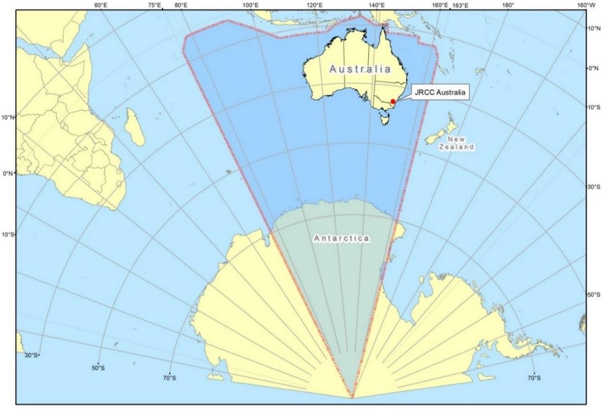
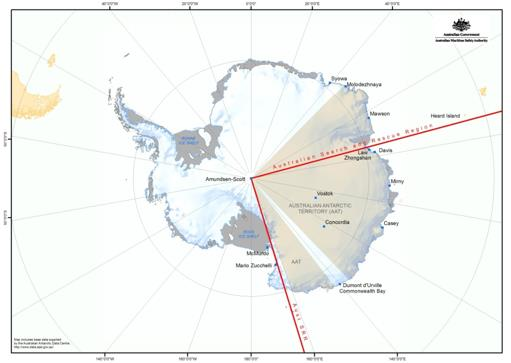

# National Search and Rescue (NATSAR) Manual — Volume 1: Search and Rescue Administration (February 2025)

> **Source**: AMSA
> **URL**: https://www.amsa.gov.au/sites/default/files/natsar-manual-february-2025-volume-1.pdf
> **Licence**: Crown / publisher copyright; practitioner reference
> **Retrieved**: 2026-05-07T23:47:06Z
> **SHA-256**: `98ffd8feafd0676af22bb97eec479744c719ba7b13d59d107bd20f487b0c828f`
> *Converted from PDF to Markdown format.*

---
## Page 1

 
 
 
Volume 1 – Search and Rescue Administration 
NATIONAL SEARCH AND RESCUE MANUAL 
2025 EDITION Version 1 – February 2025 
Page 35 
Volume 1 - Search and Rescue Administration 
NATIONAL SEARCH AND RESCUE MANUAL 
2025 EDITION Version 1 – February 2025 
Chapter 1 SAR System Organisation 
1.1. 
Organisation 
Global SAR System Organisation 
1.1.1 
The international Civil Aviation Organization (ICAO) and the International Maritime 
Organization (IMO) coordinate, on a global basis, member States’ efforts to provide search and 
rescue (SAR) services. Briefly, the goal of ICAO and IMO is to provide an effective worldwide 
system, so that wherever people may be in danger, in the air or at sea, SAR services, as 
referenced in the International Aeronautical and Maritime Search and Rescue Manual, will be 
available if needed. The overall approach a State takes in establishing, providing and improving 
SAR services is affected by the fact that these efforts are an integral part of a global SAR 
system. Land SAR is a function of SAR within each State/Territory jurisdiction.  
1.1.2 
Search and rescue services are defined as the performance of distress monitoring, 
communication, coordination and search and rescue functions, including provision of medical 
advice, initial medical assistance, or medical evacuation, through the use of public and private 
resources, including cooperating aircraft, vessels and other target and installations. 
1.1.3 
In providing assistance to persons in distress and to survivors of SAR incidents, member States 
shall do so regardless of the nationality or status of such a person or the circumstances in which 
that person is found. 
1.1.4 
Under this global approach, Australia has taken responsibility for the coordination of SAR in the 
Australian Search and Rescue Region (SRR) as shown in section 1.4.2.  JRCC Australia in 
Canberra is the Joint Rescue Coordination Centre (JRCC) responsible for the SRR.  There are no 
designated rescue sub-centres (RSC) within the Australian SRR. 
National and Regional SAR System Organisation 
1.1.5 
Australia, by being party to the Safety of Life at Sea (SOLAS) Convention, the International 
Convention on Maritime Search and Rescue, and the Convention on International Civil Aviation, 
has accepted the obligation to provide aeronautical and maritime SAR coordination and 
services for its territories, territorial seas, and the high seas within its SRR. 
1.1.6 
Australia, in acceding to the International Convention on Maritime Search and Rescue, 1979, 
noted that the implementation of the Treaty throughout Australia would be affected by the 
Commonwealth, State and Territory authorities having regard to their respective constitutional 
powers and arrangements concerning the exercise of their legislative, executive and judicial 
powers. The responsibilities of the authorities are set out in the relevant following paragraphs. 
1.1.7 
Australia has established a national SAR System that involves Commonwealth, State and 
Territory authorities and organisations: The Australian Maritime Safety Authority and the 
Australian Defence Force at the Commonwealth level; and the relevant police service or force 
at the State and Territory level, are the relevant SAR Authorities within Australia. 
1.1.8 
The Inter-Governmental Agreement (IGA) on National Search and Rescue Response 
Arrangements as signed by the responsible Commonwealth, State and Territory Ministers is at 
Appendix A in accordance with the IGA Commonwealth and the State and Territory search and 
rescue authorities shall each provide without charge unless otherwise agreed, such assistance

---
## Page 2

 
 
 
 
Volume 1 – Search and Rescue Administration 
 
NATIONAL SEARCH AND RESCUE MANUAL 
Page 36 
2025 EDITION Version 1 – February 2025 
or facilities as may reasonably be requested by the SAR authority with overall co-ordination of a 
SAR operation.  
1.1.9 
A SAR authority that hires or requisitions privately owned facilities for a SAR operation will, 
unless otherwise agreed between the SAR Authorities, bear any costs of hiring or payment of 
compensation for such requisitioning. 
1.1.10 
The costs of a SAR response to an activated distress beacon will be borne by the SAR Authority 
that tasks the SAR Facility. 
1.1.11 
Where the resources required to respond to a SAR incident exceed those available to any SAR 
Authority, or where the circumstances require significant coordination across Party agencies, a 
SAR incident may develop into an emergency management response. Where a SAR incident 
results in State, Territory or national emergency plans or arrangements being activated, they 
are to be activated in support of national SAR response arrangements established through the 
IGA. 
1.1.12 
Volume 1, Chapter 1, “SAR System Organisation” of the National Search and Rescue Manual 
constitutes the National Search and Rescue Plan for Australia. 
Australian Maritime Safety Authority (AMSA) 
1.1.13 
In accordance with Annex 12 of the Convention of International Civil Aviation, the 
Commonwealth Government, through the Australian Maritime Safety Authority (AMSA), 
accepts responsibility for the provision of Search and Rescue Services for civil and 
internationally registered aircraft in Australia’s SRR. The meaning of civil registered is taken to 
include those aircraft on the VH register managed by the Civil Aviation Safety Authority (CASA) 
and on the Recreational Aviation Australia (RA-Aus) register which the RA-Aus manages on 
behalf of the CASA. The responsibilities for the coordination of Aviation SAR response is 
exercised by JRCC Australia on behalf of AMSA. 
1.1.14 
The Commonwealth Government through AMSA, in accordance with of the Safety of Life at Sea 
(SOLAS) Convention and the International Convention on Maritime Search and Rescue, accepts 
responsibility for the coordination of maritime SAR for persons on or from a vessel at sea.  
These responsibilities are exercised jointly through JRCC Australia on behalf of AMSA and State 
and Territory Police. 
JRCC Responsibilities 
1.1.15 
JRCC Australia is staffed continuously and is responsible for: 
a) 
Coordinating SAR in respect of civil registered aircraft; 
b) 
Coordinating maritime SAR for persons on or from a vessel at sea (jointly with police); 
c) 
Managing the Australian Mission Control Centre (AUMCC) for the COSPAS - SARSAT 
distress beacon locating system; 
d) 
Operation of the Modernised Australian Ship Tracking and Reporting System (MASTREP); 
e) 
Promulgation of Maritime Safety Information (MSI); 
f) 
Provision of information on maritime activities such as oil pollution, offshore mineral 
exploration and dumping at sea; 
g) 
Providing assistance to other Australian SAR agencies to fulfil their obligations; and 
h) 
Providing assistance to other Australian and emergency response authorities to enable 
them to meet their obligations in regard to SAR. 
1.1.16 
The Australian Maritime Safety Authority (AMSA) is a Commonwealth statutory authority that 
provides support and commercial services to the Australian maritime industry. AMSA is 
responsible for setting and regulating standards for the operation of commercial shipping and 
domestic commercial vessels, the operation of an extensive network of marine navigation aids

---
## Page 3

 
 
 
Volume 1 – Search and Rescue Administration 
NATIONAL SEARCH AND RESCUE MANUAL 
2025 EDITION Version 1 – February 2025 
Page 37 
around the Australian coast, aviation and maritime search and rescue and the protection of the 
marine environment. 
1.1.17 
JRCC Australia is AMSA’s operational point of contact and provides a communications and 
coordination support function for marine pollution response. The Australian Maritime Safety 
Act 1990 sets out the functions of AMSA, including “the combating of pollution in the marine 
environment”. The Protection of the Sea (Powers of Intervention) Act 1981 implements the 
International Convention relating to intervention on the high seas in cases of oil pollution 
casualties and the protocol to that convention. AMSA is the managing agency for the National 
Marine Oil Spill Contingency Plan, and the National Marine Chemical Spill Contingency Plan. 
1.1.18 
JRCC Australia has a number of other roles during emergencies including as outlined by the 
Australian Government: 
a) 
Disaster Plans; and 
b) 
National Security, crisis and Emergency Management arrangements. 
1.1.19 
JRCC Australia can coordinate AMSA’s search and rescue assets in support of wider 
emergencies as appropriate, including major bushfires or other disasters. 
Medical Assistance to Vessels at Sea 
1.1.20 
The Joint Rescue Coordination Centre (JRCC) Australia is operated by the Australian Maritime 
Safety Authority (AMSA), a Commonwealth statutory authority established under the Australian 
Maritime Safety Act 1990. The International Convention on Maritime Search and Rescue 1979 
requires parties to the Convention to provide (among other things) on request, medical advice, 
initial medical assistance and medical evacuation (MEDEVAC).  
1.1.21 
JRCC Australia will coordinate these services in the Australian search and rescue region (SRR). 
JRCC Australia will arrange medical advice through a dedicated Tele Medical Advice Service 
(TMAS). 
1.1.22 
The assessment by the TMAS doctor determines the type and level of medical assistance 
required. This includes when a person is deemed to be in grave or imminent danger and 
requires immediate assistance and medical evacuation. For search and rescue (SAR) purposes 
this is considered a “distress” incident. 
1.1.23 
If a MEDEVAC is required, the JRCC will determine the most appropriate way to safely remove 
and transport the casualty to a medical facility or a place where medical assistance can be 
provided. Considerations including, vessel type and facilities, time of day, on-scene weather, 
available assets, location (in particular distance offshore), requirements for accompanying 
medical staff and suitability for recovery of patient by helicopter, may all play a factor in 
determining the most appropriate MEDEVAC response. 
1.1.24 
Once the requirement for a MEDEVAC and the use of state and territory resources is confirmed 
JRCC Australia may, in consultation with Australian state and territory health organisations, 
transfer coordination of the medevac incident to the appropriate jurisdictional contact. 
1.1.25 
If on TMAS advice the person/s requiring evacuation life is not at risk, the circumstances would 
not require a medical evacuation for SAR purposes. In these circumstances, a medical transport 
of the person should be arranged as considered appropriate; assistance can be requested of 
JRCC Australia to identify suitable assets as required. 
State and Territory Governments 
1.1.26 
Police are the SAR Authorities in each State and Territory.  The Australian Federal Police is the 
SAR Authority for the Australian Capital Territory, the Jervis Bay Territory and other populated 
Commonwealth territories.  
State/Territory Police Responsibilities 
1.1.27 
State and Territory Police Services are responsible for coordinating SAR in respect of:

---
## Page 4

 
 
 
 
Volume 1 – Search and Rescue Administration 
 
NATIONAL SEARCH AND RESCUE MANUAL 
Page 38 
2025 EDITION Version 1 – February 2025 
a) 
Persons and vehicles on land; 
b) 
Persons and vessels on inland waterways and in waters within the limits of the ports of 
the relevant State or Territory; 
c) 
Persons on or from a vessel at sea (jointly with the JRCC); 
d) 
Aircraft not included on the CASA and RA-Aus registers including ultra-lights, paragliders 
and gyrocopters; 
e) 
Coordinating land searches for missing registered civil aircraft in support of the Australian 
SAR Authority (JRCC Australia); and 
f) 
Coordinating the operations of volunteer rescue organisations within their respective 
jurisdictions. 
1.1.28 
Whilst the Police are the responsible authority for land SAR they can be assisted by: 
a) 
State Emergency Services:  The SES will provide manpower and equipment to enable SAR 
operations to be carried out.  The level of experience and equipment available will vary 
between States and individual SES assets.  A SMC should be familiar with their local SES 
assets and their capabilities. 
b) 
Other Volunteer Groups. 
c) 
JRCC: While JRCC is predominantly concerned with maritime and aviation SAR incidents 
they can be approached to: 
i) 
Provide assistance to other Australian SAR agencies to fulfil their obligations 
particularly with the coordination of multiple air assets; and 
ii) 
Providing assistance to other Australian emergency-response authorities to meet 
their obligations in regard to SAR. 
d) 
Australian Defence Force: Under the current DACC arrangements the ADF can be 
approached to provide assistance, under certain circumstances, to the police in SAR 
operations. 
Australian Defence Force Responsibilities – Military SAR 
1.1.29 
The Commonwealth Government, through the Australian Defence Force (ADF) is responsible 
for the provision of SAR for all ADF and visiting military ships, aircraft and personnel when 
undertaking operations and exercises. This responsibility is exercised through Chief of Joint 
Operations (CJOPS) located at Headquarters Joint Operations Command (HQJOC) unless by 
mutual agreement, is transferred to the “best placed” SAR Authority. 
Headquarters Joint Operations Command 
1.1.30 
CJOPS is responsible for managing and coordinating the ADF's operations on behalf of the Chief 
of the Defence Force (CDF). The Current Operations Commander within HQJOC is JRCC 
Australia's principal point of contact with Defence on SAR matters.  
1.1.31 
If a SAR for an ADF asset is required, the Current Operations Commander in consultation with 
the HQJOC Joint Personnel Recovery Officer (JPRO)/Search and Rescue Officer (SARO) will 
coordinate any available assets from the respective services and recommend an appropriate 
ADF SAR Commander and SMC be appointed to coordinate the SAR operation.  The HQJOC 
JPRO/SARO will remain involved as the SMC or as a conduit for information flow to government 
and civil SAR authorities. 
Airservices Australia 
1.1.32 
Airservices Australia 1.1.32 All Air Traffic Services (ATS) assets, as a function of their alerting 
service responsibilities, have a responsibility for the declaration of SAR Emergency Phases for 
aircraft, to classify the severity of emergencies and alert JRCC Australia.

---
## Page 5

 
 
 
Volume 1 – Search and Rescue Administration 
NATIONAL SEARCH AND RESCUE MANUAL 
2025 EDITION Version 1 – February 2025 
Page 39 
1.1.33 
In addition, all ATS assets are required to act as intermediaries between persons reporting an 
aircraft in need of assistance and JRCC Australia. 
1.1.34 
ATS assets are responsible for providing in–flight emergency response (IFER) services.  ATS 
assets are required to refer incidents likely to culminate in a forced landing, ditching or crash to 
JRCC Australia at the earliest opportunity. 
1.1.35 
To the extent that their traffic responsibilities allow, ATS assets are required to provide 
communications between the search aircraft and the responsible SAR Authority.  This normally 
involves the relay of requests, instructions and information between the responsible JRCC and 
aircraft. 
Other Commonwealth Agencies/Authorities 
1.1.36 
A number of Commonwealth organisations have a special interest in emergency operations; 
they provide helpful ancillary services or have SAR facilities that may be of assistance in special 
cases. 
Bureau of Meteorology (BOM) 
1.1.37 
Provides routine or special weather forecasts, wind history and a description of past and 
present weather reports. 
Emergency Management Australia (EMA) 
1.1.38 
The Commonwealth Government, through Emergency Management Australia (EMA), is 
responsible for coordinating any Commonwealth assistance to States/Territories following 
natural or technological disaster. The National Emergency Operations Centre (NEOC) in 
Canberra exercises this responsibility. 
1.1.39 
State/Territory Governments have constitutional responsibility, within their borders, for 
coordinating and planning for the response to natural or technological disasters and civil 
emergencies. When the total resources (government, community and commercial) of an 
affected State/Territory cannot reasonably cope with the needs of the situation, the 
State/Territory Government can seek assistance from the Commonwealth Government through 
EMA. 
Maritime Border Command 
1.1.40 
Maritime Border Command (MBC) is a joint ADF and Australian Customs agency that 
coordinates and manages the Australian Civil Surveillance Program and may provide assets to 
assist during SAR incidents. 
1.1.41 
In accordance with IMO directive MSC/Circ. 1073, MBC is the Australian Security Forces 
Authority with the responsibility for providing the response to acts of violence against ships. 
Australian Communications and Media Authority (ACMA) 
1.1.42 
The Australian Communications and Media Authority (ACMA) regulate the use of radio 
frequencies and may assist with direction finding services.  ACMA also issues and maintains a 
database of maritime call sign allocations to Australian holders of maritime radio licenses. 
Australian Transport Safety Bureau (ATSB) 
1.1.43 
The ATSB is responsible for investigating accidents and incidents involving certain transport 
services in Australia.  Australian SAR Authorities have responsibility for notifying ATSB of 
accidents or incidents. ATSB can provide SAR Authorities with information about the location of 
past aircraft crash sites, which can be useful in identifying wreckage located during search 
actions.

---
## Page 6

 
 
 
 
Volume 1 – Search and Rescue Administration 
 
NATIONAL SEARCH AND RESCUE MANUAL 
Page 40 
2025 EDITION Version 1 – February 2025 
Civil Aviation Safety Authority (CASA) 
1.1.44 
CASA sets aviation safety regulatory standards affecting the civil aviation industry. CASA can 
provide advice on aircraft and pilot performance, safety matters and maintain the Aircraft 
Register. 
1.1.45 
CASA through the Office of Airspace Regulation (OAR) is responsible for the declaration of 
Restricted or Danger Areas during search and rescue operations when appropriate. 
Volunteer Organisations 
1.1.46 
Volunteer rescue organisations are located throughout the country and their focus is primarily 
one of promoting safety and carrying out local rescues. The State or Territory SAR authority is 
responsible for the coordination and control of operations conducted by the volunteer 
organisations during search and rescue operations. 
1.1.47 
Volunteer organisations include groups such as the SES, Volunteer Marine Rescue groups 
(VMR), Surf Life Saving Australia (SLSA), Federated Mountain Rescue (FMR) and other state 
equivalents. These groups will provide search teams as appropriate. 
Commercial and Private Organisations 
1.1.48 
There are certain commercial and private organisations that are capable of providing assistance 
during SAR incidents. 
1.1.49 
Some of these organisations have facilities that are immediately suitable for use as SAR assets; 
others have facilities that have been adapted by way of providing them with extra equipment 
or training. 
1.1.50 
Assets considered suitable for the provision of SAR services are described as Search and Rescue 
Assets (SRAs).  The crews of these assets are trained in search and rescue techniques.   
1.1.51 
Aircraft and marine craft in transit may be able to assist in cases of distress within their area of 
operations.  Commercial towing and salvage companies may provide vessels to take over the 
towing or salvage of a vessel that is no longer in immediate danger. The owner or agent of the 
disabled vessel usually makes arrangements for these services.  SAR assets should not interfere 
with this form of private enterprise providing the commercial facilities are capable of 
completing the operation safely. 
1.1.52 
Other organisations that might volunteer to assist in a SAR operation include commercial 
airlines, general aviation operators, oil and mine companies, fishing companies, aero clubs, 
mission stations and other community groups and organisations. 
1.2. 
SAR Coordination 
Overview 
1.2.1 
There are two levels of SAR response in Australia: 
a) 
The Commonwealth level through AMSA (JRCC Australia) and the ADF; and 
b) 
The State/Territory level through the Police. 
1.2.2 
Volunteer organisations work in close liaison with State and Territory Police and the Police 
retain overall coordination of those organisations within their jurisdiction. 
1.2.3 
It is common for a number of SAR Authorities to contribute to one SAR operation.  Therefore it 
is vital that one SAR Authority is responsible for the overall coordination of the SAR operation 
and the other Authorities involved will cooperate to produce the best response possible within 
available resources.

---
## Page 7

 
 
 
Volume 1 – Search and Rescue Administration 
NATIONAL SEARCH AND RESCUE MANUAL 
2025 EDITION Version 1 – February 2025 
Page 41 
Alerting Post 
1.2.4 
Any SAR Authority may receive a distress alert as an Alerting Post, making them responsible for 
onward distribution to the responsible SAR Authority. 
1.2.5 
In this instance, the receiving SAR Authority will consult with the responsible SAR Authority as 
per Appendix B at the earliest opportunity to reach an agreement about the best placed SAR 
Authority to assume overall coordination. 
1.2.6 
For land SAR incidents, determination of best placed will take into consideration the protocol 
outlined in Appendix C, the Land SAR Coordination Procedure, in addition to Appendix B. 
Determination of SAR Authority Responsible for Overall Coordination 
1.2.7 
The fundamental aim of a SAR system is to provide assistance to persons in distress. To achieve 
this, aim the SAR system has to locate, support and rescue persons in distress in the shortest 
possible time. The success of the SAR response therefore depends on the speed with which the 
SAR situation is evaluated, and the SAR operation is planned and carried out. 
1.2.8 
To ensure the SAR response is successful there are certain principles of SAR coordination that 
must be observed. 
Initial Response 
1.2.9 
The first SAR Authority to become aware of a SAR incident is obliged to respond until overall 
coordination can be transferred to the SAR authority best placed to coordinate. 
SAR Authority Best Placed to Coordinate 
1.2.10 
Normally the SAR Authority best placed to be the Overall Coordinator of a SAR incident will be 
the SAR Authority identified in Appendix B as responsible for the target type. 
1.2.11 
Appendix B identifies the responsibilities and functions to a SAR Authority based on the type of 
target that requires assistance from the SAR service and then additionally, in some 
circumstances, by the location of the SAR incident.  
1.2.12 
Appendix B represent the table of National search and rescue responsibilities and functions 
where the table:  
a) 
Identifies the divisions of responsibilities between SAR Authorities; and 
b) 
Identifies the functional breakdown that SAR Authorities perform by, for or on behalf of, 
the overall coordinating SAR Authority. 
1.2.13 
However, it can be determined after consultation that another SAR Authority (other than the 
one specified in Appendix B) is best placed to coordinate. In this instance, overall responsibility 
may be transferred by mutual agreement. 
1.2.14 
The circumstances may include better communications, closer proximity to the area of search, 
better access to sources of intelligence, expertise in specialised areas or more readily available 
facilities. 
1.2.15 
For example, JRCC Australia is normally best placed to coordinate wide area air searches and 
coordinate search and rescue operations at sea at long range. These operations may also 
involve requests for ADF assistance. Police forces are normally best placed to coordinate local 
ground searches or inshore boat searches. 
1.2.16 
The coordination of a police land-based search cannot be transferred to JRCC Australia. 
However, JRCC Australia may provide support on request in accordance with the procedures 
stated below in “JRCC Australia Assistance to Other SAR Authorities”. 
1.2.17 
As Police always retain responsibility for land SAR incidents, transfer will only be possible 
between Police Services/Forces for incidents that occur on State Borders.  Police cannot 
transfer responsibility for land SAR incidents to JRCC Australia.  Land SAR Incidents involving

---
## Page 8

 
 
 
 
Volume 1 – Search and Rescue Administration 
 
NATIONAL SEARCH AND RESCUE MANUAL 
Page 42 
2025 EDITION Version 1 – February 2025 
military personnel may be able to be transferred to the ADF under certain circumstances.  
However, JRCC Australia may provide support on request in accordance with the procedures 
stated below in “AMSA Assistance to other SAR Authorities.” 
1.2.18 
A SAR Authority may not be better placed if it is already engaged in responding to another SAR 
incident/s or it does not have sufficient resources to be able to coordinate effectively. 
1.2.19 
The SAR authority with overall coordination may request assistance from another SAR 
authority. In such circumstances the Overall Coordinator may delegate to another SAR 
Authority responsibility for a specific part of the SAR operation. 
1.2.20 
From time to time, a SAR operation may be commenced independent of a SAR authority. Once 
a SAR authority is alerted to the incident it is their responsibility to coordinate the activities of 
the responding assets in order that the integrity of the search is maintained until such time as 
the SAR Authority best placed to coordinate the incident has been determined under this plan 
or the incident concludes. 
Effective Consultation and Coordination 
1.2.21 
In order to ensure the successful prosecution of a SAR incident involving more than one SAR 
authority, the SMC with overall coordination shall initiate consultation with all participating SAR 
Authorities at the commencement of an incident. The SMC should conduct frequent reviews of 
the progress of the incident and produce a SITREP at regular intervals.  This should not preclude 
all participants offering advice and suggestions. 
1.2.22 
All SAR authorities have specialised knowledge within their specific area of expertise and 
operation; therefore, the SMC should consult with other authorities to establish what 
assistance is available. 
Cooperation with Foreign Rescue Coordination Centres 
Coordination Principles with Foreign RCCs 
1.2.23 
When the area of SAR operations is near or straddles the boundaries between international 
search and rescue regions (SRR), JRCC Australia is to be informed and will take overall 
coordination, except for SAR involving military forces as previously discussed. JRCC Australia 
will liaise with neighbouring foreign RCCs in accordance with the relevant International SAR 
Arrangements. In general, the following procedures reflect the SAR Arrangements in place. 
1.2.24 
When the position of a party in distress is known, the responsibility for initiation of SAR action 
will be that of the International RCC in whose SRR the party is located. 
1.2.25 
The International RCC to assume responsibility for conduct of a SAR action when the distressed 
target’s position is unknown shall be the RCC responsible for: 
a) 
The SRR in which the target was operating according to its last reported position; or 
b) 
The SRR to which the target was proceeding if the last reported position was at the 
boundary of two SRRs; or 
c) 
The SRR to which the target was destined if it was not equipped with suitable two–way 
radio communication equipment or not under obligation to maintain radio 
communication. 
1.2.26 
If, after a SAR action has been initiated, it is determined that the area of probability lies across 
the boundaries of two or more adjoining SRRs, the initiating RCC shall normally remain the 
responsible SAR Authority. 
1.2.27 
Alternatively, where search areas are extensive, it may be agreed that JRCC Australia 
coordinates search efforts in the Australian SRR and the adjacent International RCC coordinates 
search efforts in the foreign SRR. Should this be considered the preferable strategy, JRCC 
Australia may initiate the proposal to its foreign counterpart.

---
## Page 9

 
 
 
Volume 1 – Search and Rescue Administration 
NATIONAL SEARCH AND RESCUE MANUAL 
2025 EDITION Version 1 – February 2025 
Page 43 
Provision for Entry of Foreign Aircraft during SAR Operations 
1.2.28 
JRCC Australia shall take responsibility for organising the entry into and departure from the 
Australian region, outside of the Australian Sovereign territory (12 Nautical Miles off coastline), 
of foreign state aircraft engaged in SAR operations. 
1.2.29 
Any Foreign State aircraft entering the 12 NM limit will require the submission of a Diplomatic 
Clearance through the Department of Defence via phone 02 6128 4819, or, email to 
dipa.hqac@defence.gov.au, and will require involvement from the relevant country’s Embassy 
or High Commission. The JRCC may assist in facilitating this requirement.  
1.2.30 
If another SAR authority becomes aware of a foreign state aircraft being tasked to conduct SAR 
operations in the Australian region, they should inform JRCC Australia immediately who will 
help facilitate approvals and diplomatic clearances as necessary.  
Requests for Assistance from Foreign RCCs 
1.2.31 
JRCC Australia or the Department of Foreign Affairs and Trade (DFAT) may receive requests 
from foreign RCCs for Australian assistance in SAR operations. If requests are received via DFAT, 
JRCC Australia shall immediately establish communications with the RCC responsible for the 
area to establish and arrange any assistance that may be required. 
Transfer of Coordination 
Reasons for Transfer of Coordination 
1.2.32 
The SAR authority with overall coordination should evaluate all available information and 
intelligence and make an initial assessment of the probable search area and assets required. If 
the required response is assessed as being beyond the capacity of the authority, then that 
authority should request assistance at an early stage.  Delaying requests for assistance, may 
lead to reduced chances of survival and/or significant increase in the size of the search area. 
1.2.33 
Overall coordination responsibility may be transferred from one SAR authority to another 
within Australia’s SRR in the following circumstances: 
a) 
Where a SAR authority has activated a SAR operation in response to a distress or other 
emergency situation that is found to be outside their responsibility. 
 
For example, a SAR operation is mounted by JRCC Australia in response to a distress 
beacon activation that is, having established the nature and location, found to be a land 
environment incident or a pleasure craft/fishing vessel in distress where Police are better 
placed to respond. In such a case JRCC Australia, depending on the operational 
circumstances of the SAR response, may transfer overall coordination of the SAR 
operation to the responsible State or Territory Police Service or Force. 
b) 
When a RCC is fully committed, overall coordination of a further incident in that region 
may be transferred to an adjacent RCC.   
Note: JRCC Australia is considered to be an adjacent RCC to State and Territory 
RCCs. 
c) 
Whenever more accurate knowledge of the distressed target’s position or movements 
comes to hand. 
d) 
When it becomes apparent that a SAR authority other than the one initiating the action is 
more favourably placed to assume responsibility. 
e) 
Where a SAR operation is beyond the State/Territory’s capabilities.  This might include 
situations where vessels are well to sea or along a remote part of the Australian coastline 
and beyond the capabilities of the SAR facilities available to the State/Territory agencies. 
f) 
Where the circumstances of the SAR operation require the implementation of the State or 
Territory’s disaster plan or the declaration of a State or Territory Emergency. For example,

---
## Page 10

 
 
 
 
Volume 1 – Search and Rescue Administration 
 
NATIONAL SEARCH AND RESCUE MANUAL 
Page 44 
2025 EDITION Version 1 – February 2025 
an aircraft incident where there are many fatalities and/or injured.  In these cases, once 
appropriate State/Territory resources are on site, the appropriate State/Territory 
authority will assume overall coordination of the operation. 
g) 
For a major search where JRCC Australia has assumed overall coordination from a 
State/Territory SAR authority and the air search has been completed but local land and 
inshore operations may continue, overall coordination may be transferred back to the 
appropriate State/Territory authority. 
Transferring Overall Coordination 
1.2.34 
A transfer of coordination responsibility between SAR Authorities may be affected at any time 
by a SAR Authority requesting another SAR Authority to assume overall coordination (or by 
another SAR Authority offering to take coordination) in accordance with Appendix B. In these 
instances: 
a) 
Consultation shall take place between the SMCs of both SAR Authorities concerned and 
verbal agreement reached on which SAR Authority is best placed to continue to 
coordinate the incident and the reasons for accepting coordination. 
b) 
Transfer of coordination will formally occur at the time verbal agreement is made by the 
appropriately qualified person(s) who is authorised to accept coordination.  
c) 
Full details of all relevant information and actions taken by the initiating SAR Authority 
shall then be passed in accordance with the information exchange requirements outlined 
in Appendix C. 
d) 
If overall coordination cannot be accepted immediately, the initiating SAR Authority shall 
retain coordination until a mutually agreed time of transfer; 
e) 
All assets or SAR Authorities concerned shall be advised of the transfer of coordination. 
1.2.35 
In assuming coordination for the SAR incident, it is essential that the accepting SMC is aware 
that SAR assistance from the (current) Coordinating SAR Authority may not be available 
depending on the reasons for the transfer of overall coordination.  
1.2.36 
Where a SAR Authority accepts overall coordination of an incident, the SMC shall ensure that 
full responsibility for the incident is accepted, in which case: 
a) 
The accepting SMC shall ensure that all aspects, including air and surface search, are 
coordinated by their authority. 
b) 
If an aspect of the search (e.g. air search) is to be supported by, or remain with another 
SAR Authority, then the terms of the assistance shall be made clear and that Authority 
shall be required to report progress and keep the SMC with overall coordination informed 
as to developments. 
1.2.37 
On completion of the SAR incident, it might be determined appropriate to transfer the event 
back to the original coordinating SAR Authority.  
Accepting Coordination for a Component of the SAR Event from another SAR Authority 
1.2.38 
Where an Authority decides to accept coordination for a component of an event (e.g. air 
search) from another SAR Authority, the accepting SMC shall ensure that responsibility for 
specific functions (e.g. air search) is accepted, in which case: 
a) 
Transfer of coordination will formally occur at the time verbal agreement is made by the 
appropriately qualified person(s) who is authorised to accept coordination. 
b) 
The accepting SMC shall operate within the terms of the agreed responsibility and report 
progress to the SAR Authority with overall coordination; and 
c) 
Conduct the specific functions in accordance with accepted standards, procedures and 
practices.

---
## Page 11

 
 
 
Volume 1 – Search and Rescue Administration 
NATIONAL SEARCH AND RESCUE MANUAL 
2025 EDITION Version 1 – February 2025 
Page 45 
Guidance in Support of Transferring Coordination of a Component of a SAR Operation 
1.2.39 
Where the overall coordinator needs or requires another cooperating SAR Authority to take 
responsibility for a component of a SAR event or a specific activity in the SAR event the 
cooperating Authority must be provided with: 
a) 
Clear objectives, scope and scale of the delegated responsibility and service required; 
b) 
Full briefing on the SAR event to the extent that it will affect the service to be provided; 
c) 
Conditions and constraints on use of assets; 
d) 
Time requirements and constraints; and 
e) 
Tactical intelligence, information and data as it becomes available that may affect the 
progress of the support service provided. 
1.2.40 
The cooperating Authority must: 
a) 
Accept or reject the proposed delegation.  If the action is other than to accept the 
delegation, then the coordinating Authority must be informed of the operational reasons; 
b) 
Operate within the terms of reference for the supporting service; 
c) 
Inform the coordinating Authority of any circumstances, if they arise where the specified 
service cannot be provided or needs to be varied, together with reasons; 
d) 
Exchange with the coordinating Authority, tactical intelligence, information and data as it 
becomes available that may affect the progress of the SAR event; and 
e) 
Report progress of the support activity to the coordinating Authority. 
Transfer of Coordination after Suspension of SAR Action 
1.2.41 
When a SAR action is suspended, the authority with overall coordination at the time shall 
inform all authorities, assets and facilities that have been activated and/or alerted. 
1.2.42 
If, at the time of suspension, the search is under the overall coordination of the Authority 
responsible for the target type, as identified in Appendix B; overall coordination shall not be 
transferred to another SAR authority.  Rather, the Police, and other SAR agencies involved in 
the SAR operation, should be informed that the search has been suspended pending the 
availability of further intelligence.  The Police may then instigate further Police (non-SAR) 
actions as appropriate. 
1.2.43 
Where a search is suspended for a target that another SAR authority has responsibility for 
under the terms of Appendix B, overall coordination shall be transferred to that authority.  The 
expectation would be that if further intelligence is received that indicates the search should be 
re-commenced, the SAR authority that has normal responsibility for the target will consider its 
capability to coordinate the search at that time and either retain coordination, seek assistance 
or transfer coordination.  Also, it may be necessary for that authority to fulfil their coronial or 
missing person responsibilities. 
1.2.44 
On occasions, after the suspension of a search, it may be necessary for State/Territory Police to 
continue to search for bodies or aircraft/vehicle/vessel wreckage.  In such cases JRCC Australia 
may: 
a) 
Provide briefings on flight path or vessel track prior to disappearance, splash/crash point, 
area searched and related intelligence; 
b) 
Review intelligence to assist search; 
c) 
Source aircraft for transport or search purposes; 
d) 
Brief search crews on (a) above; and 
e) 
Provide drift information.

---
## Page 12

 
 
 
 
Volume 1 – Search and Rescue Administration 
 
NATIONAL SEARCH AND RESCUE MANUAL 
Page 46 
2025 EDITION Version 1 – February 2025 
1.2.45 
JRCC Australia will not fund air or surface assets for the search for bodies or 
aircraft/vehicle/vessel wreckage once the search has been suspended. 
1.2.46 
Should any other organisation, e.g. the operating company, wish to continue an independent 
search, the SAR Authority with overall coordination should ascertain whether there is any new 
intelligence that indicates that the search should be continued.  If there is: 
a) 
New intelligence then this should be evaluated and, if considered valid, the search should 
be continued/re-initiated; or  
b) 
No new intelligence then the Police/RCC may assist the requesting organisation with: 
i) 
Briefings on path prior to disappearance, splash/crash point, area searched and 
related intelligence; and/or 
ii) 
Drift information; 
iii) 
Briefings on MP behaviour and intentions, LKP area searched and related 
intelligence. 
1.2.47 
JRCC Australia will neither fund nor provide air or surface assets for continuation of the search 
unless the request is supported by new intelligence. 
Requesting JRCC Australia Assistance 
Subject Matter Expertise and Advice 
1.2.48 
Australian SAR authorities may request assistance or advice from JRCC Australia during a SAR 
operation. Where resources are available, JRCC Australia can assist with SAR planning, briefings, 
prediction and management tools for a maritime or aviation search. 
Briefings 
1.2.49 
JRCC Australia can deliver a range of services as follows. 
1.2.50 
In circumstances where assistance is required to task a marine or aviation SAR asset, the 
coordinating SAR Authority can request JRCC Australia to prepare a briefing for those assets. 
JRCC Australia will: 
a) 
Prepare and provide the briefing and email it to the coordinating SAR Authority for the 
crew; or 
b) 
Prepare and provide the briefing and email it directly to the crew, copied to the 
coordinating SAR Authority. 
1.2.51 
Land SAR assets will be briefed by the police SMC coordinating the incident.  Aviation and 
maritime SAR assets being utilised in a land SAR incident will generally be briefed by the police 
SMC. 
Aviation Capability 
1.2.52 
Where significant aviation assets beyond reasonable normal capacity of the State/Territory are 
required to contribute to a SAR response plan, JRCC Australia can assist with aviation capability 
by providing three levels of aviation assistance: 
a) 
Identification of suitable aviation SAR assets to conduct a search and pass details to the 
requesting authority. 
b) 
Identification and briefing of suitable aviation SAR assets. 
c) 
Identification, briefing and tasking of suitable aviation SAR assets.  
1.2.53 
If assistance a) or b) is requested, then JRCC Australia will provide the relevant information to 
the coordinating SAR Authority to assist in further developing the SAR response plan. 
1.2.54 
If assistance c) is requested, JRCC Australia will task the asset but will still remain in a 
supporting role to the coordinating SAR Authority.

---
## Page 13

 
 
 
Volume 1 – Search and Rescue Administration 
NATIONAL SEARCH AND RESCUE MANUAL 
2025 EDITION Version 1 – February 2025 
Page 47 
1.2.55 
All subsequent activities that are related to monitoring progress of the air search, reaction to 
intelligence and re-allocation of aircraft to modified search allocations would remain with the 
coordinating SAR Authority 
1.2.56 
The cost of coordinating and responding to a search and rescue incident will be borne by the 
tasking SAR Authority unless otherwise agreed.  
Responsibilities as Air Search Coordinator 
1.2.57 
On request, JRCC Australia can take responsibility for a wide scale air search in support of a SAR 
operation under the overall coordination of another SAR Authority. The following procedures 
will apply:  
a) 
The search area will be determined by mutual agreement between the coordinating SAR 
Authority and JRCC Australia;  
b) 
When additional intelligence is received that may entail changes to the search area, the 
revised search area will be determined by mutual agreement between the coordinating 
SAR Authority and JRCC Australia;  
c) 
JRCC Australia will conduct the complete air search including aircraft identification, 
briefing, tasking and de-briefing, air asset performance monitoring and intelligence 
analysis;  
d) 
All aircraft tasking details will be provided to the coordinating SAR Authority;  
e) 
The coordinating SAR Authority and JRCC Australia will exchange and consider search area 
information and intelligence to ensure that coordination of the event is effectively 
achieved;  
f) 
When the air search has been completed and there is high confidence that if the target 
was in the search area it would have been found, and appropriate consideration for the 
probability of survival has occurred, the air search will be suspended pending the 
availability of new intelligence; and  
g) 
Requests to extend or continue the air search must be supported by the presence of new 
intelligence. If the air search is continued for other reasons, the costs of that continuation 
will be borne by the coordinating SAR Authority and not JRCC Australia.  
1.2.58 
AMSA will pay all the costs for the air search unless option (g) above is applicable. 
1.2.59 
Requests for assistance from the JRCC Australia will be made in accordance with the 
information exchange requirements outlined in Appendix C.  
1.3. 
Requesting State / Territory SAR Authority Assistance 
Requests for Defence Assistance (DACC) 
Localised Emergency Assistance to Save Life 
1.3.1 
In localised emergency situations when immediate action is necessary to save human life, the 
RCC/local SAR Authority may request assistance directly from the commander of an ADF asset 
on scene or in the area. In these circumstances ADF commanders are authorised to provide 
assistance from within their asset’s resources to civil Authorities. Within Defence this type of 
localised assistance is categorised Defence Assistance to the Civil Community (DACC) Category 
1. 
1.3.2 
Whenever this action is taken the SMC shall advise JRCC Australia as soon as possible, and the 
commander of the ADF asset will advise their superior Headquarters as soon as possible.  JRCC 
Australia is to follow up with a courtesy call to Headquarters Joint Operations Command 
(HQJOC).

---
## Page 14

 
 
 
 
Volume 1 – Search and Rescue Administration 
 
NATIONAL SEARCH AND RESCUE MANUAL 
Page 48 
2025 EDITION Version 1 – February 2025 
All Other Requests for Defence SAR Assistance 
1.3.3 
In circumstances other than those described above, civilian SAR Authorities/SMC shall pass 
requests for ADF assistance to JRCC Australia who will liaise with Headquarters Joint Operations 
Command (HQJOC). Once a military asset has been assigned, further contact can be with the 
Service concerned. JRCC Australia will contact the appropriate military asset to discuss with the 
mission commander/crew an appropriate search tasking for the asset. 
1.3.4 
All requests for ADF assistance are to include as much detail as possible about the search 
target, where assets are required, how long assets are likely to be required, what other search 
assets are in the area, who is the coordinating SAR Authority, what logistic support can be 
provided to the ADF and the relevant points of contact. 
1.3.5 
Any verbal request will be followed by a hard copy message. 
Defence Requests for Civil Assistance 
1.3.6 
In localised emergency situations when immediate action is necessary to save human life, ADF 
authorities will liaise directly with local SAR authorities/providers for the provision of civil 
support to ADF SAR operations. 
1.3.7 
In other than immediate, life-threatening circumstances, the ADF will pass requests for civil SAR 
assistance in support of military SAR operations to JRCC Australia for on forwarding to the 
appropriate civilian SAR Authorities/SMC and the facilitation of the provision of support. 
1.4. 
Australian Search and Rescue Region 
1.4.1 
The Australian search and rescue region covers the Australian continent and large areas of the 
Indian, Pacific and Southern Oceans as well the Australian Antarctic territories.  
1.4.2 
This is nearly 53 million square kilometres (one tenth of the earth’s surface) and borders the 
search and rescue regions of 10 other countries. 
 
Figure 1: Australian Search and Rescue Region

---
## Page 15

 
 
 
Volume 1 – Search and Rescue Administration 
NATIONAL SEARCH AND RESCUE MANUAL 
2025 EDITION Version 1 – February 2025 
Page 49 
 
   Figure 2: Australian SRR Antarctic Region 
1.5. 
SRR Coordinates 
1.5.1 
The coast of the Antarctic continent in longitude 75° E thence 
6° 00’ S 75° 00’ E 
9° 37’ S 141° 01’ E 
2° 00’ S 78° 00’ E 
9° 08’ S 143° 53’ E 
2° 00’ S 92° 00’ E 
9° 24’ S 144° 13’ E 
12° 00’ S 107° 00’ E 
12° 00’ S 144° 00’ E 
12° 00’ S 123° 20’ E 
12° 00’ S 155° 00’ E 
9° 20’ S 126° 50’ E 
14° 00’ S 155° 00’ E 
7° 00’ S 135° 00’ E 
14° 00’ S 161° 15’ E 
9° 50’ S 139° 40’ E 
17° 40’ S 163° 00’ E 
9° 50’ S 141° 00’ E 
Thence to the coast of the Antarctic 
continent in longitude 163° 00’ E 
Note: The Australian maritime and aviation SRRs are generally the same except that the 
maritime SRR only extends to the Antarctic coast whilst the aviation SRR extends to the South 
Pole; and there is a minor difference in the Northeast corner of the SRR.

---
## Page 16

 
 
 
 
Volume 1 – Search and Rescue Administration 
 
NATIONAL SEARCH AND RESCUE MANUAL 
Page 50 
2025 EDITION Version 1 – February 2025 
1.6. 
Australian States and Land Search Area 
 
Figure 3: Australian States and Land Search Areas 
1.6.1 
The Police Services in each State and Territory are responsible for Land Search and Rescue 
within the boundaries of their respective State or Territory, including any islands.  The ACT is 
also responsible for a small area of land at Jervis Bay, NSW. 
Statistics 
 
State/Territory 
Population 
Size (Km2) 
Australian Capital Territory 
387 000 
2 452 
New South Wales 
7 544 500 
811 428 
Northern Territory 
246 000 
1 346 200 
Queensland 
4 470 900 
1 787 100 
South Australia 
1 688 700 
1 024 377 
Tasmania 
515 000 
67 800 
Victoria 
5 866 300 
227 600 
Western Australia 
2 589 100 
2 525 500 
Territories 
6,500 
*300 
Total 
24 000 000 
*7 617 930 
* Not including Antarctica

---
## Page 17

 
 
 
Volume 1 – Search and Rescue Administration 
NATIONAL SEARCH AND RESCUE MANUAL 
2025 EDITION Version 1 – February 2025 
Page 51 
Chapter 2 SAR Management 
2.1. 
Overview 
2.1.1 
There are three levels of management within the SAR system. 
a) 
Overall management of SAR responsibilities by SAR Authorities; 
b) 
Management of individual SAR incidents by SAR mission coordinators (SMCs); and 
c) 
Direction of SAR activities at an incident by on-scene coordinators (OSCs) specifically 
designated by the SMC. 
2.1.2 
This section outlines, in general terms, the management and coordination actions required 
when a decision is made to implement procedures in prosecuting a SAR. 
2.1.3 
Once it is decided to proceed with the action, plans should be enacted for the commencement 
of search activity with a minimum of delay. Coincident with progressing search activity, is the 
development of a rescue plan and obtaining and deploying rescue resources to minimise time 
between survivors' location and their recovery to a place of safety. 
SAR Authority Responsibilities  
2.1.4 
A SAR Authority shall ensure that a SAR operation can be promptly initiated and prosecuted 
with the efficient use of available SAR resources, until rescue has been completed or until 
chance of success is no longer a reasonable possibility. 
2.1.5 
The State or Territory Police shall ensure that a land SAR operation can be promptly initiated 
and prosecuted with the efficient use of available SAR resources, until rescue has been 
completed or until chance of success is no longer a reasonable possibility. 
2.1.6 
SAR Authorities have overall responsibility for establishing, staffing, equipping and managing 
the SAR system, including providing appropriate legal and funding support, establishing 
RCC/FSHs, providing or arranging for SAR assets, coordinating SAR training and developing SAR 
policies, as listed at Appendix B. SAR Authorities will focus upon resources to conduct SAR 
operations for which they are the Responsible Authority (Appendix B). The SAR authority, 
where applicable, shall: 
a)  
Designate an SMC for a specific SAR incident 
 
b) 
Establish a Rescue coordination Centre (RCC/FSH) to coordinate all participating search 
and rescue assets and facilities; 
c) 
Ensure that the RCC/FSH conforms to the SAR procedures contained in this manual or 
local SOPs and manuals; 
d) 
Establish close liaison and formulate agreements with other authorities and organisations 
having SAR potential; 
e) 
Establish liaison with SAR Authorities of adjacent areas to ensure mutual cooperation and 
coordination in combined operations; 
f) 
Ensure that a comprehensive and current SAR plan is prepared and distributed; 
g) 
Establish and supervise communication facilities and assign SAR frequencies from those 
authorised to assets designated for SAR tasks; 
h) 
Establish communications with adjoining RCC/FSHs and appropriate organisations to 
ensure two-way alerting and dissemination of SAR information; 
i) 
Ensure immediate action is taken to provide assistance, advising the appropriate SAR 
Authorities and passing all information received concerning the distress incident and any 
action taken;

---
## Page 18

 
 
 
 
Volume 1 – Search and Rescue Administration 
 
NATIONAL SEARCH AND RESCUE MANUAL 
Page 52 
2025 EDITION Version 1 – February 2025 
j) 
Ensure that the operating authority or agency of any craft, aviation asset or land party in 
need of assistance has been advised of initial actions taken, and they are kept informed of 
all pertinent developments; 
k) 
Ensure that the Next of Kin (NOK) of any missing person/s has been advised of initial 
actions taken, and they are kept informed of all pertinent developments; 
l) 
Ensure that each incident is prosecuted until assistance is no longer necessary, rescue has 
been completed or chance of success is no longer a reasonable possibility; 
m) Ensure that if the scope of the maritime/aviation operation exceeds the authority’s 
capacity to plan and execute the operation, it shall seek advice and assistance from, or by 
mutual agreement, hand over coordination, to an appropriate authority; 
n) 
Ensure that if the scope of the land operation exceeds the local capacity to plan and 
execute the operation, the FSH shall seek advice and assistance from the respective State 
SAR Coordinator for the provision of assets and/or personnel from other areas 
o) 
Maintain and preserve adequate records; and 
p) 
Develop new and improved techniques and procedures. 
Forward Command Post 
2.1.7 
It may be desirable to establish a Forward Command Post or a Forward Field Base at a suitable 
location.  The feasibility of FCP/FFB establishment will be a matter for consideration by the SAR 
Authority. 
2.1.8 
As the name suggests a Forward Field Base (FFB) differs from a Forward Command Post (FCP) in 
that a Forward Field Base does not involve transfer of any coordination responsibilities from 
the parent RCC/FSH. 
2.1.9 
JRCC/FSH will commonly establish a FFB at an aerodrome being used by several search aircraft 
for the purpose of managing tasking, allocation of personnel and equipment and conducting 
briefings and debriefings. A FFB may be also set up in conjunction with a Police headquarters or 
Police FCP to facilitate liaison between Authorities and agencies involved in a search and rescue 
operation. 
2.1.10 
The degree of delegation attributed to the FCP / FFB, and its actual responsibilities shall be at 
SMC discretion, bearing in mind the need for: 
a) 
A clear understanding of respective responsibilities; and 
b) 
An optimum response to the operational and administrative features of the current 
situation e.g.: location of search area and availability of staff. 
2.1.11 
After considering how best to exercise control over SAR assets in remote sectors of an SRR or 
where communications, administrative or political factors impact on operational efficiency, an 
SMC may recommend to management to establish a FCP/FFB close to the incident.  
2.1.12 
The responsibilities of the OIC of an FCP/FFB throughout a particular SAR action shall be 
delegated by the SMC and may include: 
a) 
Briefing and debriefing members of search teams during a land search operation; 
b) 
Briefing and debriefing search crews operating aircraft from an aerodrome close to the 
search area; 
c) 
Establishment of a base for helicopter operations, not at an aerodrome; 
d) 
Coordinating, as required, the provision of safety, survival and SAR equipment to 
participating SAR aircraft and helicopters; 
e) 
Collation of intelligence information and provision of logistical support; 
f) 
Liaison between JRCC/FSH, police and emergency services;

---
## Page 19

 
 
 
Volume 1 – Search and Rescue Administration 
NATIONAL SEARCH AND RESCUE MANUAL 
2025 EDITION Version 1 – February 2025 
Page 53 
g) 
Supervising the allocation of observers, and ensuring they obtain adequate rest; and 
h) 
Making arrangements for food, accommodation and transport for search crews and 
observers when required. 
Notes:  
1)  
Where an aerodrome is to be used for a FCP / FFB; the aerodrome operator/owner 
should be consulted prior to the final decision being made to establish an FCP / FFB at 
the location. 
2)  
For the broader responsibilities given to a SMC by a Police Search Commander, see 
Volume 2, Chapter 3.7.1 of this manual. 
2.1.13 
In considering the establishment of a FCP / FFB, the Search Commander / SMC shall consider 
communications requirements and existing facilities including terrestrial networks, satellite 
communication links, mobile phones, facsimile machines and facilities available through other 
agencies, e.g. JRCC/FSH Australia, Police, Defence assets and State/Territory Emergency 
Services. 
2.1.14 
When selecting a location for a FCP/FFB the Search Commander / SMC shall consider: 
a) 
Navigation aids; 
b) 
Geographical limitations; 
c) 
Aerodrome or landing area suitability and proximity to the search area; 
d) 
Apron capacity; 
e) 
Refuelling capabilities; 
f) 
Maintenance and logistical support; 
g) 
Crew briefing facilities; and 
h) 
Availability of accommodation in the vicinity. 
RCC/Field Search Headquarters (FSH) Staff 
2.1.15 
RCC/Field Search Headquarters (FSH) staff perform duties in the prosecution of search and 
rescue events. In addition, they have responsibility for maintaining the RCC/FSH in a continuous 
state of preparedness. RCC/FSH staff shall consist of personnel who are experienced and 
trained in SAR operations.  When a period of heavy activity is anticipated or during major SAR 
incidents, the regular staff may be supplemented as required. 
2.1.16 
Authorities and agencies that may be involved in providing services to an RCC/FSH in the event 
of an incident e.g. JRCC Australia/FSH, State and Territory Police, Airservices Australia, ADF, 
Bureau of Meteorology (BOM) and ACMA are to be alerted as early as practicable so that 
staffing can be managed. 
2.1.17 
Search Headquarters (SH): This is set up by the Search Commander (Normally a Commissioned 
Officer) who is responsible for co-ordinating the overall search effort. It will normally be at an 
existing Police Station or Police Headquarters, whichever is appropriate. 
2.1.18 
Search Headquarters provides effective support to the Field Search Headquarters. 
2.1.19 
All pre-search information is evaluated by the SMC at a convenient location prior to instituting 
a search.  This location may vary from the home of the SMC when the initial call comes through 
to a police station if the SMC is already on duty.  During this stage, there is a danger that 
rumours, and false information may produce an over-reaction and cause organisations and 
individual volunteers to enter the search area and disturb clues. It is suggested that the 
minimum number of searchers, consistent with effectiveness and safety, is most likely to lead 
to success in a land search and rescue operation.

---
## Page 20

 
 
 
 
Volume 1 – Search and Rescue Administration 
 
NATIONAL SEARCH AND RESCUE MANUAL 
Page 54 
2025 EDITION Version 1 – February 2025 
2.1.20 
Initial Actions: When the Search Commander has made the decision to mount a search, based 
on the information and advice supplied by the SMC, and a Field Search Headquarters and 
Support Base have been deployed to the search area, there are positive actions that should be 
initiated, as follows: 
a) 
Establish a communications net appropriate to the location and conditions; 
b) 
Advise all stakeholders of the location of the RCC/FSH, radio channels, telephone numbers 
and email addresses; 
c) 
Commence or continue incident logs, chronological and decision, where possible.  Format 
of the log is dependent on the situation, recording equipment and personnel available.  At 
the very least it should be handwritten; 
d) 
Establish an incident command system, identifying the SMC and those involved in the 
incident; and 
e) 
Establish a white board, or visual aid, of the search details and plans.  
Search and Rescue Roles 
SAR Mission Coordinator (SMC) 
2.1.21 
Each SAR operation is carried out under the coordination of a SAR Mission Coordinator (SMC) 
designated for the purpose by the appropriate SAR Authority. The role of the SMC may vary 
between SAR Authorities depending on their command arrangements.  The SMC must 
understand the extent of their authority and responsibility and must be capable of taking 
immediate and adequate action, basing their decisions on knowledge, logic and good 
judgement. 
2.1.22 
The SMC must have completed appropriate SAR training and must review and maintain 
proficiency as per the organisational procedures. The SMC/SARO must be capable of 
performing all SAR functions required by the SAR Authority. 
2.1.23 
To fulfil the foregoing requirements, the SMC/SARO must have a good knowledge of the 
communications available, the geographical features of the region, and the capabilities and 
limitations of SAR assets.  The SMC/SARO must use initiative and be inquisitive in the search for 
information, cross-checking the sources in doubtful cases. 
2.1.24 
 The SMC is the person coordinating a SAR incident, who is suitably qualified to undertake the 
coordination role (this will vary between State/Territories). Their responsibilities include the 
prompt dispatch of appropriate and adequate SAR assets and the prosecution of SAR 
operations until rescue has been completed, or chance of success is no longer a reasonable 
possibility. 
2.1.25 
The SMC is responsible for ensuring that the following duties are carried out depending on the 
SAR incident and local circumstances: 
a) 
Obtaining and evaluating all information pertaining to the incident, including emergency 
equipment carried by the aircraft/vessel/vehicle/person in distress; 
b) 
Classifying the SAR incident into the appropriate emergency phase (Uncertainty, 
Alert/Urgency, or Distress); 
c) 
Alerting appropriate SAR assets and SAR organisations that may be of assistance during 
the incident; 
d) 
In consultation with other SAR Authorities, confirming which Authority will exercise 
overall coordination in accordance with Appendix B; 
e) 
Conducting a risk assessment; 
f) 
Dispatching SRs immediately, if situation warrants;

---
## Page 21

 
 
 
Volume 1 – Search and Rescue Administration 
NATIONAL SEARCH AND RESCUE MANUAL 
2025 EDITION Version 1 – February 2025 
Page 55 
g) 
Conducting initial communications checks. If unsuccessful, making an extended 
communications search to obtain additional information on the incident, personnel 
involved, and equipment carried by the vessel, aircraft or party in distress; 
h) 
Calculating the search area. Preparing optimum plans and promulgating attainable plans; 
i) 
Obtaining past/present/forecast weather, drift information and oceanographic conditions 
if applicable; 
j) 
Providing for SAR crew briefing, dispatching of appropriate SRAs, or other assets; 
k) 
Organising logistical support for all SAR assets including fuel, food and accommodation, 
through to the completion of the incident; 
l) 
Making arrangements for appropriate communications; 
m) Maintaining a continuous, chronological plot showing, for example sighting and hearing 
reports, DF bearings, air plot, RADAR plot, fixes, reports of debris, areas searched or not 
searched and other intelligence; 
n) 
Maintaining a continuous, chronological record or log of the search effort, including 
actions taken in relation to intelligence, SRAs employed, sorties, hours flown/underway, 
sightings, leads, results obtained, message traffic, briefing notes, telephone calls, daily 
evaluation of progress and probability of detection; 
o) 
Initiating maritime distress broadcasts or maritime information broadcasts and initiating 
the alerting of enroute aircraft. Consideration should be given to arranging for 
announcements to be made over radio and TV networks; 
p) 
Arranging communication schedules when and if needed; 
q) 
Requesting additional SAR assets, as required; 
r) 
Exercising overall coordination of SAR assets; 
s) 
Determining the Time Frame for Survival (TFFS) in consultation with a medical practitioner 
if required. 
t) 
Maintaining liaison with the next of kin, owner, agent or management of the missing craft 
or persons; 
u) 
Keeping all authorities involved fully advised of SAR incident progress with timely and 
regular situation reports (SITREPs). SITREPs should be sent in a numbered sequence; 
v) 
Making recommendations in relation to the continuation or suspension of searches; 
w) 
Issuing news media releases on the progress of incidents in accordance with the local SAR 
organisational procedures and policies; 
x) 
Providing debriefs of SRA’s, cancel alerts, release SAR assets and organisations involved, 
and issuing the final SITREP to all concerned; and 
y) 
Acting as required to cope with unique, unusual or changing circumstances of the 
emergency. 
2.1.26 
Where a SAR Authority has overall coordination of a SAR operation, the SMC shall give 
particular attention to the following matters as relevant to the search: 
a) 
In conjunction with the meteorological office, keeping a watch on weather conditions in 
the probability area, routes used by SAR assets in transit to and from the search area and 
at aerodromes used as bases or alternate aerodromes for search aircraft; 
b) 
Coordination of search aircraft in the light of operational conditions by diverting or 
recalling aircraft or reassigning search areas as conditions dictate; 
c) 
Planning so as to minimise conflict between search aircraft in adjoining areas;

---
## Page 22

 
 
 
 
Volume 1 – Search and Rescue Administration 
 
NATIONAL SEARCH AND RESCUE MANUAL 
Page 56 
2025 EDITION Version 1 – February 2025 
d) 
Attending to logistical requirements, in particular, accommodation, fuel, availability of 
relief crews and observers and all necessary ground facilities at aerodromes to be used by 
SAR assets; 
e) 
Coordination of the use of maritime resources and facilities and efficient distribution of 
message traffic regarding sea state and weather conditions which may affect marine craft 
engaged in search activities; 
f) 
Provision of regular information to those agencies responsible for land search assets about 
actual and forecast weather conditions which may affect their operations; 
g) 
Ensure that all search assets are kept informed about actions and developments affecting 
their operations; 
h) 
Make effective use of personnel from other SAR authorities, medical agencies, public 
relations, company representatives and maritime authorities; and 
i) 
Keeping other authorities, which have been given coordination of search assets, informed 
of overall search progress and strategy. 
2.1.27 
The SMC may have access to other SAR qualified personnel.  Some functions may be shared 
where there are insufficient numbers of staff to allocate individual tasks to a staff member.  The 
following roles are listed for completeness. 
Assistant SAR Mission Coordinator (A/SMC) Responsibilities and Duties 
2.1.28 
As the title implies, the A/SMC assists, and is subordinate to, the SMC assigned to a particular 
SAR mission.  The term is used by some Australian jurisdictions to describe officers with SAR 
qualifications that allow them to provide significant support to the SMC. 
2.1.29 
The A/SMC is under the direct supervision of the SMC and therefore has the full operational 
authority of the SMC when carrying out specific duties assigned. 
2.1.30 
The A/SMC is responsible for routine documentation, allocation of SRAs and presentation of the 
search plan under the direction of the SMC. Each SAR Authority will recognise specific duties 
applicable to the A/SMC function. 
2.1.31 
Officers performing A/SMC duties should, as a rule, hold SARO qualifications, but requirements 
vary with the structure of the SAR organisation. Generally, the title A/SMC refers to the person 
assisting the SMC. 
Allocator/Planner 
2.1.32 
An Allocator/Planner is responsible to the SMC for the determination of a probability area, 
allocation of appropriate search assets to specific areas, and when required brief and debrief 
search crews. 
Recorder/Logger 
2.1.33 
A Recorder/Logger, if required, shall maintain an accurate and up–to–date chronological record 
of the SAR action, together with other necessary records, messages and details of telephone 
calls and radio logs. 
Briefing Officer 
2.1.34 
A Briefing Officer shall be responsible for briefing and debriefing search assets. 
Intelligence Officer 
2.1.35 
An Intelligence Officer shall be responsible for: 
a) 
Liaison with the duty meteorological officer for the supply of planning forecasts and 
periodic updates of weather information; 
b) 
Plotting, assessing and filing of sighting and hearing reports; 
c) 
Interrogating witnesses and assessing other reports;

---
## Page 23

 
 
 
Volume 1 – Search and Rescue Administration 
NATIONAL SEARCH AND RESCUE MANUAL 
2025 EDITION Version 1 – February 2025 
Page 57 
d) 
Obtaining data about the missing persons and/or target; 
e) 
Obtaining logistical data relating to the search area; and 
f) 
Supervising the personnel employed in gathering intelligence. 
2.1.36 
The Intelligence Officer shall immediately advise the SMC of any information that is considered 
to be significant. 
Rescue Planner 
2.1.37 
A Rescue Planner shall be responsible for devising and coordinating a rescue plan.  The rescue 
plan shall include the pre–positioning of supplies for an airdrop to survivors, the positioning of 
suitable rescue facilities at appropriate locations and the pre-hospital medical needs of 
survivors. 
Liaison Officer 
2.1.38 
Liaison Officers or advisers from other authorities/interested parties, when required, may be 
sought from or provided by JRCC/RCC/FSH, the aircraft operator, police, military authorities etc. 
and shall liaise between the RCC/FSH and their parent organisations on matters of their 
specialisation. The use of liaison officers is encouraged during SAR operations that may become 
protracted. 
On Scene Coordinator 
2.1.39 
When a number of SAR assets are working together on the same SAR mission in the same 
location, there may be an advantage if one asset is assigned to coordinate the activities of all 
participating assets.  The SMC will designate this role to an On Scene Coordinator (OSC), who 
may be the person in charge of a ship or aircraft participating in the search or someone at 
another nearby facility in a position to handle OSC duties.  The OSC should be the most capable 
person available, taking into consideration SAR training; communications capabilities of the 
asset; and the length of time that the asset the OSC is aboard can stay in the search area.  
Frequent changes in the OSC should be avoided. Duties that the SMC may assign to the OSC, 
depending on needs and qualifications include: 
a) 
Assuming operational coordination of all SAR facilities on scene; 
b) 
Receiving the search action plan from the SMC; 
c) 
Modifying the search action plan based on prevailing environmental conditions and 
keeping the SMC advised of any changes to the plan (in consultation with the SMC when 
practicable); 
d) 
Providing relevant information to the other SAR assets; 
e) 
Implementing the search and rescue plan where required; 
f) 
Monitoring the performance of other assets participating in the search; 
g) 
Implementing the rescue plan (as required); and  
h) 
Providing regular SITREPS to the SMC. 
2.2. 
Search and Rescue Resources 
Overview 
2.2.1 
Search and Rescue within the Australian SRR is based on the use of aircraft, marine craft and 
land facilities which are normally used for other purposes, but which can be made available to 
form part of the SAR effort. 
2.2.2 
The JRCC and each State/Territory Police Jurisdiction shall be responsible for developing and 
maintaining a facility register.  This register will contain the details of all resources that may be 
able to assist in the prosecution of a land SAR incident.  These details may include:

---
## Page 24

 
 
 
 
Volume 1 – Search and Rescue Administration 
 
NATIONAL SEARCH AND RESCUE MANUAL 
Page 58 
2025 EDITION Version 1 – February 2025 
a) 
24-hour contact details 
b) 
Type of personnel/asset (12 SES, 1 Bell 412 Helicopter etc.) 
c) 
Capabilities of asset (Land Search, Vertical Rescue, Dogs, Diving etc.) 
d) 
Availability of asset (24/7, after hours etc.) 
e) 
Any costs involved 
f) 
Any lead time required. 
g) 
Any restrictions 
2.2.3 
The SMC shall arrange for the provision of suitable search assets. The terms SAR asset or SAR 
facility are used to describe one or more types of air, maritime and/or land-based facility. 
2.2.4 
Some of these facilities are immediately suitable for SAR use; others have been adapted by way 
of providing them with extra equipment or training. A number of assets considered suitable for 
the provision of SAR services have been designated as specialised SAR assets with trained 
personnel and are described as SRAs. 
2.2.5 
AMSA has developed a tiered hierarchy for civil aviation SRAs in Australia that is further 
explained in Appendix D-9. 
2.2.6 
Every endeavour should be made to obtain sufficient search assets to search the determined 
area at a satisfactory coverage factor in the shortest possible time. However certain factors, 
such as inclement weather or darkness, may make an optimum air search impractical and the 
use of surface assets should be considered.  Search by land facilities alone is usually impractical 
for large search areas but it can be conducted in most weather conditions and can provide 
complete coverage of a confined area that cannot be thoroughly searched from the air. Land 
parties are also critical in operations where the search is carried out from the air and rescue by 
land facilities. 
2.2.7 
Identification and deployment of rescue assets shall commence at the time of the initial SAR 
response and a review of requirements shall continue through the action.  Assistance with 
selection of search assets is given in Volume 2, Chapter 4.8. 
Personnel 
2.2.8 
While a SAR asset will conduct a SAR operation under the general direction of the SMC, the 
person in charge of the asset will retain the responsibility for carrying out the operation 
assigned to it. 
2.2.9 
Medical personnel should be alerted in a timely manner if it is anticipated that they may be 
required. 
2.2.10 
Ideally, the best personnel to use in search operations are those who have bush craft, search 
technique skills and knowledge. Unfortunately, the number of persons with these skills is 
limited; therefore, it may be necessary to supplement search teams with inexperienced 
personnel. 
2.2.11 
SAR Authorities should ensure that regular training is undertaken by SRAs in their jurisdictions. 
Drop-Masters, Dispatchers and Observers 
2.2.12 
Many members of the State Emergency Service are trained as Drop-Masters, Dispatchers and 
Observers.  Each SMC should be aware of what skills the SES possess as they may be required 
during a SAR incident. 
2.2.13 
Drop-Masters, dispatchers and observers are an integral part of the SAR team and its effective 
operation. 
2.2.14 
Drop-Masters will be required if an aerial delivery of stores is to be made to survivors. The 
Drop-Master shall be responsible for the preparation of the equipment for delivery and for

---
## Page 25

 
 
 
Volume 1 – Search and Rescue Administration 
NATIONAL SEARCH AND RESCUE MANUAL 
2025 EDITION Version 1 – February 2025 
Page 59 
briefing the drop team and aircrew on dropping techniques. During the drop mission, the Drop-
Master will take charge of the aircraft cabin and control the dropping operation.  Dispatchers 
should be available to assist the Drop-Master in the delivery of supplies when required. 
2.2.15 
Whenever possible, trained Observer Leaders and Observers shall be used in all search aircraft. 
Where it is inevitable that some untrained Observers must be used, the SMC shall make every 
effort to have at least one trained Observer Leader or Observer in each search aircraft. 
2.2.16 
Sufficient Observers should be assigned to large aircraft to enable the Observer Leader to 
arrange relief periods.  Ideally, search sorties should be approximately of two hours duration. 
2.2.17 
An Observer Leader allocated to an aircraft shall attend the briefing with the pilot or obtain a 
copy of the briefing and will then be responsible for briefing Observers allocated to that 
aircraft. Observer Leaders may be issued with binoculars where available. 
2.2.18 
Should a prolonged search be foreseen, Observer Leaders and Observers should be rostered to 
avoid fatigue. If there are insufficient Observers available locally, additional Observers should 
be obtained and taken to the area. 
2.2.19 
It is an SMC responsibility, either directly or by delegation from the SAR Authority, to make 
reasonable provision for and to monitor the welfare of Observers.  This includes the provision 
of refreshments, accommodation and rest breaks.  Local State and Territory Emergency Service 
assets and aero clubs, especially those from which a number of search aircraft may be 
deployed, may be of assistance in this regard and should be invited to cooperate in making 
appropriate arrangements. 
Rescue Preparation 
2.2.20 
Planning for rescue shall commence at the time of the initial SAR response and continue 
throughout the action.  Plans shall be appropriately updated, as the circumstances require and 
at all times consider the pre-hospital medical needs of survivors. 
2.2.21 
For further considerations in rescue planning refer to Volume 2, Chapter 5. 
2.3. 
Public Relations 
Overview 
2.3.1 
Search and Rescue operations for missing aircraft and vessels generate considerable publicity.  
By virtue of its nature, an RCC/FSH is a source of news, and this is especially true during SAR 
incidents.  The public should be informed during SAR operations, within the limits of 
confidentiality, of SAR actions. The potential benefits of early release of information include: 
a) 
Additional information from the public, leading to more effective use of SAR resources; 
b) 
Fewer time-consuming requests from the news media; and 
c) 
Reduction of inaccurate public speculation about the SAR mission. 
2.3.2 
RCC/FSH staff should be governed by their parent authority’s public relations procedures when 
dealing with the media. It is important that a relationship between the media and an RCC/FSH 
is established such that: 
a) 
The media's legitimate interest in an incident of concern and the public's “right to know” 
is respected; 
b) 
Information reaching the public is factual and as complete as possible; 
c) 
The operational functioning of an RCC/FSH is not prejudiced; and 
d)  
Benefit is derived from publicity of an incident and from media broadcasts for information 
made at the request of SAR staff.

---
## Page 26

 
 
 
 
Volume 1 – Search and Rescue Administration 
 
NATIONAL SEARCH AND RESCUE MANUAL 
Page 60 
2025 EDITION Version 1 – February 2025 
Operations involving two or more SAR Authorities 
2.3.3 
To avoid confusion in public information it is essential that the overall coordinating authority 
responsible for the particular SAR action make any news release. 
2.3.4 
The following guidelines are recommended for releasing information on operations involving 
vessels, aircraft or other facilities during joint operations: 
a) 
Inquiries from the public made to one authority concerning the activities of another 
authority shall be directed or referred to the authority in overall coordination of the 
incident; 
b) 
Where the ADF is the SAR Authority, the ADF is responsible for issuing information to the 
public.  The ADF is to be consulted before any information is released to the public/media; 
and 
c) 
Where ADF assets are involved in supporting a civil SAR, information on the activities of 
those ADF assets is not to be released to the public/media without Defence approval.  The 
appropriate authority to consult in Defence is the Public Relations Officer at HQJOC. 
Public Relations Officers (PRO's)/Media Officers (MO) 
2.3.5 
SAR Authorities usually have a designated PRO/MO. The PRO/MO, or the officer nominated, 
should have knowledge of search and rescue and the techniques of disseminating information 
to the public. 
2.3.6 
The authority of the PRO/MO will be covered by organisational policies and procedures. The 
commercial distribution of news is highly competitive and therefore news releases must be 
impartial. Specifically, the PRO/MO will perform the following duties: 
a) 
Receive briefings from the SMC, RCC/FSH personnel, SITREPs, SAR log and interviews with 
rescued personnel if available; 
b) 
Make proper and full use of existing news media such as press, radio, television and wire 
services to disseminate information; 
c) 
Establish liaison with media sources early in the mission in order to prevent the SMC from 
being flooded with requests for information as the mission progresses; 
d) 
Keep well informed on the procedures and techniques being used in the search and in 
which stage the SAR system is functioning at any particular time; and 
e) 
Process and review for newsworthiness all photographs taken of mission activities. 
Press Releases 
2.3.7 
The early release of information will frequently aid in preventing time-consuming requests from 
news media concerning the operation. In cases where extensive searches are being conducted 
release of information to the public may bring important leads to the SMC. 
2.3.8 
News releases should be written following the time-proved format of who, what, where, when, 
why and how. In drafting a release all six of these items should be covered in paragraph one. 
Subsequent paragraphs can provide additional detailed information concerning one or more of 
these questions. By drafting releases in this fashion, the news media will be able to chop 
portions of the release in order to meet their space requirements without damaging the overall 
story. The release of names can be a sensitive issue, and organisational policies and procedures 
should be established in accordance with privacy guidelines. 
2.3.9 
A good news release will be well written, factual and newsworthy. It should not contain 
personal opinion, judgements, elaboration, colouring or any classified material.  Asking the 
following questions may test newsworthiness: 
a) 
Is story still timely?

---
## Page 27

 
 
 
Volume 1 – Search and Rescue Administration 
NATIONAL SEARCH AND RESCUE MANUAL 
2025 EDITION Version 1 – February 2025 
Page 61 
b) 
Are the people involved known? 
c) 
Is the story unusual? 
d) 
Is locality within the range of the news media’s interest? 
e) 
Does the story have general interest? 
f) 
Has the story a personal or human-interest appeal? 
2.3.10 
SAR officers shall not disclose to the media: 
a) 
The names of any crew or other missing persons; 
b) 
Any personal judgments pertaining to any persons involved in the incident; 
c) 
Any comments on the judgment, experience or training of persons involved in the 
incident; 
d) 
Degrading opinions on the conduct of the SAR operation or personalities involved; 
e) 
Personal opinions and theories; 
f) 
Names of those associated with the search; and 
g) 
Names of persons who have given information relating to the incident. 
2.3.11 
SAR Officers shall not comment on behalf of other SAR Authorities or organisations. 
2.3.12 
Media releases may include the following information: 
a) 
Type of aircraft, factual detail of the flight, details of the vessel; 
b) 
Reason for the SAR operation, e.g. aircraft/vessel overdue, report of impending crash 
landing; weather situation; beacon activation; 
c) 
Owner of the aircraft/vessel (subject to consent); 
d) 
Number of missing persons; 
e) 
Area being searched; 
f) 
Number and types of assets engaged in the search; 
g) 
Arrangements for the search; 
h) 
Details of other authorities participating in the search; and/or 
i) 
Reinforce the positive aspects relating to safety and survival. 
2.3.13 
As the operation progresses, releases should be made periodically to keep the public updated 
on the progress that is being made. A final release should be made when the mission is 
concluded. This release should summarise the activities conducted during the operation, giving 
full particulars on the efforts expended to locate and rescue the distressed persons. The final 
release should be a complete summary of the incident and detail: 
a) 
Number of search teams, SES, number of personnel used. 
b) 
The number of aircraft missions, total hours flown and use of vessels; 
c) 
Auxiliary land or maritime search, if applicable; 
d) 
The reasons for termination or suspension; and 
e) 
Any other information relevant to the incident that should be made public. 
Requesting Public Assistance 
2.3.14 
The SMC may enlist the news media to access information from the general public. In sparsely 
populated areas, information from the general public may be sought through the media,

---
## Page 28

 
 
 
 
Volume 1 – Search and Rescue Administration 
 
NATIONAL SEARCH AND RESCUE MANUAL 
Page 62 
2025 EDITION Version 1 – February 2025 
requesting members of the public to contact the RCC/FSH and/or Crime Stoppers. An RCC/FSH 
telephone number should be included as part of the release. 
Liaison with Relatives 
2.3.15 
Information that may significantly affect the conduct of a search may be obtained from 
relatives and friends of missing persons. Information relating to the personal history and 
possible courses of action taken by the missing persons should be collected by officers trained 
in investigation methods and competent to describe the current and proposed search plan in a 
reassuring manner. 
Notification of Next of Kin 
2.3.16 
The SMC should be aware of the concerns of the relatives of the missing persons. During a 
search, it is recommended that one staff member should maintain regular contact with the 
relatives to provide information and outline plans.  If appropriate, relatives should be 
encouraged to visit the RCC/FSH to enable them to see the search effort.  Next of kin/relatives 
should be advised at an early stage of any SAR operation, to ensure where possible that the 
timing of associated media releases does not cause them undue concern. 
2.3.17 
Where available, police liaison officers should be utilised to give initial advice to relatives and 
particularly when providing advice that a death or deaths have occurred. It is preferable that 
this information can be passed personally rather than by telephone, so as to ensure that 
appropriate support services are provided. 
2.3.18 
In any event, before a search is suspended or terminated the SMC should ensure that the next 
of kin are consulted as far as possible. They should be fully briefed on the complete search 
effort, conditions in the search area, and the reasons for proposing the suspension or 
termination of the search. Relatives are more able to accept the SMC’s decision to suspend or 
conclude search operations if they are privy to the processes. 
2.3.19 
Whenever foreign nationals are the targets of a search and rescue action, the Department of 
Foreign Affairs and Trade should be informed. 
2.3.20 
The ADF is the sole authority for releasing any information to next of kin of ADF members. 
Casualties 
2.3.21 
State SAR Authorities (Police) will be responsible for the releasing the names of civilian 
casualties.  The names of military casualties of a SAR Incident are only to be released by the 
ADF or the appropriate national authority for visiting military assets. 
2.3.22 
The names and addresses of survivors shall not be released until a positive check and 
identification has been accomplished. Generally, survivor information should not be released 
prior to the release of casualty information, although circumstances may dictate some 
departure from this procedure.  Survivors shall be encouraged to contact their own families as 
soon as possible and all reasonable assistance towards accomplishing this shall be provided. 
Controlling the dissemination of information by survivors is difficult and requires tactful 
briefing. Whenever possible the PRO should brief survivors on what information may be 
released.  Information on survivors who are ADF members or members of foreign military 
assets is only to be released by the ADF or the appropriate national military authority.

---
## Page 29

 
 
 
Volume 1 – Search and Rescue Administration 
NATIONAL SEARCH AND RESCUE MANUAL 
2025 EDITION Version 1 – February 2025 
Page 63 
2.4. 
Other Emergency Assistance and Services available from JRCC Australia 
General 
2.4.1 
JRCC Australia performs operations other than search and rescue, which, if not carried out, 
could result in a SAR incident. These operations include: 
a) 
Assisting a vessel or aircraft that is in a serious situation and in danger of becoming a 
casualty, thereby endangering persons on board. This assistance may be by way of direct 
action, or by way of notification to, and coordination with, other SAR authorities; 
b) 
Broadcasting Maritime Safety Information (MSI); 
c) 
Alerting appropriate authorities of unlawful acts being committed against an aircraft or ship 
(Alert Emergency Phase under IAMSAR particularly with respect to Piracy/Armed Robbery 
Attack); 
d) 
Alerting appropriate authorities after a ship or aircraft has been abandoned, to minimise 
future hazards; and 
e) 
The operation of the Modernised Australian Ship Tracking and Reporting System 
(MASTREP). 
Maritime Safety Information 
2.4.2 
Maritime Safety Information (MSI) is coordinated, collated and issued by JRCC Australia as the 
NAVAREA X Coordinator and National Coordinator for Australia. JRCC Australia broadcasts MSI 
by satellite using the Enhanced Group Call system and by HF radio, while some Limited Coast 
Radio Stations (LCRS) will broadcast by MF/VHF radio. Broadcast of MSI serves to assist with 
preventing SAR incidents from occurring. 
Unlawful Acts 
2.4.3 
JRCC Australia may become aware of an aircraft known or believed to be subject to unlawful 
interference. JRCC Australia will advise Airservices Australia as soon as possible.  Appropriate 
procedures will be implemented should the situation develop to a point that SAR action is, or 
will be, necessary. 
2.4.4 
Special signals have been developed for use by ships under attack or threat of attack from 
pirates or armed robbers. “Piracy/Armed Robbery Attack” is a category of distress message for 
all classes of digital selective call equipment and GMDSS-compliant communications terminals 
manufactured by recognized mobile satellite service providers. For their own safety, ships may 
have to covertly send out the “Piracy/Armed Robbery Attack” message. 
2.4.5 
When JRCC Australia becomes aware of such a situation, it should declare a Phase, advise 
appropriate response agencies in accordance with JRCC Australia Procedures, and begin 
preparations for possible SAR operations as appropriate. If the ship covertly sends a message 
care must be taken in any communications sent back to the ship so as not to warn the pirates.  
2.4.6 
JRCC Australia, on receiving a report of piracy/armed robbery attack, would act in accordance 
with the following: 
a) 
If the attack is within the Australian SRR, JRCC Australia would: 
i) 
Acknowledge the report unless it is suspected that it is a covert report; 
ii) 
Notify appropriate security authorities as detailed in JRCC Australia Procedures; 
iii) 
Notify the International Maritime Bureau Piracy Reporting Centre; 
iv) 
Provide assistance to those Authorities by way of information and provision of 
communications; and 
v) 
Consider the need to notify other shipping in the area. 
b) 
If the attack is outside the Australian SRR, JRCC Australia would:

---
## Page 30

 
 
 
 
Volume 1 – Search and Rescue Administration 
 
NATIONAL SEARCH AND RESCUE MANUAL 
Page 64 
2025 EDITION Version 1 – February 2025 
i) 
Acknowledge the report unless it is suspected that it is a covert report; 
ii) 
Notify the appropriate RCC; 
iii) 
Notify the International Maritime Bureau Piracy Reporting Centre; 
iv) 
If the attack is near the boundary of the Australian SRR, notify the Australian security 
authorities as in (a) above; and consider the need to notify other shipping in the 
area.

---
## Page 31

 
 
 
Volume 1 – Search and Rescue Administration 
NATIONAL SEARCH AND RESCUE MANUAL 
2025 EDITION Version 1 – February 2025 
Page 65 
Chapter 3 Training and Exercises 
3.1. 
Requirements for SAR Training 
3.1.1 
The importance of thorough training for all personnel employed on SAR missions cannot be 
over-emphasised. Failure of a single link in the often-complex chain of action required in SAR 
missions can compromise the success of the operation, resulting in loss of lives of SAR 
personnel, lives of those that might otherwise have been saved and/or loss of valuable 
resources. The purpose of training is to meet SAR system objectives by developing SAR 
specialists. Since considerable experience and judgement are needed to handle SAR situations, 
necessary skills require significant time to master. Training can be expensive but contributes to 
operational effectiveness. Quality of performance will match the quality of training.  
Training 
3.1.2 
Training is critical to performance and safety. The SAR system should save those in distress 
when it can and also use training to reduce risks to its own valuable personnel and resources. 
Training personnel in making sound risk assessment will help to ensure that these trained 
professionals and valuable resources remain available for future operations.  
3.1.3 
Consistency in training and sharing of information relating to search and rescue is promoted 
through the National SAR Council. Standardisation to the prosecution of SAR Operations is 
encouraged through these avenues.  
Who to Train 
3.1.4 
Efforts to ensure professionalism extend to career development for individuals who are 
assigned to undertake SAR duties. The aim is to ensure SAR officers are competent. In 
additions, agencies should consider making assignments of sufficient length to develop 
expertise and take advantage of SAR experience in subsequent assignments of officers. 
Requirement for Training  
3.1.5 
Search and rescue organisations are responsible for the establishment of formal training 
programs for SAR personnel to reach and maintain competence appropriate to their role.  
3.1.6 
Training of SAR personnel should focus on both the practical and theoretical application of SAR 
and may include the following:  
a) 
Study of SAR procedures, techniques and equipment through lectures, demonstrations, 
films, SAR manuals and journals;  
b) 
Assisting in or observing actual operations; and  
c) 
Exercises in which personnel are trained to coordinate individual procedures and 
techniques, or operate specialised equipment, in an actual or simulated environment.  
3.2. 
National Training Framework  
Qualifications 
3.2.1 
There are several levels of SAR qualifications within Australia: 
a) 
Advanced Diploma:  This level of qualification is designed for those personnel managing 
SAR incidents, whether at the JRCC, ADF or in the police jurisdictions. The Advanced 
Diploma of Public Safety (Police Search and Rescue Management) has recently been 
superseded by the new Advanced Diploma of Police Search and Rescue Management.  It is 
available through SAR RTOs with it on scope.  Personnel awarded this qualification are 
generally known as Senior Search and Rescue Officers (Snr SARO’s) and perform a SAR 
management role within their organisation.

---
## Page 32

 
 
 
 
Volume 1 – Search and Rescue Administration 
 
NATIONAL SEARCH AND RESCUE MANUAL 
Page 66 
2025 EDITION Version 1 – February 2025 
b) 
Diploma: This level of qualification is designed for those personnel coordinating SAR 
incidents, whether at the JRCC, ADF or in the police jurisdictions. The Diploma of Public 
Safety (Police Search and Rescue Coordination) has recently been superseded by the new 
Diploma of Police Search and Rescue Coordination.  It is available through SAR RTOs with 
it on scope.  Personnel awarded this qualification are generally known as Search and 
Rescue Officers (SARO’s) and perform a SAR coordination role within their organisation. 
Public Safety Training Package; Police Training Package 
3.2.2 
The Public Safety Training Package is available for the JRCC and ADF SAR authorities. The 
qualifications contained within the package are consistent with Australian Qualifications 
Framework (AQF) guidelines and are endorsed by the National Quality Council.  
3.2.3 
The Public Safety Training Package provides units of competence and qualifications that identify 
core competency standards for personnel who are involved in SAR activities. Units of 
competence have been packaged and aligned to a specific qualification within the AQF to 
establish the qualification level and title.  
3.2.4 
The Public Safety Training Package has been superseded by the Police Training Package for 
police jurisdiction. This has been developed through extensive consultation involving all 
state/territory SAR authorities. The qualifications contained within the package are consistent 
with Australian Qualifications Framework (AQF) guidelines and are endorsed by the National 
Quality Council.  
3.2.5 
The Police Training Package provides units of competence and qualifications that identify core 
competency standards for personnel who are involved in SAR activities. Units of competence 
have been packaged and aligned to a specific qualification within the AQF to establish the 
qualification level and title.  
AMSA Training 
3.2.6 
AMSA provides specialist aviation and maritime search and rescue training to officers primarily 
in Australia's Joint Rescue Coordination Centre. 
The National Search and Rescue Manager’s Course 
3.2.7 
The National SAR Manager’s Course is the premier course for training SAR Managers to the 
national standards.  The Course is held centrally in Canberra each year and has been in 
operation since 1989. (The course was postponed in 2000 for an academic restructure and 
again in 2020 due to COVID-19 implications).  
3.2.8 
Students are invited to participate from all Australian State/Territory Police Agencies, AMSA the 
ADF and New Zealand Police. 
3.2.9 
Directing staff of the Course, in addition to support provided by AMSA, are drawn from 
Australian Police organisations. These officers are subject matter experts in land and maritime 
search and rescue and are qualified in workplace training and assessment. 
3.2.10 
It is a necessity that all potential instructors on the above courses hold the appropriate 
Workplace Training and Assessment Certificate prior to undertaking any teaching or assessing. 
3.2.11 
The POL58115 Diploma of Police Search and Rescue Coordination (Marine/Land), and 
POL60421 Advanced Diploma of Police Search and Rescue Management, are issued though a 
Registered Training Organisation (RTO) that is accredited to provide this training/certificate. 
State/Territory SAR Authority Training  
3.2.12 
In addition to participating in the National Police SAR Managers training program the 
State/Territory Police organisations in Australia conduct search and rescue specific training with 
personnel involved, or who may become involved, in SAR operations at a local level.

---
## Page 33

 
 
 
Volume 1 – Search and Rescue Administration 
NATIONAL SEARCH AND RESCUE MANUAL 
2025 EDITION Version 1 – February 2025 
Page 67 
3.2.13 
This training involves principally land and coastal marine search and rescue operations 
employing their own personnel and personnel from other State/Territory organisations having 
a role in local search and rescue missions.  
3.2.14 
Formal training in the Diploma of Police Search and Rescue Coordination and Advanced 
Diploma in Police Search and Rescue Management is conducted by two registered training 
organisations associated with the Australian Police Services, with access provided to all police 
jurisdictions.  
3.2.15 
Ongoing training and the upkeep of SAR skills has been identified as a problem affecting all SAR 
Authorities. Each authority is responsible for maintaining a program that ensures SAR skills and 
knowledge are kept at a high level. It has been identified that merely coordinating SAR 
incidents does not constitute skills maintenance as coordinators slowly become complaisant 
and take short cuts. Good results may be often due to luck rather than good planning. Various 
Coroners’ Courts have identified many SAR incidents that have failed due to poor or non-
existent planning. Regular training exercises and practical tests that encourage the use of 
correct methods should be undertaken on an annual or biannual basis. 
3.3. 
Search and Rescue Exercises  
3.3.1 
Exercises test and improve operational plans, provide learning experience and improve liaison 
and coordination skills. Exercises, conducted on a realistic basis, help to demonstrate and 
assess the true effectiveness of training and the operational efficiency and competence of the 
SAR service. Exercises will reveal deficiencies that may exist in SAR plans and enable them to be 
improved. It is safer to have shortcomings revealed by exercises rather than during actual 
operations. 
3.3.2 
Each search and rescue authority should periodically take part in coordinated search and rescue 
exercises (SAREX). These SAREXs should be designed to exercise the SAR system, in whole or 
part, and test such things as operational plans, communication procedures and facilities, 
individual staff performance, SAR assets performance and inter-organisation and/or 
international operations.  
3.3.3 
It is equally important that personnel have a good knowledge of the duties and procedures of 
other assets and person who may be involved in a SAR operation, particularly those with whom 
they will have direct contact. It is especially important that SMCs be aware of the time, effort, 
and risk involved when requests are made to other assets or organisations.  
3.3.4 
The regular conduct of joint SAREXs between SAR Authorities should form a part of any training 
program.  
3.3.5 
The National Emergency Management Agency (NEMA) has developed the Managing Exercises 
Handbook which is part of the Australian Disaster Resilience Handbook Collection. This 
handbook should be used as a guide and to assist SAR personnel designing and conducting 
search and rescue exercises. This Handbook and other NEMA publications can be found on the 
Australian Institute for Disaster Resilience website at: 
https://knowledge.aidr.org.au/collections/handbook-collection/. 
3.4. 
Training of Search and Rescue Assets  
Land SAR Training  
3.4.1 
Land SAR training is generally conducted by State/Territory Police organisations, with assistance 
from members of the State and Territory Emergency Services  
3.4.2 
Other SAR authorities that may become involved in a land SAR incident should ensure that their 
members are familiar with police arrangements for alerting and dispatching of rescue assets.

---
## Page 34

 
 
 
 
Volume 1 – Search and Rescue Administration 
 
NATIONAL SEARCH AND RESCUE MANUAL 
Page 68 
2025 EDITION Version 1 – February 2025 
Search and Rescue Crew Training  
3.4.3 
SAR Authorities should coordinate SAR exercises in conjunction with search and rescue crews to 
ensure practice is maintained in techniques employed in SAR operations.  
Drop-Master and Dispatchers  
3.4.4 
The dispatch of survival stores and equipment from an aircraft to survivors on land or over 
water is an exacting task, which, if not performed well, can nullify or seriously delay the rescue 
effort and may endanger the aircraft and its crew.  
3.4.5 
Supply dropping operations by civil aircraft should only be carried out by personnel trained in 
the preparation and delivery of droppable equipment in accordance with CASA regulations.  
3.4.6 
Joint exercises involving all authorities that organise or participate in land rescue should be 
arranged on a periodic basis.  
Air Observer Training  
3.4.7 
Major SAR operations require a considerable number of observers who may be drawn from 
various organisations.  
3.4.8 
JRCC Australia has published a comprehensive handbook for Observers that is available to all 
SAR Authorities from the SAR Resources and Training section of AMSA.  
3.4.9 
Observer leaders, observer briefing check lists, aircraft observer instructions and observers on 
ships are discussed in detail in Volume 1, Chapter 2.2.12.  
Aviation Search and Rescue Assets (SRA)  
3.4.10 
JRCC Australia provides training to contracted aircraft operators who are considered suitable 
and capable of providing a SAR response.  
3.4.11 
These operators once formally trained and equipped are provided with appropriate 
continuation training and are known operationally as civil SRAs. The scope of training provided 
is specific to the resource capability of individual operators, in terms of human resources and 
aircraft availability.  
3.4.12 
Accordingly, operators are given training in one or more of the following aspects of SAR 
operations:  
a) 
Visual search procedures/techniques;  
b) 
Airborne location of distress beacons using aural homing techniques;  
c) 
Airborne location of distress beacons using DF equipment;  
d) 
On ground location of localised distress beacons;  
e) 
Operation of electronic sensor systems in SAR operations;  
f) 
Aerial delivery of supplies/equipment overland and/or over water; and,  
g) 
Helicopter rescue techniques.  
First Aid Training 
3.4.13 
All personnel involved in SAR need to be trained in basic first aid.  JRCC, ADF and State/Territory 
have first aid training capabilities, via their State/Territory Ambulance Services, St John’s 
Ambulance or private providers.  While all personnel should have a basic first aid knowledge, at 
least one member of each search team should be qualified to a higher level of training, Senior 
First Aid or First Response First Aid.  Regular training needs to be carried out to instil confidence 
in the delivery of first aid in remote situations. 
3.4.14 
First Aid: Adequate training in first aid is available through organisations such as the St. John 
Ambulance, Red Cross, or other recognised providers.

---
## Page 35

 
 
 
Volume 1 – Search and Rescue Administration 
NATIONAL SEARCH AND RESCUE MANUAL 
2025 EDITION Version 1 – February 2025 
Page 69 
Map Reading and Navigation 
3.4.15 
Training is to be in accordance with the established map/chart reading plans for each 
State/Territory. The World Geodetic System (WGS) is a standard for use in cartography, 
geodesy, and navigation worldwide.   It is the reference coordinate system used by the Global 
Positioning System (GPS). WGS standardises the Earth as a spheroid with its accompanying 
coordinate framework.  The Australian Geodetic Datum (AGD), both the 1966 and 1984 
versions, has been replaced by Geocentric Datum of Australia (GDA94). Therefore, for all 
practical purposes, the GDA is fully compatible with WGS84 and ITRF92 in terms of spheroid 
and datum. The National Mapping Council adopted the use of GDA94 from the 1st of January 
2000, ensuring a homogeneous GDA, as opposed to the AGD66 or AGD84 in all States and 
Territories. 
3.4.16 
Training in map/chart usage is to be based on a combination of manual/historical methods and 
electronic methods to ensure an all-round capability. 
Radio Operating Procedures 
3.4.17 
Training is to be in accordance with established standards within the JRCC, ADF and 
State/Territory and the Australian Emergency Manual—Communications. 
Field craft 
3.4.18 
Field craft is a broad subject which is difficult to define in its entirety. It is a series of practical 
skills which can only be taught in the field. The aspects of field craft which are important to the 
searcher are: 
a) 
Searching ground by eye; 
b) 
Judging distance; 
c) 
Basic tracking; and 
d) 
Living in the bush. 
Observation Skills 
3.4.19 
Observation is the skill of looking for clues and may be required to be conducted by day or 
night. The principles of clue recognition and interpretation are shown as Appendix E-13 to this 
Manual. 
Observation Skills-Day 
3.4.20 
Observation Skills – Day: The ability to ‘see’ rather than just look, may need to be taught when 
operating in the unfamiliar bush environment, and observing changes and noting details are 
skills which must be developed in most people. To understand why things are seen, it must be 
explained that several factors are involved which aid this process: 
a) 
Shape — regular shapes do not occur in nature. 
b) 
Shine — rarely do natural things shine. 
c) 
Shadow — unusual shadows will often reveal what may appear to be hidden. 
d) 
Movement — immediately attracts the eye. 
e) 
Colour — differences to the natural background are obvious to the trained eye. 
f) 
Spacing — regular spacing does not occur in nature. 
3.4.21 
These factors are best demonstrated in a bush environment, and with a better understanding 
of them, the searcher will become a better observer.

---
## Page 36

 
 
 
 
Volume 1 – Search and Rescue Administration 
 
NATIONAL SEARCH AND RESCUE MANUAL 
Page 70 
2025 EDITION Version 1 – February 2025 
3.4.22 
Observation Skills – Night: Due to the physical characteristics of the eye, if an observer looks 
directly at a small or dim object at night, it may not be seen. To optimise night vision objects 
should be observed ‘off centre’: 
a) 
Off Centre (Averted Vision): To achieve ‘off centre’ vision, the eye should be ‘aimed off’ 
from the object about a fist’s width at arm’s length. Only by experiment can the searcher 
find out which direction is most suitable for their aim off i.e. above, below or to one side 
of the object. It is important that the searcher resist the temptation to look directly at the 
object. 
b) 
Scanning: Scanning is the short, abrupt movement of the eye over or around an area of 
observation or an object that is being kept in view. It is used in conjunction with off centre 
vision in order to gain the maximum use of the eyes at night. Therefore, the observer 
should move their visual axis every 4–10 seconds. Night scanning differs from day-time 
scanning. Should the day-time technique of looking from left to right in overlapping 
parallel bands from near to far be used, then nothing would be seen. 
c) 
Starring: It is important to realise that when staring at a stationary light or prominent 
object in an otherwise black scene, the object may start moving. This happens because the 
eye has no bearing on which to check the exact position. This can be prevented by 
‘placing’ the object against something else such as a finger at arm’s length. 
d) 
Confidence: In order to gain confidence in the ability to see under low light levels, the 
correct use must be made of the eyes. Objects seen at night tend to be fuzzy and hazy 
around their extremities. Through practice, an observer must learn to recognise objects at 
night and how they differ from their day-time appearance. Once a searcher is familiar with 
the techniques of seeing at night, the confidence necessary for night operations will 
quickly follow. 
e) 
Protection of Night Vision: Any bright light will spoil night vision. It is important that the 
searcher instinctively closes or covers one eye when faced with any light at night. In 
addition, they should: 
i)  
Avoid looking at any bright light unnecessarily; 
ii)  
Shield the eyes with their hand from flares, spotlights or headlights (by so doing it is 
possible to see objects moving beyond the lights and it also protects the night 
vision); 
iii)  Avoid waving torches about as not everybody will be quick enough to close their eyes 
in order to avoid being dazzled; 
iv)  Put one hand over the glass when using torches to map read, and use the fingers to 
limit both the area illuminated and the brightness of the light (keep one eye shut and 
the time spent on reading the map to a minimum); and 
v)  
Use of coloured filters on torches will assist in maintaining night vision although 
similar coloured markings on maps cannot be seen. 
3.4.23 
Search Techniques: Training in search techniques is to be in accordance with Volume 2, Chapter 
4 of this Manual. 
Team and Individual Skills 
3.4.24 
Whilst the ability to ‘see’ in the SAR environment is probably the most important skill for a 
member of a search team, there are a number of other skills in which the searcher must be 
trained if they are to operate successfully. In addition, individuals must train together to 
increase their effectiveness as a team. The Team Leader is responsible for continuous training 
of the team to ensure that they will be capable of searching effectively. Much of this training 
only comes with regular practice and cannot be gained in one annual search exercise. 
3.4.25 
Each individual search team member must receive training in: 
a) 
Map/chart reading and navigation;

---
## Page 37

 
 
 
Volume 1 – Search and Rescue Administration 
NATIONAL SEARCH AND RESCUE MANUAL 
2025 EDITION Version 1 – February 2025 
Page 71 
b) 
Radio operating procedures; 
c) 
Basic first aid; 
d) 
Field craft/seamanship; 
e) 
Observation; and 
f) 
Search techniques. 
3.4.26 
To ensure success, it is necessary to train as a team, even if all the individual training has been 
undertaken. 
Searchers 
3.4.27 
All persons involved in searches need specific skills, attributes, equipment and both physical 
and mental capabilities: 
a) 
Attitude - Must be psychologically prepared for both the rigours of the search operation 
and for the possibility of locating a seriously injured or deceased person. 
b) 
Personal Equipment - Each searcher must be self-sufficient in personal equipment. Such 
equipment should be capable of being carried on the person, in pockets or on a belt. The 
carriage of excess equipment should be avoided as searchers must remain highly mobile. 
Suggested items include: 
i) 
Clothing and footwear appropriate to the weather and the environment; 
ii) 
Appropriate headgear; 
iii) 
Filled water bottles; 
iv) 
Pocket knife and whistle; 
v) 
Notebook and pen; 
vi) 
Compass and map (if required); 
vii) Snacks and nibbles; 
viii) Sun cream, insect repellent etc.; and 
ix) 
Minor personal first aid items. 
c) 
Readiness—A readiness for the search including: 
i) 
Commitment to the task; 
ii) 
Time commitment for the entire search rather than small segments of it; 
iii) 
Discipline and teamwork; and 
iv) 
Acceptance of hardships. 
d) 
Fitness—Searchers must be sufficiently fit to cope with the physical demands for the 
search activity. 
Search Team Leaders/On-Scene Commanders 
3.4.28 
The Search Team Leader/On-Scene Commander (STL/OSC) is the vital link between the SMC 
and the search team. The leader must be highly trained and motivated with the experience and 
background knowledge which is necessary to successfully lead the team in the field. This can 
only be gained by constant training under realistic conditions. 
3.4.29 
Desirable Qualities:  Searches involve people; therefore, it is essential that the STL/OSC has the 
knowledge, experience and personality to effectively lead and control the team.  They must be 
an effective manager, must be aware of the capabilities of the team, have an understanding of 
each member’s limitations and have their general well-being in mind. There is a need for

---
## Page 38

 
 
 
 
Volume 1 – Search and Rescue Administration 
 
NATIONAL SEARCH AND RESCUE MANUAL 
Page 72 
2025 EDITION Version 1 – February 2025 
adequate rest, food and shelter during operations and the STL/OSC must ensure that this is 
provided. 
3.4.30 
The attributes of a STL/OSC include: 
a) 
Leadership skills; 
b) 
Dedication; 
c) 
Knowledge; and 
d) 
Flexibility. 
3.4.31 
The main skills for a STL/OSC are as follows: 
a) 
Orders - The ability to give clear, concise and detailed orders; 
b) 
Map/chart Reading and Navigation - The ability to read a map/chart and navigate in a 
variety of environmental conditions; 
c) 
Use of Radios - Use a radio, pass messages and use the terrain to best effect; 
d) 
Casualty Handling - They must have a sound knowledge of first aid and casualty handling 
procedures; 
e) 
Field craft/seamanship - Must be skilled in living, navigating and operating in the field or at 
sea as appropriate; and 
f) 
Search Techniques - Must be competent in the implementation of all appropriate search 
techniques. 
3.5. 
Photographic Records  
3.5.1 
Where possible, photographic or video recordings should be taken on exercises and actual SAR 
missions for use as future training aids. Participating authorities' film crews may be helpful in 
providing this facility.  
3.6. 
Liaison Visits  
3.6.1 
It is important that personnel have a good knowledge of the duties and procedures of other 
assets and persons who may be involved in SAR operations, particularly those with whom they 
will have direct contact. It is especially important that SMCs be aware of the time, effort and 
risk involved when requests are made to other assets or persons.  
3.6.2 
Liaison visits between personnel likely to become involved together in SAR operations are 
encouraged. SMCs should inspect other assets’ facilities and where possible take part in 
appropriate activities, e.g. packing and loading equipment, helicopter rescue exercises, etc. The 
personnel of other organisations or assets should be encouraged to visit RCCs and other SAR 
related assets. Potential SAR team members, either assets or individuals, should be invited to 
participate in, or attend exercise.

