# Rotary Wing Rescue Standards and Procedures Manual (v8)

> **Source**: AMSA
> **URL**: https://www.amsa.gov.au/sites/default/files/rotary-wing-rescue-standards-and-procedures-manual-v8.pdf
> **Licence**: Crown / publisher copyright; practitioner reference
> **Retrieved**: 2026-05-07T23:47:23Z
> **SHA-256**: `8f08e39d555efb429a4d2406cba6e374872ca325773dffec6363f401700fc529`
> *Converted from PDF to Markdown format.*

---
## Page 1

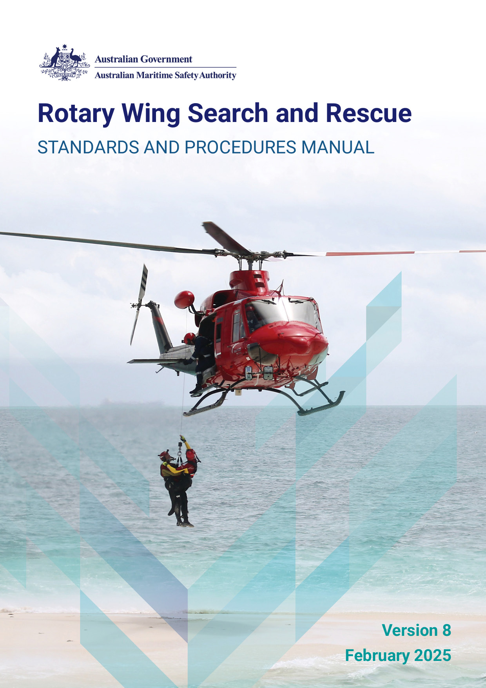

---
## Page 2

Rotary Wing Search and Rescue Standards and Procedures Manual 
ii 
 
Forward 
This document is designed to reinforce, and guide prescribed operational policies, procedures, standards, and instructions relevant to all phases 
of aerial search and rescue operations. Aircraft assigned to conduct search and rescue missions must meet key operational criteria and be 
equipped with the necessary role-specific equipment to safely complete the mission. 
 
The goal of this document is to support the delivery of proficient, safe, and standardized operations. Successful search and rescue missions are 
achieved through the coordination of skills among the entire crew. 
 
"This document does not supersede or take precedence over any policies or procedures outlined in the approved operations and flight manuals. 
The policies and procedures established by the company, as detailed in those official documents, shall always take priority." 
Copyright 
The Australian Maritime Safety Authority encourages the dissemination and exchange of information provided in this publication. 
Except as otherwise specified, all material presented in this publication is provided under Creative Commons Attribution 4.0 International licence. 
This excludes: 
• the Commonwealth Coat of Arms 
• AMSA’s logo 
• content attributed to third parties. 
The Creative Commons Attribution 4.0 International Licence is a standard form licence agreement that allows you to copy, distribute, transmit and 
adapt this publication provided that you attribute the work. The details of the version 4.0 of the licence are available on the Creative Commons 
website, as is the full legal code for that licence 
Attribution 
AMSA’s preference is that you attribute this publication (and any material sourced from it) using the following wording: Australian Maritime Safety 
Authority – Rotary Wing Search and Rescue Standards and procedures manual Version 8  
Images  
Cover: Rescue 421 from Nautilus Aviation performing SAR training, Vlassof Cay Great Barrier Reef,  
Photo courtesy of Nautilus Aviation. 
D25/19429 
Various: Images of AMSA’s SAR Equipment 
 
 
 
 
 
Photos Courtesy of AMSA 
Page 92: Vessel in Distress with Occupant holding a “V”Sheet,  
 
 
 
Photo Courtesy of AMSA 
Page 101: Rescue 510 crew demonstrating a Raft dispatch procedure, QGAir Cairns, 
  
Photo Courtesy of QGAir 
Page 122: Raft trailing Seadye;  
 
 
 
 
 
 
Photo Courtesy of AMSA 
Page 139: Type of Cospas-Sarsat Distress Beacons,  
 
 
 
 
Image courtesy of Cospas-Sarsat 
Page 140: Cospas-Sarsat system graphic 
 
 
 
 
 
Image courtesy of Cospas-Sarsat 
Page 141: Footprint of a MEOSAR Satellite 
 
 
 
 
 
Image courtesy of Cospas-Sarsat 
Page 142: Footprint of a LEOSAR Satellite 
 
 
 
 
 
Image courtesy of Cospas-Sarsat 
Page 143: Footprint of a GEOSAR Satellite 
 
 
 
 
 
Image courtesy of Cospas-Sarsat 
Page 145: Ranges of the 406MHz & 121.5MHz Beacon Signals 
 
 
 
Image courtesy of AMSA 
Page 169: Aircraft Crash Scene 
 
 
 
 
 
 
Photo courtesy of ATSB 
Page 171: Aircraft Ejection Seats  
 
 
 
 
 
Photos courtesy of ATSB 
Page 172: Aircraft under Ballistic Parachute 
 
 
 
 
 
Photo courtesy of ATSB 
Page 173: General photos of Ballistic Parachute Handles and containers 
 
 
Photos courtesy of ATSB 
Page 176: Aircraft Crash Scene 
 
 
 
 
 
 
Photo Courtesy of ATSB 
Page 185: General photos of vessels and pollution 
 
 
 
 
Photos Courtesy of AMSA 
Page 193: AMSA’s Emergency Towage Vessel  
 
 
 
 
Photo courtesy of AMSA 
More information 
For inquiries regarding copyright including requests to use material in a way that is beyond the scope of the terms of use that apply to it, please 
contact us. 
For further information contact 
Advisor Standards  
Response 
Australian Maritime Safety Authority 
GPO Box 2181 
CANBERRA ACT 2601

---
## Page 3

 
 
 
 
 
Table Of Contents

---
## Page 4

Table Of Contents 
4 
TABLE OF CONTENTS 
DOCUMENT CONTROL 
12 
ABBREVIATIONS AND ACRONYMS 
15 
GLOSSARY 
20 
 
1. 
GENERAL SAR PROCEDURES 
28 
1.1 The National SAR System 
28 
1.2 SAR Manuals and Documents 
29 
1.2.1 
National Search & Rescue Manual (NATSAR) 
29 
1.3 General Financial Procedures 
29 
1.3.1 
Submission of Invoices 
29 
1.4 Operational Compliance, Competency, Currency and Recency 
30 
1.4.1 
Training & Oversight 
30 
1.5 SRU Availability and Responsiveness 
31 
1.5.1 
Daily Status Reports 
31 
1.5.2 
Levels of Availability 
31 
1.5.3 
Response Times 
31 
1.6 Safety & Risk Assessments 
32 
1.6.1 
Task Risk Assessment 
32 
1.6.2 
Dynamic Risk Assessment 
33 
1.6.3 
Safety 
36 
1.7 ARC Briefings, Mission Reports and De-Briefs 
36 
1.7.1 
Tasking 
36 
1.7.2 
Geographic referencing 
37 
1.7.3 
Prior to Departure 
38 
1.7.4 
Approaching the Mission Area 
38 
1.7.5 
On Task 
38 
1.7.6 
After Landing 
39 
1.8 Forward Field Base 
41 
1.8.1 
Forward Field Base Operations 
41 
1.8.2 
FFB Management 
41 
1.9 Carriage of AMSA Personnel 
42

---
## Page 5

Table Of Contents 
5 
1.10 Exemptions and Approvals for the Conduct of SAR Operations 
42 
1.11 Usage and Re-supply of AMSA Equipment and Materials 
43 
1.11.1 Live SAR 
43 
1.11.2 Non-AMSA Tasks 
43 
1.12 Stewardship of AMSA Supplied Equipment and Materials 
44 
1.13 Interaction with the Media 
44 
Appendix A – Tasking Brief (Example) 
45 
 
2. 
SAR COMMUNICATION 
54 
2.1 General SAR Communications Procedures 
54 
2.1.1 
SAR Frequencies 
54 
2.1.2 
SAR Call Signs 
55 
2.2 Operational Communication with the ARC 
56 
2.2.1 
Overview 
56 
2.3 Aeronautical Communications 
56 
2.4 Maritime Communications 
56 
2.4.1 
Communications with Merchant Ships 
56 
2.4.2 
Communicating with Small Craft 
57 
2.4.3 
Global Maritime Distress and Safety System 
57 
2.4.4 
Marine Radio Alarm Signal 
57 
2.5 Communication with ADF Units 
58 
2.5.1 
Royal Australian Navy (RAN) 
58 
2.5.2 
ADF Aviation Assets 
58 
2.6 Communication with Maritime Border Command 
58 
2.6.1 
Communications with ABF & ADF Vessels 
59 
2.7 Communication with State/Territory Police Units 
59 
2.8 Communications with Other Ground Parties 
59 
2.9 Communication with Other Agencies 
59 
2.10 Non-Verbal Communication with Survivors 
60 
2.10.1 International Distress Signals 
60 
2.11 Search and Rescue Signals - Australian SSR 
61 
2.11.1 Signals with Surface Craft 
61

---
## Page 6

Table Of Contents 
6 
3. 
AIR SEARCH OPERATIONS 
63 
3.1 General Air Search Procedures 
63 
3.1.1 
Aim of the Air Search 
63 
3.1.2 
Determination of the Search Area 
64 
3.1.3 
Calculating the Track Spacing 
64 
3.1.4 
Coverage Factor 
64 
3.1.5 
Search Area Allocation 
65 
3.1.6 
Pre-Search Preparation 
65 
3.2 Air Search Patterns and Techniques 
66 
3.2.1 
Factors in Search Pattern Selection 
66 
3.2.2 
Types of Search Patterns 
66 
3.3 Principles of Observing 
74 
3.3.1 
Anatomy of the Eye 
75 
3.3.2 
The Visibility of Objects 
76 
3.3.3 
How to “Look” from the Aircraft 
81 
3.3.4 
Actions on Sighting a Target 
82 
3.3.5 
Crew's Discretion 
84 
3.4 Day Visual Air Search Operations 
85 
3.5 Night Vision Device Aided Air Search Operations 
85 
3.6 FLIR Air Search Operations 
85 
Appendix B – Ground To Air Visual Signals 
87 
Appendix C – Ground To Air (Body) Visual Signals 
88 
Appendix D – Air To Ground Signals 
89 
Appendix E – Civil Air-Ground Code 
90 
Appendix F – Panel Signals 
91 
Appendix G – V Sheets 
92 
 
4. 
SUPPLY DROP OPERATIONS 
94 
4.1 General Supply Drop Procedures 
94 
4.2 Supply Drop Equipment 
94 
4.3 Weak Links 
95 
4.4 Life Rafts & Ancillary Equipment 
96

---
## Page 7

Table Of Contents 
7 
4.4.1 
Helicopter Delivery Line Kit 
96 
4.4.2 
Switlik SAR 6 Mk 2 Life raft. 
98 
4.5 SAR Communications Equipment 
108 
4.5.1 
Helicopter Lightweight Delivery Line Kit 
108 
4.5.2 
Message Bag 
111 
4.5.3 
Search and Rescue Communicator (SARCOM) 
112 
4.5.4 
Transceiver Marine band VHF - Icom M85E 
113 
4.5.5 
Aviation VHF Band Transceiver - Icom IC-A25NE 
114 
4.6 SAR Target Markers 
115 
4.6.1 
Self-Locating Datum Marker Buoy 
116 
4.6.2 
Buoyant Orange Smoke Marker (Life smoke Mk 9) 
119 
4.6.3 
See-Blitz — Strobe Marker 
120 
4.6.4 
Fluorescent Marine Dye Marker (Seamark) 
122 
4.7 Additional AMSA Supplied SAR Equipment 
123 
4.7.1 
SAR Training Beacon – 121.4 MHz 
123 
4.7.2 
SAR Training Beacon – 406 MHz (Kinetic) 
124 
4.8 Night Supply Drop Operations 
125 
Appendix H – SLDMB Day VMC / Night VMC Drop Pattern 
127 
Appendix I – AMSA Supplied Equipment 
128 
 
5. 
TOP COVER OPERATIONS 
130 
5.1 The Top-Cover Function 
130 
5.2 Reporting On-Scene Activity 
131 
5.3 Communications plan 
131 
5.4 Duties and Responsibilities of FW Top-Cover Aircraft 
132 
5.5 Vessel Briefing 
132 
Appendix J – Top Cover Checklist. 
134 
 
6. 
COMMUNICATIONS RELAY OPERATIONS 
136 
6.1 The Communications Relay Function 
136 
6.2 Communications Relay Duties and Responsibilities 
136

---
## Page 8

Table Of Contents 
8 
7. 
ELECTRONIC LOCATOR BEACON SEARCH OPERATIONS 
139 
7.1 The ELB Search Function 
139 
7.2 Cospas-Sarsat 
139 
7.2.1 
Components of Cospas-Sarsat 
140 
7.3 Distress Beacons 
143 
7.4 406MHz Beacon Homing. 
147 
7.4.1 
406MHz Beacon Frequency Allocations 
147 
7.4.2 
Homing a 406MHz Beacon. 
148 
7.5 Aural Homing on a 121.5 MHz Signal 
151 
7.5.1 
Aural Homing Technique 
151 
7.6 Ground DF Principles 
154 
7.6.1 
The Beacon Location Problem 
154 
7.6.2 
Ground Homing Triangulation Method 
155 
7.6.3 
Locating a Beacon at an Airport 
157 
7.7 Ground Homing Equipment 
159 
7.7.1 
Ground DF – Titley RX3 
159 
7.7.2 
Ground DF – Handheld Airband VHF Receiver 
160 
7.7.3 
Ground DF – Handheld FM/AM Receiver 
161 
7.8 Actions Following Beacon Location 
161 
7.9 Air-to-Air Homing 
162 
 
8. 
MEDICAL EVACUATIONS FROM VESSELS 
164 
8.1 Requesting Helicopter Assistance 
165 
8.2 Vessel Preparation 
165 
8.2.1 
Shipboard Safety Checklist 
165 
8.2.2 
Landing On 
166 
 
9. 
INCIDENT SITE SAFETY 
169 
9.1 General Procedures 
169 
9.2 Incident Site Hazards 
170 
9.3 Rescue of Personnel from Crashed Aircraft 
170 
9.4 Site Safety 
176

---
## Page 9

Table Of Contents 
9 
9.5 Site Investigation 
177 
9.5.1 
Roles of the ATSB and the Defence Organisation 
177 
9.6 Site Preservation 
177 
9.7 Helicopter Operations 
177 
9.8 Marine Pollution Response Operations 
178 
 
10. SERVICES OTHER THAN SAR 
180 
10.1 General Procedures 
180 
10.2 AMSA Marine Pollution Response Operations 
180 
10.2.1 Identifying Oil. 
183 
10.2.2 Information Recording 
184 
10.2.3 Equipment dropping 
189 
10.2.4 Command and Control 
189 
10.2.5 Marine Pollution Response Tasking 
189 
10.2.6 Reports 
189 
10.2.7 Post Mission Reports 
190 
10.3 Intercept and Escort Operations 
190 
10.3.1 Intercept 
192 
10.4 Assistance to Property Operations 
192 
10.5 Emergency Towage Vessel (ETV) Operations 
193 
10.5.1 Location and Operational Control 
193 
10.5.2 SAR Incidents 
194 
 
11. SRU TRAINING AND AUDITS 
196 
11.1 General Procedures 
196 
11.2 Requirement for Training 
196 
11.3 AMSA Supplied SAR Training/Audit Equipment 
197 
11.4 Search and Rescue Exercises 
197 
11.5 AMSA Standards Visits 
197 
11.6 Box Knocking 
198 
11.7 Training Life Rafts (FP Logs) 
199

---
## Page 10

Table Of Contents 
10 
12. SARWEB 
201 
12.1 Overview 
201 
12.2 Supported Devices 
201 
12.3 Login 
202 
12.3.1 Tasking Email Link Access 
202 
12.4 Incident Page 
203 
12.5 Tasking Briefs 
206 
12.6 SARWeb Debrief 
207 
12.7 SARWeb Training 
213 
 
13. CONTACTS 
215 
AMSA SEARCH & RESCUE 
215 
AMSA MEDIA 
215 
EMERGENCY BEACON & MMSI REGISTRATION 
215 
AVIATION ASSETS ON-CALL OFFICER 
215

---
## Page 11

 
 
 
 
 
Document Control

---
## Page 12

Document Control 
 
 
12 
DOCUMENT CONTROL 
Search and Rescue Standards and Procedures Manual for Rotary Wing SAR Units 
Owner 
Advisor, Standards 
Approved by 
Manager AMSA Asset Capability 
Division/Unit 
Response Division 
Date approved 
31/01/2025 
Document 
status 
Final 
File reference 
D25/21013 
Review 
This document will be reviewed every two years, or following a significant 
incident 
 
 
 
Revision 
Date 
Version 
No. 
Author 
Description of Changes 
28/10/2017 
2 
David Ingram 
Updates 
26/3/2018 
3 
Lyndon 
Leverington 
Ch4, Updates to SLDMB drop height. 
Ch4 AppB, Addition of HLDK checklist. 
19/06/2019 
4 
Lyndon 
Leverington 
Updated Opportunity Panel terminology, SARweb 
debrief info, SLDMB dispatch wording, Ch5 AppA, 
JRCC changed to ARC. 
26/02/2020 
5 
David Ingram 
Introduction of the Icom Marine band Radio M85 
which will replace the SARCOM Marine Band Radio 
27/03/2020 
6 
David Ingram 
Introduction of the Fastwave Voyager Drifter Buoys 
30/08/2024 
7 
Tim Borresen 
General 
• 
Complete Review & Revision 
• 
Format Updates 
Updates to the Following Sections 
• 
Updated Abbreviations & Acronyms 
• 
Updated Glossary 
• 
1.9 – Carriage of AMSA Personnel 
• 
1.13 – Interaction with the Media 
• 
2.1.2 – SAR Callsigns 
• 
4.8 – Self Locating Datum Marker Buoy 
­ Increased Drop Parameters 
• 
Section 5 – Top Cover Operations  
• 
Section 7 – Electronic Locator Beacon Search 
Operations 
• 
Section 12 – SARWEB

---
## Page 13

Document Control 
 
 
13 
Revision 
Date 
Version 
No. 
Author 
Description of Changes 
Added New Sections 
• 
1.5.2 – Levels of Availability 
• 
1.6.2 – Dynamic Risk Assessment 
• 
1.7.2 – Geographic Referencing 
• 
4.3 – Weak Links 
• 
4.5.5 – Aviation VHF Band Transceiver (AN25) 
• 
4.8 – Training Beacons 
• 
Contacts 
Removed Sections 
• 
Aviation VHF Band Transceiver Icom IC A22E 
03/02/2025 
8 
Tim Borresen 
General 
• 
Document Format Update (AMSA 2024) 
Added New Sections 
• 
Night Raft Drop Procedure -to 4.4.2 - Switlik 
SAR 6 Mk 2 Life raft. 
• 
7.4 – 406MHz Beacon Homing

---
## Page 14

 
 
 
 
 
Abbreviations And Acronyms

---
## Page 15

Abbreviations And Acronyms 
 
 
15 
ABBREVIATIONS AND ACRONYMS 
Acronym / Abbreviation 
Meaning 
A 
Area or Search Area 
AAIT  
Aircraft Accident Investigation Team (ADF) 
ACMA 
Australian Communications and Media Authority  
ACO 
Air Crew Officer 
ADF 
Australian Defence Force 
ADS-B 
Automatic Dependent Surveillance Broadcast 
AFTN  
Aeronautical Fixed Telecommunications Network  
AIIMS 
Australian Inter-service Incident Management System 
AIS 
Automatic Identification System 
AMC 
Aircraft Mission Coordinator 
AMSA 
Australian Maritime Safety Authority 
AMSOC  
Australian Maritime Security Operation Centre 
ARC 
AMSA Response Centre 
ASIR 
Air Safety Incident Report 
ASO  
Air Search Observer 
ATC 
Air Traffic Control  
ATD  
Actual Time of Departure  
ATS 
Air Traffic Services  
ATSB  
Australian Transport Safety Bureau  
AUMCC 
Australian Mission Control Centre 
BPC 
Border Protection Command 
C  
Coverage Factor  
CRS 
Coast Radio Station  
CSS  
Coordinator Surface Search (maritime)  
D 
Datum 
D 
Diameter  
DIAC  
Department of Immigration and Citizenship 
DFAT  
Department of Foreign Affairs and Trade

---
## Page 16

Abbreviations And Acronyms 
 
 
16 
Acronym / Abbreviation 
Meaning 
DF 
Direction Finding  
DSC 
Digital Selective Calling 
E  
East Longitude 
E  
Total Probable Error of Position  
ELT  
Emergency Locator Transmitter  
EMA 
Emergency Management Australia  
EPIRB 
Emergency Position Indicating Radio Beacon  
ESO 
Emergency Service Operations / Organisations 
ETA 
Estimated Time of Arrival  
ETD 
Estimate Time of Departure  
FCP 
Forward Command Post, sometimes referred to as a Forward Field 
Base 
Fig 
Figure 
FIR 
Flight Information Region  
FLIR  
Forward Looking Infrared  
FM  
Frequency Modulation 
FMS 
Flight Management System 
GHz 
Gigahertz  
GMDSS 
Global Maritime Distress and Safety System  
GPS 
Global Positioning System  
GS 
Ground speed  
HF 
High Frequency (3 MHz to 30 MHz) 
HQAC 
Headquarters Air Command (Air Force)  
HQAST 
Headquarters Australian Theatre  
ICAO 
International Civil Aviation Organization  
IFR 
Instrument Flight Rules 
IMO 
International Maritime Organization  
Inmarsat 
International Maritime Satellite Organisation  
JRCC 
Joint Rescue Coordination Centre

---
## Page 17

Abbreviations And Acronyms 
 
 
17 
Acronym / Abbreviation 
Meaning 
KHz 
Kilohertz  
LES 
Land Earth Station  
LHQ 
Land Headquarters (Army)  
LUT  
Local user terminal  
m  
Metres 
MASTREP 
Modernised Australian Ship Tracking & Reporting System 
MBC 
Maritime Boarder Command 
MHQ 
Maritime Headquarters (Navy)  
MCS 
Maritime Communications Station 
MCC 
Mission Control Centre  
MF 
Medium Frequency (300 kHz to 3 MHz) 
MHz 
Megahertz  
MMSI 
Maritime mobile service identity  
MOD 
Maritime Operations Division 
MPP 
Most Probable Position  
MPR  
Marine Pollution Response 
MSD 
Maritime Standards Division  
MSI 
Maritime Safety Information  
NM 
Nautical Mile 
NMERA 
National Marine Emergency Response Arrangements 
NVD 
Night Vision Device  
OSC 
On-Scene Coordinator  
PIW 
Person in Water  
PLB 
Personal Locator Beacon  
POB 
Persons Onboard  
RAAF 
Royal Australian Air Force  
RAN 
Royal Australian Navy  
RCO 
Rescue Crew Officer 
RWR 
Rotary Wing Rescue

---
## Page 18

Abbreviations And Acronyms 
 
 
18 
Acronym / Abbreviation 
Meaning 
RWS 
Rotary Winch Search 
JRCC 
Joint Rescue Coordination Centre  
SAR 
Search and Rescue  
SART 
Search and Rescue Transponder  
SDB 
SAR Datum Buoys  
SDS 
Stores Delivery System 
SES 
State Emergency Service 
SLDMB 
Self-Locating Datum Marker Buoy 
SMC 
Search and Rescue Mission Coordinator  
SNR 
Signal to Noise Ratio 
SOLAS 
International Convention for the Safety of Life at Sea  
SOPs 
Standard Operating Procedures  
SOS-N/S/W 
In AMSA context – Senior Officer Standards North, South or West 
SRR 
Search and Rescue Region  
SRU 
Search and Rescue Unit 
TMAS 
Telemedical Assistance Service 
UHF 
Ultra-high Frequency  
VFR 
Visual Flight Rules 
VHF 
Very High Frequency  
VMC  
Visual Meteorological Conditions 
VT 
Vessel Tracking

---
## Page 19

 
 
 
 
 
Glossary

---
## Page 20

Glossary 
 
20 
GLOSSARYSSARY  
Term 
Definition 
Australasian Inter-Service 
Incident Management 
System (AIIMS) 
A nationally recognised incident management structure, used 
primarily by emergency service agencies to provide a common 
framework to manage all incidents. 
All hazards approach 
An ‘all hazards’ approach to emergency planning that is adaptable 
to a wide range of situations. 
Aircraft Coordinator (ACO)  
A person who coordinates the involvement of multiple aircraft in 
SAR operations. 
Aircraft Mission Coordinator 
(AMC) 
A SAR crewmember, who leads, informs, directs and coordinates 
the actions of the SAR aircraft and crew to achieve safe and 
effective conduct of the mission. 
Air Search Observer (ASO) 
SAR crewmember responsible for the conduct of visual searches 
and the deployment of life saving equipment to persons in distress 
via an airborne delivery system. 
AMSA Response Centre 
(ARC) 
The Canberra operations centre from which AMSA coordinates 
multi-disciplinary (search & rescue, environment protection, 
emergency towage, casualty coordination) and multi-agency 
(Commonwealth, States / Territories, commercial sector) 
responses to a maritime emergency.  JRCC Australia is a core 
element of the ARC. 
ARGOS  
A satellite-based location and data collection system. 
Agency  
 An agency means a government agency or a non-government 
agency 
Aviation Asset Capability 
The unit within AMSA’s Response Division responsible for SAR 
contract management, SAR equipment procurement, audit and 
training of SRUs. 
Coordination  
The bringing together of organisations and elements to ensure 
effective search and rescue response.  One SAR authority must 
always have overall coordination responsibility and other 
organisations are to cooperate with this agency to produce the best 
response possible within available resources. 
Coordinated Universal Time 
(UTC)  
International term for time at the prime meridian. 
Cospas-Sarsat System  
A satellite system designed to detect distress beacons transmitting 
on the 406 MHz frequency. 
Coverage factor (C)  
For parallel sweep searches, Coverage Factor (C) is computed as 
the ratio of sweep width (W) to track spacing (S).  C = W/S.

---
## Page 21

Glossary 
 
21 
Term 
Definition 
Craft  
Any air or sea-surface vehicle or submersible of any kind or size. 
Datum  
A geographic point, line, or area used as a reference in search 
planning. 
Digital selective calling 
(DSC)  
A technique using digital codes which enables a radio station to 
establish contact with, and transfer information to, another station 
or group of stations. 
Emergency Phase  
Emergency phases are based on the level of concern for the safety 
of persons or craft that may be in danger.  The three levels of 
emergency are classified as Uncertainty, Alert, and Distress. 
Emergency Service 
Operation 
An operation conducted by, or at the request of, an authority of 
the commonwealth, a state or a territory. The operation is for: 
a. Law Enforcement purposes, or 
b. The purpose of saving or protecting persons, property or the 
environment. 
Response 
The Division of the Australian Maritime Safety Authority responsible 
for the search and rescue function. 
Fix  
A geographical position determined by visual reference to the 
surface, referencing to one or more radio navigation aids, celestial 
plotting, or other navigation device. 
Forward-looking infrared 
(FLIR)  
An imaging system, mounted on board surface vessels or aircraft, 
designed to detect thermal energy emitted by targets and convert it 
into a visual display. 
General communications  
Operational and public correspondence traffic other than distress, 
urgency and safety messages transmitted or received by radio. 
Global Maritime Distress 
and Safety System (GMDSS)  
A global communications service based upon automated systems, 
both satellite-based and terrestrial, to provide distress alerting and 
promulgation of maritime safety information for mariners. 
Global Navigation Satellite 
System (GNSS)  
Worldwide position and time determination system that includes 
one or more satellite constellations and receivers. 
Heading  
The horizontal direction in degrees magnetic in which a craft is 
pointed. 
Home Base 
The major facility from which the asset/s normally operate. 
Hypothermia  
Abnormal lowering of internal body temperature (heat loss) from 
exposure to cold air, wind or water. 
Indicated air speed (IAS)  
The aircraft speed shown on the air speed indicator gauge.  IAS 
corrected for instrument error and atmospheric density equals true 
air speed.

---
## Page 22

Glossary 
 
22 
Term 
Definition 
International Maritime 
Satellite Organisation 
(Inmarsat)  
A system of geostationary satellites for worldwide mobile 
communications services, and which support the Global Maritime 
Distress and Safety System and other emergency communications 
systems. 
Instrument flight rules (IFR)  
Rules governing the procedures for conducting instrument flight.  
Also, a term used by pilots and controllers to indicate type of flight 
plan. 
Instrument meteorological 
conditions (IMC)  
Meteorological conditions expressed in terms of visibility, distance 
from cloud, and ceiling less than the minima specified for visual 
meteorological conditions. 
Joint Standard Operating 
Procedures 
(JSOPs) 
A document that defines the Scope of Operations for the SAR 
services to be followed by the ARC during the tasking and conduct 
of search and rescue missions, Environmental Protection and 
Response missions and the support for the conduct of operations 
provided by Asset Management & Preparedness 
JRCC 
Joint Rescue Coordination Centre. The AMSA Response Centre 
(ARC) unit formally responsible for coordination of maritime and 
aviation search and rescue in the Australian SAR Region. JRCC is 
an entity under global SAR arrangements. It is located as a discrete 
unit in the ARC. 
Knot (kt)  
A unit of speed equal to one nautical mile per hour. 
MAYDAY  
The international radiotelephony distress signal, repeated three 
times. 
MEDEVAC  
Evacuation of a person for medical reasons. 
Minimum Equipment List 
(MEL) 
A document approved by CASA that contains the conditions under 
which a specified aircraft may operate with particular items of 
equipment inoperative at the time of dispatch. 
Mission control centre 
(MCC)  
Part of the Cospas-Sarsat system that accepts alert messages 
from the local user terminal(s) and other mission control centres to 
distribute to the appropriate rescue coordination centres or other 
search and rescue points of contact. 
NATPLAN 
National Plan to Combat Pollution of the Sea by Oil and Other 
Hazardous and Noxious Substances 
NAVAREA  
One of 16 areas into which the International Maritime Organization 
divides the world's oceans for dissemination of navigation and 
meteorological warnings.

---
## Page 23

Glossary 
 
23 
Term 
Definition 
Night Visual Flight Rules 
(NVFR) 
Helicopters engaged in single-pilot commercial or NVFR SAR 
operations do not have the same level of system redundancy as IFR 
equipped SAR helicopters, to safely cope with equipment failures 
and emergency situations. 
On-scene  
The search area or the actual distress site. 
On-scene frequency 
A dedicated SAR frequency for radio transmission within a search 
area, usually 123.1 MHz as nominated by the JRCC. 
Personal Locator Beacon 
(PLB)  
Personal radio distress beacon for alerting and transmitting homing 
signals. 
Pilot-in-command (PIC) 
The pilot responsible for the operation and safety of the aircraft 
during flight time. 
Position  
A geographical location normally expressed in degrees and minutes 
of latitude and longitude. 
Positioning  
Process of determining a position that can serve as a geographical 
reference for conducting a search. 
Possibility area  
(1) The smallest area containing all possible survivor or search 
object locations. 
(2) For a scenario, the possibility area is the smallest area 
containing all possible survivor or search object locations that are 
consistent with the facts and assumptions used to form the 
scenario. 
Primary swell  
The swell system having the greatest height from trough to crest. 
Probability Area  
The area in which a missing craft and/or survivors are most likely to 
be found taking into account possible errors in the navigation of the 
missing craft and of the search craft. 
Probability of detection 
(POD)  
The probability of the search object being detected, assuming it 
was in the areas that were searched.  POD is a function of coverage 
factor, sensor, search conditions and the accuracy with which the 
search facility navigates its assigned search pattern.  Measures 
sensor effectiveness under the prevailing search conditions. 
Rescue  
An operation to retrieve persons in distress, provide for their initial 
medical or other needs, and deliver them to a place of safety. 
SafetyNET  
Communications service provided via Inmarsat for promulgation of 
maritime safety information, including shore-to-ship relays of 
distress alerts and communications for search and rescue 
coordination. 
SAR Datum Buoy  
Droppable floating beacon used to determine actual sea current, or 
to serve as a location reference.

---
## Page 24

Glossary 
 
24 
Term 
Definition 
Sea State 
Condition of the surface resulting from waves and swells. 
Search  
An operation, normally coordinated by a rescue coordination centre, 
using available personnel and facilities to locate persons in 
distress. 
Search and Rescue 
coordinating 
communications  
Communications necessary for the coordination of facilities 
participating in a search and rescue operation. 
Search and Rescue facility  
Any mobile resource, including designated search and rescue units, 
used to conduct search and rescue operations.  
The terms unit and asset maybe interchangeable with facility. 
Search and Rescue incident  
Any situation requiring notification and alerting of the SAR system, 
and which may require SAR operations. 
Search and Rescue mission 
coordinator (SMC)  
The suitably trained or qualified official temporarily assigned to 
coordinate a response to an actual or apparent distress situation.  
In Australia, the acronym SARMC is also used in some jurisdictions.  
Throughout this manual, the terms SMC and SARMC are 
synonymous.  Some jurisdictions also use the term A/SARMC to 
describe the SMC's assistants. 
Search and Rescue plan  
A general term used to describe documents which exist at all levels 
of the national and international search and rescue structure to 
describe goals, arrangements, and procedures which support the 
provision of search and rescue services. 
Search and Rescue point of 
contact (SPOC)  
Rescue coordination centres and other established and recognised 
national points of contact that can accept responsibility to receive 
Cospas-Sarsat alert data to enable the rescue of persons in 
distress. 
Search and Rescue region 
(SRR) 
An area of defined dimensions, associated with the national rescue 
coordination centre (ARC), within which search and rescue services 
are provided. 
Search and Rescue service  
The performance of distress monitoring, communication, 
coordination and search and rescue functions, including provision 
of medical advice, initial medical assistance, or medical evacuation, 
through the use of public and private resources, including 
cooperating aircraft, vessels and other craft and installations. 
Search and Rescue stage  
Typical steps in the orderly progression of SAR missions.  These 
are normally Awareness, Initial Action, Planning, Operations and 
Mission Conclusion.

---
## Page 25

Glossary 
 
25 
Term 
Definition 
Search and Rescue unit 
(SRU)  
A unit composed of trained personnel and provided with equipment 
suitable for the expeditious conduct of search and rescue 
operations. 
Search area  
The area determined by the search planner to be searched.  This 
area may be sub-divided into search sub-areas for the purpose of 
assigning specific responsibilities to the available search facilities. 
Search endurance (T)  
The amount of "productive" search time available at the scene also 
known as Available Search Hours (ASH).  This figure is usually 
taken to be 85% of the on-scene endurance, leaving a 15% 
allowance for investigating sightings and navigating turns at the 
ends of search legs. 
Search facility position error 
(Y)  
Probable error in a search craft's position, based on its navigational 
capabilities. 
Search object  
A ship, aircraft, or other craft missing or in distress or survivors or 
related search objects or evidence for which a search is being 
conducted. 
Search pattern  
A procedure assigned to an SRU for searching a specified area. 
Search radius  
The actual search radius used to plan the search and to assign 
search facilities.  It is usually based on adjustments to the optimal 
search radius that are needed for operational reasons. 
Situation report (SITREP)  
Reports, from the OSC to the SMC or the SMC to interested 
agencies, to keep them informed of on-scene conditions and 
mission progress. 
Surface picture (SURPIC)  
A list or graphic display from a ship reporting system of information 
about vessels in the vicinity of a distress situation that may be 
called upon to render assistance. 
Sweep width (W)  
A measure of the effectiveness with which a particular sensor can 
detect a particular object under specific environmental conditions. 
Technical Crew 
A member of the SAR crew (e.g. hoist operator, rescue crew 
member, paramedic) other than pilot/s who is assigned to a SAR 
flight for the purpose of operating specific aircraft and role 
equipment, assisting the flight crew during the mission and 
attending to any person in need of medical assistance  
Track spacing (S)  
The distance between adjacent parallel search tracks. 
True air speed (TAS)  
The speed an aircraft is travelling through the air mass.  TAS 
corrected for wind equals ground speed.

---
## Page 26

Glossary 
 
26 
Term 
Definition 
Visual flight rules (VFR)  
Rules governing procedures for conducting flight under visual 
meteorological conditions.  In addition, used by pilots and 
controllers to indicate type of flight plan. 
Visual meteorological 
conditions (VMC)  
Meteorological conditions expressed in terms of visibility, distance 
from cloud, and ceiling equal to or better than specified minima.

---
## Page 27

 
 
 
 
 
General SAR Procedures

---
## Page 28

General SAR Procedures 
 
 
28 
1. GENERAL SAR PROCEDURES 
1.1 The National SAR System 
Search and rescue (SAR) is the activity of responding to tasking, locating, and recovering persons 
either in distress, potential distress, or missing, delivering them to a place of safety, and under 
controlled circumstances, returning to an operational base. 
Australian SAR arrangements are designed to complement other emergency services (police, fire, 
ambulance, etc.) in situations where those services are unable to operate effectively. Such situations 
may include, for example, remote area operations, rescues at sea, or the need for specialist SAR 
facilities not normally available to state/territory emergency services. 
Depending on the extent and complexity of the incident and the available personnel and facilities, SAR 
may take various forms in response to a distress situation. However, unless the action is inseparable 
from safeguarding life, a SAR operation does not include salvage or the saving of property. 
The Australian search and rescue region (see figure below) covers the Australian continent and large 
areas of the Indian, Pacific, and Southern Oceans, as well as the Australian Antarctic territories. This 
region spans approximately 52.8 million square kilometres, or about one-tenth of the Earth's surface. 
Dedicated SAR assets are limited in Australia, so other government, private, and commercial assets 
may be diverted from their primary functions by charter, arrangement, or request. 
In practice, many SAR operations are conducted jointly by Commonwealth and State/Territory 
authorities. Therefore, it is essential that available resources and operational techniques are 
standardized and coordinated across the Australian region. 
Documenting standardized equipment, techniques, and procedures, this manual, along with others 
such as the National Search and Rescue Manual, enables SAR authorities to cooperate and coordinate 
most effectively. By establishing and standardizing procedures, this manual and the others listed 
below aim to promote the efficient saving of lives. 
 
Australia & Neighbouring Search & Rescue Regions

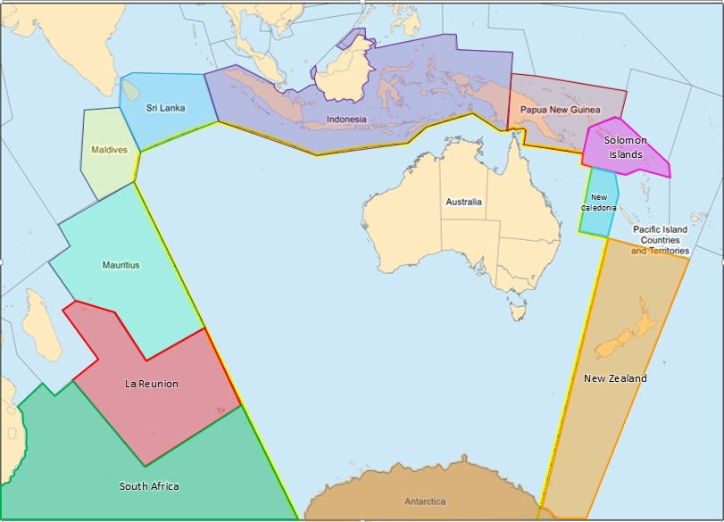

---
## Page 29

General SAR Procedures 
 
 
29 
1.2 SAR Manuals and Documents 
The following manuals and documents will be applicable to aviation SRU operations: 
• 
Internal SRU Operations Manuals outlining approved SAR Tactics, Techniques, and Procedures 
• 
National Search and Rescue Manual 
• 
AMSA Search and Rescue Service Agreement* 
• 
SAR Standards and Procedures Manual for Rotary Wing SAR Units* 
• 
Fastwave Voyager V3 User’s Guide* 
• 
RX3-DF EPIRB Tracking Unit Instruction Manual* 
*Indicates an AMSA-produced and issued document 
1.2.1 
National Search & Rescue Manual (NATSAR)  
The National Search and Rescue Manual is the standard reference document for use by all search and 
rescue authorities, emergency service organizations, and other agencies providing search and rescue 
services in Australia. It outlines the agreed methods of coordination through which search and rescue 
operations are conducted within Australia. The manual is consistent with the relevant international 
conventions to which Australia is a party. The manual is available online via the AMSA website. 
https://www.amsa.gov.au/national-search-and-rescue-council/manuals-and-publications/national-
search-and-rescue-manual  
1.3 General Financial Procedures 
1.3.1 
Submission of Invoices 
In the case of an invoice for actual search and rescue operations, it should be addressed to 
response.invoices@amsa.gov.au and specify the SAR incident number. AMSA will normally pay these 
invoices within 30 days of receipt. 
For invoices related to services other than actual search and rescue operations, such as audits or 
AMSA-conducted training, they should be addressed to the Senior Advisor Aerial Capability – AMSA 
Asset Management & Preparedness and clearly marked as AMSA Training or Audit. Total engine hours 
accumulated during the activity are also required. The AMSA Officer attending audits will also record 
the hours flown.

---
## Page 30

General SAR Procedures 
 
 
30 
1.4 Operational Compliance, Competency, Currency and 
Recency 
1.4.1 
Training & Oversight 
Emergency Service Operations (ESO) do not confer any particular approval or authority to operate 
outside of the CASR. Any operator may be tasked by AMSA to attend an operational incident. To ensure 
all personnel are familiar with the specific mission profiles and associated risks of these types of 
operations, AMSA may review operating manuals and regulatory approvals of SRUs upon request. 
The SRU is required to ensure that all crew members performing SAR services and functions 
understand their roles, the hazards involved and are competent in using all equipment (including both 
AMSA-provided and non-AMSA-provided SAR equipment) that they may need for SAR services. The 
SRU must also allow AMSA or its nominee to inspect the SRU’s compliance upon request. 
Where practical, AMSA will provide the SRU with an audit schedule and reasonable notice of any audits 
and/or search and rescue exercises or flights. The SRU must endeavour to comply with the schedule 
and the notice, including making the SRU’s personnel available for the audit or training as reasonably 
required by AMSA. 
If AMSA reasonably determines that a member of the SRU is not competent, proficient, or current in all 
duties they are reasonably likely to perform in the course of the SAR services undertaken on behalf of 
AMSA, AMSA may issue a notice to the SRU outlining these concerns and specifying the duties to 
which the notice relates. 
If the SRU receives a notice that a member is not competent in accordance with the Search and Rescue 
Aircraft Panel Agreement, the SRU must (at its own cost): 
• 
Provide, or arrange for, sufficient training to ensure that the specified member becomes 
competent, proficient, and current in the performance of the specified duties; and 
• 
Ensure that the specified member is not required or permitted to perform the specified duties until 
the SRU has provided AMSA with evidence demonstrating that the member is competent, 
proficient, and current in performing those duties.

---
## Page 31

General SAR Procedures 
 
 
31 
 
1.5 SRU Availability and Responsiveness 
1.5.1 
Daily Status Reports 
The SRU is encouraged to keep the ARC frequently informed about the status of the aircraft and aircraft 
systems by submitting a Daily Status Report (DSR) via email to rccaus@amsa.gov.au. The SRU should 
also provide updated DSRs for any changes in status that may affect the performance of an AMSA 
tasking. Such notifications may be made by voice or email. 
1.5.2 
Levels of Availability  
SRUs shall outline their level of mission capability within the DSR. AMSA recommends using one of 
three terms to clearly identify mission capability and availability: 
Online: 
The SRU (Search and Rescue Unit) is fully operational and available for immediate tasking. It is 
equipped, manned, and ready to respond to SAR taskings as required. 
Online (Conditional): 
The SRU is operational but may have certain limitations or conditions affecting its readiness. This 
could include partial equipment functionality, crew availability issues, or maintenance that impacts its 
full capability. It can be tasked, but its effectiveness may be reduced based on these conditions. 
Offline: 
The SRU is not operational and is unavailable for tasking. It is either undergoing maintenance, repairs, 
or other circumstances that prevent it from being used for SAR taskings. It will not be able to respond 
to calls until it is brought back online. 
1.5.3 
Response Times 
Subject to the Search and Rescue Unit’s obligations to supply services under its primary contract, and 
subject to the SRU’s availability and decision to accept tasking, the SRU is required to provide the 
primary aircraft and crew to undertake SAR operations. 
The aircraft must respond to a request as soon as practicable while maintaining a safe and efficient 
response. 
The Pilot in Command (PIC) shall ensure that, prior to departure, the nominated crew—both pilots and 
air/technical crew, including observers—are appropriately qualified, briefed on the task, and 
understand any associated risks. 
No member of the crew is to be placed under any duress to participate in a mission profile. Particular 
attention shall be given to selecting personnel who are appropriately trained, experienced, qualified, 
and current. 
Any crew member has the authority to decline the task if they are not willing to either accept or continue 
the task.

---
## Page 32

General SAR Procedures 
 
 
32 
1.6 Safety & Risk Assessments 
1.6.1 
Task Risk Assessment 
The ARC has primary authority for aircraft 
mission and task assignment. The Pilot in 
Command (PIC) may delay, refuse, or request 
a mission plan be adjusted if, in their opinion, 
any of the set conditions are not safe or are 
beyond the capability of the SRU. 
The PIC has overall responsibility for the 
safety of the aircraft and its crew. 
The sole authority and responsibility for 
determining priorities for the use of the 
online aircraft rests with the ARC, in 
accordance with the priorities and processes 
defined in the following paragraphs. 
Prior to accepting SAR mission tasking, the 
crew will conduct a risk assessment in 
conformity with their company’s standard 
risk management practices and operating 
procedures. 
Risk must be constantly updated by the crew 
during any task. 
The flow chart (Task Risk Assessment) 
shown to the right is a simplified process to 
assess risk for an assigned task. 
 
IMPORTANT 
Under no circumstances will the ARC knowingly request or 
coerce a flight outside the SRU’s operational guidelines or 
approvals.

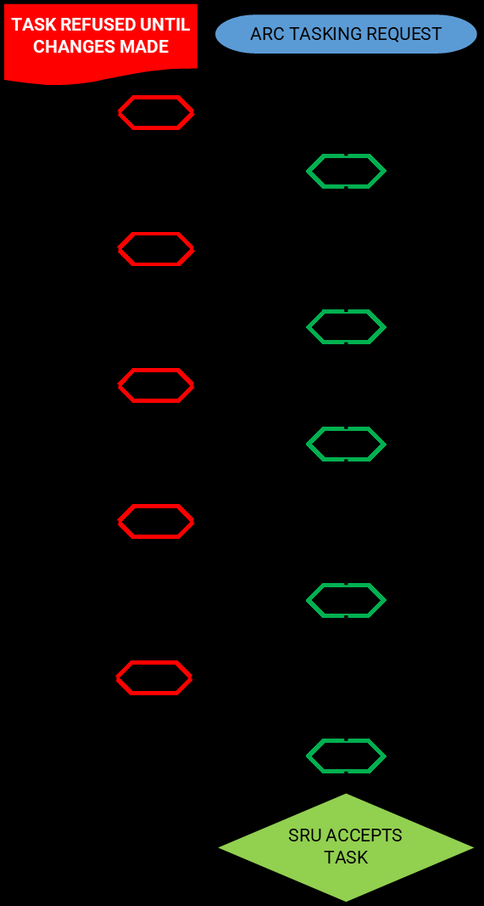

---
## Page 33

General SAR Procedures 
 
 
33 
1.6.2 
Dynamic Risk Assessment 
A Dynamic Risk Assessment (DRA) is the continuous process of identifying, assessing, and controlling 
risks in the rapidly changing circumstances of an operational incident or training scenario. 
This section outlines the requirement for, and the process of, a DRA as a fundamental component in 
ensuring the safety of emergency responders and others during response activities and training. 
During all emergency response or training activities, this may occur in conjunction with a formal risk 
assessment or when no formal risk assessment has been undertaken. 
A DRA should only be used as the sole process for risk management in contexts where the incident or 
training scenario presents dynamic risks. Where an incident or training scenario allows for proper and 
documented planning, this must occur in addition to a DRA being utilized by emergency personnel as 
a continuous and supplementary outcome. 
The DRA process involves the following six steps to identify, assess, and control risks.

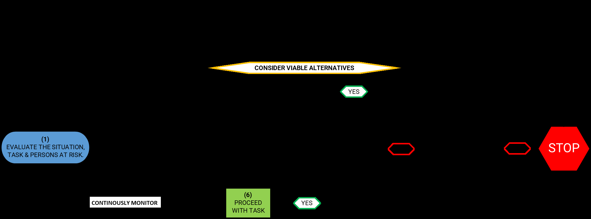

---
## Page 34

General SAR Procedures 
 
 
34 
1. 
Evaluate the Situation, Tasks and Persons at Risk 
1.1 
Consider what information and tools are available (e.g. ARC Briefing information, SMEACS-
Q briefing, environmental conditions). 
1.2 
Identify the hazards and risks in carrying out the objectives/tasks, and determine what risks 
are associated with these hazards that could affect emergency service personnel, the public, 
and/or the environment. 
1.3 
Evaluate the risk by considering the likelihood and consequences of an adverse event. 
1.4 
Determine what resources are available (e.g. personnel, appliances, equipment, or specialist 
advice), as well as the capabilities and limitations of these resources under the operational 
environment. 
1.5 
Communicate with crew members, supervisors, the Search and Rescue Mission Coordinator 
(SMC), Incident Controller, Safety Officer, or specialist personnel, as appropriate. 
 
2. 
Select Systems of Work 
2.1 
Consider the possible systems of work and choose the most appropriate for the situation. 
Begin with established procedures that have been considered in pre-planning and training. 
2.2 
Ensure that personnel are competent (this may include skills, qualifications, training, or 
experience, or a combination of all three) before performing future tasks. 
 
3. 
Assess the Chosen Systems of Work 
3.1  
Assess the chosen systems of work and determine the acceptable risk. What is deemed an 
acceptable risk will depend on a range of factors including (but not limited to): 
• 
Agency procedures and training 
• 
The potential risk to emergency responders and the community (i.e., does the system 
of work maintain responder safety?) 
• 
Information on whether there are lives at risk that can be saved 
• 
The real value of the asset involved (building, equipment, and the environment) 
• 
The likely cost (financial/social/community) arising from the incident or the potential 
escalation of the incident 
• 
The likelihood and consequence of an adverse event occurring 
• 
The time required for the response and any anticipated changes that may lead to a 
deterioration of the situation 
3.2  
Consult with crews that are affected by the identified risk on matters that will affect their 
health and safety, and the suitability and availability of the controls to eliminate or minimise 
risk.

---
## Page 35

General SAR Procedures 
 
 
35 
4. 
Decide: Are the risks proportional to the benefits? 
4.1  
Remember, responder safety is paramount. 
4.2  
Determine whether the risks of the tasks are proportional to the benefits based on the 
suitability and availability of controls. Assess whether the benefit gained from carrying out 
the tasks outweighs the possible consequences if the risks are realised. 
4.3  
If the answer is YES (benefits outweigh the risks), go to Step 6 (Proceed with task). 
4.4 
If the answer is NO (risks outweigh the benefits), go to Step 5 (Modify). 
 
5. 
Modify: Can additional control measures be introduced? 
5.1  
When deciding if additional measures can be introduced, consider the following hierarchy 
of risk controls. One or more of these controls can be used to address a hazard: 
Elimination – e.g., remove hazards if possible. 
Substitution – e.g., use additional specialist resources, such as TIER 1 Assets or other ESOs. 
Engineering Controls – e.g., specialist equipment/tools. 
Administrative Controls – e.g., appoint a Safety Officer or consult ARC. 
Personal Protective Equipment (PPE) – e.g., use additional PPE such as safety glasses, 
harnesses, hearing protection, P2 masks. 
5.2 
If the answer is YES, introduce the identified risk controls and return to Step 3 (Assess). 
5.3 
If the answer is NO, DO NOT PROCEED WITH THE TASK and return to Step 1 (Evaluate). 
 
6. 
Proceed with task 
6.1  
Proceed with the tasking after communicating with all personnel on agreed safety 
measures and procedures: 
• 
Both individual and team goals are understood. 
• 
Responsibilities have been clearly allocated. 
• 
Safety measures and procedures are clearly understood. 
• 
Consider appointing a Safety Officer. 
6.2 
 Continuously monitor the risks and return to Step 1 if there is a change to the situation.

---
## Page 36

General SAR Procedures 
 
 
36 
1.6.3 
Safety 
SRU and responder safety is paramount. SRU personnel must ensure that the protection and 
preservation of life is maintained at all times while also maintaining the safety of themselves and their 
crew. 
The operational and dynamic risk assessment process of the SRU must be conducted before any flight 
proceeds. Three primary criteria must be met: 
• 
Is it safe to conduct the intended flight? 
• 
Is it an SOP within the organisation's or operator's Standard Operating Procedures? 
• 
Is it legal to conduct the planned flight? 
1.7 ARC Briefings, Mission Reports and De-Briefs 
1.7.1 
Tasking 
If the initial point of contact for any ARC tasking changes from the established processes, the SRU 
should inform the ARC routinely via the DSR or by voice, depending on the situation. In cases where 
advance planning is beneficial, initial contact with an SRU may involve providing advance warning of a 
potential task, taking into account the time of day and task priority. The duty SRU contact will then take 
appropriate action and follow up with a request to the relevant tasking authority. 
For immediate SAR responses, both the SRU and ARC should jointly: 
Validate the commencement point/area of the proposed operation (e.g., by Latitude and Longitude 
and/or bearing and distance from a known point). 
Agree on and log the time of task acceptance. 
The SRU should confirm the task and time of acceptance using clear and precise language, such as: 
“Callsign xxx (RESCUE 123) accepts this task at time  
hh mm (UTC) to zzzz (location).” 
Note: 
The acceptance statement is required so there is no confusion on acceptance for ARC planning 
purposes. 
The ARC will provide the aircraft crew with as much information as possible, which may include: 
• 
SAR incident number & task ID (when available) 
• 
Type of task or combinations of tasks (mandatory) 
• 
Nature of SAR target (mandatory) 
• 
Nominal location of SAR target (including Lat/Long when available) (mandatory) 
• 
Short summary of incident details to date (when available) 
• 
Related intelligence (when available) 
• 
Specific requirements (e.g., additional observers, equipment, overnight etc.) (mandatory) 
• 
Other tasked assets/SRUs (when available)

---
## Page 37

General SAR Procedures 
 
 
37 
Upon receiving a written brief from the ARC, the aircraft crew will: 
• 
Confirm receipt and understanding of the tasking/briefing by contacting the ARC 
• 
Submit a flight plan commensurate with the SAR task 
• 
Advise of a suitable alternate aerodrome if known 
• 
Advise the latest divert time to the destination if known 
• 
Submit a crew manifest to the ARC when a crew change occurs, or additional crew is carried 
• 
Jointly agree on the SAR mission start time/ETD with the ARC 
If the SAR mission tasking/briefing is conducted by telephone, the ARC may follow up with a written 
briefing sent to the appropriate SRU duty contact. For more complex, extensive missions or those 
requiring specific capability or capacity, the ARC may transmit a detailed SAR mission briefing to the 
SRU’s nominated point of contact. The briefing may include: 
• 
Full description and nature of the distress 
• 
Search area weather forecast 
• 
Search area and description of any intelligence indicating the presence of the target 
• 
ARC requirements concerning the flight to and from the search area, including route and levels 
• 
Search task, including patterns to be flown and methods to record areas not searched 
• 
Other aircraft and surface assets in or near the area 
• 
Communication procedures and frequencies to be used in the search area 
• 
Frequencies to be monitored for transmissions from survivors 
• 
Action to be taken on sighting the target 
• 
Location and means of debriefing, including details of information required 
• 
Restricted airspace or airspace arrangements 
• 
Fuelling arrangements required by the aircraft, or made by the ARC 
If the SAR mission requires additional logistics support, such as extra crew or extended stay away from 
the home base, the ARC will inform the SRU of the overall mission profile to enable appropriate 
arrangements. 
1.7.2 
Geographic referencing 
If position information is communicated in latitude and longitude format for SAR operations, it is 
recommended to use the degrees and decimal minutes (DD MM.mm) format.  
Geographic referencing involves locating a point on the Earth's surface, either physically or on a chart 
or map, using a system of coordinates. While aviators and mariners typically use latitude and longitude 
to define their position, these coordinates can be displayed in different formats, such as a grid system. 
Latitude and longitude are angular measurements in degrees (°), minutes (‘), and seconds (“).  
These coordinates can be presented in various formats, including: 
• 
Degrees and decimal minutes (DD MM.mm’) 
• 
Degrees, minutes, and seconds (DD MM’ SS”) 
• 
Decimal degrees (DD. DDDD)

---
## Page 38

General SAR Procedures 
 
 
38 
1.7.3 
Prior to Departure 
When instructed by the ARC during tasking or briefing, the SAR crew must contact the ARC to receive 
any last-minute updates or changes to the SAR mission 
1.7.4 
Approaching the Mission Area 
While a definition exists for a search area, there is no standard definition for a mission area. For 
these procedures, the mission area is defined as the region that may contain the target and could 
also include vehicles, vessels, and other surface craft that might be able to offer assistance. 
When approaching the SAR mission area, the aircraft crew should:  
• 
Monitor for emergency beacon signals if applicable,  
• 
Monitor distress frequencies if applicable,  
• 
Broadcast (all stations broadcast) on the search area frequency and the on-scene frequency at 
the entry point, minus 10 minutes (if departing from a point more than 10 minutes flying time 
away), 
• 
Attempt to establish communication and locate: 
­ The SAR target on all relevant frequencies, and 
­ Aircraft, vehicles, vessels, and other surface craft that may be, or may have been, in the 
mission area and could provide intelligence or assistance, 
• 
Update the ARC with: 
­ Any change in ETA from the original, and 
­ Any significant sightings or intelligence gathered,  
• 
Track to the designated entry point, ensuring it remains vertically or horizontally clear of other 
designated search areas (which may or may not have aircraft operating in them),  
• 
Plan the entry track and altitude to avoid crossing or entering adjacent occupied search areas (if 
unavoidable, the pilot must broadcast intentions on both the area and on-scene frequencies, e.g., 
“All stations C/S XXX, position, altitude, crossing search area A1 on track to area B1”), and  
• 
Refrain from deviating from the mission briefing without prior contact with the ARC. 
1.7.5 
On Task 
Contact the ARC 
When it is safe to do so, the crew should contact the ARC for the following:  
• 
Beacon Homing:  
­ When approaching the mission area or when a beacon is first detected (either audibly or on 
the homer). 
• 
All Other Types of Searches:  
­ Upon commencement of the briefed task. 
During the Task 
During the mission, the crew must:  
• 
Maintain a listening watch on the search area frequency,

---
## Page 39

General SAR Procedures 
 
 
39 
Report to the ARC 
The aircraft crew must immediately provide a verbal or electronic report, as appropriate, when any of 
the following occurs:  
• 
The target is sighted, or communication is established with the target,  
• 
Debris is sighted,  
• 
Any action is being taken – sighted and under investigation,  
• 
Anything deemed significant by the crew,  
• 
Actual weather and surface conditions change or indicate a potential change in conditions, 
• 
Emergency supplies are deployed. 
• 
Latest divert time and update it if significantly changed, 
• 
Forecast weather necessitates a change in destination or holding/alternate requirements. 
NOTE: 
Where practicable, the aircraft should not drop any equipment 
without consulting the ARC. 
Nevertheless, if the situation necessitates (e.g., safety of life, poor visibility or weather conditions, and 
target marking is imperative), equipment may be dropped prior to consulting with the ARC. When 
equipment is dropped, the crew must complete a SARweb Debrief as soon as possible after returning 
to base, which should also include the serial numbers of all dispatched equipment. 
1.7.6 
After Landing 
A flight or technical crewmember is to complete a SARweb Debrief Report to the ARC no later than one 
hour after landing. If the Debrief Report contains operational data or information significant to the SAR 
Mission that was not provided to the ARC in earlier reports, then the SAR crew must contact the ARC 
and provide this additional information. If a quick turnaround is involved, the aircraft crew will 
telephone and consult with the ARC to check what is required at that time. Reports will be primarily 
submitted to the ARC by electronic means, but where a report is of an exceptional nature, voice 
reporting may be appropriate. In cases where internet access is not available, reports may be 
forwarded via SAR Debrief Form (example at Appendix 1A to this Section and included with each Task 
Brief) by fax or voice. 
In completing the reports in an appropriate and timely manner, during the conduct of a mission, aircraft 
crew should be aware of and note: 
• 
Weather and surface conditions 
• 
Search conditions and challenges 
• 
Significant sightings, observations, or hearings should include anything that the aircraft crew 
considers pertinent, and may include: 
­ Burnt vegetation/fire/smoke 
­ Detection of distress beacon or hearing emergency calls on radio 
­ Flares/ground signs 
­ Wreckage/flotsam/debris/oil slicks/sharks 
­ An area of discoloured water 
­ A vessel discharging waste or discoloured water

---
## Page 40

General SAR Procedures 
 
 
40 
­ Navigation hazards 
­ Any distress situation or potential distress situation 
• 
Aircraft (historical track) 
• 
Communications contacts of SAR significance 
• 
Latest time to divert 
• 
Extent of task completed 
• 
Component of mission remaining with estimate of time to complete and risk of non-completion 
with reasons 
• 
Suggestions for further action 
• 
Location of any vessels/aircraft in the immediate vicinity of the search area 
• 
Significant predatory marine life in the area – sharks, crocodiles, etc. 
• 
If over land, any access roads or landing sites for fixed or rotary wing 
• 
Any imagery, media, or other related items should be uploaded to the SARweb debrief 
 
IMPORTANT: 
The SAR Debrief report is an important component of any 
tasking. SRUs should aim to include as much information and 
commentary on the task as possible.

---
## Page 41

General SAR Procedures 
 
 
41 
1.8 Forward Field Base 
1.8.1 
Forward Field Base Operations 
As an incident escalates in size and/or complexity, the SAR Mission Coordinator may delegate some 
or all management functions of incident control—such as planning, intelligence, public information, 
operations, investigation, logistics, and finance—to a team deployed closer to the SAR incident site. 
AMSA may establish a Forward Field Base (FFB) at a suitable location, with its feasibility determined 
by the SAR Authority. 
FFBs can be relatively primitive airfields or suitable locations used for refuelling and re-tasking SRUs 
as part of forward operations near the area of operations. The degree of delegation attributed to the 
FFB, and its actual responsibilities will be at the SMC's discretion, considering the need for: 
• 
A clear understanding of respective responsibilities; and 
• 
An optimum response to the operational and administrative features of the current situation, such 
as the location of the search area and the availability of staff. 
• 
After evaluating how best to control SAR assets in remote sectors of an SRR, or where 
communications, administrative, or political factors impact operational efficiency, the SMC may 
recommend establishing an FFB close to the incident. 
• 
The functions of an FFB during a particular SAR action shall be delegated by the SMC and may 
include: 
• 
Briefing and debriefing search crews operating aircraft from an aerodrome close to the search 
area. 
• 
Establishing a base for helicopter operations, not necessarily at an aerodrome. 
• 
Coordinating the provision of safety, survival, and SAR equipment to participating SAR aircraft and 
helicopters. 
• 
Collating intelligence information and providing logistical support. 
• 
Liaising with AMSA - Response, police, and emergency services. 
• 
Supervising the allocation of observers and ensuring they obtain adequate rest; and 
• 
Making arrangements for food, accommodation, and transport for search crews and observers 
when required. 
1.8.2 
FFB Management 
Under the AIIMS Aviation Roles, AMSA will manage FFB operations and deploy staff to assume the 
Airbase Manager role. The FFB Manager is responsible to the SMC for managing the FFB. In 
considering the establishment of a FFB, the SMC shall evaluate communications requirements and 
existing facilities, including terrestrial networks, satellite communication links, mobile phones, 
facsimile machines, and facilities available through other agencies, such as Police, ADF assets, and 
State/Territory Emergency Services (SES/TES). 
When selecting a location for a FFB, the SMC will consider: 
• 
Navigation aids available. 
• 
Geographical limitations. 
• 
Aerodrome or landing area suitability and proximity to the search area. 
• 
Apron capacity. 
• 
Refuelling capabilities at the airfield.

---
## Page 42

General SAR Procedures 
 
 
42 
• 
Maintenance and logistical support. 
• 
SAR crew briefing facilities; and 
• 
Availability of accommodation in the vicinity. 
NOTE: 
While it is common for AMSA to establish an FFB for large 
searches, it is not normal practice to transfer any command 
functions from the ARC. 
AMSA’s Asset Management & Preparedness Team will oversee the establishment and coordination of 
any AMSA-initiated FFB. Typically, the regional Senior Officer Standards will be the first AMSA 
presence, supported by the larger Aviation Asset Management team. 
1.9 Carriage of AMSA Personnel 
The carriage of AMSA or other ESO staff on company aircraft may be required for AMSA-sponsored 
taskings, auditing, and training flights. AMSA staff may bring operational and/or life support equipment 
necessary for their assigned functions. 
1.10 Exemptions and Approvals for the Conduct of SAR 
Operations 
AMSA will not grant approvals or exemptions from Aviation Law, SRU Procedures Manuals, or AMSA 
SRU Procedures Manuals regarding the conduct of SAR operations.  
The ARC will not request or coerce a mercy flight for SAR operations if a risk assessment deems task 
refusal appropriate under the circumstances.

---
## Page 43

General SAR Procedures 
 
 
43 
1.11 Usage and Re-supply of AMSA Equipment and Materials 
1.11.1 Live SAR 
The resupply procedure for all AMSA-provided droppable equipment used in live SAR operations is as 
follows: 
• 
Provide a debrief report via SARweb no later than one hour after the completion of the mission. If 
this is not possible, report verbally with ARC agreement and submit a follow-up report within 24 
hours detailing the type, serial number, and frequency of any SAR equipment requiring replacement 
by AMSA. 
• 
AMSA Asset Management & Preparedness will coordinate with the maintenance contractor to 
resupply the SRU. 
1.11.2 Non-AMSA Tasks 
The resupply procedure for all AMSA-provided droppable SAR equipment and consumables used for 
non-AMSA tasks is as follows: 
• 
Within 24 hours, email the ARC (rccaus@amsa.gov.au) and your dedicated AMSA Asset 
Management & Preparedness (AM&P) Regional Senior Standards Officer with the following details: 
­ Equipment/item dropped (including serial number/s), 
­ Date of incident, 
­ Location of incident, 
­ Reason for equipment usage, 
­ Tasking authority (e.g., Police, Ambulance), 
­ Tasking authority’s Task Number. 
• 
The ARC will generate a task within the AMSA Incident Management System upon receipt of this 
information. This will create a SARweb debrief that needs to be completed by the SRU, including 
the ‘drop report’. This process will activate the supply chain for equipment resupply. 
 
IMPORTANT: 
If time permits, SRUs should contact the ARC prior to any Non-
AMSA task where use of AMSA equipment is expected. This 
will allow the creation of an incident and provide awareness to 
the ARC.

---
## Page 44

General SAR Procedures 
 
 
44 
1.12 Stewardship of AMSA Supplied Equipment and 
Materials 
AMSA must, at its cost, provide and maintain AMSA-provided SAR equipment for use by the SRU. 
The SRU must: 
• 
Store the AMSA-Provided SAR Equipment, when it is not in use, in a suitable building (with 
appropriate security) within close proximity to the Aircraft and in accordance with any storage 
instructions notified by AMSA or marked on the AMSA-Provided SAR Equipment. 
• 
Use the AMSA-Provided SAR Equipment for the purposes only of the SAR Services or other orders, 
procedures or directions notified by AMSA from time to time. 
• 
On request from AMSA or its nominee, arrange to dispatch or receive within 24 hours of the request 
(at AMSA’s cost) specified items of the AMSA-Provided SAR Equipment for testing, maintenance 
or replacement to or from the address specified by AMSA or its nominee. 
• 
Maintain a record of the items of AMSA-Provided SAR Equipment held by the SRU and the items of 
AMSA-Provided SAR Equipment consumed by the SRU and the reason for which the AMSA-
Provided SAR Equipment was consumed. 
• 
Notify the ARC of the items of AMSA-Provided SAR Equipment consumed by the SRU, in writing as 
soon as possible and in any event within 24 hours of the item being consumed.  
• 
Provide Crew ongoing training in use of AMSA-Provided SAR Equipment. 
AMSA-provided SAR equipment remains AMSA's property. The SRU is not required to maintain 
insurance for theft, accidental breakage, loss, or replacement. However, damage to returned 
equipment caused by negligence (excluding fair wear and tear) may result in cost recovery by AMSA. 
1.13 Interaction with the Media 
The SRU must not, and must ensure that the SRU’s Personnel do not, at any time, make any disclosure 
or publish any statement (by means of advertisement or otherwise) about or in relation to the SAR 
Services, unless the SRU has obtained AMSA's consent to the disclosure or publication, which consent: 
• 
May not be unreasonably withheld by AMSA.  
• 
May be given subject to reasonable conditions; and 
• 
May be withdrawn by AMSA at any time. 
The SRU must not make any disclosure or statement about or in relation to the SAR Services that 
would: 
• 
Constitute a disclosure of “personal information” or “sensitive information” within the meaning 
given in section 6 of the Privacy Act 1988; and 
• 
Be likely to cause harm, damage or loss to the reputation or business of AMSA either directly or 
indirectly.

---
## Page 45

 
 
 
 
 
APPENDICES VOLUME 1 
Appendix A – Tasking Brief (Example)

---
## Page 46

Appendix A – Tasking Brief (Example) 
 
 
46

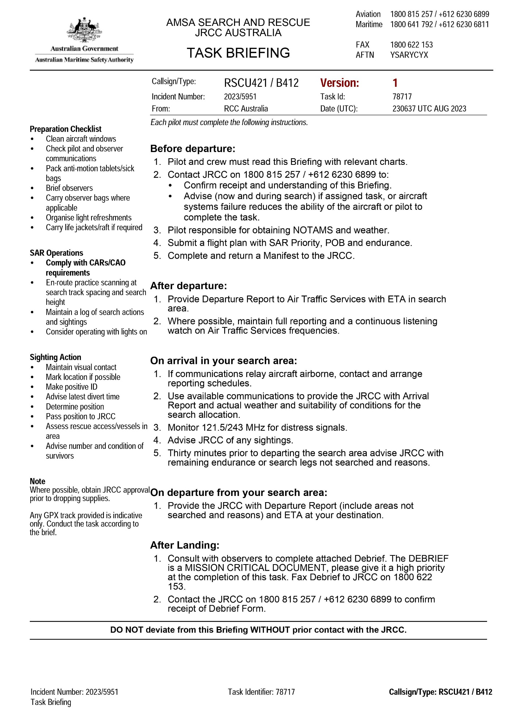

---
## Page 47

Appendix A – Tasking Brief (Example) 
 
 
47

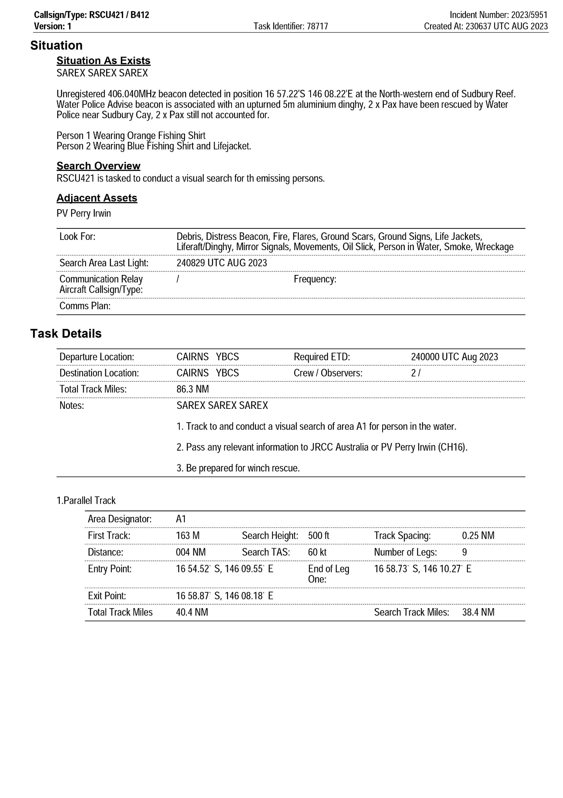

---
## Page 48

Appendix A – Tasking Brief (Example) 
 
 
48

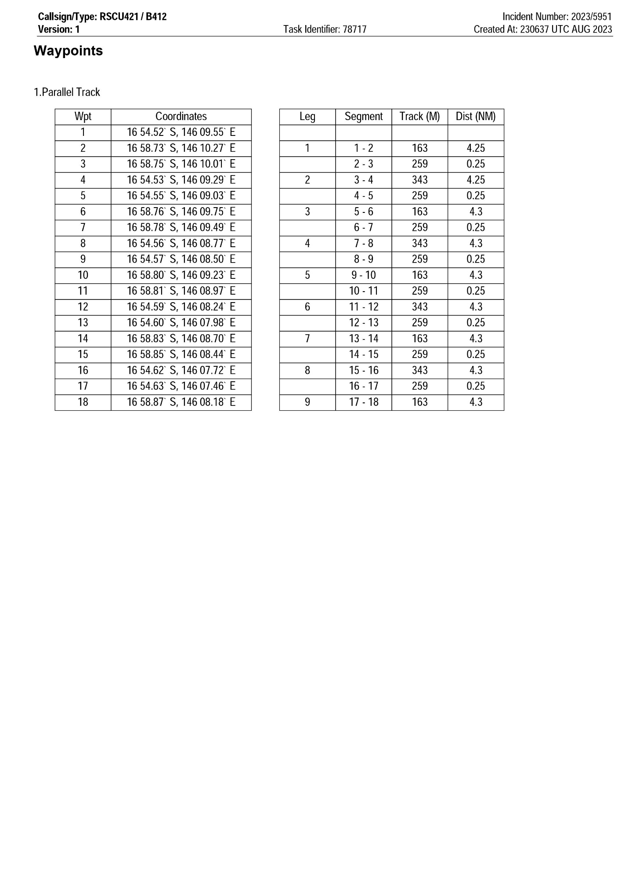

---
## Page 49

Appendix A – Tasking Brief (Example) 
 
 
49

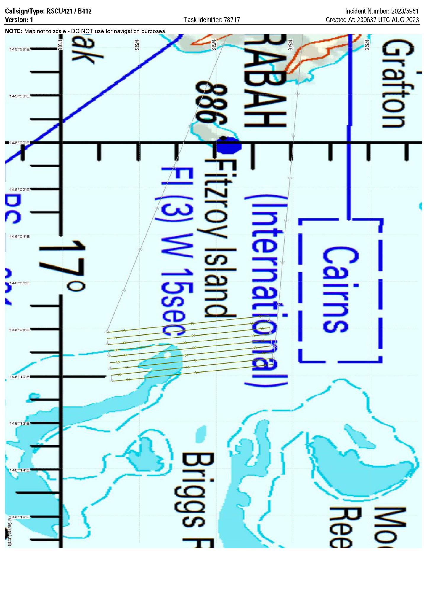

---
## Page 50

Appendix A – Tasking Brief (Example) 
 
 
50

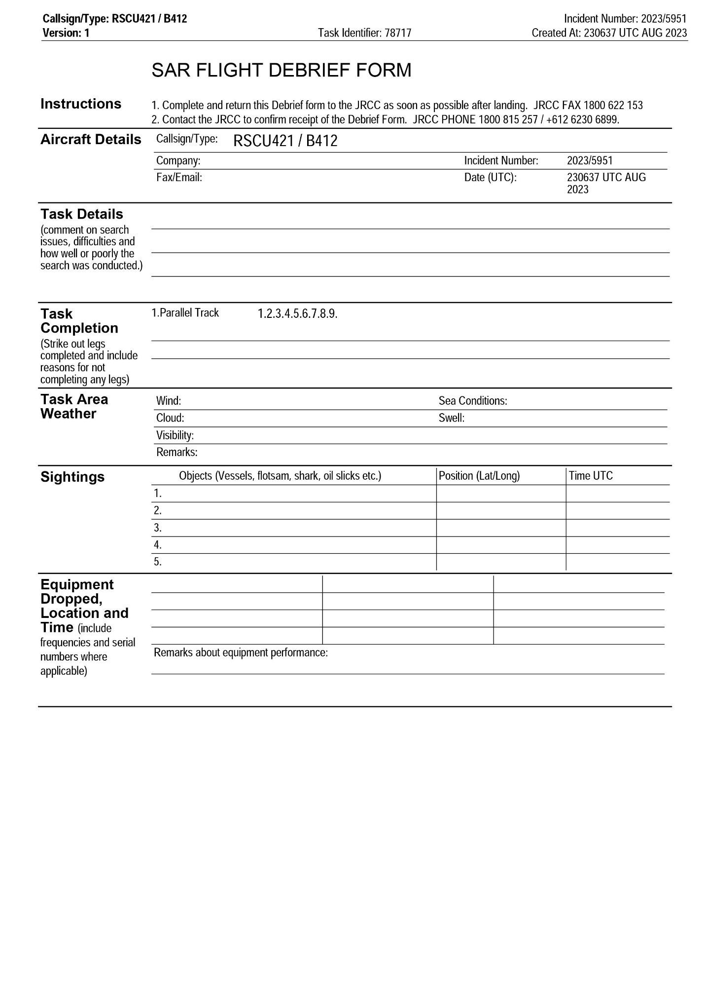

---
## Page 51

Appendix A – Tasking Brief (Example) 
 
 
51

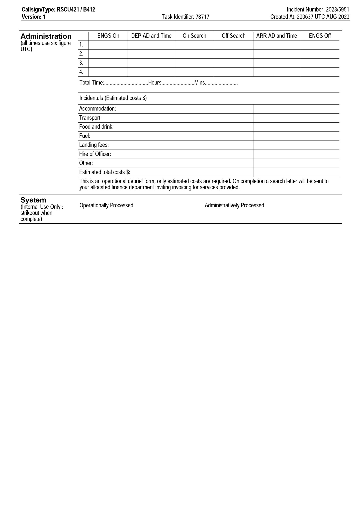

---
## Page 52

Appendix A – Tasking Brief (Example) 
 
 
52

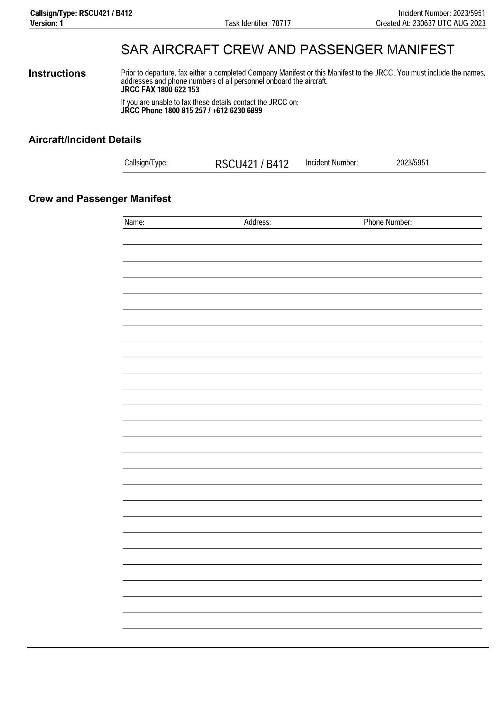

---
## Page 53

 
 
 
 
 
SAR Communication

---
## Page 54

SAR Communication 
 
54 
2. SAR COMMUNICATION 
2.1 General SAR Communications Procedures 
The objective of search and rescue communications is to ensure the safe and efficient conduct of SAR 
operations. Communications must enable: 
• 
Rapid transmission of distress messages from aircraft, ships, and small craft, including medical 
assistance requests. 
• 
Swift communication of distress information to the authorities responsible for organizing and 
executing the rescue. 
• 
Effective coordination of various SAR units involved in the operation. 
• 
Ongoing liaison between controlling or coordinating authorities and SAR units. 
2.1.1 
SAR Frequencies 
The following frequencies have been authorised for use in SAR operations: 
• 
2182, 3023, 4125, 5680 kHz.  
­ These frequencies may be used for communications between mobile stations when employed 
in coordinated search and rescue operations, including communications between these 
stations and participating land stations. 
• 
123.1 MHz  
­ The international SAR on-scene frequency for use in coordinated SAR operations. Ships with 
this capability are authorised to communicate on this frequency with aircraft for safety 
purposes. 
• 
123.2 MHz  
­ For supplementary continental use in on-scene coordination within the Australian SRR. 
• 
282.8 MHz  
­ Used by military ships and aircraft for communications during coordinated SAR Operations 
 
NOTE: 
The aeronautical mobile service uses amplitude modulation 
(AM) for VHF telephony while the maritime mobile service 
uses frequency modulation (FM).  These services are 
incompatible.

---
## Page 55

SAR Communication 
 
55 
2.1.2 
SAR Call Signs 
Assets regularly involved in SAR and emergency support operations may be assigned individual call 
signs, principally for use in radio communications. Assigned call signs may also be used in other 
documentation and systems to identify aircraft.  
Call signs are intended to:   
• 
Unambiguously identify emergency operations and rescue assets and aircraft in air traffic 
systems.   
• 
Indicate to Air Traffic Services (ATS) personnel the nature of an aircraft operation in order that 
appropriate priority and assistance may be provided.   
• 
Unambiguously identify operational aircraft to emergency agency personnel.   
• 
Assist with situational awareness for personnel involved in management, support and 
supervision of aerial operations. 
• 
Simplify agency radio communications by using call signs that are compatible with agency radio 
systems and consistent with non-aviation operations. 
Aircraft 
The normal practice is for aircraft engaged in SAR operations to continue to use their existing civil or 
military call sign. In exceptional circumstances, search aircraft may be allocated a ’RESCUE’ call sign 
followed by a three-digit number that is drawn from the following bands: 
Asset Category 
“Rescue Number” Allocation 
Army Aircraft 
001 – 100 
RAAF Aircraft 
101 – 310 
Civil Aircraft 
311 – 799  
RAN Aircraft 
800 – 930 
Foreign Aircraft 
931 – 999 
Surface Units 
If allocation of call signs for surface units is required, the following may be used: 
Asset Category 
Callsign Allocation 
Marine Craft 
SAR Launch (Number) 
Land Units 
Land Rescue (Number) 
ADF Ships 
Vessel Name as Callsign 
AMSA Dedicated SAR Aircraft 
The SAR mission call signs assigned to each of AMSA’s dedicated Challenger 604 aircraft: 
Aircraft Registration 
Callsign 
VH-XNE 
Rescue 330 
VH-XNC 
Rescue 440 
VH-XNF 
Rescue 550 
VH-XND 
Rescue 660

---
## Page 56

SAR Communication 
 
56 
2.2 Operational Communication with the ARC  
2.2.1 
Overview 
The order of precedence for in-flight communications to the ARC is as follows: 
• 
Voice (via mobile/satellite telephone) 
• 
Voice (via VHF/HF to ATC services). 
The AMSA HF DSC network operates two maritime communications stations (Wiluna and Charleville). 
The network Coordination Centre is staffed 24 hours a day and can coordinate communications 
between the ARC and SAR units on scene using HF frequencies. 
The SMC is responsible for utilising all available communication systems and designating specific 
frequencies for on-scene use during SAR operations, and for establishing reliable communications 
with adjacent operations centres. When appointed, the Coordinator Surface Search (CSS) or the On 
Scene Coordinator (OSC) is responsible for establishing reliable communications between all 
participating search assets and the ARC.  
The SMC is responsible for informing all SAR participants of the specific frequencies selected for an 
operation. The SMC should designate a primary and secondary frequency in the appropriate frequency 
bands (HF, VHF and UHF) for use as on-scene channels. 
2.3 Aeronautical Communications 
A dedicated communications aircraft should be deployed when communications are expected to be 
poor in the search area and: 
• 
HF is the only available means of communication, 
• 
The search is of large scale, 
• 
There is a need to enhance information feedback to the ARC, 
• 
There is a need to improve information flow to SAR units, 
• 
Search aircraft are operating without contact with a ground station, or 
• 
It is crucial for maintaining communication with survivors, ground search units, and ground 
rescue units. 
Typically, the communications aircraft will be a suitably equipped SAR unit aircraft or a military aircraft, 
with a minimum crew of a pilot and a radio operator, and capable of good on-scene endurance. 
2.4 Maritime Communications 
2.4.1 
Communications with Merchant Ships 
Voice communications between aircraft and merchant ships will initially be conducted on VHF Marine 
Channel 16 (156.8 MHz). Once communications are positively established and by mutual agreement, 
a shift to a working frequency may be made, such as VHF Marine Channel 6 (156.3 MHz), which is the 
designated air/sea SAR channel.  
If these frequencies are unavailable, voice communications should be attempted on the following HF 
frequencies in order: 2182 KHz, 4125 KHz, 6215 KHz, or 8291 KHz.

---
## Page 57

SAR Communication 
 
57 
2.4.2 
Communicating with Small Craft 
Voice communications between aircraft and small craft will initially be conducted on VHF Marine 
Channel 16 (156.8 MHz). Once communications are positively established and by mutual agreement, 
a shift to a working frequency may be made, such as VHF Marine Channel 6 (156.3 MHz), which is the 
designated air/sea SAR channel.  
If VHF communication is unsuccessful, attempt voice communication on 27 MHz, starting with Marine 
Channel 88 (27.88 MHz) for the initial call, and then shift to Marine Channel 86 (27.86 MHz) once 
communication is established.  
Small craft include police vessels, volunteer marine units, fishing vessels, and recreational vessels. 
2.4.3 
Global Maritime Distress and Safety System 
Ships subject to the Safety of Life at Sea (SOLAS) Convention are obliged to be outfitted with certain 
communications equipment to participate in the Global Maritime Distress and a Safety System 
(GMDSS). Fishing vessels and small craft around Australia, if carrying compatible GMDSS equipment 
can also participate. 
AMSA is responsible for the provision of shore facilities for the GMDSS and all distress and safety 
traffic through the GMDSS shore infrastructure in the Australian SRR will be handled by ARC  
Ships operating under GMDSS requirements in the Australian SRR can be expected to carry:  
• 
MF DSC.  
• 
VHF radiotelephone (Channels 6, 13, 16 and 67).  
• 
VHF DSC (Channel 70).  
• 
HF DSC or a ship earth station of a recognised mobile satellite service. 
• 
An AIS-SART or RADAR SART.  
• 
An EPIRB.  
2.4.4 
Marine Radio Alarm Signal 
With the full implementation of the Global Maritime Distress and Safety System (GMDSS) in February 
1999, the automatic alarm devices used on 2182 kHz are no longer required. However, some maritime 
communications stations may still use the voice alarm signal consisting of two sinusoidal audio 
frequency tones, one of 2200 Hz and the other of 1300 Hz, producing a distinct warbling sound to draw 
attention to a distress broadcast.  Merchant shipping complying with the SOLAS Convention now guard 
the Digital Selective Calling (DSC) distress frequencies.

---
## Page 58

SAR Communication 
 
58 
2.5 Communication with ADF Units 
Ships and aircraft of the Australian Defence Force (ADF) are fitted with communication equipment, 
which allows for coverage of many of the emergency and SAR frequencies.   
2.5.1 
Royal Australian Navy (RAN) 
Voice communications between aircraft and RAN vessels will initially be conducted on VHF Marine 
Channel 16 (156.8 MHz). Once communications are positively established and by mutual agreement, 
a shift to a working frequency may be made, such as VHF Marine Channel 6 (156.3 MHz), which is the 
designated air/sea SAR channel. Frequency coverage in this band depends on the type of equipment 
fitted, but all ships can monitor Channel 16 (156.8 MHz).  
The RAN is equipping its warships with a full suite of GMDSS communications, including Inmarsat C 
and VHF/HF DSC, and ADF units are generally fitted with 406 MHz distress beacons. 
International Distress Frequencies - Guarded by Royal Australian Naval Ships 
A distress watch is maintained as follows by naval ships at sea: 
Naval Vessel Type 
Communication 
Type 
Watch Details 
Major warships 
(Frigates and above) 
HF/VHF DSC, 
VHF Channel 16 
Listening watch will be maintained on 
Channel 16 until further notice. 
Minor warships  
(Patrol boats and mine hunters) 
VHF Channel 16  
Continuous loudspeaker watch. 
2.5.2 
ADF Aviation Assets 
ADF aviation aircraft involved in SAR operations will be monitoring the local area frequency and scene 
of SAR 123.1MHz.  Initial contact is to be made on this frequency.  
2.6 Communication with Maritime Border Command  
The ARC may seek assistance from Maritime Border Command (MBC), which is enabled by the 
Australian Border Force (ABF) and the Australian Defence Force (ADF). MBC supports whole-of-
government efforts to protect Australia’s national interests by responding with maritime and air assets 
for civil maritime security operations, deterring and preventing illegal activities in the Australian 
Maritime Domain.  
The ARC will request assistance in sourcing aircraft through the Australian Maritime Security 
Operations Centre (AMSOC). For specific search requirements, such as radar or night searches, the 
ARC will consult with ABF and the contracted provider to determine the best response.  
Initial contact with ADF aviation assets is to be made on the local area frequency, followed by a change 
to a working frequency for all subsequent communications. When available, ABF vessels can also 
assist with SAR incidents, and the ARC may request their assistance in a manner similar to that for 
ABF aircraft.

---
## Page 59

SAR Communication 
 
59 
2.6.1 
Communications with ABF & ADF Vessels 
Voice communications between aircraft and ABF & ADF Vessels will initially be conducted on VHF 
Marine Channel 16 (156.8 MHz). Once communications are positively established and by mutual 
agreement, a shift to a working frequency may be made, such as VHF Marine Channel 6 (156.3 MHz), 
which is the designated air/sea SAR channel.  
If initial communication attempts are unsuccessful, further attempts can be made on VHF Marine 
Channel 69 (156.475 MHz). 
2.7 Communication with State/Territory Police Units 
State and Territory Police Services typically manage surface assets and ground parties. 
Communication with maritime and ground units should, whenever possible, be initiated and 
maintained through the relevant on-scene Police Service via direct VHF, UHF, or telephone (details to 
be provided by the ARC). 
2.8 Communications with Other Ground Parties 
For communication with other groups or private citizens, the Citizen Band UHF repeater channel for 
the area or channels such as Channel 5 (476.525 MHz), 35 (477.275 MHz), 40 (477.400 MHz), or 18 
(476.850 MHz) may be used.  
Additionally, the emergency frequency VHF 121.5 MHz may be considered, with a transition to VHF 
123.1 MHz (or 123.2 MHz) possible once communication is established. 
2.9 Communication with Other Agencies 
There are many additional communication facilities available for use in SAR operations. It is important 
that personnel employed in SAR learn what facilities and services are available at their specific location 
and throughout their area of operations. Some of the more extensive and readily available facilities 
are: 
• 
The State and Territory authorities have in place a network of nine limited coast radio stations 
around Australia monitoring 4, 6 and 8 MHz distress frequencies in the HF voice band These 
authorities also operate VHF sites covering channel 16 and 67. 
• 
Each State/Territory has an extensive volunteer marine radio network. Many of these stations do 
not operate 24 hours but do operate in the 27 MHz, VHF and MF bands. 
• 
Aeronautical Fixed Telecommunications Network (AFTN) - an international teleprinter network 
based on lCAO requirements for air navigation services, including SAR. Details of the network can 
be found in the communications section of the various lCAO Regional Air Navigation Plans. The 
AFTN in Australia is operated by Airservices Australia. 
• 
Satellite communications offering voice, fax and data. 
• 
Mobile phone and fax communications. 
• 
Electronic (Email, internet, skype and video conferencing).

---
## Page 60

SAR Communication 
 
60 
2.10 Non-Verbal Communication with Survivors 
Many signals have been devised over the years to indicate a condition of distress or other emergency 
status. Personnel involved in SAR operations must be familiar with the types of signals they may 
encounter to accurately evaluate their meaning and take appropriate action. 
The signals listed in this section are the most common and have been accepted by international 
agreement or national custom or may be significant for occasional use by SAR units. These emergency 
signals can be conveyed through various means, including radio, radar (e.g., transponders), flags, 
pyrotechnics, flashing lights, smoke, sounds, shapes, and ground panels. 
Given the extensive range of possible emergency signals, this list is not exhaustive. 
2.10.1 International Distress Signals 
• 
Persons in distress may use many means at their disposal to attract attention, make known their 
position and obtain assistance.  
• 
Some basic distress signals are as follows: 
• 
A gun or other explosive signal fired at intervals of about one minute.  
• 
A continuous sounding of any fog-signalling apparatus.  
• 
Rockets or shells, throwing red stars fired one at a time at short intervals.  
• 
A signal made by any signalling method consisting of the group …---… (SOS) in the Morse Code.  
• 
A signal sent by radiotelephony consisting of the spoken word ’Mayday’  
• 
The International Code Signal of distress indicated by the code group NC; (See the International 
Code of Signals for other code groups with emergency significance.)  
• 
A signal consisting of a square flag having above or below it a ball or anything resembling a ball.  
• 
Flames on a vessel (as from a burning tar barrel, etc.). 
• 
A rocket parachute flare or a hand flare showing a red light.  
• 
A smoke signal giving off a volume of orange-coloured smoke.  
• 
An orange-coloured sheet with a black square and circle or a black “V” or other appropriate symbol.  
• 
Slowly and repeatedly raising and lowering arms outstretched to each side.  
• 
The radiotelephone alarm signal consisting of two tones transmitted alternatively over periods of 
from 30 seconds to 1 minute.  
• 
Signals transmitted by Emergency Position Indicating Radio Beacons, EPIRB’s or Personal Locator 
Beacons (PLB’s), Emergency Locator Transmitters (ELT’s).  
• 
Approved signals transmitted by radio communication systems.  
• 
A dye marker. 
• 
Transponder Squawk Codes 7700 Emergency, 7600 Communications failure, 7500 Unlawful 
interference

---
## Page 61

SAR Communication 
 
61 
2.11 Search and Rescue Signals - Australian SSR 
2.11.1 Signals with Surface Craft 
When it is necessary for an aircraft to direct a surface craft to the place where an aircraft or surface 
craft is in distress, the aircraft shall do so by transmitting precise instructions by any means at its 
disposal. If such precise instructions cannot be transmitted or when necessary for any other reason, 
the instructions shall be given by using the procedure prescribed herein.  
Aircraft Signalling Procedures 
The following procedures performed in sequence by an aircraft shall mean that the aircraft is directing 
a surface craft towards an aircraft or a surface craft in distress:  
• 
Circling the surface craft at least once.  
• 
Crossing the projected course of the surface craft, close ahead at a low altitude, opening and 
closing the throttle or changing the propeller pitch; and  
• 
Heading in the direction in which the surface craft is to be directed. 
Maritime Signalling Procedures 
Current maritime signalling procedures include: 
• 
For acknowledging receipt of signals: 
­ The hoisting of the Code Pennant (vertical red and white stripes) close up (meaning 
understood). 
­ the flashing of a succession of Ts by signal lamp in Morse code; and 
­ the changing of heading. 
• 
For indicating inability to comply: 
­ the hoisting of the international flag N (a blue and white checked square); and 
­ the flashing of a succession of Ns in Morse code.

---
## Page 62

 
 
 
 
 
Air Search Operations

---
## Page 63

Air Search Operations 
 
 
63 
 
3. AIR SEARCH OPERATIONS 
3.1 General Air Search Procedures 
3.1.1 
Aim of the Air Search 
A search typically involves three stages: 
Stage 1. Immediate response. An initial visual and/or electronic search along the missing craft’s 
planned route or suspected distress position. 
Stage 2. Nominated area either side of track. Normally a search conducted in an area 10 nautical miles 
either side of the track, but this can be varied depending on circumstances. 
Stage 3. Mathematically derived area. An expanded search of a probability area calculated using the 
navigational tolerances of the missing and search craft, allowing for drift if applicable and the 
application of a safety factor. 
Stages 1 and 2 searches may be run concurrently. For example, if a distress incident occurs at the end 
of daylight or during the night, when the first visual search cannot be undertaken until the following 
day, it may be appropriate to conduct both stages simultaneously. 
Any divergences from the agreed search plan, such as variance in altitude or search track due to 
weather or optimisation of search conditions, must be logged and reported to the ARC. Based on 
intelligence received, take the appropriate action to locate and assist in the rescue of persons in 
distress in the shortest possible time. 
As part of the search briefing, the aircraft crew will be provided with a detailed search area plan, which 
will include, amongst other information/data, search height and track spacing. If the aircraft crew 
believe these parameters need to be varied, they are to advise the ARC accordingly. However, the 
aircraft shall not deviate from the search plan, except for safety reasons, unless authorised by the ARC. 
 
IMPORTANT: 
DO NOT deviate from this Briefing WITHOUT 
prior contact with the AMSA ARC.

---
## Page 64

Air Search Operations 
 
 
64 
 
3.1.2 
Determination of the Search Area 
When the location of a missing vessel or aircraft is not known, a reconstruction of the probable route 
and an estimation of the most likely position of the incident must be made by the ARC. Two types of 
areas are calculated to determine the search area. These are based on different information received 
and calculated regarding the vessel or aircraft, and they are explained below. 
Possibility Area 
The possibility area is the area in which a missing craft could be located had it continued sailing or 
until fuel exhaustion in the case of an aircraft. Usually, the area is too large to be considered as the 
search area, but knowledge of its extent and boundaries may be of use when assessing intelligence 
information, particularly sighting or hearing reports. 
Probability Area 
The probability area is that area in which a missing craft or survivors are most likely to be found, 
accounting for possible errors in the navigation of the missing craft and of search craft, together with 
an allowance for any water movements should the incident occur over water. This includes a safety 
factor. 
If the distress position of the target is known (by radar, reports from the distressed craft, or from 
witnesses, etc.), the search area is based on the probability area. If the distress position is not known, 
the search area is based on the premise that it is:  
• 
Likely between its last reported position and its destination; or  
• 
Most likely to be between the last reported position and the position where the next report should 
have been made. 
3.1.3 
Calculating the Track Spacing  
Track spacing is calculated using the appropriate sweep width tables (held in the ARC) and applying 
correction factors. The calculated values are rounded up or down to the nearest half mile. 
Factors Affecting Track Spacing  
• 
Type of target  
• 
Meteorological conditions, including cloud, visibility, and shadows  
• 
Type of terrain  
• 
Search altitude 
3.1.4 
Coverage Factor 
Achieving the Desired Coverage Factor  
The desired coverage factor for any search is greater than one. It is recognized that this is not always 
practical or possible; however, a search with a coverage factor of less than 0.5 is generally not 
considered worthwhile. The SAR Mission Coordinator will consider decreasing the track spacing or 
reducing the area to be searched to achieve the desired coverage factor. 
Coverage factor = sweep width ÷ track spacing. (C=W/S)

---
## Page 65

Air Search Operations 
 
 
65 
 
3.1.5 
Search Area Allocation 
When developing a search plan, the ARC will carefully weigh the limitations of the following: 
• 
Time. 
• 
Terrain. 
• 
Vegetation. 
• 
Weather. 
• 
Navigation aids. 
• 
Likely search target detectability. 
• 
Numbers, types and suitability of available search units. 
• 
Search area size. 
• 
Distance between search area and staging bases. 
• 
Length of daylight available; and 
• 
The probability of detection desired under the circumstances. 
As survival time after an accident is limited, time is of paramount importance, and any delay or 
misdirected effort will greatly diminish the chances of locating survivors. While thorough mission 
planning and good conditions for search are desirable, positive and immediate action is also required. 
Search pattern selection depends on several factors, such as: 
• 
Accuracy of datum. 
• 
Size of the search area. 
• 
Search aircraft available for search. 
• 
Manoeuvrability and navigation accuracy of the search aircraft. 
• 
Horizontal and vertical separation of search aircraft. 
• 
Weather and sea conditions in the search area. 
• 
Size of search target; and 
• 
Type of detection aids survivors may have. 
3.1.6 
Pre-Search Preparation 
Prepare Charts 
• 
Draw search area (this will be supplied by the ARC); and 
• 
Draw legs (these will be supplied by the ARC). 
Prepare SAR Log 
• 
Showing legs flown/to be flown. 
• 
Fuel available. 
• 
Enough room to note leg start/finish times, headings, etc. 
• 
Communications; and 
• 
Engine time log.

---
## Page 66

Air Search Operations 
 
 
66 
 
Failures - Think about: 
• 
Asymmetric operations. 
• 
R/T failures; and 
• 
Navigation aid failures. 
Maps and Charts 
The most commonly used maps are 1:1,000,000, 1:250,000 or 1:100,000.  Familiarise yourself with the 
scale before an operation requires you to use them. Look for dangerous areas and prominent features, 
draw legs of your search area and study the features at turning points.  
Weight and Balance 
Determine the maximum fuel available for searching by having a weight and balance completed for 
your aircraft with SAR gear and additional observers (if required). This should be done, preferably, 
before you are tasked by the ARC. 
3.2 Air Search Patterns and Techniques 
3.2.1 
Factors in Search Pattern Selection 
Many factors influence the selection of a particular search pattern, such as: 
• 
Known accuracy of distress position. 
• 
Size and shape of search area. 
• 
Number and type of search units to be used. 
• 
Weather conditions. 
• 
Navigation aids. 
• 
Type of target. 
• 
Terrain and time limitations. 
3.2.2 
Types of Search Patterns 
Considering the above factors, one or more of the following search patterns can be selected: 
• 
Trackline. 
• 
Parallel. 
• 
Sector. 
• 
Expanding Square. 
• 
Contour. 
• 
Coastal / Island

---
## Page 67

Air Search Operations 
 
 
67 
 
Trackline Search 
This procedure is normally employed when an aircraft or vessel has disappeared without a trace. It is 
based on the assumption that the target has crashed, made a forced landing or ditched on or near the 
intended route and will be easily seen, or that there are survivors capable of signalling their position by 
a flashing lamp or other means. It consists of a rapid and reasonably thorough search on either side 
of the intended route of the target, normally at a height of 1000 to 2000 FT during day or at 2000 to 
3000 FT at night. A track line pattern is often used as an initial reaction to a distress situation, the 
second, intensive phase being introduced on the failure of the track line search. 
Aircraft and ships following the same route as that of the missing aircraft or ship should be asked if 
they are available to divert to assist in the search for the target. For ships, this will mean diverting to 
intercept the most probable track line of the target. For aircraft, this type of search should be regarded 
as additional to searches by SAR units, as an enroute aircraft may not be entirely suitable as a search 
platform due to its performance, configuration, endurance, navigational capabilities or lack of 
observers 
Track Line Search – Aircraft is not returning back along track 
 
 
Track Line Search – Aircraft is returning back along track.

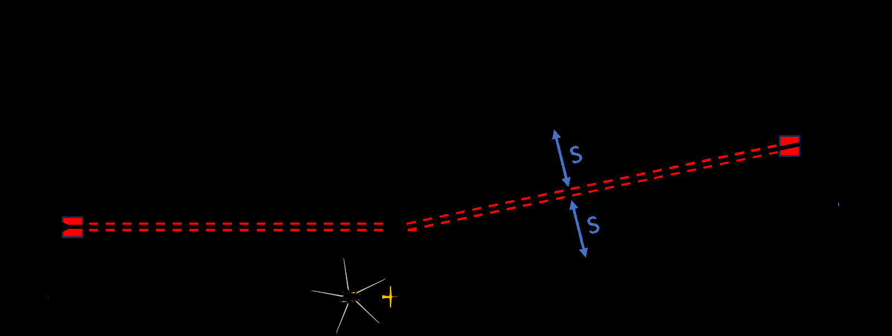

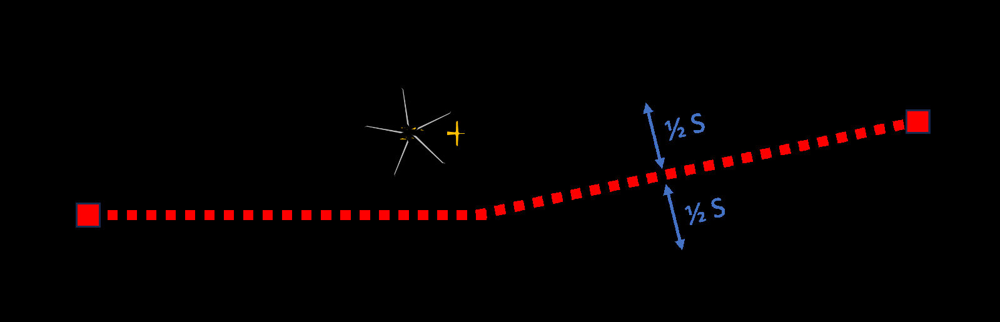

---
## Page 68

Air Search Operations 
 
 
68 
 
Parallel Search 
Parallel track patterns are normally used when:  
• 
The search area is large, and the terrain is relatively level, e.g. desert and maritime areas.  
• 
Uniform coverage is required; and  
• 
The location of the target is not known with any precision.  
Search legs are aligned parallel to the major axis of the individual search area. The pattern is best used 
in rectangular or square areas. It is a very suitable pattern for a search conducted over water. The 
search aircraft proceeds from one corner of the search area maintaining parallel tracks, the first of 
which is at a distance equal to one-half the track spacing from a side of the area. Successive tracks 
are maintained parallel to each other and one track spacing apart. This type of search may be carried 
out by one aircraft or by several aircraft following parallel tracks or each searching smaller rectangular 
areas separately. When aircraft search hours and adjacent traffic permits, turns will be conducted 
outside the search area boundaries as shown below. This allows observers to rest and crew position 
changes. 
Parallel Track Search Pattern 
 
When the search target is more likely to be at one end of the search pattern the search is aligned to 
the minor axis of the search area and becomes a Creeping Line Ahead Pattern the Creeping Line Ahead 
pattern is nominally aligned to a search targets track 
In maritime areas where there is a high drift rate, care must be taken to ensure the target does not drift 
out of a SAR unit’s area. This problem occurs when the rate of creep of the SAR unit is less than the 
rate of drift of the target. 
 
When this condition exists some methods of resolving the problem are to: 
• 
Align the SAR units search legs with the drift vector. 
• 
Use shorter legs for the SAR unit to increase the rate of creep; and 
• 
Increase the SAR unit’s speed

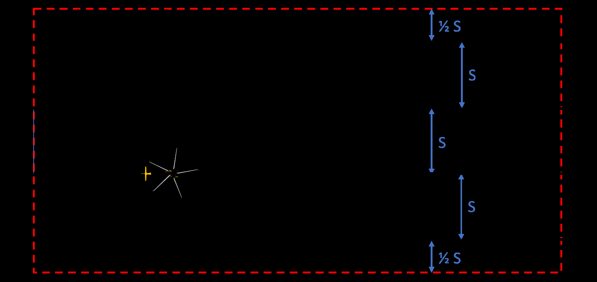

---
## Page 69

Air Search Operations 
 
 
69 
 
 
Creeping Line Ahead Search Pattern

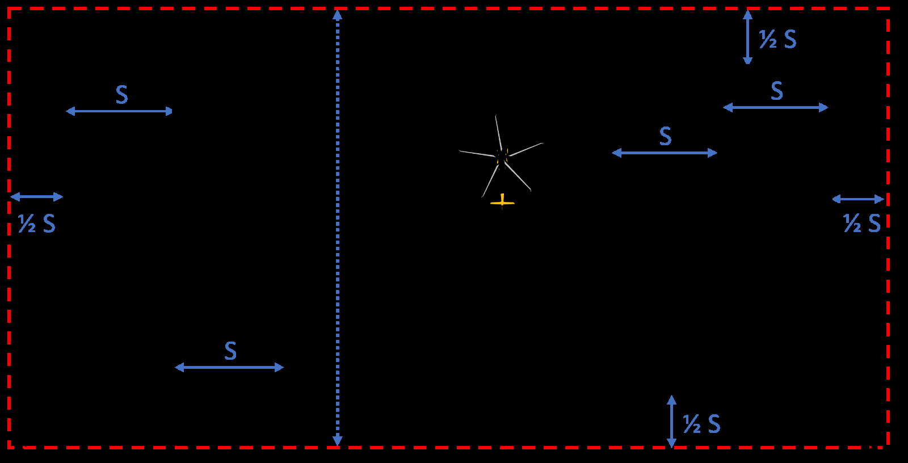

---
## Page 70

Air Search Operations 
 
 
70 
 
Expanding Square Search  
This procedure is referred to as an expanding square search as it begins at the reported position or 
most probable location and expands outwards in concentric squares.  
It is a very precise pattern and requires accurate navigation. To minimise navigational errors, the first 
leg is usually oriented directly into the wind. The square search pattern is used when the target is 
known to be in a relatively small area, no more than 15-20 NM from the start point. The first two legs 
are held to a distance equal to the track spacing and every succeeding two legs are increased by 
another track spacing. Turns may be to the left or right, depending upon the observer positions.  
For successive searches, the direction of the search legs should be changed by 45 degrees. The final 
track should be the same as the initial search track from the start point. The number of search legs 
may be 5, or, increasing by increments of 4, 9, 13, 17 etc. Scanning should start at a distance of “S” 
before reaching the most probable position to avoid leaving an area not scanned near the start point.  
Observers should be briefed to pay particular attention to the areas outwards of each turn to avoid 
leaving areas not scanned. The search should be planned so that, whenever possible, the approach to 
the most probable position, and the first leg, is made into wind as shown below 
 
Expanding Square Search Pattern

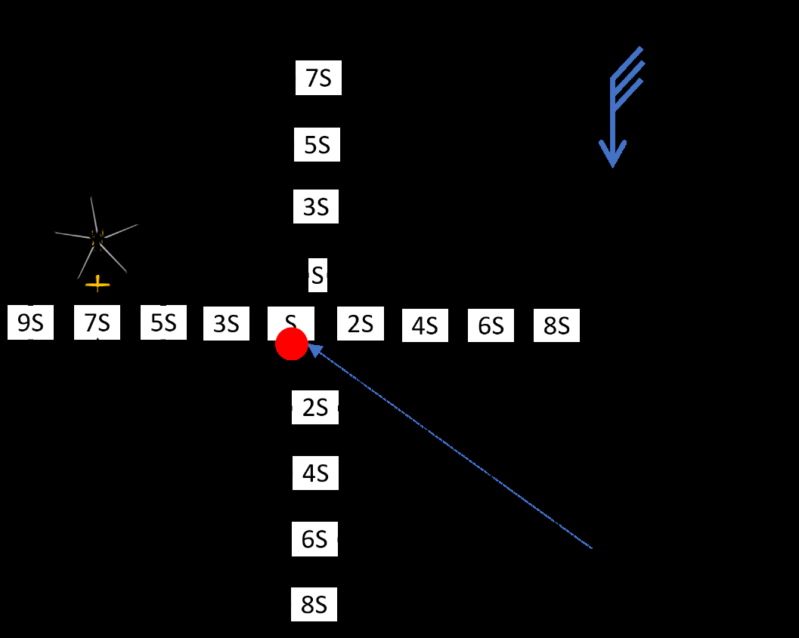

---
## Page 71

Air Search Operations 
 
 
71 
 
Sector Search  
This pattern may be employed when the position of distress is known within close limits and the area 
to be searched is not extensive. It is simple to execute, is likely to provide greater navigational accuracy 
than a square search and, because the track spacing is very small near the centre, it ensures a high 
probability of detection in the area where the target is most likely to be located. A suitable marker is 
chosen as a datum and navigation aid on each search leg. For practical purposes, the datum may be 
moved a mile or two, either at the planning stage or on scene, to take advantage of a prominent 
landmark well suited as a navigation reference. When using the pattern over water, it is useful to drop 
either a visual or electronic beacon to mark the datum. Adjustment for total water current is automatic 
and only leeway need be separately considered. 
Each search leg is separated by an angle based on the maximum track spacing at the end of the legs 
and the search radius. For convenience, the angular displacement between each search leg and the 
distance required to fly the pattern for various track spacings and search radii may be extracted from 
Table 8-1, Sector Search Calculations. The table makes use of Mean Track Spacing (MTS) as a basis 
for deriving angular displacement and distance to be flown. MTS is the track spacing at a distance of 
half the radius of the search area from the datum. The table may also be used to determine the track 
spacing that can be used for a given track distance and search radius. The search start point may be 
either on the perimeter of the pattern or over the datum depending on the approach track of the search 
aircraft and the orientation of the first leg. To keep track computation simple, the first leg may be 
oriented to the north, but this is not essential. Successive tracks may be calculated by adding 90 
degrees plus half the angular displacement to the previous track, and so on. The length of the cross 
leg is twice the mean track spacing. The coverage factor, obtained using sweep width information and 
mean track spacing, may be used to determine the POD. If a further sector search is necessary, it 
should be carried out on tracks plotted halfway between the tracks of the pattern followed during the 
first search 
 
Sector Search Pattern

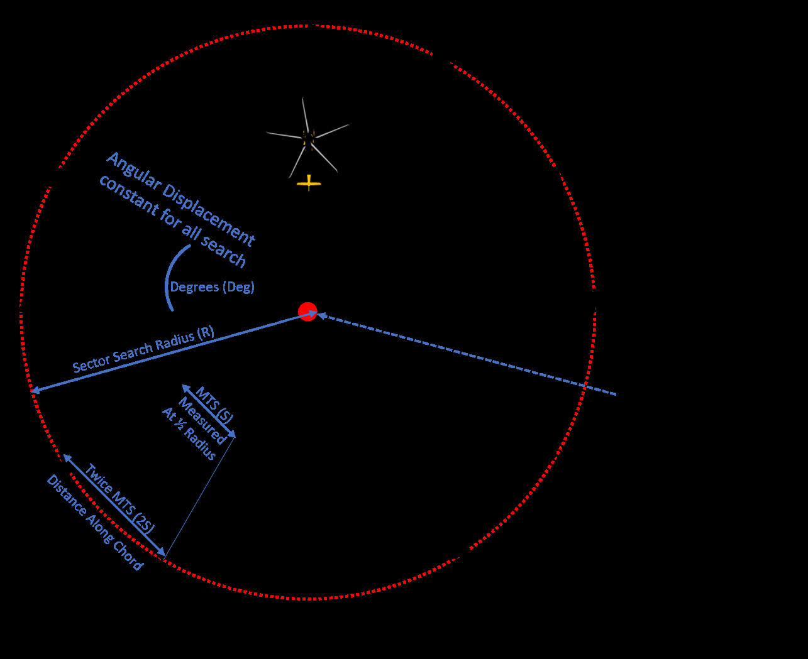

---
## Page 72

Air Search Operations 
 
 
72 
 
Note: 
1 
Deg = number of degrees between successive legs 
D = total track distance (NM) to complete the search pattern 
R = Sector Search Radius 
S = mean track spacing (MTS) 
 
2 
The total track miles that an asset has available on search can be calculated by multiplying the 
effective time available on search – 15% by asset search speed. 
 
SECTOR SEARCH CALCULATIONS 
(This table must not be interpolated) 
S 
1 NM 
2 NM 
3 NM 
4 NM 
R 
Deg 
D 
Deg 
D 
Deg 
D 
Deg 
D 
5 
24 
90 
48 
45 
72 
30 
100 
30 
10 
12 
330 
24 
180 
36 
120 
48 
90 
15 
8 
720 
16 
375 
24 
270 
32 
210

---
## Page 73

Air Search Operations 
 
 
73 
 
Contour Search 
A contour search procedure is used to examine mountain slopes and valleys when the nature of the 
terrain makes other types of search patterns ineffective or too dangerous.   
The procedure normally requires the aircraft to commence at the highest level adjacent to the side of 
a mountain and then descend by appropriate altitudes. Altitude steps may vary to suit terrain. 
 
Contour Search Pattern 
The aircraft used must be suitable, that is, very manoeuvrable; capable of slow speed; having a small 
turning circle; and sufficient power to produce a “high” rate of climb. 
The pilot should be experienced at flying in mountainous terrain. 
Crews must be well briefed and possess accurate, large-scale maps showing the contour lines. 
Weather conditions must be suitable, with particular consideration given to visibility, turbulence and 
cloud base. 
Crews are reminded to exercise extreme caution when searching valleys. The valleys where climb-out 
or turn-around is difficult or impossible must be clearly identified. 
All positioning turns must be made away from the mountainside. Only one aircraft is assigned to an 
area at any one time. 
Before you carry out a contour search, consider the following points. Study the area on a map before 
departure, looking out for power lines, hidden peaks/ridges and blind valleys. Also, consider the wind 
direction and cloud base, and plan escape routes for: 
• 
Turbulence. 
• 
Weather. 
• 
Downdrafts; and 
• 
Single engine performance.

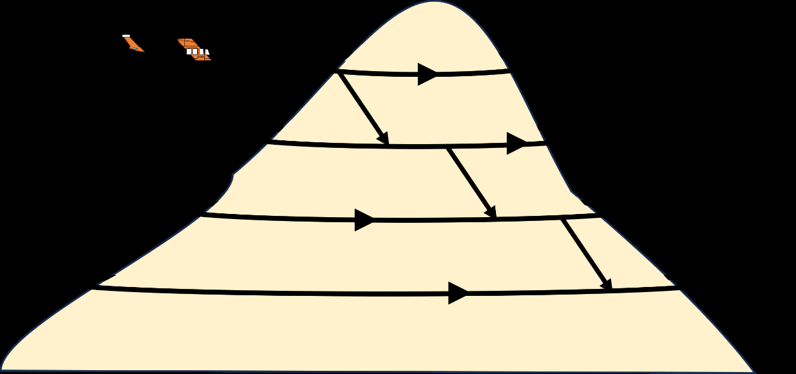

---
## Page 74

Air Search Operations 
 
 
74 
 
During flight, be aware of the following hazards and tips: 
• 
Turbulence - never approach at more than 45° to a ridgeline etc. 
• 
Power lines/cables. 
• 
Fly to the side of valleys, not up the middle; this gives maximum turning radius. 
• 
Birds. 
• 
Shadowing, loss of distance perception. 
• 
Other aircraft. 
• 
Start at the top level. 
• 
Check the area below when descending. 
• 
Mark off areas not searched; and 
• 
Look out for obstructions/hazards/other aircraft. 
Note: These procedures are also shown in Enroute Supplement 
Australia / Emergency Procedures.  
3.3 Principles of Observing 
Almost anyone with reasonably good eyesight can learn to become an aerial observer. It is much the 
same process as learning to be a football player, swimmer, or anything else that requires well-
developed and practiced coordination between the mind and body. 
Effective aerial observation depends on keen vision, alertness, knowledge of “what to look for and 
where to look for it,” plus practice in the planned and disciplined use of the eyes. No skill of any kind 
can be acquired by merely reading about it or by a few moments of training. Most skills can be 
developed only with constant, directed practice and discipline. 
Good aerial observation must be an integral part of flying, not an isolated accomplishment. 
Seeing is an involuntary action performed by all persons with normal eyesight, whereas observing is a 
voluntary action of interpreting what is seen. The essential difference between the passive process of 
seeing and the active one of observing is that when observing, the brain not only records visual 
impressions but also makes deductions from what is seen. 
IMPORTANT: 
An alert brain is a prerequisite for observing 
In summary, SEEING is a passive, involuntary activity where the brain records impressions, as opposed 
to OBSERVING, which is active and voluntary, requiring both MENTAL and PHYSICAL effort to allow 
the brain to make decisions.

---
## Page 75

Air Search Operations 
 
 
75 
 
3.3.1 
Anatomy of the Eye 
The retina is the part of the eye 
that concerns the observer 
most. At the back of the retina 
are the light receptor cells—
cones and rods—which are 
light-sensitive 
and 
transmit 
electrical impulses to the brain. 
The cones function primarily in 
daylight and provide colour 
vision.  
The rods function under low 
illumination and provide vision 
only in shades of grey. 
The cones, although distributed over the entire retina, are concentrated in one portion called the fovea. 
This region of the eye provides us with our best ability to discern detail and is located to coincide with 
straight-ahead vision. 
The central region of the fovea, containing the highest concentration of cones (responsible for our 
colour vision and, due to their concentration, our visual acuity), is only around 1/10,000th of a 
millimetre across and subtends an angle of around 1/3rd of a degree of our straight-ahead vision. 
The whole foveal area subtends approximately two (2) degrees. From 1,000 feet above ground 
(assuming you look straight down), the fovea scans in detail an area of around 10 metres, while the 
central fovea scans a mere 2 metres. Although the distance from the observer to the target would, in 
most cases, be greater than 1,000 feet and the ground area exposed to the fovea would be larger, detail 
in a scene is lost due to distance. 
The physiological result of this is that humans best view things by "saccades." The saccade is a small 
series of steps with a brief pause before each step, made by the eye to bring the fovea to bear on the 
scene or object being scrutinised. 
Towards the edge, the retina is only sensitive to movement. The extreme edge of the retina becomes 
even more primitive: when stimulated by movement, we experience nothing, but a reflex is initiated, 
which rotates the eye to bring the moving object into central vision. 
The structure of the retina gives rise to two different forms of vision. 
Focused Vision 
In order to look at an object, the eye must be focused on the object, and when focused on a point, the 
area of focused vision is very small. Even the smallest object must be scanned (or, more correctly, 
“saccaded”) to be seen and recognised. This saccading consists of fractional movements of the 
sightline across the object, thus bringing the fovea into full play.

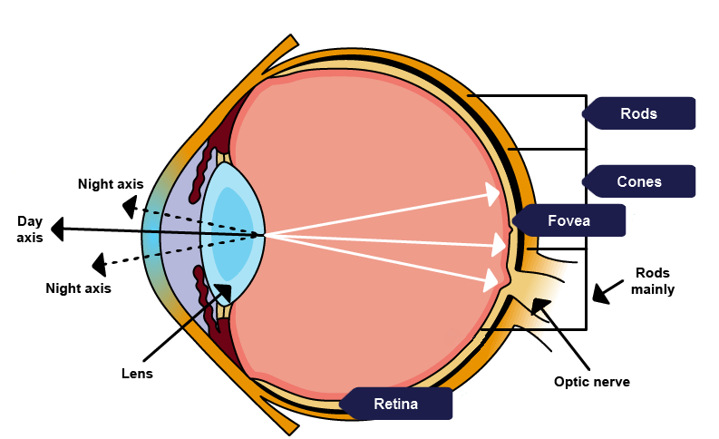

---
## Page 76

Air Search Operations 
 
 
76 
 
SACCADING: 
“Movement of the eyes from one point of 
fixation to another” 
Unfocused Vision 
When looking at an object in a landscape, although the area of focused vision is small, the area of 
unfocused vision is large since the field of view of the eye is approximately 180 degrees. Near the area 
of focused vision, objects may be noted, but no detail will be seen, and the sensitivity falls off towards 
the edge of the field of view until, finally, only movement will be registered. This is the stage of “seeing 
out of the corner of the eye.” This facility can be developed and will serve as a warning of objects not 
directly associated with the spot that the person is observing. 
IMPORTANT: 
The use of binoculars seriously reduces the 
area of unfocused vision 
The rods, so light-sensitive that they function under low illumination, are distributed most thickly 
outside the foveal area. This causes an important peculiarity of night vision, i.e., by night, objects are 
often seen more clearly in a circular area around the point at which the eye is actually directed.  
The light sensitivity of the eye is quite astounding, working as it does over a range of brightness of 
100,000:1. The pigments of the retina are, however, temporarily bleached by bright light. This gives rise 
to the need for dark adaptation to acquire maximum sensitivity by night.  
It also accounts for the “afterimages” seen after having looked at a brilliantly illuminated object. 
3.3.2 
The Visibility of Objects 
Whether an object in a landscape is easy or difficult to see depends on several factors, most notably: 
• 
Colour, tone, and texture 
• 
Movement 
• 
Form and shape 
• 
Size and distance 
• 
Contrast 
• 
Glare 
Tone  
Is a quality compounded of colour and texture and is best described as the intensity of a particular 
colour, e.g., the “redness” of red or the “greenness” of a tree compared with that of a paddock of 
pasture. It is generally regarded as the most common cause of contrast and, therefore, of visibility.

---
## Page 77

Air Search Operations 
 
 
77 
 
Movement 
A moving object is more readily detected than a static one. However, movement may be less apparent 
to a moving observer compared to a stationary one. For example, a hovering helicopter might detect 
movement that would not be seen during rapid flight. 
Form and Shape 
While colour, tone, and texture influence visibility, recognition primarily depends on form and shape. 
Form is detected partly because surfaces facing the light appear brighter than those turned away and 
partly due to the shadows created by the object’s shape. 
Size and Distance 
There are two important aspects to consider regarding size. 
Absolute Size 
In the absence of any significant contrast or movement, the average eye typically does not 
detect an object subtending less than about 1/3 degree at the eye unless specifically directed 
to that spot. 
In simpler terms, this means that a green vehicle, stationary against a natural background, is 
unlikely to be noticed at much more than 600 meters. 
Of course, this is a broad generalization. The distance may be significantly increased with 
excellent lighting, good meteorological visibility, and particularly keen eyesight, or it could be 
substantially reduced under adverse conditions. 
Relative Size 
Relative size is important since contrast in size attracts the eye to an object that is larger or 
smaller than the pattern of its background. 
For example, a small object such as a person or a distant vehicle stands out prominently 
against a large-patterned background, such as a vast field. Similarly, a large object, like a group 
of vehicles parked close together, is easily discerned against a small-patterned background, 
such as a field dotted with bushes and trees. 
Against a featureless background, any object, large or small, will readily attract the observer's 
eye, as there are no other features to distract it. In contrast, a similar object against a 
background crowded with features and contrasts will be much less noticeable because the 
observer’s attention is diverted and confused. 
Contrast 
 
Look at a black and white photograph. Originally, it was a white sheet of photographic paper. However, 
varying shades of grey have been chemically reproduced on it to create a “picture” of the subject. A 
colour photograph simply adds colours in varying intensities. Just as a camera captures the contrast 
between light and dark and, therefore, “sees” objects, your eyes interpret a scene by the contrast of 
light and dark or different colours. 
Contrast (with movement being a close second) is the most important factor in observing things 
efficiently from an aircraft. Objects on the ground cannot be seen unless they contrast in some manner 
with their background. For instance, a brown object against a brown background cannot be 
distinguished unless it casts a shadow, which produces contrast in light or dark, or has a distinct form 
that breaks the background or horizon, which also creates contrast. Without contrast, you cannot see 
it.

---
## Page 78

Air Search Operations 
 
 
78 
 
Nature sometimes helps the observer with contrast and other times makes it difficult. Observers must 
be aware of these differences to observe effectively. 
Contrasting colours stand out clearly from low altitudes. At high altitudes, all colours tend to fade due 
to increasing atmospheric haze. Consequently, at low altitudes where colour can be seen, more detail 
will be visible, and the significance of colour contrast can be better interpreted. It is, therefore, 
important that observers have normal colour vision 
Glare 
Glare has the greatest impact on efficient sight. You should make every effort to eliminate or reduce 
it. Glare occurs when there is more light than your eyes can handle, causing your visual mechanism to 
stall. The over-stimulation caused by glare can even result in temporary blindness, confusion, and 
sometimes pain. 
Aircrew or observers should wear good-quality sunglasses or tinted visors that reduce the total amount 
of light reaching their eyes while still permitting good vision whenever the sun is strong enough to 
cause eyestrain. 
For observers, a comfortable cloth cap with a peak (eye shield) will significantly reduce problems with 
eye squinting resulting from direct sunlight and reflections. Poor-quality glasses make seeing more 
difficult. Coloured (tinted) glasses are not desirable for observation work as they filter out certain 
colour values and make detection of camouflage difficult. 
Other sources of glare, often overlooked, include dirt and scratches on glasses, visors, and the glazing 
of the windscreen. You may not notice these defects until they become critical when flying into the 
sun, as the glare they create may become severe. 
Scratches and dirt on the windshield develop gradually, so you might not be aware of the increasing 
distraction and subsequent loss of vision. Every effort should be made to keep windscreens clean and 
polished. 
An additional cause of glare is bright or light-coloured clothing worn by some observers. Orange 
overalls and light or bright shirts and blouses should be assessed for their suitability prior to flight. 
Observers' clothing should be loose-fitting and comfortable. Solid footwear should be worn while 
airborne. 
Recovery from overexposure to glare takes time. Prolonged exposure to excessive light will reduce 
your ability to see details in low light, thus impairing both night vision and day vision. These effects 
may last for several days even after the eyes are rested. 
Fatigue from any cause impairs vision, particularly night vision, and usually without your awareness. 
Searching requires alertness over long periods. When your eyes get tired, you may strain them in trying 
to continue a normal job. When fatigued, attention may be maintained for only short periods, but overall 
efficiency is lowered, and you are likely to miss something significant. General fatigue also affects your 
sight because it makes it more difficult to stay focused, slows coordination, and causes poor 
judgment. 
Visual Images 
There is evidence to suggest that the human optical system operates as a “feature construction” 
process. The brain does not simply project a photographic replica of the outside world; instead, it 
constructs a picture from components of visual input, a repository of visual memories, and a catalogue 
of learned rules concerning perspective and various optical characteristics.

---
## Page 79

Air Search Operations 
 
 
79 
 
Visual Inference 
Visual inference is a valuable tool for the observer. It involves recognizing targets by connecting 
seemingly insignificant details, thereby inferring the presence and position of important objects. Even 
if the actual equipment is not visible, other clues such as dust, an unnatural break in a hedgerow, or 
vehicle tracks may indicate activity in an area, prompting the observer to search more closely. This 
ability to make visual deductions improves with practice. 
Visual Memory 
Visual memory is the brain’s ability to retain an image as seen by the eyes and to compare it with 
subsequent images, noting any differences. A trained observer can detect changes in the terrain from 
when they last scanned it. Any movement occurring during the intervening period should remain 
noticeable for a long time. Even a slight change in the position of an object, a new track, or an altered 
shadow should immediately attract attention. 
Night and Poor Light 
Recognition of objects in daylight relies on various factors, including shape, form, colour, and overall 
appearance. Cones, concentrated in the centre of the retina, enable precise visual acuity during the 
day. 
At night or in poor light, many visual cues are absent, making objects appear unfamiliar. White objects 
become more conspicuous, while greys, browns, and greens blend together. It is crucial for an observer 
to be familiar with how a particular object appears under these conditions. 
At night, the rods, which are concentrated around the centre of the retina, become the primary 
receptors. Objects a few degrees off the direct line of sight are imaged on this part of the retina, which 
is most sensitive in low light. To compensate, the eye should be directed approximately 8 degrees off-
centre. Determining the optimal direction for this offset—whether above, below, or to the side—requires 
individual experimentation. 
Practice and confidence are essential to avoid the temptation of looking directly to confirm what has 
been seen. 
Hypoxia 
Hypoxia, or lack of oxygen, significantly impairs visual ability. As anoxia progresses, the eye becomes 
less sensitive to details and contrast, the overall field of vision narrows, peripheral vision diminishes, 
and everything appears dimmer. 
Another severe effect of hypoxia is a diminished capacity to concentrate. 
To prevent hypoxia, avoid factors that deplete your body’s oxygen supply. Poor physical condition, 
carbon monoxide poisoning, and cigarette smoking are major contributors to reduced oxygen 
availability. 
Additionally, ensure you’re not hungry. Observers who fly on an empty stomach perform notably worse 
compared to those who are well-fed and comfortable.

---
## Page 80

Air Search Operations 
 
 
80 
 
The Day Blind Spot 
The day blind spot occurs due to the position of the optic nerve in the retina, where there are no rods 
or cones (light receptors) to detect light. 
Main concerns about blind spots: 
• 
Awareness: Understanding that blind spots exist. 
• 
Management: Knowing how to compensate for them. 
When an object is in your blind spot, it will not be visible to one eye. The diagram below illustrates this 
concept. 
 
Cover your left eye with your left hand and focus steadily on the cross on the left. Slowly move the 
page away from your face. When the plane moves into the blind spot of your right eye (approximately 
30 cm away), it will disappear. 
Blind Spot Effects - Cone of Blindness   
• 
At 1 foot (30 cm) from the eye: 1 inch (2.5 cm) in diameter 
• 
At 1000 feet (~300 m) from the eye: 90 feet (~30 m) in diameter 
• 
At one mile (1.6 km) from the eye: 520 feet (~160 m) in diameter 
For perspective, a Boeing 747 jet is 150 feet 
(~46 m) long. 
Under normal conditions, blind spots are not a major issue because both eyes are used together. An 
object in the blind spot of one eye is typically seen by the other eye. However, if an obstruction, such 
as a windshield post, blocks the view of one eye, objects in the blind spot of the other eye may not be 
visible. To address this, use both eyes, systematically scan your entire field of vision, and move your 
head frequently while searching. 
Both eyes work together, and each can move independently. When you observe an object, the lines of 
sight from both eyes converge on that point, giving you slightly different views. This disparity helps 
your brain perceive depth, as well as height and width. The convergence angle provides distance 
information, which your brain uses to gauge range. While optical instruments can affect the perception 
of depth, normal viewing instruments typically reduce the brain’s ability to judge distance.

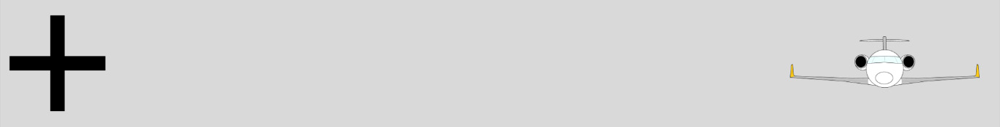

---
## Page 81

Air Search Operations 
 
 
81 
 
3.3.3 
How to “Look” from the Aircraft 
Search distance, derived from tables, represents the range at which you should be able to see an object 
from the height at which the aircraft is flying. This figure is intentionally less than the maximum 
observable distance to ensure a high probability of spotting the target. 
Practicing Search Technique  
Observers should practice this technique before each search. To do this, fly the aircraft at the distance 
derived from the table (half the track spacing) from an object at the beginning of the flight. Observers 
should saccade out to the object at the required distance and note a reference point on the window or 
another part of the aircraft. This provides a good guide for measuring search distance in the search 
area. 
Systematic Scanning 
To effectively cover an area, Observers must look directly at every spot in the area. This requires 
planned, continuous systematic saccading of the area. Observers will not use binoculars continuously 
during an air search because the tubular construction of binoculars eliminates peripheral vision, and 
distance cannot be accurately judged with them. Binoculars should generally only be used to confirm 
sightings. 
Eye and Head Movement:  
The correct eye/head movement involves a series of small steps from below the aircraft out to the 
sighting range and then back, while the aircraft advances across the terrain. The eyes naturally move 
and pause in about 4-degree jumps, and sightings are most likely when the object is within 5 degrees 
of the point on which the eyes are focused. When saccading through a window of an aircraft, eye/head 
movement should be a repeated series of sweeps from below the aircraft, out at right angles to the 
aircraft’s heading, to the limit of the briefed search distance and then back. To reduce fatigue, it is 
suggested to move the head rather than just the eyes. 
Saccading Speed and Focus 
The eye/head movement should be about 10 degrees per second (depending on aircraft speed and 
height), pausing every 3 to 4 degrees to focus—i.e., two to three pauses per second. This is because 
the eye must be focused on an object within its sight line (or within a 5-degree radius of it). Avoid 
skipping the eyes too far between focus points, as the eye does not see clearly while in motion. The 
pauses should be long enough to enable the eye to register and identify distant objects. 
Optimal Saccading 
The speed of saccading depends on the aircraft’s speed and height. Ideally, it should be as slow as 
possible, taking into consideration the speed and height of your aircraft, the size of the area to be 
covered, and the size of the search object. Saccading too fast will cause you to lose considerable 
detail, while saccading too slowly will result in missing some areas. 
Briefing 
Before boarding the aircraft, ensure you brief the Observers thoroughly. Pay particular attention to the 
following: 
• 
Description of the Object: Clearly describe the object of the search to the Observers. 
• 
Track Spacing: Emphasize the track spacing, noting that half of this distance will be your search 
distance.

---
## Page 82

Air Search Operations 
 
 
82 
 
Objects to Look for 
The “object” you are searching for differs from everyday viewing in that its exact appearance may be 
unknown. For instance, you might be looking for a specific aircraft, but it might no longer resemble an 
aircraft. It could be twisted metal, charred debris, or even an intact aircraft with occupants standing 
around. 
The primary objective of our search is to find and retrieve people alive. If they are injured, quickly 
establishing their location can be crucial to their survival. 
This is where the skills of your Aircrew or Air Search Observers become vital. 
Over Land 
Over Land, you are looking for: 
• 
The aircraft, as described on the Air Search Briefing form. 
• 
The number of people, who may be able to signal their presence with smoke, fires, mirrors, or 
ground signals. 
• 
Unusual metal objects: shiny, coloured as per description, or blackened and charred, possibly 
scattered over an area. 
• 
Recent scarring of ground or vegetation. 
• 
An unusual piece of vegetation missing, such as a part of a tree. 
• 
Unexpected rubbish. Observers have reported that the first clue to a crash scene was spotting what 
appeared to be a rubbish tip. Many Australian farms have their own rubbish tips, so ensure each 
one in your search area is checked to rule out a crash scene. 
Over Water 
Over Water, you are looking for: 
• 
Oil slicks. 
• 
Any floating objects, including wreckage and debris. 
• 
Heads or lifejackets (typically orange or yellow). 
• 
Life-rafts. 
• 
Sea marker dye (brilliant green or orange). 
• 
Signal rockets, flashing lights, sunlight reflecting off mirrors, etc. 
• 
White caps that remain in the same location. 
3.3.4 
Actions on Sighting a Target 
When a possible target is sighted, efficient crew coordination and fast, smooth teamwork are essential. 
No crew member should dismiss any potential clues out of fear of making a mistake. Each possible 
sighting must be properly investigated, as it could be the key to saving someone's life. Ten percent of 
the aircraft’s available search time is already allocated to investigating possible sightings. Observers 
will report any potential targets to you.

---
## Page 83

Air Search Operations 
 
 
83 
 
IMPORTANT: 
The crewmember making the sighting 
should not remove their eyes from the target 
as they report the sighting 
 
The crewmember making the sighting is to call  
“TARGET SIGHTED - TWO O’CLOCK, 1 Mile.” 
The clock method is used to report the sighting, 
where directions are given as “clock direction and 
distance.” Here’s how it works: 
• 
12 o’clock: Directly ahead of the aircraft. 
• 
3 o’clock: Abreast to the right of the aircraft. 
• 
6 o’clock: Directly behind the aircraft. 
• 
9 o’clock: Abreast to the left of the aircraft. 
 
 
 
NOTE: 
Regardless of your seating position, the nose of the aircraft 
is always 12 o’clock 
For distance, the Observer will not strive for accuracy but will give an initial distance and update you 
as required. The important information that must be accurate is the direction. 
When over land, it may be possible to assist in locating the target by referencing surrounding 
geographical features. 
If over water, the aircrew may deploy a smoke marker and/or sea dye (this action will be pre-briefed 
and authorised by the pilot). 
You will also mark the target using the GPS. 
When Confirming the Object Found 
• 
Save the current position on the GPS or write down the latitude/longitude. 
• 
If over land, relate the position of the target to an obvious geographical feature (bearing and 
distance), assess the best access route for ground parties, and estimate the distance from the 
nearest road.  
• 
Get the crew to carefully observe the target and note the number and condition of all survivors.  
• 
Advise the ARC of the situation via ATS (on area frequency), mobile, or satellite phone.  
• 
If a Hoist is required

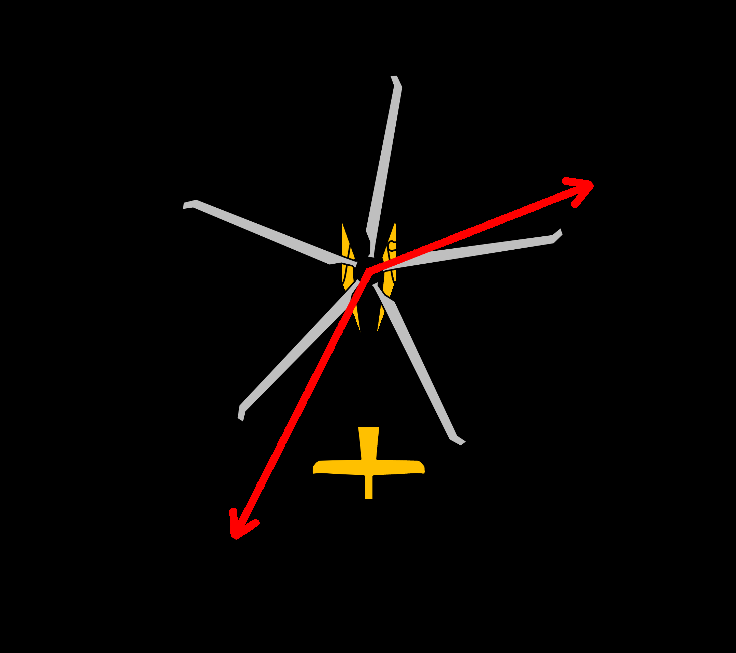

---
## Page 84

Air Search Operations 
 
 
84 
 
­ Advise ARC of the situation and hoisting plan. 
­ Follow all company procedures for hoisting operations. 
• 
If a drop is required, have the crew prepare the SAR drop supplies.  
­ Obtain ARC approval to drop emergency equipment if time permits.  
­ Advise the ARC via ATS that you are commencing a drop pattern and may be off the air/ground 
communications frequency for a period of time.  
­ Maintain communications on 123.1 MHz with other aircraft in the search area.  
­ Conduct the supply drop and assess the result. Advise the ARC of the result.  
• 
Remain overhead to act as top cover or track as required by the ARC.  
• 
Advise the ARC of your latest divert time.  
• 
The crew will keep the object (possible target) in sight as you manoeuvre the aircraft.  
• 
You will turn the aircraft to circle the target.  
• 
The crew will continue to call out revised directions and distances until you have the object in sight.  
• 
If the object is very small, such as a head in a life jacket in the water, the crew will arrange a roster 
between themselves to keep it in sight. 
• 
Once the target is positively identified, it can be marked using any or all of the following, depending 
on whether it is on land or in the water, and based on the circumstances: 
­ Additional smoke markers 
­ Strobe marker—typically used in poor visibility or approaching darkness 
­ SLDMB 
­ Sea marker dye—usually taped to the smoke marker, but can be dropped separately if needed 
3.3.5 
Crew's Discretion 
Every effort should be made to keep the ARC informed of the situation. Similarly, the ARC will attempt 
to keep the crew updated. However, if communication breaks down, the crew must use their discretion 
to resolve the situation. 
Consider the following factors: 
• 
Last light 
• 
Fuel state 
• 
Weather conditions 
• 
Survivors’ situation 
• 
Other operational considerations 
 
 
The overriding principle is that the safety of 
the aircraft and crew must not be 
compromised at any stage.

---
## Page 85

Air Search Operations 
 
 
85 
 
3.4 Day Visual Air Search Operations 
There are many signals that can be used to indicate a distress or other emergency. 
Personnel involved in SAR operations must be familiar with the types of signals they can expect to 
encounter in order to evaluate their meaning correctly and take appropriate action. 
These emergency signals may be made by radio, satellite, telephone, texting, internet (email, social 
media, etc.). RADAR (e.g. transponders), flags, pyrotechnics, flashing lights, smoke, sounds, shapes 
and ground panels. (Appendix V-3 lists the more common signals in use.) 
3.5 Night Vision Device Aided Air Search Operations 
The use of Night Vision Devices (NVDs) can be effective in searches conducted by various types of 
search units. The following factors may influence the effectiveness of NVDs for searching: 
• 
NVD quality 
• 
Crew training and experience 
• 
Environmental conditions, including visibility, moonlight, cloud coverage, and rain 
• 
Level and glare effects of ambient light, both natural and artificial 
• 
SAR asset speed 
• 
Height of the observer above the surface 
• 
Surface conditions (e.g., snow, sea state) 
• 
Size, illumination, and reflectivity of the search object; the presence of reflective tape greatly 
enhances detectability 
• 
Types of survival equipment or light sources used by the survivors 
Glare should be minimized as much as possible within the facility where NVD users are stationed. This 
may involve opening or removing windows where practicable. Proper scanning techniques are also 
important to reduce the adverse effects of moonlight or artificial light sources, such as lighthouses, 
offshore rigs, ships, navigation lights, and strobe lights. 
Visible moonlight can significantly enhance the detection of unlighted search objects when using 
NVDs. Light sources on search objects, such as strobe lights or even cigarettes, can greatly improve 
detection, even in poor visibility conditions. 
The ARC will discuss the sweep width needs with the crew conducting the search. any mission using 
NVDs. 
3.6 FLIR Air Search Operations 
Infrared (IR) devices, such as IR TV cameras or Forward-Looking Infrared Radar (FLIR), are passive 
detection systems used to detect thermal radiation. They operate by detecting temperature 
differences to produce a video picture, allowing them to often detect survivors by their body heat. 
IR devices are generally preferred for night use. The search height should normally be between 200 
and 500 feet AGL (Above Ground Level) for small targets, such as persons in the water, and can be 
increased to a maximum of approximately 1,500 feet AGL for larger targets or those with a larger heat 
signature. Track spacing should be determined in consultation with the operating crew, considering 
the effective detection range provided by the FLIR system manufacturer and the Field of View (FOV) 
angular limitations of the device.

---
## Page 86

 
 
 
 
 
 
86 
 
APPENDICES VOLUME 3 
Appendix B  
Ground to Air Visual Signals 
Appendix C  
Ground to Air (Body) Visual Signals 
Appendix D  
Air to Ground Signals 
Appendix E  
Civil Air Ground Code  
Appendix F  
V’Sheets 
Appendix G  
Panel Signals

---
## Page 87

Appendices Volume 3 
 
87 
Appendix B – Ground To Air Visual Signals 
GROUND to AIR VISUAL SIGNALS 
Ground – Air visual signal code (Survivor) 
Message 
Code Symbol 
Require assistance. 
V 
Require medical assistance. 
X 
No or Negative. 
N 
Yes, or Affirmative. 
Y 
Proceeding in this direction. 
Ground – Air visual signal code (Rescue Units) 
Message 
Code 
Symbol 
Operation completed. 
LLL 
We have found all personnel. 
LL 
We have found only some personnel. 
++ 
We are not able to continue. Returning to base. 
XX 
Have divided into two groups. Each proceeding in direction 
indicated. 
 
Information Received that aircraft is in this direction. 
 
Nothing found, Will continue search. 
NN

---
## Page 88

Appendices Volume 3 
 
88 
Appendix C – Ground To Air (Body) Visual Signals 
GROUND to AIR 
(BODY)  
SIGNAL CODE 
 
 
Need Medical Assistance 
Our Receiver is 
Operating 
 
 
 
Use Drop Message 
Affirmative 
(Yes) 
Negative 
(No) 
 
 
 
All O.K. 
Do Not Wait 
Do Not Attempt to Land 
Here 
Land Here 
 
 
 
Can Proceed Shortly 
Wait If Practical 
Need Mechanical Help 
Or Parts 
Pick Us Up 
Plane Abandoned

---
## Page 89

Appendices Volume 3 
 
89 
Appendix D – Air To Ground Signals 
AIR to GROUND SIGNALS 
Message Received and Understood 
(Rocking Wings) 
Message Received and Not 
Understood 
(Circling) 
Affirmative 
(Pitching Nose Up and Down) 
Negative 
(Yawing Left and Right)

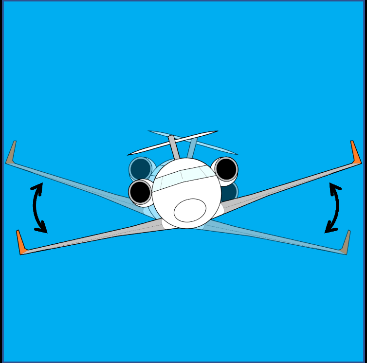

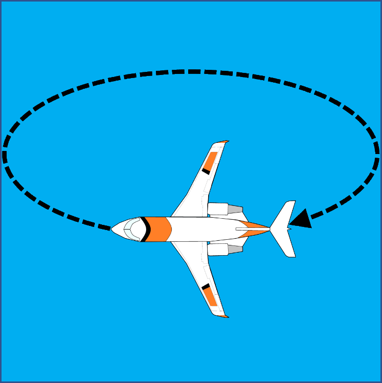

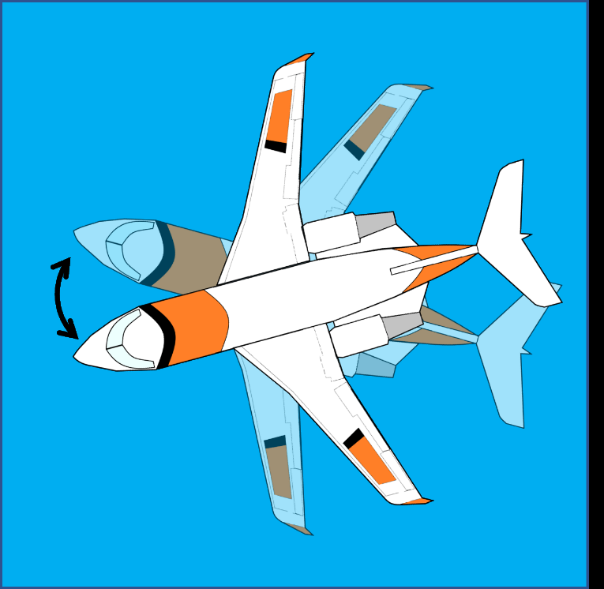

---
## Page 90

Appendices Volume 3 
 
90 
Appendix E – Civil Air-Ground Code 
Australian Civil Authorities Air-Ground Code (IAMSAR Standards): 
Signal 
Meaning 
Aircraft orbits ground party at low level 
changing engine noise 
I require your attention 
Aircraft flies’ overhead ground party at 
low level and sets off in a particular 
direction. 
Follow aircraft in same direction 
Aircraft rocks wings and orbits. 
Investigate object/position underneath aircraft orbit 
Aircraft drops smoke on a particular 
location 
Investigate object/position adjacent to smoke 
Aircraft drops message canister. 
Retrieve and read instructions contained in the 
canister 
 
Aldis Lamp Signals 
• 
Red flashes indicate not understood 
• 
Green flashes indicate message understood 
Air-Ground Signals 
• 
The following signals by aircraft mean that the signals have been understood: 
­ During hours of daylight - rocking the aircraft’s wings 
­ During hours of darkness - by flashing the aircraft’s landing or navigation lights ON and OFF 
twice. 
 
Lack of the above signals indicates that the message has not 
been understood

---
## Page 91

Appendices Volume 3 
 
91 
Appendix F –  Panel Signals 
PANEL SIGNALS 
 
Survivors can use liferaft sails to convey signals 
 
NOTE: 
Any square piece of cloth or canvas with each side of 
contrasting colour can be used. 
 
On Land 
Walking in this 
direction 
At Sea 
Drifting 
 
 
 
 
On Land 
Need Quinine or 
Atabrine 
At Sea 
Need sun cover 
On Land 
Need Warm Clothing 
 
At Sea 
Need Exposure Suit or 
clothing indicated 
On Land 
Should we wait for 
rescue plane? 
At Sea 
Notify rescue agency 
of my position 
On Land 
Indicate direction of 
nearest civilisation 
At Sea 
Indicate direction of 
rescue craft 
 
 
 
 
On Land 
Need gas & oil; plane 
is flyable 
 
On Land & Sea 
Need medical 
attention 
On Land & Sea 
Need first aid supplies 
On Land & Sea 
Need equipment 
indicated. Signals 
follow 
 
 
 
 
On Land & Sea 
Plane is flyable; need 
tools. 
On Land & Sea 
Need food & Water 
On Land & Sea 
Ok to Land. Arrow 
show landing 
direction. 
On Land & Sea 
Do Not Attempt 
Landing

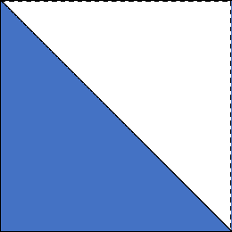

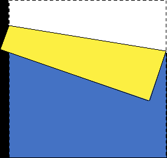

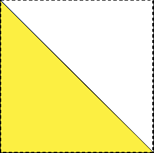

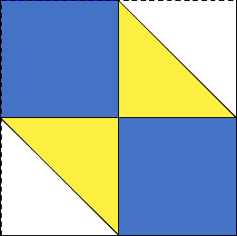

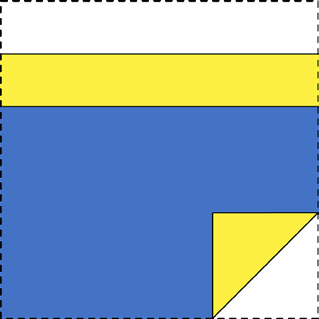

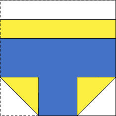

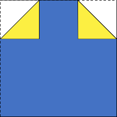

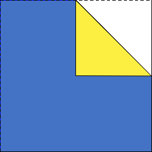

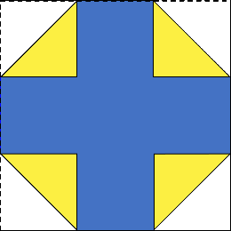

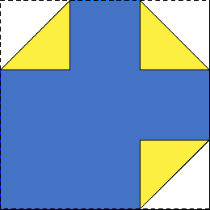

---
## Page 92

Appendices Volume 3 
 
92 
Appendix G – V Sheets  
An internationally recognised distress signal is an orange or red coloured cloth or canvas. Sometime 
referred to as V Sheets. These sheets will either have superimposed the black square and circle, or the 
more common (in Australia) black V as shown below. This type of distress signal is in common use by 
small marine craft in Australian coastal waters.

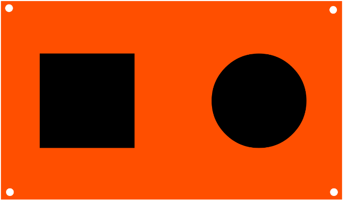

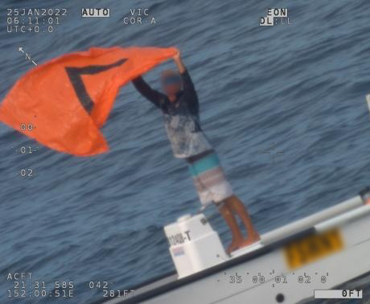

---
## Page 93

 
 
 
 
 
Supply Drop Operations

---
## Page 94

Supply Drop Operations 
 
94 
4. SUPPLY DROP OPERATIONS 
4.1 General Supply Drop Procedures 
The conduct of a search, whether electronic or visual, may result in detecting a situation where a target 
requires assistance. This assistance may include, but is not limited to: 
• 
Dropping life rafts and equipment to persons in distress. 
• 
Lowering trained individuals from helicopters. 
• 
Evacuating survivors by helicopter. 
Additionally, search operations may require intelligence for search planning to determine potential drift 
or tidal flow in order to ascertain the likely drift location of survivors in the water. In such cases, the 
search aircraft may deploy a Self-Locating Datum Marker Buoy (SLDMB) over water to measure water 
movement and sea surface temperature. 
Equipment to be deployed from rotary-wing (RW) aircraft must be specifically approved for such use 
for the specified aircraft. Deployment of AMSA SAR equipment will only be carried out in accordance 
with relevant AMSA procedures by qualified and current aircrew. 
4.2 Supply Drop Equipment 
AMSA-approved equipment for deployment from rotary-wing (RW) aircraft includes: 
• 
Life rafts (6 person – Switlik SAR 6 Mk 2) 
• 
Helicopter Delivery Line Kit 
• 
Helicopter Lightweight Delivery Line Kit 
• 
Self-Locating Datum Marker Buoys (SLDMB) 
• 
Message Bags 
• 
Visual Markers (strobe lights, sea-dye packs, and pyrotechnics) 
 
A list of SRU-supplied equipment is provided in Appendix I of this chapter.

---
## Page 95

Supply Drop Operations 
 
95 
4.3 Weak Links 
Weak links are a crucial component of most dispatchable stores. To ensure that the stores operate 
reliably and detach from the aircraft without causing an overload, it is essential to use weak links of 
the correct strength. The types of weak links referenced in this manual are outlined below. Type 4 
links should only be used as a backup (i.e., they are intended to be loaded to breaking load only if the 
primary link is bypassed due to a tangle or other issue). 
 
 
 
 
IMPORTANT: 
Type 1 is used on all stores in this manual

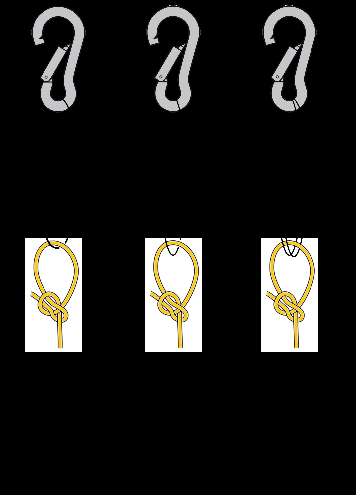

---
## Page 96

Supply Drop Operations 
 
96 
4.4 Life Rafts & Ancillary Equipment 
4.4.1 
Helicopter Delivery Line Kit 
The Helicopter Delivery Line Kit (HDLK) is designed to 
enable the retrievable delivery of a life raft to a vessel 
or survivor in the water. 
USE:  
The Helicopter Delivery Line Kit (HDLK) is used as part of the life raft deployment procedure. The HDLK 
allows the RWR crew to positively dispatch a raft and ensure its retrievability, maintaining a constant 
connection to the life raft. The kit also includes safety lines to assist survivors in safely transitioning 
to the deployed raft. 
RWR SRUs are supplied with a Training Helicopter Delivery Line Kit, which is clearly marked 
“TRAINING.” 
CONSTRUCTION: 
The HDLK is comprised of two components:   
Helicopter Delivery Bag 
• 
9 x Safety Lines (for survivor attachment) 
• 
1 x Safety Knife (for emergency cutaway) 
• 
1 x Instructions for Helicopter Rescue 
Booklet 
• 
3 x 2 Kg ballast weights (removable) 
 
 
Helicopter Delivery Line Bag 
• 
71m of buoyant rope,   
• 
100mm Snap Hook on draw cord  
• 
100mm Carbine Hook  
• 
100mm Formed Eye Snap Hook  
• 
Instruction Tags on 30 mm split rings. 
The delivery line is fitted with a red sleeve on the 
buoyant rope, indicating that approximately 30 
meters of rope remain in the Delivery Line Bag.

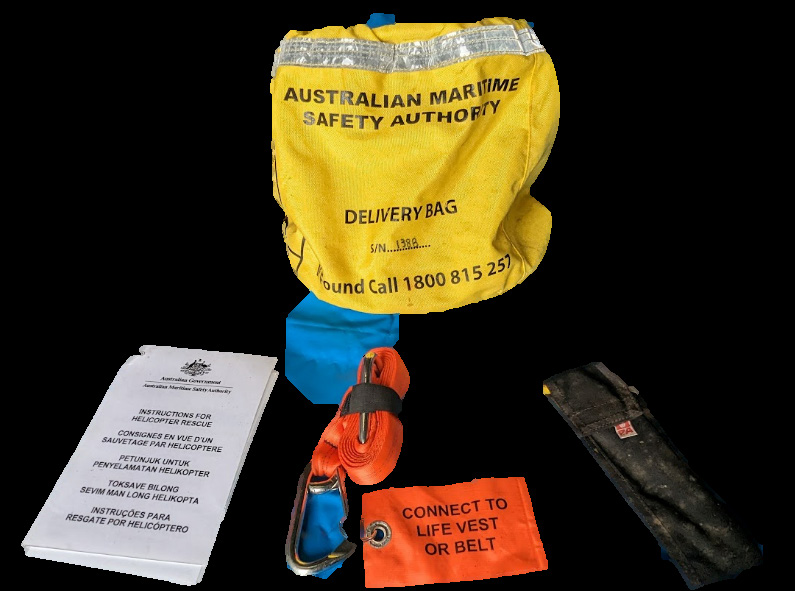

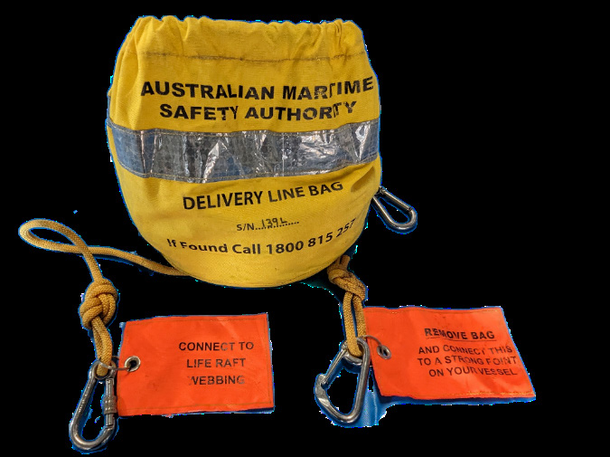

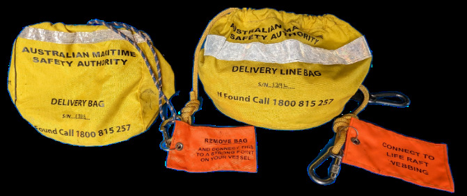

---
## Page 97

Supply Drop Operations 
 
97 
OPERATION: 
The operation of the HDLK is outlined in the Switlik SAR 6 Mk 2 Operation section. 
TESTING & MAINTENANCE. 
Pre Flight: 
• 
Delivery Line Bag 
­ Uncoil all buoyant rope and repack it. This will ensure the rope will deploy smoothly from the 
Delivery Line Bag without knots. 
­ Check Orange Tags are fitted 
› “Remove Bag” tag fitted to the snap hook end of the delivery line 
› “Connect to Life Raft Webbing” Tag connected to the carbine hook end of the delivery line 
• 
Helicopter Delivery Bag 
­ Remove weights if dispatching to a person in the water. 
­ Check contained items for serviceability 
 
Post Training: 
• 
All Training equipment must be properly cleaned with fresh water to remove any contaminants 
such as salt, dirt & mud. 
• 
Hang the equipment in a cool, shady place to dry. 
• 
Inspect all components for damage or wear. 
• 
Repack the equipment correctly.

---
## Page 98

Supply Drop Operations 
 
98 
4.4.2 
Switlik SAR 6 Mk 2 Life raft. 
The SAR-6 MKII Life Raft is a 6-person (10-person overload) 
blue water offshore life raft. The SAR-6 MKII is also an air-
droppable life raft. 
USE: 
The Switlik SAR 6 is generally used in the marine 
environment if recovery by helicopter is not feasible or if 
recovery can be assisted by the supply of the raft. Persons 
in the water and vessels in distress which may require 
abandonment are situations where a life raft dispatch may 
be considered.  
Additionally, due to the limited capacity of some 
helicopters, not all survivors may be rescued at one time, in 
which case the dispatch of a life raft may be necessary to 
support the remaining survivors until the helicopter can 
return or another asset can assist in recovery.  
If it would take too long to reach survivors by land, or if 
providing shelter to survivors is crucial, it may be 
appropriate to drop one or more life rafts from the air, even 
overland, to provide ongoing or long-term shelter. 
CONSTRUCTION: 
The SAR 6 Life Raft features dual buoyancy chambers 
made of heavy-duty nylon coated with abrasion-resistant urethane, a fully auto-erecting canopy, and a 
large toroidal stability device. AMSA heavily modifies the contents of the SAR 6 life raft to suit 
Australian SRR operational conditions. 
AMSA’s Operational rafts generally contain the following survival equipment. 
Item 
QTY 
Item 
QTY 
Bailer 
2 
Paracetamol Tablets (Packet) 
1 
Batteries AA 
9 
Rescue Bags (Thermal Protection) 
9 
Cyalume Light 
2 
Scissors 
1 
Emergency Rations 
1 
Sea Marker Dye (40g) 
2 
Emergency Water  
6 
See-Blitz 
1 
EPIRB (See Note) 
1 
Signal Mirror 
1 
First Aid Kit 
1 
Signal Rocket (Parachute red) 
2 
Ground Air Code Label 
1 
Sponge 
10 
Hand Pump 
1 
Sunscreen 50ml 
1 
Lip Balm 
1 
Survival Manual 
1 
Mechanical Patches (Set) 
1 
Marine Transceiver (GMDSS) 
1 
Motion Sickness Tablets (Packets) 
2 
Water Carry Bag 
1 
NOTE: 
The EPIRB is not automatically activated on raft inflation. The EPRIB is stored with the survival equipment in a pouch on the floor and is 
required to be manually activated by the survivor.

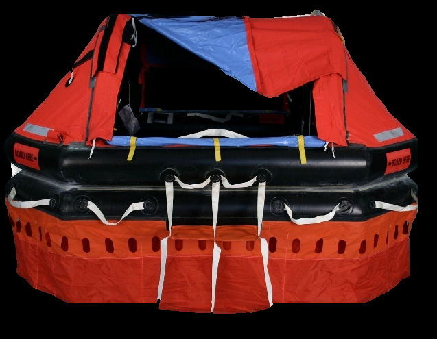

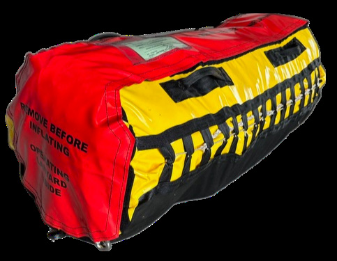

---
## Page 99

Supply Drop Operations 
 
99 
OPERATION: 
Vessel Briefing:  
Where possible, communications should be established with the vessel to brief them on the raft 
dispatch procedure. The procedure is complex and relies on assistance from untrained and potentially 
distressed civilians. It is important that the vessel’s crew understand that a life raft will be deployed 
from the helicopter. Once the vessel has the Delivery Bag, it should be disconnected from the buoyant 
rope, and the buoyant rope should be attached to the vessel. Further instructions are contained in the 
Delivery Bag. 
Simple instructions should be passed to the vessel, such as: 
• 
We are going to deploy a life raft.  
• 
We will lower a bag on a rope to your vessel.  
• 
Remove the bag from the rope and then attach the rope to a strong point on your vessel.  
• 
We will back up and deploy the life raft.  
• 
Further instructions are in the bag.  
• 
“DO YOU UNDERSTAND?”  
• 
“PLEASE READ BACK THOSE INSTRUCTIONS.” 
The vessel crew should indicate they understand and read back the instructions correctly. If they don’t, 
the crew are to REPEAT THE INSTRUCTIONS! 
If, even following the deployment of the Radio Bag, clear voice communications cannot be established, 
the Helicopter Delivery Bag is to be lowered to the vessel with the expectation that the vessel’s crew 
will read and understand the instructions printed on the outside of the Delivery Bag and read and 
understand the instructions contained in the “Instructions for Helicopter Rescue” booklet found inside 
the Delivery Bag. 
The main consideration here is that without clear voice communications, the vessel’s crew may not 
understand what is required of them and detach the Delivery Bag and throw the buoyant rope 
overboard. If this occurs, the Aircrew Officer is to retrieve the buoyant rope into the helicopter, attach 
a weighted bag and re-lower the rope to the vessel. At this point, the crew of the vessel will hopefully 
have read and understood the instructions or successfully used the lowered Transceiver to 
communicate with the helicopter. 
 
IMPORTANT: 
The importance of establishing clear 
communications with the vessel in distress 
cannot be overstated.

---
## Page 100

Supply Drop Operations 
 
100 
PRE-DISPATCH: 
Remove the Red protective cover and check the 
general condition of the life raft. 
 
 
Connect the 100 mm carbine hook on the 
Delivery Line Bag to the webbing anchor loop on 
the front of the raft valise. (Line with Red Tag 
“Connect to Life Raft Webbing). 
Connect the Life raft Activation Line 80mm 
carbine hook to a suitable aircraft hard point on 
the side of the raft away from yourself. 
 
NOTE: 
This hard point should be in a position to allow 
unobstructed dispatch from the aircraft. 
It is important to make sure that the Life raft, 
Delivery Line Bag, all the various cordage and 
rope are clear of personnel and anything else that 
could impede a clean life raft dispatch. 
 
 
 
Attach the Delivery Line Bag to a rear life raft 
valise handle via the supplied 100mm Snap Hook 
on the back of the bag. 
 
NOTE: 
Attaching to the rear life raft handle will ensure 
that the Delivery Line Bag sits at the front of the 
raft and stays in the aircraft, with the life raft 
during Delivery Bag deployment and will be safely 
deployed along with the life raft.

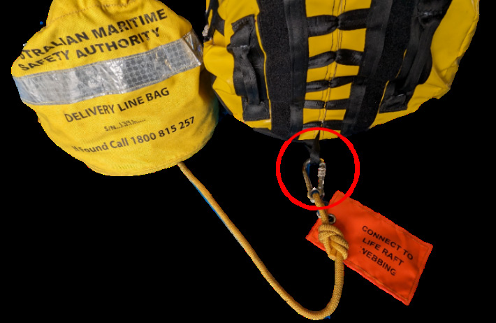

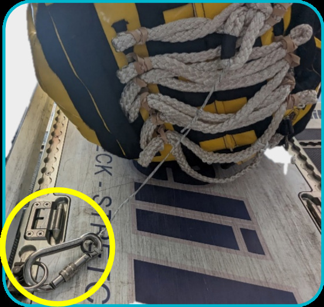

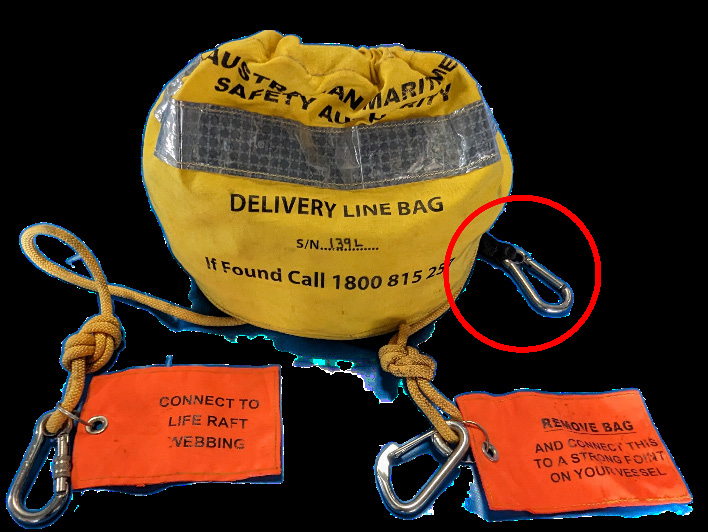

---
## Page 101

Supply Drop Operations 
 
101 
Finally, attach the Delivery Bag draw cord to the 
100mm Formed Eye Snap Hook on the end of the 
Buoyant Rope. 
 
CAUTION: 
The Delivery Bag is heavy (8kg), with all three 
weights fitted. 
 
 
 
After a final check of the cabin area, the Aircrew 
Officer can inform the pilot that they are ready to 
lower the Helicopter Delivery Bag 
 
Prior to arrival over the vessel, it may be a 
consideration to begin lowering the Helicopter 
Delivery Bag.  This will ensure that the survivors 
can see that the helicopter is lowering an object 
and can prepare to receive it.  
 
CAUTION: 
Due to the possibility of the delivery bag becoming entangled on the vessel and causing a premature 
deployment, the raft and delivery line bag must be at the doorway, clear of all obstacles ready to be 
deployed before the delivery bag is lowered

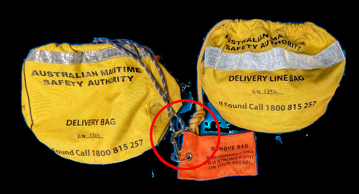

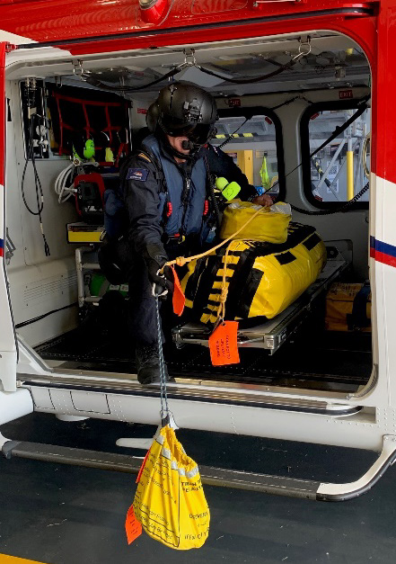

---
## Page 102

Supply Drop Operations 
 
102 
VESSEL DISPATCH: 
The Helicopter Delivery Bag is lowered to the 
vessel, with a minimum amount of excess rope 
on the deck with due regard to sea conditions. 
 
NOTE: 
A winch glove should be worn, as the Delivery 
Bag is heavy 
 
 
The survivors will remove the Helicopter Delivery 
Bag and attach the end of the buoyant rope to a 
suitable strong point on the vessel. 
Once the Aircrew Officer can positively see that 
the buoyant rope is connected to a strong point 
on the vessel, the helicopter can be moved back 
to a position where the life raft can be safely 
deployed. 
 
NOTE: 
The helicopter must move back and to the left, or 
angle itself away from the vessel, to avoid any risk 
of the delivery line or raft fouling on the aircraft 
skids during deployment. 
 
NOTE: 
The red sleave indicates that only 30m of buoyant rope remains in the Delivery Line bag. The life raft 
should be deployed ASAP. 
IMPORTANT: 
The Aircrew Officer is to always have 
positive control of the raft and delivery line 
bag.

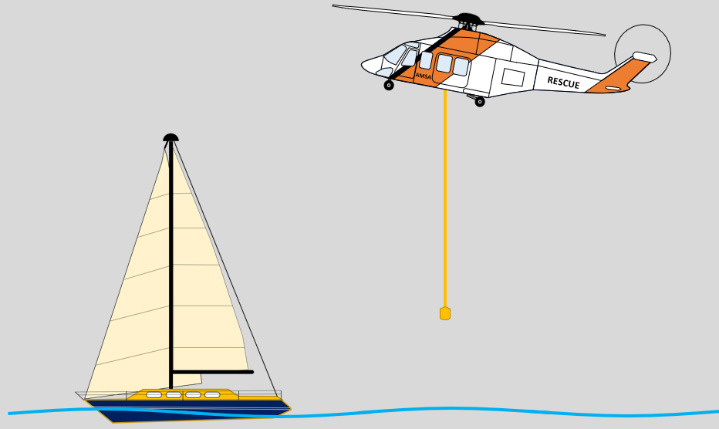

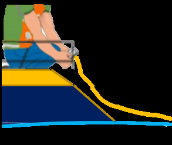

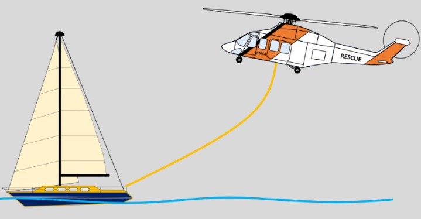

---
## Page 103

Supply Drop Operations 
 
103 
 
It is preferable to drop the raft as close as 
possible to the vessel although it can be dropped 
up to 71m from the vessel. 
The Helicopter Delivery Line Bag is dispatched 
along with the life raft. 
 
CAUTION: 
Due to the pitch and roll of the vessel, there exists a possibility that the life raft could be forcibly pulled 
from the helicopter following a successful attachment to the vessel. 
If the Aircrew Officer feels a pull, the life raft and delivery line bag are to be allowed to cleanly exit the 
cabin. 
The Aircrew Officer will advise the pilot “RAFT GONE”.  
The life raft will start to inflate very soon after deployment. The weak link will break approximately 
halfway down its length. The carbine hook and a small length of Weak Link will remain attached to 
the aircraft hard-point.   
SUVIVOR TRANSFER 
The survivors can attach the safety lines 
contained in the Helicopter Delivery Bag to their 
life vests, a belt, or another suitable attachment 
point on their clothing or equipment.  
If no suitable attachment point exists, the safety 
lines can be secured under the survivor’s arms.  
The other end of the safety line is attached to the 
buoyant rope. 
 
 
The survivors should enter the water one at a 
time to overcome tangling on the buoyant rope.  
One survivor should supervise all other survivors 
evacuating the vessel. 
 
The last survivor off the vessel should ensure that the vessel will remain afloat for the duration of 
the rescue operation. If there is a possibility that the vessel might sink before all crew are retrieved 
from the life raft, the last survivor off should detach the buoyant rope from the vessel's strongpoint 
and attach themselves to the buoyant rope via the snap hook or tie themselves off on the buoyant 
rope and swim to the raft. This clears the vessel to sink without pulling the life raft down with it. 
IMPORTANT: 
The crew of the rescue helicopter should 
inform the survivors to disconnect their 
safety lines after entering the life raft

---
## Page 104

Supply Drop Operations 
 
104 
 
A safety knife is supplied in the Delivery Bag and 
another knife is included with the life raft for 
emergency life raft cutaways. Survivors should 
disconnect their safety lines from their life vest 
or belt after entering the life raft to allow for clean 
winching from the raft. Survivors may choose to 
pull the raft closer to the vessel to board it, rather 
than swimming to the raft using the safety lines. 
 
However, it is important to note that survivors 
may not always be physically able to reach the 
deployed life raft. In such cases, a Rescue Crew 
Officer may need to be lowered into the raft to 
pull it to the vessel and assist the survivors. 
Therefore, it is crucial that the Aircrew Officer 
positions 
the 
raft 
appropriately, 
and 
the 
survivors’ physical condition should be assessed 
beforehand. 
Once all survivors are safely inside the life raft 
and it is safe to do so, the helicopter can either 
winch down a Rescue Crew Officer/Paramedic to 
assist or begin winching survivors directly from 
the life raft. 
 
The Rescue Crew Officer/Paramedic must 
ensure that all safety lines are disconnected 
from the survivors before attempting to lift them 
out of the life raft. 
 
 
 
SURVIVORS IN THE WATER 
For survivors in the water, the raft deployment 
technique is different. The helicopter should 
approach the survivors into the wind and begin 
lowering the Delivery Bag (with the weights 
removed to prevent it from sinking) 30 to 40 
meters before passing directly overhead the 
survivors. Once upwind of the survivors, the life 
raft can be deployed. The survivors should be 
able to grasp the buoyant rope and proceed to 
the deployed life raft. 
NOTE: 
Survivors will not be expected to utilise the safety 
lines during this deployment procedure.

---
## Page 105

Supply Drop Operations 
 
105 
 
NIGHT RAFT DISPATCH 
This procedure is specific to raft configuration only; operators must develop and implement their 
own company-specific procedures for low-level night dispatch. 
Clean Raft Deployment 
This process allows for the raft to be deployed clean without the use of the Helicopter Delivery line 
Remove the Red protective cover and check the 
general condition of the life raft. 
•
 
Connect the Life raft Activation Line 80mm 
carbine hook to a suitable aircraft hard point on 
the side of the raft away from yourself. 
 
NOTE: 
This hard point should be in a position to allow 
unobstructed dispatch from the aircraft. 
 
Deploy the Raft. 
To ensuring you clear the aircraft skids / wheels 
a forcefull push of the raft is required. 
NOTE: 
Considerations should be made to deploy the 
raft up wind / up current of the survivors in 
the water

---
## Page 106

Supply Drop Operations 
 
106 
Provide illumination of the scene. 
Where 
safe 
and 
practical, 
continuous 
illumination of the scene should be provided. 
This can be achieved using the searchlight or 
crew-steerable lighting to assist survivors in 
identifying the raft and making their way 
towards it. 
 
This section details the approved method for configuring a life raft for night dispatch. It is important to 
emphasize that this procedure addresses raft configuration only and does not include low-level night 
dispatch operations.  
 
Operators are responsible for developing and documenting detailed, company-specific procedures for 
low-level night raft dispatch in their Expositions or Operations Manuals. These procedures must be 
tailored to the operator’s specific aircraft, equipment, and operational context.  
 
Furthermore, all aircrew involved in night dispatch operations must be adequately trained and 
assessed as competent in their organization’s procedures.  
 
All operator procedures must comply with CASA regulations and any other applicable requirements 
for night operations, maintaining the highest standards of safety and compliance. 
 
NOTE 
The overriding principle is that the safety 
of the aircraft and crew must not be 
compromised at any stage.

---
## Page 107

Supply Drop Operations 
 
107 
TESTING & MAINTENANCE 
PREFLIGHT: 
• 
Remove the red protective cover and check the general condition of the life raft. 
• 
Inspect the webbing loop at the front of the valise.  
• 
Inspect the life raft activation system: 
­ Cotton safety tie 
­ Connection cord and activation cable 
­ Life raft activation line 
­ Weak link assembly 
 
Cotton Safety Tie:  
The operating head wire lanyard is secured to the 
becket on the life raft valise by a 3 lb cotton 
safety tie to prevent inadvertent operation. The 
safety tie must be in place. 
Connection Cord and Activation Cable 
The Connection Cord (No 20 Venetian Blind 
Cord) is secured with a Prussic Loop onto the 
Activation Line and then looped through the 
Activation Cable, thereby connecting the Life 
Raft Activation Line to the Life Raft Activation 
Cable.  
During the raft pre-flight, check that this Prussic 
Loop is in place. 
 
 
 
Life raft Activation Line  
Inspect and re-stow any remaining activation line 
under the elastic loops. It is important that the 
activation line is secured correctly to ensure the 
proper deployment of the equipment. 
 
Weak link assembly 
The last 30 cm of the Raft Activation Line 
consists of a 65 kg Weak Link ending in an 80 
mm carbine hook. This Weak Link assembly is 
designed to ensure that the life raft CO2 cylinder 
will activate before the line breaks away from the 
aircraft hard point.

---
## Page 108

Supply Drop Operations 
 
108 
4.5 SAR Communications Equipment 
4.5.1 
Helicopter Lightweight Delivery Line Kit 
The Helicopter Lightweight Delivery Line Kit (HLDLK) is 
designed to lower a radio transceiver or other 
communications 
device 
to 
a 
vessel 
without 
communications or to a survivor on the ground for 
initial communication to ascertain the situation. 
USE: 
The Helicopter Delivery Line Kit is used to deliver 
communications stores to a survivor or vessel where 
no or limited communications are available. It is often 
utilized prior to a life raft delivery to enable briefing on 
the life raft procedure.  
RWR SRUs are supplied with a Training Radio Delivery 
Line Bag, clearly annotated “TRAINING.” 
CONSTRUCTION:  
The HLDLK is made up of three parts: 
• 
Radio Bag: Holds either a standard radio transceiver or another suitable communications device. 
It is weighted to reduce swaying and assist in penetrating foliage during a land drop. 
• 
Radio Delivery Line Bag: Contains 67 meters of 6mm Kernmantle Water Rescue Throw Rope. This 
rope features a reflective fleck woven through it to increase visibility at night when illuminated. 
• 
Communications Device: Consists of a radio transceiver or another suitable communications 
device. 
OPERATION: 
• 
Prepare the appropriate communications device: 
­ Switch the device on. 
­ Ensure the correct channel/frequency is tuned. 
­ Lock the keypad (if possible). 
­ Test the communications device, both transmit and receive. 
­ Turn the volume to maximum. 
­ Leave the communications device on. 
• 
Prepare the Radio Bag: 
­ Place the communications device inside the Radio Bag. 
­ Seal the Velcro pouch. 
• 
Prepare the Radio Delivery Line Bag: 
­ Secure the Radio Delivery Line Bag to an appropriate attachment point on the cabin floor using 
the provided 60mm snap hook.

---
## Page 109

Supply Drop Operations 
 
109 
IMPORTANT: 
Note 1: Ensure there is a weak link in place between the Radio Delivery Line Bag and the snap hook. 
Note 2: It is important that the positioning of the Radio Delivery Line Bag on the cabin floor allows 
it to break away safely and cleanly exit the aircraft in the event of fouling. 
Note 3: Additional weights to provide stability (if required) can be attached to the loop on the rear 
of the bag or placed inside the case. 
After a final check of the cabin area, the Aircrew Officer can inform the pilot that they are ready to lower 
the Radio Bag. 
• 
Deliver the Radio Bag: 
­ Whilst wearing a winch glove, use the hand-over-hand method to lower the Radio Bag to the 
vessel or survivor. 
­ Prior to arriving over the vessel, consider beginning to lower the Radio Bag. This will ensure that 
the survivors can see the helicopter lowering an object and can prepare to receive it. 
• 
Dispatch Delivery Line Bag: 
­ Once the crew or survivor has received the Communications Device, the Aircrew Officer can 
detach the Radio Delivery Line Bag from the cabin floor hard point and throw it clear of the 
aircraft. 
• 
Communicate with the Crew or Survivor: 
­ Using the preselected channel or frequency, you can now communicate with the survivor. 
­ Due to the noise of the aircraft, the crew may need to consider moving away from the area 
slightly to enable clear communication. 
 
 
NOTE: 
The helicopter must move back and to the left, or angle itself away from the dispatch area, to 
avoid any risk of the Delivery Line fouling on the aircraft skids during deployment.

---
## Page 110

Supply Drop Operations 
 
110 
Testing & Maintenance: 
Pre-flight: 
• 
Uncoil all buoyant rope and repack it to ensure smooth deployment from the Delivery Line Bag 
without knots. 
• 
Inspect the weak link. Ensure the weak link is in place between the Delivery Bag and the snap 
hook and is tied as per Type 1. 
Post Training: 
• 
All training equipment must be properly cleaned with fresh water to remove contaminants such 
as salt, dirt, and mud. 
• 
Hang the equipment in a cool, shady place to dry. 
• 
Check for damage or wear. 
• 
Repack the equipment correctly. 
• 
Replace the weak link.

---
## Page 111

Supply Drop Operations 
 
111 
4.5.2 
Message Bag 
The Air Drop Message Bag is a specialized container designed for 
delivering important messages or supplies from aircraft to ground 
or sea-based recipients. It is typically made from durable and 
waterproof materials to protect its contents during the airdrop 
process and adverse weather conditions. 
USE: 
The Message Bag is suitable for being dropped from rotary-wing 
aircraft to survivors who are unable to communicate by radio or 
other means. 
CONSTRUCTION: 
The Message Bag consists of a durable envelope containing two 
(2) cards with both air-to-ground and ground-to-air signals. These 
signals can be used by survivors to signal or to understand reply 
signals from the search aircraft. 
 
The Message Bag is weighted and the two (2) attached streamers make it easy for the survivors to see 
the bag on its fall from the aircraft. 
NOTE:  
Message Bags are weighted; therefore, consideration needs to be taken when used in the 
maritime environment.   
OPERATION: 
• 
The Message Bag tails should be folded over concertina style, and the bag should be rolled up 
around the folded tails. 
• 
The Message Bag must be dispatched clear of the aircraft in a positive downward motion. 
 
 
 
 
 
 
 
 
 
 
 
TESTING & MAINTENANCE 
• 
Check General Condition of Item.

---
## Page 112

Supply Drop Operations 
 
112 
4.5.3 
Search and Rescue Communicator (SARCOM) 
The SALCOM Search and Rescue Communicator (SARCOM) is a 
low cost, simple to use, immersible emergency AM radio operating 
on the aviation band of 123.1 MHz   
USE: 
The unit provides communication from aircraft to personnel in 
distress where they cannot be reached, and no alternative 
communication method exists. 
CONSTRUCTION: 
The unit is made of yellow plastic and is rugged, fully sealed, and 
capable of withstanding water immersion, making it ideal for use 
in marine distress situations.  
Each SARCOM is supplied with a hard-fronted pouch for safe 
storage and protection from accidental operation of the push button. 
OPERATION:  
• 
Release the retaining strap on the pouch. 
• 
Remove the radio from the pouch by pulling on the aerial. 
• 
Turn on the radio by pressing the ON button. 
­ A green light on the front panel will indicate that the 
SARCOM is operating. 
• 
To transmit, press the Press to Talk button and speak into the 
area labelled SPEAK HERE on the front panel. 
­ The light on the front panel will change to red while 
transmitting. 
• 
To turn off the radio, press the OFF button. 
NOTE: 
There are no external Volume or Squelch controls. 
TESTING & MAINTENANCE 
PRE-FLIGHT 
• 
Prior to use, the crew must perform a functional check on the radio, including testing both the 
transmitting and receiving functions.  
• 
The operational SARCOM runs on a factory-changeable 9V battery, has a shelf life of five years, 
and an endurance of approximately fifty hours when activated.  
• 
The training SARCOM features a replaceable 9V battery, which can be replaced by unit personnel. 
The training SARCOM is identified by a red-coloured pouch. 
SARCOM radios will be retired from service over the coming years as current stocks deplete.

---
## Page 113

Supply Drop Operations 
 
113 
4.5.4 
Transceiver Marine band VHF - Icom M85E  
The Icom M85E is a compact, lightweight marine-band VHF handheld 
transceiver, manufactured by Icom Inc.  
USE: 
The unit is primarily used for communication either between a search aircraft 
and vessel in distress, recovery vessel whilst involved in drop training or 
vessel-to-vessel.  
CONSTRUCTION: 
The ICOM M85E is constructed of a durable black plastic casing. The radio 
itself is constructed to IP67 and MIL-STD specifications meaning the radio is tested for submersion in 
water up to 1m for 30minutes. 
The Icom M85E transceiver’s Lithium Battery Pack has been removed and replaced with the optional 
AA Battery Pack (BP-291). This battery is rated to a lesser IP54 specification tested for water 
resistance to water splashed on the unit.  
OPERATION: 
• 
Rotate the Volume/Power Knob clockwise to switch on. 
• 
Adjust the volume by turning the Volume/Power Knob. 
• 
Use the Tuning Dial to cycle between marine radio channels. 
• 
Press the Push-to-Talk button when transmitting. 
• 
To switch off, turn the Volume/Power Knob 
counterclockwise until it clicks. 
TESTING & MAINTENANCE: 
• 
Undertake a full function test: 
­ Power on. 
­ Transmit. 
­ Receive. 
• 
Ensure the radio is on the international channel 
group: 
­ Press and hold down CH for 1 second to change 
the channel group. 
• 
Replace batteries as required. 
• 
The radio unit can operate on high, medium, and low output settings. Operators should select the 
appropriate setting for the environment, usually HI for the operational SAR arena.

---
## Page 114

Supply Drop Operations 
 
114 
4.5.5 
Aviation VHF Band Transceiver - Icom IC-A25NE 
The Icom A25NE is a waterproof 6W VHF air band handheld transceiver 
manufactured by Icom. This guide covers only the basic operations of this 
complex radio. 
USE: 
The A25NE has two main uses:  
• 
Aid to Beacon Homing’s. 
­ Used by the SRU crew to assist in conducting ground direction finding 
(DF).  
• 
Communications 
­ Facilitates communication between search aircraft and persons in 
distress, recovery crew during drop training, or for ground-to-air 
communications. 
CONSTRUCTION: 
The Icom A25NE is constructed with a durable black plastic casing and is built 
to IP57 and MIL-STD specifications, allowing it to be submerged in water up to 
1 meter for 30 minutes.  
The transceiver uses an AA Battery Pack (BP-289), which is rated to IP54 standards, meaning it is 
tested for resistance to water splashed on the unit. 
OPERATION: 
• 
Press & hold the power button to turn on. 
• 
Adjust the Volume by turning the Volume control knob. 
• 
Change Desired Frequency: 
­ Keypad: 
› Press CLR. 
› Use the keypad numbers to type in the desired 
frequency. 
­ Using Dial: 
› Press F and rotate the dial to set the MHz digit. 
› Within 3 seconds, press F again and rotate the dial 
to set the kHz digit. 
• 
Press the Push to Talk button when transmitting. 
• 
Press and hold the power button to switch off. 
TESTING: 
Before each flight, the unit is to be inspected for any signs of 
damage, and batteries replaced as necessary.

---
## Page 115

Supply Drop Operations 
 
115 
4.6 SAR Target Markers 
It is essential that once survivors have been located, some form of marker be used to ensure they can 
be readily relocated. Five types of SAR markers are currently available for daylight operations: Self-
Locating Datum Marker Buoys, smoke markers, and Marine Dye Markers.  
A strobe marker should be used at night, during approaching last light, or in poor visibility.  
Self-Locating Datum Marker Buoys are suitable for both night and day operations. 
MARKER 
ADVANTAGES 
DISADVANTAGES 
Smoke Markers 
• 
Highly visible 
• 
Easy operation 
• 
Smoke quickly disperses in 
winds greater than 20–30 
kts 
• 
Toxic smoke 
• 
Possibility of fire if fuel is 
on surface of water 
• 
Limited Duration (Minutes) 
Marine Dye Marker  
• 
Easy operation 
• 
Highly visible in light seas 
• 
Dissipates rapidly in rough 
seas 
Self-Locating Datum 
Marker Buoy 
• 
Easy operation 
• 
Non dangerous 
• 
Long operational duration  
• 
Large item 
• 
More complex to deploy 
Droppable Strobe 
• 
Easy Operation 
• 
Visible at Night 
• 
Non-dangerous 
 
• 
4 - 5 hours duration only 
 
IMPORTANT: 
Caution must be exercised with respect to dropping any 
pyrotechnic markers into water possibly contaminated with fuel

---
## Page 116

Supply Drop Operations 
 
116 
4.6.1 
Self-Locating Datum Marker Buoy 
The Fastwave Voyager V3 is a specialized Self-Locating Datum Marker 
Buoy (SLDMB) designed for use in marine environments. It provides near 
real-time data on ocean current movement and sea surface temperature. 
The Fastwave’s fin design and low freeboard ensure minimal wind 
influence once it is in the water. 
USE:  
SLDMBs are primarily used to validate net water movement and SARMAP 
drift modelling. They are dispatched upon request from the ARC. Typically, 
SLDMBs are dropped at the last known position of the target or at the best 
estimate of the target's current position based on drift modelling or 
incident intelligence. The ARC may request additional SLDMBs to gain an 
overview of general water movement in the target probability area. SLDMBs 
also provide data for survivability planning.  
Fastwave Voyagers transmit position, sea surface temperature, and battery 
voltage every 10 minutes for the first 12 hours, then every 30 minutes 
thereafter. They are contracted to meet a minimum of 21 days of 
transmissions but can transmit for up to 300 days at 3-hourly intervals. 
Do not test unit prior to deployment. 
CONSTRUCTION: 
Fastwave Voyager V3 consists of 4 main components 
Storage Box: 
A protective box is used for storing the Fastwave Voyager V3 buoy. The unit must remain within the 
case during all transport, storage, and on-board aircraft storage until deployment. 
Fastwave Buoy: 
Fastwave Voyager V3 Buoy 
Strobe Light: 
The strobe light is part of the Fastwave buoy but operates independently. Its status does not affect the 
buoy's dispatchability. The strobe light is controlled separately from the buoy and has its own power 
source. 
Lycra Parachute Sock & Static Line: 
This is used to secure the parachute to the top of the Fastwave buoy during storage and deployment. 
Upon deployment, the Lycra sock separates from the buoy, allowing the parachute to deploy. The Lycra 
sock remains attached to the static line.

---
## Page 117

Supply Drop Operations 
 
117 
OPERATION: 
ROTARY WING DEPLOYMENT PARAMETERS 
The Helicopter should be flying over the target area in the following configuration: 
Flight Configuration 
Deployment Speed 
Deployment Altitude 
 
Minimum Water 
Depth 
Forward Flight 
60KIAS 
100ft – 1000ft 
 
3m 
In the Hover 
0KIAS 
50ft – 1000ft 
 
3m 
WARNING: 
The SLDMB is to be deployed in VMC conditions only - Not through cloud. 
RAPID DEPLOYMENT PROCEDURE: 
• 
Remove the buoy from the box or carry case. 
• 
Note the four-digit serial number on the fin. 
• 
Turn the RED switch on the bottom of the base cap CLOCKWISE to 
the RED marking, which is the “On” position 
• 
Turn on the Strobe through the Lycra sock. 
­ Under the black Lycra sock is the strobe; turn clockwise and 
wait for the flash. 
• 
Look at the base of the unit for the RED LED that will remain on (It 
will not always be visible in direct sunlight), with 1 x long matching vibration, while the unit is 
powering up. 
• 
Attach one end of the static line to a secure anchor point inside the aircraft. Adjust the length of 
the static line to suit the aircraft. 
­ Lay out the line inside the aircraft so it cannot tangle when the buoy is deployed. 
• 
Conduct Strike Zone Clearance Procedure. 
­ (Appendix A - FASTWAVE DAY VMC / NIGHT VMC DROP PATTERN). 
• 
Once the unit is powered-up and has vibrated to indicate it is on, it can be deployed immediately. 
• 
Eject the buoy from the aircraft, with the unit remaining upright. 
• 
Retrieve the static line. 
IF TIME PERMITS:  
• 
Place the drifter buoy in an upright position in the Carry Case or Box with a clear view of the sky. 
• 
Check for the following status alerts: 
­ Successful GPS lock: 3 x short vibration bursts and the RED LED flashing 3 times 
simultaneously. 
­ Successful transmission: 2 x short vibration bursts and the RED LED flashing 2 times 
simultaneously. 
• 
This means the unit is 100% functional and ready for deployment.

---
## Page 118

Supply Drop Operations 
 
118 
NOTE: 
Prior to deployment crews must ensure the intended strike zone for the deployment of the 
SLDMB is clear of all vessels, persons, shallow water or land. 
See Appendix A - FASTWAVE DAY VMC / NIGHT VMC DROP PATTERN 
ABORTED DEPLOYMENT 
• 
If the unit is not required after switching on, simply turn the switch back to the black dot. 
• 
Turn off strobe: 
­ Turn strobe though Lycra sock Counterclockwise. 
POST DEPLOYMENT: 
After Fastwave Buoy deployment, the ARC requires confirmation of the following information: 
• 
Four-digit Fastwave Buoy Serial number. 
• 
Drop point (latitude and longitude). 
• 
Launch time (UTC). 
• 
Altitude and wind speed. 
• 
Confirmation of sighting of the Buoy on the surface (if possible). 
 
NIGHT DEPLOYMENT 
Night SLDMB dropping operations are subject to stringent and specific approvals; however, some 
basic general principles to be maintained regardless of any approvals/exemptions: 
• 
Individual SRU Operations manuals will specify exact crew composition. 
• 
The strike zone must be positively checked by aircraft FLIR system, NVGs, and/or visually by crew 
using illuminating flares or Night Sun (if fitted) before the dropping operation to ensure there are 
no vessels, persons, or land masses visible. 
• 
The SLDMB will be dropped from overhead the drop point while tracking downwind to ensure the 
buoy lands inside the cleared strike zone. 
NOTE: 
Should proximity to terrain or other issues affect drop pattern viability careful considerations 
need to be made of the effective and safe delivery of the SLDMB. 
 
IMPORTANT: 
Operators must have clear and detailed procedures outlined in 
their Expositions/Operations Manuals for night deployments 
before conducting any stores dispatch at night.

---
## Page 119

Supply Drop Operations 
 
119 
4.6.2 
Buoyant Orange Smoke Marker (Life smoke Mk 9) 
The Pains Wessex Life smoke Mk 9 is a small and compact 
distress signal designed for daylight use. It produces a dense 
orange smoke for a minimum of 3 minutes. 
USE: 
The Life smoke Mk9 has two primary uses in the SAR environment:  
• 
Position Marking During SAR Operations:  
­ Used to mark the locations of survivors or objects of 
interest in the water to facilitate repositioning for further 
investigation.  
­ Provides crews with reference points or timing markers.  
• 
Wind Direction Indications:  
­ Can be used to identify wind direction on the surface of the 
water. 
OPERATION: 
• 
Remove the top plastic transit cap.  
• 
Grasp the red tab firmly. 
• 
While holding firmly onto the red tab, pull the unit away from the body and throw it overboard (away 
from the aircraft). 
• 
The unit should begin to produce smoke within two to three seconds. 
 
TESTING: 
PREFLIGHT 
Ensure Life smoke MK9s are within service life, noting the expiry on the outside of the canister. 
IMPORTANT: 
Marine pyrotechnic markers (MK 9) are not to be dropped on 
land due to the possibility of causing fire and EOD hazards.

---
## Page 120

Supply Drop Operations 
 
120 
4.6.3 
See-Blitz — Strobe Marker 
The See-Blitz is a white strobe marker that emits a 
powerful white flash every two (2) to three (3) 
seconds. It is waterproof up to 450 meters and has 
a range of up to 16 kilometres in the open. The See-
Blitz is also safe for use in explosive and hazardous 
locations, being explosion-protected and approved 
for Ex s II Zones 1 & 2. 
USE: 
The See-Blitz is primarily used for position marking 
during SAR operations in periods of low visibility, 
night operations, or when directed by the ARC. It can 
be dropped or lowered in both land and marine 
environments. 
CONSTRUCTION: 
The See-Blitz is constructed of NBC warfare-proof 
PBT, making it extremely durable and waterproof.  
It is normally powered by four (4) AA-cell batteries, 
but in an emergency, it can be powered by just one 
AA-cell battery.  
The See-Blitz must have the flotation collar properly 
fitted prior to dispatch over water 
OPERATION: 
NORMAL OPERATION – TURN ON 
Pull back the yellow switch boss. 
Turn in either direction until the detent pin falls 
into the "on" position. 
The See-Blitz is activated when the raised round 
ridge of the yellow switch boss aligns with the 
round marker on the case lip.

---
## Page 121

Supply Drop Operations 
 
121 
NORMAL OPERATION – TURN OFF 
Pull back the yellow switch boss. 
Turn in either direction until the detent pin falls 
into the "off" position. 
The See-Blitz is deactivated when the raised 
round ridge of the yellow switch boss is not 
aligned with any marker on the case lip. 
 
 
TRIP ACTIVATION 
Turn the See-Blitz to the normal "on" position. 
Slide the trip plate under the "on" marker between 
the yellow boss and the See-Blitz. 
Engage the slotted edge of the trip plate firmly 
against the pivot and detent pins; when correctly 
in position, the See-Blitz will shut down. 
Removal of the trip plate will turn the See-Blitz 
on. 
 
 
NOTE: 
For night operation, the metal trip plate must be inserted between the yellow switch boss and the 
handle prior to arming. The trip plate is removed just before dispatch. The strobe will activate after 
dispatch, well clear of the aircraft and thus not interfere with the crew’s night vision. 
TESTING: 
PRE FLIGHT. 
• 
Complete full function test of the See-Blitz.

---
## Page 122

Supply Drop Operations 
 
122 
4.6.4 
Fluorescent Marine Dye Marker (Seamark) 
Marine Dye Marker is a solution of a UV activated 
chemical compound (fluorescein) that, when 
immersed in water, gives the water a bright green 
coloration that makes it stand out from the natural 
sea colour.  
CONSTRUCTION: 
Sea Marker Dye comes in a powder form that is 
highly soluble in water. The dye is non-toxic, 
biodegradable, and environmentally friendly. 
USE: 
The Sea Dye Marker is primarily use for position 
marking during SAR operations, 
• 
Used to mark the locations of survivors or objects 
of interest in the water to allow repositioning for a 
more suitable investigation. 
• 
Provide crews with reference points or timings 
markers. 
OPERATION:  
• 
Tear along the perforated edges of the dye packet. 
­ A small tear of one corner will provide a narrow streak in the water, which assists in establishing 
the drift of the current, while a large tear will produce a larger round stain in the water.   
• 
Forcibly throw the sea dye down and away from the aircraft. 
• 
Marine Dye Marker can taped to the side of the Mk 9 smoke although they can also be dropped 
individually. 
 
CAUTION: 
Marine dye marker presents negligible hazard to the user. 
If the dye is removed from its sealed pack and comes into contact with a person or equipment it 
will take on moisture and will stain - avoid getting on hands or in eyes. 
TESTING: 
PRE-FLIGHT 
• 
Ensure the packing is in good condition and free from tears. 
• 
Check item is within expiry date.

---
## Page 123

Supply Drop Operations 
 
123 
4.7 Additional AMSA Supplied SAR Equipment 
4.7.1 
SAR Training Beacon – 121.4 MHz 
The Kinetic SAR Training Beacon is a search and rescue training 
beacon that has almost all the characteristics of an EPIRB. The beacon 
operates on training frequencies of 121.40 MHz and 242.8 MHz 
USE: 
The Kinetic SAR Training Beacon is normally used to enhance aircrews’ 
homing location skills during search and rescue training exercises. The 
training exercise simulates the location of electronic distress beacons, 
such as EPIRBs. 
CONSTRUCTION: 
The beacon is constructed the same as the Kinetic SAR Datum buoy, 
with a yellow-coloured housing. The label consists of red text on a 
white background.  
The dimensions are 80 mm in diameter and 250 mm high, excluding 
the aerial. The unit weighs about 1 kg.  
The Training Beacon operates on 121.40 / 242.80 MHz 
OPERATION: 
• 
Unscrew the top of the training beacon utilising the provided C-Spanner. 
• 
Connect Battery power pack to the circuit board on the top of the beacon. 
• 
Replace the top of the training beacon. 
• 
Remove switch guard. 
• 
Switch On. 
• 
RED LED will illuminate. 
 
The ARC maintains radio watches for transmissions from SAR Training Beacons. Care must be taken 
to ensure that the unit is only switched on for the time required to carry out training or audits. 
 
IMPORTANT: 
When using the SAR Training Beacon for training, the ARC is to be advised on 1800 815 257 
advising of the nature and location of the training and the duration. 
The ARC is also to be called at the conclusion of any training exercise.

---
## Page 124

Supply Drop Operations 
 
124 
4.7.2 
SAR Training Beacon – 406 MHz (Kinetic) 
The Kinetic SAR Training Beacon is a search and rescue training beacon 
that has almost all the characteristics of an EPIRB. The Beacon operates 
on training frequencies of 121.40 MHz, and 406 MHz  
USE: 
The Kinetic SAR Training Beacon is normally used to enhance aircrews' 
homing location skills during search and rescue training exercises. The 
training exercise simulates the location of electronic distress beacons, 
such as EPIRBs. 
CONSTRUCTION: 
The beacon is constructed the same as the Kinetic SAR Training Beacon, 
with a yellow-coloured housing. The label consists of black text on a white 
background. The dimensions are 80mm diameter and 250mm high 
excluding aerial, weighting about 1kg. 
The Training Beacon operates on 121.40 / 406.25 MHz 
 
OPERATION: 
• 
Unscrew the top of the training beacon utilising the provided C-Spanner. 
• 
Connect Battery power pack to the circuit board on the 
top of the beacon. 
• 
If only using 121.4 MHz signal for training turn the 
internal toggle to VHF only. 
• 
Replace the top of the training beacon. 
• 
Ensure beacon has a clear view of the Sky to initialise. 
• 
Turn switch guard. 
• 
White Strobe will a will flash & Audible Beep will sound 
• 
It may take up to 2 Minutes once switched on to transmit on 121.4MHz 
 
The ARC maintains radio watches for transmissions from SAR Training Beacons. Care must be taken 
to ensure that the unit is only switched on for the time required to carry out training or audits. 
 
IMPORTANT: 
When using the SAR Training Beacon for training, the ARC is to be advised on 1800 815 257 
advising of the nature and location of the training and the duration. 
The ARC is also to be called at the conclusion of any training exercise.

---
## Page 125

Supply Drop Operations 
 
125 
4.8 Night Supply Drop Operations 
Night supply drop operations are only permitted by helicopters that have specific CASA approvals. 
Night dropping operations are subject to stringent and specific approvals, however, some basic 
general principles to be maintained regardless of any approvals / exemptions: 
Individual SRU Operations manuals will specify exact crew composition. 
The strike zone must remain visible to the aircraft (Use FLIR system if fitted) during the dropping 
operation. 
The deployed load must remain visible, by means of lighting, to the survivors. 
The aircraft crew must be able to predict the probable landing position of the deployed load in the 
circumstances. 
Load will be dropped from overhead the target whilst tracking down-wind so as guarantee clearing 
persons and property from the dropped load  
 
IMPORTANT 
Operators must have clear and detailed procedures outlined in 
their Expositions/Operations Manuals for night deployments 
before conducting any stores dispatch at night.

---
## Page 126

 
 
 
 
 
APPENDICES VOLUME 4 
Appendix H   
SLDMB Day VMC / Night VMC Drop Pattern 
Appendix I  
AMSA Supplied Equipment

---
## Page 127

Appendices Volume 4 
127 
Appendix H – SLDMB Day VMC / Night VMC Drop Pattern 
ROTARY WING
SLDMB DAY VMC / NIGHT VMC DROP
WIND
P ilot
Airc re w m a n
Plate 7
Strike
Zone
Strike Zone is approximatly 500 m x 500 m
Point A to Point B - 16 Seconds @ 60 Kts
Point B to Point C - 30 Seconds @ 60 Kts
           GPS Drop Point
ON FINAL
30 SECONDS
 TO DISPATCH
ROGER
30 SECONDS
READY TO DISPATCH
10 SECONDS
STRIKE ZONE
VISUAL
DECISION
POINT
30 SECONDS
TO STRIKE ZONE 
CLEAR OF
STRIKE ZONE 
CLEAR
TO 
DROP 
ROGER
30 SECONDS TO 
STRIKE ZONE 
10 SECONDS
NOW
NOW
NOW
OVERHEAD STRIKE ZONE
BUOY
DROPPED 
STATIC LINE IN
AND CLEAR
STRIKE ZONE
CLEAR 
TURNING
FINAL
TURNING
BASE
TURNING
INTO WIND
ROGER
STRIKE ZONE
CLEAR
ROGER
STATIC LINE IN
POST DROP
CHECKLISTS
POST DROP
CHECKLISTS
POST DROP
CHECKLISTS
PRE DROP
CHECKLISTS
SLDMB
READY
FINAL DIRECTION
WILL BE DOWN- WIND
POST DROP
CHECKLISTS
A
B
C

---
## Page 128

Appendices Volume 4 
128 
Appendix I – AMSA Supplied Equipment 
SAR Equipment 
Quantity 
Box Knocking Hook 
1 
Box Knocking Ring 
1 
C Spanner 
1 
Cabinet Pyrotechnic Storage 
1 
Directional Finding Equipment Titley RX3 
1 
Droppable Life Raft System - MKII 
1 
SLDMB 
1 
SLDMB Storage Case 
1 
FP Training Log 
2 
Helicopter Delivery Line Kit 
1 
Training - Helicopter Delivery Line Kit 
2 
Helicopter Lightweight Delivery Kit 
1 
Training - Helicopter Lightweight Delivery Kit 
1 
Light Marker Distress - See Blitz 
2 
Message Bag 
4 
SAR Training Beacon 
1 
Transceiver – Airband 
1 
Transceiver - Marineband 
2 
Transceiver - SARCOM Airband Droppable 
1 
Transceiver - SARCOM Droppable Training Unit 
1 
Transit Case - Pyrotechnics 
1 
Life Raft Spacecase 
1 
SAR Consumables 
Quantity 
Cyalume Light Marker 
6 
AAA Batteries 
5 
AA Batteries 
36 
9V Batteries 
4 
Gaffa Tape 
1 
Sea Marker Dye (100g Pack) 
8 
Life Smoke MK9 
12 
NOTE:  
Locations and quantities are subject to change without notice 
.

---
## Page 129

 
 
 
 
 
Top Cover Operations

---
## Page 130

Top Cover Operations 
 
130 
5. TOP COVER OPERATIONS 
5.1 The Top-Cover Function 
Top cover may be provided by the dedicated long-range AMSA search and rescue aircraft for a 
helicopter or vessel affecting a rescue or MEDEVAC, primarily as a risk mitigation measure, but also to 
facilitate the rescue or MEDEVAC.  
AMSA currently employees a fleet of Challenger 604 aircraft for this purpose. These aircraft have the 
capability to drop various types of SAR supplies and equipment, and to facilitate communications and 
alerting for RW rescue assets operating on SAR and MEDEVAC missions at low level. Marine Border 
Command aircraft can also perform the functions of a Top Cover aircraft although they may not be 
drop capable. ADF aircraft such as the P-8A Poseidon, among other air mobility command and ISR 
platforms, are also capable of Top Cover duties and in certain circumstances are drop capable. The 
ARC will assign the most appropriate and available aircraft for any Top Cover aircraft. 
Top cover can be provided at the request of a rescue asset or as decided by the SMC.  
The SMC will discuss the requirement for a top cover aircraft with the SRU.  
Circumstances that may require the provision of a top cover aircraft may include: 
• 
Helicopter operating over water. This will vary with the type of helicopter involved. 
• 
Helicopter operating at or near the limit of their endurance. 
• 
Helicopter operating in poor or marginal weather conditions. 
• 
Helicopter operating at a rescue scene presenting certain dangers, e.g. night. 
Top Cover operations may assist with:  
• 
Communications.  
• 
Improving the situational awareness of the ARC and responding units with on-scene reports.  
• 
Facilitating the rendezvous between the SAR target and responding SAR unit with updated 
positional information.  
• 
Preparing the SAR target for the rescue/MEDEVAC retrieval.  
• 
Provision of updated weather and surface conditions for the rescue unit; and  
• 
Provision of rapid SAR response capability, including dropping of SAR equipment, in the event of 
an emergency with the responding units (such as helicopter ditching) or other emergency 
situation (such as a rescue in difficult circumstances, where vessel crew or survivors may risk a 
man overboard situation)

---
## Page 131

Top Cover Operations 
 
131 
5.2 Reporting On-Scene Activity 
The Top Cover or escort asset will make regular reports of on scene activity to the ARC and other 
aircraft involved in the SAR operation. When possible, these reports should be made when the other 
aircraft are not involved in high workload activities such as hoisting unless made via digital text 
exchange, as not to distract other assets. Radio communications as detailed in section 2 SAR 
Communication can be used for this purpose however, other methods may also be appropriate. A 
general rule is that SAR assets or their escort on their behalf should pass information to the ARC 
every 30 minutes during a SAR operation or when anything of significance occurs. 
In order to enhance situational awareness and to assist in safety and continuity of operations, 
participating aircraft should report to the top cover asset as follows: 
• 
Entry report (entering the search area). 
• 
Reaching assigned points (waypoints as appropriate). 
• 
Leaving assigned points. 
• 
Commencing operations (search, investigation during search, approach to the surface / hover / 
ship, difficulties, hoist operations, landing etc.). 
• 
Completing operations, including information regarding results. 
• 
Leaving present or assigned search altitude. 
• 
Reaching new altitude. 
• 
30 minutes on-scene endurance remaining. 
• 
10 minutes until completing search. 
• 
Exit report (leaving the search area). 
Aircraft De-confliction  
For operations outside controlled airspace, de-confliction with other aircraft in the search area is the 
responsibility of pilots in command as per normal flight operations. Crews must maintain situational 
awareness of the aircraft operating in adjacent search areas and be aware of aircraft manoeuvring at 
the end of search legs for subsequent legs or manoeuvring for sightings. 
Top cover aircraft may provide operating areas including decks (minimum heights) and ceilings 
(maximum height) to ensure deconfliction.  
5.3 Communications plan 
The communication plan will vary dependent on: 
• 
Where the operation is located. 
• 
Capabilities of participating SRUs. 
• 
Capabilities of appointed Top Cover assets. 
In order to avoid overload of on scene frequencies, it is important that the SMC and the assigned top 
cover asset coordinate a sufficient number of radio networks. 
The following communication plan is generic and can be changed as the actual SAR mission and 
task dictates:

---
## Page 132

Top Cover Operations 
 
132 
AIRBORNE: 
• 
On scene surface to surface and surface to air: Maritime VHF (may be CH16 initially). 
• 
On scene air to air: 123.1 MHz 
• 
On scene hoist operations: Maritime VHF CH 6 or 16. 
• 
ACO/OSC: Maritime VHF working channel. 
5.4 Duties and Responsibilities of FW Top-Cover Aircraft 
Aircraft tasked for top cover will normally be an SRU aircraft carrying supply drop equipment suitable 
for the environment. The primary tasks of the top cover aircraft will be to: 
• 
Provide navigation assistance to the helicopter to locate the target. 
• 
Provide communications assistance to the helicopter; and 
• 
Provide immediate assistance by way of supply drop should the helicopter ditch. 
The Top Cover aircraft will maintain voice communications with the ARC as required by the nature of 
the mission, reporting requirements and need for the ARC to exchange information with SAR aircraft 
and other assets in the search area. 
5.5 Vessel Briefing 
Generally, a top cover aircraft will arrive on scene prior to the helicopter for a MEDEVAC task. The 
aircraft will endeavour to brief the vessel on the upcoming operation. 
The Top Cover crew will brief the vessel on the following: 
• 
Securing/Removing loose articles. 
• 
Switch off the radar. 
• 
Take wind 30° on Port bow and keep steering during helicopter operations. 
• 
Maintain constant speed of 10-12kts during helicopter operations. 
• 
Move the patient to the winch location prior to arrival. 
• 
Prepare communications for bridge to deck and helicopter. 
• 
Direct available lighting to the pick-up area, not directed at the helicopter.

---
## Page 133

 
 
 
 
 
APPENDICES VOLUME 5 
Appendix J   
Top Cover Checklist

---
## Page 134

Appendices Volume 5 
 
 
Appendix J – Top Cover Checklist.

---
## Page 135

 
 
 
 
 
Communications Relay Operations

---
## Page 136

Communications Relay Operations 
 
136 
6. COMMUNICATIONS RELAY OPERATIONS 
6.1 The Communications Relay Function 
A SAR aircraft may be tasked to undertake a communications relay function due to the limitations 
imposed by the weather, areas of operation, lack of adequate communications equipment on SAR 
platforms, or to improve coordination of search activities. 
A dedicated communications aircraft should be used when communications are expected to be poor 
in the search area, such as when:  
• 
HF is the only means of communication.  
• 
The search is of a large scale. 
• 
It is necessary to improve information feedback into the ARC. 
• 
It is necessary to improve information flow to search assets.  
• 
Search aircraft are operating without contact with a ground station; or 
• 
It is the best method of maintaining communications with survivors/ground search units and 
ground rescue units  
6.2 Communications Relay Duties and Responsibilities 
The aircraft has good on scene endurance and can remain at an altitude where good 
communications can be maintained with the SAR or other assets, ATS and/or the ARC. The 
communications relay function may simply be the passing of voice messages from an asset or 
target to the ARC (or other authority), the provision of flight following, or more complex information 
gathering and forwarding to the ARC via voice or data messaging (which may include reports 
generated by the aircraft’s Mission Management System for the reporting asset).  
Communications Relay specifies a need to be able to maintain communication with SAR or other 
assets and a ground station. It may be necessary, on some tasks, to separate these roles to 
guarantee the integrity of the operation. 
The crew performing the communications relay function will enter into, a flight pattern over the 
search area at a flight level/altitude that enables continuous static free communications, to the 
extent possible, with both ATS and with other SAR aircraft in search area. 
The communications relay crew may facilitate flight following and SAR watch for SAR aircraft by:  
• 
Accepting responsibility for the flight following for a particular aircraft (includes advising ATS). 
• 
Monitoring and recording 30 minute “operations normal” calls.  
• 
Maintaining flight following until the search aircraft leaves the area and is handed off to ATS 
(ensuring the search aircraft has established communications with ATS or Flight watch); and   
• 
Immediately attempting to establish communications with any aircraft involved in a search that 
misses an “operations normal” call and, if unsuccessful, advise the ARC who will activate the 
necessary SAR phase. 
During communications relay operations the crew will request strict communication discipline on the 
operating frequency.

---
## Page 137

Communications Relay Operations 
 
137 
The crew will request all aircraft operating on the operating frequency to maintain radio silence 
whilst a rescue is in progress and re-establish communications with all SAR craft at the completion 
of the rescue operation. The crew will also make a similar request to marine vessels on appropriate 
frequencies.   
Aircraft separation into, within, and exiting the search area will remain the responsibility of the PIC of 
the individual SAR aircraft. 
During this communications relay role, the SAR aircraft may be required to descend to conduct an 
immediate supply drop operation. On these occasions, if the crew are unable to continue the 
communications function, the responsibility for flight following must be passed to another suitably 
equipped aircraft where possible, or to ATS.   
Search aircraft call signs and their report schedules should be passed to the alternate aircraft or to 
ATS.

---
## Page 138

 
 
 
 
 
Electronic Locator Beacon Search 
Operations

---
## Page 139

Electronic Locator Beacon Search Operations 
 
139 
7. ELECTRONIC LOCATOR BEACON SEARCH OPERATIONS 
7.1 The ELB Search Function 
Distress beacons are carried by ships, aircraft and land parties and operate on one or more of the 
international distress, safety and calling frequencies.  When activated to indicate a distress situation, 
they emit a characteristic signal. The signal serves, in the first instance, to alert to a distress situation 
and, during an ensuing electronic search, as a homing beacon. The ARC will use whatever resources 
are required to locate a distress beacon, even if it is believed to be an inadvertent activation. 
 
7.2 Cospas-Sarsat 
The International Cospas-Sarsat Programme is a satellite-based search and rescue distress alert 
detection system. The system was established in 1979 by Canada, France, the United States and the 
former Soviet Union. The name Cospas-Sarsat is formed from two acronyms. Cospas is an acronym 
for the Russian words "Cosmicheskaya Sistema Poiska Avariynich Sudov" which translates to "Space 
System for the Search of Vessels in Distress". Sarsat is an acronym for Search and Rescue Satellite 
Aided Tracking. 
Cospas-Sarsat is a satellite system designed to provide distress alert and location data to assist SAR 
operations, using spacecraft and ground facilities to detect and locate the signals of distress 
beacons operating on 406 MHz anywhere in the world. The responsible Mission Control Centre 
(MCC) forwards the position of the distress and other related information to the appropriate SAR 
authority. Its objective is to support all organisations in the world with responsibility for SAR 
operations, whether at sea, in the air, or on land.

---
## Page 140

Electronic Locator Beacon Search Operations 
 
140 
The Australian Mission Control Centre (AUMCC) is managed by AMSA, and processes data collected 
by satellite tracking stations in Australia and New Zealand. 
7.2.1 
Components of Cospas-Sarsat 
The Cospas-Sarsat system consists of:  
• 
Distress Beacons operating on the 406 MHz frequency, each with a unique identification code 
(HEXID) and capable of operating for 24 or 48 hours depending on their purpose. 
• 
Satellites that detect, process and/or relay signals emitted by distress beacons: 
­ Medium-altitude Earth Orbiting Satellites known as MEOSAR satellites. 
­ Low-altitude Earth Orbiting satellites in near polar orbits known as LEOSAR satellites. 
­ Satellites in geostationary orbit known as GEOSAR satellites. 
• 
Ground based facilities used to handle the satellite signals and provide notification to the relevant 
RCC. 
­ Local User Terminals (LUTs) receive and initially process the raw distress signal data relayed 
by a satellite. 
­ Mission Control Centres (MCCs) perform the final processing and distribution of beacon 
detections. 
­ Return Link Service Provider (RLSP) provides return transmissions to Return Link Service (RLS) 
enabled distress beacons to provide confirmation the beacon has been received and localised 
by the system and has been forwarded to the local RCC for actioning.

---
## Page 141

Electronic Locator Beacon Search Operations 
 
141 
SATELLITES 
The COSPAS-SARSAT system uses three search and rescue satellite constellations: LEOSAR, GEOSAR 
and MEOSAR. The 3 systems complement each other and information from all 3 systems can be used 
to locate a Distress beacon. Once the MEOSAR roll out is complete, the LEOSAR and GEOSAR satellites 
will be decommissioned. 
MEOSAR 
The MEOSAR satellites consist of satellites provided by the United States, the Russian Federation and 
the European Union. The full MEOSAR constellation will have about 72 satellites. These MEOSAR 
satellites orbit the Earth at altitudes between 19,000 and 24,000 km, a range considered as a medium-
altitude Earth orbit. The footprint of a MEOSAR satellite is between 12000 and 13000 km and the 
satellites provide continuous global coverage of the Earth. These satellites send the beacon message 
back to earth where it is detected by a MEOLUT (MEOSAR Local User Terminal). With sufficient 
information, the MEOLUT will generate a location for the distress beacon. The beacon activation 
information is forwarded to a Mission Control Centre (MCC) and then to the relevant Rescue 
Coordination Centre (RCC) which responds to the beacon activation.  
The MEOSAR system detects beacons in almost real-time (i.e. within 5 minutes). If the beacon is 
detected by three or more MEOSAR satellites, then the location of the beacon will be determined as 
well. When the full constellation of MEOSAR satellites is in operation, this will mean location will be 
determined within 10 minutes, 95 percent of the time. When fully operational the MEOSAR system will 
have between 4 and 8 satellites in view of any one point on earth at any one time.

---
## Page 142

Electronic Locator Beacon Search Operations 
 
142 
LEOSAR 
Each LEOSAR satellite makes a complete orbit of the earth around the poles in about 100 – 105 
minutes. The satellite views a "swath" of the earth of approximately 4000 km wide as it circles the 
globe, giving an instantaneous "field of view" about the size of a continent. When viewed from the earth, 
the satellite crosses the sky in about 15 minutes, depending on the maximum elevation angle of the 
particular pass.  
LEOSAR satellites are not equally spaced and hence do not pass over a particular place at regular 
intervals. In view of this, pass schedules are computed for each LUT every day. On average a satellite 
will pass over continental Australia every 90 minutes but, because of the irregularity of passes, there 
could be up to five (5) hours between passes.  
LEOSAR satellites are not always in view of a LUT, LEOSAR satellites have on built storage that stores 
the Distress Beacon’s Information until the satellite comes within view of a ground LUT to download 
the data. 
LEOSAR Satellites and associated LUT is able to locate non-GPS Distress Beacons though doppler 
processing of the beacon’s frequency shift. Each Pass over the detected beacon generates two 
position estimates. A second satellite pass is required to resolve the ambiguity and identify the correct 
beacon location.

---
## Page 143

Electronic Locator Beacon Search Operations 
 
143 
GEOSAR 
The current GEOSAR constellation is composed of satellites provided by the USA, India, Russia and 
Europe. These satellites provide continuous global coverage for 406 MHz beacons with the exception 
of the Polar Regions.  
As the GEOSAR satellites appear stationary from Earth, if the direct line of sight from the beacon to the 
GEOSAR satellite is blocked (for example, by terrain such as a mountain, called shadowing), the beacon 
will not be detected by the GEOSAR satellite.  
GEOSAR Satellites are unable to locate a distress beacon on their own unless the location is encoded 
in the Distress Beacon’s transmission (GPS enable Distress Beacon) 
 
7.3 Distress Beacons 
At the end of 2022 there were 2,360,000 registered Distress Beacons worldwide, and a total estimate 
of 3,100,000 units including unregistered Distress Beacons. 
As at the end of 2024, there are an estimated 765,337 Distress beacons in Australia. It is estimated 
20% of these beacons are currently unregistered. 
406 MHz beacons come in two basic types: those that provide an encoded (GPS) location and those 
that do not.   
Alerts from GPS equipped 406 MHz distress beacons may be received and processed by MEOSAR 
satellites and passed to ARC within minutes. The GPS capability allows a highly accurate position to 
be transmitted with the alert. Non-GPS beacons require processing before a position can be calculated. 
GPS encoded 406 MHz beacons are far more accurate than non-GPS encoded beacons. GPS encoded 
beacons have accuracy to within 100m of the target compared to 5km for a non-GPS equipped beacon.

---
## Page 144

Electronic Locator Beacon Search Operations 
 
144 
Properties of the 406 MHz Beacon 
When a distress beacon is activated, it transmits a 406 MHz signal that is detectable by satellites and, 
where provided, an analogue 121.5 MHz signal detectable by ground stations and overflying aircraft to 
allow final stage homing. The 121.5 MHz signal can be detected by aircraft and ground parties 
equipped with direction finding equipment or VHF AM radios.   
Power output for 406 MHz beacons is relatively high at 5 Watts. A 406 MHz beacon transmits a 0.5 
second digital pulse every 50 seconds. The 121.5 MHz final homing beacon is relatively weak (25-100 
mW) and may not be detected until the search asset is within close proximity to the target. This weak 
signal helps in the preservation of battery power. 
Beacons are encoded with a unique code (HexID or UIN) that identifies the beacon. When a search 
asset is equipped with dedicated 406 MHz homing equipment this unique code along with encoded 
GPS information (if available) is available on the unit allowing target confirmation and accurate 
position information for the SAR crew. 
When properly registered with AMSA or other country of origin, this unique code provides information 
about the boat, aircraft, or person carrying the beacon. This includes the owner's emergency contact 
and the country of registration. This allows false alarms to be resolved with a radio or phone call. 
Types of 406 MHz Beacons 
 
PLB 
EPIRB 
ELT 
 
Personal Locator Beacon 
Emergency Position 
Indicating Radio Beacon 
Emergency Locator 
Transmitter 
Usage 
Land, maritime, air 
Maritime, land, air 
Air 
Description 
PLBs are smaller and 
easier to transport than 
other beacons and are 
designed to be worn or 
carried by individuals 
rather than vehicles. 
 
EPIRBs are designed to 
float vertically in the 
water to optimise the 
signal to the satellite. 
 
Float-free EPIRBs are 
held in a bracket and 
fitted with a hydrostatic 
release deploying the 
beacon automatically if 
the vessel sinks. 
 
EPIRBs can also be 
manually deployed. 
ELTs are designed to be 
fitted to aircraft. 
Minimum 
Operations 
Time 
24 hours 
48 hours 
24 hours

---
## Page 145

Electronic Locator Beacon Search Operations 
 
145 
Properties of the 121.5 MHz Beacon Signal 
Since 1 February 2009, only 406 MHz signals are detected by the Cospas-Sarsat satellite system.  This 
affects all EPIRBs, ELTs and PLBs.   
All 406 MHz beacons sold in Australia have a piggy-back 121.5 MHz signal to allow final homing by 
aircraft or ground parties. As a result of the stronger 406 MHz signal, the 121.5 MHz signal has now 
been reduced from a strong 100 mW continuous analogue signal to a much weaker 25 mW signal. 
Search aircraft will not pick up the 121.5 MHz signal until very close to the signal position. 
 
New Beacon Technologies 
AIS in Distress Beacons: 
The Automatic Identification System (AIS) is a system of maritime communication devices that enable 
vessels and shore-based stations to send and receive identifying information to aid in situational 
awareness or collision avoidance. This identifying information can be displayed on a vessel’s AIS 
receiver. To support Search and Rescue, AIS is optionally available in EPIRBs and PLBs to supplement 
the 406 MHz and 121.5 MHz signals. 
AIS-equipped vessels within VHF range are notified of the beacon activation and provided information 
about the location of the activation. This allows nearby vessels with an AIS receiver to respond. In 
some cases, especially for a person overboard, this could be the quickest way for a rescue to take 
place, provided the vessel is equipped with an AIS receiver to be able to track the AIS beacon. 
Return Link Service (RLS) in Distress Beacons: 
An activated RLS enabled beacon receives an automatic acknowledgement that their distress alert 
has been received. When the RLS-enabled beacon receives the Return Link Message (RLM) it 
provides the user with reassurance the distress alert has been received. This is visible on the beacon 
e.g. coloured flashing light. The RLM does not mean that a rescue has been coordinated or 
launched.

---
## Page 146

Electronic Locator Beacon Search Operations 
 
146 
Autonomous Distress Tracking (ADT) 
First generation ELTs would be activated on impact via a G switch, or manually by the pilot. Second 
generation ELTs with ADT automatically activate if any predetermined distress conditions are met, 
such as unusual altitude or speed, collision with terrain, or total loss of engines. ADT systems can also 
be manually activated, however can only be switched off by the same means they were activated: i.e. 
manually turned on, manually turned off, speed returns back within operating limits. 
Satellite Emergency Notification Devices (SEND) 
Satellite Emergency Notification Devices are portable communication devices that use satellite 
technology to transmit distress signals and provide location information to emergency response 
centres.  
Instead of the government-run Cospas-Sarsat system, SEND operate via commercially run networks 
that own satellites. When the SEND is triggered, this information is sent via satellite to a monitoring 
agency whose role is to pass the information to an appropriate responding agency. 
SENDs generally allow two-way communication, high accuracy GPS location, & integrated SOS button. 
Examples of SENDs are SPOT, Garmin IN Reach, & iPhone Emergency SOS 
IMPORTANT: 
SENDs do not have any homing provisions and SRUs must rely on the GPS positions provided.

---
## Page 147

Electronic Locator Beacon Search Operations 
 
147 
7.4 406MHz Beacon Homing. 
Modern 406 MHz distress beacons use a 121.5 MHz homing signal with significantly reduced power 
compared to older 121.5 MHz-only beacons. The transmitter power has been lowered from 0.100 
watts to 0.025 watts to minimise interference with aviation emergency communications on this 
frequency. Additionally with the transmitting antenna tuned for the 406MHz transmission the 
121.5MHz radiated signal strength maybe less than 1/10th of the older 121.5MHz dedicated 
beacons.  
While GPS-equipped 406 MHz beacons provide a location accuracy of better than 100 metres (or 1–3 
nautical miles without GPS data), the lower-power homing signal means SAR assets may not detect 
it until they are very close to the beacon, often within a few hundred metres. 
The 406MHz transmission is of a much higher ~5watts. 
Approximate Detection Ranges for 406MHz Beacons (This may vary depending on beacon battery 
status, Over land or water, Obstructions, environmental conditions etc) 
Aircraft Altitude  
(Above Beacon) 
406MHz Transmission 
121.5MHz Transmission 
500ft 
30nm 
2nm 
1000ft 
40nm 
3nm 
5000ft 
70nm 
5nm 
10000ft 
100nm 
8nm 
15000ft 
130nm 
10nm 
20000ft 
110nm 
8nm 
 
7.4.1 
406MHz Beacon Frequency Allocations 
Channel 
# 
Frequency 
(MHz) 
Utilisation 
A 
406.022 
Reserved 
B 
406.025 
In Use 
C 
406.028 
In Use 
D 
406.031 
In Use 
E 
406.034 
Reserved 
F 
406.037 
In Use 
G 
406.040 
In Use 
H 
406.043 
Reserved 
I 
406.046 
Reserved 
J 
406.049 
Future Use 
K 
406.052 
Future Use 
L 
406.055 
Reserved 
M 
406.058 
Reserved 
N 
406.061 
Future Use 
O 
406.064 
Future Use 
P 
406.067 
Reserved 
Q 
406.070 
Reserved 
R 
406.073 
Future Use 
S 
406.076 
In Use (Jan 25)

---
## Page 148

Electronic Locator Beacon Search Operations 
 
148 
7.4.2 
Homing a 406MHz Beacon. 
Homing of a 406 MHz beacon does indeed require specialist Direction Finding (DF) equipment, and 
most rotary-wing rescue aircraft are equipped with this technology. The DF equipment is capable of 
detecting the 406 MHz distress signal and often includes the ability to decode the data burst 
transmitted by the beacon. 
The 406 MHz data burst contains critical information, including: 
• 
The Country Code of the beacon 
• 
The beacon’s HEX ID (a unique identifier) 
• 
The beacon’s Serial Number 
• 
GPS location data, if available. 
• 
Homing Frequency (121.5MHz, Maritime (9GHz SART), NIL) 
This data helps the JRCC locate and identify the distress signal more effectively. However, it's 
important to note that the specific capabilities of DF systems can vary depending on the model and 
even the firmware version in use. For this reason, it's crucial for search and rescue (SAR) crews to 
familiarize themselves with the particular system installed on their aircraft. 
Unlike the 121.5 MHz swept tone, the 406 MHz beacon transmits a short data burst that lasts for about 
0.5 seconds, and it is broadcast approximately every 50 seconds. 
Briefing Information: 
Once you have been tasked by the JRCC for a beacon homing task you will received a Task Brief.  The 
Task Brief includes importing information required to conduct the beacon homing 
• 
Beacon Datum – Position of the beacon derived from the Beacons own GPS receiver ,via 
satellite doppler positions or Difference of Arrival calculations. 
• 
HEX ID – The unique identifier of the Distress beacon. 
• 
Beacon Frequency – The Frequency the beacon transmission was received on. This may be 
slightly different to the 406MHz Beacon Frequency Allocations table above. Crews should use the 
table to find the most probable beacon channel of the beacon. 
­ Example Below 405.0278 should be used as a Channel C beacon with a 406.028MHz 
frequency for homing’s.

---
## Page 149

Electronic Locator Beacon Search Operations 
 
149 
Aerial Direction Finding Procedure for 406 MHz Beacons 
Direction-Finding Equipment Setup 
Since there are various makes and models of aerial DF equipment, it is critical to understand the 
operational specifications of the specific system being used. 
• 
406 MHz Monitoring: 
­ Configure the DF equipment to monitor the 406 MHz frequency associated with the beacon. 
• 
121.5 MHz Monitoring: 
­ If the DF equipment supports dual-frequency monitoring, program the secondary frequency to 
121.5 MHz to detect the homing signal. 
­ If the DF equipment cannot monitor a second frequency simultaneously, program 121.5 MHz 
into the aircraft’s VHF communication system to monitor the homing frequency. 
• 
Sensitivity Settings: 
­ Adjust the squelch levels to the most sensitive setting to ensure maximum detection capability. 
Conducting a 406 MHz Beacon Search 
• 
Search Altitude Selection: 
­ Determine the search altitude based on weather conditions, airspace restrictions, and ATC 
clearances. 
­ Use detection range tables (above) to estimate the detection range for the chosen altitude. 
Note: 
Initial search altitude should be as high as practical for the 
aircraft type, considering air traffic and meteorological 
conditions. 
• 
Tracking to Reported Position: 
­ Navigate toward the beacon’s last known or reported position. 
­ Continuously monitor DF equipment for signs of signal detection. 
Beacon Detection and Tracking 
• 
Upon receiving a 406 MHz transmission: 
­ Adjust the flight path to track the direction indicated by the DF equipment. 
­ Monitor for subsequent transmissions, as 406 MHz signals are transmitted approximately every 
50 seconds. 
› If the DF equipment lacks a "last signal heard" timer, use a chronograph or stopwatch to track 
the interval between bursts. 
­ Maintain tracking adjustments to refine the flight path toward the source.

---
## Page 150

Electronic Locator Beacon Search Operations 
 
150 
Data Decoding (if equipped): 
• 
For DF equipment capable of decoding 406 MHz transmissions, monitor the decode page or 
message screen for beacon data. 
• 
Verify the following information upon receipt: 
­ Hex ID: Ensure this matches tasking details if available. 
­ GPS Position (if included in the beacon signal): 
› Cross-check the GPS position against current track. 
Altitude Adjustment: 
• 
Gradually descend to the operating altitude while maintaining the beacon's signal within the 
transmission cone. 
Transition to 121.5 MHz Tracking: 
• 
Once a continuous 121.5 MHz swept tone is detected, shift focus to DF homing on this frequency. 
• 
Use the 121.5 MHz homing signal for precise localization of the beacon. 
 
IMPORTANT: 
Communicate findings, including beacon data and updated 
positions, to the ARC when possible.

---
## Page 151

Electronic Locator Beacon Search Operations 
 
151 
7.5 Aural Homing on a 121.5 MHz Signal 
Aircraft of opportunity not fitted with a homer can carry out effective homing to a 121.5 MHz beacon 
signal by using a technique called aural homing.   
Aural procedures assume that an undistorted radiation pattern is very near circular. 
Complete guidance on aural homing is given in the AIP/ERSA, however, ARC shall brief pilots unfamiliar 
with the procedures. 
7.5.1 
Aural Homing Technique 
Initial Aural Search 
The following procedures should be used during initial aural search:  
• 
Set the aircraft receiver to its most sensitive condition: squelch disabled. 
• 
Note and report the position at which the signal is first heard (SH) and fades (SF) and do not 
change altitude or the condition of the radio. 
• 
After the signal has faded select a heading estimated to take the aircraft through the radiation 
pattern, ignoring any beacon signals received during the turn.  
• 
Continue chording the radiation pattern until it is possible to establish a cocked hat for the 
probable position of the beacon.

---
## Page 152

Electronic Locator Beacon Search Operations 
 
152 
Final Homing Procedure 
The final homing procedures are: 
• 
Track towards the estimated centre of the radiation pattern. 
• 
Set the aircraft receiver to its most sensitive condition and descend, if possible, to be between 
1000 and 2000 feet above ground level in the estimated centre. When the signal from the beacon 
is very strong and very clear, detune the frequency to 121.45 or 121.55 MHz 
• 
Traverse the area bounded by the cocked hat, listening for the beacon on the detuned frequency. 
• 
On hearing the signal on the adjacent frequency, select and fly a heading which results in a 
stronger signal. As the signal increases in strength, detune further and descend as required.  
At this stage it is most important that each track should be a straight line. Helicopter pilots should 
avoid any tendency to orbit a suspected site. 
The accuracy of the homing will usually depend upon how far off frequency the signal can be heard. 
Observers will find that a signal being received on, for example, 121.3 or 121.7 MHz (over land) will 
rise to a sharp peak only as the search aircraft passes over the beacon site at 500FT above ground 
level. Where the terrain is heavily timbered (e.g. rain forest), helicopter pilots should descend to lower 
levels and detune further to achieve greater accuracy. Information gained during straight and level 
flight only is most important and is the only data that should be used. 
Where the signal is irregular, it is usually because the beacon is located amongst obstacles such as 
trees, rocks, wreckage, etc. The resultant radiation pattern is no longer circular, and the signal 
heard/signal fade principles no longer apply.

---
## Page 153

Electronic Locator Beacon Search Operations 
 
153 
Lobbing Signal Procedures 
Where the signal from the distress beacon is broken 
and distorted, it is probably because the beacon is 
amongst obstacles such as wreckage, trees, rocks, 
etc, which cause the signal to be absorbed or 
reflected, forming lobes. 
The position of the beacon may be eventually 
located with greater accuracy by progressively 
detuning the VHF receiver to 121.3 MHz or 121.7 
MHz 
 
The radiation pattern from a distress beacon can either be approximately circular (regular) or lobular 
(distorted). 
Intercepting a Lobe 
 
 
Terrain Shielding 
The beacon signal is attenuated or interrupted by terrain.  
Therefore, if the signal fades when flying in hilly terrain, it 
can be assumed that the signal source is located on the 
opposite side of the terrain to the aircraft. 
In hilly terrain, it is possible to use this method using 
several different mountains.

---
## Page 154

Electronic Locator Beacon Search Operations 
 
154 
7.6 Ground DF Principles 
7.6.1 
The Beacon Location Problem 
There are three parts to this problem: 
• 
Get to a point where the beacon signal can be heard, 
• 
Establish a direction to the target or a target location, and 
• 
Get to the target. 
Execution of these steps will vary radically from incident to incident. On an airport, it may be as simple 
as walking out of a door, taking a single DF bearing and walking to the offending aircraft. 
There are three characteristics of a beacon signal that must be understood in order to locate the signal 
transmitter: 
• 
Unimpeded radio signals travel in a straight line, 
• 
Conductive objects reflect and/or block the signal, and 
• 
Signals get stronger near the source regardless of the direction of approach. In addition, the rate 
of change in signal strength will be faster as you get closer. 
Reflectors and Barriers 
Conductive objects that reflect and/or block 
beacon signals include man-made objects 
such as buildings and natural ones like 
mountains, smooth wet snowfields and 
grasslands. 
These 
objects 
are 
called 
‘reflectors’ because they cause the beacon’s 
signal to bounce off, much like a mirror 
reflects images. 
They can affect the receiver’s ability to hear 
and obtain directional information on the 
beacon’s signal.   
Reflections have less power; therefore, if the DF unit can hear the direct (stronger) signal, it will prefer 
it to the weaker reflective one. 
For a beacon search, this usually means going for higher ground or conducting an air search. This will 
both get away from nearby reflectors and possibly improve the chance of getting a clear view of the 
source over the obstructions.

---
## Page 155

Electronic Locator Beacon Search Operations 
 
155 
7.6.2 
Ground Homing Triangulation Method 
To plot the location of a beacon, some knowledge of the 
operation of a compass and magnetic variation will be useful. 
Triangulation can be used to indicate the general location of the 
signal; this can be followed up with a more precise DF in the 
triangulated area. The triangulation method can be used to DF 
a signal anywhere where there is an unobstructed view, i.e. from 
high ground. Roofs of buildings also count as high ground. 
(The eyeball method can also be used, although it is less 
accurate).  
First Bearing 
A minimum of two bearings can be used for 
triangulation. The more bearings taken – the 
more accurate the beacon’s position. 
You must be receiving a clear signal: 
• 
Position yourself on high ground. 
• 
Centre up DF unit on the signal. 
• 
Take the magnetic bearing (shoot an 
azimuth). 
• 
Correct for magnetic variation. 
• 
Plot your bearings (draw a line) on map.  
 
 
Second Bearing 
• 
Move to another location (high ground). 
• 
Centre up DF unit on the signal. 
• 
Take the magnetic bearing (shoot an 
azimuth). 
• 
Correct for magnetic variation. 
• 
Plot your bearings (draw a second line) on 
map. 
• 
The beacon should be where the lines cross! 
The positions where the bearings are taken from 
should be plotted on a map or rough sketch. In 
the event that the signal is lost, a return to a 
bearing site will confirm if the signal has ceased 
transmitting.

---
## Page 156

Electronic Locator Beacon Search Operations 
 
156 
Magnetic Variation 
Note: Iron ore deposits throughout the earth affect compasses, causing them to not point at the true 
north, but rather magnetic north.  This variation is known, and maps will show the corrections to be made 
in the form of the magnetic variation.  In Australia, it varies from 11o E to 4 o W.  This variation will be 
displayed on a map. 
To apply the magnetic variation, carry out the following: 
• 
From Compass to Map - Add degree variation for East and subtract degree variation for West. 
• 
From Map to Compass - Subtract degree variation for East and add degree variation for West. 
 
Obstructions to the Beacon Signal 
If moving to higher ground isn’t possible or doesn’t work, a methodical search will probably be required 
to find a place where the source can be seen clearly. In most cases, clear view is distinguished by a 
positive direction that does not change much as the observer moves.   
The effects of obstructions in the path between the beacon and the DF unit can be roughly grouped 
according to their location:  
• 
Obstructions near the transmitter,  
• 
Obstructions near the receiver, or  
• 
Obstructions at intermediate range. 
Obstructions near the transmitter (beacon) affect the signal distribution or directivity of the source like 
the reflector of a flashlight. They affect both the ability to hear a signal at a distance and the intensity 
of reflections.  Both obstructions near the receiver and at intermediate range will block or reflect the 
beacon signal but those near the receiver (DF equipment) are more visible, more severe, and are easier 
to avoid.

---
## Page 157

Electronic Locator Beacon Search Operations 
 
157 
7.6.3 
Locating a Beacon at an Airport 
Use your receiver with an external antenna on the vehicle as shown below and drive completely around 
the airport, or as nearly so as you can. Determine where your left-right homer indicates the location of 
the beacon or the area of highest signal strength so you can begin your foot search close to the 
problem. If your mission is at night or in bad weather, particularly at an airport without an operating 
control tower, don't rule out the possibility of an actual crash on or very near the airfield, it has 
happened. 
To begin your foot search, walk out on the ramp away from buildings, planes, cars, etc., where you have 
a good view of the airport. Find the direction to the beacon using the left-right DF mode, maximum 
signal strength in the Receive mode, or by body shielding.   
Walk to another clear area about 50 m away while watching the meter as you move. In DF mode, left 
to right needle swing is normal; just keep swings about equal. Needle movement can also be expected 
in the Receive mode.  The DF will point to an area of hangars, buildings, or aircraft. Walk in the indicated 
direction while listening to the beacon. 
It is important to continue to decrease the sensitivity control of your receiver (or detune a tuneable 
receiver) as the volume or strength of the beacon increases. Don’t adjust the volume control; this is 
particularly critical during that "last 100 m" to the beacon. Don’t remove the antenna; with no antenna, 
the volume of many radios depends more on how they are held than the signal direction. 
If the beacon is in an aircraft (or vehicle) parked out in the open on the ramp, you should be able to 
walk right to it with whatever equipment you're using. With a tuneable radio, you'll be able to hear the 
beacon while tuning over almost the entire band. 
Look for the beacon antenna on top of the aircraft fuselage aft of the cabin. To double check your 
finding, detune your receiver or touch the DF antenna to the suspected beacon antenna. Adjust the 
sensitivity (not volume) until the signal is weakly audible. If the beacon signal disappears when the 
antennas are separated by only a few inches, you have the right one. 
If your DF unit is convinced you've found the right airplane, but you don't find an external antenna, there 
may be a portable beacon located inside. This is common for home-built or experimental aircraft and 
small helicopters. 
Final Location of the Beacon 
Once a source has been pinpointed on the ground, walk completely around it, using the DF to verify 
that the signal is coming from this target. Repeat this circle further away if possible. If this is indeed 
the source of the signal, then the DF will still point back towards the target, but the signal will be weaker. 
Surrounding the signal is an absolute must if the actual source is not apparent, as when the signal 
appears to be coming from inside a building. 
If a complete walk around of a building cannot be accomplished or is inconclusive, get as legally and 
safely close as possible and place the DF near doors, windows vents or other openings to the inside. 
If the source is inside, the signal should be stronger at these locations. 
Inside buildings, hangars and ships, DF is difficult or near impossible. Body shadowing may help and 
should be tried. An orderly search of the building should be undertaken until the offending signal is 
located.

---
## Page 158

Electronic Locator Beacon Search Operations 
 
158 
Station Passage 
Station Passage will be indicated by a signal fade and/or a swing on the Strength Meter. 
To confirm the suspected beacon location, go past the point of signal fade (about 5 to 10 steps only) 
and turn 180o and move over the same area again. To be sure go over the same area, only this time 
come in 90o to the original track. 
The area (over the signal) at which the left-right readings fluctuate, or the signal loses strength is 
referred to as the Zone of Confusion or the Cone of Silence. 
At this point, the source of the beacon, if on the ground should be visually obvious to yourself or your 
observers. If you experience signal fade, you are over the beacon’s position. Either start looking up or 
start digging.

---
## Page 159

Electronic Locator Beacon Search Operations 
 
159 
7.7 Ground Homing Equipment 
7.7.1 
Ground DF – Titley RX3 
Rescue and Test Frequency 
The unit can be used in the operational role (Rescue Frequency) 
on 121.5 MHz and in the training role (Test Frequency) on 121.4 
MHz.   
To switch between the Rescue Frequency and Test Frequency, 
the rear cover of the reciever must be removed and the switch 
positioned as required. 
 
 
An audible tone and red LED on the front pannel indicates if the 
unit is in the Test Frequency position.  
 
 
Testing the Titley 
• 
Turn the GAIN control fully clockwise. 
• 
Place the MODE switch to NORM.  
• 
Turn the receiver ON by rotating the VOLUME control fully 
clockwise position.  
• 
A loud hissing noise should be heard from the built in 
speaker, which should diminish as the GAIN control is 
turned anticlockwise. 
• 
With the MODE switch in the TONE position, a slow ticking 
noise should be heard. The stronger the signal the higher 
the pitch of the tone. 
• 
With the MODE switch in the NORM position, the actual 
audio modulated signals transmitted by the EPIRB should 
be heard. The louder the signal heard, the stronger the 
signal. 
 
Operational Mode 
• 
Turn the unit on by turning the VOLUME control clockwise. 
• 
Set GAIN control initially to fully clockwise. 
• 
Upon hearing a signal, adjust the sensitivity slowly by rotating the GAIN control anticlockwise 
from the maximum GAIN setting until the maximum reading on the signal strength meter is 
approximately 0 µV (this will ensure the receiver is not overloaded). 
• 
As the signal strength increases adjust the sensitivity counterclockwise with the GAIN control.

---
## Page 160

Electronic Locator Beacon Search Operations 
 
160 
Training Mode 
When using the Titley RX3 DF Unit in the 121.4 MHz training mode, the TEST FREQUENCY indicator on 
the front panel will flash red once per second and two (2) short beeps will be heard every four (4) 
seconds. The unit will still act normally. 
Maintenance 
The Titley RX3 DF unit can be used in reasonably hostile environments. However, some deterioration 
due to corrosion etc would be expected with continious exposure to rain/marine environments.   
To prolong the life of the unit, carry out the following: 
• 
Try to protect the unit with minimal exposure to the environment. 
• 
Cover the receiver with plastic or similar material if operating in rain or sea spray. 
• 
Wipe down the antenna and receiver after use. 
• 
Do not leave the unit in the sun or in a vehicle for prolonged periods. 
The Titley RX3 - DF Unit should be stored in its protective bag in a cool, dry preferably low humidity 
environment. 
The flexible antenna extensions should be checked for damage prior to use. If a damaged extension 
is found, contact AMSA to arrange an immediate replacement. 
 
IMPORTANT: 
FOLLOWING ANY TRAINING, THE RX3- DF UNIT MUST BE SET BACK TO ‘RESCUE 
FREQUENCY’. 
 
7.7.2 
Ground DF – Handheld Airband VHF Receiver 
Tune the receiver to 121.5 MHz 
If a beacon is heard, proceed as follows: 
• 
Detune the receiver to 121.45 or 121.55 MHz 
• 
If a beacon signal is still being heard, you are within approximately 100 m of 
the beacon. 
• 
Look for a likely source of the signal and move towards the area likely to be 
producing the signal. If you progressively detune the radio away from 121.5 
MHz (e.g. 121.4, 121.35 MHz and even further) and continue to receive the 
signal you are getting closer to the beacon. 
• 
When you are within one (1) m of the beacon, the beacon signal will break 
through on all frequencies. If possible, remove the antennae from your 
portable VHF radio.  If the signal can still be heard, you are extremely close to 
the beacon. Look for the source.

---
## Page 161

Electronic Locator Beacon Search Operations 
 
161 
7.7.3 
Ground DF – Handheld FM/AM Receiver 
An FM radio tuned to 99.5 MHz will pick up a beacon signal 
at a range of approximately one (1) kilometre.  
An AM radio will pick up a beacon signal on any frequency at 
less than three metres and can be used to check individual 
aircraft. 
Note: There is the possibility that a beacon radiating from 
inside a closed hangar or storage container may be shielded 
altogether from a receiver outside the hangar. 
Note: Modern car radios do not pick a beacon signal as well as 
radios fitted to older model cars. 
7.8 Actions Following Beacon Location 
Looking for and tendering to survivors takes priority over securing a beacon. Leaving it on initially may 
also help other personnel locate the site. Once the crash scene is under control, move only what is 
necessary to locate and secure the beacon. Do not move it or take it for safekeeping but note its 
location and the position of the ON/OFF switch before it was turned off. Pass this information along 
to other rescue and investigation personnel to minimise the chances of it being turned on accidentally 
later. 
SRU personnel do not have the authority to enter any aircraft, boat, vehicle or building, whether locked 
or not, or board boats to secure a beacon. For signals coming from boats and aircraft, marina or airport 
operators/security or local Police should be contacted for assistance. Even these personnel will not 
be able to enter the boat or aircraft but may be able to assist in locating the owner.  In all cases contact 
the ARC and inform them of your findings. 
If the signal is coming from a building that is closed, try to find a phone number of an emergency alarm 
company or security company on the building; these are usually located near a door. Local Police may 
also be able to assist with owner contact details. 
For safety reasons, once again, Police assistance should be called when the signal is detected coming 
from a private residence. Ground search team members will most likely have to talk to the occupants, 
as it is unlikely that the Police Officers will have any knowledge of beacon DF procedures. 
Once the signal has been shut off, either by the switch or removal of the batteries, confirm no other 
signal is being transmitted and contact the ARC. 
IMPORTANT: 
It is imperative that the source of the signal be identified, then steps taken to switch the signal 
off 
Also, notify the ARC of the time the beacon was shut off; the aircraft type and number, if any; beacon 
make, model, and serial number; owner's name; and circumstances causing activation, if known.  
If access cannot be obtained to a parked aircraft found to be emitting a beacon signal, the ARC is to 
be informed of the situation and airport staff located and informed, so that the owner can be contacted. 
The ARC may be able to assist you with the aircraft owners contact details.

---
## Page 162

Electronic Locator Beacon Search Operations 
 
162 
With a small amount of practice, trained SRU personnel should be able to track a beacon signal to its 
source, be it on an airfield, in a marina or located within a built-up area, safely secure the beacon and 
keep the ARC advised of progress. 
7.9 Air-to-Air Homing 
It could occur that the SRU may be called upon to provide navigational assistance to a pilot of an 
aircraft that is unsure of his/her position. 
The following method may be used to locate and assist such an aircraft. 
• 
Once contact is established on an appropriate frequency, instruct aircraft to orbit in its present 
position. 
• 
Establish aircraft’s height and endurance (pass this on to the ARC via ATC). 
• 
Instruct aircraft to remain at that height and advise if any change is required due weather etc. 
• 
Advise aircraft of the height you will be at, to look out and advise on sighting. 
• 
Request aircraft’s approximate position. Advise aircraft you will take over navigation 
responsibility once position is positively established. 
• 
Instruct pilot to KEY mike for 60 seconds. No talking is required. Do this as often as necessary. 
• 
Observe DF needle movement. Turn until needle is roughly centred. If there is no needle 
movement, turn aircraft to resolve ambiguity. 
• 
Once you are sure of the rough heading to the target aircraft, make small heading changes. Use 
heading bug to assist. 
• 
Needle will tend to oscillate up to 10° either side of the direct track to the target aircraft. This may 
be due to the target aircraft orbiting. 
• 
Assume the pilot of the target aircraft is not formation endorsed. 
• 
Give target aircraft a heading to a place of safety, plus distance and time. 
• 
Inform the ARC via ATC that you have located the target aircraft and your destination and ETA. 
• 
Stay with target aircraft and keep the pilot informed of what you are doing. 
 
NOTE 
Make it clear to the target aircraft that you will maintain separation at all times.

---
## Page 163

 
 
 
 
 
Medical Evacuations from Vessels

---
## Page 164

Medical Evacuations from Vessels 
164 
8. MEDICAL EVACUATIONS FROM VESSELS 
Vessels at sea can request medical advice via HF DSC radio or Inmarsat satellite services. The service 
has been put into place for SOLAS vessels, but other craft may use the service in emergencies. This 
service is free and is available via Inmarsat-C fitted vessels using Special Access Code 32 for medical 
advice and 38 for medical assistance or MEDEVAC. Arrangements are made through the ARC. 
Search and Rescue services will normally only consider a medical evacuation after advice has been 
received from medical authorities recommending medical evacuation. Medical advice is required to 
determine the best course of action. A vessel may need to divert to port, conduct a boat transfer or 
make ground towards the coast to permit a helicopter transfer.  
If medical evacuations from vessels are being considered, the benefits must be weighed against the 
inherent dangers of such operations to both the person needing assistance and to the rescue 
personnel. 
When medical assistance is required, information as indicated below would be sent to the ARC. 
Additional information may be gathered as required in certain cases. 
• 
Name of the vessel and radio call sign. 
• 
Position of the vessel, port of destination. 
• 
Estimated time of arrival, course, and speed. 
• 
Patient’s name, age, gender, nationality, and language. 
• 
Patient’s respiration, pulse rate, temperature, and blood pressure. 
• 
Location of pain. 
• 
Nature of illness or injury, including apparent cause and related history. 
• 
Symptoms. 
• 
Type, time, form, and amounts of all medications given. 
• 
Time of last food consumption. 
• 
Ability of patient to eat, drink, walk, or be moved. 
• 
With accident cases, how the accident occurred. 
• 
Whether the vessel has a medicine chest, and whether a physician or other medically trained 
person is aboard. 
• 
Whether a suitable clear area is available for helicopter winch operations or landings. 
• 
Name, address and phone number of vessel’s agent. 
• 
Last port of call, next port of call, and ETA to next port of call. 
• 
Communications and homing signal available. 
• 
Additional pertinent remarks. 
The final decision about whether it is safe to conduct an evacuation remains ultimately with the person 
in command of the rescue facility tasked with conducting the evacuation.

---
## Page 165

Medical Evacuations from Vessels 
165 
8.1 Requesting Helicopter Assistance 
When the ARC arranges for the evacuation of a patient by helicopter, the following points will be 
considered. 
• 
Arrangement of a rendezvous position as soon as possible if the vessel is beyond helicopter 
range and must divert. 
• 
Gather as much medical information as possible, particularly about the patient’s mobility. 
• 
Advise immediately of any changes in the condition of the patient preparation of patient before 
the helicopter arrives. 
• 
Move the patient as close to the helicopter pick-up area as the patient’s condition permits. 
• 
Ensure the patient is tagged to show details of any medication which has been administered. 
• 
Prepare the patient’s seaman’s papers, passport, medical record, and other necessary documents 
in a package ready for transfer with the patient. 
• 
Ensure that personnel are prepared as necessary to move the patient to the special stretcher 
(lowered by the helicopter) as quickly as possible. 
• 
The patient should be strapped in the stretcher face-up, in a lifejacket if condition permits. 
8.2 Vessel Preparation 
The following information should be exchanged between the helicopter and the vessel to prepare for 
helicopter operations: 
• 
Position of the ship. 
• 
Course and speed to the rendezvous position. 
• 
Local weather situation; and 
• 
How to identify the ship from the air (such as flags, orange smoke signals, spotlights, or daylight 
signalling lamps). 
The following checklist will be used by the ship’s deck officer prior to helicopter-ship operations. The 
checklist was created for a large merchant vessel, but the information is pertinent for any size vessel. 
8.2.1 
Shipboard Safety Checklist  
To Be Checked by Officer in Charge 
• 
Have all loose objects within and adjacent to the operating area been secured or removed? 
• 
Have all aerials, standing or running gear above the operating area been secured or removed? 
• 
Has a pennant or windsock been hoisted where it can be clearly seen by the helicopter pilot? 
• 
Has the officer of the watch been consulted about the ship’s readiness? 
• 
Does the leader of the deck party have a portable radio transceiver for communicating with the 
bridge? 
• 
Are the fire pumps running and is there adequate pressure on deck? 
• 
Are fire hoses ready? (hoses should be near to but clear of the operating area) 
• 
Are foam hoses, monitors, and portable foam equipment ready? 
• 
Are dry powder fire extinguishers available and ready for use? 
• 
Is the deck party complete, correctly dressed, and in position? 
• 
Are the fire hoses and foam nozzles pointing away from the operating area in case of inadvertent 
discharge?

---
## Page 166

Medical Evacuations from Vessels 
166 
• 
Has a rescue party been detailed? 
• 
Is a person-overboard rescue boat ready for lowering? 
• 
Are the following items of equipment to hand: 
­ Large axe? 
­ Crowbar? 
­ Wire cutters? 
­ Red emergency signal/torch? 
­ Marshalling batons (at night)? 
­ First-aid equipment? 
• 
Has the correct lighting (including special navigation lights) been switched on prior to night 
operations and not directed towards the helicopter? 
• 
Is the deck party ready, wearing brightly coloured waistcoats and protective helmets, and are all 
passengers clear of the operating area? 
• 
Has the hook handler been equipped with helmet, strong rubber gloves and rubber-soled shoes to 
avoid the danger of static discharge? 
• 
Is access to and egress from the operating area clear? 
• 
Has the radar been secured or placed in standby mode just before the helicopter arrives? 
8.2.2 
Landing On 
• 
Is the deck party aware that a landing is to be made? 
• 
Is the operating area free of heavy spray or seas on deck? 
• 
Have side rails and, where necessary, awnings, stanchions, and other obstructions been lowered 
or removed? 
• 
Where applicable, have portable pipes been removed and have the remaining apex ends been 
blanked off? 
• 
Are rope messengers to hand for securing the helicopter, if necessary? (Note: only the helicopter 
pilot may decide whether or not to secure the helicopter.) 
• 
Have all personnel been warned to keep clear of rotors and exhausts? 
Tankers: Additional Items 
• 
Ships not fitted with an inert gas system: Has pressure been released from tanks within 30 
minutes of commencement of helicopter operations? 
• 
Ships fitted with an inert gas system: Has pressure in cargo tanks been reduced to slight positive 
pressure? 
• 
All tankers: Have all tank openings been secured following venting operations? 
Bulk Carriers and Combination Carriers: Additional Items 
• 
Has surface ventilation to dry bulk cargoes ceased, and have all hatch openings been fully 
battened down prior to helicopter operations? 
Gas Carriers: Additional Items 
• 
Have all precautions been taken to prevent vapour emission?

---
## Page 167

Medical Evacuations from Vessels 
167 
• 
Vessels which are not well suited for helicopter landing operations (due to their size, design or 
nature of their cargoes) should carefully consider how to best remove or deliver those people or 
equipment in an emergency. 
• 
Emergency procedures might consist of evacuation of an injured person or delivering a doctor on 
board by winching.

---
## Page 168

 
 
 
 
 
Incident Site Safety

---
## Page 169

Incident Site Safety 
169 
9. INCIDENT SITE SAFETY 
9.1 General Procedures 
It is quite possible that the first persons to 
reach a civil or military aircraft crash site 
could be SAR/EMS personnel. 
A key consideration at accident sites is that 
rescue 
personnel 
do 
not 
themselves 
become a casualty.  In the heat of the 
moment and the desire to alleviate suffering 
and 
minimise 
causalities, 
individuals 
sometimes 
place 
themselves 
at 
considerable personal risk of injury or death.  
Cautious hast and an awareness of the 
hazards at accident sites, particularly 
aircraft accident sites will better prepare 
rescue personnel for the tasks at hand. 
It is vital that accident sites, both civil and 
military, be appraised to detect hazards, which must be located and secured. Standard HAZMAT 
procedures should be adhered to. 
Personnel working within 10 m of any ADF crash site should wear the following protective equipment: 
Respiratory Protection: Wear National Institute of Occupational Safety and Health approved full-face 
or half-mask respirators with cartridges for organic vapours (for protection from jet fuel) and for dust, 
mist, and fumes (for airborne particulate fibres and other dust). All personnel must be fit, tested, and 
trained in the use of respirators. The use of full-face respirators will eliminate the need for goggles or 
safety glasses. 
Eye Protection: Goggles or safety glasses with side shields shall be worn when a half-face respirator 
is used. 
Skin Protection: 
Coveralls - Tyvek, coated with 1.25mm polyethylene with hood. The coveralls should have a zipper 
front, elastic sleeves, legs, and drawstring hood. 
Gloves - Puncture resistant leather gloves shall be worn. The environmental engineers will determine 
any additional requirements. 
Boots - Steel toed shoes or boots should be worn.  
All equipment should be thoroughly washed before removal.

---
## Page 170

Incident Site Safety 
170 
9.2 Incident Site Hazards 
Damage to modern aircraft can result in release of dangerous materials at an accident site, for 
example: 
• 
Airborne synthetic products similar in nature to asbestos fibres. 
• 
Toxic materials that may inadvertently be inhaled or affect the skin. 
• 
Potentially explosive devices such as oxygen bottles. 
• 
High-pressure tyres. 
• 
Hydraulic accumulators and rocket deployed parachute systems. 
• 
For military aircraft, rocket-powered or explosive cartridge powered ejection seats. 
• 
Pyrotechnics and unexploded high explosive ordnance stores. 
• 
Pathogenic (body) products. 
• 
Radioactive materials. 
Only those personnel essential to perform immediate actions to extricate survivors, the protection of 
the wreckage from destruction by fire or other causes, and the prevention of danger to other transport 
or the public should enter an accident site.   
Aerospace vehicles may also be involved in an accident on Australian soil. These vehicles may vent 
dangerous gases for some time after landing and contain unfired retrorockets. A space vehicle may 
also contain a nuclear power source. 
9.3 Rescue of Personnel from Crashed Aircraft 
Without unnecessarily endangering yourself, rescue and care of survivors is the first priority at an 
aircraft site.  If survivors appear to be in the aircraft and rescue seems possible, consider the following 
common-sense issues: 
• 
Use care if approaching wreckage by vehicle, particularly if the approach is along the crash path, 
as survivors may have ejected or been ejected from the aircraft. Alternatively, if you are the first 
on the scene you may find no one else present. The occupants may have parachuted to safety or 
may have survived and left the scene to seek assistance. 
• 
Approach the site from upwind (with the wind at your back) and downhill, if possible, to avoid 
inhalation of burning materials, some of which are toxic, others of which can be very irritating to 
the breathing tract.  Look around the crash site, along the crash path, and maintain a clear 
observation of the accident site and associated hazards. 
• 
Rescue personnel should wear appropriate PPE. Composite fibre splinters abound at an accident 
site where burning has taken place. 
• 
Render first aid and care to survivors until relieved by medical personnel. 
• 
Attempt to account for all occupants. Where the aircraft has disintegrated in flight, the wreckage, 
survivors and causalities may be scattered over a large area. 
• 
Summon medical assistance if required and in due course, verify that this assistance has been 
sought.  Consider shelter in-place for casualties as an alternative if accident site environment 
poses potential hazards. 
• 
If there is evidence of a spreading post-accident fire or possible explosion from fuels or 
armaments, survivors should be removed to a safe distance from the scene; otherwise, DO NOT 
DISTURB THEM AS NECESSARY FOR FIRST AID. If the survivors require immediate evacuation to 
medical facilities, they should be decontaminated of hazardous materials prior to medivac if 
possible.

---
## Page 171

Incident Site Safety 
171 
NOTE: 
Military aviation life vests contain explosives and hazardous materials. They should be stowed 
in a safe location at the accident site. 
Stay clear of wing-mounted tanks, armament pods, landing gear oleos and pressure vessels (gas 
bottles).  These assemblies can explode with devastating violence if fire is present. DO NOT disturb 
any armament thrown clear from military aircraft. 
RAAF Hawk and the Super 
Hornet Jet aircraft have two 
ejection seats fitted. The 
turbo prop PC9/A trainer 
also has two ejection seats. 
These aircraft also usually 
have an in-built explosives 
system 
for 
emergency 
jettisoning of canopies. 
Extreme care must be taken 
whenever ejection seats are 
observed to be amongst the 
wreckage 
and 
must 
be 
treated as LIVE. ‘Safeing’ of 
ejection seat-fitted aircraft is 
best 
left 
to 
trained 
personnel. 
However, if an urgent requirement exists to unstrap and remove survivors from an aircraft, rescue crew 
must use utmost care and avoid interfering with items colour coded with yellow and black stripes. 
For the purpose of rescue, the location of access 
doors, hatches, break-in points and cut-out 
panels are indicated on the external surfaces of 
military aircraft by a yellow or grey arrow, 
bordered black as illustrated below.  At access 
doors and hatches, the arrow will indicate the 
external controls with the operating instructions 
for the controls nearby. 
 
 
At break-in points and cut-out panels, an arrow 
will indicate an area delineated by a broken line 
(usually yellow). This area may be cut out to gain 
entry to an aircraft interior, should normal access 
doors be blocked or inoperative. 
Caution needs to be exercised to avoid cutting 
devices igniting spilled fuel.

---
## Page 172

Incident Site Safety 
172 
Systems requiring extra care in their operation or 
handling due to their containing an explosive 
device are indicated by a red or grey triangle.  See 
example at right.  
 
 
 
The position of any emergency equipment 
aircraft and accessible from the outside are 
indicated by a silhouette with an associated 
description.  Where a first aid kit is carried, its 
marking will be found adjacent to an access 
panel or exit from which the kit is accessible. 
 
Light Aircraft Ballistic Parachutes 
Some civil general aviation aircraft types are fitted 
with rocket-deployed emergency recovery parachute 
systems.  These parachute systems are designed to 
recover the aircraft and passengers to the ground 
should a serious in-flight emergency arise.  The 
parachute rocket units contain explosives and are a 
hazard at an accident site if the system has not been 
activated.  
Aircraft types known to be fitted with rocket-
deployed emergency recovery parachute systems in 
Australia are the composite structured Cirrus Design 
SR20 and SR22, Pipistrel Virus and Sinus and the 
Sting TL-2000. These aircraft are fitted with rocket-
deployed emergency recovery parachute systems at 
manufacture. Other types such as the Cessna 
150/152, 172 and 182 series of aircraft can be 
retrofitted with BRS systems. There are currently 
about 100 different mounting installations for ultra-
light and other types of aircraft such as hang gliders 
and gyrocopters listed by BRS.  
A BRS unit is comprised of four major elements: Activation Handle, Activation Cable or Housing, Rocket 
Motor Assembly and Parachute Container.

---
## Page 173

Incident Site Safety 
173 
BRS ACTIVATION HANDLE 
The first thing emergency people 
may see is a red firing handle. This 
will be located near the seats, as it 
obviously must be close to the pilot.  
The red firing handle will connect to 
the activation housing, the flexible 
cable that links the firing handle to 
the igniter. In the picture below, see 
that each handle is secured with a 
safety pin. This is to remain with the 
handle until the aircraft departs for 
flight, at which time the pilot should then remove the pin. A first step for emergency personnel is to 
place some type of 3/16 inch pin or rod into the handle holder. This provides some measure of security 
IMPORTANT: 
Miss-identification or miss handling of these devices could prove fatal. 
PARACHUTE CONTAINER 
Rescue personnel should first determine the existence of a ballistic parachute unit. You can scan for 
a company logo, often placed on the outside of the aircraft. Alternatively, you can look for the unit itself.  
The container, which holds the parachute canopy, will always have a company logo on it, and it’s the 
largest component. If possible, locate the parachute container, rocket, activation cable (housing) 
assembly and activation handle.  
The parachute may be housed in a fabric covering called a soft pack, in a fibreglass box called a VLS 
(vertical launch system), or a white aluminium canister.  
 
 
 
Each of the various container types may be mounted in a variety of locations, according to aircraft 
design. 
The activation housing, again, joins the firing handle on one end to the rocket motor on the other. 
Pulling either end away from one another can fire the unit. Normally, the handle and the parachute unit 
will be mounted securely, but as stated above, in an accident, orientation may change. Rescue 
personnel, police officers, and fire fighters should initially exercise extreme care when working around 
these systems, especially if the airplane is severely broken up or the activation cable appears to be 
tightly stretched.

---
## Page 174

Incident Site Safety 
174 
ROCKET MOTOR 
If the airframe has experienced significant break up, there is a very good chance that the rocket motor 
has been initiated. Tell-tale signs of this would be: 
• 
The parachute canopy extracted from its container. 
• 
The rocket motor no longer in the launch tube. 
• 
A burned appearance on the lanyards joining the rocket motor to the parachute. 
• 
Being unable to locate the rocket motor at all.  
A rocket motor that has separated from the igniter poses no significant hazard, unless it is exposed to 
fire.  Experience has shown that a rocket motor subjected to high temperatures (fire) will not ignite in 
a normal manner and launch. Rather, they have been observed to burst in a relatively non-threatening 
display. 
After a determination is made that the rocket is live, under no circumstances should rescue personnel 
place any part of their person in front of the launch tube. Clear a 90-degree area in front of the rocket 
motor, extending 30 m out, if possible.  
Aircraft accident sites are often contaminated with flammable materials and with flammable liquids 
such as petroleum products following the destruction of aircraft integral fuel tanks in wings and 
fuselages. Due to the possibility of causing a fire, rescue organisations, police and investigators need 
to be vigilant about the type of equipment used on site, including the use of mobile telephones and 
flash-proof torches. 
Any inadvertent activation of a ballistic parachute rocket could present a direct ignition source for 
these materials and liquids and could be hazardous for on-site personnel and accident survivors. 
Personnel attending an accident involving an aircraft fitted with a rocket-deployed emergency recovery 
parachute system fitted to it should always act appropriately to ensure their own safety. 
This may mean leaving the aircraft on site and cordoning it off until appropriate personnel arrive. Some 
agencies take a very conservative position regarding how best to handle an unfired rocket. They feel 
that this is work best left to the local bomb squad. We leave such decisions entirely up to the individuals 
in charge at the scene. 
Fuel Hazards 
A primary hazard in a post-crash aircraft fire is the presence of aircraft fuels, which, if ignited, pose 
considerable danger to survivors, rescue personnel, fire services personnel, etc. Fuel used by aircraft 
will come from one of the following groups: 
Avgas is a high-octane aviation petrol suited for piston-engine aircraft. 
It has a relatively low flash point and therefore highly flammable/volatile.  Avgas is used in civil general 
aviation aircraft and military Caribou transport aircraft. 
Avtur is the kerosene-type fuel used in all jet or turboprop aircraft and does not possess the low flash-
point qualities of Avgas. However, when heated its flash point is reduced significantly. This fuel burns 
longer and more intensely than Avgas. 
Diesel is also in use in some GA aircraft and has similar characteristics to Avtur. 
Water Methanol is used in small quantities to provide extra power and as an additive to Avtur in certain 
flight situations, such as take-off. This substance is alcohol-based and burns without a visible flame. 
If ignited during a crash, problems are likely to be encountered with extinguishment, as alcohol foam 
would need to be used.

---
## Page 175

Incident Site Safety 
175 
Materials Used in Aircraft Construction Hazards 
Materials used in aircraft construction, if subjected to intense heat, can produce hazardous situations 
or develop toxic side effects. 
Magnesium and Aluminium Metals in various mixtures are used extensively as structural components, 
particularly where lightweight framing is used. In some aircraft magnesium is used in wheel 
assemblies. It is also used in pyrotechnics; it burns with intense heat and radiates powerful light. Water 
should not be applied as an extinguishing agent to burning magnesium as an explosion may occur. 
Other hazardous metals such as cadmium, depleted uranium, and beryllium, are used in small 
quantities and can be extremely toxic when exposed to fire. 
Composite Materials (such as carbon fibre in an epoxy resin) are used extensively in modern aircraft.  
When involved in a fire, these materials may give off toxic fumes and loose fibres may be released in 
the smoke plume. It is possible, but not highly probable, that loose fibres may cause short-circuiting of 
electronics and electrical equipment. The major hazard, however, is from inhalation and ingestion of 
free fibres and associated burning resin products. 
Only personnel equipped with selfcontained breathing apparatus or full-face canister respirators with 
appropriate cartridges should enter the accident site until all fires are extinguished and loose 
composite fibres are suppressed (eg, bonded with spray-on floor polish or similar product sprayed over 
the fibres). 
Toxic Gases are also given off when some plastics and adhesives are burnt. After the  fires have been 
extinguished, loose fi bres should be avoided.  Bear in mind that some materials used in aircraft 
construction may be rendered harmful after heating in a fire and then being extinguished with water. 
Their products may be strongly acidic (eg, fluoro polymers which yield hydrofluoric acid), or dangerous 
to ingest (eg, some magnesium alloys or depleted uranium which corrodes very rapidly in the presence 
of water). 
It is imperative that all personnel at the accident site wash all exposed areas of skin before eating, 
drinking or smoking. Should emergency services personnel at the site exhibit respiratory distress or 
skin irritation, they should evacuate the site and institute HAZMAT (hazardous material) procedures 
for liquid hazards. 
High pressure Containers are used in some aircraft systems. These containers when subjected to heat 
may be the source of secondary explosions. Pressurised containers likely to be encountered may 
consist of oxygen, liquid nitrogen, hydraulic accumulators, landing gear struts and fire extinguisher 
bottles (fixed and hand-held). 
Dangerous / Hazardous Cargo and small amounts of radioactive material may be present or scattered 
on the accident site. Radioactive materials are used in numerous areas of military aircraft and missile 
guidance systems. 
Aircraft Flight Recorders 
Flight recorders provide vital, but perishable, evidence of the last moments of a flight. Unless 
authorised by Australian Transport Safety Bureau (ATSB) or DFS-ADF investigators, these units are not 
to be removed or accessed. 
Post Mortem Matters 
Deceased persons should not be moved until a specialist doctor (or other competent medical authority 
with aviation medical experience) has examined them and should only be moved under police 
supervision. On no account should clothing or safety equipment be removed from the deceased before 
specialist medical examination and recording.

---
## Page 176

Incident Site Safety 
176 
To prevent undue spread of contaminants, whenever practical all items should be decontaminated of 
hazardous materials prior to removal from the accident site. Human remains are to be handled and 
transported in accordance with standard coronial procedures. 
9.4 Site Safety 
The prevention of unauthorised persons entering an accident site is based on common sense: 
• 
Respect for causalities. 
• 
Protection of valuable, important or classified equipment. 
• 
The preservation of evidence to establish the factors that contributed to the accident; and 
• 
The prevention of unnecessary exposure to hazards. 
 
IMPORTANT: 
All accident sites must be secured to prevent unauthorised persons from entering the area 
The media and insurance representatives have a job to do and deserve access to certain information 
in order to do that job. However, if these representatives arrive before ATSB or military authorities, for 
their own safety, they must remain outside the secured area. 
Photographs by the media of survivors or deceased persons are not permitted. Care should be 
exercised in the use of mobile telephones or radios to discuss the accident, or the personnel involved, 
as the media may be capable of monitoring communications frequencies. The news media are also to 
be prevented from flying over or hovering over an accident site. 
Typical Crash Site

---
## Page 177

Incident Site Safety 
177 
9.5 Site Investigation 
9.5.1 
Roles of the ATSB and the Defence Organisation 
Civil  
Under current Commonwealth legislation and in conformity with international agreements, the ATSB 
is the body responsible for investigating civil aviation accidents and incidents. The ATSB is an 
operationally independent Bureau within the Commonwealth Department of Transport and Regional 
Services (DOTARS).  The ATSB has its head office in Canberra and regional offices in Perth and 
Brisbane. 
In general, the ATSB does not investigate sports aviation accidents. The ATSB will inform the 
appropriate sporting body and the police that the ATSB is not investigating. The police will normally 
coordinate the accident investigation. Consequently, the ATSB will not attend the scene or conduct an 
investigation. 
Military 
The Minister of Defence has established the Directorate of Flying safety – Australian Defence Force 
(DFS-ADF) operating under the authority and guidance of the Chief of Air Force (CAF). DFS-ADF has 
responsibilities for investigating Australian or foreign military aircraft accidents in Australia. 
DSF-ADF maintains a 24-hour rapid response Aircraft Accident Investigation Team (AAIT). All military 
bases from which aviation activities take place maintain qualified personnel available to assist at 
accident sites. 
9.6 Site Preservation 
To minimise risk of fire or further fires, rescue crews should establish a NO-SMOKING zone around 
the accident site. Volatile/flammable materials may have been scattered over a wide area. If 
evacuation from homes in the accident area is necessary, make every effort to do so without undue 
alarm. Panic can cause unnecessary injury to innocent parties. 
To prevent the inadvertent ingestion of harmful materials, including biological hazards, a NO EATING 
zone should be established around the accident site. Bystanders must be kept well clear of the 
accident site and wreckage and upwind if possible. 
Many modern aircraft systems include computer technology containing information that may be vital 
to the investigation. It is therefore important to preserve information contained on computer `chips’. 
These chips can be sensitive to heat, shock, and electronic fields. If possible, please be careful when 
moving wreckage to perform any immediate actions required, such as the prevention of danger, 
preserving life or removing victims. If possible, this material is not to be moved until an ATSB Transport 
Safety Investigator or DFS-ADF Accident Investigation Team member can provide technical advice. It 
is realised, however, that care and respect towards the victims of an accident have immediate priority 
and this may make it difficult to preserve some evidence. 
9.7 Helicopter Operations 
Do not winch rescuers directly down onto the crash site. Downwash from the rotors will blow 
hazardous and possibly still smouldering materials about and disturb the site. Rescuers should be 
winched a safe distance from the site and walk in. Protective measures should be taken by any 
personnel approaching a crash site.

---
## Page 178

Incident Site Safety 
178 
9.8 Marine Pollution Response Operations 
As with aircraft crash sites on land, fixed wing aircraft operating in a marine Pollution Response 
operation over water should maintain a safe orbiting radius as vapours from a spill could pose a danger 
to aircraft crews.

---
## Page 179

 
 
 
 
 
Services Other Than SAR

---
## Page 180

Services Other Than SAR 
180 
10. SERVICES OTHER THAN SAR 
10.1 General Procedures 
ARC performs operations other than search and rescue, which, if not carried out, could result in a SAR 
incident. These operations include: 
• 
Assisting a vessel or aircraft that is in a serious situation and in danger of becoming a casualty, 
thereby endangering persons on board. This assistance may be by way of direct action, or by way 
of notification to, and coordination with, other SAR authorities. 
• 
Broadcasting Maritime Safety Information (MSI). 
• 
Alerting appropriate authorities of unlawful acts being committed against an aircraft or ship. 
• 
Alerting appropriate authorities after a ship or aircraft has been abandoned, to minimise future 
hazards; and 
• 
Providing an active SAR Watch to vessels through the Australian Ship Reporting System 
(AUSREP). 
Safety Information 
Maritime Safety Information (MSI), such as warnings of hazards to navigation, is promulgated by the 
ARC and broadcast through the Inmarsat SafetyNET, Iridium GMDSS, and some Limited Coast Radio 
Stations (LCRS). Broadcast of MSI serves to assist with preventing SAR incidents from occurring. This 
service is provided by the ARC throughout Australia’s region and NAVAREA ’X’. 
10.2 AMSA Marine Pollution Response Operations 
AMSA carries Commonwealth responsibility for combating pollution and enforcing waste discharge 
standards for ships and is required to perform its functions in accordance with international 
agreements.   
As a signatory to a number of international conventions relating to pollution of the sea, Australia has 
legislated to implement its responsibilities. These include informing flag states when their ships on 
the high seas infringe the conditions of a convention.   
The International Convention for the Prevention of Pollution from Ships (MARPOL 73/78) sets 
standards for operational discharges and construction of ships to minimise the risk of pollution.  
MARPOL 73/78 prohibits operational discharges in the Great Barrier Reef area and is the most 
important convention in the global control of pollution from ships, with acceptance by over 120 
countries representing some 97% of world merchant shipping tonnage. 
MPR tasks usually relate to spills of petroleum products or hazardous chemicals in the maritime 
environment.  The support for MPR tasks is supplemental to the primary search and rescue role of the 
services to be provided to AMSA but may at times also be a nominal primary role if the situation 
dictates. 
MPR tasks are broadly separated to three distinct activities: Spill Detection, Spill Investigation, and Spill 
Response.  There is no particular order to these tasks although, generally, Spill Response and 
Investigation will follow Spill Detection.  Each of these tasks may be described as follows:

---
## Page 181

Services Other Than SAR 
181 
Spill Detection   
A strategic role where maritime areas are targeted for surveillance (electronic or visual) for potential 
pollution rather than an actual or reported pollution. Such tasks are planned in advance and generally 
follow a set of waypoints, similar to a BPC surveillance task, such as a patrol of the Bass Straight area. 
A Spill Detection tasks may evolve to a Spill Response or Spill Investigation task. 
Spill Investigation 
Spill Investigation task may be initiated when there is a credible report of pollution in an area, or as a 
result of a surveillance task that has detected a spill of some type. This task is generally aimed at 
evidence gathering (for a possible prosecution) or intelligence gathering (for a possible response 
action to the spill). Spill Investigation will involve stringent requirements for the gathering and handling 
of evidence material. 
Spill Response 
Spill Response is very much a tactical role aimed very much at containing or cleaning up a spill of some 
type.  Spill Response may include, singularly or in combination, the roles of: 
• 
Observation, 
• 
Equipment Dropping, and 
• 
Command and Control. 
Observation (visual or electronic) 
 
Aerial reconnaissance is an essential element of effective response to marine oil spills. It is used for 
assessing the location and extent of oil contamination and verifying predictions of the movement and 
fate of oil slicks at sea. Aerial surveillance provides information facilitating deployment and control of 
operations at sea; the timely protection of sites along threatened coastlines and the preparation of 
resources for shoreline clean up.  Observation can be undertaken visually or by use of remote sensing 
systems. 
Visual observation of floating oil from the air is the simplest method of determining the location and 
scale of an oil spill. However, obtaining worthwhile results requires detailed preparation before take-
off and careful interpretation of the information gathered. Surveillance of spilled oil can be undertaken 
by helicopter, particularly over near-shore waters where their flexibility is an advantage along intricate 
coastline with cliffs, coves and islands.   
Over the open sea, there is less need for rapid changes in flying speed, direction and altitude, and the 
speed and range of fixed-wing aircraft are more advantageous.

---
## Page 182

Services Other Than SAR 
182 
In view of the errors inherent in oil movement 
forecasting, it is usually necessary to plan a 
systematic aerial search to ascertain the presence or 
absence of oil over a large sea area. A ‘modified 
parallel search’ is frequently the most economical 
method of surveying an area When planning a search, 
due attention must be paid to visibility and altitude, the 
likely flight duration and fuel availability, together with 
any other advice the pilot may give.   
Floating oil has a tendency to become elongated and 
aligned parallel to the direction of the wind in long and 
narrow ‘windrows’ typically 30 - 50 m apart. It is 
advisable to arrange a ladder search across the 
direction of the prevailing wind to increase the 
chances of oil detection. 
Other considerations are haze and light reflection off the sea, which often affects visibility of the oil. 
Spotting oil is often easiest with the sun behind the observer, and it may prove more profitable to fly a 
search pattern in a different direction to the one originally planned.  Sunglasses with polarising lenses 
can assist the detection of oil at sea under certain light conditions. Despite making careful predictions 
and planning a systematic ladder search, the actual pollution observed during the flight may still be 
different to the situation envisaged. It is important therefore, for contingencies to be borne in mind and 
adjustments made during the flight, to maximise the chances of finding the oil and plotting its full 
extent, while still trying to maintain a logical and efficient flight plan.   
The search altitude is generally determined by the visibility. Over open sea areas, in clear weather 1000-
1500 ft (300-450 m) frequently proves to be optimal for maximising the scanned area without losing 
visual clarity.  However, it is necessary to drop to half this height or lower in order to confirm any 
sightings of floating oil or to analyse its appearance. For helicopters, when used closer to shore, and 
in the absence of any restrictions imposed by the pilot or by the nature of the coastline to be surveyed, 
a flight speed of 80-90 kts and an altitude of 400 - 500 ft (120-150 m) often proves a useful starting 
point. Further adjustment may then be made as appropriate during the course of the flight.   
It is essential that observers can keep track of the position of the aircraft, so that progress may be 
monitored along with any changes that might be necessary in the light of the circumstances noted 
during the flight.  Features and landmarks along the coast may be compared against charts when 
surveying a shoreline but over open water, away from any obvious reference points, it is easy to 
become disorientated. Ideally, an observer will have the opportunity of consulting the aircraft 
instrumentation in order to ascertain speed, direction and position, but in such an event, it is worth 
ensuring beforehand that reading these instruments will present no difficulty. 
Crude and fuel oils spilt at sea undergo marked changes in appearance over time as a result of 
‘weathering’ processes. It is important for observers to be familiar with these processes so that the 
presence of spilled oil can be reliably detected and its nature accurately reported. 
Most oils spread rapidly over wide areas of the sea surface. Although the oil may initially form a 
continuous slick this usually breaks up into fragments and windrows due to circulation currents and 
turbulence. As the oil spreads and the oil thickness reduces, its appearance changes from the black or 
dark brown colouration of thick oil patches to iridescent and silver sheen at the edges of the slick.   
Sheens consist of very thin films of oil, and whilst these areas can be widespread, they represent a 
negligible quantity of oil. In contrast, some crude oils and heavy fuel oils are exceptionally viscous and 
tend not to spread much but remain in rounded patches surrounded by little or no sheen. A common 
feature of spills of crude oil and some heavy fuel oils is the rapid formation of water-in-oil emulsions 
(‘mousse’), which are often characterised by a brown/orange colouration and a cohesive appearance.

---
## Page 183

Services Other Than SAR 
183 
10.2.1 Identifying Oil. 
From the air, it is notoriously difficult to distinguish between oil and a variety of other unrelated 
phenomena.  It is necessary therefore to verify initial sightings of suspected oil by over flying the area 
at a sufficiently low altitude to allow positive identification. Aerial observations of shoreline oiling 
should be confirmed by a closer inspection from a boat or on foot.   
Phenomena that most often lead to mistaken reports of oil include:  
• 
Cloud shadows. 
• 
Ripples on the sea surface. 
• 
Differences in the colour of two adjacent water masses. 
• 
Suspended sediments. 
• 
Floating or suspended organic matter. 
• 
Floating seaweed. 
• 
Algal/plankton blooms. 
• 
Sea grass and coral patches in shallow water; and  
• 
Sewage and industrial discharges. 
A particularly difficult task is to distinguish between operational tank washings from passing vessels 
and oil originating from an accidental spill. The smaller quantity and coverage of tank washings and 
their linear distribution are usually indicative.

---
## Page 184

Services Other Than SAR 
184 
10.2.2 Information Recording 
The nature of the information collected and the way it needs to be recorded and presented will vary 
depending on the scale of the pollution problem and the level of detail needed to meet the intended 
purpose of the surveillance flight. The main features that should be recorded are provided in the figure 
below. Working sketches and annotations will need to be worked up either by hand or with the aid of a 
computer, to produce a final map for presentation. It is good practice to retain the original sketches 
and notes in case they may need to be referred to again later.   
DIGITAL PHOTOGRAPHS 
Digital photographs can also provide a useful record of oil pollution. Whenever possible, features such 
as ships and the coastline should be included to give an idea of scale.   
 
Description of Photograph Positions 
(1) 
Long distance view of full length of slick emanating from vessel's stern Minimum 10nm 
or full length of spill if longer 
(2) (4)  
A close-up of slick to show colours and thickness of oil 
(3) 
 
Approaching shot of vessel stern, clearly showing oil discharging from vessel,  
 
 
and long Identification of vessel 
(5) (10) 
Sectioned shots along the side of the vessel. May show discharge or activity  
 
 
on-board 
(6) (9)  
Forward shot of bow of vessel 
(7) (8)  
Long distance view of clean water in front of vessel and showing slick extending  
 
 
from stern 
(11) 
 
View of slick extending from stern of vessel 
(12) 
 
Sectioned shots across stern to positively identify vessel 
Photograph Altitude 
(1) To (6)  
1000ft  
VMC & Conditions Permitting 
(7) to (12) 
500ft  
VMC & Conditions Permitting

---
## Page 185

Services Other Than SAR 
185

---
## Page 186

Services Other Than SAR 
186 
Other Photographic Details 
Relatively high sensitivity films and fast shutter speeds (1/500th second) are recommended to avoid 
blurring from the motion and vibration of the aircraft. UV and polarising filters are often useful to cut 
down glare and can sometimes assist in sharpening the visual definition of oil on the water, although 
some polarizing filters produce colour distortions through aircraft windows made of plastics.  A log of 
the photographs taken should be retained for referencing purposes. Using a digital camera can speed 
up the process of disseminating images to a wide audience.   
Video cameras can provide an additional tool for recording observations, but filming may prove 
difficult in turbulence and during aircraft manoeuvring. The use of hand-held cameras is also 
constrained by the limited field of view through the eyepiece, which reduces the ability of the observer 
to quickly scan the sea surface.

---
## Page 187

Services Other Than SAR 
187 
Information Recording. 
Feature 
Data 
Comment 
Location 
and 
extent 
• 
Latitude and longitude 
(preferably by GPS) for location 
of slicks  
• 
GPS readings for centre or 
edges of large slicks 
• 
Visual estimates for dimensions 
of smaller slicks and patches 
It is important to retain a sense of scale so that what is 
observed on the water is not exaggerated when being 
recorded.  
It is worth establishing a mental picture of distance on 
the outward leg of a light by observing and noting 
recognisable land features. When observing large 
areas affected by oil, the presence of any ships is 
useful in gauging the scale of slicks. Regular reference 
to GPS readings is useful to confirm estimates made 
visually 
Colour 
• 
For oil slicks: Black, Brown, 
Orange 
• 
For sheen: Silver, iridescent 
(rainbow), Brown 
Colour offers an important indication of oil thickness. 
For oil slicks, a brown or orange colour indicates likely 
presence of water-in-oil emulsion. In terms of oil spill 
response, sheen may be disregarded as it represents 
a negligible quantity of oil cannot be recovered or 
otherwise dealt with to any significant degree by 
existing response techniques and is likely to dissipate 
readily 
and 
naturally. 
Depending 
on 
the 
circumstances, sheen may often be omitted therefore 
from the final report prepared after the flight 
Character 
• 
Windrow, Slick, Patch, Streak 
Observers should avoid too many descriptive phrases 
and should apply their selected terms consistently 
throughout. 
Features 
• 
Leading Edge 
If the thick of characterising the leading edge of a slick 
can be identified, it should be denoted by a heavier line 
on the plan and referenced. 
Coverage 
 
For response efforts to be focussed on the most 
significant areas of oil pollution, it is important to have 
information 
on 
the 
relative 
and 
heaviest 
concentrations. To avoid distorted views, it is 
necessary to look vertically down on the oil when 
assessing the distribution. It is difficult to make an 
accurate assessment of the % coverage and it is 
advisable no to try to be too precise with the 
estimation. The diagrams may be used as a reference 
guide. More experienced observers may be able to 
interpolate intermediate coverages. 
The adoption of common terms can also provide an indication of the amount of oil present in a given area. In 
combination, the estimate of coverage together with selected terms, provides a consistent and flexible method 
of describing the amount of oil in an area to a degree of accuracy sufficient for response decisions to be made 
 
 
 
 
 
Traces 
<10%
Scattered 
25%
Patchy 
50%
Broken 
75%
Continuou
>90%

---
## Page 188

Services Other Than SAR 
188 
An additional observer for video recording is therefore preferable. Down links may allow information 
to be passed automatically to the ground and allow replays. Hand-held video cameras allow the 
addition of commentary, which if not added in sufficient detail with suitable location references, may 
make later co-ordination of the video with other observations difficult - especially if extended footage 
has been produced.  Video footage is best used to supplement rather than replace briefings made by 
experienced observers. 
It is hard to assess accurately the quantity of oil observed at sea, due to difficulties of gauging 
thickness and coverage. However, by considering certain factors it may be possible to assess the 
correct order of magnitude of the spill, which may help with planning the required scale of clean-up 
response. Because of the uncertainties involved, all such estimates should be viewed with 
considerable caution. 
Oils with a low viscosity spread very rapidly and so oil layers quickly reach an average thickness of 
about 0.1 mm. 
However, the thickness of the oil layer can vary considerably within a slick or patch of oil from less 
than 0.001mm to more than 1mm. For more viscous oils, the oil thickness may remain well in excess 
of 0.1mm.  The appearance of the oil can give some indication of its thickness. 
 
Relationship between the appearance, thickness and volume of floating oil 
Some oils form an emulsion, or mousse, by the inclusion of tiny droplets of water, which increases 
their volume. A reliable estimate of the water content is not possible without laboratory analysis, but 
figures of 50-75% are typical. The thickness of mousse can vary considerably depending on the oil 
type, the sea conditions and whether the mouse is free-floating or held against a barrier such as a 
boom or the shoreline. A figure of 1mm may be used as a guide, but thicknesses of 1cm and more can 
sometimes be encountered and it should be emphasised that the thickness of ‘mousse’ and other 
viscous oils is particularly difficult to gauge because of their limited spreading.   
When the sea surface is rough, it can also be difficult or impossible to see less buoyant oil types as 
they can be swamped by waves and remain just sub-surface. In cold water, some oils with high pour 
points will solidify into unpredictable shapes and the appearance of the floating portions may disguise 
the total volume of oil present.  The presence of ice flows and snow in such conditions will confuse 
the picture yet further. In order to estimate the amount of floating oil it is necessary not only to gauge 
thickness, but also to determine the surface area of the various types of oil pollution observed  
Due account needs to be taken of the patchy incidence of floating oil so that an estimate may be made 
of the actual area of coverage relative to the total sea area affected. The extent of the affected sea 
areas needs to be determined during the flight. The GPS will enable the limits of the main areas to be 
recorded relatively easily and accurately. If GPS equipment is not available, the extent of oil must be 
established by a timed over flight at constant speed.

---
## Page 189

Services Other Than SAR 
189 
10.2.3 Equipment dropping  
An SLDMB can be deployed by a helicopter to monitor water movement, or sampling equipment may 
be deployed to sample the pollution material. 
10.2.4 Command and Control 
 
The SAR aircraft may provide support to a clean-up operation and perform functions of top cover, on-
scene coordination, and communications relay (although not as separate and specific roles). 
Spill Detection and Spill Response tasks can be undertaken by any of the RW search or rescue aircraft. 
10.2.5 Marine Pollution Response Tasking 
Apart from planned surveillance tasks, the circumstances for tasking RW SAR aircraft for an MPR task 
will depend on the evidence available at the time. Each potential MPR task will be treated on a case-
by-case basis to determine if a call-out of an aircraft is warranted. Other assets may be available to 
firstly determine if, for example, a reported pollution is legitimate or requires further response. 
Where it is determined that call-out of an aircraft is appropriate, the ARC will be advised of the task 
requirement (including a description of the task, location of the report or incident, proposed search 
pattern and search method. An MPR representative may be requested to join the aircraft. Depending 
on the situation, the AMSA Maritime Standards Division (MSD) duty officer may join the ARC to provide 
task oversight. 
A Spill Response task will generally require an MPR representative to participate on board the aircraft, 
and the AMSA MSD Duty Officer will join the ARC to provide oversight. Such a task may also involve 
relocation of the aircraft for a period of time. 
10.2.6 Reports 
For Spill Detection and Spill Investigation tasks, a Pollution Detection Report will be required in near 
real time, as a minimum, by message to the ARC, and by voice for a significant event. The Pollution 
Detection Report is to include the following data items: 
• 
DTG. 
• 
Location of event (lat/long). 
• 
Area of pollution (size, shape, pattern). 
• 
Environment conditions (wind speed and direction, sea conditions). 
• 
Any land or reef relationship. 
• 
Estimated drift. 
• 
Vessel (if involved) with: 
­ Name. 
­ Nationality / POR / Flag. 
­ Hull type. 
­ Colour/description. 
­ Direction and speed. 
­ Colour (of slick).

---
## Page 190

Services Other Than SAR 
190 
10.2.7 Post Mission Reports 
On completion of an MPR mission, a post mission debrief report is to be compiled and forwarded to 
the ARC within one hour of landing. 
For a Spill Investigation task, evidence gathered must be handled strictly in accordance with AMSA 
evidence data handling procedures.  
For a Spill Response task, communications and reporting will be predominantly by voice followed up 
by the post mission debrief report.  
10.3 Intercept and Escort Operations 
The main purpose of intercept and escort operations are to minimise the delay in reaching the scene 
of distress and to eliminate a possible search for survivors. Escort service for both aircraft and vessels 
will normally be provided to the nearest adequate aerodrome or nearest safe haven for vessels (safe 
mooring and with a means of communications such as a telephone). Escorts can also often provide 
various types of assistance should the escorted craft be unable to arrive at a safe place under its own 
power. 
The following assistance can be provided by an escort aircraft: 
• 
Moral support to the persons on board the distressed craft, assuring them that assistance is 
immediately available. 
• 
Navigation and communication functions for the distressed craft, permitting its crew to 
concentrate on coping with the emergency. 
• 
Inspection of the exterior of the distressed craft. 
• 
Advice on procedures for aircraft ditching, including ditching heading, or for abandoning or 
beaching a vessel. 
• 
Illumination during aircraft ditching or vessel abandonment, or assistance in the approach 
procedure at the destination. 
• 
Immediate provision of emergency and survival equipment, if any, carried by the escort facility; 
and 
• 
Direction of rescue facilities to the distress scene. 
In an Uncertainty Phase, the SMC may alert SAR facilities capable of providing an escort facility. If the 
incident progresses to an Alert or Distress Phase, the SMC may then dispatch the escort facility 
immediately.  Even when it appears too late for the intercepting facility to affect the intercept, it should 
be dispatched to begin the search. 
An aircraft may be considered to need an escort when: 
• 
Navigation or radio equipment is suspect. 
• 
It is unable to maintain altitude. 
• 
It has suffered structural damage. 
• 
It is on fire or fire is suspected. 
• 
The pilot’s control of the aircraft is impaired. 
• 
Remaining fuel is suspected to be insufficient. 
• 
Fewer than three out of four, or fewer than two out of three engines are operating normally: or 
• 
It is threatened by any other grave and imminent danger.

---
## Page 191

Services Other Than SAR 
191 
A ship may be considered to need an escort when: 
• 
Its stability is endangered (e.g., taking in water or cargo shifting). 
• 
It has suffered actual or suspected structural damage. 
• 
It is on fire or fire is suspected. 
• 
The master’s control of the vessel is impaired. 
• 
Remaining fuel is suspected to be insufficient. 
• 
Its steering gear is defective; or 
• 
It is threatened by any other grave and imminent danger. 
The following information regarding the distressed craft should be given to the 
intercepting facility: 
• 
Description, including call sign and other identification marks. 
• 
Position at a specified time and type of navigation aids used. 
• 
Heading and drift (or track). 
• 
Speed over the ground or water. 
• 
If an aircraft, whether it is maintaining altitude, climbing, or descending. 
• 
Number of persons at risk; and 
• 
Brief description of the emergency.

---
## Page 192

Services Other Than SAR 
192 
10.3.1 Intercept 
Accurate navigation by both the distressed craft and the intercepting facility is the most important 
factor when affecting an intercept. When visual contact has been made, the intercepting aircraft will 
normally take up a position slightly above, behind and to the left of the distressed craft.   
Intercepting Altitudes 
 
 
Holding Pattern for Escort 
Fly to the nominated intercept point and hold until the distressed 
aircraft arrives. Hold using Figure 8 patterns across the track. 
Make turns towards the direction of the distressed aircraft, as 
shown in the figure at right. 
 
 
 
 
10.4 Assistance to Property Operations 
The primary concern of SAR operations is assistance to persons in distress. However, Chapter 5 of the 
‘International Aeronautical and Maritime Search and Rescue Manual on Organization and Management’ 
points out some factors and reasons for consideration of saving property. Variations of the terms 
‘‘saving’’, and ‘‘salving’’ are commonly used internationally regarding removal of property from risk. 
Commercial salvage companies may become involved during or after SAR operations. 
SAR personnel on-scene are usually in the best position to assess what actions are necessary to 
minimize future hazards such as pollution from cargo or fuel spills and ships becoming hazards to 
navigation. Action such as towing or temporary repairs by the SAR facility may be able to prevent the 
occurrence of more complicated problems at a later stage. 
However, SAR facilities typically are not experts in salvage operations, so the SMC must consider their 
capabilities and the risks to them. Judgments about the stability of a damaged vessel, or whether 
freeing a grounded vessel will improve or worsen the situation, can be very difficult to make.

---
## Page 193

Services Other Than SAR 
193 
When a salvage vessel is at the scene of the distress or en-route to it, the SRU involved should verify 
whether the salvage vessel is prepared to affect salvage, and whether this assistance is acceptable to 
the distressed craft. If not, the SRU should render assistance as necessary to ensure the safety of life. 
10.5 Emergency Towage Vessel (ETV) Operations 
AMSA operates one dedicated Emergency Towage 
Vessel (ETV) in the particularly sensitive sea areas of 
the northern Great Barrier Reef (GBR) and Torres 
Strait.  The ETV is equipped with a medical facility. It 
is not possible for a helicopter to land on the vessel, 
but the crew undergo regular training in helicopter 
operations including winching, external load and 
stretcher operations. The ETV forms part of the 
National 
Maritime 
Emergency 
Response 
Arrangement (NMERA). 
The NMERA provides a minimum level of emergency 
towage capability in strategic regions around the 
Australian coastline and a regulatory framework to 
support a coordinated approach to emergency response issues. 
The strategic regions are judged to be a higher risk from environmental damage as a result of transiting 
vessels being involved in groundings or other maritime casualties/incidents. 
10.5.1 Location and Operational Control 
The ETV is based in Cairns and operates from the Cairns region to north and in the Torres Strait. 
The ETV is under the operational control of the ETV, and is available for the use of AMSA, State and 
Northern Territory marine authorities, and commercial interests. 
The operational role of the ETV includes, but is not limited to: 
• 
Initial response emergency towage capability in the event of a maritime casualty occurring on the 
inner route of the Great Barrier Reef and Torres Strait. 
• 
Initial response maritime pollution capability (utilising the limited equipment it has on board). 
• 
Initial response SAR capability. 
• 
The potential to provide emergency towage assistance in the event of a maritime casualty on the 
outer route of the GBR. 
• 
Passive ship escort duties; and 
• 
Shipping platform for Aids to Navigation (AtoN).  
An initial response capability may be necessary during a maritime incident/casualty that includes: 
• 
Preserving life. 
• 
Protecting the marine environment from pollution. 
• 
Firefighting (if able). 
• 
Towing a vessel out of immediate danger. 
• 
Stabilising a casualty to prevent further damage to the ship or the environment; and 
• 
Towing or escorting a casualty to a place of refuge (as opposed to a place of repair).

---
## Page 194

Services Other Than SAR 
194 
10.5.2 SAR Incidents 
If the ETV is required for a SAR incident, the ETV Manager may transfer coordination to the ARC.  
Should the master of the ETV become aware of a SAR incident before the ETV Manager or the ARC, 
and the master considers that assistance may be required, full incident details are to be provided to 
the ETV Manager through the ARC.   
The vessel should then proceed in accordance with the requirements of SOLAS and the Navigation 
Act, under the coordination of the ARC. Nevertheless, the ETV Manager retains operational control and, 
following consultation with the ARC, may direct that the vessel responds otherwise. 
Should there be two or more incidents occurring at the same time to which the ETV can proceed to 
assist, the ETV Manager will decide which incident has priority.  
SAR in PNG Territorial Waters 
Where the ETV Manager has agreed for the ETV to participate in a SAR incident in PNG waters, the ARC 
will coordinate the response and liaise with PNG authorities in accordance with relevant international 
SAR arrangements and Australia/PNG SAR Arrangement. 
Marine Casualty and Pollution Response  
The ETV is equipped with a range of equipment to enable it to respond to an environmental threat 
within its operational area. 
The decision as to the ETV’s utilisation during an environmental protection incident will be made by 
the ETV Manager, in accordance with NATPLAN procedures.

---
## Page 195

 
 
 
 
 
SRU Training and Audits

---
## Page 196

SRU Training and Audits 
196 
11. SRU TRAINING AND AUDITS 
11.1 General Procedures 
The importance of thorough standardised training for all personnel employed on SAR missions cannot 
be over-emphasised. Failure of a single link in the often-complex chain of action required in SAR 
missions can compromise the success of the operation, resulting in loss of lives that might otherwise 
have been saved.  The purpose of training is to meet SAR system objectives by developing SAR 
specialists. Since considerable experience and judgement are needed to handle SAR situations, 
necessary skills require significant time to master. Training can be expensive but contributes to 
operational effectiveness. Quality of performance will match the quality of training. 
Consistency in training and sharing of information relating to search and rescue is promoted through 
the National Amendment and Training sub-committee and the National SAR Council. Standardisation 
of the prosecution of SAR operations is encouraged through these forums. 
All personnel involved in SAR Operation need to undertake SAR-specific training. 
Specialist team training may also be required. Where there is a requirement for multi-agency response, 
teams should be exercised in such a manner that each team and each team member understand the 
role that they play in support of the incident. An example of this would be where AMSA is the overall 
coordinator of an incident supported by the State/Territory Police and a State SES unit or units. 
11.2 Requirement for Training 
Training is critical to performance and safety. The SAR system should save those in distress when it 
can, and also use training to reduce risks to its own valuable personnel and facilities. Training 
personnel in making sound risk assessment will help to ensure that these trained professionals and 
valuable facilities remain available for future operations. 
Search and Rescue organisations are responsible for the establishment of training programs for their 
own personnel to reach and maintain competence appropriate to their role. 
Training of SAR personnel should focus on both the practical and theoretical application of SAR and 
can include the following: 
• 
Study of SAR procedures, techniques and equipment through lectures, demonstrations, films, 
SAR manuals and journals. 
• 
Assisting in or observing actual operations; and 
• 
Exercises in which personnel are trained to coordinate individual procedures and techniques, or 
operate specialised equipment, in an actual or simulated environment.

---
## Page 197

SRU Training and Audits 
197 
11.3 AMSA Supplied SAR Training/Audit Equipment 
AMSA supplies each RW rescue SRU SAR training equipment. This equipment is available for the 
maintenance of crew currency/recency and initial training of new personnel. Pyrotechnics left over 
from annual SRU Audits can also be utilised for unit training. Operational stock holdings are not to be 
used for unit training.  
11.4 Search and Rescue Exercises 
Each search and rescue organisation should periodically take part in coordinated search and rescue 
exercises. These SAR exercises should be designed to exercise the SAR system, in whole or part, and 
test such things as operational plans, communication procedures and facilities, individual staff 
performance, SAR unit performance and inter-organisation and/or international operations. 
It is equally important that personnel have a good knowledge of the duties and procedures of other 
units and person who may be involved in a SAR operation, particularly those with whom they will have 
direct contact. 
SAR personnel should visit other SAR units and the ARC where possible to become familiar with their 
facilities and capabilities.  
The regular conduct of joint SAR exercises between SAR Authorities should form a part of any training 
program. 
11.5 AMSA Standards Visits 
AMSA sponsored Helicopter SAR Standards audits for RW SRUs are conducted between one and three 
times per year and can include: 
• 
The study of the application of SAR procedures, techniques, and equipment through lectures, 
practical demonstrations, films, SAR manuals, and journals. 
• 
Exercises in which personnel are trained to co-ordinate individual techniques and procedures in a 
simulated operation. 
• 
Audit against the SAR Services Agreement; and  
• 
Stocktake of AMSA supplied SAR equipment. 
There are three main types of audit activity that can be conducted by AMSA, these are: 
• 
Desktop Audits – performed remotely on an ongoing basis by AMSA staff. 
• 
Announced Site Audits – Annual Base Audits and External Audits conducted IAW the Audit 
Schedule; and 
• 
Un-announced Site Audits – an audit of operational performance and/or crew competency 
performed at a base without prior warning.  
Base Audits 
Base audits are carried out at each SRU IAW a fixed pattern so as ensure a continual complimentary 
relationship with other aspects of the administration of the service and the overall SRU programme 
activities. 
Base audits will address contractual compliance, operational performance and crew competence.  
Base Audits will be conducted over a one (1) day period, usually on a weekday (Monday to Friday).  
Audits of SRUs will normally be clustered as may be geographically appropriate.

---
## Page 198

SRU Training and Audits 
198 
11.6  
Box Knocking 
Box Knocking is a simple and effective training procedure that 
can be carried out during unit training days to enable the SRU to 
increase crew water winching proficiency. It can be organized 
quickly without having to rely on a dedicated recovery vessel 
and crew or additional down the wire personnel. 
AMSA supplied Box Knocking equipment consists of the Box 
Knocking Hook and Box Knocking Ring. 
The ring is constructed around a 14” inner tube with a Herculite 
cover and an external buoyant grab line. To provide the correct buoyancy, the ring is filled with 
approximately 5½ Lt of water. The ring will then weigh approximately 5½ Kg. 
The hook is constructed from marine grade stainless steel. The four 
prongs are designed to capture the ring. 
The general procedure is to get the hook as close as possible to the ring 
i.e., touch it and eventually snag it: simulating a water winch pick-up. 
 
Note: Box Knocking is originally a Royal Navy/Royal Australian Navy 
term and refers to the original practice, where a box was deployed into 
the sea and helicopter crews attempted to ‘knock’ the box with a 
grappling hook.

---
## Page 199

SRU Training and Audits 
199 
11.7  
Training Life Rafts (FP Logs) 
The FP Training Log simulates the size, weight and 
configuration of an operational Life Raft.   
The FP Logs are used for training and audits in lieu of 
operational Life Rafts due to the significant time and cost 
required to rectify an inflatable Life Raft. The FP Log is 
configured in the same way as a Life Raft and is deployed using 
a Type 1 weak link and carbine hook attached to a floor hard 
point. The FP Log is coloured yellow for high visibility. The FP 
Log is classified as Air Droppable Equipment and can only be 
used for training/audit exercises. 
Live training life rafts may be supplied on occasion for the conduct of operational performance 
assessment activities, crew competency, auditing or AMSA training delivery needs.  Equipment use is 
to coincide with SRU organized and funded training activities. It is expected that AMSA personnel are 
permitted to join the activity where safe and appropriate. 
FP Log (Mk 2 Raft Configuration) 
The Mk 2 FP log has been designed as a simple to use item that can simulate the operational 
deployment of the Switlik Mk 2 raft. 
The following steps are to be followed to reconfigure a Mk 2 FP Log back to a usable state following 
deployment. 
Loop a No.64 rubber band through the nylon becket, located 
to the right of the stainless-steel U Bolt. Undo the 400mm 
length of 3mm braided cord (Venetian blind cord) that is 
threaded through the 11mm hollow plaited cord (the prussic 
knot). Thread one end of the 3mm cord through the rubber 
band and join with a single reef knot. Secure free ends of 
cord with insulation tape. 
Form a 25mm eye at each end of the supplied 65Kg breaking 
strain Gear Release Cord with a figure of eight knot. This 
cord is the weak link. 
IMPORTANT: 
TO ENSURE THAT THE FP LOG OPERATES RELIABLY AND BREAKS AWAY FROM THE 
AIRCRAFT WITHOUT CAUSING AN OVERLOAD, IT IS ESSENTIAL THAT 
ONLY A TYPE 1 WEAK LINK IS USED.

---
## Page 200

 
 
 
 
 
SARweb

---
## Page 201

SARWeb 
201 
12. SARWEB 
12.1 Overview 
SARweb is an interactive online system designed to provide an interface for the organisations that 
work with Australian Search and Rescue. Through authenticated access, it shows details of currently 
active Incidents and allows search Briefs to be downloaded and information on the search such as 
Incident file notes to be uploaded. Post search information including GPX tracks from on board 
tracking systems and the post mission debrief report can also be uploaded. Key information on 
equipment usage is passed through to AMSA’s equipment maintenance contractor who organise 
replacements. 
The system is designed to work with the Forward Field Base staff who may be sent onsite to manage 
large searches or complex searches. It allows them to have visibility of the overall search and the 
task for each asset. They can also allocate tracking units which provides frequent position reports on 
the location of each asset, so the ARC has visibility of their current location, and the search area 
covered. 
SARweb is also used for the administration of AMSA's dedicated search and rescue Challenger 
aircraft. Daily Status Reports from each aircraft detailing its location and availability are uploaded 
and visible in the ARC search and rescue system Nexus. Key Performance Indicators associated with 
the service are captured and reports provided to the company that runs the aircraft and the contract 
administrators at AMSA. 
12.2  
Supported Devices 
SARweb has been designed for use on desktop computers, mobile phones, and tablets. It has also 
been designed to operate on various web browsers. However, due to the considerable number of 
devices and web browsers currently in circulation, SARweb cannot be guaranteed for use on all 
devices and browsers. 
SARweb has been assessed for use as follows: 
Operating systems: Microsoft Windows 7 and Windows 8; Apple mobile operating systems iOS 6.x 
and iOS 7.x; Android mobile operating system version 4.x. 
Web browsers: Microsoft Internet Explorer version 8.x and above; Google Chrome and Mozilla 
Firefox. 
If you are using operating systems or web browsers that are not listed above, SARweb may not work 
as expected. 
In order to use SARweb you must configure your browser to accept cookies. Cookies are pieces of 
information a website can transfer to an individual's computer hard drive through a website. In 
SARweb, cookies are used to help identify you during your secure session. You must also configure 
your browser to allow JavaScript to operate. JavaScript provides a more satisfying user experience 
and without it some web pages will not operate as intended. 
Note that SARweb response time may be affected by your connection speed and the processor 
speed of the device you are using.

---
## Page 202

SARWeb 
202 
12.3 Login 
To gain access to the SARWeb portal the main means to access. 
Clicking the link in the Tasking email from the ARC. 
 
12.3.1 Tasking Email Link Access 
When the SRU is tasked by the ARC, the SRU or Pilot will receive a Tasking Brief Email.  
The email will be sent from rccaus@amsa.gov.au 
This email contains: 
• 
Tasking Briefing in PDF Format. 
• 
Tasking Search / Waypoints in GPX Format (See GPX Import Section); and 
• 
Hyperlink to SARWeb. 
 
NOTE: 
Accessing SARWeb by the email hyperlink will take you directly to the Tasked Incident Page.   
You do not need any sign-in details to access SARWeb via the link (Incident Page).

---
## Page 203

SARWeb 
203 
12.4 Incident Page 
The incident page displays all details relating to the current tasked search. 
The Page is split into several different sections: 
Incident Number   
Current Incident Number. 
 
 
Summary   
Provides a summary of 
the task details and 
process to date. 
 
 
Coordination   
Outlines who are the 
responsible agency for 
the incident. 
 
 
SAR Light   
Provides details on first 
and last light and first and 
last search light for the 
search area. 
 
 
IMPORTANT: 
SAR Light Details are calculated for the search area and may differ from arrival aerodrome first 
and last light depending on transit distances.

---
## Page 204

SARWeb 
204 
File Notes   
Used by AMSA Staff on 
FFB duties 
 
Targets 
Provides details of the 
search target if details are 
known.  
May not be populated for 
initial search depending. 
 
Note: You may click on the 
image for a larger view. 
 
 
Allocations & Tasks   
This section contains all 
the required details for 
the tasking. 
 
Provides an overview of 
all tasked assets to the 
task. 
 
Contains Search Brief and 
GPX files for download 
for your Task. 
 
Provide means of 
providing online Debrief. 
 
All tasks are grouped by 
search number D1S1 – 
D1 S2 etc.

---
## Page 205

SARWeb 
205 
  Filters 
During large multiday or multi asset 
searches you can filter by search or 
asset registration / callsign. 
 
 
 Briefs 
Contains links to download PDF & 
GPX copies of the search brief.  
 
 
 
Marked as Received, 
Once you have read your brief and 
understand the contents, click “Mark 
as Received” This electronically 
records the time you received, read, 
and understood your briefed tasking. 
 
 
 
Debriefs 
Clicking on the Debrief Tab opens the 
debrief submission window (See 
Debrief). 
 
 
 
Manifests 
This section is to provide a manifest 
of your crew onboard the aircraft 
during the task. This can assist the 
ARC in contacting onboard crew 
during emergencies or when 
operating from a remote locations to 
provide updates. 
Clicking on the Edit Button allows 
access to fill in the Manifest Form. 
Click Save when finished entering 
details to save.

---
## Page 206

SARWeb 
206 
12.5 Tasking Briefs 
A complete example of a Tasking Brief is attached to Appendix A of this chapter. 
The Search and Rescue Tasking Brief document concisely outlines the specifics of a search and rescue 
mission. It details the incident's nature, location, objectives, available resources, and expected 
challenges. This document serves as a comprehensive guide for SAR teams, providing them with 
essential information to effectively plan and execute the operation. It ensures a coordinated effort, 
optimal utilization of resources, and a clear understanding of roles and responsibilities among all 
involved parties. 
Task Instructions: 
The first page of the Tasking Brief contains a full page of instructions. This page is particularly useful 
for crews who have not had recent exposure to SAR Taskings or new crews on their first tasking. It 
outlines AMSA’s main requirements of the SRU. 
Situation 
The top of the second page again outlines  
• 
The Situation as it currently exists. 
• 
An overview of the search and what each asset is tasked to complete; and 
• 
Details of any Adjacent assets in the search area. 
Task Details 
The bottom of the second page outlined the Task details pertinent to the tasked SRU. 
Important to read this section thoroughly taking note of Requested Search Heights and Search Speeds. 
IMPORTANT: 
Any concerns in Search Heights should be 
relayed to the ARC as any adjacent assets 
have been vertically separated. 
Waypoints: 
The waypoint page provides Coordinates to all the waypoints in the search pattern. Additionally track 
and distance calculations are also provided for cross referencing. 
Map: 
An overview map is provided of the search area. This map will also include any adjacent search areas 
if tasked. 
SAR Flight Debrief Form: 
The last three pages of the Tasking Brief is a paper copy of the debrief form. 
This can be used for crews to document important information required for the debrief. 
It is preferred the debrief be completed in SARWeb electronically however if unable to access SARWeb 
an emailed or Faxed version of the Debrief form can be used.

---
## Page 207

SARWeb 
207 
12.6  
SARWeb Debrief 
On completion of the sortie a comprehensive debrief is required to allocate hours flown, identify and 
disseminate sightings, alert the ARC to weather and task completion or lack of, and highlight any issues 
with the tasking itself.  
The Debrief should be completed within 1hr of landing. If SARweb is unavailable due to internet 
connectivity issues, the paper debrief proforma from the search brief PDF may be filled out by hand 
and submitted to the ARC either by fax or voice. 
Opening Debrief Page 
From the incident page, ensure you are on the correct Task, Search and Correct Aircraft.  
Click on the Debrief Drop down and select 
Create new Version.  
The Debrief Page will open. 
Search Legs 
Search Legs section is to be completed for all search legs whether searched or not. Each leg can be 
marked by selecting the appropriate face emoji for how effective the search was completed. 
ICON 
Description 
Note Requirements 
 
Leg Completed (Good) 
 
 
Leg Completed (Poor) 
SRU must note why leg was completed poor. 
I.E – Unable to complete first 2nm of Leg due Rain Showers 
 
Leg Not Completed 
SRU must note why leg was not completed. 
I.E – Not completed due PLE

---
## Page 208

SARWeb 
208 
Search Details 
It is important and a requirement to include a detailed description of your search. The debrief is used 
by many different departments within AMSA for different requirements (On-going search planning, 
resupply of dropped stores, training planning, invoicing, official records, coronial investigations etc). 
Many of these department do not have the full understanding of the tasking or what duties each 
individual SRU performed.  
The debrief form should be clear enough that your fellow crew members who were not on duty during 
the search can understand what happened just by reading it.  
Additionally, if something did not go well, there are issues with SAR Equipment, suggestions for 
subsequent taskings, or other general issues or concerns, they may be recorded here for follow-up. 
What did you do? | What were the conditions? | What were our issues or concerns?

---
## Page 209

SARWeb 
209 
Attachments 
Use this section to upload any Images or Documents that relate to you search tasking. 
Write a brief description of the item once uploaded. Maximum attachment size is 10mb if you require 
to provide a document larger then 10mb contact ARC to details to file transfer server. 
This includes. 
• 
Photos: 
­ General Area / Weather Conditions. 
­ Photos of any sightings. 
­ Photos of any dropped equipment (Not Mandatory). 
­ Any other photo taken in relation to the search tasking. 
• 
GPX / KML Files: 
­ If you have a copy of your flown flight route it is beneficial to upload a copy to the 
attachments. 
­ This can be downloaded from your EFB Navigation Software, Tracking Systems, Navigation 
GPS. 
• 
Documents: 
­ Any Documents that relate to the tasking.

---
## Page 210

SARWeb 
210 
Sightings 
Record any related sightings to this section.  
Any sightings reported through the Challenger crews or direct to the ARC may already be 
prepopulated 
• 
Sightings of Search Target or briefed search objects. 
• 
Sightings of any assets in the area that maybe able to assist. 
• 
Sightings of Marine Life (This can help determine the extent of the search conditions). 
• 
Any other sightings deemed appropriate. 
For each sighting it is important during the flight to document as much information as you can. 
Including: 
• 
Sighting Type. 
• 
Time of Sighting. 
• 
Exact Location of Sighting.

---
## Page 211

SARWeb 
211 
AMSA Dropped Equipment 
Record details of any dropped SAR equipment. This ensures all equipment used is captured and 
ensures timely resupply of equipment to the SRU. 
For Each item of equipment is it important to obtain the following information: 
• 
Equipment Type. 
• 
Time Dropped. 
• 
Location of Drop. 
• 
Serial Number. 
 
 
Company Dropped Equipment 
Any company owned equipment that is used or deployed during the tasking can be documented in 
the Company equpment dropped section. 
It is important where possible to gain approval from the ARC prior to dispatching any equipment.

---
## Page 212

SARWeb 
212 
Administration 
The administration section is where flight timings are entered. It is used primarily for invoicing 
however the times are also used in AMSA incident reporting. 
• 
Enter all Reportable flight times and location: 
­ Departure & Arrive Times (UTC) & Aerodromes (Locations). 
­ On & Off Task Times (UTC). 
­ Engine On & Off Times (UTC). 
• 
If the flight is a ferry or relocation with no searching, On & Off Task times are not required. 
• 
To add additional legs associated to the same tasking click the “+ Add Engine Hours.” 
• 
To add any additional costs incurred by the SRU during the Tasking click the “+ Add Misc Cost.” 
• 
Enter as much detail as possible about the additional costs incurred. 
 
IMPORTANT: 
All Times MUST be in UTC. Ensure accuracy of inputted times as this is what invoices are 
based on.

---
## Page 213

SARWeb 
213 
Comments 
This section is to be used when submitting an updated version of the debrief to outline the changes / 
additions that were made since the previous version. 
 
Save & Submit 
On both the top and bottom of the form are buttons to save and submit the debrief. 
Save: Save the form – this allows progress to be saved to allow completion at a later time. 
Submit: Submits the Debrief to the ARC for review. 
Once the Debrief is submitted, the ARC must be called to confirm receipt and discuss any important 
information and address any questions either the SRU or ARC have. 
IMPORTANT: 
Remember to save regularly! 
Ammending the Debrief 
Once the Debrief is submitted it becomes read only. If an error is noticed or more information needs 
to be entered the SRU can submit an additional version of the Debrief. 
If a new/amended debrief is required, please call the ARC to have the 
task unlocked. Shortly after being unlocked, you can access: 
• 
‘Create new version’. 
­ ‘Create new version’ displays all the previous version so only 
changes/amendments need to be completed for any 
new/incorrect information.  
This ensures historical records of changes and locks the debrief once submitted to ensure new 
version information is accurately recorded and imported into the ARC incident system.  
12.7 SARWeb Training 
Training briefs and debriefs can be generated upon request to the ARC to facilitate practice and 
familiarisation. 
Aviation – 1800 815 257 
Maritime – 1800 614 792 
Industry feedback is important for system improvement.

---
## Page 214

 
 
 
Contacts

---
## Page 215

Contacts 
 
215 
13. CONTACTS 
 
AMSA SEARCH & RESCUE 
Aviation Search and Rescue 
1800 815 257 
Outside Australia: +61 2 6230 6899 
 
Maritime Search and Rescue 
1800 641 792 
Outside Australia: +61 2 6230 6811 
 
Marine Pollution Incidents 
1800 641 792 
 
Aids to Navigation Outages or Vandalism 
1800 641 792 
 
AMSA MEDIA 
1300 624 633 
amsa.gov.au/media 
 
EMERGENCY BEACON & MMSI REGISTRATION 
1800 406 406 
amsa.gov.au/beacons 
 
AVIATION ASSETS ON-CALL OFFICER 
(02) 6279 5532

---
## Page 216

