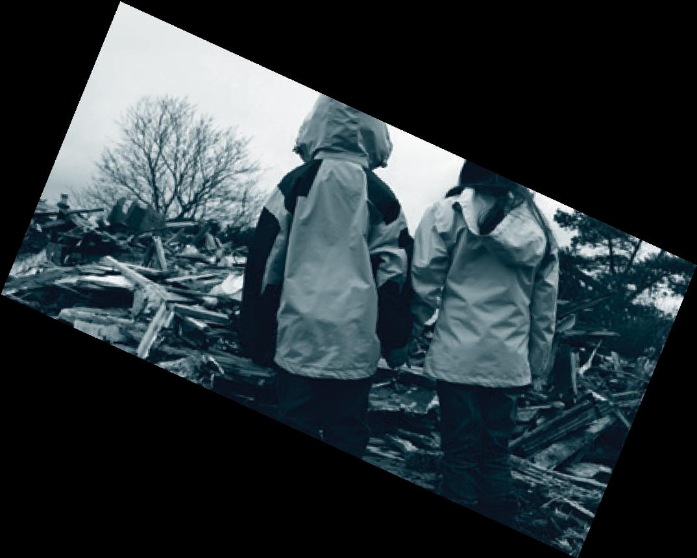

# Australian Disaster Preparedness Framework

> **Source**: Australian Government — Department of Home Affairs / NEMA
> **URL**: https://www.homeaffairs.gov.au/emergency/files/australian-disaster-preparedness-framework.pdf
> **Licence**: CC BY 4.0
> **Retrieved**: 2026-05-07T23:46:39Z
> **SHA-256**: `cc1ca70be3b8c92aa56859ebde2ce6d92acc0c9bc9e82c8c92d3cfbf44954936`
> *Converted from PDF to Markdown format.*

---
## Page 1

Australian Disaster PReparednes Framework 
AUSTRALIAN DISASTER 
PREPAREDNESS FRAMEWORK 
A guideline to develop the capabilities required 
to manage severe to catastrophic disasters 
OCTOBER 2018

---
## Page 2

---
## Page 3

 
Australian Disaster Preparedness Framework 
4 Foreword 
5 Introduction 
5 What is a Severe to Catastrophic Disaster? 
5 The Purpose of this Document 
6 What is the Australian Disaster Preparedness Framework? 
6 What the Framework is Not 
6 How will the Framework be Governed? 
7 Framework Goals 
8 Capability and Capacity 
10 National Capability Requirements 
14 National Preparedness Principles 
15 Australian Disaster Preparedness Framework Components 
16 Establish Effective Governance, Roles & Responsibilities 
17 Understand Risk & Consequence 
18 Understand Capability Requirements 
19 Enhance & Develop Capabilities 
20 Foster Partnerships 
21 Plan & Coordinate Capabilities & Partnerships 
22 Inform Policy, Investment & Expectations 
23 Continuous Improvement 
23 Building and Sustaining Capability 
24 How to Use the Framework 
25 Maturity Levels Table of contents

---
## Page 4

Foreword 
4 - Australian Disaster Preparedness Framework 
 
 
 
 
Natural hazards are a fact of life in Australia—every year, bushfires, floods, cyclones and storms devastate our communities. The 
intensification of hazards, the growing vulnerability of the population and the interconnectedness and interdependence of our 
systems have the potential to result in national and systemic disaster outcomes. The task of preventing these outcomes is becoming 
more complex and it is widely accepted that no one jurisdiction, agency or organisation has the knowledge or capacity to do this 
alone. 
The need to scale up, integrating capability and extending preparedness beyond traditional boundaries is growing in importance and 
urgency. Further, understanding core capabilities necessary to manage risks associated with any hazard is an essential element of a 
disaster risk reduction and resilience system. 
While Australia has an excellent baseline of standing capabilities, these are not nationally integrated to enable a holistic, national 
response to large-scale, multi-jurisdictional severe to catastrophic events. 
Preparedness and disaster risk reduction is a shared, though not equal, responsibility in which all sectors of society need to be 
involved. 
The Australian public rightly expects that severe to catastrophic disasters will be dealt with effectively to minimise loss of life and 
property and ensure that recovery can occur as quickly as possible. This requires a mechanism that enables the holistic 
consideration of national capability. 
The Australian Disaster Preparedness Framework (the Framework) will support Australia to develop the required capability to 
effectively prepare for and manage severe to catastrophic disasters. Such disasters could be the result of a single event or the 
cumulative effect of a number of events. Severe to catastrophic disasters do not accord to jurisdictional boundaries and, because of 
their scale and consequences, require the ability to draw on capabilities that exist, with governments, private sector, and 
communities nationally and with governments or the private sector internationally. 
The collaborative development of this Framework recognised the work being undertaken in all jurisdictions and incorporates current 
thinking and common approaches to emergency management. 
The framework is a key contributor and enabler to national preparedness for severe to catastrophic disasters. 
 
 
 
Names of signatries 
 
 
 
 
Co–Chairs Australia-New Zealand Emergency Management Committee SignatureSignature

---
## Page 5

Introduction 
Australian Disaster Preparedness Framework - 5 
 
 
 
 
 
 
The Australian Disaster Preparedness Framework (the 
Framework) will support Australia to develop the required 
capability to effectively prepare for and manage severe to 
catastrophic disasters. Such disasters could be the result 
of a single event or the cumulative effect of a number of 
events. Severe to catastrophic disasters do not accord to 
jurisdictional boundaries and, because of their scale and 
consequences, require the ability to draw on capabilities that 
exist nationally and internationally. These capabilities are not 
necessarily confined to those owned by governments and 
include capabilities that could be drawn from the private, non- 
government and community sectors. 
 
The Australian public rightly expects that severe to 
catastrophic disasters will be dealt with effectively to minimise 
loss of life and property and ensure that recovery can occur 
as quickly as possible. This requires a mechanism that 
enables the holistic consideration of national capability. 
The need for such a mechanism was identified as the first 
action item in A Capability Roadmap: Enhancing Emergency 
Management in Australia 2016 (the Capability Roadmap). 
 
The development of this Framework recognises the 
work being undertaken in all jurisdictions and seeks to 
incorporate current thinking and common approaches to 
emergency management. The Framework also addresses the 
requirements set out in the Sendai Framework for Disaster 
Risk Reduction 2015-2030 to build Australia’s resilience, 
preparedness and management of severe to catastrophic 
disasters; and is designed to complement the National 
Strategy for Disaster Resilience by providing guidance on 
understanding risk, partnering with those who effect change, 
and supporting capabilities to ensure preparedness. The 
Framework is also an enabler of the National Risk Reduction 
Framework (under development). 
 
The Framework provides guidance to all jurisdictions 
in understanding, developing and enhancing capability 
requirements to prepare for, manage and recover from 
severe to catastrophic disasters. Together, the capabilities of 
each jurisdiction make up Australia’s national capability for 
disaster preparedness. A holistic understanding of existing 
capabilities, gaps and partnerships provides a national picture 
of the capability requirements to be prepared for severe to 
catastrophic disasters. 
 
 
 
 
 
 
 
 
 
 
 
 
 
 
 
 
 
 
 
 
 
THE PURPOSE OF THIS DOCUMENT 
 
This document describes the Australian Disaster 
Preparedness Framework and its seven components. It 
outlines the principles that underpin national preparedness 
and defines what constitutes preparedness capabilities 
for severe to catastrophic for disasters. Importantly, the 
document provides guidelines that can be used by all 
jurisdictions1 to inform the development of capability across 
Australia to prepare for and manage2 severe to catastrophic 
disasters. 
 
 
 
 
 
 
 
 
 
 
1 For the purpose of this document, jurisdictions refer to all Australian 
states and territories as well as the Commonwealth, unless stated 
otherwise. 
2 Management of severe to catastrophic disasters is across the continuum 
of prevention, preparedness, response and recovery. 
WHAT IS A SEVERE TO 
CATASTROPHIC DISASTER? 
The Framework uses the following definition of a 
catastrophic disaster. 
A catastrophic disaster is what is beyond our 
current arrangements, thinking, experience 
and imagination (i.e. that has overwhelmed 
our technical, non-technical and social 
systems and resources, and has degraded or 
disabled governance structures and strategic 
and operational decision-making functions). 
– Emergency Management Australia 
It should be noted that severe to catastrophic disasters 
differ from emergencies in that they exceed business as 
usual emergency management systems and capability 
design parameters.

---
## Page 6

6 - Australian Disaster Preparedness Framework 
 
 
 
 
 
 
 
 
 
 
 
 
 
 
 
 
 
 
 
WHAT IS 
THE AUSTRALIAN 
DISASTER PREPAREDNESS 
FRAMEWORK? 
The Australian Disaster Preparedness Framework informs 
the strategic governance, policy and investment required 
for disaster preparedness. The Framework is a dynamic 
mechanism by which all jurisdictions collectively prepare 
for severe to catastrophic disasters. It incorporates 
consideration of risk and consequence, and new and 
emerging ideas and technologies, to inform the strategic 
capability requirements and arrangements across 
governments and the private, non-government community 
and international sectors. 
 
 
 
WHAT THE FRAMEWORK IS NOT 
 
The Framework is not an assessment mechanism by which 
jurisdictions will be held to account. Rather it provides a 
collaborative mechanism to ensure the capabilities required 
to respond to severe to catastrophic disasters are well 
understood and can be developed and/or accessed to 
provide Australia the ability to manage such disasters. 
The Framework is not intended to mandate a specific 
approach to developing capability. It provides a guide that 
may be useful for jurisdictions to consider as they develop 
their capability to effectively prevent, plan, respond and 
recover from disasters. 
 
The Framework does not focus on disasters or emergencies 
that fall below the threshold of a severe to catastrophic 
disaster. The Framework acknowledges the responsibility of 
all jurisdictions to deal with disasters or emergencies within 
their existing arrangements. The focus of the Framework 
is to ensure the capabilities required to manage severe 
to catastrophic disasters are identified and to promote 
collaboration to fill any existing gaps. 
HOW WILL THE FRAMEWORK BE 
GOVERNED? 
 
This Framework will be governed through the Australia-New 
Zealand Emergency Management Committee (ANZEMC). 
ANZEMC will determine its application, utility, implementation 
and evaluation in the national context to ensure the 
continuous improvement of the Framework. 
 
Based on ANZEMC determinations, agreement and guidance, 
each jurisdiction will determine how it will apply or utilise the 
Framework. It is not intended that jurisdictions must adopt the 
Framework in its entirety but utilise the guidance it provides 
and align their respective approaches and frameworks for 
consistency and commonality to the Australian Framework.

---
## Page 7

Australian Disaster Preparedness Framework - 7 
 
 
Provide Australia with a mechanism to effectively articulate its preparedness and capability 
requirements to prevent, plan for, respond to and recover from severe to catastrophic 
disasters. 
Use the current work undertaken in Australia and incorporate international best practice 
approaches to build an appropriate level of capability across Australia to manage severe 
to catastrophic disasters. 
Provide a method by which all jurisdictions across Australia can understand, assess 
and begin to develop the capabilities required to deal with a severe to catastrophic 
disaster. 
Provide a mechanism to determine what capabilities meet national priorities 
and thresholds, and how they may be enhanced, developed, accessed and 
sustained to deal with severe to catastrophic disasters. 
 
 
 
 
 
 
 
 
 
 
 
 
 
 
 
 
FRAMEWORK GOALS

---
## Page 8

8 - Australian Disaster Preparedness Framework 
 
 Image peopleImages for Resources, Governance and systems
 
 
 
 
 
 
Capability and Capacity 
 
 
 
Capability is the collective ability and power to deliver and sustain an effect within a specific context and timeframe. Capacity 
is the key determinant of how long a capability can be sustained for at a particular level of ability. The level of capability is 
determined by the combination of ability and capacity across the following core elements3: 
 
 
 
All personnel involved in undertaking emergency management activities including community, all levels 
of government, non-government organisations, agencies, business and volunteers. 
 
 
People 
Includes people with appropriate knowledge and skills with a focus on leadership skills, technical skills 
and a culture of working as one. 
 
 
 
 
 
Resources 
The physical equipment and assets needed to undertake emergency management activities. For 
example, infrastructure, fleet, IT equipment, radios, communications equipment, consumables and 
personal protective clothing, equipment and lifecycle management. 
 
 
 
 
 
 
Governance4 
 
The enabling factors that emergency management operates within including legislation, funding, 
authorising environment, emergency management arrangements, doctrine and policy. 
 
 
 
 
 
 
 
Systems 
The systems, including data, that are used to deliver emergency management outcomes such as 
learning and development, information technology, financial, infrastructure and assets management, 
workforce management, workplace health and safety, quality control and incident management 
systems (such as AIIMS and ICCS+). 
 
 
 
 
 
 
Processes 
Documented or undocumented ways of delivering emergency management such as capacity 
planning, risk management, continuous improvement, information flow and planning. 
 
 
 
These core elements can be viewed as inputs which, when combined, deliver a specific capability to a particular level of ability 
and capacity.

---
## Page 9

Australian Disaster Preparedness Framework - 9 
 
 
 
 
 
 
 
 
 
 
 
 
 
 
3 The elements as agreed to by all jurisdictions are drawn from the Emergency Management Victoria, Victorian Preparedness Framework, May 2018. 
4 Governance in this context is a core element of capability (i.e. a key input to be considered in generating and maintaining a specific capability).

---
## Page 10

10 - Australian Disaster Preparedness Framework 
 
 
 
 
 
 
 
 
 
 
 
 
 
 
 
 
 
A national disaster 
preparedness capability 
is the collective ability 
of governments, 
the community, 
non-government 
organisations, theprivate 
sector and international 
support to manage the 
risks and address the 
consequences of a 
severe to catastrophic 
disaster.

---
## Page 11

Australian Disaster Preparedness Framework - 11 
 
 
 
 
 
 
 
National Capability 
Requirements 
 
 
 
 
 
The development of the 2016 National Capability Roadmap identified a set of National Capabilities for consideration and further 
development. These National Capabilities were identified using a range of severe to catastrophic disaster scenarios to assess 
their impacts on society’s needs. These National Capabilities provide a foundation to progress the collective understanding of 
what is needed for our nation to be better prepared to deal with severe to catastrophic disasters. 
 
To further progress the collective understanding of these capabilities, previously agreed definitions have been taken from the 
Capability Roadmap, AIDR Disaster Recovery Handbook and the Victorian Preparedness Framework. 
 
Further refinement of this work has continued resulting in National Capabilities as outlined and defined below. These provide a 
useful starting point for the application of the Framework. The definitions are as follows:

---
## Page 12

---
## Page 13

Australian Disaster Preparedness Framework - 11 
 
 
 
 
 
 
 
Evacuation and Support 
Intelligence and 
Situational Awareness 
 
The ability to move and support 
high volumes of displaced or at- 
risk persons (applying a gender 
and child-specific lens), through 
facilitation of mass movement and/ 
or evacuation. Provision of essential 
needs include: 
+ food, water, shelter, sanitation, 
clothing 
+ facilitation of mass care 
+ re-establishment of community 
links (such as through 
community meetings, or through 
technological means) 
+ empowerment for reinstatement 
of livelihoods to ‘business-as- 
unusual’ 
+ enablement of self-care where 
possible. 
The ability to combine situational 
awareness inputs from all sources 
with predictive analysis of 
consequence, risk, capability and 
capacity. Raw information must be 
translatable into intelligence products 
accessible and appropriate for the 
needs of stakeholders and decision 
makers at all levels. This includes the 
mechanisms for timely information 
broadcast and transfer (such 
as operational communications 
and public information broadcast 
systems), and systems of data 
interpretation (including geospatial 
information systems and electronic 
common operating picture 
applications). 
Mass Care 
The ability to meet essential needs 
and provide care to high volumes of 
affected citizens, both in and away 
from impacted areas. This includes 
– but is not limited to – health, 
psychological, aged, pharmaceutical 
and disability care. 
 
Built Environment and 
Infrastructure Recovery 
 
 
The ability to restore and stabilise 
residential and rural properties, 
critical infrastructure, utilities and 
services including but not limited to: 
+ reconstruction or repair of 
residential or rural properties 
+ maintaining business-as-usual 
activities in non-affected areas 
+ enabling effective response and 
recovery efforts 
+ restoring business-as-usual 
services to affected areas. 
This includes utilities (such as 
electricity, water,sanitation), services 
(such as telecommunication, public 
transport) and other infrastructure 
(such as roads, ports and rail 
networks). 
Logistics and Supply 
Chain Management 
Responder Protection 
and Sustainment 
The ability to establish, sustain 
and adapt an appropriate supply 
chain to support response, 
recovery, evacuation and other 
efforts during catastrophic events 
is critical. This includes the delivery 
of essential services (food, water, 
sanitation, banking/money), 
materials and equipment, as well 
as the establishment of emergency 
power, telecommunications and fuel 
support. 
The ability to maintain the ongoing 
health, safety and logistical 
sustainment of responders working 
to mitigate or recover from the 
impacts of a disaster.

---
## Page 14

12 - Australian Disaster Preparedness Framework 
 
 
 
 
 
 
 
 
 
 
 
 
 
 
 
 
 
 
Economic Recovery 
The ability to return economic 
and business activities (including 
food and agriculture) to a healthy 
state and restore livelihoods, 
businesses, tourism, productive 
land, development of business and 
employment opportunities that result 
in a sustainable and economically 
viable community. 
Social Recovery
The ability to provide assistance 
and access to services that allows
individuals, families and communities 
to achieve an effective level of 
functioning after an emergency 
event. This includes safety, security, 
shelter, health and psychosocial 
wellbeing and re-establishment of 
those elements of society necessary 
for well-being. There should be 
a specific focus on gender and 
children needs.

---
## Page 15

Australian Disaster Preparedness Framework - 13 
 
 
 
 
 
 
 
The utility of the Framework is that it provides an ongoing mechanism to review and update the National Capabilities required to 
deal with severe to catastrophic disasters. This is outlined in the last section ‘How to Use the Framework’. 
Community Planning, Capacity 
and Resilience Building 
The ability to collaboratively plan for response and recovery 
through partnering with the community, and building capacity 
for local plan implementation and recovery management. It 
encompasses empowerment of local leaders and stakeholders 
to improve recovery and resilience outcomes for individuals and 
the communities. This includes public participation technologies, 
program support and funding for planning and capacity building

---
## Page 16

14 - Australian Disaster Preparedness Framework 
 
 
 
 
 
 
 
National Preparedness 
Principles 
 
 
 
 
 
 
 
The following are principles for national preparedness for severe to catastrophic disasters. These principles therefore underpin 
the Australian Disaster Preparedness Framework in determining the characteristics of severe to catastrophic disaster 
preparedness capabilities. 
 
 
 
National preparedness can be applied to any and all hazards. 
 
 
 
National preparedness takes a truly national approach that is not restricted by state and 
territory boundaries. This principle is not limited to the emergency services and seeks to include 
a range of other stakeholders such as government agencies, the community, non-government 
organisations, private sector and volunteers. 
 
 
 
Experience shows that severe and catastrophic disasters can require an international response 
to help manage the scale. National preparedness includes linkages to foreign governments, 
international agencies and international non-government organisations. 
 
 
 
National preparedness is easy to understand, communicate and apply. 
 
 
 
 
National preparedness is applicable at all levels. It can expand and contract to deal with the 
complexity of any particular disaster. 
 
 
 
National preparedness is able to adapt to changes in the nature of severe to catastrophic 
disasters and to the context in which it is applied. 
 
 
 
National preparedness focuses on delivering effects. These effects are pre-determined 
outcomes which are the result of planning, coordinated execution and continual assessment. 
 
 
 
National preparedness will assist Australia and all jurisdictions to improve the timeliness and 
efficiency of the management of severe to catastrophic disasters across the continuum of 
prevention, preparedness, response and recovery. 
All-hazard 
Borderless 
Globally Linked, 
Locally Enabled 
Simple 
Agile & Scalable 
Adaptable 
Outcomes Based 
Timely

---
## Page 17

Australian Disaster Preparedness Framework - 15 
 
 
 
 
 
 
 
Australian DisasterPreparedness 
Framework Components 
 
 
 
 
 
The Australian Disaster Preparedness Framework (Figure 1) depicts the ongoing process that ensures Australia can effectively 
prepare for and manage severe to catastrophic disasters. As such, the Framework is dynamic and seeks to continually improve 
our national capabilities to ensure a prepared Australia. 
 
 
 
Figure 1 – National Disaster Preparedness Framework 
 
Each of the Framework’s seven components is underpinned by the National Preparedness Principles thus ensuring a truly 
national perspective is maintained. The following sections describe each component and provide guidance on the key 
considerations for that component to be effectively applied. 
RESPONSIBILITIES 
CONSEQUENCES 
EXPECTATIONS 
REQUIREMENTS 
PREPARED 
AUSTRALIA 
CAPABILITIES & 
CAPABILITIES 
PARTNERSHIPS

---
## Page 18

16 - Australian Disaster Preparedness Framework 
 
 
 
ESTABLISH EFFECTIVE GOVERNANCE 5, ROLES & RESPONSIBILITIES 
 
Description 
 
This component encompasses the establishment of effective 
governance, roles and responsibilities for the preparation and 
management of severe to catastrophic disasters. It is crucial 
that functional governance structures, including agreements 
and statements of expectations, are in place between all 
parties. This allows for the timely and effective management 
of a severe to catastrophic disaster. Specifically, the ability 
to reinforce governance structures and allow for streamlined 
decision-making processes to ensure decisions reach the 
ultimate authority as directly as possible, without interfering 
with the ability of local groups to take independent action as 
and where required. 
Key Considerations 
 
• Understand and apply the concept of ‘supported’ and 
‘supporting’6 organisations for severe to catastrophic 
disasters 
 
• Establish formal agreements that outline governance 
arrangements, roles and responsibilities as they relate 
to severe to catastrophic disasters 
 
• Develop a shared understanding of all roles and 
responsibilities within an organisation and between 
government, non-government, private sector and 
community sector organisations and individuals that 
contribute to the preparation for and management of a 
severe to catastrophic event 
 
• Articulate and communicate the roles and 
responsibilities and expectations of organisations and 
key personnel 
 
• Establish, communicate and practice lines of 
communication to ensure effective governance. 
 
 
 
 
 
 
 
 
 
 
 
 
 
 
 
 
 
 
 
 
 
 
 
5 Governance in this context refers to the governance component of the Australian Disaster Preparedness Framework, which is different to the context of 
governance as a core element of capability (i.e. a key input to be considered in generating and maintaining a specific capability). 
6 ‘Supported’ refers to the entity/organisation receiving assistance. ‘Supporting’ refers to the entity/organisation providing the assistance.

---
## Page 19

Australian Disaster Preparedness Framework - 17 
 
 
 
UNDERSTAND RISK & CONSEQUENCE 
 
Description 
 
This component emphasises the need to thoroughly 
analyse the risks of a severe to catastrophic disaster and 
its consequences. When considering risk in the context of 
this Framework, the focus should be on the consequence 
of the disaster. When preparing for and managing severe to 
catastrophic disasters the consequences of these events 
are likely to be of a scale that they must be planned for 
proactively. This ensures effective coordination across the 
many stakeholders that will contribute to preventing, planning 
for, responding to and or recovering from the severe to 
catastrophic disaster. 
 
Understanding disaster risk, including policies and practices, 
should be based on all dimensions of vulnerability, capacity, 
exposure of persons and assets, hazard characteristics 
and the environment. This understanding is useful for pre- 
disaster risk assessment, for prevention and mitigation and 
for the development and implementation of appropriate 
preparedness and effective response to, and recovery from, 
disasters. 
Key Considerations 
 
• Take an all-hazards view – including severe to 
catastrophic natural and manmade disasters, terrorism, 
cyber-attacks, etc. 
 
• Understand the continuum of risks associated with a 
severe to catastrophic disaster – i.e. before, during and 
after an event 
 
• Utilise current and future state scenario analysis to 
understand risk 
 
• Understand the environment and context when 
determining consequences – e.g. geographic, climatic, 
social, political, demographic, community 
 
• Identify interdependencies e.g. power interruption will 
impact transport, communications, hospitals, water 
supply, etc. 
 
• Identify who and what will be impacted, and for how 
long, by the occurrence of a severe to catastrophic 
disaster – through methods such as forecasting and 
scenario testing 
 
• Identify both preventative and mitigating controls to 
manage risks 
 
• Understand how to develop and implement effective 
preventative and mitigating controls 
 
• Understand the potential for cascading of events, and 
the subsequent generation of second and third order 
consequence(s) 
 
• Utilise existing risk documentation that is fit for 
purpose, including State Risk Assessments.

---
## Page 20

18 - Australian Disaster Preparedness Framework 
 
 
 
UNDERSTAND CAPABILITY REQUIREMENTS 
 
Description 
 
This component emphasises the importance of 
understanding the capability requirements to effectively 
prepare for and manage severe to catastrophic disasters. It 
emphasises the importance of simulation and exercising to 
consider the capabilities required in terms of both the level 
of capability to effectively deal with the task at hand, and the 
capacity required to sustain this level of capability over an 
identified time. It requires a holistic consideration of possible 
events (linked to the understanding of risk and consequences) 
to identify common capabilities and those that may be 
unique to one or a small number of events. Additionally, 
this component needs to commence the identification of 
which organisations have the capabilities required – other 
governments, non-government organisations, the private 
sector, communities and international partners. 
Key Considerations 
 
• Utilise scenarios, experimentation, forecasting and 
simulation to understand capability requirements 
 
• Identify common capabilities that are required to 
prevent and/or manage severe to catastrophic 
disasters 
 
• Identify unique capabilities that are required to prevent 
and/or manage severe to catastrophic disasters 
 
• Identify the amount of capability required to ensure it 
can be effectively applied and sustained 
 
• Identify where required capabilities that prevent and/ 
or manage severe to catastrophic disasters exist (i.e. 
government, community, non-government, private 
sector, international) 
 
• Note that it is not financially feasible or possible to 
maintain capabilities that prevent and/or manage all 
severe to catastrophic disasters 
 
• Note that effective capability leverages the collective 
ability of others (i.e. government, community, non- 
government, private sector, international) 
 
• Understand a capability is made up from a mixture of 
the core elements of capability 
 
• Identify the capability threshold.

---
## Page 21

Australian Disaster Preparedness Framework - 19 
 
 
 
ENHANCE & DEVELOP CAPABILITIES 
 
Description 
 
This component advances the understanding of capability 
requirements, in order to prepare for and manage severe 
to catastrophic disasters. Enhancing a particular capability 
requires an analysis of the core elements of capability, the 
potential sources of that capability, what capacity there is to 
sustain that capability and how effectively that capability can 
be maintained over an identified time. 
Key Considerations 
 
• Understand the mix of core elements of capability 
required to generate the desired capability 
 
• Understand the capacity requirements to ensure the 
required capability can be sustained for the identified 
time period required 
 
• Look to generate capability found in the private sector 
and the community at large 
 
• Consider the whole of life implications of a capability 
 
• Note that development of capability will take time 
 
• Note that capability will not be effective unless it is 
periodically practiced.

---
## Page 22

20 - Australian Disaster Preparedness Framework 
 
 
 
FOSTER PARTNERSHIPS 
 
Description 
 
This component ensures a focus on fostering partnerships 
to prepare for and manage severe to catastrophic 
disasters. It is not financially feasible to maintain a full 
suite of capabilities that address all possible severe to 
catastrophic disasters. Partnerships must therefore be 
an integral part of national disaster preparedness. At the 
most fundamental level, partnerships will occur across 
government organisations within the state/territory and also 
more broadly with other jurisdictions. Arguably though, the 
most critical partnership is that with the community, through 
establishing a sense of shared responsibility in dealing with 
any severe to catastrophic disaster. Likewise, partnerships 
with international, non-government and private sector 
organisations will be key. 
Key Considerations 
 
• Understand that partnerships are borderless and 
extend to international partners, across Australian 
governments, the non-government and private sectors 
and with community groups 
 
• Identify where and what potential partners contribute 
to the prevention and management of severe to 
catastrophic disasters 
 
• Note that partnerships can assist organisations to 
achieve their mission (working within their framework of 
values) 
 
• Note that the community themselves has a crucial 
role to play, and, if appropriately supported, engaged 
and empowered, will take on particular responsibility 
in preparing for and managing severe to catastrophic 
disasters 
 
• Understand that effective partnerships must be 
established and cultivated over time 
 
• Note that effective partnerships need to be beneficial to 
all involved 
 
• Fostering partnerships allows organisations to reduce 
gaps in capability 
 
• Note that established partnerships must be 
communicated and understood by the community and 
all involved 
 
• Understand the resource implications for developing 
and maintaining effective partnerships.

---
## Page 23

Australian Disaster Preparedness Framework - 21 
 
 
 
PLAN & COORDINATE CAPABILITIES & PARTNERSHIPS 
 
Description 
 
This component emphasises the need to properly plan and 
coordinate capabilities among partnerships to prepare for 
and manage severe to catastrophic disasters. Effective and 
efficient management of severe to catastrophic disasters 
requires more than just responding when an event occurs. 
Much of the effort involves collaboratively undertaking 
activities to identify, analyse and assess the need for action to 
protect communities from risks before a disaster occurs. The 
importance of planning and coordinating the availability and 
use of capabilities among partnerships is crucial to effective 
preparedness and management of, and recovery from, severe 
to catastrophic disasters when they occur. 
Key Considerations 
 
• Ensure communities are at the heart of planning and 
coordinating capabilities and partnerships to prepare 
for and manage severe to catastrophic disasters 
 
• Ensure communities are aware of their role in sharing 
responsibility for the preparation for and management 
of severe to catastrophic disasters 
 
• Ensure all parties understand the nature and 
expectations of a partnership for specific severe 
to catastrophic disasters 
 
• Formalise partnerships through Memoranda of 
Understanding, agreements and/or plans 
 
• Ensure all parties fully understand each other’s 
capabilities and capability gaps as they relate to 
preparing for and managing specific severe to 
catastrophic disasters 
 
• Ensure all parties understand the governance 
arrangements that are in place and how these will 
operate during a specific severe to catastrophic 
disaster 
 
• Ensure all parties understand the importance of 
planning and what this entails 
 
• Ensure the planning process involves all parties 
including partners to enhance mutual understanding 
and ownership of what the arrangements willbe 
 
• Practice the implementation of plans through 
simulations and exercises to build confidence in 
partners and the arrangements 
 
• Ensure plans are periodically revisited and updated 
 
• Note that partnerships allow organisations to leverage 
a wider range of expertise.

---
## Page 24

22 - Australian Disaster Preparedness Framework 
 
 
 
INFORM POLICY, INVESTMENT & EXPECTATIONS 
 
Description 
 
The application of the Guideline components will allow all 
jurisdictions to understand the current levels of preparedness 
for dealing with severe to catastrophic disasters. This informs 
investment, policy making and setting of expectations 
that allows for better outcomes and improved capability.  
This is particularly important to ensure the best return on 
investment of the public dollar and to clarify investment by 
partners to build improved interoperability and standardisation 
of approaches to preparing for and managing severe to 
catastrophic disasters. 
Key Considerations 
 
• Identify gaps in capability and capacity particularly to 
understand points at which these will be overwhelmed 
 
• Share identified gaps in capability and capacity with 
all parties (i.e. government, non-government, private 
sector, communities and international partners) 
 
• Carefully consider and assess the impact of investment 
decisions, changes to policy and changes to 
expectations 
 
• Share changes and the impacts of investment 
decisions, changes to policy and changes to 
expectations 
 
• Note the value of coordinating investment and policy 
decisions to generate a better overall outcome 
 
• Understand that informing investment includes 
reinvesting or repurposing current capabilities 
 
• Consider other resources e.g. the National Risk 
Reduction Framework.

---
## Page 25

Australian Disaster Preparedness Framework - 23 
 
 
 
CONTINUOUS IMPROVEMENT 
 
Description 
 
Continuous Improvement ensures that the impact and 
effectiveness of each of the Framework’s components 
are regularly measured, reviewed and evaluated against past 
performance and future needs. This ensures the Framework 
provides a mechanism to continually build capability maturity 
and also allows jurisdictions to adapt to the changing 
requirements of managing severe to catastrophic disasters. 
 
 
 
 
 
 
 
 
 
 
 
 
 
 
 
 
 
 
BUILDING AND SUSTAINING CAPABILITY 
 
Description 
 
Four of the Framework’s components are core elements 
of building and sustaining capability. These components 
inform what needs to be built, sustained, enhanced and 
or re-purposed to provide access to capability. They also 
inform what other arrangements and partnerships need to be 
established to provide access to capabilities and meet the 
agreed requirements. 
Key Considerations 
 
• Develop clearly articulated measures and targets 
to assess, track and manage performance 
 
• Understand the sources of, and establish the 
mechanisms for accessing, the data and information 
that informs reporting and continuous improvement 
 
• Ensure continual review and evaluation ofperformance 
 
• Identify what the intended results or desired outcomes 
of the activities being undertaken are 
 
• Utilise simulation, experimentation and exercises to 
understanding the effectiveness of the Framework and 
its components. 
 
 
 
Key Considerations 
 
Build and sustain national capability and capacity 
 
• What level of capability and capacity is required? 
 
• Who has the capability required? 
 
• What is the gap in capability and capacity between 
what exists and what is required? 
 
• Where else might the capability be available? 
 
• Where can partnerships be established to access the 
capability?

---
## Page 26

24 - Australian Disaster Preparedness Framework 
 
 
ESTABLISH EFFECTIVE GOVERNANCE, ROLES & RESPONSIBILITIES 
 
 
 
 
 
How to Use 
The Framework 
 
The Framework will be used to build Australia’s national disaster preparedness by undertaking an assessment at both a 
jurisdictional and national level as illustrated in Figure 2. 
 
 
 
 
Scenario 
Analysis 
Risks Assessments 
 
 
 
 
 
 
 
 
 
 
 
 
 
 
 
 
 
 
 
 
 
 
 
 
 
 
 
 
 
 
 
 
 
 
 
 
 
 
 
 
 
 
 
 
 
 
 
 
 
 
 
 
 
 
 
 
 
 
 
 
 
Figure 2 - Application of the Australian Disaster Preparedness Framework 
JURISDICTION 
IMPLEMENTATION 
Build and Sustain 
Capabilities & Capacity 
National 
Threshold 
& Priorities 
Enhance & Develop 
Capabilities 
Foster Partnerships 
Other States & Territories 
Commonwealth Government 
Private Sector 
International 
Plan & Coordinate 
Capabilities & Partnerships 
Inform Policy, Investment 
& Expectations 
Test 
Disaster Scenarios 
Severe to Catastrophic 
Jurisdicction 
Capability Requirements 
Assess Available 
Capability & Capacity 
Available Jurisdiction 
Capability & Capacity 
Jurisdiction 
Capability & Capacity Gaps 
Jurisdiction 
determines the capability 
requirements based on 
their respective 
Determine the gaps in 
national capability and 
what is required tomeet 
national thresholds and priorities 
Determine where capability exists 
to meet national capability gaps 
Private Sector 
Non-government Organisations 
Community 
International 
Enhance, develop, build and sustain 
capability and capacity 
Jurisdiction 
establishes a preparedness 
by/with the Australian Disaster 
Preparedness Framework 
INCREASING LEVEL OF MATURITY

---
## Page 27

Australian Disaster Preparedness Framework - 25 
 
 
 
 
 
 
 
 
 
 
 
 
 
The Framework informs thinking about national preparedness levels and the associated capability and capacity requirements 
from both a national and jurisdictional perspective. As such, it assists all jurisdictions to understand extant capability levels and 
gaps in ensuring effective preparation for, and management of, severe to catastrophic disasters. Governance will be key to 
avoiding duplication and addressing gaps in a coherent way. 
 
Identify national capability and capacity requirements by understanding risk and consequence 
 
Consideration of national preparedness levels for severe to catastrophic disasters commences through scenario testing. 
Scenario testing needs to encompass the full breadth of potential events and also to stress test extant capability arrangements 
to breaking point. Specific scenarios to be tested will be informed by previous work, such as the 2016 Capability Roadmap, 
and from jurisdictional inputs such as state and territory risk assessments. The key outputs from scenario testing are a set of 
national capability requirements and thresholds for activation. 
 
Understanding national capability requirements allows an informed assessment to be undertaken of available capability and 
capacity, from which gaps can be identified at both a national and jurisdictional level. This information is then used to inform 
decisions about building and sustaining national capabilities and capacity. 
 
 
 
Jurisdictions can use national capability and capacity assessments in their own consideration of capability development 
priorities and investment. Building and sustaining national capability and capacity will involve: 
• the enhancement and development of identified capabilities 
• fostering of partnerships 
• planning and coordination of capabilities and partnerships 
• informing policy, investment and expectations. 
 
Decisions made by a jurisdiction will feed back to the national level as capability and capacity updates. 
 
Govern national capability and capacity to ensure Australia’s national disaster preparedness 
 
Most importantly, the Framework provides the strategic alignment between identified national capability requirements and the 
building and sustainment of the capability and capacity to ensure Australia’s national disaster preparedness. This is achieved 
through the implementation of effective governance, roles and responsibilities across all jurisdictions including the articulation of 
criteria for success and establishment of performance expectations. 
 
MATURITY LEVELS 
The application of this Framework provides jurisdictions an ability to understand their current capability maturity level in relation 
to severe to catastrophic disasters. This encompasses an understanding of what capability currently exists, where there are 
capability gaps and how these capability gaps may be filled. A basic maturity assessment for national preparedness is outlined 
in Figure 2. 
 
Build and sustain national capability and capacity 
What level of capability and capacity is required? 
Who has the capability required? 
What is the gap in capability and capacity between what exists and what is required? 
Where else might the capability be available? 
Where can partnerships be established to access the capability?

---
## Page 28

---
## Page 29

---
## Page 30

 
 Australian Government logo

