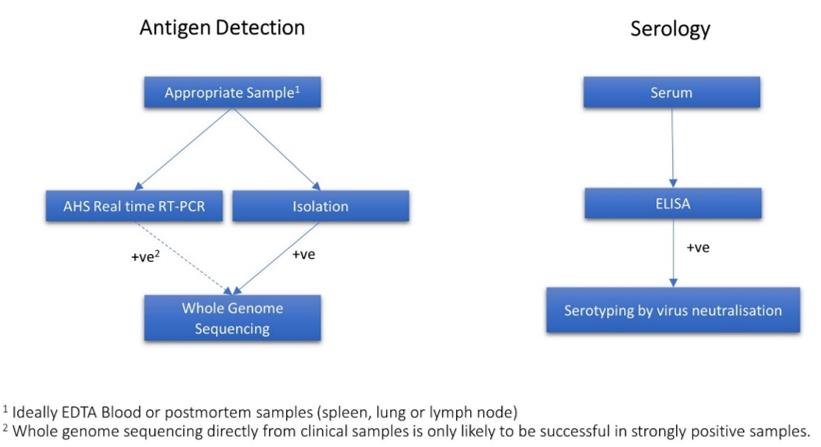

# AUSVETPLAN — African Horse Sickness Response Manual (2022)

> **Source**: Animal Health Australia
> **URL**: https://animalhealthaustralia.com.au//wp-content/uploads/2022/11/AUSVETPLAN-Manuals_Response_African-horse-sickness_.pdf
> **Licence**: Crown / publisher copyright; practitioner reference
> **Retrieved**: 2026-05-07T23:48:00Z
> **SHA-256**: `a9aaceb6b843e95018c7037f19003eb3249a72a192131f757f20b045a692e015`
> *Converted from PDF to Markdown format.*

---
## Page 1

 
 
AUSTRALIAN VETERINARY EMERGENCY PLAN 
 
AUSVETPLAN 
 
Response strategy  
African horse sickness 
Version 5.0 
 
 
 
 
 
 
 
AUSVETPLAN is a series of technical response plans that describe the 
proposed Australian approach to an emergency animal disease incident. 
The documents provide guidance based on sound analysis, linking policy, 
strategies, implementation, coordination and emergency-management plans. 
National Biosecurity Committee

---
## Page 2

© 1991–2022 Animal Health Australia ABN 86 071 890 956. Certain materials in this publication are 
protected by copyright and are reproduced with permission from the Commonwealth of Australia, 
acting through its Department of Agriculture, Fisheries and Forestry (or any successor agency); each 
state and territory of Australia, as represented by their relevant agencies, and by the National 
Biosecurity Committee and Animal Health Committee; and Animal Health Australia’s industry 
members. 
ISBN 0 642 24506 1 (printed version) 
ISBN 1 876 71438 7 (electronic version) 
Licence  
This work is licensed under the Creative 
Commons Attribution-NonCommercial-
ShareAlike 4.0 International Licence, 
with the exception of: 
• 
any third-party material 
contained within the work 
• 
any material protected by a trademark 
• 
any images and/or photographs. 
To view a copy of this licence, visit http://creativecommons.org/licenses/by-nc-sa/4.0/. 
Moral rights 
The author(s) of this work hold ‘moral rights’ as defined in the Copyright Act 1986 (Cwlth) and assert 
all moral rights in connection with this work. This means you must: 
• 
attribute (give credit to) the author(s) of this work 
• 
not say a person is a creator of a work when they are not 
• 
not do something with the work (such as change or add to it) that would have a negative 
impact on the reputation of the author(s) of this work. 
Failure to do so could constitute a breach of the Copyright Act 1986 (Cwlth). 
Disclaimer and warranty 
• 
This publication has been produced in accordance with the procedures described in the 
AUSVETPLAN Overview, and in consultation with Australian national, state and territory 
governments; the relevant livestock industries; nongovernment agencies; and public health 
authorities, as relevant. Any views and opinions expressed in this document do not 
necessarily represent the views and opinion of the authors or contributors, Animal Health 
Australia or the Commonwealth of Australia. 
• 
This publication is for use in emergency situations. The strategies and policy guidelines in 
this work are not applicable to quarantine policies for imported livestock or livestock 
products. 
• 
This publication is not legal or professional advice and should not be taken as a substitute 
for legal or other professional advice. 
• 
This publication is not intended for use by any person who does not have appropriate 
expertise in the subject matter of the work. Before using this publication, you should read it 
in full, consider its effect and determine whether it is appropriate for your needs. 
• 
This publication was created on 31 October 2022. Laws, practices and regulations may have 
changed since that time. You should make your own inquiries as to the currency of relevant 
laws, practices and regulations, as these may have changed since publication of this work.

---
## Page 3

No warranty is given as to the correctness of the information contained in this work, or of its 
suitability for use by you. To the fullest extent permitted by law, Animal Health Australia is not, and 
the other contributing parties are not, liable for any statement or opinion, or for any error or 
omission contained in this work, and it and they disclaim all warranties with regard to the 
information contained in it, including, without limitation, all implied warranties of merchantability 
and fitness for a particular purpose. Animal Health Australia is not liable for any direct, indirect, 
special or consequential losses or damages of any kind, or loss of profit, loss or corruption of data, 
business interruption or indirect costs, arising out of or in connection with the use of this work or 
the information contained in it, whether such loss or damage arises in contract, negligence, tort, 
under statute, or otherwise. 
Text under development 
In this manual, text placed in square brackets [xxx] indicates that that aspect of the manual remains 
unresolved or is under development; such text is not part of the official manual. The issues will be 
further worked on by experts and relevant text included at a future date. 
Contact information 
If you have any requests or inquiries concerning reproduction and rights, or suggestions or 
recommendations, you should address these to: 
AUSVETPLAN – Animal Health Australia 
Executive Manager, Emergency Preparedness and Response 
PO Box 5116 
Braddon ACT 2612 
Tel: 02 6232 5522 
email: aha@animalhealthaustralia.com.au 
Approved citation 
Animal Health Australia (2022). Response strategy: African horse sickness (version 5.0). Australian 
Veterinary Emergency Plan (AUSVETPLAN), edition 5, Canberra, ACT. 
EMERGENCY ANIMAL DISEASE WATCH HOTLINE: 1800 675 888 
The Emergency Animal Disease Watch Hotline is a toll-free telephone number that connects 
callers to the relevant state or territory officer to report concerns about any potential 
emergency disease situation. Anyone suspecting an emergency disease outbreak should use 
this number to get immediate advice and assistance. 
Publication record 
Edition 1 
1991 
Edition 2 
Version 2.0, 1996 (minor update) 
Edition 5 
Version 5.0, 2022 (major update and new format)

---
## Page 4

---
## Page 5

 
African horse sickness (Version 5.0) 
5 
Contents 
1 
Introduction ................................................................................................................................................... 9 
1.1 
This manual ......................................................................................................................................................... 9 
1.1.1 
Purpose .............................................................................................................................................. 9 
1.1.2 
Scope ................................................................................................................................................... 9 
1.1.3 
Development ................................................................................................................................... 9 
1.2 
Other documentation ................................................................................................................................... 10 
1.3 
Training resources ......................................................................................................................................... 10 
2 
Nature of the disease................................................................................................................................ 11 
2.1 
Aetiology ............................................................................................................................................................ 11 
2.2 
Susceptible species ........................................................................................................................................ 11 
2.2.1 
Zoonotic potential ...................................................................................................................... 11 
2.3 
World distribution ......................................................................................................................................... 12 
2.3.1 
Distribution outside Australia............................................................................................... 12 
2.3.2 
Occurrence in Australia ........................................................................................................... 12 
2.4 
Epidemiology ................................................................................................................................................... 12 
2.4.1 
Incubation period ....................................................................................................................... 12 
2.4.2 
Persistence of agent and modes of transmission .......................................................... 13 
2.4.3 
Factors influencing transmission ........................................................................................ 16 
2.5 
Diagnostic criteria .......................................................................................................................................... 17 
2.5.1 
Clinical signs ................................................................................................................................. 17 
2.5.2 
Pathology ....................................................................................................................................... 18 
2.5.3 
Differential diagnosis ................................................................................................................ 19 
2.5.4 
Laboratory tests .......................................................................................................................... 20 
2.5.5 
Laboratory diagnosis ................................................................................................................ 22 
2.6 
Resistance and immunity ............................................................................................................................ 23 
2.7 
Vaccination ........................................................................................................................................................ 23 
2.8 
Treatment of infected animals .................................................................................................................. 24 
2.9 
Control overseas ............................................................................................................................................. 24 
3 
Implications for Australia ...................................................................................................................... 25 
3.1 
Potential pathways of introduction ........................................................................................................ 25 
3.2 
Social, economic and environmental effects ....................................................................................... 25 
3.3 
Critical factors for an Australian response .......................................................................................... 26 
4 
Policy and rationale ................................................................................................................................. 28 
4.1 
Introduction ...................................................................................................................................................... 28 
4.1.1 
Summary of policy ..................................................................................................................... 28 
4.1.2 
Case definition ............................................................................................................................. 29 
4.1.3 
Cost-sharing arrangement ...................................................................................................... 29 
4.1.4 
Criteria for proof of freedom ................................................................................................. 29 
4.1.5 
Governance.................................................................................................................................... 30 
4.2 
Public health implications .......................................................................................................................... 30 
4.3 
Control and eradication policy ................................................................................................................. 30 
4.3.1 
Epidemiological assessment .................................................................................................. 30 
4.3.2 
Quarantine and movement controls ................................................................................... 31 
4.3.3 
Tracing and surveillance ......................................................................................................... 32

---
## Page 6

 
6 
 
AUSVETPLAN Edition 5 
4.3.4 
Zoning for African horse sickness ....................................................................................... 33 
4.3.5 
Biosafety and biosecurity for personnel ........................................................................... 33 
4.3.6 
Biosecurity for equipment ...................................................................................................... 33 
4.3.7 
Animal welfare ............................................................................................................................. 34 
4.3.8 
Vaccination .................................................................................................................................... 34 
4.3.9 
Treatment of infected animals .............................................................................................. 34 
4.3.10 
Treatment of animal products and byproducts ............................................................. 34 
4.3.11 
Destruction of animals ............................................................................................................. 35 
4.3.12 
Disposal of animals, and animal products and byproducts ...................................... 35 
4.3.13 
Decontamination ........................................................................................................................ 35 
4.3.14 
Wild animal management ....................................................................................................... 35 
4.3.15 
Vector management .................................................................................................................. 35 
4.3.16 
Public awareness and media ................................................................................................. 38 
4.3.17 
Other strategies ........................................................................................................................... 38 
4.3.18 
Stand-down ................................................................................................................................... 38 
4.4 
Other control and eradication options .................................................................................................. 39 
4.5 
Funding and compensation ........................................................................................................................ 39 
5 
Declared areas and premises ................................................................................................................ 40 
5.1 
Declared areas ................................................................................................................................................. 40 
5.1.1 
Restricted area (RA) .................................................................................................................. 41 
5.1.2 
Control area (CA) ........................................................................................................................ 41 
5.2 
Other areas ........................................................................................................................................................ 42 
5.3 
Premises classifications ............................................................................................................................... 42 
5.3.1 
Premises status classifications ............................................................................................. 42 
5.3.2 
Qualifiers ........................................................................................................................................ 42 
5.4 
Reclassifying premises and previously declared areas ................................................................. 43 
5.4.1 
Reclassifying premises ............................................................................................................. 43 
5.4.2 
Reclassifying previously declared areas ........................................................................... 43 
6 
Movement controls ................................................................................................................................... 44 
6.1 
Principles ........................................................................................................................................................... 44 
6.2 
Guidelines for issuing permits .................................................................................................................. 44 
6.3 
Types of permits ............................................................................................................................................. 46 
6.4 
Recommended movement controls........................................................................................................ 47 
6.4.1 
Live susceptible animals .......................................................................................................... 47 
6.4.2 
Carcasses ........................................................................................................................................ 48 
6.4.3 
Semen and embryos from live susceptible animals ..................................................... 48 
6.4.4 
Meat and meat products .......................................................................................................... 48 
6.4.5 
Waste products and effluent .................................................................................................. 48 
6.4.6 
Vehicles, including empty livestock transport vehicles and associated 
equipment ......................................................................................................................................................... 49 
6.4.7 
Nonsusceptible animals ........................................................................................................... 49 
6.4.8 
People .............................................................................................................................................. 49 
6.4.9 
Specimens ...................................................................................................................................... 49 
6.4.10 
Crops, grains, hay, silage and mixed feeds ....................................................................... 49 
6.4.11 
Equipment, including personal items ................................................................................ 49 
6.4.12 
Sales, shows and other events .............................................................................................. 50 
6.4.13 
Stock routes and rights of way .............................................................................................. 50 
6.4.14 
Animal movements for emergency (including welfare) reasons ........................... 50 
7 
Surveillance and proof of freedom ..................................................................................................... 51

---
## Page 7

 
African horse sickness (Version 5.0) 
7 
7.1 
Surveillance ...................................................................................................................................................... 51 
7.1.1 
Specific considerations............................................................................................................. 51 
7.1.2 
Premises surveillance ............................................................................................................... 51 
7.2 
Proof of freedom ............................................................................................................................................. 52 
Appendix 1 
African horse sickness fact sheet ...................................................................................... 53 
Appendix 2 
Salvage of equids infected with African horse sickness virus ................................ 54 
Appendix 3 
Vector monitoring and protection of equids from vectors ..................................... 56 
Glossary .................................................................................................................................................................... 58 
Abbreviations ......................................................................................................................................................... 67 
References ............................................................................................................................................................... 69

---
## Page 8

---
## Page 9

 
African horse sickness (Version 5.0) 
9 
1 
Introduction 
1.1 This manual 
1.1.1 Purpose 
As part of AUSVETPLAN (the Australian Veterinary Emergency Plan), this response strategy contains 
the nationally agreed approach for the response to an incident – or suspected incident – of African 
horse sickness (AHS) in Australia. It has been developed to guide decision making to ensure that a fast, 
efficient and effective response can be implemented consistently across Australia with minimal delay. 
1.1.2 Scope 
This response strategy covers AHS caused by AHS virus. 
This response strategy provides information about: 
• 
the disease (Section 2) 
• 
the implications for Australia, including potential pathways of introduction; social, 
environmental, human health and economic effects; and the critical factors for a response to 
the disease (Section 3) 
• 
the agreed policy and guidelines for agencies and organisations involved in a response to an 
outbreak (Section 4) 
• 
declared areas and premises classifications (Section 5) 
• 
biosecurity controls, including quarantine and movement controls (Section 6) 
• 
response surveillance and establishing proof of freedom (Section 7). 
The key features of AHS are described in the African horse sickness fact sheet (Appendix 1). 
1.1.3 Development 
The strategies in this document for the diagnosis and management of an outbreak of AHS are based 
on risk assessment. They are informed by the recommendations in the World Organisation for Animal 
Health (WOAH, formerly OIE) Terrestrial animal health code (Chapter 12.1) and the WOAH Manual of 
diagnostic tests and vaccines for terrestrial animals (Chapter 3.6.1). The strategies and policy 
guidelines are for emergency situations and are not applicable to policies for imported animals or 
animal products. 
This manual has been produced in accordance with the procedures described in the AUSVETPLAN 
Overview, and in consultation with Australian national, state and territory governments; the relevant 
livestock industries; nongovernment agencies; and public health authorities, where relevant. 
In this manual, text placed in square brackets [xxx] indicates that that aspect of the manual remains 
unresolved or is under development; such text is not part of the official manual. The issues will be 
worked on by experts and relevant text included at a future date.

---
## Page 10

 
10 
 
AUSVETPLAN Edition 5 
1.2 Other documentation 
This response strategy should be read and implemented in conjunction with: 
• 
other AUSVETPLAN documents, including the operational, enterprise and management 
manuals; and any relevant guidance and resource documents. The complete series of 
manuals is available on the Animal Health Australia website1 
• 
relevant nationally agreed standard operating procedures (NASOPs).2 These procedures 
complement AUSVETPLAN and describe in detail specific actions undertaken during a 
response to an incident. NASOPs have been developed for use by jurisdictions during 
responses to emergency animal disease (EAD) incidents and emergencies 
• 
relevant jurisdictional or industry policies, response plans, standard operating procedures 
and work instructions 
• 
relevant Commonwealth and jurisdictional legislation and legal agreements (such as the 
Emergency Animal Disease Response Agreement3), where applicable. 
1.3 Training resources 
EAD preparedness and response arrangements in Australia 
The EAD Foundation online course4 provides livestock producers, veterinarians, veterinary students, 
government personnel and emergency workers with foundation knowledge for further training in 
EAD preparedness and response in Australia. 
 
1  https://animalhealthaustralia.com.au/ausvetplan  
2  https://animalhealthaustralia.com.au/nationally-agreed-standard-operating-procedures  
3  https://animalhealthaustralia.com.au/eadra  
4  https://animalhealthaustralia.com.au/online-training-courses

---
## Page 11

 
African horse sickness (Version 5.0) 
11 
2 
Nature of the disease 
African horse sickness (AHS) is a serious arboviral disease affecting all species of Equidae (horses, 
mules, donkeys and zebras) and, occasionally, canids. 
2.1 Aetiology 
AHS is caused by a double-stranded RNA virus in the Orbivirus genus of the family Reoviridae, which 
also contains bluetongue and epizootic haemorrhagic disease viruses. Nine serotypes of AHS virus are 
known (AHSV-1–AHSV-9) (McIntosh 1958, Dennis et al 2019). 
Cross-protection exists between serotypes 1 and 2, serotypes 3 and 7, serotypes 5 and 8, and 
serotypes 6 and 9 (OIE 2020a). No cross-reactions with other known orbiviruses have been observed. 
Although serotyping is important for vaccine implementation, it does not appear to determine the 
form of the disease expressed or disease susceptibility. 
2.2 Susceptible species 
All members of the horse family (Equidae: horses, mules, donkeys and zebras) are susceptible, with 
horses generally experiencing the most severe disease and highest case fatality rates (70–95%).5 
Donkeys are moderately susceptible and have a case fatality rate of 10% (OIE 2019). Species of zebra 
and the African donkey become infected, but generally have mild or subclinical disease that is referred 
to as horse sickness fever (Coetzer & Guthrie 2004). 
Dogs (and potentially dingoes) can develop a transient low-level viraemia after insect inoculation, 
which is rarely fatal; surviving dogs may develop antibodies to AHS virus (van Sittert et al 2013, O’Dell 
et al 2018). Dogs can also contract a fatal form of AHS after eating infected meat (Coetzer & Guthrie 
2004).  
Elephants, camels, black and white rhinoceroses, sheep and goats have all been found with positive 
antibody titres to AHS virus, but with no evidence of clinical disease or involvement in the spread of 
the disease (Binepal et al 1992, Barnard et al 1995, Fischer-Tenhagen et al 2000). 
Experimental inoculation has caused seroconversion in jackals and hyenas, with no evidence of 
clinical disease. Naturally occurring antibodies to AHS virus have been detected in a variety of African 
carnivores (Alexander et al 1995). 
2.2.1 Zoonotic potential 
The disease does not affect humans. 
 
5  The term ‘case fatality rate’ refers to the proportion of infected animals that die of the disease among all animals diagnosed with 
the disease at the time. Not all horses exposed to vectors at a location will develop infection.

---
## Page 12

 
12 
 
AUSVETPLAN Edition 5 
2.3 World distribution 
For the latest information on the distribution of AHS, refer to the World Organisation for Animal 
Health (WOAH) World Animal Health Information System.6 
2.3.1 Distribution outside Australia 
The distribution of AHS is primarily dictated by the presence of the principal insect vectors: Culicoides 
midge species. The main field vectors in endemic areas are Culicoides imicola and C. bolitinos, although 
other potential Culicoides vectors have been identified (Spickler 2015, Robin et al 2016). 
AHS is endemic in all parts of sub-Saharan Africa, with periodic spread further north. It has occurred 
in Egypt and the Middle East, extending to Pakistan and India in the early 1960s. Spread from north 
Africa to the Iberian Peninsula has been documented, as has spread from Spain to north Africa 
(Coetzer & Guthrie 2004). 
All serotypes occur in eastern and southern Africa. Only serotypes 9, 4 and 2 occur in north and west 
Africa, and occasionally spread from there into countries surrounding the Mediterranean. 
An outbreak of AHS (serotype 1) was reported in Thailand in 2020 (OIE 2020b), affecting numerous 
provinces and leading to the death of more than 500 horses. The outbreak was managed by protection 
of horses from vectors, and vaccination using a multivalent attenuated (‘live’) vaccine from South 
Africa. In August 2020, AHS was subsequently reported in five horses in the Malaysian province of 
Terengganu. All five horses were destroyed. 
2.3.2 Occurrence in Australia 
Australia is recognised by WOAH as a country free from AHS. 
AHS has not occurred in Australia. 
2.4 Epidemiology 
2.4.1 Incubation period 
The incubation period in horses (the intrinsic incubation period) may be as short as 3 days or as long 
as 14 days (Spickler 2015), but is usually 5–9 days. Experimentally, incubation periods of up to 
21 days have been suggested (Spickler 2015). 
WOAH infective period 
The WOAH Terrestrial animal health code defines an infective period for AHS rather than an incubation 
period. The infective period is the longest period during which an affected animal can be a source of 
infection; for domestic horses, the infective period for AHS is 40 days (OIE 2021). 
 
6  https://wahis.woah.org/#/home

---
## Page 13

 
African horse sickness (Version 5.0) 
13 
2.4.2 Persistence of agent and modes of transmission 
General properties 
Although AHS virus is very stable outside the host, this is of little epidemiological significance because 
AHS is a vector-borne disease. AHS virus (Spickler 2015, OIE 2020a): 
• 
has an optimal pH for survival of 7.0–8.5  
• 
is relatively heat stable; the infectivity of citrated plasma containing AHS virus is not 
reduced by heating at 55–75 °C for 10 minutes 
• 
can be stored for at least 6 months at 4 °C in saline containing 10% serum 
• 
can be recovered for 12 months from washed erythrocytes stored at 4 °C 
• 
is not destroyed by putrefaction and may retain infectivity in putrid blood for more than 
2 years, but is rapidly destroyed by rigor mortis; the virus is likely to be inactivated by 
carcass pH of 6.0 or below, associated with rigor mortis (MacDiarmid 1991, Scott Williams 
Consulting & Herd Health 2017) 
• 
is sensitive to acid pH but is relatively resistant to alkaline pH conditions 
• 
is resistant to lipid solvents, such as ether 
• 
is inactivated by acetic acid (2%), formalin (0.1%) for 48 hours, potassium 
peroxymonosulfate/sodium chloride (1%), beta-propiolactone (0.4%), binary ethylenimine 
and sodium hypochlorite (3%). 
Environment (including windborne spread) 
AHS virus is not spread by aerosol; however, windborne spread of insect vectors is a risk factor in the 
transmission of the disease (see Section 2.4.3). In countries where AHS is endemic, the disease often 
has an association with El Niño–Southern Oscillation events in which drought is followed by heavy 
rain (Baylis et al 1999, Coetzer & Guthrie 2004, OIE 2020a). Heavy rains can significantly increase the 
abundance of adult Culicoides, up to 200-fold (Wilson et al 2009). 
Live animals 
Live domestic animals 
AHS is transmitted between susceptible animals by blood-feeding insect vectors. It is not spread by 
direct contact between infected and noninfected animals. Horses and dogs are the main domestic 
species that are susceptible to the disease. Viraemia in horses can last up to 21 days experimentally, 
although the viraemic phase is usually 4–8 days (Spickler 2015). Viraemia in donkeys has been 
recorded to last as long as 28 days (Mellor & Hamblin 2004, Spickler 2015). 
The duration of viraemia in dogs is not known but has been reported as ‘short’ (McIntosh 1955). It is 
unlikely, although uncertain, that dogs play a role in onward transmission of the virus (Oura 2018). 
Recovered animals are not carriers of the disease (Robin et al 2016, OIE 2020a). 
Live wild (including feral) animals 
Equids are primary and amplifying hosts, and populations of feral equids (especially donkeys) may 
act as ongoing sources of infection for vectors. In Africa, zebras and African donkeys are the main wild 
animals involved in the spread of AHS. Zebra populations can act as reservoir hosts when their 
numbers and herd structures are large enough (OIE 2020a). Viraemia can persist in zebras for up to 
40 days, and virus has been detected in zebra spleens for 48 days (Barnard et al 1994, Spickler 2015).

---
## Page 14

 
14 
 
AUSVETPLAN Edition 5 
Donkeys ‘almost certainly’ act as reservoir hosts in northern parts of Africa (Robin et al 2016). The 
seroprevalence of AHS in north African donkeys and mules was up to 37.5% (Demissie 2013), and in 
donkeys in Kenya around 35% (Gichure et al 2020). 
Carcasses 
AHS virus may remain active in horse carcasses, and dogs eating infected horsemeat may become 
infected. The reduced pH associated with rigor mortis will rapidly destroy the virus in meat and 
carcasses (OIE 2020a). 
Animal products 
Meat, meat products and casings, including use as animal feed 
Dogs may contract a fatal form of AHS after eating infected horsemeat (Coetzer & Guthrie 2004, OIE 
2020a). 
AHS virus can survive in frozen but not salted meat. At pH values below 6.0, as found in meat that has 
undergone rigor mortis, the virus is inactivated quickly. It is also inactivated by heat treatment. 
MacDiarmid (1991) reported temperatures above 60 °C to be sufficient; OIE (2020a) stated that the 
virus can be inactivated by heating to 72 °C for 120 minutes. 
Animal byproducts 
Hides, skin, wool and other fibres 
Insect transmission of AHS virus suggests that the risk of skin, hides or fibres becoming infective is 
negligible (Herd Health 2017). 
Semen and embryos from live susceptible animals 
AHS virus is present in semen and embryos of infected equids, but there are no reports of transmission 
by either (OIE 2020a). The WOAH Terrestrial Code recommends measures to demonstrate freedom 
from infection with AHS virus of imported equine semen, oocytes and embryos. 
AHS has not been categorised by the International Embryo Technology Society (IETS). The IETS 
categorises bluetongue virus, a closely related orbivirus, as Category 1 (cattle) or Category 2 (sheep), 
indicating a negligible risk of transmission. For AHS virus, the risk is unknown. 
A negative serological test, carried out 21 days after collection of semen from an unvaccinated equid, 
would indicate that the animal has not been exposed to AHS and that the semen will also be free of 
AHS virus (EFSA 2021). 
Specimens 
AHS virus is present in blood and visceral samples; it can survive for up to 6 months at 4 °C in sources 
containing serum and for more than 2 years in putrid blood (Spickler 2015). However, there is no 
record of virus spread through blood or other samples.

---
## Page 15

 
African horse sickness (Version 5.0) 
15 
Waste products and effluent 
Although AHS virus is present in urine and other body secretions of infected animals, no transmission 
of disease by contact with, inhalation of, or ingestion of, these materials is known (OIE 2020a). 
Biological products (eg vaccines) 
Polyvalent attenuated (‘live’) vaccines to AHS have been shown to revert to virulence and/or reassort 
in vaccinated animals, from which they can be spread by competent vectors to nearby susceptible 
horses (Weyer et al 2016). 
Nonsusceptible animals 
AHS virus requires a competent insect vector and cannot be spread by nonsusceptible animals. 
People 
People are not susceptible to infection with AHS virus and do not represent a potential source of 
infection. 
Crops, grains, hay, silage and mixed feeds 
Feedstuffs are not implicated in the spread of AHS. 
Vehicles, including empty livestock transport vehicles 
AHS virus is not spread mechanically by vehicles, including empty transport vehicles; however, 
vehicles should be thoroughly cleaned and disinsected to reduce the possibility of transport of infected 
vectors to a new location. 
Equipment, including personal items 
Because AHS is a noncontagious disease, fomites generally do not present a risk. Although not yet 
validated, mechanical transmission could occur via veterinary equipment, multiple-dose vials and 
hypodermic needles contaminated by AHS virus–infected blood. Other orbiviruses, such as 
bluetongue virus, are known to spread on contaminated sharps (Spickler 2015). 
Arthropod vectors 
Insect vectors provide the natural means of transmission of AHS. Worldwide, 15 arthropod vector 
species have been identified, in either the field or the laboratory (EFSA AHAW Panel 2017). Biting 
midges from the genus Culicoides are the most important vectors. In South Africa and Spain, C. imicola 
and C. bolitinos midges are the main vectors for AHS virus. C. bolitinos midges breed in the dung of 
herbivores (Meiswinkel 1989) and so are not as reliant on rainfall events and soil type as C. imicola. 
C. brevitarsis, a close relative of C. imicola, is widespread in Australia, often causing an allergic 
dermatitis of horses known as Queensland itch (Riek 1953, Reye 1964). C. oxystoma, present in 
northern Australia, is also a potential vector of AHS virus, known to feed on horses (Fall et al 2015). 
The competence of Australian species of Culicoides for AHS virus is unknown, but it must be assumed

---
## Page 16

 
16 
 
AUSVETPLAN Edition 5 
that C. brevitarsis is competent and that there is potential for other Culicoides species to transmit AHS 
virus. The main North American bluetongue vector C. sonorensis (formerly C. variipennis) has also 
been shown experimentally to be a competent vector for AHS virus. 
AHS virus has been experimentally transmitted to horses by three species of mosquito: Aedes aegypti, 
Culex pipiens and Anopheles stephensi (Ozawa & Nakata 1965, Ozawa et al 1966, both cited in 
Carpenter et al 2017). The first two of these species occur in Australia. Experimentally infected 
mosquitoes transmitted AHS virus to horses 15–22 days post-infection. In some mosquitoes, virus was 
still present 35 days after infection (Ozawa & Nakata 1965, Ozawa et al 1966, both cited in Carpenter 
et al 2017). The significance of mosquito species as potential vectors of AHS virus remains uncertain 
(Carpenter et al 2017). 
AHS virus has also been isolated from the brown dog tick (Rhipicephalus sanguineus) after it fed on 
experimentally infected dogs, and from camel tick (Hyalomma dromedarii) collected in the field. Both 
species have transmitted the virus experimentally, the former (which is present in Australia) to dogs 
and horses, and the latter (which is not present in Australia) to camels (Carpenter et al 2017). 
Vectors that become infected with an arbovirus are thought to remain infected for life; the life of an 
adult Culicoides midge is generally 10–30 (but up to 90) days (Mellor et al 2000). The competence of 
insect vectors is diminished by low temperatures (the virus does not replicate below 15 °C) and is 
generally increased by high temperatures. The virus can persist in relatively long-lived midge vectors 
without replicating, and resume replication as temperatures increase (Wilson et al 2009, Spickler 
2015). Adult midges can also survive for relatively long periods in cold weather, suggesting that AHS 
virus could survive short, mild winters in small numbers of midges (Wilson et al 2009). 
Newly emerged female adult midges take a blood meal within 1 day of emerging from the larval stage 
and then may take a blood meal every 3–4 days after oviposition. AHS virus multiplies and reaches a 
high titre in C. imicola midges on the fifth day after they ingest infected blood and localises in the 
salivary glands, from where it is transmitted to the next host. The interval between feeding and 
localisation in the salivary glands is known as the extrinsic incubation period. C. imicola midges have 
been able to transmit infection to other horses 7–13 days after feeding on an infected horse. The 
period between a midge biting an infected horse and the disease being seen later in another horse 
bitten by that midge could be as short as 12–16 days (mean 14 days), but is more likely up to 21 days, 
based on the typical extrinsic and intrinsic incubation periods in the midge and horse (Mellor & 
Boorman 1995). 
There is no evidence of mechanical transmission by vectors. However, mechanical spread, particularly 
by stable flies (Stomoxys calcitrans), buffalo flies (Haematobia irritans exigua) and March flies 
(Tabanidae), should not be ruled out. 
2.4.3 Factors influencing transmission 
Because AHS virus is transmitted by infected biting insects (primarily adult females from several 
species of Culicoides), the weather is involved in cycles of disease transmission. Heavy rains preceded 
by drought favour expansion of Culicoides populations, which increases the likelihood of epizootics. In 
southern Africa, El Niño events are often associated with population expansions. Climate change has 
increased the distribution of bluetongue virus by extending the range of vectors and the potential for 
transmission, and may also have implications for transmission of other orbiviruses such as AHS virus 
(Wilson et al 2009). 
The hours between dusk and dawn are the most significant for midge activity. C. imicola midges, the 
primary vector, are reluctant to enter housing; this is not the case with C. bolitinos midges.

---
## Page 17

 
African horse sickness (Version 5.0) 
17 
The prevalence of infection with AHS virus in field-collected Culicoides during outbreaks can be as low 
as 0.003% (Venter et al 2006). However, in outbreak situations in South Africa, the abundance of 
midges compensates for the low infection rates.  
Midges have a range of a few kilometres from their breeding site, but can be blown by wind for tens 
of kilometres over land and hundreds of kilometres over water (Elbers et al 2015). Bishop et al (2004) 
suggested that it may take 15–18 weeks for Culicoides brevitarsis to be dispersed 100 km in New South 
Wales under certain weather conditions. However, evidence has also been presented for long-distance 
(130–200 km) windborne dispersal of Culicoides vectors over land in New South Wales, in association 
with unique single weather events (Murray 1987). 
In northern Australia, where there is greater availability and activity of suitable vectors, combined 
with favourable environmental conditions, disease is likely to be more widespread, and morbidity and 
mortality higher, than in other regions if a sufficiently large equid population is present. 
Transportation of infected, incubating or asymptomatic equids, and movement of infected feral equids 
contribute to the broad distribution of the disease. Importation of zebras has been implicated in some 
outbreaks outside Africa (eg Iberian Peninsula, Thailand). Illegal movement of horses between zones 
of different AHS status was implicated in an outbreak of AHS in a surveillance zone in South Africa, 
resulting in loss of international trade in horses from the AHS-free zone (Grewar et al 2013). 
Recovered horses are not carriers of the disease. 
2.5 Diagnostic criteria 
2.5.1 Clinical signs 
AHS is frequently fatal in susceptible horses, producing clinical signs associated with endothelial cell 
dysfunction, leading to oedema, petechial haemorrhage and vascular congestion throughout the body. 
Clinical signs associated with impairment of respiratory and circulatory function are the most obvious 
disease manifestations, but all body systems are affected. AHS is likely to affect only a proportion of 
horses at a location, but the case fatality rate in infected horses may be high (70–95%). For mules and 
donkeys, the case fatality rate may be lower. Negligible mortalities occur with mild or subclinical 
disease in zebras and African wild donkeys in endemic areas. 
There are four classical clinical disease syndromes of AHS: 
• 
peracute (pulmonary) form 
• 
subacute oedematous (cardiac) form 
• 
acute (mixed) form 
• 
mild (horse sickness fever) form. 
However, there is enough overlap to make these rigid distinctions into distinct AHS syndromes 
difficult to justify. Most cases are, to a greater or lesser degree, mixed in type. A nervous form may 
occur rarely (OIE 2020a). 
In the early stages of the AHS outbreak in Thailand in 2020, infected horses showed clinical signs 
including supraorbital oedema, frothy discharge from the mouth and nose, fever, and sudden death 
within 24 hours of showing signs (King et al 2020). 
Infected dogs develop anorexia, lethargy, respiratory distress and excess salivation; death may occur 
within a day to a week following development of clinical signs (van Sittert et al 2013, O’Dell et al 2018).

---
## Page 18

 
18 
 
AUSVETPLAN Edition 5 
Peracute (pulmonary) form 
• 
Short clinical course, characterised by high fever (40–41 °C), progressive severe respiratory 
distress with paroxysmal coughing and dyspnoea, bilateral foamy nasal discharge, sweating 
and high case fatality (up to 95%). 
• 
Death usually occurs 4–5 days after the onset of depression. 
• 
Recovery is rare. 
This form of the disease occurs in highly susceptible horses and may be encountered in Australian 
horses unless the strain of AHS virus is of low virulence. However, a spectrum of clinical presentations 
could be expected in donkeys and feral equids. The fatal disease in dogs is usually of this form, with 
death occurring within 24 hours. 
Subacute oedematous (cardiac) form 
• 
Incubation period varies from 7 to 21 days. 
• 
Fever (39–41 °C), lasting for 3–4 days. 
• 
As the fever subsides, oedema of the supraorbital fossae and eyelids develops, spreading to 
the head, neck, and sometimes shoulders and chest. Oedema of the lower legs is absent. 
Auscultation may reveal hydrothorax and hydropericardium. 
• 
Haemorrhage is present as petechiae of the conjunctivae, and ecchymoses or petechiae of 
the ventral tongue. 
• 
Colic may occur. 
• 
Death, preceded by progressive dyspnoea, occurs within 4–8 days after onset of fever. 
This form has a case fatality rate of 50–70%, and is caused by less virulent virus strains or where there 
is already some degree of immunity in the population. In animals that recover, oedema usually 
subsides in 3–8 days. Mules can develop this form of AHS. 
Acute (mixed) form 
• 
A combination of the pulmonary and cardiac forms of the disease. 
• 
Case fatality rate may exceed 70%, with death occurring in 3–6 days. 
• 
Most common in endemic areas. 
Mild (horse sickness fever) form 
• 
Common in zebras; African donkeys; and partially immune horses, domestic donkeys and 
mules. 
• 
Mildest form of AHS, frequently subclinical and therefore easily overlooked. 
• 
Transient fever up to 40 °C can occur for 2–3 days, and is typically more pronounced in the 
afternoon.  
• 
Oedema of the supraorbital fossa is seen. 
• 
Variable incubation period of 4–14 days. 
2.5.2 Pathology 
The underlying pathology of AHS is vascular endothelial damage in target organs, followed by effusion 
(Robin et al 2016). This results in the transudation of plasma into the tissues and body cavities. 
Lesions can be explained by the pathogenesis of the disease, which resembles that associated with an 
immune-complex reaction.

---
## Page 19

 
African horse sickness (Version 5.0) 
19 
Gross lesions 
In peracute (pulmonary) cases of AHS, there is a marked hydrothorax with several litres of exudate in 
the chest, severe alveolar and interstitial oedema, and froth-filled trachea. Peri-aortic and peri-
tracheal oedematous infiltration and oedema of the mediastinal nodes are often present. Petechial 
haemorrhages are present in the pericardium, and there may be a slight increase in pericardial fluid. 
In the cardiac (subacute) form, a yellow, gelatinous oedema of the subcutaneous and intermuscular 
connective tissue in the head and neck is a characteristic finding (Lubroth 1988). This is often most 
severe around the ligamentum nuchae, and may extend to the chest, the shoulders and along the back. 
Severe hydropericardium is consistently present. The myocardium may contain areas of pale, grey 
blanching. It is notable that the oedema in the cardiac form is typically dorsal and localised (Coetzer 
& Guthrie 2004). 
In both the pulmonary and cardiac forms, ascites may be seen, together with areas of hyperaemia, and 
petechial haemorrhages of the serosal surfaces of the large and small intestines. Also often seen are 
hyperaemia of the glandular fundus of the stomach; enlarged, oedematous mesenteric lymph nodes; 
subcapsular petechiae of the kidney and spleen; and ecchymotic or petechial haemorrhages on the 
diaphragm. These abdominal lesions are generally more severe in the cardiac form. 
Hydropericardium is a prominent feature of the cardiac form. The pericardium can contain excessive 
straw-coloured fluid, and there are petechial and ecchymotic haemorrhages on the epicardium and 
endocardium (Coetzer & Guthrie 2004, Spickler 2015). 
Microscopic lesions 
There are no specific microscopic features for AHS. Pulmonary oedema; early cardiac necrosis; and 
congestion, haemorrhage and oedema in many body tissues are usually seen, but are not unique to 
this disease. 
Pathogenesis 
The pathogenesis of AHS is not fully understood; however, the virus initially localises in regional 
lymph nodes near the site of the initial insect bite and undergoes replication, followed by a primary 
viraemia. This leads to infection of organs such as the lungs, large intestines and lymphoid tissues, 
followed by a secondary viraemia. 
A review of field and experimental cases using immunohistochemistry by Clift & Penrith (2010) found 
that microvascular endothelial cells and monocytes–macrophages were the most commonly targeted 
cells for virus replication. Clift & Penrith (2010) also confirmed that the heart and lung were the main 
target tissues for the virus, followed by the spleen. 
2.5.3 Differential diagnosis 
Differential diagnosis 
AHS must be differentiated from other diseases causing sudden death, respiratory distress or oedema.

---
## Page 20

 
20 
 
AUSVETPLAN Edition 5 
The diseases and conditions to be included in the differential diagnosis relevant to the primary clinical 
signs include: 
Sudden death 
• 
infection with Hendra virus 
• 
adverse drug reaction 
• 
acute fulminating colitis 
• 
snake bite 
• 
pneumothorax 
• 
toxic plants and chemicals 
• 
endotoxaemia 
• 
monensin toxicity 
• 
infection with Bacillus anthracis (anthrax) 
• 
equine encephalosis (exotic) 
• 
Australian bat lyssavirus. 
Peripheral oedema 
• 
lymphatic obstruction 
• 
trauma 
• 
cellulitis 
• 
parasitism 
• 
hypersensitivity with urticaria (eg drug reaction) 
• 
vasculitis 
• 
purpura haemorrhagica 
• 
protein-losing enteropathy 
• 
phenylbutazone (PBZ) toxicity 
• 
renal failure 
• 
heart failure 
• 
equine viral arteritis 
• 
equine infectious anaemia 
• 
equine babesiosis (piroplasmosis) (exotic). 
Respiratory distress 
• 
infection with Hendra virus 
• 
anaphylaxis 
• 
pneumonia/pleuropneumonia 
• 
choking 
• 
tumour of the respiratory tract 
• 
Crofton weed poisoning. 
2.5.4 Laboratory tests 
Samples required 
Specimens required for the confirmation of AHS include: 
• 
for agent detection and characterisation – fresh samples

---
## Page 21

 
African horse sickness (Version 5.0) 
21 
‒ 
from live animals, whole blood; specimens for AHS virus isolation are best taken 
from animals in the early febrile stages of the disease 
‒ 
from dead animals (in addition to samples from live animals, if available), blood, 
tissue samples, including lung, spleen, lymph nodes and heart, and any other 
observed lesions 
• 
for serology, serum; for horses in the convalescent stages, blood samples (serum) for 
antibody detection must be collected 
• 
for histopathology (for differential diagnosis), samples of lesion tissue (as above) in 
formalin. 
As Hendra virus infection and anthrax are possible differential diagnoses for AHS, the biosecurity and 
safety requirements for these diseases must be considered when sampling for AHS. State and territory 
protocols for handling potential Hendra or anthrax cases should be consulted before sampling; these 
protocols may preclude necropsy examination of dead animals. It is important to note that swabs 
alone are unlikely to offer sufficient sensitivity to exclude AHS with confidence, and, at a minimum, a 
blood sample (ie by jugular cut-down) should be obtained. 
Note that two samples of each of the above should be taken, with the second sample held in the 
jurisdiction in case further investigation is required. For further information, see the AUSVETPLAN 
management manual Laboratory preparedness. 
Transport of specimens 
Specimens should be submitted in accordance with agreed state or territory protocols. Specimens 
should initially be forwarded to the state or territory laboratory for appropriate analysis, and 
assessment of whether further analysis will be required by the CSIRO Australian Centre for Disease 
Preparedness (CSIRO-ACDP), Geelong. 
If the state or territory laboratory deems it necessary, duplicate samples of the specimens should be 
forwarded to CSIRO-ACDP for emergency disease testing, after the necessary clearance has been 
obtained from the chief veterinary officer (CVO) of the state or territory of the suspect case, and after 
the CVOs of Victoria and Australia have been informed about the case and the transport of the 
specimens to Geelong (for the first case). Sample packaging and consignment for delivery to CSIRO-
ACDP should be coordinated by the relevant state or territory laboratory. 
For further information, see the AUSVETPLAN management manual Laboratory preparedness. 
Packing specimens for transport 
In general, suspected AHS specimens are classified as Category B under the International Air 
Transport Association regulations and should be packaged according to UN 3373 (‘Biological 
substance, Category B’). If Hendra virus is considered a differential diagnosis, the specimens are likely 
to be classified as Category A and will need to be packaged according to UN 2814 (‘Infectious 
substance, affecting humans’). 
Before shipping specimens, submitters should contact the receiving laboratory to discuss 
arrangements for sampling, transport and sample reception. 
Blood and unpreserved tissue samples for virus isolation should be forwarded to the laboratory at 
around 4 °C on water ice or with frozen gel packs.

---
## Page 22

 
22 
 
AUSVETPLAN Edition 5 
2.5.5 Laboratory diagnosis 
Confirmation of a diagnosis of AHS and determination of the serotype involved can be undertaken at 
CSIRO-ACDP. 
The laboratory tests currently available at CSIRO-ACDP are shown in Figure 2.1 and Table 2.1. 
CSIRO-ACDP can perform real-time polymerase chain reaction (PCR) as a rapid and reliable diagnostic 
test. Real-time PCR takes 4–5 hours to deliver a result. 
Virus isolation in cell culture is useful for specimens with small amounts of virus, to amplify the virus 
for subsequent characterisation and serotype differentiation by whole-genome sequencing. The 
isolation procedure takes a few days, or longer if passaging is required. Subsequent characterisation 
by whole-genome sequencing may take an additional 5 days. In samples with larger amounts of virus, 
characterisation may be possible without the need to amplify the virus in cell culture. 
Antibodies to the virus appear in the serum 7–10 days after infection. Enzyme-linked immunosorbent 
assay (ELISA)–based tests can be used to detect these antibodies, across the range of serotypes. Serum 
neutralisation tests are used for serotyping. 
Whole-genome sequencing can be used for molecular epidemiology. 
Table 2.1 CSIRO-ACDP tests for diagnosis of African horse sickness 
Test 
Specimen required 
Test detects 
Time taken to 
obtain result 
Agent detection 
 
 
 
Real-time PCR 
Whole blood (EDTA) 
Fresh tissue (spleen, lung 
and lymph nodes)  
Viral RNA 
4–5 hours 
Agent characterisation 
 
 
 
Virus isolation and 
identification 
Whole blood (EDTA) 
Fresh tissue (spleen, lung 
and lymph nodes)  
Virus 
1–3 weeks 
Whole-genome 
sequencing 
Virus isolates (or whole 
blood or tissue samples) 
Virus genotype 
and serotype 
5 days 
Serology 
 
 
 
ELISA 
Serum 
AHS virus group 
antibody 
4 hours 
Virus neutralisation 
Serum 
Type-specific 
antibody 
5 days 
AHS = African horse sickness; EDTA = ethylenediaminetetraacetic acid; ELISA = enzyme-linked immunosorbent assay; 
PCR = polymerase chain reaction 
Source: Information provided by CSIRO-ACDP, 2020 (refer to CSIRO-ACDP for most up-to-date information).

---
## Page 23

 
African horse sickness (Version 5.0) 
23 
Figure 2.1 Current approach to diagnostic testing for African horse sickness at CSIRO-ACDP  
 
2.6 Resistance and immunity 
Immunity to infection with AHS virus is largely serotype-specific: animals that recover from AHS 
develop strong immunity to the infecting serotype and partial immunity to some other serotypes (OIE 
2019). 
African donkeys and zebras exhibit strong innate immunity. The presence of antibodies in other wild 
animals, including African elephants and camels, is not completely understood. 
Foals receiving colostrum from immune mares acquire passive immunity that lasts for up to 6 months. 
Exposure to circulating virus, notably serotype 9, during this time may provide ongoing immunity 
(Oura et al 2012). 
2.7 Vaccination 
[Vaccination may be considered as part of an integrated emergency response. However, current 
commercially available vaccines for use in endemic countries in 2021 are attenuated (‘live’) vaccines. 
A number of potential problems with using these vaccines means that they are unlikely to meet 
regulatory requirements for importation or emergency use in Australia. Vaccines in use in endemic 
countries prevent disease but not viraemia in vaccinated horses. Use of polyvalent vaccines could 
introduce additional attenuated AHS virus serotypes heterologous to the circulating field strain. 
Strains of virus derived from live attenuated vaccines have caused deaths in naive horses (Oura et al 
2012), and reassortment and reversion to virulence have been reported (Weyer et al 2016). Suitable 
monovalent vaccines are unlikely to be available at the beginning of an outbreak. There is also a 
potential for reproductive disease, including teratogenic effects, in pregnant mares that are vaccinated 
with attenuated vaccines. 
Inactivated vaccines have not been produced since 1990. Although production could be resumed if 
requested, this would involve considerable time delays.

---
## Page 24

 
24 
 
AUSVETPLAN Edition 5 
If vaccination is used to protect equids from AHS, both horses and donkeys must be vaccinated, and a 
high level of coverage is required to prevent continuing outbreaks (Lord et al 1997).] 
2.8 Treatment of infected animals 
There are no effective treatments for AHS, although supportive care may contribute to the recovery of 
some horses. If infected animals are to be treated, they must be housed in insect-proof enclosures for 
the duration of the infective period (40 days) to reduce the risk of virus transmission to competent 
insect vectors. Horses showing clinical signs should not be moved off-site for treatment. Apart from 
biosecurity concerns, affected horses may be unfit to travel because of compromised cardiac function. 
2.9 Control overseas 
Movement controls on equids form a critical part of AHS control programs in South Africa, particularly 
restrictions on movements of horses between zones of different AHS status. An immediate movement 
ban was an important part of the response to an outbreak in the AHS-controlled area in Western Cape 
Province in South Africa in 2011, followed by blanket vaccination (Grewar et al 2013). 
Annual vaccination using attenuated (‘live’) vaccines is practised in AHS-endemic areas in Africa. 
In South Africa, two polyvalent vaccines (one trivalent and one quadrivalent) are available to 
immunise horses against all nine serotypes of AHS virus. Foals are vaccinated twice in the first year or 
two, to account for waning maternal antibodies, followed by annual vaccinations. Horses that have 
received three or more courses of vaccine are usually well protected against the disease (Coetzer & 
Guthrie 2004). 
In Thailand in 2020, emergency vaccination commenced with a commercially available trivalent 
attenuated vaccine containing the serotype of the circulating field strain.

---
## Page 25

 
African horse sickness (Version 5.0) 
25 
3 
Implications for Australia 
3.1 Potential pathways of introduction 
African horse sickness (AHS) has a demonstrated ability to spread regionally and internationally. AHS 
could be introduced into Australia by infected vectors, infected hosts or vaccines, although these 
means of entry are strictly controlled. 
AHS is spread between areas by the movement of infected animals or vectors. Serious outbreaks have 
occurred after infected animals were moved into areas containing favourable vectors and a 
susceptible horse population (Howell 1960, Rodriguez et al 1992). Australia does not import equids 
directly from countries or zones affected by AHS. 
Windborne spread of infected vectors has been implicated in some outbreaks (Sellers et al 1977). 
Windborne spread of vectors infected with serotypes of bluetongue virus does occur from Asian 
countries to northern Australia (Eagles et al 2014). The occurrence of AHS in Thailand in 2020 
increases the potential risk to Australia, and the risk would be increased further if AHS were to spread 
to countries closer to Australia. Winds from the north during the monsoon may lead to infected 
Culicoides midges arriving in northern Australia. 
Australia implements a range of control mechanisms, including rigorous quarantine measures and 
disinsectation of international aircraft, so the likelihood of introduction of AHS via infected Culicoides 
on international flights is low.7 
Import and use of any AHS vaccine in Australia are prohibited. Any equine vaccines approved for 
import must originate from an approved source and undergo testing for the presence of adventitious 
viruses. 
3.2 Social, economic and environmental effects 
The horse industry in Australia is large, and diverse in structure, activity and function. It uses large 
areas of land, contributes to export earnings, and creates significant economic activity and 
employment in rural and regional communities. The size and economic impact of the racing sector are 
well documented,8 but reliable and precise information on the relative importance of other sectors is 
difficult to obtain. 
Although the effects will vary depending on the entry point and rate of spread, an outbreak of AHS is 
likely to result in a significant number of horse deaths, as well as an immediate export ban. An export 
ban will have a major effect on the thoroughbred racing industry and on the equine breeding industry 
because shuttle stallions (stallions that are moved between the Northern and Southern Hemispheres) 
will not be sent to Australia. A significant reduction in horse imports could also be expected, especially 
for horses temporarily imported for racing, competition and breeding. Even a limited outbreak could 
result in long-term restrictions on international trade in horses, horsemeat and genetic material 
unless Australia’s major trading partners will accept an established containment zone (see 
Section 4.3.4) for AHS in Australia. 
 
7  For further information on preventive measures, refer to Animal health in Australia reports 
(https://animalhealthaustralia.com.au/industry-publications) and the Australian Government Department of Agriculture, 
Fisheries and Forestry (www.agriculture.gov.au/biosecurity). 
8  Reports on the racing industry can be found at http://nationalindustryinsights.aisc.net.au/industries/racing.

---
## Page 26

 
26 
 
AUSVETPLAN Edition 5 
The national movement of horses for racing, breeding, recreation, competition, stock work and 
tourism will also be disrupted. 
Racing cancellations will affect income for governments, race clubs, owners, trainers, jockeys, farriers, 
bookmakers, race-club staff, horse transport companies, equine specialist veterinary services and 
wagering companies. This would result from loss of race meetings and betting turnover, lost gambling 
revenue to state governments, and forfeited stake money. Such impacts will be highest during the 
periods of major events. A broad range of ancillary service providers depend entirely for their 
livelihood on a normally functioning horse industry. Many others work part-time in occupations 
related to the horse industry. 
Horse-related activities play an important part in the social amenity and recreation of many 
Australians. Uncertainty in approval, sourcing and availability of vaccine could create unrest among 
owners and inhibit the reporting of disease. Death of horses with distressing clinical signs would have 
a significant emotional impact on horse owners and create intense anxiety, as well as causing serious 
horse welfare issues. 
An eradication program that results in destruction of horses, donkeys and zoo equids is likely to cause 
public outcry. 
3.3 Critical factors for an Australian response 
• 
AHS virus causes high case fatality rates in horses. Horses will usually show severe disease, 
whereas disease may be milder in donkeys and zebras. 
• 
AHS virus does not affect humans. 
• 
AHS virus is not transmitted directly between animals; it is transmitted only via competent 
insect vectors. 
• 
Competent vectors are likely to be present in Australia, and those that have a preference for 
feeding on horses could play a significant role in AHS virus transmission. 
• 
Equids are primary and amplifying hosts, and populations of feral equids (especially 
donkeys) may provide ongoing sources of infection for vectors. 
• 
Once AHS is introduced, movement of infected equids is the most likely means of spread of 
AHS virus to new areas. 
• 
Dogs (and potentially dingoes) may be affected by eating meat from infected equids. 
• 
Horses that survive infection do not develop carrier status. Serotype-specific antibodies are 
believed to persist for the life of the animal following infection. 
• 
AHS virus does not survive outside the host or vector for long, and products (eg meat, hides) 
and fomites are not a risk for transmitting infection in the equid population. 
• 
Laboratory tests are available in Australia that will detect AHS virus, including serotyping of 
the nine serotypes, within 24 hours of receipt of samples. 
• 
Once established, AHS is most likely to occur in late summer or early autumn, due to 
increasing vector populations with warmer and wetter weather. 
• 
If AHS were to become established in the feral equid population, eradication would depend 
on control of feral animals and vaccination of domestic horses (if vaccine is available and 
climatic conditions are suitable). Australia has very large feral donkey and horse populations 
in the north. 
• 
Australian populations of equids have not been exposed to, or vaccinated against, AHS and 
are immunologically naive.

---
## Page 27

 
African horse sickness (Version 5.0) 
27 
• 
If AHS becomes established in a sylvatic cycle in a region of Australia, incursions of AHS 
virus into local animal populations may be seasonal, and associated with changes in vector 
distribution, although some Culicoides species can tolerate a cooler environment. 
• 
Overseas, movement controls on horses and vaccination form the core of control programs. 
• 
Horses can be highly mobile, and restriction of movements is essential to stopping the 
spread of AHS virus. Accurate information about numbers, movements and locations of both 
domestic and feral horses and donkeys in Australia is not available. 
• 
Many horses in Australia are not permanently identified (using brands, microchips, property 
identification codes or passports). 
• 
Vaccines are not available in Australia. The commercially available polyvalent attenuated 
(‘live’) vaccines are unlikely to meet Australian regulatory requirements for animal vaccines. 
• 
Control of vectors, other than short-term control in a limited area, is not recognised as a 
viable strategy. 
• 
Stamping out of infected animals is not practised in endemic countries. 
• 
Destruction of individual infected animals may be required for welfare reasons and to 
prevent further spread if affected equids cannot be protected from insect vectors. 
• 
Destruction of horses in the absence of immediately available vaccines for disease control 
purposes will generate considerable public hostility. 
• 
An AHS outbreak will have significant impact on international trade in equids. 
• 
The World Organisation for Animal Health Terrestrial animal health code gives a maximum 
infective (viraemic) period of 40 days.

---
## Page 28

 
28 
 
AUSVETPLAN Edition 5 
4 
Policy and rationale 
4.1 Introduction 
African horse sickness (AHS) is a World Organisation for Animal Health (WOAH)–listed disease that 
has the potential for serious and rapid spread, and is important in the international trade of horses. 
Australia is a WOAH member country officially recognised as free from AHS. Australia’s AHS-free 
disease status would be suspended in the event of an incursion of AHS. AHS freedom could be 
reinstated (for part or all of the country) on submission of an application that fulfils all the WOAH 
requirements for recovery of official disease status.9 
4.1.1 Summary of policy 
The default policy is to eradicate AHS. Eradication will be feasible if the disease is detected early in 
isolated animals and there are no infected vectors, if the disease occurs in a vector-free area, or if frosts 
are imminent in vector areas. If the disease occurs in an area containing competent vectors, 
eradication will be more difficult, and declared areas (restricted areas – RAs, and control areas – CAs) 
may be considered both to control the spread of AHS and to enable earlier resumption of movements 
of horses in unaffected parts of the country.  
A combination of strategies will be used in the eradication or control of the disease, including: 
• 
early recognition and laboratory confirmation of cases 
• 
establishment of declared areas to facilitate outbreak management 
• 
movement controls over horses and donkeys in declared areas to minimise the spread of 
infection 
• 
an epidemiological assessment to determine the competent insect vectors, and establish 
whether feral equids are implicated in the spread of infection and whether ecologically 
suitable niches may be present that favour formation of an ongoing reservoir population 
• 
protection of equids from vectors 
• 
prevention of vector access to viraemic equids 
• 
judicious destruction of infected equids, with salvage of individual infected equids subject to 
risk assessment 
• 
judicious destruction of feral equids within the RA10 
• 
tracing and surveillance (based on epidemiological assessment) to determine the source and 
extent of infection (including, as necessary, in feral horses) and subsequently to provide 
proof of freedom from the disease 
• 
vector control in selected areas (eg around stables) 
• 
facilitation of access to efficacious vaccines (which currently are not available in Australia for 
horses) 
• 
where appropriate, vaccination to establish immune populations, to support control or 
management of AHS establishment and spread 
• 
timely information, negotiation with trading partners and zoning plans, as necessary, to limit 
impacts on trade 
 
9  https://www.woah.org/en/disease/african-horse-sickness 
10  Guidance on disposal options and methods can be found in the AUSVETPLAN operational manual Disposal.

---
## Page 29

 
African horse sickness (Version 5.0) 
29 
• 
a public awareness campaign to inform the public, encourage rapid reporting of suspected 
cases, and facilitate cooperation from industry and the community. 
An outbreak of AHS could have major economic and social impacts on individuals, the horse industry 
and governments through mass mortalities, and disruption of horse racing and other equestrian 
activities. Even if it was confined to a small area, there would be severe disruption of horse exports 
unless AHS-free zones were established and accepted by trading partners. A significant reduction in 
horse imports could also be expected while exports were halted, especially for horses imported for 
short-term racing, competition and breeding. 
4.1.2 Case definition 
For the purposes of this response strategy, a case of AHS is defined as laboratory-confirmed infection 
with AHS virus (with or without clinical signs). 
Notes: 
• 
Positive serology in the absence of genome or antigen does not constitute a case but 
warrants further investigation to determine if there is evidence of infection. 
• 
At the time of an outbreak, revised or subsequent case definitions may be developed (with 
the agreement of the Consultative Committee on Emergency Animals Diseases – CCEAD). 
• 
AUSVETPLAN case definitions guide when a response to an emergency animal disease (EAD) 
incident should be undertaken. AUSVETPLAN case definitions do not determine when 
international reporting of an EAD incident is required. 
4.1.3 Cost-sharing arrangement 
In Australia, AHS is included as a Category 3 emergency animal disease in the Government and 
Livestock Industry Cost Sharing Deed in Respect of Emergency Animal Disease Responses (EAD 
Response Agreement).11 When cost sharing of the eligible response costs of an incident is agreed, 
Category 3 diseases are those for which costs will be shared 50% by government and 50% by industry. 
4.1.4 Criteria for proof of freedom 
If AHS became endemic in northern Australia, efforts to restore trade should be directed towards 
proving the regional freedom of other areas. 
The questionnaire for WOAH-recognised official country freedom from AHS and the WOAH Terrestrial 
animal health code (Articles 12.1.11–12.1.13) provide the conditions for establishing a recognised free 
zone, proof of freedom and restoration of freedom. These include an intensive surveillance program 
for virus and vectors within both the infected and free zones. 
International trading partners may impose additional conditions. 
 
 
 
11  Information about the EAD Response Agreement can be found at https://animalhealthaustralia.com.au/eadra.

---
## Page 30

 
30 
 
AUSVETPLAN Edition 5 
4.1.5 Governance 
Governance arrangements for the response to EADs are outlined in the AUSVETPLAN Overview. 
Information on the responsibilities of a state coordination centre and local control centre is available 
in the AUSVETPLAN management manual Control centres management (Parts 1 and 2). 
4.2 Public health implications 
AHS has no public health implications. 
4.3 Control and eradication policy 
The eradication strategy would be based on quarantine and movement controls for susceptible 
animals in the RA and CA during the outbreak and the following period, protection of equids from 
vectors, and vaccination (if available). Other strategies that may be used include vector controls and 
destruction of infected animals, particularly where the animals cannot be appropriately protected 
from vectors. 
Movement controls are an important part of an AHS control and eradication strategy. Historically, the 
introduction of AHS to new areas of the world has been by movement of viraemic equids (Carpenter 
et al 2017). Similarly, movements of equids have been implicated in the reintroduction of AHS into the 
AHS-controlled zone of South Africa (Grewar et al 2013). 
It is imperative to prevent vector access to viraemic equids, to avoid amplifying AHS virus in the vector 
population. Salvage of individual infected horses should be subject to risk assessment, based on the 
availability of protection against vectors and the likelihood of survival of the animal. It may be 
necessary to euthanase infected horses on welfare grounds; viraemic horses that cannot be isolated 
from vectors should also be destroyed. 
Because of the individual value of some horses and the emotional attachments associated with horse 
ownership, close liaison with industry, horse owners and the media will be needed. 
4.3.1 Epidemiological assessment 
Epidemiological investigation or assessment draws on multiple sources of information to build 
understanding of the disease and how it is behaving in an outbreak. This helps inform response 
decision making. 
In the initial response, the key objectives for an epidemiological assessment will be to identify: 
• 
the spatial distribution of infected and free domestic and wild animal populations 
• 
the vectors involved and their distribution 
• 
the source of infection 
• 
pathways of spread and their relative priority 
• 
the likely extent of spread and size of the outbreak, using modelling where available 
• 
risk factors for the presence of infection and susceptibility to disease. 
Epidemiological assessment, and tracing and surveillance activities (see Section 4.3.3) in an EAD 
response are interrelated activities. Early findings from tracing and surveillance will be inputs into

---
## Page 31

 
African horse sickness (Version 5.0) 
31 
the initial epidemiological assessment. The outcomes of the initial epidemiological assessment will 
then guide decisions on subsequent tracing and surveillance priorities. 
The outcomes of the epidemiological assessment will also be used initially to determine the feasibility 
of eradication versus long-term control and so guide the selection of appropriate response measures. 
Ongoing epidemiological assessment is important for any EAD response to aid evaluation of the 
continued effectiveness and value of response measures, and assessment of the progress of disease 
control measures. The assessment will consider the outcomes of tracing and surveillance activities, 
and will contribute evidence to support any later claims of disease freedom. 
4.3.2 Quarantine and movement controls 
See Section 5 for details on declared premises and areas, and Section 6 for recommended quarantine 
and movement controls. 
Quarantine 
Quarantine will be immediately imposed on all premises and areas on which infection is either known 
or suspected. 
Premises will be declared (see Section 5.3). An RA and a CA will be declared around the infected 
premises (IPs). 
Decisions on placing the following premises in quarantine should be based on risk assessment: 
• 
dangerous contact premises (DCPs) 
• 
suspect premises (SPs) 
• 
trace premises (TPs). 
The risk assessment should take into consideration: 
• 
the number, species and age of animals present, and the role of these species in the 
epidemiology of AHS 
• 
the potential presence and nature of other contaminated materials (noting that fomites are 
not important in the spread of AHS) 
• 
the ongoing risk of AHS transmission on and from the premises 
• 
the need for additional disease control measures (eg vector-protected housing) on the 
premises to control AHS. 
The presence of dead-end hosts alone – that is, dogs (whether infected or not) – would not be sufficient 
to warrant placing a premises under quarantine. 
When imposed, quarantine will remain in place until disease control measures on the premises have 
been completed and the ongoing risk of disease has been assessed (see Section 5.4 for guidance on 
reclassifying premises).

---
## Page 32

 
32 
 
AUSVETPLAN Edition 5 
Movement controls 
Movement controls are best implemented through the declaration of declared areas and application 
of movement control conditions by permit. As a general principle, the aim of movement controls is to 
reduce the spread of disease by preventing the movement of infected animals, infected animal 
products and infected vectors (where relevant for the disease), and by allowing movements that pose 
minimal risk. 
The results of the epidemiological investigation will determine whether continuing quarantine and 
movement controls are warranted. It is important to be aware of possible trade concerns about the 
movement of animals from the vicinity of the outbreak area to free areas, even when such movements 
carry low disease risk. Any horses to be moved from the vicinity of outbreak areas should be identified 
and traceable. Affected jurisdictions may wish to act conservatively until the epidemiological 
investigation is complete and the full extent of the disease risk and the trade risk is known.  
Movement controls will be maintained to some degree until the disease is either eradicated, contained 
(with the aim of eradication) or declared endemic. 
Section 6.4 provides details on movement controls for live animals, reproductive material (semen and 
in vivo–derived embryos), animal products and other items. 
4.3.3 Tracing and surveillance 
Guidance on tracing and surveillance can be found in the AUSVETPLAN guidance document Tracing 
and surveillance. 
Tracing and surveillance will need to be undertaken quickly to determine the source of the infection, 
to identify the risk premises and to define as closely as possible the extent of the infection. A full 
epidemiological investigation will be undertaken involving both vector and virus surveys, detailing 
environmental and ecological conditions leading up to the outbreak, the stage of the vector season (if 
present), and an assessment of the likelihood of continuing vector activity and future seasonal 
outbreaks.  
Feral horse, donkey, zoo equid and camel populations need to be included in any surveys if they are 
present in the area where the disease occurs. 
Tracing 
Trace-back and trace-forward must extend for 40 days, from the time of the first clinical signs to the 
time that quarantine was imposed. It will involve tracing susceptible animals from the IP(s). Tracing 
should consider vector activity; tracing potentially infected animals moving to areas with competent 
but uninfected vectors will be a high priority. Any suspect horsemeat must be traced. 
Surveillance 
To demonstrate proof of freedom, a major program of surveillance for virus and vectors will need to 
be undertaken during the initial investigations and following the last cases (see Section 7.1). 
Meteorological data may need to be considered in developing a surveillance plan, to help predict 
vector spread.

---
## Page 33

 
African horse sickness (Version 5.0) 
33 
4.3.4 Zoning for African horse sickness 
Where it is not possible to establish and maintain disease freedom for the entire country, establishing 
and maintaining disease-free subpopulations through zoning12 may be considered. The WOAH 
Terrestrial Code describes recommendations for establishment and WOAH recognition of an AHS 
containment zone in a previously free country. 
In the case of a limited disease outbreak, declared areas (RAs and CAs) may be established around the 
areas where the outbreak is occurring, with the dual purposes of disease control or eradication within 
the areas, and maintaining or re-establishing the disease-free status of the rest of the country outside 
the areas. For AHS in Australia, containment may be an important prelude to eradication if the virus 
is maintained for a time in local vector and equid populations. 
All zoning applications for WOAH recognition would need to be prepared by the Australian 
Government in conjunction with the relevant jurisdiction(s) and agreed to by the CCEAD. Recognition 
of zones must still be negotiated between the Australian Government and individual overseas trading 
partners.  
Agreements between trading partners take time to develop, consider and finalise, because of the need 
to provide detailed information on activities such as biosecurity, surveillance, traceability and 
diagnostics to support the approach that is developed. An importing country will need assurance that 
its animal health status is not compromised if it imports from an established disease-free zone in 
Australia. Trading partners may not accept a zoning proposal, regardless of the information provided. 
Eradication of disease may be achieved before zoning applications are finalised. 
The WOAH general guidelines for zoning and compartmentalisation are in Chapter 4.4 of the WOAH 
Terrestrial Code. 
4.3.5 Biosafety and biosecurity for personnel 
AHS is not known to have any public health implications; however, some of the differential diagnoses 
for AHS (eg infection with Hendra virus, anthrax) do have public health implications. For this reason, 
response personnel working in the field should consider state and territory protocols for these 
diseases and may need to wear appropriate personal protective equipment (PPE). The PPE should be 
chosen based on the assessed level of risk, the task and the animal species. Postmortem examination 
of affected horses should be conducted with consideration of Hendra virus and/or anthrax protocols, 
or after exclusion of these diseases. 
Hand hygiene should be undertaken after removing PPE. 
4.3.6 Biosecurity for equipment 
AHS is not transmitted by most fomites, but equipment contaminated with blood from viraemic 
animals (eg needles, postmortem equipment) may pose a potential risk to susceptible animals 
(eg through needlestick injuries). Disposable equipment contaminated with blood should be disposed 
of in a biosecure manner. Reusable equipment contaminated with blood should be decontaminated 
(see Section 4.3.13). 
 
12  With zoning, disease-free subpopulations are defined primarily on geography.

---
## Page 34

 
34 
 
AUSVETPLAN Edition 5 
Although there are no additional AHS-specific recommendations, maintenance of general biosecurity 
measures is recommended in all EAD responses.  
4.3.7 Animal welfare 
Guidance on managing animal welfare can be found in the AUSVETPLAN operational manual 
Livestock welfare and management. 
Following risk assessment, salvage of individual infected equids may be attempted if exclusion of 
vectors is possible, recognising the low likelihood of survival of horses with pulmonary and severe 
cardiac forms of AHS. It may be necessary to euthanase infected horses on welfare grounds. Viraemic 
equids that cannot be isolated from vectors may also need to be destroyed to prevent continued 
spread of virus to Culicoides vectors. 
4.3.8 Vaccination 
Vaccination will be considered in the control and eradication of AHS if a suitable vaccine is available, 
the virus is present in the vector population and the disease becomes widespread. All vaccinated 
animals must be permanently identified, and both horses and donkeys must be vaccinated. 
Vaccine would be used on noninfected domestic equids in the RA and possibly the CA. Early and 
widespread vaccination will only be possible if a current vaccine (incorporating the serotype of the 
circulating virus) is available overseas that can satisfy Australian biosecurity requirements. 
If an outbreak of AHS occurs, one of the first tasks will be to initiate action to secure an effective 
vaccine, if available. 
4.3.9 Treatment of infected animals 
Treatment of animals infected with AHS virus may be attempted if the risk of virus transmission from 
viraemic animals to vectors can be effectively eliminated (see Section 2.8 and Appendix 2). 
4.3.10 Treatment of animal products and byproducts 
Meat, semen and embryos are the major animal products affected by AHS that are of concern. Meat 
from an RA should be destroyed or heat treated in the early part of the outbreak. As the situation 
becomes clearer, meat from susceptible animals from the RA may be used if subjected to effective heat 
treatment. 
The risk from semen and embryos has not been determined. These materials should not be collected 
from animals within the RA or animals traced from the RA. Products in storage may be assessed on 
their merits, taking into consideration the time of collection and other factors that might cause 
contamination of samples.

---
## Page 35

 
African horse sickness (Version 5.0) 
35 
4.3.11 Destruction of animals 
Destruction plans should be developed for each premises on which animals may be destroyed. 
Guidance on destruction methods can be found in the AUSVETPLAN operational manual 
Destruction of animals. 
4.3.12 Disposal of animals, and animal products and byproducts 
Disposal plans should be developed for each quarantined premises. Guidance on disposal options and 
methods can be found in the AUSVETPLAN operational manual Disposal. 
Carcasses and other materials from IPs should be disposed of in a manner that will prevent access to 
infectious material by dogs. 
4.3.13 Decontamination 
Decontamination plans should be developed for each premises to be decontaminated. General 
guidance on decontamination can be found in the AUSVETPLAN operational manual 
Decontamination. 
AHS virus can survive in some products, such as blood, for some time (see Section 2.4.2), so it will be 
necessary to ensure that sanitary conditions are maintained in the environment and that fresh blood 
is removed. Veterinary equipment must be cleaned and sterilised after use on infected animals. 
Fomites are not implicated in the natural transmission of AHS virus. Vehicles should be cleaned and 
treated for vectors if leaving the RA. 
On premises, no decontamination precautions, other than normal hygienic measures, are necessary. 
4.3.14 Wild animal management 
Wild horses and donkeys are likely to be infected with AHS virus if competent vectors are present and 
shown to be widespread.  
An intensive control program to control wild populations of susceptible animals in the vicinity of an 
outbreak may be necessary to reduce the risk of spread. These animals should be surveyed to 
determine whether the virus has spread into the feral population. General guidance can be found in 
the AUSVETPLAN operational manual Wild animal response strategy. 
4.3.15 Vector management 
Vector-protected housing, external application of insect repellent to individual animals and 
environmental modification to reduce vector breeding sites are effective measures in limiting the 
spread of virus by vectors. 
Surveillance 
With input from entomologists, a vector monitoring program should be implemented to identify the 
range of Culicoides species that may transmit infection. The vector species implicated will determine 
the potential extent of spread of AHS within Australia, and the control measures to be used. Knowledge

---
## Page 36

 
36 
 
AUSVETPLAN Edition 5 
of the ecology of different Culicoides species – distribution, breeding habits, resting behaviour and 
host-orientated responses – will be important when formulating effective recommendations to 
protect horses from attack by Culicoides midges. For instance, C. bolitinos, a known vector of AHS virus 
in other countries, will enter stables (endophilic), so stabling animals is only effective if stables are 
adequately enclosed, whereas C. imicola is active outside stables (exophilic) (Meiswinkel et al 2000). 
A range of collection techniques, including carbon dioxide–baited light traps, truck traps and larval 
sampling, are used for vector surveillance. Collections should be stored in a suitable condition for later 
sorting and identification. 
Insect collections can be subjected to conventional virus isolation procedures, but these are expensive, 
logistically difficult and too time-consuming to be used for routine surveillance. Successful virus-
specific surveillance of large pools of Culicoides is becoming more feasible using polymerase chain 
reaction (PCR) technology. Although the specificity of virus isolation and PCR is high, the sensitivity 
of these techniques is inadequate for routine use. Sensitivity can be improved by increasing the 
density of traps where the risk justifies the cost. 
In risk areas, insects collected under sentinel programs for other orbivirus diseases should also be 
tested for AHS virus. Currently available Culicoides monitoring systems could be augmented by 
establishing additional monitoring sites. Information obtained from serological monitoring of sentinel 
animals such as donkeys will indicate whether virus isolation from, or PCR testing of, Culicoides is 
necessary. Low infection prevalence in midge populations may reduce the sensitivity of PCR testing 
for AHS virus in vectors. In one laboratory study (de Waal et al 2016), the limit for detection of AHS 
virus by PCR was 1 freshly infected midge per pool of 25 Culicoides midges. In practice, it may be 
possible to analyse larger pool sizes in the field.  
Refer to Appendix 3 (and the AUSVETPLAN resource document Understanding and responding to 
Culicoides). 
Vector control 
The control of widespread Culicoides vector species will be challenging, if not impossible. Expert 
advice from an entomologist should be obtained to guide the development of a targeted control 
program to limit transmission. The potential human health and environmental effects of widespread 
insecticide use should also be considered. 
Application of insecticide to the environment 
Aerial spraying and ground application of insecticide as ultra-low-volume fogs are unlikely to be 
useful for controlling midge populations and may cause damage to the environment, particularly in 
watercourses. However, they may be considered in some circumstances. 
Application of insect repellants and insecticides to horses 
Repellents are substances that deter the approach of insects. Insecticides are substances that kill 
exposed insects. Topical application of repellents to at-risk animals has the potential to reduce the risk 
of exposure. Diethyltoluamide (DEET) is considered the gold-standard repellent (Page et al 2009, 
Harrup et al 2016). Neem-based formulations also have the potential to reduce landing and feeding 
by Culicoides midges (Harrup et al 2016). Various DEET repellents are registered for use on livestock 
in Australia, including some that are specifically registered for use on horses or dogs; others are more 
versatile, for use on cattle, pigs, horses and animal housing. Some registered products contain both 
repellents and insecticides. 
Insecticides applied topically to animals could have beneficial effects through reducing the survival 
rates of exposed midges and thereby reducing the risk of onward transmission; however, they have 
not been found to reduce the risk of an animal being bitten (Harrup et al 2016, Murchie et al 2019).

---
## Page 37

 
African horse sickness (Version 5.0) 
37 
More detail can be found in the AUSVETPLAN resource document Understanding and responding 
to Culicoides. 
Treatment of livestock with macrocyclic lactones 
Treatment of horses with macrocyclic lactones (MLs), such as ivermectin, is unlikely to prevent 
Culicoides midges feeding on blood, but may prevent ongoing transmission by a vector that becomes 
infected from a blood meal. The efficacy of MLs for this purpose in horses is uncertain, since near-toxic 
(to the horse) doses may be needed to have an effect on Culicoides midges (Robin et al 2016). Use of 
injectable MLs in horses is off-label. 
Treatment of cattle and sheep in the RA, or even on the IP and neighbouring premises, with either a 
systemic insecticide such as ivermectin or a topical insecticide may reduce the population of some 
potential vector species, particularly C. brevitarsis. However, these chemicals have withholding 
periods that need to be observed. For example, for ivermectin administered subcutaneously, the 
withholding period is 42 days for meat for human consumption, and 28 days for milk and milk 
products. It is therefore unlikely that this action would be taken to reduce Culicoides populations 
across a large area. 
Housing 
Where animals are held in stables, the interior should be treated with an appropriate insecticide. If 
possible, animals on open pasture should be moved to stables or some form of covered shed, which 
should be treated with insecticide. Sheds enclosed by insecticide-impregnated mesh are ideal, but 
even open-sided sheds may help to limit exposure, especially to exophilic biting midges. Application 
of insecticides (such as pyrethroids) to mesh used to cover stable windows and openings can increase 
their effectiveness at preventing entry of Culicoides midges (Page et al 2014, Baker et al 2015). Where 
animals remain on open pasture, they should be rugged and/or treated with a suitable insect repellent 
to reduce exposure to biting insects. 
All vehicles leaving the site of the outbreak should have the interior treated with an aerosol insecticide 
to kill live flying insects and prevent spread of potential vectors. For further details of vector 
monitoring and control, see the AUSVETPLAN resource document Understanding and responding 
to Culicoides. 
In an outbreak, horse owners should try to reduce the risk of exposure of their horses to vectors [until 
protective immunity of horses can be achieved by vaccination]. Methods to prevent Culicoides from 
biting horses have been reviewed by Robin et al (2016). 
Control measures that might help to reduce midge contact with horses (although they will not 
eliminate the risk of infection) include: 
• 
housing horses during peak periods of vector activity (between dusk and dawn) 
• 
erecting appropriate physical barriers at entry and exit points to housing (eg double-door 
entry–exit system) 
• 
turning off lights inside stables at night 
• 
screening building openings with 80% shadecloth or midge mesh impregnated regularly 
with an appropriate insecticide (Meiswinkel et al 2000, Baker et al 2015) 
• 
using automatic insecticide dispensers to eliminate vectors in stables 
• 
applying a vector repellent such as DEET to preferred midge biting sites (ie head, neck, back, 
tail base and belly) twice a day 
• 
spraying stable walls with appropriate residual insecticides 
• 
using physical protection – for example, rugging and hooding horses in cypermethrin-
treated material (if climatically appropriate)

---
## Page 38

 
38 
 
AUSVETPLAN Edition 5 
• 
eliminating Culicoides breeding sites on, and immediately adjacent to, the premises by 
management of manure, other organic material and stagnant water 
• 
moving horses to higher, windy ground likely to have lower Culicoides populations, if such 
movement is permitted 
• 
separating horses from other stock that midges are also attracted to (ie goats, sheep and 
cattle); keeping horses with these animals may increase the risk of midge attack. 
4.3.16 Public awareness and media 
Guidance on managing public information can be found in the AUSVETPLAN resource document 
Biosecurity incident public information manual [to be updated].13 
Public awareness and industry engagement will support a cohesive response. The communications 
strategy should include mechanisms for raising awareness in owners of horses, donkeys and dogs. It 
should include strategies for communication with other groups such as petting zoos, school farms, 
urban and peri-urban horse owners, riding stables, recreational horse groups, and racing 
organisations. 
Key topics to be covered in public information messaging will include advice on: 
• 
movement restrictions on live susceptible animals 
• 
the modes of transmission of AHS between animals 
• 
the safety of food and other products derived from animals 
• 
Culicoides control, and preventing animal exposure to midge bites 
• 
signs of disease in horses, donkeys and possibly dogs, and how to report suspected infection 
in animals 
• 
where to find more information on the response and the control measures being used 
• 
the benefits of vaccination (if available) in horses, and how vaccine may be obtained. 
National coordination of public information and engagement messaging in the event of an AHS 
incident in Australia may occur through activation of the National Biosecurity Communication and 
Engagement Network.14 The network will coordinate animal health information, and liaise with public 
health and environmental agencies. 
4.3.17 Other strategies 
Vaccination and zoning in accordance with WOAH guidelines will be the selected strategies if 
eradication takes longer than expected or if AHS becomes endemic in regions of Australia. 
4.3.18 Stand-down 
Stand-down of the response will occur when the National Management Group formally declares the 
outbreak over. This may be when it decides that AHS has been controlled or eradicated, or when 
control or eradication is no longer considered feasible or practicable.  
 
13  BIPIM Part 1 Public Information Policy on the AUSVETPLAN webpage (https://animalhealthaustralia.com.au/ausvetplan). 
14  Previously known as the Primary Industries National Communication Network (NCN). More information is available at 
www.outbreak.gov.au/about/biosecurity-incident-national-communication-network.

---
## Page 39

 
African horse sickness (Version 5.0) 
39 
4.4 Other control and eradication options 
If control and eradication of AHS using the strategies outlined above is not feasible, a long-term control 
program may need to be developed through consultation between Australian governments and the 
horse and donkey industries. The involvement of other stakeholders (eg cattle industry, parks and 
wildlife agencies, zoos) may also be warranted, depending on the circumstances (particularly the 
location) of the incident. 
4.5 Funding and compensation 
Details of the cost-sharing arrangements can be found in the Government and Livestock Industry Cost 
Sharing Deed in Respect of Emergency Animal Disease Responses.15 Details of the approach to the 
valuation of, and compensation for, livestock and property in disease responses can be found in the 
AUSVETPLAN operational manual Valuation and compensation. 
 
15  https://animalhealthaustralia.com.au/eadra

---
## Page 40

 
40 
 
AUSVETPLAN Edition 5 
5 
Declared areas and premises 
When an emergency animal disease (EAD) is first suspected, the premises involved would undergo a 
clinical and/or epidemiological investigation. If the case definition, as defined in the relevant 
AUSVETPLAN response strategy, is met (ie the index case16), the relevant chief veterinary officer 
(CVO) or their delegate will determine the premises classification and may declare the premises an 
infected premises (IP). 
After the identification of the first IP, a restricted area (RA) and a control area (CA) may be declared.17 
All premises within these areas will be classified.  
At the beginning of an EAD incident, the initial premises classifications would be IP, at-risk premises 
(ARP), premises of relevance (POR), unknown status premises (UP) and zero susceptible species 
premises (ZP). 
Any premises within the RA or CA will have only one classification at any one time. After an 
epidemiological investigation, clinical assessment, risk assessment or completion of control measures, 
a premises may be reclassified. 
Once the first IP has been identified, intelligence gathering through veterinary epidemiological 
investigations would quickly lead to the identification of suspect premises (SPs) and trace premises 
(TPs). These would be high priorities for follow-up investigation by the relevant state or territory 
authorities. In a worst-case scenario, an SP could become an IP; therefore, SPs need to be investigated 
as a matter of very high priority. Similarly, investigation and risk assessment of a TP might identify it 
as an IP, dangerous contact premises (DCP) or dangerous contact processing facility (DCPF). An SP or 
TP might also be assessed as negative and qualified as SP-AN or TP-AN, and eventually reclassified as 
an ARP, POR or ZP. 
All premises classifications are subject to change as a result of a modification in the case definition(s) 
or investigation(s) as the incident response proceeds. 
Classifications should be applied with information needs of managers in mind. They should assist 
managers to monitor and report progress. Premises classifications to be used should be agreed early 
in a response, so that control centre personnel can apply the correct and consistent classifications and 
definitions from the outset of the investigation and response. 
5.1 Declared areas 
Maintaining movement restrictions on areas for long periods has important implications for resource 
management, animal welfare, business continuity, and socioeconomic impacts on producers and 
regional communities. 
During the course of an EAD response, it may become necessary for a CA or RA to be expanded as 
additional geographical areas or new foci of infection are identified. Later in the response, as control 
is achieved, mechanisms for gradually reducing the size of the CA and RA can be introduced. 
 
16  The first case to come to the attention of investigators 
17  This is invariably the case with highly contagious diseases (eg foot-and-mouth disease, equine/avian/swine influenza, classical 
swine fever) but may not apply to less contagious diseases (eg Hendra virus, anthrax, Australian bat lyssavirus).

---
## Page 41

 
African horse sickness (Version 5.0) 
41 
Detailed guidelines for declared areas are provided in the AUSVETPLAN guidance document 
Declared areas and allocation of premises classifications in an emergency animal disease 
response. 
5.1.1 Restricted area (RA) 
The borders of the RA should be based on risk assessment (see below). If competent vectors are 
known to exist, the RA borders should be at least 80 km18 from the boundary of the IPs. They should 
encompass all IPs and DCPs, and include as many SPs, TPs and DCPFs as practicable. Based on risk 
assessment, the RA is subject to intense surveillance and movement controls. The purpose of the RA 
is to minimise the spread of the EAD. The RA can have an irregular perimeter, provided that the 
boundary is initially an appropriate distance from the nearest IP, DCP, DCPF, SP or TP. Multiple RAs 
may exist within one CA. The risk assessment should consider: 
• 
likely local known competent vector species, and their distribution and expected dispersal 
• 
the known distribution of infection 
• 
the length of time infection is thought to have been present in the area and therefore where 
subclinical infection may be present (eg in feral equid populations) 
• 
the location and distribution of populations of susceptible animals in the area and patterns 
of their movements 
• 
prevailing weather conditions (and therefore the expected persistence and dispersal of 
vectors) 
• 
the location of key elements in industry supply chains 
• 
the impacts on the industry of the disease control measures compared with the expected 
benefits of disease control 
• 
local land use (eg presence of national parks) 
• 
known characteristics of African horse sickness (AHS) virus 
• 
confidence in the accuracy of available information. 
5.1.2 Control area (CA) 
A CA is a legally declared area where the disease controls, including surveillance and movement 
controls, applied are generally of lesser intensity than those in an RA (the limits of a CA and the 
conditions applying to it can be varied during an incident according to need). 
A CA is a disease-free buffer between the RA and the outside area (OA). Specific movement controls 
and surveillance strategies will be applied within the CA to maintain its disease-free status and 
prevent spread of the disease into the OA.  
An additional purpose of the CA is to control movement of susceptible livestock for as long as is 
necessary to complete tracing and epidemiological studies, to identify risk factors and forward and 
backward risk(s). 
The CA will be a larger declared area around the RA(s) – initially, possibly as large as the state or 
territory in which the incident occurs – where restrictions will reduce the risk of disease spreading 
from the RA(s). The boundary of the CA should be at least 100 km from the boundary of the RA(s). It 
may be defined according to geography, climate and the distribution of relevant wild (including feral) 
 
18  This distance is based on the ability of Culicoides to travel long distances, and recognises that the initial incursion of African horse 
sickness into Australia will most likely be in the north of the country, where properties are very large, and thus the initial case 
may not be detected immediately.

---
## Page 42

 
42 
 
AUSVETPLAN Edition 5 
animals and vectors. The boundary will be adjusted as confidence about the extent and distribution of 
the incident increases. 
5.2 Other areas 
It is possible that other types of areas (eg vaccination area, surveillance area), which are not 
necessarily legally declared, may be used for disease control purposes in some jurisdictions.  
5.3 Premises classifications 
The status of individual premises will be declared after an epidemiological risk assessment has been 
completed. 
Based on the disease risk they present, the highest priorities for investigations are IPs, DCPs, DCPFs, 
SPs and TPs. 
In a disease outbreak, not all classifications may be needed. Premises classifications are mutually 
exclusive – that is, a given premises can have only one classification at any given time. After an 
epidemiological investigation, clinical assessment, risk assessment or completion of control measures, 
a premises may be reclassified. 
5.3.1 Premises status classifications 
For AHS, the premises classifications to be used are: 
• 
infected premises (IP) 
• 
suspect premises (SP) 
• 
trace premises (TP) 
• 
dangerous contact premises (DCP) 
• 
dangerous contact processing facility (DCPF) 
• 
approved processing facility (APF) 
• 
approved disposal site (ADS) 
• 
at-risk premises (ARP) 
• 
premises of relevance (POR) 
• 
resolved premises (RP) 
• 
unknown status premises (UP) 
• 
zero susceptible species premises (ZP). 
5.3.2 Qualifiers 
Please also refer to the AUSVETPLAN guidance document Declared areas and premises 
classifications for more detail on qualifiers. 
For AHS, the qualifiers to be used are: 
• 
assessed negative (AN) 
• 
sentinels on site (SN) 
• 
vaccinated (VN).

---
## Page 43

 
African horse sickness (Version 5.0) 
43 
5.4 Reclassifying premises and previously declared areas 
5.4.1 Reclassifying premises 
For the purposes of this response strategy, unless otherwise stated, the recommended minimum 
quarantine period is 40 days from the confirmation of the last positive case on the premises, if there 
are surviving equids. If vectors are still active in the area, infected equids remain on the premises and 
appropriate vector control has been instituted, an IP may be reclassified as an ARP. 
5.4.2 Reclassifying previously declared areas 
The lifting of restrictions in declared areas is managed by jurisdictions according to their local 
legislation, regulations and processes. 
The key principles for reclassifying a previously declared area during a response should include the 
following, noting that not all will be relevant for some diseases: 
• 
The area should be epidemiologically distinct from other declared areas. 
• 
All TPs and SPs have been investigated and reclassified, and all IPs, DCPs and DCPFs in the 
area have been reclassified as RPs (or APFs). (This may not be possible if competent vectors, 
hosts and infected reservoir populations remain in the declared areas.)  
• 
All tracing and surveillance associated with EAD control have been completed satisfactorily, 
with no evidence or suspicion of infection in the area. 
• 
An approved surveillance program has confirmed no evidence of infection in the RA (see 
below). 
• 
For vector-borne diseases, vector monitoring indicates that vectors are not active. 
Lifting of restrictions is a process managed by the relevant CVO under jurisdictional legislation and 
consistent with the most current agreed Emergency Animal Disease Response Plan. When the 
appropriate conditions are satisfied, an affected jurisdiction can, in consultation with the Consultative 
Committee on Emergency Animal Diseases (CCEAD), reduce the size of either or both the CA and RA, 
or lift all restrictions as surveillance and monitoring indicate change in risk. This is not 
straightforward for a vector-borne disease such as AHS. Jurisdictions should be able to present 
documented evidence that the appropriate conditions have been met. 
If more than one jurisdiction is affected, each will use its own appropriate legal jurisdictional 
mechanisms to lift the declaration of the RA or CA, coordinating with each other and consulting with 
the CCEAD to ensure wide communication and coordination.

---
## Page 44

 
44 
 
AUSVETPLAN Edition 5 
6 
Movement controls 
6.1 Principles 
The principles for the recommended quarantine practices and movement controls are as follows: 
• 
Containment and eradication of African horse sickness (AHS) is the highest priority. 
Therefore, ‘normal business movements’ are not allowed. 
• 
Live equids pose the greatest risk of disease spread; therefore, their movements from all 
premises with susceptible animals within the restricted area (RA) and control area (CA) 
must be strictly controlled. 
• 
The outside area (OA) should remain as ‘clean’ as possible. Therefore, movement of equids 
from the RA to the OA is prohibited, and movement of products is generally prohibited. 
Movement of animals and products from the CA to the OA will also be restricted, and for AHS 
may be prohibited. 
• 
Trace premises (TP) and suspect premises (SP) are temporary classifications, and every 
effort should be made to resolve the status of these premises as soon as possible. 
• 
The numbers of susceptible animals within the RA should be minimised. Therefore, 
movements of animals into the RA will be limited and usually for slaughter only. 
• 
Movement restrictions are more stringent within the RA than within the CA, and will be 
more stringent in the early stages of the response. 
• 
Movement controls may be varied during a response from those listed here. However, this 
will involve a variation to the agreed Emergency Animal Disease Response Plan, with 
endorsement by the Consultative Committee on Emergency Animal Diseases (CCEAD) and 
the National Management Group. 
• 
Recommended movement controls apply to any movement off a premises, whether on foot 
or by vehicle, that involves either public or private land. 
• 
All movement control matrixes and narratives are for guidance. 
• 
Application for a movement permit does not automatically mean that one will be granted. 
• 
In emergency or exceptional circumstances, any proposed movement may be considered by 
the jurisdictional chief veterinary officer (CVO) on a risk-assessed case-by-case basis. 
• 
Interstate movements will need to meet the import requirements of the receiving 
jurisdiction. 
6.2 Guidelines for issuing permits 
In an emergency animal disease (EAD) event, quarantine and movement controls must strike a 
balance between quick and effective disease control and business continuity.  
Recommended biosecurity and movement controls in each AUSVETPLAN response strategy provide 
guidance on which movements can be allowed and under what conditions. This is based on an analysis 
of the disease risks that are presented by a specific movement, of a specific commodity, at a specific 
time during the EAD response phase. Each disease strategy will indicate whether a proposed 
movement is: 
• 
allowed (under normal jurisdictional, including interstate, requirements) 
• 
prohibited – except under the conditions of a general, special or emergency permit 
• 
prohibited.

---
## Page 45

 
African horse sickness (Version 5.0) 
45 
Permits may not be available until the relevant CVO provides approval for movements, and this may 
not be available in the early stages of a response. When assessing risk for the purposes of issuing a 
permit, the elements to consider may include: 
• 
sources of risk 
‒ 
risk material (eg live or dead susceptible animals, semen, embryos, meat, meat 
products) 
‒ 
location of source and destination premises 
‒ 
fate at destination premises (eg for slaughter) 
‒ 
current vector activity 
‒ 
organisation and management issues (ie confidence in animal tracing and 
surveillance, biosecurity) 
‒ 
proposed use of the animals  
‒ 
proposed transport route 
‒ 
vaccination status of the animals, if relevant 
‒ 
treatment of animals and vehicles to prevent concurrent movement of vectors, if 
relevant 
‒ 
security of transport 
‒ 
security and monitoring at the destination 
‒ 
environment and natural events 
‒ 
community and human behaviour 
‒ 
risk of sabotage 
‒ 
technology 
‒ 
regulations and standards 
‒ 
available resources for compliance and enforcement 
• 
areas of impact 
‒ 
livestock health (health of affected species, including animal welfare) 
‒ 
human health (including work health and safety) 
‒ 
trade and economic impacts (including commercial and legal impacts) 
‒ 
environmental impacts 
‒ 
organisational capacity 
‒ 
political impacts 
‒ 
reputation and image 
• 
proposed risk treatment measures 
‒ 
vaccination 
‒ 
destruction of animals 
‒ 
protection of animals from vectors 
‒ 
processing of product 
‒ 
disinfection or other treatment of animals, vehicles and fomites 
‒ 
vector control, if relevant 
‒ 
security 
‒ 
communication.

---
## Page 46

 
46 
 
AUSVETPLAN Edition 5 
6.3 Types of permits 
Permits are either general or special. Emergency permits are a form of special permit. Permits are 
legal documents that describe the animal(s), commodities or things to be moved, the origin and 
destination, and the conditions to be met for the movement. Either type of permit may include 
conditions. Once permit conditions have been agreed from an operational perspective, all permit 
conditions must be met for every permit. Both general and special permits may be in addition to 
documents required for routine movements between or within jurisdictions (eg health certificates, 
waybills, consignment notes, National Vendor Declarations). 
General permit 
General permits (GPs) are used for lower-risk movements, and create a record of each movement to 
which they apply. They are granted without the need for direct interaction between the person moving 
the animal(s), commodity or thing and a government veterinarian or gazetted inspector of stock. The 
permit may be completed via a webpage or in an approved place (such as a government office or 
commercial premises). A printed or electronic version of the permit must accompany the movement. 
The permit may impose preconditions and/or restrictions on movements. GPs may not be available 
until the relevant CVO gives approval for general movements, and this may not be available in the 
early stages of a response. 
Special permit 
Special permits (SpPs) are issued by the relevant government veterinarian or gazetted inspector of 
stock. They are used for higher-risk movements, and therefore require formal application and 
individual risk assessment. SpPs describe the requirements for movement of an animal (or group of 
animals), commodity or thing, for which a specific assessment has been conducted by the relevant 
government veterinarian or gazetted inspector of stock. A printed or electronic version of the permit 
must accompany the movement. The permit may impose preconditions and/or restrictions on 
movements. 
Emergency permit 
An emergency permit is an SpP that specifies strict legal requirements for an otherwise high-risk 
movement of an animal, to enable emergency veterinary treatment to be delivered, to enable animals 
to be moved for animal welfare reasons, or to enable any other emergency movement under 
exceptional circumstances. These permits are issued on a case-by-case basis under the authorisation 
of the relevant CVO. 
Other movement requests 
Movements not reflected within any of the movement control matrixes or narratives may be 
considered by the relevant jurisdictional CVO on a risk-assessed case-by-case basis.

---
## Page 47

 
African horse sickness (Version 5.0) 
47 
6.4 Recommended movement controls 
6.4.1 Live susceptible animals 
All species 
For animals being transported, compliance with all jurisdictional legislation and the Australian animal 
welfare standards: land transport of livestock19 is required. This includes ensuring that the animals are 
fit to load.20 
Live horses and donkeys 
Quarantine and movement controls for AHS will apply to all equids, including horses, donkeys and zoo 
equids (eg zebras). To prevent spread of AHS virus, declared areas (RAs and CAs) will be established 
with appropriate movement controls on all live equids. 
The movement of live equids from high-risk areas (where there is evidence of virus circulation in 
vectors) is generally not permitted. Movements of live equids into an RA should be minimised, and 
usually only for slaughter, to limit the number of susceptible animals within the RA. 
All movements of live equids to destinations out of an RA are prohibited. The only allowed movements 
within the RA would be for equids going either to slaughter or, following a risk assessment, to another 
at-risk premises (ARP), primarily for welfare reasons. 
Table 6.1 shows recommended movement controls for live equids. 
Table 6.1 Recommended movement controls for live equids 
To→ 
From 
↓ 
RA 
CA 
OA 
RA 
Prohibited 
Prohibited 
Prohibited 
CA 
Prohibited, except 
for slaughter 
Prohibited, except 
under SpP1 
Prohibited 
OA 
Prohibited, except 
for slaughter 
Prohibited 
Allowed under normal jurisdictional and 
interstate movement requirements 
RA = restricted area; CA = control area; OA = outside area; SpP = special permit  
SpP1 conditions: 
• 
No evidence of clinical disease in animals being moved or on the premises of origin. 
• 
Destination has been advised and agreed. 
• 
If vaccination is being used in the response, animals are fully vaccinated, and 40 days have 
elapsed since last vaccination. 
• 
All animals moving are individually identified and specified on the permit, for traceability 
and other purposes. 
 
19  www.animalwelfarestandards.net.au/land-transport 
20  Guidelines on whether animals are fit to load are produced by Meat & Livestock Australia (MLA) and are available through the 
MLA website: https://publications.mla.com.au.

---
## Page 48

 
48 
 
AUSVETPLAN Edition 5 
• 
The permit accompanies the livestock during movement, and the person responsible for the 
livestock retains a copy of the permit, consistent with the legal requirements of the 
jurisdiction. 
• 
Any animals that develop clinical signs during the [40] days following movement are 
reported to a government veterinary officer. 
• 
Animals are not permitted to move again for 40 days (ie they must remain at the destination 
for a minimum of 40 days), except for animals temporarily off-loaded in transit from origin 
to destination. 
• 
Horses must be treated with insect repellent before transport, transported in vector-
protected vehicles and, if temporarily off-loaded, protected from vectors during transit. 
Dogs 
Evidence of clinical disease and seroconversion to AHS virus has been found in dogs exposed to 
Culicoides vectors in South Africa, in the absence of a history of eating horsemeat. Dogs are dead-end 
hosts, and movement restrictions will generally not apply. However, movements may be subject to 
risk assessment. 
6.4.2 Carcasses 
Carcasses should be disposed of at an approved disposal site (ADS) after ensuring that predation by 
dogs and dingoes will not occur. 
6.4.3 Semen and embryos from live susceptible animals 
No scientific information is available on the risk associated with semen or embryos from live 
susceptible equids. However, the World Organisation for Animal Health Terrestrial animal health code 
recommends measures for the importation of equine semen, embryos and oocytes. Based on 
bluetongue virus, AHS virus could be preserved in frozen horse semen.  
Semen and embryos should not be permitted to be moved out of the RA and the CA, unless the animals 
from which they are collected have returned a negative serological test for antibodies to AHS virus at 
least 21 days after collection (EFSA 2021). 
6.4.4 Meat and meat products 
Contaminated meat and meat products should be disposed of at an ADS after ensuring that predation 
by dogs and dingoes will not occur. 
6.4.5 Waste products and effluent 
Waste products and effluent should be disposed of at an ADS after ensuring that predation by dogs 
and dingoes will not occur and that the potential for Culicoides breeding sites is minimised.

---
## Page 49

 
African horse sickness (Version 5.0) 
49 
6.4.6 Vehicles, including empty livestock transport vehicles and associated 
equipment 
Vehicles, including livestock vehicles not carrying horses, must be cleaned and treated for vectors 
before moving  
• 
from the RA to the CA 
• 
from the RA or CA to the OA.  
Cleaning and treatment for vectors involves cleaning away manure after each load, then treating the 
vehicle with an appropriate insecticide that is effective against vectors. For details of appropriate 
insecticide treatments, refer to the AUSVETPLAN operational manual Decontamination. 
6.4.7 Nonsusceptible animals 
For movements of nonsusceptible animals, care must be taken to avoid the concurrent transport of 
infected vectors (see Section 6.4.6), but no other restrictions should apply. 
6.4.8 People 
Movement of people within the RA and the CA will not be subject to restrictions. Care must be taken 
to avoid transport of infected vectors with any movement of humans or animals. 
6.4.9 Specimens 
Specimens should be collected, packed and transported according to Section 2.5.4. 
6.4.10 Crops, grains, hay, silage and mixed feeds 
No restrictions apply to the movements of grains, hay, silage and mixed feeds. 
The movement of fresh crops from quarantined premises should be subject to risk assessment on a 
case-by-case basis, taking into consideration the potential presence of infected vectors, the proposed 
destination and use of the crops, any vector control applied, and any further processing that may 
occur. 
6.4.11 Equipment, including personal items 
Equipment that is contaminated with blood from infected, or potentially infected, animals on infected 
premises (IPs), dangerous contact premises (DCPs), SPs and TPs should be cleaned before leaving the 
premises, or disposed of in a biosecure manner (eg through normal biohazard waste management). 
Although transmission of AHS virus by fomites is not usual, cleaning (or disposing of) such 
contaminated equipment minimises the likelihood of potential iatrogenic transmission.

---
## Page 50

 
50 
 
AUSVETPLAN Edition 5 
6.4.12 Sales, shows and other events 
All sales, shows, race meetings and other events (eg gymkhanas) in the RA involving the congregation 
of horses and donkeys are prohibited. The conduct of these events in the CA will be under permit and 
subject to risk assessment on a case-by-case basis. 
6.4.13 Stock routes and rights of way 
The use by horses and donkeys of stock routes and rights of way in the RA is prohibited. The use by 
horses and donkeys of stock routes and rights of way in the CA will be under permit and subject to 
risk assessment on a case-by-case basis. 
6.4.14 Animal movements for emergency (including welfare) reasons 
Movement of AHS virus–infected equids will generally not be permitted even for emergency 
treatment. The preference is for veterinarians to treat susceptible animals at the property. Transport 
of AHS virus–infected animals is not recommended because it may exacerbate their clinical condition 
(C Weyer, South African Equine Health and Protocols, pers comm, 2020). 
If a susceptible noninfected animal has to be transported for emergency veterinary treatment, the 
animal should be treated with an insect repellent before being moved. The destination premises must 
be risk assessed and, if required, appropriate measures to protect the animal from vectors must be 
put in place. 
Other emergency animal welfare movements (eg as a result of lack of food or water) should be 
assessed and have permits issued on a case-by-case basis.

---
## Page 51

 
African horse sickness (Version 5.0) 
51 
7 
Surveillance and proof of freedom 
7.1 Surveillance 
Evidence of an effective surveillance program is required to demonstrate country or zone freedom 
from African horse sickness (AHS) virus infection. An effective surveillance program should include 
clinical, serological and vector surveillance in accordance with Articles 12.1.11–12.1.13 of the World 
Organisation for Animal Health (WOAH) Terrestrial animal health code and the criteria for WOAH 
official recognition of a country’s AHS disease status. Surveillance deals not only with the clinical signs 
caused by AHS virus, but also with evidence of AHS virus infection in the absence of clinical signs and 
vector activity. 
The ability to differentiate infected from vaccinated animals (DIVA) is desirable when vaccination is 
used. This may or may not be possible, depending on the type of vaccine available for use. DIVA-
compliant recombinant vaccines are under development, but currently available attenuated (‘live’) 
vaccines are not DIVA-compliant. 
7.1.1 Specific considerations 
The surveillance strategy should be appropriate for the prevailing epidemiological situation, and 
include captive, wild and feral equid populations.  
Both agent detection and serological surveillance can be used. Blood should be taken from a 
statistically valid sample of equines and tested for antibodies to AHS virus. Surveillance should include 
species that rarely display clinical signs, such as donkeys. Samples collected for other purposes may 
be used for AHS virus surveillance, provided that survey design is epidemiologically sound, as 
described in Article 12.1.13 of the WOAH Terrestrial Code. 
Sentinel animals may be used for targeted surveillance to detect new infections or changes in 
distribution of AHS virus. If used, sentinel animals should be placed to maximise the chance of 
detecting AHS virus activity. 
Where practical, all acute horse deaths within the restricted area (RA) should be reported and 
investigated to establish a diagnosis or confirm the cause of death. Knackeries could be targeted for 
surveillance. 
7.1.2 Premises surveillance 
Surveillance on suspect premises 
Any suspect cases of clinical disease in equids must be investigated to establish the distribution of 
infection. Polymerase chain reaction (PCR) screening for viral RNA should be attempted from suitable 
cases. 
Surveillance on premises with epidemiological links to the outbreak 
Equids should be examined for clinical signs of infection. Identification of virus or viral RNA should be 
attempted from suitable cases.

---
## Page 52

 
52 
 
AUSVETPLAN Edition 5 
Vector surveillance 
Vector monitoring should be undertaken in conjunction with virus monitoring, as described in 
Article 12.1.13 of the WOAH Terrestrial Code. 
The aim of vector surveillance is to accurately identify known competent AHS virus vectors, and define 
high-, medium- and low-risk areas, as well as vector seasonality. Accurately identifying vector species 
is important because Australia has endemic Culicoides species. 
The National Arbovirus Monitoring Program monitors selected economically significant arboviruses 
and their insect vectors in Australia, including C. brevitarsis (AHA 2020). This species is closely related 
to the known AHS vector C. imicola, and the two share temperature requirements for survival 
(Guichard et al 2014). 
Vector surveillance should use sound sampling techniques and traps operated at times of peak 
Culicoides activity (dusk to dawn) near equids (see Appendix 3, and the AUSVETPLAN resource 
document Understanding and responding to Culicoides). 
7.2 Proof of freedom 
To regain proof-of-freedom status, Australia would need to demonstrate regulatory measures for the 
early detection, prevention and control of infection with AHS virus in accordance with 
Articles 12.1.11–12.1.13 of the WOAH Terrestrial Code. Regaining proof of freedom from AHS requires 
that a country or zone has not reported any case of AHS, or that a surveillance program has 
demonstrated no evidence of AHS virus in the country or zone for at least 2 years. Routine vaccination 
against AHS must not have been carried out in the preceding year, and import conditions must be 
consistent with Chapter 12.1 of the WOAH Terrestrial Code. Proof of freedom may also be recognised 
if no case of AHS has been reported for at least 40 days, and a surveillance program has demonstrated 
no evidence of Culicoides for at least 2 years in the country or zone. This would not be possible in many 
parts of Australia, because of the widespread distribution of Culicoides species.

---
## Page 53

 
African horse sickness (Version 5.0) 
53 
Appendix 1 African horse sickness fact sheet 
Disease and cause 
African horse sickness (AHS) is caused by AHS virus, an arbovirus (athropod-borne virus). 
Species affected 
AHS affects all species of the family Equidae (horses, donkeys and relatives) and occasionally canids. 
Distribution 
AHS is endemic in all parts of sub-Saharan Africa, with periodic spread further north. It has occurred 
in Egypt and the Middle East, extending to Pakistan and India in the early 1960s. Spread from north 
Africa to the Iberian Peninsula has been documented, as has spread from Spain to north Africa. AHS 
occurred in Thailand and Malaysia in 2020. 
Potential pathways for introduction into Australia 
AHS could be introduced into Australia by infected vectors, hosts or vaccines, although these means 
of entry are strictly controlled. 
Windborne movement of vectors infected with serotypes of bluetongue virus does occur from Asian 
countries to northern Australia, and the occurrence of AHS in Thailand in 2020 increases the potential 
risk to Australia. 
Key signs 
Clinical signs before death include high fever (40–41 °C), progressive severe respiratory distress with 
paroxysmal coughing and dyspnoea, bilateral foamy nasal discharge and sweating. The case fatality 
rate is high (up to 95%). Death usually occurs 4–5 days after the onset of depression. 
Spread 
Insect vectors provide the natural means of transmission of AHS virus. 
Persistence of the virus 
AHS virus does not survive outside the host or vector for long, and products (eg meat, hides) and 
fomites are not a risk for transmitting infection in the equid population. 
Impacts for Australia 
Severe social and financial disruption to the Australian horse industry would occur in the event of an 
outbreak of AHS in Australia.

---
## Page 54

 
54 
 
AUSVETPLAN Edition 5 
Appendix 2 Salvage of equids infected with African 
horse sickness virus 
Factors for consideration when determining whether to treat an equid infected with AHS virus 
Welfare of the affected animal 
• 
Can adequate veterinary and supportive care be delivered on-site, without the need for 
transport to a veterinary facility? 
• 
What is the severity of clinical signs? 
• 
What is the likelihood of recovery with treatment? This may depend on the equid species 
affected (eg horse vs donkey vs zoo equid) and also on financial considerations – the owner 
is responsible for veterinary treatment. 
Conservation value (ie other than financial – in the case of rare or endangered breeds, or some 
zoo equids) 
• 
Refer to the AUSVETPLAN guidance document Risk-based assessment of disease control 
options for rare and valuable animals. 
Vector protection during viraemia 
• 
Is adequate protection against vectors available (or can it be immediately provided) for the 
duration of viraemia (infective period 40 days)? (See the AUSVETPLAN resource 
document Understanding and responding to Culicoides.) 
• 
Are potential AHS vectors active at the site (from National Arbovirus Monitoring Program 
data and vector surveillance)? 
• 
How will the efficacy of vector protection be assessed and monitored? 
• 
What steps will be taken if vector protection is deemed to be inadequate? 
• 
Can multiple infected equids be housed together? If so, what guidelines might be available 
about the timing of vector protection (eg all horses housed for at least 40 days from the date 
the last horse joins)? 
Permanent identification of the animal 
• 
Is the animal microchipped or otherwise identifiable? If not, the animal must be 
permanently identified on recovery. 
Qualitative risk of onward transmission (low/moderate/high) 
• 
Considerations include vector protection, vector activity in the area and likelihood of 
compliance with isolation procedures. 
Plan for identification and management of animals post-recovery 
• 
What diagnostic testing plan will be used to confirm that the animal is free from viraemia? 
• 
What measures will be required to ensure permanent identification and traceability of 
animals that will be antibody-positive in the absence of vaccination? Is DIVA (differentiating 
infected from vaccinated animals) capacity available? 
• 
What are the future international transport and trade implications of having recovered 
animals in the population?

---
## Page 55

 
African horse sickness (Version 5.0) 
55 
Public interest in salvage of rare and valuable animals 
See Section 2.1 of the AUSVETPLAN guidance document Risk-based assessment of disease control 
options for rare and valuable animals.

---
## Page 56

 
56 
 
AUSVETPLAN Edition 5 
Appendix 3 Vector monitoring and protection of 
equids from vectors 
For further information, refer to the AUSVETPLAN resource document Understanding and 
responding to Culicoides. 
Monitoring 
Vector monitoring to identify the distribution and relative abundance of vectors present should be 
one of the first steps in a response to a vector-borne disease. 
At the national level, facilities for monitoring are limited, so the resources need to be deployed to 
achieve maximum effect. Advice must be taken from specialists in this area. 
Vector trapping can be supported by serological testing of equids (especially donkeys) to check for 
antibody responses to African horse sickness (AHS) virus. Presence of antibody to AHS virus in 
resident equids will indicate the presence of competent vectors in the area. 
Siting of traps should be done with epidemiological input and in consultation with members of the 
National Arbovirus Monitoring Program (NAMP). 
Suction light traps are the primary monitoring tools for Culicoides species (Venter et al 2009). The 
reference device recommended by the World Organisation for Animal Health is the Onderstepoort 
Veterinary Institute (OVI) trap. The black light of the trap attracts primarily female flying midges in 
search of a blood meal, and traps them in a preserving solution to allow morphological identification. 
The traps should be set to run all night next to animal facilities. 
Although mosquito traps such as the CDC light trap can be used to collect Culicoides specimens, they 
generally do not collect directly into liquid, and individual insects are not well preserved, making 
identification difficult. Modified CDC traps that collect directly into liquid are commonly used to 
monitor for biting midges. In Australia, a national trapping network is maintained by NAMP. Most of 
the trapping is by people in remote areas, generally graziers, cooperating with NAMP. Traps are 
generally set near cattle and often distant from 240 V power, and so need to be portable, battery 
operated and easy to use. Modified CDC traps using LED lights and running on disposable D cell 
batteries have been the most effective trap under Australian conditions (Bishop et al 2006) because 
they meet all these requirements. These traps are recommended because of their proven effectiveness 
and because they provide a better comparison with the enormous amount of background trapping 
data generated by NAMP (G Bellis, Australian Government, pers comm, 2020). 
Two alternative methods of collecting that do not rely on artificial attractants are truck trapping and 
use of animal bait – this includes direct collection of insects from hosts. A truck trap is most effective 
where evening and night temperatures are low enough to reduce insect activity before it is dark 
enough for light traps to become attractive. Direct aspiration or sweep netting of insects from hosts is 
also independent of ambient light levels and has the additional advantage of providing some indication 
of the species that are biting hosts in the area. Both of these methods are highly sensitive to time of 
day; many midge species have peak activity for only a short window of 30 minutes around sunset and 
dawn. When temperatures drop seasonally, this window may move, with midges taking advantage of 
the warmer temperatures before sunset or after dawn. 
Maps with appropriate detail will be required to plot the distribution of traps and equine hosts. 
The limiting factor in any monitoring program is the availability of staff with taxonomic expertise to 
identify the collections. Identifications can be confirmed using polymerase chain reaction technology

---
## Page 57

 
African horse sickness (Version 5.0) 
57 
for some Culicoides species, but this method is impractical for sorting collections with large numbers 
of specimens. 
If collections are to be processed for virus isolation, insects will need to be collected live for immediate 
processing, or held in suitable storage, such as liquid nitrogen (Dyce et al 1972). Collections for 
population analysis and identification should be stored in at least 70% ethanol, preferably a higher 
concentration. 
Protection of equids from Culicoides vectors 
Use of a combination of measures will be necessary to effectively protect animals from attack by 
Culicoides midges: 
• 
House animals in vector-protected housing, especially from 2 hours before sunset until 
2 hours after sunrise (note that this will not protect horses from midges that are active 
during the daytime) – for example, through use of 
‒ 
stables 
‒ 
insecticide-treated midge mesh (appropriately sized for reducing midge entry) to 
cover all openings, including doors; mesh reduces airflow, so fans or air-
conditioners may be required to regulate temperature. 
• 
Apply DEET insect repellants to animals according to manufacturers’ recommendations. 
• 
Eliminate potential breeding sites around animal housing or where livestock are kept by 
‒ 
repairing leaks around taps and water troughs 
‒ 
draining wet areas 
‒ 
removing or covering manure. 
• 
Place traps around and within housing to monitor the effectiveness of protection measures. 
Protection of infected animals from vectors (eg if treatment is to be attempted) requires complete 
exclusion of vectors. Requirements include: 
• 
no unscreened gaps in the walls or ceiling (preferably solid construction to prevent damage 
that could create openings) 
• 
all openings covered by insecticide-treated 80% shadecloth or midge mesh (or other 
material with small openings to prevent midge entry); mesh must be re-treated [every 
14 days (depending on product used)] 
• 
double-mesh-covered door entry and exit 
• 
positive-pressure ventilation or air-conditioning, if possible 
• 
filters covering all air inlets and drains to prevent vector entry 
• 
use of automatic insecticide dispensers within the facility 
• 
adequate drainage to prevent pooling of water around the facility 
• 
regular removal of organic waste (manure).

---
## Page 58

 
58 
 
AUSVETPLAN Edition 5 
Glossary 
Manual-specific AUSVETPLAN terms 
Zoo equids 
Exotic equids, such as zebras and Przewalski’s horses, kept in zoos. 
Standard AUSVETPLAN terms 
Animal byproducts 
Products of animal origin that are not for consumption but are 
destined for industrial use (eg hides and skins, fur, wool, hair, 
feathers, hoofs, bones, fertiliser). 
Animal Health Committee 
A committee whose members are the chief veterinary officers of the 
Commonwealth, states and territories, along with representatives 
from the CSIRO Australian Centre for Disease Preparedness (CSIRO-
ACDP) and the Australian Government Department of Agriculture, 
Fisheries and Forestry. There are also observers from Animal Health 
Australia, Wildlife Health Australia, and the New Zealand Ministry 
for Primary Industries. The committee provides advice to the 
National Biosecurity Committee on animal health matters, focusing 
on technical issues and regulatory policy. 
See also National Biosecurity Committee 
Animal products 
Meat, meat products and other products of animal origin (eg eggs, 
milk) for human consumption or for use in animal feedstuff. 
Approved disposal site 
A premises that has zero susceptible livestock and has been 
approved as a disposal site for animal carcasses, or potentially 
contaminated animal products, wastes or things. 
Approved processing 
facility 
An abattoir, knackery, milk processing plant or other such facility 
that maintains increased biosecurity standards. Such a facility could 
have animals or animal products introduced from lower-risk 
premises under a permit for processing to an approved standard. 
At-risk premises 
A premises in a restricted area that contains a live susceptible 
animal(s) but is not considered at the time of classification to be an 
infected premises, dangerous contact premises, dangerous contact 
processing facility, suspect premises or trace premises. 
Australian Chief 
Veterinary Officer 
The nominated senior veterinarian in the Australian Government 
Department of Agriculture, Fisheries and Forestry who manages 
international animal health commitments and the Australian 
Government’s response to an animal disease outbreak. 
See also Chief veterinary officer 
AUSVETPLAN 
Australian Veterinary Emergency Plan. Nationally agreed resources 
that guide decision making in the response to emergency animal 
diseases (EADs). It outlines Australia’s preferred approach to 
responding to EADs of national significance, and supports efficient, 
effective and coherent responses to these diseases. 
Carcase 
The body of an animal slaughtered for food. 
Carcass 
The body of an animal that died in the field.

---
## Page 59

 
African horse sickness (Version 5.0) 
59 
Case fatality rate 
The proportion of infected animals that die of the disease among all 
animals diagnosed with the disease at the time. 
Chief veterinary officer 
(CVO) 
The senior veterinarian of the animal health authority in each 
jurisdiction (national, state or territory) who has responsibility for 
animal disease control in that jurisdiction. 
See also Australian Chief Veterinary Officer 
Compartmentalisation 
The process of defining, implementing and maintaining one or more 
disease-free establishments under a common biosecurity 
management system in accordance with WOAH guidelines, based on 
applied biosecurity measures and surveillance, to facilitate disease 
control and/or trade. 
Compensation 
The sum of money paid by government to an owner for livestock or 
property that are destroyed for the purpose of eradication or 
prevention of the spread of an emergency animal disease, and 
livestock that have died of the emergency animal disease. 
See also Cost-sharing arrangements, Emergency Animal Disease 
Response Agreement 
Consultative Committee on 
Emergency Animal 
Diseases (CCEAD) 
The key technical coordinating body for animal health emergencies. 
Members are state and territory chief veterinary officers, 
representatives of CSIRO-ACDP and the relevant industries, and the 
Australian Chief Veterinary Officer as chair. 
Containment zone 
WOAH defines a ‘containment zone’ as an infected zone within a 
previously free country or zone, which includes all suspected or 
confirmed cases that are epidemiologically linked and where 
movement control, biosecurity and sanitary measures are applied to 
prevent the spread of, and to eradicate, the infection or infestation. 
Control area (CA) 
A legally declared area where the disease controls, including 
surveillance and movement controls, applied are of lesser intensity 
than those in a restricted area (the limits of a control area and the 
conditions applying to it can be varied during an incident according 
to need). 
Cost-sharing 
arrangements 
Arrangements agreed between governments (national and 
state/territory) and livestock industries for sharing the costs of 
emergency animal disease responses. 
See also Compensation, Emergency Animal Disease Response 
Agreement 
Dangerous contact animal 
A susceptible animal that has been designated as being exposed to 
other infected animals or potentially infectious products following 
tracing and epidemiological investigation. 
Dangerous contact 
premises (DCP) 
A premises, apart from an abattoir, knackery or milk processing 
plant (or other such facility) that, after investigation and based on a 
risk assessment, is considered to contain a susceptible animal(s) not 
showing clinical signs, but considered highly likely to contain an 
infected animal(s) and/or contaminated animal products, wastes or 
things that present an unacceptable risk to the response if the risk is 
not addressed, and that therefore requires action to address the risk. 
Dangerous contact 
processing facility (DCPF) 
An abattoir, knackery, milk processing plant or other such facility 
that, based on a risk assessment, appears highly likely to have

---
## Page 60

 
60 
 
AUSVETPLAN Edition 5 
received infected animals, or contaminated animal products, wastes 
or things, and that requires action to address the risk. 
Declared area 
A defined tract of land that is subjected to disease control 
restrictions under emergency animal disease legislation. There are 
two types of declared areas: restricted area and control area. 
Decontamination 
Includes all stages of cleaning and disinfection. 
Depopulation 
The removal of a host population from a particular area to control or 
prevent the spread of disease. 
Destroy (animals) 
To kill animals humanely. 
Disease agent 
A general term for a transmissible organism or other factor that 
causes an infectious disease. 
Disease Watch Hotline 
24-hour freecall service for reporting suspected incidences of exotic 
diseases – 1800 675 888. 
Disinfectant 
A chemical used to destroy disease agents outside a living animal. 
Disinfection 
The application, after thorough cleansing, of procedures intended to 
destroy the infectious or parasitic agents of animal diseases, 
including zoonoses; applies to premises, vehicles and different 
objects that may have been directly or indirectly contaminated. 
Disinsectation 
The destruction of insect pests, usually with a chemical agent. 
Disposal 
Sanitary removal of animal carcasses, animal products, materials 
and wastes by burial, burning or some other process so as to 
prevent the spread of disease. 
Emergency animal disease 
A disease that is (a) exotic to Australia or (b) a variant of an endemic 
disease or (c) a serious infectious disease of unknown or uncertain 
cause or (d) a severe outbreak of a known endemic disease, and that 
is considered to be of national significance with serious social or 
trade implications. 
See also Endemic animal disease, Exotic animal disease 
Emergency Animal Disease 
Response Agreement 
Agreement between the Australian and state/territory governments 
and livestock industries on the management of emergency animal 
disease responses. Provisions include participatory decision making, 
risk management, cost sharing, the use of appropriately trained 
personnel and existing standards such as AUSVETPLAN. 
See also Compensation, Cost-sharing arrangements 
Endemic animal disease 
A disease affecting animals (which may include humans) that is 
known to occur in Australia. 
See also Emergency animal disease, Exotic animal disease 
Enterprise 
See Risk enterprise 
Enzyme-linked 
immunosorbent assay 
(ELISA) 
A serological test designed to detect and measure the presence of 
antibody or antigen in a sample. The test uses an enzyme reaction 
with a substrate to produce a colour change when antigen–antibody 
binding occurs. 
Epidemiological 
investigation 
An investigation to identify and qualify the risk factors associated 
with the disease. 
See also Veterinary investigation

---
## Page 61

 
African horse sickness (Version 5.0) 
61 
Epidemiology 
The study of disease in populations and of factors that determine its 
occurrence. 
Exotic animal disease 
A disease affecting animals (which may include humans) that does 
not normally occur in Australia. 
See also Emergency animal disease, Endemic animal disease 
Exotic fauna/feral animals 
See Wild animals 
Fomites 
Inanimate objects (eg boots, clothing, equipment, instruments, 
vehicles, crates, packaging) that can carry an infectious disease 
agent and may spread the disease through mechanical transmission. 
General permit 
A legal document that describes the requirements for movement of 
an animal (or group of animals), commodity or thing, for which 
permission may be granted without the need for direct interaction 
between the person moving the animal(s), commodity or thing and a 
government veterinarian or inspector. The permit may be 
completed via a webpage or in an approved place (such as a 
government office or commercial premises). A printed or electronic 
version of the permit must accompany the movement. The permit 
may impose preconditions and/or restrictions on movements. 
See also Special permit 
In-contact animals 
Animals that have had close contact with infected animals, such as 
noninfected animals in the same group as infected animals. 
Incubation period 
The period that elapses between the introduction of a pathogen into 
an animal and the first clinical signs of the disease. 
Index case 
The first case of the disease to be diagnosed in a disease outbreak. 
See also Index property 
Index property 
The property on which the index case is found. 
See also Index case 
Infected premises (IP) 
A defined area (which may be all or part of a property) on which 
animals meeting the case definition are or were present, or the 
causative agent of the emergency animal disease is present, or there 
is a reasonable suspicion that either is present, and that the relevant 
chief veterinary officer or their delegate has declared to be an 
infected premises. 
Local control centre 
An emergency operations centre responsible for the command and 
control of field operations in a defined area. 
Monitoring 
Routine collection of data for assessing the health status of a 
population or the level of contamination of a site for remediation 
purposes. 
See also Surveillance 
Movement control 
Restrictions placed on the movement of animals, people and other 
things to prevent the spread of disease. 
National Biosecurity 
Committee 
A committee that was formally established under the 
Intergovernmental Agreement on Biosecurity (IGAB). The IGAB was 
signed on 13 January 2012, and signatories include all states and 
territories except Tasmania. The committee provides advice to the

---
## Page 62

 
62 
 
AUSVETPLAN Edition 5 
Agriculture Senior Officials Committee and the Agriculture 
Ministers’ Forum on national biosecurity issues, and on the IGAB. 
National Management 
Group (NMG) 
A group established to approve (or not approve) the invoking of cost 
sharing under the Emergency Animal Disease Response Agreement. 
NMG members are the Secretary of the Australian Government 
Department of Agriculture, Fisheries and Forestry as chair, the chief 
executive officers of the state and territory government parties, and 
the president (or analogous officer) of each of the relevant industry 
parties. 
Native wildlife 
See Wild animals 
Operational procedures 
Detailed instructions for carrying out specific disease control 
activities, such as disposal, destruction, decontamination and 
valuation. 
Outside area (OA) 
The area of Australia outside the declared (control and restricted) 
areas. 
Owner 
Person responsible for a premises (includes an agent of the owner, 
such as a manager or other controlling officer). 
Polymerase chain reaction 
(PCR) 
A method of amplifying and analysing DNA sequences that can be 
used to detect the presence of viral DNA. 
Premises 
A tract of land including its buildings, or a separate farm or facility 
that is maintained by a single set of services and personnel. 
Premises of relevance 
(POR) 
A premises in a control area that contains a live susceptible 
animal(s) but is not considered at the time of classification to be an 
infected premises, suspect premises, trace premises, dangerous 
contact premises or dangerous contact processing facility. 
Prevalence 
The proportion (or percentage) of animals in a particular population 
affected by a particular disease (or infection or positive antibody 
titre) at a given point in time. 
Proof of freedom 
Reaching a point following an outbreak and post-outbreak 
surveillance when freedom from the disease can be claimed with a 
reasonable level of statistical confidence. 
Qualifiers 
 
– assessed negative 
Assessed negative (AN) is a qualifier that may be applied to ARPs, 
PORs, SPs, TPs, DCPs or DCPFs. The qualifier may be applied 
following surveillance, epidemiological investigation, and/or 
laboratory assessment/diagnostic testing and indicates that the 
premises is assessed as negative at the time of classification. 
– sentinels on site 
Sentinels on site (SN) is a qualifier that may be applied to IPs and 
DCPs to indicate that sentinel animals are present on the premises 
as part of response activities (ie before it can be assessed as an RP). 
– vaccinated 
The vaccinated (VN) qualifier can be applied in a number of different 
ways. At its most basic level, it can be used to identify premises that 
contain susceptible animals that have been vaccinated against the 
emergency animal disease in question. However, depending on the 
legislation, objectives and processes within a jurisdiction, the VN 
qualifier may be used to track a range of criteria and parameters.

---
## Page 63

 
African horse sickness (Version 5.0) 
63 
Quarantine 
Legally enforceable requirement that prevents or minimises spread 
of pests and disease agents by controlling the movement of animals, 
persons or things. 
Resolved premises (RP) 
An infected premises, dangerous contact premises or dangerous 
contact processing facility that has completed the required control 
measures, and is subject to the procedures and restrictions 
appropriate to the area in which it is located. 
Restricted area (RA) 
A relatively small legally declared area around infected premises 
and dangerous contact premises that is subject to disease controls, 
including intense surveillance and movement controls. 
Risk enterprise 
A defined livestock or related enterprise that is potentially a major 
source of infection for many other premises. Includes intensive 
piggeries, feedlots, abattoirs, knackeries, saleyards, calf scales, milk 
factories, tanneries, skin sheds, game meat establishments, cold 
stores, artificial insemination centres, veterinary laboratories and 
hospitals, road and rail freight depots, showgrounds, field days, 
weighbridges and garbage depots. 
Sensitivity 
The proportion of truly positive units that are correctly identified as 
positive by a test. 
See also Specificity 
Sentinel animal 
Animal of known health status that is monitored to detect the 
presence of a specific disease agent. 
Seroconversion 
The appearance in the blood serum of antibodies (as determined by 
a serology test) following vaccination or natural exposure to a 
disease agent. 
Serosurveillance 
Surveillance of an animal population by testing serum samples for 
the presence of antibodies to disease agents. 
Serotype 
A subgroup of microorganisms identified by the antigens carried (as 
determined by a serology test). 
Serum neutralisation test 
A serological test to detect and measure the presence of antibody in 
a sample. Antibody in serum is serially diluted to detect the highest 
dilution that neutralises a standard amount of antigen. The 
neutralising antibody titre is given as the reciprocal of this dilution. 
Slaughter 
The humane killing of an animal for meat for human consumption. 
Special permit 
A legal document that describes the requirements for movement of 
an animal (or group of animals), commodity or thing, for which the 
person moving the animal(s), commodity or thing must obtain prior 
written permission from the relevant government veterinarian or 
inspector. A printed version or electronic of the permit must 
accompany the movement. The permit may impose preconditions 
and/or restrictions on movements. 
See also General permit 
Specificity 
The proportion of truly negative units that are correctly identified as 
negative by a test. 
See also Sensitivity 
Stamping out 
The strategy of eliminating infection from premises through the 
destruction of animals in accordance with the particular

---
## Page 64

 
64 
 
AUSVETPLAN Edition 5 
AUSVETPLAN manual, and in a manner that permits appropriate 
disposal of carcasses and decontamination of the site. 
State coordination centre 
The emergency operations centre that directs the disease control 
operations to be undertaken in a state or territory. 
Surveillance 
A systematic program of investigation designed to establish the 
presence, extent or absence of a disease, or of infection or 
contamination with the causative organism. It includes the 
examination of animals for clinical signs, antibodies or the causative 
organism. 
Susceptible animals 
Animals that can be infected with a particular disease. 
Suspect animal 
An animal that may have been exposed to an emergency disease 
such that its quarantine and intensive surveillance, but not pre-
emptive slaughter, is warranted. 
or 
An animal not known to have been exposed to a disease agent but 
showing clinical signs requiring differential diagnosis. 
Suspect premises (SP) 
Temporary classification of a premises that contains a susceptible 
animal(s) not known to have been exposed to the disease agent but 
showing clinical signs similar to the case definition, and that 
therefore requires investigation(s). 
Swill 
Also known as ‘prohibited pig feed’, means material of mammalian 
origin, or any substance that has come in contact with this material, 
but does not include: 
(i) milk, milk products or milk byproducts either of Australian 
provenance or legally imported for stockfeed use into Australia 
(ii) material containing flesh, bones, blood, offal or mammal carcases 
that is treated by an approved process1 
(iii) a carcass or part of a domestic pig, born and raised on the 
property on which the pig or pigs that are administered the part are 
held, that is administered for therapeutic purposes in accordance 
with the written instructions of a veterinary practitioner 
(iv) material used under an individual and defined-period permit 
issued by a jurisdiction for the purposes of research or baiting. 
1 In terms of (ii), approved processes are: 
1. rendering in accordance with the Australian Standard for 
the Hygienic Rendering of Animal Products 
2. under jurisdictional permit, cooking processes subject to 
compliance verification that ensure that a core temperature 
of at least 100 °C for a minimum of 30 minutes, or 
equivalent, has been reached 
3. treatment of cooking oil, which has been used for cooking in 
Australia, in accordance with the National Standard for 
Recycling of Used Cooking Fats and Oils intended for Animal 
Feeds 
4. under jurisdictional permit, any other nationally agreed 
process approved by AHC for which an acceptable risk

---
## Page 65

 
African horse sickness (Version 5.0) 
65 
assessment has been undertaken and that is subject to 
compliance verification. 
The national definition is a minimum standard. Some jurisdictions 
have additional conditions for swill feeding that pig producers in 
those jurisdictions must comply with, over and above the 
requirements of the national definition. 
Swill feeding 
Also known as ‘feeding prohibited pig feed’, it includes: 
• 
feeding, or allowing or directing another person to feed, 
prohibited pig feed to a pig 
• 
allowing a pig to have access to prohibited pig feed 
• 
the collection and storage or possession of prohibited pig 
feed on a premises where one or more pigs are kept 
• 
supplying to another person prohibited pig feed that the 
supplier knows is for feeding to any pig. 
This definition was endorsed by the Agriculture Ministers’ Council 
through AGMIN OOS 04/2014. 
Trace premises (TP) 
Temporary classification of a premises that contains susceptible 
animal(s) that tracing indicates may have been exposed to the 
disease agent, or contains contaminated animal products, wastes or 
things, and that requires investigation(s). 
Tracing 
The process of locating animals, people or other items that may be 
implicated in the spread of disease, so that appropriate action can be 
taken. 
Transmission area 
An area, not legally declared, that is used for vector-borne diseases 
for epidemiological purposes, recognising that vectors are not 
confined by property boundaries. It includes IPs and, where 
possible, SPs, TPs, DCPs and DCPFs. A transmission area is subject to 
an increased level of surveillance. 
Unknown status premises 
(UP) 
A premises within a declared area where the current presence of 
susceptible animals and/or risk products, wastes or things is 
unknown. 
Vaccination 
Inoculation of individuals with a vaccine to provide active immunity. 
Vaccine 
A substance used to stimulate immunity against one or several 
disease-causing agents to provide protection or to reduce the effects 
of the disease. A vaccine is prepared from the causative agent of a 
disease, its products or a synthetic substitute, which is treated to act 
as an antigen without inducing the disease. 
– adjuvanted 
A vaccine in which one or several disease-causing agents are 
combined with an adjuvant (a substance that increases the immune 
response). 
– attenuated 
A vaccine prepared from infective or ‘live’ microbes that are less 
pathogenic but retain their ability to induce protective immunity. 
– gene deleted 
An attenuated or inactivated vaccine in which genes for non-
essential surface glycoproteins have been removed by genetic 
engineering. This provides a useful immunological marker for the 
vaccine virus compared with the wild virus.

---
## Page 66

 
66 
 
AUSVETPLAN Edition 5 
– inactivated 
A vaccine prepared from a virus that has been inactivated (‘killed’) 
by chemical or physical treatment. 
– recombinant 
A vaccine produced from virus that has been genetically engineered 
to contain only selected genes, including those causing the 
immunogenic effect. 
Vector 
A living organism (frequently an arthropod) that transmits an 
infectious agent from one host to another. A biological vector is one 
in which the infectious agent must develop or multiply before 
becoming infective to a recipient host. A mechanical vector is one 
that transmits an infectious agent from one host to another but is 
not essential to the life cycle of the agent. 
Veterinary investigation 
An investigation of the diagnosis, pathology and epidemiology of the 
disease. 
See also Epidemiological investigation 
Viraemia 
The presence of viruses in the blood. 
Wild animals 
 
– native wildlife 
Animals that are indigenous to Australia and may be susceptible to 
emergency animal diseases (eg bats, dingoes, marsupials). 
– feral animals 
Animals of domestic species that are not confined or under control 
(eg cats, horses, pigs). 
– exotic fauna 
Nondomestic animal species that are not indigenous to Australia 
(eg foxes). 
WOAH Terrestrial Code 
WOAH Terrestrial animal health code. Describes standards for safe 
international trade in animals and animal products. Revised 
annually and published on the internet at: 
https://www.woah.org/en/what-we-do/standards/codes-and-
manuals/terrestrial-code-online-access. 
WOAH Terrestrial Manual 
WOAH Manual of diagnostic tests and vaccines for terrestrial animals. 
Describes standards for laboratory diagnostic tests, and the 
production and control of biological products (principally vaccines). 
The current edition is published on the internet at: 
https://www.woah.org/en/what-we-do/standards/codes-and-
manuals/terrestrial-manual-online-access. 
Wool 
Sheep wool. 
Zero susceptible species 
premises (ZP) 
A premises that does not contain any susceptible animals or risk 
products, wastes or things. 
Zoning 
The process of defining, implementing and maintaining a disease-
free or infected area in accordance with WOAH guidelines, based on 
geopolitical and/or physical boundaries and surveillance, to 
facilitate disease control and/or trade. 
Zoonosis 
A disease of animals that can be transmitted to humans.

---
## Page 67

 
African horse sickness (Version 5.0) 
67 
Abbreviations 
Disease-specific abbreviations 
Abbreviation 
Full title 
AHS 
African horse sickness 
Standard AUSVETPLAN abbreviations 
Abbreviation 
Full title 
ACDP 
Australian Centre for Disease Preparedness 
AN 
assessed negative 
ARP 
at-risk premises 
AUSVETPLAN 
Australian Veterinary Emergency Plan 
CA 
control area 
CCEAD 
Consultative Committee on Emergency Animal Diseases 
CSIRO 
Commonwealth Scientific and Industrial Research Organisation 
CVO 
chief veterinary officer 
DCP 
dangerous contact premises 
DCPF 
dangerous contact processing facility 
EAD 
emergency animal disease 
EADRA 
Emergency Animal Disease Response Agreement 
EADRP 
Emergency Animal Disease Response Plan 
EDTA 
ethylenediaminetetraacetic acid (anticoagulant for whole blood) 
ELISA 
enzyme-linked immunosorbent assay 
GP 
general permit 
IETS 
International Embryo Technology Society 
IP 
infected premises 
LCC 
local control centre 
NMG 
National Management Group 
OA 
outside area 
WOAH 
World Organisation for Animal Health (formerly OIE) 
PCR 
polymerase chain reaction 
POR 
premises of relevance

---
## Page 68

 
68 
 
AUSVETPLAN Edition 5 
Abbreviation 
Full title 
RA 
restricted area 
RP 
resolved premises 
SCC 
state coordination centre 
SP 
suspect premises 
SpP 
special permit 
TP 
trace premises 
UP 
unknown status premises 
ZP 
zero susceptible stock premises

---
## Page 69

 
African horse sickness (Version 5.0) 
69 
References 
AHA (Animal Health Australia) (2020). Maintaining access to arbovirus sensitive markets, AHA, 
Canberra, 
https://animalhealthaustralia.com.au/maintaining-access-to-arbovirus-sensitive-
markets/  
Alexander KA, Kat PW, House J, House C, O'Brien SJ, Laurenson MK, McNutt JW & Osburn BI (1995). 
African horse sickness and African carnivores. Veterinary Microbiology 47:133–140. 
Baker T, Carpenter S, Gubbins S, Newton R, Giovanni LI, Wood J & Harrup LE (2015). Can insecticide-
treated netting provide protection for equids from Culicoides biting midges in the United Kingdom? 
Parasites and Vectors 8:604. 
Barnard BJH, Bengis R, Keet D & Dekker EH (1994). Epidemiology of African horsesickness: duration 
of viraemia in zebra (Equus burchelli). Onderstepoort Journal of Veterinary Research 61:391–393. 
Barnard BJ, Bengis RG, Keet DF & Dekker EH (1995). Epidemiology of African horse sickness: 
antibodies in free-living elephants (Loxodonta africans) and their response to experimental infection. 
Onderstepoort Journal of Veterinary Research 62(4):271–275. 
Baylis M, Mellor PS & Meiswinkel R (1999). Horse sickness and ENSO in South Africa. Nature 397:574. 
Binepal VS, Wariru BN, Davies FG, Soi R & Olubayo R (1992). An attempt to define the host range for 
African horse sickness virus (Orbivirus, Reoviridae) in east Africa, by a serological survey in some 
Equidae, Camelidae, Loxodontidae and Carnivore. Veterinary Microbiology 31(1):19–23. 
Bishop AL, Spohr LJ & Barchia M (2004). Effects of altitude, distance and waves of movement on the 
dispersal in Australia of the arbovirus vector, Culicoides brevitarsis Kieffer (Diptera: 
Ceratopogonidae). Preventive Veterinary Medicine 65:135–145. 
Bishop AL, Bellis GA, McKenzie HJ, Spohr LJ, Worrall RJ, Harris AM & Melville L (2006). Light trapping 
of biting midges Culicoides spp. (Diptera: Ceratopogonidae) with green light-emitting diodes. 
Australian Journal of Entomology 45(3):202–205. 
Carpenter S, Mellor PS, Fall AG, Garros C & Venter GJ (2017). African horse sickness virus: history, 
transmission, and current status. Annual Review of Entomology 62:343–358. 
Clift SJ & Penrith M-L (2010). Tissue and cell tropism of African horse sickness virus demonstrated by 
immunoperoxidase labelling in natural and experimental infection in horses in South Africa. 
Veterinary Pathology 47(4):690–697. 
Coetzer J & Guthrie A (2004). African horse sickness. In: Coetzer J & Tustin R (eds), Infectious diseases 
of livestock, 2nd edn, Oxford University Press, Cape Town, 1231–1246. 
Demissie GH (2013). Seroepidemiological study of African horse sickness in southern Ethiopia. Open 
Science Repository Veterinary Medicine, online:e70081919. 
Dennis SJ, Meyers AE, Hitzeroth II & Rybicki EP (2019). African horse sickness: a review of current 
understanding and vaccine development. Viruses 11(9):844. 
de Waal T, Liebenberg D, Venter G, Meinie C & van Hamburg H (2016). Detection of African horse 
sickness virus in Culicoides imicola pools using RT-qPCR. Journal of Vector Ecology 41(1):179–185. 
Dyce A, Standfast HA & Kay BG (1972). Collection and preparation of biting midges (Fam. 
Ceratopogonidae) and other small Diptera for virus isolation. Journal of the Australian Entomological 
Society 11:91–96.

---
## Page 70

 
70 
 
AUSVETPLAN Edition 5 
Eagles D, Melville L, Weir R, David S, Bellis G, Zalucki MP, Walker PJ & Durr PA (2014). Long-distance 
aerial dispersal modelling of Culicoides biting midges: case studies of incursions into Australia. BMC 
Veterinary Research 10:135. 
EFSA (European Food Safety Authority) (2021). Scientific opinion on the assessment of the control 
measures of the category A diseases of animal health law: African horse sickness. EFSA Journal 
19(2):6403. 
EFSA AHAW Panel (European Food Safety Authority Panel on Animal Health and Welfare) (2017). 
Characterisation of African horse sickness (AHS) for scientific opinion on vector-borne diseases, 
https://efsa.maps.arcgis.com/apps/MapJournal/index.html?appid=df1fa0739f144112957d2557f9e
60a58. 
Elbers ARW, Koenraadt CJ & Meiswinkel R (2015). Mosquitoes and Culicoides biting midges: vector 
range and the influence of climate change. Revue Scientifique et Technique 34(1):123–137. 
Fall M, Diarra M, Fall AG, Balenghien T, Seck MT, Bouyer J, Garros C, Gimonneau G, Allène X, Mall I, 
Delécolle JC, Rakotoarivony I, Bakhoum MT, Dusom AM, Ndao M, Konaté L, Faye O & Baldet T (2015). 
Culicoides (Diptera: Ceratopogonidae) midges, the vectors of African horse sickness virus: a 
host/vector contact study in the Niayes area of Senegal. Parasites and Vectors 8:39. 
Fischer-Tenhagen C, Hamblin C, Quandt S & Frölich K (2000). Serosurvey for selected infectious 
disease agents in free-ranging black and white rhinoceros in Africa. Journal of Wildlife Diseases 
36(2):316–323. 
Gichure M, Kitala P, Kihurani D, Mande J & Munene N (2020). Sero-prevalence and risk factors of 
African horse sickness among donkeys in a highland area of Kenya. Journal of Veterinary Medicine and 
Animal Health 12(3):125–131. 
Grewar JD, Weyer CT, Guthrie AJ, Koen P, Davey S, Quan M, Visser D, Russouw E & Buhrmann G (2013). 
The 2011 outbreak of African horse sickness in the African horse sickness controlled area in South 
Africa. Journal of the South African Veterinary Association 84(1):a973. 
Guichard S, Guis H, Tran A, Garros C, Balenghien T & Kriticos DJ (2014). Worldwide niche and future 
potential distribution of Culicoides imicola, a major vector of bluetongue and African horse sickness 
viruses. PLoS One 9(11):e112491. 
Harrup LE, Miranda MA & Carpenter S (2016). Advances in control techniques for Culicoides and future 
prospects. Veterinaria Italiana 52(3–4):247–264. 
Herd Health (2017). Persistence of disease agents in carcases and animal products, version 3, Herd 
Health Pty Ltd, Maffra, Victoria. 
Howell PG (1960). The 1960 epizootic of African horse sickness in the Middle East and SW Asia. 
Journal of the South African Veterinary Association 31:329–334. 
King S, Rajko-Nenow P, Ashby M, Frost L, Carpenter S & Batten C (2020). Outbreak of African horse 
sickness in Thailand, 2020. Transboundary and Emerging Diseases 67:1764–1767. 
Lord C, Woolhouse M & Mellor P (1997). Simulation studies of vaccination strategies in African horse 
sickness. Vaccine 15(5):519–524. 
Lubroth (1988). African horsesickness and the epizootic in Spain 1987. Equine Practice 10(2):26–33. 
MacDiarmid SC (1991). The importation into New Zealand of meat and meat products: a review of the 
risks to animal health, New Zealand Ministry of Agriculture and Fisheries, 71–72.

---
## Page 71

 
African horse sickness (Version 5.0) 
71 
McIntosh BM (1955). Horsesickness antibodies in the sera of dogs in enzootic areas. Journal of the 
South African Veterinary Association 26(4):269–272. 
McIntosh BM (1958). Immunological types of horse sickness virus and their significance in 
immunization. Onderstepoort Journal of Veterinary Research 27:465–539. 
Meiswinkel R (1989). Afrotropical Culicoides: a redescription of C. (Avaritia) imicola Kieffer, 1913 
(Diptera: Ceratopogonidae) with description of the closely allied C. (A) Bolitinos sp. nov. reared from 
the dung of the African buffalo, blue wildebeest and cattle in South Africa. Onderstepoort Journal of 
Veterinary Research 56:23–39. 
Meiswinkel R, Baylis M & Labuschagne K (2000). Stabling and the protection of horses from Culicoides 
bolitinos (Diptera: Ceratopogonidae), a recently identified vector of African horse sickness. Bulletin of 
Entomological Research 90:509–515. 
Mellor PS & Boorman J (1995). The transmission and geographical spread of African horse sickness 
and bluetongue viruses. Annals of Tropical Medicine and Parasitology 89(1):1–15. 
Mellor PS & Hamblin C (2004). African horse sickness. Veterinary Research 35(4):445–466. 
Mellor PS, Boorman J & Baylis M (2000). Culicoides biting midges: their role as arbovirus vectors. 
Annual Review of Entomology 45:307–340. 
Murchie AK, Thompson GM, Clawson S, Brown A, Gordon AW & Jess S (2019). Field evaluation of 
deltamethrin and ivermectin applications to cattle on Culicoides host-alighting, blood-feeding, and 
emergence. Viruses 11(8):731. 
Murray MD (1987). Akabane epizootics in New South Wales: evidence for long-distance dispersal of 
the biting midge Culicoides brevitarsis. Australian Veterinary Journal 64(10):305–308. 
O’Dell N, Arnot L, Janisch CE & Steyl JCA (2018). Clinical presentation and pathology of suspected 
vector transmitted African horse sickness in South African domestic dogs from 2006 to 2017. 
Veterinary Record 182(25):715. 
OIE (World Organisation for Animal Health) (2019). Manual of diagnostic tests and vaccines for 
terrestrial animals, OIE, Paris, https://www.woah.org/en/what-we-do/standards/codes-and-
manuals/terrestrial-manual-online-access/. 
OIE (World Organisation for Animal Health) (2020a). Technical disease card: African horse sickness, 
OIE, Paris, https://www.woah.org/en/document/oie-technical-disease-card-african-horse-disease/. 
OIE (World Organisation for Animal Health) (2020b). African horse sickness: OIE guidelines on 
preparedness and implementation of emergency vaccination in the Asian region, OIE, Paris, https://rr-
asia.woah.org/wp-content/uploads/2020/04/ahs_guidelines_online.pdf. 
OIE (World Organisation for Animal Health) (2021). Infection with African horse sickness virus. In: 
Terrestrial animal health code, OIE, Paris, https://www.woah.org/en/what-we-do/standards/codes-
and-manuals/terrestrial-code-online-access/?id=169&L=1&htmfile=chapitre_ahs.htm. 
Oura CAL (2018). A possible role for domestic dogs in the spread of African horse sickness virus. 
Veterinary Record 182(25):713–714.

---
## Page 72

 
72 
 
AUSVETPLAN Edition 5 
Oura CAL, Ivens PAS, Bachanek-Bankowska K, Bin-Tarif A, Jallow DB, Sailleau C, Maan S, Mertens PC 
& Batten CA (2012). African horse sickness in The Gambia: circulation of a live-attenuated vaccine-
derived strain. Epidemiology and Infection 140(3):462–465. 
Ozawa Y & Nakata G (1965). Experimental transmission of African horse sickness by means of 
mosquitoes. American Journal of Veterinary Research 26:744–748. 
Ozawa Y, Nakata G, Shad-del F & Navai S (1966). Transmission of African horse-sickness by a species 
of mosquito, Aedes aegypti Linnaeus. American Journal of Veterinary Research 27:695–697. 
Page PC, Labuschagne K, Nurton JP, Venter GJ & Guthrie AJ (2009). Duration of repellency of N, N-
diethyl-3-methylbenzamide, citronella oil and cypermethrin against Culicoides species when applied 
to polyester mesh. Veterinary Parasitology 163(1–2):105–109. 
Page PC, Labuschagne K, Venter GJ, Schoeman JP & Guthrie AJ (2014). Field and in vitro insecticidal 
efficacy of alphacypermethrin-treated high density polyethylene mesh against Culicoides biting 
midges in South Africa. Veterinary Parasitology 203(1–2):184–188. 
Reye EJ (1964). The problems of biting midges (Diptera: Ceratopogonidae) in Queensland, 
Entomological 
Society 
of 
Queensland, 
Brisbane, 
https://onlinelibrary.wiley.com/doi/pdf/10.1111/j.1440-6055.1964.tb00612.x. 
Riek RF (1953). Studies on allergic dermatitis of the horse. II. Treatment and control. Australian 
Veterinary Journal 29(7):185–187. 
Robin M, Page P, Archer D & Baylis M (2016). African horse sickness: the potential for an outbreak in 
disease-free regions and current disease control and elimination techniques. Equine Veterinary 
Journal 48:659–669. 
Rodriguez M, Hooghuis H & Castano M (1992). African horse sickness in Spain. Veterinary Microbiology 
33:129–142. 
Scott Williams Consulting Pty Ltd & Herd Health Pty Ltd (2017). Persistence of disease agents in 
carcases and animal products, https://animalhealthaustralia.com.au/ausvetplan. 
Sellers RF, Pedgley DE & Tucker MR (1977). Possible spread of African horse sickness on the wind. 
Journal of Hygiene 79:279–298. 
Spickler (2015). African horse sickness, technical fact sheet, Center for Food Security & Public Health, 
Iowa State University, www.cfsph.iastate.edu/DiseaseInfo/factsheets.php. 
van Sittert S, Drew TS, Kotze JL & Strydom T (2013). Occurrence of African horse sickness in a 
domestic dog without apparent ingestion of horse meat. Journal of the South African Veterinary 
Association 84(1):a948. 
Venter GJ, Koekemoer JJ & Paweska JT (2006). Investigations on outbreaks of African horse sickness 
in the surveillance zone in South Africa. Revue Scientifique et Technique 25(3):1097–1109.  
Venter GJ, Labuschagne K, Hermanides KG, Boikanyo SNB, Majatladi DM & Morey L (2009). 
Comparison of the efficiency of five suction light traps under field conditions in South Africa for the 
collection of Culicoides species. Veterinary Parasitology 166:299–307. 
Weyer CT, Grewar JD, Burger P, Rossouw E, Lourens C, Joone C, le Grange M, Coetzee P, Venter E, 
Martin DP, MacLachlan NJ & Guthrie AJ (2016). African horse sickness caused by genome reassortment 
and reversion to virulence of live attenuated vaccine viruses 2004–2014. Emerging Infectious Diseases 
22(12):2087–2096.

---
## Page 73

 
African horse sickness (Version 5.0) 
73 
Wilson A, Mellor PS, Szmaragd C & Mertens PPC (2009). Adaptive strategies of African horse sickness 
virus to facilitate vector transmission. Veterinary Research 40:16.

