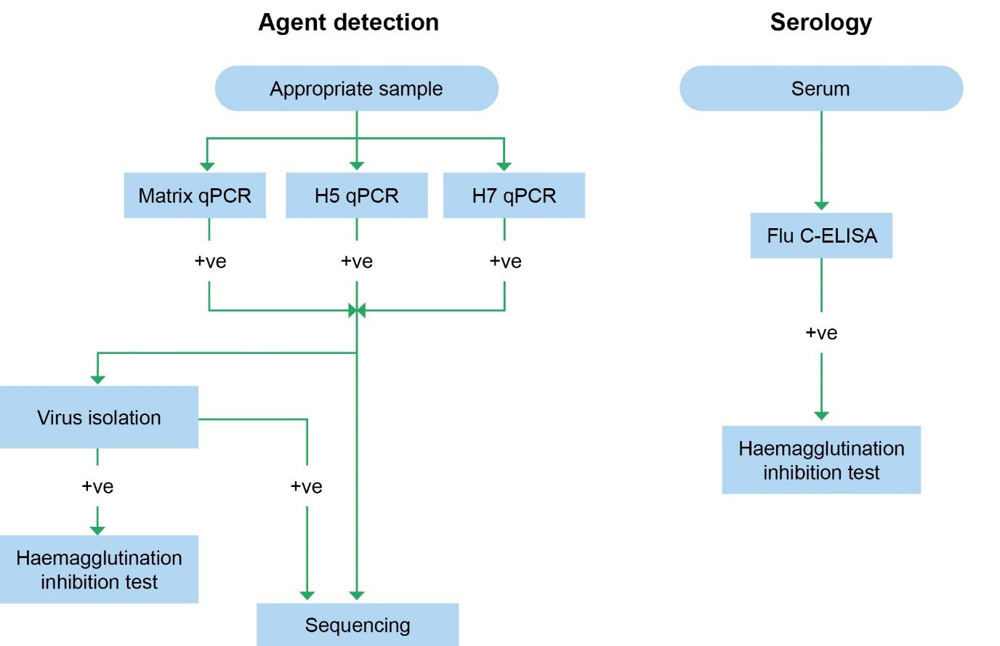

# AUSVETPLAN — Avian Influenza Response Strategy (v5.2 (2023))

> **Source**: Animal Health Australia
> **URL**: https://animalhealthaustralia.com.au//wp-content/uploads/2023/10/AUSVETPLAN_ResponseStrategy_AvianInfluenza_5.2.pdf
> **Licence**: Crown / publisher copyright; practitioner reference
> **Retrieved**: 2026-05-07T23:47:49Z
> **SHA-256**: `c215d22e976e2f3fc0339573861a97c66c5e4ab1c71f942b531a1b2ff31261cd`
> *Converted from PDF to Markdown format.*

---
## Page 1

 
 
 
AUSTRALIAN VETERINARY EMERGENCY PLAN 
AUSVETPLAN 
Response strategy 
Avian influenza 
Version 5.2 (working draft) 
 
 
 
 
 
 
 
AUSVETPLAN is a series of technical response plans that describe the 
proposed Australian approach to an emergency animal disease incident. 
The documents provide guidance based on sound analysis, linking policy, 
strategies, implementation, coordination and emergency-management plans. 
National Biosecurity Committee

---
## Page 2

 
© 1991–2023 Animal Health Australia ABN 86 071 890 956. Certain materials in this publication are 
protected by copyright and are reproduced with permission from the Commonwealth of Australia, 
acting through its Department of Agriculture, Fisheries and Forestry (or any successor agency); each 
state and territory of Australia, as represented by their relevant agencies, and by the National 
Biosecurity Committee and Animal Health Committee; and Animal Health Australia’s industry 
members. 
ISBN 0 642 24506 1 (printed version) 
ISBN 1 876 71438 7 (electronic version) 
Licence 
This work is licensed under the Creative 
Commons Attribution-NonCommercial-
ShareAlike 4.0 International Licence, 
with the exception of: 
• 
any third-party material 
contained within the work 
• 
any material protected by a trademark 
• 
any images and/or photographs. 
To view a copy of this licence, visit http://creativecommons.org/licenses/by-nc-sa/4.0/. 
Moral rights 
The author(s) of this work hold ‘moral rights’ as defined in the Copyright Act 1986 (Cwlth) and assert 
all moral rights in connection with this work. This means you must: 
• 
attribute (give credit to) the author(s) of this work 
• 
not say a person is a creator of a work when they are not 
• 
not do something with the work (such as change or add to it) that would have a negative 
impact on the reputation of the author(s) of this work. 
Failure to do so could constitute a breach of the Copyright Act 1986 (Cwlth). 
Disclaimer and warranty 
• 
This publication has been produced in accordance with the procedures described in the 
AUSVETPLAN Overview, and in consultation with Australian national, state and territory 
governments; the relevant livestock industries; nongovernment agencies; and public health 
authorities, as relevant. Any views and opinions expressed in this document do not 
necessarily represent the views and opinion of the authors or contributors, Animal Health 
Australia or the Commonwealth of Australia. 
• 
This publication is for use in emergency situations. The strategies and policy guidelines in 
this work are not applicable to quarantine policies for imported livestock or livestock 
products. 
• 
This publication is not legal or professional advice and should not be taken as a substitute 
for legal or other professional advice. 
• 
This publication is not intended for use by any person who does not have appropriate 
expertise in the subject matter of the work. Before using this publication, you should read it 
in full, consider its effect and determine whether it is appropriate for your needs. 
• 
This publication was created in July 2023. Laws, practices and regulations may have changed 
since that time. You should make your own inquiries as to the currency of relevant laws, 
practices and regulations, as these may have changed since publication of this work.

---
## Page 3

 
No warranty is given as to the correctness of the information contained in this work, or of its 
suitability for use by you. To the fullest extent permitted by law, Animal Health Australia is not, and 
the other contributing parties are not, liable for any statement or opinion, or for any error or 
omission contained in this work, and it and they disclaim all warranties with regard to the 
information contained in it, including, without limitation, all implied warranties of merchantability 
and fitness for a particular purpose. Animal Health Australia is not liable for any direct, indirect, 
special or consequential losses or damages of any kind, or loss of profit, loss or corruption of data, 
business interruption or indirect costs, arising out of or in connection with the use of this work or 
the information contained in it, whether such loss or damage arises in contract, negligence, tort, 
under statute, or otherwise. 
Text under development 
In this manual, text placed in square brackets [xxx] and greyed out indicates that that aspect of the 
manual remains unresolved or is under development; such text is not part of the official manual. The 
issues will be further worked on by experts and relevant text included at a future date. 
Contact information 
If you have any requests or inquiries concerning reproduction and rights, or suggestions or 
recommendations, you should address these to: 
AUSVETPLAN — Animal Health Australia 
Head of Program AUSVETPLAN 
PO Box 151 
Lyneham ACT 2602 
Tel: 02 6232 5522 
email: ausvetplan@animalhealthaustralia.com.au 
Approved citation 
Animal Health Australia (2023). Response strategy: Avian influenza (version 5.2). Australian 
Veterinary Emergency Plan (AUSVETPLAN), edition 5, Canberra, ACT. 
EMERGENCY ANIMAL DISEASE HOTLINE: 1800 675 888 
The Emergency Animal Disease Hotline is a toll-free telephone number that connects callers 
to the relevant state or territory officer to report concerns about any potential emergency 
disease situation. Anyone suspecting an emergency disease outbreak should use this number 
to get immediate advice and assistance. 
Edition 1 
1991 
Edition 2 
Version 2.0, 1996 (major update) 
Version 2.1, 2000 (minor amendments and updated WOAH International Animal Health Code) 
Edition 3 
Version 3.0, 2002 (major update and inclusion of new cost-sharing arrangements) 
Version 3.1, 2007 (interim update in response to epidemic of HPAI in Asia, January 2004) 
Version 3.2, 2007 (further revised version to take account of terminology and policy developments) 
Version 3.3, 2008 (minor revision to Section 3.1.4) 
Version 3.4, 2011 (minor update and inclusion of a reference for vaccination use policy; disease 
summary moved to Appendix 1 and renamed ‘Key features of AI’, in line with other disease 
manuals)

---
## Page 4

 
Edition 5 
Version 5.0, 2021 (major update) 
Version 5.1, 2022 (minor amendments, update of WOAH incubation period and update format) 
Version 5.2, 2023 (working draft – minor amendments, update of WOAH guidelines and inclusion of 
learnings from 2020 Victorian outbreak)

---
## Page 5

 
AUSVETPLAN_ResponseStrategy_AvianInfluenza (Version 5.2 – working draft) 
5 
Contents 
1 
Introduction ............................................................................................................................................... 9 
1.1 
This manual ......................................................................................................................................................... 9 
1.1.1 
Purpose .............................................................................................................................................. 9 
1.1.2 
Scope ................................................................................................................................................... 9 
1.1.3 
Development ................................................................................................................................... 9 
1.2 
Other documentation ................................................................................................................................... 10 
1.3 
Training resources ......................................................................................................................................... 10 
2 
Nature of the disease ............................................................................................................................. 11 
2.1 
Aetiology ............................................................................................................................................................ 11 
2.2 
Susceptible species ........................................................................................................................................ 13 
2.2.1 
Zoonotic potential ...................................................................................................................... 15 
2.3 
World distribution ......................................................................................................................................... 16 
2.3.1 
Distribution outside Australia............................................................................................... 16 
2.3.2 
Occurrence in Australia ........................................................................................................... 17 
2.4 
Epidemiology ................................................................................................................................................... 20 
2.4.1 
Incubation period ....................................................................................................................... 20 
2.4.2 
Persistence of agent and modes of transmission .......................................................... 20 
2.5 
Diagnostic criteria .......................................................................................................................................... 28 
2.5.1 
Clinical signs ................................................................................................................................. 28 
2.5.2 
Pathology ....................................................................................................................................... 30 
2.5.3 
Differential diagnosis ................................................................................................................ 32 
2.5.4 
Laboratory tests .......................................................................................................................... 32 
2.5.5 
Laboratory diagnosis ................................................................................................................ 33 
2.6 
Resistance and immunity ............................................................................................................................ 36 
2.7 
Vaccination ........................................................................................................................................................ 38 
2.8 
Treatment of infected animals .................................................................................................................. 39 
3 
Implications for Australia ................................................................................................................... 40 
3.1 
Potential pathways of introduction ........................................................................................................ 40 
3.2 
Social, economic and environmental effects ....................................................................................... 40 
3.3 
Critical factors for an Australian response .......................................................................................... 41 
4 
Policy and rationale .............................................................................................................................. 42 
4.1 
Introduction ...................................................................................................................................................... 43 
4.1.1 
Summary of policy ..................................................................................................................... 43 
4.1.2 
Case definition ............................................................................................................................. 45 
4.1.3 
Cost-sharing arrangement ...................................................................................................... 45 
4.1.4 
Criteria for proof of freedom ................................................................................................. 46 
4.1.5 
Governance .................................................................................................................................... 46 
4.2 
Public health implications .......................................................................................................................... 47 
4.3 
Control and eradication policy ................................................................................................................. 47 
4.3.1 
Epidemiological assessment .................................................................................................. 50 
4.3.2 
Quarantine, biosecurity and movement controls ......................................................... 50 
4.3.3 
Tracing and surveillance ......................................................................................................... 51 
4.3.4 
Zoning and compartmentalisation for international trade ...................................... 54 
4.3.5 
Animal welfare ............................................................................................................................. 54

---
## Page 6

 
6 
 
AUSVETPLAN Edition 5 
4.3.6 
Vaccination .................................................................................................................................... 55 
4.3.7 
Treatment of infected animals .............................................................................................. 55 
4.3.8 
Treatment of animal products and byproducts ............................................................. 55 
4.3.9 
Destruction of animals ............................................................................................................. 55 
4.3.10 
Disposal of animals, and animal products and byproducts ...................................... 56 
4.3.11 
Decontamination ........................................................................................................................ 56 
4.3.12 
Wild animal management ....................................................................................................... 57 
4.3.13 
Vector management .................................................................................................................. 58 
4.3.14 
Public awareness and media ................................................................................................. 58 
4.3.15 
Other strategies ........................................................................................................................... 58 
4.3.16 
Stand-down ................................................................................................................................... 59 
4.4 
Other control and eradication options .................................................................................................. 60 
4.5 
Funding and compensation ........................................................................................................................ 62 
5 
Declared areas and premises ............................................................................................................. 63 
5.1 
Declared areas ................................................................................................................................................. 64 
5.1.1 
Restricted area (RA) .................................................................................................................. 64 
5.1.2 
Control area (CA) ........................................................................................................................ 64 
5.2 
Other areas ........................................................................................................................................................ 65 
5.3 
Premises classifications ............................................................................................................................... 65 
5.3.1 
Premises status classifications ............................................................................................. 65 
5.3.2 
Qualifiers ........................................................................................................................................ 66 
5.4 
Reclassifying premises and previously declared areas ................................................................. 66 
5.4.1 
Reclassifying previously declared areas ........................................................................... 66 
6 
Movement controls ................................................................................................................................ 68 
6.1 
Principles ........................................................................................................................................................... 68 
6.2 
Guidelines for issuing permits .................................................................................................................. 68 
6.3 
Types of permits ............................................................................................................................................. 70 
6.4 
Recommended movement controls ....................................................................................................... 71 
6.4.1 
Live susceptible animals .......................................................................................................... 71 
6.4.2 
Carcasses ........................................................................................................................................ 75 
6.4.3 
Meat and meat products .......................................................................................................... 76 
6.4.4 
Eggs and egg products .............................................................................................................. 76 
6.4.5 
Other animal byproducts ........................................................................................................ 80 
6.4.6 
Waste products and effluent .................................................................................................. 81 
6.4.7 
Vehicles, including empty livestock transport vehicles and associated 
equipment ......................................................................................................................................................... 83 
6.4.8 
Nonsusceptible animals ........................................................................................................... 83 
6.4.9 
People .............................................................................................................................................. 84 
6.4.10 
Crops, grains, hay, silage and mixed feeds ....................................................................... 84 
6.4.11 
Sales, shows and other events .............................................................................................. 85 
6.4.12 
Other movements ....................................................................................................................... 85 
7 
Surveillance and proof of freedom ................................................................................................... 86 
7.1 
Surveillance ...................................................................................................................................................... 86 
7.2 
Proof of freedom ............................................................................................................................................. 91 
Appendix 1 ........................................................................................................................................................... 92 
Appendix 2 ........................................................................................................................................................... 94 
Appendix 3 ........................................................................................................................................................... 96

---
## Page 7

 
AUSVETPLAN_ResponseStrategy_AvianInfluenza (Version 5.2 – working draft) 
7 
Appendix 4 ........................................................................................................................................................ 100 
Glossary ............................................................................................................................................................. 104 
Disease-specific terms ............................................................................................................................................. 104 
Standard AUSVETPLAN terms ............................................................................................................................. 105 
Abbreviations .................................................................................................................................................. 115 
Disease-specific abbreviations ............................................................................................................................ 115 
Standard AUSVETPLAN abbreviations ............................................................................................................ 115 
References ........................................................................................................................................................ 117 
 
Tables 
Table 2.1 
Laboratory tests currently available at CSIRO-ACDP for the diagnosis of avian influenza
 
35 
Table 4.1 
Control measures to be used for outbreaks of HPAI and LPAI ................................................... 48 
Table 6.1 
Recommended movement controls for live day-old birds from premises other than IPs, 
DCPs, SPs and TPs for farm-to-farm movement other than slaughter .............................................................. 72 
Table 6.2 
Recommended movement controls for live birds other than day-old chicks from premises 
other than IPs, DCPs, SPs and TPs ..................................................................................................................................... 73 
Table 6.3 
Recommended movement controls for live birds to slaughter from premises other than 
IPs, DCPs, SPs and TPs ............................................................................................................................................................ 74 
Table 6.4 
Recommended movement controls for dead birds to disposal from IPs and DCPs .......... 75 
Table 6.5 
Recommended movement controls for dead birds to disposal from premises other than 
IPs, DCPs, SPs and TPs ............................................................................................................................................................ 75 
Table 6.6 
Recommended movement controls for meat and meat products from premises other than 
IPs, DCPs, SPs and TPs ............................................................................................................................................................ 76 
Table 6.7 
Movement of eggs and egg products for disposal from IPs and DCPs ..................................... 76 
Table 6.8 
Recommended movement controls for eggs and egg products on IPs and DCPs going for 
pulping and pasteurisation .................................................................................................................................................. 77 
Table 6.9 
Recommended movement controls for fertile eggs to hatchery or pulping from premises 
other than IPs, DCPs, SPs and TPs ..................................................................................................................................... 77 
Table 6.10 
Recommended movement controls for table (shell) eggs to grading or processing 
facilities from premises other than IPs, DCPs, SPs and TPs ................................................................................... 78 
Table 6.11 
Recommended movement controls for table (shell) eggs from grading facility to retail 
or processing (pulping) ......................................................................................................................................................... 79 
Table 6.12 
Recommended movement controls for fertile eggs to hatchery from IPs, DCPs, SPs and 
TPs 
79

---
## Page 8

 
8 
 
AUSVETPLAN Edition 5 
Table 6.13 
Recommended movement controls for byproducts from processing plants on premises 
other than IPs, DCPs, SPs and TPs ..................................................................................................................................... 80 
Table 6.14 
Recommended movement controls for byproducts from rendering plants on premises 
other than IPs, DCPs, SPs and TPs ..................................................................................................................................... 81 
Table 6.15 
Recommended movement controls for manure, used litter and other waste products 
from IPs and DCPs .................................................................................................................................................................... 81 
Table 6.16 
Recommended movement controls for waste products on premises other than IPs, 
DCPs, SPs, TPs and ARPs ....................................................................................................................................................... 82 
Table 6.17 
Recommended movement controls for manure and litter from ARPs ................................. 82 
Table 7.1 
Sample sizes for testing of sentinel birds ............................................................................................ 89 
Table A2.1 
Experimental infective dose of avian influenza virus by species ........................................... 94 
Table A2.2 
Concentrations of avian influenza virus detected in respiratory secretions or faeces . 94 
Table A3.1 
Actions to consider if HPAI virus is detected in a wild bird ...................................................... 97 
Table A3.2 
Actions to consider if HPAI virus is detected in more than one wild bird .......................... 98 
Table A3.3 
Actions to consider if HPAI infection is widespread in wild birds only ............................... 99 
Table A4.1 
Movement permit conditions .............................................................................................................. 100 
 
Figures 
Figure 2.1 
The current approach to diagnostic testing at CSIRO-ACDP ....................................................... 34

---
## Page 9

 
AUSVETPLAN_ResponseStrategy_AvianInfluenza (Version 5.2 – working draft) 
9 
1 
Introduction 
1.1 This manual 
1.1.1 Purpose 
As part of AUSVETPLAN (the Australian Veterinary Emergency Plan), this response strategy contains 
the nationally agreed approach for the response to an incident — or suspected incident — of avian 
influenza (AI) in poultry, or cage (aviary) or zoo birds in Australia. It has been developed to guide 
decision making to ensure that a fast, efficient and effective response can be implemented consistently 
across Australia with minimal delay. 
1.1.2 Scope 
This response strategy covers AI caused by avian influenza virus. 
This response strategy provides information about: 
• 
the disease (Section 2) 
• 
the implications for Australia, including potential pathways of introduction; social, 
environmental, human health and economic effects; and the critical factors for a response to 
the disease (Section 3) 
• 
the agreed policy and guidelines for agencies and organisations involved in a response to an 
outbreak (Section 4) 
• 
declared areas and premises classifications (Section 5) 
• 
biosecurity controls, including quarantine and movement controls (Section 6) 
• 
response surveillance and establishing proof of freedom (Section 7). 
The key features of AI are described in the Avian influenza fact sheet (Appendix 1). 
1.1.3 Development 
The strategies in this document for the diagnosis and management of an outbreak of AI are based on 
risk assessment. They are informed by the recommendations in the World Organisation for Animal 
Health (WOAH, formally OIE) Terrestrial animal health code (Chapter 10.4) and the WOAH Manual of 
diagnostic tests and vaccines for terrestrial animals (Chapter 3.3.4). The strategies and policy 
guidelines are for emergency situations and are not applicable to policies for imported animals or 
animal products. 
This manual has been produced in accordance with the procedures described in the AUSVETPLAN 
Overview, and in consultation with Australian national, state and territory governments; the relevant 
livestock industries; nongovernment agencies; and public health authorities, where relevant. 
In this manual, text placed in square brackets [xxx] and greyed out indicates that that aspect of the 
manual remains unresolved or is under development; such text is not part of the official manual. The 
issues will be worked on by experts and relevant text included at a future date.

---
## Page 10

 
10 
 
AUSVETPLAN Edition 5 
1.2 Other documentation 
This response strategy should be read and implemented in conjunction with: 
• 
other AUSVETPLAN documents, including the operational, enterprise and management 
manuals; and any relevant guidance and resource documents. The complete series of 
manuals is available on the Animal Health Australia website1 
• 
relevant nationally agreed standard operating procedures (NASOPs).2 These procedures 
complement AUSVETPLAN and describe in detail specific actions undertaken during a 
response to an incident. NASOPs have been developed for use by jurisdictions during 
responses to emergency animal disease (EAD) incidents and emergencies 
• 
relevant jurisdictional or industry policies, response plans, standard operating procedures 
and work instructions 
• 
relevant Commonwealth and jurisdictional legislation and legal agreements (such as the 
Emergency Animal Disease Response Agreement — EADRA3), where applicable. 
1.3 Training resources 
EAD preparedness and response arrangements in Australia 
The EAD Foundation online course4 provides livestock producers, veterinarians, veterinary students, 
government personnel and emergency workers with foundation knowledge for further training in 
EAD preparedness and response in Australia. 
 
1 https://animalhealthaustralia.com.au/ausvetplan/  
2 https://animalhealthaustralia.com.au/nationally-agreed-standard-operating-procedures/ 
3 https://animalhealthaustralia.com.au/eadra/ 
4 https://animalhealthaustralia.com.au/online-training-courses/

---
## Page 11

 
AUSVETPLAN_ResponseStrategy_AvianInfluenza (Version 5.2 – working draft) 
11 
2 
Nature of the disease 
Avian influenza (AI) is a highly contagious viral infection, primarily of avian species. 
AI virus infections vary in pathogenicity. Infections are classed as being low pathogenicity AI (LPAI) 
or high pathogenicity AI (HPAI) (see Section 2.1). Clinical manifestations vary with the subtype and 
strain of virus, the avian species infected, and the presence of other diseases. 
From 1955, the disease was known as either ‘virulent avian influenza’ or ‘fowl plague’. An 
international meeting on AI in 1984 recommended that the name ‘highly pathogenic avian influenza’ 
be used to describe the most pathogenic form of infection. The current nomenclature, as of 2020, 
endorsed by World Organisation for Animal Health (WOAH) is ‘high pathogenicity avian influenza’. 
Changes in understanding of the epidemiology of AI virus infections, especially the capacity of some 
AI viruses to infect humans and the potential risk this poses for the emergence of human-to-human 
transfer, have led to a reassessment of the management of AI virus infections in poultry. 
This manual considers primarily the consequences of infection of poultry in Australia with any AI 
virus. It distinguishes between infection with HPAI, LPAI of the H5 and H7 subtypes (LPAI (H5/H7)), 
and LPAI of other subtypes (LPAI (not H5/H7)) (see Section 2.1). 
For the purposes of this manual, ‘poultry’ means chickens, turkeys, guineafowl, ducks, geese, quail, 
pigeons, pheasants, partridges, emus and ostriches reared or kept in captivity, including commercial 
and backyard. This is more conservative and different from the WOAH definition, which applies for 
the purposes of notification to WOAH (see section 4)5. 
2.1 Aetiology 
AI virus classification 
All influenza viruses are members of the family Orthomyxoviridae. Influenza viruses are enveloped 
RNA viruses that are categorised into four types — A, B, C and D — based on the antigenic character 
of the internal nucleoprotein (NP) and matrix (M1) protein. All AI viruses belong to the influenza A 
type, and only influenza A viruses have been isolated from avian species; influenza viruses of the B, C 
and D types have never been isolated from birds. 
Influenza A viruses are further divided into subtypes based on the antigenic characteristics of the 
haemagglutinin (HA) and neuraminidase (NA) surface glycoproteins. To date, 18 HA subtypes (H1–
H18) and 11 NA subtypes (N1–N11) have been described. HA subtypes 17 and 18, and NA subtypes 
10 and 11 have only been identified in bats (Wu et al 2014). Each influenza virus contains one of each 
of these surface glycoprotein variants. 
Influenza B viruses and subtypes of influenza A virus are further characterised into many different 
strains. New strains of influenza viruses appear and replace older strains through antigenic drift or 
shift. 
 
5 https://www.woah.org/fileadmin/Home/eng/Health_standards/tahc/current/glossaire.pdf

---
## Page 12

 
12 
 
AUSVETPLAN Edition 5 
Pathotypes 
The pathogenicity of AI virus infection in one species may not necessarily cause pathogenicity in other 
species. AI viruses are classified6 into two pathotypes — HPAI and LPAI — based on either the lethality 
of the virus in experimentally inoculated chickens or molecular characteristics. 
HPAI 
HPAI viruses either have an intravenous pathogenicity index (IVPI) in 6‑week‑old chickens greater 
than 1.2 or cause at least 75% mortality in 4–8‑week‑old chickens infected intravenously. 
Alternatively, the AI virus can be sequenced to determine the sequence of amino acids present at the 
cleavage site (HA0) of the HA molecule. The sequence is compared with those of other HPAI isolates; 
if the amino acid motif is similar to that of other HPAI isolates, the isolate being tested should be 
considered to be HPAI.7 
LPAI 
LPAI viruses are all influenza A virus subtypes that are not HPAI viruses (as defined above). 
Pathogenicity 
Pathogenicity depends on both the genetic properties of the virus and the host species. In poultry, 
HPAI virus can cause severe clinical disease. Even LPAI subtypes can be associated with severe clinical 
disease in the presence of other infectious agents (eg infectious bronchitis virus, infectious 
laryngotracheitis virus). 
The HA gene, specifically the amino acid sequence at the cleavage site (HA0), is the primary 
determinant of pathogenicity of AI viruses in chickens. The sequence of amino acids at the HA cleavage 
site determines the HA protein structure and the ability of protease enzymes to cleave the HA protein 
into two proteins (HA1 and HA2); this cleavage is essential for the virus to replicate and be infectious. 
The HA cleavage site in LPAI viruses can only be cleaved by trypsin-like proteases produced by the 
epithelial cells of the respiratory and intestinal tracts. Infection with, and replication of, LPAI viruses 
are limited to these regions. 
HPAI viruses have an HA cleavage site that is recognised by both trypsin-like and ubiquitous (eg furin) 
proteases. 
Other factors such as the binding between the HA and the host cell receptor are important for host 
specificity, and cell or tissue tropism. 
Antigenic change 
Influenza A viruses have the capacity for rapid antigenic change through mutation and reassortment. 
Antigenic drift is the fixation, by natural selection, of mutations in the HA and NA proteins that enable 
the virus to evade the human immune response. Hence, antigenic drift enables escape from antibody-
mediated neutralisation acquired following infection or vaccination. The underlying mechanism is the 
high mutation rate of influenza A viruses because of their error-prone replication. Most mutations do 
not confer any antigenic changes; mutations in the HA1 region of the HA protein, particularly in or 
around the receptor-binding site, are thought to drive antigenic evolution. The high mutation rates 
measured in influenza A viruses are evidenced by ladder-shaped phylogenies (unlike antigenic drift, 
which is a more punctuated process) (Wille and Holmes 2020). 
 
6 https://www.woah.org/fileadmin/Home/eng/Health_standards/tahm/3.03.04_AI.pdf  
7 www.cdc.gov/flu/avianflu/index.htm

---
## Page 13

 
AUSVETPLAN_ResponseStrategy_AvianInfluenza (Version 5.2 – working draft) 
13 
Antigenic shift is the rapid phenotypic change following reassortment (a special case of 
recombination). The consequence of reassortment is that coinfection allows viral progeny to contain 
various gene segment combinations from the different parental viruses. Reassortment is of 
evolutionary importance because it creates new genomic constellations. Although few of these will 
benefit the virus, some may facilitate adaptation to new hosts, help evade host immune responses, and 
assist in the generation of antiviral resistance (Wille and Holmes 2020). Because of reassortment, 
many different genome constellations may be detected despite an identical HA sequence; however, 
these different constellations may not confer antigenic change. 
2.2 Susceptible species 
The information in the following section is current as of October 2021. 
Birds 
Influenza A viruses have been isolated from most major bird families — so far, at least 105 bird species 
from 26 families have been reported. 
Nearly all the possible HA and NA subtype combinations have been detected in wild birds. In wild 
waterbirds, the HA and NA glycoproteins appear to be stable (Reid et al 2003, Olson et al 2014). 
Species in the orders Anseriformes (ducks, geese, swans) and, to a lesser extent, Charadriiformes 
(shorebirds, waders, gulls) are regarded as important reservoir hosts and disseminators of 
influenza A viruses, but rarely (with some notable exceptions) display clinical signs of infection. Avian 
species other than those identified as reservoirs of LPAI virus may have a higher clinical susceptibility 
to AI virus. 
When chickens and turkeys are infected with viruses with HA and NA combinations that have not 
occurred previously in these species, a proportion of the viruses may mutate and produce strains that 
cause severe disease. Epidemics largely occur when an H5 or H7 LPAI virus has been introduced to a 
naive poultry population and then mutates to HPAIV. AIV circulation in waterfowl and shorebirds is 
largely LPAIV. 
AI viruses are being detected in a growing number of bird orders, including those listed in the table 
below.8 
Brid order 
Common name9 
Accipitriformes 
Osprey, hawks and eagles 
Anseriformes 
Magpie Goose, ducks, geese and swans 
Caprimulgiformes 
Frogmouth, nightjars, owlet-nightjars, swifts 
Charadriiformes 
Shorebirds 
Columbiformes 
Doves and pigeons 
Coraciiformes 
Bee-eaters and kingfishers 
Ciconiformes 
Storks 
 
8 Sources include: www.birdlife.org/datazone/info/taxonomy, 
https://assets.publishing.service.gov.uk/government/uploads/system/uploads/attachment_data/file/1128143/hpai-europe-
number38-230104.pdf and www.ecdc.europa.eu/sites/default/files/documents/avian-influenza-overview-nov-2017–Febr-
2018.pdf; https://www.tandfonline.com/doi/full/10.1080/03079450802609815 
9 Common names adapted from: del Hoyo and Collar (2014) HBW and BirdLife International Illustrated Checklist of the Birds of the 
World. Volume 1 – Non-passerines. Lynx Editions, Barcelona. (Courtesy of the Australian Department of Environment).

---
## Page 14

 
14 
 
AUSVETPLAN Edition 5 
Brid order 
Common name9 
Cathartiformes 
New world vultures (eg condors, turkey vulture) 
Coliiformes 
Mousebirds 
Cuculiformes 
Cuckoos and koels 
Falconiformes 
Falcons 
Galliformes 
Brush turkeys, scrubowls and quail 
Gaviformes 
Loons/divers 
Gruiformes 
Rails, gallinules, coots and cranes 
Otidiformes 
Bustards 
Passeriformes 
Passerines or perching birds 
Pelecaniformes 
Ibis, herons and pelicans 
Phoenicopteriformes 
Flamingos 
Piciformes 
Jacamars, puffbirds, toucan, woodpeckers 
Podicipediformes 
Grebes 
Procellariiformes 
Fulmars, petrels, prions and shearwaters 
Psittaciformes 
Parrots and cockatoos 
Pterocliformes 
Sand grouse 
Sphenisciformes 
Penguins 
Strigiformes 
Typical owl and barn owls 
Struthioniformes 
Ostrich, emus and cassowary 
Suliformes 
Gannets, boobies and cormorants 
 
Susceptible mammals 
The ecology of AI viruses is complex; it involves not only wild bird reservoir hosts but also interactions 
between animals and humans, or between wild and domesticated animals. 
AI viruses can give rise to host-adapted viruses that can become endemic. The avian-derived lineage 
of canine influenza has now circulated for 15 years (Chen et al., 2023). Pigs are a reservoir for 
mammalian influenza viruses, and have been implicated in the generation of human pandemic viruses 
(Smith et al., 2009). This is driven by the presence of both avian and mammalian-type sialic acid 
receptors (Nelli et al., 2010). Cases of inter-species transmission identified between birds and swine 
included strains of H5N1, H9N2, H4N1, H4N6, H5N3, H10N5, H4N8, H6N6, H7N9 in China; H4N6, 
H6N2, H7N2 in the United States; H4N6, H3N3 in Canada; H7N2, H5N2 in South Korea; H5N1 in Nigeria 
and H5N1, H5N2, H9N2 in Egypt (Chauhan & Gordon, 2020). One of the established swine influenza 
lineages (Eurasian avian-like swine H1N1) is of avian origin (Pensaert et al., 1981) demonstrating the 
capacity for AI to adapt and establish in swine. 
Sporadic infections of humans with LPAI viruses of wild bird or poultry origin, or with HPAI viruses, 
can also occur (Swayne 2008).

---
## Page 15

 
AUSVETPLAN_ResponseStrategy_AvianInfluenza (Version 5.2 – working draft) 
15 
Nonhuman mammals 
Natural AI virus infections have been recorded in horses, mink, cats, dogs, rats, mice, donkeys, ferrets, 
rabbits, leopards, pigs, foxes, stone martens, palm civets, wild racoons, marine mammals (including 
seals and whales) and bats. 
Since the emergence of the 2022/23 clade 2.3.4.4b HPAI H5N1, numerous mammalian infections with 
H5N1 HPAI virus have been detected in association with poultry and wild bird outbreaks.10 Affected 
species are mostly predatory and scavenging species in terrestrial, wetland and marine environments 
with exposure likely to have occurred through consumption of dead and infected wild birds. Species 
include foxes, seals and sea-lions, dolphins, bears, felids, opossums, coatis and mustelids including 
wild otters and farmed American Mink.11 
AI viruses can experimentally infect dogs, foxes, cattle, pigs, ferrets, rats, rabbits, guinea pigs, mice, 
cats, mink, nonhuman primates and humans (Swayne & Halvorson 2003, Rimmelzwaan et al 2006, 
Kalthoff et al 2008). 
A referenced list of species from which H5N1 virus has been isolated is maintained by the United 
States Geological Survey National Wildlife Centre.12 
A list of mammalian species affected by H5Nx HPAI (excluding laboratory animals and humans) is 
currently 
maintained 
by 
the 
FAO 
(www.fao.org/animal-health/situation-updates/global-
aivwithzoonotic-potential/bird-species-affected-by-h5nx-hpai/en). 
2.2.1 Zoonotic potential 
Humans are susceptible to infection with AI viruses. Natural exposure to H5, H6, H7, H9 and H10 
subtypes has caused zoonotic disease in various forms in humans, ranging from mild or inapparent 
infection to death (Mostafa et al 2018). 
Circulating antibodies to H4, H5, H6, H7, H9 and H11 antigens were detected in people in southern 
China in the late 1970s and 1980s, as well as more recently, indicating probable exposure to LPAI 
viruses (Zhou et al 1996, Chen et al 2008, Wang et al 2009). 
In Australia, poultry workers were infected with H10N7 virus when they were exposed to clinically 
healthy birds from an infected flock during routine processing (Arzey et al 2012). Experimental 
exposure of people to H3N8, H3N2, H5N2, H6N1, H9N2, H4N8 and H10N7 isolates indicated that these 
isolates could infect humans, although they were generally ineffective in virus transmission (Peiris 
2009). 
Human infection with H5 and H7 AI viruses has led the World Health Organization (WHO) to consider 
whether a new pandemic human influenza virus could be derived directly from birds. Fortunately, 
there have been no cases of sustained human-to-human transmission of AI viruses to date. Further 
information on human infection with AI viruses can be found on the WHO website.13 
 
10 www.woah.org/en/disease/avian-influenza/#ui-id-2 and www.offlu.org/wpcontent/ uploads/2023/03/OFFLU-call-AI-
mammals-Mar2023.pdf 
11 www.eurosurveillance.org/content/10.2807/1560-7917.ES.2023.28.3.2300001 
12 www.usgs.gov/media/files/list-species-affected-h5n1-avian-influenza 
13 https://www.who.int/

---
## Page 16

 
16 
 
AUSVETPLAN Edition 5 
2.3 World distribution 
For the latest information on the distribution of AI, refer to the WOAH World Animal Health 
Information System.14 
2.3.1 Distribution outside Australia 
Serotypes of AI virus occur on all continents where research has been carried out. 
Outbreaks of HPAI in North America (H5N2 in the United States in 1983 and Mexico in 1994, and H7N3 
in Canada in 2004 and 2007), Italy (H7N1 in 1999), the Netherlands (H7N7 in 2003) and Chile (H7N3 
in 2002) all initially involved LPAI. In each case, HPAI virus emerged by mutation of existing LPAI 
viruses, and AI virus infection became widespread. In 1997, a novel H5N1 virus caused fatal disease 
in poultry and humans in Hong Kong; disease subsequently appeared in other birds and poultry 
throughout Asia, and spread across Eurasia and into Africa. Before the emergence of this strain, AI was 
considered a sporadic high-mortality poultry disease. 
In December 2014 and January 2015, the Animal and Plant Health Inspection Service of the United 
States Department of Agriculture reported the presence of HPAI (H5N2) and HPAI (H5N8) viruses in 
wild birds in a few states. In January 2015, an HPAI (H5N1) virus was detected in a wild duck in the 
United States. The H5N1 virus isolated from the wild duck was a new mixed virus (a reassortant) that 
is genetically different from the Asian avian H5N1 viruses that have caused human infections with 
high mortality in several other countries (notably in Asia and Africa). No human infections with this 
new reassortant H5N1 virus have been reported. 
The largest outbreak of HPAI recorded in countries of the European Union occurred in 2016–17 
(Brown et al 2017). 
H5N1 influenza virus infection is now considered to be endemic in poultry in some countries, 
including Bangladesh, China, Egypt, India, Indonesia and Vietnam.15 
Since 2021, H5N1 HPAI clade 2.3.4.4b has had unprecedented impacts on poultry and wild birds on a 
global scale.16 H5N1 has now in effect replaced the H5N8 subtype in Asia, Africa and Europe in both 
poultry and wild birds. High wild bird mortality and trans-Atlantic spread to north-eastern America 
occurred at the end of 2021. Throughout 2022 HPAI spread extensively in North America and then 
into Central America from October. Later that year South America was also affected in what remains 
an on-going dynamic situation with expected further spread. Re-assortment of genetic material with 
local low pathogenic viruses has occurred and is likely to continue. 
For the latest information on AI outbreaks, refer to the websites of the WOAH and the Food and 
Agriculture Organization of the United Nations.17 
 
14 https://wahis.woah.org/#/home  
15 www.fao.org/news/story/en/item/66118/icode 
16 www.cms.int/en/publication/h5n1-high-pathogenicity-avian-influenza-wildbirds-unprecedented-conservation-impacts 
17https://www.woah.org/en/disease/avian-influenza/, https://www.fao.org/faoterm/collection/avian-influenza/en/

---
## Page 17

 
AUSVETPLAN_ResponseStrategy_AvianInfluenza (Version 5.2 – working draft) 
17 
2.3.2 Occurrence in Australia 
Commercial poultry 
HPAI 
Eight outbreaks of HPAI occurred in Australia between 1976 and 2020,18 most likely due to LPAIV 
infection being passed from wild water fowl (ducks) to commercial poultry, followed by mutation to 
HPAIV. HPAI viruses caused clinical disease in commercial poultry in Victoria in 1976 (H7N7), 1985 
(H7N7), 1992 (H7N3) and 2020 (H7N7); in Queensland in 1994 (H7N3); and in New South Wales in 
1997 (H7N4), 2012 (H7N7) and 2013 (H7N2)18 (Swayne & Suarez 2000, Scott et al 2020). Each time, 
there was severe disease in affected chicken flocks. All instances had obvious or circumstantial 
evidence of contact with wild waterfowl or surface water contaminated by wild waterfowl, or an 
association with free-range farmed ducks (Westbury 1998, Scott et al 2020). There is some evidence 
that, initially, LPAI may have been involved in the outbreaks in 1976 (Westbury 1998), 1992 
(Victorian Department of Agriculture, pers comm, 2022) and 1997 (Selleck et al 2003). 
Full genome sequencing of 11 Australian H7 isolates suggested that Australian H7 isolates form a 
monophyletic clade when compared with H7 subtypes worldwide (Bulach et al 2010). 
In August 2020, three different strains of AI virus were identified across seven infected properties in 
Victoria. The properties were: 
• 
three free-range and cage egg farms and one composting property within the same shire 
(HPAI (H7N7)) 
• 
two linked free-range turkey farms, one within the same shire as the HPAI cases and the 
second in eastern Victoria (LPAI (H5N2)) 
• 
one emu farm in northern Victoria (LPAI (H7N6)).  
This was the largest recorded outbreak response to AI in Australia to date. The depopulation, 
decontamination and surveillance of the infected poultry farms, and the implementation of a housing 
order for all poultry in the control area (for the first time in Australia), contributed to the rapid 
eradication of the disease. 
LPAI (H5/H7) 
Seven LPAI (H5/H7) virus strains have been detected in Australian domestic poultry18 (QDAF 2020, 
Scott et al 2020): 
• 
An LPAI (H7N7) virus was isolated on a duck farm during investigation of an HPAI (H7N7) 
outbreak in chickens in Victoria in 1976. The ducks showed no signs of clinical disease. 
• 
Antibodies to H5, H7 and other subtypes of AI viruses were detected in commercial domestic 
ducks during investigation of an HPAI (H7N3) outbreak in chickens in Victoria in 1992. 
• 
LPAI (H5) antibodies were detected on a Tasmanian noncommercial, multispecies 
smallholding in 2006. 
• 
An LPAI (H5N3) virus was detected in a free-range duck flock in Victoria during routine 
surveillance in 2012. The source of the virus could not be determined, but it is speculated 
that the primary source may have been wild birds, which had free access to the range area. 
• 
An LPAI (H5N3) virus was isolated from one duck on a noncommercial holding in Western 
Australia in 2013. The positive test was an incidental finding during routine surveillance. 
There was no evidence of infection of in-contact birds or birds in the surrounding area. 
 
18 https://agriculture.vic.gov.au/biosecurity/animal-diseases/poultry-diseases/avian-influenza-bird-flu

---
## Page 18

 
18 
 
AUSVETPLAN Edition 5 
• 
An LPAI (H5N2) virus was detected on two linked turkey farms in Victoria, during 
surveillance for a concurrent HPAI outbreak in 2020. 
• 
An LPAI (H7N6) virus was detected on an emu farm in Victoria, during surveillance for a 
concurrent HPAI outbreak in 2020. 
LPAI (not H5/H7) 
The following LPAI (not H5/H7) detections have been made (QDAF 2020): 
• 
Antibodies to LPAI H1, H4, H5, H7 and H9 subtypes were detected in ducks on a farm in 
Victoria in 1992. 
• 
LPAI (H3N8) virus was detected on a multi-age commercial duck farm in Victoria in 1992. 
• 
An LPAI (H6N4) virus was isolated from a single duck on a commercial chicken and duck 
property in Queensland in 2006. 
• 
Chickens in several sheds from a property in New South Wales tested seropositive to LPAI 
(H6N4) in 2006. 
• 
LPAI (H10N7) virus was detected in 2010 on a chicken farm in New South Wales, where 
transmission to abattoir workers during processing of the poultry was documented. 
Phylogenetic analysis of the full HA sequence of the virus involved in this event showed a 
higher degree of homology with North American H10 viruses (Arzey et al 2012) than with 
Australian H5, H7 and H9 isolates (Bulach et al 2010, Hansbro et al 2010). 
• 
In April 2012, LPAI (H9N2) virus was confirmed on two turkey farms near the Hunter Valley 
in New South Wales; the source of the infection is unknown. 
• 
In 2012, an LPAI (H4N6) virus was found in ducks of several age groups on a multi-age farm 
of 2400 ducks on the north coast of New South Wales. 
• 
In 2012, an LPAI (H10N7) virus was detected in a Queensland poultry flock; the source of 
the infection is unknown, but it is postulated that the primary source may have been wild 
birds. 
• 
In 2018, an LPAI (H1N2) virus was detected in Queensland in free-range chickens, ducks and 
guinea fowl (Scott et al 2020). 
Wild bird surveillance19 
HPAI viruses have never been detected in birds sampled as part of the National Avian Influenza Wild 
Bird Surveillance Program, which is run by Wildlife Health Australia. LPAI viruses of many subtypes 
— including H1–H13, and H15 — have been isolated from, or demonstrated in, a wide range of wild 
aquatic birds, including resident and migratory species, in well-separated locations in Australia (Arzey 
2004, Haynes et al 2009, Hansbro et al 2010, Herfst et al 2012, Grillo et al 2015, Wille et al 2022, WHA 
2018). The subtypes detected in wild birds vary between species, locations and years. 
LPAI viruses have been detected in: 
• 
Anseriformes (including mallard hybrids, Pacific black duck, Australian shelduck, 
Australasian shoveler, grey teal, chestnut teal, Australian wood duck, pink-eared duck, 
magpie goose, hardhead, plumed whistling duck, black swan) 
• 
Charadriiformes (including red-necked stint, red knot, black-tailed godwit, bar-tailed godwit, 
curlew sandpiper, eastern curlew, lesser noddy, sooty tern, sanderling, silver gull, white-
capped noddy, whimbrel, whiskered tern) 
• 
Gruiformes (Australian coot) 
• 
Pelecaniformes (Australian white ibis) 
• 
Procellariiformes (shearwater). 
 
19 https://wildlifehealthaustralia.com.au/ProgramsProjects/WildBirdSurveillance.aspx

---
## Page 19

 
AUSVETPLAN_ResponseStrategy_AvianInfluenza (Version 5.2 – working draft) 
19 
Since 2005, LPAI viruses of H5 subtypes have been detected in Queensland, New South Wales, Victoria, 
Tasmania, South Australia and Western Australia (Pacific black duck, chestnut teal, grey teal, 
Australasian shoveler, red-necked stint, plumed whistling duck and magpie goose, and samples from 
mixed species, which included these species plus pink-eared duck), and LPAI viruses of H7 subtypes 
have been detected in Queensland, New South Wales, Victoria, Tasmania and South Australia (Pacific 
black duck and grey teal, and samples from mixed species, which included these species plus 
Australasian shoveler and pink-eared duck). 
Serological surveillance (Curran 2012) has detected antibodies to AI virus using a competition 
enzyme-linked immunosorbent assay (c-ELISA) to the nucleoprotein in: 
• 
Charadriiformes — black-fronted dotterel, greater sand plover, grey plover, oriental plover, 
Australian pied oystercatcher, sooty oystercatcher, Caspian tern, common noddy, gull-billed 
tern, little tern, silver gull, whiskered tern, black-winged stilt, red-necked avocet, bar-tailed 
godwit, black-tailed godwit, curlew sandpiper, eastern curlew, great knot, grey-tailed tattler, 
little curlew, red knot, red-necked stint, ruddy turnstone, sanderling, sharp-tailed sandpiper, 
terek sandpiper, whimbrel, wood sandpiper 
• 
Anseriformes — mallard hybrids, Pacific black duck, Australian shelduck, Australasian 
shoveler, grey teal, chestnut teal, Australian wood duck, pink-eared duck, magpie goose, 
hardhead, plumed whistling duck, black swan. 
In general, the frequency of detection20 via polymerase chain reaction (PCR) and virus isolation from 
Australian wild birds is low (1.4 to 3.2%) compared with other global studies of wild birds (Hansbro 
et al 2010, Tracey 2010). Internationally, the prevalence of AI virus infection and detection in 
waterfowl ranges from 0.6% to 26% (Alfonso et al 1995); however, surveillance differs greatly 
between countries. 
Recent studies demonstrate higher rates of detection in some species (eg 0.45 to 0.55% in shorebirds 
versus 2.0 to 3.6% in waterfowl); this is consistent with findings in other geographic regions (Hansbro 
et al 2010). Detection rates can vary greatly between sampling periods and locations, and are 
significantly higher in dabbling ducks than in non-waterfowl species (Hansbro et al 2010, Tracey 
2010). 
Data from outbreaks of HPAI in poultry in south-eastern Australia suggest that outbreaks occur during 
periods of drought following a period of high rainfall (Klaassen et al 2011, Ferenczi et al 2016). 
Environmental conditions such as drought and flood affect waterbird abundance in local areas and 
increase the number of serologically naive juveniles entering the population (Roshier et al 2002, 2008; 
Tracey et al 2004; Klaassen et al 2011). For example, increased rainfall may lead to increased breeding 
season success for many wild bird species, increased mixing of wild birds on water bodies, and 
increased movement as birds follow food and move into or out of flooded areas. Flooding may also 
lead to increased opportunities for wild birds to come into closer contact with poultry. In contrast, 
periods of drought may lead to increased densities in localised areas (such as around water sources). 
Therefore, it is likely that environmental conditions affect the abundance of Anseriformes species and 
thus the apparent prevalence of AI viruses. 
 
20 Comparing rates of detection is difficult because surveillance methodologies and strategies differ between studies.

---
## Page 20

 
20 
 
AUSVETPLAN Edition 5 
2.4 Epidemiology 
2.4.1 Incubation period 
The incubation period and infectious period depend on the virus strain, the dose and route of 
exposure, the species exposed, the age of individuals, and the environment. 
Incubation periods are extremely variable, from a few hours to 24 hours in intranasally inoculated 
birds and 2–3 days in naturally infected birds. Up to 16 days has been reported for layers in cages 
(Mutinelli et al 2003). 
WOAH incubation period 
For the purposes of the WOAH Terrestrial animal health code, the incubation period21 for AI at the 
flock level is 14 days. 
2.4.2 Persistence of agent and modes of transmission 
Appendix 2 provides information on infective dose and virus shedding. 
The principal means by which AI viruses initiate outbreaks is thought to be via wild birds 
contaminating poultry water or food supplies and directly contaminating free-range farms with 
faeces. The infection then spreads through the movements of infected live birds or faecally 
contaminated eggs, feed, equipment, vehicles, materials, clothing and footwear. Infected backyard 
poultry and live bird markets can be sources of AI virus for commercial poultry. 
In past outbreaks, dissemination of AI virus between flocks has been primarily attributed to poor 
biosecurity, involving: 
• 
movement of infected birds (including vaccinated birds) 
• 
live bird markets (movement of birds, unsold birds returning to farm, contaminated crates 
and vehicles) 
• 
human-associated movements, such as transporting food, personnel, equipment and 
vehicles out of premises that are contaminated with infected faeces or respiratory secretions 
• 
centralised egg handling facilities and equipment, particularly shared use of egg trays and 
fillers 
• 
depopulation activities that infect nearby properties (Henzler et al 2003) 
• 
use of dead bird pick-up or waste collection centres by people from different premises 
(McQuinston et al 2005). 
 
21 In the WOAH Terrestrial animal health code, ‘incubation period’ means the longest period that elapses between the introduction of 
the pathogenic agent into the animal and the occurrence of the first clinical signs of the disease (see 
https://www.woah.org/en/what-we-do/standards/codes-and-manuals/terrestrial-code-online-
access/?id=169&L=1&htmfile=glossaire.htm).

---
## Page 21

 
AUSVETPLAN_ResponseStrategy_AvianInfluenza (Version 5.2 – working draft) 
21 
General properties 
Influenza viruses are lipid-enveloped RNA viruses. Stability of AI viruses varies by subtype. In general, 
influenza viruses are fragile; however, some serotypes can persist longer under optimal conditions. 
The virus is stable over a pH range of 5.0–8.2. 
Environment (including windborne spread) 
Environmental conditions have a marked effect on AI virus viability outside the bird. AI viruses are 
readily inactivated by heating, and remain viable for longer periods in cold and humid environments. 
They are sensitive to ultraviolet light; however, a long exposure period (>14 hours) is required for 
inactivation (Sutton et al 2013). In aerosols, viability is prolonged by high relative humidity and low 
temperature. Low temperature and high moisture levels also prolong virus viability in faeces. Viability 
of virus in dust in poultry houses has been reported for 2–5 weeks after depopulation (Webster et al 
1978), and virus was recoverable from wet manure after 105 days (Fichtner 2003). AI virus was 
detected in leachates from landfill for nearly 2 years under conditions of neutral pH and low 
temperature (Graiver et al 2009). 
Water 
In water, AI viruses appear most stable at a pH of 7.4–8.2, low temperatures (4–17 °C) and fresh-to-
brackish salinities (salinity range of 0–20 000 ppm). Increasing water acidity, temperature or salinity 
shortens viability times for AI virus (Brown et al 2008a). However, there is significant variation 
between virus strains. 
AI virus can be isolated from lake water and on-farm water where waterfowl are present (Hinshaw 
et al 1979, Markwell & Shortridge 1982). Virus may remain infective in lake water for up to 4 days at 
22 °C and for more than 30 days at 0 °C (Webster et al 1978). However, in some cases, water bodies 
have virus persisting for more than 100 days (Stallknecht et al 1990, Brown et al 2007). 
Influenza viruses have been shown to remain viable in ice, and frozen ponds may act as a reservoir of 
virus from year to year (Lang et al 2008). 
Windborne and aerosol spread 
Windborne contamination has not been regarded as important in the spread of infection between 
properties (Swayne & Suarez 2000). However, more recent research suggests that it may have a role 
to play. During the outbreaks of HPAI in the United States in 2015, there was evidence of HPAI virus 
in air samples taken up to 70 m from infected facilities (Torremorell et al 2016). In China, airborne AI 
virus was detected as far as 100 m downwind of a live poultry market (Wei et al 2018). 
Aerosols may have caused some secondary spread during the New South Wales outbreak in 1997. 
Virus was detected in aerosol samples within 8 m of exhaust fans in buildings housing birds with 
clinical signs during the 1983–84 Pennsylvania outbreak (Pearson et al 2003), and viral RNA was 
detected in one aerosol sample during the Canadian outbreak in 2004 (Power 2005a). Close proximity 
of sheds (<100 m) was considered very important for spread during control activities in the Canadian 
outbreak (Power 2005b). 
Henzler et al (2003) believed that depopulating infected premises early in the infection cycle led to 
spread of infection to nearby properties; this spread was reduced by orderly marketing of the birds in 
the normal production cycle after infection had died down. It is thought that any disturbance increases 
the likelihood and size of the viral plume.

---
## Page 22

 
22 
 
AUSVETPLAN Edition 5 
Live animals 
Live domestic animals 
Poultry 
LPAI viruses in chickens and turkeys can be shed in faeces and from the respiratory tract from 14 to 
30 days after the birds recover from the disease. Cloacal shedding can continue for more than 30 days 
after infection in the presence of immunosuppressive diseases or other physical stresses. 
The importance of spread by live poultry became apparent in the 2004 epidemic in eastern Asia 
(Tiensin et al 2005). 
Cage birds, including psittacines and canaries 
AI viruses have been found in aviary birds (Easterday et al 1997), particularly psittacines (parrots, 
cockatoos and parakeets); however, these birds were possibly infected after capture. Aviary birds 
have not been found to be the cause of infection in chickens or turkeys. 
Mexico reported to the WOAH in February 2014 that LPAI (H7N3) virus had been identified in monk 
parakeets originating from South America (ProMED-mail 2014). The birds were for the pet trade, and 
it is unclear whether they were wild caught. 
None of the AI viruses isolated from wild birds have yet been found in cage birds. 
Susceptible mammals 
Section 2.2 in this document covers the potential of susceptible mammals to become infected with the 
AI virus. 
 While AI is an avian disease, AI viruses can also infect mammalian species following spillover.22 The 
majority of mammals infected with AI are predators and scavengers eating infected birds or carcasses, 
and no onward transmission chains have been established. Species affected include red fox, striped 
skunk, raccoon, bobcat, Virginia opossom, coyote, fisher, grey fox (Elsmo et al 2023), polecat, otter, 
badger (Vreman et al 2023) and many other species.23 In the 2022/23 clade 2.3.4.4b, HPAI H5N1 
panzootic foxes were the most commonly infected animals, and not all infections in red foxes were 
lethal (Reperant et al 2008). In a substantial proportion of mammalian cases, mutations in the PB2 
subunit of the influenza A virus RNA polymerase have been detected in viruses recovered from 
mammals (Vreman et al 2023). Beyond isolated spillover events, AI viruses have emerged in dog 
populations, with the avian-derived lineage of canine influenza having now circulated for 15 years 
(Chen et al 2023). 
In addition to predators and scavengers, AI has also been detected in farmed animals and marine 
mammals. AI has been reported in farmed mink, likely infected by feed. In this instance, the viruses 
that emerged are able to move between animals (Agüero et al 2023; OFFLU report24). This is not the 
only instance of AI in mink, with H10 viruses causing outbreaks in mink farms in the 1980s 
(Klingeborn et al 1985). Marine mammals are highly sensitive, and in addition to the large number of 
sea lion cases, there are scattered reports of cases in dolphins, porpoises and seals (Leguia et al 2023; 
Thorsson et al 2023). Thousands of sea lions have been reported to have died in South America in 
2023, the scale of this means direct bird-to-mammal transmission is unlikely to be the prime cause 
(Leguia et al 2023). Seals are not only permissive to infections, but mammalian adaptation to avian 
 
22 www.fao.org/animal-health/situation-updates/global-aiv-with-zoonotic-potential/bird-speciesaffected- 
by-h5nx-hpai/en 
23 https://www.woah.org/en/disease/avian-influenza/#ui-id-2 
24 https://www.offlu.org/wp-content/uploads/2023/03/OFFLU-call-AI-mammals-Mar2023.pdf

---
## Page 23

 
AUSVETPLAN_ResponseStrategy_AvianInfluenza (Version 5.2 – working draft) 
23 
viruses has occurred in this host (Bodewes et al 2016). The potential for these susceptible animals to 
be a source of transmission in an outbreak is less well understood. 
Finally, pigs are a reservoir for mammalian influenza viruses, and have been implicated in the 
generation of human pandemic viruses (Smith et al 2009). This is driven by the presence of both avian 
and mammalian-type sialic acid receptors (Nelli et al 2010). Cases of interspecies transmission 
identified between birds and swine included strains of H5N1, H9N2, H4N1, H4N6, H5N3, H10N5, 
H4N8, H6N6, H7N9 in China; H4N6, H6N2, H7N2 in the United States; H4N6, H3N3 in Canada; H7N2, 
H5N2 in South Korea; H5N1 in Nigeria and H5N1, H5N2, H9N2 in Egypt (Chauhan & Gordon, 2020). 
One of the established swine influenza lineages (Eurasian avian-like swine H1N1) is of avian origin 
(Pensaert et al 1981), demonstrating the capacity for AI to adapt and establish in swine. 
In the 2022/23 clade 2.3.4.4b HPAI H5N1 panzootic foxes were the most commonly infected animals, 
and not all infections in red foxes were lethal (Reperant et al., 2008). In a substantial proportion of 
mammalian cases, mutations in the PB2 which allowing for mammalian infection have been detected 
in viruses recovered from mammals (Vreman et al., 2023)). 
Live wild (including feral) animals 
AI virus is infective for almost all wild waterfowl species, which are an important reservoir for the 
virus. A virus that is highly pathogenic for poultry could emerge from the pool of viruses in wild birds 
at any time. 
Waterfowl 
Wild aquatic birds, such as waterfowl and seabirds, are important reservoirs and can shed AI virus for 
up to 1 month (Latorre-Margalef et al 2009). 
Wild birds other than waterfowl 
AI virus has been isolated from other native species, including Charadriiformes, but the duration of 
virus excretion is not known. Crows were reported dead in the repeated outbreaks in Japan (ProMED-
mail 2004, Haynes et al 2009). 
Game birds 
AI virus was recovered from pheasants, partridges and guineafowl for up to 10 days after infection 
during the outbreak in the United States in 1983–84 (Swayne 2008). 
Japanese quail have been reported to have severe clinical signs, including respiratory problems, 
prostration and diarrhoea. Before death, gasping and nervous signs have also been observed. In 
experimental studies, infection has been detected in quail earlier than in chickens (Yee et al 2009). 
Nonsusceptible animals 
Nonsusceptible animals can act as fomites in transferring virus from infected flocks to uninfected 
flocks. 
It is generally concluded that mice and rats do not play significant roles in the spread of AI virus, but 
that insects may (Achenbach & Bowen 2011, Nielsen et al 2011). In a study in which a large number 
(n = 516) of samples were taken from rodents exposed to HPAI virus, no positive virus isolations were 
obtained (Nettles et al 1985). Similarly, in a study in which 12 rodents were inoculated with LPAI 
virus, no positive virus isolations were identified (Achenbach & Bowen 2011), however, in another 
study, sequences of HPAI H5N1 were found in intestinal contents of rats in China (Shao et al 2023).

---
## Page 24

 
24 
 
AUSVETPLAN Edition 5 
People 
Transmission from birds to humans can occur through handling of infected live or dead birds, or 
through close contact with: 
• 
the faeces of infected birds 
• 
respiratory secretions or saliva of infected birds 
• 
uncooked infected birds, eggs or wild game bird products (via handling or consumption) 
• 
contaminated products, such as litter 
• 
contaminated dust and aerosol during destruction of infected premises. 
The World Health Organization (WHO) indicates that the risk for humans remains low but is elevated 
for people occupationally exposed to infected birds. However, WHO also indicates that the zoonotic 
risk is elevated. To date there have been about 900 infections with H5Nx, although the vast majority 
of those are due to H5N1 (Wille & Barr 2022). Between 2013 and 2017, more than 1500 people were 
exposed to H7N9 (Naguib et al 2019). Other virus subtypes found in poultry are also detected in 
humans, including H9N2 and H10Nx.25 Of note is that some of the human cases that have been initially 
recorded as infections may have been due to carriage of the virus in the nose rather than a true 
infection. This is referred to as ‘environmental contamination’. It results in a positive test for the virus 
in nasal swabs but the person shows no symptoms of a true infection; this has been suggested in 
2 recent cases in Spain (Aznar et al 2023). 
People can act as fomites in transferring virus (on contaminated shoes and clothing) from infected 
flocks to uninfected flocks. 
Carcasses 
Tissues 
Tissues of experimentally infected chickens contain infective virus for long periods, depending on 
temperature. AI virus has been detected in blood, brain, heart, lung, liver, spleen, kidney and skeletal 
muscle of infected chickens for 5–6 days after experimental inoculation with HPAI viruses (Becker & 
Uys 1967). HPAI viruses have also been detected in the respiratory tract, gastrointestinal tract and 
bone marrow. Titres varied with subtype but were 102.7–107.3 egg infectious dose (EID)50/g in breast 
and thigh meat, 106.0 EID50/g in lung tissue and 101.4–108.0 EID50/mL in blood (Mase et al 2005). The 
highest titres are found approximately 2–4 days post-infection. Refer to Appendix 2 for more 
information on infective dose and virus shedding. 
Blood 
Detectable titres of AI virus in chicken, turkey and duck blood have been reported. The viraemic phase 
of HPAI virus varies, depending on the virus strain and the species infected. Blood collected from 
acutely infected birds or birds showing no clinical signs at slaughter may present some risk (Beato & 
Capua 2011). 
Animal products 
All animal products and byproducts from birds and flocks that are infected with AI virus, and farms or 
other sites contaminated with AI virus should be considered as high risk for the transfer of infection. 
 
25 https://www.cdc.gov/flu/avianflu/reported-human-infections.htm

---
## Page 25

 
AUSVETPLAN_ResponseStrategy_AvianInfluenza (Version 5.2 – working draft) 
25 
Meat, meat products and casings, including use as animal feed 
Viral titres in meat and organs vary with virus strain, bird species, tissue type and clinical stage of 
infection. 
AI virus has been recovered from autolysed carcasses of wild birds (other than waterfowl) after 
23 days at 4 °C. Virus was re-isolated from the skeletal muscle, bone marrow and other organs of 
inoculated chickens that had died and were allowed to decompose at room temperature for more than 
40 days (Vrtiak & Kapitancik 1967). 
Skeletal muscle and some other organs remained infective for 30–40 days at room temperature, and 
bone marrow remained infective for 60 days at room temperature (Vrtiak & Kapitancik 1967). HPAI 
virus, protected within chicken meat scraps, is likely to remain viable in the environment at ambient 
temperatures of 10–35 °C for several days. 
Virus was recovered after more than 280 days from chilled muscle and bone marrow of chickens 
inoculated and killed before exhibiting clinical signs of infection (Purchase 1931). 
The rate of detection of HPAI viruses in poultry meat appears to be higher during the early stages of 
infection. Birds processed during the viraemic stage may contaminate other carcasses with blood or 
faecal material containing virus. Packaging and the drips that develop during storage are also 
important, because both can be contaminated with virus from infected carcasses. 
Eggs and egg products 
During systemic infection with AI virus, the virus replicates within the oviduct. Infected birds will stop 
laying; however, both LPAI and HPAI viruses have been recovered from yolk, albumen and the shell 
surface of chicken eggs (Cappucci et al 1985). 
The most likely route of viral infection of eggs is faecal contamination of the external surface of the 
egg during passage through the cloaca or while in the nest. Vertical transmission may also play a role. 
Because AI virus can penetrate cracked or intact shells, nonpasteurised or uncooked egg pulp and pulp 
products could be a source of virus. 
Persistence during embryo development and incubation is most likely through shell contamination 
(Swayne & Halvorson 2008). Limited studies indicate that embryonated turkey eggs infected with 
influenza virus survived infection (Samadieh & Bankowski 1971), and poults developed 
haemagglutination inhibition (HI) titres. An experimental study demonstrated that incubation 
temperatures (37 °C and 39 °C) significantly promoted AI virus growth (Lang et al 2011). 
In naturally infected birds, H5N2 virus could be recovered from eggs (both albumen and yolk 
contents) laid by broiler breeders and commercial layers up to 18 days after the onset of clinical signs. 
AI virus can remain viable for at least several (up to 8) days in albumen and yolk of eggs stored at 
10–18 °C (Cappucci et al 1985). Virus recovery from albumen was higher than from yolk. Virus was 
also recovered, at a lower rate, in flocks not showing clinical signs. 
The egg contents (albumen and allantoic fluid) and oviduct of naturally infected Japanese quail 
(Coturnix japonica) contained H5N1 virus titres of 104.6–106.2 EID50/mL (Promkuntod et al 2006). 
Commercial breeder duck eggs are laid on the floor and are often heavily soiled with faeces, and many 
hens will lay eggs in the same nest. External surface contamination with faeces is the major risk, but 
systemic circulating virus could be shed into the internal contents during egg development in the 
oviduct.

---
## Page 26

 
26 
 
AUSVETPLAN Edition 5 
Animal byproducts 
Hides, skin, wool and other fibres 
Feathers may be contaminated via faecal material or dust. Systemic infection has been demonstrated 
to localise in the feather follicle epithelium. AI virus has been detected in feathers from chickens, 
Japanese quail, turkeys, guineafowl, call ducks (a bantam breed of domesticated duck raised primarily 
for decoration or as pets) and geese (Beato & Capua 2011). 
HPAI (H5N1) virus has been shown to replicate in swan feather epithelial cells and could be detected 
on detached feathers for up to 160 days when the feathers were kept at 4 °C. When feathers were 
stored at 20 °C, virus remained infective for 15 days. Virus titres as high as 104.3 EID50/mL were 
detected at 120 days (Yamamoto et al 2010). 
Feathers are important byproducts that are used in bedding (quilts) and down jackets. Duck feathers, 
which are processed by heating and drying, are exported from Australia. 
Prohibited pig feed and meatmeal 
Rendered meals produced from frames (boned-out skeletons), viscera, blood, feathers, feet, heads, 
necks, offcuts, birds dead in trucks and discarded live birds are added to poultry feed as poultry offal 
meal and tallow. They may also be added to pet foods. 
Heat-treated poultry offal meal and pet foods are usually cooked at temperatures above 100 °C for 
between several minutes and more than 1 hour, which is sufficient to inactivate AI virus. However, 
not all pet foods and pet meat are heat-treated or pasteurised, and uncooked pet foods and pet meats 
containing poultry products require treatment to kill AI viruses. If the procedure is not carried out 
properly or cooked product is subsequently contaminated by unprocessed product, AI virus could 
persist in the byproduct for several weeks. 
Under Queensland legislation (Biosecurity Act 201426), it is illegal to feed prohibited feed for pigs and 
poultry (see glossary) — which includes any feed that contains bird materials — to either pigs or 
poultry. 
Waste products and effluent 
Waste can be any of the unwanted byproducts of processing. Products that are used in the production 
of rendered meals may also be discarded as waste. In addition, there will be wastes from hatcheries, 
laboratories (cultures and specimens, dead birds), farms and egg marketing establishments 
(unsaleable eggs, eggshells after pulping, solid egg fillers), as well as chicken manure and litter. AI 
virus can persist in these products and could be spread by vehicles that transport them, unless the 
products are treated before movement. 
AI virus can remain viable in faeces for up to 35 days at 4 °C and for 6 days at 37 °C. H7N2 virus 
remained viable for less than 1 week at 15–20 °C (Halvorson 2008). 
In liquid manure, AI virus was recoverable after 105 days in freezing conditions, 30–25 days at 4 °C, 
7 days at 20 °C and 4 days at 25–32 °C when kept out of direct sunlight, and only 30 minutes at 
32–35 °C in direct sunlight (Swayne & Halvorson 2003, Songserm et al 2006). 
 
26 www.legislation.qld.gov.au/view/html/inforce/current/act-2014-007

---
## Page 27

 
AUSVETPLAN_ResponseStrategy_AvianInfluenza (Version 5.2 – working draft) 
27 
Experimental inoculation of poultry manure demonstrated no recoverable virus after 24 hours at 
25 °C or 15 minutes at 40 °C (Chumpolbanchorn et al 2006). 
Crops, grains, hay, silage and mixed feeds 
These commodities have not been identified as being involved in the transfer of AI virus to susceptible 
birds. They could theoretically act as fomites, although the virus is susceptible to desiccation. Heat 
treatment during the manufacture of commercially prepared pellet poultry feed is usually sufficient 
to destroy AI virus. 
Vehicles, including empty livestock transport vehicles 
Vehicles, including empty livestock transport vehicles, can play an important role in transfer of AI 
virus from farm to farm. This is especially the case for vehicles involved in transporting dead infected 
birds, if there is inadequate containment and decontamination between premises (Bowes et al 2004). 
Before the initial case is identified, it is possible that vehicles will play a role in disease spread between 
premises if routine biosecurity controls are not in place. Following confirmation of AI on a premises, 
biosecurity controls will be more stringent, reducing the likelihood of vehicles contributing to disease 
spread. 
Equipment, including personal items 
Persistence of AI virus in faeces and respiratory secretions is important in the spread of the virus via 
fomites. The moisture content of these components facilitates survival and thus spread of the virus 
over a wide area on footwear, clothing, equipment and other fomites. This is considered to be the main 
route of transmission of infection between premises. 
Overseas experience has shown that AI virus can spread very rapidly and over long distances by 
movement of contaminated materials such as bird cages, pallets, egg filler flats, manure, feed, clothing, 
equipment and vehicles. The time the virus remains viable on eggs and fillers is sufficient to allow 
wide dissemination. Overall, access of immunologically naive birds to fomites contaminated with 
infected faecal material poses the greatest risk of spreading infection. 
High surface titres (around 105 tissue culture infective dose (TCID)50/mL) are required for transfer 
via fomites. Hard, nonporous surfaces (steel and plastic) at 28 °C and 35–40% humidity were able to 
transfer virus for 24–48 hours; porous surfaces for 24 hours (to hands); and cloth, paper and tissues 
for less than 8–12 hours (WHO 2007a). 
Arthropod vectors 
The poultry red mite, a common ectoparasite of poultry worldwide, has been identified as a potential 
mechanical vector in the spread of AI virus. In a study in 2016, the mite ingested AI virus while feeding 
on infected chickens and was then able to transmit the virus to specific pathogen–free chickens. 
(Sommer et al 2016). Mechanical transmission by invertebrate or vertebrate vectors through contact 
with infected faeces is possible, but such transmission would be infrequent (Sawabe et al 2011). 
Mosquitoes collected at poultry farms during an outbreak of HPAI (H5N1) in central Thailand in 2005 
tested positive for the virus (Barbazan et al 2008). A study has also demonstrated that H5N1 virus 
remained in the gastrointestinal tracts of house flies for at least 24 hours post-exposure (Tyasasmaya

---
## Page 28

 
28 
 
AUSVETPLAN Edition 5 
et al 2016). Feeding flies with LPAI and HPAI viruses resulted in positive virus isolations; flies are 
therefore an important pathway to consider for AI spread (Sawabe et al 2006, Nielsen et al 2011). 
Darkling beetles can act as reservoirs and vectors of disease for a number of important poultry disease 
agents including avian influenza.27 
2.5 Diagnostic criteria 
2.5.1 Clinical signs 
The clinical signs of AI virus infection are variable and influenced by the virulence of the virus, the 
species infected, the age of the infected individual, concurrent infection with other agents 
(eg infectious bronchitis virus, infectious laryngotracheitis virus) and environmental factors such as 
temperature. Pathogenicity in chickens can vary during an outbreak. 
Clinical signs are commonly due to damage associated with: 
• 
intracellular viral replication in tissues 
• 
indirect effects of cell cytokine production (eg cytokine storm) 
• 
ischaemia from vascular thrombosis 
• 
coagulopathy or disseminated intravascular coagulation. 
Infection with HPAI viruses 
Clinical signs of infection with HPAI viruses result from replication of the virus in the respiratory tract, 
and subsequent systemic replication in the visceral organs and brain. 
Chickens and turkeys 
In peracute cases involving sudden death, clinical signs may not be seen. Mortalities occur as early as 
24 hours after the first signs of the disease and frequently within 48 hours. Mortality rates of nearly 
100% have been reported for peracute and acute cases. In other cases, more diverse visible signs 
occur, and mortalities can be delayed for as long as a week. 
Clinical signs in chickens and turkeys may include severe respiratory signs with excessively watery 
eyes and sinusitis; cyanosis of the combs, wattle and shanks; oedema of the head; ruffled feathers; loss 
of appetite; diarrhoea; nervous signs; and sudden death. 
A decrease in water and feed consumption may be noticeable, and birds may suffer from egg drop 
syndrome or misshapen eggs. The last eggs laid after the onset of illness frequently have no shells. 
Some severely affected hens may recover, but they rarely come back into lay. 
Disease may spread very slowly in birds reared in cages, such as chickens and quail. Infection may be 
seen in a restricted area of a house or in single birds, but will slowly spread to adjacent cages (Capua 
et al 2000a, Savill et al 2008). 
The disease in turkeys is similar to that in chickens, but is often complicated by secondary infections 
such as fowl cholera, turkey coryza and colibacillosis. 
 
27 https://www.clemson.edu/extension/camm/manuals/common_chapters/pch10c_03.pdf

---
## Page 29

 
AUSVETPLAN_ResponseStrategy_AvianInfluenza (Version 5.2 – working draft) 
29 
Ducks 
HPAI H5N1 is highly neurotropic (Caliendo et al 2022), so clinical signs most often include rhythmic 
dilation and constriction of the pupils, severe weakness, incoordination, tremors, and seizures. Birds 
infected in experimental studies similarly have disorders of the central nervous system like tremor 
and opisthotonos (Grund et al 2018), including torticollis, tremors of head, ataxia, and convulsions 
(Foret-Lucas et al 2023), as well as conjunctivitis and diarrhoea (Pantin-Jackwood et al 2017). Ducks 
infected with 2.3.4.4 HPAI H5 do not show respiratory signs (Foret-Lucas et al 2023). Studies on pre-
2.3.4.4 lineages of HPAI H5 have also described cloudy eyes and ruffled feathers (Brown et al 2006). 
While some ducks do experience clinical signs, many ducks, including both naturally infected wild 
ducks and experimentally infected ducks, do not have any clinical signs (Grund et al 2018, Spackman 
et al 2023, Pantin-Jackwood et al 2017, van den Brand et al 2018, Poen et al 2018). In some cases this 
is believed to be associated with cross-immunity provided by previous LPAI or HPAI H5 infections 
(Caliendo et al 2022, Tarasiuk et al 2023); however, there are also differences in the proportions of 
experimentally infected ducks showing clinical signs based on HPAI strain used (Grund et al 2018). 
Black swans 
In experimentally infected black swans (Cygnus atratus), which are native to Australia, clinical signs 
included severe listlessness and neurologic dysfunction, consisting of seizures, tremors and marked 
incoordination. Death occurred within 3 days post-exposure (Brown et al 2008b). 
Ratites 
An HPAI (H7N1) virus caused anorexia, depression, enteric signs (brilliant green urine, urates, severe 
haemorrhagic enteritis, haemorrhagic faeces), swollen throat and neck, nervous signs (including 
incoordination, wing paralysis, and head and neck tremors) and 30% mortality in young ostrich poults 
(Capua et al 2000a, Mutinelli et al 2003). An HPAI (H5N2) virus isolated from an emu in Texas in 1993 
was isolated widely from internal organs, and from cloacal and tracheal swabs for 2–12 days post-
infection (Clavijo et al 2001). The virus did not cause clinical signs when inoculated into ostriches. 
Elsayed et al (2022) found mortalities up to 90% in 60-day-old ostriches with signs of depression, loss 
of appetite, reduced production, oculo-nasal discharges and bleeding from natural orifices. 
Wild birds 
A list of target wild bird species with known associations with HPAI is provided in European Union 
legislation.28 
For further information on clinical signs in wild birds, see the Wildlife Health Australia fact sheet Avian 
influenza in wild birds in Australia.29 
Infection with LPAI viruses 
Chickens and turkeys 
Clinical signs of infection with LPAI viruses in chickens and turkeys range from inapparent to mild or 
severe respiratory disease. The signs can be confused with other respiratory tract infections. 
Layer and broiler breeder chickens may show loss of appetite, decreased water consumption, 
depression, drops in egg production by up to 45% and misshapen eggs. Recovery of egg production to 
normal or 2–3% below normal typically occurs in 2–4 weeks. 
 
28 https://eur-lex.europa.eu/legal-content/EN/TXT/PDF/?uri=CELEX:32010D0367 
29 www.wildlifehealthaustralia.com.au/Portals/0/Documents/FactSheets/Avian/Avian_Influenza_in_Wild_Birds_in_Australia.pdf

---
## Page 30

 
30 
 
AUSVETPLAN Edition 5 
Mortality ranges from 3% in caged layers to 15% in meat chickens; in free-range layers, mortality has 
increased by 0.20% in 1 week (Germeraad et al 2020). Generally, mortality is expected to be less than 
5% (Swayne et al 2013). 
The severity of infection in turkeys varies with the virus subtype, the age of the birds and the presence 
of secondary infections. Common signs include respiratory distress, rales and snicking, progressing to 
severe dyspnoea. Signs may also include swelling of the infraorbital sinuses, conjunctivitis, anorexia, 
fever, ruffled feathers and depression. Egg production may drop by 30–80%, with misshapen, fragile 
and whitish eggs produced during the acute phase. Mortality rates vary from 5% to 97%, depending 
on age, and morbidity may be up to 100% (Mutinelli et al 2003). Turkeys are generally more severely 
affected by reproductive disease than chickens (USAHA 2008). 
Ratites 
In ostriches, clinical signs are highly variable and may be absent (with only serological evidence of 
infection) (Panigrahy & Senne 1998), but may include green urine, respiratory distress, enteritis, 
weakness and death. Clinical signs are more severe in young poults (Allwright et al 1993), in which 
mortality may be as high as 30% (Jorgensen et al 1998). Abolnik et al (2016) found that ostriches in 
southern Africa are frequently exposed (from wild birds) and become infected with both HPAI and 
LPAI and often show minimal clinical signs under good management conditions. In that study, it was 
found that clinical signs in H7-affected ostrich farms were more prevalent in chicks which presented 
with poor appetite, unthriftiness and mild bilirubinuria. 
Respiratory signs were reported in rheas and emus (in the United States) infected with LPAI H5N2 
and H7N1 viruses (Panigrahy et al 1995). No clinical signs were detected in infected emus during the 
1997 outbreak in New South Wales (OCVO 2010). In the 2020 Victorian outbreak, mortalities and 
respiratory signs with watery eyes in young emus were detected. 
Guineafowl, pheasant, partridge and quail 
Severe conjunctivitis was consistently detected in guineafowl breeders infected with LPAI (H7N1) 
virus (Mutinelli et al 2003). Signs in guinea broilers included respiratory signs, nervous signs 
(including opisthotonus), torticollis and paralysis of the wings; mortality was up to 30%. 
Pheasant and partridge are susceptible to infection and clinical disease. 
Quail may show no clinical signs of infection. Infection appears to spread slowly in quail, and they do 
not always produce an antibody response to infection. Therefore, surveillance programs using 
serology and virus isolation may require higher levels of testing than for chickens to detect infection. 
Ducks 
Infection with LPAI virus in domestic ducks and mallards typically results in subclinical infection; 
however, tufted ducks have been reported to present with neurologic signs, including head tilt, 
circling, loss of balance and drooping wings (Gavier-Widen et al 2012). 
2.5.2 Pathology 
Gross lesions 
In LPAI virus infections, lesions may be seen in the sinuses, characterised by catarrhal, serofibrinous, 
mucopurulent or caseous inflammation. The tracheal mucosa may be oedematous, with an exudate 
varying from serous to caseous. The air sacs may be thickened and have a fibrinous to caseous exudate. 
Catarrhal to fibrinous peritonitis and egg yolk peritonitis may be seen. Catarrhal to fibrinous enteritis

---
## Page 31

 
AUSVETPLAN_ResponseStrategy_AvianInfluenza (Version 5.2 – working draft) 
31 
may be seen in the caecum and/or intestine, particularly in turkeys. Exudates may be seen in the 
oviducts of laying birds (Easterday et al 1997). 
In HPAI virus infections, including the peracute form of the disease, chickens may not show any gross 
lesions; such chickens die 1–2 days post-infection. In Hong Kong and Italy in 1997, following acute 
infections in chickens, severe lung congestion, haemorrhage and oedema were observed in dead 
chickens; other organs and tissues appeared normal. 
With the acute form of HPAI virus infection, more diverse visible lesions are evident, beginning 3–5 
days after infection. Chickens have ruffled feathers, congestion and/or cyanosis of the comb and 
wattles, and swollen heads. The changes in the comb and wattles progress to dark red, then to blue, 
depressed areas of ischaemic necrosis. Internally, acute infections with HPAI viruses cause 
haemorrhagic, necrotic, congestive and transudative changes. The oviducts and intestines often have 
severe haemorrhagic changes. As the disease progresses, the pancreas, liver, spleen, kidney and lungs 
can display yellowish necrotic foci. Pancreatitis was a common lesion in chickens and turkeys infected 
with HPAI (H7N1) virus (Mutinelli et al 2003). 
Petechiae and ecchymoses cover the abdominal fat, serosal surfaces and peritoneum. The peritoneal 
cavity is frequently filled with yolk from ruptured ova, associated with severe inflammation of the air 
sacs and peritoneum in birds that survive 7–10 days. Haemorrhages may be present in the 
proventriculus, particularly at the junction with the gizzard (Swayne & Suarez 2000). 
In ostriches, gross lesions include severe haemorrhagic enteritis, and liver degeneration and necrosis 
(Capua et al 2000a, Mutinelli et al 2003). 
Microscopic lesions 
The histological lesions associated with the gross pathological changes described above are not 
definitive for HPAI, although vasculitis in the brain and other organs may be highly suggestive of the 
disease. 
Pathogenesis 
Gallinaceous birds 
Pathogenesis begins by inhalation or ingestion of infectious AI virions. In both HPAI and LPAI virus 
infections, the initial replication site is usually the nasal epithelium. The viral HA adsorbs to host 
endothelial cell receptors containing sialic acid–bound glycoproteins. Proteolytic cleavage of the HA 
into H1 and H2 is essential for fusion and initiating receptor-mediated endocytosis. For all AI 
pathotypes, trypsin-like enzymes on the surface of epithelial cells of the respiratory and intestinal 
tract allow cleavage of the surface HA and entry of virus particles into the cell, where multiple 
replication cycles occur with the release of infectious virions. 
For LPAI viruses, replication is limited to tissues with trypsin-like enzymes — usually the respiratory 
and intestinal tracts — but may spread systemically in some species to kidney tubules, pancreatic 
acinar epithelium, oviduct and other epithelial cells that have trypsin-like enzymes (Swayne & Suarez 
2000). 
HPAI viruses can be cleaved by protease (furin-like) enzymes in addition to trypsin-like enzymes; this 
allows them to enter and replicate in other tissues. After initial replication in the respiratory or 
intestinal epithelium, virions may invade the submucosa, replicating in endothelial cells, and spread 
via the vascular or lymphatic system to infect other cell types in visceral organs, brain and skin. 
Alternatively, they may become systemic before extensive replication in vascular endothelial cells.

---
## Page 32

 
32 
 
AUSVETPLAN Edition 5 
Macrophages and heterophils play a key role in systemic virus spread (Swayne & Halvorson 2003). 
Initial visceral replication may be seen as early as 24 hours after intranasal infection, with high titres 
present by 48 hours. 
Nongallinaceous birds 
In nongallinaceous birds, the pathogenesis is less well understood. 
2.5.3 Differential diagnosis 
HPAI in birds should be suspected whenever there is high or escalating mortality and sudden death 
(with no known cause apparent) with severe depression, loss of appetite, nervous signs, watery 
diarrhoea, severe respiratory signs and/or a drastic drop in egg production. The likelihood of HPAI is 
increased by the presence of facial subcutaneous oedema, swollen and cyanotic combs and wattles, 
and petechiae on serosal surfaces. 
LPAI may not cause marked disease, but any drop in food or water consumption, decrease in egg 
production, increase in egg abnormalities or increase in mortalities should be investigated as a 
potential AI incident. 
AI in chickens may be indistinguishable on clinical and postmortem morphological findings from: 
• 
viral diseases 
̶ 
Newcastle disease 
̶ 
infectious laryngotracheitis 
• 
bacterial diseases 
̶ 
erysipelas 
̶ 
fowl cholera (acute pasteurellosis) 
̶ 
Escherichia coli cellulitis of the head 
̶ 
mycoplasmosis 
̶ 
ornithobacteriosis 
̶ 
infectious coryza 
̶ 
avian chlamydiosis 
• 
fungal diseases 
̶ 
aspergillosis 
• 
other causes 
̶ 
acute poisoning 
̶ 
heat exhaustion 
̶ 
severe water deprivation 
̶ 
misadventure associated with high mortality (eg smothering, heat stress, 
dehydration) 
̶ 
botulism. 
2.5.4 Laboratory tests 
Because clinical and pathological changes are not definitive for AI, diagnosis must be confirmed by 
isolation of the virus or by characterisation of fragments of its genome (WOAH 2022). Relevant

---
## Page 33

 
AUSVETPLAN_ResponseStrategy_AvianInfluenza (Version 5.2 – working draft) 
33 
laboratory tests should be performed to exclude Newcastle disease and bacterial septicaemias from 
the differential diagnosis, particularly to identify mixed infections with less pathogenic forms of AI. 
If an outbreak is confirmed to be caused by an HPAI virus, this agent may also be classified as a security 
sensitive biological agent (SSBA), to which regulatory requirements (eg for handling and reporting) 
may apply. This may be the case if there is proven infection of humans and there is an outbreak of 
human disease. However, emergency situations, including emergency animal disease (EAD) 
outbreaks, may be exempted from some SSBA regulatory requirements, although this is not automatic. 
Clarification should be sought from the SSBA-responsible officer at the facility concerned. 
Samples required 
Samples should be taken both from live, clinically affected birds and from recently dead birds. 
Take cloacal, oropharyngeal or tracheal swabs and/or fresh faeces; and from live birds clotted 
blood/serum may be taken. 
Unpreserved alimentary tract tissues (proventriculus, pancreas, intestine, caecal tonsil); respiratory 
tract tissues (trachea, lung); cloacal, oropharyngeal and tracheal swabs; and fresh faeces should be 
collected from recently dead or euthanised birds. 
See also Section 2.5.5. 
Transport of specimens 
Specimens should be submitted in accordance with agreed state or territory protocols. Specimens 
should initially be forwarded to the state or territory laboratory for appropriate analysis, and 
assessment of whether further analysis will be required by the CSIRO Australian Centre for Disease 
Preparedness (CSIRO-ACDP), Geelong. 
If the state or territory laboratory deems it necessary, duplicate samples of the specimens should be 
forwarded to CSIRO-ACDP for emergency disease testing, after the necessary clearance has been 
obtained from the chief veterinary officer (CVO) of the state or territory of the suspect case, and after 
the CVOs of Victoria and Australia have been informed about the case and the transport of the 
specimens to Geelong (for the first case). Sample packaging and consignment for delivery to CSIRO-
ACDP should be coordinated by the relevant state or territory laboratory. 
For further information, see the AUSVETPLAN management manual Laboratory preparedness. 
Packing specimens for transport 
Unpreserved tissue, swab and blood specimens should be forwarded with water ice or frozen gel 
packs (dry ice or liquid nitrogen if a delay of more than 48 hours is expected) in an International Air 
Transport Association–approved specimen transport container. 
For further information, see the AUSVETPLAN management manual Laboratory preparedness. 
2.5.5 Laboratory diagnosis 
The initial approach to AI diagnosis is screening by real-time PCR. Primary screening uses a pan-
influenza A assay, as well as specific H5 and H7 assays. Further subtype-specific assays may also be 
run, if required. Any positive isolates are further characterised by culture in eggs and further

---
## Page 34

 
34 
 
AUSVETPLAN Edition 5 
molecular analysis. Analysis of viral genetic sequence data allows assessment of pathogenicity (see 
‘Agent characterisation’, below), as well as more-detailed phylogenetic analysis. 
Isolates obtained from egg culture are identified antigenically by hemagglutination inhibition (HI), as 
well as with molecular tools. 
CSIRO-ACDP tests 
The testing method used by CSIRO-ACDP is shown in Figure 2.1. Further details of tests currently 
available at CSIRO-ACDP, some of which are supported through the Laboratories for Emergency 
Animal Disease Diagnosis and Response (LEADDR) network, are shown in Table 2.1. 
 
Figure 2.1 
The current approach to diagnostic testing at CSIRO-ACDP

---
## Page 35

 
AUSVETPLAN_ResponseStrategy_AvianInfluenza (Version 5.2 – working draft) 
35 
Table 2.1 
Laboratory tests currently available at CSIRO-ACDP for the diagnosis of avian 
influenza 
Test 
Specimen 
required 
Test detects 
Time taken to 
obtain result 
Agent detection 
 
 
 
Real-time PCRa 
Swabs, tissues 
Type A influenza, H5 and H7 
subtypes, some LPAI 
subtypes 
<1 day 
Immunohistochemistry 
Formalin-fixed 
tissues 
Viral antigen 
2 days 
Virus isolation in 
embryonated eggs 
Swabs, tissues 
Virus 
2–10 days 
Agent characterisation 
 
 
 
PCR and sequencing 
Swabs, tissues or 
virus isolate 
Viral RNA 
2–3 days 
Antigenic subtyping (HI) 
Virus isolate 
Specific HA and NA antigens 
1–4 days 
Intravenous pathogenicity 
index 
Virus isolate 
Virulence of virus 
2–10 days 
Serology 
 
 
 
ELISAa 
Serum 
Antibody (influenza A) 
1 day 
HI 
Serum 
Antibody (specific HA types) 
1 day 
ELISA = enzyme-linked immunosorbent assay; HA = haemagglutinin; HI = haemagglutination 
inhibition; LPAI = low pathogenicity avian influenza; NA = neuraminidase; PCR = polymerase chain 
reaction 
a 
Test 
also 
supported 
as 
part 
of 
the 
LEADDR 
network. 
Source: Information provided by the then CSIRO-AAHL, 2023 (refer to CSIRO-ACDP for most up-to-
date information). 
Other tests 
Agent characterisation: tests for virus subtype 
AI viruses are subtyped on the basis of the sequence of the HA and NA genes, as well as their HA and 
NA antigens. Details of tests for subtyping (PCR and sequencing, and antigenic subtyping) are in 
Table 2.1. 
Agent characterisation 
Tests for pathogenicity 
The pathogenicity of an influenza virus isolated from a bird is generally assessed by sequencing the 
part of the gene encoding the cleavage site of the HA protein of the virus (molecular pathotyping). In 
some circumstances it is necessary to verify high or low pathogenicity of a virus isolate using a chicken 
pathogenicity test (intravenous pathogenicity index) (WOAH 2022).

---
## Page 36

 
36 
 
AUSVETPLAN Edition 5 
For a timely diagnosis, molecular pathotyping is the preferred method of determining the 
pathogenicity of an AI virus in Australia. Once an outbreak virus has been characterised, virus 
detection and virus isolation are generally sufficient to confirm further virulent infections. 
Tests for previous infection 
Evidence of previous AI virus infection can be obtained by testing for influenza A group-specific 
antibody using an ELISA, or by testing for subtype-specific antibody to the HA or NA antigens using an 
HI test or ELISA, respectively. 
Use of serology for AI testing has several limitations: 
• 
HI testing at a single point in time does not provide an indication of recent infection. Repeat 
blood samples collected 2–3 weeks apart may allow further interpretation of the HI results if 
a change in titre can be demonstrated. 
• 
Positive serology results could indicate exposure to infection before the current outbreak 
situation. 
• 
Positive serology results can indicate that the bird had exposure to an antigenically similar 
virus, and not the specific virus present in the outbreak situation. 
Field tests 
Currently, no field tests are approved for use during an EAD response involving AI in Australia. 
2.6 Resistance and immunity 
Host responses to AI virus may vary, mainly with the subtype and strain of the virus, and the species 
infected. Different subtypes and strains may stimulate different responses, and different species may 
develop different immune responses. 
Innate immunity 
Innate immunity is the first nonspecific line of defence against pathogens, comprising physical and 
chemical barriers to infection, and a range of antimicrobial mechanisms and factors at the cellular and 
humoral levels. Birds have well-developed innate immune systems. Chickens are generally less able 
to resist infection with HPAI virus than ducks, which are more efficient in clearing the virus through 
the capacity of their innate immune system (Barber et al 2010). 
Acquired immunity 
Maternal (passive) immunity (passed to progeny via the egg) has been demonstrated in both naturally 
infected chickens and vaccinated chickens. During natural infection, maternal antibody provided 
limited protection against HPAI (H5N1) virus (De Vriese et al 2010). 
Ducklings are partially protected by maternal antibodies (IgY) passed through egg yolk. As in chickens, 
maternal antibody may interfere with development of immunity in vaccinated ducklings (Magor 
2011). 
Humoral immunity 
Both infection with AI viruses and vaccination elicit a humoral antibody response at both systemic 
and mucosal levels. The mucosal antibody response (mainly IgA) has not been well characterised 
(Swayne & Halvorson 2008), but probably plays an important role in recovery from infection and 
protection from further infections, especially with LPAI virus.

---
## Page 37

 
AUSVETPLAN_ResponseStrategy_AvianInfluenza (Version 5.2 – working draft) 
37 
The basis of protective humoral immunity is the development of neutralising antibody against the two 
major surface proteins, HA and NA (Swayne & Halvorson 2008). These antibodies do not cross-
neutralise viruses of different HA or NA subtypes. The neutralising antibodies against the HA and the 
NA interfere with viral replication in different ways (Qiao et al 2003). In general, inactivated vaccines 
provide protection through humoral immunity. 
Birds other than ducks (see below) that were infected with LPAI viruses were protected against 
challenge with virulent strains having similar surface antigens (Magor 2011). 
In chickens, the IgM response is measurable as early as 5 days post-infection, and IgY can be detected 
shortly after this. Detectable antibody following infection with a virus of the same HA subtype persists 
for varying lengths of time, from 6 weeks to 12 months (Fichtner 2003, Pearson et al 2003). Antibody 
titres to different antigens in various bird species indicate that antibody production may be greatest 
for chickens, followed by (in decreasing order) pheasants, turkeys, quail and ducks (Suarez & Shultz-
Cherry 2000). 
In ducks, IgM is produced first (at 3–5 days), but is transient and quickly replaced by IgY (day 12) and 
IgA. IgA is an important mucosal surface secretory antibody in ducks, and bile IgA has virus-
neutralising and HA-inhibition activity. Mucosal surfaces of the respiratory and intestinal tracts of 
ducklings are not protected by IgA during the first 2 weeks of life. IgY is the primary serum antibody 
in ducks. 
Ducks were usually found to mount a poor HA antibody response to natural and experimental AI 
infections compared with chickens, based on HI testing. Ducks may be reinfected with the same or 
similar influenza strains, and do not seem to mount a secondary immune response. Assays for 
measuring antibody response typically use secondary antibodies specific for chicken IgY; they are 
therefore highly species specific, and are less reliable for diagnosis in ducks, geese or other wild bird 
species (Magor 2011, Curran 2012). 
Cellular immunity 
Cellular immunity contributes minimally to protection against HPAI virus infection and disease in 
poultry, because mortality following HPAI is rapid, precluding the 1-week timeframe needed to induce 
a cytotoxic T-lymphocyte (CTL)–specific immune response (Swayne & Kapczynski 2008). However, 
some studies indicate that cellular immunity can limit the severity and duration of disease following 
HPAI virus infection in chickens and turkeys. Whereas inactivated vaccines do not stimulate memory 
T lymphocytes, live vaccines stimulate nucleoprotein-specific CTLs. This results in protection from 
lethal challenge, and allows more rapid clearance of virus and recovery following influenza virus 
challenge. There is also some evidence of cross-protection from cellular immunity following H9N2 
infection against lethal H5N1 virus challenge (Seo & Webster 2001).

---
## Page 38

 
38 
 
AUSVETPLAN Edition 5 
2.7 Vaccination 
Effective vaccination reduces susceptibility to infection. When infection does occur, it reduces clinical 
signs of disease and the amount of virus shed into the environment. Under some circumstances, 
vaccination may provide valuable assistance in eradication programs. Vaccination may be considered 
to assist in managing particular compartments of birds that are at risk of infection, such as rare and 
valuable animals. 
Human and animal influenza virus vaccines continue to be developed and assessed, in response to 
overseas incidents of human infections with H5 and H7 AI virus, and human deaths associated with 
H5N1 and H7 viruses. Although new technologies will influence poultry vaccines in the future, the 
types of vaccine currently licensed by overseas authorities for use in poultry include: 
• 
inactivated whole AI virus vaccines 
• 
live genetically modified vaccines, including herpes virus turkeys (HVT)–vectored, fowl pox–
vectored and Newcastle disease virus–vectored vaccines 
• 
inactivated genetically modified vaccines 
• 
RNA particle vaccine 
Many vaccines used around the world are inactivated whole AI virus antigen in an oil-based emulsion 
adjuvant, produced according to WOAH standards. Inactivated vaccines are made by formalin 
treatment of infected allantoic fluids from chicken embryos to inactivate the agent(s), and adjuvanted 
by making a water-in-oil emulsion using mineral oil. 
As of August 2020, one avian influenza (H5N2) vaccine is registered in Australia, and three other active 
constituents (H7N1, H5N9, H5N2) have been approved by the Australian Pesticides and Veterinary 
Medicines Authority (APVMA). If any of these vaccines or active constituents were to be considered 
for use, APVMA would have be consulted to determine the conditions and implications of use, as well 
as any other regulatory requirements. 
Following vaccination of hens with inactivated vaccine (H5N1/H5N2), progeny demonstrated high to 
moderate levels of maternal antibody at 1–5 days of age and low levels by 7 days. Progeny of 
vaccinated hens that were vaccinated at 5 days of age had a poorer response to vaccination (and 
therefore increased susceptibility to AI virus infection) than those vaccinated at 10 days, because of 
interference from maternal antibody (Maas et al 2011). 
Immunity to inactivated whole virus vaccines results primarily from response to the HA protein and, 
to a lesser degree, the NA protein. These vaccine technologies produce safe, pure and potent vaccines; 
commercial inactivated vaccines have been shown to protect against disease and prevent mortality, 
particularly if the antigen in the vaccine is closely matched with the field virus. However, they require 
handling and injection of individual birds. Another significant disadvantage is that they are not able 
to prevent virus shedding in chickens challenged with antigenically different viruses. This will support 
virus persistence in the field, demonstrating the need for regular review of vaccine viruses for their 
antigenic relatedness to field strains. 
The inactivated vaccines use homologous HA determinants (eg H5) and either a homologous or 
heterologous NA determinant to provide protection against known current field strains of AI virus. 
The use of heterologous NA subtype vaccines provides an opportunity to use serological surveillance 
to detect circulating field virus by detecting antibodies to the NA subtype of the field virus — that is, a 
DIVA (differentiating infected from vaccinated animals) strategy. Vaccine technologies are being 
developed that will enable DIVA testing based on viral proteins other than the NA, removing the need 
to use heterologous NA subtypes for DIVA purposes.

---
## Page 39

 
AUSVETPLAN_ResponseStrategy_AvianInfluenza (Version 5.2 – working draft) 
39 
Live fowl pox– and HVT– vectored AI virus vaccines have the advantages that the subsequent 
immunity is not suppressed by maternal antibodies (Bublot et al 2006), and they stimulate both 
cellular and humoral antibody responses. The vaccines can also be administered by injection at 1 day 
of age in the hatchery. A Newcastle disease virus–vectored AI vaccine has recently been developed 
that can be administered by spray in the hatchery. 
Possible problems with the use of vaccines include the following: 
• 
Inactivated vaccines have been associated with antigenic drift in field viruses. 
• 
Vaccination may favour the emergence of more virulent variants through indirect selection 
of viruses. 
• 
Vaccination could mask low levels of circulating field virus by not fully preventing virus 
excretion and by masking clinical signs in susceptible animals; it can thus promote silent 
spread, which puts nonvaccinated birds (such a s wild birds) at risk. 
Vaccines may decrease in efficacy when used for a long period, as a result of antigenic drift in field 
viruses, and should be changed to match the predominant antigenic types. 
The use of a vaccine will be under the control of CVOs in each state or territory. 
2.8 Treatment of infected animals 
Treatment of infected birds in Australia is not permitted, unless under a risk assessment, because the 
policy is eradication of HPAI and LPAI (H5/H7). There is no effective treatment for AI virus infection, 
and prognosis for birds affected with virulent disease is poor. Those that survive are usually in poor 
condition and may continue to shed virus, thus posing a risk to other farms. Additionally, they may 
resume laying only after a period of several weeks, if at all. 
Treatment for rare or valuable birds could be considered on a case-by-case basis if the biosecurity 
risks can be adequately managed.

---
## Page 40

 
40 
 
AUSVETPLAN Edition 5 
3 
Implications for Australia 
3.1 Potential pathways of introduction 
Avian influenza (AI) virus could be introduced into Australia through: 
• 
transfer from asymptomatic waterfowl to susceptible flocks via close contact or direct 
transfer through fomites or indirectly through contaminated unsanitised drinking or cooling 
water; this is the most likely pathway of introduction into Australian poultry 
• 
migration of birds on established international flyways 
• 
illegal importation of contaminated goods 
• 
contaminated poultry products, fomites, inanimate objects or people. 
3.2 Social, economic and environmental effects 
One of the biggest impacts of an outbreak of high pathogenicity AI (HPAI) or high pathogenicity AI 
(LPAI) (H5/H7) involving the poultry industry would be on the domestic economy. Chicken meat and 
eggs are produced very efficiently in Australia and provide a relatively low-cost source of animal-
based protein to the population; this is reflected in the ever-increasing consumption rate. Loss of 
availability of these products could cause economic stress to much of the population and the domestic 
economy. 
Domestic supply may be affected when the disease is detected; the effects may be more severe if the 
disease is widespread and movement restrictions impede the delivery of product to markets. For 
affected producers, the main financial losses during an outbreak would be from flock mortalities, 
which can be high, and reduced productivity of affected flocks. A stamping-out or modified stamping-
out policy would cause further loss of income to both affected properties and poultry companies for 
an extended period. Disruption to the flow of product, potential declines in human consumption of 
poultry and poultry products, and subsequent decreases in production may cause job losses on farms, 
and in service and associated industries (eg feedmills, transporters), depending on the time it takes to 
bring the outbreak under control. In large outbreaks, flow-on effects to whole communities can be 
expected to affect other industries, including tourism. Even a small outbreak would result in 
dislocation of the industry and its normal marketing patterns. Infection in grandparent and foundation 
flocks would cause loss of some valuable genetic material (see the AUSVETPLAN enterprise manual 
Poultry industry for information on the structure of the poultry industry). 
Export markets for poultry products are likely to close immediately upon declaration of an HPAI 
outbreak. The extent of closure will depend on the market in question. 
Zoos and premises holding cage birds, including pet shops and aviaries, may be affected directly by 
the outbreak, or indirectly through movement controls and restricted public access. 
Strains of HPAI viruses circulating overseas have resulted in die-offs of waterbirds and deaths of 
multiple avian species, including birds of prey. During the 2016–17 epizootic of an HPAI (H5) virus 
(Guangdong lineage), 112 wild bird mass mortality events were reported from across Europe (Alarcon 
et al 2018). During the same epizootic, approximately 13 600 birds of 71 species were reported dead 
in the Netherlands (Kleyheeg et al 2017). Between 2016 and 2018, marine birds made up the largest 
group of reported species mortalities during the HPAI (H5N8) epidemic in Africa (including South

---
## Page 41

 
AUSVETPLAN_ResponseStrategy_AvianInfluenza (Version 5.2 – working draft) 
41 
Africa); terns, especially swift terns, were the worst affected systematic group, followed by the African 
penguin (Spheniscus demersus) (Khomenko et al 2018). 
Sites of wild bird die-offs during HPAI epidemics have included wetlands of international importance 
(Ramsar sites) for waterbirds in west Africa, Europe and Asia.30 Epidemics affecting wild bird species 
of high conservation status would have a negative impact on decades of conservation efforts; for 
example, species with small populations could be pushed closer to extinction. Beyond direct impacts 
on wildlife, shifts in public attitudes could lead to impacts on the Australian tourism industry. 
3.3 Critical factors for an Australian response 
• 
AI is a highly contagious infection of poultry and other birds. Clinical manifestations vary 
with the subtype and strain of the virus, the avian species and the age of the infected bird. 
• 
All avian species appear to be susceptible to infection with AI viruses. 
• 
Some overseas strains of HPAI viruses have been detected in clinically asymptomatic wild 
birds, especially waterfowl, which can spread the viruses within wild bird populations and 
to commercial poultry operations. This has facilitated rapid intercontinental spread of these 
viruses through bird migration, though both mechanical and biological transmission. 
• 
AI viruses are stable under a variety of environmental conditions. As a result, they can be 
spread directly from flock to flock by fomites, dust, wind and drinking water contaminated 
with infected faeces. 
• 
The predominant means of secondary spread of AI virus is through the movement of live 
birds, bird products (such as eggs), fomites, people, vehicles and equipment. 
• 
Environmental factors, such as time of year and weather patterns (eg high rainfall, drought), 
appear to be important. AI viruses are readily inactivated by heating and remain viable for 
longer in cold and humid environments. 
• 
Zoo or rare bird collections may be susceptible to infection from both wild birds and 
commercial poultry operations (if any are in the vicinity). 
• 
Because of an increased likelihood of interaction between free-range commercial birds and 
wild birds or their faeces, there is an increased likelihood of AI in free-range poultry 
enterprises compared with housed commercial birds. 
• 
A single common source of infection may allow spread to multiple operations. 
• 
Most commercial poultry farms in Australia have, and are currently mandated by catchment 
authorities to have, retention dams on the property, which encourage wild waterfowl. 
 
30 www.cms.int/sites/default/files/document/Scientific_Task_Force_AI_Wild_Birds_Statement_Feb2021_0.pdf

---
## Page 42

 
42 
 
AUSVETPLAN Edition 5 
4 
Policy and rationale 
For international trade purposes (in accordance with World Organisation for Animal Health (WOAH) 
Terrestrial animal health code Chapter 10.4.1 (accessed January 2023))31: 
High pathogenicity avian influenza (HPAI) means an infection of poultry* by any 
influenza A virus that has been determined as high pathogenicity in accordance with 
the Terrestrial Manual. Such an infection is notifiable to WOAH as a listed disease. 
Infection with other influenza A viruses of avian host origin are notifiable to WOAH if they meet the 
following criteria: 
• 
a sudden and unexpected increase in virulence of low pathogenicity avian influenza (LPAI) 
viruses in poultry* is notifiable as an emerging disease in accordance with Article 1.1.4 
• 
infection of domestic and captive wild birds with low pathogenicity avian influenza viruses 
having proven natural transmission to humans associated with severe consequences, are 
notifiable as a listed disease in accordance with Article 1.3.6 
• 
infection of birds other than poultry*, including wild birds, with influenza A viruses of high 
pathogenicity, are notifiable as a listed disease in accordance with Article 1.3.6. 
A notification of infection of birds other than poultry*, including wild birds, with influenza A viruses 
of high pathogenicity, or of infection of domestic or captive wild birds with low pathogenicity avian 
influenza viruses does not affect the high pathogenicity avian influenza status of the country or zone. 
Countries that are members of WOAH should not impose bans on the international trade of poultry 
commodities in response to such notifications, or to other information on the presence of any non-
notifiable influenza A virus in birds. 
* The definition of ‘poultry’ adopted by the WOAH Terrestrial animal health code, is different from that 
adopted within this manual. The WOAH definition is as follows: 
‘Poultry’ means all birds reared or kept in captivity for the production of any 
commercial animal products or for breeding for this purpose, fighting cocks used for 
any purpose, and all birds used for restocking supplies of game or for breeding for this 
purpose, until they are released from captivity. 
Birds that are kept in a single household, the products of which are used within the 
same household exclusively, are not considered poultry, provided that they have no 
direct or indirect contact with poultry or poultry facilities. 
Birds that are kept in captivity for other reasons, including those that are kept for 
shows, racing, exhibitions, zoological collections and competitions, and for breeding or 
selling for these purposes, as well as pet birds, are not considered poultry, provided 
that they have no direct or indirect contact with poultry or poultry facilities. 
For domestic purposes the finding of any strain of HPAI or LPAI virus is notifiable to the chief 
veterinary officer (CVO) of the state or territory in which the finding is made. 
The policy to be implemented for disease control will be informed by initial work on virus subtyping 
and pathogenicity completed under the Laboratories for Emergency Animal Disease Diagnosis and 
Response (LEADDR) program or through the CSIRO Australian Centre for Disease Preparedness 
(CSIRO-ACDP). 
 
31 https://www.woah.org/en/what-we-do/standards/codes-and-manuals/terrestrial-code-online-access/

---
## Page 43

 
AUSVETPLAN_ResponseStrategy_AvianInfluenza (Version 5.2 – working draft) 
43 
4.1 Introduction 
4.1.1 Summary of policy 
HPAI (any subtype) in poultry, or in cage or zoo birds 
An outbreak of HPAI (any subtype) in poultry, or cage (aviary) or zoo birds in Australia is defined as 
infection with influenza A virus (with or without clinical signs) accompanied by confirmed laboratory 
diagnosis that meets the pathotyping criteria for HPAI virus. 
The policy is to use stamping out to control spread of HPAI (any subtype) The response will depend 
on the assessed risk. A combination of strategies may be employed, including: 
• 
stamping out by destruction, disposal and decontamination of all birds and contaminated 
avian products on infected premises (IPs) to remove the source of infection. Risk assessment 
of dangerous contact premises (DCPs) will identify premises that have a higher risk of being 
infected, and management will reflect the identified risk 
• 
biosecurity controls such as quarantine and the use of declared areas and movement controls 
over properties — this includes quarantine of IPs, DCPs, suspect premises (SPs) and trace 
premises (TPs); declaration of restricted and control areas; and restriction on movements of 
birds, avian products and associated items in declared areas to prevent the spread of 
infection 
• 
tracing and surveillance to determine the source and extent of infection, and to establish 
proof of freedom from the disease 
• 
flock or area depopulation by pre-emptive slaughter, process slaughter or controlled 
marketing of birds not infected with HPAI, depending on information derived from tracing, 
surveillance and the epidemiology of the outbreak (see also Section 4.3.1) 
• 
enhanced biosecurity at poultry establishments (such as mandatory housing of free-range 
poultry), and premises holding cage or zoo birds 
• 
a public awareness campaign to communicate risk and promote cooperation from industry, 
zoos, cage-bird owners and the community 
• 
protection of work health and safety, and public health, in consultation with human health 
authorities — this will include a requirement that any personnel engaged in eradication 
activities take appropriate personal protective measures. Human seasonal influenza virus 
vaccination may also be considered to help prevent recombination of AI virus with seasonal 
human influenza viruses 
• 
vaccination of birds. 
Vaccination may be considered if an outbreak of HPAI is likely to spread or has become widespread. 
LPAI (H5/H7) in poultry, or in cage or zoo birds 
An outbreak of LPAI (H5/H7) in poultry, or cage or zoo birds in Australia is defined as infection with 
influenza A virus (with or without clinical signs) accompanied by confirmed laboratory diagnosis that 
identifies an H5 or H7 subtype that meets the pathotyping criteria for LPAI virus. 
The response will depend on the assessed risk. A combination of strategies may be employed, 
including: 
• 
biosecurity and movement controls on IPs, DCPs, SPs and TPs, but declared areas and 
movement controls between premises may be invoked, unless a case-by-case risk 
assessment indicates otherwise. In the case of modified stamping out of a LPAI (H5/H7)

---
## Page 44

 
44 
 
AUSVETPLAN Edition 5 
response, the controls may be implemented by the impacted company or industry, again 
subject to risk assessment 
• 
tracing and surveillance to determine the source and extent of infection 
• 
area depopulation by pre-emptive slaughter, process slaughter or controlled marketing of 
birds not infected with LPAI (H5/H7), depending on information derived from tracing, 
surveillance and the epidemiology of the outbreak (see also Section 4.3.1) 
• 
enhanced biosecurity at poultry establishments (such as mandatory housing of free-range 
poultry), and premises holding cage or zoo birds 
• 
a public awareness campaign to communicate risk and promote cooperation from industry, 
zoos, cage-bird owners and the community 
• 
protection of work health and safety, and public health, in consultation with human health 
authorities — this will include a requirement that any personnel engaged in eradication 
activities take appropriate personal protective measures. Human seasonal influenza virus 
vaccination may also be considered to help prevent recombination of AI virus with seasonal 
human influenza viruses. 
Although invoking declared areas and movement controls is not compulsory (see Table 4.1), the 
default policy will be to use them unless a risk and case-by-case assessment determines they are not 
required. Vaccination may be considered if an outbreak of LPAI (H5/H7) is likely to spread or has 
become widespread.] 
LPAI (not H5/H7) in poultry, or in cage or zoo birds 
AI that is caused by a strain of virus that is not HPAI or LPAI (H5/H7) virus, and that is producing no 
or mild clinical disease, is not considered an immediate threat to Australia’s domestic or zoo birds, or 
public health. Such AI virus strains are classified as LPAI (not H5/H7), and their detection in Australia 
would not be treated as an emergency animal disease (EAD) outbreak. 
When the CVO of the affected state/territory determines that an infection is caused by such a virus, an 
epidemiological risk assessment will be carried out. It will, consider the virus subtype, the species of 
bird involved, the clinical status of the birds, and their proximity to commercial or other significant 
bird establishments and populations and to public amenity areas. No action will be required unless 
the risk assessment indicates an unacceptable threat to animal or public health. When a response is 
necessary, it may include: 
• 
implementation of declared areas and movement controls, based upon a risk assessment 
• 
tracing and surveillance to determine the spread of infection 
• 
increased biosecurity 
• 
protection of public health, in consultation with human health authorities 
• 
an industry-arranged and managed control program. 
HPAI or LPAI in wild birds 
Before the emergence of H5N1 globally, AI infections classified as HPAI or LPAI virus in wild birds 
(free-flying birds not under any control or ownership) have not been considered to pose an immediate 
threat to Australia’s domestic or zoo birds, or to public health. Their detection would therefore not 
automatically be treated as an emergency animal disease (EAD) for the purposes of AUSVETPLAN. 
In response to a finding of HPAI virus infection in wild birds, the Consultative Committee on 
Emergency Animal Diseases (CCEAD) will be convened, and an epidemiological risk assessment of the 
situation will be conducted. The assessment will consider the virus subtype, the possible source of 
infection, the species of birds affected, the clinical status of the birds, and their proximity to 
commercial birds and public amenity areas.

---
## Page 45

 
AUSVETPLAN_ResponseStrategy_AvianInfluenza (Version 5.2 – working draft) 
45 
No action will be required unless the risk assessment indicates an unacceptable threat to animal or 
public health. When a response is necessary, it will be in line with the level of assessed risk and may 
include: 
• 
declaration of restricted areas 
• 
surveillance to determine the extent of infection 
• 
enhanced biosecurity 
• 
a public awareness campaign to communicate risk and promote cooperation from industry, 
zoos, cage-bird owners and the community 
• 
protection of public health in consultation with human health authorities. 
The response policy for the detection of HPAI virus in wild birds is detailed in Appendix 3. 
If only LPAI virus infection is detected in wild birds, no further action is required. However, 
consideration may be given to increasing surveillance and biosecurity in commercial poultry, zoo 
birds, and wild birds in the immediate vicinity of the wild bird LPAI virus detection to monitor disease 
spread. 
4.1.2 Case definition 
For the purpose of this manual, a case of AI is defined as laboratory-confirmed infection with AI virus 
in a susceptible animal with or without clinical signs. 
Notes: 
• 
Positive serology in the absence of detection of AI virus, with no clinical or epidemiological 
evidence supporting infection, does not constitute a definition of a case. 
• 
AUSVETPLAN case definitions guide when a response to an EAD incident should be 
undertaken. AUSVETPLAN case definitions do not determine when international reporting 
of an EAD incident is required. 
• 
At the time of an outbreak, revised or subsequent case definitions may be developed with 
the agreement of the CCEAD. 
4.1.3 Cost-sharing arrangement 
In Australia, HPAI caused by virus of subtypes H5 or H7 is included as a Category 2 EAD in the 
Government and Livestock Industry Cost Sharing Deed in Respect of Emergency Animal Disease 
Responses (EAD Response Agreement — EADRA). HPAI caused by a virus of subtype not H5 or H7 and 
LPAI caused by a virus of subtype H5 or H7 (LPAI (H5/H7)) are included in the EADRA as Category 3 
diseases. 
This manual addresses the detection of active or recent infection with HPAI virus in wild, cage or zoo 
birds, and the detection of active infection with LPAI (H5/H7) virus in cage or zoo birds. The manual 
also contains a response policy for detections of LPAI (not H5/H7) — that is, AI caused by subtypes of 
AI virus other than H5 and H7, and not classified as HPAI. However, responses to these types of 
detection are not covered by the EADRA.

---
## Page 46

 
46 
 
AUSVETPLAN Edition 5 
4.1.4 Criteria for proof of freedom 
The WOAH Terrestrial animal health code32 recommends that the status of a country, zone or 
compartment for AI be determined on the basis of criteria that include the following: 
• 
HPAI is notifiable in the whole country, and all notified suspect occurrences of AI are 
subjected to field and, if applicable, laboratory investigations. 
• 
Appropriate surveillance is in place. 
• 
All epidemiological factors are considered. 
Freedom from infection with HPAI virus can be regained according to the relevant article of the 
Terrestrial animal health code. Proof of freedom from infection in a declared area can be established 
by passive surveillance and active surveillance (using both targeted and random sampling) to 
determine the time that has elapsed since the area’s last reported case, and the resolution of all 
declared premises. Further evidence of freedom is provided by continued passive surveillance 
(investigation of all suspect clinical cases, with negative results) in both previously infected and 
uninfected areas. 
Importing countries may be prepared to accept variations from the WOAH criteria and allow imports 
of Australian live birds, hatching eggs and avian products, as part of normal bilateral agreements, on 
a case-by-case basis. 
Section 7 provides details on the procedures for surveillance and proof of freedom. 
4.1.5 Governance 
Governance arrangements for the response to EADs are outlined in the AUSVETPLAN Overview. 
Information on the responsibilities of a state coordination centre and local control centre is available 
in the AUSVETPLAN management manual Control centres management (Parts 1 and 2). 
Disease-specific governance issues 
In some cases (eg LPAI (not H5/H7) in poultry, and zoo and cage birds; HPAI or LPAI in wild birds), 
government regulatory action may not be required, and a decision may be made to turn the response 
to industry or to take no further action. 
 
 
 
32 Because of ongoing changes to the Terrestrial animal health code (https://www.woah.org/en/what-we-do/standards/codes-and-
manuals/terrestrial-code-online-access), readers are referred to relevant sections of the code for current requirements for proof of 
freedom.

---
## Page 47

 
AUSVETPLAN_ResponseStrategy_AvianInfluenza (Version 5.2 – working draft) 
47 
4.2 Public health implications 
All AI viruses have the potential to infect people. All outbreaks of AI in birds in Australia, regardless of 
pathogenicity, should be reported to the relevant state or territory health agency to enable assessment 
and advice regarding the mitigation of human health risks. 
Appropriate work health and safety (WHS) measures, in line with the known or theoretical risk, 
should be implemented, with advice from human health authorities. Human infections with LPAI 
(H7N9) virus in China, some resulting in death, emphasise the need to vigilantly apply WHS measures. 
Workers must be protected from infection with AI viruses wherever they have contact with infected 
poultry, products and premises.33 Personnel involved in eradication activities will require appropriate 
training and supervision to ensure that all activities are managed appropriately with regard to WHS. 
They should be vaccinated with the currently available seasonal influenza virus vaccine to prevent 
recombination of AI virus with seasonal human influenza viruses and protected from infection by 
wearing appropriate personal protective equipment (PPE), in accordance with national guidelines. 
Personnel showing symptoms consistent with influenza virus infection must not come into contact 
with birds. Personnel may also be asked to take part in monitoring by state or territory public health 
departments. Those who do not agree to such measures should not be engaged in activities in which 
they could come into contact with infected birds. 
4.3 Control and eradication policy 
Eradication of outbreaks of HPAI or LPAI (H5/H7) in poultry (or in cage or zoo birds) 
The default policy for an outbreak of HPAI or LPAI (H5/H7) in poultry, or in cage or zoo birds, is to 
contain and eradicate the disease in the shortest possible time, without the use of vaccination. 
Eradication will be achieved by stamping out, quarantine and movement controls, decontamination 
of infectious material on IPs and DCPs, targeted tracing and surveillance, and increased biosecurity by 
all levels of the poultry production and processing industries, and by zoos and cage-bird owners. 
Ongoing surveillance for AI virus in at-risk premises will give confidence that infection has been 
contained and is not establishing widely. 
For LPAI (H5/H7), the policy is to limit the spread of the infection and the potential for mutation of 
the virus into an HPAI virus. The response will depend on the assessed risk; a stamping-out or a 
modified stamping-out approach may be used. Detection of LPAI (H5/H7) virus poses special 
challenges because the viruses may produce no, or mild, clinical signs of infection. Disease might be 
difficult to detect, so extended surveillance strategies may need to be developed. 
If vaccination is considered for control purposes by the affected state or territory CVO, it will be 
supported by intensive industry liaison across all poultry, cage bird and zoo bird sectors, and public 
awareness programs. Public awareness programs will aim to: 
• 
maximise reporting of suspect cases by veterinarians, owners of poultry and other birds, and 
managers of premises containing birds 
• 
gain community cooperation 
• 
build confidence in disease control measures. 
 
33 https://www.who.int/

---
## Page 48

 
48 
 
AUSVETPLAN Edition 5 
The control options for various AI scenarios are summarised in Table 4.1. The rationale for the policy 
is described in more detail in the remainder of this section. 
Table 4.1 
Control measures to be used for outbreaks of HPAI and LPAI 
 
Disease subtype 
 
HPAI 
LPAI 
(H5/H7) in 
poultry 
LPAI 
(H5/H7) in 
zoo or cage 
birds 
LPAI (not 
H5/H7) in 
poultry, or zoo 
or cage birds 
HPAI or LPAI 
in wild birds 
Control measure 
 
 
 
 
 
Stamping out of 
infected birds 
Yes 
Yesa,b,c 
Yesa,b 
+/– 
No 
Biosecurity controls 
Yes 
Yes 
Yes 
+/–d 
No 
Declared areas 
Yes 
+/–e 
+/– 
+/- 
No 
Movement controls 
Yes 
+/-e 
+/- 
+/–b 
No 
Tracing and 
surveillance 
Yes 
Yes 
Yes 
+/– 
Surveillance 
only; tracing not 
possible 
Vaccinationf 
+/– 
+/– 
+/– 
+/- 
No 
Area depopulation 
+/- 
+/– 
No 
No 
No 
Pre-emptive slaughter 
+/– 
+/– 
No 
+/– 
No 
Decontamination 
Yes 
Yes 
Yes 
+/– 
No 
Increased biosecurityg 
Yes 
Yes 
Yes 
Yes 
Yesg 
Industry or company-
arranged control 
programh 
No 
+/– 
+/– 
+/– 
No 
Public awareness 
campaign 
Yes 
Yes] 
+/–] 
+/– 
+/– 
+/– = control measure may or may not be used, subject to risk assessment; HPAI = highly pathogenic 
avian influenza; LPAI = low pathogenicity avian influenza 
a Exceptions exist for special and rare birds (see Section 4.4). 
b May be imposed by industry, jurisdiction or property owner; may be recommended by human 
health authorities. 
c Destruction may not be immediate and may be based upon risk assessment (consideration of 
technical disease risks and those to product supply continuity) to allow for alternative measures. 
d Depends on risk assessment. 
e The default is ‘Yes’; however, the control measure may or may not be used subject to risk 
assessment.  
f Depends on limited resources, including vaccine quantities. 
g Biosecurity controls should be in place on an ongoing basis because wild birds are reservoir hosts 
for AI viruses in Australia. 
h Government may support this measure.

---
## Page 49

 
AUSVETPLAN_ResponseStrategy_AvianInfluenza (Version 5.2 – working draft) 
49 
Stamping out 
Stamping out involves the destruction of affected and all susceptible birds on an IP when a risk 
assessment indicates that it is appropriate to control the spread of disease. It is the default control 
measure for HPAI and LPAI (H5/H7) unless the spread or likely spread of infection indicates that 
stamping out alone will not achieve eradication. Destruction of birds infected with HPAI or LPAI 
(H5/H7) virus and in-contact birds should be completed as rapidly as possible to reduce: 
• 
shedding of the virus and spread of disease 
• 
the potential for mutation of LPAI (H5/H7) viruses into HPAI viruses. 
Destruction of infected and suspect infected birds also reduces the likelihood of emergence of new 
viral subtypes that may sustain person-to-person transmission. 
All susceptible birds on HPAI IPs will be subject to stamping out. Poultry actively infected with 
HPAI virus will not be allowed to move for process slaughter. 
[Modified stamping out (see glossary) may be used during an outbreak when a risk assessment 
indicates that it is appropriate. This may include a combination of stamping out, controlled marketing 
and process slaughter of birds that are not infected but are at risk (eg additional sheds around an 
infected shed), provided that epidemiological assessment indicates that the birds pose limited risk of 
disease spread and that biosecurity controls can be imposed. Exceptions to stamping out will be 
assessed on a case-by-case basis, including consideration of wild birds and rare or valuable birds. 
Modified stamping out is more appropriate in the case of a LPAI (H5/H7) than for HPAI, and the goal 
will be to ultimately depopulate and decontaminate the IP, but depopulation may be delayed to 
salvage valuable genetics or to reduce protein wastage. Following a modified stamping-out approach, 
poultry flocks previously infected with LPAI (H5/H7) may be permitted to move for process slaughter, 
subject to a further risk assessment and surveillance demonstrating the absence of active HPAI or 
LPAI (H5/H7) virus in the flock, and under biosecurity controls.] 
Birds on DCPs may be subject to stamping out. Such premises include premises that are adjacent to an 
IP or have common ownership or management with an IP, Decisions on the destruction of birds will 
be based on the measures used to control the outbreak and the epidemiology of the outbreak. 
Where stamping out cannot be achieved rapidly, supporting disease control measures such as 
vaccination should be considered as part of a comprehensive program to reduce risk. Consideration 
may be given to orderly controlled marketing of affected flocks by allowing flocks to remain alive on-
property until the infection has run its course, birds have recovered, and virus shedding has stopped. 
This option may be effective if the affected property is large and isolated. Movements will need to be 
considered, especially movements of people, vehicles and equipment that are necessary to retain the 
flock. 
In a significant outbreak situation, area depopulation will be considered, based on identification of 
premises at risk. In this situation, depopulation of flocks at risk provides a buffer to prevent disease 
spreading to more distant susceptible populations. 
Pre-emptive destruction and process slaughter 
Pre-emptive destruction (see glossary) of birds on premises that may or may not be infected will be 
considered. These properties could be contiguous with the IP and in close proximity to it, or all 
designated properties within a defined area or buffer. Decisions on pre-emptive destruction depend 
on the measures used to control the incident, the success of other activities and the epidemiology of 
the incident. 
Process slaughter (see glossary) may be applied to premises of relevance (PORs) in the control area 
(CA) or at-risk premises (ARPs) in the restricted area (RA) and other premises (including premises

---
## Page 50

 
50 
 
AUSVETPLAN Edition 5 
previously infected with LPAI (H5H7)) as determined by a risk assessment and/or under 
circumstances recommended by the CCEAD. This might be appropriate where large numbers of 
poultry must be disposed of quickly and the product is deemed fit for human consumption or is 
treated. Process slaughter enables depopulation through marketing of cooked (or otherwise heat-
treated) meat and may limit the economic impact of the outbreak. 
All process slaughter activities require negative laboratory polymerase chain reaction (PCR) results 
(but not necessarily negative serology) from a representative sample of the population(s) to be 
depopulated, and application of appropriate biosecurity controls. 
4.3.1 Epidemiological assessment 
Epidemiological investigation or assessment draws on multiple sources of information to build 
understanding of the disease and how it is behaving in an outbreak. This helps inform response 
decision making. 
The key objectives for an epidemiological assessment will be to identify: 
• 
the spatial distribution of infected and free animal populations 
• 
potential vectors involved, including as potential amplifying hosts 
• 
the source of infection 
• 
the prevalence of infection 
• 
pathways of spread and the likely size of the outbreak 
• 
risk factors for the presence of infection and susceptibility to disease (including weather and 
insect populations). 
Epidemiological assessment, and tracing and surveillance activities (see Section 4.3.3) in an EAD 
response are interrelated activities. Early findings from tracing and surveillance will be inputs into 
the initial epidemiological assessment (eg considering spatial distribution of infection). The outcomes 
of the initial epidemiological assessment will then guide decisions on subsequent tracing and 
surveillance priorities. 
The outcomes of the epidemiological assessment will also be used initially to determine the feasibility 
of eradication versus long-term control and to guide the selection of other appropriate response 
measures (including the application of movement controls) and assess the progress of disease control 
measures. 
Ongoing epidemiological assessment is important for any EAD response to aid evaluation of the 
continued effectiveness and value of response measures, and assessment of the progress of disease 
control measures. Ongoing epidemiological assessment will consider the outcomes of tracing and 
surveillance activities, and will contribute evidence to support any later claims of disease freedom. 
4.3.2 Quarantine, biosecurity and movement controls 
See Section 5 for details on declared areas and premises classifications, and Section 6 for 
recommended movement controls. 
Guidance on declared areas and premises classifications can be found in the AUSVETPLAN guidance 
document Declared areas and allocation of premises definitions in an EAD response.

---
## Page 51

 
AUSVETPLAN_ResponseStrategy_AvianInfluenza (Version 5.2 – working draft) 
51 
Quarantine 
Quarantine will be immediately imposed on all IPs, DCPs, TPs and SPs. These premises will remain 
under quarantine until their status has been further classified through risk assessment. The time for 
lifting of quarantine from these premises will depend on their assessed status (ie assessed negative or 
resolved). 
Areas may be declared (see Section 5.1). An RA and CA will be declared around IPs and DCPs and 
including as many SPs, TPs and DCPFs as practicable. 
Biosecurity controls 
Biosecurity controls to prevent contact between susceptible wild and domestic animals should be 
implemented, where practicable, to avoid infection of domestic animals from wild animals and vice 
versa. Enhanced biosecurity will be encouraged on all premises with susceptible animals within 
declared areas. 
Movement controls 
Movement controls are best implemented using legally declared areas and linking permitted 
movements to and from each area. As a general principle, the aim of movement controls is to reduce 
the spread of disease between premises by preventing the movement of infected animals, infected 
animal products and infected vectors (where relevant for the disease), and by allowing or permitting 
movements that pose a minimal risk. 
Section 6.4 provides details on movement controls for live animals, reproductive material (semen and 
in vivo–derived embryos), animal products and byproducts, waste products and effluent, and other 
items that might be contaminated. 
4.3.3 Tracing and surveillance 
Tracing and surveillance will be conducted to determine the source and extent of infection, establish 
proof of freedom from the disease, and/or define zones and compartments for trade purposes. 
Monitoring of human health, especially in people involved in on-property response operations, may 
be necessary and should be undertaken with jurisdictional human health authorities. 
Tracing 
The first reported case (index case) may not be the primary case for the outbreak. Tracing may assist 
in identifying earlier cases (and the estimated date of introduction), determining the source of 
infection (and the estimated onset of infectiousness) and determining the extent of spread. During a 
normal poultry production cycle, many routine movements occur to and from poultry premises. 
Tracing of these movements should be prioritised according to the highest-risk activities and the 
known epidemiological risk factors. 
Tracing periods should consider the WOAH-nominated incubation period of 14 days, the age of the 
flock at risk and the duration of the outbreak to date. They may need to be varied during the response 
according to the measures being employed. 
States and territories will be responsible for tracing high-risk movements within their jurisdictions.

---
## Page 52

 
52 
 
AUSVETPLAN Edition 5 
Tracing will be used to determine the movements of commodities and people associated with IPs, 
DCPs, SPs and TPs (see Section 5.3.1 for premises status classifications), including: 
• 
live poultry 
• 
poultry products — such as meat, eggs (fertile, table), semen, feathers and offal 
• 
waste — such as dead birds, manure and used litter 
• 
equipment — such as live bird transport vehicles, feed delivery vehicles, farm vehicles and 
equipment, contractor vehicles, catching equipment, dead bird pick-up equipment, 
veterinary equipment, workers’ clothing, scales, loaders, crates, egg trays and fillers, pallets, 
trolleys, cages, and vaccination and debeaking equipment 
• 
feed and fresh litter 
• 
people — farm workers, employees, share farmers, poultry service workers, veterinary 
practitioners, tradespeople (eg electricians, plumbers), company personnel, sales 
representatives, vaccinators, pick-up crews, technicians, drivers (livestock, feed, egg, litter), 
contractors, livestock agents, relatives and other visitors. 
As a first priority, movements to and from IPs and, where possible, DCPs should be traced for at least 
14 days before the first observation of unusual morbidity or mortality. High-risk movements that 
must be traced are those of birds, eggs, poultry products, manure, litter and waste. Movements of feed, 
equipment (including egg fillers, cages, trolleys and pallets), water and people must also be traced, 
and contact flocks assessed for infection for the 14 days before unusual morbidity or mortality was 
observed on the IP. 
The original source of likely introduction of the virus to the birds should be traced, as it could remain 
a source of further virus dissemination. 
Tracing of zoo birds and significant holdings of cage birds will also be required. If HPAI virus has been 
detected in wild birds, epidemiologically based investigations in the area in which the infected birds 
were found may be necessary. 
Surveillance 
Surveillance will be necessary to identify the source and focuses of infection, determine the extent of 
spread and assess the impact of control activities. Surveillance will also be used to define declared 
areas and provide evidence for proof of freedom when the outbreak is contained. It will also be 
required if zones are to be established for trade. 
Active surveillance should be initiated as soon as HPAI or LPAI (H5/H7) is suspected. Initially, the 
location of all commercial and backyard poultry, zoo birds and significant holdings of cage birds in the 
RA should be identified and mapped. A sample of birds of any domestic species that die in the RA 
should be investigated for AI. Submit specimens to approved laboratories for diagnostic testing. 
Intensive active surveillance aims to identify potential new cases of AI. Because of the risk of spread 
of virus by personnel, equipment and vehicles, the following measures could be adopted to enable 
continuing surveillance while minimising the need for multiple farm visits by inspectors and other 
authorised personnel to premises in the RA and CA: 
• 
monitoring of dead bird pick-up and transport to a laboratory for suspicious cases 
• 
reporting on flocks by, for example, telephone, fax, email or text message 
• 
telephone surveys. 
Field surveillance visits to any potential new cases requiring investigation can then be arranged.

---
## Page 53

 
AUSVETPLAN_ResponseStrategy_AvianInfluenza (Version 5.2 – working draft) 
53 
Sentinel animals may be used on decontaminated IPs as part of demonstrating proof of freedom (see 
also Section 4.3.15). Additional detailed protocols, including the frequency of sampling and numbers 
of birds to test under cage, barn and free-range situations, are detailed in Section 7.1. 
Restricted area 
As a priority, clinical investigation, and appropriate sampling and testing will be undertaken on all 
DCPs, SPs and TPs. Where findings from clinical examination and diagnostic testing are negative, 
telephone or field surveillance visits should be conducted on a regular basis (eg every other day) to 
confirm absence of disease. Dead bird pick-up and testing should be a component of monitoring. 
Active surveillance will be conducted on the at-risk poultry population — commercial flocks, fancy or 
backyard flocks, zoo or cage birds, or all flocks — based on an epidemiologically sound risk 
assessment. This may include health monitoring by: 
• 
twice-weekly (or more frequent, if needed) reporting by telephone, fax, email or text 
messaging by poultry owners and handlers, veterinarians, zoo personnel, waste removalists 
and dead bird pick‑up personnel 
• 
weekly tracheal and cloacal swabbing of dead birds for testing by PCR of the commercial 
flocks in the RA, based on a risk assessment of the epidemiological picture. 
Passive surveillance will also be conducted to complement the active surveillance. This involves 
investigation of disease reports (ie SPs) from the public, poultry farmers, veterinarians, zoos or cage-
bird owners. It includes the following: 
• 
All reports of a decline in the health of birds (eg increase in mortality or morbidity 
consistent with clinical signs of AI; significant decline in feed or water consumption, or egg 
production) should be investigated. 
• 
A sample of birds of any domestic avian species that die in the RA should be checked for 
gross AI lesions, and specimens should be submitted to approved laboratories for diagnostic 
testing. People coming into contact with potentially infected animals or contaminated 
materials should take appropriate precautions, including use of PPE. 
Active and/or passive monitoring and surveillance of disease consistent with influenza in other 
susceptible species (eg feral and domestic pigs) should be considered, using a risk-based approach to 
determine possible transmission mechanisms and virus reservoirs that warrant control. 
Control area 
Flock health could be monitored by: 
• 
follow-up of any unusual disease conditions, including in wild birds 
• 
weekly laboratory testing (PCR and other tests, as appropriate) of meat chickens and 
commercial spent hens at abattoirs 
• 
weekly telephone surveillance of owners, managers or veterinarians of susceptible flocks, 
including those of cage and zoo birds 
• 
weekly reporting on flock health and production parameters for commercial flocks 
• 
quarantine of suspicious flocks, with appropriate flock health testing and reporting of sick or 
dead birds. 
Surveillance of wild birds to determine their potential involvement in dissemination of the disease 
may also be attempted. However, virus in wild birds is likely to have limited impact on the spread of 
the disease if biosecurity practices to limit access of wild birds to domestic and zoo birds, especially 
commercial poultry, are effective.

---
## Page 54

 
54 
 
AUSVETPLAN Edition 5 
Monitoring will be needed to ensure the early detection of AI in mammalian species, especially pigs, 
dogs and cats. 
Monitoring of human health, especially in people involved in on-property response operations, may 
be necessary. It should be undertaken with departmental health authorities. 
4.3.4 Zoning and compartmentalisation for international trade 
Where it is not possible to establish and maintain disease freedom for the entire country, establishing 
and maintaining disease-free subpopulations, through zoning and/or compartmentalisation,34 may be 
considered. 
In the case of a limited disease outbreak, a containment zone35 may be established around the areas 
where the outbreak is occurring, with the purpose of maintaining the disease-free status of the rest of 
the country outside the containment zone. 
All zoning applications would need to be prepared by the Australian Government in conjunction with 
the relevant jurisdiction(s) and agreed to by the CCEAD. Zoning is usually negotiated after a disease 
outbreak has begun. 
Compartmentalisation applications typically need to be negotiated before an outbreak occurs, and will 
require input from the relevant industries. 
Recognition of both zones and compartments must be negotiated between the Australian Government 
and individual overseas trading partners. Zoning and compartmentalisation would require 
considerable resources that could otherwise be used to control an outbreak. Careful consideration will 
need to be given to prioritising these activities, because the resulting competition for resources could 
delay the quick eradication of the disease and recognition of disease freedom. 
Agreements between trading partners take time to develop, consider and finalise, because of the need 
to provide detailed information on activities such as biosecurity, surveillance, traceability and 
diagnostics to support the approach that is developed. An importing country will need assurance that 
its animal health status is not compromised if it imports from an established disease-free zone in 
Australia. Trading partners may not accept a zoning or compartmentalisation proposal, regardless of 
the information provided. Eradication of disease may be achieved before zoning or 
compartmentalisation applications are finalised. 
The WOAH guidelines for zoning and compartmentalisation are in Chapter 4.4 and Chapter 10.4 of the 
WOAH Terrestrial animal health code. 
4.3.5 Animal welfare 
Guidance on managing livestock welfare can be found in the AUSVETPLAN operational manual 
Livestock welfare management. Because morbidity resulting from AI may be high, close monitoring 
and careful management of animal welfare on affected premises will be required. It is critical to 
 
34 With zoning, disease-free subpopulations are defined primarily on a geographical basis. With compartmentalisation, disease-free 
subpopulations are defined primarily by management practices (such as the biosecurity plan and surveillance practices of 
enterprises or groups of enterprises). 
35 The WOAH defines a ‘containment zone’ as an infected zone within a previously free country or zone, which includes all suspected 
or confirmed cases that are epidemiologically linked and where movement control, biosecurity and sanitary measures are applied to 
prevent the spread of, and to eradicate, the infection or infestation. The Australian Government Department of Agriculture Fisheries 
and Forestry commissioned a report on what would be required for the establishment of containment zones in Australia. This 
report is available at www.ausvet.com.au/tools-resources.

---
## Page 55

 
AUSVETPLAN_ResponseStrategy_AvianInfluenza (Version 5.2 – working draft) 
55 
continue to supply adequate food, water and ventilation. Humane destruction of infected flocks may 
need to be prioritised according to the severity of clinical signs or of compromised animal welfare. 
4.3.6 Vaccination 
Control of AI without the use of vaccination is the preferred policy. Vaccination has not been necessary 
in Australian outbreaks to date, but its usefulness has been demonstrated in overseas outbreaks 
(Capua et al 2003). 
4.3.7 Treatment of infected animals 
Treatment of infected birds is not permitted because the policy is eradication. There is no effective 
treatment for AI, and prognosis for birds affected with virulent disease is poor. Those that survive are 
usually in poor condition and may continue to shed virus, thus posing a risk to other farms. 
Additionally, they may resume laying only after a period of several weeks, if at all. 
Treatment for rare or valuable birds could be considered on a case-by-case basis if the biosecurity 
risks can be adequately managed. 
4.3.8 Treatment of animal products and byproducts 
All products from infected birds, and other items that contained, transported or came into contact 
with such products or byproducts should be considered to be contaminated with AI virus. People who 
contact infected birds need to follow strict decontamination procedures if AI virus is to be contained 
to IPs and DCPs (see the AUSVETPLAN operational manual Decontamination and the nationally 
agreed standard operating procedure Personal decontamination — entry and exit procedures36). In 
addition, it needs to be ensured that products from other premises in the area of infection do not 
transfer AI virus before infection is diagnosed on those premises. 
Treatment and disposal of manure and litter will depend on the premises and circumstances and will 
require assessment of the most appropriate location and means of disposal. The AUSVETPLAN 
operational manual Decontamination must be consulted when deciding on the most appropriate 
means of decontamination. 
4.3.9 Destruction of animals 
Efficient, humane procedures must be used to kill infected birds, preferably without moving them 
from the site. Methods include neck dislocation, decapitation and lethal injection for individual birds, 
and use of carbon dioxide or foam for destruction of flocks in situ. Destruction methods are described 
in the AUSVETPLAN operational manual Destruction of animals, and a decision-making guide is 
available in the AUSVETPLAN resource document Methods for the destruction of poultry, pet/zoo 
birds and aviary species. Political, social, operational, technical, animal welfare and financial factors 
must be considered when determining the most appropriate destruction method. 
The most appropriate method will depend on the zoonotic potential of the virus, the species of bird, 
the premises type and facility, the weather, the availability of trained personnel, the speed with which 
destruction is required and the available physical resources. Handling dead birds produces less 
 
36 https://animalhealthaustralia.com.au/nationally-agreed-standard-operating-procedures/

---
## Page 56

 
56 
 
AUSVETPLAN Edition 5 
airborne contamination than catching and handling live birds, reduces the exposure of workers to 
contamination and makes working in the recommended protective equipment more bearable. 
However, handling dead birds in cages while rigor mortis is present may create significant challenges 
in animal removal. 
Airborne dispersal of virus should be minimised by closing up bird houses and shutting down fans or 
reducing their speed during depopulation. Depopulation activities should occur inside sheds as far as 
practicable. Infected or potentially infected birds should not be moved between sheds, or carried 
outside to skips or containers, unless these are the only methods available for depopulation. 
Disinfection of the litter surface, and containment of feathers, dander and so on, will reduce the load 
of virus that can potentially be spread. Access of wild birds to premises containing domestic or zoo 
birds, especially commercial poultry, should be considered when deciding on the order in which to 
start depopulation operations. 
4.3.10 Disposal of animals, and animal products and byproducts 
One of the major objectives of the eradication program is prompt and effective disposal of 
contaminated material that cannot be effectively treated (eg dead birds, eggs, litter, manure, fresh or 
frozen carcases, plant and equipment, and building materials). 
Disposal may be either on or off the IP or DCP. The best method should be determined by risk 
assessment, taking into account factors such as the proximity to appropriate disposal sites, the risk of 
virus spread via transport, and the impact on businesses and the community. Available methods of 
disposal are described in the AUSVETPLAN operational manual Disposal. The most likely on-site 
disposal methods include composting and deep burial. Off-site disposal by burial at a common site, 
incineration, composting or rendering could be used if on-site disposal is not suitable or practical. 
If infected material must be transported for disposal, particular attention should be paid to preventing 
the spread of the virus. For example, truck body trays must be leakproof, and all loads must be 
carefully covered to ensure that material cannot blow out. 
Disposal of large numbers of birds in a short time presents environmental and logistical problems. A 
poultry shed full of meat birds close to market weight contains about 75–90 tonnes of organic 
material, of which 75% is water. 
4.3.11 Decontamination 
Decontamination entails cleaning and disinfection of the infected site to remove all infective material. 
The AUSVETPLAN operational manual Decontamination must be consulted when deciding on the 
most appropriate means and methods of decontamination. 
Susceptibility of virus to chemical and physical agents 
The lipid in the AI virus envelope makes the virus highly susceptible to detergents. On clean surfaces, 
AI viruses are destroyed by sodium hypochlorite, quaternary ammonium compounds, sodium 
hydroxide, phenolic compounds, acidified ionophores, chlorine dioxide, strong oxidising agents and 
sodium carbonate/sodium silicate combinations. Organic material must be removed by dry or wet 
cleaning before disinfectants will work properly. Detergent, steam, alkalis and phenolic compounds 
can be used to remove organic material before the use of other treatments, such as hypochlorite, for 
virus inactivation. The virus is also readily inactivated by enzymes such as peptidases, neuraminidases 
and haemagglutinases (WHO 2007b).

---
## Page 57

 
AUSVETPLAN_ResponseStrategy_AvianInfluenza (Version 5.2 – working draft) 
57 
Where biofilms are present, surfactants and sequestrants are used to ensure penetration and 
destruction of the virus by disinfectants. Any detergent used must not neutralise the disinfectant. 
AI virus is relatively stable in faeces and litter; thus, all buildings, equipment, vehicles, manure and 
litter on IPs and DCPs must be cleaned and disinfected or destroyed. People exiting IPs, DCPs, 
dangerous contact processing facilities (DCPFs), SPs and TPs should undergo personal 
decontamination procedures. Ideally, organic matter removed from surfaces during cleaning should 
be contained and treated in a manner that will destroy the virus 
Contaminated fomites, such as clothing, footwear, crates, feed bags, egg fillers and other equipment, 
should be decontaminated, if possible, or destroyed. All items to be disinfected must be thoroughly 
cleaned before disinfection. It is recognised that detergents play a significant role in removing organic 
load prior to disinfection but also a primary role in aiding the inactivation of enveloped influenza 
viruses. 
Decontamination should include standard insect vector and rodent control measures to minimise 
mechanical spread of the virus to nearby premises. 
4.3.12 Wild animal management 
Wild birds, particularly waterfowl, that visit premises holding birds may harbour and shed AI virus. 
They may introduce AI to an area and have been implicated as the source of AI outbreaks (see Section 
2.3.2). There is a growing body of evidence that wild birds have an ongoing role in the spread of 
infection during an outbreak. They pose a serious risk of spread of AI virus between farms, particularly 
early in an outbreak before quarantine measures have been imposed, if they are not discouraged from 
production areas. Wild birds cannot be completely controlled on the outside of poultry sheds, so sheds 
must be considered as a critical biosecurity control point. 
To minimise the risk of infection of commercial, cage or zoo birds from wild birds, high-level 
biosecurity must be practised. During eradication procedures, it is essential that quarantined and 
other bird houses, litter, waste, compost piles and contaminated sites are bird-proofed to prevent 
access by wild birds. 
Steps should be taken to make IPs and DCPs less attractive to wild birds, including cleaning up feed 
spills. Netting or draining of dams are unlikely to be practicable but are feasible under certain 
circumstances and should be evaluated as options. The use of drones and laser lighting has been 
demonstrated to discourage wild birds from landing and settling on range areas and water bodies. 
Wild bird management must continue long after destruction, disposal and decontamination have been 
completed, and throughout targeted or passive surveillance and epidemiological investigations, 
because wild birds present a source of reinfection of a site, particularly if they have been implicated 
in the initial index case. 
There should also be a focus at the poultry housing (shed) level. Sheds must be restricted areas and 
specific clothing and footwear to be provided for workers entering the shed. Adequate footbaths need 
to be provided on entry and exit. This reduces the chance of spread into a shed generally or out of a 
shed during an outbreak. 
Scientifically, destruction of wild waterfowl is not supported. Experts do not recommend the lethal 
removal of wild birds to prevent the spread of LPAI or HPAI. Because of the high number and constant 
movement of wild birds, the use of lethal methods is neither practical nor environmentally sound (FAO 
& SPC nd).

---
## Page 58

 
58 
 
AUSVETPLAN Edition 5 
4.3.13 Vector management 
Rodents, wild and domestic animals (eg dogs and cats), and flying insects may act as mechanical 
vectors for AI virus. Appropriate biosecurity measures must be implemented to ensure that these 
potential vectors cannot access or remove material from bird areas or sheds or composting or disposal 
sites. 
Rodent and fly control measures, such as baiting, chemical control or vermin-proofing, should be 
implemented as practicable for each site. 
For further information, see the AUSVETPLAN operational manual Wild animal response strategy. 
4.3.14 Public awareness and media 
The Biosecurity incident public information manual37 provides a guide for undertaking activities 
associated with public information management. 
Details on enhancing farm biosecurity practices and practising good biosecurity are available at the 
Farm Biosecurity website,38 and in the National farm biosecurity manual: poultry production,39 
National water biosecurity manual: poultry production,40 National farm biosecurity manual for chicken 
growers41 and National farm biosecurity technical manual for egg production.42 
In addition to biosecurity messaging, a media campaign must emphasise the importance of poultry 
producers, bird owners and zoo personnel inspecting susceptible animals regularly, and reporting 
suspicious clinical signs and unusual deaths promptly. 
Details of any imposed movement controls need to be made available and clearly explained. 
Human health considerations need to be highlighted; people should be directed to human health 
authorities for targeted information on hygiene practices when dealing with poultry and poultry 
products. 
Information must be provided to the public to address concerns about the safety of poultry products. 
4.3.15 Other strategies 
Restocking of flocks or areas should only be undertaken after a risk assessment and consideration of 
the epidemiological situation. No restocking should take place before the outbreak has been brought 
under control in the area where infection was widespread. 
Before full repopulation, sentinel birds may be used to determine the effectiveness of decontamination 
measures. This approach will delay full repopulation but has the advantage of lowering costs should 
a fully restocked premises become infected as a result of inadequate decontamination. 
It is vital that sentinel birds have ample opportunity to be exposed to AI virus should it remain in the 
decontaminated area. In cage layer operations, this may require allowing access of sentinel birds to 
 
37 https://animalhealthaustralia.com.au/ausvetplan/  
38 www.farmbiosecurity.com.au 
39 www.agriculture.gov.au/biosecurity-trade/pests-diseases-weeds/protect-animal-plant/bird-owners/poultry_biosecurity_manual 
40 www.agriculture.gov.au/biosecurity-trade/pests-diseases-weeds/protect-animal-plant/bird-owners/water_biosecurity 
41 www.farmbiosecurity.com.au/industry/chickens/ 
42 www.farmbiosecurity.com.au/industry/eggs/

---
## Page 59

 
AUSVETPLAN_ResponseStrategy_AvianInfluenza (Version 5.2 – working draft) 
59 
cages, the floor and manure collection areas. In free-range operations, access to all production and 
housing areas (eg laying areas, feeders, night housing) must be allowed. 
When determining the time between decontamination and restocking of premises with sentinels or 
full repopulation, virus viability outside the host (see Section 2.4.2) should be considered. This will 
take into account factors influencing virus viability, including temperature, humidity, salinity, pH, 
surface type, ultraviolet light and chemical application. Economic and social factors associated with 
delayed recommencement of business operations should also be considered. 
Historically, restocking of premises with sentinel birds or full repopulation has not been allowed until 
at least 14 days following cleaning and disinfection. The basis for this is unclear because limited 
information is available on virus viability on surfaces that are likely to be found in poultry sheds. 
However, viability of virus in dust in poultry houses has been reported for 2–5 weeks after 
depopulation (Webster et al 1978). Longer periods for restocking of IPs and DCPs may be appropriate 
and may be informed through risk assessment. 
Methods of lowering the risk of infection in restocked populations that have been used successfully in 
overseas outbreaks include an extended period (60 days) after cleaning and disinfection, with no 
sentinel birds; dead bird sampling of repopulated flocks; and the use of unvaccinated birds as sentinels 
in vaccinated flocks. 
During high-risk periods, free-range and outdoor poultry may need to be housed indoors as an 
additional control tactic to limit virus spread, and to mitigate the risk presented by local wild birds. 
Recommended species 
Ideally, the sentinel bird species should be one that is highly susceptible to AI virus (especially to the 
outbreak strain). Chickens, turkeys, and other gallinaceous poultry are highly susceptible to clinical 
infection and would be the first choice. However, where consideration is being given to partial 
restocking as part of the sentinel process, other species could be used. 
Sampling and testing 
Sentinel birds must be identifiable, free from infection and serologically negative before they are used. 
Appropriate testing methodology must be applied to the sentinel birds to ensure the validity of the 
results. 
It is recommended that cloacal and tracheal swabs are collected 14 days after introduction. Serological 
sampling should be undertaken at 14 days after introduction. Daily health monitoring must be 
completed for as long as sentinel birds are in place. 
Fate of sentinel birds 
Sentinel birds may not need to be destroyed at the end of the sentinel period. Depending on the 
numbers involved, and the species and age of the birds, if they exhibit no clinical, serological or 
molecular evidence of AI infection, they may be reclassified from sentinel to commercial and become 
part of a staged repopulation. 
4.3.16 Stand-down 
The stand-down phase begins when: 
• 
the investigation and alert phase fails to confirm the presence of AI 
• 
HPAI or LPAI (H5/H7) has been eradicated, and proof-of-freedom activities have been 
completed where required by WOAH

---
## Page 60

 
60 
 
AUSVETPLAN Edition 5 
• 
eradication of AI is not considered feasible, cost-effective or beneficial, or 
• 
the National Management Group (NMG) formally declares that the AI incident is over. 
During the stand-down phase, the following activities take place: 
• 
If the presence of AI is not confirmed in the initial investigation and alert phase, people and 
agencies contacted during this phase are notified that the disease has not been confirmed. 
• 
If control and eradication measures have been undertaken, a senior operational manager 
ensures that a written plan is developed and implemented so that operations are wound up 
systematically. 
• 
The state coordination centre and local control centre(s) 
̶ 
develop and implement an ongoing management program, if required 
̶ 
recover, decommission and dispose of stores and equipment 
̶ 
arrange appropriate archiving of all records 
̶ 
finalise accounts 
̶ 
conduct debriefings and record all learnings. 
• 
The CCEAD (if established for the response) concludes its activities, arranges for a final 
report, provides its recommendations to the NMG (if established for the response) and 
stands down. 
• 
The NMG (if established for the response) concludes its activities and stands down. 
• 
Specific actions taken by the CCEAD and the NMG during the stand-down phase are 
described in the EADRA and supporting documentation. 
If necessary, relief and recovery activity will continue after disease control and eradication operations 
have wound down. 
4.4 Other control and eradication options 
Exemptions for rare or valuable birds 
When an IP (or a premises that is in direct contact or contiguous with an IP) or DCP (based on risk 
assessment) on which stamping out is to be applied contains rare or valuable poultry, or aviary or zoo 
birds, the primary objective remains eradication of AI virus. A modified approach may be appropriate 
in some situations, in which uninfected birds or flocks on these properties are exempt from 
destruction. This would only apply if the risks were assessed as acceptable, considering factors such 
as biosecurity, public health, potential exposure, movement controls, ongoing tracing and 
surveillance, and timeliness in achieving disease eradication. In all cases, owners of birds will be 
afforded natural justice in this decision making. 
An exemption from stamping out may be considered for: 
• 
rare breeds that are listed on the Rare Breeds Trust of Australia priority list, or other lists of 
similar or academic recognition 
• 
birds with unique genetics — that is, genetically distinct birds, with a documented breeding 
history, that are in a viable reproducing population or part of a collective breeding situation 
(sufficient to maintain genetic variation). In some cases, individual birds may participate in 
geographically dispersed breeding programs, which may include some grandparent flocks. 
Sufficient proof would be required to demonstrate genetic uniqueness 
• 
endangered or rare species — for example, species listed by the Convention on International 
Trade in Endangered Species, or species on the International Union for Conservation of 
Nature Red List of Threatened Species

---
## Page 61

 
AUSVETPLAN_ResponseStrategy_AvianInfluenza (Version 5.2 – working draft) 
61 
• 
irreplaceable birds (which cannot be replaced because of limited global availability or 
import restrictions) 
• 
birds with specialised skills or attributes (eg animal actors, airport bird control raptors, 
public performance birds) 
• 
pet birds. 
Subject to a risk assessment and in consultation with human health authorities, rare or valuable birds 
on LPAI (H5/H7) IPs (or premises that are in direct contact or contiguous with an LPAI (H5/H7) IP) 
or LPAI (H5/H7) DCPs may be exempt from stamping out if they: 
• 
are showing no clinical signs of AI virus infection (LPAI H5/H7) and are tested and found to 
be free from active infection, where practicable (testing may not be practicable for some zoo 
birds) 
• 
are placed under quarantine 
• 
are subject to surveillance; such surveillance, if part of the eradication campaign, would be 
subject to cost-sharing arrangements 
• 
are covered by an approved biosecurity plan developed by the owner or veterinarian, in 
consultation with jurisdictional (including health) authorities 
• 
are subject to an acknowledgment from those looking after the birds that they are aware of 
the risks to human health, and agree to use PPE when handling the birds or working in their 
enclosures, and avoid close contact with the birds 
• 
do not pose a risk to commercial enterprises or other susceptible animal populations. 
Vaccination for such birds may be considered if a case can be made for protection of high-value birds 
at risk of infection. The use of AI vaccines in Australia is only permitted in accordance with a decision 
by the CCEAD, with the priorities being to stop spread of the outbreak and to protect rare, endangered 
and valuable birds (targeted vaccination). Vaccination will only be approved if the strain of AI virus 
subject to the emergency response is present in Australian wild bird populations. Identification of 
individual birds may be necessary for small holdings and zoos. 
Given the value of some zoo birds, AI vaccination may be an appropriate preventive measure, although 
it may not increase their protection if they are already housed in biosecure units. An application will 
need to be made for non-emergency vaccination, declaring that the flock or bird is of exceptional value, 
and that certain conditions and expenses can be met. 
In the event of a diagnosed or reported outbreak of LPAI (not H5/H7) in a rare or valuable bird flock, 
management of the flock should be subject to risk assessment, including the risk to public health, 
involving human health authorities. 
No exemption will be considered for specific pathogen–free (SPF) flocks or high-value genetic flocks 
where depopulation — in the case of infection with a HPAI or PLAI (H5/H7) — is the nominated 
disease strategy. However, in the case of high-value genetic flocks actively infected with a LP (H5/H7) 
virus, destruction may not be immediate and may be based on a risk assessment to allow for 
alternative measures. If an SPF flock or grandparent flock is present on a DCP, a risk assessment 
should be undertaken to determine the likelihood of infection. DCPs containing birds that are highly 
likely to be excreting virus currently or in the immediate future should be slaughtered-out before the 
flocks excrete virus; however, further monitoring and investigation may be considered for DCPs 
containing birds that are less likely to be excreting virus currently or in the immediate future 
(eg earlier in the incubation period). This approach will limit the impact of disease control measures 
on the industry, while reducing the costs associated with management of the disease. 
Strategy if the disease becomes established

---
## Page 62

 
62 
 
AUSVETPLAN Edition 5 
If HPAI or LPAI (H5/H7) were to become established in commercial poultry populations, properly 
applied biosecurity measures and widespread vaccination, with an appropriate vaccine, could limit 
transmission of infection. A risk-based control program, involving stamping out or modified stamping 
out (as determined by risk and case-by-case assessment) of infected flocks and some or all of the 
following activities (depending on the epidemiology of the outbreak), may be applied: 
• 
consultation with industry 
• 
public education about the disease, the control program and the need to maintain good 
records 
• 
surveillance for the presence of infection in populations at risk, including meat chickens, 
layers, cage birds and zoo birds 
• 
tracing to identify the source and/or spread of the virus 
• 
reporting of suspect flocks, and their quarantine until they can be confirmed negative or be 
destroyed 
• 
upgrading of hygiene and other biosecurity procedures 
• 
preventing infection through programs to encourage isolation and bird-proofing of 
premises, exclusion of wildlife, rodents and insects and treatment of drinking water 
• 
effective vaccination of all breeder and layer poultry flocks in the infected area, and of other 
birds considered to be at significant risk, including rare and valuable birds 
• 
public–private sector cooperation to improve future control strategies. 
Although a vaccination policy would assist the poultry industry economically, it may have implications 
for Australia’s trading status, and the CCEAD would need to develop strategies to re-establish 
Australia’s status of freedom from HPAI virus infection. 
4.5 Funding and compensation 
Details of the cost-sharing arrangements can be found in the Government and Livestock Industry Cost 
Sharing Deed in Respect of Emergency Animal Disease Responses.43 Details of the approach to the 
valuation of, and compensation for, livestock and property in disease responses can be found in the 
AUSVETPLAN operational manual Valuation and compensation. 
 
43 https://animalhealthaustralia.com.au/eadra/

---
## Page 63

 
AUSVETPLAN_ResponseStrategy_AvianInfluenza (Version 5.2 – working draft) 
63 
5 
Declared areas and premises 
When an emergency animal disease (EAD) is first suspected, the premises involved would undergo a 
clinical and/or epidemiological investigation. If the case definition, as defined in the relevant 
AUSVETPLAN response strategy, is met (ie the index case44), the relevant chief veterinary officer 
(CVO) or their delegate will determine the premises classification and may declare the premises an 
infected premises (IP). 
After the identification of the first IP, a restricted area (RA) and a control area (CA) may be declared.45 
A transmission area (TA) may also be defined, if appropriate. All premises within these areas will be 
classified. 
At the beginning of an EAD incident, the initial premises classifications would be IP, at-risk premises 
(ARP), premises of relevance (POR), unknown status premises (UP) and zero susceptible species 
premises (ZP). 
Any premises within the RA or CA will have only one classification at any one time. After an 
epidemiological investigation, clinical assessment, risk assessment or completion of control measures, 
a premises may be reclassified. 
Once the first IP has been identified, intelligence gathering through veterinary epidemiological 
investigations would quickly lead to the identification of suspect premises (SPs) and trace premises 
(TPs). These would be high priorities for follow-up investigation by the relevant state or territory 
authorities. In a worst-case scenario, an SP could become an IP; therefore, SPs need to be investigated 
as a matter of very high priority. Similarly, investigation and risk assessment of a TP might identify it 
as an IP, dangerous contact premises (DCP) or dangerous contact processing facility (DCPF). An SP or 
TP might also be assessed as negative and qualified as SP-AN or TP-AN, and eventually reclassified as 
an ARP, POR or ZP. 
All premises classifications are subject to change as a result of a modification in the case definition(s) 
or investigation(s) as the incident response proceeds. 
Classifications should be applied with information needs of managers in mind. They should assist 
managers to monitor and report progress. Premises classifications to be used should be agreed early 
in a response, so that control centre personnel can apply the correct and consistent classifications and 
definitions from the outset of the investigation and response. 
 
 
 
44 The first case to come to the attention of investigators 
45 This is invariably the case with highly contagious diseases (eg foot-and-mouth disease, equine/avian/swine influenza, classical 
swine fever) but may not apply to less contagious diseases (eg Hendra virus, anthrax, Australian bat lyssavirus).

---
## Page 64

 
64 
 
AUSVETPLAN Edition 5 
5.1 Declared areas 
Maintaining movement restrictions on areas for long periods has important implications for resource 
management, animal welfare, business continuity, and socioeconomic impacts on producers and 
regional communities. 
During the course of an EAD response, it may become necessary for a CA or RA to be expanded, as 
additional geographical areas or new focuses of infection are identified. Later in the response, as 
control is achieved, mechanisms for gradually reducing the size of the CA and RA can be introduced. 
An EAD may involve multiple focuses of infection, with several jurisdictions potentially involved. Since 
disease might be controlled at different rates in different areas, there may be the opportunity to 
progressively lift restrictions on an area basis. This would involve reclassifying previously declared 
areas (RAs and CAs), with a staged approach to lifting of movement restrictions. This is a key step in 
the recovery process and will have positive benefits on the community. 
5.1.1 Restricted area (RA) 
An RA is a relatively small legally declared area around IPs and DCPs that is subject to disease controls, 
including intense surveillance and movement controls. 
An RA will be a relatively small declared area46 (compared with a CA — see below) drawn with at least 
1–5 km radius around all IPs and DCPs, and including as many SPs, TPs and DCPFs as practicable. 
Based on risk assessment, the RA is subject to intense surveillance and movement controls, and other 
relevant disease controls. The purpose of the RA is to minimise the spread of the EAD. The RA does 
not need to be circular but can have an irregular perimeter, provided that the boundary is initially an 
appropriate distance from the nearest IP, DCP, DCPF, SP or TP. Multiple RAs may exist within one CA. 
The boundaries will be modified as new information becomes available, including from an official 
surveillance program. The actual distance in any one direction will be determined by factors such as 
terrain, the pattern of livestock movements, livestock concentrations, the weather (including 
prevailing winds), the distribution and movements of relevant wild (including feral) animals, and 
known characteristics of the disease agent. In practice, major geographic features and landmarks, such 
as rivers, mountains, highways and roads, are frequently used to demarcate the boundaries of the RA. 
Although it would be convenient to declare the RA on the basis of local government areas, this may 
not be practical, as such areas can be larger than the particular circumstances require. 
5.1.2 Control area (CA) 
A CA is a disease-free buffer between the RA and the OA (see below). Specific movement controls, 
surveillance strategies, and other relevant disease controls will be applied within the CA to maintain 
its disease-free status and prevent spread of the disease into the OA. 
An additional purpose of the CA is to control movement of susceptible livestock for as long as is 
necessary to complete tracing and epidemiological studies, to identify risk factors and forward and 
backward risk(s). 
The CA will be a larger declared area around the RA(s) — initially, possibly as large as the state or 
territory in which the incident occurs — where restrictions will reduce the risk of disease spreading 
 
46 As defined under relevant jurisdictional legislation

---
## Page 65

 
AUSVETPLAN_ResponseStrategy_AvianInfluenza (Version 5.2 – working draft) 
65 
from the RA(s). The CA will have a minimum radius of 2–10 km, encompassing the RA(s). The actual 
distance in any one direction will be determined by factors such as terrain, the pattern of livestock 
movements, livestock concentrations, the weather (including prevailing winds), the distribution and 
movements of relevant wild (including feral) animals, and known characteristics of the disease agent. 
In practice, major geographic features and landmarks, such as rivers, mountains, highways and roads, 
are frequently used to demarcate the boundaries of the CA. The boundary will be adjusted as 
confidence about the extent and distribution of the incident increases. 
In general, surveillance and movement controls will be less intense in the CA than in the RA, and 
disease-susceptible animals and their products may be more likely to be permitted to move under 
permit within and from the area than those originating from the RA. 
5.2 Other areas 
It is possible that other types of areas (eg vaccination area or surveillance area), which are not legally 
declared, may be used for disease control purposes in some jurisdictions. 
5.3 Premises classifications 
Detailed guidelines for classifying premises statuses are provided in the AUSVETPLAN guidance 
document Declared areas and application of premises classifications in an EAD response, and the 
definitions are in the Glossary. 
5.3.1 Premises status classifications 
For avian influenza (AI), the premises classifications to be used are: 
• 
infected premises (IP) 
• 
suspect premises (SP) 
• 
trace premises (TP) 
• 
dangerous contact premises (DCP) 
• 
dangerous contact processing facility (DCPF) 
• 
approved processing facility (APF) 
• 
approved disposal site (ADS) 
• 
at-risk premises (ARP) 
• 
premises of relevance (POR) 
• 
resolved premises (RP) 
• 
unknown status premises (UP) 
• 
zero susceptible species premises (ZP).

---
## Page 66

 
66 
 
AUSVETPLAN Edition 5 
5.3.2 Qualifiers 
Please also refer to the AUSVETPLAN guidance document Declared areas and premises 
classifications for more detail on qualifiers. 
For avian influenza (AI), the qualifiers to be used are: 
• 
assessed negative (AN) 
• 
sentinels on site (SN) 
• 
vaccinated (VN). 
5.4 Reclassifying premises and previously declared areas 
5.4.1 Reclassifying previously declared areas 
The lifting of restrictions in declared areas is managed by jurisdictions according to their local 
legislation, regulations and processes. 
The key principles for reclassifying a previously declared area during a response should include the 
following, noting that not all will be relevant for all responses: 
• 
The area should be epidemiologically distinct from other declared areas. 
• 
All TPs and SPs have been investigated and reclassified, and all IPs, DCPs and DCPFs in the 
area have been reclassified as RPs (or APFs). 
• 
All tracing and surveillance associated with EAD control has been completed satisfactorily, 
with no evidence or suspicion of infection in the area. 
• 
A minimum period of 28 days47 has elapsed since predetermined disease control activities 
and risk assessments were completed on the last IP or DCP in the area, or a risk assessment 
supports reclassification. 
• 
An approved surveillance program (including the use of sentinel animals, if appropriate) has 
confirmed no evidence of infection in the RA (see below). 
• 
For vector-borne diseases, vector monitoring and absence of transmission studies indicate 
that vectors are not active. 
Lifting of restrictions is a process managed by the relevant CVO under jurisdictional legislation and 
consistent with the most current agreed Emergency Animal Disease Response Plan (EADRP). When 
the appropriate conditions are satisfied, an affected jurisdiction can, in consultation with the 
Consultative Committee on Emergency Animal Diseases (CCEAD), reduce the size of either or both the 
CA and RA or lift all restrictions as surveillance/monitoring indicates change in risk. The previous part 
of the RA would then become part of the CA. Jurisdictions should be able to present documented 
evidence that the appropriate conditions have been met. 
When an RA is lifted and becomes part of the CA, it will have a lower risk status, and the movement 
restrictions that apply will be consistent with those applying within the CA. Over time, all of the RAs 
will be reduced and lifted. 
 
47 The minimum period uses, or is based on, the disease-specific incubation periods defined by the WOAH — two incubation periods 
is a common guideline.

---
## Page 67

 
AUSVETPLAN_ResponseStrategy_AvianInfluenza (Version 5.2 – working draft) 
67 
If more than one jurisdiction is affected, each will use its own appropriate legal jurisdictional 
mechanisms to lift the declaration of the RA or CA, coordinating with each other and consulting with 
the CCEAD to ensure wide communication and coordination. 
After a further period of surveillance and monitoring, and provided that the additional surveillance 
and monitoring find no evidence of infection, a jurisdiction, in consultation with the CCEAD, could lift 
the CA. This would result in the lifting of all the remaining regulatory controls associated with the 
response, and a return to business as usual.

---
## Page 68

 
68 
 
AUSVETPLAN Edition 5 
6 
Movement controls 
6.1 Principles 
The principles for the recommended quarantine practices and movement controls are as follows: 
• 
Containment and eradication of Avian influenza (AI) is the highest priority. Therefore, 
‘normal business movements’ are not allowed. 
• 
Live animals pose the greatest risk of disease spread; therefore, their movements from all 
premises within the restricted area (RA) and control area (CA) must be strictly controlled. 
• 
The outside area (OA) should remain as ‘clean’ as possible. Therefore, movement of animals 
from the RA to the OA is prohibited, and movement of products is generally prohibited. 
Movement of animals and products from the CA to the OA will also be restricted. 
• 
Trace premises (TP) and suspect premises (SP) are temporary classifications, and every 
effort should be made to resolve the status of these premises as soon as possible. 
• 
The numbers of susceptible animals within the RA should be minimised. Therefore, 
movements of animals into the RA will be limited and usually for slaughter only. 
• 
Movement restrictions are more stringent within the RA than within the CA, and will be 
more stringent in the early stages of the response. 
• 
Movement controls may be varied during a response from those listed here. However, this 
will involve a variation to the agreed Emergency Animal Disease Response Plan, with 
endorsement by the Consultative Committee on Emergency Animal Diseases (CCEAD) and 
the National Management Group (NMG). 
• 
Recommended movement controls apply to any movement off a premises, whether on foot 
or by vehicle, that involves either public or private land. 
• 
All movement control matrixes and narratives are for guidance. 
• 
Application for a movement permit does not automatically mean that one will be granted. 
• 
In emergency or exceptional circumstances, any proposed movement may be considered by 
the jurisdictional chief veterinary officer (CVO) on a risk-assessed case-by-case basis. 
• 
Interstate movements will need to meet the import requirements of the receiving 
jurisdiction. 
6.2 Guidelines for issuing permits 
In an emergency animal disease (EAD) event, quarantine and movement controls must strike a 
balance between quick and effective disease control and business continuity. Therefore, it is not 
appropriate to simply prohibit all movement of animals and products. On the other hand, diligence 
needs to be applied to minimise the risk of further spread of the disease. 
Recommended biosecurity and movement controls in each AUSVETPLAN response strategy provide 
guidance on which movements can be allowed and under what conditions. This is based on an analysis 
of the disease risks that are presented by a specific movement, of a specific commodity, at a specific 
time during the EAD response phase. Each disease strategy will indicate whether a proposed 
movement is: 
• 
allowed (under normal jurisdictional, including interstate, requirements) 
• 
prohibited — except under the conditions of a general, special or emergency permit 
• 
prohibited.

---
## Page 69

 
AUSVETPLAN_ResponseStrategy_AvianInfluenza (Version 5.2 – working draft) 
69 
Permits may not be available until the relevant CVO provides approval for movements, and this may 
not be available in the early stages of a response. When assessing risk for the purposes of issuing a 
permit, the elements to consider may include: 
• 
sources of risk 
̶ 
risk material such as live or dead susceptible animals, semen, embryos, meat, meat 
products, waste products, offal, paunch screenings, manure, render material, 
fertiliser, biological specimens, casings, used wrappers and cartons, effluent, fomites 
(vehicles, people, nonsusceptible animals, crops, grains, hay silage and mixed feeds) 
̶ 
presence of the disease agent on both the originating and destination premises, and 
uncertainty 
̶ 
location of source and destination premises 
̶ 
fate at destination premises (eg for slaughter vs for growing out) 
̶ 
current vector activity, if relevant 
̶ 
organisation and management issues (ie confidence in animal tracing and 
surveillance, biosecurity) 
̶ 
proposed use of the animals or products 
̶ 
proposed transport route 
̶ 
vaccination status of the animals, if relevant 
̶ 
security and monitoring at the destination 
̶ 
environment and natural events 
̶ 
community and human behaviour 
̶ 
risk of sabotage 
̶ 
technology 
̶ 
regulations and standards 
̶ 
available resources for compliance and enforcement 
• 
areas of impact 
̶ 
livestock health (health of affected species, including animal welfare) 
̶ 
human health (including work health and safety) 
̶ 
trade and economic impacts (including commercial and legal impacts) 
̶ 
environmental impacts 
̶ 
organisational capacity 
̶ 
political impacts 
̶ 
reputation and image 
̶ 
proposed risk treatment measures 
̶ 
vaccination 
̶ 
destruction of animals 
̶ 
processing of product 
̶ 
disinfection or other treatment of animals, vehicles and fomites 
̶ 
vector control, if relevant 
̶ 
security 
̶ 
communication.

---
## Page 70

 
70 
 
AUSVETPLAN Edition 5 
6.3 Types of permits 
Permits are either general or special. Emergency permits are a form of special permit. Permits are 
legal documents that describe the animal(s), commodities or things to be moved, the origin and 
destination, and the conditions to be met for the movement. Either type of permit may include 
conditions. Once permit conditions have been agreed from an operational perspective, all permit 
conditions must be met for every permit. Both general and special permits may be in addition to 
documents required for routine movements between or within jurisdictions (eg health certificates, 
waybills, consignment notes, National Vendor Declarations — NVDs). 
General permit 
General permits (GPs) are used for lower risk movements, and create a record of each movement to 
which they apply. They are granted without the need for direct interaction between the person moving 
the animal(s), commodity or thing and a government veterinarian or gazetted inspector of stock. The 
permit may be completed via a webpage or in an approved place (such as a government office or 
commercial premises). A printed version of the permit must accompany the movement. The permit 
may impose preconditions and/or restrictions on movements. GPs may not be available until the 
relevant CVO gives approval for general movements, and this may not be available in the early stages 
of a response. 
Special permit 
Special permits (SpPs) are issued by the relevant government veterinarian or gazetted inspector of 
stock. They are used for higher risk movements, and therefore require formal application and 
individual risk assessment. SpPs describe the requirements for movement of an animal (or group of 
animals), commodity or thing, for which a specific assessment has been conducted by the relevant 
government veterinarian or gazetted inspector of stock. A printed version of the permit must 
accompany the movement. The permit may impose preconditions and/or restrictions on movements. 
Emergency permit 
An emergency permit is an SpP that specifies strict legal requirements for an otherwise high-risk 
movement of an animal, to enable emergency veterinary treatment to be delivered, to enable animals 
to be moved for animal welfare reasons, or to enable any other emergency movement under 
exceptional circumstances. These permits are issued on a case-by-case basis under the authorisation 
of the relevant CVO. 
Other movement requests 
Movements not reflected within any of the movement control matrixes or narratives may be 
considered by the relevant jurisdictional CVO on a risk-assessed case-by-case basis.

---
## Page 71

 
AUSVETPLAN_ResponseStrategy_AvianInfluenza (Version 5.2 – working draft) 
71 
6.4 Recommended movement controls 
Refer to the AUSVETPLAN enterprise manual Poultry industry (chickens, ducks and turkeys) for 
detailed industry information. 
Movement controls are commensurate with the determined risk, taking into account the need to 
minimise impacts on business continuity, and return to normal business and trade as soon as possible. 
Refer to Appendix 4 for movement permit conditions. 
6.4.1 Live susceptible animals 
All movements of live birds and bird products off infected premises (IPs), dangerous contact 
premises (DCPs), SPs and TPs are prohibited. 
The status of TPs and SPs must be resolved before movement permits for birds or bird products 
can be applied for. 
Where possible, RAs should not include hatcheries. 
Repopulation assessment will occur once the RA has been resolved into a CA. 
For movements from OA to OA, company records must be kept and made available for inspection, if 
required.

---
## Page 72

 
72 
 
AUSVETPLAN Edition 5 
Premises other than IPs, DCPs, SPs and TPs 
Table 6.1 shows the recommended movement controls for live day-old birds from premises other than 
IPs, DCPs, SPs and TPs for farm-to-farm movement other than slaughter. 
Table 6.1 
Recommended movement controls for live day-old birds from premises other 
than IPs, DCPs, SPs and TPs for farm-to-farm movement other than slaughter 
To→ 
From 
↓ 
RA (ARP) 
CA (POR) 
OA 
RA 
(ARP) 
Prohibited, except under SpP — 
conditions 2, 3, 4 (replacing CA or OA 
with RA), 5, 6, 9, 11, 14, 30, 65, when 
risk assessment has been completed and 
movement will not adversely affect the 
response 
Prohibited 
Prohibited 
CA 
(POR) 
Prohibited, except under SpP — 
conditions 1, 2, 3, 4, 5, 6, 9, 11, 14, 30, 65 
Prohibited, except 
under SpP — 
conditions 1, 2, 3, 
4, 5, 6, 9, 32 
Prohibited, except 
under SpP — 
conditions 1, 2, 3, 4, 5, 
6, 9, 32 
OA 
Prohibited 
Prohibited, except 
under GP — 
conditions 3, 5, 7, 
8, 9, 10, 11, 14 
Allowed under normal 
jurisdictional, 
including interstate, 
requirementsa 
ARP = at-risk premises; CA = control area; GP = general permit; OA = outside area; POR = premises of 
relevance; RA = restricted area; SpP = special permit 
a Company records must be kept and made available for inspection, if required.

---
## Page 73

 
AUSVETPLAN_ResponseStrategy_AvianInfluenza (Version 5.2 – working draft) 
73 
Table 6.2 shows the recommended movement controls for other poultry from premises other than 
IPs, DCPs, SPs and TPs for farm-to-farm movement other than slaughter. This includes movement of 
pullets to layer farms, and pullets from breeder rearers to breeder producers; live bird sales to 
backyard or hobby farms, auctions, markets and so on; and 'brood and move' in breeder and broiler 
farm operations. 
Table 6.2 
Recommended movement controls for live birds other than day-old chicks 
from premises other than IPs, DCPs, SPs and TPs 
To→ 
From 
↓ 
RA 
CA 
OA 
RA 
Prohibited,a except under SpP — 
conditions 2, 3, 4 (replacing CA or OA 
with RA), 5, 6, 9, 11, 14, 30, 65, when 
risk assessment has been completed 
and movement will not adversely 
affect the response 
Prohibiteda 
Prohibiteda 
CA 
Prohibited,a except under SpP — 
conditions 1, 2, 3, 4, 5, 6, 9, 11, 14, 30, 
65 
Prohibited,a except 
under SpP — 
conditions 2, 4, 5, 6, 8, 
9, 11, 14, 24, 30, 32, 
57, 58, 59, 65 
Prohibited,a except 
under SpP — 
conditions 2, 5, 6, 8 
OA 
Prohibiteda 
Prohibited,a except 
under GP — conditions 
9, 10, 11, 14, 24, 30, 41 
Allowed under 
normal jurisdictional, 
including interstate, 
requirements 
CA = control area; GP = general permit; OA = outside area; RA = restricted area; SpP = special permit 
a Although movement of live birds between farms is prohibited, these birds may: 
– be allowed to move to slaughter (see Table 6.3) 
– remain on farm if welfare conditions can be met, provided biosecurity risks do not increase 
– be destroyed.

---
## Page 74

 
74 
 
AUSVETPLAN Edition 5 
Table 6.3 shows the recommended movement controls for live birds to slaughter from premises other 
than IPs, DCPs, SPs and TPs. This includes meat birds, spent hens and breeders for human 
consumption, including emergency process slaughtering. 
Table 6.3 
Recommended movement controls for live birds to slaughter from premises 
other than IPs, DCPs, SPs and TPs 
To→ 
From 
↓ 
RA 
CA 
OA 
RA 
Prohibited, except under 
SpPa — conditions 2, 5, 6, 
11, 12, 14, 15, 16, 18 
Prohibited, except under 
SpPa — conditions 2, 5, 6, 
11, 12, 14, 15, 16, 18 
Prohibitedb 
CA 
Prohibited, except under 
SpPa — conditions 2, 5, 6, 
11, 14, 15, 16, 19 
Prohibited, except under 
SpPa — conditions 2, 5, 6, 
11, 14, 15, 16 
Prohibited, except under 
SpPa — conditions 2, 5, 6, 11, 
14, 15, 16 
OA 
Prohibited, except under 
SpP — conditions 2, 5, 6, 
11, 14, 15, 16, 19 
Prohibited, except under 
GP — conditions 2, 5, 6, 10, 
11, 14, 20 
Allowed under normal 
jurisdictional, including 
interstate, requirements 
CA = control area; GP = general permit; OA = outside area; RA = restricted area; SpP = special permit 
a See also permit conditions for movement of meat and meat products (Section 6.4.3) and other 
animal byproducts (Section 6.4.5) for restrictions that may apply post-slaughter. 
b Not the preferred approach, but can be considered if no other option following risk assessment 
(decision to be made on a case-by-case basis) 
Other susceptible species 
Other susceptible species (eg pigs and birds other than the principal farm species) should not be 
moved from IPs, DCPs, SPs and TPs without risk assessment, and the issue of an appropriate permit.

---
## Page 75

 
AUSVETPLAN_ResponseStrategy_AvianInfluenza (Version 5.2 – working draft) 
75 
6.4.2 Carcasses 
IPs, DCPs, SPs and TPs 
Table 6.4 shows the recommended movement controls for dead (whole) birds from IPs and DCPs for 
disposal (burial, rendering, composting or incineration). 
TPs and SPs will need to be resolved before a movement permit can be considered and issued. 
Table 6.4 
Recommended movement controls for dead birds to disposal from IPs and 
DCPs 
To → 
From 
↓ 
RA 
CA 
OA 
IP/DCP 
Prohibited, except under SpP — conditions 6, 21, 22, 23, 24, 
25, 30, 51, 57, 58, 59, 60 
Prohibited 
Prohibited 
CA = control area; DCP = dangerous contact premises; IP = infected premises; OA = outside area; RA = 
restricted area; SpP = special permit 
Premises other than IPs, DCPs, SPs and TPs 
Table 6.5 shows the recommended movement controls for dead (whole) birds from premises other 
than IPs, DCPs, SPs and TPs for disposal (burial, rendering, composting or incineration). This includes 
hatchery culls, zoo food and balut eggs. 
Table 6.5 
Recommended movement controls for dead birds to disposal from premises 
other than IPs, DCPs, SPs and TPs 
To → 
From 
↓ 
RA 
CA 
OA 
RA 
Prohibited, except under 
SpP — conditions 6, 21, 22, 
23, 24, 25, 26, 27 
Prohibited, except under 
SpPa — conditions 6, 21, 
22, 23, 24, 25, 26, 27 
Prohibited 
CA 
Prohibited, except under 
SpP — conditions 6, 21, 22, 
23, 24, 25, 26, 27 
Prohibited, except under 
SpP — conditions 6, 21, 22, 
23, 24, 25, 26, 27 
Prohibited 
OA 
Prohibited, except under 
GPb — condition 28 
Prohibited, except under 
GPb — condition 28 
Allowed under normal 
jurisdictional, including 
interstate, requirements 
CA = control area; GP = general permit; OA = outside area; RA = restricted area; SpP = special permit 
a Not the preferred approach, but can be considered if no other option following risk assessment 
(decision to be made on a case-by-case basis) 
b Not the preferred option for disposal of dead birds from OA.

---
## Page 76

 
76 
 
AUSVETPLAN Edition 5 
6.4.3 Meat and meat products 
Premises other than IPs, DCPs, SPs and TPs 
Table 6.6 shows the recommended movement controls for meat and meat products from premises 
other than IPs, DCPs, SPs and TPs (movements from these premises are prohibited). This includes 
meat, whole birds and all other products recovered from the processing plant (eg offal, feet, tongues, 
oviducts, ova, frames, bones, pluck) for retail or further processing into products for human 
consumption or pet food. 
Table 6.6 
Recommended movement controls for meat and meat products from premises 
other than IPs, DCPs, SPs and TPs 
To→ 
From 
↓ 
RA 
CA 
OA 
RA 
Prohibited, except under 
SpP — conditions 13, 29, 66 
Prohibited, except under 
SpP — conditions 29, 66 
Prohibited, except under 
SpP — conditions 29, 66 
CA 
Allowed under normal 
jurisdictional, including 
interstate, requirements 
Allowed under normal 
jurisdictional, including 
interstate, requirements 
Prohibited, except under GP 
— condition 29 
OA 
Allowed under normal 
jurisdictional, including 
interstate, requirements 
Allowed under normal 
jurisdictional, including 
interstate, requirements 
Allowed under normal 
jurisdictional, including 
interstate, requirements 
CA = control area; GP = general permit; OA = outside area; RA = restricted area; SpP = special permit 
6.4.4 Eggs and egg products 
Eggs and egg products on IPs, DCPs, SPs and TPs for disposal 
Table 6.7 shows the recommended movement controls for eggs and egg products from IPs and DCPs 
going for disposal. 
TPs and SPs must be resolved before a movement permit can be considered and issued. 
Table 6.7 
Movement of eggs and egg products for disposal from IPs and DCPs 
To→ 
From 
↓ 
RA 
CA 
OA 
IP/DCP 
Prohibited, except under SpPa — conditions 6, 21, 22, 23, 30, 
36, 42, 57, 58, 59, 60, 61 
Prohibited 
Prohibited 
a Movement from an IP or DCP is not the preferred option. Movement permits will be considered on a 
case-by-case basis after risk assessment.

---
## Page 77

 
AUSVETPLAN_ResponseStrategy_AvianInfluenza (Version 5.2 – working draft) 
77 
Eggs to hatchery or pulping 
IPs, DCPs, SPs and TPs 
Table 6.8 shows the recommended movement controls for eggs and egg products from IPs and DCPs 
going for pulping and pasteurisation for human consumption. 
Movement of eggs from IPs and DCPs to a hatchery is prohibited. 
TPs and SPs must be resolved before a movement permit can be considered and issued. 
Table 6.8 
Recommended movement controls for eggs and egg products on IPs and DCPs 
going for pulping and pasteurisation 
To→ 
From 
↓ 
RA 
CA 
OA 
IP/DCP 
Prohibited, except under SpPa — conditions 6, 21, 22, 23, 30, 
36, 39, 42, 50, 57, 58, 59, 60, 61 
Prohibited 
Prohibited 
CA = control area; DCP = dangerous contact premises; IP = infected premises; OA = outside area; RA 
= restricted area; SpP = special permit 
a Movement from an IP or DCP is not the preferred option. Movement permits will be considered on 
a case-by-case basis after risk assessment. 
Premises other than IPs, DCPs, SPs and TPs 
Table 6.9 shows the recommended movement controls for fertile eggs to hatchery or pulping 
(commercial food production) from premises other than IPs, DCPs, SPs and TPs. 
Table 6.9 
Recommended movement controls for fertile eggs to hatchery or pulping from 
premises other than IPs, DCPs, SPs and TPs 
To→ 
From 
↓ 
RA 
CA 
OA 
RA 
Prohibited 
Prohibited, except under SpP — 
conditions 5, 6, 9, 11, 14, 31, 36, 37, 41, 
42, 43, 44, 57, 58, 59, 60, 62, 63, 64, 65 
Prohibiteda 
CA 
Prohibited 
Prohibited, except under GP — conditions 
5, 11, 14, 31, 36, 37, 57 
Prohibited, except under GP — 
conditions 5, 11, 14, 31, 36, 37, 
57 
OA 
Prohibited 
Prohibited, except under GP — conditions 
5, 11, 14, 31, 36, 37, 57 
Allowed under normal 
jurisdictional, including 
interstate, requirements 
CA = control area; GP = general permit; OA = outside area; RA = restricted area; SpP = special permit 
a Not the preferred approach, but can be considered if no other option following risk assessment 
(decision to be made on a case-by-case basis).

---
## Page 78

 
78 
 
AUSVETPLAN Edition 5 
Table (shell) eggs to grading or processing facilities from premises other than IPs, DCPs, SPs 
and TPs 
Table 6.10 shows the recommended movement controls for table (shell) eggs to grading facilities or 
processing facilities from premises other than IPs, DCPs, SPs and TPs. This may include eggs from 
breeders. 
Table 6.10 
Recommended movement controls for table (shell) eggs to grading or 
processing facilities from premises other than IPs, DCPs, SPs and TPs 
To→ 
From 
↓ 
RA 
CA 
OA 
RA 
Prohibited, except under 
SpP — conditions 2, 33, 34, 
35, 36, 37, 38, 39, 40, 43 
Prohibited, except under SpP 
— conditions 2, 32, 33, 34, 
35, 36, 37, 38, 39, 40 
Prohibiteda 
CA 
Prohibited, except under 
GP — conditions 41, 42 
Allowed under normal 
jurisdictional, including 
interstate, requirements 
Prohibited, except under GP 
— condition 41 
OA 
Prohibited, except under 
GP — conditions 41, 42 
Allowed under normal 
jurisdictional, including 
interstate, requirements 
Allowed under normal 
jurisdictional, including 
interstate, requirements 
CA = control area; GP = general permit; OA = outside area; RA = restricted area; SpP = special permit 
a Not the preferred approach, but can be considered if no other option following risk assessment 
(decision to be made on a case-by-case basis).

---
## Page 79

 
AUSVETPLAN_ResponseStrategy_AvianInfluenza (Version 5.2 – working draft) 
79 
Table eggs from grading facilities (other than IPs, DCPs, SPs and TPs) to retail or processing 
(pulping) 
Table 6.11 shows the recommended movement controls for table eggs from grading facilities (other 
than IPs, DCPs, SPs and TPs) to retail or processing (pulping). 
Table 6.11 
Recommended movement controls for table (shell) eggs from grading facility 
to retail or processing (pulping) 
To→ 
From 
↓ 
RA 
CA 
OA 
RA 
Prohibited, except under 
GP — conditions 39, 41, 43, 
44, 58 
Prohibited, except 
under GP — conditions 
41, 42 
Prohibiteda 
CA 
Prohibited, except under 
GP — conditions 41, 42 
Prohibited, except 
under GP — conditions 
41, 42 
Prohibited, except under GP — 
conditions 41, 42 
OA 
Prohibited, except under 
GP — conditions 41, 42 
Prohibited, except 
under GP — conditions 
41, 42 
Allowed under normal 
jurisdictional, including 
interstate, requirements 
CA = control area; GP = general permit; OA = outside area; RA = restricted area 
a Not the preferred approach, but can be considered if no other option following risk assessment 
(decision to be made on a case-by-case basis). 
Fertile eggs to hatchery 
Table 6.12 shows the recommended movement controls for fertile eggs to hatchery from IPs, DCPs, 
SPs and TPs. 
Table 6.12 
Recommended movement controls for fertile eggs to hatchery from IPs, DCPs, 
SPs and TPs 
To→ 
From 
↓ 
RA 
CA 
OA 
RA 
Prohibited, except under 
GP — conditions 39, 41, 43, 
44, 58 
Prohibited, except 
under GP — conditions 
41, 42 
Prohibiteda 
CA 
Prohibited, except under 
GP — conditions 41, 42 
Prohibited, except 
under GP — conditions 
41, 42 
Prohibited, except under GP — 
conditions 41, 42 
OA 
Prohibited, except under 
GP — conditions 41, 42 
Prohibited, except 
under GP — conditions 
41, 42 
Allowed under normal 
jurisdictional, including 
interstate, requirements 
CA = control area; GP = general permit; OA = outside area; RA = restricted area 
a Not the preferred approach, but can be considered if no other option following risk assessment 
(decision to be made on a case-by-case basis).

---
## Page 80

 
80 
 
AUSVETPLAN Edition 5 
Fertile eggs for research or vaccine production 
The following criteria need to be met at the point of origin (nucleus stock supplier, specific pathogen–
free egg supplier, research farm, commercial supplier) for fertile eggs being used for research or 
vaccine production, or going to diagnostic testing facilities: 
• 
no evidence of disease on the property of origin 
• 
biosecure facility 
• 
biosecure transport 
• 
handling and storage of eggs in a biosecure manner. 
The decision to permit movements will be made on a case-by-case basis using a thorough risk 
assessment. 
6.4.5 Other animal byproducts 
Premises other than IPs, DCPs, SPs and TPs 
Table 6.13 shows the recommended movement controls for byproducts from processing facilities 
other than IPs, DCPs, SPs and TPs. Byproducts include offal, feathers, blood, offcuts, fat, frames, bones, 
trim, downgrades and so on that are not fit for human consumption and are being transported to 
rendering plants. 
Table 6.13 
Recommended movement controls for byproducts from processing plants on 
premises other than IPs, DCPs, SPs and TPs 
To→ 
From 
↓ 
RA 
CA 
OA 
RA 
Prohibited, except under 
SpP — conditions 6, 21, 24, 
45, 46, 47, 57 
Prohibited, except under 
SpP — conditions 6, 21, 24, 
45, 46, 47, 48 
Prohibiteda 
CA 
Prohibited, except under 
SpP — conditions 6, 21, 24, 
45, 46, 47, 48, 49 
Allowed under normal 
jurisdictional, including 
interstate, requirements 
Allowed under normal 
jurisdictional, including 
interstate, requirements 
OA 
Allowed under normal 
jurisdictional, including 
interstate, requirements 
Allowed under normal 
jurisdictional, including 
interstate, requirements 
Allowed under normal 
jurisdictional, including 
interstate, requirements 
CA = control area; OA = outside area; RA = restricted area; SpP = special permit 
a Not the preferred approach, but can be considered if no other option following risk assessment 
(decision to be made on a case-by-case basis).

---
## Page 81

 
AUSVETPLAN_ResponseStrategy_AvianInfluenza (Version 5.2 – working draft) 
81 
Table 6.14 shows the recommended movement controls for byproducts from rendering facilities other 
than IPs, DCPs, SPs and TPs. These byproducts include meatmeal, feathermeal, bloodmeal and tallow. 
Table 6.14 
Recommended movement controls for byproducts from rendering plants on 
premises other than IPs, DCPs, SPs and TPs 
To→ 
From 
↓ 
RA 
CA 
OA 
RA 
Prohibited, except under 
SpP — condition 49 
Prohibited, except under 
SpP — condition 49 
Prohibited, except under 
SpP — condition 49 
CA 
Allowed under normal 
jurisdictional, including 
interstate, requirements 
Allowed under normal 
jurisdictional, including 
interstate, requirements 
Allowed under normal 
jurisdictional, including 
interstate, requirements 
OA 
Allowed under normal 
jurisdictional, including 
interstate, requirements 
Allowed under normal 
jurisdictional, including 
interstate, requirements 
Allowed under normal 
jurisdictional, including 
interstate, requirements 
CA = control area; OA = outside area; RA = restricted area; SpP = special permit 
6.4.6 Waste products and effluent 
IPs, DCPs, TPs and SPs 
Table 6.15 shows the recommended movement controls for manure and used litter (and other waste 
products, including hatchery waste, processing plant waste, contaminated packaging waste and egg 
processing waste) from IPs and DCPs. 
SPs and TPs must be resolved before a movement permit can be considered and issued. 
Table 6.15 
Recommended movement controls for manure, used litter and other waste 
products from IPs and DCPs 
To→ 
From 
↓ 
RA 
CA 
OA 
IP/DCP 
Prohibited, except under SpP — conditions 6, 21, 22, 23, 24, 
52, 53, 57, 58, 59, 60 
Prohibited 
Prohibited 
SP/TP 
Prohibited 
Prohibited 
Prohibited 
CA = control area; DCP = dangerous contact premises; IP = infected premises; OA = outside area; RA = 
restricted area; SpP = special permit

---
## Page 82

 
82 
 
AUSVETPLAN Edition 5 
Premises other than IPs, DCPs, SPs, TPs and at-risk premises (ARPs) 
Table 6.16 shows the recommended movement controls for waste products from premises other than 
IPs, DCPs, SPs, TPs and ARPs. Waste includes hatchery waste, processing plant waste, contaminated 
packaging waste, egg processing waste, litter and manure. 
Table 6.16 
Recommended movement controls for waste products on premises other than 
IPs, DCPs, SPs, TPs and ARPs 
To→ 
From 
↓ 
RA 
CA 
OA 
RA 
Prohibited, except under 
SpP — conditions 6, 21, 23, 
24, 45, 50, 51 
Prohibited, except under 
SpP — conditions 6, 21, 23, 
24, 45, 50, 51 
Prohibiteda 
CA 
Prohibited, except under 
SpP — conditions 6, 21, 23, 
24, 45, 50, 51 
Prohibited, except under 
GP — condition 28 
Prohibited, except under GP 
— condition 28 
OA 
Prohibited, except under 
SpP — conditions 6, 21, 23, 
24, 45, 50, 51 
Prohibited, except under 
GPb — condition 28 
Allowed under normal 
jurisdictional, including 
interstate, requirements 
CA = control area; GP = general permit; OA = outside area; RA = restricted area; SpP = special permit 
a Not the preferred approach, but can be considered if no other option following risk assessment 
(decision to be made on a case-by-case basis). 
b Not the preferred option for disposal of waste from OA. 
ARPs 
Table 6.17 shows the recommended movement controls for manure and litter from ARPs. 
Table 6.17 
Recommended movement controls for manure and litter from ARPs 
To→ 
From 
↓ 
RA 
CA 
OA 
ARP 
Prohibited, except under 
SpP — conditions 2, 5, 6, 11, 
12, 21, 22, 23, 24, 28, 52, 53, 
54, 58, 59 
Prohibited, except under 
SpP — conditions 2, 5, 6, 11, 
12, 21, 22, 23, 24, 28, 52, 53, 
54, 58, 59 
Prohibited, except under 
SpP — conditions 2, 5, 6, 11, 
12, 21, 22, 23, 24, 28, 52, 53, 
54, 58, 59 
ARP = at-risk premises; CA = control area; OA = outside area; RA = restricted area; SpP = special permit

---
## Page 83

 
AUSVETPLAN_ResponseStrategy_AvianInfluenza (Version 5.2 – working draft) 
83 
6.4.7 Vehicles, including empty livestock transport vehicles and associated 
equipment 
Movements of vehicles and equipment that have had direct contact with susceptible animals, 
or their products or wastes (including with potentially contaminated mud, etc) 
• 
Movements off quarantined premises (IPs, SPs, TPs, DCPs and DCPFs) should be prohibited 
and subject to risk assessment on a case-by-case basis. Where movements are allowed under 
SpP, the vehicles and equipment must be decontaminated before and after use at an 
appropriate site under the supervision of an authorised government officer. Where 
decontamination of equipment is not practicable, the equipment should be disposed of in a 
biosecure manner (see Section 4.3.8). 
• 
Movements off other premises in the RA should be prohibited and subject to risk assessment 
on a case-by-case basis. Where movements are permitted, the vehicles and equipment must 
be decontaminated before and after use at an appropriate site under the supervision of an 
authorised government officer. Where decontamination of equipment is not practicable, the 
equipment should be disposed of in a biosecure manner (see Section 4.3.8). 
• 
Movements off other premises in the CA should be prohibited except under GP, with the 
conditions that the vehicles and equipment must be decontaminated before and after use at 
an appropriate site (eg truck wash-down facility at an abattoir) using a protocol provided by 
the response authority, and records must be kept of the movement and decontamination 
protocol used. 
• 
Movements off premises in the OA should not be restricted. 
Movements of other vehicles and equipment 
• 
Movements onto or off quarantined premises (IPs, SPs, TPs, DCPs and DCPFs) should be 
restricted and subject to risk assessment on a case-by-case basis. If the risk assessment 
concludes that the vehicle or equipment may potentially be contaminated with AI virus, then 
decontaminate/dispose. 
• 
Movements onto or off other premises with susceptible animals in the RA or CA should be 
discouraged, where possible. Regular, routine vehicle movements onto farms, such as those 
for feed deliveries, require particular attention because of the essential nature of these 
movements, their frequency and the risk that they may present. 
• 
Movements onto or off other premises in the OA should not be restricted. 
On leaving the RA, all vehicles will be subject to inspection and may undergo a decontamination 
process, if warranted. 
6.4.8 Nonsusceptible animals 
Where nonsusceptible animals could act as mechanical vectors for AI virus — for example, on IPs, 
DCPs, SPs and TPs — appropriate decontamination measures should be implemented. 
Unnecessary movements of nonsusceptible animals onto and off premises with susceptible animals in 
the RA should be discouraged. 
Nonsusceptible species should be prevented from coming into proximity to poultry facilities. They 
should not be moved from IPs, DCPs, SPs and TPs without risk assessment, and the issue of an 
appropriate permit.

---
## Page 84

 
84 
 
AUSVETPLAN Edition 5 
6.4.9 People 
Movement controls should not hinder movements of the general public. However, where humans 
could act as mechanical vectors for AI virus — for example, on IPs, DCPs, DCPs, SPs and TPs — 
appropriate decontamination measures should be implemented. Should human infection with the 
outbreak virus occur, human health authorities will manage public health issues. 
Unnecessary movements of people onto and off premises with susceptible animals in the RA should 
be discouraged. 
Within the RA, people who regularly travel from farm to farm and come into contact with susceptible 
animals will be required to undergo appropriate decontamination of themselves, and their outer wear, 
equipment and vehicles between properties, and keep detailed records of their movements. They will 
be required to follow biosecurity controls at each premises they visit. 
People involved in delivering feed and other essential materials (eg water, gas, diesel) to declared 
premises, including IPs, TPs SPs, DCPs and DCPFs, should comply with the following conditions 
(conditions 58–60 in Appendix 4): 
• 
Driver should not exit the cabin of the truck. 
• 
Driver should not contact poultry. 
• 
Driver and cab are decontaminated if driver exits the truck on declared premises (both cab 
and driver are decontaminated before the driver re-enters the cab). 
Movements on premises other than SPs and TPs within the CA and OA will not be restricted. 
6.4.10 Crops, grains, hay, silage and mixed feeds 
Crops, grains, hay and silage harvested from paddocks that were sprayed or treated with effluent on 
an IP or DCP, or mixed feeds made from such constituents, are not permitted to be moved off-site until 
the premises is declared free from AI and appropriate decontamination has occurred.48 Other crops 
and grains may be removed from IPs and DCPs after the material has been decontaminated, and 
moved to other premises in either the RA or the CA, provided that the vehicle movement requirements 
are observed. 
Movements of feeds onto IPs and DCPs may be necessary for animal welfare reasons; these would be 
permitted from low-risk premises or premises in the OA, provided that the vehicle movement 
requirements are observed. 
Crops and grains from premises not associated with an IP or DCP have no movement restrictions. 
Other feed movements that have, or may have, an association with an IP or DCP will be risk assessed 
on a case-by-case basis. 
Risk management of stored feed on HPAI or LPAI (H5/H7) properties 
In assessing the potential disease risk from feed stored in silos or trucks on a feedmill premises 
associated with IPs or DCPs, the likelihood of contamination of feed must be considered. 
Sources of contamination include: 
• 
dust 
 
48 This will be informed through risk assessment, taking into account environmental conditions, including ambient temperature and 
humidity.

---
## Page 85

 
AUSVETPLAN_ResponseStrategy_AvianInfluenza (Version 5.2 – working draft) 
85 
• 
aerosols 
• 
movement of infected or potentially infected birds from sheds, resulting in virus 
aerosolisation, or windborne spread of dust or feathers 
• 
eggs (potential for virus transmission via direct or indirect contact) 
• 
handling or removal of manure, resulting in windborne spread of dust 
• 
contamination from fomites 
• 
human movements — cross-contamination can be minimised by biosecurity practices, 
including the use of dedicated staff for various elements of the farm (eg poultry sheds, 
feedmill operations) 
• 
mechanical transmission by animals (eg dogs, cats, rodents, wild birds) or insects (eg flies), 
or contamination by infected animals (wild birds). 
In assessing the potential disease risk from feed stored in silos or trucks on IPs or DCPs (but not in a 
feedmill), the likelihood of feed contamination by the following means must be considered: 
• 
feed delivered from the feedmill that is already contaminated with AI virus through 
mechanisms described above 
• 
introduction of virus into silos or trucks during loading of the feed, where the virus source is 
from items noted above 
• 
introduction of virus following loading of silos or trucks that are not fully sealed. 
Storage conditions (eg time, temperature, location, security) and treatments (eg fumigation, pelleting, 
acidifying) will affect the viability of the virus in stored contaminated feed. 
The impact of spread of AI virus via contaminated feed should also be considered, taking into account 
the proposed use (eg feeding to poultry on other farms or restocked populations; feeding to other 
species, such as pigs) or fate (eg disposal) of the feed. Where the feed is to be disposed of, 
consideration must be given to disposal procedures, and time and exposure pathways that may be 
created during disposal; for example, feed to be buried may remain uncovered for several hours, with 
access by wild birds. 
6.4.11 Sales, shows and other events 
All sales, mobile petting zoos, shows and other events involving live susceptible animals within the RA 
and CA are prohibited. 
Events such as sales and shows in the OA may proceed at the discretion of the relevant jurisdictional 
CVO, unless the risk associated with such events is deemed unacceptable within the response. 
6.4.12 Other movements 
Other susceptible species (eg pigs, cats and birds other than the principal farm species) should not be 
moved from IPs, DCPs, SPs and TPs without risk assessment, and the issue of an appropriate permit.

---
## Page 86

 
86 
 
AUSVETPLAN Edition 5 
7 
Surveillance and proof of freedom 
Following an outbreak of avian influenza (AI), surveillance will be required to demonstrate that 
infection has been eradicated from the population and enable any remaining movement restrictions 
to be lifted. Proof of freedom will also be needed to satisfy trading partners and regain access to 
international markets. 
A key requirement for trading partners will be evidence of an effective surveillance program capable 
of detecting infection if present in the population, and analysis of data to support the case for disease 
freedom. Descriptions of the veterinary services, demographics of susceptible populations and 
relevant industry structures should be included to justify the design of the surveillance program. 
7.1 Surveillance 
Principles for designing a post-outbreak surveillance program 
To provide confidence that AI is no longer present, a comprehensive surveillance program will be 
required, and evidence of this program may need to be provided to international trading partners to 
support export market access. This program will need to be carefully designed, detailed and followed 
to ensure that it produces sufficient data that are reliable and acceptable to international trading 
partners, while avoiding being excessively costly and logistically complicated. Following an outbreak, 
the program must demonstrate absence of infection with AI viruses in susceptible poultry populations 
during the 28 days preceding declaration of freedom. The post-outbreak surveillance program will 
build on the previous surveillance, tracing and diagnostic testing done during the control phase. It 
should include clinical and serological surveillance, and targeted and random components. 
Clinical surveillance 
The aim of clinical surveillance is to look for evidence of infection by detecting clinical signs of AI at 
the flock level using physical examination of susceptible animals. It involves monitoring of production 
parameters — such as mortality, feed and water consumption, production rates and egg production 
— and checking for the presence of clinical signs consistent with a respiratory infection with AI virus. 
When clinical disease is suspected, laboratory testing should be undertaken by sampling and testing 
animals suspected of infection. This may include serology and virus isolation. 
The approaches used for clinical surveillance will be a continuation of measures in place during the 
response and should include: 
• 
a public relations and awareness campaign telling producers (including backyard 
producers), zoo/cage-bird owners, company technical personnel and animal health 
professionals (eg veterinarians, stock inspectors, meat inspectors) to immediately report 
suspicions of AI to government veterinary services 
• 
effective veterinary investigations and diagnostic services that demonstrate that suspect 
cases are promptly investigated 
• 
ensuring notification of suspected disease to authorities on suspect premises pending 
diagnosis 
• 
enhanced clinical inspection of poultry at abattoirs 
• 
use of standardised investigation protocol and reporting forms.

---
## Page 87

 
AUSVETPLAN_ResponseStrategy_AvianInfluenza (Version 5.2 – working draft) 
87 
In addition to clinical and/or laboratory investigation of suspect cases reported to authorities (passive 
surveillance), some active surveillance would also be expected, to look for the disease in groups of 
animals that are at particularly high risk. 
Sampling regime 
Surveys based on random sampling are important in providing reliable evidence that AI virus infection 
is not present in a country. The sampling strategy will be designed to demonstrate the absence of AI 
virus circulation at an acceptable level of statistical confidence. Important factors that must be 
considered when designing the sampling regime include: 
• 
design prevalence — the minimum level of infection that would be detected if the disease is 
present 
• 
target population — the population under surveillance, which should cover all susceptible 
species, including, if appropriate, wild birds 
• 
level of statistical confidence required in the results 
• 
sensitivity and specificity of diagnostic tests 
• 
sample size — number of flocks to be sampled and number of birds to be sampled per flock. 
Attention must be paid to selecting an appropriate design prevalence and statistical confidence level 
for surveys, because these parameters will have to be justified and withstand international scrutiny. 
No diagnostic tests are perfect, so the survey design should anticipate the occurrence of false positive 
reactions and incorporate appropriate follow-up procedures. 
Wild bird surveillance 
Surveillance of wild bird populations will be commensurate with the level of assessed risk posed to 
domestic bird populations. Wild bird surveillance, if used, will be in accordance with Appendix 3. 
Use of sentinel birds and restocking 
Use of identifiable sentinel birds (see also Section 4.3.15) to confirm completion of appropriate 
decontamination on depopulated premises (resolved premises — RPs) is a valuable step in 
demonstrating freedom from AI. Birds placed should be tested by polymerase chain reaction (PCR) 
and serology less than 7 days before placement to demonstrate absence of infection when placed on 
the RP. 
Sentinel birds must be a minimum of 7 weeks of age. 
The number of sentinel birds should include an allowance for losses unrelated to AI that may occur 
over the 14-day observation period. This will ensure that enough birds are available for testing at the 
end of the period. 
If sentinel birds show clinical signs following preplacement sampling that could indicate AI, 
appropriate samples should be taken and must test negative for AI before the birds are used as 
sentinels. Alternatively, substitute birds could be sourced. 
It is essential that sentinel birds are exposed to areas that may have a risk of residual AI virus. For 
example, having sentinel birds roaming the floor of cage facilities is more desirable than having them 
caged; however, consideration must be given to the appropriateness of such action.

---
## Page 88

 
88 
 
AUSVETPLAN Edition 5 
When restocking, the following three options can be considered; the sample sizes to test are as given 
in Table 7.1 for all options (plus extra birds — eg 3–5% of the sample size — to account for any 
mortality): 
• 
Commercial restocking without sentinels 
̶ 
Commercial restocking may be undertaken without the use of sentinels. Historically, 
full repopulation has not been allowed until at least 14 days following cleaning and 
disinfection. The risk of infection in restocked populations has been successfully 
reduced in overseas outbreaks by using an extended period of 60 days after cleaning 
and disinfection before repopulation. 
̶ 
If repopulation is undertaken without use of sentinels, dead bird sampling of 
repopulated flocks should be undertaken during the 14-day observation period to 
confirm the ongoing absence of AI. 
• 
Commercial restocking plus sentinels 
̶ 
Sentinel birds should be restocked within sheds at the appropriate stocking density 
in accordance with national animal welfare standards and, for free-range facilities, 
numbers large enough to allow the birds to be exposed to all areas potentially 
contaminated with AI virus. 
̶ 
In a barn or litter shed, the sentinels can be placed in the penned area in the corner 
of a restocked commercial shed. For testing, the sentinels are sampled randomly 
within the penned area, with no requirement to retest the same birds. 
̶ 
In a caged bird shed, the sentinels can be placed randomly throughout the shed, with 
their cages identified at the appropriate stocking density in accordance with 
national animal welfare standards and to allow the birds to be exposed to all areas 
potentially contaminated with AI virus. For testing, the sentinels are chosen at 
random throughout the shed, with no requirement to retest the same birds. 
̶ 
In free-range facilities, sentinel birds should be allowed to roam all areas of the free-
range production area. For testing, the sentinels are sampled, with no requirement 
to retest the same birds. 
• 
Sentinels only 
̶ 
An ideal minimum number of sentinel birds would be 200 birds per shed 
(eg maximum stocking density is 30 kg/m2 for noncaged layers or pullets). For free-
range facilities, sufficient numbers should be used to allow the birds to be exposed 
to all areas potentially contaminated with AI virus. 
̶ 
In a barn or litter shed, the sentinels are allowed to roam on the floor. For testing, 
the sentinels are sampled, with no requirement to retest the same birds. 
̶ 
In a caged bird shed, the sentinels would ideally roam on the floor. If this is not 
logistically possible, they are placed randomly throughout the shed, with their cages 
identified. 
̶ 
In free-range facilities, sentinel birds should be allowed to roam all areas of the free-
range production area. For testing, the sentinels are sampled, with no requirement 
to retest the same birds. 
In some situations, restocking may take a number of days. If restocking takes more than 7 days, on the 
last day of restocking, birds on the source property are also to be sampled as described in Table 7.1. 
This will ensure that, if the RP breaks down, it is not due to contamination from the source property. 
Tracheal and cloacal swabs will be taken from an appropriate sample size (see Table 7.1) for PCR, and 
blood samples will be taken for serological testing, 14 days after placing sentinels or restocking the

---
## Page 89

 
AUSVETPLAN_ResponseStrategy_AvianInfluenza (Version 5.2 – working draft) 
89 
RP. During this time, any unusual health incidents are to be fully investigated, and subsequent 
resampling will occur to ensure meaningful serological results. If any live birds show clinical signs that 
indicate AI, they must immediately be tested for AI using PCR (tracheal and cloacal swab) and test 
negative, to support freedom from AI. 
Table 7.1 
Sample sizes for testing of sentinel birds 
Barn/litter birds 
Caged birds 
Population per shed 
Sample size per shed 
Population per shed 
Sample size per shed 
≤30 
All 
≤40 
All 
31–60 
31 
41–60 
41 
61–100 
33 
61–100 
55 
101–200 
35 
101–200 
60 
>200 
40 
>200 
64 
Note: Assumptions for barn/litter birds — sensitivity 98%, specificity 98%, design prevalence 15%; 
assumptions for caged birds — sensitivity 98%, specificity 98%, design prevalence 10%. 
See also: Sergeant ESG (2016). Epitools epidemiological calculators (http://epitools.ausvet.com.au). 
Animal welfare 
Selection of poultry suitable for sentinel bird placement should consider factors such as familiarity 
with the production system into which they will be placed to minimise compromised welfare. For 
example, birds that have been raised in a single-level barn system may not be suitable for placement 
into an aviary barn with raised feed, water and nests. In caged housing systems, placement of a single 
bird into cages for sentinel programs can be stressful and lead to poor welfare. 
Surveillance plan following depopulation, decontamination and sentinel bird program 
The following surveillance plan may be considered for demonstrating the absence of AI. It has been 
successfully used in previous highly pathogenic avian influenza (HPAI) outbreaks in New South Wales 
(Maitland in 2012 and Young in 2013–14).49 
Health monitoring 
The owner or manager of poultry flocks should fax or email daily reports to a designated surveillance 
officer. The information to be provided, collated and assessed includes: 
• 
any decline in feed and/or water consumption 
• 
mortality rates and the relationship of daily mortality figures to normal figures 
• 
production rates and any decline in egg production from normal 
• 
any clinical signs attributable to AI 
• 
a statement declaring the health or otherwise of the poultry. 
Surveillance in the restricted area 
Surveillance to be undertaken in the restricted area (RA) includes: 
 
49 Information provided by the NSW Department of Primary Industries.

---
## Page 90

 
90 
 
AUSVETPLAN Edition 5 
• 
identification and mapping of all commercial poultry premises in the RA; each owner is to be 
advised by the local control centre (LCC) to immediately report health issues to the state or 
territory department of agriculture and arrange 
̶ 
daily health monitoring, with a daily report to be submitted to the LCC 
̶ 
weekly sampling of flocks (cloacal swabs for PCR) on each commercial poultry 
premises, with final sampling 14 days after depopulation on all infected 
premises (IPs) 
• 
identification and mapping of all backyard bird flocks in the RA; each owner is to be advised 
to report health issues to the state or territory department of agriculture as soon as possible 
• 
collection of cloacal swabs for PCR testing from all backyard poultry flocks as soon as 
possible after all birds on the IPs are destroyed and again 14 days later 
• 
prompt investigation of any reports of disease in backyard poultry flocks, cage or zoo birds, 
or wild birds. 
Surveillance in the control area 
Surveillance to be undertaken in the control area (CA) includes: 
• 
identification and mapping of all commercial poultry premises in the CA; each owner is to be 
advised by the LCC to immediately report health issues to the state or territory department 
of agriculture and arrange 
̶ 
daily health monitoring, with a daily report to be submitted to the LCC 
̶ 
weekly sampling of flocks (cloacal swabs) on each commercial poultry premises, 
with final sampling 14 days after depopulation on all IPs 
• 
prompt investigation of any reports of disease in backyard poultry flocks, cage or zoo birds, 
or wild birds. 
Surveillance in the outside area 
In the outside area, poultry producers, veterinarians and members of the public are requested to 
report any suspicion of AI to the relevant state or territory department of agriculture as soon as 
possible. 
Removal of restricted and control areas 
The RA will be revoked following: 
• 
investigation of any reports of disease consistent with AI with negative test results 
• 
negative test results from backyard and commercial flocks within the RA 14 days after 
destruction of all birds on IPs. 
The CA will be revoked following: 
• 
investigation of any reports of disease consistent with AI with negative test results 
• 
negative test results from flocks within the RA 28 days after destruction of all birds on IPs. 
See also Section 5.4 for details on reclassifying previously declared areas. 
Surveillance following removal of restricted and control areas 
Surveillance in the 3 months following removal of the RA and CA should consist of passive surveillance 
in both previously infected and uninfected areas, including: 
• 
review of laboratory submissions and reports that have features consistent with AI

---
## Page 91

 
AUSVETPLAN_ResponseStrategy_AvianInfluenza (Version 5.2 – working draft) 
91 
• 
investigation of all suspect cases (reports of disease consistent with AI) in poultry and wild 
birds 
• 
analysis of reports from routine wild bird surveillance in jurisdictions where wild bird 
surveillance projects are in place. 
Active surveillance during this period should also include ongoing health monitoring on RPs. 
Jurisdictional departments of agriculture should be notified of the presence or absence of clinical 
disease on these premises. 
7.2 Proof of freedom 
The WOAH Terrestrial animal health code (Chapter 10.4, Article 10.4.3) lists the criteria (see also 
Section 4.1.4) for a previously AI-free country or zone to be recognised as free from HPAI following an 
outbreak (note that the WOAH definition of poultry will apply). To underpin an official self-declaration 
of AI-free status following an outbreak, Australia would develop a formal report detailing the 
eradication procedures undertaken, the surveillance program (see Section 7.1) and the results 
reported. This report could be provided to trading partners to transparently document the basis for 
our self-declaration. 
Trading partner acceptance of AI-free status following an outbreak will most likely have to be 
negotiated with individual trading partners. This may take considerably longer than the minimum 
periods prescribed in the WOAH Terrestrial animal health code.

---
## Page 92

 
92 
 
AUSVETPLAN Edition 5 
Appendix 1 
AVIAN INFLUENZA FACT SHEET 
Disease and cause 
Avian influenza (AI) is caused by a number of influenza viruses, of which only influenza A viruses have 
been isolated from avian species; influenza viruses of the B, C and D types have never been isolated 
from birds. 
AI viruses are classified into two pathotypes — highly pathogenic AI (HPAI) and low pathogenicity AI 
(LPAI) — based on either the lethality of the virus in experimentally inoculated chickens or molecular 
characteristics. 
Species affected 
Influenza A viruses have been isolated from most major bird families — at least 105 bird species of 26 
families have been reported to date. Experimentally, AI virus can infect almost all commercial, 
domestic and wild avian species. 
Humans are susceptible to infection with AI viruses. 
Distribution 
AI is widely distributed throughout the world, and outbreaks have occurred in Australia. Wild birds 
in Australia have been shown to actively carry and shed LPAI virus and are likely to be susceptible to 
HxNx HPAI viruses. 
Potential pathways for introduction into commercial poultry in Australia 
The most likely pathways of introduction of AI into commercial poultry in Australia are through: 
• 
transfer from asymptomatic waterfowl to susceptible flocks via close contact 
• 
migration of birds on established flyways or arrival of susceptible infected species from 
overseas 
• 
contaminated poultry products, fomites or people. 
Key signs 
Key signs in chickens and turkeys include severe respiratory signs with excessively watery eyes and 
sinusitis; cyanosis of the combs, wattle and shanks; oedema of the head; ruffled feathers; loss of 
appetite; diarrhoea; nervous signs; and sudden death. 
Eggs may be misshapen. The last eggs laid after the onset of illness frequently have no shells. Some 
severely affected hens may recover, but rarely come back into lay. 
Spread 
The principal means by which AI viruses initiate outbreaks is thought to be via wild birds 
contaminating range areas, water or food supplies for poultry. The infection subsequently spreads via 
movements of infected live birds, or faecally contaminated feed, equipment, materials, clothing and 
footwear. Infected backyard poultry and live bird markets can be a source of AI virus for commercial 
poultry.

---
## Page 93

 
AUSVETPLAN_ResponseStrategy_AvianInfluenza (Version 5.2 – working draft) 
93 
Persistence of the virus 
Influenza viruses are lipid-enveloped RNA viruses. Stability of AI viruses varies by subtype. In general, 
influenza viruses are fragile; however, some serotypes can persist longer under optimal conditions. 
The virus is stable over a pH range of 5.0–8.2. 
Impacts for Australia 
One of the biggest impacts of an outbreak of AI involving the poultry industry would be on the 
domestic economy. Chicken meat and eggs are produced very efficiently in Australia and provide the 
cheapest source of animal-based protein available to the population; this is reflected in the 
consumption rate. Loss of availability of these products would cause economic stress to the majority 
of the population and the domestic economy.

---
## Page 94

 
94 
 
AUSVETPLAN Edition 5 
Appendix 2 
INFECTIVE DOSE AND VIRUS SHEDDING 
Infective dose 
The infective dose for avian influenza (AI) virus under experimental conditions, for infection of 
chickens, turkeys, ducks, geese and quail, depends on the species of origin of the virus isolate, the virus 
subtype, the species infected, the age of individuals and the route of infection. Examples from studies 
of infective doses are shown in Table A2.1. 
Table A2.1 
Experimental infective dose of avian influenza virus by species 
Species 
Infective dose 
 
LPAI (EID50) 
HPAI (EID50) 
Ducks 
101.9–103.3 
– 
Chickens 
105.8–107.7 
101.2–104.7 (all virus origins) 
102.8–104.7 (turkey origin) 
101.2–103.0 (chicken origin) 
Turkeys 
104.2–106.0 
– 
Quail and geese 
101.5–105.4 
– 
– = no data; EID50 = median egg infective dose; HPAI = highly pathogenic avian influenza; LPAI = low 
pathogenicity avian influenza 
Source: Swayne & Slemons (2008) 
Virus shedding 
Virions are released from tissues within 16 hours after initial exposure. Virus shedding occurs before 
the onset of clinical signs and may last longer than apparent disease. The infectious period extends 
from the time the virus is first detected in the bird to the time it is no longer detected in oropharyngeal 
or cloacal swabs. Examples of concentrations of virus that may be detected in respiratory secretions 
or faeces are given in Table A2.2. 
Table A2.2 
Concentrations of avian influenza virus detected in respiratory secretions or 
faeces 
 
Virus concentration 
 
Respiratory secretions (EID50/mL) 
Faeces (EID50/g) 
LPAI 
101.1–105.5 
101.0–104.3 
HPAI 
104.2–107.7 
102.5–107.5 
EID50 = median egg infective dose; HPAI = highly pathogenic avian influenza; LPAI = low pathogenicity 
avian influenza 
Viruses with the potential to be highly pathogenic for chickens and turkeys can be carried by birds, 
and shed in faeces and from the respiratory tract for at least 14 days and up to 30 days after clinical

---
## Page 95

 
AUSVETPLAN_ResponseStrategy_AvianInfluenza (Version 5.2 – working draft) 
95 
recovery from the disease (Webster et al 1978). Cloacal shedding can continue for longer than 30 days 
after infection in the presence of immunosuppressive diseases or other physical stresses. 
Experimentally infected ducks have been shown to shed HPAI (H5N1) virus via both the cloaca and 
the respiratory tract for at least 17 days (Hulse-Post et al 2005). 
In pheasants, partridges and guineafowl, virus was able to be recovered for up to 7 days after infection 
during the outbreak in the United States in 1983–84 (Pearson et al 2003). 
Experimentally infected cats excreted H5N1 virus from the pharynx and nose, and in faeces for at least 
7 days. Pharyngeal swabs contained 104.5 tissue culture infective dose (TCID)50/mL, and nasal swabs 
102.5–105.0 TCID50/mL; virus titres in faeces varied widely, but were of similar magnitude 
(Rimmelzwaan et al 2006).

---
## Page 96

 
96 
 
AUSVETPLAN Edition 5 
Appendix 3 
SAMPLING, TESTING AND RESPONSE POLICY FOR HPAI IN WILD BIRDS 
Sampling and testing 
• 
Testing for avian influenza (AI) in wild birds will be performed only in laboratories that are 
competent and are using appropriate methods. 
• 
Confirmation of highly pathogenic avian influenza (HPAI) virus infection is obtained from 
the isolation and typing of an HPAI virus, or the detection of genetic material from an HPAI 
virus. Seroevidence of H5 or H7 antibodies is not evidence of infection with HPAI virus, and 
response action will not be taken based on the results of serological testing only. 
• 
As there is rarely an opportunity for follow-up sampling and testing of individual wild birds, 
sampling of wild birds for AI virus will include appropriate cloacal and/or tracheal samples 
for PCR testing and virus detection. Collection of serum samples only should generally be 
avoided, given the difficulties in interpretation and the inability to collect further meaningful 
samples from the sampled birds at a later time. 
• 
At the time of sampling, all relevant details will be recorded, including date, location, species, 
circumstances and clinical status of the bird(s) sampled. 
• 
If only blood samples are available, animal health authorities will consider all available 
information, including clinical signs and mortality reports, and determine the value and 
feasibility of further investigations, including the ability to identify the target population and 
collect further samples. 
Response 
The response to the detection of HPAI in wild birds will be based on risk assessment, and will include 
consideration of the circumstances under which sampling occurred, the possible source of the virus, 
the virus involved, the wild bird species involved, the clinical status of the sampled birds or 
population, the proximity to commercial and other significant bird establishments, and the proximity 
to public amenity areas. 
Where evidence of infection with HPAI virus has been found in the situations described in 
Tables A3.1–A3.3, the actions identified in the tables will be considered. The Consultative Committee 
on Emergency Animal Diseases (CCEAD) will decide on further action to be taken, based on 
consideration of the number of wild birds affected and how widespread the infection is. 
Tables A3.1–A3.3 outline the actions to be considered in the following three situations: 
• 
Table A3.1 — HPAI virus is detected in a wild bird. 
• 
Table A3.2 — HPAI virus is detected in more than one wild bird. 
• 
Table A3.3 — HPAI virus infection is widespread in wild birds only. 
If HPAI virus is detected in wild birds, the chief veterinary officer (CVO) of the state or territory of 
origin of the sampled bird(s) should immediately notify the Australian CVO, who will convene a CCEAD 
meeting. 
No destruction of wild birds will occur other than for reasons of animal welfare. If HPAI virus is 
detected in wild birds, the response will be measured, and commensurate with the level of assessed 
risk posed to domestic and wild bird populations, and the risk posed to the community in general.

---
## Page 97

 
AUSVETPLAN_ResponseStrategy_AvianInfluenza (Version 5.2 – working draft) 
97 
Table A3.1 
Actions to consider if HPAI virus is detected in a wild bird 
Action 
Comments 
Consult with, and provide appropriate advice to, relevant national 
and state/territory environment officials and peak industry bodies 
– 
Provide appropriate advice to relevant national and state/territory 
health authorities 
– 
Where practical, timely and appropriate, commence 
epidemiological investigations by personnel with wild bird 
expertise, in the area where the bird was found 
– 
Consult as necessary with expert groups (eg ecologists and/or 
ornithologists) to consider the ecology of the avian species involved 
Determine possible range 
of involvement 
Consider possible source of the HPAI virus 
From the ecology of the 
species involved 
Consider the value of sampling live wild birds and, as necessary, 
sick and dead wild birds, for evidence of HPAI virus; sampling of 
dead birds may be particularly justified in the case of HPAI 
Establish protocols and 
determine which agency 
will collect samples 
Identify private or public enterprises holding birds that are in the 
vicinity and whether any risks require managing 
Including zoos and public 
parks 
Develop a communications strategy based on the findings of the 
risk assessment; relevant communication messages may include: 
• 
assurances concerning public health risks, in concert with 
public health authorities 
• 
advice on the importance of biosecurity to bird owners, 
poultry producers, veterinarians and wildlife carers 
• 
the need for vigilance by poultry and other bird owners for 
signs of unusual disease, and the requirement for reporting 
to animal health authorities 
Including the public, bird 
owners and the wildlife 
community 
– = no comments; HPAI = highly pathogenic avian influenza

---
## Page 98

 
98 
 
AUSVETPLAN Edition 5 
If HPAI virus is detected in more than one wild bird in a group or area, the CCEAD may further consider 
the matters in Table A3.2. 
Table A3.2 
Actions to consider if HPAI virus is detected in more than one wild bird 
Action 
Comments 
Undertake actions in Table A3.1 
– 
Consider sampling of identified wild and 
domesticated birds 
Statistically based sampling regime may be 
considered, if practical 
Provide targeted advice and warnings on 
biosecurity to: 
 
• 
veterinarians 
– 
• 
managers of public collections 
Zoos and parks 
• 
owners of pet, aviary birds and 
backyard poultry 
– 
• 
owners of poultry 
All poultry industry sectors 
• 
wildlife community 
Wildlife carers, wildlife managers, wildlife veterinary 
personnel, wildlife enthusiasts 
• 
duck hunters 
– 
• 
others with a vested interest 
Avian researchers, environment agencies, nature 
wardens, ornithologists, bird watchers 
• 
general public 
– 
Consider necessary actions for wetlands 
and sanctuaries 
– 
– = no comments; HPAI = highly pathogenic avian influenza

---
## Page 99

 
AUSVETPLAN_ResponseStrategy_AvianInfluenza (Version 5.2 – working draft) 
99 
If further investigations prove that HPAI infection is widespread in wild birds only (ie not domestic 
birds), the CCEAD should consider whether further actions, set out in Table A3.3, may be justified. 
Table A3.3 
Actions to consider if HPAI infection is widespread in wild birds only 
Action 
Comments 
Identify and proclaim restricted areas, if appropriate, including 
considering whether controls should be applied over 
movement and congregation of birds, and movement of 
fomites (eg at bird shows and pigeon races, and research 
activities) 
Only likely to be of value in 
exceptional circumstances, 
when justified by assessed risk 
Apply appropriate surveillance and biosecurity measures 
Based on assessed risk 
Apply enhanced biosecurity and control measures at local 
poultry holdings 
Including disinfection of 
footwear or tyres and excluding 
contact with wild birds 
Implement enhanced communications strategy, including 
advice to other agencies, industries, public 
Including zoos and public parks, 
wildlife carers and wildlife 
researchers (based on assessed 
risk) 
Consider use of vaccination in domestic poultry and for captive 
birds 
Policy to be agreed by the 
CCEAD and in accordance with 
AUSVETPLAN (eg zoos, pets, 
public flocks) 
Consult with health officials 
Authoritative public health 
assurances will be essential 
Consult with environment officials 
 
HPAI = highly pathogenic avian influenza

---
## Page 100

 
100 
 
AUSVETPLAN Edition 5 
Appendix 4 
MOVEMENT PERMIT CONDITIONS 
Table A4.1 
Movement permit conditions 
Condition 
Requirements 
1 
Day-old chicks come from source flock in CA. 
2 
Source premises must: 
• 
record mortalities and egg production daily 
• 
report abnormal levels of mortality or egg production to the LCC; dead/sick 
birds will be tested by PCR if indicated by increased mortality or reduced egg 
production. 
Triggers for reporting include: 
• 
severe flock depression 
• 
disease-related mortalities of 1% or more in 24 hours 
• 
severe respiratory disease symptoms 
• 
in a 7-day period, 20% or more drops in 
̶ 
egg production 
̶ 
feed consumption, or 
̶ 
water consumption. 
3 
Company declares (to the relevant state authority) that records of candling and 
hatchability meet breed, company and hatchery standards. 
4 
Transport truck, and transport and personnel have only operated in CA or OA. 
5 
Source premises has a biosecurity plan (especially transport; and movements of 
personnel, live birds, eggs and all associated equipment) that has been audited by an 
authorised government officer since onset of outbreak. 
6 
Travel is by approved route only, with no stopping en route. 
7 
Day-old chicks come from source flock in OA. 
8 
Vehicles and equipment, including empty crates, are decontaminated appropriately 
on entry to and exit from CA. 
9 
Vehicles and equipment are decontaminated appropriately. 
10 
Empty crates are cleaned and disinfected before return from CA to OA. 
11 
Absence of clinical signs of AI in the flock on the premises before and on day of 
travel. 
12 
Negative surveillance (by PCR) within 48 hours of slaughter. 
13 
Only to approved processing facility.

---
## Page 101

 
AUSVETPLAN_ResponseStrategy_AvianInfluenza (Version 5.2 – working draft) 
101 
Condition 
Requirements 
14 
Vehicles and crates are cleaned and disinfected before pick-up and after unloading. 
15 
Catching crew and vehicle drivers have dedicated clothing on farm, including boots, 
and are decontaminated off farm (including showering). 
16 
Catching machine is not to be used. 
17 
Designated processing plant in CA (movement of birds from RA to be avoided, if 
possible). 
18 
Birds originating in RA are processed last and identified. 
Processing facility is decontaminated following processing. 
19 
Movement for slaughter into the RA only if no other suitable processor. 
20 
Movement for slaughter into the CA only if no other suitable processor. 
21 
Transport is in a covered, leakproof container and/or vehicle. 
22 
To transport sealed, closed containers, outside of bin is cleaned and disinfected 
before removal from premises. 
23 
Authorised method of disposal (eg composting) at an approved disposal site. 
24 
Vehicle and equipment are decontaminated after pick-up and delivery, and between 
declared areas. 
25 
Authorised dead bird pick-up organisation. 
26 
Dead birds must not be fed to, or brought into contact with, other birds or other 
susceptible species. 
27 
Multiple pick-up is permitted only if collection points are at farm perimeter within 
each designated declared area. 
28 
Vehicles and equipment are decontaminated appropriately on exit from disposal 
facility. 
29 
Movement records are kept of where the product is sold. 
30 
Vehicles and equipment are disinfected between premises. 
31 
Eggs are decontaminated on farm (eg sprayed, fumigated, washed or disinfected). If 
there is no ability to decontaminate eggs on farm, floor eggs, cracked eggs or eggs 
that have visual faecal contamination must not be used, and must be fumigated or 
washed before setting at the hatchery. 
32 
Vehicles and equipment, including egg fillers, are decontaminated appropriately on 
entry to and exit from CA. 
33 
Vehicles and equipment, including egg fillers, are decontaminated appropriately on 
entry to and exit from RA. 
34 
Dirty and cracked eggs are removed for safe disposal before movement. 
35 
Pulp produced is treated by validated heat treatment (eg pasteurisation). 
36 
Reuse of cardboard egg fillers and disposable packaging is prohibited; these should 
be disposed of safely (eg by incineration). 
37 
Plastic egg fillers are washed and disinfected adequately.

---
## Page 102

 
102 
 
AUSVETPLAN Edition 5 
Condition 
Requirements 
38 
Risk assessment is completed for individual properties before egg sales are 
permitted from individual premises. 
39 
Egg surfaces are washed or disinfected at source (eg farm or grading facility). 
40 
If eggs are washed on the farm, they can only be packed onto new cardboard fillers, 
or new or decontaminated plastic fillers. 
41 
Vehicles and equipment, including egg fillers, are decontaminated appropriately on 
entry to and exit from area. 
42 
No return of egg fillers and packaging from RA to CA or OA. 
43 
Plastic fillers must only be returned to originating farm. 
44 
No return of cardboard egg fillers and packaging within RA. 
45 
Authorised (by relevant state/territory authority) processors. 
46 
Approved (by relevant state/territory authority) method of processing (eg heat 
treatment). 
47 
Byproducts must not be fed to, or brought into contact with, other birds or other 
susceptible species. 
48 
To transport sealed, closed containers, outside of bin must be cleaned and 
disinfected before removal from premises and before return to processing plant, CA 
or OA. 
49 
Rendered product is separated from raw materials to avoid recontamination or 
cross-contamination. 
50 
Waste product must not be fed to, or brought into contact with, other birds. 
51 
To transport sealed, closed containers, outside of bin must be cleaned and 
disinfected before removal from premises and before return to processing plant. 
52 
Cannot be spread on land without prior processing or treatment. 
53 
Manure and litter must be moved to an approved disposal site. 
54 
Negative surveillance (by PCR) on birds within 48 hours of proposed movement. 
55 
Equipment to be moved is cleaned and disinfected, and records are kept. 
56 
If collected on plastic fillers, an adequate decontamination practice is used before 
return to the originating farm. 
57 
Trucks, including tyres, are washed on exit from property and on exit from any 
declared area. 
58 
Driver should not exit the cabin of the truck. 
59 
Driver should not contact poultry. 
60 
Driver and cab are decontaminated if driver exits the truck on declared premises 
(both cab and driver are decontaminated before the driver re-enters the cab). 
61 
Eggs are transported on cardboard egg fillers and using disposable packaging only. 
62 
Receiving premises must:

---
## Page 103

 
AUSVETPLAN_ResponseStrategy_AvianInfluenza (Version 5.2 – working draft) 
103 
Condition 
Requirements 
• 
record mortalities and egg production daily 
• 
report abnormal levels of mortality or egg production to the LCC; dead/sick 
birds will be tested by PCR if indicated by increased mortality or reduced egg 
production. 
Triggers for reporting include: 
• 
severe flock depression 
• 
disease-related mortalities of 1% or more in 24 hours 
• 
severe respiratory disease symptoms 
• 
in a 7-day period, 20% or more drops in 
̶ 
egg production 
̶ 
feed consumption, or 
̶ 
water consumption. 
 
63 
Travel is to an authorised hatchery only (by state/territory government authority). 
64 
Entire consignment comprises eggs from single premises only (no multiple pick-ups). 
65 
Entire consignment is for delivery to a single premises only (no multiple drop-offs). 
66 
Must have undergone approved method of processing (ie heat treatment for human 
consumption; rendering for animal food) before movement. 
AI = avian influenza; CA = control area; LCC = local control centre; OA = outside area; PCR = polymerase 
chain reaction; RA = restricted area

---
## Page 104

 
104 
 
AUSVETPLAN Edition 5 
Glossary 
Disease-specific terms 
Term 
Definition 
Cage birds 
Birds that are confined within an enclosure and maintained for 
purposes other than food production. 
Controlled marketing 
Orderly marketing of birds through their normal production cycle after 
infection has died down or burnt out. 
Cyanosis (adj: 
cyanotic) 
Blueness of the skin and/or mucous membranes due to insufficient 
oxygenation of the blood. 
Egg marketing 
premises 
Premises where table eggs are graded and packed for the retail market. 
The premises may also contain a pulp plant and facilities for 
manufacture of egg-based products. 
Egg pulp 
A homogeneous liquid made from either whole liquid egg, egg albumen 
or egg yolk, pasteurised for marketing as a liquid or frozen product. 
Further processing 
plant 
A plant that receives fresh carcases from an abattoir for cutting up; 
processing into poultry nuggets, rolls and so on; and cooking or partial 
cooking for fast-food outlets and retail markets. 
Galliformes (adj: 
gallinaceous) 
The order of birds that includes poultry, turkey, pheasant and peafowl. 
Haemagglutination 
Agglutination of red blood cells by a specific antibody or other 
substance. 
Haemagglutinin (vb: 
haemagglutinate) 
Protein on the virus surface that agglutinates red blood cells. 
Modified stamping out 
Process in which stamping out is not implemented in full (eg the animals 
may be sent for process slaughter over a period of time; or some 
animals may be vaccinated, held under an appropriate level of 
biosecurity and killed at a later date). Details of the modifications should 
be provided. 
See also Process slaughter 
Pathogenicity 
Competence of an infectious agent to produce disease in the host 
species. The relative disease changes are described as highly, mildly or 
lowly pathogenic. Nonpathogenic describes the situation where 
infection produces no disease or clinical signs in a susceptible host. 
See also Virulence. 
Peracute 
Extremely acute form of a disease. 
Poultry 
For the purposes of this manual, 'poultry' means chickens, turkeys, 
guineafowl, ducks, geese, quail, pigeons, pheasants, partridges, emus 
and ostriches reared or kept in captivity. 
Pre-emptive 
destruction 
Destruction of animals at high risk of infection but in which infection has 
not yet been demonstrated. Birds do not go for human consumption.

---
## Page 105

 
AUSVETPLAN_ResponseStrategy_AvianInfluenza (Version 5.2 – working draft) 
105 
Term 
Definition 
Process slaughter 
Slaughter of animals for human consumption after they have been 
transported, under movement controls, to a processing plant. 
Processing plant 
An abattoir for slaughtering animals for human consumption, with 
chilled and frozen storage facilities. 
Proventriculus 
The front (thin-walled) part of the stomach in birds. 
Psittaciformes (adj: 
psittacine) 
Parrots and related groups of birds. 
Rendering 
Processing by heat to inactivate infective agents. Rendered material may 
be used in various products according to particular disease 
circumstances. 
Virulence 
Capacity of an infectious agent to produce pathological changes. Agents 
that do not produce any disease signs are described as nonvirulent or 
avirulent. 
See also Pathogenicity 
Zoo birds 
Cage birds that are maintained at a zoo premises. 
Standard AUSVETPLAN terms 
Term 
Definition 
Animal byproducts 
Products of animal origin that are not for consumption but are 
destined for industrial use (eg hides and skins, fur, wool, hair, 
feathers, hoofs, bones, fertiliser). 
Animal Health 
Committee 
A committee whose members are the chief veterinary officers of the 
Commonwealth, states and territories, along with representatives 
from the CSIRO Australian Centre for Disease Preparedness (CSIRO-
ACDP) and the Australian Government Department of Agriculture, 
Fisheries and Forestry. There are also observers from Animal Health 
Australia, Wildlife Health Australia, and the New Zealand Ministry for 
Primary Industries. The committee provides advice to the National 
Biosecurity Committee on animal health matters, focusing on 
technical issues and regulatory policy. 
See also National Biosecurity Committee 
Animal products 
Meat, meat products and other products of animal origin (eg eggs, 
milk) for human consumption or for use in animal feedstuff. 
Approved disposal site 
A premises that has zero susceptible livestock and has been approved 
as a disposal site for animal carcasses, or potentially contaminated 
animal products, wastes or things. 
Approved processing 
facility 
An abattoir, knackery, milk processing plant or other such facility that 
maintains increased biosecurity standards. Such a facility could have 
animals or animal products introduced from lower risk premises 
under a permit for processing to an approved standard. 
At-risk premises 
A premises in a restricted area that contains a live susceptible 
animal(s) but is not considered at the time of classification to be an

---
## Page 106

 
106 
 
AUSVETPLAN Edition 5 
Term 
Definition 
infected premises, dangerous contact premises, dangerous contact 
processing facility, suspect premises or trace premises. 
Australian Chief 
Veterinary Officer 
The nominated senior veterinarian in the Australian Government 
Department of Agriculture, Fisheries and Forestry who manages 
international animal health commitments and the Australian 
Government’s response to an animal disease outbreak. 
See also Chief veterinary officer 
AUSVETPLAN 
Australian Veterinary Emergency Plan. Nationally agreed resources 
that guide decision making in the response to emergency animal 
diseases (EADs). It outlines Australia’s preferred approach to 
responding to EADs of national significance, and supports efficient, 
effective and coherent responses to these diseases. 
Carcase 
The body of an animal slaughtered for food. 
Carcass 
The body of an animal that died in the field. 
Chief veterinary officer 
(CVO) 
The senior veterinarian of the animal health authority in each 
jurisdiction (national, state or territory) who has responsibility for 
animal disease control in that jurisdiction. 
See also Australian Chief Veterinary Officer 
Compartmentalisation 
The process of defining, implementing and maintaining one or more 
disease-free establishments under a common biosecurity 
management system in accordance with WOAH guidelines, based on 
applied biosecurity measures and surveillance, to facilitate disease 
control and/or trade. 
Compensation 
The sum of money paid by government to an owner for livestock or 
property that are destroyed for the purpose of eradication or 
prevention of the spread of an emergency animal disease, and 
livestock that have died of the emergency animal disease. 
See also Cost-sharing arrangements, Emergency Animal Disease 
Response Agreement 
Consultative Committee 
on Emergency Animal 
Diseases (CCEAD) 
The key technical coordinating body for animal health emergencies. 
Members are state and territory chief veterinary officers, 
representatives of CSIRO-ACDP and the relevant industries, and the 
Australian Chief Veterinary Officer as chair. 
Control area (CA) 
A legally declared area where the disease controls, including 
surveillance and movement controls, applied are of lesser intensity 
than those in a restricted area (the limits of a control area and the 
conditions applying to it can be varied during an incident according to 
need). 
Cost-sharing 
arrangements 
Arrangements agreed between governments (national and 
state/territory) and livestock industries for sharing the costs of 
emergency animal disease responses. 
See also Compensation, Emergency Animal Disease Response 
Agreement 
Dangerous contact 
animal 
A susceptible animal that has been designated as being exposed to 
other infected animals or potentially infectious products following 
tracing and epidemiological investigation.

---
## Page 107

 
AUSVETPLAN_ResponseStrategy_AvianInfluenza (Version 5.2 – working draft) 
107 
Term 
Definition 
Dangerous contact 
premises (DCP) 
A premises, apart from an abattoir, knackery or milk processing plant 
(or other such facility) that, after investigation and based on a risk 
assessment, is considered to contain a susceptible animal(s) not 
showing clinical signs, but considered highly likely to contain an 
infected animal(s) and/or contaminated animal products, wastes or 
things that present an unacceptable risk to the response if the risk is 
not addressed, and that therefore requires action to address the risk. 
Dangerous contact 
processing facility 
(DCPF) 
An abattoir, knackery, milk processing plant or other such facility that, 
based on a risk assessment, appears highly likely to have received 
infected animals, or contaminated animal products, wastes or things, 
and that requires action to address the risk. 
Declared area 
A defined tract of land that is subjected to disease control restrictions 
under emergency animal disease legislation. There are two types of 
declared areas: restricted area and control area. 
Decontamination 
Includes all stages of cleaning and disinfection. 
Depopulation 
The removal of a host population from a particular area to control or 
prevent the spread of disease. 
Destroy (animals) 
To kill animals humanely. 
Disease agent 
A general term for a transmissible organism or other factor that 
causes an infectious disease. 
Disinfectant 
A chemical used to destroy disease agents outside a living animal. 
Disinfection 
The application, after thorough cleansing, of procedures intended to 
destroy the infectious or parasitic agents of animal diseases, including 
zoonoses; applies to premises, vehicles and different objects that may 
have been directly or indirectly contaminated. 
Disinsectation 
The destruction of insect pests, usually with a chemical agent. 
Disposal 
Sanitary removal of animal carcasses, animal products, materials and 
wastes by burial, burning or some other process so as to prevent the 
spread of disease. 
Emergency animal 
disease 
A disease that is (a) exotic to Australia or (b) a variant of an endemic 
disease or (c) a serious infectious disease of unknown or uncertain 
cause or (d) a severe outbreak of a known endemic disease, and that 
is considered to be of national significance with serious social or trade 
implications. 
See also Endemic animal disease, Exotic animal disease 
Emergency Animal 
Disease Hotline 
24-hour freecall service for reporting suspected incidences of exotic 
diseases — 1800 675 888. 
Emergency Animal 
Disease Response 
Agreement 
Agreement between the Australian and state/territory governments 
and livestock industries on the management of emergency animal 
disease responses. Provisions include participatory decision making, 
risk management, cost sharing, the use of appropriately trained 
personnel and existing standards such as AUSVETPLAN. 
See also Compensation, Cost-sharing arrangements

---
## Page 108

 
108 
 
AUSVETPLAN Edition 5 
Term 
Definition 
Endemic animal disease 
A disease affecting animals (which may include humans) that is 
known to occur in Australia. 
See also Emergency animal disease, Exotic animal disease 
Enterprise 
See Risk enterprise 
Enzyme-linked 
immunosorbent assay 
(ELISA) 
A serological test designed to detect and measure the presence of 
antibody or antigen in a sample. The test uses an enzyme reaction 
with a substrate to produce a colour change when antigen–antibody 
binding occurs. 
Epidemiological 
investigation 
An investigation to identify and qualify the risk factors associated 
with the disease. 
See also Veterinary investigation 
Epidemiology 
The study of disease in populations and of factors that determine its 
occurrence. 
Exotic animal disease 
A disease affecting animals (which may include humans) that does not 
normally occur in Australia. 
See also Emergency animal disease, Endemic animal disease 
Exotic fauna/feral 
animals 
See Wild animals 
Feeding prohibited pig 
feed 
Also known as ’swill feeding’, it includes: 
• feeding, or allowing or directing another person to feed, prohibited 
pig feed to a pig 
• allowing a pig to have access to prohibited pig feed 
• the collection and storage or possession of prohibited pig feed on a 
premises where one or more pigs are kept 
• supplying to another person prohibited pig feed that the supplier 
knows is for feeding to any pig. 
This definition was endorsed by the Agriculture Ministers’ Council 
through AGMIN OOS 04/2014. 
Fomites 
Inanimate objects (eg boots, clothing, equipment, instruments, 
vehicles, crates, packaging) that can carry an infectious disease agent 
and may spread the disease through mechanical transmission. 
General permit 
A legal document that describes the requirements for movement of an 
animal (or group of animals), commodity or thing, for which 
permission may be granted without the need for direct interaction 
between the person moving the animal(s), commodity or thing and a 
government veterinarian or inspector. The permit may be completed 
via a webpage or in an approved place (such as a government office or 
commercial premises). A printed version of the permit must 
accompany the movement. The permit may impose preconditions 
and/or restrictions on movements. 
See also Special permit 
In-contact animals 
Animals that have had close contact with infected animals, such as 
noninfected animals in the same group as infected animals.

---
## Page 109

 
AUSVETPLAN_ResponseStrategy_AvianInfluenza (Version 5.2 – working draft) 
109 
Term 
Definition 
Incubation period 
The period that elapses between the introduction of a pathogen into 
an animal and the first clinical signs of the disease. 
Index case 
The first case of the disease to be diagnosed in a disease outbreak. 
See also Index property 
Index property 
The property on which the index case is found. 
See also Index case 
Infected premises (IP) 
A defined area (which may be all or part of a property) on which 
animals meeting the case definition are or were present, or the 
causative agent of the emergency animal disease is present, or there is 
a reasonable suspicion that either is present, and that the relevant 
chief veterinary officer or their delegate has declared to be an infected 
premises. 
Local control centre 
(LCC) 
An emergency operations centre responsible for the command and 
control of field operations in a defined area. 
Monitoring 
Routine collection of data for assessing the health status of a 
population or the level of contamination of a site for remediation 
purposes. 
See also Surveillance 
Movement control 
Restrictions placed on the movement of animals, people and other 
things to prevent the spread of disease. 
National Biosecurity 
Committee (NBC) 
A committee that was formally established under the 
Intergovernmental Agreement on Biosecurity (IGAB). The IGAB was 
signed on 13 January 2012, and signatories include all states and 
territories except Tasmania. The committee provides advice to the 
Agriculture Senior Officials Committee and the Agriculture Ministers’ 
Forum on national biosecurity issues, and on the IGAB. 
National Management 
Group (NMG) 
A group established to approve (or not approve) the invoking of cost 
sharing under the Emergency Animal Disease Response Agreement. 
NMG members are the Secretary of the Australian Government 
Department of Agriculture, Fisheries and Forestry as chair, the chief 
executive officers of the state and territory government parties, and 
the president (or analogous officer) of each of the relevant industry 
parties. 
Native wildlife 
See Wild animals 
Operational procedures 
Detailed instructions for carrying out specific disease control 
activities, such as disposal, destruction, decontamination and 
valuation. 
Outside area (OA) 
The area of Australia outside the declared (control and restricted) 
areas. 
Owner 
Person responsible for a premises (includes an agent of the owner, 
such as a manager or other controlling officer). 
Polymerase chain 
reaction (PCR) 
A method of amplifying and analysing DNA sequences that can be 
used to detect the presence of viral DNA.

---
## Page 110

 
110 
 
AUSVETPLAN Edition 5 
Term 
Definition 
Premises 
A tract of land including its buildings, or a separate farm or facility 
that is maintained by a single set of services and personnel. 
Premises of relevance 
(POR) 
A premises in a control area that contains a live susceptible animal(s) 
but is not considered at the time of classification to be an infected 
premises, suspect premises, trace premises, dangerous contact 
premises or dangerous contact processing facility. 
Prevalence 
The proportion (or percentage) of animals in a particular population 
affected by a particular disease (or infection or positive antibody 
titre) at a given point in time. 
Prohibited pig feed 
Also referred to as ‘swill’. 
Material of mammalian origin, or any substance that has come in 
contact with this material, but does not include: 
(i) Milk, milk products or milk byproducts either of Australian 
provenance or legally imported for stockfeed use into Australia. 
(ii) Material containing flesh, bones, blood, offal or mammal carcases 
which is treated by an approved process.1 
(iii) A carcass or part of a domestic pig, born and raised on the 
property on which the pig or pigs that are administered the part are 
held, that is administered for therapeutic purposes in accordance with 
the written instructions of a veterinary practitioner. 
(iv) Material used under an individual and defined-period permit 
issued by a jurisdiction for the purposes of research or baiting. 
1 In terms of (ii), approved processes are: 
1. 
rendering in accordance with the ‘Australian Standard for the 
Hygienic Rendering of Animal Products’ 
2. 
under jurisdictional permit, cooking processes subject to 
compliance verification that ensure that a core temperature of at least 
100 °C for a minimum of 30 minutes, or equivalent, has been reached. 
3. 
treatment of cooking oil, which has been used for cooking in 
Australia, in accordance with the ‘National Standard for Recycling of 
Used Cooking Fats and Oils intended for Animal Feeds’ 
4. 
under jurisdictional permit, any other nationally agreed 
process approved by AHC for which an acceptable risk assessment has 
been undertaken and that is subject to compliance verification. 
The national definition is a minimum standard. Some jurisdictions 
have additional conditions for feeding prohibited pig feed that pig 
producers in those jurisdictions must comply with, over and above 
the requirements of the national definition. 
Proof of freedom 
Reaching a point following an outbreak and post-outbreak 
surveillance when freedom from the disease can be claimed with a 
reasonable level of statistical confidence. 
Qualifiers 
 
– assessed negative 
Assessed negative (AN) is a qualifier that may be applied to ARPs, 
PORs, SPs, TPs, DCPs or DCPFs. The qualifier may be applied following 
surveillance, epidemiological investigation, and/or laboratory

---
## Page 111

 
AUSVETPLAN_ResponseStrategy_AvianInfluenza (Version 5.2 – working draft) 
111 
Term 
Definition 
assessment/diagnostic testing and indicates that the premises is 
assessed as negative at the time of classification. 
– sentinels on site 
Sentinels on site (SN) is a qualifier that may be applied to IPs and 
DCPs to indicate that sentinel animals are present on the premises as 
part of response activities (ie before it can be assessed as an RP). 
– vaccinated 
The vaccinated (VN) qualifier can be applied in a number of different 
ways. At its most basic level, it can be used to identify premises that 
contain susceptible animals that have been vaccinated against the 
EAD in question. However, depending on the legislation, objectives 
and processes within a jurisdiction, the VN qualifier may be used to 
track a range of criteria and parameters. 
Quarantine 
Legally enforceable requirement that prevents or minimises spread of 
pests and disease agents by controlling the movement of animals, 
persons or things. 
Resolved premises (RP) 
An infected premises, dangerous contact premises or dangerous 
contact processing facility that has completed the required control 
measures, and is subject to the procedures and restrictions 
appropriate to the area in which it is located. 
Restricted area (RA) 
A relatively small legally declared area around infected premises and 
dangerous contact premises that is subject to disease controls, 
including intense surveillance and movement controls. 
Risk enterprise 
A defined livestock or related enterprise that is potentially a major 
source of infection for many other premises. Includes intensive 
piggeries, feedlots, abattoirs, knackeries, saleyards, calf scales, milk 
factories, tanneries, skin sheds, game meat establishments, cold 
stores, artificial insemination centres, veterinary laboratories and 
hospitals, road and rail freight depots, showgrounds, field days, 
weighbridges and garbage depots. 
Sensitivity 
The proportion of truly positive units that are correctly identified as 
positive by a test. 
See also Specificity 
Sentinel animal 
Animal of known health status that is monitored to detect the 
presence of a specific disease agent. 
Seroconversion 
The appearance in the blood serum of antibodies (as determined by a 
serology test) following vaccination or natural exposure to a disease 
agent. 
Serosurveillance 
Surveillance of an animal population by testing serum samples for the 
presence of antibodies to disease agents. 
Serotype 
A subgroup of microorganisms identified by the antigens carried (as 
determined by a serology test). 
Serum neutralisation test 
A serological test to detect and measure the presence of antibody in a 
sample. Antibody in serum is serially diluted to detect the highest 
dilution that neutralises a standard amount of antigen. The 
neutralising antibody titre is given as the reciprocal of this dilution. 
Slaughter 
The humane killing of an animal for meat for human consumption.

---
## Page 112

 
112 
 
AUSVETPLAN Edition 5 
Term 
Definition 
Special permit 
A legal document that describes the requirements for movement of an 
animal (or group of animals), commodity or thing, for which the 
person moving the animal(s), commodity or thing must obtain prior 
written permission from the relevant government veterinarian or 
inspector. A printed version of the permit must accompany the 
movement. The permit may impose preconditions and/or restrictions 
on movements. 
See also General permit 
Specificity 
The proportion of truly negative units that are correctly identified as 
negative by a test. 
See also Sensitivity 
Stamping out 
The strategy of eliminating infection from premises through the 
destruction of animals in accordance with the particular 
AUSVETPLAN manual, and in a manner that permits appropriate 
disposal of carcasses and decontamination of the site. 
State coordination centre 
(SCC) 
The emergency operations centre that directs the disease control 
operations to be undertaken in a state or territory. 
Surveillance 
A systematic program of investigation designed to establish the 
presence, extent or absence of a disease, or of infection or 
contamination with the causative organism. It includes the 
examination of animals for clinical signs, antibodies or the causative 
organism. 
Susceptible animals 
Animals that can be infected with a particular disease. 
Suspect animal 
An animal that may have been exposed to an emergency disease such 
that its quarantine and intensive surveillance, but not pre-emptive 
slaughter, is warranted. 
or 
An animal not known to have been exposed to a disease agent but 
showing clinical signs requiring differential diagnosis. 
Suspect premises (SP) 
Temporary classification of a premises that contains a susceptible 
animal(s) not known to have been exposed to the disease agent but 
showing clinical signs similar to the case definition, and that therefore 
requires investigation(s). 
Swill 
See Prohibited pig feed 
Swill feeding 
See Feeding prohibited pig feed  
Trace premises (TP) 
Temporary classification of a premises that contains susceptible 
animal(s) that tracing indicates may have been exposed to the disease 
agent, or contains contaminated animal products, wastes or things, 
and that requires investigation(s). 
Tracing 
The process of locating animals, people or other items that may be 
implicated in the spread of disease, so that appropriate action can be 
taken. 
Unknown status 
premises (UP) 
A premises within a declared area where the current presence of 
susceptible animals and/or risk products, wastes or things is 
unknown.

---
## Page 113

 
AUSVETPLAN_ResponseStrategy_AvianInfluenza (Version 5.2 – working draft) 
113 
Term 
Definition 
Vaccination 
Inoculation of individuals with a vaccine to provide active immunity. 
Vaccine 
A substance used to stimulate immunity against one or several 
disease-causing agents to provide protection or to reduce the effects 
of the disease. A vaccine is prepared from the causative agent of a 
disease, its products or a synthetic substitute, which is treated to act 
as an antigen without inducing the disease. 
– adjuvanted 
A vaccine in which one or several disease-causing agents are 
combined with an adjuvant (a substance that increases the immune 
response). 
– attenuated 
A vaccine prepared from infective or ‘live’ microbes that are less 
pathogenic but retain their ability to induce protective immunity. 
– gene deleted 
An attenuated or inactivated vaccine in which genes for non-essential 
surface glycoproteins have been removed by genetic engineering. This 
provides a useful immunological marker for the vaccine virus 
compared with the wild virus. 
– inactivated 
A vaccine prepared from a virus that has been inactivated (‘killed’) by 
chemical or physical treatment. 
– recombinant 
A vaccine produced from virus that has been genetically engineered to 
contain only selected genes, including those causing the immunogenic 
effect. 
Vector 
A living organism (frequently an arthropod) that transmits an 
infectious agent from one host to another. A biological vector is one in 
which the infectious agent must develop or multiply before becoming 
infective to a recipient host. A mechanical vector is one that transmits 
an infectious agent from one host to another but is not essential to the 
life cycle of the agent. 
Veterinary investigation 
An investigation of the diagnosis, pathology and epidemiology of the 
disease. 
See also Epidemiological investigation 
Viraemia 
The presence of viruses in the blood. 
Wild animals 
 
– native wildlife 
Animals that are indigenous to Australia and may be susceptible to 
emergency animal diseases (eg bats, dingoes, marsupials). 
– feral animals 
Animals of domestic species that are not confined or under control 
(eg cats, horses, pigs). 
– exotic fauna 
Nondomestic animal species that are not indigenous to Australia 
(eg foxes). 
WOAH Terrestrial Code 
WOAH Terrestrial animal health code. Describes standards for safe 
international trade in animals and animal products. Revised annually 
and published on the internet at: https://www.woah.org/en/what-
we-do/standards/codes-and-manuals/terrestrial-code-online-access 
WOAH Terrestrial 
Manual 
WOAH Manual of diagnostic tests and vaccines for terrestrial animals. 
Describes standards for laboratory diagnostic tests, and the 
production and control of biological products (principally vaccines).

---
## Page 114

 
114 
 
AUSVETPLAN Edition 5 
Term 
Definition 
The current edition is published on the internet at: 
https://www.woah.org/en/what-we-do/standards/codes-and-
manuals/terrestrial-manual-online-access. 
Wool 
Sheep wool. 
Zero susceptible species 
premises (ZP) 
A premises that does not contain any susceptible animals or risk 
products, wastes or things. 
Zoning 
The process of defining, implementing and maintaining a disease-free 
or infected area in accordance with WOAH guidelines, based on 
geopolitical and/or physical boundaries and surveillance, to facilitate 
disease control and/or trade. 
Zoonosis 
A disease of animals that can be transmitted to humans.

---
## Page 115

 
AUSVETPLAN_ResponseStrategy_AvianInfluenza (Version 5.2 – working draft) 
115 
Abbreviations 
Disease-specific abbreviations 
Abbreviation 
Full title 
AI 
avian influenza 
EID 
egg infectious dose 
HA 
haemagglutinin 
HPAI 
highly pathogenic avian influenza 
LPAI 
low pathogenicity avian influenza 
NA 
neuraminidase 
PPE 
personal protective equipment 
TCID 
tissue culture infective dose 
Standard AUSVETPLAN abbreviations 
Abbreviation 
Full title 
ACDP 
Australian Centre for Disease Preparedness 
AN 
assessed negative 
APF 
approved processing facility 
ARP 
at-risk premises 
AUSVETPLAN 
Australian Veterinary Emergency Plan 
CA 
control area 
CCEAD 
Consultative Committee on Emergency Animal Diseases 
CSIRO 
Commonwealth Scientific and Industrial Research Organisation 
CVO 
chief veterinary officer 
DCP 
dangerous contact premises 
DCPF 
dangerous contact processing facility 
EAD 
emergency animal disease 
EADRA 
Emergency Animal Disease Response Agreement 
EADRP 
Emergency Animal Disease Response Plan 
EDTA 
ethylenediaminetetraacetic acid (anticoagulant for whole blood) 
ELISA 
enzyme-linked immunosorbent assay

---
## Page 116

 
116 
 
AUSVETPLAN Edition 5 
Abbreviation 
Full title 
GP 
general permit 
IETS 
International Embryo Technology Society 
IP 
infected premises 
LCC 
local control centre 
NASOP 
nationally agreed standard operating procedure 
NMG 
National Management Group 
OA 
outside area 
WOAH 
World Organisation for Animal Health (founded as OIE) 
PCR 
polymerase chain reaction 
POR 
premises of relevance 
RA 
restricted area 
RP 
resolved premises 
SCC 
state coordination centre 
SP 
suspect premises 
SpP 
special permit 
TP 
trace premises 
UP 
unknown status premises 
ZP 
zero susceptible species premises

---
## Page 117

 
AUSVETPLAN_ResponseStrategy_AvianInfluenza (Version 5.2 – working draft) 
117 
References 
Abdel-Moneim AS, Abdel-Ghany AE & Shany SAS (2010). Isolation and characterization of highly 
pathogenic avian influenza virus subtype H5N1 from donkeys. Journal of Biomedical Science 17: art 25, 
www.jbiomedsci.com/content/17/1/25. 
Abolnik C, Olivier A, Reynolds C, Henry D, Cumming G, Rauff D, Romito M, Petty D & Falch C (2016). 
Susceptibility and status of avian influenza in ostriches. Avian Diseases 60:286–295. 
Achenbach JE & Bowen RA (2011). Transmission of avian influenza A viruses among species in an 
artificial barnyard. PLoS One 6(3):e17643. 
Alarcon P, Brouwer A, Venkatesh D, Duncan D, Dovas CI, Georgiades G, Monne I, Fusaro A, Dan A, 
Śmietanka K, Ragias V, Breed AC, Chassalevris T, Goujgoulova G, Hjulsager CK, Ryan E, Sánchez A, 
Niqueux E, Tammiranta N, Zohari S, Stroud DA, Savić V, Lewis NS & Brown IH (2018). Comparison of 
2016–17 and previous epizootics of highly pathogenic avian influenza H5 Guangdong lineage in 
Europe. Emerging Infectious Diseases 24(12):2270–2283. 
Alfonso CP, Cowen BS & Campen HV (1995). Influenza A viruses isolated from waterfowl in two 
wildlife management areas of Pennsylvania. Journal of Wildlife Diseases 31(2):179–185. 
Allwright DM, Burger EP, Geyer A & Terblanche AW (1993). Isolation of an influenza A virus from 
ostriches (Struthio camelus). Avian Pathology 22:59–65. 
Arzey G (2004). The role of wild aquatic birds in the epidemiology of avian influenza in Australia. 
Australian Veterinary Journal 82:277–388. 
Arzey GG, Kirkland PD, Arzey KE, Frost M, Maywood P, Conaty S, Hurt AC, Deng Y-M, Iannello P, Barr I, 
Dwyer DE, Ratnamohan M, McPhie K & Selleck P (2012). Influenza virus A (H10N7) in chickens and 
poultry abattoir workers, Australia. Emerging Infectious Diseases 18(5):814–816. 
Aznar E, Casas I, Ruano Ramos MJ, Pozo F, Sierra Moros MJ, García Rivera MV, Sánchez AS, 
Villacieros EG, Saravia G, Iglesias-Caballero M, Román Marcos E, García San Miguel L (2022). 
Influenza A(H5N1) detection in two asymptomatic poultry farm workers in Spain, September to 
October 2022: suspected environmental contamination. Euro Surveillance 28(8). DOI: 10.2807/1560-
7917.ES.2023.28.8.2300107 
Barbazan P, Thitithanyanont A, Misse D, Dubot A, Bosc P, Luangsri N, Gonzalez JP & Kittayapong P 
(2008). Detection of H5N1 avian influenza virus from mosquitoes collected in an infected poultry farm 
in Thailand. Vector-borne and Zoonotic Diseases 8(1):105–110. 
Barber MRW, Aldridge Jr JR, Webster RG & Magor KE (2010) Association of RIG-I with innate immunity 
of ducks to influenza. Proceedings of the National Academy of Sciences USA 107(13):5913–5918. 
Beato MS & Capua I (2011). Transboundary spread of highly pathogenic avian influenza through 
poultry commodities and wild birds: a review. OIE Scientific and Technical Review 30(1):51–61. 
Becker W & Uys C (1967). Experimental infection of chicken with influenza A/Tern/South 
Africa/1961 and chicken/Scotland/1959 viruses. 1. Clinical picture and virology. Journal of 
Comparative Pathology 77:159–165.

---
## Page 118

 
118 
 
AUSVETPLAN Edition 5 
Bodewes R, Zohari S, Krog JS, Hall MD, Harder TC, Bestebroer TM, van de Bildt MWG, Spronken MI, 
Larsen LE, Siebert U, Wohlsein P, Puff C, Seehusen F, Baumgärtner W, Härkönen T, Smits SL, Herfst S, 
Osterhaus ADME, Fouchier RAM, Koopmans MP & Kuiken T (2016). Spatiotemporal Analysis of the 
Genetic Diversity of Seal Influenza A(H10N7) Virus, Northwestern Europe. Journal of Virology 
90(9):4269-4277. 
Bowes, VA, Ritchie SJ, Byrne S, Sojonky K, Bidulka JJ & Robinson JH (2004). Virus characterisation, 
clinical presentation, and pathology associated with H7N3 avian influenza in British Columbia broiler 
breeder chickens in 2004. Avian Diseases 48:928–934. 
Brown I, Mulatti P, Smietanka K, Staubach C, Willeberg P, Adlhoch C, Candiani D, Fabris C, Zancanaro G, 
Morgado J & Verdonc F (2017). Avian influenza overview October 2016–August 2017. EFSA Journal 
15(10): e05018. 
Brown JD, Stallknecht DE, Beck JR, Suarez DL & Swayne DE (2006). Susceptibility of North American 
ducks and gulls to H5N1 highly pathogenic avian influenza viruses. Emerging Infectious Diseases 
12(11):1663–1670. 
Brown JD, Swayne DE, Cooper RJ, Burns RE & Stallknecht DE (2007). Persistence of H5 and H7 avian 
influenza viruses in water. Avian Diseases 51:285–289. 
Brown JD, Goekjian G, Poulson R, Valeika S & Stallknecht DE (2008a). Avian influenza virus in water: 
infectivity is dependent on pH, salinity and temperature. Veterinary Microbiology 136(1–2):20–26. 
Brown JD, Stallknecht DE & Swayne DE (2008b). Experimental infection of swans and geese with 
highly pathogenic avian influenza virus (H5N1) of Asian lineage. Emerging Infectious Diseases 
14(1):136–142. 
Bublot M, Pritchard N, Swayne DE, Selleck P, Karaca K, Suarez DL, Audonnet JC & Mickle TR (2006). 
Development and uses of fowlpox vectored vaccines for avian influenza. Annals of the New York 
Academy of Sciences 1081:193–201. 
Bulach D, Halpin R, Spiro D, Pomeroy L, Janies D & Boyle DB (2010). Molecular analysis of H7 avian 
influenza viruses from Australia and New Zealand: genetic diversity and relationships from 1976 to 
2007. Journal of Virology 84(19):9957–9966. 
Caliendo V, Leijten L, van de Bildt M, Germeraad E, Fouchier RAM, Beerens N & Kuiken T (2022). 
Tropism of Highly Pathogenic Avian Influenza H5 Viruses from the 2020/2021 Epizootic in Wild 
Ducks and Geese. Viruses 14(2):280. DOI: 10.3390/v14020280 
Caliendo V, Leijten L, van do Bildt MWG, Poen MJ, Kok A, Bestebroer T, Richard M, Fouchier RAM, & 
Kuiken T (2022). Long-term protective effect of serial infections with H5N8 highly pathogenic avian 
influenza virus in wild ducks. Journal of Virology 96(18). 
Cappucci DT, Johnson DC, Brugh M, Smith TM, Jackson CF, Pearson JE & Senne DA (1985). Isolation of 
AI virus (subtype H5N2) from chicken eggs during a natural outbreak. Avian Diseases 29(4):
1195–1200. 
Capua I, Mutinelli F, Bozza MA, Terregino C & Cattoli G (2000a). Highly pathogenic avian influenza 
(H7N1) in ostriches (Struthio camelus). Avian Pathology 29:643–646. 
Capua I, Grossele B, Bertoli E & Cordioli P (2000b). Monitoring for highly pathogenic avian influenza 
in wild birds in Italy. Veterinary Record 147:640. 
Capua I, Marangon S, Dalla Pozza M, Terregino C & Cattoli G (2003). Avian influenza in Italy 1997–
2001. Avian Diseases 47:839–843.

---
## Page 119

 
AUSVETPLAN_ResponseStrategy_AvianInfluenza (Version 5.2 – working draft) 
119 
Chauhan RP & Gordon ML (2020). A systematic review analyzing the prevalence and circulation of 
influenza 
viruses 
in 
swine 
population 
worldwide. 
pathogens. 
Pathogens 
9(5):355. 
DOI: 10.3390/pathogens9050355 
Chen M, Lyu Y, Wu F, Zhang Y, Li H, Wang R, Liu Y, Yang X, Zhou L, Zhang M, Tong Q, Sun H, Pu J, Liu J, 
& Sun Y (2023). Increased public health threat of avian-origin H3N2 influenza virus caused by its 
evolution in dogs. eLife 12:e83470. DOI: 10.7554/eLife.83470 
Chen Q, Wang H, Zhao L, Ma L, Wang R, Lei Y, Li Y, Yang G, Chen J, Chen G, Li L, Jin T, Li J, Liu X, Xu X, 
Wong G, Liu L, Liu Y, Shi W, Bi Y & Gao GF (2016). First documented case of avian influenza (H5N1) 
virus infection in a lion. Emerging Microbes & Infections 5(12):e125. 
Chen Y, Ge W & Huang C (2008). Serological survey of antibody to H9 and H6 subtypes of bird flu virus 
in healthy youths in Guangxi. China Tropical Medicine 8:985–986. 
Chumpolbanchorn K, Suemanotham N, Siripara N, Puyati B & Chaichoune K (2006). The effect of 
temperature and UV light on infectivity of avian influenza virus (H5N1, Thai field strain) in chicken 
fecal manure. Southeast Asian Journal of Tropical Medicine and Public Health 37(1):102–105. 
Clavijo A, Riva J, Copps J, Robinson Y & Zhou E-M (2001). Assessment of the pathogenicity of an emu-
origin influenza AH5 virus in ostriches (Struthio camelus). Avian Pathology 30:83–89. 
Curran J (2012). The surveillance and risk assessment of wild birds in northern Australia for highly 
pathogenic avian influenza H5N1 virus, PhD thesis, Murdoch University. 
De Vriese J, Steensels M, Palya V, Gardin Y, Dorsey KM, Lambrecht B, Van Borm S & van den Berg T 
(2010). Passive protection afforded by maternally-derived antibodies in chickens and the antibodies’ 
interference with the protection elicited by avian influenza-inactivated vaccines in progeny. Avian 
Diseases 54:246–252. 
Easterday BC, Hinshaw VL & Halvorson DA (1997). Influenza. In: Calnek BW (ed), Diseases of poultry, 
10th edn, Iowa State University Press, 583–605. 
EFSA Scientific Panel (European Food Safety Authority Scientific Panel on Animal Health and Animal 
Welfare) (2005). Animal health and welfare aspects of avian influenza. Annex to EFSA Journal 
266:1021. 
Elsayed HS, Adel A, Alshaya DS, Safhi FA, jalal AS, Elmasry DMA, Selim K, Erfan AA, Eid S, Selim S, 
El-Saadony MT, & Shaheiny M (2022). First isolation of influenza A subtype H%N* in ostrich: 
pathological and genetic chatacterization. Poultry Science 101:102156. 
Elsmo EJ, Wünschmann A, Beckmen KB, Broughton-Neiswanger LB, Buckles EL, Ellis J, Fitzgerald SD, 
Gerlach R, Hawkins S, Ip HS, Lankton JS, Lemley EM, Lenoch JB, Killian ML, Lantz K, Long L, Maes R, 
Mainenti M, Melotti J, Moriarty ME, Nakagun S, Ruden RM, Shearn-Bochsler V, Thompson D, 
Torchetti MK, Van Wettere AJ, Wise AG & Lim AL (2023). Pathology of natural infection with highly 
pathogenic avian influenza virus (H5N1) clade 2.3.4.4b in wild terrestrial mammals in the United 
States in 2022. DOI: 10.1101/2023.03.10.532068 
FAO (Food and Agriculture Organization of the United Nations) & SPC (Secretariat of the Pacific 
Community) (nd). Reference guide for animal health staff, FAO & SPC. 
Ferenczi M, Beckmann C, Warner S, Loyn R, O’Riley K, Wang X & Klaassen M (2016). Avian influenza 
infection dynamics under variable climatic conditions, viral prevalence is rainfall driven in waterfowl 
from temperate, south-east Australia. Veterinary Research 47:23.

---
## Page 120

 
120 
 
AUSVETPLAN Edition 5 
Fichtner GJ (2003). The Pennsylvania/Virginia experience in eradication of avian influenza (H5N2). 
Avian Diseases 47, special issue, Proceedings of the Second International Symposium on Avian 
Influenza, 1986, 33–38. 
Foret-Lucas C, Figueroa T, Coggon A, Houffschmitt A, Dupré G, Fusade-Boyer M, Guérin JL, 
Delverdier M, Bessière P & Volmer R (2023). In Vitro and In Vivo Characterization of H5N8 High-
Pathogenicity Avian Influenza Virus Neurotropism in Ducks and Chickens. Microbiology Spectrum 
11(1). 
Gavier-Widen D, Meredith A & Duff JP (eds) (2012). Infectious diseases of wild mammals and birds in 
Europe, Wiley-Blackwell. 
Germeraad EA, Elbers ARW, de Bruijn ND, Heutink R, van Voorst W, Hakze-van der Honing R, 
Bergervoet SA, Engelsma MY, van der Poel WHM & Beerens N (2020). Detection of low pathogenic 
avian influenza virus subtype H10N7 in poultry and environmental water samples during a clinical 
outbreak in commercial free-range layers, Netherlands 2017. Frontiers in Veterinary Science 7. DOI: 
10.3389/fvets.2020.00237 
Graiver DA, Topliff CL, Kelling CL & Bartelt-Hunt SL (2009). Survival of avian influenza virus (H6N2) 
after land disposal. Environmental Science and Technology 43:4063–4067. 
Grillo VL, Arzey KE, Hansbro PM, Hurt AC, Warner S, Bergfeld J, Burgess GW, Cookson B, Dickason CJ, 
Ferenczi M, Hollingsworth T, Hoque MDA, Jackson RB, Klaassen M, Kirkland PD, Kung N, Lisovski S, 
O’Dea MA, O’Riley K, Roshier D, Skerratt LF, Tracey JP, Wang X, Woods R & Post L (2015). Avian 
influenza in Australia: a summary of 5 years of wild bird surveillance. Australian Veterinary Journal 
93(11):387–393. 
Grund C, Hoffmann D, Ulrich R, Naguib M, Schinköthe J, Hoffmann B, Harder T, Saenger S, 
Zscheppang K, Tönnies M, Hippenstiel S, Hocke A, Wolff T & Beer M (2018). A novel European H5N8 
influenza A virus has increased virulence in ducks but low zoonotic potential. Emerging Microbes & 
Infections 7(1):1-14. DOI: 10.1038/s41426-018-0130-1 
Halvorson D (2008). Control of low pathogenicity avian influenza. In: Swayne DE (ed), Avian influenza, 
Blackwell Publishing, 513–536. 
Hansbro PM, Warner S, Tracey JP, Arzey KE, Selleck P, O’Riley K, Beckett EL, Bunn C, Kirkland PD, 
Vijaykrishna D, Olsen B & Hurt AC (2010). Surveillance and analysis of avian influenza viruses, 
Australia. Emerging Infectious Diseases 16(12):1896–1904. 
Haynes L, Arzey E, Bell C, Buchanan N, Burgess G, Cronan V, Dickason C, Field H, Gibbs S, Hansbro P, 
Hollingsworth T, Hurt A, Kirkland P, McCracken H, O’Connor J, Tracey J, Wallner J, Warner S, Woods R 
& Bunn C (2009). Australian surveillance for avian influenza viruses in wild birds between July 2005 
and June 2007. Australian Veterinary Journal 87(7):266–272. 
Henzler DJ, Kradel DC, Davison S, Ziegler AF, Singletary D, DeBok P, Castro AE, Lu H, Eckroade R, 
Swayne D, Lagoda W, Schmucker B & Nesselrodt A (2003). Epidemiology, production losses and 
control measures associated with an outbreak of avian influenza virus subtype H7N2 in Pennsylvania 
(1996–98). Avian Diseases 47:1022–1036. 
Herfst S, Schrauwen EJ, Linster M, Chutinimitkul S, de Wit E, Munster VJ, Sorrell EM, Bestebroer TM, 
Burke DF, Smith DJ, Rimmelzwaan GF, Osterhaus AD & Fouchier RA (2012). Airborne transmission of 
influenza A/H5N1 
virus 
between 
ferrets. 
Science 
22;336(6088):1534–41. 
DOI: 10.1126/science.1213362; PMID: 22723413; PMCID: PMC4810786 
Hinshaw VS, Webster RG & Turner B (1979). Waterborne transmission of influenza A viruses? 
Intervirology 11:66–68.

---
## Page 121

 
AUSVETPLAN_ResponseStrategy_AvianInfluenza (Version 5.2 – working draft) 
121 
Hulse-Post DJ, Sturm-Ramirez KM, Humberd J, Seiler P, Govorkkova EA, Krauss S, Scholtissek C, 
Puthvanthana P, Buranathai C, Nguyen TD, Long HT, Naipospos TA, Chen H, Ellis TM, Guan Y, Peiris JS 
& Webster RG (2005). Role of domestic ducks in the propagation and biological evolution of highly 
pathogenic H5N1 influenza viruses in Asia. Proceedings of the National Academy of Sciences USA 
102(30):10682–10687. 
Jorgensen PH, Nielsen OL, Hansen HC, Manvell RJ, Banks J & Alexander DJ (1998). Isolation of 
influenza A virus, subtype H5N2, and avian paramyxovirus type 1 from a flock of ostriches in Europe. 
Avian Pathology 27:15–20. 
Kalthoff D, Hoffmann B, Harder T, Durban M & Beer M (2008). Experimental infection of cattle with 
highly pathogenic avian influenza virus (H5N1). Emerging Infectious Diseases 14(7):1132–1134. 
Keawcharoen J, Oraveerakul K, Kuiken T, Fouchier RA, Amonsin A, Payungporn S, Noppornpanth S, 
Wattanodorn S, Theamboonlers A, Tantilertcharoen R & Pattanarangsan R (2004). Avian influenza 
H5N1 in tigers and leopards. Emerging Infectious Diseases 10(12):2189–2191. 
Khomenko S, Abolnik C, Roberts L, Waller L, Shaw K, Monne I, Taylor J, Dhingra M, Pittiglio C, 
Mugyeom M, Roche X, Kivaria F, Akiko K, Okuthe S, Kone P, Wiersma L, Von Dobschuetz S, Soumare B, 
Makonnen Y, Morzaria S & Lubroth J (2018). 2016–2018 spread of H5N8 highly pathogenic avian 
influenza (HPAI) in sub-Saharan Africa. FOCUS ON no. 12, www.fao.org/3/CA1209EN/ca1209en.pdf. 
Klaassen M, Hoye BJ & Roshier DA (2011). Identifying crucial gaps in our knowledge of the life-history 
of avian influenza viruses: an Australian perspective. Emu 111:103–112. 
Kleyheeg E, Slaterus R, Bodewes R, Rijks JM, Spierenburg MAH, Beerens N, Kelder L, Poen MJ, 
Stegeman JA, Fouchier RAM, Kuiken T & van der Jeugd HP (2017). Deaths among wild birds during 
highly pathogenic avian influenza A(H5N8) virus outbreak, the Netherlands. Emerging Infectious 
Diseases 23(12):2050–2054. 
Klingeborn B, Englund L, Rott R, Juntti N & Rockborn G (1985). An avian influenza A virus killing a 
mammalian species — the mink. Archives of Virology 86, 347–351. DOI: 10.1007/BF01309839 
Kuiken T, Rimmelzwaan G, van Riel D, van Amerongen G, Baars M, Fouchier R & Osterhaus A (2004). 
Avian influenza in cats. Science 306:241. 
Lang AS, Kelly A & Runstadler JA (2008). Prevalence and diversity of avian influenza viruses in 
environmental reservoirs. Journal of General Virology 89(2):509–519. 
Lang V, Marjuki H, Krauss SL, Webby RJ & Webster RG (2011). Different incubation temperatures 
affect viral polymerase activity and yields of low-pathogenic avian influenza viruses in embryonated 
chicken eggs. Archives of Virology 156(6):987–994. 
Latorre-Margalef N, Gunnarsson G, Munster VJ, Fouchier RAM, Osterhaus ADME, Elmberg J, Olsen B, 
Wallensten A, Fransson T, Brudin L & Waldenström J (2009). Does influenza A affect body condition 
of wild mallard ducks, or vice versa? A reply to Flint and Franson. Proceedings of the Royal Society B: 
Biological Sciences 276(1666):2347–2349. 
Leguia M, Garcia-Glaessner A, Muñoz-Saavedra B, Juarez D, Barrera P, Calvo-Mac C, Jara J, Silva W, 
Ploog K, Amaro L, Colchao-Claux P, Uhart MM, Nelson MI & Lescano J (2023). Highly pathogenic avian 
influenza A (H5N1) in marine mammals and seabirds in Peru. DOI: 10.1101/2023.03.03.531008 
Loeffen W, de Boer E & Koch G (2004). Transmission of a highly pathogenic avian influenza virus to 
swine in the Netherlands. In: Proceedings of the In-between Congress of the International Society for 
Animal Hygiene, St Malo, France, 329–330.

---
## Page 122

 
122 
 
AUSVETPLAN Edition 5 
Maas R, Rosema S, van Zoelen D & Venema S (2011). Maternal immunity against avian influenza H5N1 
in chickens: limited protection and interference with vaccine efficacy. Avian Pathology 40(1):87–92. 
Magor KE (2011). Immunoglobulin genetics and antibody responses to influenza in ducks. 
Developmental and Comparative Immunology 35:1008–1017. 
Markwell DD & Shortridge KF (1982). Possible waterborne transmission and maintenance of 
influenza viruses in domestic ducks. Applied and Environmental Microbiology 43(1):110–116. 
Mase M, Imada T, Nakamura K, Tanimura N, Imai K, Tskuamoto K & Yamaguchi S (2005). Experimental 
assessment of the pathogenicity of H5N1 influenza A viruses isolated in Japan. Avian Diseases 
49(4):582–584. 
McQuinston JH, Garber LP, Porter-Spalding BA, Hahn JW, Pierson FW, Wainwright SH, Senne DA, 
Brignole TJ, Akey BL & Holt TJ (2005). Evaluation of risk factors for the spread of low pathogenicity 
H7N2 avian influenza virus among commercial poultry farms. Journal of the American Veterinary 
Medical Association 226(5):767–772. 
Mostafa A, Abdelwhab EM, Mettenleiter TC & Pleschka S (2018). Zoonotic potential of influenza A 
viruses: a comprehensive overview. Viruses 10(9):497. 
Mutinelli F, Capua I, Terregino C & Cattoli G (2003). Clinical, gross and microscopic findings in different 
avian species naturally infected during the H7N1 low and high pathogenicity avian influenza 
epidemics in Italy during 1999 and 2000. Avian Diseases 47(S3):844–848. 
Naguib MM, Verhagen JH, Mostafa A, Wille M, Li R, Graaf A, Järhult JD, Ellström P, Zohari S, Lundkvist Å 
& Olsen B (2019). Global patterns of avian influenza A (H7): virus evolution and zoonotic threats. 
FEMS Microbiolgy Reviews 1;43(6):608-621. DOI: 10.1093/femsre/fuz019; PMID: 31381759; PMCID: 
PMC8038931 
Nelli RK, Kuchipudi SV, White GA Perez BB, Dunham SP & Chang KC (2010). Comparative distribution 
of human and avian type sialic acid influenza receptors in the pig. BMC Veterinary Research 6(4). 
Nettles VF, Wood JM & Webster RG (1985). Wildlife surveillance associated with an outbreak of lethal 
H5N2 avian influenza in domestic poultry. Avian Diseases 29(3):733–741. 
Nidom CA, Takano R, Yamada S, Sakai-Tagawa Y, Daulay S, Aswadi D, Suzuki T, Suzuki Y, Shinya K, 
Iwatsuki-Horimoto K, Muramoto Y & Kawaoka Y (2010). Influenza A (H5N1) viruses from pigs, 
Indonesia. Emerging Infectious Diseases 16(10):1515–1523. 
Nielsen AA, Sovgard H, Stockmarr A, Handberg KJ & Jorgensen PH (2011). Persistence of low-
pathogenic avian influenza H5N7 and H7N1 subtypes in house flies (Diptera: Muscidae). Journal of 
Medical Entomology 48(3):608–614. 
OCVO (Office of the Chief Veterinary Officer) (2010). National avian influenza surveillance dossier, 
Australian 
Government 
Department 
of 
Agriculture, 
Fisheries 
and 
Forestry, 
Canberra, 
www.agriculture.gov.au/sites/default/files/sitecollectiondocuments/animal-plant/animal-
health/livestock-movement/national-avian-influenza-sept-2010.pdf. 
Olson SH, Parmley J, Soos C, Gilbert M, Latorre-Margalef N, Hall JS, Hansbro PM, Leighton F, Munster V 
& Joly D. (2014). Sampling Strategies and Biodiversity of Influenza A Subtypes in Wild Birds. PLOS ONE 
9(3): e90826. DOI: 10.1371/journal.pone.0090826 
Panigrahy B & Senne DA (1998). Subtypes of avian influenza virus isolated from exotic birds and 
ratites in the United States 1992–1996. Avian Diseases 47 (2003), special edition, Proceedings of the 
4th International Symposium on Avian Influenza, 1997, 70–75.

---
## Page 123

 
AUSVETPLAN_ResponseStrategy_AvianInfluenza (Version 5.2 – working draft) 
123 
Panigrahy B, Senne DA & Pearson JE (1995). Presence of avian influenza virus (AIV) subtypes H5N2 
and H7N1 in emus (Dromaius novaehollandiae) and rheas (Rhea americana): virus isolation and 
serologic findings. Avian Diseases 39(1):64–67. 
Pantin-Jackwood MJ, Costa-Hurtado M, Bertran K, DeJesus E, Smith D & Swayne DE (2017). Infectivity, 
transmission and pathogenicity of H5 highly pathogenic avian influenza clade 2.3.4.4 (H5N8 and 
H5N2) United States index viruses in Pekin ducks and Chinese geese. Veterinary Research 48(33). 
DOI: 10.1186/s13567-017-0435-4 
Pearson JE, Senne DA, Carbrey EA, Gustafson GA, Landgraf JG, Cassidy DR & Erickson GA (2003). 
Laboratory support for the Pennsylvania/Virginia avian influenza outbreak. Avian Diseases 47, special 
issue, Proceedings of the Second International Symposium on Avian Influenza, 1986, 39–50. 
Peiris JSM (2009). Avian influenza viruses in humans. OIE Scientific and Technical Review 28(1):
161–174. 
Pensaert M, Ottis K, Vandeputte J, Kaplan MM & Bachmann PA (1981). Evidence for the natural 
transmission of influenza A virus from wild ducks to swine and its potential importance for man. Bull. 
WHO. 59:75–78 
Poen MJ, Bestebroer TM, Vuong O, Scheuer RD, van der Jeugd HP, Kleyheeg E, Eggink D, Lexmond P, 
van den Brand JMA, Begeman L, van der Vliet S, Müskens GJDM, Majoor FA, Koopmans MPG, Kuiken T 
& Fouchier RAM (2018). Local amplification of highly pathogenic avian influenza H5N8 viruses in wild 
birds in the Netherlands, 2016 to 2017. Euro Surveillance 23(4):17-00449. DOI: 10.2807/1560-
7917.ES.2018.23.4.17-00449; PMID: 29382414; PMCID: PMC5801337 
Power CA (2005a). An investigation into the potential role of aerosol dispersion of dust from poultry 
barns as a mode of disease transmission during an outbreak of avian influenza (H7:N3) in Abbotsford, 
BC in 2004. Bulletin of the Aquaculture Association of Canada 105(1):7–14. 
Power C (2005b). The source and means of spread of the avian influenza virus in the lower Fraser Valley 
of British Columbia during an outbreak in the winter of 2004, interim report, Canadian Food Inspection 
Agency. 
ProMED-mail (2003). Avian influenza — Netherlands (24): pig involvement, 21 May, ProMED-mail, 
www.promedmail.org. 
ProMED-mail (2004). Avian influenza — eastern Asia (128): Thailand, tigers, 21 Oct, ProMED-mail, 
www.promedmail.org. 
ProMED-mail (2005). Avian influenza — Asia (12): Vietnam, civets, H5N1, ProMED-mail 
20050826.2527, www.promedmail.org. 
ProMED-mail (2006). Avian influenza — worldwide (47): Europe, ProMED-mail 20060309.0752, 
www.promedmail.org. 
ProMED-mail (2014). Avian influenza (44) — Mexico (Nuevo Leon), imported parakeets, LPAI H7N3, 
ProMED-mail, www.promedmail.org. 
Promkuntod N, Antarasena C, Prommuang P & Prommuang P (2006). Isolation of avian influenza virus 
A subtype H5N1 from internal contents (albumen and allantoic fluid) of Japanese quail (Cournix 
coturnix japonica) eggs and oviduct during a natural outbreak. Annals of the New York Academy of 
Sciences 1081(1):171–173. 
Purchase HS (1931). Experiments on the viability of the virus of fowl-plague under trade conditions. 
Veterinary Record 11:644–648.

---
## Page 124

 
124 
 
AUSVETPLAN Edition 5 
QDAF (Queensland Department of Agriculture and Fisheries) (2020). Outbreaks of avian influenza, 
www.daf.qld.gov.au/business-priorities/biosecurity/animal-biosecurity-welfare/animal-health-
pests-diseases/notifiable/outbreaks. 
Qiao CL,Yu KZ, Jiang YP, Jia YQ, Tian GB, Liu M, Deng GH, Wang XR, Meng QW & Tang XY (2003). 
Protection of chickens against highly lethal H5N1 and H7N1 avian influenza viruses with a 
recombinant fowlpox virus co-expressing H5 haemagglutinin and N1 neuraminidase genes. Avian 
Pathology 32:25–32. 
Reid AH, Fanning TG, Slemons RD, Janczewski TA, Dean J & Taubenberger JK (2003). Relationship of 
pre-1918 avian influenza HA and NP sequences to subsequent avian influenza strains. Avian Diseases 
47:921–925. 
Reperant LA, van Amerongen G, van de Bildt MW, Rimmelzwaan GF, Dobson AP, Osterhaus A & Kuiken 
T (2008). Highly Pathogenic Avian Influenza Virus (H5N1) Infection in Red Foxes Fed Infected Bird 
Carcasses. Emerging Infectious Diseases 14(12):1835-1841. DOI: 10.3201/eid1412.080470 
Rimmelzwaan GF, van Riel D, Baars M, Bestbroer TM, van Amerongen G, Fouchier RAM, Osterhaus 
ADME & Kuiken T (2006). Influenza A virus (H5N1) infection in cats causes systemic disease with 
potential novel routes of virus spread within and between hosts. American Journal of Pathology 
168(1):176–183. 
Roshier DA, Robertson AI & Kingsford RT (2002). Responses of waterbirds to flooding in an arid 
region of Australia and implications for conservation. Biological Conservation 106(3):399–411. 
Roshier DA, Asmus M & Klaasen M (2008). What drives long-distance movements in the nomadic grey 
teal Anas gracilis in Australia? Ibis 150:474–484. 
Samadieh B & Bankowski RA (1971). Transmissibility of avian influenza A viruses. American Journal 
of Veterinary Research 32(6):939–945. 
Savill NJ, St Rose SG & Woolhouse MEJ (2008). Detection of mortality clusters associated with highly 
pathogenic avian influenza in poultry: a theoretical analysis. Journal of the Royal Society Interface 5: 
409–1419. 
Sawabe K, Hoshino K, Isawa H & Sasaki T (2009). Detection and isolation of highly pathogenic H5N1 
avian influenza A viruses from blow flies collected in the vicinity of an infected poultry farm in Kyoto, 
Japan, 2004. American Journal of Tropical Medicine and Hygiene 75(2):327–332. 
Scott A, Hernandez-Jover M, Groves P & Toribio J-A (2020). An overview of avian influenza in the 
context of the Australian commercial poultry industry. One Health 10:100139. 
Selleck PW, Arzey G, Kirkland PD, Reece RL, Gould AR, Daniels PW & Westbury HA (2003). An outbreak 
of highly pathogenic avian influenza in Australia in 1997 caused by an H7N4 virus. Avian Diseases 
47:806–811. 
Seo SH & Webster RG (2001). Cross-reactive, cell-mediated immunity and protection of chickens from 
lethal H5N1 influenza virus infection in Hong Kong poultry markets. Journal of Virology 
75:2516–2525. 
Shao JW, Zhang XL, Sun J, Liu H & Chen JM (2023). Infection of wild rats with H5N6 subtype highly 
pathogenic 
avian 
influenza 
virus 
in 
China, 
Journal 
of 
Infection 
86(5):E117–E119. 
DOI: 10.1016/j.jinf.2023.03.007 
Smith G, Vijaykrishna D, Bahl J, Lycett SJ, Worobey M, Pybus OG, Ma SK, Cheung CL, Raghwani J, Bhatt S, 
Peiris JSM, Guan Y & Rambaut A (2009). Origins and evolutionary genomics of the 2009 swine-origin 
H1N1 influenza A epidemic. Nature 459:1122–1125.

---
## Page 125

 
AUSVETPLAN_ResponseStrategy_AvianInfluenza (Version 5.2 – working draft) 
125 
Sommer D, Heffels-Redmann U & Köhler K (2016). Rolle der Roten Vogelmilbe (Dermanyssus gallinae) 
bei der Übertragung von aviärem Influenza-A-Virus [Role of the poultry red mite (Dermanyssus 
gallinae) in the transmission of avian influenza A virus]. Tierärtliche Praxis Ausgabe Grosstiere 
Nutztiere 44(1):26–33. 
Songserm T, Amonsin A, Jam-on R, Sae-Heng N, Pariyothorn N, Payungporn S, Theamboonlers A, 
Chutinimitkul S, Thanawongnuwech R & Poovoranwan Y (2006). Fatal avian influenza A H5N1 in a 
dog. Emerging Infectious Diseases 12:1744–1747. 
Spackman E. Pantin-Jackwood MJ, Lee SA & Prosser D (2023). The pathogenesis of a 2022 North 
American highly pathogenic clade 2.3.4.4b H5N1 avian influenza virus in mallards (Anas 
platyrhynchos). Avian Pathology 52(3):219–228. DOI: 10.1080/03079457.2023.2196258 
Stallknecht DE, Kearney MT, Shane SM & Zwank PJ (1990). Effects of pH, temperature, and salinity on 
persistence of avian influenza viruses in water. Avian Diseases 334:412–418. 
Suarez DL (2000). Evolution of avian influenza viruses. Veterinary Microbiology 74:15–27. 
Suarez DL (2008). Influenza A virus. In: Swayne DE (ed), Avian influenza, Blackwell Publishing, Iowa, 
3–22. 
Suarez DL & Shultz-Cherry S (2000). Immunology of avian influenza virus: a review. Developmental 
and Comparative Immunology 24:269–283. 
Sutton D, Aldous EW, Warren CJ, Fuller CM, Alexander DJ & Brown IH (2013). Inactivation of the 
infectivity of two highly pathogenic avian influenza viruses and a virulent Newcastle disease virus by 
ultraviolet radiation. Avian Pathology 42(6):566–568. 
Swayne DE (2008). Epidemiology of avian influenza in agricultural and other man-made systems. In: 
Swayne DE (ed), Avian influenza, Blackwell Publishing, Iowa, 59–85. 
Swayne DE & Halvorson DA (2003). Influenza. In: Saif YM, Barnes HJ, Glisson JR, Fadly AM, McDougald 
LR & Swayne DE (eds), Diseases of poultry, 11th edn, Iowa State Press, 135–160. 
Swayne DE & Halvorson DA (2008). Influenza. In: Saif YM, Fadly AM, Glisson JR, McDougald IR, Nolan 
LK & Swayne DE (eds), Diseases of poultry, 12th ed, Blackwell Publishing, 153–184. 
Swayne DE & Kapczynski D (2008). Strategies and challenges for eliciting immunity against avian 
influenza virus in birds. Immunological Reviews 225:314–331. 
Swayne DE & Slemons RD (2008). Using mean infectious dose of high and low pathogenicity avian 
influenza viruses originating from wild duck and poultry as one measure of infectivity and adaptation 
to poultry. Avian Diseases 52:455–460. 
Swayne DE & Suarez DL (2000). Highly pathogenic avian influenza. OIE Scientific and Technical Review 
19:463–482. 
Swayne DE, Suarez DL & Sims LD (2013). Influenza. In: Swayne DE, Glisson JR, McDougald LR, Nolan 
LK, Suarez DL & Nair VL (eds), Diseases of poultry, 13th edn, Blackwell Publishing, Iowa, 181–218. 
Tarasiuk K, Kycko A, Świętoń E, Bocian Ł, Wyrostek K & Śmietanka K (2023). Homo- and 
Heterosubtypic Immunity to Low Pathogenic Avian Influenza Virus Mitigates the Clinical Outcome of 
Infection with Highly Pathogenic Avian Influenza H5N8 Clade 2.3.4.4.b in Captive Mallards (Anas 
platyrhynchos). Pathogens 12(2):217. DOI: 10.3390/pathogens12020217 
Thorsson E, Zohari S, Roos A, Banihashem F, Bröjer C, Neimanis A (2023). Highly Pathogenic Avian 
Influenza A(H5N1) Virus in a Harbor Porpoise, Sweden. Emerging Infectious Diseases 29(4):852-855. 
DOI: 10.3201/eid2904.221426

---
## Page 126

 
126 
 
AUSVETPLAN Edition 5 
Tiensin T, Chaitaweesub P, Songserm T, Chaisingh A, Hoonsuwan W, Buranathai C, 
Parakamawongsa T, Premashthira S, Amonsin A, Gilbert M, Nielen M & Stegeman A (2005). Highly 
pathogenic avian influenza H5N1, Thailand, 2004. Emerging Infectious Diseases 11:1664–1672. 
Tong S, Zhu X, Li Y, Shi M, Zhang J, Bourgeois M, Yang H, Chen X, Recuenco S, Gomez J, Chen L-M, 
Johnson A, Tao Y, Dreyfus C, Yu W, McBride R, Carney PJ, Gilbert AT, Chang J, Guo Z, Davis CT, Paulson 
JC, Stevens J, Rupprecht CE, Holmes EC, Wilson IA & Donis RO (2013). New World bats harbor diverse 
influenza A viruses. PLOS Pathogens 9(10):e1003657. 
Torremorell M, Alonso C, Davies PR, Patnayak D, Torchetti M & McCluskey B (2016). Investigation into 
the airborne dissemination of H5N2 highly pathogenic avian influenza virus during the 2015 spring 
outbreaks in the midwestern United States. Avian Diseases 60(3):637–643. 
Tracey JP (2010). Risk-based surveillance of avian influenza in Australia’s wild birds. Wildlife Research 
37(2):134–144. 
Tracey JP, Woods R, Roshier D, West P & Saunders GR (2004). The role of wild birds in the 
transmission of avian influenza for Australia: an ecological perspective. Emu 104(2):109–124. 
Tyasasmaya T, Wuryastuty H, Wasito & Sievert K (2016). Avian influenza virus H5N1 remained exist 
in gastrointestinal tracts of house flies 24 hours post-infection. Jurnal Veteriner 17(2):205–210. 
USAHA (United States Animal Health Association) (2008). Foreign animal diseases, 7th edn, USAHA, 
St Joseph, Missouri, www.usaha.org/upload/Publication/Other/FAD_7th_Combined.pdf. 
van den Brand JMA, Verhagen JH, Veldhuis Kroeze EJB, van de Bildt MWG, Bodewes R, Herfst S, Richard 
M, Lexmond P, Bestebroer TM, Fouchier RAM & Kuiken T (2018). Wild ducks excrete highly 
pathogenic avian influenza virus H5N8 (2014-2015) without clinical or pathological evidence of 
disease. Emerging Microbes and Infections 18;7(1):67. DOI: 10.1038/s41426-018-0070-9; PMID: 
29670093; PMCID: PMC5906613 
Vreman S, Kik M, Germeraad E, Heutink R, Harders F, Spierenburg M, Engelsma M, Rijks J, van den 
Brand J, Beerens N (2023). Zoonotic Mutation of Highly Pathogenic Avian Influenza H5N1 Virus 
Identified 
in 
the 
Brain 
of 
Multiple 
Wild 
Carnivore 
Species. 
Pathogens 
12(2):168. 
DOI: 10.3390/pathogens12020168 
Vrtiak OJ & Kapitancik B (1967). Study of fowl plague virus resistance in biological and technical 
material. Bulletin Office International Des Epizooties 67:969–688. 
Wang M, Fu C & Zheng B (2009). Antibodies against H5 and H9 avian influenza Among poultry workers 
in China. New England Journal of Medicine 360:2583–2584. 
Webster RG, Yakhno M, Hinshaw VS, Bean WJ & Murti KG (1978). Intestinal influenza: replication and 
characterisation of influenza viruses in ducks. Virology 84:268–276. 
Wei J, Zhoub J, Cheng K, Wu J, Zhong Z, Song Y, Ke C, Yen H-L & Li Y (2018). Assessing the risk of 
downwind spread of avian influenza virus via airborne particles from an urban wholesale poultry 
market. Building and Environment 127:120–126. 
Westbury HA (1998). History of highly pathogenic avian influenza in Australia. In: Swayne DM & 
Slemons VA (eds), Proceedings of the Fourth International Symposium on Avian Influenza, US Animal 
Health Association, Richmond, Virginia, 23–30. 
WHA (Wildlife Health Australia) (2018). Wild Bird News: National Avian Influenza Wild Bird 
Surveillance 
Newsletter, 
December 
2018, 
https://wildlifehealthaustralia.com.au/Portals/0/
Documents/ProgramProjects/N1_Wild_Bird_News_Dec_2018.pdf.

---
## Page 127

 
AUSVETPLAN_ResponseStrategy_AvianInfluenza (Version 5.2 – working draft) 
127 
WHO (World Health Organization) (2007a). Questions and answers on potential transmission of avian 
influenza (H5N1) through water, sanitation and hygiene and ways to reduce the risks to human health, 
WHO Department of Public Health and Environment & WASH Inter Agency Group, WHO, Geneva. 
WHO (World Health Organization) (2007b). Control of avian influenza A (H5N1): public health 
concerns, WHO, Geneva. 
Wille M & Barr IG (2022). Resurgence of avian influenza virus. Science 376(6,592):459-460. 
Wille M & Holmes EC (2020). The ecology and evolution of influenza viruses. Cold Spring Harbor 
Perspectives in Medicine 10(7):a038489. DOI: 10.1101/cshperspect.a038489 
Wille M, Grillo V, Ban de Gouvea Pedroso S, Burgess GW, Crawley A, Dickason C, Hansbro PM, 
Hoque MA, Horwood PF, Kirkland PD, Kung NYH, Lynch SE, Martin S, McArthur M, O’Riley K, Read AJ, 
Warner A, Hoye BJ, Lisovski S, Leen T, Hurt AC, Butler J, Broz I, Davies KR, Mileto P, Neave MJ, Stevens 
V, Breed AC, Lam TTY, Holmes EC, Klaassen M & Wong FYK (2022). Australia as a global sink for the 
genetic 
diversity 
of 
avian 
influenza A 
virus. 
PLOS 
Pathogens 
18(5): 
e1010150. 
DOI: 10.1371/journal.ppat.1010150 
WOAH (World Organisation for Animal Health) (2022) Manual of Diagnostic Tests and Vaccines 
for Terrestrial Animals 2022 Chapter 3.3.4 Avian influenza (including infection with high 
pathogenicity avian influenza viruses) 
Wu Y, Wu Y, Tefsen B, Shi Y & Gao GF (2014). Bat-derived influenza-like viruses H17N10 and H18N11. 
Trends in Microbiology 22(4):183–191. 
Yamamoto Y, Nakamura K, Yamada M & Mase M (2010). Persistence of avian influenza virus (H5N1) 
in feathers detached from bodies of infected domestic ducks. Applied and Environmental Microbiology 
76(16):5496–5499. 
Yee KS, Cardona CJ & Carpenter TE (2009). Transmission of low-pathogenicity avian influenza virus 
of subtype H6N2 from chickens to Pekin ducks and Japanese quail (Coturnix coturnix japonica). Avian 
Pathology 38(1):59–64. 
Zhou N, He S, Zhang T, Zou W, Shu L, Sharp GB & Webster RG (1996). Influenza infection in humans 
and pigs in southeastern China. Archives of Virology 141:649–661.

