# AUSVETPLAN — Foot-and-Mouth Disease (FMD) Response Manual (v5)

> **Source**: Animal Health Australia
> **URL**: https://animalhealthaustralia.com.au//wp-content/uploads/dlm_uploads/2015/11/AUSVETPLAN-Manuals_Response_Foot-and-mouth-disease___.pdf
> **Licence**: Crown / publisher copyright; practitioner reference
> **Retrieved**: 2026-05-07T23:47:49Z
> **SHA-256**: `253e87cd59914b23232de7709ea9cf9f3d75a824515ca35ec19f1f6353f01c47`
> **Archived copy**: Internet Archive Wayback Machine — `https://web.archive.org/web/20230616010648id_/https://animalhealthaustralia.com.au//wp-content/uploads/dlm_uploads/2015/11/AUSVETPLAN-Manuals_Response_Foot-and-mouth-disease___.pdf`
> *(Live publisher URL no longer resolves; this archived snapshot was used for ingest. Cite the publisher URL above.)*
> *Converted from PDF to Markdown format.*

---
## Page 1

i
AUSVETPLAN  /  RESPONSE STRATEGY FOOT-AND-MOUTH DISEASE
Foot-and-mouth 
disease
AUSTRALIAN VETERINARY EMERGENCY PLAN
RESPONSE STRATEGY
AUSVETPLAN
VERSION 5.0, 2022

---
## Page 2

ii
AUSVETPLAN  /  RESPONSE STRATEGY FOOT-AND-MOUTH DISEASE
© 1991–2023 Animal Health Australia ABN 86 071 890 956. 
Certain materials in this publication are protected by copyright 
and are reproduced with permission from the Commonwealth of 
Australia, acting through its Department of Agriculture, Fisheries 
and Forestry (or any successor agency); each state and territory 
of Australia, as represented by their relevant agencies, and by the 
National Biosecurity Committee and Animal Health Committee; and 
Animal Health Australia’s industry members.
ISBN 0 642 24506 1 (printed version) 
ISBN 1 876 71438 7 (electronic version)
Licence
This work is licensed under the Creative Commons Attribution-
NonCommercial-ShareAlike 4.0 International License, with the 
exception of:
•	 any third-party material contained within the work; 
•	 any material protected by a trade mark; and
•	 any images and/or photographs.
To view a copy of this licence, visit http://creativecommons.org/
licenses/by-nc-sa/4.0/. 
Moral Rights 
The author(s) of this work hold ‘moral rights’ as defined in the 
Copyright Act 1986 (Cth) and assert all moral rights in connection with 
this work. This means you must: 
•	 attribute (give credit to) the author(s) of this work;
•	 not say a person is a creator of a work when they are not; and
•	 not do something with the work (such as change or add to it) that 
would have a negative impact on the reputation of the author(s) of 
this work.
Failure to do so could constitute a breach of the Copyright Act 1986 
(Cth). 
Disclaimer and warranty
•	 This publication has been produced in accordance with the 
procedures described in the AUSVETPLAN Overview, and 
in consultation with Australian Federal, State and Territory 
Governments; the relevant livestock industries; nongovernment 
agencies; and public health authorities, as relevant. Any views and 
opinions expressed in this document do not necessarily represent 
the views and opinion of the authors or contributors, Animal 
Health Australia or the Commonwealth of Australia.
•	 This publication is for use in emergency situations. The strategies 
and policy guidelines in this work are not applicable to quarantine 
policies for imported livestock or livestock products. 
•	 This publication is not legal or professional advice and should not 
be taken as a substitute for legal or other professional advice. 
•	 This publication is not intended for use by any person who does 
not have appropriate expertise in the subject matter of the work. 
Before using this publication, you should read it in full, consider its 
effect and determine whether it is appropriate for your needs.
•	 This publication was created on April 2023. Laws, practices and 
regulations may have changed since that time. You should make 
your own inquiries as to the currency of relevant laws, practices 
and regulations as laws, practices and regulations may have 
changed since publication of this work.
No warranty is given as to the correctness of the information 
contained in this work, or of its suitability for use by you. To the 
fullest extent permitted by law, Animal Health Australia is not, and 
the other contributing parties are not, liable for any statement or 
opinion, or for any error or omission contained in this work, and 
it and they disclaim all warranties with regard to the information 
contained in it, including, without limitation, all implied warranties 
of merchantability and fitness for a particular purpose. Animal 
Health Australia is not liable for any direct, indirect, special or 
consequential losses or damages of any kind, or loss of profit, loss 
or corruption of data, business interruption or indirect costs, arising 
out of or in connection with the use of this work or the information 
contained in it, whether such loss or damage arises in contract, 
negligence, tort, under statute, or otherwise.
Text under development
In this manual, text placed in square brackets [xxx] indicates that that 
aspect of the manual remains unresolved or is under development; 
such text is not part of the official manual. The issues will be further 
worked on by experts and relevant text included at a future date.
Contact information
If you have any requests or inquiries concerning reproduction and 
rights, or suggestions or recommendations, you should address these 
to:
AUSVETPLAN — Animal Health Australia 
Executive Manager, Emergency Preparedness and Response 
PO Box 5116 
Braddon ACT 2612 
Tel: 02 6232 5522 
email: aha@animalhealthaustralia.com.au
Approved citation
Animal Health Australia (2022). Response strategy: foot-and-mouth 
disease (version 5.0). Australian Veterinary Emergency Plan 
(AUSVETPLAN), edition 5, Canberra, ACT.
EMERGENCY ANIMAL DISEASE WATCH HOTLINE: 1800 675 888
The Emergency Animal Disease Watch Hotline is a toll-free telephone 
number that connects callers to the relevant state or territory officer 
to report concerns about any potential emergency disease situation. 
Anyone suspecting an emergency disease outbreak should use this 
number to get immediate advice and assistance.
Publication record
Edition 1 
1991
Edition 2 
Version 2.0, 1996 (major update) 
Version 2.1, March 2001 (minor update) 
Version 2.2, May 2001 (major update following 2001 outbreak of FMD 
in the United Kingdom)
Edition 3 
Version 3.0, August 2002 (minor update and inclusion of new 
cost‑sharing arrangements) 
Version 3.1, 2006 (update in relation to national livestock standstill, 
vaccine supply contract and treatment of products; interim version 
used for Exercise Minotaur) 
Version 3.2, 2010 (major update) 
Version 3.3, 2012 (major update in relation to vaccination, movement 
controls and milk handling) 
Version 3.4, 2014 (minor editorial updates)
Edition 5 
Version 5.0, 2022 (major update and reformat)

---
## Page 3

iii
AUSVETPLAN  /  RESPONSE STRATEGY FOOT-AND-MOUTH DISEASE
Contents
1	
Introduction........................................................................................ 1
1.1	
This manual............................................................................................................ 1
1.1.1	
Purpose.............................................................................................................1
1.1.2	
Scope................................................................................................................1
1.1.3	
Development.....................................................................................................1
1.2	
Other documentation.............................................................................................. 2
1.3	
Training resources.................................................................................................. 2
1.3.1	
Disease-specific training..................................................................................2
2	
Nature of the disease.......................................................................... 3
2.1 	
Aetiology................................................................................................................ 3
2.2	
Susceptible species................................................................................................ 3
2.2.1	
Zoonotic potential.............................................................................................4
2.3	
World distribution................................................................................................... 5
2.3.1	
Distribution outside Australia...........................................................................5
2.3.2	
Occurrence in Australia....................................................................................5
2.4	
Epidemiology.......................................................................................................... 5
2.4.1	
Incubation period..............................................................................................5
2.4.2	
Persistence of agent and modes of transmission............................................5
2.4.3	
Factors influencing transmission...................................................................15
2.5	
Diagnostic criteria.................................................................................................17
2.5.1	
Clinical signs...................................................................................................17
2.5.2	
Pathology........................................................................................................19
2.5.3	
Differential diagnosis......................................................................................19
2.5.4	
Laboratory tests..............................................................................................20
2.5.5	
Laboratory diagnosis......................................................................................21
2.6	
Resistance and immunity.......................................................................................24
2.7	
Vaccination............................................................................................................24
2.8	
Treatment of infected animals...............................................................................25
2.9	
Control overseas...................................................................................................25
3	
Implications for Australia................................................................. 26
3.1	
Potential pathways of introduction........................................................................26
3.2	
Social, economic and environmental effects..........................................................27
3.2.1	
Social impacts.................................................................................................27
3.2.2	
Environmental impacts...................................................................................28
3.3	
Critical factors for an Australian response............................................................28

---
## Page 4

iv
AUSVETPLAN  /  RESPONSE STRATEGY FOOT-AND-MOUTH DISEASE
4	
Policy and rationale.......................................................................... 30
4.1	
Introduction...........................................................................................................30
4.1.1	
Summary of policy..........................................................................................30
4.1.2	
Case definition................................................................................................31
4.1.3	
Cost-sharing arrangement.............................................................................31
4.1.4	
Criteria for proof of freedom...........................................................................31
4.1.5	
Governance.....................................................................................................32
4.2	
Public health implications.....................................................................................32
4.3	
Control and eradication policy...............................................................................32
4.3.1	
Epidemiological assessment..........................................................................34
4.3.2	
Biosecurity and movement controls (including quarantine)...........................34
4.3.3	
Biosafety and biosecurity for personnel.........................................................36
4.3.4	
Biosecurity for equipment..............................................................................36
4.3.5	
Tracing and surveillance.................................................................................36
4.3.6	
Zoning and compartmentalisation for international trade.............................42
4.3.7	
Animal welfare................................................................................................43
4.3.8	
Vaccination......................................................................................................43
4.3.9	
Treatment of infected animals........................................................................45
4.3.10	 Treatment of animal products and byproducts...............................................45
4.3.11	 Destruction of animals....................................................................................45
4.3.12	 Disposal of animals, and animal products and byproducts............................47
4.3.13	 Decontamination.............................................................................................49
4.3.14	 Wild (including feral) animal management....................................................49
4.3.15	 Vector management........................................................................................50
4.3.16	 Public information..........................................................................................51
4.3.17	 Other strategies..............................................................................................51
4.3.18	 Stand-down.....................................................................................................52
4.4	
Other control and eradication options....................................................................52
4.5	
Funding and compensation....................................................................................52
5	
Declared areas and premises........................................................... 53
5.1 
Declared area definitions.......................................................................................53
5.1.1	
Restricted area (RA)........................................................................................53
5.1.2	
Control area (CA).............................................................................................53
5.2	
Other areas............................................................................................................54
5.2.1	
Outside area (OA)............................................................................................54
5.3 
Premises classifications........................................................................................54
5.3.1	
Premises status classifications......................................................................54
5.3.2	
Qualifiers.........................................................................................................55
5.3.3	
Other disease-specific classifications............................................................55
5.4	
Reclassifying premises and previously declared areas..........................................56
5.4.1	
Reclassifying premises...................................................................................56

---
## Page 5

v
AUSVETPLAN  /  RESPONSE STRATEGY FOOT-AND-MOUTH DISEASE
6	
Movement controls........................................................................... 57
6.1	
Guidelines for issuing permits...............................................................................57
6.2	
Types of permits....................................................................................................58
6.3	
Recommended movement controls........................................................................59
6.3.1	
Live susceptible animals.................................................................................60
Stage 1: Recommended movement controls for FMD susceptible 
livestock while the national livestock standstill is in effect.................................	60
Stage 2: Recommended movement controls for FMD-susceptible livestock 
immediately after declared areas have been established by jurisdictions..........	62
Stage 3: Recommended movement controls for FMD-susceptible livestock 
when declared areas remain in effect, and the CCEAD and NMG consider it 
appropriate to reduce movement restrictions	.....................................................64	
6.3.2	
Carcasses, such as destructions, mortalities or condemned stock...............66
6.3.3	
Semen and embryos from FMD-susceptible animals....................................66
6.3.4	
Meat and meat products (including carcases and offal) of 
FMD-susceptible animals...............................................................................68
6.3.5	
Milk and dairy products..................................................................................70
6.3.6	
Wool and other fibres......................................................................................72
6.3.7	
Other animal byproducts................................................................................72
6.3.8	
Waste products and effluent...........................................................................72
6.3.9	
Vehicles and equipment, such as mining trucks, feed trucks, 
utilities vehicles and wind farm vehicles not covered in another matrix........74
6.3.10	 Nonsusceptible animals.................................................................................74
6.3.11	 People.............................................................................................................75
6.3.12	 Specimens......................................................................................................75
6.3.13	 Crops, grains, hay, silage and mixed feeds.....................................................75
6.3.14	 Sales, shows and other events.......................................................................75
6.3.15	 Stock routes and rights of way........................................................................75
6.3.16	 Animal movements for emergency (including welfare) reasons....................76
6.3.17	 Other movements...........................................................................................76
7	
Surveillance and proof of freedom.................................................... 77
7.1	
Surveillance..........................................................................................................77
7.1.1	
Specific considerations...................................................................................77
7.1.2	
Premises surveillance....................................................................................78
7.1.3	
Surveillance of sentinel animals placed after destocking 
of IPs and DCPs..............................................................................................81
7.2	
Proof of freedom....................................................................................................83
7.2.1	
Principles for designing a post-outbreak surveillance program....................84
Appendix 1 Foot-and mouth disease fact sheet......................................... 86
Appendix 2 Permit conditions, other than for milk and milk products....... 87
Appendix 3 Estimating the age of lesions of FMD in cattle and sheep........ 89

---
## Page 6

vi
AUSVETPLAN  /  RESPONSE STRATEGY FOOT-AND-MOUTH DISEASE
Appendix 4 Movement control guidelines for susceptible livestock 
in transit when a national livestock standstill is declared............... 93
Appendix 5 Vaccination strategies............................................................ 95
Appendix 6 Behaviour of foot-and-mouth disease virus in 
wild (including feral) animals overseas......................................... 100
Glossary................................................................................................. 101
Disease-specific terms....................................................................................................101
Standard AUSVETPLAN terms..........................................................................................103
Abbreviations. ........................................................................................ 117
Disease-specific abbreviations........................................................................................117
Standard AUSVETPLAN abbreviations..............................................................................117
References.............................................................................................. 119
Tables
Table 2.1 Strain differences in amount of airborne FMD virus emitted (infectious 
units per minute)...................................................................................................15
Table 2.2 Laboratory tests currently available at CSIRO-ACDP for diagnosis of FMD..........23
Table 6.1 Recommended movement controls for FMD-susceptible livestock 
during stage 2........................................................................................................62
Table 6.2 Recommended movement controls for FMD-susceptible livestock 
during stage 3........................................................................................................64
Table 6.3 Recommended movement controls for semen and embryos from 
FMD susceptible animals.......................................................................................67
Table 6.4 Recommended movement controls for meat and meat products (including 
carcases and offal) of FMD-susceptible animals from registered commercial 
abattoirs and commercial meat processing enterprises........................................69
Table 6.5 Recommended movement controls for milk and dairy products..........................70
Table 6.6 Recommended movement controls for waste products and effluent...................73
Table 6.7 Recommended movement controls for vehicles and equipment that 
have had direct contact with susceptible animals, their products or 
wastes, or areas where susceptible animals have been, where such 
vehicles are not covered in another matrix............................................................74
Table 7.1 Sample Sizes and number of infected animals for six prevalence 
values and a range of the group sizes. Sample sizes achieve 
0.95 probability of detection using 95 Percent Sensitive Test.................................82
Table A5.1 Criteria for assessing benefits of FMD vaccination............................................97
Table A5.2 Criteria for determining FMD vaccination strategy...........................................99
Figures
Figure 2.1 The current approach to diagnostic testing at CSIRO-ACDP...............................22
Figure 4.1 Summary of trace-forward prioritisation..........................................................40

---
## Page 7

1
AUSVETPLAN  /  RESPONSE STRATEGY FOOT-AND-MOUTH DISEASE
Introduction
1.1	 This manual 
1.1.1	 Purpose 
As part of AUSVETPLAN (the Australian Veterinary Emergency Plan), this response strategy contains 
the nationally agreed approach for the response to an incident – or suspected incident – of foot-and-
mouth disease (FMD) in Australia. It has been developed to guide decision making to ensure that a fast, 
efficient and effective response can be implemented consistently across Australia with minimal delay.
1.1.2	 Scope 
This response strategy provides information about:
•	 the disease (Section 2)
•	 the implications for Australia, including potential pathways of introduction; social, environmental, 
human health and economic effects; and the critical factors for a response to the disease (Section 3)
•	 the agreed policy and guidelines for agencies and organisations involved in a response to an outbreak 
(Section 4)
•	 declared areas and premises classifications (Section 5)
•	 biosecurity controls, including quarantine and movement controls (Section 6)
•	 response surveillance and establishing proof of freedom (Section 7).
The key features of FMD are described in the Foot-and-mouth disease fact sheet (Appendix 1).
1.1.3	 Development 
The strategies in this document for the diagnosis and management of an outbreak of FMD are based 
on risk assessment. They are informed by the recommendations in the World Organisation for Animal 
Health (WOAH) Terrestrial animal health code (Chapter 8.8) and the WOAH Manual of diagnostic tests and 
vaccines for terrestrial animals (Chapter 3.1.8). The strategies and policy guidelines are for emergency 
situations and are not applicable to policies for imported animals or animal products.
This manual has been produced in accordance with the procedures described in the AUSVETPLAN 
Overview, and in consultation with Australian national, state and territory governments; the relevant 
livestock industries; nongovernment agencies; and public health authorities, where relevant.
In this manual, text placed in square brackets [xxx] indicates that that aspect of the manual remains 
unresolved or is under development; such text is not part of the official manual. The issues will be 
worked on by experts and relevant text included at a future date.
1

---
## Page 8

2
AUSVETPLAN  /  RESPONSE STRATEGY FOOT-AND-MOUTH DISEASE
1.2	 Other documentation
This response strategy should be read and implemented in conjunction with:
•	 other AUSVETPLAN documents, including the operational, enterprise and management manuals; and 
any relevant guidance and resource documents. The complete series of manuals is available on the 
Animal Health Australia website1
•	 relevant nationally agreed standard operating procedures (NASOPs).2 These procedures complement 
AUSVETPLAN and describe in detail specific actions undertaken during a response to an incident. 
NASOPs have been developed for use by jurisdictions during responses to emergency animal disease 
(EAD) incidents and emergencies
•	 relevant jurisdictional or industry policies, response plans, standard operating procedures and work 
instructions
•	 relevant Commonwealth and jurisdictional legislation and legal agreements (such as the Emergency 
Animal Disease Response Agreement – EADRA3), where applicable.
1.3	 Training resources
EAD preparedness and response arrangements in Australia
The EAD Foundation Online course4 provides livestock producers, veterinarians, veterinary students, 
government personnel and emergency workers with foundation knowledge for further training in EAD 
preparedness and response in Australia.
1.3.1 Disease-specific training
Training specific to FMD includes:
•	 Biosecurity Queensland online training program for veterinarians and veterinary paraprofessionals5
•	 training material and resources from the European Commission for the Control of Foot-and-Mouth 
Disease.6
1	
	 animalhealthaustralia.com.au/ausvetplan
2	
	 animalhealthaustralia.com.au/nationally-agreed-standard-operating-procedures
3	
	 animalhealthaustralia.com.au/eadra
4	
	 animalhealthaustralia.com.au/online-training-courses
5	
	 www.business.qld.gov.au/industries/service-industries-professionals/service-industries/veterinary-surgeons/foot-mouth-info/fmd-training-vets
6	
	 eufmdlearning.works

---
## Page 9

3
AUSVETPLAN  /  RESPONSE STRATEGY FOOT-AND-MOUTH DISEASE
2.1	 Aetiology
Foot-and-mouth disease (FMD) virus is a member of the Aphthovirus genus in the Picornaviridae family 
of RNA viruses. There are seven immunologically and serologically distinct serotypes of FMD virus: 
types O, A, C, SAT 1, SAT 2, SAT 3 and Asia 1. Serotype C has not been reported since an outbreak in 
2005 in Ethiopia and may no longer exist outside laboratories (Jamal & Belsham 2013, FAO 2017).
Within each serotype, there is a wide spectrum of antigenic diversity. Strains within each serotype may 
differ in their infectivity for different species. Virus strain also affects immunity (see Sections 2.6 and 
2.7).
FMD virus is prone to mutation through replication and recombination (OIE 2013).
In Australia, FMD is a security sensitive biological agent (SSBA) and is covered by the SSBA Regulatory 
Scheme,7 which limits the opportunities for acts of bioterrorism to occur using FMD virus and other 
harmful biological agents.
2.2	 Susceptible species
Domestic and wild cloven-hoofed animals (order Artiodactyla) are the natural hosts of FMD virus. A 
few species in other orders are also susceptible. The main production species of significance are 
cattle, pigs, sheep, goats, deer (red, fallow and roe) and water buffalo (Bubalus bubalis). According 
to the World Organisation for Animal Health (WOAH) Terrestrial animal health code, Bactrian camels 
(Camelus bactrianus) are sufficiently susceptible to be of epidemiological significance. Observations on 
natural and experimental FMD have failed to show convincingly that dromedary camels have the same 
susceptibility to FMD virus as ruminants or pigs (Alexandersen et al 2008, Larska et al 2009). South 
American camelids (alpacas, llamas, vicuña and guanacos) are susceptible to infection but are not 
considered to be of epidemiological significance. Australian feral camels are dromedaries (Camelus 
dromedarius).
Horses are not susceptible.
Other susceptible wild and zoo animals include bison, African buffalo (Syncerus caffer), antelopes, 
gazelles, moose, impala, giraffe, wildebeest, eland, elephants and warthog. FMD has been reported in 
various species that exist in the wild in other countries – including European hedgehogs, chinchillas, 
muskrats, armadillos, peccaries, tapirs (Ramsay & Zainuddin 1993, Hernandez-Divers et al 2007) and 
Asiatic black bears (Officer et al 2014). These species are not generally implicated in the spread of FMD. 
Rhinoceroses are not susceptible.
7	
	 www.health.gov.au/ssba
Nature of 
the disease
2

---
## Page 10

4
AUSVETPLAN  /  RESPONSE STRATEGY FOOT-AND-MOUTH DISEASE
Several Australian marsupial species (red kangaroo, grey kangaroo, tree kangaroo, wombat, brushtail 
possum, long‑nosed bandicoot, potoroo, water rat, brown antechinus, Bennett’s wallaby), as well as 
echidnas and feral European rabbits, have been tested overseas for susceptibility to FMD (Snowdon 
1968). These species showed minimal disease or spread of infection between animals following 
experimental inoculation with FMD virus. The author of the study concluded that the Australian fauna 
tested would contribute to spread of FMD in the field only under exceptional conditions. Close contact 
would be required between livestock and fauna for spread of infection – for example, at watering holes 
during droughts. The contribution of marsupial species to an FMD outbreak would require assessment 
on a case-by-case basis, similar to other wild and feral animal species. Further information on 
kangaroo management is in the AUSVETPLAN operational manual Wild animal response strategy.
FMD virus may be transmitted to mice, rats, guinea pigs, hamsters and chickens by inoculation, but 
these animals are not thought to be important in transmitting FMD virus in the field (Arkwright & 
Burbury 1925).
2.2.1	 Zoonotic potential
FMD is considered a rare human disease and is not a public health concern (Armstrong et al 1967). The 
infection is temporary and mild, only very occasionally resulting in clinical disease (fever, vesicles on 
the hands or feet or in the mouth). FMD is not a food safety concern. It cannot be transmitted to humans 
through consuming commercially produced meat, milk or dairy products, which would continue to be 
safe to consume in an FMD outbreak.8 It is not the same as hand, foot and mouth disease of humans (see 
Section 4.2).
8	
	 www.foodstandards.gov.au/consumer/safety/Pages/Animal-diseases,-human-health-and-food-safety.aspx#:~:text=FMD%20is%20not%20a%20food%20
safety%20concern.%20It,foot%20and%20mouth%20disease%20which%20commonly%20affects%20children
Cloven-hoofed species including cattle and goats are susceptible to FMD.

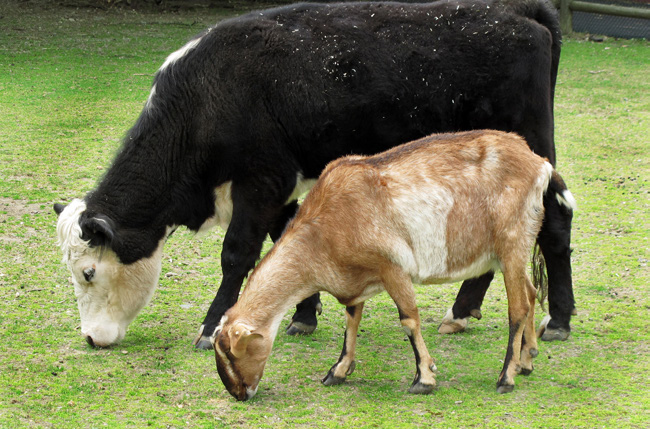

---
## Page 11

5
AUSVETPLAN  /  RESPONSE STRATEGY FOOT-AND-MOUTH DISEASE
2.3	 World distribution
For the latest information on the distribution of FMD, refer to the WOAH World Animal Health Information 
System database.9
2.3.1	 Distribution outside Australia
FMD is endemic in many parts of Africa, the Middle East and Asia, and parts of South America. Different 
FMD virus strains circulate in different parts of the world and can be tracked using viral genome 
sequencing.
WOAH maintains a list of countries and zones that it recognises to be officially FMD-free (with and without 
vaccination).10
The WOAH World Animal Health Information System database provides information on the FMD situation 
of member countries.11
2.3.2	 Occurrence in Australia
Australia is recognised by WOAH as a country free from FMD without vaccination.
Minor outbreaks of possible FMD in Australia were reported in 1801, 1804, 1871 and 1872. The last 
incident occurred in Victoria following importation of a bull from England. Two farms were involved 
before the disease was eradicated by stamping out (Bunn et al 1998).
2.4	 Epidemiology
2.4.1	 Incubation period
When spread is occurring within a herd or flock, the typical incubation period for FMD is 2–6 days but may 
range from less than 24 hours up to 14 days (Kitching 2002, Kitching & Alexandersen 2002, Kitching & 
Hughes 2002). For between-farm spread, it is more likely to be 2–14 days (DEFRA 2006).
Section 2.5.1 provides information on lesion ageing to aid determination of the time of introduction of the 
virus.
WOAH incubation period
For the purposes of the WOAH Terrestrial animal health code, the incubation period12 for FMD is 14 days.
2.4.2	 Persistence of agent and modes of transmission
General properties
FMD virus is small, with no lipid in the envelope.
FMD virus is most stable at pH 7.2–7.6 but will remain viable at pH 6.7–9.5 if the temperature is 4 °C or 
9	
	 wahis.woah.org/#/home 
10	
	 www.woah.org/en/disease/foot-and-mouth-disease/#ui-id-2
11	
	 wahis.woah.org/#/home
12	
	 In the WOAH Terrestrial animal health code, ‘incubation period’ means the longest period that elapses between the introduction of the pathogenic agent into 
the animal and the occurrence of the first clinical signs of the disease (see www.woah.org/en/what-we-do/standards/codes-and-manuals/terrestrial-code-
online-access/?id=169&L=1&htmfile=glossaire.htm).

---
## Page 12

6
AUSVETPLAN  /  RESPONSE STRATEGY FOOT-AND-MOUTH DISEASE
lower. Although inactivation times depend on many factors, the FMD virus half-life (or, under optimal 
conditions, the 10-fold reduction time) is approximately 12 hours at pH 6.5, 1 minute at pH 6, and 1 second 
at pH 5 (Alexandersen 2005).
Raising the temperature reduces the time for which FMD virus remains viable. At temperatures below 
freezing point, FMD virus is stable almost indefinitely. Although there is some variation between strains in 
resistance to temperature and/or pH stress, exposure to 56 °C for 30 minutes is sufficient to destroy most 
strains (Maree et al 2013).
Sunlight has little or no direct effect on infectivity of FMD virus; any loss of viability is due to secondary 
drying and temperature (Donaldson 1972).
The viability of airborne FMD virus is mainly influenced by relative humidity, with good viability above 60% 
relative humidity and rapid inactivation below 60% (Donaldson 1972).
FMD virus is susceptible to a range of disinfectants, including sodium hydroxide (2%), sodium carbonate 
(4%), citric acid (0.2–3%13), acetic acid (2%), sodium hypochlorite (3%), potassium peroxymonosulfate/
sodium chloride (1%) and chlorine dioxide (OIE 2013). For porous surfaces (eg wooden floors), higher 
concentrations of citric acid (at least 2%) are recommended (Krug et al 2012). Refer to the Australian 
Pesticides and Veterinary Medicines Authority for the latest information on relevant minor use permits 
for products used as disinfectants to treat equipment, fabric and surfaces in the event of an outbreak of 
FMD.14 
FMD virus is resistant to iodophores, quaternary ammonium compounds and phenol (OIE 2013).
The AUSVETPLAN operational manual Decontamination provides additional guidance on the use of 
disinfectants against FMD virus.
Environment (including windborne spread)
FMD virus can remain infective in the environment for several weeks and possibly longer in the presence 
of organic matter, such as soil, manure and dried animal secretions, or on chemically inert materials, 
such as straw, hair and leather. It was reported to persist for 345 days on one farm in California in 1924 
(Morgan 1993). FMD virus is reported as remaining viable for up to 50 days in water (Mahnel et al 1977).
Windborne spread15 is a complex phenomenon and is affected by a range of factors, including the strain 
of FMD virus, virus concentration, atmospheric conditions, local topography and terrain, and the density 
and susceptibility of animals in the exposed downwind area. In the 2001 outbreak of FMD in the United 
Kingdom (UK), the average spatial distance between transmission-linked cases indicated that FMD virus 
could infect susceptible animals approximately 9 km from the source (Salje et al 2016). As well, airborne 
spread of FMD virus occurred between Brittany and the Isle of Wight (Donaldson et al 1982). Under 
suitable conditions, windborne spread could lead to transmission of FMD virus over several kilometres in 
Australia (Garner & Cannon 1995), but it is unlikely that this distance would be as great as in the 2001 UK 
outbreak. Cool and wet weather conditions favour FMD virus transmission. Use of the SPREAD application 
during Australian FMD outbreaks may be useful in determining the significance of windborne spread as 
part of short-term (1–4 days) weather forecasts.
13	
	 permits.apvma.gov.au/PER92652.PDF
14	
	 portal.apvma.gov.au/permits
15	
	 ‘Windborne spread’ refers to infection of animals some distance from known foci and without any history of contact with infected animals, through 
movement of virus on the wind (Donaldson 1983). It is distinct from the short-distance aerosol transmission that commonly occurs between animals. It is 
also different from ‘local spread’.

---
## Page 13

7
AUSVETPLAN  /  RESPONSE STRATEGY FOOT-AND-MOUTH DISEASE
Local spread
In the 2001 UK FMD outbreak, local spread was attributed as the cause of new infected premises (IPs) 
if the new IP was within 3 km of a previously confirmed IP and more than one possible transmission 
pathway was identified (Gibbens et al 2001). In the first 5 months of the outbreak, 79% of spread was 
attributed to local spread to 1849 IPs across 12 geographic areas (Gibbens et al 2001). Gibbens et al 
(2001) suggested that contiguous grazing areas on neighbouring holdings occupied by livestock are an 
important factor in local spread, and that fomite and [short distance] aerosol transmission appear to 
be the predominant method of transmission within a cluster of IPs.
In the Japanese FMD outbreak of 2010, pig farms were more likely to induce local spread16 than cattle 
farms, and the likelihood of local spread increased as the farm size increased (Hayama et al 2012). 
Similarly, pig source farms resulted in infection of more neighbouring farms in a short time than cattle 
source farms. Hayama et al (2012) also noted that large pig farms posed a greater risk of inducing 
local spread, and that medium-sized and large cattle farms had a greater risk of induced infection. 
They noted that 70% of neighbouring farms within 500 m of infected pig farms developed clinical signs 
within 14 days of clinical signs on the pig source farm.
The observations of Hayama et al (2012) are consistent with knowledge that pigs amplify FMD virus and 
cattle are highly susceptible to infection. However, there are gaps in knowledge or assumptions, and 
the exact mechanisms of local spread have not been fully determined. Gibbens et al (2001) indicated 
that most local spread is believed to result from local aerosol spread between animals, particularly 
where they are contiguous, or by contamination in the area near an IP, resulting in infectious material 
on roads or other common facilities. Accordingly, the greater susceptibility of large cattle farms noted 
by Hayama et al (2012) may be associated with the inherent susceptibility of cattle, as well as the large 
management scale and frequent movements of animals, people, equipment and vehicles on and off 
farm.
Hayama et al (2012) concluded that causes of local spread were complex and depend on a range of 
factors, including location and layout of the farm; farm biosecurity practices; and the frequency of 
movement of animals, people, equipment and vehicles within a short distance. In addition, they noted 
that patterns of local spread would vary with background characteristics, such as geographical or 
topographical features, animal density, production type and volume of virus around the area.
Notwithstanding the above, understanding the potential risk of local spread in an affected area 
is critical for decision makers when formulating preventive or control measures. Culling infected 
piggeries, as virus amplifiers, is likely to reduce the amount of local spread, particularly where cattle 
are within the local area. In areas where medium-sized or large cattle farms are present, emergency 
vaccination may be more appropriate than preemptive culling, considering the high disease sensitivity 
of cattle and the time required for culling operations.
Live animals
FMD is one of the most contagious animal diseases.
Movement of infected animals is widely recognised as one of the most important routes by which 
FMD spreads between herds and farms. Transmission occurs most readily when animals are in close 
proximity, such as at watering and feeding points, and congregation points such as stockyards and 
milking sheds.
Animals are infected via inhalation, ingestion and artificial or natural breeding. The primary route 
16	
	 In the 2010 Japanese outbreak, ‘local spread’ was defined as disease transmission from a source farm to neighbouring farms within a radius of 500 m 
around the source farm (Hayama et al 2012).

---
## Page 14

8
AUSVETPLAN  /  RESPONSE STRATEGY FOOT-AND-MOUTH DISEASE
of infection in ruminants is inhalation of contaminated aerosols. In contrast, pigs are mainly infected 
through ingesting contaminated feedstuff.
Infected animals excrete virus in ruptured vesicular fluid, exhaled air, saliva, milk, semen, faeces and 
urine. Both clinically affected animals and preclinical animals can shed large quantities of virus. For 
example, excretion in semen and milk can occur for up to 4 days before clinical signs appear, and 
sheep excrete virus in their breath for around 24 hours before signs are apparent (Donaldson 1983). 
Virus excretion from most sites diminishes rapidly with the appearance of circulating antibodies. Most 
excretion of virus ceases within 6 days of the appearance of vesicles, although FMD virus has been 
detected in milk up to 3 weeks after the appearance of clinical signs (Alexandersen 2005), and in the 
semen of experimentally infected cattle for up to 8 weeks (Meyer et al 2017).
There are host species differences in both the excretion of virus and susceptibility via different routes of 
infection; these are discussed in Section 2.4.3.
Carriers
The carrier state17 of FMD virus is a common sequela for infected ruminants, particularly cattle and 
African buffalo (Syncerus caffer). The duration of the carrier state depends on the individual animal, the 
animal species and the virus strain. FMD virus may be recovered in probang samples intermittently, 
but not in excretions such as saliva and semen during the carrier state (Alexandersen et al 2002). FMD 
virus excretion by carrier animals is intermittent (Abd El Wahed et al 2013).
Ruminants vaccinated against FMD may also become carriers if exposed to infection, especially in the 
first few days after vaccination.
Neither pigs nor camelids become carriers of FMD virus (Alexandersen et al 2002).
The risk of disease transmission from carrier animals is controversial. Stenfeldt & Arzt (2020) stated 
that ‘neither re-activation of clinical disease nor vertical transmission has ever been documented from 
FMD virus carrier cattle’. They concluded from a range of studies that FMD virus transmission from 
persistently infected cattle is unlikely; however, transmission from persistently infected African buffalo 
may be more common. There is evidence that carrier buffalo have a role in the epidemiology of FMD in 
southern Africa (Condy et al 1985).
Importantly, virus carriers represent a natural reservoir of FMD virus in infected areas and a potential 
source of antigenically altered virus variants, since variants of the virus continually emerge and are 
selected in the animal during the carrier state (Wittman et al 1990).
Live wild (including feral) animals
Transmission of FMD virus could occur between wild (including feral) animals and domestic herds, 
which could result in spread of FMD.
The role of feral pigs in an outbreak of FMD in Australia is unknown. The Australian Government 
Department of Agriculture, Fisheries and Forestry and the University of Sydney modelled FMD 
outbreaks in northwestern Australia (Ward et al 2015). Domestic cattle and feral pig populations were 
represented as epidemiologically relevant groups. The findings suggested that, if FMD is controlled in 
domestic livestock, it is likely to be self-limiting in feral pigs. However, to eradicate disease as quickly 
as possible, feral animal populations within known disease areas may be targeted for surveillance and, 
if necessary, disease control, depending on the specific circumstances of the outbreak.
17	
	 Carriers are defined as ruminants in which virus can be intermittently found in the oropharyngeal area more than 28 days after infection, often without the 
animals displaying clinical disease. The FMD virus carrier state is referred to in some literature as persistent infection. For the purposes of this manual, 
these terms are considered synonymous.

---
## Page 15

9
AUSVETPLAN  /  RESPONSE STRATEGY FOOT-AND-MOUTH DISEASE
Observations on natural and experimental FMD have failed to show convincingly that dromedary camels 
have the same susceptibility to FMD virus as ruminants or pigs (Alexandersen et al 2008, Larska et al 
2009).
Feral goats may play a role in the epidemiology of FMD because of their potential to be virus carriers 
and vague clinical signs (Fleming 2004).
Six species of deer – chital, red, rusa, fallow, hog and sambar – are present in Australia. As a result of 
their isolation into small groups and general separation from livestock, it is considered that infection 
of cattle from deer is unlikely. However, more knowledge is required about the likelihood of contact 
between wild deer and commercial properties in high-risk areas (Bunn 2013). During an Australian 
FMD outbreak, the role of deer in the epidemiology of the outbreak may be considered for investigation.
Similarly, the role of water buffalo in the epidemiology of an Australian FMD outbreak would require 
investigation at the time of the outbreak. Their role as FMD virus carriers means that they may be 
involved in maintenance and transmission of virus, particularly in areas where they are abundant (eg 
the top end of the Northern Territory).
Refer to Appendix 6 for further information on the behaviour of FMD virus in live wild (including feral) 
animals overseas.
Carcasses
Infected carcasses (as well as fetal membranes) pose a transmission risk of FMD virus to susceptible 
animals (including feral animals), whether by direct ingestion or ingestion of contaminated forage, roots 
and soil.
Animal products
Meat, meat products and casings, including use as animal feed
FMD virus is inactivated rapidly once the pH falls below 6.2 (Cottral 1960), which occurs within 3 days in 
the meat of carcases that have undergone normal post-slaughter acidification. However, the virus may 
remain viable for prolonged periods in meat if the pH does not fall below 6.2. This might happen when 
carcases are chilled rapidly (Paton et al 2009). Dark, firm, dry (DFD) pigmeat may also fail to undergo 
post-slaughter acidification that would inactivate FMD virus. As well, virus can remain viable for months 
in chilled or frozen lymph nodes, bone marrow, viscera and residual blood clots. Deboning and removal of 
lymph nodes has been an accepted processing strategy for many years.
FMD virus may remain viable for prolonged periods in salted and cured uncooked meats (Dhennin et al 
1980ab); it has been recovered from sausages for up to 56 days, ham fat for up to 183 days and bacon for 
up to 190 days.
Dry cured meat products have been investigated for viability of FMD virus. Iberian hams, Iberian shoulder 
hams, Iberian loins and white Serrano hams were found to be free of viable FMD virus by day 168, 112, 42 
and 182, respectively, post-slaughter (Mebus et al 1993).
FMD virus has been recovered from processed intestinal casings from experimentally infected sheep, 
stored for 14 days at 4 °C (Bohm & Krebs 1974, Bohm 1975), and from processed pig intestinal casings for 
up to 250 days (Blackwell 1976).
Various procedures are reported to reduce the risk of FMD virus spread associated with processed items 
such as sausage casings derived from ruminant and pig intestines (Wijnker et al 2007, 2011).

---
## Page 16

10
AUSVETPLAN  /  RESPONSE STRATEGY FOOT-AND-MOUTH DISEASE
The WOAH Terrestrial Code chapter for FMD18 details recommended procedures for inactivating FMD virus 
in meat, meat products and casings through canning, cooking, and drying after salting.
Milk and dairy products, including use as animal feed
Unpasteurised raw milk and milk products from infected FMD-susceptible animals can contain 
considerable quantities of FMD virus (Salwa & Gaber 2007). FMD virus may be shed in milk from infected 
animals up to 4 days before the onset of clinical signs and for up to 3 weeks afterwards (Alexandersen 
2005). FMD virus has been detected in the milk of experimentally infected cattle for 23 days (Reid et al 
2005).
The viability of FMD virus in raw milk and milk products was reviewed by Morgan (1993), who highlighted 
the following:
•	 In cow’s milk and butter preserved under cold conditions, FMD virus can remain viable for 14–45 days 
(Blackwell & Hyde 1976).
•	 In dried skim milk produced from raw milk, FMD virus can remain viable for up to 2 years (Cottral 1969).
FMD virus has not remained viable in cheddar cheese cured for longer than 30 days (Blackwell 1976).
Although FMD virus can remain viable following pasteurisation, there are no reports to date of processed 
milk, or feeding or transport of processed milk or dairy products, causing disease spread during an 
outbreak.
The WOAH Terrestrial Code chapter for FMD details recommended procedures for inactivating FMD virus in 
milk.
Food safety
FMD is not a food safety concern. It cannot be transmitted to humans through consuming commercially 
produced meat, milk or dairy products, which would continue to be safe to consume in an FMD outbreak.19 
Milk, milk products or milk byproducts either of Australian provenance or legally imported for stockfeed 
use into Australia can be legally fed to pigs as an exemption under the nationally agreed prohibited pig feed 
definition (see ‘Swill’ in Glossary); however, feeding of these products will be prohibited during an FMD 
outbreak.
Animal byproducts
Hides, skin, wool and other fibres
The persistence of FMD virus on untreated wool and other fibres, skins and hides means that the virus 
could be transmitted to susceptible animals coming into contact with these products.
Approximate viability times of FMD virus in wool, hides and skin are (McColl et al 1995):
•	 7 weeks at 4 °C storage
•	 2 weeks at 18 °C storage
•	 2 days at 37 °C storage.
The WOAH Terrestrial Code chapter for FMD details recommended procedures for inactivating FMD virus in 
wool, hides, bristles, skins and trophies.
18	
	 www.woah.org/en/what-we-do/standards/codes-and-manuals/terrestrial-code-online-access
19	
	 www.foodstandards.gov.au/consumer/safety/Pages/Animal-diseases,-human-health-and-food-safety.aspx#:~:text=FMD%20is%20not%20a%20food%20
safety%20concern.%20It,foot%20and%20mouth%20disease%20which%20commonly%20affects%20children

---
## Page 17

11
AUSVETPLAN  /  RESPONSE STRATEGY FOOT-AND-MOUTH DISEASE
Skins
Persistence of FMD virus in skin tissue is determined by the rate of degradation of virus as a result of 
acidification. Salting or refrigeration of skins retards degradation and allows the virus to persist. Fully 
processed skins are a negligible disease risk for FMD (Scott Williams Consulting & Herd Health 2017).
Hides
FMD virus has been recovered from green salted hides for up to (Gailiunas & Cottral 1967):
•	 90 days at 15 °C
•	 352 days at 4 °C.
Hides cured for 20 hours in saturated brine with up to 500 ppm of available chlorine still had detectable 
FMD virus after 4 weeks of storage at 15 °C. FMD virus was also detected in a hide sample dried for 42 
days at 20 °C and 40% relative humidity (Gailiunas & Cottral 1967).
Hides cured in salt for 7 days and then dried at 20 °C were found to be infectious for FMD virus for 21 days 
(Gailiunas & Cottral 1967).
FMD virus can persist in untreated wool for up to 14 days after experimental contamination. Photo credit: Wool Producers Australia

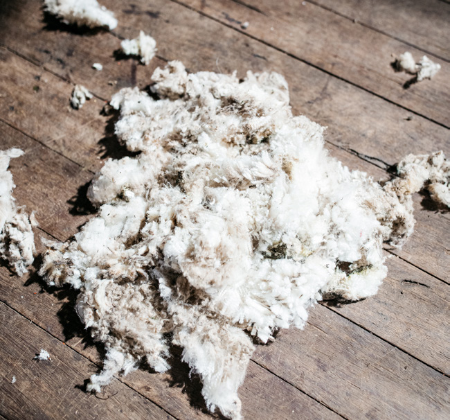

---
## Page 18

12
AUSVETPLAN  /  RESPONSE STRATEGY FOOT-AND-MOUTH DISEASE
Wool and other fibres
FMD virus has been recovered from wool from infected sheep following natural exposure (McColl et al 
1995). FMD virus could be recovered from greasy wool for up to 14 days after experimental contamination.
Factors influencing viability of FMD virus on wool and fibre include the presence of organic material (eg 
faeces), temperature and relative humidity in storage.
Swill and meatmeal
Many FMD outbreaks overseas have originated from feeding to pigs of prohibited pig feed (also referred 
to as swill), containing contaminated animal products, or meat scraps and bones from infected animals. 
Feeding of, or allowing pigs access to, prohibited pig feed is illegal in all Australian states and territories.
The nationally agreed definition of prohibited pig feed lists 100 °C for 30 minutes as an approved process 
for treatment of prohibited pig feed. This exceeds the recommendations in the WOAH Terrestrial Code 
chapter for FMD for inactivating FMD virus in meat and meat products.
Semen and embryos from live susceptible animals
FMD virus has been found in bull semen 4 days before, during and up to at least 37 days after the 
appearance of clinical signs. It has also been found in bovine semen stored at –50 °C for 320 days (Cottral 
et al 1968). 
FMD virus has also been found in pig semen, and is likely to occur in sheep and goat semen. The virus 
enters semen as a result of viraemia or lesions around the preputial orifice.
McVicar et al (1978) isolated FMD virus in boar semen up to 9 days post-exposure, and van Rijn et al 
(2004) noted that excretion in boars could be intermittent. Clinically normal boars can shed FMD virus 
in their semen (Maes et al 2008). Nonspecific antiviral and cytotoxic substances can complicate virus 
detection (Morgan 1993).
Van Rijn et al (2004) concluded that artificial insemination (AI) is a potential transmission mechanism 
for FMD infection, although the presence of a pathogen in semen used for AI is not proof that it caused 
infection in the sow herd. The risk of FMD transmission through AI must be ascertained based on 
likelihood and consequence. Following WOAH protocols identified in Chapters 8.8, 4.6 and 4.7 of the WOAH 
Terrestrial Code will reduce the likelihood of FMD transmission through AI.
For cattle embryos derived either in vivo or in vitro, FMD has been listed as a Category 1 disease by the 
International Embryo Technology Society (IETS). Category 1 diseases or pathogenic agents are those for 
which there is sufficient evidence to show that the risk of transmission is negligible, provided that the 
embryos are properly handled between collection and transfer, according to IETS guidelines.20 However, 
the likelihood of transmission of FMD virus via unwashed embryos (both in vivo and in vitro) is high.
For sheep, goat and pig embryos derived in vivo, FMD has been listed as a Category 3 disease by the IETS. 
Category 3 diseases or pathogenic agents are those for which preliminary evidence indicates that the 
risk of transmission is negligible, provided that the embryos are properly handled between collection and 
transfer, according to the IETS manual, but for which additional in vitro and in vivo experimental data are 
required to substantiate the preliminary findings.
Specimens
Handling of specimens for laboratory investigation poses a rare risk of FMD virus transmission to people. 
20	
	 Manual of the International Embryo Transfer Society (4th edition, 2010)

---
## Page 19

13
AUSVETPLAN  /  RESPONSE STRATEGY FOOT-AND-MOUTH DISEASE
However, specimens in transport and in the laboratory environment require risk mitigation practices to 
minimise the potential for accidental virus spread or escape from packaging, specimen receptacles and 
laboratory environments.
Waste products and effluent
Effluent from IPs (particularly piggeries and dairies) that drains onto roads, stock routes or pastures, or 
into creeks, can infect or contaminate animals, vehicles, equipment and people coming into contact with 
it.
FMD virus has been shown to remain viable in animal manure for the following periods (Bauer & Eissner 
1972, Rozov & Andryunin 1972, Callis et al 1980):
•	 dry manure – 14 days
•	 moist manure – 8 days
•	 manure mounds or piles 30 cm high – less than 6 days
•	 liquid manure – 34–42 days at 12–22 °C
•	 water from pen washings – 21 days at 17–21 °C.
FMD virus may remain viable in the urine of susceptible species and has been recorded as persisting in 
urine for up to 7 days (Cottral 1969); persistence of virus in urine will depend on temperature and pH.
Biological products (eg vaccines)
Outbreaks of FMD have been traced to the use of contaminated biological products, including inadequately 
inactivated FMD vaccines, vaccinia vaccine, hog cholera vaccine and pituitary extract.
Nonsusceptible animals
Nonsusceptible vertebrate animals can act as mechanical vectors for FMD virus through the movement of 
contaminated soil or other organic material.
People
People can act as mechanical vectors for FMD virus, by carrying the virus on their boots, clothes or 
skin. Spread has been associated with veterinarians, vaccinating teams, livestock owners and rodent 
exterminators.
It is also possible for the virus to be present in the nasal passages of people. People examining the head 
area of clinically affected pigs (which have higher levels of virus in their air passages than other species) 
could potentially harbour FMD virus in their nasal cavities. Usually, the period is 4–5 hours, but virus was 
recovered after 28 hours in one person (Sellers et al 1970). The likelihood of prolonged persistence (more 
than 24 hours) of FMD virus in the human nasal cavity has been assessed as low (Armstrong et al 1967).
Rarely, infection in people can occur through wounds to the skin following handling of diseased animals or 
the virus in the laboratory, or through the oral mucosa by drinking infected unpasteurised milk. Person-
to-person transmission has never been reported; however, vesicles from affected people do contain virus 
(Armstrong et al 1967). FMD is not a food safety concern. It cannot be transmitted to humans through 
consuming commercially produced meat, milk or dairy products, which would continue to be safe to 
consume in an FMD outbreak.21
.
21	
	 www.foodstandards.gov.au/consumer/safety/Pages/Animal-diseases,-human-health-and-food-safety.aspx#:~:text=FMD%20is%20not%20a%20food%20
safety%20concern.%20It,foot%20and%20mouth%20disease%20which%20commonly%20affects%20children

---
## Page 20

14
AUSVETPLAN  /  RESPONSE STRATEGY FOOT-AND-MOUTH DISEASE
Crops, grains, hay, silage and mixed feeds
Animals, especially pigs, might become infected with FMD virus by ingestion of contaminated forage, 
grain, animal products or water, or by licking contaminated objects.
The likelihood of contamination of crops, grain, hay and so on by infected feral or domestic animals 
depends on how recently the infected animals were present, the number of infected animals, species, 
virus excretion, environmental conditions (which influence virus viability), and management and 
grazing patterns (Auty et al 2019). Feed processing, such as silaging and mixing, may also influence the 
concentration of viable virus in the resultant feed. A case-by-case release and exposure assessment 
would assist in assessing the risk that crops, grains, hay and so on would play in the epidemiology of the 
outbreak. Factors for consideration include:
•	 time since detection of FMD
•	 declared area where the feed is produced
•	 proximity of the crop to IPs and dangerous contact premises
•	 access of FMD-susceptible feral animals to crops
•	 climatic conditions
•	 type of material contaminated.
FMD virus is reported to remain viable for:
•	 up to 74 days on pasture at 8–18 °C and high relative humidity
•	 26–200 days in soil, hay or straw, depending on storage or climatic conditions (Morgan 1993)
•	 15 weeks on hay (APHIS 1980, McKercher & Callis 1983)
•	 20 weeks on bran (APHIS 1980, McKercher & Callis 1983).
Vehicles, including empty livestock transport vehicles
FMD virus can be readily spread on contaminated vehicles, including milk tankers.
Vehicles used to transport infectious preclinical22 or clinical animals can become contaminated and serve 
as a source of infection for other susceptible species, as well as acting as an intermediate fomite vector. 
Vehicle surfaces that are difficult to decontaminate (eg porous surfaces) may harbour FMD virus and 
serve as a source of infection for naive animals.
Milk tankers can become contaminated with FMD virus during an outbreak through:
•	 collection of FMD virus–contaminated milk from a dairy farm during the preclinical phase of the 
disease
•	 collection of FMD virus–contaminated milk from a dairy farm during the clinical phase of the disease, 
if the farmer has either not recognised the clinical signs or not reported them to the relevant 
authorities
•	 physical contamination of the exterior of the vehicle (eg tyres); milk handling equipment (eg milk hose, 
milk sample bottles); or the driver’s hands, clothing and footwear with FMD virus.
The risk of contaminated milk transported by a milk tanker forming a plume (during filling or venting in 
transit) that would constitute a high enough dose of FMD virus to be infective to susceptible animals is 
thought to be negligible (Bestbier 2016).
22	
	 Animals can excrete FMD virus up to 2 days before appearance of clinical signs. The virus can also be shed in milk up to 4 days before appearance of 
clinical signs.

---
## Page 21

15
AUSVETPLAN  /  RESPONSE STRATEGY FOOT-AND-MOUTH DISEASE
Equipment, including personal items
FMD virus can be readily spread on contaminated equipment, boots and clothing. For example, FMD virus 
in tissue fluids or blood allowed to dry on various materials and kept indoors at room temperature may 
remain infective for 11 weeks on boot leather and 13 weeks on rubber boots (APHIS 1980, McKercher 
& Callis 1983). FMD virus has also been reported to remain viable for up to 35 days on cardboard, wood 
or metal contaminated with serum, blood or tissue and up to 398 days on wood contaminated with fat 
(Gailiunas et al 1969). It is also reported to persist for 26–200 days in sacking, depending on storage or 
climatic conditions (Morgan 1993).
Arthropod vectors
No arthropod vector has been identified as being important in the spread of FMD virus (Bachrach 1968).
2.4.3 Factors influencing transmission
Host species
Species differ in their likelihood of infection with FMD virus, their susceptibility to infection by different 
routes and the amount of virus subsequently shed (Gloster et al 2008; see Table 2.1). 
Pigs are the major amplifying host for FMD. Although pigs are primarily infected by ingesting 
FMD virus–contaminated feedstuff, they produce large amounts of virus in respiratory aerosols 
(Alexandersen et al 2003). Thus, spread of FMD from an infected piggery could be rapid and widespread, 
allowing the disease to gain a substantial foothold before the first clinical cases are diagnosed. Pigs can 
excrete significantly more FMD virus into the air than cattle (Donaldson et al 1970).
Table 2.1 Strain differences in amount of airborne FMD virus emitted (infectious units per minute)
FMD strain
Cattle
Sheep
Pigs
01
57
43
7 140
02
4
1.4
1 430
A5
93
0.6
570
A22
7
0.3
200
CNoville
21
57
42 860
CLebanon
6
0.4
260
1 infectious unit = 1.4 TCID50 (see Glossary)
Source: Adapted from Donaldson et al (1970)
The significantly higher respiratory tidal volume of cattle makes them more susceptible to aerosol 
infection with FMD virus than sheep or pigs – sheep have one-quarter, and pigs one-twelfth, the 
infection risk of cattle. Cattle are considered the best indicator species for the presence of FMD virus in 
an area.
Larger cattle herds are more likely to be infected with FMD virus than smaller ones because of the 
greater probability that at least one animal will inhale an infectious dose (Garner & Cannon 1995). 
Cattle feedlots, because of their size and species susceptibility, pose a significant risk of becoming 
infected, and the risk of the infection spreading through the feedlot is increased if destruction of 
infected animals is delayed.

---
## Page 22

16
AUSVETPLAN  /  RESPONSE STRATEGY FOOT-AND-MOUTH DISEASE
Bos indicus cattle are reported to be less susceptible to infection with FMD virus than other species. 
Expression of FMD in Bos indicus breeds can also be significantly milder, making detection of the 
disease more difficult.
Livestock production and marketing
Marketing and production systems in Australia can result in rapid dispersal of animals over wide areas. 
The ability to trace livestock movements and products is critically important to the early control of an 
FMD outbreak. The movement patterns of sheep may be particularly important, because infected sheep 
can show only mild, or no readily identifiable, clinical signs.
Extensively managed cattle and sheep in pastoral areas of Australia are observed less frequently than 
intensively managed livestock. They may also contain a high proportion of zebu breeds, which tend to 
show milder signs. FMD might therefore be harder to detect, and spread slowly and insidiously. In such 
enterprises, African experience suggests that spread of FMD is more likely in the dry season, when 
animals congregate at watering points. On the other hand, infection with FMD virus is less likely to 
be maintained because low stocking densities provide limited opportunity for spread, and the disease 
could die out naturally.
In Australia’s more intensively managed areas, livestock populations are denser and in closer contact. 
Local spread may play a significant role in transmission between herds or flocks in these areas. 
Frequent stock movements between individual enterprises and saleyards would facilitate rapid spread 
of FMD virus over wide areas. Windborne spread of FMD virus might also occur over greater distances 
in climates that are cooler and wetter. The chances of a rapidly spreading outbreak of FMD are thus 
higher, but the disease might be more readily detected.
High‑risk enterprises, such as intensive piggeries and feedlots, may influence the spread of FMD 
virus within a region. Large piggeries may have an increased risk of transmission because pigs act as 
amplifiers of FMD virus. Cattle feedlots, which also have large concentrations of animals, represent a 
special hazard, as the cattle are likely to be more easily infected through aerosols than are extensively 
grazed cattle.
In some areas, feral animals (pigs, buffalo, goats and cattle) are in close contact with livestock, and 
should therefore be considered for investigation as to their role in the epidemiology of an Australian 
outbreak.
Bos indicus cattle usually show milder clinical signs than Bos taurus breeds.

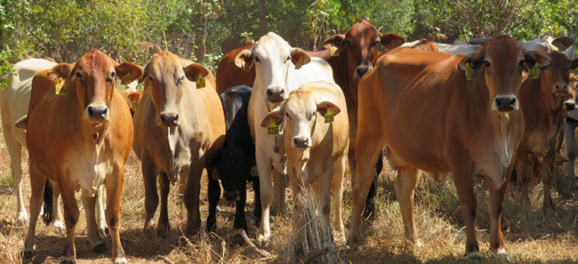

---
## Page 23

17
AUSVETPLAN  /  RESPONSE STRATEGY FOOT-AND-MOUTH DISEASE
2.5	 Diagnostic criteria
2.5.1	 Clinical signs
A wide range of clinical syndromes of FMD can occur, ranging from inapparent disease with minimal 
lesions to severe clinical disease; the classical signs and lesions of FMD are described below. Clinical 
signs in younger naive stock tend to be more severe, unless the animal is protected by maternal 
antibodies.
Animals
Cattle
A guide to estimating the age of lesions caused by infection with FMD virus in cattle and pigs is 
presented in Appendix 3.
In cattle, the earliest clinical signs of FMD are dullness, poor appetite and a rise in temperature 
to 40–41 °C. In dairy cows, milk yield drops considerably. Profuse salivation, nasal discharge and 
lameness may be observed, depending on the stage of infection. Affected animals move away from the 
herd and may be unwilling or unable to stand. Lethargy and rapid loss of condition are also features of 
the disease.
Vesicles may appear inside the mouth, on the tongue, cheeks, gums, lips and/or palate. At first, they 
are small, blanched areas. Fluid accumulates under these areas to form vesicles, which develop quickly 
and might reach 30 mm or more in diameter, especially on the dorsum of the tongue. Two or more 
vesicles can join to form a larger one, sometimes covering as much as half of the surface of the tongue. 
However, intact vesicles are not often seen, because they usually burst easily and within 24 hours, 
leaving a raw surface fringed by blanched flaps of epithelium. Alternatively, the fluid may drain, leaving 
an intact area of blanched epithelium. There may be profuse, frothy saliva around the mouth and, at 
intervals, a smacking or sucking sound. The lesions heal rapidly over several days.
Vesicles may form between the claws of the feet and along the coronary band. Initially, they appear as 
areas of blanched epithelium, and the underlying vesicles may not be obvious unless the epithelium is 
torn away. Foot lesions may also be masked by dirt, and careful examination of feet is needed in muddy 
conditions. There might be signs of pain in the feet; when forced to rise, the animal might walk gingerly 
and occasionally shake a leg as if to dislodge an object wedged between the claws. As the lesions 
heal, separation of the heels along the coronary band can occur. From 2 to 6 weeks after infection, the 
feet appear to be ‘slippered’ as the horn of the heel separates and may be easily removed from the 
underlying corium. Cracks in the heels can take a long time to heal in some animals, causing chronic 
lameness and weight loss.
Lesions can also occur on the teats and udder, and reduced lactation, mastitis and abortion are 
common. Aborted calves can contain FMD virus (Ranjan et al 2016).
Mortality in adults is usually low to negligible, but up to 50% of calves might die due to cardiac 
involvement and complications such as secondary infection, exposure or malnutrition.
In tropical areas, some recovered cattle can develop a heat intolerance syndrome, accompanied by long, 
thick hair (hirsutism) and generalised ill-thrift (Ghanem & Abdel-Hamid 2010, as cited in Abbas et al 
2012; Spickler 2014). They have been called ‘hairy panters’.
The disease can also be mild or inapparent, especially in Bos indicus breeds.

---
## Page 24

18
AUSVETPLAN  /  RESPONSE STRATEGY FOOT-AND-MOUTH DISEASE
Pigs
In pigs, the main sign is lameness, although this can be masked if the affected animals are on soft ground. 
Vesicles form around the top of the foot, on the heels and between the claws. The epithelium may appear 
blanched, or raw and ragged at the coronary band at the top of the hoofs. Affected pigs prefer to lie down 
and, when made to move, hobble painfully and squeal loudly. The feet might become ‘thimbled’ as the 
horny layer separates and is easily removed from the underlying corium. After several days, granulation 
tissue and new horn growth will be evident.
Snout lesions may develop, but quickly rupture, and mouth lesions are difficult to see. Vesicles can develop 
on the teats and spread over the skin of the mammary glands. Abortion is common and might even be 
the presenting clinical problem. Affected pigs may have a reduced appetite, become lethargic and huddle 
together. They may develop an increased temperature, but this feature is inconsistent (Spickler 2014). 
Significant mortality can occur in piglets up to 14 weeks of age, due to cardiac involvement (Spickler 2014).
Sheep and goats
In sheep and goats, the disease is usually mild with few lesions, and those lesions can easily be 
misdiagnosed as endemic diseases such as scabby mouth or footrot. Severely affected animals can, 
however, succumb to sudden, severe lameness affecting one or more feet. Vesicles form around the top 
of the foot and between the claws. They are not often noticeable in the mouth but may develop on the 
tongue and dental pad. Vesicles can also occur on the teats, and rarely on the vulva and prepuce, causing a 
reluctance to mate (Spickler 2014). Affected sheep look sick and are reluctant to stand. Milk yields can be 
expected to fall in commercial dairy goats and sheep (Kitching & Hughes 2002). Numerous abortions, along 
with mortality in lambs due to heart failure, can occur in some outbreaks (Spickler 2014). Aborted lambs 
may contain FMD virus (Spickler 2014).
During the 2001 epidemic in the UK, clinical signs in sheep were sometimes so mild that the presence of 
the disease was revealed only by very close examination of all the sheep in a flock. Monitoring of raised 
temperatures was also used in the UK to determine FMD infection in sheep. The mild or subclinical 
expression of the disease in sheep is a significant risk factor for spread of the disease.
Deer
The severity of the disease in deer can vary from mild or inapparent in some species to more severe in 
others. In Australia, although unlikely, it is possible that feral deer could play a role in the spread of disease 
to domestic animals under certain conditions (Bunn 2013).
In deer examined in the UK in 2001, the appearance and distribution of lesions were similar to those 
in sheep – in the mouth and on the feet. Viraemia and seroconversion were more reliable indicators of 
infection than the presence of clinical lesions.
Ageing of lesions
Understanding the age of lesions in FMD-affected animals can help identify the time of FMD virus 
introduction to the premises, and so inform tracing priorities and epidemiological assessment of the 
incident (see Section 4.3.5).
The descriptions in Appendix 3 for estimating the age of FMD lesions in cattle and pigs are based on 
those of Kitching & Mackay (1995), as referenced and illustrated in Foot and mouth disease ageing of 
lesions (DEFRA 2005) and A field guide to estimating the age of foot-and-mouth disease lesions (EUFMD 
nd). In general, oral lesions are often easier to use for ageing because lesions on the feet are often 
damaged, and may be obscured by dirt, faeces and other organic material. The guides also show lesions 
in sheep; however, as disease in sheep is often milder, with fewer lesions, ageing the lesions may be more 
challenging in this species.

---
## Page 25

19
AUSVETPLAN  /  RESPONSE STRATEGY FOOT-AND-MOUTH DISEASE
2.5.2	
Pathology
Gross lesions
The gross lesions observed in FMD are primarily vesicular lesions on the feet, mouth, muzzle, nose and 
udder. A detailed description of vesicles and their ageing is provided in Appendix 3.
Additional gross lesions can include erosions on rumen pillars at postmortem, and grey or yellow streaking 
in the heart from degeneration and necrosis of the myocardium in young animals of all species (‘tiger 
heart’) (OIE 2013, Spickler 2014).
Apart from identifying vesicles and heart lesions, pathological examination is important only in the 
differential diagnosis of other diseases.
Microscopic lesions
Viral replication in epithelial tissues occurs in the stratum spinosum. It results in the accumulation of 
intracellular and extracellular fluid, leading to the development of a vesicle. Sometimes, early rupture of 
this layer results in escape of fluid and a desiccated lesion. Other important secondary sites of replication 
include the ruminal lymph nodes and heart. In young animals, sudden death from myocardial necrosis 
might occur before the vesicles develop.
Pathogenesis
The most common route of infection, especially for ruminant species, is by inhalation of virus in droplets or 
aerosol. The virus adheres to the mucosa of the respiratory tract and primarily replicates in epithelial cells 
of the pharyngeal mucosa-associated lymphoid tissue crypts. It then undergoes widespread replication in 
pneumocytes in the lungs, resulting in a sustained viraemia (Arzt 2010) and spread to secondary sites, such 
as the epithelium, mucosa, mammary gland and myocardium (Neumann et al 2017). Pigs infected by the 
oral route undergo primary infection and replication of the virus in the oropharyngeal tonsils (Stenfeldt et 
al 2014).
2.5.3	
Differential diagnosis
The following diseases and conditions should be considered in a differential diagnosis of FMD:
Endemic	
•	 bluetongue (some serotypes)	
•	 mucosal disease	
•	 bovine papular stomatitis	
•	 bovine ulcerative mammalitis
•	 pseudocowpox
•	 bovine malignant catarrh	
•	 contagious ecthyma (‘scabby mouth’)	
•	 infectious bovine rhinotracheitis/infectious pustular vulvovaginitis	
•	 scalding, wetting, contact dermatitis	
•	 photosensitisation	
•	 mouth lesions in pigs from hot feed	
•	 laminitis, hoof abscess, footrot (eg from bad floors, new concrete, mud).

---
## Page 26

20
AUSVETPLAN  /  RESPONSE STRATEGY FOOT-AND-MOUTH DISEASE
Exotic 
•	 swine vesicular disease 
•	 vesicular stomatitis 
•	 vesicular exanthema 
•	 senecavirus A 
•	 rinderpest23
•	 peste des petits ruminants. 
2.5.4	 Laboratory tests
Samples required
State veterinary diagnostic laboratory staff will advise on the recommended samples and sampling 
techniques. Specimens essential for the rapid confirmation of FMD include (also refer to Table 2.2) the 
following.
For agent detection and characterisation – fresh samples:
•	 from live animals
	–
vesicular fluid in a sterile container
	–
epithelial coverings, flaps or swabs of vesicular lesions in phosphate-buffered gelatin saline (PBGS) 
or, in an emergency, sterile phosphate-buffered saline (PBS)
	–
whole blood
	–
oesophageal–pharyngeal fluid (via probangs)
•	 from dead animals (in addition to samples from live animals, if available)
	–
tissue samples, including lymph nodes (especially those around the head), thyroid, adrenals, 
kidney, spleen and heart, and any other observed lesions.
For serology – serum.
For histopathology (for differential diagnosis) – samples in formalin of lesion tissue (as above), including 
lesions of the upper gastrointestinal tract.
Note that two samples of each of the above should be taken, with the second sample held in the 
jurisdiction in case further investigation is required. For further information, see the AUSVETPLAN 
management manual Laboratory preparedness.
Sampling feral animals
Sampling wild or feral animals can present several challenges that make the usual approach to 
sampling impracticable. Remote locations, lack of a cold chain, animals found dead and untrained 
operators are all potential limitations. Several alternative approaches are possible to ensure that 
testing can proceed under challenging circumstances.
Sampling of blood or peritoneal fluid from animals found (recently) dead or shot is expected to be 
enough to detect acute infection.
23	
	 OIE Resolution 18/2011 recognises that all 198 countries with rinderpest-susceptible animal populations are free from the disease.

---
## Page 27

21
AUSVETPLAN  /  RESPONSE STRATEGY FOOT-AND-MOUTH DISEASE
Conventional approaches to sampling, if possible, are always preferred. If conventional approaches are 
not available, swab sampling in viral transport media is preferred to card-based methods.
Proprietary swabs such as the PrimeStore, COPAN eNAT, COPAN FLOQSwab and GenoTube swabs, or 
Whatman FTA cards, provide a method for sample collection that may inactivate, stabilise and preserve 
viral RNA without the need for refrigeration of the sample.
It is important to be aware that, although some of these sampling systems claim inactivation of the 
agent (some do not), this should not be assumed to be 100% effective. Adequate biosecurity measures 
must be taken in transporting all samples, regardless of whether the sampling system claims 
inactivation.
Transport of specimens
Specimens should be submitted in accordance with agreed state or territory protocols. Specimens 
should initially be forwarded to the state or territory laboratory for appropriate analysis, and 
assessment of whether further analysis will be required by the CSIRO Australian Centre for Disease 
Preparedness (CSIRO-ACDP), Geelong.
If the state or territory laboratory deems it necessary, duplicate samples of the specimens should be 
forwarded to CSIRO-ACDP for emergency disease testing, after the necessary clearance has been 
obtained from the chief veterinary officer (CVO) of the state or territory of the suspect case, and 
after the CVOs of Victoria and Australia have been informed about the case and the transport of the 
specimens to Geelong (for the first case). Sample packaging and consignment for delivery to CSIRO-
ACDP should be coordinated by the relevant state or territory laboratory.
FMD virus is a security sensitive biological agent (SSBA). Entities handling and transporting samples 
known or suspected to contain FMD virus should ensure that they meet their obligations under the 
SSBA Regulatory Scheme.
For further information, see the AUSVETPLAN management manual Laboratory preparedness.
Packing specimens for transport
Unpreserved tissue and blood specimens should be sent with water ice or frozen gel packs (dry ice or 
liquid nitrogen if a delay of more than 48 hours is expected) in a specimen transport container specified 
under the International Air Transport Association Dangerous Goods Regulations. Unless oesophageal–
pharyngeal fluid samples will arrive at the laboratory on the same day, they should be frozen, preferably 
in liquid nitrogen, very soon after sampling and packed with dry ice for transport.
For further information, see the AUSVETPLAN management manual Laboratory preparedness.
2.5.5	 Laboratory diagnosis
Networked laboratory approach for emergency animal disease management 
The Laboratories for Emergency Animal Disease Diagnosis and Response (LEADDR) network consists 
of the jurisdictional animal health laboratories from all states and the Northern Territory; CSIRO-ACDP; 
and the Australian Government Department of Agriculture, Fisheries and Forestry. It does not currently 
include private, university or industry animal health laboratories. The network reports to the Sub-
Committee on Animal Health Laboratory Standards under the Animal Health Committee. The role of 
the LEADDR network is to allow state and territory laboratories and the National Reference Laboratory 
to collaborate using harmonised or standardised testing methods and software platforms for targeted 
management of an emergency animal disease (EAD).

---
## Page 28

22
AUSVETPLAN  /  RESPONSE STRATEGY FOOT-AND-MOUTH DISEASE
In the event of an EAD outbreak, LEADDR laboratories may be required to carry out testing appropriate 
to the level of biosecurity and test capability of the individual laboratory.
CSIRO-ACDP tests
The testing method used by CSIRO-ACDP is shown in Figure 2.1. Further details of tests currently 
available at CSIRO-ACDP are shown in Table 2.2. They include direct tests such as real-time 
polymerase chain reaction (PCR) using TaqMan probes as a rapid and reliable diagnostic test. The 
samples are vesicular fluids, swabs or epithelial tissue. TaqMan-based real-time PCR takes 4 hours. 
This test is not serotype-specific and can only confirm the presence of FMD virus nucleic acid.
CSIRO-ACDP can also perform enzyme-linked immunosorbent assays (ELISAs) that can detect FMD 
virus antigens in vesicular fluid or homogenates of epithelial tissue from lesions. These tests are used 
initially with new samples to provide serotype-specific results; they provide results within 3–4 hours. A 
negative result does not confirm the absence of FMD virus.
Virus isolation in cell culture is useful for specimens with small amounts of FMD virus, to amplify the 
virus for subsequent characterisation and strain differentiation. This procedure takes 24–48 hours, 
or longer if passaging is required. In samples with larger amounts of virus, characterisation may be 
possible without the need to amplify the virus in cell culture.
Antibodies to the whole virus or nonstructural antigens appear in the serum 7–10 days after infection 
or vaccination. Several ELISA-based tests can be used to detect these antibodies. These tests are used 
to differentiate between infection-induced and vaccine-induced antibodies (DIVA tests;24 see Table 2.2).
Additional diagnostic tests include sequencing and electron microscopy. Nucleotide sequencing of 
selected genes or whole genomes can be used in molecular epidemiology.
24	
	 Validated in cattle
Figure 2.1 The current approach to diagnostic testing at CSIRO-ACDP
3 ABC ELISA = DIVA test; C-ELISA = competition ELISA; ELISA = enzyme-linked immunosorbent assay; FMD = foot-and-mouth disease; SVD = swine vesicular 
disease; VSV = vesicular stomatitis virus
Note: CSIRO-ACDP treats any vesicular disease exclusion by testing for all appropriate vesicular disease: samples submitted for either FMD, VSV or SVD 
exclusion will be automatically tested for the other relevant vesicular diseases.
Cattle, sheep 
and goats — 
run all
1. FMD ELISA 
2. FMD TaqMan 
3. VSV TaqMan 
4. FMD isolation 
5. VSV isolation
Pigs — run all
1. FMD ELISA 
2. FMD TaqMan 
3. VSV TaqMan 
4. SVD TaqMan 
5. FMD isolation 
6. VSV isolation 
7. SVD isolation 
Horses — 
run all 
 
1. VSV TaqMan 
2. VSV isolation
Agent Detection
Serology
Appropriate Sample
Serum
3 ABC ELISA
VSV 
neutralisation 
test
FMD C-ELISA
positive

---
## Page 29

23
AUSVETPLAN  /  RESPONSE STRATEGY FOOT-AND-MOUTH DISEASE
Animal infection or transmission is rarely used for diagnosis, having been replaced by the more 
efficient and sensitive in vitro procedures described above.
Table 2.2 Laboratory tests currently available at CSIRO-ACDP for diagnosis of FMD
Test
Specimen required
Test detects
Time taken to obtain 
result
Agent detection
qPCR
Vesicular fluids, swabs or 
epithelial tissue
Viral RNA
4 hours
ELISA
Vesicular fluids or 
epithelial tissue
Antigen and serotype 
identification
3–4 hours
Agent characterisation
Virus isolation and 
identification
Tissues
Virus
1–4 days
RT-PCR and sequencing
Tissue or virus isolate
Viral RNA
1–2 days
Serology
Liquid-phase blocking 
ELISA
Serum
Specific antibody
1 day
Solid-phase competition 
ELISA (C-ELISA)
Serum
Specific antibody
1 day
3ABC-ELISA (DIVA test)
Serum
Specific antibody
1 day
DIVA = differentiating infected from vaccinated animals; ELISA = enzyme-linked immunosorbent assay; PCR = polymerase chain reaction; 
qPCR = quantitative real-time polymerase chain reaction; RNA = ribonucleic acid; RT‑PCR = reverse transcription PCR
Source: Information provided by CSIRO‑ACDP, 2022 (refer to CSIRO‑ACDP for most up‑to‑date information).
Other tests
Experimentally, the use of herd tests such as bulk milk testing (Kompas et al 2017) and air filter 
sampling (Waters et al 2014; Pacheco et al 2015, as cited in Nelson et al 2017) have been identified 
as potential means of active surveillance for rapid post-outbreak detection of FMD. In feral pig 
populations, the use of baited cotton ropes for obtaining oral fluid samples has proven useful (Vosloo et 
al 2012).
Pen-side tests are another potential area for rapid detection of FMD in infected animals using tests 
such as portable reverse transcription PCR (RT-PCR), real-time reverse transcription recombinase 
polymerase amplification (RT-RPA) (Abd El Wahed et al 2013) and reverse transcription loop-mediated 
isothermal amplification (RT-LAMP) (Waters et al 2014). These tests have experimentally shown high 
sensitivity in a range of clinical and preclinical samples of infected pigs, sheep and cattle, and of air 
surrounding infected animals, and may be used for screening surveillance during an outbreak in 
Australia.

---
## Page 30

24
AUSVETPLAN  /  RESPONSE STRATEGY FOOT-AND-MOUTH DISEASE
DIVA testing
DIVA tests can be used to detect infected animals in a vaccinated population. They are based on 
detection of antibodies to nonstructural proteins of the virus. These proteins are only expressed as 
the virus replicates in the host and are either not present at all or present at very low levels in purified 
inactivated vaccines.
In Australia, DIVA testing would be based on an ELISA detecting antibodies to a nonstructural protein 
(3ABC) of the virus. Animals vaccinated with purified inactivated vaccines but not exposed to live 
virus are less likely to develop antibodies to 3ABC, but may develop antibodies after repeated booster 
vaccinations. It is important to note that, in animals infected after vaccination, antibodies induced by 
vaccination inhibit, but do not prevent, replication of the virus. Because the virus replicates at much 
lower levels, the titres of antibodies to nonstructural proteins such as 3ABC are much lower. As a 
result, the diagnostic sensitivity for vaccinated animals is lower than for animals infected but not 
vaccinated. This differential sensitivity must also be considered as part of the sampling strategy. For 
this reason, the 3ABC ELISA is used on a herd basis. More information is available in Hardham et al 
(2020).
2.6	 Resistance and immunity
In FMD-endemic countries, zebu breeds of cattle (Bos indicus) usually show milder clinical signs 
than introduced European breeds (Bos taurus). However, they can still become infected and transmit 
infection. Camelids, other than Bactrian camels, appear to have a high natural resistance to infection.
The immunity conferred by natural infection and vaccination is largely strain-specific. There is variable 
cross-protection between strains of FMD virus within the same serotype, and very little to none 
between different serotypes. Animals can be infected by multiple serotypes.
2.7	 Vaccination
Vaccination against FMD has been successfully used in many parts of the world to control the disease 
because it reduces the susceptibility of vaccinated animals to infection and viral excretion (following 
subsequent infection of vaccinated animals). Vaccination can be used in several different ways; different 
vaccination strategies can be used to aid eradication of FMD (see Appendix 5).
The current inactivated vaccines are either aqueous based (with an aluminium hydroxide adjuvant) or 
single- or double-oil emulsion based. Testing to differentiate between naturally infected and uninfected 
vaccinated animals (DIVA testing) is available (see Section 2.5.5).
The immune responses of different species to emergency vaccination in the field have not been well 
reported. Experimentally, the immune response appears to be consistent for cattle, sheep, goats and 
pigs, with protective immunity achieved within 7 days and often as early as 4 days after vaccination 
(Barnett & Carabin 2002). Calves born to vaccinated dams will develop better immunity if vaccinated at 
older than 3 months of age, due to the presence of maternal immunity (Elnekave et al 2016), and using 
a high-potency vaccine with a booster dose (Çokçalişkan et al 2017).
Even though vaccinated animals may still become infected, clinical signs are generally masked. This 
is more likely to be an issue where suppressive vaccination strategies are used (see Appendix 5). The 
incidence of clinical signs is influenced by the interval between vaccination and infection, declining as 
this interval increases; the match between the outbreak strain and the vaccine strain; the response of

---
## Page 31

25
AUSVETPLAN  /  RESPONSE STRATEGY FOOT-AND-MOUTH DISEASE
the animal’s immune system to vaccination; and the vaccine formulation used (Barnett & Carabin 2002). 
A well-matched vaccine can reduce the risk of infection and the quantity of virus excreted by animals if 
they do become infected.
Vaccination is a risk factor for development of a carrier state. Cattle and, to a lesser extent, sheep and 
goats, can become carriers after infection (see Section 2.4.2). Animals that are exposed to infection 
within a few days of vaccination may become carriers; however, the prevalence of carrier animals in 
a vaccinated population is generally low. Field evidence suggests that the risk of carriers (other than 
African buffalo) initiating new infections in susceptible animals is low. The low prevalence of carrier 
animals in a vaccinated population means that intensive surveillance sampling is required to prove 
freedom from disease.
Resistance to clinical disease induced by currently available high-potency vaccines wanes after 4–6 
months, so vaccination must be repeated at 6-monthly intervals. If oil adjuvant vaccines are used 6 
monthly for 2 years, annual revaccination might then be considered.25
2.8	 Treatment of infected animals
No specific treatment is available for FMD virus–infected animals.
2.9	 Control overseas
When FMD occurs in a country previously free from FMD, the main control measures implemented 
include quarantine, movement controls, tracing and surveillance, enhanced biosecurity, animal 
destruction, disposal and decontamination. Vaccination of susceptible animals may be used, with or 
without destruction of infected and potentially exposed animals (Paton et al 2009, Muroga et al 2012, 
Byeong-Yong 2015).
The Food and Agricultural Organization of the United Nations and WOAH provide guidance and support 
for countries where FMD is endemic to improve their control of FMD through the Global Foot and Mouth 
Disease Control Strategy,26 including the Progressive Control Pathway for Foot-and-Mouth Disease 
(PCP-FMD).
25	
	 For further information, see the European Pharmacopoeia (https://www.edqm.eu/en/european-pharmacopoeia-ph-eur-10th-edition-).
26	
	 www.fao.org/3/I9857EN/i9857en.PDF

---
## Page 32

26
AUSVETPLAN  /  RESPONSE STRATEGY FOOT-AND-MOUTH DISEASE
3.1	 Potential pathways of introduction
Human-assisted pathways for the introduction of foot-and-mouth disease (FMD) into Australia include the 
importation of:
•	 contaminated livestock products and byproducts, including genetic material
•	 contaminated equipment and clothing
•	 infected livestock.
Because Australia has strict import conditions in place, the introduction of FMD through the legal 
importation of these commodities is very unlikely. However, the illegal introduction and feeding of 
contaminated meat and dairy products to domestic pigs, or access of feral pigs to these products poses a 
significant risk.
Natural pathways, such as windborne spread of FMD virus to Australia from infected neighbouring 
countries, are considered to have negligible likelihood, as a result of the distance and prevailing weather 
conditions.
Implications 
for Australia
3
The illegal introduction and feeding of contaminated meat and dairy products to domestic pigs, or access of feral pigs to these 
products poses a significant risk.

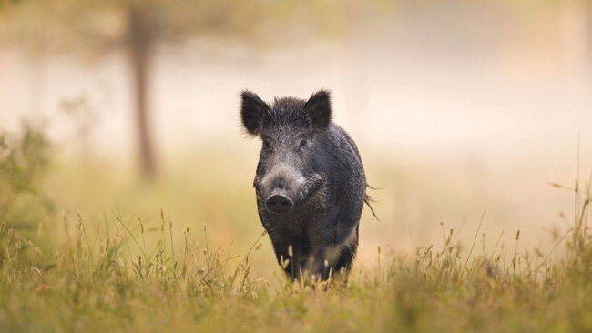

---
## Page 33

27
AUSVETPLAN  /  RESPONSE STRATEGY FOOT-AND-MOUTH DISEASE
3.2	 Social, economic and environmental effects
The economic effects of an outbreak of FMD, even on a small scale, would be enormous to individuals, 
the farming industry as a whole, and subsidiary and support industries (Buetre et al 2013). Direct effects 
on Australia’s major livestock industries would stem from export market closures, and the disruption to 
production associated with the disease and response activities. There would be significant flow-on losses 
to many rural and regional businesses that rely on livestock industry revenue – for example, from the 
impact of restrictions on the routine movement of livestock in Australia. In addition, it is expected that 
there would be indirect effects on sectors such as transport, government agencies, sporting and social 
events, the racing industry, food processors, retailers, stockfeed and animal byproduct industries, and 
tourism (Matthews 2011).
A large multistate FMD outbreak has an estimated direct economic impact over 10 years of around $80 
billion27 (in 2020–21 with a 3% discount rate).
A study by the Australian Bureau of Agricultural and Resource Economics and Sciences concluded that:
•	 over 10 years, a two-state (small) FMD outbreak is estimated to result in
	–
direct impact cost, due to revenue losses, of between $5.6 billion and $6.2 billion (in 2013 value 
terms)
	–
reduction of 0.03% ($4.6 billion) in Australia’s gross domestic product (GDP).
•	 for the same time period, a multistate (large) FMD outbreak is estimated to result in
	–
direct impact costs of between $49.3 billion and $51.8 billion (in 2013 value terms)
	–
reduction in GDP by an estimated 0.16% ($23.6 billion), although it is predicted that some direct 
competitors will increase production (Buetre et al 2013).
The Productivity Commission estimated that the direct impacts of an FMD outbreak in Australia would 
result in a 0.5% loss in employment in the first year of the outbreak. The likely fall in agricultural 
exports would be large enough to affect the exchange rate, and the value of the Australian dollar 
would fall by an estimated 2.5% during the first year and remain below pre‑FMD levels for 9 years 
(Productivity Commission 2002).
3.2.1	 Social impacts
The social impacts of an FMD outbreak may arise from loss of livelihood, loss of animals, uncertainty 
around future earnings and the stigma associated with the disease. There will also be concerns about 
the welfare of affected animal populations and the humaneness of the response measures applied to 
them. These factors may affect individuals’ mental health and lead to a potential loss of community 
cohesion in areas that have a heavy reliance on livestock production. Indigenous communities that use 
feral pigs as a source of food may also be affected.
Overall socioeconomic effects will be influenced by the length of time out of the market, which may 
depend on the control strategy used and the reaction of international trading partners.
27	
	 Estimate by the Australian Bureau of Agricultural and Resource Economics and Sciences in 2022 based on Buetre et al (2013), updating for current industry 
conditions and adopting the discounting approach outlined in Hone et al (2022)

---
## Page 34

28
AUSVETPLAN  /  RESPONSE STRATEGY FOOT-AND-MOUTH DISEASE
3.2.2	 Environmental impacts
Environmental impacts may result from natural causes (eg spread of infection between domestic and 
feral, wild or native animal populations) and from specific disease control measures (Productivity 
Commission 2002). Appropriate planning, preparation and execution of control measures should assist 
in minimising short- and long-term environmental impacts.
Impacts on feral, wild and native animals
Feral, wild and native animal species may become infected with FMD virus and serve as potential 
reservoirs of infection.
Destruction, disposal and decontamination controls to manage the risk of disease spread within these 
animal populations may have adverse environmental impacts.
Destruction
Activities associated with destruction of animals and contaminated items may have adverse 
environmental impacts. Use of firearms, gases and poisons for animal destruction could have adverse 
impacts on the environment in terms of air pollution (eg localised impacts on air quality from use of 
gases and firearms), land pollution from waste (eg shell casings; destruction of laboratory waste; 
chemical residues, such as barbiturates, in carcasses) and noise pollution (eg firearm blasts).
Disposal
Disposal of carcasses, animal products (eg meat, milk, virus-contaminated items) and wastes 
associated with response activities (eg consumables) is likely to have the most significant 
environmental impact, in both the short and longer terms. The method of disposal will significantly 
influence the impact on the environment and the environmental element (eg air, land, water) affected.
Decontamination
Effects of decontamination – including large volumes of water, disinfectants and consumables 
associated with decontamination (eg chemical containers) – may be significant.
Secondary effects from control activities 
Adverse environmental impacts may occur as a consequence of decreased farmer income and reduced 
discretionary spending towards on-farm soil conservation, salinity reduction, control of invasive plants 
and animals, and general environmental preservation.
3.3	 Critical factors for an Australian response
•	 FMD is one of the most contagious animal diseases. It can affect a wide range of livestock species and 
causes significant production losses.
•	 FMD virus–infected animals excrete large amounts of virus.
•	 FMD is spread most efficiently by the movement of live, infected animals. It can also be spread rapidly 
over long distances by movements of contaminated animal equipment, vehicles and people.
•	 Winds carrying FMD virus can spread the disease over considerable distances under suitable climatic 
and environmental conditions.
•	 FMD will rapidly spread through high-density populations such as intensive pig operations, feedlots 
and dairy farms. Pigs excrete large amounts of virus in respiratory aerosols and, as the main 
amplifying hosts, are extremely important in disease spread.

---
## Page 35

29
AUSVETPLAN  /  RESPONSE STRATEGY FOOT-AND-MOUTH DISEASE
•	 Local spread may be a significant transmission mechanism for premises in close proximity to one 
another (<3 km).
•	 Infected sheep and goats might show mild or inapparent signs, and therefore may be important in the 
undetected maintenance and spread of disease.
•	 Some recovered sheep, cattle and buffalo (but not pigs) can become carriers, for up to 9 months for 
sheep and 12 months for cattle (although there are some anecdotal reports suggesting that, under 
exceptional circumstances, a small proportion of cattle can harbour virus in the pharynx for up to 3.5 
years). These carrier animal species are unlikely to play a role in the epidemiology of disease but are 
important in terms of proof of freedom.
•	 Not all susceptible animals are capable of transmitting disease (eg camelids are unlikely to transmit 
infection).
•	 Deer are susceptible, but overseas evidence to date suggests that wild and feral populations pose a 
low risk of transmitting infection to domestic livestock.
•	 The role of feral species, particularly pigs, in the epidemiology of the disease in an Australian context 
is unknown.
•	 Although FMD virus has been isolated from the nose, throat and saliva of people who have had contact 
with infected animals, the likelihood of prolonged carriage (more than 24 hours) is considered to be 
low (Wright et al 2010).
•	 There is no public health risk from consumption of contaminated meat or animal products.
•	 Although FMD virus can remain viable following pasteurisation, there are no reports of processed 
milk, or feeding or transport of processed milk or dairy products, causing disease spread during an 
outbreak.
•	 Destruction of infected and suspect infected animals should be completed as rapidly as possible to 
reduce shedding of the virus and spread of disease.
•	 Vaccination can be used to protect animals from clinical disease, reduce the probability of infection, 
and reduce the amount of virus excreted if animals become infected.
•	 Under some circumstances, vaccination may reduce the duration of an outbreak. Some modelling 
based on specific scenarios suggests that vaccination may reduce the likelihood of a large, prolonged 
outbreak.

---
## Page 36

30
AUSVETPLAN  /  RESPONSE STRATEGY FOOT-AND-MOUTH DISEASE
4.1	 Introduction
4.1.1	
Summary of policy
The policy is to eradicate foot-and-mouth disease (FMD), and re-establish the FMD-free status of 
Australia in the shortest possible time, while minimising social, animal welfare, environmental and 
economic impacts, using stamping out supported by a combination of strategies, including:
•	 an immediate and ongoing assessment of the epidemiological situation
•	 rapid recognition and laboratory confirmation of cases
•	 an immediate national livestock standstill28 following diagnosis or strong suspicion of FMD, so that 
epidemiological information can be gathered and collated, and the potential extent and possible 
impacts of the outbreak can be assessed
•	 tracing and surveillance to determine the source and extent of infection (including, as necessary, in 
feral animals), and to provide proof of freedom
•	 implementation of legislated declared areas for disease control purposes
•	 application of biosecurity (including quarantine) and movement controls over susceptible animals, animal 
products and byproducts, and fomites – supported by a robust permit system – to minimise spread of 
infection
•	 typing of the outbreak strain of virus and ordering of appropriate vaccine
•	 active industry participation in the response, including engagement to provide technical expertise and 
facilitate cooperation 
•	 valuation and compensation for animals that have died or been destroyed, or property that has been 
destroyed for disease control purposes
•	 destruction and biosecure disposal of susceptible animals, property and things on infected premises 
(IPs), and other premises on a risk-assessed basis
•	 decontamination of IPs, and other premises on a risk-assessed basis
•	 decontamination and/or disposal of fomites to eliminate the pathogen
•	 proactive management of animal welfare issues that arise from the disease or the implementation of 
disease control measures
•	 surveillance and control of feral animal populations, as appropriate and where practical; hunting may be 
banned in nominated areas
•	 recall of animal products (eg dairy products for animal consumption) that are likely to be contaminated 
(unless deemed unnecessary by a risk assessment)
28	
	 A national livestock standstill (see Section 4.3.2) is a result of all jurisdictions, in aggregate, applying jurisdictional livestock standstills.
Policy and 
rationale
4

---
## Page 37

31
AUSVETPLAN  /  RESPONSE STRATEGY FOOT-AND-MOUTH DISEASE
•	 relief and recovery programs to minimise animal welfare and human socioeconomic issues
•	 a public information campaign.
Additional measures may be taken if authorities consider that they would be beneficial in containing and 
managing the outbreak, including:
•	 emergency vaccination to reduce susceptibility of animals to infection and clinical disease, and 
potentially reduce virus excretion
•	 pre-emptive destruction of susceptible animals to minimise spread of infection
•	 zoning and/or compartmentalisation (where appropriate).
4.1.2 Case definition
For the purpose of this manual, a case of FMD is defined as laboratory-confirmed infection with FMD 
virus in a susceptible animal.
Notes:
•	 Positive serology in the absence of genome or antigen does not constitute a case but warrants further 
investigation to determine if there is evidence of infection.
•	 At the time of an outbreak, revised or subsequent case definitions may be developed (with the 
agreement of the Consultative Committee on Emergency Animal Diseases – CCEAD).
Information on laboratory confirmation of infection and species susceptible to infection is provided in 
Sections 2.5.4 and 2.2, respectively.
4.1.3	 Cost-sharing arrangement
In Australia, FMD is included as a Category 2 emergency animal disease (EAD) in the Government 
and Livestock Industry Cost Sharing Deed in Respect of Emergency Animal Disease Responses (EAD 
Response Agreement – EADRA).29 When cost sharing of the eligible response costs of an incident is 
agreed, Category 2 diseases are those for which costs will be shared 80% by government and 20% by 
industry.
4.1.4	 Criteria for proof of freedom
The World Organisation for Animal Health (WOAH) has a mandate from the World Trade Organization to 
officially recognise FMD-free areas of countries for trade purposes.30 Any application to WOAH regarding 
recognition of Australia’s FMD status should be based on the WOAH Terrestrial animal health code chapters 
on FMD (Chapter 8.8)31 and general surveillance (Chapter 1.4),32 as well as the WOAH FMD questionnaire 
(Article 1.6.6).33 The application will require submission of a formal report to WOAH, detailing the 
eradication procedures carried out, the surveillance program undertaken and the results obtained.
See Section 7 for more details.
29	
	 animalhealthaustralia.com.au/eadra
30	
	 www.woah.org/en/what-we-do/animal-health-and-welfare/official-disease-status
31	
	 www.woah.org/en/what-we-do/standards/codes-and-manuals/terrestrial-code-online-access/?id=169&L=1&htmfile=chapitre_fmd.htm
32	
	 www.woah.org/en/what-we-do/standards/codes-and-manuals/terrestrial-code-online-access/?id=169&L=1&htmfile=chapitre_surveillance_general.htm
33	
	 www.woah.org/fileadmin/Home/eng/Health_standards/tahc/2016/en_chapitre_selfdeclaration.htm

---
## Page 38

32
AUSVETPLAN  /  RESPONSE STRATEGY FOOT-AND-MOUTH DISEASE
4.1.5	 Governance
Governance arrangements for the response to EADs are outlined in the AUSVETPLAN Overview.
Information on the responsibilities of a state coordination centre and local control centre is available in 
the AUSVETPLAN management manual Control centres management (Parts 1 and 2).
4.2	 Public health implications
FMD is not a food safety concern. It cannot be transmitted to humans through consuming commercially 
produced meat, milk or dairy products, which would continue to be safe to consume in an FMD outbreak.34
The human hand foot and mouth disease is not caused by FMD virus but by a coxsackievirus, a member of 
the Enterovirus genus of viruses.
4.3	 Control and eradication policy
The policy for an outbreak of FMD is to eradicate the disease through stamping out to re-establish the 
FMD-free status of Australia in the shortest possible time, while minimising social, animal welfare, 
environmental and economic impacts.
Stamping out will be the default policy initially.
34	
	 www.foodstandards.gov.au/consumer/safety/Pages/Animal-diseases,-human-health-and-food-safety.aspx#:~:text=FMD%20is%20not%20a%20food%20
safety%20concern.%20It,foot%20and%20mouth%20disease%20which%20commonly%20affects%20children
There are no food safety concerns for humans in the consumption of meat and dairy products in an FMD outbreak.

---
## Page 39

33
AUSVETPLAN  /  RESPONSE STRATEGY FOOT-AND-MOUTH DISEASE
The aim of stamping out is to ensure that IPs are quarantined (to contain infection on the premises) and 
susceptible animals are destroyed to limit the spread of the virus. Stamping out should be completed 
as soon as possible. It will be implemented on all IPs, and potentially on dangerous contact premises 
(DCPs), subject to risk assessment. Animals on suspect premises (SPs) and trace premises (TPs) must 
be assessed as soon as possible to enable these premises to be reclassified (and appropriate action to 
be taken). Tracing and surveillance will play a critical role in identifying infected and in contact animals to 
determine the extent of the restricted areas (RAs), control areas (CAs) and outside area (OA).
Animals that are considered to be most infective will be given priority for destruction, in accordance with 
the AUSVETPLAN operational manual Destruction of animals. Animals showing clinical signs should be 
destroyed first to reduce virus excretion. Where possible, infected pigs should be destroyed before cattle, 
and cattle before sheep (based on the volumes of virus excreted by each species). Clinically infected 
animals will be followed by susceptible animals presenting the next highest risk, such as those in direct 
contact with clinical cases.
The primary objectives of the policy are to prevent:
•	 contact between infected and susceptible animals
•	 production of large volumes of virus by infected animals
•	 indirect spread of virus by people and fomites.
These objectives can best be achieved by implementing several strategies, including:
•	 rapid diagnosis and laboratory confirmation of cases
•	 biosecurity (including quarantine) and movement controls over high-risk premises and declared areas
•	 valuation and compensation for animals that have died or been destroyed, or property that has been 
destroyed for disease control purposes
•	 destruction and biosecure disposal of infected animals and potentially contaminated animal products, 
byproducts and wastes
•	 management of animal welfare
•	 tracing and surveillance
•	 effective public information and industry engagement.
Zoning or compartmentalisation for international trade may also be considered. The potential for feral 
and wild animals to compromise containment and eradication needs to be assessed and appropriately 
managed.
Implementation of these strategies would be supported by ongoing epidemiological assessment of the 
incident.
The strategic use of emergency vaccine, in accordance with international standards, may be considered if 
the disease spreads, or is forecast to spread, beyond the limit of available resources to contain it. Use of 
emergency vaccine could protect areas with high animal concentrations, limit infection and minimise virus 
excretion, minimise the number of animals that may need to be destroyed, or reduce the likelihood of a 
prolonged or large outbreak. Pre-emptive vaccination in the absence of an outbreak of FMD in Australia 
will not occur.
Where eradication (with or without vaccination) is impractical or infeasible, a long-term control program 
may need to be considered through close consultation between industries and governments (see 
Section 4.4).

---
## Page 40

34
AUSVETPLAN  /  RESPONSE STRATEGY FOOT-AND-MOUTH DISEASE
4.3.1	 Epidemiological assessment
Epidemiological investigation or assessment draws on multiple sources of information to build 
understanding of the disease and how it is behaving in an outbreak. This helps inform response decision 
making.
The key objectives for an epidemiological assessment will be to identify the:
•	 spatial distribution of IPs, DCPs, SPs, TPs and dangerous contact processing facilities (DCPFs), and 
premises with susceptible animals
•	 spatial distribution of infected and susceptible wild animal populations
•	 likely date and source of introduction and establishment of FMD virus
•	 appropriate tracing windows
•	 prevalence of infection
•	 possible variations in presenting signs seen under Australian field conditions from those previously 
recorded for the outbreak strain
•	 pathways of spread and their risk profiles
•	 risk factors for the presence of infection and susceptibility to disease
•	 likely size and duration of the outbreak, using modelling where available.
Epidemiological assessment, and tracing and surveillance activities in an EAD response are interrelated 
activities. Early findings from tracing and surveillance will be inputs into the initial epidemiological 
assessment (eg considering the temporal and spatial distribution of infection). The outcomes of the 
epidemiological assessment will guide decisions on subsequent tracing and surveillance priorities, 
as well as selection of other appropriate response measures (eg application of movement controls). 
Ongoing epidemiological assessment will aid evaluation of the continued effectiveness and value of 
response measures, and will contribute evidence to support any later claims of disease freedom. See 
Section 7 for further information.
Genomic sequencing may aid an epidemiological understanding of the temporal and spatial spread of 
infection. It may also provide useful information to support ongoing epidemiological assessment and 
choice of evidence to support proof of freedom.
4.3.2	 Biosecurity and movement controls (including quarantine)
In a response to FMD, biosecurity and movement controls (including quarantine) will be immediately 
imposed on all premises and declared areas on which infection or contamination with FMD virus 
is either known or suspected. The implementation of biosecurity and movement controls will be 
underpinned by the use of legally declared areas and application of premises classifications (see 
Section 5).
Movement controls and enhanced biosecurity requirements will be implemented to minimise the risk 
of spread of FMD, particularly into uninfected areas and populations. In accordance with Section 6, 
controls may be placed on the movement of infected or potentially infected animals and contaminated 
or potentially contaminated things (including semen and embryos; products and byproducts; vehicles; 
equipment; people; nonsusceptible animals; crops, grains, hay, silage and mixed feeds; and manure/
effluent).

---
## Page 41

35
AUSVETPLAN  /  RESPONSE STRATEGY FOOT-AND-MOUTH DISEASE
Biosecurity controls to prevent contact between susceptible feral and domestic animals should be 
implemented, where practical, to avoid infection of domestic animals from feral animals and vice versa. 
Other disease control strategies that may be implemented for feral animals include:
•	 a ban on most permitted hunting (only hunting with authorisation from government authorities will be 
allowed)
•	 culling of feral populations
•	 control of human-assisted movements of potentially infected feral animals and carcasses, and 
associated fomites (eg hunting equipment, hunting dogs, vehicles, equipment).
Also refer to the AUSVETPLAN operational manual Wild animal response strategy.
Aggregations of live susceptible animals (eg shows, scales operations, saleyards) will be prohibited in 
the RA and CA. Operation of aggregation points in the OA should be at the discretion of the jurisdiction. 
If they are allowed to operate, the animals must be held for a minimal time, and be for slaughter only.
Enhanced biosecurity will be encouraged on all premises with susceptible animals, including those 
outside declared areas.
Detailed guidelines for classifying (and reclassifying) declared areas and premises are provided in the 
AUSVETPLAN guidance document Declared areas and allocation of premises definitions in an emergency 
animal disease response.
Site-specific biosecurity and movement controls
All premises on which infection is confirmed (IPs and approved disposal sites – ADSs) or suspected 
(SPs, TPs, DCPFs and DCPs) will be subject to biosecurity and movement control measures until 
assessed, controlled or reclassified.
The initial response to strong suspicion or confirmation of the disease in Australia (regardless of 
jurisdiction) will be the immediate declaration of a national livestock standstill prohibiting all new 
movements of live susceptible animals unless an emergency permit has been issued. A national 
livestock standstill is a result of all jurisdictions, in aggregate, applying jurisdictional livestock 
standstills through relevant state or territory legislation. Although a livestock standstill is intended 
to be a coordinated approach to movement restrictions across jurisdictions, implementation and 
revocation of the standstill may vary in timing between jurisdictions.
The decision to declare a national livestock standstill will be made by the National Management Group 
(NMG), on the advice of the CCEAD.
Additional controls on the movements of potentially infected or contaminated animals, products and 
fomites may be implemented in declared areas in each jurisdiction. These measures will be determined 
using available epidemiological information to assess the risk within the state or territory.
The duration of a national livestock standstill will depend on the circumstances of the incident, but 
will be at least 72 hours. Any decision to extend or lift the national livestock standstill will be made by 
the NMG, on advice from the CCEAD, based on an assessment of risks, the outcomes of initial tracing, 
surveillance information and the identified epidemiology of the outbreak.
The national livestock standstill will apply only to FMD-susceptible animals. However, during the 
livestock standstill, jurisdictions may impose movement controls over susceptible animal products (eg 
meat, milk, carcases, offal) and equipment.

---
## Page 42

36
AUSVETPLAN  /  RESPONSE STRATEGY FOOT-AND-MOUTH DISEASE
Section 6.3 provides more details of the movement controls to be implemented during and following a 
national livestock standstill.
4.3.3	 Biosafety and biosecurity for personnel
FMD is not a significant public health risk, but care should be taken to prevent the further spread of 
FMD virus through movements of people.
Personnel involved in handling livestock and/or potentially contaminated items or areas (eg those 
involved in sampling animals, products or byproducts; or in destruction, disposal and decontamination 
activities) on high-risk premises (IPs, DCP, DCPFs, SPs, ADSs and TPs) should be considered 
contaminated. For these personnel, recommended measures for personal decontamination on exit 
from the premises include a change of clothing and footwear, nose blowing and decontamination of 
exposed skin.
Where disposable coveralls and footwear are used, these should remain on site and be disposed 
of in a biosecure manner (see Section 4.3.12). Nondisposable clothing should be laundered and 
nondisposable footwear decontaminated (see Section 4.3.13).
Work by Wright et al (2010) suggests that the likelihood of FMD virus remaining viable in human 
nasal cavities 16–22 hours after exposure to infected animals is low. Therefore, the time between 
people working with animals from different epidemiological units should be 28 hours if appropriate 
risk mitigation and decontamination measures are adopted. Stand-down periods should not apply for 
activities conducted with animals in the same epidemiological unit, at the same premises, provided 
that personnel have had no contact with any other domestic or wild susceptible species between visits.
Recommended controls on the movements of people are provided in Section 6.3.13.
4.3.4	 Biosecurity for equipment
Equipment to be used in the handling of livestock or potentially contaminated items or areas (eg 
equipment used in the sampling of animals, products or byproducts; or in destruction, disposal and 
decontamination activities) on high-risk premises (IPs, DCPs, DCPFs, approved disposal sites – ADSs, 
SPs and TPs) should be considered contaminated and either disposed of on-site (see Section 4.3.12) or 
subject to decontamination (see Section 4.3.13).
Recommended controls on the movements of equipment and vehicles are provided in Section 6.3.11.
4.3.5	 Tracing and surveillance
Guidance on tracing and surveillance can be found in the AUSVETPLAN guidance document Tracing 
and surveillance.
Tracing
Rapid trace-forward (spread tracing) and track-back (source tracing) of risk animals and items from 
IPs will help identify the source of the disease, the primary case(s), and the location of potentially 
infected animals and contaminated items. This will help identify the origin of the disease and define 
the potential extent of disease spread.
It is important to estimate the date when FMD virus is likely to have been introduced onto each IP, 
from which forward and backward tracing will be undertaken. This can be estimated by ageing the 
oldest lesions on affected animals on the IP (to ascertain the onset of clinical signs) and taking into 
consideration the likely incubation period of FMD (see Sections 2.5.1 and 2.4.1, respectively).

---
## Page 43

37
AUSVETPLAN  /  RESPONSE STRATEGY FOOT-AND-MOUTH DISEASE
Tracing should include:
•	 susceptible species
•	 animal products – meat, offal, milk and dairy products (including any evidence of illegal swill feeding), 
wool, skins, hides, semen and embryos, and wastes and effluent
•	 vehicles
•	 materials – hay, straw, crops, grains and mixed feed
•	 people.
Information management systems (eg MAX) should be used to support tracing activities, as well as 
examination of farm records and interviews with farm workers and managers. Databases for the 
National Livestock Identification System (including PigPass) and documents such as National Vendor 
Declarations should be used to assist with tracing and epidemiological investigation.
Prioritisation of tracing (forward and back) will assist in targeting the highest-risk traces first and may 
reduce the extent of disease spread. The European Commission for the Control of Foot-and-Mouth 
Disease (EUFMD)35 provides the following guidance on FMD tracing priorities, based on international 
experiences.
Trace-forward (spread tracing) – principles of prioritisation
Trace-forward activities should be prioritised according to the risk (likelihood and consequence) of 
FMD spread (see Figure 4.1). Items that have been effectively decontaminated (see Section 4.3.13) or 
products and byproducts that have been adequately treated to inactivate FMD virus (see Section 4.3.10) 
may not require further tracing and investigation.
In determining the likelihood of a traced item successfully spreading disease, a spread/transmission 
pathway analysis (eg scenario tree and release assessment) informs all possible transmission 
pathways and their relative importance. This step is most important in an outbreak situation where 
the disease is behaving differently from the epidemiological profile described in this manual (eg pig-
adapted FMD virus).
35	
	 European Commission for the Control of Foot-and-Mouth Disease, Food and Agriculture Organization of the United Nations, Module 4, Real Time Training, 
Nepal, 2019.
The National Livestock Identification System (NLIS) database will be used to help tracing.

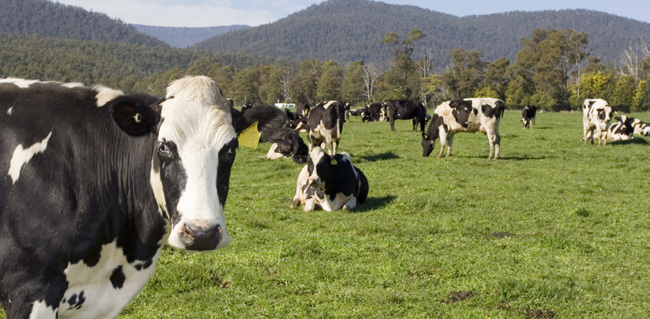

---
## Page 44

38
AUSVETPLAN  /  RESPONSE STRATEGY FOOT-AND-MOUTH DISEASE
Once transmission pathway likelihoods are determined, consideration of when the movement occurred 
in relation to the identified trace windows will determine the situation-specific likelihood.
Consequences of each trace-forward in terms of potential for further spread are identified and 
considered, taking into account the following:
•	 The geographic area to which the movement has occurred (in general, OA is more important than CA, 
which is more important than RA) (OA > CA > RA) (see Section 5.1).
•	 Susceptible populations, densities and potential for further spread.
	–
High-consequence traces may be associated with
	»
livestock hubs and aggregation points (eg markets, saleyards, events) and premises with a 
high volume of stock movements (eg markets, saleyards, feedlots, depots), where subsequent 
movements present a higher likelihood of disease spread
	»
processors with multiple suppliers or receivers who may be affected by contamination
	»
distributers of genetic material (eg artificial insemination technicians)
	»
rare ad valuable animals that may be of high genetic value (eg seed stock), or are threatened or 
protected (eg in zoological collections).
	–
The infectivity and susceptibility of the species involved in the trace are significant.
	»
Cattle are the main indicator species and are chiefly infected through the respiratory route.
	»
Pigs amplify the virus and are chiefly infected through ingestion.
	»
Sheep and goats are the maintenance species and are chiefly infected through the respiratory 
route.
	–
Large susceptible populations (eg beef feedlots, piggeries, dairies) are significant in terms of 
amplification of virus (eg through pigs), susceptibility through aerosol (eg ruminants are more 
significant than pigs) and spread (eg through direct and indirect contact).
Trace-forward (spread tracing) – priorities from an IP
In cattle, transmission can begin 2 days before the onset of lesions. Peak transmission in cattle occurs 
from 1 day before to 2 days after appearance of clinical signs. The virus may be excreted in milk 2 days 
before this (ie most likely from 3 days before to 2 days after appearance of clinical signs, and less likely 
4 days before to 5 days after appearance of clinical signs). The likelihood of spread is lower from 2 
days before to 5 days after the appearance of clinical signs. EUFMD provides guidance on FMD tracing 
priorities based on international experiences.
The following steps should be used to determine the trace-forward priorities from an IP:
1.	 Identify the trace window. Traces occurring within the trace window are highest priority. Where 
resources are limited, prioritising trace-forward from IPs should occur on a risk-assessed basis, 
taking into account the field epidemiological assessment.36
2.	 Within the trace window, rank the traces by consequence (potential for spread). This includes the 
destination (eg OA > CA > RA) and dispersal potential (eg livestock hubs).
3.	 Within the trace window, rank the species, and direct and indirect pathways that are most likely to 
spread the virus from the IP.
36	
	 For example, 2 days before (3 days before for milk) to 2 days after clinical signs appeared may be used as a minimum, bearing in mind that this is much 
shorter than the WOAH incubation period of 14 days.

---
## Page 45

39
AUSVETPLAN  /  RESPONSE STRATEGY FOOT-AND-MOUTH DISEASE
Trace-back (source tracing) – principles of prioritisation
Identification of premises where the disease may have come from is important to identify foci of 
infection and spread of disease to other premises. Trace-back should be prioritised for investigation 
according to the risk – that is, the likelihood that the trace is the source of infection and the 
consequence of spread to other premises from the premises where the trace originated. Items that 
have been effectively decontaminated (see Section 4.3.13) or products and byproducts that have been 
adequately treated to inactivate FMD virus (see Section 4.3.10) may not require further tracing and 
investigation.
In determining the likelihood of a traced item being the source of infection, consideration should be 
given to the movements onto the premises during the trace-back window (the likely time when the 
first animal on the IP was infected). Movements outside the trace window should be lower priority, with 
priority given to those most likely to transmit disease.
To determine the trace-back window, it is important to estimate the date when FMD virus is likely to 
have been introduced onto the IP. In the initial stages of an outbreak, an estimated date of introduction 
to a premises may not yet have been determined. In this case, for each IP, trace-back should be 
applied for a minimum of 14 days before the onset of clinical signs. The 14 days represents the 
possible infection window. Within the 14-day trace-back window, priority should be given to tracing of 
movements onto the IP in the 2–6 days before the appearance of clinical signs on the premises, up until 
the time that effective quarantine was imposed. If trace-back over the 14-day period does not identify 
the source of infection, an extended trace-back window should be considered.
Likelihood is also informed by the geographic areas from which the movement onto the IP occurred (OA 
< CA < RA).
Similar to trace-forward, the following should be considered in prioritisation:
•	 Susceptible populations, densities and potential for further spread
	–
High-consequence traces may be associated with
	»
livestock and genetic material (eg semen) 
	»
hubs and aggregation points (eg markets, saleyards, events)
	»
premises with a high volume of stock movements (eg markets, saleyards, feedlots, depots), 
where subsequent movements present a higher likelihood of disease spread
	»
rare and valuable animals that may be of high genetic value (eg seed stock), or are threatened 
or protected (eg in zoological collections).
	–
The infectivity and susceptibility of the species involved in the trace are significant.
	»
Cattle are the main indicator species and are chiefly infected through the respiratory route.
	»
Pigs amplify the virus and are chiefly infected through ingestion.
	»
Sheep and goats are the maintenance species and are chiefly infected through the respiratory 
route.
	–
Large susceptible populations (eg beef feedlots, piggeries, dairies) are significant in terms of 
amplification of virus (eg through pigs), susceptibility through aerosol (eg ruminants are more 
significant than pigs) and spread (eg through direct and indirect contact).

---
## Page 46

40
AUSVETPLAN  /  RESPONSE STRATEGY FOOT-AND-MOUTH DISEASE
FMD prioritising trace forwards
Criteria
Trace window
Destination
Susceptible 
populations
Contact type
Transmission 
pathway
Species
*Contaminated vaccine may be a result of the following: (a) contamination of vaccination bottles or delivery systems with FMDV on a vaccination premises (i.e. 
vaccinating infected animals and using the same vaccine source and delivery systems for subsequent animals); (b) contamination of vaccine bottles or delivery 
systems with FMDV through the splitting and redistribution of contents of vaccine bottles; (c) accidental or intentional contamination with FMDV during the 
manufacture, storage or distribution of vaccine.
By example, highest priority trace forwards are those associated with animal movements (direct contact) within the most likely infection period (within trace 
window) from an IP. Pig movements and movements to/from livestock hubs and aggregation points further elevate the priority because of the significant potential 
to amplify and spread virus.
Figure 4.1 Summary of trace-forward prioritisation
1d before (3d for milk) 
to 2d after clinical signs
1d before (3d for milk) 
to 2d after clinical signs
Virus excretion period 
for each species
HIGHER PRIORITY
LOWER PRIORITY
OA
CA
RA
HIGHER PRIORITY
LOWER PRIORITY
Aggregation 
points
Pigs
Premises with 
high volume stock 
movements
Cattle
Direct 
animal 
contact
Local 
spread
Contaminated 
vaccine*
Fomites 
direct 
contact
Contaminated 
animal 
products - 
direct contact
Fomites 
indirect 
contact
Contaminated 
animal 
products
Airborne 
virus
Large susceptible 
populations
Sheep and 
goats
Rare and 
valuable animals
Feral animals 
and wildlife
HIGHER PRIORITY
LOWER PRIORITY
Direct
Indirect
HIGHER PRIORITY
LOWER PRIORITY
HIGHER PRIORITY
LOWER PRIORITY
HIGHER PRIORITY
LOWER PRIORITY

---
## Page 47

41
AUSVETPLAN  /  RESPONSE STRATEGY FOOT-AND-MOUTH DISEASE
Trace-back (source tracing) – priorities for an IP
The following steps should be used to determine the trace-back priorities for an IP:
1.	 Identify the trace window. Traces occurring within the trace window are highest priority. Where 
resources are limited, prioritising the trace-back for IPs should occur on a risk-assessed basis, taking 
into account the field epidemiological assessment.37
2.	 Within the trace window, rank the traces by likelihood.
a.	 Earlier in the response, when the epidemiological situation is less clear, traces from the OA are 
higher priority than traces from the CA, which are higher priority than traces from the RA.
b.	 As the response progresses and the epidemiological picture becomes clearer, traces originating 
from the OA are lower priority than from the CA, which are lower priority than from the RA. 
3.	 Within the trace window, rank the traces by consequence (potential for spread). This includes trace-
forward from the source premises to other destinations (eg OA, CA, RA) and dispersal potential (eg 
livestock hubs).
4.	 Within the trace window, rank the species, and direct and indirect pathways that are most likely to 
spread the virus from the source premises.
For example, highest-priority trace-backs are those associated with animal movements (direct contact) 
within the most likely infection period (within trace window) from an IP. Pig movements, and movements 
from livestock hubs and aggregation points further elevate the priority.
Surveillance
Surveillance during an FMD outbreak will initially aim to:
•	 rapidly detect new cases
•	 identify infected and uninfected populations of susceptible (feral and domestic) animals – to define the 
extent of infection and demonstrate that infection is not present in the CA and OA
•	 identify the source of infection
•	 identify linkages between premises (eg using genomic epidemiology).
Surveillance throughout the response will contribute evidence to support proof of freedom.
Prioritisation of surveillance should be based on risk, taking into consideration the context of the 
outbreak. It should consider the likelihood of transmission and the consequences for disease control 
activities. General principles are as follows:
•	 Premises linked to known IPs, DCPs, DCPFs and TPs, and those with animals showing clinical signs 
consistent with FMD (SPs) may be a high priority. Assessment of the relative surveillance priority of 
dairy farms that are SPs, TPs and DCPs should take into consideration the likely milk volumes that 
may accumulate (and require disposal).
•	 TPs and SPs in areas otherwise believed to be free from infection (the OA and CA) may be a higher 
priority for investigation than premises in the area where infection is known to be present (the RA).
•	 Premises with intensive production systems (eg feedlots, piggeries) may be a higher priority for 
investigation than those with extensive production systems.
•	 Premises with higher numbers of susceptible animals may be a higher priority for investigation than 
those with fewer susceptible animals.
37	
	 For example, 2–6 days before the appearance of clinical signs on the premises up until the time that effective quarantine was imposed is suggested, 
bearing in mind that this is much shorter than the WOAH incubation period of 14 days.

---
## Page 48

42
AUSVETPLAN  /  RESPONSE STRATEGY FOOT-AND-MOUTH DISEASE
•	 Premises that serve as movement hubs (eg saleyards, scales, shows) may be a high priority for 
investigation.
•	 Premises with pigs may be a higher priority for investigation than those with cattle; in turn, these may 
be a higher priority for investigation than those with sheep and goats (based on the amplification of 
virus by these species and the relative viral loads shed).
The surveillance program will include clinical, serological, virological and/or molecular approaches 
to the surveillance of susceptible (domestic and feral) animal populations, and products. Point-of-
care tests, where approved for use, may be used in conjunction with laboratory testing to support 
surveillance activities.
See Section 7 for further details on surveillance and proof of freedom from FMD.
4.3.6	 Zoning and compartmentalisation for international trade
Where it is not possible to establish and maintain disease freedom for the entire country, establishing 
and maintaining disease-free subpopulations, through zoning and/or compartmentalisation,38 may be 
considered.
In the case of a limited disease outbreak, a containment zone39 may be established around the areas 
where the outbreak is occurring, with the purpose of maintaining the disease-free status of the rest of 
the country outside the containment zone.
All zoning applications would need to be prepared by the Australian Government in conjunction with 
the relevant jurisdiction(s) and agreed to by the CCEAD. Zoning is usually negotiated after a disease 
outbreak has begun.
Compartmentalisation applications typically need to be negotiated before an outbreak occurs, and will 
require input from the relevant industries.
Recognition of both zones and compartments must be negotiated between the Australian Government 
and individual overseas trading partners. Zoning and compartmentalisation would require considerable 
resources that could otherwise be used to control an outbreak. Careful consideration will need to be 
given to prioritising these activities, because the resulting competition for resources could delay the 
quick eradication of the disease and recognition of disease freedom.
Agreements between trading partners take time to develop, consider and finalise, because of the 
need to provide detailed information on activities such as biosecurity, surveillance, traceability and 
diagnostics to support the approach that is developed. An importing country will need assurance 
that its animal health status is not compromised if it imports from an established disease-free 
zone in Australia. Trading partners may not accept a zoning or compartmentalisation proposal, 
regardless of the information provided. Eradication of disease may be achieved before zoning or 
compartmentalisation applications are finalised.
The WOAH guidelines for zoning and compartmentalisation are in Chapters 4.4 and 8.8 of the WOAH 
Terrestrial Code.
38	
	 With zoning, disease-free subpopulations are defined primarily on a geographical basis. With compartmentalisation, disease-free subpopulations are 
defined primarily by management practices (such as the biosecurity plan and surveillance practices of enterprises or groups of enterprises).
39	
	 WOAH defines a ‘containment zone’ as an infected zone within a previously free country or zone, which includes all suspected or confirmed cases that 
are epidemiologically linked and where movement control, biosecurity and sanitary measures are applied to prevent the spread of, and to eradicate, the 
infection or infestation. The Australian Government Department of Agriculture and Water Resources commissioned a report on what would be required for 
the establishment of containment zones in Australia. This report is available at www.ausvet.com.au/tools-resources.

---
## Page 49

43
AUSVETPLAN  /  RESPONSE STRATEGY FOOT-AND-MOUTH DISEASE
4.3.7	 Animal welfare
Guidance on managing livestock welfare can be found in the AUSVETPLAN operational manual 
Livestock welfare management.
Because morbidity resulting from FMD may be high, close monitoring and careful management of 
animal welfare on affected premises will be required.
Adequate space, palatable drinking water and feed that is of suitable quality for livestock are all critical 
factors in ensuring the health and welfare of animals.
Overcrowding due to the imposition of movement controls on live animals may result in the 
development of animal welfare issues. This is more likely to be time-critical for intensively managed 
animals (such as feedlots and piggeries). There is reasonable likelihood of overcrowding leading to 
welfare issues within 2 weeks of any livestock standstill coming into force (depending on the production 
system in use; East et al 2014). Managers will need to comply with animal welfare legislation in their 
state or territory throughout a response and should proactively consider these obligations.
Humane destruction of overcrowded animals on farm or facilitation of livestock movements under 
emergency permit will need to be considered to avoid compromised welfare. Uninfected animals may 
need to be euthanased as a consequence of FMD controls, such as an extended shutdown of abattoirs, 
livestock movement controls or reduced market demand. Euthanasing animals, disposing of carcases 
and auditing the number of animals euthanased will be resource-intensive. The welfare of producers 
and staff associated with the emotional toll of animal destruction needs to be considered, as will media 
management, during mass destruction and disposal events.
In extensive production systems, welfare issues arising from disease control measures are not 
anticipated in the short term but may occur in the longer term. The welfare of animals on premises 
affected by disease control measures should be monitored and issues addressed as they arise. For 
example, animals may need to be moved (either between paddocks or off property) based on available 
feed and water. This will be more of an issue if movement controls are prolonged. Similar issues may 
arise when animals need to be moved for shelter (eg lambing ewes, recently shorn sheep) or other 
urgent management needs arise.
Where destruction for welfare purposes is to be considered for cost sharing, see the EADRA guidance 
documents Livestock welfare management and compensation principles for parties to the Emergency 
Animal Disease Response Agreement and Consequential loss.40
4.3.8	 Vaccination
Vaccine availability
Australia does not have any FMD vaccines registered for routine use but has a contract for the supply 
of certain antigens through the Australian FMD Vaccine Bank under the FMD Production, Storage 
and Supply Agreement. This will provide vaccines to several FMD strains within 7 business days 
of notification. Import and emergency use permits41 are in place for vaccine provided through this 
arrangement. A cold chain distribution company has been contracted to clear the vaccine through 
customs, store vaccine at its cold store facility, distribute it as requested by Animal Health Australia and 
40	
	 www.animalhealthaustralia.com.au/training/emergency-animal-disease-training/guidance-documents
41	
	 Importation of FMD vaccines requires an import permit from the Australian Government Department of Agriculture, Fisheries and Forestry. Supply and use 
of the vaccine in Australia require an emergency permit and consent to import from the Australian Pesticides and Veterinary Medicines Authority. Rapid 
deployment of FMD vaccines requires an early release certificate from the Australian Government Department of Agriculture, Fisheries and Forestry. 
Importation, distribution, supply, use and disposal of a vaccine that is a genetically modified organism must also be licensed by the Office of the Gene 
Technology Regulator or permitted under an Emergency Dealing Determination by the minister responsible for gene technology.

---
## Page 50

44
AUSVETPLAN  /  RESPONSE STRATEGY FOOT-AND-MOUTH DISEASE
provide stock control. The company will also arrange for the return and destruction of unused vaccine 
doses.
The antigens covered by the Australian FMD Vaccine Bank are selected (and regularly reviewed) to 
provide broad coverage against potential FMD threats.
Vaccination in a response
Australia maintains flexibility for decision makers to determine a role (if any) for vaccination that is 
appropriate for the specific outbreak scenario.
In the event of an FMD outbreak, the outbreak strain will be typed as a matter of urgency, to assess 
whether an appropriate antigen is held in the Australian FMD Vaccine Bank:
•	 If appropriate vaccine is available, the CCEAD will advise the NMG to order the constitution and 
delivery of the full supply of doses of appropriate vaccine, regardless of whether vaccination is 
included in the initial emergency response.
•	 If the Australian FMD Vaccine Bank does not hold an appropriate antigen, or the number of doses 
of vaccine in the bank is considered insufficient, Animal Health Australia, under direction from the 
CCEAD and the NMG, will seek further supplies of vaccine from manufacturers and/or international 
vaccine stockpiles.
The CCEAD should also provide the first meeting of the NMG with advice on the potential role of 
vaccination as a control strategy, based on what is known about the epidemiology of the outbreak at the 
time.
Decisions on the use of vaccination in the response to the incident will then be made by the NMG, on 
the advice of the CCEAD:
•	 Vaccination may be considered as part of Australia’s response to an outbreak of FMD if the disease 
spreads, or is forecast to spread, beyond the limit of available resources to contain it, to protect areas 
of high animal concentrations, and to limit infection and minimise virus excretion.
•	 Any state or territory proposing the use of vaccination should submit an EAD Response Plan to the 
CCEAD and the NMG. The EAD Response Plan should discuss the objectives of vaccination, how 
vaccine is to be used strategically (including the species, location and other factors), biosecurity 
measures and the logistics of administration.
•	 Consideration should also be given to how vaccinated animals are to be managed after the outbreak; 
identification and tracing of vaccinated animals; management of products from vaccinated animals; 
data management; and surveillance, resourcing, training and logistical requirements.
•	 The prioritisation of species to be vaccinated will be based on a risk assessment.
•	 Flexibility is needed in Australia’s contingency planning for the management of vaccinated animals, 
but there is a preference for removal of vaccinated animals to expedite return to international trade.
•	 Vaccinated animals need to be permanently identified and easily identifiable.
•	 Identification of individual vaccine bottles is not required, but jurisdictions may do so if they choose.
•	 Non-veterinarians may be used to vaccinate livestock.
Appendix 5 outlines the different vaccination strategies that may be used, and provides guidance on 
determining whether vaccination will be used, what strategy(ies) will be used and how vaccinated 
animals will be managed. Operational details for the administration and application of a vaccination 
program are included in relevant nationally agreed standard operating procedures.42
42	
	 animalhealthaustralia.com.au/nationally-agreed-standard-operating-procedures

---
## Page 51

45
AUSVETPLAN  /  RESPONSE STRATEGY FOOT-AND-MOUTH DISEASE
4.3.9	 Treatment of infected animals
Treatment for FMD is not appropriate under the Australian policy of eradication. 
4.3.10	 Treatment of animal products and byproducts
A risk-based approach to the use of animal products and byproducts from susceptible animals will be 
followed.
Different types of rendering and other treatment processes (see Section 2.4.2) will inactivate 
FMD virus. However, there is concern that inappropriate or incomplete rendering treatments of 
contaminated products to produce meatmeal for pigs may result in disease transmission. As a result, 
rendered meatmeal from high-risk premises (IPs, DCPs, SPs and TPs) will not be allowed into the pig 
food chain as a feed ingredient, in case quality controls for rendered product are not met and FMD 
virus is not inactivated.
Treatment, for further marketing, of most products and byproducts from IPs and DCPs is not 
permitted. This policy will also apply to products originating from animals and premises for a period of 
at least 14 days before the primary case, or a risk assessment informs otherwise. These products must 
be disposed of in accordance with Section 4.3.12.
Marketing of products such as wool and other fibres, and embryos may be permitted under special 
conditions or after treatment, with their movement subject to permit. For further details on movement 
controls, see Section 6.
Most products from SPs and TPs will not be permitted to be treated and marketed while the SPs 
remain under suspicion or the trace has not been assessed as negative. This will also apply to products 
produced during a minimum period of 14 days before the appearance of clinical signs on an SP. 
However, specified products, such as meat and hides, may be permitted to leave an SP or TP for sale, 
subject to treatment under permit, or after an agreed period.
Section 6.3 describes recommended movement controls and appropriate permit conditions (including 
treatment requirements) for meat, semen and embryos, offal, milk and milk products/byproducts, 
waste products and effluent, vehicles and equipment, wool and other fibres, skins and hides, and 
stockfeeds.
4.3.11	 Destruction of animals
Destruction plans should be developed for each premises on which animals may be destroyed. 
Guidance on destruction methods can be found in the AUSVETPLAN operational manual Destruction of 
animals.
On IPs, all susceptible animals will be destroyed, as this is the quickest means to reduce viral 
excretion.
Destruction of susceptible animals may also be undertaken in whole or in part on DCPs, subject to risk 
assessment. The risk assessment should take into consideration the likelihood of exposure to FMD 
virus, the species affected, FMD vaccination status, animal welfare considerations, and the potential 
risks of disease transmission (within the premises and to other premises), including the consequences 
for disease control. The risk assessment should also include evaluation of the stocking density for 
animals at immediate disease risk (see also risk factors below). Depending on the assessed risk, it 
may be preferable to closely monitor the status of animals on these premises and destroy them only if 
the premises becomes an IP – rather than pre-emptively cull the susceptible animals.

---
## Page 52

46
AUSVETPLAN  /  RESPONSE STRATEGY FOOT-AND-MOUTH DISEASE
On SPs and TPs, the priority will be to clarify the status of the premises as quickly as possible. 
Destruction of animals on these premises is not expected but may be considered on a case-by-case 
basis to achieve the disease control objectives.
Where destruction of animals is to be implemented, the priority of animals for destruction will be risk 
based, taking into consideration the risks of disease transmission. The factors to consider in this risk 
assessment include:
•	 whether the animals are clinically affected
•	 whether animals are assessed as having compromised welfare or the potential for compromised 
welfare 
•	 individual animal factors; for example, potentially dangerous or aggressive animals (eg bulls, sows 
with litters, boars) should be euthanised first; unweaned animals should be euthanased at the same 
time as their mothers; animals that cannot access feed and water should be euthanased as a matter 
of priority; and special consideration should be given to animals in parturition or late in pregnancy
•	 if the animals are not clinically affected, the likelihood of their exposure to FMD virus and volumes 
of viral excretion; for example, those in direct contact with clinical cases may be a higher priority for 
destruction than those that have not had direct contact
•	 the species of animal, and the expected volumes of virus excreted and hence disease transmission 
risk; as a general guide, pigs excrete more virus than cattle, and cattle excrete more virus than sheep
•	 the housing or production type, stocking density and location of the animals to be destroyed and those 
at risk; for example, destruction of low numbers of pigs in a smallholding may be a lower priority 
than destruction of other species at higher stocking densities on a commercial production premises; 
in remote areas, low stocking rates and low contact rates will mean that rapid spread is unlikely in 
extensively grazed animals, except at the end of the dry season when animals congregate around 
waterholes
•	 whether the animals have been vaccinated and the effect vaccination may have on volumes of virus 
excretion if the animals are infected
•	 other implications for the response if the animals are not destroyed (eg disposal of product such as 
milk from dairy animals).
On IPs, all susceptible animals will be destroyed. Photo credit: Wool Producers Australia

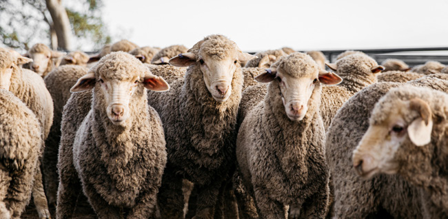

---
## Page 53

47
AUSVETPLAN  /  RESPONSE STRATEGY FOOT-AND-MOUTH DISEASE
If FMD is diagnosed in extensive production areas, special control measures, such as aerial shooting43 
without disposal, might be needed where logistical considerations do not allow the rapid destruction and 
disposal of animals using traditional methods and techniques (eg herding into yards or races for humane 
destruction before disposal by deep burial).
A population reduction program in susceptible feral animal populations may also need to be considered 
(see Section 4.3.14). Where implemented, population reduction programs must be designed to minimise 
dispersal of feral animal populations.
Welfare destruction
Humane destruction on-site may be considered on premises (whether IPs or not) where animals are at 
risk of compromised welfare (eg overcrowding of pigs due to the imposition of movement controls) and 
transport to appropriate processing facilities presents an unacceptable risk of disease transmission.
Welfare destruction must not affect the resourcing of destruction for disease control purposes. As a 
general approach, a prioritisation hierarchy could involve destruction of:
1.	 clinical animals and other animals on IPs 
2.	 animals for urgent welfare reasons (eg animals that cannot obtain feed or water, animals that have 
compromised shelter/housing, unweaned young of clinically affected mothers)
3.	 high-risk nonclinical animals 
4.	 animals for non-urgent welfare reasons. 
These priorities could occur concurrently, if practicable.
Where destruction for welfare purposes is to be considered for cost sharing, see the EADRA guidance 
documents Livestock welfare management and compensation principles for parties to the Emergency 
Animal Disease Response Agreement and Consequential loss.44
Pre-emptive slaughter or destruction
Pre-emptive slaughter or destruction of susceptible animals may be considered to achieve the disease 
control objectives.
Consideration should be given to:
•	 the risk if animals were to become infected with FMD virus (eg security of animals and ability to contain 
them)
•	 the animals’ vaccination status and resulting anticipated disposition (eg remove or retain policy for 
vaccinated stock)
•	 the available and forecasted resources to undertake the destruction and, if necessary, disposal
•	 the practicality of managing animals to meet response objectives (eg the practicality of vaccinating 
feral or extensively kept cattle).
4.3.12	 Disposal of animals, and animal products and byproducts
Disposal plans should be developed for each premises under site-specific biosecurity and movement 
controls (IPs, DCPs, DCPFs and ADSs), including development of an inventory of items before their 
disposal.
43	
	 To be conducted by competent personnel and in conformance with the requirements for culling for management of wild/feral animals (eg see https://
pestsmart.org.au/toolkit-resource/aerial-shooting-of-feral-pigs/).
44	
	 www.animalhealthaustralia.com.au/training/emergency-animal-disease-training/guidance-documents

---
## Page 54

48
AUSVETPLAN  /  RESPONSE STRATEGY FOOT-AND-MOUTH DISEASE
Guidance on disposal options and methods can be found in the AUSVETPLAN operational manual 
Disposal of animals.
Specific considerations
Potentially contaminated materials from high-risk premises under legislative instrument should be 
disposed of in a biosecure manner on-site or at an ADS.
These materials include carcasses, culled animals, animal products and byproducts, wastes, effluent 
and contaminated fomites (eg clothing, equipment) that cannot be adequately decontaminated. 
Feed, crops and so on may be high-risk materials if, based on epidemiological assessment, they are 
implicated in the spread of disease or are otherwise potentially contaminated with FMD virus (eg 
effluent from infected animals has been sprayed on crops).
The method chosen for disposal will be influenced by the type and volume of material to be disposed of, 
the resources available, the local environment, prevailing weather, legislative requirements (including 
environmental protection legislation) and the risk of spreading the disease. Disposal must be done in a 
way that prevents feral animals gaining access to contaminated material and so spreading the disease. 
Options for disposal of high-risk material in an FMD response include deep burial, composting and 
high-temperature incineration (eg using air curtain incinerators). Processing off-site (eg rendering) 
before disposal at an ADS may also be considered in some circumstances.
All equipment and machinery involved in on-site disposal must be decontaminated.
Where disposal on-site is not feasible, an ADS may be used, subject to risk assessment and taking into 
consideration the risk of FMD virus transmission during transport of the risk material to the disposal 
site. Movements of risk material should be in accordance with the recommended movement controls in 
Section 6.
Similarly, where processing off-site (eg rendering) is considered before disposal at an ADS, it should 
be subject to risk assessment, taking into consideration the risk of FMD virus transmission during 
transport of the risk material, the processing to be undertaken and the biosecurity measures in place 
at the processing facility. Movements of risk material should be in accordance with the recommended 
movement controls in Section 6.
Disposal of milk
Disposal of milk will be a major challenge during an FMD outbreak involving a dairying area, because 
large volumes of milk may require disposal (depending on the time of year, and the location and size 
of the outbreak). This is because milk will not be collected for commercial processing from IPs or SPs, 
and may not be collected from DCPs or TPs. Instead, it will be subject to biosecure disposal. On-farm 
storage may be considered for SPs pending confirmation of their status if it is likely that the status will 
be resolved within food safety timelines and capacity is available. 
To limit the volumes of milk requiring disposal, dairy animals on premises subject to destruction 
should be prioritised accordingly. For high-risk premises where animals are not subject to destruction, 
options such as drying off cows (see the AUSVETPLAN enterprise manual Dairy (cattle) industry) and 
using bobby calves already on the farm may be considered to reduce the amount of milk that ultimately 
requires disposal. On-site treatment of milk (eg acidification) to inactivate the virus should be 
considered to enable disposal on-site or off-site. Premises with on-farm milk processing facilities (eg 
small cattle, sheep or goat dairies) may be able to inactivate FMD virus on site, reducing milk volumes 
requiring disposal.

---
## Page 55

49
AUSVETPLAN  /  RESPONSE STRATEGY FOOT-AND-MOUTH DISEASE
4.3.13	 Decontamination
Decontamination plans should be developed for each IP and other premises to be decontaminated, 
based on a risk assessment. Guidance on decontamination can be found in the AUSVETPLAN 
operational manual Decontamination.
Specific considerations
Decontamination of premises, animal products, equipment and other fomites (eg vehicles, clothing) 
that may be contaminated with FMD virus will be a critical part of the response. This will include 
decontamination of the surfaces of roads and yards adjacent to and within IPs, DCPs and DCPFs. If 
roadways and common surfaces are considered potentially contaminated adjacent to and within other 
premises, such as ADSs, they should also be decontaminated.
Contaminated materials and items that may be damaged by decontamination – or for which 
decontamination is not practical or readily achievable – may be destroyed and/or disposed of in a 
biosecure manner instead.
On premises where animal destruction is undertaken, decontamination should follow depopulation and 
disposal activities. At all stages, steps will be taken to prevent the generation and dispersal of infective 
dusts and aerosols, and to manage potentially contaminated runoff.
Agents that destroy FMD virus include sunlight (by desiccation, not by the effects of ultraviolet 
radiation); sodium hypochlorite; and acid and alkaline disinfectants such as sodium hydroxide, sodium 
carbonate (washing soda) and citric acid.
Guidance on inactivation of FMD virus is provided in Section 2.4.2, the AUSVETPLAN operational 
manual Decontamination. and the WOAH Terrestrial Code.
4.3.14	 Wild (including feral) animal management
General guidance on the management of wild and/or feral animals in an EAD response is provided in 
the AUSVETPLAN management manual Wild animal response strategy. Wild/feral animals that are 
specifically relevant to FMD – including wild cloven-hoofed animals – are listed in Section 2.2.
Entry, spread and maintenance of FMD in wild/feral animal populations will be subject to ongoing risk 
assessment to ensure that feral animals are fully considered in the design of the eradication program. 
Risk mitigation programs will be implemented in feral animal populations that are assessed to pose an 
unacceptable risk. Assessment will require information about:
•	 the density and distribution of the animals
•	 social organisation, including home ranges
•	 habitat
•	 perceived contact with domestic species
•	 the strain of FMD virus
•	 the length of time feral animals could have been exposed to the virus
•	 welfare impacts on wild/feral animals (eg implications for the animals of the control or destruction 
methods used) 
•	 the availability of resources to effectively implement control measures
•	 potential exposure of feral animals to risk materials, such as at landfill sites, in paddocks on which 
effluent or milk has been sprayed, or in areas used for composting.

---
## Page 56

50
AUSVETPLAN  /  RESPONSE STRATEGY FOOT-AND-MOUTH DISEASE
Depending on the assessed risk, a number of control measures may be applied, including tracing and 
surveillance, containment, restrictions on hunters (also see Section 4.3.2) and population reduction.
4.3.15	 Vector management
FMD virus has been found in rat faeces and urine, and in bird droppings (Sutmoller et al 2003). 
Capel-Edwards (1970) reported finding 1000 ID50 per gram in rat faeces, although there has been no 
supporting evidence of the role of rats in the epidemiology of FMD. Similarly, Kaleta (2002) speculated 
that, during epizootics of FMD, the plumage of free-living birds, especially starlings, seagulls and house 
sparrows, may be contaminated by FMD virus and may spread the virus over long distances; however, 
evidence supporting this hypothesis is lacking.
Despite the possibility that some rodents (eg rats, mice) and birds may mechanically transmit FMD 
virus (Sutmoller et al 2003), the likelihood of a transmission event will be influenced by several factors. 
These include the number of vector animals contaminated at the source, transport and dissemination 
of the vector through natural or human-mediated means, and the route of inoculation (eg inhalation 
versus ingestion) with sufficient virus to infect a susceptible animal. The role of such vectors in 
the transmission of FMD virus is unlikely to be significant. However, vector control should still be 
undertaken to reduce the likelihood of mechanical virus transmission (Auty et al 2019).
Rodents likely to be dispersed from buildings, silos or other structures as a result of operational 
activities, particularly on IPs and DCPs, should be controlled where practical and reasonable as a 
precautionary measure, to limit the spread of virus to susceptible species on premises close to where 
FMD is confirmed or suspected.
Rats have been found to excrete FMD virus in their faeces and urine.

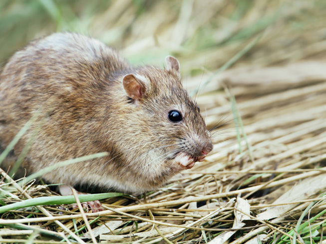

---
## Page 57

51
AUSVETPLAN  /  RESPONSE STRATEGY FOOT-AND-MOUTH DISEASE
4.3.16	 Public information
Guidance on managing public information can be found in the Biosecurity incident public information 
manual.
Public information, and industry and community engagement will support a cohesive response. The 
communications strategy should include mechanisms for raising awareness in all community sectors, 
including hunters, owners of petting zoos and school farms, urban and peri-urban pig owners, and 
managers of smaller enterprises (that may not be engaged with their industry peak body, for example).
Key topics to be covered in public information messaging will include advice on:
•	 the safety to people of consuming or handling food and other products derived from FMD virus–
infected (and FMD-vaccinated) animals
•	 clinical signs of FMD in susceptible animals and how to report suspect cases (including drops in 
production)
•	 modes of transmission of FMD virus
•	 measures to prevent the entry of FMD virus to premises (including increasing awareness of prohibited 
pig feed and importance of implementing on-farm biosecurity plans)
•	 movement controls, including livestock standstills
•	 the importance to Australia of controlling the disease and the rationale for the measures being used
•	 management of animal welfare during an outbreak
•	 management of feral animals during an outbreak, including surveillance for proof of freedom 
•	 the role of vaccine in disease control and management of vaccinated animals
•	 the role of surveillance, including proof-of-freedom surveillance, in regaining market access
•	 human health and financial support mechanisms available 
•	 where to find more information on the response and the control measures being used.
National coordination of public information and engagement messaging in the event of an FMD incident 
in Australia may occur through activation of the National Biosecurity Communication and Engagement 
Network45 to coordinate animal health information, and liaise with public health and environmental 
agencies.
4.3.17	 Other strategies
Feeding prohibited pig feed to pigs carries a high risk of introducing FMD to a herd. There is also a high 
risk associated with feeding other susceptible species milk; milk products; waste, surplus and out-
of-date retail milk; and washings from processing plants. A multi-agency approach will be needed to 
enforce current bans on feeding prohibited pig feed and swiftly introduce legislation, if not already in 
place, to ban feeding of dairy products to pigs and other FMD-susceptible species (unless the products 
have been treated as described in Section 2.4.2, the AUSVETPLAN operational manual Decontamination 
and the WOAH Terrestrial Code, or are to be fed to the offspring of dairy animals resident on the same 
farm). Security at municipal waste management centres, including waste transfer stations, should be 
implemented to prevent feral pigs gaining access to domestic food scraps. A widespread, multilingual 
public information campaign should support these controls. The campaign may also include messaging 
about risks posed by other refuse pits (eg on-farm).
45	
	 www.outbreak.gov.au/about/biosecurity-incident-national-communication-network

---
## Page 58

52
AUSVETPLAN  /  RESPONSE STRATEGY FOOT-AND-MOUTH DISEASE
4.3.18	 Stand-down
Guidance on the stand-down of EAD responses can be found in the AUSVETPLAN management manual 
Control centres management, Part 1.
The CCEAD will determine when the outbreak has been controlled or eradicated and will advise the 
NMG. The NMG will determine when the national FMD control measures can be wound down or ceased, 
and each jurisdiction will advise its ministers of this decision. Relief and recovery activity will need to 
continue after disease control and eradication operations have wound down.
Additional information on the national coordination framework for responding to an outbreak of FMD is 
provided in the Council of Australia Governments Memorandum of understanding: national response to a 
foot-and-mouth disease (FMD) outbreak.46
4.4	 Other control and eradication options
If destruction, disposal and decontamination, with or without vaccination, are not able to eradicate 
the disease, FMD could become established in Australia. The measures to underpin the long-
term control of FMD in such circumstances will be determined following consultation between 
governments and livestock industries. They may include long-term vaccination programs, zoning and/or 
compartmentalisation, and transition to management under the EADRA.
4.5	 Funding and compensation
Details of the cost-sharing arrangements can be found in the EADRA.47 Details of the approach to the 
valuation of, and compensation for, livestock and property in disease responses can be found in the 
AUSVETPLAN operational manual Valuation and compensation.
46	
	 federation.gov.au/about/agreements/memorandum-understanding-national-response-foot-and-mouth-disease-fmd-outbreak
47	
	 animalhealthaustralia.com.au/eadra

---
## Page 59

53
AUSVETPLAN  /  RESPONSE STRATEGY FOOT-AND-MOUTH DISEASE
When an emergency animal disease (EAD) is first suspected, the premises involved will undergo a clinical 
and/or epidemiological investigation. If the case definition, as defined in the relevant AUSVETPLAN 
response strategy, is met (ie the index case), the relevant chief veterinary officer or their delegate will 
determine the premises classification and will declare the premises an infected premises (IP).
5.1 Declared area definitions
Declared areas are declared under jurisdictional biosecurity legislation to enable specified activities that 
are required, restricted or prohibited in order to contain, control and/or eradicate an EAD.
Declared areas comprise:
•	 restricted areas (RAs), which are subject to strict disease control measures
•	 control areas (CAs), which are disease-free buffers between an RA and the parts of Australia that are 
free from the EAD (the outside area (OA)).
Detailed guidelines for declared areas are provided in the AUSVETPLAN guidance document Declared 
areas and allocation of premises classifications in an emergency animal disease response.
5.1.1	
Restricted area (RA)
The RA is a legally declared area that is subject to disease controls, including intense surveillance and 
movement controls.
In the case of foot-and-mouth disease (FMD), an initial RA of at least a 3 km radius will be drawn around all 
IPs and dangerous contact premises (DCPs), including as many suspect premises (SPs) and trace premises 
(TPs) as practicable. The boundaries will be modified based on risk assessment as new information comes 
to hand. The actual distance in any one direction will be determined by factors such as terrain, roads, the 
pattern of livestock movements, livestock concentrations, the weather (including prevailing winds), the 
distribution and movements of susceptible feral animals, and known characteristics of the virus serotype. 
A high level of movement control and surveillance will apply. Where FMD-susceptible feral animals are 
involved, it will also encompass the infected area (IA).
5.1.2	
Control area (CA)
For FMD, the CA may initially encompass the whole of the affected state(s) or territory(ies). The size of 
the CA will be reassessed through the duration of the response, as the situation evolves. The CA will have 
a minimum radius of 10 km, encompassing the RA. It may be defined according to geography, climate 
and the distribution of feral animals. The boundary will be adjusted as confidence about the extent of the 
outbreak increases.
Declared areas 
and premises
5

---
## Page 60

54
AUSVETPLAN  /  RESPONSE STRATEGY FOOT-AND-MOUTH DISEASE
Where only feral susceptible species are thought to be infected, the CA may be informed by 
consideration of the maximum ranging distance around the confirmed case.
5.2	 Other areas
Other areas may be declared under jurisdictional legislation and may be referenced in AUSVETPLAN. 
These areas may be nested within, or overlie part or all of, other areas (declared or not). They include 
the OA (see below).
5.2.1	 Outside area (OA)
The OA is not a declared area but is used to describe the rest of Australia outside the declared areas. 
The OA will be subject to surveillance. Because it is highly desirable to maintain the OA as ‘disease-
free’, the movement of animals and commodities from the RA and the CA into the OA will be restricted.
The OA will also be of interest for zoning48 and compartmentalisation49 for purposes of trade access, as 
well as for disease control (see below).
5.3 Premises classifications
Detailed guidelines for classifying premises statuses are provided in the AUSVETPLAN guidance 
document Declared areas and allocation of premises classifications in an emergency animal disease 
response. Definitions of premises are in the Glossary.
5.3.1 Premises status classifications
For FMD, the premises classifications to be used are:
•	 infected premises (IP) 
•	 suspect premises (SP) 
•	 trace premises (TP) 
•	 dangerous contact premises (DCP) 
•	 dangerous contact processing facility (DCPF) 
•	 approved processing facility (APF) 
•	 approved disposal site (ADS) 
•	 at-risk premises (ARP) 
•	 premises of relevance (POR) 
•	 resolved premises (RP) 
•	 unknown status premises (UP) 
•	 zero susceptible species premises (ZP)
•	 infected area (IA).
48	
	 The process of defining, implementing and maintaining disease-free and infected areas, in accordance with World Organisation for Animal Health (WOAH) 
standards. Zoning is based on geopolitical and/or physical boundaries and surveillance, to facilitate disease control and/or trade.
49	
	 The process of defining, implementing and maintaining one or more disease-free establishments, under a common biosecurity management system, in 
accordance with WOAH standards. Compartmentalisation is based on applied biosecurity measures and surveillance, to facilitate disease control and/or 
trade.

---
## Page 61

55
AUSVETPLAN  /  RESPONSE STRATEGY FOOT-AND-MOUTH DISEASE
For feral susceptible species, there is no infected premises classification. Rather, the IA represents the 
area thought to be contaminated with FMD virus and would most closely equate to an IP.
5.3.2 Qualifiers
Refer to the AUSVETPLAN guidance document Declared areas and allocation of premises classifications 
in an emergency animal disease response for more detail on qualifiers.
Assessed negative (AN)
AN is a qualifier that may be applied to ARPs, PORs, SPs, TPs, DCPs or DCPFs. The qualifier may be 
applied following surveillance, epidemiological investigation and/or laboratory assessment/diagnostic 
testing and indicates that the premises is assessed as negative at the time of classification. SPs, 
TPs, DCPs or DCPFs, once assessed negative, can progress through the SP-AN, TP-AN, DCP-AN or 
DCPF-AN status to another status. The animals on such premises are subject to the procedures and 
movement restrictions appropriate to the declared area (IA, RA or CA) in which the premises is located.
This classification is a description to document progress in the response and in the proof-of-freedom 
phase. The AN qualifier is a temporary status and only valid at the time it is applied. The time for which 
the AN qualifier remains active will depend on the circumstances and will be decided by the jurisdiction. 
One day is considered a reasonable guideline. The AN qualifier should also provide a trigger for future 
surveillance activity to regularly review, and change or confirm, a premises status.
The AN qualifier can also function as a counting tool to provide quantitative evidence of progress, to 
inform situation reports in control centres during a response. It provides a monitor for very high priority 
premises (SPs and TPs) as they undergo investigations and risk assessment, and are reclassified, as 
well as a measure of surveillance activity overall for ARPs and PORs.
The AN qualifier can be applied in a number of ways, depending on the objectives and processes within 
control centres. The history of each premises throughout the response is held in the information 
system; the application of the AN qualifier is determined by the jurisdiction, the response needs and the 
specific processes to be followed in a state coordination centre or local control centre.
Sentinels on site (SN)
SN is a qualifier that may be applied to IPs and DCPs to indicate that sentinel animals are present on a 
premises as part of response activities (ie before the premises can be assessed as an RP).
The qualifier should not be applied to premises that have been resolved and have been allowed to 
restock (regardless of the stocking density chosen for initial restocking).
Vaccinated (VN)
The VN qualifier can be applied in a number of different ways. At its most basic level, it can be used 
to identify premises that contain susceptible animals that have been vaccinated against the EAD in 
question. However, depending on the legislation, objectives and processes within a jurisdiction, the 
VN qualifier may be used to track a range of criteria and parameters. The details would need to be 
developed and tailored to meet individual needs of jurisdictions and circumstances.
5.3.3 Other disease-specific classifications
Not relevant.

---
## Page 62

56
AUSVETPLAN  /  RESPONSE STRATEGY FOOT-AND-MOUTH DISEASE
5.4	 Reclassifying premises and previously 	
	
	
declared areas
Maintaining movement restrictions on areas for long periods has important implications for resource 
management, animal welfare, business continuity, and socioeconomic impacts on producers and 
regional communities. Therefore, attention should be given to reclassifying premises and previously 
declared areas as quickly as possible.
Detailed guidelines for reclassifying previously declared areas are provided in the AUSVETPLAN 
guidance document Declared areas and allocation of premises classifications in an emergency animal 
disease response.
5.4.1	 Reclassifying premises
Guidelines for assessing SPs and TPs as negative and reclassifying their status are outlined in Section 
7.1.2.
IAs, IPs and DCPs require action to address the risk that infection or contamination with FMD virus 
is present. To assess an IA, IP, DCP or DCPF as negative – and allow its reclassification, release from 
biosecurity controls and, if appropriate, restocking – consideration must be given to the effectiveness 
of decontamination (through natural, physical and/or chemical means) in eliminating virus and, where 
appropriate, placement of sentinel animals.
The actual time before placement of sentinel animals should consider a range of factors, including:
•	 the presence and close proximity of disease
•	 factors affecting virus viability and infectivity (eg substrate protein or lipid content, ambient 
temperature, water content, virus virulence, amount of virus)
•	 confidence in decontamination through natural, physical and/or chemical means
•	 the status of the disease response within the declared area.
Guidance on the use of sentinel animals, where appropriate, before a premises is released from 
biosecurity controls and restocked is provided in Section 7.1.3.

---
## Page 63

57
AUSVETPLAN  /  RESPONSE STRATEGY FOOT-AND-MOUTH DISEASE
6.1	 Guidelines for issuing permits
In an emergency animal disease (EAD) event, quarantine and movement controls must strike a balance 
between quick and effective disease control, business continuity and animal welfare. Although it might 
not be feasible to prohibit all movement of susceptible animals and products, diligence needs to be 
applied to minimise the risk of further spread of the disease.
Recommended quarantine and movement controls in each AUSVETPLAN response strategy provide 
guidance on which movements can be allowed and under what conditions. This is based on an 
analysis of the disease risks that are presented by a specific movement, of a specific commodity, at a 
specific time during the EAD response phase. Each disease strategy will indicate whether a proposed 
movement is:
•	 allowed (under normal jurisdictional, including interstate, requirements)
•	 prohibited – except under the conditions of a general, special or emergency permit
•	 prohibited.
Permits may not be available until the relevant chief veterinary officer (CVO) provides approval for 
movements, and this may not be available in the early stages of a response. When assessing risk for 
the purposes of issuing a permit, the elements to consider may include:
•	 sources of risk
	–
species of animal
	–
type of product
	–
presence of disease agent on both the originating and destination premises
	–
current vector activity, if relevant
	–
organisation and management issues (ie confidence in animal tracing and surveillance, biosecurity)
	–
proposed use of the animals or products
	–
proposed transport route
	–
vaccination status of the animals, if relevant
	–
treatment of animals and vehicles to prevent concurrent movement of vectors, if relevant
	–
security of transport
	–
security and monitoring at the destination
	–
environment and natural events
	–
community and human behaviour
	–
risk of sabotage
Movement 
controls
6

---
## Page 64

58
AUSVETPLAN  /  RESPONSE STRATEGY FOOT-AND-MOUTH DISEASE
	–
technology
	–
regulations and standards
	–
available resources for compliance and enforcement
•	 areas of impact:
	–
livestock health (health of affected species, including animal welfare)
	–
human health (including work health and safety)
	–
trade and economic impacts (including commercial and legal impacts)
	–
environmental impacts
	–
organisational capacity
	–
political impacts
	–
reputation and image
•	 proposed risk treatment measures
	–
vaccination
	–
processing of product
	–
	disinfection or other treatment of animals, vehicles and fomites
	–
vector control, if relevant
	–
security
	–
communication.
Movements that are otherwise prohibited may be considered on a case-by-case basis (informed by 
risk assessment) for emergency (including welfare) reasons. Examples are movements for emergency 
veterinary treatment and movements to different premises to manage welfare concerns (eg feed, space, 
milking availability).
If allowed, such movements will be under approval from the relevant CVO or delegate (emergency permit) 
after assessment indicates that the risk associated with the movement is acceptable within the response.
6.2	 Types of permits
Permits are either general or special.. They are legal documents that describe the animal(s), commodities 
or things to be moved, the origin and destination, and the conditions to be met for the movement. Either 
type of permit may include conditions. Once permit conditions have been agreed from an operational 
perspective, all permit conditions must be met for every permit. Both general and special ppermits may 
be in addition to documents required for routine movements between or within jurisdictions (eg health 
certificates, waybills, consignment notes, National Vendor Declarations – NVDs).
General permit
General permits (GPs) are used for lower-risk movements, and create a record of each movement to 
which they apply. They are granted without the need for direct interaction between the person moving the 
animal(s), commodity or thing and a government veterinarian or gazetted inspector of stock. The permit 
may be completed via a webpage or in an approved place (such as a government office or commercial 
premises). A printed or electronic version of the permit must accompany the movement. The permit may 
impose preconditions and/or restrictions on movements. GPs may not be available until the relevant CVO 
gives approval for general movements, and this may not be available in the early stages of a response.

---
## Page 65

59
AUSVETPLAN  /  RESPONSE STRATEGY FOOT-AND-MOUTH DISEASE
Special permit
Special permits (SpPs) are issued by the relevant government veterinarian or gazetted inspector of 
stock. They are used for higher-risk movements, and therefore require formal application and individual 
risk assessment. SpPs describe the requirements for movement of an animal (or group of animals), 
commodity or thing, for which a specific assessment has been conducted by the relevant government 
veterinarian or gazetted inspector of stock. A printed or electronic version of the permit must 
accompany the movement. The permit may impose preconditions and/or restrictions on movements.
Emergency permit
An emergency permit is an SpP that specifies strict legal requirements for an otherwise high-risk 
movement of an animal, to enable emergency veterinary treatment to be delivered, to enable animals to 
be moved for animal welfare reasons, or to enable any other emergency movement under exceptional 
circumstances. These permits are issued on a case-by-case basis under the authorisation of the 
relevant CVO.
Other movement requests
Movements not reflected within any of the movement control matrixes or narratives may be considered 
by the relevant jurisdictional CVO on a risk-assessed case-by-case basis.
6.3	 Recommended movement controls
General principles for quarantine practices and movement controls for managing EADs are provided in 
the AUSVETPLAN guidance document Movement controls.
Key considerations for quarantine practices and movement controls for managing foot-and-mouth 
disease (FMD) are as follows:
•	 Containment and eradication of FMD is the highest priority. Therefore, ‘normal business movements’ 
should not be expected.
•	 Live animals pose the greatest risk of disease spread; therefore, their movements from all premises 
within the restricted area (RA) and control area (CA) must be strictly controlled.
•	 The outside area (OA) should remain as ‘clean’ as possible. Therefore, movement of animals from the 
RA to the OA is prohibited, and movement of products is generally prohibited. Movement of animals 
and products from the CA to the OA will also be restricted.
•	 Trace premises (TP) and suspect premises (SP) are temporary classifications, and every effort should 
be made to resolve the status of these premises as soon as possible.
•	 The numbers of susceptible animals within the RA should be minimised. Therefore, movements of 
animals into the RA will be limited and usually for slaughter only.
•	 Movement restrictions are more stringent within the RA than within the CA, and will be more stringent 
in the early stages of the response.
•	 Recommended movement controls apply to any movement to and from a premises, whether on foot or 
by vehicle, that involves either public or private land.
A three-stage50 approach to movement controls will be implemented during an outbreak of FMD.
50	
	 The three stages may overlap or occur asynchronously between jurisdictions.

---
## Page 66

60
AUSVETPLAN  /  RESPONSE STRATEGY FOOT-AND-MOUTH DISEASE
Stage 1: Movement controls while the national livestock standstill is in effect
Movement controls will apply to:
•	 FMD-susceptible livestock in transit at the time of declaration of the national livestock standstill
•	 proposed new movements of FMD-susceptible livestock while the national livestock standstill is in 
effect.
Individual jurisdictions may impose additional movement restrictions based on assessment of risk.
When a national livestock standstill is in place, essential husbandry movements for dairy cattle that 
involve crossing public roads – such as moving the milking herd to the milking shed – may continue 
unless advised otherwise, provided that the farmer had prior appropriate approval from the state road 
authority or local council. The cows must be managed to minimise faecal contamination of the road 
(eg hold mob for a period before crossing) and be walked directly across the road. Cows may be walked 
within the farm premises for milking.
Stage 2: Movement controls immediately after declared areas (RAs and CAs) have been established 
by jurisdictions51
Stage 3: Movement controls when declared areas remain in effect, and the Consultative Committee 
on Emergency Animal Diseaases (CCEAD) and the National Management Group (NMG) consider it 
appropriate to reduce movement restrictions52
6.3.1	 Live susceptible animals
Stage 1: Recommended movement controls for FMD-susceptible livestock while the 
national livestock standstill is in effect
Refer to Appendix 4 for management of FMD-susceptible livestock in transit at the time a national 
livestock standstill is declared for FMD. It provides detailed guidance on movements permitted during a 
standstill.
FMD-susceptible livestock in transit at the time of declaration of the national livestock standstill 
Livestock in transit refers to:
•	 FMD-susceptible livestock loaded in vehicles (air, land (including rail), sea) that have departed the 
point of loading
•	 FMD-susceptible livestock that are travelling on foot between premises via public or private land.
[FMD-susceptible livestock in transit within a jurisdiction may continue their journey, provided that:
•	 the journey did not commence in another jurisdiction, and the destination is not in another jurisdiction
•	 the journey can be completed within 4 hours of declaration of the standstill 
•	 the movements are
	–
from farm to farm or feedlot, or
	–
to an abattoir, or
	–
livestock returning to their property or place of pick-up.
51	
	 For further information, refer to Section 5.1.
52	
	 This would occur when the situation was more under control and few, if any, new IPs were being detected.

---
## Page 67

61
AUSVETPLAN  /  RESPONSE STRATEGY FOOT-AND-MOUTH DISEASE
All other movements of FMD-susceptible livestock in transit to other destinations must cease. Further 
movement can only proceed in accordance with the guidelines and risk assessment described in 
Appendix 4.]
Individual jurisdictions may impose additional movement restrictions on products based on assessment 
of risk.
Proposed new movements of FMD-susceptible livestock while the national livestock standstill is in 
effect
While a national livestock standstill remains in effect, new movements of FMD-susceptible livestock 
are prohibited except under an emergency permit. A permit will be issued only in exceptional 
circumstances. Before an emergency permit is issued, a risk assessment must be completed, 
examining both the likelihood that FMD-susceptible animals may be infected (including incubating 
animals) and the consequences of the movement should infected animals be moved.
Emergency permit conditions for the movement of FMD-susceptible animals during the standstill will 
include:
•	 absence of links to any premises that are infected premises (IPs), dangerous contact premises (DCPs), 
dangerous contact processing facilities (DCPFs), TPs or SPs
•	 a defined route of travel to minimise any potential for disease spread
•	 ensuring that biosecurity standards at the despatching and receiving premises are appropriate, 
including the approved route to be taken
•	 single consignment per load
•	 appropriate decontamination of personnel, equipment and vehicles before and after movement
•	 absence of clinical signs of FMD in all susceptible animals on the source and destination premises 
before and on the day of travel
•	 physical identification of animals (eg National Livestock Identification System (NLIS) or other ear tag, 
brand, tattoo) with accompanying documentation (eg NVD, waybill, PigPass).
Movements of susceptible livestock in an FMD outbreak will be subject to specific controls.

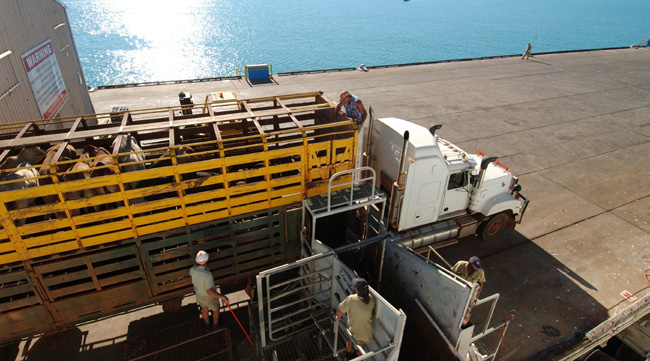

---
## Page 68

62
AUSVETPLAN  /  RESPONSE STRATEGY FOOT-AND-MOUTH DISEASE
Stage 2: Recommended movement controls for FMD-susceptible livestock immediately after 
declared areas have been established by jurisdictions
The transition to stage 2 may overlap with stages 1 and 3, and may occur at different times in different 
jurisdictions, because processes to implement and revoke the livestock standstill declaration may differ.
Because of the high potential of transmitting FMD virus, movement of FMD-susceptible livestock from 
high-risk premises and the RA is generally prohibited. Movement of FMD-susceptible livestock into an 
RA should be minimised, and usually only for slaughter, to limit the number of additional susceptible 
animals within the RA.
Table 6.1 describes the recommended movement controls for FMD-susceptible livestock within and 
between declared areas at the commencement of stage 2. The only allowed movements of FMD-
susceptible livestock in the RA would be either to slaughter at an approved processing facility (APF) or, 
following a risk assessment, to an at-risk premises (ARP) or TP, primarily for welfare reasons.
As the outbreak stabilises in response to control measures, some movement restrictions may gradually 
be reduced based on risk assessment, and as the CCEAD and NMG deem appropriate to the situation 
(see stage 3).
Table 6.1 Recommended movement controls for FMD-susceptible livestock 
during stage 2
To 
RA
CA
OA
From 
IP, DCP, 
SP, TP
ARP, APFa
SP, TP
POR, APFa
RA
IP, DCP, SP
Prohibited
Prohibited
Prohibited
TP
Prohibited
ARP
Prohibited
Prohibited, 
except 
under 
SpP1
CA
SP
Prohibited
Prohibited
Prohibited
TP
Prohibited
Prohibited
POR
Prohibited
Prohibited, 
except 
under 
SpP2
Prohibited
Prohibited, 
except 
under 
SpP3
OA
Prohibited
Prohibited, 
except 
under 
SpP2
Prohibited
Prohibited, 
except 
under 
SpP3
Allowed under 
normal jurisdictional 
requirements
APF = approved processing facility; ARP = at-risk premises; CA = control area; DCP = dangerous contact premises; IP = infected premises; OA = outside area; 
POR = premises of relevance; RA = restricted area; SP = suspect premises; SpP = special permit; TP = trace premises
a	
Meat derived from animals moved from low-risk premises would be considered low risk and is covered by Table 6.4 (Recommended movement controls for 
meat and meat products (including carcases and offal) of FMD-susceptible animals from registered commercial abattoirs and commercial meat processing 
enterprises).

---
## Page 69

63
AUSVETPLAN  /  RESPONSE STRATEGY FOOT-AND-MOUTH DISEASE
SpP1 conditions – emergency permit for exceptional circumstances only (ie primarily for welfare 
reasons):
•	 With CVO approval, for slaughter, or to an ARP for other purposes (eg health and welfare reasons 
– feed, water, milking, prevention of overcrowding), if a risk assessment indicates that the risk 
associated with movement is acceptable within the response. 
•	 Travel by specified route only, and no stopping en route.
•	 Appropriate biosecurity standard at receiving premises.
•	 Appropriate decontamination of equipment and vehicles, before and after movement.
•	 An effluent management plan is in place for the vehicle.53
•	 Absence of clinical signs of FMD in all susceptible animals on the premises before and on day of travel.
•	 Single consignment per load.
•	 Any suspect clinical signs are immediately reported to the local control centre (LCC) or state 
coordination centre (SCC).
•	 Physical identification of animals (eg NLIS or other ear tag, brand, tattoo), with appropriate 
accompanying movement documentation (eg NVD, waybill, PigPass, Sheep Health Declaration). 
SpP2 conditions – for slaughter only, if the RA contains the only available abattoir:
•	 For slaughter only, if a risk assessment indicates that the risk associated with the movement is 
acceptable within the response.
•	 Travel by specified route only, and no stopping en route.
•	 Appropriate biosecurity standard at receiving premises.
•	 Appropriate decontamination of equipment and vehicles, before and after movement.
•	 An effluent management plan is in place for the vehicle.57
•	 Absence of clinical signs of FMD in all susceptible animals on the premises before and on day of travel.
•	 Single consignment per load.
•	 Any suspect clinical signs are immediately reported to the LCC or SCC.
•	 Physical identification of animals (eg NLIS or other ear tag, brand), with accompanying movement 
documentation (eg NVD, waybill, PigPass, Sheep Health Declaration).
SpP3 conditions – for slaughter, or to a premises of relevance (POR) for other purposes (eg health 
and welfare reasons – feed, water, milking):
•	 For slaughter, or to a POR for a specific purpose (eg health and welfare reasons – feed, water, milking, 
prevention of overcrowding), if a risk assessment indicates that the risk associated with movement is 
acceptable within the response. For the purposes of this permit, the definition of POR includes APFs 
(ie an abattoir or knackery or other such plant to which animals have been introduced from lower-risk 
premises under a permit for processing to an approved standard).
•	 Travel by specified route only, and no stopping en route.
•	 Appropriate biosecurity standard at receiving premises.
•	 Appropriate decontamination of equipment and vehicles, before and after movement.
•	 An effluent management plan is in place for the vehicle.54
53	
	 There is an appropriate curfew for stock (ie holding them off feed for a certain period) before being transported, an effluent containment tank is in place 
on the vehicle, and a plan is in place for disposal of effluent. Curfew times can be found in the Australian Animal Welfare Standards and Guidelines (www.
agriculture.gov.au/agriculture-land/animal/welfare/standards-guidelines).
54	
	 There is an appropriate curfew for stock (ie holding them off feed for a certain period) before being transported, an effluent containment tank is in place on 
the vehicle, and a plan is in place for disposal of effluent.

---
## Page 70

64
AUSVETPLAN  /  RESPONSE STRATEGY FOOT-AND-MOUTH DISEASE
•	 Absence of clinical signs of FMD in all susceptible animals on the premises before and on day of travel.
•	 Single consignment per load.
•	 Any suspect clinical signs are immediately reported to the LCC or SCC.
•	 Physical identification of animals (eg NLIS or other ear tag, brand, tattoo), with appropriate 
accompanying movement documentation (eg NVD, waybill, PigPass, Sheep Health Declaration).
Stage 3: Recommended movement controls for FMD-susceptible livestock when declared 
areas remain in effect, and the CCEAD and NMG consider it appropriate to reduce movement 
restrictions
Table 6.2 describes the recommended movement controls for FMD-susceptible livestock within and 
between declared areas when declared areas remain in effect, and the CCEAD and NMG consider 
it appropriate to reduce movement restrictions. All movements of FMD-susceptible livestock to 
destinations out of the RA are prohibited.
Table 6.2 Recommended movement controls for FMD-susceptible livestock 
during stage 3
To 
RA
CA
OA
From 
IP, DCP, 
SP, TP, RP
ARP, APFa
SP, TP
POR, APFa
RA
IP, DCP, SP
Prohibited
Prohibited
Prohibited
TP
Prohibited
ARP
Prohibited
Prohibited, 
except 
under 
SpP1
CA
SP
Prohibited
Prohibited
Prohibited
TP
Prohibited
Prohibited
POR
Prohibited
Prohibited, 
except 
under 
SpP2
Prohibited
Prohibited 
except 
under GPa
OA
Prohibited, 
except 
under 
SpP4
Prohibited, 
except 
under 
SpP2
Prohibited
Prohibited, 
except 
under GPb
Allowed under 
normal jurisdictional 
requirements
APF = approved processing facility; ARP = at-risk premises; CA = control area; DCP = dangerous contact premises; GP = general permit; IP = infected premises; 
OA = outside area; POR = premises of relevance; RA = restricted area; RP = resolved premises; SP = suspect premises; SpP = special permit; TP = trace premises
a	
Meat derived from animals moved from low-risk premises would be considered low risk and is covered by Table 6.4 (Recommended movement controls for 
meat and meat products (including carcases and offal) of FMD-susceptible animals from registered commercial abattoirs and commercial meat processing 
enterprises).

---
## Page 71

65
AUSVETPLAN  /  RESPONSE STRATEGY FOOT-AND-MOUTH DISEASE
SpP1 conditions – emergency permit for exceptional circumstances only (ie primarily for welfare 
reasons):
•	 With CVO approval, for slaughter, or to an ARP for other purposes (eg health and welfare reasons 
– feed, water, milking, prevention of overcrowding), if a risk assessment indicates that the risk 
associated with movement is acceptable within the response.
•	 Travel by approved route only, and no stopping en route.
•	 Appropriate biosecurity standard at receiving premises.
•	 Appropriate decontamination of equipment and vehicles, before and after movement.
•	 An effluent management plan is in place for the vehicle.55
•	 Absence of clinical signs of FMD in all susceptible animals on the premises before and on day of travel.
•	 Single consignment per load.
•	 Any suspect clinical signs are immediately reported to the LCC or SCC.
•	 Physical identification of individual animals (eg NLIS or other ear tag, brand), with accompanying 
movement documentation (eg NVD, waybill, PigPass, Sheep Health Declaration).
SpP2 conditions – for slaughter only, if the RA contains the only available abattoir:
•	 For slaughter only, if a risk assessment indicates that the risk associated with the movement is 
acceptable within the response.
•	 Travel by approved route only, and no stopping en route.
•	 Appropriate biosecurity standard at receiving premises.
•	 Appropriate decontamination of equipment and vehicles, before and after movement.
•	 An effluent management plan is in place for the vehicle.56
•	 Absence of clinical signs of FMD in all susceptible animals on the premises before and on day of travel.
•	 Single consignment per load.
•	 Any suspect clinical signs are immediately reported to the LCC or SCC.
•	 Physical identification of animals (eg NLIS or other ear tag, brand), with accompanying movement 
documentation (eg NVD, waybill, PigPass, Sheep Health Declaration).
SpP4 conditions – to enable sentinel stock to be introduced:
•	 With CVO approval, for introduction of sentinel stock.
•	 Travel by approved route only, and no stopping en route.
•	 Appropriate decontamination of equipment and vehicles, before and after movement.
•	 Single consignment per load.
•	 Physical identification of animals (eg NLIS or other ear tag, brand), with accompanying movement 
documentation (eg NVD, waybill, PigPass, Sheep Health Declaration).
GPa conditions:
•	 Travel by approved route only.
•	 Appropriate decontamination57 of equipment and vehicles, before and after movement.
55	
	 There is an appropriate curfew for stock before being transported, an effluent containment tank is in place on the vehicle, and a plan is in place for disposal 
of effluent.
56	
	 There is an appropriate curfew for stock before being transported, an effluent containment tank is in place on the vehicle, and a plan is in place for disposal 
of effluent.
57	
	 Refer to the AUSVETPLAN operational manual Decontamination for more information on decontamination procedures.

---
## Page 72

66
AUSVETPLAN  /  RESPONSE STRATEGY FOOT-AND-MOUTH DISEASE
•	 An effluent management plan is in place for the vehicle.58
•	 Absence of clinical signs of FMD in all susceptible animals on the premises before and on day of travel.
•	 Physical identification of animals (eg NLIS or other ear tag, brand), with accompanying movement 
documentation (eg NVD, waybill, PigPass, Sheep Health Declaration).
GPb conditions – for slaughter or for movements within an enterprise, such as movement of 
offspring from a breeding herd to a grow-out unit; not for milking:
•	 One-way movement only.
•	 Travel by approved route only.
•	 Appropriate decontamination59 of equipment and vehicles, before and after movement.
•	 An effluent management plan is in place for the vehicle.60
•	 Absence of clinical signs of FMD in all susceptible animals on the premises before and on day of travel.
•	 Physical identification of animals (eg NLIS or other ear tag, brand), with accompanying movement 
documentation (eg NVD, waybill, PigPass, Sheep Health Declaration).
6.3.2	 Carcasses, such as destructions, mortalities or condemned stock
There may be circumstances under which carcasses of animals culled for disease control purposes 
cannot be disposed of on-site and need to be transported either within the RA or to a more suitable 
disposal site outside the RA. Movements of such carcasses should be in accordance with the nationally 
agreed standard operating procedures Loading and unloading of carcasses and materials for biosecure 
transport (version 1.1)61 and Biosecure movement of infected carcasses and materials during road transport 
(version 1.0).62 These situations should be considered on a case-by-case basis, and the movement 
permit should include the following conditions:
•	 Carcasses for disposal are transported to a declared zero susceptible species premises (ZP) or 
disposal site in a biosecure manner (ie in a manner that prevents leakage of materials from the 
transport vehicle).
•	 Transport is by an approved route.
•	 Carcasses are not brought into direct or indirect contact with susceptible species.
•	 After transportation, vehicles and equipment are decontaminated appropriately and in accordance with 
the AUSVETPLAN operational manual Decontamination.
6.3.3	 Semen and embryos from FMD-susceptible animals
See Appendix 2 for permit conditions.
Permits will only be issued for semen and embryos from susceptible species from establishments 
where applications are accompanied by evidence of an operational biosecurity manual, including 
maintenance of biosecurity procedures, accurate record keeping, and permanent identification of all 
semen/embryo straws and vials.
58	
	 There is an appropriate curfew for stock before being transported, an effluent containment tank is in place on the vehicle, and a plan is in place for disposal 
of effluent.
59	
	 Refer to the AUSVETPLAN operational manual Decontamination for more information on decontamination procedures.
60	
	 There is an appropriate curfew for stock before being transported, an effluent containment tank is in place on the vehicle, and a plan is in place for disposal 
of effluent.
61	
	 animalhealthaustralia.com.au/nationally-agreed-standard-operating-procedures
62	
	 animalhealthaustralia.com.au/nationally-agreed-standard-operating-procedures

---
## Page 73

67
AUSVETPLAN  /  RESPONSE STRATEGY FOOT-AND-MOUTH DISEASE
Permits must not be issued if semen or embryos of higher-risk FMD status have been added to the 
container, or if fresh liquid nitrogen has not been used.
A risk assessment must be conducted for movements that require an SpP to ensure that the risk 
associated with movement is acceptable within the response, including the absence of clinical signs 
of FMD in all susceptible animals on the collection premises for at least 28 days before the time of 
collection and for 28 days after collection, and no introductions of susceptible animals onto the property 
during the 28 days before collection.
Table 6.3 describes the recommended movement controls for semen and embryos from FMD-
susceptible animals within and between declared areas.
Semen that has been treated in a way that inactivates FMD virus will be subject to jurisdictional risk 
assessments, which may conclude that semen is not subject to movement restrictions.
[Table 6.3 Recommended movement controls for semen and embryos from FMD susceptible animals63
To 
RA
CA
OA
Froma 
IP, DCP, 
SP, TP
ARP
SP, TP
POR
RA
IP, DCP, SP, 
TP
Prohibited
Prohibited
Prohibited
Prohibited
Prohibited
ARP
Prohibited
Prohibited, 
except 
under 
SpP – 
conditions 
r, s, t
Prohibited
Prohibited, 
except 
under 
SpP – 
conditions 
r, s, t
Prohibited
CA
SP, TP
Prohibited
Prohibited
Prohibited
Prohibited
Prohibited
POR
Prohibited
Prohibited, 
except 
under 
SpP – 
conditions 
r, s, t
Prohibited
Prohibited, 
except 
under 
SpP – 
conditions 
r, s, t
Prohibited
OA
Prohibited
Prohibited, 
except 
under GP – 
conditions 
r, s, t
Prohibited
Prohibited, 
except 
under GP – 
conditions 
r, s, t
Allowed under 
normal jurisdictional 
requirements
ARP = at-risk premises; CA = control area; DCP = dangerous contact premises; IP = infected premises; OA = outside area; POR = premises of relevance; 
RA = restricted area; SP = suspect premises; SpP = special permit; TP = trace premises
a	
For semen and embryos, this column refers to the location of the premises where the semen or embryos were collected and not where they are stored.]
63	
	 Active consideration is being given to risk-managed movements of semen. This includes consideration of a condition requiring delivery to an off-site 
location where susceptible livestock are not housed or handled.

---
## Page 74

68
AUSVETPLAN  /  RESPONSE STRATEGY FOOT-AND-MOUTH DISEASE
6.3.4	 Meat and meat products (including carcases and offal) of 
	
FMD-susceptible animals
See Appendix 2 for permit conditions.
Meat and meat products (including carcases and offal) of FMD-susceptible animals from low-risk 
premises do not present a significant risk of FMD virus transmission unless fed to FMD-susceptible 
animals; therefore, movement of these products would generally be allowed from approved abattoirs. 
Movement within and out of declared areas will, however, be subject to risk assessment and increased 
biosecurity measures for the purposes of traceability and minimising indirect disease transmission 
routes (eg from vehicles).
Routine movements of meat and meat products may be delayed in the initial stages of a response while 
biosecurity measures and approvals or permits are put in place. Where premises are classified as an 
IP, SP, TP or DCPF, movement will be prohibited. Meat movements out of premises that are unclassified 
registered processing facilities64 will be prohibited from the RA into the CA or OA until the status is 
resolved. In the CA, meat movements from unclassified registered processing facilities can be made 
under GP with conditions x and aa.
Where FMD-free zones are implemented for trade purposes, additional restrictions may be applied. 
Increased awareness of swill-feeding prohibitions, as well as reassurance on the safety of meat for 
human consumption, should be part of the media campaign.
No meat, meat products or carcases from FMD-susceptible animals, including field-shot animals, from 
premises that are not registered abattoirs or commercial meat processing enterprises should be moved 
within or out of either the RA or the CA.
Table 6.4 describes the recommended movement controls for meat and meat products (including 
carcases and offal) of FMD-susceptible animals within and between declared areas.
64	
	 These are registered processing facilities that are not classified as either DCPFs or APFs.

---
## Page 75

69
AUSVETPLAN  /  RESPONSE STRATEGY FOOT-AND-MOUTH DISEASE
Table 6.4 Recommended movement controls for meat and meat products (including carcases and offal) 
of FMD-susceptible animals from registered commercial abattoirs and commercial meat processing 
enterprises
To 
RA
CA
OA
Froma 
RA
Commercial 
processing 
enterprises 
designated 
as IP, SP, TP, 
DCPF
Prohibited
Prohibited
Prohibited
APF
Prohibited, except 
under SpP – conditions 
w, x, y, z, aa
Prohibited, except 
under SpP – conditions 
w, x, y, z, aa)
Prohibited
CA
Commercial 
processing 
enterprises 
designated 
as SP, TP, 
DCPF
Prohibited
Prohibited
Prohibited
APF
Prohibited, except 
under GP –conditions 
x, aa
Prohibited, except 
under GP – conditions 
x, aa
Prohibited, except 
under GP – conditions 
x, aa
OA
Allowed under 
normal jurisdictional 
requirements
Allowed under 
normal jurisdictional 
requirements
Allowed under 
normal jurisdictional 
requirements
APF = approved processing facility; CA = control area; DCPF = dangerous contact processing facility; GP = general permit; IP = infected premises; 
OA = outside area; RA = restricted area; SP = suspect premises; SpP = special permis; TP = trace premises
Note: Meat derived from animals moved from low-risk premises, as is a requirement for classification as an APF, will be considered low risk. The risk profile of 
supply premises is covered by the recommended movement controls on live susceptible animals in stages 2 and 3 (Table 6.1).

---
## Page 76

70
AUSVETPLAN  /  RESPONSE STRATEGY FOOT-AND-MOUTH DISEASE
6.3.5	 [Milk and dairy products65,66
Table 6.5 Recommended movement controls for milk and dairy products
To 
RA
CA
OA
From 
IP, DCP, 
SP, TP
ADS
ARP
APF
DCPF
DCP, SP, 
TP
ADS
POR
APF
DCPF
Premises 
with 
susceptible 
livestock
APF
RA
IP, DCP, 
SP, TP
Prohibited
Prohibited, 
except 
under 
SpP3
Prohibited
Prohibited
Prohibited
Prohibited
Prohibited, 
except 
under 
SpP3
Prohibited
Prohibited
Prohibited
Prohibited
Prohibited
ARP
Prohibited
Prohibited, 
except 
under 
SpP3
Prohibited, 
except 
under 
GP1a
Prohibited, 
except under 
GP1
Prohibited
Prohibited
Prohibited, 
except 
under 
SpP3
Prohibited
Prohibited, 
except under 
SpP1
Prohibited
Prohibited
Prohibitedb
APF
Prohibited
Prohibited, 
except 
under 
SpP3
Prohibited
Prohibited, 
except under 
GP2
Prohibited
Prohibited
Prohibited, 
except 
under 
SpP3
Prohibited
Prohibited, 
except under 
SpP2
Prohibited
Prohibited
Prohibitedb
DCPF
Prohibited
Prohibited, 
except 
under 
SpP3
Prohibited
Prohibited
Prohibited
Prohibited
Prohibited, 
except 
under 
SpP3
Prohibited
Prohibited
Prohibited
Prohibited
Prohibited
Cont’d
65	
	 Assessment may include diagnostic testing of live susceptible animals scheduled for movement, or background surveillance testing of ‘normal’ sick and dead animals to exclude FMD.
66	
	 Active consideration is being given to risk-managed movements of raw milk.

---
## Page 77

71
AUSVETPLAN  /  RESPONSE STRATEGY FOOT-AND-MOUTH DISEASE
To 
RA
CA
OA
From 
IP, DCP, 
SP, TP
ADS
ARP
APF
DCPF
DCP, SP, 
TP
ADS
POR
APF
DCPF
Premises 
with 
susceptible 
livestock
APF
CA
DCP, SP, TP
Prohibited
Prohibited, 
except 
under 
SpP3
Prohibited
Prohibited
Prohibited
Prohibited
Prohibited, 
except 
under 
SpP3
Prohibited
Prohibited
Prohibited
Prohibited
Prohibited
POR
Prohibited
Prohibited, 
except 
under 
SpP3
Prohibited, 
except 
under 
GP1a
Prohibited, 
except under 
GP1
Prohibited
Prohibited
Prohibited, 
except 
under 
SpP3
Prohibited, 
except 
under 
GP1a
Prohibited, 
except under 
GP1
Prohibited
Prohibited
Prohibitedb
APF
Prohibited
Prohibited, 
except 
under 
SpP3
Prohibited
Prohibited, 
except under 
GP2
Prohibited
Prohibited
Prohibited, 
except 
under 
SpP3
Prohibited
Prohibited, 
except under 
GP2
Prohibited
Prohibited
Prohibitedb
DCPF
Prohibited
Prohibited, 
except 
under 
SpP3
Prohibited
Prohibited
Prohibited
Prohibited
Prohibited, 
except 
under 
SpP3
Prohibited
Prohibited
Prohibited
Prohibited
Prohibited
OA
Premises 
with 
susceptible 
livestock
Prohibited
Prohibited
Prohibited, 
except 
under 
GP1a
Allowed 
under normal 
jurisdictional 
requirements
Prohibited
Prohibited
Prohibited
Prohibited, 
except 
under 
GP1a
Allowed 
under normal 
jurisdictional 
requirements
Prohibited
Allowed 
under normal 
jurisdictional 
requirements
Allowed 
under normal 
jurisdictional 
requirements
APF
Prohibited
Prohibited
Prohibited
Allowed 
under normal 
jurisdictional 
requirements
Prohibited
Prohibited
Prohibited
Prohibited
Allowed 
under normal 
jurisdictional 
requirements
Prohibited
Allowed 
under normal 
jurisdictional 
requirements
Allowed 
under normal 
jurisdictional 
requirements
ADS = approved disposal site; APF = approved processing facility; ARP = at-risk premises; CA = control area; CCEAD = Consultative Committee on Emergency Animal Diseases; DCP = dangerous contact premises; DCPF = dangerous contact 
processing facility; GP = general permit; IP = infected premises; OA = outside area; POR = premises of relevance; RA = restricted area; SP = suspect premises; SpP = special permit; TP = trace premises
a	
GP1 allows for the collection of milk from multiple premises en route to APFs. The conditions of GP1 apply for each farm-to-farm movement of raw milk. Because of the associated biosecurity risks, GP1 does not apply to movements of raw 
milk from ARPs in the RA to PORs in the CA. GP1 does not allow the delivery of milk to premises other than to APFs.
b	
Movements may be considered on a case-by-case basis after risk assessment and CCEAD approval.]

---
## Page 78

72
AUSVETPLAN  /  RESPONSE STRATEGY FOOT-AND-MOUTH DISEASE
6.3.6 Wool and other fibres
Wool and other fibres (such as cashmere and alpaca fleece) will only be permitted to leave premises in 
the RA and CA to go to a premises where there are no susceptible animals under one of the following 
conditions:
•	 disinfection of the outside of the bales with an appropriate treatment at the site of origin, or
•	 storage for an appropriate time and at an appropriate temperature that ensures inactivation of FMD 
virus.
Bales moved to other sites within 14 days (minimum) before the original premises was designated as an 
IP require disinfection of the outside of the bales. The bales must be stored for an appropriate time and 
at an appropriate temperature at the second site that ensures inactivation of FMD virus.
Movement will be subject to permit after verification of the correct treatment or storage.
6.3.7	 Other animal byproducts
Animal byproducts – including skins, hides, horns, hoofs, knackery products and rendered material – 
from DCPFs or other high-risk premises may need to be transported off-site for disposal. This material 
should not be transported outside the RA or the CA in which the establishment is located. If movement 
of byproducts from high-risk premises is required, it should only be to premises without animals.
The following permit conditions apply to movements to a biosecure disposal or rendering facility:
•	 Animal byproducts are transported in a biosecure manner (ie in a manner that prevents leakage of 
materials from the transport vehicle).
•	 Transport is by an approved route.
•	 The material is not brought into direct or indirect contact with susceptible species.
•	 After transportation, vehicles are decontaminated appropriately and in accordance with the 
AUSVETPLAN operational manual Decontamination. 
The AUSVETPLAN operational manual Disposal of animals provides details on composting and other 
disposal options.
Once potentially infected byproducts are accepted by a site, that site will be designated as a DCP; 
therefore, careful consideration should be given to the disposal site and the need to limit access of 
susceptible species to that site for an appropriate period.
Animal byproducts from higher-risk premises that are destined for use rather than disposal (eg hides, 
skins) must be appropriately decontaminated to inactivate FMD virus.
6.3.8 Waste products and effluent
See Appendix 2 for permit conditions.
Waste products and effluent need to be appropriately managed to minimise the risk of exposing 
susceptible animals to contamination. The AUSVETPLAN operational manual Decontamination provides 
specific details of procedures to reduce the infectivity of effluent, and the AUSVETPLAN operational 
manual Disposal of animals provides details on composting and other disposal options.
Because effluent (eg manure, yard washings) can transmit FMD virus, it should preferably be disposed 
of on-site. If movement of effluent from high-risk premises is required, it should only be to premises

---
## Page 79

73
AUSVETPLAN  /  RESPONSE STRATEGY FOOT-AND-MOUTH DISEASE
that exclude animals (ie using exclusion fencing). Once potentially contaminated effluent is accepted 
by a site, that site will be designated as a DCP; therefore, careful consideration should be given to the 
disposal site and the need to limit access of susceptible species to that site for an appropriate period.
Table 6.6 describes the recommended movement controls for waste products and effluent within and 
between declared areas.
Table 6.6 Recommended movement controls for waste products and effluent
To 
RA
CA
OA
From 
IP, DCP, 
SP, TP, 
ARP
ZP, ADS
SP, TPa
POR
ZP, ADS
RA
IP, DCP
Prohibited
Prohibited, 
except 
under 
SpP – 
conditions 
d, g, i, p, vb
Prohibited
Prohibited
Prohibited, 
except 
under SpP 
– conditions 
d, g, i, p, vb
Prohibited
SP, TPa
Prohibited
Prohibited
Prohibited
Prohibited
Prohibited
Prohibited
ARP
Prohibited
Prohibited, 
except 
under 
SpP – 
conditions 
d, g, i, p, v
Prohibited
Prohibited
Prohibited, 
except 
under SpP 
– conditions 
d, g, i, p, v
Prohibited
CA
SP, TPa
Prohibited
Prohibited
Prohibited
Prohibited
Prohibited
Prohibited
POR
Prohibited
Prohibited, 
except 
under 
SpP – 
conditions 
d, g, i, p, vc
Prohibited
Prohibited, 
except 
under SpP 
– conditions 
d, g, i, p, v
Prohibited, 
except 
under SpP 
– conditions 
d, g, i, p, v
Prohibited
OA
Prohibited
Prohibited
Prohibited
Prohibited
Prohibited
Allowed 
under normal 
jurisdictional 
requirements
ADS = approved disposal site; ARP = at-risk premises; CA = control area; DCP = dangerous contact premises; IP = infected premises; OA = outside area; 
POR = premises of relevance; RA = restricted area; SP = suspect premises; SpP = special permit; TP = trace premises; ZP = zero susceptible species premises
a	
TPs and SPs are temporary classifications, and every effort should be made to resolve the status of these premises as soon as possible.
b	
Sites receiving effluent and waste from high-risk premises will be designated as DCPs, and an RA would be designated around the site.
c	
This should be the only option available, to minimise the amount of CA effluent and waste being disposed of in RA disposal sites.

---
## Page 80

74
AUSVETPLAN  /  RESPONSE STRATEGY FOOT-AND-MOUTH DISEASE
6.3.9	 Vehicles and equipment, such as mining trucks, feed trucks, utilities 	
	
vehicles and wind farm vehicles not covered in another matrix
See Appendix 2 for permit conditions.
Table 6.7 describes the recommended movement controls for vehicles and equipment that have had 
direct contact with susceptible animals, their products or wastes, or areas where susceptible animals 
have been, where such vehicles are not covered in another matrix.
Table 6.7 Recommended movement controls for vehicles and equipment that have had direct contact 
with susceptible animals, their products or wastes, or areas where susceptible animals have been, 
where such vehicles are not covered in another matrix 
To 
RA
CA
OA
From 
RA
IP, SP, 
TP, DCP 
DCPF
As determined by property 
specific jurisdictional 
legislative orders
As determined by property 
specific jurisdictional 
legislative orders
As determined by property 
specific jurisdictional 
legislative orders
ARP, APF
Prohibited, except 
under GPa
Prohibited, except 
under GPa
Prohibited, except 
under GPa
CA
SP, TPa
As determined by property 
specific jurisdictional 
legislative orders
As determined by property 
specific jurisdictional 
legislative orders
As determined by property 
specific jurisdictional 
legislative orders
POR
Prohibited, except 
under GPa
Prohibited, except 
under GPa
Prohibited, except 
under GPa
OA
Allowed under normal 
jurisdictional requirements
Allowed under normal 
jurisdictional requirements
Allowed under normal 
jurisdictional requirements
APF = approved processing facility; ARP = at-risk premises; CA = control area; DCP = dangerous contact premises; DCPF = dangerous contact processing facility; 
GP = general permit; IP = infected premises; OA = outside area; POR = premises of relevance; RA = restricted area; SP = suspect premises; TP = trace premises
a	
GP conditions are that the vehicles and equipment must be decontaminated before entering the premises at an appropriate site (eg truck wash-down facility 
at an abattoir, where available) using a protocol provided by the response authority, and records are kept of the movement and decontamination protocol 
used.
 
6.3.10	 Nonsusceptible animals
Proposed movements of nonsusceptible animals off high-risk premises (IPs, SPs, TPs, DCPs and 
DCPFs) should be subject to risk assessment to prevent the mechanical spread of FMD virus.
Where these animals may be potentially contaminated with FMD virus, they should be subject to 
appropriate decontamination procedures before their movement is allowed.
Movements of nonsusceptible animals onto and off other premises with susceptible animals in RAs 
should be discouraged.
Movements of nonsusceptible animals in the CA and OA should not be restricted.

---
## Page 81

75
AUSVETPLAN  /  RESPONSE STRATEGY FOOT-AND-MOUTH DISEASE
6.3.11	 People
People may act as contaminated fomites and so play a role in spread of infection.
The conditions applied to movements of people off IPs, DCPs, SPs and TPs should be based on 
risk assessment, taking into consideration any potential contact with livestock and contaminated 
environments. Where the assessed risk is high, a change of clothes, headwear and footwear, or 
decontamination procedures, and record keeping should be implemented. Since viruses can be 
transmitted in nasal cavities, hair and so on, consideration should also be given to the need for 
showering before entering another property where there are susceptible animals.
For ARPs, PORs and premises in the OA, owners should be encouraged to enhance biosecurity 
measures to limit the movement of potential environmental contaminants (see also Section 4.3.3).
6.3.12	 Specimens
Specimens for laboratory investigation should be handled according to the advice in Section 2.5.4. In 
some jurisdictions, a permit may be required for these movements.
6.3.13	 Crops, grains, hay, silage and mixed feeds
Movements of feeds onto high-risk premises (IPs, SPs, TPs and DCPs) may be necessary for animal 
welfare reasons; these would be permitted, provided that the requirements for people, vehicle and 
equipment movements are met.
Movements of crops, grains, hay and silage harvested from high-risk premises (IPs, SPs, TPs and 
DCPs), or mixed feeds made from such constituents, should be subject to risk assessment on a case-
by-case basis.
Crops, grains, hay and silage that may be potentially contaminated with FMD virus should be 
decontaminated before their movement is permitted (see the AUSVETPLAN management manual 
Decontamination). For example, crops, grains, hay and silage harvested from paddocks that were 
sprayed or treated with effluent from susceptible animals on quarantined premises in the period 
commencing 14 days before the first signs of FMD on a premises – or mixed feeds made from such 
constituents – should be considered contaminated.
Crops, grains, hay and silage from other premises may be moved provided that any applicable 
requirements for people, vehicle and equipment movements are met.
6.3.14	 Sales, shows and other events
All aggregations of live susceptible animals (eg sale, shows, scales operations.) within the RA are 
prohibited.
Events such as sales and shows in the CA and OA may proceed during stage 2 at the discretion of the 
relevant jurisdictional CVO, informed by risk assessment. 
Movements of vehicles, equipment and people for such sales, shows and events should be in 
accordance with Sections 6.3.10, 6.3.11 and 6.3.12.
6.3.15	 Stock routes and rights of way
Stock routes and rights of way in the RA should be closed for the duration of the response. Stock 
already present on these areas will need to be managed.

---
## Page 82

76
AUSVETPLAN  /  RESPONSE STRATEGY FOOT-AND-MOUTH DISEASE
Stock routes and rights of way in the CA and OA may be opened at the discretion of the relevant 
jurisdictional CVO, informed by risk assessment.
Any susceptible live animals currently located within a stock route should be considered with regard to 
movement or classification as if they were in an IP, SP or TP.
6.3.16	 Animal movements for emergency (including welfare) reasons
Movements of susceptible animals that are otherwise prohibited may be considered on a case-by-
case basis (informed by risk assessment) for emergency (including welfare) reasons. Examples are 
movements for emergency veterinary treatment and movements to different premises to manage 
welfare concerns (eg feed, space, milking availability).
If allowed, such movements will be under approval from the relevant CVO or delegate (emergency 
permit) after assessment67 indicates that the risk associated with the movement is acceptable within 
the response.
6.3.17	 Other movements
Movements of other risk materials will need to be considered on a case-by-case basis, informed by risk 
assessment.
67	
	 Assessment may include diagnostic testing of live susceptible animals scheduled for movement, or background surveillance testing of ‘normal’ sick and 
dead animals to exclude FMD.

---
## Page 83

77
AUSVETPLAN  /  RESPONSE STRATEGY FOOT-AND-MOUTH DISEASE
7.1	 Surveillance
The key objectives and priorities for surveillance in response to an outbreak of foot-and-mouth disease 
(FMD) are outlined in Section 4.3.5.
7.1.1 Specific considerations
Specific considerations for surveillance for FMD include the following:
•	 FMD affects a wide range of livestock and feral animal species.
	–
Pigs are the main amplifying hosts and may excrete large volumes of virus in respiratory aerosols 
– susceptible species downwind from pig farms or a high density of feral pigs may be infected by 
windborne spread.
	–
Cattle are more susceptible to aerosol infection (windborne spread) than sheep or pigs.
	–
Cattle are the major clinical indicator species.
	–
Infected sheep, goats, deer and camelids might show mild or inapparent signs, so disease may go 
undetected on clinical examination.
•	 Polymerase chain reaction (PCR) testing on pooled oral swabs, bulk milk tests or ‘chew’ ropes 
placed in pig pens is a highly sensitive method (Vosloo et al 2012) to detect FMD virus infection once 
viral shedding has commenced (which may be before clinical signs are evident). This approach to 
surveillance may be less resource-intensive and require less veterinary expertise than traditional 
surveillance methods (eg by individual visual inspection of at-risk animals).
•	 Assessment of the priority for surveillance of dairy farms that are suspect premises (SPs), trace 
premises (TPs) or dangerous contact premises (DCPs) should take into consideration the likely milk 
volumes that may accumulate (and require disposal).
•	 Surveillance of feral populations of susceptible animals (pigs, goats, cattle, buffalo, deer) in areas 
where disease is present will be important to assess whether they may be acting as reservoirs of 
infection and to provide evidence to support proof of freedom.
•	 If vaccination is used as part of the disease response, use of laboratory tests that allow differentiation 
of vaccinated from infected animals will be important.
The types of surveillance that are most appropriate for FMD are:
•	 active surveillance of TPs to determine whether they contain infected animals or contaminated items
•	 active surveillance of all premises within the restricted area (RA) with susceptible species
Surveillance and 
proof of freedom
7

---
## Page 84

78
AUSVETPLAN  /  RESPONSE STRATEGY FOOT-AND-MOUTH DISEASE
•	 enhanced passive surveillance to detect premises and susceptible feral animal populations with 
animals showing clinical signs not identified through tracing; this will involve encouraging producers, 
animal health professionals, other relevant members of the livestock industry supply chain, hunters, 
Indigenous rangers, zoos and so on to report livestock and other susceptible animals with signs 
consistent with FMD
•	 active surveillance at congregation points such as milk processors (bulk milk testing), saleyards and 
abattoirs.
Active surveillance of healthy susceptible species with no known links to the outbreak is unlikely to be 
an efficient way of detecting cases of FMD. However, it could be considered in some situations – for 
example, if producer reporting is not adequate for the population at risk (eg feral animal populations), 
for a widespread outbreak or for proof of freedom.
7.1.2	 Premises surveillance
Domestic animals
Surveillance on infected premises (IPs)
Surveillance on IPs may be useful to:
•	 confirm the infection status of any rare and valuable animals (particularly if alternative disease control 
measures are being considered)
•	 aid epidemiological understanding of the outbreak – for example, by
	–
	clinical monitoring if the presentation of FMD is atypical
	–
genetic mapping or other characterisation of the virus present – for example, if the IP is not linked 
to other areas of infection, or periodically throughout the outbreak to monitor for changes.
PCR testing of vesicular fluid can be used to test for FMD virus.

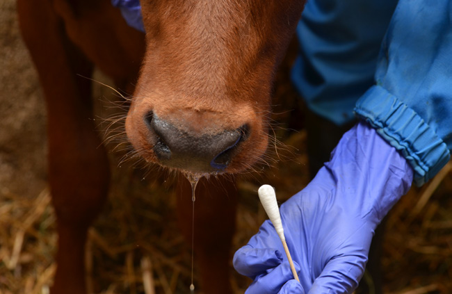

---
## Page 85

79
AUSVETPLAN  /  RESPONSE STRATEGY FOOT-AND-MOUTH DISEASE
Where laboratory investigation is required, the selection of animals to sample should be risk based, 
considering the presence of distinct epidemiological units or groups of animals on the premises. It 
should include sufficient animals to be representative of each distinct population present. Animals of 
susceptible species to target for sampling include:
•	 animals showing clinical signs consistent with FMD
•	 recently dead or euthanased animals
•	 the most susceptible animals (considering species, age, etc)
•	 animals introduced to the premises in the tracing window of interest (as these may be a source of 
infection)
•	 animals more likely to be infected (eg animals with a history of recent exposure to other animals, 
breeding males with high numbers of recent matings, animals returned from shows)
•	 rare and valuable animals.
Surveillance on suspect premises (SPs)
Veterinary investigation of SPs is a priority and should occur as soon as practical after suspicious signs 
are recognised and reported.
Given the wide host range of FMD, it is possible that a large number of SPs will require investigation. 
Where available resources are limited, further prioritisation may be required. This should take into 
consideration the likelihood that infection may be present, and the risk of further disease transmission 
and dissemination if the animals are infected. General principles are as follows:
•	 SPs with epidemiological links to known IPs are a higher priority, and SPs with no epidemiological 
links to IPs are a lower priority. (Clinical signs similar to FMD may have an endemic cause, and many 
reports of suspicious clinical signs will not be due to FMD. However, to ensure that producers are not 
discouraged from reporting, it is important that surveillance to resolve these cases is conducted in as 
timely a manner as possible.)
•	 SPs in the outside area (OA) are a higher priority for investigation than those in the control area (CA) or 
RA.
•	 SPs in the CA are a higher priority for investigation than those in the RA.
•	 SPs with rare and valuable animals are a higher priority for investigation than those of equivalent risk 
status but without such animals.
On SPs, the approach to surveillance should be as follows:
•	 All susceptible animals on the premises should be observed for clinical signs that are consistent with 
FMD (although this may not be practical or possible on extensive premises).
•	 Targeted examination and sampling should be undertaken to maximise the likelihood of detecting FMD 
if it is present. This should be consistent with the recommended approach to targeted sampling on IPs.
•	 Targeted sampling should be supplemented by sampling for serological testing of healthy 
susceptible animals in the same epidemiological unit or cohort as the animals targeted. Detection of 
seroconversion will help indicate how long FMD virus has been present on the premises and provide 
data for epidemiological investigations.
•	 If not already undertaken, an investigation should be conducted to determine whether the premises is 
epidemiologically linked to the outbreak.
If adequate samples have been taken (in terms of both quality and quantity), the laboratory results are 
negative for FMD virus, and epidemiological investigation of the premises is complete with no additional

---
## Page 86

80
AUSVETPLAN  /  RESPONSE STRATEGY FOOT-AND-MOUTH DISEASE
risk materials identified, the premises may be assessed negative and designated with the ‘AN’ qualifier. 
If it is located in the RA, it will then be reclassified as an at-risk premises (ARP) with the qualifier 
AN (ARP-AN). If it is located in the CA, it will be classified as a premises of relevance (POR) with the 
qualifier AN (POR-AN). If it is located in the OA, the premises will resume its usual status and previous 
business.
Surveillance on trace premises (TPs)
Where the number of TPs for investigation is large and available resources are limited, further 
prioritisation may be required. This should take into consideration the likelihood that infection may be 
present, and the risk of further disease transmission and dissemination if the animals are infected. 
Animal welfare should also be considered in prioritising and resolving TPs.
The owner or managers of TPs waiting for a surveillance visit should be encouraged to report any 
clinical signs or changes in production statistics consistent with FMD.
The approach to surveillance of live susceptible animals on TPs should be consistent with the guidance 
for surveillance on SPs. 
If live susceptible animals on the premises show clinical signs consistent with FMD, the premises 
should be considered an SP, and the guidance on surveillance and assessment of SPs followed.
In addition, where the premises was identified through tracing of contaminated animal products, 
wastes or things, these items should also be subject to surveillance, including sampling for laboratory 
investigation, where warranted (eg using molecular techniques such as PCR testing where FMD virus 
contamination cannot be otherwise ascertained).
If the TP has no live susceptible species, the premises may be considered as assessed negative if 
the investigation shows no evidence of FMD virus. For example, this might occur if the potentially 
contaminated items are no longer on the premises, laboratory investigation of potentially contaminated 
items returns negative results or the potentially contaminated items are decontaminated.
If live susceptible species on the premises do not show clinical signs of FMD, the premises may be 
considered for ongoing surveillance over a 14–28-day period (1–2 incubation periods) or may be 
resolved to ARP/POR status.
Surveillance on dangerous contact premises (DCPs) and dangerous contact processing facilities 
(DCPFs)
Surveillance of susceptible animals on DCPs and DCPFs should be consistent with the guidance for 
surveillance on SPs.
As for TPs, where the premises has been allocated its status because of the potential presence of 
contaminated animal products, wastes or things (eg the environment, feed), these items should also 
be subject to surveillance. Surveillance should include sampling for laboratory investigation, where 
warranted.
The approach to resolving DCPs and DCPFs following completion of control activities is outlined in 
Section 5.4 and the AUSVETPLAN guidance document Declared areas and allocation of premises 
classifications in an emergency animal disease response.

---
## Page 87

81
AUSVETPLAN  /  RESPONSE STRATEGY FOOT-AND-MOUTH DISEASE
Surveillance on other premises with live susceptible animals (ARPs in the RA, PORs in the CA, and 
premises in the OA)
The aim of surveillance on ARPs, PORs and premises in the OA will be to detect infection (new IPs) as 
early as possible, while minimising opportunities for inadvertent spread of FMD virus through field 
visits.
Methods of surveillance may include:
•	 inspection of all at-risk mobs or groups by owners or managers
•	 veterinary investigation of syndromes consistent with FMD
•	 monitoring and review of production records and producer health reports by local control centre 
surveillance staff
•	 phone interviews
•	 bulk milk testing
•	 collection of oral swabs from carcases at abattoirs (with pooling of samples from the same 
consignment)
•	 collection of pooled oral swabs from healthy flocks and herds
•	 testing of ‘chew’ ropes from healthy pig herds
•	 pen-side testing.
The frequency and method(s) of surveillance chosen for individual premises will depend on the 
assessed risk (including from airborne transmission), the number of premises to monitor (the size of 
the outbreak) and the available resources.
The initial approach to surveillance on other premises with live susceptible animals would include 
raising awareness of the possible clinical presentations of FMD, and encouraging producers or owners 
to report clinical signs or changes in production statistics. Biosecurity advice should also be provided to 
help prevent the introduction or further spread of disease.
Surveillance visits would be risk based; for example, ARPs may be considered a higher priority for 
such visits, particularly ARPs in close proximity to IPs or predicted to be at risk of windborne spread. 
Collection of samples (eg oral swabs) from these premises for pooled testing may improve confidence 
that infection will be detected if present.
The timing and frequency of active surveillance visits in the CA and OA may differ from those in the 
RA. For logistical purposes (and to minimise the risk of disease spread), it may be useful to separate 
management and resourcing of surveillance in the CA from that in the RA.
Additional surveillance activities on these premises may subsequently be required to provide evidence 
to support proof of freedom.
7.1.3	 Surveillance of sentinel animals placed after destocking of IPs 
	
and DCPs
The aim of surveillance on an IP or DCP following destocking and decontamination is to confirm 
that FMD virus is not present on the premises. Once a premises has been resolved, restocking will 
be conditional on approval from the jurisdictional chief veterinary officer (eg subject to receipt of 
seronegative test results). It would normally be done on an area basis rather than a premises basis.
In developing a surveillance plan for resolution of IPs or DCPs, consideration is given to the actual

---
## Page 88

82
AUSVETPLAN  /  RESPONSE STRATEGY FOOT-AND-MOUTH DISEASE
number of infected animals rather than the prevalence. When only one animal in the group is infected, 
testing all animals in the group results in a probability of detection equal to the sensitivity of the test. 
If the group contains two infected animals, the probability of detection increases to more than 0.95 as 
long as the test has a sensitivity of 80% or more; for example, a sample size of 100 will allow detection 
of at least 3% prevalence (0.95 probability) using a test with 95% sensitivity (see table below).
Table 7.1 Sample Sizesi and number of infected animals for six prevalence values and a range of the 
group sizes. Sample sizes achieve 0.95 probability of detection using 95 Percent Sensitive Test.
Group 
sizeii
1% 
Prevalence
2% 
Prevalence
3% 
Prevalence
5% 
Prevalence
10% 
Prevalence
15% 
Prevalence
No. 
infected 
animals
Sample 
size
No. 
infected 
animals
Sample 
size
No. 
infected 
animals
Sample 
size
No. 
infected 
animals
Sample 
size
No. 
infected 
animals
Sample 
size
No. 
infected 
animals
Sample 
size
100
1
95
2
77
3
63
5
44
10
25
15
25
150
1
143
3
94
4
78
7
51
15
26
22
26
200
2
155
4
105
6
78
10
51
20
27
30
27
250
2
194
5
112
7
86
12
54
25
27
37
27
300
3
189
6
117
9
84
15
53
30
27
45
27
400
4
210
8
124
12
87
20
54
40
27
60
27
600
6
235
12
131
18
91
30
56
60
28
90
28
800
8
249
16
135
24
93
40
56
80
28
120
28
1000
10
258
20
138
30
94
50
57
100
28
150
28
>5000
--iii
298
--iii
148
--iii
98
--iii
58
--iii
28
--iii
28
i	
Sample sizes computed using Cannon, 2001.
ii	
Group size refers to the size of the population being sampled. This could be the entire herd or it could be a targeted portion of the herd such as the sick 
animals or animals with potential exposure.
iii	 Depends on the group size.
Jurisdictions need to consider the desired level of certainty and prevalence that is required to resolve 
the property status.
Restocking guidance
Following successful decontamination protocols, an IP will remain vacant for a period before being 
restocked with susceptible species. The minimum recommendation is 28 days (two World Organisation 
for Animal Health (WOAH) incubation periods).
If it is not possible to carry out full decontamination protocols, the premises may need to remain vacant 
for a longer period, based on consideration of virus survival, environmental conditions and the specific 
circumstances of the outbreak. This will be determined on a case-by-case basis.

---
## Page 89

83
AUSVETPLAN  /  RESPONSE STRATEGY FOOT-AND-MOUTH DISEASE
A restocking plan should include details of the:
•	 susceptible species – any FMD susceptible species is appropriate, although the use of sheep as 
sentinel animals should be discouraged
•	 number of sentinel animals (to provide epidemiologically sound results)
•	 proposed locations of sentinel animals.
Restocked animals should undergo a clinical investigation every 3 days for the first 14 days, and then 
once per week up to 28 days.
Each animal must be clinically examined by a veterinary inspector and sampled for the presence of 
FMD virus antibody 28 days after the last animals are introduced.
Surveillance of wild and free-roaming animals
A surveillance program may be required for surveillance of wild and free-roaming susceptible species.
Early identification of susceptible wild and free-roaming animal species, and the geographical extent 
of the disease are key requirements for managing an outbreak. Sampling for disease in wild animal 
populations can indicate the presence and geographical extent of the disease, and in some cases give 
an indication of prevalence (ie the proportion of the population affected) in these populations. 
Engaging a wild animal expert to assist in planning and implementing a surveillance program is 
recommended. 
At the end of an eradication campaign, sampling of wild animals may be required to prove freedom from 
the disease.
Guidelines for wild animal surveillance are further discussed in the AUSVETPLAN operational manual 
Wild animal response strategy [to be updated].
Refer to Section 4.3.14 for further information about the control of susceptible wild (including feral) 
animal populations.
7.2	 Proof of freedom
Following an outbreak of FMD, surveillance will be required to demonstrate that infection has been 
eradicated from susceptible domestic and feral animal populations, and enable any remaining 
movement restrictions to be lifted within the country or zone. Proof of freedom will also be needed to 
satisfy trading partners and regain access to international markets, and to underpin import controls to 
prevent the reintroduction of FMD virus.
WOAH has the mandate from the World Trade Organization to officially recognise FMD-free areas of 
countries for trade purposes.68 Any application to WOAH regarding recognition of Australia’s FMD 
status should be based on the WOAH Terrestrial animal health code chapters on FMD (Chapter 8.8)69 
and general surveillance (Chapter 1.4),70 as well as the WOAH FMD questionnaire (Article 1.6.6).71 The 
application will require submission of a formal report to WOAH, detailing the eradication procedures 
carried out, the surveillance program undertaken and the results obtained. Where a zonal approach to 
68	
	 www.woah.org/en/what-we-do/animal-health-and-welfare/official-disease-status
69	
	 www.woah.org/en/what-we-do/standards/codes-and-manuals/terrestrial-code-online-access/?id=169&L=1&htmfile=chapitre_fmd.htm
70	
	 www.woah.org/en/what-we-do/standards/codes-and-manuals/terrestrial-code-online-access/?id=169&L=1&htmfile=chapitre_surveillance_general.htm
71	
	 www.woah.org/fileadmin/Home/eng/Health_standards/tahc/2016/en_chapitre_selfdeclaration.htm

---
## Page 90

84
AUSVETPLAN  /  RESPONSE STRATEGY FOOT-AND-MOUTH DISEASE
control has been taken, increased surveillance and movement restrictions in protection zones may also 
be applied.
However, although WOAH provides guidelines for recovering FMD-free status, acceptance of FMD-free 
status following an outbreak will most likely have to be negotiated with individual trading partners and 
may take considerably longer than the minimum periods prescribed in the WOAH Terrestrial Code.
A key requirement for WOAH and trading partners will be evidence of an effective surveillance program 
capable of detecting infection if it is present in the population, and analysis of data to support the case 
for disease freedom. Descriptions of the veterinary services, demographics of susceptible populations, 
animal identification, records of movement and relevant industry structures should be included to 
justify the design of the surveillance program.
7.2.1	 Principles for designing a post-outbreak surveillance program
To provide confidence that FMD virus is no longer circulating,72 a comprehensive surveillance 
program will be required. Specific recommendations for surveillance to support proof of freedom 
will be developed using the technical expertise of competent and experienced epidemiologists, and 
will be based on the characteristics of the outbreak and the animal production sectors involved. 
The surveillance program will need to be carefully designed and followed to ensure that it produces 
sufficient data that are reliable and acceptable to WOAH and international trading partners, while 
avoiding a program that is excessively costly and logistically complicated. The surveillance program 
will include clinical, serological and molecular surveillance of relevant susceptible domestic and feral 
animal populations. It will include targeted and random components, and will build on the surveillance, 
diagnostic testing, tracing and epidemiological assessment conducted during the response phase.
Clinical surveillance
The aim of clinical surveillance is to physically examine susceptible animals for clinical signs of FMD. 
In addition to clinical and/or laboratory investigation of suspect cases reported to authorities (passive 
surveillance), active surveillance will also be required to look for the disease in groups of animals seen 
as being at particularly high risk. The absence of FMD infection will support proof of freedom.
The approaches used for clinical surveillance will be a continuation of measures in place during the 
response and should include:
•	 a public relations and awareness campaign for producers and animal health professionals (eg 
veterinarians, stock inspectors, meat inspectors) to immediately report suspicions of vesicular disease 
to government veterinary services
•	 enhanced clinical inspection of livestock at abattoirs, saleyards and other aggregation points
•	 an official alert system deployed on SPs pending diagnosis
•	 effective veterinary investigations and diagnostic services that demonstrate that suspect cases are 
promptly investigated 
•	 use of a standardised investigation protocol and reporting forms.
Serological surveillance
Regardless of whether vaccination has been used in the response, the WOAH Terrestrial Code identifies 
serological surveillance as a key element for demonstrating FMD freedom. Serological surveillance 
aims to detect evidence of exposure to FMD virus. It may be based on targeted or random sampling, 
72	
	 According to WOAH, virus circulation means transmission of FMD virus as demonstrated by clinical signs, serological evidence or virus isolation.

---
## Page 91

85
AUSVETPLAN  /  RESPONSE STRATEGY FOOT-AND-MOUTH DISEASE
or a combination of both. Generally, a targeted approach would be used to verify the status of specific 
groups or sectors of the population considered to be at higher risk of exposure; for example, herds 
in former RAs and CAs may be targeted because of proximity to cases, and sheep may be targeted 
because they are less likely to show clinical evidence of infection than other susceptible species.
Surveys based on random sampling are important in providing reliable evidence that FMD virus 
infection is not present in a country. The sampling strategy will be designed to demonstrate the 
absence of FMD virus circulation at an acceptable level of statistical confidence. Important factors that 
need to be taken into account when designing the sampling regime include:
•	 design prevalence – the minimum level of infection that would be detected if the disease is present
•	 target population – the population under surveillance, which should cover all susceptible species 
•	 level of statistical confidence required in the results
•	 sensitivity and specificity of diagnostic tests 
•	 sample size – number of herds to be sampled and number of animals to be sampled per herd.
It is impossible to provide specific recommendations to cover all situations, because the characteristics 
of potential FMD outbreaks in Australia will be highly variable, depending on the strain of virus, 
the environmental conditions, and the region(s) and populations affected. Technical expertise from 
professionals who are competent and experienced in epidemiology will be required. Particular attention 
will need to be paid to selecting an appropriate design prevalence and statistical confidence level for 
surveys, because these parameters will have to be justified and withstand international scrutiny. Since 
no diagnostic tests are perfect, the survey design should anticipate the occurrence of false positive 
reactions and incorporate appropriate follow-up procedures.
Surveillance where vaccination is used
Demonstrating freedom from infection in populations where vaccination has been used will pose 
additional challenges for post-outbreak surveillance. If vaccination is used as part of the FMD 
response, the options are to remove the vaccinated animals from the population or to allow them to 
live out their normal commercial lives. The availability of tests that can differentiate infected from 
vaccinated animals (DIVA tests) means that it may be possible to allow vaccinated animals to be 
retained in the population to live out their normal lives. However, there is a preference for removal of 
vaccinated animals to expedite return to international trade (see Section 4.3.8).
DIVA tests are based on detection of antibodies to nonstructural proteins of the virus. In Australia, 
DIVA testing would be based on an enzyme-linked immunosorbent assay (ELISA) detecting antibodies 
to the nonstructural protein 3ABC. This protein is only expressed as the virus replicates in the host, 
and is either not present at all or present at very low levels in purified inactivated vaccines. Animals 
vaccinated with purified inactivated vaccines but not exposed to live virus are less likely to develop 
antibodies to 3ABC, but may develop antibodies after repeated booster vaccinations. 
It is important to note that, in animals infected after vaccination, antibodies induced by vaccination 
inhibit, but do not prevent, replication of the virus. Because the virus replicates at much lower levels, 
the titres of antibodies to nonstructural proteins such as 3ABC are much lower. As a result, the 
diagnostic sensitivity for vaccinated animals is lower than for animals infected but not vaccinated. This 
differential sensitivity must also be considered as part of the sampling strategy. For this reason, the 
3ABC ELISA is used on a herd basis. See Section 2.5.5 for further information on DIVA testing.

---
## Page 92

86
AUSVETPLAN  /  RESPONSE STRATEGY FOOT-AND-MOUTH DISEASE
FOOT-AND MOUTH DISEASE FACT SHEET
Disease and cause
Foot-and-mouth disease (FMD) is caused by FMD virus.
Occurrence in Australia
Australia is recognised as free from FMD without vaccination.
Species affected
Domestic and wild cloven-hoofed animals – cattle, pigs, sheep, goats, deer (red, fallow and roe) and 
water buffalo – are the natural hosts of FMD virus. A few species in other orders are also susceptible.
Key signs
In cattle, the earliest clinical signs of FMD are dullness, poor appetite and a rise in temperature to 
40–41°C. In dairy cows, milk yield drops considerably. Profuse salivation, nasal discharge and lameness 
may be observed, depending on the stage of infection. Affected animals move away from the herd 
and may be unwilling or unable to stand. Lethargy and rapid loss of condition are also features of the 
disease.
Vesicles may appear inside the mouth, on the tongue, cheeks, gums, lips and/or palate.
Spread
FMD is one of the most contagious animal diseases.
Movement of infected animals is widely recognised as one of the most important routes by which 
FMD spreads between herds and farms. Transmission occurs most readily when animals are in close 
proximity, such as at watering and feeding points, and congregation points such as stockyards and 
milking sheds.
Animals are infected via inhalation, ingestion and artificial or natural breeding. The primary route of 
infection in ruminants is inhalation of contaminated aerosols. In contrast, pigs are mainly infected 
through ingesting contaminated feedstuff.
Persistence of the agent
FMD virus can remain infective in the environment for several weeks and possibly longer in the 
presence of organic matter, such as soil, manure and dried animal secretions, or on chemically inert 
materials, such as straw, hair and leather.
Appendix 1
A1

---
## Page 93

87
AUSVETPLAN  /  RESPONSE STRATEGY FOOT-AND-MOUTH DISEASE
PERMIT CONDITIONS, OTHER THAN FOR MILK AND 
MILK PRODUCTS 
General requirements
a.	 With CVO approval, for slaughter or destruction at an APF, or to an ARP for other purposes (eg health 
and welfare reasons – feed, water, milking), if a risk assessment indicates that the risk associated with 
movement is acceptable within the response.
b.	 For slaughter only, if the RA contains the only available abattoir, and if a risk assessment indicates that 
the risk associated with the movement is acceptable within the response.
c.	 For slaughter, or to a POR for a specific purpose (eg health and welfare reasons – feed, water, 
milking), if a risk assessment indicates that the risk associated with movement is acceptable within 
the response. For the purposes of this permit, the definition of POR includes APFs (ie an abattoir or 
knackery or other such plant to which animals have been introduced from lower-risk premises under a 
permit for processing to an approved standard).
d.	 With CVO approval, for disposal or decontamination procedures only.
e.	 With CVO approval, for introduction of sentinel stock.
f.	 For slaughter or for movements within an enterprise, such as the movement of offspring from a 
breeding herd to grow-out unit; not for milking.
Transport requirements
g.	 Travel by approved routes and no stopping en route.
h.	 The receiving premises must meet minimum biosecurity standards.
i.	 Vehicles carrying livestock or products, and associated equipment, to be decontaminated (ie cleaned 
and disinfected) at an appropriate site (eg truck wash-down facility) before and after movement. 
Vehicles and equipment must have adequate contact time with the relevant disinfectant before 
use, and runoff from the decontamination sites needs to be managed (refer to the AUSVETPLAN 
operational manual Decontamination for disinfectant information, adequate contact times and 
management of runoff).
j.	 Single consignment per load.
k.	 One-way movement only.
m.	Trucks are appropriately decontaminated as soon as possible after use and before leaving the ADS or 
POR, and are dry before reuse.
Appendix 2
A2

---
## Page 94

88
AUSVETPLAN  /  RESPONSE STRATEGY FOOT-AND-MOUTH DISEASE
Disease-related requirements
n.	 Absence of clinical signs of FMD in all susceptible animals on the premises before and on day of travel.
o.	 Any suspicious or clinically consistent clinical signs of FMD in live susceptible animals proposed to be 
moved are immediately reported to the local control centre, state coordination centre or Emergency 
Animal Disease Watch Hotline (1800 675 888).
p.	 The material has been treated or held under conditions that would inactivate or securely contain FMD 
virus before removal to an ADS.
Legislative requirements
q.	 All live susceptible animal movements must comply with state or territory legislation related to 
traceability requirements and standards, and be accompanied by any legislated documentation (eg 
National Vendor Declaration (NVD), waybill). Traceability must be maintained for a minimum of 30 days 
for consignments moved to another farm.
Other requirements
r.	 The tank or container used for transport is sealed before movement, and disinfected before and after 
movement.
s.	 If the tank or container used for transport has been opened within 28 days from the estimated date of 
introduction of FMD, a risk assessment is required.
t.	 Information is recorded in the permit on the identification codes, species and identity of the sire and/or 
dam, collection date, and property of collection and destination.
v.	 No direct or indirect contact between the effluent and susceptible animals.
w.	 A risk assessment indicates that the risk is acceptable within the response.
x.	 Vehicles transporting meat and meat products or offal are decontaminated (ie external surfaces 
and the cabin are cleaned and disinfected) before leaving the processing facility with the relevant 
disinfectant and adequate contact time. Management of refrigerated vehicles – including appropriate 
decontamination – needs to meet regulatory food safety standards.
y.	 The permit accompanies the livestock or vehicle during movement, and the person responsible retains 
a copy of the permit, consistent with the legal requirements of the jurisdiction.
z.	 Only after maturation and deboning, unless otherwise approved by the jurisdiction via the conditions of 
approval as an APF or on a risk-assessed basis (w).
aa.	As per the prohibited pig feed or restricted animal material requirements, the product is not to be 
brought into direct or indirect contact with susceptible animals.

---
## Page 95

89
AUSVETPLAN  /  RESPONSE STRATEGY FOOT-AND-MOUTH DISEASE
Appendix 3
A3
ESTIMATING THE AGE OF LESIONS OF FMD IN 
CATTLE AND SHEEP
Day of clinical 
disease
Appearance of lesion (note: lesions in sheep and goats may be smaller and 
less pronounced than those in cattle)
Day 1
Blanching of 
epithelium, followed 
by formation of 
fluid-filled vesicles
Cont’d

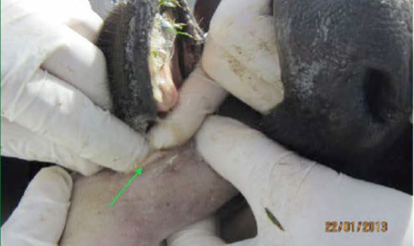

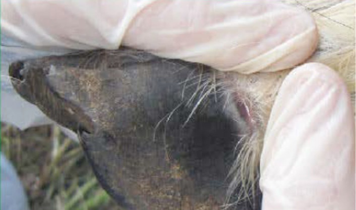

---
## Page 96

90
AUSVETPLAN  /  RESPONSE STRATEGY FOOT-AND-MOUTH DISEASE
Day of clinical 
disease
Appearance of lesion (note: lesions in sheep and goats may be smaller and 
less pronounced than those in cattle)
Day 2
Freshly ruptured 
vesicles, 
characterised by raw 
epithelium, a clear 
edge to the lesion 
and no deposition of 
fibrin
Day 3
Lesions start to 
lose their sharp 
demarcation and 
bright red colour; 
deposition of fibrin 
starts
Cont’d

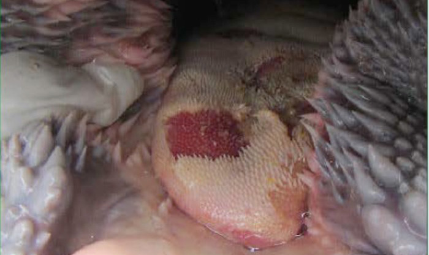

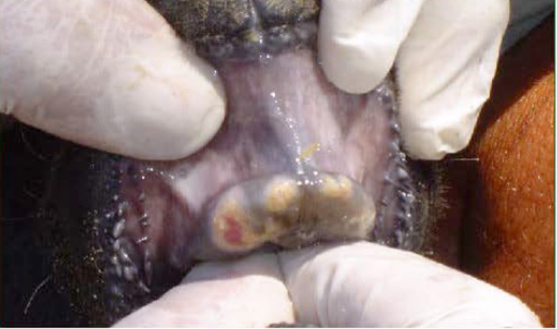

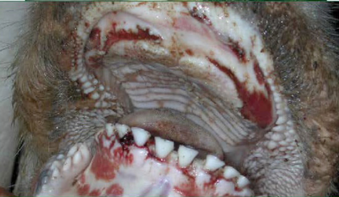

---
## Page 97

91
AUSVETPLAN  /  RESPONSE STRATEGY FOOT-AND-MOUTH DISEASE
Day of clinical 
disease
Appearance of lesion (note: lesions in sheep and goats may be smaller and 
less pronounced than those in cattle)
Day 4
Considerable 
fibrin deposition 
has occurred, 
and regrowth of 
epithelium is evident 
at the periphery of 
the lesion
Day 7
Extensive scar 
tissue formation 
and healing have 
occurred; some 
fibrin deposition is 
usually still present
Day 10
By day 10, the lesion 
is likely to have 
healed, although the 
scar will be clearly 
visible as a paler 
area of epithelium

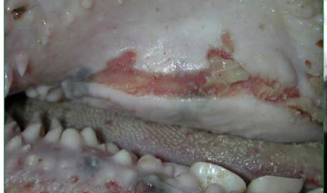

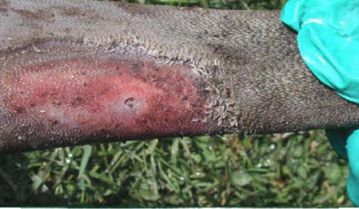

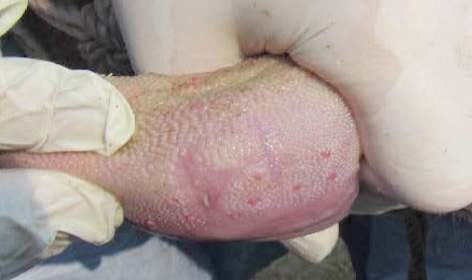

---
## Page 98

92
AUSVETPLAN  /  RESPONSE STRATEGY FOOT-AND-MOUTH DISEASE
In pigs, ageing is best based on coronary band lesions, as follows:
•	 If the lesion is still on the coronary band, it is unlikely to be more than about 1 week old.
•	 It takes 7 days for the lesions to mature and new horn growth to begin.
•	 Examining all eight cleaned claws on each of several pigs for lesions, measure the distance from the 
coronary band to the lesion. An estimate of the time since the disease was introduced can be made by 
allowing 2 mm per week in weaners and 1 mm per week in adult pigs.
In sheep and goats, foot lesions tend to be less severe than in cattle. They are more commonly found 
on the coronary band rather than between the claws. In lesions more than 1 week old, a line may be 
visible along the hoof wall as a result of coronary band scarring. The distance from the coronary band 
to the line can give an estimate of the age of the lesions, although it is difficult to be accurate (Dekker & 
Moonen 2005).

---
## Page 99

93
AUSVETPLAN  /  RESPONSE STRATEGY FOOT-AND-MOUTH DISEASE
Appendix 4
A4

---
## Page 100

94
AUSVETPLAN  /  RESPONSE STRATEGY FOOT-AND-MOUTH DISEASE
[MOVEMENT CONTROL GUIDELINES FOR SUSCEPTIBLE LIVESTOCK IN 
TRANSIT WHEN A NATIONAL LIVESTOCK STANDSTILL IS DECLARED
UNDER REVIEW73 Vaccination strategies
73	
	 Please refer to the nationally agreed standard operating procedure NASOP 19 (animalhealthaustralia.com.au/nationally-agreed-standard-operating-procedures).

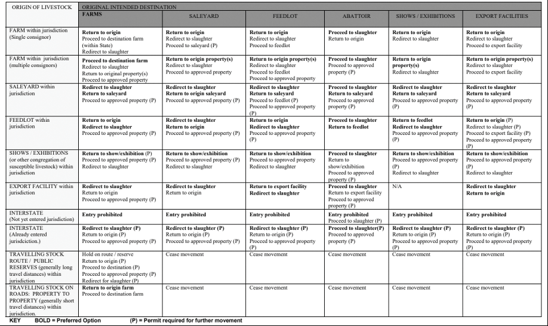

---
## Page 101

95
AUSVETPLAN  /  RESPONSE STRATEGY FOOT-AND-MOUTH DISEASE
VACCINATION STRATEGIES 
Introduction
Australia’s response policy for foot-and-mouth disease (FMD) is for containment and eradication as rapidly 
as possible to minimise the impacts. Vaccination may be considered if the disease spreads beyond the limit 
of available resources to contain it, to protect areas of high animal concentrations, and to limit infection and 
minimise virus excretion.
FMD vaccines will protect animals against clinical disease. Although vaccination may not entirely prevent 
infection, effective vaccines reduce susceptibility to infection. If infection does occur, vaccination reduces the 
amount of virus shed into the environment. These two factors mean that vaccination may be a valuable tool 
to assist with eradication of FMD in Australia under some circumstances.
Biosecurity practised by all field teams is critical to the success of a vaccination program.
Vaccination can be used in three broad ways: protective, suppressive and mass (blanket) vaccination.
Also refer to the relevant nationally agreed standard operating procedures (NASOPs 74), including:
•	 NASOP 1: Personal decontamination – entry and exit procedures
•	 NASOP 14: Control of foot and mouth disease vaccine at a designated vaccine centre
•	 NASOP 16: Assessing and inspecting a property prior to administration of foot and mouth disease vaccine
•	 NASOP 17: Vaccinating livestock on a property for foot and mouth disease
•	 NASOP 24: Ordering of foot and mouth disease vaccine and distribution to states and territories.
Protective vaccination
Protective vaccination involves vaccination of particular groups of animals in an area to protect them from 
clinical disease or infection. Vaccination would generally be undertaken outside the known infected area (ie 
restricted area (RA)) and in advance of exposure. Protective vaccination can be considered further in terms 
of how it is applied: ring, targeted or buffer vaccination.
Ring vaccination
Ring vaccination builds a ring of immune animals around a focus of infection to prevent further outward 
spread of the disease. The width of the ‘ring’ depends on the likely distance that the virus will move. It is 
an appropriate technique when premises adjacent to, or close to, a focus of infection are considered at risk 
of becoming infected. It is most effective in reducing the size of outbreaks when used early, and when the 
disease is spreading rapidly. Vaccination teams would normally begin working from the outer edge of the 
ring inwards to reduce the risk of spreading infection.
74	
	 animalhealthaustralia.com.au/nationally-agreed-standard-operating-procedures
Appendix 5
A5

---
## Page 102

96
AUSVETPLAN  /  RESPONSE STRATEGY FOOT-AND-MOUTH DISEASE
Targeted vaccination
With targeted vaccination, selected groups or individuals are vaccinated to protect them. This 
particularly applies to valuable commercial animals (eg high-value genetic stock), or rare or valuable 
animals or herds (eg zoo animals). Alternatively, it might be considered to protect high-risk enterprises, 
such as feedlots, large dairies or large piggeries. Because of the large numbers of animals in close 
contact in these enterprises, they have the potential to rapidly amplify and excrete FMD virus. Even 
where these enterprises are not directly involved in the outbreak, they may be a risk because of their 
proximity to a source of infection. If they were to become infected, they could significantly increase the 
response effort.
Buffer vaccination
Buffer vaccination is undertaken to create a barrier of immune stock between a heavily infected zone 
and an area that is free from disease. Animals in a ‘band’ of properties along the notional border 
between the two areas are vaccinated to create a buffer population. Vaccination teams would normally 
begin working from the outer edge of the ring inwards to reduce the risk of spreading infection.
Suppressive vaccination
Suppressive vaccination is the vaccination of a selected group of animals at risk from an outbreak, to 
control the spread of FMD within and out of an area that is already infected. Vaccination is carried out 
within the known infected area where it is considered that there is an urgent need to reduce the amount 
of virus circulating and hence the risk of spread within and beyond the area. It reduces the amount of 
FMD virus circulating in the area because vaccinated animals, if infected, excrete substantially less 
virus than fully susceptible animals (Sellers et al 1977). Afterwards, all vaccinated animals may either 
be removed, or tested using DIVA (differentiating infected from vaccinated animals) technology to 
establish which herds have not been infected. Uninfected herds may be retained in the population, while 
infected herds are removed. The post-vaccination strategy will depend on the extent of disease spread 
during the outbreak and the availability of resources.
Suppressive vaccination is used where there is a recognised risk of escalation of the outbreak, to 
prevent spread within and beyond the RA. It may be indicated when:
•	 there is a high density of animals (especially pigs and feedlots)
•	 the capacity to cull and dispose of carcasses of culled animals within a short period has been 
overwhelmed (eg in feedlots)
•	 infrastructure is poor, human resources are inadequate or stamping out is delayed.
Suppressive vaccination may have a role where stamping out is planned but is logistically or politically 
difficult to implement. Vaccination could reduce the risk associated with delayed destruction. 
Slaughter of vaccinated animals can then be carried out in a progressive, orderly manner. In 2001, the 
Netherlands used a suppressive vaccination strategy to address logistical problems associated with 
culling and disposal of animals in infected areas.
Mass (blanket) vaccination
Mass vaccination is vaccination of large numbers of animals over a wide area to protect them from 
infection and/or disease. It would generally be used where FMD was widespread and not readily 
containable using other measures. At least initially, the disease would be considered endemic, and a 
longer-term control program would be required to achieve eradication.

---
## Page 103

97
AUSVETPLAN  /  RESPONSE STRATEGY FOOT-AND-MOUTH DISEASE
Initial assessment – a role for vaccination?
The key issue in choosing the preferred strategy for managing an FMD outbreak is the extent to which 
the disease can be controlled with available resources. This will largely be determined by where the 
outbreak has occurred, the time since the disease was first introduced, and the extent to which the 
disease has spread across and within industry sectors. Eradication by stamping out may be feasible 
if the disease was introduced relatively recently and occurs on circumscribed properties within a 
single compartment. In contrast, containment and control may be more difficult for an outbreak in a 
high-density livestock production area where there is already evidence of spread across and between 
different industry sectors. 
The criteria in Table A6.1 should be used in assessing whether vaccination is likely to be of benefit in 
any given outbreak setting.
Table A5.1 Criteria for assessing benefits of FMD vaccination 
Criterion
For vaccination
Against vaccination
Location
As determined by property 
specific jurisdictional legislative 
orders
As determined by property 
specific jurisdictional legislative 
orders
Lifetime traceability in place or available 
for vaccinates
Yes
No
Livestock density (numbers of premises, 
livestock in immediate vicinity, feedlots, 
etc)
High
Low
Extent of movements (livestock, product, 
fomites, wildlife) that have occurred in and 
around infected premises
Extensive
Limited
Evidence of spread
Evidence of multiple outbreaks 
involving different industry 
sectors 
Little evidence of spread
Slope of epidemic curve
Rising rapidly
Shallow or slow rise
Likelihood of future spread
Potential to enter multiple 
properties in different 
compartments
Extensive spread considered 
unlikely
Conditions suitable for airborne spread
Yes
No
Spatial distribution of outbreaks
Widespread
Restricted
Suitable vaccine available
Yes
No
Resource availability for stamping out, 
including timely destruction, disposal and 
decontamination
Limited
Adequate
Resources for vaccination (adequate 
vaccine stocks that can be accessed 
quickly, trained personnel, other logistics)
Adequate
Limited
Industry support for stamping out
Low
High
Public reaction to stamping-out policy
Opposed
Supportive
Market acceptance of product from 
vaccinated animals
Supportive
Opposed

---
## Page 104

98
AUSVETPLAN  /  RESPONSE STRATEGY FOOT-AND-MOUTH DISEASE
Vaccination strategy – what strategy to use?
In addition to deciding whether to use vaccination, it is also necessary to consider how vaccination 
should be used. This includes both the strategy and the species to be vaccinated. The preferred strategy 
will depend on a range of factors, including:
•	 amount of vaccine available relative to the numbers of animals at risk
•	 resources for vaccination
•	 density of animals (especially pigs)
•	 capacity to perform effective stamping out
•	 risk that the disease will get out of control
•	 presence of rare or endangered animals
•	 presence of high-risk enterprises (feedlots, large dairy farms, intensive piggeries)
•	 industry attitudes
•	 public and political concerns
•	 surveillance capacity
•	 acceptance of DIVA technology in target species by trading partners.
Ring vaccination around the infected area(s) could be considered where there is a risk that the outbreak 
could rapidly escalate. Where stamping out is not feasible because resources are insufficient or the 
disease has entered a compartment where further spread is inevitable (because of poor biosecurity), 
suppressive vaccination should be considered. In a large multifocal outbreak where disease is 
spreading rapidly, mass vaccination may be necessary to bring the situation under control.
The criteria in Table A6.2 may be used to assist in determining the preferred vaccination strategy. (Note 
that the criteria do not indicate which species would be vaccinated.)
The presence of intensive piggeries in an area may influence the preferred vaccination strategy.

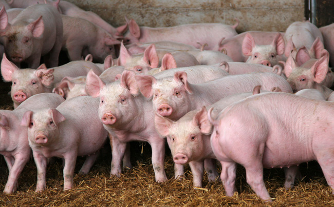

---
## Page 105

99
AUSVETPLAN  /  RESPONSE STRATEGY FOOT-AND-MOUTH DISEASE
Table A5.2 Criteria for determining FMD vaccination strategy
Criterion
Protective ring 
vaccination
Targeted 
vaccination
Suppressive 
vaccination
Suppressive 
vaccination	
Mass vaccination
Vaccine availability
Limited
Limited
Limited
Ample
Resources to maintain 
effective stamping out
Adequate, but 
escalation 
possible
Adequate, but 
protection of 
selected animals 
desirable
Inadequate
Inadequate
Short-term capacity 
to cull animals and 
dispose of carcasses 
overwhelmed
No
No
Yes
No
Spatial distribution
Multiple outbreaks 
with possible 
future resource 
problems
Limited or 
multiple outbreaks
Multiple outbreaks 
with current 
resourcing 
problems
Multifocal or 
multijurisdictional 
and out of control
Species at risk
Predominantly 
ruminants
Predominantly 
ruminants
Significant 
numbers of pigs
Various
Rare or endangered 
animals at risk
No
Yes
No
No
Regional characteristics
High-density, 
high-value 
livestock
High-value (rare 
or endangered) 
animals, high-risk 
enterprises
High-density 
livestock
Various
Species to vaccinate
Ruminants only
Various
All susceptible 
species
Various

---
## Page 106

100
AUSVETPLAN  /  RESPONSE STRATEGY FOOT-AND-MOUTH DISEASE
Appendix 6
A6
BEHAVIOUR OF FOOT-AND-MOUTH DISEASE VIRUS 
IN WILD (INCLUDING FERAL) ANIMALS OVERSEAS
Caution is needed when considering overseas information on the behaviour of foot-and-mouth 
disease (FMD) virus in Australian wild (including feral) animals, and whether feral animals play an 
epidemiological role in disease spread within and between domestic and feral animal populations.
With the exception of transmission of the SAT serotypes of FMD virus from African buffalo to cattle 
(Thomson et al 2003), neither recurrence of FMD in carriers nor transmission from wild animal carriers 
has been demonstrated, despite a considerable amount of research. Important contributing factors with 
respect to the potential for transmission from wild animals are the FMD virus serotype, the population 
dynamics of the species concerned (including population size, distribution, density, movement and 
breeding season), contact with susceptible species of domestic livestock, and the introduction of 
new and susceptible members (Thomson et al 2003). This was supported by a European Food Safety 
Authority (EFSA) epidemiological model–based study (Lange 2012) that demonstrated that, in the 
Thrace region of southeastern Europe, the role of wildlife in the spread of infection is variable. The 
study found that deer did not influence the spread of FMD virus in wildlife and did not spread infection 
to other species. Wild boar, however, were demonstrated to spread infection to other species under 
certain conditions, but wildlife populations were not able to maintain the infection beyond the primary 
epidemic wave. The study noted that there is a strong temperature dependence for FMD virus viability in 
the environment and seasonal patterns of host reproduction, which influence the chance of virus fade-
out from wildlife populations. Contaminated environments are assumed to be the predominant route 
of transmission between host species and between groups of social hosts. Habitat suitability and host 
abundance also influence disease spread.
EFSA (2012) concluded that epidemiological observations, published literature and modelling (Lange 
2012) support the conclusion that the wildlife population in the Thrace region is not able to maintain 
FMD in the absence of FMD virus infection in the domestic host population.
EFSA (2012) also concluded that transmission from wildlife to domestic animals can occur, so wildlife 
can theoretically play some role in the spread of FMD. This conclusion built on work by Mohamed et al 
(2011), who showed that serotype A of FMD virus could be transmitted from domestic pigs to feral pigs 
and vice versa under experimental conditions. However, the experimental evidence does not prove the 
potential for virus transmission in a natural setting, where the prevalence of disease and proximity of 
infected animals may be much lower.
The then state chief veterinary officers Kevin Dunn and Hugh Millar undertook a study tour to Uruguay 
in the early 2000s. One of the findings of that tour was that Uruguay was able to eradicate FMD by 
controlling the disease in domestic livestock only. No control was undertaken in feral pig populations.

---
## Page 107

101
AUSVETPLAN  /  RESPONSE STRATEGY FOOT-AND-MOUTH DISEASE
Glossary
Disease-specific terms
Biological products
Reagents of biological origin (eg sera, hormones) for 
therapeutic use in the diagnosis or treatment of certain 
diseases.
Bos indicus cattle breeds
See Zebu (cattle)
Bos taurus cattle breeds
European breeds of cattle, including Friesian, Hereford, 
Jersey, shorthorn.
Carrier
A ruminant in which FMD virus can be intermittently found in 
the oropharyngeal area for more than 28 days after infection, 
often without the animal displaying clinical disease. The role 
of carrier animals other than African buffalo in the ongoing 
transmission of FMD virus has not been demonstrated.
Confidence
A measure of reliability. For proof-of-freedom surveillance, 
confidence refers to the probability of detecting infection in 
the population if it is present at or above a specified level (the 
design prevalence).
Coronet (coronary band)
Band around the top of the hoof.
Design prevalence
For proof-of-freedom surveillance, the minimum proportion 
of infected/exposed animals or farms in the population that 
the surveillance system is designed to detect with a certain 
level of statistical confidence.
Laminitis
Inflammation of the sensitive laminae of the hoof.
Cont’d

---
## Page 108

102
AUSVETPLAN  /  RESPONSE STRATEGY FOOT-AND-MOUTH DISEASE
Milk and milk products
Includes (from all FMD-susceptible species):
•	 raw milk
•	 milk and other dairy products for human consumption or 
use
•	 milk and other dairy products for human consumption or 
use that are diverted to animals – for example, surplus 
milk or milk past its expiry date
•	 bathing milk and other beauty products containing dairy 
products
•	 production waste, including washings and wastewater from 
farms, processing premises and retail premises that are 
contaminated with dairy products
•	 pet milk and manufactured unpelleted stock feed, including 
milk replacer for calves and lambs
•	 pharmaceuticals and other products containing dairy 
products intended for use in animals, such as extenders 
used in artificial breeding.
Plume (virus)
A dense aerosol of virus particles capable of moving over 
large distances on air currents.
Scales operations
Livestock (predominantly cattle) that are purchased based on 
a weight and grade system. Fixed (or depot) scale operations 
are locations where producers bring their cattle to be 
assessed and purchased by the operator.
Mobile scale operators visit farms, and assess and purchase 
cattle on the farm on which the cattle reside, typically on 
a weight and grade basis. Mobile scale operators play an 
important role in the bobby calf supply chain, as the majority 
of calves are picked up on farm and then delivered direct to 
the abattoir for processing.
TCID50
Tissue culture infectious dose – a measure of virus 
concentration or dose. Serial dilutions of virus are added to 
susceptible cells in culture. The dilution of virus at which half 
the cultures are infected is the TCID50.
Vesicular disease
Any disease in which intact, ruptured or healing blisters, 
papules or ulcers may be evident on skin or mucosal surfaces.
Cont’d

---
## Page 109

103
AUSVETPLAN  /  RESPONSE STRATEGY FOOT-AND-MOUTH DISEASE
Veterinary authority
According to the WOAH Terrestrial animal health code, the 
veterinary authority is a country’s government authority, 
comprising veterinarians, other professionals and 
paraprofessionals, having the responsibility and competence 
for ensuring or supervising the implementation of animal 
health and welfare measures, international veterinary 
certification, and other standards and recommendations in 
the Terrestrial Code in the whole territory. In Australia, the 
veterinary authority is the Australian Chief Veterinary Officer 
or the Australian Government Department of Agriculture, 
Fisheries and Forestry.
Zebu (cattle)
Bovine animals (Bos indicus) with a characteristic large 
hump over the shoulders. Widely distributed in India, China 
and eastern Africa, and used for crossbreeding in Africa and 
northern parts of Australia.
Standard AUSVETPLAN terms
Animal byproducts
Products of animal origin that are not for consumption but are 
destined for industrial use (eg hides and skins, fur, wool, hair, 
feathers, hoofs, bones, fertiliser).
Animal Health Committee
A committee whose members are the chief veterinary officers 
of the Commonwealth, states and territories, along with 
representatives from the CSIRO Australian Centre for Disease 
Preparedness (CSIRO-ACDP) and the Australian Government 
Department of Agriculture, Fisheries and Forestry. There 
are also observers from Animal Health Australia, Wildlife 
Health Australia, and the New Zealand Ministry for Primary 
Industries. The committee provides advice to the National 
Biosecurity Committee on animal health matters, focusing on 
technical issues and regulatory policy.
See also National Biosecurity Committee
Animal products
Meat, meat products and other products of animal origin 
(eg eggs, milk) for human consumption or for use in animal 
feedstuff.
Approved disposal site
A premises that has zero susceptible livestock and has 
been approved as a disposal site for animal carcasses, or 
potentially contaminated animal products, wastes or things.
Cont’d

---
## Page 110

104
AUSVETPLAN  /  RESPONSE STRATEGY FOOT-AND-MOUTH DISEASE
Approved processing 
facility
An abattoir, knackery, milk processing plant or other such 
facility that maintains increased biosecurity standards. Such 
a facility could have animals or animal products introduced 
from lower-risk premises under a permit for processing to an 
approved standard.
At-risk premises
A premises in a restricted area that contains a live susceptible 
animal(s) but is not considered at the time of classification 
to be an infected premises, dangerous contact premises, 
dangerous contact processing facility, suspect premises or 
trace premises.
Australian Chief Veterinary 
Officer
The nominated senior veterinarian in the Australian 
Government Department of Agriculture, Fisheries and 
Forestry who manages international animal health 
commitments and the Australian Government’s response to 
an animal disease outbreak.
See also Chief veterinary officer
AUSVETPLAN
Australian Veterinary Emergency Plan. Nationally agreed 
resources that guide decision making in the response to 
emergency animal diseases (EADs). It outlines Australia’s 
preferred approach to responding to EADs of national 
significance, and supports efficient, effective and coherent 
responses to these diseases.
Carcase
The body of an animal slaughtered for food.
Carcass
The body of an animal that died in the field.
Chief veterinary officer 
(CVO)
The senior veterinarian of the animal health authority in each 
jurisdiction (national, state or territory) who has responsibility 
for animal disease control in that jurisdiction.
See also Australian Chief Veterinary Officer
Compartmentalisation
The process of defining, implementing and maintaining 
one or more disease-free establishments under a common 
biosecurity management system in accordance with WOAH 
guidelines, based on applied biosecurity measures and 
surveillance, to facilitate disease control and/or trade.
Cont’d

---
## Page 111

105
AUSVETPLAN  /  RESPONSE STRATEGY FOOT-AND-MOUTH DISEASE
Compensation
The sum of money paid by government to an owner for 
livestock or property that are destroyed for the purpose of 
eradication or prevention of the spread of an emergency 
animal disease, and livestock that have died of the emergency 
animal disease.
See also Cost-sharing arrangements, Emergency Animal 
Disease Response Agreement
Consultative Committee 
on Emergency Animal 
Diseases (CCEAD)
The key technical coordinating body for animal health 
emergencies. Members are state and territory chief veterinary 
officers, representatives of CSIRO-ACDP and the relevant 
industries, and the Australian Chief Veterinary Officer as 
chair.
Control area (CA)
A legally declared area where the disease controls, including 
surveillance and movement controls, applied are of lesser 
intensity than those in a restricted area (the limits of a control 
area and the conditions applying to it can be varied during an 
incident according to need).
Cost-sharing arrangements
Arrangements agreed between governments (national and 
state/territory) and livestock industries for sharing the costs 
of emergency animal disease responses.
See also Compensation, Emergency Animal Disease Response 
Agreement
Dangerous contact animal
A susceptible animal that has been designated as being 
exposed to other infected animals or potentially infectious 
products following tracing and epidemiological investigation.
Dangerous contact 
premises (DCP)
A premises, apart from an abattoir, knackery or milk 
processing plant (or other such facility) that, after 
investigation and based on a risk assessment, is considered 
to contain a susceptible animal(s) not showing clinical signs, 
but considered highly likely to contain an infected animal(s) 
and/or contaminated animal products, wastes or things that 
present an unacceptable risk to the response if the risk is not 
addressed, and that therefore requires action to address the 
risk.
Dangerous contact 
processing facility (DCPF)
An abattoir, knackery, milk processing plant or other such 
facility that, based on a risk assessment, appears highly 
likely to have received infected animals, or contaminated 
animal products, wastes or things, and that requires action to 
address the risk.
Cont’d

---
## Page 112

106
AUSVETPLAN  /  RESPONSE STRATEGY FOOT-AND-MOUTH DISEASE
Declared area
A defined tract of land that is subjected to disease control 
restrictions under emergency animal disease legislation. 
There are two types of declared areas: restricted area and 
control area.
Decontamination
Includes all stages of cleaning and disinfection.
Depopulation
The removal of a host population from a particular area to 
control or prevent the spread of disease.
Destroy (animals)
To kill animals humanely.
Disease agent
A general term for a transmissible organism or other factor 
that causes an infectious disease.
Disease Watch Hotline
24-hour freecall service for reporting suspected incidences of 
exotic diseases – 1800 675 888.
Disinfectant
A chemical used to destroy disease agents outside a living 
animal.
Disinfection
The application, after thorough cleansing, of procedures 
intended to destroy the infectious or parasitic agents of 
animal diseases, including zoonoses; applies to premises, 
vehicles and different objects that may have been directly or 
indirectly contaminated.
Disinsectisation
The destruction of insect pests, usually with a chemical agent.
Disposal
Sanitary removal of animal carcasses, animal products, 
materials and wastes by burial, burning or some other 
process so as to prevent the spread of disease.
Emergency animal disease
A disease that is (a) exotic to Australia or (b) a variant of 
an endemic disease or (c) a serious infectious disease of 
unknown or uncertain cause or (d) a severe outbreak of 
a known endemic disease, and that is considered to be of 
national significance with serious social or trade implications.
See also Endemic animal disease, Exotic animal disease
Emergency Animal Disease 
Response Agreement
Agreement between the Australian and state/territory 
governments and livestock industries on the management 
of emergency animal disease responses. Provisions include 
participatory decision making, risk management, cost 
sharing, the use of appropriately trained personnel and 
existing standards such as AUSVETPLAN.
See also Compensation, Cost-sharing arrangements
Cont’d

---
## Page 113

107
AUSVETPLAN  /  RESPONSE STRATEGY FOOT-AND-MOUTH DISEASE
Endemic animal disease
A disease affecting animals (which may include humans) that 
is known to occur in Australia.
See also Emergency animal disease, Exotic animal disease
Enterprise
See Risk enterprise
Enzyme-linked 
immunosorbent assay 
(ELISA)
A serological test designed to detect and measure the 
presence of antibody or antigen in a sample. The test uses an 
enzyme reaction with a substrate to produce a colour change 
when antigen–antibody binding occurs.
Epidemiological 
investigation
An investigation to identify and qualify the risk factors 
associated with the disease.
See also Veterinary investigation
Epidemiology
The study of disease in populations and of factors that 
determine its occurrence.
Exotic animal disease
A disease affecting animals (which may include humans) that 
does not normally occur in Australia.
See also Emergency animal disease, Endemic animal disease
Exotic fauna/feral animals
See Wild animals
Fomites
Inanimate objects (eg boots, clothing, equipment, 
instruments, vehicles, crates, packaging) that can carry an 
infectious disease agent and may spread the disease through 
mechanical transmission.
General permit
A legal document that describes the requirements for 
movement of an animal (or group of animals), commodity 
or thing, for which permission may be granted without the 
need for direct interaction between the person moving the 
animal(s), commodity or thing and a government veterinarian 
or inspector. The permit may be completed via a webpage 
or in an approved place (such as a government office or 
commercial premises). A printed version of the permit 
must accompany the movement. The permit may impose 
preconditions and/or restrictions on movements.
See also Special permit
In-contact animals
Animals that have had close contact with infected animals, such 
as noninfected animals in the same group as infected animals.
Incubation period
The period that elapses between the introduction of a pathogen 
into an animal and the first clinical signs of the disease.
Cont’d

---
## Page 114

108
AUSVETPLAN  /  RESPONSE STRATEGY FOOT-AND-MOUTH DISEASE
Index case
– for the outbreak
The first case of the disease to be diagnosed in a disease 
outbreak.
See also Index property
– for a herd, flock or 
other defined group
The first diagnosed case of an outbreak in a herd, flock or 
other defined group.
Index property
The property on which the index case is found.
See also Index case
Infected area (IA)
The IA may provide an additional legislative tool in the 
management of feral animals, particularly in areas where 
domestic animals are not known to occur, and to demarcate 
the response activities between feral and domestic animal 
populations. The case initiating declaration of an IA must 
meet the case definition as described in the relevant response 
strategy.
Infected premises (IP)
A defined area (which may be all or part of a property) on 
which animals meeting the case definition are or were 
present, or the causative agent of the emergency animal 
disease is present, or there is a reasonable suspicion that 
either is present, and that the relevant chief veterinary officer 
or their delegate has declared to be an infected premises.
Livestock standstill
The ceasing of movements of susceptible livestock, and 
preventing any new movements until disease control 
measures are in place.
Local control centre
An emergency operations centre responsible for the 
command and control of field operations in a defined area.
Monitoring
Routine collection of data for assessing the health status 
of a population or the level of contamination of a site for 
remediation purposes.
See also Surveillance
Movement control
Restrictions placed on the movement of animals, people and 
other things to prevent the spread of disease.
Cont’d

---
## Page 115

109
AUSVETPLAN  /  RESPONSE STRATEGY FOOT-AND-MOUTH DISEASE
National Biosecurity 
Committee
A committee that was formally established under the 
Intergovernmental Agreement on Biosecurity (IGAB). The 
IGAB was signed on 13 January 2012, and signatories include 
all states and territories except Tasmania. The committee 
provides advice to the Agriculture Senior Officials Committee 
and the Agriculture Ministers’ Forum on national biosecurity 
issues, and on the IGAB.
National Management 
Group (NMG)
A group established to approve (or not approve) the invoking 
of cost sharing under the Emergency Animal Disease 
Response Agreement. NMG members are the Secretary of the 
Australian Government Department of Agriculture, Fisheries 
and Forestry as chair, the chief executive officers of the 
state and territory government parties, and the president (or 
analogous officer) of each of the relevant industry parties.
Native wildlife
See Wild animals
Operational procedures
Detailed instructions for carrying out specific disease control 
activities, such as disposal, destruction, decontamination and 
valuation.
Outside area (OA)
The area of Australia outside the declared (control and 
restricted) areas.
Owner
Person responsible for a premises (includes an agent of the 
owner, such as a manager or other controlling officer).
Polymerase chain reaction 
(PCR)
A method of amplifying and analysing DNA sequences that 
can be used to detect the presence of viral DNA.
Premises
A tract of land including its buildings, or a separate farm 
or facility that is maintained by a single set of services and 
personnel.
Premises of relevance 
(POR)
A premises in a control area that contains a live susceptible 
animal(s) but is not considered at the time of classification to 
be an infected premises, suspect premises, trace premises, 
dangerous contact premises or dangerous contact processing 
facility.
Prevalence
The proportion (or percentage) of animals in a particular 
population affected by a particular disease (or infection or 
positive antibody titre) at a given point in time.
Cont’d

---
## Page 116

110
AUSVETPLAN  /  RESPONSE STRATEGY FOOT-AND-MOUTH DISEASE
Primary case
The individual that introduces disease into a herd, flock 
or other group under study. Not necessarily the first case 
diagnosed case in that herd, flock or other group under study.
Proof of freedom
Reaching a point following an outbreak and post-outbreak 
surveillance when freedom from the disease can be claimed 
with a reasonable level of statistical confidence.
Qualifiers
– assessed negative
Assessed negative (AN) is a qualifier that may be applied to 
ARPs, PORs, SPs, TPs, DCPs or DCPFs. The qualifier may be 
applied following surveillance, epidemiological investigation, 
and/or laboratory assessment/diagnostic testing and 
indicates that the premises is assessed as negative at the 
time of classification.
– sentinels on site
Sentinels on site (SN) is a qualifier that may be applied to IPs 
and DCPs to indicate that sentinel animals are present on the 
premises as part of response activities (ie before it can be 
assessed as an RP).
– vaccinated
The vaccinated (VN) qualifier can be applied in a number 
of different ways. At its most basic level, it can be used to 
identify premises that contain susceptible animals that 
have been vaccinated against the EAD in question. However, 
depending on the legislation, objectives and processes within 
a jurisdiction, the VN qualifier may be used to track a range of 
criteria and parameters.
Quarantine
Legally enforceable requirement that prevents or minimises 
spread of pests and disease agents by controlling the 
movement of animals, persons or things.
Resolved premises (RP)
An infected premises, dangerous contact premises or 
dangerous contact processing facility that has completed the 
required control measures, and is subject to the procedures 
and restrictions appropriate to the area in which it is located.
Restricted area (RA)
A relatively small legally declared area around infected 
premises and dangerous contact premises that is subject 
to disease controls, including intense surveillance and 
movement controls.
Cont’d

---
## Page 117

111
AUSVETPLAN  /  RESPONSE STRATEGY FOOT-AND-MOUTH DISEASE
Risk enterprise
A defined livestock or related enterprise that is potentially a 
major source of infection for many other premises. Includes 
intensive piggeries, feedlots, abattoirs, knackeries, saleyards, 
calf scales, milk factories, tanneries, skin sheds, game meat 
establishments, cold stores, artificial insemination centres, 
veterinary laboratories and hospitals, road and rail freight 
depots, showgrounds, field days, weighbridges and garbage 
depots.
Sensitivity
The proportion of truly positive units that are correctly 
identified as positive by a test.
See also Specificity
Sentinel animal
Animal of known health status that is monitored to detect the 
presence of a specific disease agent.
Seroconversion
The appearance in the blood serum of antibodies (as 
determined by a serology test) following vaccination or natural 
exposure to a disease agent.
Serosurveillance
Surveillance of an animal population by testing serum 
samples for the presence of antibodies to disease agents.
Serotype
A subgroup of microorganisms identified by the antigens 
carried (as determined by a serology test).
Serum neutralisation test
A serological test to detect and measure the presence of 
antibody in a sample. Antibody in serum is serially diluted to 
detect the highest dilution that neutralises a standard amount 
of antigen. The neutralising antibody titre is given as the 
reciprocal of this dilution.
Slaughter
The humane killing of an animal for meat for human 
consumption.
Special permit
A legal document that describes the requirements for 
movement of an animal (or group of animals), commodity or 
thing, for which the person moving the animal(s), commodity 
or thing must obtain prior written permission from the 
relevant government veterinarian or inspector. A printed 
version of the permit must accompany the movement. The 
permit may impose preconditions and/or restrictions on 
movements.
See also General permit
Cont’d

---
## Page 118

112
AUSVETPLAN  /  RESPONSE STRATEGY FOOT-AND-MOUTH DISEASE
Specificity
The proportion of truly negative units that are correctly 
identified as negative by a test.
See also Sensitivity
Stamping out
The strategy of eliminating infection from premises through 
the destruction of animals in accordance with the particular 
AUSVETPLAN manual, and in a manner that permits 
appropriate disposal of carcasses and decontamination of the 
site.
State coordination centre
The emergency operations centre that directs the disease 
control operations to be undertaken in a state or territory.
Surveillance
A systematic program of investigation designed to establish 
the presence, extent or absence of a disease, or of infection 
or contamination with the causative organism. It includes the 
examination of animals for clinical signs, antibodies or the 
causative organism.
Susceptible animals
Animals that can be infected with a particular disease.
Suspect animal
An animal that may have been exposed to an emergency 
disease such that its quarantine and intensive surveillance, 
but not pre-emptive slaughter, is warranted.
or
An animal not known to have been exposed to a disease agent 
but showing clinical signs requiring differential diagnosis.
Suspect premises (SP)
Temporary classification of a premises that contains a 
susceptible animal(s) not known to have been exposed to the 
disease agent but showing clinical signs similar to the case 
definition, and that therefore requires investigation(s).
Cont’d

---
## Page 119

113
AUSVETPLAN  /  RESPONSE STRATEGY FOOT-AND-MOUTH DISEASE
Swill
Also known as ‘prohibited pig feed’, means material of 
mammalian origin, or any substance that has come in contact 
with this material, but does not include:
i.	 milk, milk products or milk byproducts either of Australian 
provenance or legally imported for stockfeed use into 
Australia
ii.	 material containing flesh, bones, blood, offal or mammal 
carcases that is treated by an approved process1
iii.	a carcass or part of a domestic pig, born and raised on the 
property on which the pig or pigs that are administered the 
part are held, that is administered for therapeutic purposes 
in accordance with the written instructions of a veterinary 
practitioner.
iv.	material used under an individual and defined-period 
permit issued by a jurisdiction for the purposes of research 
or baiting.
1 In terms of (ii), approved processes are:
1.	 rendering in accordance with the Australian Standard for 
the Hygienic Rendering of Animal Products
2.	 under jurisdictional permit, cooking processes subject 
to compliance verification that ensure that a core 
temperature of at least 100 °C for a minimum of 30 
minutes, or equivalent, has been reached
3.	 treatment of cooking oil, which has been used for cooking 
in Australia, in accordance with the National Standard 
for Recycling of Used Cooking Fats and Oils Intended for 
Animal Feeds
4.	 under jurisdictional permit, any other nationally agreed 
process approved by AHC for which an acceptable risk 
assessment has been undertaken and that is subject to 
compliance verification.
The national definition is a minimum standard. Some 
jurisdictions have additional conditions for swill feeding that 
pig producers in those jurisdictions must comply with, over 
and above the requirements of the national definition.
Cont’d

---
## Page 120

114
AUSVETPLAN  /  RESPONSE STRATEGY FOOT-AND-MOUTH DISEASE
Swill feeding
Also known as ‘feeding prohibited pig feed’, it includes:
•	 feeding, or allowing or directing another person to feed, 
prohibited pig feed to a pig
•	 allowing a pig to have access to prohibited pig feed
•	 the collection and storage or possession of prohibited pig 
feed on a premises where one or more pigs are kept
•	 supplying to another person prohibited pig feed that the 
supplier knows is for feeding to any pig.
This definition was endorsed by the Agriculture Ministers’ 
Council through AGMIN OOS 04/2014.
Trace premises (TP)
Temporary classification of a premises that contains 
susceptible animal(s) that tracing indicates may have been 
exposed to the disease agent, or contains contaminated 
animal products, wastes or things, and that requires 
investigation(s).
Tracing
The process of locating animals, people or other items 
that may be implicated in the spread of disease, so that 
appropriate action can be taken.
Unknown status premises 
(UP)
A premises within a declared area where the current presence 
of susceptible animals and/or risk products, wastes or things 
is unknown.
Vaccination
Inoculation of individuals with a vaccine to provide active 
immunity.
Vaccine
A substance used to stimulate immunity against one or 
several disease-causing agents to provide protection or to 
reduce the effects of the disease. A vaccine is prepared from 
the causative agent of a disease, its products or a synthetic 
substitute, which is treated to act as an antigen without 
inducing the disease.
– adjuvanted
A vaccine in which one or several disease-causing agents are 
combined with an adjuvant (a substance that increases the 
immune response).
– attenuated
A vaccine prepared from infective or ‘live’ microbes that are 
less pathogenic but retain their ability to induce protective 
immunity.
Cont’d

---
## Page 121

115
AUSVETPLAN  /  RESPONSE STRATEGY FOOT-AND-MOUTH DISEASE
– gene deleted
An attenuated or inactivated vaccine in which genes for non-
essential surface glycoproteins have been removed by genetic 
engineering. This provides a useful immunological marker for 
the vaccine virus compared with the wild virus.
– inactivated
A vaccine prepared from a virus that has been inactivated 
(‘killed’) by chemical or physical treatment.
– recombinant
A vaccine produced from virus that has been genetically 
engineered to contain only selected genes, including those 
causing the immunogenic effect.
Vector
A living organism (frequently an arthropod) that transmits an 
infectious agent from one host to another. A biological vector 
is one in which the infectious agent must develop or multiply 
before becoming infective to a recipient host. A mechanical 
vector is one that transmits an infectious agent from one host 
to another but is not essential to the lifecycle of the agent.
Veterinary investigation
An investigation of the diagnosis, pathology and epidemiology 
of the disease.
See also Epidemiological investigation
Viraemia
The presence of viruses in the blood.
Wild animals
– native wildlife
Animals that are indigenous to Australia and may be 
susceptible to emergency animal diseases (eg bats, dingoes, 
marsupials).
– feral animals
Animals of domestic species that are not confined or under 
control (eg cats, horses, pigs).
– exotic fauna
Nondomestic animal species that are not indigenous to 
Australia (eg foxes).
WOAH Terrestrial Code
WOAH Terrestrial animal health code. Describes standards 
for safe international trade in animals and animal products. 
Revised annually and published on the internet at: 
www.woah.org/en/what-we-do/standards/codes-and-
manuals/terrestrial-code-online-access
Cont’d

---
## Page 122

116
AUSVETPLAN  /  RESPONSE STRATEGY FOOT-AND-MOUTH DISEASE
WOAH Terrestrial Manual
WOAH Manual of diagnostic tests and vaccines for terrestrial 
animals. Describes standards for laboratory diagnostic 
tests, and the production and control of biological products 
(principally vaccines). The current edition is published on the 
internet at: www.woah.org/en/what-we-do/standards/codes-
and-manuals/terrestrial-manual-online-access.
Wool
Sheep wool.
Zero susceptible species 
premises (ZP)
A premises that does not contain any susceptible animals or 
risk products, wastes or things.
Zoning
The process of defining, implementing and maintaining a 
disease-free or infected area in accordance with WOAH 
guidelines, based on geopolitical and/or physical boundaries 
and surveillance, to facilitate disease control and/or trade.
Zoonosis
A disease of animals that can be transmitted to humans.

---
## Page 123

117
AUSVETPLAN  /  RESPONSE STRATEGY FOOT-AND-MOUTH DISEASE
Disease-specific abbreviations
DIVA
differentiating infected from vaccinated animals
EUFMD
European Commission for the Control of Foot-and-Mouth 
Disease
FMD
foot-and-mouth disease
NLIS
National Livestock Identification System
NVD
National Vendor Declaration
UK
United Kingdom
Standard AUSVETPLAN abbreviations
ACDP
Australian Centre for Disease Preparedness
ADS
approved disposal site
AN
assessed negative
ARP
at-risk premises
AUSVETPLAN
Australian Veterinary Emergency Plan
CA
control area
CCEAD
Consultative Committee on Emergency Animal Diseases
CSIRO
Commonwealth Scientific and Industrial Research 
Organisation
Cont’d
Abbreviations

---
## Page 124

118
AUSVETPLAN  /  RESPONSE STRATEGY FOOT-AND-MOUTH DISEASE
CVO
chief veterinary officer
DCP
dangerous contact premises
DCPF
dangerous contact processing facility
EAD
emergency animal disease
EADRA
Emergency Animal Disease Response Agreement
EADRP
Emergency Animal Disease Response Plan
EDTA
ethylenediaminetetraacetic acid (anticoagulant for whole 
blood)
ELISA
enzyme-linked immunosorbent assay
GP
general permit
IA
infected area
IETS
International Embryo Transfer Society
IP
infected premises
LCC
local control centre
NASOP
nationally agreed standard operating procedure
NMG
National Management Group
OA
outside area
PCR
polymerase chain reaction
POR
premises of relevance
RA
restricted area
RP
resolved premises
SCC
state coordination centre
SP
suspect premises
SpP
special permit
TP
trace premises
UP
unknown status premises
WOAH
World Organisation for Animal Health
ZP
zero susceptible stock premises

---
## Page 125

119
AUSVETPLAN  /  RESPONSE STRATEGY FOOT-AND-MOUTH DISEASE
Abbas AM, Al-Amery MAY, Al-Monsawy AYJ & Gati JA (2012). Heat-intolerance syndrome subsequent 
foot-and-mouth disease in cattle; ThiQar – Iraq. Proceedings of the Eleventh Veterinary Scientific 
Conference, 286–292.
Abd El Wahed A, El-Deeb, A, El-Tholoth M, Abd El Kader H, Ahmed A, Hassan S, Hoffman B, Haas B, 
Shalaby MA, Hufert FT & Weidmann M (2013). A portable reverse transcription recombinase polymerase 
amplification assay for rapid detection of foot-and-mouth disease virus. PLoS ONE 8(8):e71642.
Alexandersen S (2005). Virus inactivation kinetics session of the Research Group of the Standing Technical 
Committee of EuFMD, Greifswald Insel-Riems, Germany, Appendix 23, 192–200.
Alexandersen S, Zhang Z & Donaldson AI (2002). Aspects of the persistence of foot-and-mouth disease 
virus in animals: the carrier problem. Microbes and Infection 4(10):1099–1110.
Alexandersen S, Quan M, Murphy C, Knight J & Zhang Z (2003). Studies of quantitative parameters 
of virus excretion and transmission in pigs and cattle experimentally infected with foot-and-mouth 
disease virus. Journal of Comparative Pathology 129(4):268–282.
Alexandersen S, Wernery U, Nagy P, Frederiksen T & Normann P (2008). Dromedaries (Camelus 
dromedarius) are of low susceptibility to inoculation with foot-and-mouth disease virus serotype O. 
Journal of Comparative Pathology 139(4):187–193.
APHIS (Animal and Plant Health Inspection Service) (1980). Survival of foot-and-mouth disease virus. In: 
Foot-and-mouth disease: guidelines for eradication, United States Department of Agriculture, 129–130.
Arkwright JA & Burbury M (1925). Observations on foot-and-mouth disease. Section I. Transmission of 
foot-and-mouth disease to rodents. Journal of Comparative Pathology and Therapeutics 38:231–238.
Armstrong R, Davie J & Hedge RS (1967). Foot and mouth disease in man. British Medical Journal 
4:529–530.
Arzt JP (2010). The early pathogenesis of foot-and-mouth disease in cattle after aerosol inoculation: 
identification of the nasopharynx as the primary site of infection. Veterinary Pathology 47(6):1048–1063.
Auty H, Mellor D, Gunn G & Boden LA (2019). The risk of foot and mouth disease transmission posed by 
public access to the countryside during an outbreak. Frontiers in Veterinary Science 6:381.
Bachrach HL (1968). Foot-and-mouth disease. Annual Reviews of Microbiology 22:201–244.
Barnett PV & Carabin H (2002). A review of emergency foot-and-mouth disease (FMD) vaccines. Vaccine 
20:1505–1514.
Bauer K & Eissner G (1972). Persistence and disinfection of foot-and-mouth disease (FMD) virus in 
liquid manure from storage tanks. Berliner und Munchener Tierarztliche Wochenschrift 90:1–5.
References

---
## Page 126

120
AUSVETPLAN  /  RESPONSE STRATEGY FOOT-AND-MOUTH DISEASE
Bestbier M (2016). Risk assessment: transmission of foot and mouth disease virus in milk droplet aerosol 
generated during milk tanker collection, Ministry for Primary Industries (New Zealand), Wellington.
Blackwell JH (1976). Survival of foot-and-mouth disease virus in cheese. Journal of Dairy Science 
59:1574–1579.
Blackwell JH & Hyde JL (1976). Effect of heat on foot-and-mouth disease virus (FMDV) in the 
components of milk from FMDV-infected cows. Journal of Hygiene 77:77–83.
Bohm HO (1975). Disinfection of intestines contaminated with foot-and-mouth disease virus. Bulletin de 
l’Office International des Epizooties 83:133–136.
Bohm HO & Krebs H (1974). Detection of foot-and-mouth disease virus in organs of infected sheep after 
slaughter. Berliner und Munchener Tierarztliche Wochenschrift 87:410–412.
Buetre BW, Wicks S, Kruger H, Millist N, Yainshet A, Garner G, Duncan A, Abdalla A, Trestrail C, Hatt 
M, Thompson L-J & Symes M (2013). Potential socio-economic impacts of an outbreak of foot-and-mouth 
disease in Australia, Australian Bureau of Agricultural Research Economics and Sciences, Canberra.
Bunn CM (2013). Foot and mouth disease (FMD) risks relating to wildlife: scope, gap analysis and future 
priorities, Australian Wildlife Health Network, Sydney, 21–23.
Bunn CM, Garner MG & Cannon RM (1998). The 1872 outbreak of foot-and-mouth disease in Australia: 
why didn’t it become established? Australian Veterinary Journal 76(4):262–269.
Byeong-Yong L (2015). Outbreaks and control strategy of FMD in Korea, Ministry for Food, Agriculture, 
Food and Rural Affairs, report to Global Framework for the Progressive Control of Transboundary 
Animal Diseases 4th Coordination Committee Meeting, Tokyo, 9–10 June 2015.
Callis JJ, McKercher PD & Shahan MS (1980). Foot-and-mouth disease. In: Diseases of swine, Dunne 
HW & Leman AD (eds), Iowa State University Press, Ames, Iowa, 325–345.
Capel-Edwards M (1970). Foot-and-mouth disease in the brown rat. Journal of Comparative Pathology 
80:543–548.
Çokçalişkan C, Türkoğlu T, Uzunlu E, Sareyyüpoğlu B, Hanci I, Ipek A, Arslan A, Babak A, Ildeniz G & 
Gülyaz V (2017). Influence of vaccine potency and booster administration of foot-and-mouth disease 
vaccines on the antibody response in calves with maternal antibodies. Journal of Veterinary Science 
18(Suppl 1):315–322.
Condy JB, Hedger RS, Hamblin C & Barnett IT (1985). The duration of the foot-and-mouth disease virus 
carrier state in African buffalo (i) in the individual animal and (ii) in a free-living herd. Comparative 
Immunology, Microbiology and Infectious Diseases 8:259–265.
Cottral GE (1960). The survival of foot-and-mouth disease virus in cured and uncured meat. American 
Journal of Veterinary Research 21:288–297.
Cottral GE (1969). Persistence of foot-and-mouth disease virus in animals, their products and the 
environment. Bulletin de l’Office International des Epizooties 71:549–568.
Cottral GE, Gailiunas P & Cox BF (1968). Foot-and-mouth disease virus in semen of bulls and its 
transmission by artificial insemination. Archiv für die gesamte Virusforschung 23:362–377.
DEFRA (Department for Environment, Food and Rural Affairs) (2005). Foot and mouth disease ageing of 
lesions, DEFRA, London, https://webarchive.nationalarchives.gov.uk/ukgwa/20130402151656/http://
archive.defra.gov.uk/foodfarm/farmanimal/diseases/atoz/fmd/documents/ageing-lesions.pdf.

---
## Page 127

121
AUSVETPLAN  /  RESPONSE STRATEGY FOOT-AND-MOUTH DISEASE
DEFRA (Department for Environment, Food and Rural Affairs) (2006). Summary profile for foot and mouth 
disease, DEFRA, London, http://archive.defra.gov.uk/foodfarm/farmanimal/diseases/vetsurveillance/
profiles/documents/sp-fmd.pdf.
Dekker A & Moonen P (2005). Linear hoof defects in sheep infected with foot-and-mouth disease. 
Veterinary Record 156(18):572–575.
Dhennin L, Frouin A, Gicquel B, Bidard JP & Labie J (1980a). Risk of disseminating FMD virus by 
uncooked meat products. Bulletin de l’Academie Veterinaire de France 53:315–322.
Dhennin L, Frouin A, Gicquel B, Bidard JP & Labie J (1980b). Risk of disseminating FMD virus by meat 
products: survival of FMD virus in dry sausage. Bulletin de l’Academie Veterinaire de France 53:349–355.
Donaldson AI (1972). The influence of relative humidity on the aerosol stability of different strains of foot 
and mouth disease virus suspended in saliva. Journal of General Virology 15:25–33.
Donaldson AI (1983). Quantitative data on airborne FMD virus; its production, carriage and deposition. 
Philosophical Transactions of the Royal Society, London (Series B) 302:529–534.
Donaldson AI, Herniman KAJ, Parker J & Sellers RF (1970). Further investigations on the airborne 
excretion of foot-and-mouth disease virus. Journal of Hygiene (Cambridge) 69:557–564.
Donaldson AI, Gloster J, Harvey LD & Deans DH (1982). Use of prediction models to forecast and 
analyse airborne spread during the foot-and-mouth disease outbreaks in Brittany, Jersey and the Isle of 
Wight in 1981. Veterinary Record 110(3):53–57.
East IJ, Roche SE, Wicks RM, de Witte K & Garner MG (2014). Options for managing animal welfare on 
intensive pig farms confined by movement restrictions during an outbreak of foot and mouth disease. 
Preventive Veterinary Medicine 117(3–4):533–541.
EFSA (European Food Safety Authority) (2012). Scientific opinion on foot-and-mouth disease in Thrace. 
EFSA Journal 10(4):2635, https://efsa.onlinelibrary.wiley.com/doi/epdf/10.2903/j.efsa.2012.2635.
Elnekave E, Dekker A, Eble P, van Hemert-Kluitenberg F, Gelman B, Storm N & Klement E (2016). The 
serological response against foot and mouth disease virus elicited by repeated vaccination of dairy 
cattle. Vaccine 34(41):4920–4926.
EUFMD (European Commission for the Control of Foot-and-Mouth Disease) (nd). A field guide to 
estimating the age of foot-and-mouth disease lesions, EUFMD, www.fao.org/fileadmin/user_upload/
eufmd/docs/training/EnglLesionageing.pdf
FAO (Food and Agriculture Organization of the United Nations) (2017). Monthly report: foot-and-mouth 
disease situation, FAO, Rome, www.fao.org/fileadmin/user_upload/eufmd/docs/FMD_monthly_
reports/2017/June2017.pdf
Fleming P (2004). Relationships between feral goats (Capra hircus) and domestic sheep (Ovies aries) with 
reference to exotic disease transmission, PhD thesis, University of Canberra, Canberra.
Gailiunas P & Cottral GE (1967). Survival of foot-and-mouth disease virus in bovine hides. American 
Journal of Veterinary Research 28:1047–1053.
Gailiunas P, Cottral GE & Scott FW (1969). Survival of foot-and-mouth disease virus on meat packaging 
materials. Proceedings of the United States Livestock Sanitary Association 73:75–85.

---
## Page 128

122
AUSVETPLAN  /  RESPONSE STRATEGY FOOT-AND-MOUTH DISEASE
Garner MG & Cannon RM (1995). Potential for wind-borne spread of foot and mouth disease virus in 
Australia, report prepared for the Australian Meat Research Corporation, Australian Government 
Publishing Service, Canberra.
Ghanem M & Abdel-Hamid OM (2010). Clinical, haematological and biochemical alterations in heat 
intolerance (panting) syndrome in Egyptian cattle following natural foot-and-mouth disease (FMD). 
Tropical Animal Health Production 42(6):1167–1173.
Gibbens JC, Sharpe CE, Wilesmith JW, Mansley LM, Michalopoulou E, Ryan JBM & Hudson M (2001). 
Descriptive epidemiology of the 2001 foot-and-mouth disease epidemic in Great Britain: the first five 
months. Veterinary Record 149:729–743.
Gloster J, Doel C, Gubbins S & Paton DJ (2008). Foot-and-mouth disease: measurements of aerosol 
emission from pigs as a function of virus strain and initial dose. Veterinary Journal 177:374–380.
Hardham JM, Krug P, Pacheco JM, Thompson J, Dominowski P, Moulin V, Gay CG, Rodriguez LL & 
Rieder E (2020). Novel foot-and-mouth disease vaccine platform: formulations for safe and DIVA-
compatible FMD vaccines with improved potency. Frontiers in Veterinary Science 7:554305.
Hayama Y, Muroga N, Nishida T, Kobayashi S & Tsutsui T (2012). Risk factors for local spread of foot-
and-mouth disease, 2010 epidemic in Japan. Research in Veterinary Science 93:631–635.
Hernandez-Divers S, Quse V, May JA, de Thoisy B, Thijl Vanstreels RE, Blanco Marquez PA & Lira Torres 
I (2007). Tapir field veterinary manual, Tapir Specialist Group, Brazil.
Hone S, Gooday P, Hafi A & Greenville J (2022). Discount rates and risk in the economic analysis of 
agricultural projects, ABARES Working Paper 22.02, Australian Bureau of Agricultural Research 
Economics and Sciences, Canberra.
Jamal SM & Belsham GJ (2013). Foot-and-mouth disease: past, present and future. Veterinary Research 
44:116.
Kaleta EF (2002). Foot-and-mouth disease: susceptibility of domestic poultry and free-living birds to 
infection and to disease – a review of the historical and current literature concerning the role of birds in 
spread of foot-and-mouth disease viruses. Deutsche Tierärztliche Wochenschrift 109(9):391–399.
Kitching R (2002). Clinical variation in foot and mouth disease: cattle. Revue Scientifique et Technique 
(Office International des Epizooties) 21(3):499–504.
Kitching RP & Alexandersen S (2002). Clinical variation in foot and mouth disease: pigs. Revue 
Scientifique et Technique (Office International des Epizooties) 21(3):513–518.
Kitching RP & Hughes GJ (2002). Clinical variation in foot and mouth disease: sheep and goats. Revue 
Scientifique et Technique (Office International des Epizooties) 21(3):505–512.
Kitching RP & Mackay DK (1995). Foot and mouth disease. State Veterinary Journal 5(3):4–8. 
Kompas T, Ha PV, Nguyen HTM, East I, Roche S & Garner G (2017). Optimal surveillance against foot-
and-mouth disease: the case of bulk milk testing in Australia. Australian Journal of Agricultural and 
Resource Economics 61(4):515–538.
Krug PW, Larson CR, Eslami AC & Rodriguez LL (2012). Disinfection of foot-and-mouth disease and 
African swine fever viruses with citric acid and sodium hypochlorite on birch wood carriers. Veterinary 
Microbiology 156:96–101.

---
## Page 129

123
AUSVETPLAN  /  RESPONSE STRATEGY FOOT-AND-MOUTH DISEASE
Lange M (2012). Spatial spread and maintenance of foot-and-mouth disease virus infections in wildlife 
populations of Thrace region applying epidemiological modelling, scientific report submitted to EFSA, 
https://efsa.onlinelibrary.wiley.com/doi/pdf/10.2903/sp.efsa.2012.EN-264.
Larska M, Wernery U, Kinne J, Schuster R, Alexandersen G & Alexandersen S (2009). Differences in 
the susceptibility of dromedary and bactrian camels to foot-and-mouth disease virus. Epidemiology and 
Infection 137(4):549–554. 
Maes D, Nauwynck H, Rijsselaere T, Mateusen B, Vyt P, de Kruif A & Van Soom A (2008). Diseases in 
swine transmitted by artificial insemination: an overview. Theriogenology 70(8):1337–1345. 
Mahnel M, Orris K & Herlyn M (1977). Stability in drinking and surface water of nine virus species of 
various general. Zentralblatt für Bakteriologie, Parasitenkunde, Infekionskrankheitn und Hygiene, Erste 
Abteilung Originale 16B:64–84.
Maree FF, Blignaut B, de Beer TAP & Rieder E (2013). Analysis of SAT type foot-and-mouth disease 
virus capsid proteins and the identification of putative amino acid residues affecting virus stability. PLoS 
ONE 8(5):e61612.
Matthews K (2011). A review of Australia’s preparedness for the threat of foot-and-mouth disease, 
Australian Government Department of Agriculture, Fisheries and Forestry, Canberra.
McColl KA, Westbury HA, Kitching RP & Lewis VM (1995). The persistence of foot-and-mouth disease 
virus on wool. Australian Veterinary Journal 72(8):286–292.
McKercher PD & Callis JJ (1983). Residual viruses in fresh and cured meat. In: Proceedings of annual 
meeting, Livestock Conservation Institute, Madison, 143–146.
McVicar J, Eisner R, Johnson L & Pursel V (1978). Foot-and-mouth disease and swine vesicular 
disease viruses in boar semen. In: Proceedings of the 81st annual meeting of the American Animal Health 
Association, 221–230.
Mebus CA, House C, Gonzalvo FR, Pineda JM, Tapiador J, Pire JJ, Bergada J, Yedloutschnig RJ, Sahu S, 
Becerra V & Sanchez-Vizcaino JM (1993). Survival of foot-and-mouth disease, African swine fever, and 
hog cholera viruses in Spanish serrano cured hams and Iberian cured hams, shoulders and loins. Food 
Microbiology 10(2):133–143.
Meyer A, Zamir L, Ben Yair Gilboa A, Gelman B, Pfeiffer DU & Vergne T (2017). Quantitative assessment 
of the risk of release of foot-and-mouth disease virus via export of bull semen from Israel. Risk Analysis 
37(12):2350–2359.
Mohamed F, Swafford S, Petrowski H, Bracht A, Schmit B, Fabian A, Pacheco JM, Hartwig E, Berninger 
M, Carrillo C, Mayr G, Moran K, Kavanaugh D, Leibrecht H, White W & Metwall S (2011). Foot-and-
mouth disease in feral swine: susceptibility and transmission. Transboundary and Emerging Diseases 
58:358–371. 
Morgan I (1993). Spread of foot-and-mouth disease, review prepared for the Australian Meat Research 
Corporation, Sydney.
Muroga N, Hayama Y, Yamamoto T, Kurogi A, Tsuda T & Tsutsui T (2012). The 2010 foot-and-mouth 
disease epidemic in Japan. Veterinary Medicine and Science 74(4):399–404.
Nelson N, Paton DJ, Gubbins S, Colenutt C, Brown E, Hodgson S & Gonzales JL (2017). Predicting the 
ability of preclinical diagnosis to improve control of farm-to-farm foot-and-mouth disease transmission 
in cattle. Journal of Clinical Microbiology 55(6):1671–1681.

---
## Page 130

124
AUSVETPLAN  /  RESPONSE STRATEGY FOOT-AND-MOUTH DISEASE
Neumann EJ, Ramirez A & Schwartz KJ (eds) (2017). Foot-and-mouth disease (FMD). In: Swine disease 
manual, 4th edn, American Association of Swine Veterinarians, Perry, Iowa, https://vetmed.iastate.edu/
vdpam/FSVD/swine/index-diseases/foot-mouth-disease
Officer KN, Lan NT, Wicker L, Hoa, NT, Weegenaar A, Robinson J, Ryoji Y & Loukopoulos P (2014). 
Foot-and-mouth disease in Asiatic black bears (Ursus thibetanus). Journal of Veterinary Diagnostic 
Investigation 26(5):705–713.
OIE (World Organisation for Animal Health) (2013). Foot and mouth disease, technical disease card, OIE, 
Paris, www.woah.org/app/uploads/2021/09/foot-and-mouth-disease.pdf
Pacheco JM, Brito B, Hartwig E, Smoliga GR, Perez A, Arzt J & Rodriguez LL (2015). Early detection of 
foot-and-mouth disease virus from infected cattle using a dry filter air sampling system. Transboundary 
and Emerging Diseases 64(2):564–573.
Paton DJ, Sinclair M & Rodríguez R (2009). Qualitative assessment of the commodity risk for spread 
of foot-and-mouth disease associated with international trade in deboned beef. Transboundary and 
Emerging Diseases 57(3):115–134.
Productivity Commission (2002). Impact of a foot and mouth disease outbreak on Australia, research 
report, Ausinfo, Canberra.
Ramsay EC & Zainuddin Z-Z (1993). Infectious diseases of the rhinoceros and tapir. In: Zoo and wild 
animal medicine: current therapy, Fowler ME (ed), WB Saunders, Philadelphia, 459–465.
Ranjan R, Biswal JK, Subramaniam S, Singh KP, Stenfeldt C, Rodriguez LL, Pattnaik B & Arzt J (2016). 
Foot-and-mouth disease virus-associated abortion and vertical transmission following acute infection 
in cattle under natural conditions. PLoS ONE 11(12):e0167163.
Reid SM, Parida S, King DP, Hutchings GH, Shaw AE, Ferris NP, Zhang Z, Hillerton E & Paton DJ (2005). 
Utility of automated real-time RT-PCR for the detection of foot-and-mouth disease virus excreted in 
milk. Veterinary Research 37:121–132.
Rozov AA & Andryunin YI (1972). Survival of foot-and-mouth disease virus in liquid manure and its 
disinfection. Problemy Veterinarnoi Sanitarii 43:247–250.
Salje HC, Cummings DAT & Lessler J (2016). Estimating infectious disease transmission distances 
using the overall distribution of cases. Epidemics 17:10–18.
Salwa A & Gaber AS (2007). Inactivation of foot and mouth disease virus in milk and milk products. 
Milchwissenschaft 62(1):3–5.
Scott Williams Consulting & Herd Health (2017). Persistence of disease agents in carcases and 
animal products, version 3: March 2017, report for Animal Health Australia, Canberra, www.
animalhealthaustralia.com.au/wp-content/uploads/Persistence_of_Disease_Agents_Report_
Web_20170413.pdf
Sellers RF, Donaldson AI & Herniman KAJ (1970). Inhalation, persistence and dispersal of foot-and-
mouth disease virus by man. Journal of Hygiene (Cambridge) 68:565–573.
Sellers RF, Herniman KA & Gumm ID (1977). The airborne dispersal of foot-and-mouth disease virus 
from vaccinated and recovered pigs, cattle and sheep after exposure to infection. Research in Veterinary 
Science 23:70–75.

---
## Page 131

125
AUSVETPLAN  /  RESPONSE STRATEGY FOOT-AND-MOUTH DISEASE
Snowdon WA (1968). The susceptibility of some Australian fauna to infection with foot-and-mouth 
disease virus. Australian Journal of Experimental and Medical Science 46:667–687.
Spickler AR (2014). Foot and mouth disease, technical factsheet, Centre for Food Security and Public 
Health, Ames, Iowa, www.cfsph.iastate.edu/DiseaseInfo/factsheets.php
Stenfeldt C & Arzt J (2020). The carrier conundrum: a review of recent advances and persistent gaps 
regarding the carrier state of foot-and-mouth disease virus. Pathogens 9(3):167. 
Stenfeldt CP, Pacheco JM, Rodriguez LL & Arzt J (2014). Early events in the pathogenesis of foot-and-
mouth disease in pigs: identification of oropharyngeal tonsils as sites of primary and sustained viral 
replication. PLoS ONE 9(9):e106859.
Sutmoller P, Barteling SS, Olascoaga RC & Sumption KJ (2003). Control and eradication of foot-and-
mouth disease. Virus Research 91(1):101–144.
Thomson GR, Vosloo W & Bastos ADS (2003). Foot and mouth disease in wildlife. Virus Research 
91:145–161.
van Rijn PA, Wellenberg GJ, Hakze-van der Honing R, Jacobs L, Moonen PLJM & Feitsma H (2004). 
Detection of economically important viruses in boar semen by quantitative RealTime PCR™ technology. 
Journal of Virological Methods 120(2):151–160.
Vosloo W, Morris J, Nguyen T, Kim P, Quach N, Le P, Dang H, Tran H, Vu P, Vo H, Le Q, Mai T, Le Q 
& Singanallur N (2012). Using ropes to detect foot-and-mouth disease virus infection in pigs. In: 
Proceedings of Bi-Annual EUFMD Open Session, 28–31 October 2012, Jerez de la Frontera, Spain, http://
hdl.handle.net/102.100.100/99047?index=1
Ward MG, Garner G & Cowled BD (2015). Modelling foot-and-mouth disease transmission in a wild pig–
domestic cattle ecosystem. Australian Veterinary Journal 93:4–12.
Waters RA, Fowler VL, Armson B, Nelson N, Gloster J, Paton DJ & King DP (2014). Preliminary 
validation of direct detection of foot-and-mouth disease virus within clinical samples using reverse 
transcription loop-mediated isothermal amplification coupled with a simple lateral flow device for 
detection. PLoS ONE 9(8):e105630.
Wijnker JJ, Haas B & Berends BR (2007). Removal of foot-and-mouth disease virus infectivity in salted 
natural casings by minor adaptation of standardized industrial procedures. International Journal of Food 
Microbiology 115(2):214–219.
Wijnker JJ, Haas B & Berends BR (2011). Inactivation of foot-and-mouth disease virus in various bovine 
tissues used for the production of natural sausage casings. International Journal of Food Microbiology 
153:237–240.
Wittmann G (1990). Virusträger bei Maul- und Klauenseuche: Ubersichtsreferat [Virus carriers in foot-
and-mouth disease: review]. Berliner und Münchener tierärztliche Wochenschrift 1;103(5):145–150.
Wright CF, Gloster J, Mazelet L, Paton DJ & Ryan ED (2010). Short-lived carriage of foot-and-mouth 
disease virus in human nasal cavities after exposure to infected animals. Veterinary Record 
167(24):928–931.

