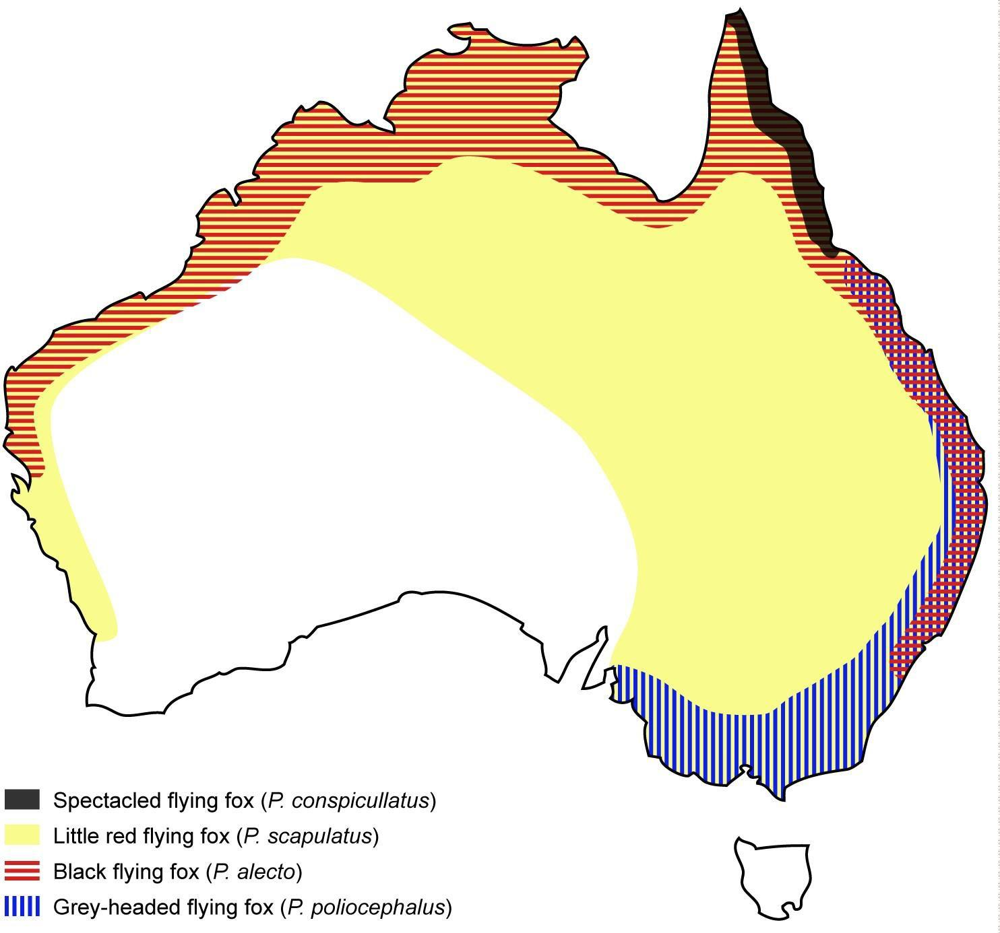

# AUSVETPLAN — Hendra Virus Response Strategy

> **Source**: Animal Health Australia (on behalf of National Biosecurity Committee)
> **URL**: https://animalhealthaustralia.com.au/ausvetplan/download/5621
> **Licence**: Animal Health Australia AUSVETPLAN — practitioner & jurisdictional use
> **Retrieved**: 2026-05-07T23:47:05Z
> **SHA-256**: `79c075ed40781871cbd45ffb19c8fe8bcaeff72b5ad477bcb763a6d046fc84e0`
> *Converted from PDF to Markdown format.*

---
## Page 1

 
 
 
 
AUSTRALIAN VETERINARY EMERGENCY PLAN 
AUSVETPLAN 
Response strategy  
Hendra virus 
Version 5.0 
 
 
 
 
 
 
 
 
 
AUSVETPLAN is a series of technical response plans that describe the 
proposed Australian approach to an emergency animal disease incident. 
The documents provide guidance based on sound analysis, linking policy, 
strategies, implementation, coordination and emergency-management plans. 
National Biosecurity Committee

---
## Page 2

 
 
Copyright 
© 1991–2021 Animal Health Australia ABN 86 071 890 956. Certain materials in this publication are 
protected by copyright and are reproduced with permission from the Commonwealth of Australia, 
acting through its Department of Agriculture, Water and the Environment (or any successor agency); 
each state and territory of Australia, as represented by their relevant agencies, and by the National 
Biosecurity Committee and Animal Health Committee; and Animal Health Australia’s industry 
members. 
ISBN 0 642 24506 1 (printed version) 
ISBN 1 876 71438 7 (electronic version) 
Licence  
This work is licensed under the Creative 
Commons Attribution-NonCommercial-
ShareAlike 4.0 International Licence, 
with the exception of: 
• 
any third-party material 
contained within the work 
• 
any material protected by a trademark 
• 
any images and/or photographs. 
To view a copy of this licence, visit http://creativecommons.org/licenses/by-nc-sa/4.0/. 
Moral rights 
The author(s) of this work hold ‘moral rights’ as defined in the Copyright Act 1986 (Cwlth) and assert 
all moral rights in connection with this work. This means you must: 
• 
attribute (give credit to) the author(s) of this work 
• 
not say a person is a creator of a work when they are not 
• 
not do something with the work (such as change or add to it) that would have a negative 
impact on the reputation of the author(s) of this work. 
Failure to do so could constitute a breach of the Copyright Act 1986 (Cwlth). 
Disclaimer and warranty 
• 
This publication has been produced in accordance with the procedures described in the 
AUSVETPLAN Overview, and in consultation with Australian national, state and territory 
governments; the relevant livestock industries; nongovernment agencies; and public health 
authorities, as relevant. Any views and opinions expressed in this document do not 
necessarily represent the views and opinion of the authors or contributors, Animal Health 
Australia or the Commonwealth of Australia. 
• 
This publication is for use in emergency situations. The strategies and policy guidelines in 
this work are not applicable to quarantine policies for imported livestock or livestock 
products. 
• 
This publication is not legal or professional advice and should not be taken as a substitute 
for legal or other professional advice.

---
## Page 3

 
 
• 
This publication is not intended for use by any person who does not have appropriate 
expertise in the subject matter of the work. Before using this publication, you should read it 
in full, consider its effect and determine whether it is appropriate for your needs. 
• 
This publication was created on June 2021. Laws, practices and regulations may have 
changed since that time. You should make your own inquiries as to the currency of relevant 
laws, practices and regulations, as these may have changed since publication of this work. 
No warranty is given as to the correctness of the information contained in this work, or of its 
suitability for use by you. To the fullest extent permitted by law, Animal Health Australia is not, and 
the other contributing parties are not, liable for any statement or opinion, or for any error or 
omission contained in this work, and it and they disclaim all warranties with regard to the 
information contained in it, including, without limitation, all implied warranties of merchantability 
and fitness for a particular purpose. Animal Health Australia is not liable for any direct, indirect, 
special or consequential losses or damages of any kind, or loss of profit, loss or corruption of data, 
business interruption or indirect costs, arising out of or in connection with the use of this work or 
the information contained in it, whether such loss or damage arises in contract, negligence, tort, 
under statute, or otherwise. 
Text under development 
In this manual, text placed in square brackets [xxx] indicates that that aspect of the manual remains 
unresolved or is under development; such text is not part of the official manual. The issues will be 
further worked on by experts and relevant text included at a future date. 
Contact information 
If you have any requests or inquiries concerning reproduction and rights, or suggestions or 
recommendations, you should address these to: 
AUSVETPLAN – Animal Health Australia 
Executive Manager, Emergency Preparedness and Response 
PO Box 5116 
Braddon ACT 2612 
Tel: 02 6232 5522 
email: aha@animalhealthaustralia.com.au 
Approved citation 
Animal Health Australia (2021). Response strategy: Hendra virus (version 5.0). Australian Veterinary 
Emergency Plan (AUSVETPLAN), edition 5, Canberra, ACT. 
DISEASE WATCH HOTLINE: 1800 675 888 
The Disease Watch Hotline is a toll-free telephone number that connects callers to the 
relevant state or territory officer to report concerns about any potential emergency disease 
situation. Anyone suspecting an emergency disease outbreak should use this number to get 
immediate advice and assistance.

---
## Page 4

 
 
Publication Record 
Edition 3 
Version 3.0, 2006 (included in combined Response Policy Briefs (RPB) manual) 
Versions 3.1–3.4, 2008–12 (additional diseases added to combined Response Policy Briefs manual) 
Edition 4 
Version 4.0, 2016 (major revision, including conversion to new authoring template) 
Edition 5 
Version 5.0, 2021 (incorporation into the Edition 5 format)

---
## Page 5

 
Hendra virus (Version 5.0) 
5 
Contents 
Copyright ..................................................................................................................................................................... 2 
Publication Record .................................................................................................................................................. 4 
1 
Introduction ................................................................................................................................................... 7 
1.1 
This manual ......................................................................................................................................................... 7 
1.1.1 
Purpose .............................................................................................................................................. 7 
1.1.2 
Scope ................................................................................................................................................... 7 
1.1.3 
Development ................................................................................................................................... 7 
1.2 
Other documentation....................................................................................................................................... 7 
1.3 
Training resources ............................................................................................................................................ 8 
2 
Nature of the disease................................................................................................................................... 9 
2.1 
Aetiology ............................................................................................................................................................... 9 
2.2 
Susceptible species ........................................................................................................................................... 9 
2.3 
Distribution ....................................................................................................................................................... 11 
2.4 
Diagnostic criteria .......................................................................................................................................... 12 
2.4.1 
Case definition ............................................................................................................................. 12 
2.4.2 
Clinical signs and pathology................................................................................................... 13 
2.4.3 
Laboratory tests .......................................................................................................................... 14 
2.5 
Epidemiology ................................................................................................................................................... 17 
2.5.1 
Incubation period ....................................................................................................................... 17 
2.5.2 
Persistence of agent ................................................................................................................... 17 
2.5.3 
Modes of transmission ............................................................................................................. 18 
2.5.4 
Disease prevention .................................................................................................................... 19 
3 
Australia’s policy ....................................................................................................................................... 20 
3.1 
Case definition ................................................................................................................................................. 20 
3.2 
Cost-sharing arrangement .......................................................................................................................... 21 
3.3 
Summary of policy ......................................................................................................................................... 21 
3.4 
Epidemiological assessment ...................................................................................................................... 23 
3.5 
Quarantine and movement controls ...................................................................................................... 24 
3.6 
Tracing ................................................................................................................................................................ 29 
3.7 
Sampling timeframes .................................................................................................................................... 29 
3.8 
Release from quarantine and movement controls ........................................................................... 30 
3.9 
Destruction........................................................................................................................................................ 30 
3.10 Disposal .............................................................................................................................................................. 30 
3.11 Decontamination ............................................................................................................................................ 31 
Glossary .................................................................................................................................................................... 32 
Disease-specific terms ............................................................................................................................................... 32 
Standard AUSVETPLAN terms ............................................................................................................................... 32 
Abbreviations ......................................................................................................................................................... 42 
Disease-specific abbreviations .............................................................................................................................. 42 
Standard AUSVETPLAN abbreviations............................................................................................................... 42 
References ............................................................................................................................................................... 44

---
## Page 6

 
6 
 
AUSVETPLAN Edition 5 
 
Tables 
Table 2.1 
Additional specimens for testing for Hendra virus.......................................................................... 15 
 
Figures 
Figure 2.1 Spatial distribution of pteropid bats in Australia, 2012 .................................................................... 11

---
## Page 7

 
Hendra virus (Version 5.0) 
7 
1 
Introduction 
1.1 This manual 
1.1.1 Purpose 
As part of AUSVETPLAN (the Australian Veterinary Emergency Plan), this response strategy contains the 
nationally agreed approach for the response to an incident – or suspected incident – of Hendra virus in 
Australia. It has been developed to guide decision making to ensure that a fast, efficient and effective 
response can be implemented consistently across Australia with minimal delay. 
1.1.2 Scope 
This response strategy covers Hendra caused by Hendra virus. 
This response strategy provides information about: 
• 
the disease (Section 2) 
• 
the agreed policy and guidelines for agencies and organisations involved in a response to an 
outbreak (Section 3) 
1.1.3 Development 
The strategies in this document for the diagnosis and management of an outbreak of Hendra are based 
on risk assessment.  
This manual has been produced in accordance with the procedures described in the AUSVETPLAN 
Overview, and in consultation with Australian national, state and territory governments; the relevant 
livestock industries; nongovernment agencies; and public health authorities, where relevant. 
In this manual, text placed in square brackets [xxx] indicates that that aspect of the manual remains 
unresolved or is under development; such text is not part of the official manual. The issues will be 
worked on by experts and relevant text included at a future date. 
1.2 Other documentation 
This response strategy should be read and implemented in conjunction with: 
• 
other AUSVETPLAN documents, including the operational, enterprise and management 
manuals; and any relevant guidance and resource documents. The complete series of manuals 
is available on the Animal Health Australia website1 
• 
relevant nationally agreed standard operating procedures (NASOPs).2 These procedures 
complement AUSVETPLAN and describe in detail specific actions undertaken during a 
 
1 www.animalhealthaustralia.com.au/our-publications/ausvetplan-manuals-and-documents  
2 www.animalhealthaustralia.com.au/what-we-do/emergency-animal-disease/nationally-agreed-standard-operating-procedures

---
## Page 8

 
8 
 
AUSVETPLAN Edition 5 
response to an incident. NASOPs have been developed for use by jurisdictions during 
responses to emergency animal disease (EAD) incidents and emergencies 
• 
relevant jurisdictional or industry policies, response plans, standard operating procedures and 
work instructions 
• 
relevant Commonwealth and jurisdictional legislation and legal agreements (such as the 
Emergency Animal Disease Response Agreement – EADRA3), where applicable. 
1.3 Training resources 
EAD preparedness and response arrangements in Australia 
The EAD Foundation online course4 provides livestock producers, veterinarians, veterinary students, 
government personnel and emergency workers with foundation knowledge for further training in EAD 
preparedness and response in Australia. 
 
3 https://animalhealthaustralia.com.au/what-we-do/emergency-animal-disease/ead-response-agreement 
4 www.animalhealthaustralia.com.au/emergency-animal-disease-training-program

---
## Page 9

 
Hendra virus (Version 5.0) 
9 
2 
Nature of the disease 
Hendra virus (HeV) is a zoonotic pathogen that has caused natural infection and disease in horses and 
humans. Humans have presumably been infected as ’spillover’ events from infected horses. 
There is no effective treatment for infected animals and no specific treatment for HeV infection in 
humans, although the administration of monoclonal antibody 102.4 is being studied in a phase 1 
human clinical trial (Broder et al 2016). 
2.1 Aetiology 
HeV is in the Henipavirus genus of the Paramyxoviridae family. This genus contains Hendra, Cedar and 
Nipah viruses. 
2.2 Susceptible species 
Pteropid bats (flying foxes) are the known natural reservoir host of HeV infection; seroprevalence 
varies between 20% and 50%. Sporadic spillover of HeV from flying foxes to horses occurs; however, 
the factors associated with spillover events are not yet fully understood, and research is ongoing (Field et 
al 2015, Plowright et al 2015). Neutralising antibodies to the virus are found in flying fox populations 
in Australia and Papua New Guinea. 
Horses are the only species known to have been infected naturally from flying foxes. 
Humans have become infected only after close contact with respiratory or oral secretions, body fluids 
or blood from an infected horse. No human is known to have been infected through direct contact with 
flying foxes. To October 2015, seven people had been infected after close contact with HeV-infected 
horses. Four of these people subsequently died of their infection. 
In July 2011 and July 2013, HeV antibodies were detected in two dogs sampled on premises where HeV 
had been confirmed in horses. The dog in July 2013 also tested positive by quantitative reverse 
transcription polymerase chain reaction (PCR) testing on antemortem blood samples (EDTA and 
serum) and postmortem on several tissue samples (Kirkland et al 2015). Neither dog showed any 
clinical signs of illness. The dogs potentially had multiple opportunities for contact with infected horses 
or their discharges, and this is the most plausible route of infection. 
Experimental studies by Middleton (2016b) showed that dogs could be reliably infected with HeV and 
showed either very mild, transient clinical signs or no clinical signs. HeV was recovered from the oral 
cavity of acutely infected dogs, and the secretions were capable of transmitting HeV to naive ferrets. 
Development of neutralising antibody was associated with virus clearance; this has also been noted in 
cats, horses and ferrets. 
Experimental research on other animal species has found that cats, pigs, hamsters, ferrets, African 
green monkeys, guinea pigs and mice can be infected with HeV and develop clinical signs (Westbury et 
al 1995, Bossart et al 2011, Pallister et al 2011, Dups et al 2012). Rats and rabbits developed antibodies 
but not clinical signs when exposed to HeV (Westbury et al 1995). 
Experimental studies in Canada (Li et al 2010) showed that the response of pigs to inoculation with 
large doses of HeV ranged from no clinical disease to severe interstitial pneumonia. Although this work 
has demonstrated that pigs can be infected experimentally, no natural infections have been

---
## Page 10

---
## Page 11

 
Hendra virus (Version 5.0) 
11 
detected in pigs. A targeted serological survey of commercial piggeries in Queensland found no 
evidence of antibodies to HeV (Black et al 2001). 
2.3 Distribution 
All confirmed HeV infections in horses have overlapped with the spatial distribution of pteropid bats 
(Pteropus species; see Figure 2.1). Since the spatial distribution of pteropid bats may change from year 
to year and from season to season, Figure 2.1 is indicative only. 
 
 
Figure 2.1 Spatial distribution of pteropid bats in Australia, 2012 
Field et al (2011) showed that the prevalence of HeV excretion in flying foxes varied significantly 
between years, providing a biologically plausible basis for the variable annual case frequency in horses.

---
## Page 12

 
12 
 
AUSVETPLAN Edition 5 
The key spatial and temporal factors associated with HeV excretion in flying foxes were investigated in 
a landmark 3-year multiroost study (Field et al 2015) . Almost 14 000 pooled urine samples were 
collected from 50 roosts between Cairns in northern Queensland and Batemans Bay in southern New 
South Wales (a distance of 2300 km). The study found that mean HeV prevalence varied spatially 
being highest in northern New South Wales and southern Queensland, and moderate in northern 
Queensland. The variation in excretion prevalence was more consistent with species distribution than 
latitude; specifically, excretion prevalence paralleled the distribution of black flying foxes (Pteropus 
alecto) and, in north Queensland, spectacled flying foxes (P. conspiculatus). The lowest mean excretion 
prevalence was found in southern New South Wales, reflecting the near absence of black flying foxes and 
the dominance of grey-headed flying foxes (P. poliocephalus). The study findings are consistent with 
several recent studies that indicate that black and spectacled flying foxes are the primary reservoir host 
species for HeV (Smith et al 2014, Edson et al 2015ab, Goldspink et al 2015). 
A strong winter peak of excretion was also found in central and northern New South Wales, and southern 
Queensland, consistent with the observed temporal pattern of HeV spillover events in these regions. 
Statistics on HeV spillover events, such as dates, locations and species, can be found on the Queensland 
Department of Agriculture and Fisheries website5 
2.4 Diagnostic criteria 
2.4.1 Case definition 
The case definition of an HeV-infected animal is: 
• an animal (with or without clinical signs) that tests positive to HeV using one or more of 
the following tests 
- polymerase chain reaction (PCR) 
- virus isolation 
- immunohistochemistry, or 
• an animal for which testing has not been possible or for which testing is inconclusive, 
but scientific evidence (clinical, laboratory, epidemiological) that the animal is/was 
infected is compelling (eg confirmed human infection following contact with an animal 
with clinical signs and history suggestive of HeV infection). Such status decisions are 
made by the jurisdictional chief veterinary officer (CVO). 
Confidence in a PCR test result is increased by testing of multiple samples of different types. A single 
negative result on a single sample may be a false negative as a result of insufficient diagnostic material 
or low levels of RNA at the sampled site. 
The case definition of an HeV-recovered animal is an animal: 
• free from clinical signs suggestive of HeV infection, and 
• PCR negative and with a detectable serum antibody response not consistent with its 
vaccination history, or 
 
5 www.agriculture.gov.au/pests-diseases-weeds/animal#hendra-virus

---
## Page 13

 
Hendra virus (Version 5.0) 
13 
• for which testing has not been possible or for which testing is inconclusive but scientific 
evidence (clinical, laboratory, epidemiological) that the animal was infected and no 
longer poses a transmission risk is compelling, in the opinion of the CVO. 
 
The case definition of an HeV-vaccinated animal is an animal that has: 
• a current vaccination status (ie evidence of vaccination following the recommended 
schedule), and/or 
• an antibody response that is consistent with its known HeV vaccination status. 
It is possible for an animal to be both antibody and PCR positive if sampled early in recovery. Although 
such results most likely reflect remnant RNA rather than viable virus, the PCR testing should be 
repeated until a negative result is obtained. 
Where positive PCR results are obtained from nonclinical animals sampled at anatomical sites that are 
susceptible to environmental contamination (eg nasal cavity, oral cavity, rectum), or from samples 
where contamination cannot reasonably be excluded, confirmation that the animal was infected, to 
support the diagnosis of an HeV-recovered animal, may require demonstration of an antibody 
response. 
Any vaccinated animal or recovered animal that also meets the criteria for an HeV-infected animal will 
be considered to be an HeV-infected animal, regardless of its circulating antibody level. 
2.4.2 Clinical signs and pathology 
HeV infection in flying foxes is not associated with clinical disease. 
HeV infection in horses typically causes an acute illness that is rapidly fatal. There are no 
pathognomonic clinical signs. Horses infected with HeV have shown variable and often vague clinical 
signs, including respiratory and/or neurological signs, frequently accompanied by pyrexia. 
In most of the recorded cases of infection, there has been strong presentation of neurological or 
respiratory clinical signs; however, occasional cases have had a much milder presentation. From the 
disease pathogenesis perspective, it is reasonable to assume that virus-induced damage to vascular 
endothelium and the subsequent vasculitis play a major role in producing clinical signs, and that the 
clinical presentation relates to the organ system(s) sustaining severe and compromising endothelial 
damage. 
Laboratory analysis has shown that an infected horse showing clinical signs will have virus in blood 
and tissues, and may be excreting HeV in body fluids and excretions, including urine, oral and 
nasopharyngeal secretions, and faeces. In one naturally infected dog, pathological lesions of systemic 
vasculitis were identified in many organs, with brain, kidney, liver, and tracheobronchial and bronchial 
lymph nodes most affected. Very low levels of RNA were detected by PCR in a wide range of organs; 
higher levels were detected in kidney, liver, spleen, spinal cord and some lymph nodes. 
There is little information on survival rates for acutely infected horses. In one spillover event, 20% 
(n = 5) of infected horses survived acute infection (Field et al 2010). 
In experimentally infected cats, guinea pigs, pigs, hamsters, African green monkeys and ferrets, 
infection was comparable to that seen in naturally and experimentally infected horses. Cats 
demonstrate inappetence and increased respiratory rate, followed by death within 1–2 days (Westbury 
et al 1995). Ferrets demonstrate severe respiratory and neurological disease, as well as generalised 
vasculitis (Pallister et al 2011).

---
## Page 14

 
14 
 
AUSVETPLAN Edition 5 
Either no clinical signs or very mild, transient clinical signs, including scleral injection, have been 
reported in dogs (Middleton 2016b). It is unlikely that a dog acutely infected with HeV would come to 
the attention of the owner or veterinarian. 
2.4.3 Laboratory tests 
Specimens required 
A wide range of relevant specimens will: 
• increase the overall diagnostic sensitivity, particularly if viral genome is at or near the limits 
of detection 
• provide more information about the state of infection, and the potential for virus excretion 
and transmission to others from an individual HeV-positive animal 
• increase the confidence in a negative HeV diagnosis (specificity), if a wider range of negative 
results are obtained from the same animal. 
Preferred specimens to allow or rule out a diagnosis of an acute case are as follows: 
• EDTA blood used for PCR and virus isolation. Note that the tube should be properly filled to 
minimise the risk of a high anticoagulant concentration interfering with testing. 
• Swabs. Nasal, oral or rectal swabs may be used for PCR testing and virus isolation, and may 
detect infection at an earlier stage of infection than blood or other clinical specimens (eg 
body fluids and secretions). A urine-soaked swab taken from the ground immediately after 
urination may also be used for PCR and virus isolation. 
• Serum (plain/clotted whole blood). If only serum is available, it can be used for both PCR 
and serology. However, it is not the preferred specimen for PCR because of its lower 
sensitivity. Note that confidence in a negative test result based on a single specimen is 
limited. 
Lithium–heparin (LiHep) blood specimens are not preferred. LiHep provides no test detection 
possibilities that are not available from clotted and EDTA specimens. LiHep blood is more likely to be 
inhibitory to PCR, which may give false negative results. 
Submitting a combination of EDTA blood, serum, and nasal or other swabs should be sufficient for 
detection of HeV infection in a very high proportion of HeV-infected horses. Note that, although blood 
samples are preferred for obtaining a diagnosis, their collection presents a risk to the sample collector 
because of the need to handle sharps. Accordingly, blood samples should only be taken where workplace 
health and safety measures are implemented to mitigate the risk of needle and sharps injuries.

---
## Page 15

 
Hendra virus (Version 5.0) 
15 
Other recommended specimens that could be taken if it is safe to do so include those listed in Table 2.1. 
Table 2.1 
Additional specimens for testing for Hendra virus 
Specimen type 
Specimen 
Live horse 
Dead horse 
Swab 
Conjunctiva 
Y 
Y 
Orifice (rectal, vaginal, urethral, buccal) 
Y 
Y 
Cut surface of mandibular lymph node 
Y 
Tissuea 
Whole or part of mandibular lymph node 
Y 
Other fresh or fixed samples 
Y 
a Tissues should only be collected if appropriate workplace health and safety controls are in place. They 
should not be collected routinely. 
Specimens are to be packaged, transported and submitted to the laboratory in accordance with the 
regulations of the International Air Transport Association (IATA)6. Details are available in the 
Requirements for the Packaging and Transport of Pathology Specimens and Associated Materials7 
produced by the National Pathology Accreditation Advisory Council, and relevant IATA references. 
Laboratory diagnosis 
HeV can be detected in the laboratory by virus isolation, PCR or serology (enzyme-linked 
immunosorbent assay — ELISA, or virus neutralisation test — VNT). All HeV exclusion testing should 
use a combination of PCR and serological assays, whenever suitable sample types and volumes are 
available. 
PCR 
PCR tests detect fragments of the HeV genome. A positive result indicates only the presence of viral 
genome in the sample; it does not indicate that the virus is viable and infectious. PCR testing results are 
generally available within 4–6 hours of receipt of samples. 
A positive PCR test on samples collected on separate occasions and consistent with virus replication, or 
of sufficient magnitude to suggest that contamination of samples is improbable, without relevant clinical 
signs, is interpreted to mean that the animal has been, or is, infected and may still have viable virus 
within its body (eg within the central nervous system). 
A negative PCR test needs to be interpreted in relation to the health of the animal and the broader 
epidemiological context. The animal could be in the early stages of infection with HeV (resulting in a low 
concentration of virus, or absence of virus at sampled sites), or may have recovered from infection. 
PCR testing of close-contact dogs and cats should be undertaken as close as possible to the date of first 
infectious contact to establish a baseline. This may be paired with later samples to determine the 
infectious risk of the animal. PCR results on one sample should be interpreted in conjunction with other 
PCR and serology results. 
 
 
 
6 www.iata.org 
7 www1.health.gov.au/internet/main/publishing.nsf/Content/health-npaac-docs-PackTransPathSpecimens.htm

---
## Page 16

 
16 
 
AUSVETPLAN Edition 5 
Serology 
Serological tests for HeV, including ELISA and VNT, are conducted on serum samples and detect the 
presence of antibodies to HeV. The ELISA is a screening test, whereas the VNT is a confirmatory test. The 
current ELISA test has only been validated in horses and is not used in other species. VNTs are conducted 
on all dog and cat samples, and for confirming positive results from ELISA in unvaccinated suspect 
horses. 
Since it may take an animal 5–10 days to produce antibodies after infection, a single serological test 
might not detect antibodies while an animal is incubating the disease or in the early stages of clinical 
infection. 
A negative ELISA result is a reliable indicator that a horse has not been previously infected with HeV or 
vaccinated. Infected and vaccinated horses should return a positive ELISA result, but so may nonspecific 
reactors. Where such a result is obtained, the vaccination status of the animal should be clarified, and 
the animal should be tested by VNT. 
A positive VNT result indicates that the animal is seropositive to HeV, from either infection or 
vaccination. A negative VNT result means that the animal is not seropositive to HeV. 
The VNT is the ‘gold standard’ and the most specific test for anti-HeV antibodies. Its use is limited by the 
need to use live, infectious HeV in the test. This restricts conduct of the VNT for animal submissions to 
the CSIRO Australian Animal Health Laboratory (CSIRO-AAHL). 
The VNT may take 4–5 days to complete, excluding the time it takes for the sample to reach a laboratory. 
Testing can sometimes take longer, and resampling may be required if samples are unsuitable. 
HeV serological testing of vaccinated horses - Both vaccination with sG recombinant subunit vaccine (see 
Section 2.5.4) and natural infection induce neutralising anti‑ G antibodies. None of the standard assays 
differentiate between the anti-G antibodies produced in response to infection and those produced in 
response to vaccination. 
Virus isolation 
HeV isolation can be undertaken at CSIRO-AAHL and is frequently requested on index cases. Virus 
isolation confirms the presence of the virus; however, negative results do not indicate that the animal is, 
or was, not infected with HeV because the virus can be difficult to isolate. Clinical findings and other 
laboratory tests that are more sensitive for the detection of genetic material (PCR) and an immunologic 
response (serology) must be considered in interpreting negative virus isolation results. 
Immunohistochemistry 
HeV infection may also be confirmed in tissues using immunohistochemistry. Immunohistochemistry is 
most often used when fixed tissue is the only tissue available, or for pathogenesis studies. 
Laboratory diagnostic capacity 
PCR and ELISA testing can be undertaken at CSIRO-AAHL, Queensland’s Biosecurity Science Laboratory, 
the Animal Health Laboratory in Western Australia, and the Elizabeth Macarthur Agricultural Institute 
in New South Wales. The Berrimah laboratory in the Northern Territory offers only PCR testing; and the 
Department of Economic Development, Jobs, Transport and Resources laboratory in Victoria offers only 
ELISA testing. VNT and virus isolation can only be undertaken at CSIRO-AAHL, which is the World 
Organisation for Animal Health (OIE) and national reference laboratory for HeV.

---
## Page 17

 
Hendra virus (Version 5.0) 
17 
2.5 Epidemiology 
2.5.1 Incubation period 
To date, 80% of known equine cases have had an incubation period of 12 days or less, and 95% have 
had an incubation period of 15 days or less. No known HeV-positive equine cases have had an 
incubation period greater than 16 days, and three papers (Murray et al 1995, Baldock et al 1996, Field et 
al 2010) report a minimum 4-day incubation period for both experimental and natural infections. One 
paper reported an incubation period of 3–10 days (Baldock et al 1995). For the purpose of determining 
an appropriate quarantine period, 20 days has been determined to be appropriate, based on the 
maximum known incubation period of 16 days plus an additional 4 days as a precautionary measure. 
Information on the incubation period in cats and dogs is limited. In one experimental study, cats 
inoculated with HeV had incubation periods of 4–8 days, whereas an in-contact cat developed disease 
after 12 days (Westbury et al 1996). Williamson et al (1998) reported incubation periods of 7 and 10 
days in two experimentally infected cats. The incubation period for the two field HeV cases in dogs 
reported to date is undetermined because the time of exposure is unknown. Because of the limited 
number of cases in dogs and cats, a maximum incubation period of 16 days should be applied for both; 
as with horses, a safety margin of 4 additional days is used for the purposes of tracing, surveillance (ie 
daily observations) and quarantine periods. 
Findings from the HeV commissioned research program have confirmed that dogs acutely infected with 
HeV can be a transmission risk (Middleton 2016b). HeV was isolated from the oral cavity of acutely 
infected dogs on days 2 and 4 after exposure. Once dogs have developed neutralising antibodies, they 
are no longer a transmission risk. Infected dogs need to be isolated and quarantined during the acute 
disease phase, and until they are PCR negative and antibody positive. Cats show clinical signs 
experimentally; if naturally infected, they would also constitute a transmission risk and require the 
same stringent biosecurity measures as dogs. 
2.5.2 Persistence of agent 
HeV is a lipid-enveloped virus, and is susceptible outside the host to desiccation and changes in 
temperature (Fogarty et al 2008). Experimental evidence indicates that HeV survival in the 
environment varies from several hours to several days, depending on environmental conditions 
(Fogarty et al 2008). HeV survival rates 24 hours after excretion ranged from 2% to 10% in summer, 
and from 12% to 33% in winter, based on air temperatures (Martin et al 2015). 
HeV transmission probably involves direct contact of horses with fresh bat excreta during spillover 
events, and the effective time for transmission is likely to be shortly after excretion (Edson et al 2015a, 
Martin et al 2015). The timing and geographic distribution of HeV spillover events cannot be fully 
explained by virus survival in the environment because spillover events have occurred when the 
suitability of temperatures for virus survival was intermediate to very low; this suggests that a seasonal 
factor other than temperature may be involved in the occurrence of spillovers. The availability of food 
for flying foxes has been suggested as one possibility (Martin et al 2015). Field et al (2015) also explored 
the relationship between winter temperature and HeV excretion patterns, and suggested that 
thermoregulation may impair immune system function. 
Fogarty et al (2008) reported the following: 
• HeV in flying fox urine (pH ~7) survived for more than 4 days at 22 °C, with a half-
life of 19 hours; at 37 °C, it was mostly inactivated in less than 1 day, with a half-life

---
## Page 18

 
18 
 
AUSVETPLAN Edition 5 
of 3 hours. 
• HeV survival on mango fruit flesh at 22 °C decreases with increasing acidity. At pH 5, half-life 
is 22 hours, whereas at pH 3 it is 0.3 hours. 
• HeV survival on fruit pulp and in fruit juice varies, depending on the type and pH of the fruit. 
Virus incubated in lychee juice showed greater persistence than in either pawpaw or mango 
juice, with 2–3-fold longer half-lives and survival for more than 3 days. 
• HeV is rapidly inactivated by desiccation at both 22 °C and 37 °C. Virus survival after 
desiccation in the laboratory is reported as less than 15 minutes at 37 °C. At 22 °C, HeV levels 
decreased by more than 3 logs within 30 minutes (half-life of 1.2 minutes). 
For the purposes of disease control, 5 days is presumed to be the maximum survival time for HeV under 
optimal environmental conditions — that is, neutral pH, moist air and moderate temperatures. This 
survival time is doubled to 10 days as a precautionary measure. 
Persistence of infection 
Experimental work in ferrets and mice has failed to demonstrate re-isolation of virus from brain tissue in 
convalescent animals (Middleton 2016a). In mice, HeV spread in the brain is by a neurone-to- neurone 
cell-mediated mechanism, rather than a virus-mediated infectious process (Dups et al 2012, Middleton 
2016a). A small number of people who recovered from initial infection with HeV or Nipah virus 
subsequently relapsed or developed delayed-onset encephalitis (WHO 2009ab). Viable virus has not 
been able to be recovered from naturally infected convalescent or recrudescent human or horse HeV 
cases. 
2.5.3 Modes of transmission 
Although the exact route of transmission is not known, it is thought that horses become infected with 
HeV by contact with material contaminated by infected flying fox body fluids and/or excretions. It is 
also plausible that horses may become infected directly through droplet inhalation via the nasal route 
(Mori et al 1995, Rudd et al 2006, Dups et al 2012, Munster et al 2012). Once a horse becomes infected, 
there is the potential for HeV to be transmitted to other horses, humans and other susceptible species8. 
Current field and experimental knowledge indicates that HeV is most likely transmitted from horses to 
other animals or humans by contact with infected body fluids or tissues, or through droplet 
transmission. Undertaking certain procedures on horses (eg endotracheal intubation, nasal lavage, 
necropsy) may increase the risk of infection for attending personnel by promoting droplet or aerosol 
generation. It is not definitively known how natural infection in dogs occurs; close contact with infected 
horses is suspected. 
No definitive studies have been found describing the distance over which respiratory droplets can 
spread from horses. A maximum distance of 5 metres is assumed, based on the absence of transmission 
to horses beyond this distance in field scenarios, qualitative extrapolation of droplet studies in humans, 
and observations of exhaling horses after exercise. This 5-metre distance can be extended if 
circumstances indicate that additional precautions are appropriate (El Saadi et al 2014).  
Current evidence suggests that, although there is some risk of transmission in the preclinical phase, 
transmission risk increases with disease progression, and is highest when the horse is near death and 
immediately postmortem. 
Viral genetic material was identified in three experimentally infected horses 3–5 days before the 
appearance of clinical signs (Marsh et al 2011). Further, the same authors reported that most tissues 
and organs contained HeV at the time of death (euthanasia). The report indicates that nasal secretions of 
 
8 Susceptible species are those terrestrial domestic animals shown to be experimentally or naturally susceptible to HeV.

---
## Page 19

 
Hendra virus (Version 5.0) 
19 
subclinical horses may pose a transmission risk during the early phase of disease that precedes 
viraemia, fever or other discernible clinical signs of HeV infection. In light of this finding, people coming 
into contact with sick horses should give early consideration to HeV in the differential diagnosis and 
apply infection control procedures relating to blood, and oral and nasopharyngeal secretions. Personal 
protective equipment and other safety procedures are currently the primary defence in the preclinical 
phase when horses may excrete HeV9. Similar considerations apply to other susceptible species and 
should guide human interactions with these species. 
2.5.4 Disease prevention 
An HeV recombinant subunit vaccine, based on a recombinant soluble version of the HeV attachment 
glycoprotein G (sG), was approved for use under a Minor Use Permit by the Australian Pesticides and 
Veterinary Medicines Authority in November 2012. The vaccine was granted full registration in August 
2015, approved for use in pregnant mares in January 2016, and approved for annual boosters in May 
2016. 
The vaccine is available from veterinarians and administered by intramuscular injection to horses 
4 months of age or older. Details on the recommended vaccination schedule, the administration site 
and possible adverse reactions associated with use of the vaccine are available from the manufacturer 
and on the product label.10 
The vaccine is an important breakthrough in the options for preventing HeV infection, and is regarded as 
the most effective way to reduce the risk of infection (El Saadi et al 2014). However, as no vaccine is 
100% effective, it is important that people in contact with horses continue to practise good biosecurity 
and infection control at all times, even with vaccinated horses. 
 
9 Refer to the Guidelines for Veterinarians Handling Potential Hendra Virus Infection in Horses, produced by the Queensland Department 
of Agriculture, Fisheries and Forestry, for details of appropriate PPE 
10 https://portal.apvma.gov.au/pubcris

---
## Page 20

 
20 
 
AUSVETPLAN Edition 5 
3 
Australia’s policy 
The consequences of Hendra virus (HeV) infection are potentially severe for humans and some 
susceptible animal species (other than pteropid bats). As a result, a conservative precautionary 
approach should be taken whenever HeV is considered as a differential diagnosis, to prevent infection of 
humans and other susceptible animals. Strict biosecurity and infection control procedures must be 
implemented until HeV infection can be excluded. 
Under legislation in all Australian states and territories, suspect and confirmed cases of HeV infection 
must be notified to the relevant jurisdictional animal health authority. The animal health authority will 
work with the field veterinarian(s) to manage the investigation. Advice will also be provided to public 
health authorities. 
The high case fatality rate for clinically affected horses means that most will die or be euthanased on 
welfare grounds, or at the owner's request. Where the chief veterinary officer (CVO) considers, on the 
basis of expert opinion (including on human health), that the biosecurity risks of cases cannot be safely 
managed, euthanasia may be mandated by the CVO to manage the risk of exposure. Very high safety 
standards are required to safely manage acute HeV cases. 
The HeV response should focus on management of non-bat terrestrial animals. Culling or dispersal of 
flying fox colonies is not an effective strategy for controlling HeV, because flying foxes are highly mobile, 
and individuals move between colonies. It has been hypothesised that the stress associated with culling 
or dispersal could increase the excretion of HeV by flying foxes and therefore the risk of spillover to 
horses. However, recent research (Edson et al 2015b) has demonstrated no significant difference in HeV 
prevalence or mean cortisol levels before and after roost disturbance. 
3.1 Case definition 
The case definition of an HeV-infected animal is: 
• ̶an animal (with or without clinical signs) that tests positive to HeV using one or more of the 
following tests 
- ̶polymerase chain reaction (PCR) 
- virus isolation 
- immunohistochemistry, or 
• an animal for which testing has not been possible or for which testing is inconclusive, but 
scientific evidence (clinical, laboratory, epidemiological) that the animal is/was infected is 
compelling (eg confirmed human infection following contact with an animal with clinical signs 
and history suggestive of HeV infection). Such status decisions are made by the jurisdictional 
chief veterinary officer (CVO). 
Confidence in a PCR test result is increased by testing of multiple samples of different types. A single 
negative result on a single sample may be a false negative as a result of insufficient diagnostic material 
or low levels of RNA at the sampled site. 
The case definition of an HeV-recovered animal is an animal: 
• free from clinical signs suggestive of HeV infection, and 
• PCR negative and with a detectable serum antibody response not consistent with its 
vaccination history, or 
• for which testing has not been possible or for which testing is inconclusive but scientific

---
## Page 21

 
Hendra virus (Version 5.0) 
21 
evidence (clinical, laboratory, epidemiological) that the animal was infected and no longer 
poses a transmission risk is compelling, in the opinion of the CVO. 
The case definition of an HeV-vaccinated animal is an animal that has: 
• a current vaccination status (ie evidence of vaccination following the recommended 
schedule), and/or 
• an antibody response that is consistent with its known HeV vaccination status. 
It is possible for an animal to be both antibody and PCR positive if sampled early in recovery. Although 
such results most likely reflect remnant RNA rather than viable virus, the PCR testing should be 
repeated until a negative result is obtained. 
Where positive PCR results are obtained from nonclinical animals sampled at anatomical sites that are 
susceptible to environmental contamination (eg nasal cavity, oral cavity, rectum), or from samples 
where contamination cannot reasonably be excluded, confirmation that the animal was infected, to 
support the diagnosis of an HeV-recovered animal, may require demonstration of an antibody 
response. 
Any vaccinated animal or recovered animal that also meets the criteria for an HeV-infected animal will 
be considered to be an HeV-infected animal, regardless of its circulating antibody level. 
3.2 Cost-sharing arrangement 
HeV infection is currently included as a Category 2 disease in the EAD Response Agreement. The costs of 
disease control would be shared 80% by governments and 20% by the relevant industries. 
3.3 Summary of policy 
HeV infection is not a World Organisation for Animal Health (OIE)–listed disease but is a notifiable 
terrestrial animal disease in all states and territories of Australia. The detection of HeV infection in 
animals in Australia results in minor animal and public health impacts, and moderate adverse social 
effects. 
The policy is to control HeV infection in terrestrial animals using: 
• stringent biosecurity and workplace health and safety measures to prevent humans and 
other susceptible animals from becoming infected 
• an epidemiological assessment, including risk and exposure assessments of susceptible 
animals and premises, to provide information for management of the situation 
• quarantine, movement controls, monitoring, sampling and testing of infected and close- 
contact susceptible animals until the risk of HeV spread from the infected or close-contact 
animal(s) has been appropriately minimised or mitigated, to prevent spread of the 
disease between properties and between animals on the affected property 
• sanitary disposal of confirmed or presumed HeV-infected (terrestrial) animals that die or 
are euthanased 
• decontamination of the contaminated environment by natural means (preferred) or 
application of decontaminants; and disposal or decontamination of contaminated fomites 
• tracing and surveillance to determine the source and extent of infection

---
## Page 22

---
## Page 23

 
Hendra virus (Version 5.0) 
23 
• communications and a community engagement campaign to inform, and address the 
concerns and needs of, industries and the community. 
Supporting measures include: 
• vaccinating horses, as the most effective way to reduce the risk of infection with HeV 
• preventing susceptible terrestrial species (horses) on the property from sheltering under 
trees attractive to flying foxes, to limit the potential for further virus exposures on the 
premises 
• continued practising of appropriate biosecurity precautions by all animal owners after 
quarantine and movement controls have been rescinded. 
The website of the Queensland Department of Agriculture and Fisheries11 provides comprehensive 
guidelines for disease management by private veterinarians. 
The Queensland12 and New South Wales13 governments implement well-established biosecurity and 
public health responses to Hendra virus incidents. 
3.4 Epidemiological assessment 
As part of the epidemiological assessment, animals, animal products and fomites are risk assessed for 
close contact with infected animals. The following definitions are used: 
• An animal (eg horse, dog, cat) with close contact is one that 
̶ 
has come within 5 metres of a clinical HeV-positive horse, or 
̶ 
has come within 1 metre of a confirmed HeV-positive non-equid animal, or 
̶ 
has potentially had direct contact with presumed contaminated body fluids or substances 
from a clinical HeV-positive animal, a suspect animal or a recently deceased HeV-positive 
animal in the 10 days following excretion or secretion of the body fluids or substances, or 
̶ 
has potentially had contact with blood or nasopharyngeal secretions shed by preclinical 
animals in the 10 days before the onset of clinical signs — for example, through dental 
procedures, stomach tubing or very close nose-to-nose contact, or 
̶ 
has had direct contact with a contaminated fomite. 
• A contaminated fomite is one that has had direct contact with body fluids (including 
nasopharyngeal secretions, urine or blood) or faeces from an HeV-positive animal or a 
suspect susceptible animal (this may be by contacting the infected animal or carcass) in the 
10 days following secretion or excretion. This includes contact with blood or 
nasopharyngeal secretions from an HeV-positive animal that were secreted or excreted in 
the 10 days before the onset of clinical signs (ie preclinical). 
• A suspect animal is any susceptible terrestrial domestic animal that is known to be 
experimentally or naturally susceptible to HeV and is showing signs of illness consistent with 
the current knowledge of HeV infection. Knowledge about potential clinical signs in field 
cases of suspect susceptible animals other than horses is limited and is based on 
observations in experimental settings. No discernible clinical signs were reported in the only 
two naturally infected dogs recognised to date. 
• A suspect response animal is any susceptible terrestrial animal on a known infected 
premises (IP) showing signs of illness consistent with the current knowledge of HeV 
infection. 
 
11 www.daff.qld.gov.au 
12 www.daf.qld.gov.au/animal-industries/animal-health-and-diseases/a-z-list/hendra-virus/general-information   
13 www.dpi.nsw.gov.au/agriculture/livestock/horses/health/general/hendra-virus

---
## Page 24

 
24 
 
AUSVETPLAN Edition 5 
3.5 Quarantine and movement controls 
Management of risk groups 
Management of different groups of animals reflects the risk the animals pose for disease spread. 
Infected animals are identified in the initial investigation or subsequently through follow-up testing of 
close-contact or suspect animals. An epidemiological assessment (Section 3.4) is completed to identify 
animals and fomites considered to have had close contact with the infected animal(s). Management of 
close-contact animals and fomites is described below. 
Each risk group should be segregated to mitigate the risk of horizontal transmission and to allow 
different management practices for different groups. 
If any close-contact or low-risk animal on an infected property shows clinical signs that could indicate 
HeV infection during the quarantine period, it should be segregated from other susceptible animals and 
tested to clarify its HeV status. Biosecurity controls should be commensurate with the risk status. 
Management of HeV-infected animals 
An infected animal will probably have already been sampled and confirmed as infected unless its status 
is based on epidemiological evidence. 
A risk assessment must be undertaken to determine appropriate infection controls before personnel 
make close contact with the animal. The risk assessment should take into account animal welfare, human 
health risks and the wishes of the owner. The jurisdictional health department must be consulted as part 
of the risk assessment. 
Management of infected animals is under the control of the jurisdictional CVO, on a case-by-case basis, 
taking into account animal welfare, human health risks and biosecurity obligations. 
Euthanasia of infected animals is often undertaken because of animal welfare concerns or where the 
owner requests it. The jurisdictional CVO may also decide on euthanasia of infected animals to limit the 
opportunity for animal-to-animal and animal-to-human transmission if the biosecurity risks for ongoing 
care cannot be managed. 
If the risk assessment indicates that the transmission risk and other issues such as animal welfare can 
be safely managed, veterinary management of the animal may continue under the control of the CVO. 
Decisions about how infected animals will be managed are ongoing while the animal is under quarantine. 
They will rely on regular veterinary assessment of the animal's welfare, the owner's wishes, and 
satisfaction by the CVO that the biosecurity risks of providing ongoing treatment and care can be 
satisfactorily addressed. 
The following requirements apply while infected cases are alive: 
• An HeV-infected animal must be separated from nonclinical animals until it seroconverts, to 
limit the potential for horizontal disease transmission. For dogs and cats, this will mean 
confinement to a cage or lockable room. For horses, a fenced yard or stables with a minimum 
5-metre buffer from susceptible species will be required. 
• Quarantine and movement controls must be imposed for a minimum of 20 days, with 
strict biosecurity controls in place for this period.

---
## Page 25

 
Hendra virus (Version 5.0) 
25 
• It can be challenging to maintain a high level of biosecurity during the provision of food 
and exercise for HeV-infected animals. Personnel should use strategies that minimise the 
need for frequent contact — for example, feeding over a fence, topping up water remotely, 
and ensuring that defecation and urination sites can be cleaned without direct animal 
contact. The CVO may approve lay personnel to undertake low-risk activities such as 
feeding and exercising HeV- infected animals, but will only do so after these personnel 
undergo training and demonstrate competence in the use of personal protective 
equipment (PPE). Administration of veterinary treatments to HeV-infected animals will be 
solely determined by the CVO. 
• Animals that survive or are not euthanased require testing 20 days following the onset of 
clinical signs to detect the presence of antibody. PCR would normally be negative at 20 days, 
but there is the potential for viral genomic remnants to give false positive results. In such cases, 
the PCR test should be repeated until a negative result is obtained. 
Once the CVO has determined that the animal is recovered and at least 20 days have elapsed since the 
onset of clinical signs, the quarantine can be removed. 
Management of close-contact horses 
Unvaccinated 
Management of unvaccinated horses during a disease incident must be commensurate with the risk 
that the animals pose to other susceptible species, including humans. 
The following requirements apply: 
• Unvaccinated close-contact horses must be segregated into small groups away from the 
infected animal, contaminated area and contaminated fomites. 
• Any unvaccinated close-contact horse must be quarantined, with movement and 
biosecurity controls applied for a minimum of 20 days. 
• Strict biosecurity controls commensurate with those used for HeV-infected horses must be 
imposed on close-contact horses to minimise the risk of transmission to susceptible animals 
and humans during the infectious period. 
• Options for management of unvaccinated close-contact horses are to be determined by 
each jurisdiction. They include: 
̶ applying quarantine, and movement and biosecurity controls; and testing as soon as 
possible after the first exposure to HeV, then 20 days after the last known exposure. If a 
close-contact horse is antibody positive and PCR negative, it is managed in the same way as 
a vaccinated horse (low risk). A horse that was PCR and antibody positive will have the PCR 
test repeated until a negative result is obtained 
̶ applying quarantine and movement controls, vaccinating for HeV as soon as possible after 
the first exposure to HeV, and monitoring for clinical signs consistent with HeV infection for 
̶ 20 days after the last known exposure 
̶ for horses that cannot be handled safely, taking no samples but monitoring for clinical signs 
consistent with HeV for 20 days after the last known or suspected exposure to HeV. 
Vaccinated 
Horses with a current HeV vaccination status are considered to be low risk, even if they have had close 
contact. These horses will not require any testing on the infected holding and are eligible to move off 
the infected property under permit. Once they move, they will not be subject to any government- 
regulated management (eg health monitoring, laboratory testing, quarantine, movement restrictions) at 
their destination.

---
## Page 26

---
## Page 27

 
Hendra virus (Version 5.0) 
27 
All animal movements off quarantined holdings are by permit issued by an authorised officer. 
Individual jurisdictions will specify the details of permits in their own procedural documents. A 
movement permit will specify the destination, date of movement, and animal and owner details. Since 
no vaccine is 100% effective, and HeV is a serious zononotic pathogen, owners should be advised to 
observe vaccinated horses for the next 16 days for any signs of ill health, and to practise good 
biosecurity and infection control at all times. A veterinarian should be consulted if any concerns arise 
during this monitoring period. This requirement should be noted as a special condition on the permit. 
Although no specified testing protocols are required for low-risk animals moving off quarantined 
holdings, the CVO may in some instances specify a specific condition based on a risk assessment. For 
example, a vaccinated horse that has been housed with a clinical horse may require a disinfectant spray 
before it is moved. 
Management of close-contact non-equid susceptible species 
Non-equid susceptible species include dogs, cats and other susceptible species that are present on an 
IP. 
Management must be commensurate with the risk that the animals pose to other susceptible species, 
including humans. 
If, after consultation with the animal's owner, a close-contact non-equid animal is unable to be safely 
managed to control the biosecurity risks to other susceptible species during the quarantine period, the 
CVO may consider euthanasia to eliminate the risk. Euthanasia of the animal may also be requested by 
the owner where the animal's management is stressful, or to eliminate the risk of possible human 
exposure, particularly for children. 
The following requirements apply: 
• Strict biosecurity controls commensurate with those used for HeV-infected animals must be 
imposed on close-contact animals to minimise the risk of transmission to susceptible animals 
and humans during the quarantine period. 
• Dogs and cats must not be allowed to come into contact with other susceptible animals that 
may be potentially shedding viable virus (eg close-contact animals). 
• Any cat or dog that may have had contact with an HeV-infected animal or its fluids must 
be confined for a minimum of 20 days. 'Confined' means that the animal is restricted to a 
locked room or cage. Additional biosecurity measures will be required, including use of 
PPE and no handling of the pet. 
• If it can be done safely, sampling of close-contact dogs, cats and other non-equine susceptible 
species will be undertaken. This should occur as early as possible after the last infectious 
contact to establish whether there is probable infection with HeV. PCR will be undertaken on 
blood and swabs (urine, oral, nasal or rectal), together with serology. 
̶ 
If PCR and serology are both negative, it is likely that the animal has not been exposed. 
̶ 
However, it is possible that the animal could be incubating HeV, and appropriate biosecurity 
controls and confinement must be applied for 20 days after the last potential contact. 
̶ 
If an animal tests PCR negative and seropositive, the biosecurity controls are removed and it 
is managed as described under 'Management of remaining susceptible animals on an 
infected premises' (below). 
̶ 
If the animal tests PCR positive and seronegative, it is managed as an infected animal, and 
strict biosecurity controls must be applied to limit the potential for infection of other 
susceptible terrestrial animals. Further sampling is at 20 days following the last potential 
infectious contact, to detect seroconversion and a PCR negative result. If no antibodies are 
detected, biosecurity controls must be maintained until it is certain that the animal is 
immune (ie has seroconverted) or until the positive PCR finding from sampling on day 0 can

---
## Page 28

 
28 
 
AUSVETPLAN Edition 5 
be adequately explained as a false positive, or a true positive resulting from contamination 
or other events. 
̶ 
If the animal tests PCR positive and seropositive, strict biosecurity controls must remain in 
place, and PCR testing must be repeated until a negative result is obtained. 
Management of close-contact fomites 
Close-contact fomites identified in the epidemiological assessment (eg float, tack) must remain on the 
quarantined property until they have been decontaminated (see Section 3.11). 
Management of remaining susceptible animals on an infected premises 
Animals that are not close contact or suspect are classified as low interest. They need not be sampled, 
but must be observed as for any other animal under the owner's control and kept segregated from 
HeV-infected or close-contact animals. 
Management of clinically well serological positives 
If a close-contact animal is found to be serologically positive and PCR negative, it is low risk and 
managed accordingly. 
Serologically positive animals not associated with a disease event could also be identified during 
routine testing for various reasons, including export testing. If the animal has not been vaccinated, 
these results may reflect recovery from HeV infection, or a previous subclinical infection. These 
animals are also of low risk and are managed similarly to vaccinated animals. 
Human health precautions 
Human access to contaminated areas and to animals that have been assessed as other than low risk 
should be avoided as far as possible. Appropriate infection control procedures, including PPE, should 
be used if access to contaminated areas and close-contact unvaccinated animals is necessary. 
Appropriate workplace health and safety precautions (eg use of appropriate animal restraint and 
PPE) must be in place before animals are examined or samples are taken. Human health and safety 
must be considered when fluid and tissue samples are taken from HeV-positive, close-contact or 
suspect animals. Where necessary, to mitigate the human health risk, specialist pathologists with 
expertise in working with highly pathogenic zoonoses may be commissioned to assist with high-risk 
procedures, such as necropsy of HeV-positive animals. 
In some jurisdictions, both the veterinarian and the property owner must report any confirmed HeV 
incident to the jurisdiction's work health and safety authority. 
Whenever consideration is being given to possible human exposure to HeV on infected properties, the 
public health unit must be consulted. Issues to be considered include risk assessment of the 
management of infected animals, and use of PPE for interactions with infected and suspect animals.

---
## Page 29

 
Hendra virus (Version 5.0) 
29 
3.6 Tracing 
The incubation period (and safety margin), virus survivability and preclinical shedding are important 
factors to consider when conducting tracing. Tracing should be undertaken in the following priority 
order: 
1. Identification of susceptible animals in close contact (see above) with the infected horse. 
2. Tracing of movements of horses, dogs and cats to and from the IP for 16 days before the first 
observation of unusual morbidity or mortality, to identify any animals that may have been infected 
at or around the same time as the infected animal. (Note: dogs have demonstrated either no clinical 
signs or only mild, transient clinical signs following experimental or natural infection with HeV.) 
3. Tracing of movements of close-contact fomites (see Section 3.5). Tracing of fomites for the 10 days 
before unusual morbidity or mortality was observed on the IP will primarily relate to items 
contaminated by moderately invasive procedures involving the nasopharyngeal area of horses 
(eg stomach tubing, endoscopy, dental work). 
4. Tracing of movements of people involved with the IP (eg veterinarians, farriers, feed delivery 
drivers, tradespeople, company service personnel) who potentially had contact with infected 
animals or contaminated fomites during the 10 days before the animal showed clinical signs and in 
the period until the animal died or was euthanased. The national public health response is detailed 
in Hendra Virus: National Guidelines for Public Health Units14. States and territories may have similar 
documents.15 
3.7 Sampling timeframes 
Interpreting results 
Diagnostic samples required are listed in Section 2.4. 
If results from the first samples taken from a close-contact animal (horses and non-equid animals) as 
soon as possible after the date of last infectious contact are: 
• PCR negative and antibody positive, the animal can be reclassified as low risk 
• PCR positive and antibody negative, the animal will be quarantined, with movement and 
biosecurity controls applied for 20 days to allow immunity to develop 
• PCR negative and antibody negative, the animal will be quarantined, with movement and 
biosecurity controls applied for 20 days to allow observation of clinical signs (eg horses, cats) 
and/or development of immunity (all susceptible terrestrial species) 
• PCR positive and antibody positive, biosecurity will be maintained, and sampling will be 
repeated until a negative PCR result is obtained. 
Quarantine will be subject to an exposure assessment — if the animal is not considered to be a close- 
contact animal, quarantine will not be required. 
 
 
 
14 www.health.gov.au/internet/main/publishing.nsf/Content/cdnasongs.htm 
15 For example, www.health.qld.gov.au/cdcg/index/hendra.asp

---
## Page 30

 
30 
 
AUSVETPLAN Edition 5 
3.8 Release from quarantine and movement controls 
Release from quarantine and movement controls can occur: 
• 
10 days after the last potential contamination of the premises by fluids or wastes from 
an infected animal, where no infected, suspect or close-contact animals remain on the 
premises (based on maximum virus survival time in the environment), or 
• 
after diagnostic tests confirm immunity in infected animals (antibody positive, PCR 
negative) or lack of evidence of infection (antibody negative) in exposed animals 20 days 
from the date of confirmation of disease in a single animal case, or from the date of last 
infectious contact in  a multi-animal case, and the disease control authority managing 
the incident considers that any residual risk of HeV on the premises can be appropriately 
managed through biosecurity controls. 
It is important to note that PCR tests may produce positive results for extended periods as a result of the 
presence of genomic remnants. If repeat testing does not produce a negative PCR, the CVO may release 
all regulatory controls if satisfied that the animal does not constitute a transmission risk. 
3.9 Destruction 
Acutely infected animals have a high fatality rate and are managed on a case-by-case basis under the 
authority of the jurisdictional CVO. This requires ongoing assessment of animal welfare, biosecurity 
risks and the wishes of the owner. 
Previously, the national policy for dealing with non-bat terrestrial animals16 that are confirmed as 
infected was humane destruction, because of concerns that recrudescent infection could create a future 
transmission risk for other animals and people. However, field investigations, experimental models and 
recent work undertaken at CSIRO show that the pathogenesis of relapsing encephalitis as seen in 
recrudescent HeV infection is different from that seen in acute infection, and there is no evidence that 
such animals pose a transmission risk to other animals or people (Dups et al 2012, Middleton 2016a). 
Animals that recover from HeV infection (PCR negative and antibody positive) are therefore not 
considered to be a transmission risk. Accordingly, they need not be euthanased. 
Euthanasia is undertaken for animal welfare reasons, or if biosecurity controls during the acute disease 
phase cannot be safely managed, or if the animal's owner requests it. 
It can be challenging to humanely euthanase an animal while wearing PPE. The risk of blood exposure 
or needlestick injury during venepuncture is significant, and mobility and vision can be impaired when 
working in PPE. Preplanning is essential. The number of personnel involved should be minimised, and 
all personnel should be competent in using PPE. 
3.10 Disposal 
Animals should be disposed of by an appropriate means, as described in the AUSVETPLAN Disposal 
Manual. Consideration must be given to on-site or off-site disposal, and the advantages and 
disadvantages associated with each. In most circumstances, disposal on-site by deep burial or 
composting is the preferred option. Disposal must be in accordance with jurisdictional, local 
government and environmental protection legislation and guidelines. 
 
16 Terrestrial animals (does not include bats) known to be susceptible to infection with HeV under experimental or natural conditions

---
## Page 31

 
Hendra virus (Version 5.0) 
31 
3.11 Decontamination 
Wherever possible, it is preferable that decontamination be allowed to occur naturally through time 
and environmental processes. Under natural conditions and after application of a conservative 
precautionary approach, contaminated areas and fomites will be considered decontaminated 10 days 
after the last known exposure to HeV (based on a doubling of the maximum survival time of 5 days). If 
an area, such as a laboratory postmortem room, or object requires decontamination, the AUSVETPLAN 
Decontamination Manual should be consulted; decontaminants that are active against Category A 
viruses are appropriate for HeV.

---
## Page 32

 
32 
 
AUSVETPLAN Edition 5 
Glossary 
Disease-specific terms 
Term 
Definition 
Close-contact 
animal 
An animal (eg horse, dog, cat) that: 
• has come within 5 metres of a clinical HeV-positive horse, or 
• has come within 1 metre of a confirmed HeV-positive non-equid animal, or 
• has potentially had direct contact with presumed contaminated body fluids or 
substances from a clinical HeV-positive animal, a suspect animal or a recently 
deceased HeV-positive animal in the 10 days following excretion or secretion 
of the body fluids or substances, or 
• has potentially had contact with blood or nasopharyngeal secretions shed by 
preclinical animals in the 10 days before the onset of clinical signs — for 
example, through dental procedures, stomach tubing or very close nose-to- 
nose contact, or 
• has had direct contact with a contaminated fomite. 
Confined 
Where the animal is restricted to a locked room or cage. Additional biosecurity 
measures will be required, including use of personal protective equipment and 
no handling of the pet. 
Contaminated 
area 
The area within 5 metres of an HeV-infected horse. 
Standard AUSVETPLAN terms 
Term 
Definition 
Animal byproducts 
Products of animal origin that are not for consumption but are 
destined for industrial use (eg hides and skins, fur, wool, hair, 
feathers, hoofs, bones, fertiliser). 
Animal Health Committee 
A committee whose members are the chief veterinary officers of the 
Commonwealth, states and territories, along with representatives 
from the CSIRO Australian Centre for Disease Preparedness (CSIRO-
ACDP) and the Australian Government Department of Agriculture, 
Water and the Environment. There are also observers from Animal 
Health Australia, Wildlife Health Australia, and the New Zealand 
Ministry for Primary Industries. The committee provides advice to 
the National Biosecurity Committee on animal health matters, 
focusing on technical issues and regulatory policy. 
See also National Biosecurity Committee 
Animal products 
Meat, meat products and other products of animal origin (eg eggs, 
milk) for human consumption or for use in animal feedstuff. 
Approved disposal site 
A premises that has zero susceptible livestock and has been approved 
as a disposal site for animal carcasses, or potentially contaminated 
animal products, wastes or things.

---
## Page 33

 
Hendra virus (Version 5.0) 
33 
Term 
Definition 
Approved processing 
facility 
An abattoir, knackery, milk processing plant or other such facility that 
maintains increased biosecurity standards. Such a facility could have 
animals or animal products introduced from lower-risk premises 
under a permit for processing to an approved standard. 
At-risk premises 
A premises in a restricted area that contains a live susceptible 
animal(s) but is not considered at the time of classification to be an 
infected premises, dangerous contact premises, dangerous contact 
processing facility, suspect premises or trace premises. 
Australian Chief Veterinary 
Officer 
The nominated senior veterinarian in the Australian Government 
Department of Agriculture, Water and the Environment who manages 
international animal health commitments and the Australian 
Government’s response to an animal disease outbreak. 
See also Chief veterinary officer 
AUSVETPLAN 
Australian Veterinary Emergency Plan. Nationally agreed resources 
that guide decision making in the response to emergency animal 
diseases (EADs). It outlines Australia’s preferred approach to 
responding to EADs of national significance, and supports efficient, 
effective and coherent responses to these diseases. 
Carcase 
The body of an animal slaughtered for food. 
Carcass 
The body of an animal that died in the field. 
Chief veterinary officer 
(CVO) 
The senior veterinarian of the animal health authority in each 
jurisdiction (national, state or territory) who has responsibility for 
animal disease control in that jurisdiction. 
See also Australian Chief Veterinary Officer 
Compartmentalisation 
The process of defining, implementing and maintaining one or more 
disease-free establishments under a common biosecurity 
management system in accordance with OIE guidelines, based on 
applied biosecurity measures and surveillance, to facilitate disease 
control and/or trade. 
Compensation 
The sum of money paid by government to an owner for livestock or 
property that are destroyed for the purpose of eradication or 
prevention of the spread of an emergency animal disease, and 
livestock that have died of the emergency animal disease. 
See also Cost-sharing arrangements, Emergency Animal Disease 
Response Agreement 
Consultative Committee on 
Emergency Animal Diseases 
(CCEAD) 
The key technical coordinating body for animal health emergencies. 
Members are state and territory chief veterinary officers, 
representatives of CSIRO-ACDP and the relevant industries, and the 
Australian Chief Veterinary Officer as chair. 
Control area (CA) 
A legally declared area where the disease controls, including 
surveillance and movement controls, applied are of lesser intensity 
than those in a restricted area (the limits of a control area and the 
conditions applying to it can be varied during an incident according 
to need). 
Cost-sharing arrangements 
Arrangements agreed between governments (national and 
state/territory) and livestock industries for sharing the costs of 
emergency animal disease responses.

---
## Page 34

 
34 
 
AUSVETPLAN Edition 5 
Term 
Definition 
See also Compensation, Emergency Animal Disease Response 
Agreement 
Dangerous contact animal 
A susceptible animal that has been designated as being exposed to 
other infected animals or potentially infectious products following 
tracing and epidemiological investigation. 
Dangerous contact premises 
(DCP) 
A premises, apart from an abattoir, knackery or milk processing plant 
(or other such facility) that, after investigation and based on a risk 
assessment, is considered to contain a susceptible animal(s) not 
showing clinical signs, but considered highly likely to contain an 
infected animal(s) and/or contaminated animal products, wastes or 
things that present an unacceptable risk to the response if the risk is 
not addressed, and that therefore requires action to address the risk. 
Dangerous contact 
processing facility (DCPF) 
An abattoir, knackery, milk processing plant or other such facility 
that, based on a risk assessment, appears highly likely to have 
received infected animals, or contaminated animal products, wastes 
or things, and that requires action to address the risk. 
Declared area 
A defined tract of land that is subjected to disease control restrictions 
under emergency animal disease legislation. There are two types of 
declared areas: restricted area and control area. 
Decontamination 
Includes all stages of cleaning and disinfection. 
Depopulation 
The removal of a host population from a particular area to control or 
prevent the spread of disease. 
Destroy (animals) 
To kill animals humanely. 
Disease agent 
A general term for a transmissible organism or other factor that 
causes an infectious disease. 
Disease Watch Hotline 
24-hour freecall service for reporting suspected incidences of exotic 
diseases – 1800 675 888. 
Disinfectant 
A chemical used to destroy disease agents outside a living animal. 
Disinfection 
The application, after thorough cleansing, of procedures intended to 
destroy the infectious or parasitic agents of animal diseases, 
including zoonoses; applies to premises, vehicles and different 
objects that may have been directly or indirectly contaminated. 
Disinsectation 
The destruction of insect pests, usually with a chemical agent. 
Disposal 
Sanitary removal of animal carcasses, animal products, materials and 
wastes by burial, burning or some other process so as to prevent the 
spread of disease. 
Emergency animal disease 
A disease that is (a) exotic to Australia or (b) a variant of an endemic 
disease or (c) a serious infectious disease of unknown or uncertain 
cause or (d) a severe outbreak of a known endemic disease, and that 
is considered to be of national significance with serious social or 
trade implications. 
See also Endemic animal disease, Exotic animal disease 
Emergency Animal Disease 
Response Agreement 
Agreement between the Australian and state/territory governments 
and livestock industries on the management of emergency animal 
disease responses. Provisions include participatory decision making, 
risk management, cost sharing, the use of appropriately trained

---
## Page 35

 
Hendra virus (Version 5.0) 
35 
Term 
Definition 
personnel and existing standards such as AUSVETPLAN. 
See also Compensation, Cost-sharing arrangements 
Endemic animal disease 
A disease affecting animals (which may include humans) that is 
known to occur in Australia. 
See also Emergency animal disease, Exotic animal disease 
Enterprise 
See Risk enterprise 
Enzyme-linked 
immunosorbent assay 
(ELISA) 
A serological test designed to detect and measure the presence of 
antibody or antigen in a sample. The test uses an enzyme reaction 
with a substrate to produce a colour change when antigen–antibody 
binding occurs. 
Epidemiological 
investigation 
An investigation to identify and qualify the risk factors associated 
with the disease. 
See also Veterinary investigation 
Epidemiology 
The study of disease in populations and of factors that determine its 
occurrence. 
Exotic animal disease 
A disease affecting animals (which may include humans) that does 
not normally occur in Australia. 
See also Emergency animal disease, Endemic animal disease 
Exotic fauna/feral animals 
See Wild animals 
Fomites 
Inanimate objects (eg boots, clothing, equipment, instruments, 
vehicles, crates, packaging) that can carry an infectious disease agent 
and may spread the disease through mechanical transmission. 
General permit 
A legal document that describes the requirements for movement of 
an animal (or group of animals), commodity or thing, for which 
permission may be granted without the need for direct interaction 
between the person moving the animal(s), commodity or thing and a 
government veterinarian or inspector. The permit may be completed 
via a webpage or in an approved place (such as a government office 
or commercial premises). A printed version of the permit must 
accompany the movement. The permit may impose preconditions 
and/or restrictions on movements. 
See also Special permit 
In-contact animals 
Animals that have had close contact with infected animals, such as 
noninfected animals in the same group as infected animals. 
Incubation period 
The period that elapses between the introduction of a pathogen into 
an animal and the first clinical signs of the disease. 
Index case 
The first case of the disease to be diagnosed in a disease outbreak. 
See also Index property 
Index property 
The property on which the index case is found. 
See also Index case 
Infected premises (IP) 
A defined area (which may be all or part of a property) on which 
animals meeting the case definition are or were present, or the 
causative agent of the emergency animal disease is present, or there 
is a reasonable suspicion that either is present, and that the relevant 
chief veterinary officer or their delegate has declared to be an 
infected premises.

---
## Page 36

 
36 
 
AUSVETPLAN Edition 5 
Term 
Definition 
Local control centre (LCC) 
An emergency operations centre responsible for the command and 
control of field operations in a defined area. 
Monitoring 
Routine collection of data for assessing the health status of a 
population or the level of contamination of a site for remediation 
purposes. 
See also Surveillance 
Movement control 
Restrictions placed on the movement of animals, people and other 
things to prevent the spread of disease. 
National Biosecurity 
Committee (NBC) 
A committee that was formally established under the 
Intergovernmental Agreement on Biosecurity (IGAB). The IGAB was 
signed on 13 January 2012, and signatories include all states and 
territories except Tasmania. The committee provides advice to the 
Agriculture Senior Officials Committee and the Agriculture Ministers’ 
Forum on national biosecurity issues, and on the IGAB. 
National Management 
Group (NMG) 
A group established to approve (or not approve) the invoking of cost 
sharing under the Emergency Animal Disease Response Agreement. 
NMG members are the Secretary of the Australian Government 
Department of Agriculture, Water and the Environment as chair, the 
chief executive officers of the state and territory government parties, 
and the president (or analogous officer) of each of the relevant 
industry parties. 
Native wildlife 
See Wild animals 
OIE Terrestrial Code 
OIE Terrestrial animal health code. Describes standards for safe 
international trade in animals and animal products. Revised annually 
and published on the internet at: www.oie.int/en/what-we-
do/standards/codes-and-manuals/terrestrial-code-online-access. 
OIE Terrestrial Manual 
OIE Manual of diagnostic tests and vaccines for terrestrial animals. 
Describes standards for laboratory diagnostic tests, and the 
production and control of biological products (principally vaccines). 
The current edition is published on the internet at: 
www.oie.int/en/what-we-do/standards/codes-and-
manuals/terrestrial-manual-online-access. 
Operational procedures 
Detailed instructions for carrying out specific disease control 
activities, such as disposal, destruction, decontamination and 
valuation. 
Outside area (OA) 
The area of Australia outside the declared (control and restricted) 
areas. 
Owner 
Person responsible for a premises (includes an agent of the owner, 
such as a manager or other controlling officer). 
Polymerase chain reaction 
(PCR) 
A method of amplifying and analysing DNA sequences that can be 
used to detect the presence of viral DNA. 
Premises 
A tract of land including its buildings, or a separate farm or facility 
that is maintained by a single set of services and personnel. 
Premises of relevance (POR) 
A premises in a control area that contains a live susceptible animal(s) 
but is not considered at the time of classification to be an infected

---
## Page 37

 
Hendra virus (Version 5.0) 
37 
Term 
Definition 
premises, suspect premises, trace premises, dangerous contact 
premises or dangerous contact processing facility. 
Prevalence 
The proportion (or percentage) of animals in a particular population 
affected by a particular disease (or infection or positive antibody 
titre) at a given point in time. 
Proof of freedom 
Reaching a point following an outbreak and post-outbreak 
surveillance when freedom from the disease can be claimed with a 
reasonable level of statistical confidence. 
Qualifiers 
 
– assessed negative 
Assessed negative (AN) is a qualifier that may be applied to ARPs, 
PORs, SPs, TPs, DCPs or DCPFs. The qualifier may be applied 
following surveillance, epidemiological investigation, and/or 
laboratory assessment/diagnostic testing and indicates that the 
premises is assessed as negative at the time of classification. 
– sentinels on site 
Sentinels on site (SN) is a qualifier that may be applied to IPs and 
DCPs to indicate that sentinel animals are present on the premises as 
part of response activities (ie before it can be assessed as an RP). 
– vaccinated 
The vaccinated (VN) qualifier can be applied in a number of different 
ways. At its most basic level, it can be used to identify premises that 
contain susceptible animals that have been vaccinated against the 
EAD in question. However, depending on the legislation, objectives 
and processes within a jurisdiction, the VN qualifier may be used to 
track a range of criteria and parameters. 
Quarantine 
Legally enforceable requirement that prevents or minimises spread 
of pests and disease agents by controlling the movement of animals, 
persons or things. 
Resolved premises (RP) 
An infected premises, dangerous contact premises or dangerous 
contact processing facility that has completed the required control 
measures, and is subject to the procedures and restrictions 
appropriate to the area in which it is located. 
Restricted area (RA) 
A relatively small legally declared area around infected premises and 
dangerous contact premises that is subject to disease controls, 
including intense surveillance and movement controls. 
Risk enterprise 
A defined livestock or related enterprise that is potentially a major 
source of infection for many other premises. Includes intensive 
piggeries, feedlots, abattoirs, knackeries, saleyards, calf scales, milk 
factories, tanneries, skin sheds, game meat establishments, cold 
stores, artificial insemination centres, veterinary laboratories and 
hospitals, road and rail freight depots, showgrounds, field days, 
weighbridges and garbage depots. 
Sensitivity 
The proportion of truly positive units that are correctly identified as 
positive by a test. 
See also Specificity 
Sentinel animal 
Animal of known health status that is monitored to detect the 
presence of a specific disease agent.

---
## Page 38

 
38 
 
AUSVETPLAN Edition 5 
Term 
Definition 
Seroconversion 
The appearance in the blood serum of antibodies (as determined by a 
serology test) following vaccination or natural exposure to a disease 
agent. 
Serosurveillance 
Surveillance of an animal population by testing serum samples for the 
presence of antibodies to disease agents. 
Serotype 
A subgroup of microorganisms identified by the antigens carried (as 
determined by a serology test). 
Serum neutralisation test 
A serological test to detect and measure the presence of antibody in a 
sample. Antibody in serum is serially diluted to detect the highest 
dilution that neutralises a standard amount of antigen. The 
neutralising antibody titre is given as the reciprocal of this dilution. 
Slaughter 
The humane killing of an animal for meat for human consumption. 
Special permit 
A legal document that describes the requirements for movement of 
an animal (or group of animals), commodity or thing, for which the 
person moving the animal(s), commodity or thing must obtain prior 
written permission from the relevant government veterinarian or 
inspector. A printed version of the permit must accompany the 
movement. The permit may impose preconditions and/or restrictions 
on movements. 
See also General permit 
Specificity 
The proportion of truly negative units that are correctly identified as 
negative by a test. 
See also Sensitivity 
Stamping out 
The strategy of eliminating infection from premises through the 
destruction of animals in accordance with the particular 
AUSVETPLAN manual, and in a manner that permits appropriate 
disposal of carcasses and decontamination of the site. 
State coordination centre 
(SCC) 
The emergency operations centre that directs the disease control 
operations to be undertaken in a state or territory. 
Surveillance 
A systematic program of investigation designed to establish the 
presence, extent or absence of a disease, or of infection or 
contamination with the causative organism. It includes the 
examination of animals for clinical signs, antibodies or the causative 
organism. 
Susceptible animals 
Animals that can be infected with a particular disease. 
Suspect animal 
An animal that may have been exposed to an emergency disease such 
that its quarantine and intensive surveillance, but not pre-emptive 
slaughter, is warranted. 
or 
An animal not known to have been exposed to a disease agent but 
showing clinical signs requiring differential diagnosis. 
Suspect premises (SP) 
Temporary classification of a premises that contains a susceptible 
animal(s) not known to have been exposed to the disease agent but 
showing clinical signs similar to the case definition, and that 
therefore requires investigation(s).

---
## Page 39

 
Hendra virus (Version 5.0) 
39 
Term 
Definition 
Swill 
Also known as 'prohibited pig feed', means material of mammalian 
origin, or any substance that has come in contact with this material, 
but does not include: 
(i) Milk, milk products or milk by-products either of Australian 
provenance or legally imported for stockfeed use into Australia. 
(ii) Material containing flesh, bones, blood, offal or mammal carcases 
which is treated by an approved process.1 
(iii) A carcass or part of a domestic pig, born and raised on the 
property on which the pig or pigs that are administered the part are 
held, that is administered for therapeutic purposes in accordance 
with the written instructions of a veterinary practitioner. 
(iv) Material used under an individual and defined-period permit 
issued by a jurisdiction for the purposes of research or baiting. 
1 In terms of (ii), approved processes are: 
1. rendering in accordance with the ‘Australian Standard for the 
Hygienic Rendering of Animal Products’ 
2. under jurisdictional permit, cooking processes subject to 
compliance verification that ensure that a core temperature of 
at least 100 °C for a minimum of 30 minutes, or equivalent, has 
been reached. 
3. treatment of cooking oil, which has been used for cooking in 
Australia, in accordance with the ‘National Standard for 
Recycling of Used Cooking Fats and Oils intended for Animal 
Feeds’ 
4. under jurisdictional permit, any other nationally agreed 
process approved by AHC for which an acceptable risk 
assessment has been undertaken and that is subject to 
compliance verification. 
The national definition is a minimum standard. Some jurisdictions 
have additional conditions for swill feeding that pig producers in 
those jurisdictions must comply with, over and above the 
requirements of the national definition. 
Swill feeding 
Also known as 'feeding prohibited pig feed', it includes: 
• 
feeding, or allowing or directing another person to feed, 
prohibited pig feed to a pig 
• 
allowing a pig to have access to prohibited pig feed 
• 
the collection and storage or possession of prohibited pig feed 
on a premises where one or more pigs are kept 
• 
supplying to another person prohibited pig feed that the 
supplier knows is for feeding to any pig. 
This definition was endorsed by the Agriculture Ministers’ Council 
through AGMIN OOS 04/2014. 
Trace premises (TP) 
Temporary classification of a premises that contains susceptible 
animal(s) that tracing indicates may have been exposed to the

---
## Page 40

 
40 
 
AUSVETPLAN Edition 5 
Term 
Definition 
disease agent, or contains contaminated animal products, wastes or 
things, and that requires investigation(s). 
Tracing 
The process of locating animals, people or other items that may be 
implicated in the spread of disease, so that appropriate action can be 
taken. 
Unknown status premises 
(UP) 
A premises within a declared area where the current presence of 
susceptible animals and/or risk products, wastes or things is 
unknown. 
Vaccination 
Inoculation of individuals with a vaccine to provide active immunity. 
Vaccine 
A substance used to stimulate immunity against one or several 
disease-causing agents to provide protection or to reduce the effects 
of the disease. A vaccine is prepared from the causative agent of a 
disease, its products or a synthetic substitute, which is treated to act 
as an antigen without inducing the disease. 
– adjuvanted 
A vaccine in which one or several disease-causing agents are 
combined with an adjuvant (a substance that increases the immune 
response). 
– attenuated 
A vaccine prepared from infective or ‘live’ microbes that are less 
pathogenic but retain their ability to induce protective immunity. 
– gene deleted 
An attenuated or inactivated vaccine in which genes for non-essential 
surface glycoproteins have been removed by genetic engineering. 
This provides a useful immunological marker for the vaccine virus 
compared with the wild virus. 
– inactivated 
A vaccine prepared from a virus that has been inactivated (‘killed’) by 
chemical or physical treatment. 
– recombinant 
A vaccine produced from virus that has been genetically engineered 
to contain only selected genes, including those causing the 
immunogenic effect. 
Vector 
A living organism (frequently an arthropod) that transmits an 
infectious agent from one host to another. A biological vector is one in 
which the infectious agent must develop or multiply before becoming 
infective to a recipient host. A mechanical vector is one that transmits 
an infectious agent from one host to another but is not essential to 
the life cycle of the agent. 
Veterinary investigation 
An investigation of the diagnosis, pathology and epidemiology of the 
disease. 
See also Epidemiological investigation 
Viraemia 
The presence of viruses in the blood. 
Wild animals 
 
– native wildlife 
Animals that are indigenous to Australia and may be susceptible to 
emergency animal diseases (eg bats, dingoes, marsupials). 
– feral animals 
Animals of domestic species that are not confined or under control 
(eg cats, horses, pigs). 
– exotic fauna 
Nondomestic animal species that are not indigenous to Australia (eg 
foxes).

---
## Page 41

 
Hendra virus (Version 5.0) 
41 
Term 
Definition 
Wool 
Sheep wool. 
Zero susceptible species 
premises (ZP) 
A premises that does not contain any susceptible animals or risk 
products, wastes or things. 
Zoning 
The process of defining, implementing and maintaining a disease-free 
or infected area in accordance with OIE guidelines, based on 
geopolitical and/or physical boundaries and surveillance, to facilitate 
disease control and/or trade. 
Zoonosis 
A disease of animals that can be transmitted to humans.

---
## Page 42

 
42 
 
AUSVETPLAN Edition 5 
Abbreviations 
Disease-specific abbreviations 
Abbreviation 
Full title 
HeV 
Hendra virus 
PPE 
personal protective equipment 
VNT 
virus neutralisation test 
Standard AUSVETPLAN abbreviations 
Abbreviation 
Full title 
ACDP 
Australian Centre for Disease Preparedness 
AN 
assessed negative 
APF 
approved processing facility 
ARP 
at-risk premises 
AUSVETPLAN 
Australian Veterinary Emergency Plan 
CA 
control area 
CCEAD 
Consultative Committee on Emergency Animal Diseases 
CSIRO 
Commonwealth Scientific and Industrial Research Organisation 
CVO 
chief veterinary officer 
DCP 
dangerous contact premises 
DCPF 
dangerous contact processing facility 
EAD 
emergency animal disease 
EADRA 
Emergency Animal Disease Response Agreement 
EADRP 
Emergency Animal Disease Response Plan 
EDTA 
ethylenediaminetetraacetic acid (anticoagulant for whole blood) 
ELISA 
enzyme-linked immunosorbent assay 
GP 
general permit 
IETS 
International Embryo Technology Society 
IP 
infected premises 
LCC 
local control centre 
NASOP 
nationally agreed standard operating procedure 
NMG 
National Management Group

---
## Page 43

 
Hendra virus (Version 5.0) 
43 
Abbreviation 
Full title 
OA 
outside area 
OIE 
World Organisation for Animal Health 
PCR 
polymerase chain reaction 
POR 
premises of relevance 
RA 
restricted area 
RP 
resolved premises 
SCC 
state coordination centre 
SP 
suspect premises 
SpP 
special permit 
TP 
trace premises 
UP 
unknown status premises 
ZP 
zero susceptible species premises

---
## Page 44

 
44 
 
AUSVETPLAN Edition 5 
References 
Baldock FC, Pearse BHG, Roberts J, Black P, Pitt D and Auer D (1995). Acute equine respiratory 
syndrome (AERS): the role of epidemiologists in the 1994 Brisbane outbreak. In: Epidemiology Chapter 
Proceedings, Australian Veterinary Association Annual Conference, Brisbane, Morton J (ed), Australian 
College of Veterinary Scientists, 174–177. 
Baldock FC, Douglas IC, Halpin K, Field H, Young PL and Black PF (1996). Epidemiological investigations 
into the 1994 equine morbillivirus outbreaks in Queensland, Australia. Singapore Veterinary Journal 
20:57–61. 
Black PF, Cronin JP, Morrissy CJ and Westbury HA (2001). Serological examination for evidence of 
infection with Hendra and Nipah viruses in Queensland piggeries. Australian Veterinary Journal 
79:424–426. 
Bossart KN, Geisbert TW, Feldmann H, Zhu Z, Feldmann F, Geisbert JB, Yan L, Feng YR, Brining D, Scott D, 
Wang Y, Dimitrov AS, Callison J, Chan YP, Hickey AC, Dimitrov DS, Broder CC and Rockx B (2011). A 
neutralizing human monoclonal antibody protects African green monkeys from Hendra virus challenge. 
Science Translational Medicine 3(105):105ra103, doi: 10.1126/scitranslmed.3002901. 
Broder CC, Weir DL and Reid PA (2016). Hendra virus and Nipah virus animal vaccines. Vaccine 
34(30):3525–3534, doi:10.1016/j.vaccin.2016.03.075. 
Dups J, Middleton D, Yamada M, Monaghan P, Long F, Robinson R, Marsh GA and Wang L-F (2012). A 
new model for Hendra virus encephalitis in the mouse. PLoS ONE 7(7):e40308, doi: 
10.1371/journal.pone.0040308. 
Edson D, Field H, McMichael L, Vidgen M, Goldspink L, Broos A, Melville D, Kristoffersen J, de Jong C, 
McLaughlin A, Davis R, Kung N, Jordan D, Kirkland P and Smith C (2015a). Routes of Hendra virus 
excretion in naturally infected flying foxes: implications for viral transmission and spillover risk. PLoS 
ONE 10(10):e0140670, doi:10.1371/journal.pone.0140670. 
Edson D, Field H, McMichael L, Jordan D, Kung N, Mayer D and Smith C (2015b). Flying fox disturbance 
and Hendra virus spillover risk. PLoS ONE 10(5):e012588, doi:10.1371/journal.pone.0125881. 
El Saadi D, Reid P, Coward P, Donohue S, Allworth A, Appuhamy R and Nelson K (2014). Hendra Virus 
Infection Prevention Advice, October 2014, Biosecurity Queensland, Australian Veterinary Association, 
Queensland Health and Workplace Health & Safety Queensland. 
Field H, Schaaf K, Kung N, Simon C, Waltisbuhl D, Hobert H, Moore F, Middleton D, Crook A, Smith G, 
Daniels P, Glanville R and Lovell D (2010). Hendra virus outbreak with novel clinical features, Australia. 
Emerging Infectious Diseases 16:338–340. 
Field H, De Jong C, Melville D, Smith CS, Smith I, Broos A, Kung N, McLaughlan A and Zeddeman A (2011). 
Hendra 
virus 
infection 
dynamics 
in 
Australian 
fruit 
bats. 
PLoS 
ONE 
6(12):e28678, 
doi:10.1371/journal.pone.0028678. 
Field H, Jordan D, Edson D, Morris S, Melville D, Parry-Jones K, Broos A, Divijan A, McMichael L, Davis R, 
Kung N, Kirkland P and Smith C (2015). Spatio temporal aspects of Hendra virus infection in pteroptid 
bats 
(flying 
foxes) 
in 
eastern 
Australia. 
PLoS 
ONE 
10(12):e0144055, 
doi:10.1371/journal.pone.0144055. 
Fogarty R, Halpin K, Hyatt AD, Daszak P and Mungall BA (2008). Henipavirus susceptibility to 
environmental variables. Virus Research 132:140–144.

---
## Page 45

 
Hendra virus (Version 5.0) 
45 
Goldspink LG, Edson DW, Vidgen ME, Bingham J, Field HE and Smith CS (2015). Natural Hendra virus 
infection 
in 
flying-foxes: 
tissue 
tropism 
and 
risk 
factors. 
PLoS 
ONE 
10(6):e0128835, 
doi:10.1371/journal/pone.0128835. 
Hall L and Richards G (2000). Flying Foxes: Fruit and Blossom Bats of Australia, University of New South 
Wales Press Ltd, Sydney. 
Kirkland PD, Gabor M, Poe I, Neale K, Chaffey K, Finlaison DS, Gu X, Hick PM, Read AJ, Wright T and 
Middleton D (2015). Hendra virus infection in a dog, Australia, 2013. Emerging Infectious Diseases 
21(12), December 2015, wwwnc.cdc.gov/eid/article/21/12/15-1324_article. 
Li M, Embury-Hyatt C and Weingartl HM (2010). Experimental inoculation study indicates swine as a 
potential host for Hendra virus. Veterinary Research 41:33. 
Marsh GA, Haining J, Hancock TJ, Robinson R, Foord A, Barr JA, Riddell S, Heine HG, White JR, Crameri 
G, Field HE, Wang L-F and Middleton D (2011). Experimental infection of horses with Hendra 
virus/Australia/Horse/2008/Redlands. Emerging Infectious Diseases 17(12):2232–2238. 
Martin G, Plowright R, Chen C, Kault D, Selleck P and Skerratt LF (2015). Hendra virus survival does not 
explain the pattern of spillover and implicates direct transmission routes from flying foxes to horses. 
Journal of General Virology 96(6):1229–1237. 
Middleton D (2016a). Assessing the risks posed by Hendra virus antibody positive animals. In: 
Compendium on the Findings from the National Hendra Virus Research Program, publication 16/001, 
Rural Industries Research and Development Corporation, 20–21. 
Middleton D (2016b). Hendra virus in dogs. In: Compendium on the Findings from the National Hendra 
Virus Research Program, publication 16/001, Rural Industries Research and Development Corporation, 
24–25. 
Mori I, Komatsu T, Takeuchi K, Nakakuki K, Sudo M and Kimura Y (1995). Parainfluenza virus type 1 
infects olfactory neurons and establishes long-term persistence in the nerve tissue. Journal of General 
Virology 76(5):1251–1254. 
Munster VJ, Prescott JB, Bushmaker T, Long D, Rosenke R, Thomas T, Scott D, Fischer ER, Feldmann H 
and de Wit E (2012). Rapid Nipah virus entry into the central nervous system of hamsters via the 
olfactory route. Scientific Reports 2:736. 
Murray K, Selleck P, Hooper P, Hyatt A, Gould A, Gleeson L, Westbury H, Hiley L, Selvey L, Rodwell B and 
Ketterer P (1995). A morbillivirus that caused fatal disease in horses and humans. Science 268:94– 97, 
doi: 10.1126/science.7701348. 
Pallister J, Middleton DJ, Wang L-F, Klein R, Haining J, Robinson R, Yamada M, White J, Payne J, Feng YR, 
Chan YP and Broder CC (2011). A recombinant Hendra virus G glycoprotein-based subunit vaccine 
protects ferrets from lethal Hendra virus challenge. Vaccine 29(34):5623–5630. 
Plowright RK, Eby P, Hudson PJ, Smith IL, Westcott D, Bryden D, Middleton D, Reid PA, McFarlane R, 
Martin G, Tabor GM, Skerratt LF, Anderson DL, Crameri G, Quammen D, Jordan D, Freeman P, Wang LF, 
Epstein JH, Marsh GA, Kung NY and McCallumm H (2015). Ecological dynamics of emerging bat virus 
spillover. Proceedings of the Royal Society B 282:20142124. 
Rudd PA, Cattaneo R and von Messling V (2006). Canine distemper virus uses both the anterograde and 
the hematogenous pathway for neuroinvasion. Journal of Virology 80:9361–9370. 
Smith C, Skelly C, Kung N, Roberts B and Field H (2014). Flying fox species density: a spatial risk factor 
for Hendra virus infection in horses in Eastern Australia. PLoS ONE 9(6):e99965, doi: 
10.1371/journal.pone.0099965.

---
## Page 46

---
## Page 47

 
 
Westbury HA, Hooper PT, Selleck PW and Murray PK (1995). Equine morbillivirus pneumonia: 
susceptibility of laboratory animals to the virus. Australian Veterinary Journal 72(7):278–279. 
Westbury HA, Hooper PT, Brouwer SL and Selleck PW (1996). Susceptibility of cats to equine 
morbillivirus. Australian Veterinary Journal 74(2):132–134. 
WHO (World Health Organization) (2009a). Fact Sheet no. 262, Nipah virus, July 2009. 
www.who.int/mediacentre/factsheets/fs262/en 
WHO (World Health Organization) (2009b). Fact Sheet no. 329, Hendra virus, July 2009. 
www.who.int/mediacentre/factsheets/fs329/en/index.html 
Williamson MM, Hooper PT, Selleck PW, Gleeson LJ, Daniels PW, Westbury HA and Murray PK (1998). 
Transmission studies of Hendra virus (equine morbillivirus) in fruit bats, horses and cats. Australian 
Veterinary Journal 76(12):813–818.

