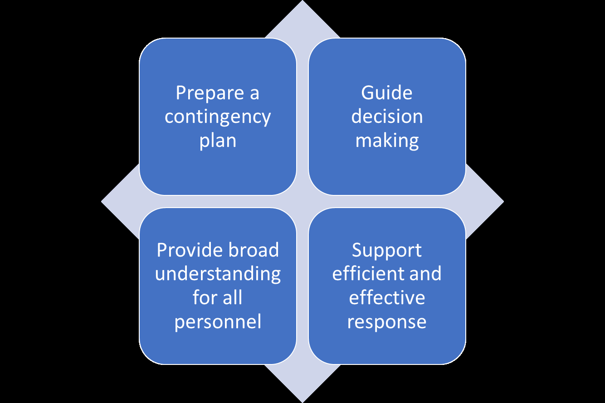
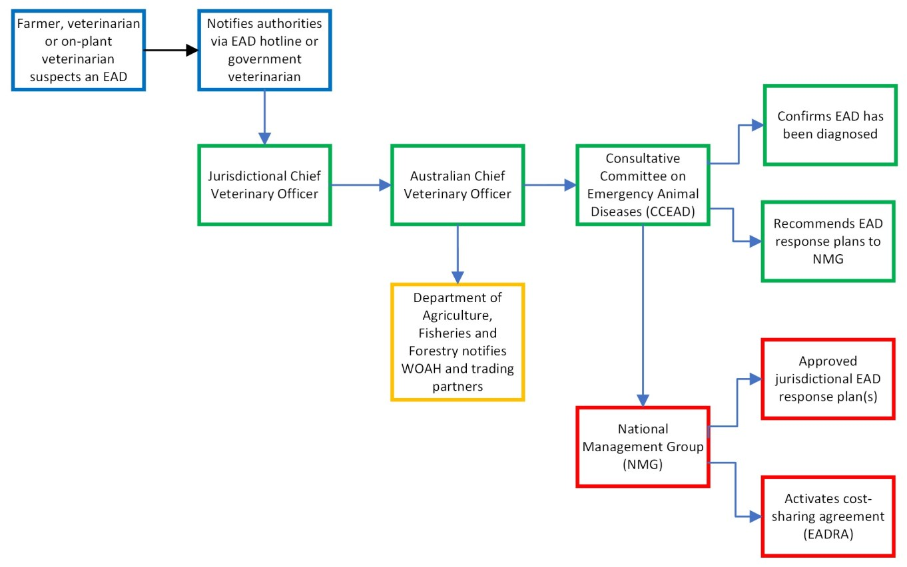
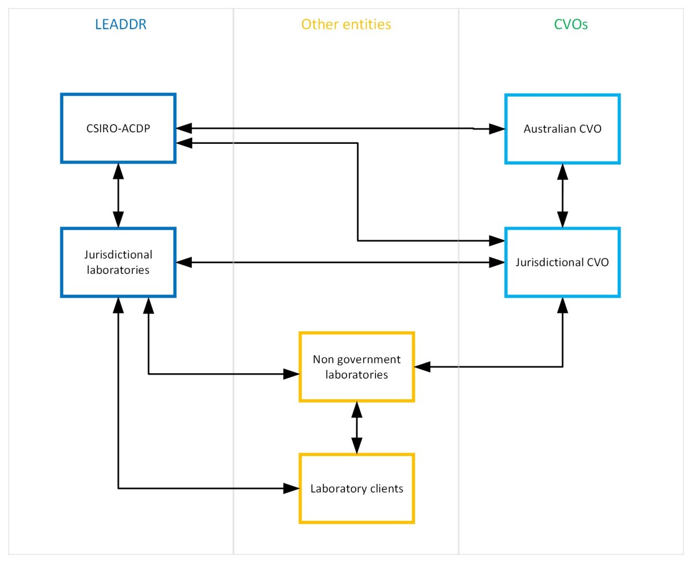
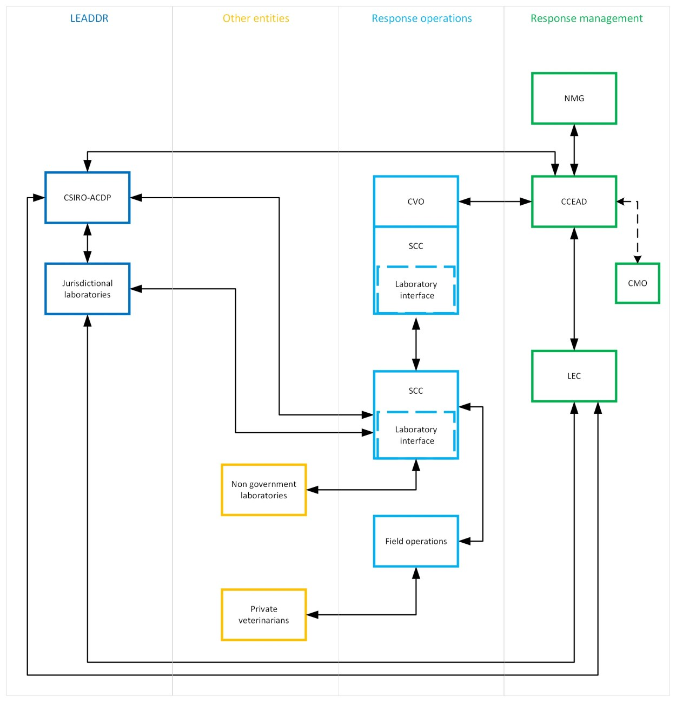

# AUSVETPLAN — Management Manual: Laboratory Preparedness (2024)

> **Source**: Animal Health Australia
> **URL**: https://animalhealthaustralia.com.au//wp-content/uploads/2024/05/AUSVETPLAN-Management-Laboratory-Preparedness.pdf
> **Licence**: Crown / publisher copyright; practitioner reference
> **Retrieved**: 2026-05-07T23:47:56Z
> **SHA-256**: `3f79ed9b7fd24607770a51c88ba1aa4f21788e434842098733533c0770008727`
> *Converted from PDF to Markdown format.*

---
## Page 1

 
 
 
 
 
 
AUSTRALIAN VETERINARY EMERGENCY PLAN 
AUSVETPLAN 
Management manual 
Laboratory preparedness 
Version 5.0 
 
 
 
 
 
 
AUSVETPLAN is a series of technical response plans that describe the proposed 
Australian approach to an emergency animal disease incident. 
The documents provide guidance based on sound analysis, linking policy, 
strategies, implementation, coordination and emergency-management plans. 
National Biosecurity Committee

---
## Page 2

 
 
 
 
© 1991–2024 Animal Health Australia ABN 86 071 890 956. Certain materials in this publication are 
protected by copyright and are reproduced with permission from the Commonwealth of Australia, acting 
through its Department of Agriculture, Fisheries and Forestry (or any successor agency); each state and 
territory of Australia, as represented by their relevant agencies and by the National Biosecurity 
Committee and Animal Health Committee; and Animal Health Australia’s industry members. 
ISBN 0 642 24506 1 (printed version) 
ISBN 1 876 71438 7 (electronic version) 
Licence 
This work is licensed under the Creative 
Commons Attribution-NonCommercial-ShareAlike 4.0 International Licence, with the exception of: 
• any third-party material contained within the work 
• any material protected by a trademark 
• any images and/or photographs. 
To view a copy of this licence, visit http://creativecommons.org/licenses/by-nc-sa/4.0/. 
Moral rights 
The author(s) of this work holds ‘moral rights’ as defined in the Copyright Act 1986 (Cth) and asserts all 
moral rights in connection with this work. This means you must: 
• attribute (give credit to) the author(s) of this work 
• not say a person is a creator of a work when they are not 
• not do something with the work (such as change or add to it) that would have a negative impact 
on the reputation of the author(s) of this work. 
Failure to do so could constitute a breach of the Copyright Act 1986 (Cth). 
Disclaimer and warranty 
• This publication has been produced in accordance with the procedures described in the 
AUSVETPLAN Overview document, and in consultation with Australian, state and territory 
governments; the relevant livestock industries; nongovernment agencies; and public health 
authorities, as relevant. Any views and opinions expressed in this document do not necessarily 
represent the views and opinion of the authors or contributors, Animal Health Australia or the 
Commonwealth of Australia. 
• This publication is for use in emergency situations. The strategies and policy guidelines in this work 
are not applicable to quarantine policies for imported livestock or livestock products. 
• This publication is not legal or professional advice and should not be taken as a substitute for legal 
or other professional advice. 
• This publication is not intended for use by any person who does not have appropriate expertise in 
the subject matter of the work. Before using this publication, you should read it in full, consider its 
effect and determine whether it is appropriate for your needs.

---
## Page 3

 
 
 
 
• This publication was created in May 2024. Laws, practices and regulations may have changed since 
that time. You should make your own inquiries as to the currency of relevant laws, practices and 
regulations, as these may have changed since publication of this work. 
No warranty is given as to the correctness of the information contained in this work, or of its suitability 
for use by you. To the fullest extent permitted by law, Animal Health Australia is not, and the other 
contributing parties are not, liable for any statement or opinion, or for any error or omission contained in 
this work, and it and they disclaim all warranties with regard to the information contained in it, including, 
without limitation, all implied warranties of merchantability and fitness for a particular purpose. Animal 
Health Australia is not liable for any direct, indirect, special or consequential losses or damages of any 
kind, or loss of profit, loss or corruption of data, business interruption or indirect costs, arising out of or in 
connection with the use of this work or the information contained in it, whether such loss or damage 
arises in contract, negligence, tort, under statute, or otherwise. 
Text under development 
In this manual, text placed in square brackets [xxx] and greyed out indicates that that aspect of the 
manual remains unresolved or is under development; such text is not part of the official manual. The 
issues will be further worked on by experts and relevant text included at a future date. 
Contact information 
If you have any requests or inquiries concerning reproduction and rights, or suggestions or 
recommendations, you should address these to: 
AUSVETPLAN — Animal Health Australia 
Head of Program AUSVETPLAN 
PO Box 151 
Lyneham ACT 2602 
Tel: 02 6232 5522 
email: ausvetplan@animalhealthaustralia.com.au 
Approved citation 
Animal Health Australia (2024). Management manual: Laboratory preparedness (version 5.0). Australian 
Veterinary Emergency Plan (AUSVETPLAN), edition 5, Canberra, ACT. 
EMERGENCY ANIMAL DISEASE HOTLINE: 1800 675 888 
The Emergency Animal Disease Hotline is a toll-free telephone number that connects callers to the 
relevant state or territory officer to report concerns about any potential emergency disease situation. 
Anyone suspecting an emergency disease outbreak should use this number to get immediate advice 
and assistance.

---
## Page 4

 
 
 
 
Publication record 
Edition 1: 
1991 
Edition 2: 
Version 2.0, 1996 (major update) 
Edition 4:  
Version 4.0, 2013 (major update) 
 
 
Version 4.1, 2016 (minor update 
Edition 5: 
Version 5.0, 2024 (major update)

---
## Page 5

 
AUSVETPLAN Management manual: Laboratory preparedness 
5 
Contents 
1 Introduction ............................................................................................................. 9 
1.1 
This document ....................................................................................................... 9 
1.1.1 
Purpose .................................................................................................... 9 
1.1.2 
Scope ........................................................................................................ 9 
1.1.2 
Other documentation ............................................................................ 10 
1.3 
Training and training resources ........................................................................... 10 
1.3.1 
Laboratory training ................................................................................ 10 
1.3.2 
Emergency animal disease preparedness and response training in 
Australia ................................................................................................. 11 
2 Emergency animal disease response ......................................................................... 12 
2.1 
What happens in an emergency animal disease response? ................................ 12 
2.1.1 
The Emergency Animal Disease Response Agreement .......................... 14 
2.1.2 
Emergency Animal Disease Response Plan ............................................ 14 
3 The national laboratory network .............................................................................. 15 
3.1 
National laboratory network ............................................................................... 15 
3.2 
National coordination of laboratories ................................................................. 15 
3.2.1 
Laboratories for Emergency Animal Disease Diagnosis and Response.. 15 
3.2.2 
Laboratories for Emergency Animal Disease Diagnosis and Response 
Coordinating Committee ....................................................................... 15 
3.2.3 
Animal Health Committee ..................................................................... 16 
3.2.4 
Subcommittee on Animal Health Laboratory Standards ....................... 16 
3.2.5 
Public Health Laboratory Network......................................................... 16 
3.3 
Other laboratories ............................................................................................... 17 
4 Responsibilities of laboratories ................................................................................ 18 
4.1 
Limitation of testing and reporting ..................................................................... 18 
4.2 
Notification .......................................................................................................... 18 
4.3 
Initial diagnosis .................................................................................................... 18 
4.4 
Emergency animal disease response ................................................................... 19 
4.5 
Reporting results during an emergency animal disease response ...................... 19 
4.5.1 
Positive laboratory test results for an emergency animal disease ........ 19 
4.5.2 
Indeterminate laboratory test results for an emergency animal disease
 ............................................................................................................... 19 
4.6 
Maintenance of expertise and resources ............................................................ 20 
4.7 
Laboratory Emergency Animal Disease Contingency Plan .................................. 20

---
## Page 6

 
 
6 
AUSVETPLAN Edition 5 
4.7.1 
Exercising the Emergency Animal Disease Contingency Plan ................ 21 
4.7.2 
Activating the Emergency Animal Disease Contingency Plan ................ 21 
5 Laboratory standards ............................................................................................... 22 
5.1 
Requirements for laboratories in the national network ..................................... 22 
5.1.1 
Quality management systems ............................................................... 22 
5.1.2 
Unvalidated tests for emergency use .................................................... 22 
5.1.3 
Containment .......................................................................................... 22 
5.1.4 
Official recognition ................................................................................. 23 
5.2 
Requirements for laboratories in an emergency animal disease ........................ 23 
5.2.1 
Laboratories part of the Laboratories for Emergency Animal Disease 
Diagnosis and Response network .......................................................... 23 
5.2.2 
Other laboratories ................................................................................. 23 
6 Communications...................................................................................................... 24 
6.1 
Communication during routine operations ......................................................... 24 
6.2 
Communication during an emergency animal disease outbreak ........................ 25 
6.3 
Communication with clients ................................................................................ 27 
6.3.1 
Veterinarians .......................................................................................... 27 
7 Logistics .................................................................................................................. 28 
7.1 
Managing high-volume testing ............................................................................ 28 
7.2 
Supply chain and availability of key consumables ............................................... 29 
7.3 
Managing equipment in an emergency animal disease incident ........................ 29 
8 Technology .............................................................................................................. 30 
8.1 
Information and data management .................................................................... 30 
8.1.1 
Data standards and reporting ................................................................ 30 
8.1.2 
The STARS network ................................................................................ 30 
8.2 
Robotics and high-volume testing ....................................................................... 30 
8.3 
Standardisation of specimen handling ................................................................ 30 
8.3.1 
Standard specimen containers .............................................................. 31 
8.3.2 
Prelabelling of specimen containers ...................................................... 31 
9 Training ................................................................................................................... 32 
9.1 
Training in jurisdictional laboratories .................................................................. 32 
9.2 
Just-in-time training during a response ............................................................... 32 
9.3 
Laboratory managers........................................................................................... 33 
9.4 
Other training ...................................................................................................... 33

---
## Page 7

 
AUSVETPLAN Management manual: Laboratory preparedness 
7 
10 Microbiological security ........................................................................................... 34 
10.1 
Standard operating procedures ........................................................................... 35 
10.2 
Laboratory equipment and facilities ................................................................... 35 
10.3 
Waste handling, sterilisation and disposal .......................................................... 35 
10.4 
Personal protective equipment ........................................................................... 36 
10.5 
Safe specimen handling ....................................................................................... 36 
10.6 
Zoonoses .............................................................................................................. 36 
10.7 
Training ................................................................................................................ 36 
10.8 
Control of access and workflow .......................................................................... 36 
10.9 
Animal handling ................................................................................................... 37 
11 Decontamination ..................................................................................................... 38 
11.1 
Principles ............................................................................................................. 38 
11.2 
Personal decontamination .................................................................................. 38 
11.3 
Laboratory decontamination ............................................................................... 38 
11.4 
Selection of disinfectants .................................................................................... 38 
11.4.1 Safety ..................................................................................................... 38 
11.4.2 Regulatory requirements ....................................................................... 39 
11.5 
Fumigation ........................................................................................................... 39 
12 Handling of specimens ............................................................................................. 40 
12.1 
Selection of specimens ........................................................................................ 40 
12.2 
Collection and documentation of specimens ...................................................... 40 
12.3 
Submission of specimens to jurisdictional laboratories ...................................... 41 
12.4 
Submission of specimens to the CSIRO Australian Centre for Disease 
Preparedness ....................................................................................................... 41 
12.6 
Transport of specimens ....................................................................................... 42 
12.6.1 Regulatory requirements ....................................................................... 42 
12.6.2 Responsibility for specimen transport ................................................... 42 
12.6.3 Classification and packaging .................................................................. 43 
12.6.4 Packaging materials ............................................................................... 43 
12.6.5 Labelling and documentation ................................................................ 43 
12.6.6 Regulatory compliance .......................................................................... 44 
12.6.7 Further information ............................................................................... 44 
Appendix 1 
Format of an Emergency Animal Disease Contingency Plan .............. 45 
Glossary ....................................................................................................................... 54

---
## Page 8

 
 
8 
AUSVETPLAN Edition 5 
Manual-specific terms ....................................................................................................... 54 
Standard AUSVETPLAN terms ........................................................................................... 55 
Acronyms and abbreviations ......................................................................................... 66 
Manual-specific acronyms and abbreviations................................................................... 66 
Standard AUSVETPLAN acronyms and abbreviations ....................................................... 66 
References ................................................................................................................... 68

---
## Page 9

 
AUSVETPLAN Management manual: Laboratory preparedness 
9 
1 Introduction 
1.1 
This document 
1.1.1 
Purpose 
This management manual has been developed to help diagnostic testing laboratories prepare a 
contingency plan for an animal disease emergency, and to help response personnel understand the 
operations of diagnostic testing laboratories during an emergency animal disease (EAD) response. This 
management manual guides decision making and supports the implementation of an efficient and effective 
response (Figure 1.1). 
 
Figure 1.1 
Purpose of the laboratory preparedness management manual 
1.1.2 
Scope 
Diagnostic testing laboratories are a critical component of the response to EAD incidents. This management 
manual is designed to help response personnel understand the roles, responsibilities and coordination of 
laboratories during an EAD response, and help laboratories prepare to deal with an EAD and document 
their preparations in an EAD Contingency Plan. To do this, this management manual contains information 
on: 
• what happens in an EAD response and how laboratory activities are coordinated nationally 
• the responsibilities of laboratories 
• laboratory standards 
• communications for laboratories in an EAD response 
• logistics for a laboratory EAD response 
• information technology (IT) that aids the laboratory EAD response 
• training of laboratory personnel 
• microbiological security in laboratories

---
## Page 10

 
 
10 
AUSVETPLAN Edition 5 
• handling of diagnostic specimens 
• components of a laboratory EAD Contingency Plan. 
In this management manual, diagnostic testing laboratories include government (national, state and 
territory) animal health laboratories, as well as the following establishments that may offer support to an 
emergency response: 
• university animal health laboratories 
• commercial veterinary laboratories, industry veterinary laboratories and laboratory facilities in 
private veterinary practices  
• mobile laboratory facilities, provided they comply with the regulatory and operational standards 
of the supervising or parent laboratory  
• other facilities, including medical laboratories that receive veterinary diagnostic specimens. 
Activities outside the laboratory (eg sample collection), and field-based and point-of-use/care testing, are 
not included in the scope of this manual. 
1.1.2 
Other documentation 
This management manual should be read and implemented in conjunction with: 
• relevant AUSVETPLAN documents, including disease-specific response strategies; operational, 
enterprise and management manuals; and any relevant guidance and resource documents. The 
complete series of manuals is available on the Animal Health Australia website1 
• relevant nationally agreed standard operating procedures (NASOPs).2 These procedures 
complement AUSVETPLAN and describe in detail specific actions undertaken during a response to 
an EAD incident 
• relevant jurisdictional or industry policies, response plans, standard operating procedures (SOPs) 
and work instructions 
• relevant Commonwealth and jurisdictional legislation and legal agreements (such as the 
Emergency Animal Disease Response Agreement [EADRA],3 where applicable). 
1.3 
Training and training resources 
1.3.1 
Laboratory training 
Training for laboratory staff is driven by each jurisdiction to meet the accreditation requirements of the 
National Association of Testing Authorities (NATA) and International Organization for Standardization/
International Electrotechnical Commission ISO/IEC 17025:2017 General Requirements for the Competence 
of Testing and Calibration Laboratories.4 The breadth of the training will depend on the diagnostic tests 
that the laboratory offers. Training records must be maintained, even during an outbreak. In the event of 
 
1 https://animalhealthaustralia.com.au/ausvetplan 
2 https://animalhealthaustralia.com.au/nationally-agreed-standard-operating-procedures 
3 https://animalhealthaustralia.com.au/eadra 
4 www.iso.org/standard/66912.html

---
## Page 11

 
AUSVETPLAN Management manual: Laboratory preparedness 
11 
high-throughput sample processing and testing, workflows might be adapted and appropriate training 
provided for relevant staff. Bottlenecks are typically seen in the accessions area. 
1.3.2 
Emergency animal disease preparedness and response training in Australia 
A freely available and valuable resource is the online EAD foundation course.5 It provides livestock 
producers, veterinarians, veterinary students, government personnel and emergency workers with 
foundation knowledge for further training in EAD preparedness and response in Australia. 
 
 
5 https://animalhealthaustralia.com.au/online-training-courses

---
## Page 12

 
 
12 
AUSVETPLAN Edition 5 
2 Emergency animal disease response 
2.1 
What happens in an emergency animal disease response? 
An overview of Australia’s EAD response structures and governance is provided in the AUSVETPLAN 
Control centres management manual and is summarised below and in Figure 2.1. 
The chief veterinary officer (CVO) in the state or territory in which the incident occurs is responsible for 
instituting animal disease control action within that state or territory. The strategies to control the disease, 
including the budget for the proposed response actions, are documented in an Emergency Animal Disease 
Response Plan (EADRP). When the EAD is suspected or confirmed to be a zoonosis, the EADRP is developed 
in collaboration with the chief health officer (CHO) of the affected state or territory. 
For a response to be cost shared under the EADRA, EADRPs must be consistent with, and guided by, any 
relevant AUSVETPLAN manuals. It is recognised that the Consultative Committee on Emergency Animal 
Diseases (CCEAD) can, if it thinks reasonable, recommend to the National Management Group (NMG) an 
EADRP even if part of the response plan deviates from AUSVETPLAN (eg due to new knowledge). For 
responses that are not cost shared under the EADRA, the development of response plans consistent with 
AUSVETPLAN is voluntary and is usual practice. AUSVETPLAN therefore serves as the authoritative 
reference on policies and guidelines for the management of EADs in Australia.6 
The CVO is responsible for recommending the EADRP to the CCEAD. Unaffected jurisdictions may also need 
to develop response plans to address jurisdictional activities that may be eligible for cost sharing. 
The CCEAD provides technical review of the EADRP and may recommend it to the NMG convened for the 
incident. The NMG decides on whether cost sharing will be invoked (following advice from the CCEAD) and 
whether to approve the EADRP. 
CVOs and, where relevant, CHOs implement disease control measures as agreed in the EADRP and in 
accordance with relevant legislation. They make ongoing decisions on followup disease control measures 
— including termination of the response — in consultation with the CCEAD and, where applicable, the 
NMG, based on epidemiological and other relevant information about the incident. 
It is also important to note that the overall response policy contained in the various AUSVETPLAN manuals 
is used to inform responses to new and emerging diseases.
 
6 
Because of the potentially wide range of circumstances that can occur during an EAD incident, EADRPs may deviate 
from AUSVETPLAN with the agreement of the CCEAD and, where applicable, the NMG.

---
## Page 13

 
AUSVETPLAN Management manual: Laboratory preparedness 
13 
 
EAD = emergency animal disease; EADRA = Emergency Animal Disease Response Agreement; WOAH = World Organisation for Animal Health 
Figure 2.1 
Summary of steps in the reporting of an EADRA-listed cost-shared response

---
## Page 14

 
 
14 
AUSVETPLAN Edition 5 
2.1.1 
The Emergency Animal Disease Response Agreement 
The EADRA7 sets out the basis for government and industry stakeholders to collectively reduce the risk of 
EAD incursion and manage an EAD response, including sharing the laboratory and other costs.  
Cost sharing in an EAD incident is contingent on the parties to the EADRA agreeing to an EADRP. 
2.1.2 
Emergency Animal Disease Response Plan 
Drafting an EADRP usually requires the involvement of relevant laboratories, to provide information such 
as appropriate tests and testing regimes, and estimates of laboratory costs. Laboratory staff should be 
prepared to contribute to the development and execution of EADRPs in terms of diagnostic tests to be 
undertaken, laboratories that will undertake the diagnostic testing and expected laboratory costs. 
For reimbursement of the costs incurred under an EADRP, laboratories must keep separate, auditable 
records of these costs. 
 
7 Further information about the EADRA is available at https://animalhealthaustralia.com.au/eadra

---
## Page 15

 
AUSVETPLAN Management manual: Laboratory preparedness 
15 
3 The national laboratory network 
3.1 
National laboratory network 
The Laboratories for Emergency Animal Disease Diagnosis and Response (LEADDR) network is the primary 
animal health laboratory network responsible for an EAD incident response. It consists of the jurisdictional 
animal health laboratories from all states and the Northern Territory, the CSIRO Australian Centre for 
Disease Preparedness (CSIRO-ACDP), and the Australian Government Department of Agriculture, Fisheries 
and Forestry.  
The LEADDR network is a working group of, and reports to the Animal Health Committee (AHC) 
Subcommittee on Animal Health Laboratory Standards (SCAHLS). 
3.2 
National coordination of laboratories 
3.2.1 
Laboratories for Emergency Animal Disease Diagnosis and Response 
The LEADDR network provides a way for laboratories to collaborate using harmonised or standardised 
testing methods and software platforms for targeted EAD management. It also participates in the response 
to individual EAD incidents, as required. Sections 6 and 7 describe the role of the network, including 
communication and reporting guidelines, and the functions of the laboratory interface (see AUSVETPLAN 
Control centres management manual, Part 2). 
In the event of an EAD outbreak, LEADDR may be required to carry out testing appropriate to the testing 
capability of the individual laboratory and its level of biosecurity containment. 
To manage workload peaks, LEADDR may choose to share work between laboratories to make the most 
efficient use of laboratory capacity. As all LEADDR laboratories work in a harmonised quality framework, 
results from different laboratories can be regarded as equivalent. 
3.2.2 
Laboratories for Emergency Animal Disease Diagnosis and Response Coordinating 
Committee 
The LEADDR Coordinating Committee comprises the senior representative of each LEADDR member 
organisation, is chaired by the LEADDR Coordinator (or their delegate) and meets as required to consider 
urgent issues.  
Once the CCEAD is formed, the ACDP Director, as a member of CCEAD, convenes the committee as the 
LEADDR Emergency Committee (LEC). The LEC is then chaired by the ACDP director, or their delegate. The 
LEC may co-opt technical specialists appropriate for the disease in question. The role of the LEC is to provide 
technical advice to the CCEAD and technical coordination among laboratories involved in the EAD response.

---
## Page 16

 
 
16 
AUSVETPLAN Edition 5 
In a declared EAD outbreak, the LEC will assume the primary role in managing the coordination of 
laboratory services to the outbreak response by: 
• reviewing initial and ongoing laboratory findings, including test results, and providing advice to the 
CCEAD and its other working groups on followup laboratory needs and strategies, including 
facilitating relevant test harmonisation or standardisation and research activities 
• assessing and coordinating the capacity of the national laboratory service to respond to the disease 
outbreak, based on epidemiological and other relevant information available from the CCEAD 
• implementing appropriate quality assurance procedures and mechanisms for submission of data 
for outbreak management 
• reviewing the laboratory findings and other technical aspects of activities undertaken by the 
laboratories represented on the LEC and other laboratories involved in the outbreak, on a regular 
basis or as required 
• facilitating agreement on costs for laboratory testing and other relevant services, even though 
these may differ between participating laboratories. 
3.2.3 
Animal Health Committee 
The main purpose of the AHC is to develop science-based and nationally consistent policy on animal health 
issues, and to provide animal health advice as necessary to the National Biosecurity Committee. The AHC 
provides leadership in developing and implementing policy, programs, operational strategies and 
standards for government in the areas of animal health, domestic quarantine, animal welfare and 
veterinary public health. 
AHC members include the CVOs of the Commonwealth, states and territories, along with representatives 
from the CSIRO-ACDP and the Department of Agriculture, Fisheries and Forestry. There are also observers 
from Animal Health Australia, Wildlife Health Australia, and the New Zealand Ministry for Primary 
Industries. 
3.2.4 
Subcommittee on Animal Health Laboratory Standards 
The AHC SCAHLS provides technical and policy advice to the AHC on terrestrial animal health laboratory 
issues. SCAHLS coordinates various essential laboratory functions to support the continued improvement 
of Australia’s national animal health system, including the production of Australian and New Zealand 
standard diagnostic procedures (ANZSDPs), evaluation of new test methodologies and validation data for 
new or modified tests, and technical advice on specific testing issues. 
3.2.5 
Public Health Laboratory Network 
In the event of an EAD outbreak with zoonotic potential, coordination with public health will be required. 
The counterpart committee to SCAHLS is the Public Health Laboratory Network (PHLN), which is a standing 
committee of the Australian Health Protection Principal Committee (AHPPC). The PHLN works with other 
AHPPC standing committees such as the Communicable Diseases Network Australia, the National Health 
Emergency Management Subcommittee and the Environmental Health Committee as needed. The PHLN 
provides leadership and consultation in all aspects of public health microbiology and communicable 
disease control, and consists of state, territory and Australian government expert, national and observer 
members, including a representative from the CSIRO-ACDP.

---
## Page 17

 
AUSVETPLAN Management manual: Laboratory preparedness 
17 
3.3 
Other laboratories 
Although private, university and industry laboratories that receive diagnostic specimens from animals do 
not currently have a direct role in an EAD incident, they could be involved in testing for specific EADs and 
may be required to assist the LEADDR network on a case-by-case basis. In the future, some of these 
laboratories may be involved in the LEADDR network functions. Appropriately prepared nongovernment 
laboratories may be used during an EAD response if additional capacity is required.

---
## Page 18

 
 
18 
AUSVETPLAN Edition 5 
4 Responsibilities of laboratories 
All states and territories have policies and regulations that restrict testing for EADs to certain laboratories, 
place conditions on testing at these laboratories and/or prescribe procedures for releasing results. 
Generally, this may include requirements such as accreditation to ISO/IEC 17025, membership of the 
LEADDR network and/or participation in relevant external quality assurance programs such as proficiency 
testing. Heads of laboratories should confirm local requirements from their jurisdiction’s CVO. 
4.1 
Limitation of testing and reporting 
Field veterinarians are expected to promptly notify their CVO of the suspicion of an EAD incident and 
undertake investigation, including sample collection for the exclusion of EADs, in a timely manner. For this 
purpose, testing at the state laboratory should be initiated as soon as practical. However, such testing 
should not delay referral of specimens to the CSIRO-ACDP. The laboratory manager (or their delegate) 
should liaise with the CVO to confirm that provisional negative results may be reported promptly to the 
field veterinarian and advise that a definitive result will be based on confirmatory testing undertaken at 
the CSIRO-ACDP. 
4.2 
Notification 
Individuals who know of, or suspect, the presence of an EAD must, by law, notify the CVO of their own 
state or territory, or the CVO’s delegate. Substantial penalties may apply for failure to do so. CVOs who are 
notified of an EAD in and/or linked to another state or territory will relay the notification to the CVO of the 
affected jurisdiction, and to the Australian CVO (ACVO). 
Notification may be made by phone to the Emergency Animal Disease Hotline (1800 675 888). The 
government officer receiving the notification on the hotline will notify the CVO. 
When laboratories receive specimens submitted for EAD testing, or if suspicion of an EAD incidentally arises 
during routine testing, they should immediately notify their CVO for followup action. If they have suspicion 
of an EAD, they should also notify the CVO even if subsequent nonconfirmatory testing does not support 
that suspicion. Further communications are detailed in Section 6. 
The National Notifiable Animal Diseases List and jurisdictional lists are on the website of the Australian 
Government Department of Agriculture, Fisheries and Forestry.8 The National Notifiable Animal Diseases 
List includes some diseases that are not EADs. 
4.3 
Initial diagnosis 
With the head of laboratory’s approval, laboratory veterinarians may be required to join a diagnostic team 
in the investigation of a suspected EAD case at the laboratory or, if necessary, in the field. The AUSVETPLAN 
Control centres management manual, Part 1 describes the functions of a field diagnostic team. 
 
8 www.agriculture.gov.au/biosecurity-trade/pests-diseases-weeds/animal/notifiable

---
## Page 19

 
AUSVETPLAN Management manual: Laboratory preparedness 
19 
4.4 
Emergency animal disease response  
Laboratory staff may be involved in an EAD response by testing for the EAD, or by the redistribution of 
other work (unrelated to the EAD) from other laboratories. 
With the head of laboratory’s approval, staff of government laboratories may be redeployed to assist in 
field investigations, or to work at a mobile laboratory or control centre. For example, staff who are familiar 
with the laboratory information management system, sample submission procedures and reporting 
methods may undertake the function of laboratory interface at a control centre. The AUSVETPLAN Control 
centres management manual, Part 2 describes this officer’s functions. 
During the proof of freedom phase, laboratory staff will be engaged to provide expertise on laboratory 
tests and in designing surveys for country or zone proof of freedom. 
4.5 
Reporting results during an emergency animal disease response 
4.5.1 
Positive laboratory test results for an emergency animal disease 
If results of laboratory tests are positive for the detection of, or host response to, an EAD pathogen, the 
following communication procedures will be followed. 
• An initial positive laboratory finding for an EAD must be reported immediately to the relevant CVO, 
who will follow the established lines of reporting to the ACVO, CCEAD and/or other key 
stakeholders as appropriate. 
• Until confirmatory testing has been undertaken, usually at or through the CSIRO-ACDP, the 
outcome of the investigation should be considered as ‘unconfirmed’. However, appropriate 
laboratory and/or field actions in response to the initial laboratory finding (as deemed by the CVO 
of the affected jurisdiction) may be taken.  
• The CSIRO-ACDP Director may also convene the LEADDR Emergency Committee (LEC) as described 
in Section 3.2.2. once the CCEAD has been established. 
• If/when the LEC is formed, laboratory findings, including test results, from a testing laboratory can 
be shared with the LEC subject to clearance by the CCEAD, including the CVO of the jurisdiction in 
which the samples originated. 
4.5.2 
Indeterminate laboratory test results for an emergency animal disease 
Any contentious, unusual or potentially sensitive laboratory findings or test results unresolved by the 
CSIRO-ACDP and relating to EADs listed in the EADRA, or to potentially novel infectious agents, must be 
reported as follows: 
• The results of concern should initially be shared immediately with the CVO of the investigating 
jurisdiction, who will follow the established lines of reporting to the ACVO for advice.  
• If relevant, at the request of the CVO of the investigating jurisdiction and the ACVO, the LEADDR 
Coordinator will urgently convene a meeting of the LEADDR Coordinating Committee to discuss 
the case. The results from a testing laboratory can only be shared with the committee after these 
results have been cleared by the CVO of the jurisdiction in which the samples originated. 
• Meetings of the LEADDR Coordinating Committee should be convened as soon as possible, and 
within 24 hours of the result becoming available. 
• The LEADDR Coordinating Committee will provide the investigating jurisdiction and ACVO with its 
interpretation of the results and recommend any followup action to be taken.

---
## Page 20

 
 
20 
AUSVETPLAN Edition 5 
4.6 
Maintenance of expertise and resources 
All laboratory veterinarians should maintain a high level of proficiency in recognising the clinical and 
pathological signs of major EADs, and relevant biosecurity procedures. This expertise is crucial in helping 
clients to recognise an EAD in a live animal or at necropsy, and to select suitable specimens for submission 
to an appropriate laboratory without risking spread of the disease. 
Laboratories that routinely receive veterinary diagnostic specimens for testing for EADs should maintain 
sufficient resources and appropriate levels of knowledge and skills for testing services commonly used for 
EAD detection and/or diagnosis, such as anatomic pathology, serology, molecular diagnostics, microbiology 
(eg virology, bacteriology, mycology) and/or parasitology. In an EAD response, these laboratories could be 
asked to introduce new technologies or to greatly increase testing capacity. 
These laboratories should include in their EAD Contingency Plan (see Section 4.4) sources for extra staff 
and equipment, and associated issues (eg competence training, supervision, chain-of-command 
components, communication staff, equipment calibration), if their existing resources are insufficient. 
Laboratories’ capability and resources to conduct EAD testing should be regularly reviewed, and these 
reviews should be documented. Maintenance of expertise, and resources for ensuring biosecurity and 
biosafety, are addressed in Section 7. 
4.7 
Laboratory Emergency Animal Disease Contingency Plan 
Laboratories that routinely receive veterinary diagnostic specimens for testing for EADs must be properly 
prepared to deal with such an emergency and should document their preparations as an EAD Contingency 
Plan. 
In an EAD incident, laboratories are often required to test specimens collected from animals in infected 
premises or dangerous contact premises. These premises are subject to stringent, legally enforceable 
restrictions, including movement restrictions. A laboratory that receives specimens from animals in such 
premises may be exempted from these restrictions if it has implemented an EAD Contingency Plan that 
includes adequate biosecurity and biosafety measures. 
Each laboratory’s EAD Contingency Plan should be sufficiently detailed to manage all biosecurity risks 
relevant to the laboratory’s operations, while being sufficiently flexible to deal with individual risks 
appropriately. 
The EAD Contingency Plan should also consider the laboratory’s ability to maintain business continuity 
regarding other diagnostic services that may be separate from the EAD response. 
Appendix 1 provides a suggested format for an EAD Contingency Plan.

---
## Page 21

 
AUSVETPLAN Management manual: Laboratory preparedness 
21 
4.7.1 
Exercising the Emergency Animal Disease Contingency Plan 
The laboratory should test its EAD Contingency Plan annually, or more frequently if changed circumstances 
make this desirable. Such testing should complement training, ideally forming part of a national, state or 
territory EAD preparedness exercise, or being done independently. It could involve: 
• drills, in which operational staff undertake specific procedures 
• discussion exercises, in which key staff workshop an EAD response 
• functional and field exercises, in which personnel and resources are mobilised in a coordinated, 
real-time response to a scenario that has been purposefully designed to test much or all of the 
contingency plan.  
The planning and direction of these exercises may be outsourced to optimise effectiveness. 
After each drill or exercise, the plan and the operating procedures that support it should be evaluated in a 
timely manner, with a view to identifying and addressing their strengths and weaknesses. The exercise 
program should be informed by assessing need and be informed by evaluation of previous exercises and 
responses. 
4.7.2 
Activating the Emergency Animal Disease Contingency Plan 
The laboratory’s EAD Contingency Plan should be activated when an EAD or suspect EAD disrupts normal 
operations through any of the following scenarios: 
• there is a high level of suspicion of an EAD 
• a laboratory is notified of the expected submission of specimen(s) from a suspected EAD outbreak 
• laboratory results indicate a high probability that an EAD has been detected 
• epidemiological presentation of the incident 
• laboratory examinations indicate that specimen(s) from an EAD outbreak have probably entered 
the laboratory 
• the laboratory has been notified of the presence of an EAD in the area from which its specimen(s) 
would normally be obtained (eg within the same jurisdiction as the laboratory) 
• the laboratory is notified or requested to support sample testing as part of LEADDR agreements. 
Contingency plans for supply of reagents, equipment, personnel, etc may also be required when a shortage 
is identified that would have implications if an EAD is reported.

---
## Page 22

 
 
22 
AUSVETPLAN Edition 5 
5 Laboratory standards 
5.1 
Requirements for laboratories in the national network 
Laboratories approved to conduct EAD exclusion testing during an EAD incident (usually limited to the 
LEADDR network) should have relevant SOPs and quality assurance programs. They should follow the 
diagnostic procedures approved previously by SCAHLS, or otherwise by the AHC or CCEAD. Ideally, 
laboratories should be accredited by NATA and comply with the requirements of the most recent version 
of ISO/IEC 17025 (General Requirements for the Competence of Testing and Calibration Laboratories) to 
ensure that investigation of a suspected EAD is prompt, rapid and reliable; does not jeopardise the health 
or safety of laboratory or other personnel; and does not risk spreading the disease. 
5.1.1 
Quality management systems 
Quality assurance (QA) is an integral component of the management and operation of any accredited 
diagnostic laboratory. Laboratories that receive diagnostic samples from animals and participate in an EAD 
response should routinely engage in an appropriate QA program, for example, the Australian National 
Quality Assurance Program (ANQAP). They should also seek and maintain suitable national and/or 
international accreditation for performing relevant EAD tests, in compliance with the requirements of the 
most recent version of ISO/IEC 17025 General Requirements for the Competence of Testing and Calibration 
Laboratories, through NATA or an equivalent provider. 
A suitable QA program should: 
• confirm the status of the laboratory’s QA system and test proficiency 
• provide assurance that test results are repeatable and reproducible 
• provide reference data to help identify and solve systematic and random errors 
• develop data for the ongoing validation of diagnostic assays 
• allow QA data to be used for 
- 
monitoring assay performance 
- 
initiating appropriate intervention strategies 
- 
evaluating assay performance during and after an incident response or related 
activity. 
5.1.2 
Unvalidated tests for emergency use 
Not all tests used in an EAD incident or outbreak can or would be fully validated or approved by SCAHLS. 
SCAHLS or LEC, as appropriate, can advise on the selection of appropriate tests for such an emergency 
situation based on available scientific evidence. This includes selection of tests for known diseases when 
no validated assay is in established use, or for a novel or previously unknown disease when tests are being 
developed. Test data generated during the incident or outbreak should then be used for subsequent 
validation purposes.  
5.1.3 
Containment 
The Australian/New Zealand standard (AS/NZS) 2243.3:2022 (Safety in Laboratories, Part 3: 
Microbiological Safety and Containment) classifies infectious microorganisms — including many of those 
that cause EADs — by risk. Specific national regulatory requirements and guidelines for biocontainment

---
## Page 23

 
AUSVETPLAN Management manual: Laboratory preparedness 
23 
also apply for the possession of EAD pathogens. For example, for pathogens that are classified as security 
sensitive biological agents (SSBAs), compliance with the SSBA regulation is also required. See Section 10 
for more details. 
5.1.4 
Official recognition 
Each state or territory jurisdiction may have their own requirements for recognition and/or approval of 
laboratories for EAD testing. It is expected that laboratories performing EAD testing satisfy the 
requirements relevant to the jurisdiction in which they operate. 
5.2 
Requirements for laboratories in an emergency animal disease 
5.2.1 
Laboratories part of the Laboratories for Emergency Animal Disease Diagnosis and 
Response network 
All LEADDR laboratories must be NATA accredited and comply with the requirements of the most recent 
version of ISO/IEC 17025. The scope of accreditation must match the class and subclass relevant to the 
testing performed. If NATA accreditation is suspended or withdrawn for the relevant class or subclass of 
test, the laboratory in question must immediately suspend all testing under the LEADDR program unless 
otherwise agreed by the AHC. 
LEADDR laboratories also regularly participate in a network external QA program (ie proficiency testing) 
under LEADDR, as outlined in the LEADDR SOPs (not part of this manual). 
Where possible, each EAD test must be validated or reviewed by SCAHLS. Each laboratory’s deployment of 
the test must meet the appropriate standards for equipment, methods and reagents. 
There is ongoing collection of quality control data across the LEADDR network and regular participation in 
proficiency testing by all participants. This helps ensure that there is harmonisation of testing across the 
network. 
5.2.2 
Other laboratories 
Currently, private, university and industry laboratories that receive diagnostic specimens from animals do 
not have a direct role in an EAD incident. If they are required to assist the LEADDR network for specific 
EADs, SCAHLS or LEC, as appropriate, will advise on relevant laboratory standards for this purpose on a 
case-by-case basis.

---
## Page 24

 
 
24 
AUSVETPLAN Edition 5 
6 Communications 
The following communication guidelines and procedures apply to an EAD diagnosis and response, 
regardless of whether the laboratory is a LEADDR member. Laboratories involved in the diagnosis of EADs 
must balance openness and transparency with an appropriate level of confidentiality. All laboratory staff 
must observe confidentiality, as directed by their CVO or head of laboratory. 
Communications, including the reporting of laboratory findings, can be separated into: 
• communications during routine operations of laboratories, such as the daily work in the laboratory 
and surveillance activities throughout Australia 
• communications during the initial diagnosis of, and subsequent laboratory response to, an EAD 
incident. 
Each laboratory must keep up-to-date contact details — names, phone numbers (including mobile and 
after-hours numbers) and email addresses — for other LEADDR members, to facilitate communication 
within the network. 
6.1 
Communication during routine operations 
The general responsibility of laboratories for notifying or reporting laboratory findings and test results are 
detailed in other parts of this document. Figure 6.1 shows the lines of communication between the main 
bodies involved with information and policy matters relevant to laboratories during routine operations. 
Communication is through both formal and informal channels.

---
## Page 25

 
AUSVETPLAN Management manual: Laboratory preparedness 
25 
 
CSIRO-ACDP = CSIRO Australian Centre for Disease Preparedness; CVO = chief veterinary officer; LEADDR = Laboratories for 
Emergency Animal Disease Diagnosis and Response 
Notes: 
1. Clients include government and private veterinarians, animal health officers and researchers. 
2. Informal communications between different groups may take place, as required. 
Figure 6.1 
Formal lines of communication for laboratories involved in emergency animal disease 
diagnosis and response (routine operations) 
6.2 
Communication during an emergency animal disease outbreak 
During an EAD outbreak, regardless of whether a CCEAD is formed, the CVO of the jurisdiction in which the 
samples for EAD testing originate controls the flow of the testing results from all involved laboratories 
(both LEADDR and non-LEADDR). However, the CSIRO-ACDP, as the national animal health laboratory, will 
also advise the ACVO of both potential and confirmed EAD cases in a timely manner (within 24 hours, 
whenever possible and appropriate). Results should only be released to the CVO/ACVO or their delegate, 
such as the control centre laboratory interface (Figure 6.2).

---
## Page 26

 
 
26 
AUSVETPLAN Edition 5 
 
CCEAD = Consultative Committee on Emergency Animal Disease; CMO = chief medical officer; CSIRO-ACDP = CSIRO 
Australian Centre for Disease Preparedness; CVO = chief veterinary officer; LCC = local control centre; LEADDR = 
Laboratories for Emergency Animal Disease Diagnosis and Response; LEC = LEADDR Emergency Committee; 
NMG = National Management Group; SCC = state or territory control centre 
Note: Informal communications between different groups may take place, as required. 
Figure 6.2 
Formal lines of communication for laboratories involved in emergency animal disease 
diagnosis and response (emergency response operations)

---
## Page 27

 
AUSVETPLAN Management manual: Laboratory preparedness 
27 
6.3 
Communication with clients 
6.3.1 
Veterinarians 
Reporting of results to submitting veterinarians, and other submitters in general, during an outbreak 
response will be managed by the control centres established under the jurisdictional EADRP. Laboratories 
will communicate results to the control centres via the laboratory interface function.  
6.3.2 
Animal industries 
During an EAD outbreak or other EAD incidents, it is expected that laboratories would not be in direct 
communication with industry bodies. These communications should be handled by the control centre, the 
CVO/ACVO and/or their agencies as relevant.

---
## Page 28

 
 
28 
AUSVETPLAN Edition 5 
7 Logistics 
A major reason to have the LEC actively participate in discussion of an EAD incident as early as practical is 
to prepare the LEADDR network for a response. A critical part of this early involvement is to alert the 
LEADDR laboratories to the nature of the incident (eg agent responsible, location, species involved), to 
assist with early planning — from review of staffing needs through to the possible needs for reagents and 
materials and, if necessary, activation of procurement of supplies. To ensure that each jurisdiction can 
meet the possible demands ahead, it is likely that there will be need for a laboratory coordinator to function 
at a national level. This role will generally be filled by the LEADDR Coordinator, or another suitable 
person(s) nominated by the LEADDR Coordinating Committee or LEC. 
LEADDR laboratories have an established capability to undertake diagnostic and associated testing that 
may be required during an EAD incident. Testing will generally involve real-time polymerase chain reaction 
(PCR) assay for agent detection and enzyme-linked immunosorbent assay (ELISA)-based serology for 
detection of antibodies. Once an outbreak has been confirmed, laboratory services may be needed for a 
wide range of purposes. This may include testing for disease exclusion, surveillance, animal movement and, 
ultimately, proof of freedom. The state laboratory may also need to supply resources such as transport 
medium and swabs to field investigation teams. The number of samples submitted for testing can vary 
significantly depending on the stage of an outbreak and the disease status of an individual state. Early in 
an outbreak, sample numbers submitted for exclusion testing can be relatively small, but submission 
patterns are likely to be very erratic and unpredictable. In contrast, proof-of-freedom testing can involve 
extremely large numbers of samples, but they may be submitted in a more orderly manner. 
7.1 
Managing high-volume testing 
To meet the testing demands of an EAD response, a representative of each affected LEADDR laboratory 
should maintain close contact with their counterpart in the jurisdictional control centre(s) (ie LCC and state 
or territory control centre) undertaking field surveillance for high-level awareness of sampling plans — 
especially concerning potential sample numbers for sample prioritisation and other critical processing 
arrangements, where required. This will also enable a proper assessment of the availability of trained 
and/or vaccinated staff, laboratory space and other resources for undertaking testing. 
The most important determinant for rapid turnaround of large numbers of samples is the linkage between 
the field and laboratory for rapid and reliable specimen accession, delivery, and the specimen receival 
process. Consideration should be given to remote (field-based) sample identification and tracking methods 
that can be automated and minimise sample handling and data entry in the laboratory. 
To facilitate high-volume testing, the laboratory should have established workflows that take into 
consideration standardised sample types and packaging that minimise further laboratory processing, for 
example, by reducing manual handling. In addition, it is essential to consider specimen storage and disposal 
at the outset of a large-scale EAD response, as this can be demanding of both staff time and storage 
facilities. This should aim to establish minimum sample retention times, appropriate storage conditions (to 
maintain sample integrity as well as biocontainment), and disposal methods that are both practical and 
ensure inactivation of all pathogens. While it is essential for all waste to be sterilised before leaving the 
laboratory, disposal of large quantities of decontaminated specimens and laboratory waste can also

---
## Page 29

 
AUSVETPLAN Management manual: Laboratory preparedness 
29 
present challenges, so disposal on a regular basis should be undertaken to avoid build-up of such 
quantities. See Section 10 for more details. 
7.2 
Supply chain and availability of key consumables 
Each LEADDR laboratory should be equipped with a suite of detection assays based on real-time PCR for 
agent detection and ELISA assays for host response detection in sufficient quantity to support initial 
exclusion testing. As these or similar assays are run regularly, each LEADDR laboratory should ensure their 
supply and availability for the initial phase of an outbreak (eg first 2 weeks), when sample numbers 
submitted to the laboratory are modest. The quantity of key consumables that have a long shelf life 
(especially plasticware, transport medium, swabs and other specimen collection materials) should be 
reviewed on a regular basis and maintained at a level that would meet an unexpected large demand, 
considering usual supply times for the individual laboratory. Supplementary supplies of reagents used in 
ELISA and PCR assays should be secured at an early stage. There can be unexpected demands and 
disruptions to supply chains due to, for example, other concurrent disease emergencies. 
At an early stage in an EAD incident, and on an ongoing basis, the LEADDR Coordinator will liaise with each 
laboratory to determine its need for assistance in procuring reagents and materials, including import 
permits where necessary. 
7.3 
Managing equipment in an emergency animal disease incident 
In general, the specialised equipment needed to run ELISA and PCR assays is not readily transferable 
between laboratories. Additionally, this equipment will usually be needed to maintain a ‘business as usual’ 
capability. However, laboratory managers should be aware of alternative local supply sources of 
equipment that may not be utilised to capacity, especially to meet an unexpected need if there is a 
breakdown. Major equipment suppliers may be able to assist with the leasing of key items.

---
## Page 30

 
 
30 
AUSVETPLAN Edition 5 
8 Technology 
8.1 
Information and data management 
Robust and scalable information and data management systems are critical to supporting EAD responses 
and for allowing the LEADDR network to function as a coherent entity. Depending on jurisdictional needs, 
dedicated information technology support may be required during an EAD response. 
8.1.1 
Data standards and reporting 
Data standards are the basis of any robust laboratory information management system (LIMS) that extends 
beyond a single, simple application. A common metadata schema to describe the data being shared, as 
well as the technical means to facilitate that sharing, are fundamental requirements. The Sample Tracking 
and Reporting System (STARS) network (Section 8.1.2) enforces data standards within the network but 
provides the tools to translate data to/from individual systems at its boundaries. The latest version of 
STARS extends this concept to the use of open standards to support this interchange. 
8.1.2 
The STARS network 
The STARS network is an electronic interface allowing rapid communication between the CSIRO-ACDP and 
state laboratory LIMS instances, supporting digital exchange of case data and testing results to support 
outbreak responses. The STARS network has been operational since 2011, providing rapid data interchange 
between animal health laboratories and critical support to surge capacity in outbreak situations. 
As of 2023, an active project is underway to refresh the STARS framework (STARS v2) over a modern 
architecture to provide a more robust and extensible platform for the future. This project will enhance the 
STARS network to provide a modern, standards-based platform for data exchange and interoperability. 
This will strengthen and enhance the current laboratory-focused functionality of the network, supporting 
the ability of all participating laboratories to respond to disease emergencies. 
8.2 
Robotics and high-volume testing 
Each LEADDR laboratory should anticipate probable demands on the laboratory in the event of a large-
scale EAD outbreak. Capability should be developed to support this demand in the form of appropriate 
robotic and/or other high-volume testing platforms. Such capability may find other uses in day-to-day 
testing but should be regularly exercised in its outbreak configuration to provide confidence in the 
laboratory’s ability to respond in an emergency. 
8.3 
Standardisation of specimen handling 
Benefits of standardising specimen handling across a national laboratory network, as outlined below, are 
widely recognised. There is an ongoing interest in establishing a national agreement on how to implement 
the approach.

---
## Page 31

 
AUSVETPLAN Management manual: Laboratory preparedness 
31 
8.3.1 
Standard specimen containers 
Deployment of standardised specimen containers would enhance efficiency in specimen handling within 
laboratories. It would also simplify the exchange of specimens between laboratories, or submission to 
multiple laboratories, to provide increased flexibility during an outbreak response. 
8.3.2 
Prelabelling of specimen containers 
The use of standardised specimen containers that are prelabelled with a barcoded specimen identification 
would further enhance automation and specimen interchange, as well as opening opportunities for field-
to-laboratory traceability of specimens. The STARS network can support transfer of specimen 
identifications across multiple laboratory or non-laboratory nodes. The practical implementation of this 
concept would parallel standardised specimen containers.

---
## Page 32

 
 
32 
AUSVETPLAN Edition 5 
9 Training 
Many of the technologies used to detect and characterise pathogens and host responses are transferable 
between EADs. These technologies are constantly evolving, and staff need to maintain training for their 
competencies to remain current. Laboratories that may undertake testing in support of an EAD response 
should ensure that sufficient key staff are trained to proficiency in these technologies, so that EAD testing 
can be promptly implemented when required. Training and competency assessment is part of a 
laboratory’s quality management system under ISO/IEC 9001 and ISO/IEC 17025.  
The World Organisation for Animal Health (WOAH) Manual of diagnostic tests and vaccines for terrestrial 
animals9 describes internationally validated EAD testing technologies. 
The Australian and New Zealand standard diagnostic procedures (ANZSDPs) are based on WOAH’s 
recommended diagnostic methods, with inclusion of additional requirements specific to Australia’s unique 
testing and epidemiological conditions. The primary objective of the ANZSDPs is to standardise testing 
procedures to ensure consistency between laboratories, using methods selected for their optimal 
accuracy, sensitivity, specificity and robustness. The ANZSDPs provide another reference source for current 
technologies. 
Heads of laboratories should ensure that their scientific staff are sufficiently trained to be aware of and 
recognise major EADs, especially exotic diseases. Relevant staff should: 
• have resources, including texts and reference materials, to facilitate recognition of EADs 
• have knowledge of, and immediate access to, relevant expert opinion 
• attend seminars, conferences and other training programs for the laboratory aspect of EADs 
• participate in QA programs for testing that are applicable or transferable to testing for EADs 
• experience major exotic EAD incidents overseas, when opportunities arise 
• participate in relevant exercises for testing the laboratory EAD Contingency Plan (see Sections 4.7, 
4.7.1 and Appendix 1). 
9.1 
Training in jurisdictional laboratories 
The LEADDR network contributes to training of laboratory personnel through its QA program and various 
interactive discussion forums. 
During an EAD response, the LEC may have a role in transferring technology and facilitating training for 
laboratories as required. 
9.2 
Just-in-time training during a response 
Laboratories sometimes need to expand their workforce during a large-scale outbreak response. This may 
include bringing in nonlaboratory staff from within the organisation, and/or reaching out to others from 
 
9 www.woah.org/en/what-we-do/standards/codes-and-manuals/terrestrial-manual-online-access

---
## Page 33

 
AUSVETPLAN Management manual: Laboratory preparedness 
33 
outside the organisation. In either case, laboratory-specific ‘just in time’ training might be required. This 
will be managed by the broader emergency response within a jurisdiction. 
9.3 
Laboratory managers 
Participation of heads of laboratories in EAD preparedness exercises and training can increase both their 
skills in EAD planning and the response by laboratories. Training offered by the Australian Institute for 
Disaster Resilience10 and by state and territory emergency management agencies may also be relevant. 
9.4 
Other training 
Laboratories that are accredited to the most recent version of ISO/IEC 17025 (General Requirements for 
the Competence of Testing and Calibration Laboratories), including accreditation by NATA, are obliged to 
ensure that all testing and reporting are done by staff who are trained to appropriate competence. 
All relevant laboratory staff should also receive appropriate training in biocontainment and 
decontamination. 
Staff who package and consign specimens from animals, or cultures of pathogens (ie Dangerous Goods, 
Class 6.2), or who advise clients in these matters, must be trained, tested and accredited to the 
International Air Transport Association (IATA) specifications (see Section 12.6).
 
10 https://knowledge.aidr.org.au/collections/education-and-professional-development-resources

---
## Page 34

 
 
34 
AUSVETPLAN Edition 5 
10 Microbiological security 
Biosecurity hazards at diagnostic laboratories are generally associated with: 
• receipt, processing, testing, transfer, storage and disposal of specimens or waste that contain EAD 
agents 
• handling and disposal of reagents and animals used for testing 
• contamination of laboratory equipment and facilities 
• contamination, infection and movement of staff. 
In this manual, the term biosecurity does not cover bioterrorism involving the unofficial or malicious use 
of EAD agents, unless otherwise specified. 
The risks associated with these hazards vary with each EAD agent and with the nature of the laboratory 
work during the different phases of an EAD incident. The microbiological risk of an EAD response should 
be considered in relation to 3 major factors: 
• risk to the laboratory worker 
• risk to the community 
• availability of effective treatments or vaccinations. 
The control measures and considerations referred to in this section will influence these risks. 
AS/NZS 2243.3:2022 (Safety in Laboratories, Part 3: Microbiological Safety and Containment) classifies 
infective microorganisms — including many of those that cause EADs — by risk according to World Health 
Organization guidelines. The standard, which focuses on human pathogens, sets standards of laboratory 
practice to contain these microorganisms. Laboratories that handle potentially infective materials should 
have this standard and implement procedures that meet its requirements. 
Australian standards are available from Standards Australia.11 
Specific national regulatory requirements and guidelines also apply for the possession of EAD pathogens 
that are classified as SSBAs. Although certain circumstances, including disease emergencies and responses, 
may allow possession and handling of SSBAs to be partially exempt from the SSBA Regulatory Scheme, 
laboratories are required to closely observe any changes in the requirements and guidelines to ensure that 
they always comply. 
SSBA regulatory requirements and guidelines are available from the Australian Government Department 
of Health and Aged Care.12 
When deciding on appropriate primary and secondary containment, consideration should be given to the 
risk group of the material being handled (as defined in AS/NZS 2243.3:2022). When the standard provides 
no specific guidance for the disease agent (as is the case for some veterinary pathogens and novel disease 
 
11 www.standards.org.au 
12 www.health.gov.au/SSBA

---
## Page 35

 
AUSVETPLAN Management manual: Laboratory preparedness 
35 
agents), the decision on appropriate physical containment should be risk based. Use of biological safety 
cabinets and the physical characteristics of the facility (eg negative air pressure and high-efficiency 
particulate air [HEPA] filtration) should be appropriate for the risks posed by the disease agent. The 
laboratory plan should minimise the potential for spread of the agent and contamination of other areas of 
the facility. 
Tertiary containment may also be considered. This involves preventing contact between infectious 
materials and susceptible animals outside the containment areas by appropriate measures, such as 
restrictions on staff access to such animals. 
10.1 Standard operating procedures 
Each laboratory should have documented SOPs that ensure microbiological security during normal 
operation. Standard procedures form a sound basis for any special procedures required during an animal 
disease emergency. Test methods should be written to AS 2929:1990 (Test Methods — Guide to the 
Format, Style and Content) and include appropriate cautions. Manuals containing these procedures should 
be readily accessible by staff. 
For some EADs, disease-specific SOPs may have been developed to supplement the existing SOPs. There 
are nationally agreed SOPs (NASOPs)13 and jurisdictional SOPs that cover personal disinfection and sample 
collection. 
10.2 Laboratory equipment and facilities 
Laboratory facilities, equipment, personnel and waste that have been exposed to EAD agents or other 
pathogens must be decontaminated. This minimises the likelihood that infectious agents will spread from 
the laboratory or that the pathogen will contaminate pathogen-free samples and reagents. It also protects 
people from laboratory-acquired infection. 
If equipment required for sample processing is likely to come in contact with infectious materials, it should 
be assessed for its potential to be properly decontaminated. Equipment, especially liquid-handling devices, 
should be assessed for the potential to create aerosols. 
10.3 Waste handling, sterilisation and disposal 
All waste produced from an EAD response must be decontaminated or treated appropriately. In many 
cases, this will require sterilisation or incineration. If adequate equipment, such as an autoclave or 
incinerator, is not available at the facility, plans and risk assessments should be in place for transporting 
waste material to a suitable facility. Any transport must comply with the requirements of relevant 
regulatory bodies (see Section 12.6) and AS/NZS 2243.3:2022. The expected volume of waste generated 
will be an important consideration in these plans. 
 
13 https://animalhealthaustralia.com.au/nationally-agreed-standard-operating-procedures

---
## Page 36

 
 
36 
AUSVETPLAN Edition 5 
10.4 Personal protective equipment 
As a general principle, when laboratory staff are at risk of exposure to pathogens, they must use 
appropriate personal protective equipment (PPE), regardless of whether the pathogens are zoonotic. 
Essential PPE may include overalls, boots, gloves, coats, eyewear and, when there is a risk of human 
infection by aerosol, HEPA-filtered breathing apparatus. PPE should be disposable, or able to be readily 
decontaminated. 
10.5 Safe specimen handling 
As a general principle, it should be considered that all specimens could carry potentially infectious material 
or pathogens, regardless of whether they are zoonotic. Staff should be competent in the use of aseptic 
techniques, appropriate PPE, and equipment such as Class 2 (or higher) biological safety cabinets, to 
provide protection to the operator, other staff and the environment. Specimens should be removed from 
transport containers in a dedicated area and only removed from secondary packaging once they have been 
placed in a biological safety cabinet. The outer packaging should be carefully removed and placed in an 
appropriate receptacle for autoclaving. The external surfaces of primary specimen containers should be 
decontaminated with a suitable disinfectant. Any processing of specimens (eg centrifugation, 
homogenisation) should only be undertaken after the risk of contamination with a zoonotic agent has been 
considered and, if necessary, biosecure equipment is used. 
10.6 Zoonoses 
AS/NZS 2243.3:2022 classifies infective microorganisms that can be considered to be zoonoses, and 
describes the availability and use of vaccines as well as appropriate levels of biocontainment. The selection 
of PPE and handling procedures will vary depending on the mode of transmission of the agent and type of 
procedures to be undertaken. For example, transfer of a small volume of a liquid sample into a polymerase 
chain reaction (PCR) lysis buffer solution that immediately inactivates the pathogen carries different risks 
to the collection of samples from an animal infected with a zoonotic agent. High-risk procedures should 
only be undertaken by suitably qualified and experienced staff. Handling of specimens that may contain a 
zoonotic agent should be confined to areas where there is limited access by other staff. 
10.7 Training 
A prerequisite for working with specimens that may contain an EAD or zoonotic agent is that a staff 
member must have been suitably and extensively trained. The staff member should demonstrate adequate 
competency before being allowed to work without close supervision. All staff should regularly review 
laboratory biosafety documents that deal with, for example, handling of potentially infectious material, 
procedures for handling of spills and appropriate decontamination methods. 
10.8 Control of access and workflow 
The locations in which EAD-related material or specimens may be handled in a laboratory will be governed 
by the levels of biocontainment available, the type of specimens being handled and the nature of work 
being undertaken. AS/NZS 2243.3:2022 provides general guidance. In general, material that is considered 
to have a high risk or likelihood of infection with an EAD pathogen should be handled at an appropriate 
level of biocontainment to manage any potential risk. There should be a mechanism to physically limit

---
## Page 37

 
AUSVETPLAN Management manual: Laboratory preparedness 
37 
access (eg swipe card) to such areas to trained staff, and it should be isolated from other sections of the 
facility and the general public.  
Nevertheless, during an EAD response there is likely to be pressure on resources and, sometimes, limited 
space available with high levels of containment (eg Physical Containment Level 3, or PC3). Under such 
circumstances, it may be necessary to ‘stream’ the manner and location in which samples are handled, so 
that high-throughput workflow is not unduly impeded but there is an acceptable level of risk management. 
For example, viral transport medium containing lesion swabs may be opened in a biological safety cabinet 
in a secure area. After a small volume of transport medium has been transferred to a suitable PCR lysis 
buffer, the lysis buffer may be transferred to an area of lower containment if it has been validated for 
inactivation of the agent. The original specimen can be sealed and retained in the secure facility. However, 
issues related to appropriate longer-term storage or disposal of tested specimens should not be 
overlooked. 
10.9 Animal handling 
In this document, handling of animals is only considered in the context of working in a containment facility 
with an animal infected, or likely to be infected, with an EAD agent. Whenever possible, handling of 
infected animals should be avoided or minimised. In general, there is a need for a high level of 
biocontainment and more rigorous use of PPE, including respiratory protection (depending on the 
pathogen of concern).  
Additionally, there should be restrictions on contact with animals outside the containment facility. These 
measures are important because there are often larger quantities of pathogen excreted from 
experimentally infected animals and there is a greater likelihood of cross-contamination of both PPE and 
operators with excretions, discharges and aerosols. Collectively, these issues increase the risks associated 
with working with infected animals, regardless of whether it is in the context of infection of staff with a 
zoonotic agent or transfer of the agent to the environment.

---
## Page 38

 
 
38 
AUSVETPLAN Edition 5 
11 Decontamination 
11.1 Principles 
The AUSVETPLAN Operational manual: Decontamination outlines the general principles of 
decontamination for EAD agents and other pathogens at field sites. Although these are relevant to 
laboratories, specific procedures also apply to laboratory situations. The decontamination elements of 
each laboratory’s EAD Contingency Plan must be tailored to that laboratory’s physical containment level, 
layout and sample flow. 
AS/NZS 2243.3:2022 (Safety in Laboratories, Part 3: Microbiological Safety and Containment) describes 
preferred disinfection methods in microbiology laboratories. 
Jurisdictions should decide on and practice these decontamination procedures during periods when there 
is no EAD response. 
11.2 Personal decontamination 
Personal decontamination aims to remove pathogens from a person’s body surfaces and clothing (without 
imposing a health risk on the person) so that they can leave the contaminated environment without risking 
the spread of the agent. Chemical hand cleaners or detergents should be selected for both their safe use 
on skin and their efficacy in inactivating the microbiological agent being handled.  
11.3 Laboratory decontamination 
Immediately after it is known or suspected that materials containing an EAD agent have been in the 
laboratory, all areas that may have been in direct or indirect contact with the material should be risk-
assessed and, if appropriate, decontaminated. For this reason, it is recommended that samples be opened 
and processed in a biosafety cabinet whenever possible and appropriate. 
11.4 Selection of disinfectants 
Disinfectants that are effective against EAD pathogens are grouped based on their chemical activity. 
Guidance on the applications for chemical disinfectants in microbiological laboratories is provided in the 
AUSVETPLAN Operational manual: Decontamination. 
11.4.1 Safety 
Personnel should consult the relevant safety data sheets (SDSs) before using cleaning materials and 
disinfectants and, unless specific procedures indicate otherwise, use the products according to the 
manufacturers’ instructions. This may involve the use of PPE, because many of these substances (or 
vapours from them) are an irritant or harmful to people. 
SDSs, which are supplied by the manufacturer, contain information on the identity, physical characteristics, 
health hazards and precautions for safe storage, use and disposal of the chemical. SDSs should always be 
available to laboratory staff.

---
## Page 39

 
AUSVETPLAN Management manual: Laboratory preparedness 
39 
11.4.2 Regulatory requirements 
For laboratories handling imported biological materials, the Australian Government Department of 
Agriculture, Fisheries and Forestry provides a list of approved disinfectants and other chemicals used for 
inactivation of infectious materials. 
 
11.5 Fumigation 
Fumigation can be used to quickly decontaminate large, enclosed areas, including areas with equipment 
that is difficult to decontaminate in any other way. However, it can be hazardous to operators and other 
personnel in the area and requires highly trained skills. 
Fumigation may not be effective for porous materials (eg cardboard and paper), which can also adversely 
affect the fumigation process by absorbing the humidity required for the process to be effective. 
Fumigation decontaminates surfaces and will not penetrate occluded spaces or sealed containers. 
Formaldehyde gas is a commonly used fumigant. The practicalities of its use are discussed in the 
AUSVETPLAN Operational manual: Decontamination. Formaldehyde gas should be used only: 
• when it is impossible or impractical to use other procedures 
• by experienced personnel with appropriate safety equipment. 
There are other less-toxic options (eg peroxide) that may be available, but their activity spectrum should 
be checked before use.

---
## Page 40

 
 
40 
AUSVETPLAN Edition 5 
12 Handling of specimens 
12.1 Selection of specimens 
Specimens required for investigation of each EAD are identified in: 
• AUSVETPLAN response strategies14 
• Emergency animal diseases: A field guide for Australian veterinarians.15 
Additional information may also be found in:  
• ANZSDPs (some of which are known as Australian Standard Diagnostic Techniques)16 
• the WOAH Manual of diagnostic tests and vaccines for terrestrial animals17 
• Foreign animal diseases, 7th edition (Committee on Foreign and Emerging Diseases of the United 
States Animal Health Association 2008). 
Because of the variable frequency with which EADs are investigated, the ongoing evolution of testing 
technologies and methods for some EADs, and the need for rapid diagnosis, submitters should ideally 
consult the testing laboratory before selecting specimens. 
In an EAD response, the EADRP or new SOPs may specify specimens to be collected for surveillance testing 
and, as appropriate, vaccine efficacy testing. 
12.2 Collection and documentation of specimens 
Laboratories (principally LEADDR laboratories) may contribute pathologists to diagnostic teams during the 
incident definition phase of an EAD response (see the AUSVETPLAN Control centres management manual, 
Part 1). Once a local control centre (LCC) is established, it will provide instructions for sample collection. 
Field veterinarians should supply the laboratory with all pertinent details of the history, clinical signs and 
any postmortem findings. This information will allow the laboratory veterinarian to interpret the laboratory 
results and suggest additional testing as appropriate. 
For details on the collection and documentation of specimens, consult the appropriate NASOP (Collecting 
emergency animal disease samples for laboratory testing).18 
Guidance on equipment required for collecting samples for EAD testing is available in Emergency animal 
diseases: A field guide for Australian veterinarians.15 
 
 
 
14 https://animalhealthaustralia.com.au/ausvetplan 
15 www.outbreak.gov.au/prepare-respond/identify-pests-diseases/emergency-animal-diseases-field-guide 
16 www.agriculture.gov.au/agriculture-land/animal/health/laboratories/procedures/anzsdp 
17 www.woah.org/en/what-we-do/standards/codes-and-manuals/terrestrial-manual-online-access 
18 https://animalhealthaustralia.com.au/nationally-agreed-standard-operating-procedures

---
## Page 41

 
AUSVETPLAN Management manual: Laboratory preparedness 
41 
12.3 Submission of specimens to jurisdictional laboratories 
Each jurisdiction will maintain their own arrangements for field sample submission to their laboratories, 
and the laboratory should be contacted for specific details as required. 
EAD diagnostic submissions should be sent to the appropriate jurisdictional laboratory in the first instance, 
and only be sent to the CSIRO-ACDP from state or territory government, or government-approved, 
laboratories, unless the government laboratory, in consultation with the state or territory CVO, has given 
prior approval for a direct submission from elsewhere. For example, in an outbreak situation, samples may 
be sent directly from a LCC. 
12.4 Submission of specimens to the CSIRO Australian Centre for 
Disease Preparedness 
Initial testing for EADs may be performed in jurisdictional laboratories that are members of the LEADDR 
network, with confirmatory testing done at or through the CSIRO-ACDP. For suspected exotic EAD cases, 
the CSIRO-ACDP is responsible for all testing, unless otherwise decided by CCEAD or arranged through the 
LEADDR network. 
CSIRO-ACDP’s role in an EAD response may include the detection, confirmation, isolation and 
characterisation of the EAD agent, and characterisation of the host response (particularly serology) to the 
EAD agent. Relevant details on the testing capabilities of the CSIRO-ACDP, and state and territory 
government laboratories, are available from the laboratories, and in information maintained by SCAHLS.19 
For any particular case, submitters should determine appropriate specimens and tests through discussion 
with the CSIRO-ACDP duty veterinarian. 
In an EAD response, subject to advice from the CCEAD, the CSIRO-ACDP may devolve certain testing to 
other laboratories, according to the dynamics of the outbreak, the location of relevant expertise, the 
volume of testing (particularly serology), the availability of resources and logistic support, and other valid 
reasons. This may be done through the LEADDR network. 
Whenever possible, submitters should use the STARS network, which allows rapid and secure electronic 
exchange of animal health data between participating laboratories and the CSIRO-ACDP. The STARS login 
portal and the CSIRO-ACDP Specimen Advice Note are available online.20 
CSIRO-ACDP’s delivery address is:  
Australian Centre for Disease Preparedness 
5 Portarlington Rd 
East Geelong VIC 3219 
 
 
 
19 www.agriculture.gov.au/agriculture-land/animal/health/laboratories/tests 
20 https://stars.csiro.au/dsr_login.aspx

---
## Page 42

 
 
42 
AUSVETPLAN Edition 5 
12.6 Transport of specimens 
All laboratories should have staff members who are accredited to package infectious substances in 
compliance with the IATA Dangerous Goods Regulations and can provide professional advice to clients. 
Laboratories should also have documented procedures that are consistent with regulatory requirements 
for the transport of specimens and cultures of pathogens. 
Before specimens are transported from the field, from a control centre or from one laboratory to another, 
they must be appropriately identified and packed to meet IATA requirements, and the consignee must be 
notified. The receiving laboratory should be advised of consignment details, including the expected arrival 
date and time and a contact number.  
These procedures must all comply with the IATA Dangerous Goods Regulations and, where relevant, the 
SSBA Regulatory Scheme. 
12.6.1 Regulatory requirements 
Regulatory requirements that apply to the transport of specimens are subject to constant review and may 
change. Consignors must comply with the requirements that apply at the time of consignment, and with 
any carriers’ and/or consignees’ requirements that also apply. 
The Civil Aviation Safety Authority (CASA)21 regulates the air transport of dangerous goods in Australia. The 
regulations that apply to air transport of infectious substances are set out in the IATA Dangerous Goods 
Regulations. A new edition of the IATA Dangerous Goods Regulations becomes effective on 1 January each 
year. Interim changes are published on the IATA website.22 
Copies of the IATA Dangerous Goods Regulations may be purchased from the International Forwarders and 
Customs Brokers Association of Australia.23 
The states and territories regulate land transport, based on the Australian Code for the Transport of 
Dangerous Goods by Road and Rail, which is maintained by the National Transport Commission. The code 
is based on the recommendations of the United Nations Committee of Experts on the Transport of 
Dangerous Goods. In general, compliance with requirements for air transport of specimens will ensure 
compliance with requirements for land transport. 
12.6.2 Responsibility for specimen transport 
The shipper is legally responsible for ensuring that consignments of dangerous goods, including specimens, 
comply with regulatory requirements. 
The IATA Dangerous Goods Regulations and CASA require that shippers be trained, tested and certified to 
consign dangerous goods. Trainers must be approved by CASA, which maintains a list of approved trainers. 
 
21 www.casa.gov.au 
22 www.iata.org/dangerousgoods 
23 www.ifcbaa.com

---
## Page 43

 
AUSVETPLAN Management manual: Laboratory preparedness 
43 
Approved training that is specifically for shippers of infectious substances and dry ice is available.24 
Certification is valid for 2 years. 
In general, airlines and courier companies are not common carriers, and may refuse consignments that do 
not meet regulatory or company requirements. To ensure the expeditious transport of specimens, 
laboratories should maintain a close working relationship with the local agent of at least one national air 
courier, and with that company’s dangerous goods manager. 
Laboratories that are accredited to ISO/IEC 17025 (General Requirements for the Competence of Testing 
and Calibration Laboratories) should have documented procedures that are consistent with regulatory 
requirements for the transport of specimens and cultures of pathogens. 
Heads of laboratories should assign responsibility for specimen transport to specific, appropriately trained 
staff. Although these staff may provide advice and materials to the laboratory’s clients, this does not relieve 
the clients of their responsibility to comply with regulations. 
In the response and proof-of-freedom phases of an EAD response, specimen submission may be 
coordinated by the laboratory interface function at an LCC. Laboratory staff who are certified to ship 
diagnostic specimens and infectious substances may be seconded to that position. 
12.6.3 Classification and packaging 
The IATA Dangerous Goods Regulations include criteria for classifying specimens, and how they must be 
identified, packed, marked, labelled and documented for shipping. 
12.6.4 Packaging materials 
Suppliers of packaging can be found in the IATA Dangerous Goods Regulations, or by using a web search 
for keywords such as ‘infectious substance packaging’. Some overseas suppliers have distributors in 
Australia. 
Purchasers of approved packaging must obtain specifications for its use from the supplier and comply with 
those specifications. Purchasers should ascertain specifications and limitations that apply to inner 
packaging components, including primary specimen containers. 
12.6.5 Labelling and documentation 
The IATA Dangerous Goods Regulations specify the labelling and documentation that must be used when 
consigning diagnostic specimens or infectious substances. 
The regulations: 
• specify the appearance, number, placement and orientation of labels 
• give instructions for, and examples of, proper completion of dangerous goods declarations, air 
waybills and consignment notes. 
 
24 A list of approved course providers can be obtained from CASA (www.casa.gov.au).

---
## Page 44

 
 
44 
AUSVETPLAN Edition 5 
12.6.6 Regulatory compliance 
Laboratory staff and others who consign specimens should check the completed package, consignment 
note and, if applicable, dangerous goods declaration for compliance with the IATA Dangerous Goods 
Regulations. This check is best done using the Dangerous goods checklist for a non-radioactive shipment 
that is in the current edition of the IATA Dangerous Goods Regulations. The checklist may be downloaded 
from the IATA website.25 
12.6.7 Further information 
Sources of further information on the requirements for transport of specimens include: 
• IATA 
• CASA 
• Australian Government Department of Infrastructure, Transport, Regional Development, 
Communications and the Arts 
• providers of dangerous goods training 
• dangerous goods managers of courier companies. 
 
 
25 www.iata.org/en/programs/cargo/dgr/download

---
## Page 45

 
AUSVETPLAN Management manual: Laboratory preparedness 
45 
Appendix 1 
Format of an Emergency 
Animal Disease Contingency Plan 
The following is a suggested format and checklist for a laboratory EAD Contingency Plan. 
Veterinary laboratory, [location] 
Emergency Animal Disease Contingency Plan 
INTRODUCTION 
• This contingency plan is an extension of the procedures that apply for normal laboratory 
operation. During formulation and review of the plan, deficiencies in the standard operating 
procedures (SOPs) can be identified and rectified. It is less disruptive to tighten up sound, low-risk 
routines with which laboratory staff are familiar than to impose a completely new set of 
procedures during an emergency animal disease (EAD) incident. The plan should consider the 
possibility that amendments may be necessary to normal testing procedures or methodology 
(eg in light of turnaround times; availability of reagents, consumables, equipment, controls, 
scopes), and the consequences of such changes (eg for method validation or verification, or in 
compliance with National Association of Testing Authorities accreditation). 
• The plan should be reviewed regularly (at least annually) and as required. The plan, particularly 
its security components, should be tested regularly, with minimum disruption to normal laboratory 
operations. 
• The plan is an ‘active’ document. It is stored electronically and updated following regular testing 
and review. 
• The plan should be readily accessible to laboratory staff. All staff should be familiar with the 
current plan, as well as with other SOP manuals for the laboratory (eg occupational health and 
safety manual, microbiological safety and biosecurity procedures, SOPs for laboratory methods). 
• The plan contains specific activities and not simply a list of principles. It has sufficient information 
and instructions for all laboratory staff to understand what is required of them specifically. 
• The plan is comprehensive and self-contained, where possible. Copies of relevant information 
from other sources (eg departmental circulars, other publications) and completed examples of all 
forms that must be used (eg Shipper’s Declaration for Dangerous Goods) are included as 
Appendixes A–I to make the plan a ‘one-stop shop’ for all laboratory staff in the event of a disease 
emergency. 
• The AUSVETPLAN management manual Laboratory preparedness is included as Appendix I of the 
contingency plan.

---
## Page 46

 
 
46 
AUSVETPLAN Edition 5 
1 PROCEDURES FOR QUARANTINE AND DECONTAMINATION OF THE LABORATORY AFTER 
SPECIMENS FROM A SUSPECTED OR CONFIRMED EAD HAVE BEEN HANDLED (IE AFTER A 
SINGLE EXPOSURE) 
1.1 Notification 
1.1.1 Laboratory staff immediately notify the head of laboratory when a specimen from a suspected EAD 
is identified. 
1.1.2 Head of laboratory notifies the state or territory chief veterinary officer (CVO). 
1.2 Evaluation of level of security required for the suspected agent 
1.2.1 References: 
• Australian/New Zealand standard AS/NZS 2243.3:2022 (Safety in Laboratories, Part 3: 
Microbiological Safety and Containment), which classifies infective microorganisms 
• Foreign animal diseases, 7th edition, Committee on Foreign and Emerging Diseases of the United 
States Animal Health Association, 200826 
• AUSVETPLAN response strategy for the specific EAD suspected 
• Security Sensitive Biological Agents (SSBA) Regulatory Scheme, Australian Government 
Department of Health and Aged Care.27 
1.2.2 Head of laboratory nominates staff involved in assessment (eg senior laboratory staff). 
1.2.3 Issues to be considered include: 
• risk of spread of the agent via aerosols, animals, animal products, fomites, instruments, 
equipment, staff, effluent, etc 
• viability of the agent, and resistance to cleaning and disinfection 
• zoonotic potential 
• risk to animals at laboratory and on surrounding property. 
1.3 Handling of specimens 
1.3.1 Situations where EAD specimens may be handled include: 
• EAD suspected or requiring exclusion during routine examination of laboratory specimens 
• specimens for which an EAD is suspected or requires exclusion by either a laboratory that is part 
of the LEADDR network or at the CSIRO-ACDP 
• low-risk specimens brought in by a veterinary practitioner, government field officer, farmer or 
courier. 
 
 
 
26 www.usaha.org/upload/Publication/Other/FAD_7th_Combined.pdf at https://www.usaha.org/publications 
27 www.health.gov.au/our-work/ssba-regulatory-scheme

---
## Page 47

 
AUSVETPLAN Management manual: Laboratory preparedness 
47 
1.3.2 Disposal of contaminated material: 
• This should occur at the laboratory, to minimise the area of potential contamination. 
• When possible, bag and incinerate animal bodies and tissues on site. Bag other laboratory waste 
in autoclave bags and autoclave. After autoclaving, dispose of through the normal laboratory 
system, preferably by incineration. 
• Double-bag protective clothing (laboratory coats, overalls) in autoclave bags. Thoroughly disinfect 
the surface of the outer bag before transporting it from the contaminated area for autoclaving and 
subsequent laundering. 
• Soak grossly contaminated protective clothing overnight in disinfectant before laundering. 
• Immerse boots in disinfectant. 
1.4 Identification of high-risk laboratory areas 
1.4.1 Refer to site plan and building plan (see Appendix A). 
1.4.2 Isolation and quarantine of high-risk areas: 
• Identify all areas exposed to specimens (eg courier vehicle, driveway, outside reception area, 
holding pens, specimen reception area, postmortem room, laboratories, cold rooms). 
• Prepare and display appropriate notices. 
• Specify physical barriers (eg doors, gates, fences). 
• Place footbaths at all entry points to the building and contaminated area. 
• Organise protective clothing. 
• Hold and treat effluent. If this is not possible, advise CVO. 
• Treat contaminated laboratory materials (see Section 1.3 — Handling of specimens). 
1.4.3 Consider consequences of security measures: 
• See Section 1.1 — Notification. 
• Assess impact on adjacent facilities and their operations. Notify affected laboratory sections, 
adjacent units and administrators. 
• Assess implications for laboratory animal facilities. The head of laboratory should consult with 
appropriate authorities (eg regional manager, CVO) and liaise with local officers to determine 
whether any animals in laboratory animal facilities should be destroyed. 
• Assess whether to continue, discontinue, reduce or relocate routine diagnostic services during the 
EAD emergency. This should be reviewed regularly during an incident, as workloads and priorities 
can quickly change. 
• Advise clients of alternative arrangements for routine diagnostic specimens if changes are made. 
1.5 Identification of high-risk staff 
1.5.1 Refer to staff list (see Appendix B). 
1.5.2 Staff with direct or indirect contact with specimens may include: 
• couriers 
• staff in specimen reception area 
• duty veterinarians 
• duty pathologists

---
## Page 48

 
 
48 
AUSVETPLAN Edition 5 
• postmortem room staff 
• cleaners and general assistants 
• other laboratory staff. 
1.5.3 Staff briefing — head of laboratory or nominee briefs all staff regarding: 
• restriction of staff movement 
• restriction of staff contact with other animals 
• fate of animals and birds at home 
• zoonotic potential 
• decontamination requirements, including treatment of clothing and shoes 
• situation reports. 
1.6 Dispatch of specimens to the CSIRO-ACDP 
1.6.1 Reference: 
• AUSVETPLAN management manual Laboratory preparedness. 
1.6.2 Approval: 
• For Category 3 specimens, head of laboratory obtains CVO approval to send specimens to CSIRO-
ACDP. 
• Head of laboratory advises duty veterinarian at CSIRO-ACDP and other appropriate personnel by 
phone, confirming type of specimens to be submitted. 
1.6.3 Packing and dispatch: 
• International Air Transport Association (IATA)-accredited staff member (see Appendix B) packs and 
dispatches specimens to CSIRO-ACDP (see Appendix F). 
1.6.4 Shipping details: 
• Head of laboratory advises CSIRO-ACDP by phone or fax of all shipping details (including courier 
consignment number for specimens). 
• Head of laboratory also advises Victorian CVO of all shipping details if Category 3 specimens are 
being sent to CSIRO-ACDP. 
1.7 Cleaning and decontamination 
1.7.1 References: 
• AUSVETPLAN management manual Laboratory preparedness 
• AUSVETPLAN operational manual Decontamination. 
1.7.2 Methods include: 
• cleaning 
• disinfection.

---
## Page 49

 
AUSVETPLAN Management manual: Laboratory preparedness 
49 
1.7.3 Targets include: 
• high-risk areas 
• low-risk areas 
• high-risk staff 
• low-risk staff 
• vehicles (eg courier vehicles) 
• contaminated laboratory protective clothing 
• contaminated street clothes and shoes 
• waste. 
2 PROTOCOL FOR QUARANTINE AND OPERATION OF THE LABORATORY INVOLVED IN AN 
EAD OUTBREAK (ONGOING OPERATIONS) 
2.1 Notification 
• Head of laboratory notifies appropriate individuals in charge of adjacent establishments affected 
by the EAD emergency. 
2.2 Evaluation of level of security required for the suspected agent 
• As for Section 1.2. 
2.3 Handling of specimens 
• As for Section 1.3. 
2.4 Establishment of an EAD laboratory 
• Comprehensive plans should be developed for the establishment and operation of a 
microbiologically secure facility designated as the EAD laboratory (EDL) within the laboratory 
complex, to provide ongoing laboratory services for an EAD emergency. 
• Different levels of microbiological security may be required in the EDL at different stages of the 
EAD emergency 
- 
during the active high-risk phase 
- 
during the later low-risk phase (eg serological testing). 
2.4.1 Refer to site plan and building plan (see Appendix A): 
• Consider the type of laboratory work required (eg necropsy, agent identification, serology). 
• Define the appropriate EDL location for this work. 
2.4.2 Specify all actions required to secure the EDL: 
• Restrict access and movements of 
- 
EDL staff (restricted to EDL) 
- 
other laboratory staff within the laboratory buildings 
- 
the public to laboratory site and buildings 
- 
couriers for suspected EAD specimens 
- 
couriers for routine specimens 
- 
staff vehicles 
- 
public vehicles, including trade vehicles.

---
## Page 50

 
 
50 
AUSVETPLAN Edition 5 
• Specify physical barriers (eg doors, gates, fences). 
• Place footbaths, showers — specify locations. 
• Organise protective clothing — specify requirements. 
• Relocate existing staff and equipment for the EDL. 
• Establish SOPs for the EDL. The standard procedures that apply to normal operation of the 
laboratory are upgraded appropriately to meet the microbiological security requirements of the 
EDL. It is essential that the SOPs for normal operation of the laboratory are sound and able to be 
easily upgraded for the EDL. 
• Set up the EDL with laboratory equipment and facilities appropriate for the disease concerned, 
including a postmortem area if required. 
• Arrange, through the state or territory control centre (SCC), requisition of equipment not 
immediately available (eg egg incubators, dunk tanks). 
• Set up a communications centre in the EDL. 
• Arrange through SCC for supply of 
- 
telephones 
- 
scanner 
- 
photocopier 
- 
computer link to EAD database, Sample Tracking and Reporting System (STARS) and 
Laboratory Information Management System (LIMS) 
- 
mobile telephones. 
2.4.3 Consider consequences of security measures: 
• Assess impact on adjacent facilities and their operations (see Section 2.1 — Notification). 
• Assess whether to continue, discontinue, reduce or relocate routine diagnostic services and other 
laboratory activities (eg research) during the EAD emergency. Review throughout the emergency. 
• Advise clients of alternative arrangements for routine diagnostic specimens if changes are made. 
2.4.4 Independent evaluation of security components of the EAD Contingency Plan by a CSIRO-ACDP 
officer: 
• This review should be undertaken as part of the testing of the contingency plan. 
2.4.5 Diagnostic procedures for the specific EAD disease: 
• CSIRO-ACDP will assist with the protocols, reagents and, if necessary, training for EDL staff. 
2.5 Operation of EAD laboratory 
2.5.1 Management structure: 
• Appoint head of laboratory for EDL. 
• Identify line responsibilities in high-risk areas (the EDL) and low-risk areas of the laboratory 
complex. 
2.5.2 Staff numbers: 
• Identify professional, technical and administrative staff required. 
• Prepare a list of staff skills. 
• Prepare staff rosters.

---
## Page 51

 
AUSVETPLAN Management manual: Laboratory preparedness 
51 
2.5.3 Morale: 
• Designate a personnel officer to monitor staff needs. 
• Monitor workload, overtime and time off. 
• Monitor morale of laboratory staff not directly involved in the EAD emergency. 
2.5.4 Communication: 
• Within EDL — conduct daily briefing of staff. 
• Within non-EDL area — conduct daily briefing of staff section leaders, regular briefing of all staff. 
• Between EDL and non-EDL areas of the laboratory —ensure daily contact. 
• Between laboratory and local control centre (LCC), and between laboratory and SCC — ensure 
daily contact. 
2.5.5 Integration of EDL operation with AUSVETPLAN operational manuals, management manuals and 
response strategies: 
• Establish diagnostic team (see the AUSVETPLAN Control centres management manual). 
• Establish means of communication with EDL (email, phone, computer network, written, other). 
• Establish communication protocols. 
• Ensure compatibility with EAD database 
- 
specimen accession 
- 
reporting system 
- 
senior laboratory veterinarian responsible. 
• Identify and follow an established line of responsibility (CVO, SCC, LCC, EDL). 
• Provide situation reports 
- 
to EDL from LCC 
- 
from EDL to LCC. 
• Conduct a daily debriefing at a standard time from LCC. 
• Nominate a contact person in laboratory for all external contacts other than LCC, SCC or CVO. 
• Nominate officer(s) for the role of laboratory liaison function officer. 
2.6 Stores, equipment, reagents 
2.6.1 EAD diagnostic kit (see Appendix D): 
• Ensure kit includes a supply of specimen transport containers and appropriate transport media 
(which may need to be stored frozen). 
• Hold kits at the laboratory for immediate dispatch to the field with an investigating veterinarian or 
a diagnostic team. 
• Specify how frequently the kit is checked (eg 6-monthly, annually). 
2.6.2 Cleaning and decontamination (see Appendix E): 
• Maintain adequate stores of disinfectants at the laboratory for initial phase of an EAD emergency. 
2.6.3 Diagnostic reagents: 
• To be supplied by CSIRO-ACDP, as required.

---
## Page 52

 
 
52 
AUSVETPLAN Edition 5 
2.6.4 Other stores: 
• Normal laboratory stores of protective clothing (eg boots, overalls, laboratory coats) should be 
maintained in quantities sufficient to meet initial demands of an EAD emergency. 
• It is impractical to maintain permanent surge capacity of these items exclusively for EAD outbreaks. 
Extra supplies of protective clothing (eg overalls, boots, coats, shoes) will need to be ordered. 
Laboratory consumables should be stored in sufficient quantities for an EAD outbreak, if possible. 
If this is not possible, the laboratory staff involved in the response should consider options if the 
usual sources and grades of consumables are unavailable at the time required, including use of 
alternative sources and grades (eg obtaining consumables from another laboratory). 
2.6.5 Ordering of laboratory consumables during an EAD emergency: 
• Nominate one person to coordinate ordering within the EDL. 
• Nominate one person as administrative support contact outside the EDL. 
• Nominate key people from each discipline to advise on sources of laboratory consumables. 
2.7 Finances 
• Establish accounting procedures that identify laboratory costs, which may be claimed under the 
cost-sharing arrangements. 
3 STAFF TRAINING 
3.1 References 
• AUSVETPLAN management manual Laboratory Preparedness 
• AUSVETPLAN Overview 
• AUSVETPLAN response-specific documents. 
3.2 EAD awareness and strategies to re-establish freedom 
3.3 Development of technical and scientific skills 
3.4 Exercises to test laboratory EAD Contingency Plan 
4 APPENDICES 
A Site and building plans 
• Air-conditioning 
• Building drainage system. 
B Staff 
• Staff list — skills and EAD experience 
• IATA-accredited staff. 
C State emergency contact numbers

---
## Page 53

 
AUSVETPLAN Management manual: Laboratory preparedness 
53 
D EAD diagnostic kit 
• References: 
- 
AUSVETPLAN Control centres management manual 
- 
Foreign animal diseases, 7th edition, Committee on Foreign and Emerging Diseases of the 
United States Animal Health Association, 2008.28 
E Stores 
• Cleaning and decontamination materials (see the AUSVETPLAN Operational manual: 
Decontamination) 
• Equipment and chemicals 
• Suppliers of overalls, laboratory coats, boots and shoes 
• Suppliers of consumables. 
F Packaging and transport of specimens to CSIRO-ACDP 
• Reference: AUSVETPLAN Management manual: Laboratory preparedness 
• Checklist, including examples of completed forms (eg CSIRO-ACDP Specimen Advice Note, 
Shipper’s Declaration for Dangerous Goods). 
G State or territory government publications on EAD procedures 
H Training resources 
• Publications 
• DVDs, digital images 
• Appropriate web-based material 
• Histopathology slides. 
I AUSVETPLAN management manual Laboratory preparedness
 
28 www.usaha.org/upload/Publication/Other/FAD_7th_Combined.pdf

---
## Page 54

 
 
54 
AUSVETPLAN Edition 5 
Glossary 
Manual-specific terms 
Term 
Definition 
Australian and New 
Zealand standard 
diagnostic procedure 
(ANZSDP) 
Standardised procedures used by Australian and New Zealand laboratories 
to facilitate the performance of test procedures and to ensure consistency 
between laboratories. 
Emergency Animal 
Disease Response Plan 
(EADRP) 
A response to an emergency animal disease that is developed by a state or 
territory chief veterinary officer, endorsed by the Consultative Committee 
on Emergency Animal Diseases and the National Management Group, and 
is subject to government and industry cost sharing in accordance with the 
Emergency Animal Disease Response Agreement. 
Laboratories for 
Emergency Animal 
Disease Diagnosis and 
Response (LEADDR) 
A national network of laboratories established in 2009 to effectively 
prepare and respond to an Australian emergency animal disease incursion. 
The network reports directly to the Animal Health Committee. 
Subcommittee on 
Animal Health 
Laboratory Standards 
(SCAHLS) 
A subcommittee of the Animal Health Committee comprising the 
laboratory representatives of Australia and New Zealand, including the 
Australian Government Department of Agriculture, Fisheries and Forestry; 
the CSIRO Australian Centre for Disease Preparedness; state and territory 
government laboratories; private laboratories; veterinary schools; the 
Australian National Quality Assurance Program; the National Association of 
Testing Authorities; Animal Health Australia; and the Public Health 
Laboratory Network. The committee provides advice to the Animal Health 
Committee on animal health laboratory matters, focusing on technical 
issues and regulatory policy. 
Sample Tracking and 
Reporting System 
(STARS) 
A data interchange system that allows rapid and secure electronic 
exchange of animal health data between laboratory and other information 
systems. 
Security Sensitive 
Biological Agent (SSBA) 
Regulatory Scheme 
A scheme that aims to limit opportunities for acts of bioterrorism or 
biocrime using harmful biological agents. The Australian Government 
Department of Health and Aged Care administers the scheme. The scheme 
is built around a tiered list of SSBAs and requires all entities and facilities 
handling SSBAs to comply with the Commonwealth Health Security Act 
2007 and Health Security Regulations 2008, and the SSBA Standards.

---
## Page 55

 
AUSVETPLAN Management manual: Laboratory preparedness 
55 
Standard AUSVETPLAN terms 
Term 
Definition 
Animal 
 
- captive wildlife 
A wild animal that has been tamed and lives under human supervision 
and control to serve a purpose. 
- domestic animal 
An animal that lives under human supervision and control to serve a 
purpose – especially a member of those species that have, through 
selective breeding, become notably different from their wild ancestors. 
- feral animal 
A previously domesticated animal that now does not live under human 
supervision or control. 
- wildlife/wild animal 
An animal that does not live under human supervision or control, and 
has not been selectively bred or its phenotype selected by humans. 
Animal byproducts 
Products of animal origin that are not for consumption but are destined 
for industrial use (eg hides and skins, fur, wool, hair, feathers, hooves, 
bones, fertiliser). 
Animal Health Committee 
A committee whose members are the chief veterinary officers of the 
Commonwealth, states and territories, along with representatives from 
the CSIRO Australian Centre for Disease Preparedness (CSIRO-ACDP) 
and the Australian Government Department of Agriculture, Fisheries 
and Forestry. There are also observers from Animal Health Australia, 
Wildlife Health Australia, and the New Zealand Ministry for Primary 
Industries. The committee provides advice to the National Biosecurity 
Committee on animal health matters, focusing on technical issues and 
regulatory policy. 
See also National Biosecurity Committee 
Animal products 
Meat, meat products and other products of animal origin (eg eggs, milk) 
for human consumption or for use in animal feed. 
Approved disposal site 
(ADS) 
A premises that has zero susceptible animals and has been approved as 
a disposal site for animal carcasses, or potentially contaminated animal 
products, wastes or things. 
Approved processing facility 
(APF) 
An abattoir, knackery, milk or egg processing plant or other such facility 
that maintains increased biosecurity standards. Such a facility could 
have animals or animal products introduced from lower-risk premises 
under a permit for processing to an approved standard. 
Assessed negative (AN) 
A qualifier that may be applied to at-risk premises, premises of 
relevance and premises previously defined as suspect premises, trace 
premises, dangerous contact premises or dangerous contact processing 
facilities that have undergone an epidemiological and/or laboratory 
assessment and have been cleared of suspicion at the time of 
classification, and can progress to another status.  
At-risk premises (ARP) 
A premises in a restricted area that contains one or more live 
susceptible animals but is not considered at the time of classification to 
be an infected premises, dangerous contact premises, dangerous 
contact processing facility, suspect premises or trace premises.

---
## Page 56

 
 
56 
AUSVETPLAN Edition 5 
Term 
Definition 
Australian Chief Veterinary 
Officer 
The nominated senior veterinarian in the Australian Government 
Department of Agriculture, Fisheries and Forestry who manages 
international animal health commitments and the Australian 
Government’s response to an animal disease outbreak. 
See also Chief veterinary officer 
AUSVETPLAN 
Australian Veterinary Emergency Plan. A series of technical response 
plans that describe the proposed Australian approach to an emergency 
animal disease incident. The documents provide guidance based on 
sound analysis and link policy, strategies, implementation, coordination 
and emergency-management plans. 
Carcase 
The body of an animal slaughtered for food. 
Carcass 
The body of an animal that died in the field. 
Case fatality rate 
The proportion of infected animals that die of the disease among all 
animals diagnosed with the disease at the time. 
Chief veterinary officer 
(CVO) 
The senior veterinarian of the animal health authority in each 
jurisdiction (national, state or territory) who has responsibility for 
animal disease control in that jurisdiction. 
See also Australian Chief Veterinary Officer 
Compartmentalisation 
The process of defining, implementing and maintaining one or more 
disease-free establishments under a common biosecurity management 
system in accordance with World Organisation for Animal Health 
(WOAH) guidelines, based on applied biosecurity measures and 
surveillance, to facilitate disease control and/or trade. 
Compensation 
The sum of money paid by government to an owner for livestock or 
property that are destroyed for the purpose of eradication or 
prevention of the spread of an emergency animal disease, and livestock 
that have died of the emergency animal disease. 
See also Cost-sharing arrangements, Emergency Animal Disease 
Response Agreement 
Consultative Committee on 
Emergency Animal Diseases 
(CCEAD) 
The key technical coordinating body for animal health emergencies. 
Members are state and territory chief veterinary officers, 
representatives of CSIRO-ACDP and the relevant industries, and the 
Australian Chief Veterinary Officer as chair. 
Control area (CA) 
A legally declared area that acts as a disease-free buffer29 between the 
restricted area and the outside area (the limits of a control area and the 
conditions applying to it can be varied during an incident according to 
need) where the disease controls and movement controls applied are of 
lesser intensity than those in a restricted area. 
Cost-sharing arrangements 
Arrangements agreed between governments (national, states and 
territories) and livestock industries for sharing the costs of emergency 
 
29 The use of the term ‘disease free’ implies that disease is not known to occur within the geographic area described by the 
CA.

---
## Page 57

 
AUSVETPLAN Management manual: Laboratory preparedness 
57 
Term 
Definition 
animal disease responses. 
See also Compensation, Emergency Animal Disease Response 
Agreement 
Dangerous contact animal 
A susceptible animal that has been designated as being exposed to 
other infected animals or potentially infectious products following 
tracing and epidemiological investigation. 
Dangerous contact 
premises (DCP) 
A premises, apart from an abattoir, knackery or milk or egg processing 
plant (or other such facility) that, after investigation and based on a risk 
assessment, is considered to contain one or more susceptible animals 
not showing clinical signs, but is considered highly likely to contain one 
or more infected animals and/or contaminated animal products, wastes 
or things, and that requires action to address the risk. 
Dangerous contact 
processing facility (DCPF) 
An abattoir, knackery, milk or egg processing plant or other such facility 
that, based on a risk assessment, appears highly likely to have received 
infected animals, or contaminated animal products, wastes or things, 
and that requires action to address the risk. 
Declared area 
A defined tract of land that is subjected to disease control restrictions 
under emergency animal disease legislation. There are two types of 
declared areas: restricted area and control area. 
Decontamination 
Includes all stages of cleaning and disinfection. 
Depopulation 
The removal of a host population from a specified area to control or 
prevent the spread of disease. 
Destroy (animals) 
To kill animals humanely. 
Disease agent 
A general term for a transmissible organism or other factor that causes 
an infectious disease. 
Disinfectant 
A chemical used to destroy disease agents outside a living animal. 
Disinfection 
The application, after thorough cleansing, of procedures intended to 
destroy the infectious or parasitic agents of animal diseases, including 
zoonoses; applies to premises, vehicles and different objects that may 
have been directly or indirectly contaminated. 
Disinsection 
The destruction of insect pests, usually with a chemical agent. 
Disposal 
Sanitary removal of animal carcasses, animal products, materials and 
wastes by burial, burning or some other process so as to prevent the 
spread of disease. 
Emergency animal disease 
A disease that is (a) exotic to Australia or (b) a variant of an endemic 
disease or (c) a serious infectious disease of unknown or uncertain 
cause or (d) a severe outbreak of a known endemic disease, and that is 
considered to be of national significance with serious social or trade 
implications. 
See also Endemic animal disease, Exotic animal disease 
Emergency Animal Disease 
Hotline 
24-hour freecall service for reporting suspected incidences of exotic 
diseases — 1800 675 888.

---
## Page 58

 
 
58 
AUSVETPLAN Edition 5 
Term 
Definition 
Emergency Animal Disease 
Response Agreement 
Agreement between the Australian, state and territory governments 
and livestock industries on the management of emergency animal 
disease responses. Provisions include participatory decision making, risk 
management, cost sharing, the use of appropriately trained personnel 
and existing standards such as AUSVETPLAN. 
See also Compensation, Cost-sharing arrangements 
Endemic animal disease 
A disease affecting animals (which may include humans) that is known 
to occur in Australia. 
See also Emergency animal disease, Exotic animal disease 
Enterprise 
See Risk enterprise 
Enzyme-linked 
immunosorbent assay 
(ELISA) 
A serological test designed to detect and measure the presence of 
antibody or antigen in a sample. The test uses an enzyme reaction with 
a substrate to produce a colour change when antigen–antibody binding 
occurs. 
Epidemiological 
investigation 
An investigation to identify and qualify the risk factors associated with 
the disease. 
See also Veterinary investigation 
Epidemiological unit 
In the context of infectious disease, an epidemiological unit is a unit 
which shares the same likelihood of exposure to a pathogen.30  
For the purposes of AUSVETPLAN premises classifications, an 
epidemiological unit can be defined as a discrete area encompassing all, 
or part, of a premises, within which control measures can be applied to 
achieve disease control outcomes. 
Epidemiology 
The study of disease in populations and of factors that determine its 
occurrence. 
Exotic animal disease 
A disease affecting animals (which may include humans) that does not 
normally occur in Australia. 
See also Emergency animal disease, Endemic animal disease 
Exotic fauna/feral animals 
See Wild animals 
Feeding prohibited pig feed 
Also known as ’swill feeding’, it includes: 
• feeding, or allowing or directing another person to feed, prohibited 
pig feed to a pig 
• allowing a pig to have access to prohibited pig feed 
• the collection and storage or possession of prohibited pig feed on a 
premises where one or more pigs are kept 
• supplying to another person prohibited pig feed that the supplier 
knows is for feeding to any pig. 
This definition was endorsed by the Agriculture Ministers’ Council 
through AGMIN OOS 04/2014. 
 
30 www.woah.org/fileadmin/Home/eng/Health_standards/tahc/2018/en_glossaire.htm#terme_unite_epidemiologique

---
## Page 59

 
AUSVETPLAN Management manual: Laboratory preparedness 
59 
Term 
Definition 
Fomites 
Inanimate objects (eg boots, clothing, equipment, instruments, vehicles, 
crates, packaging) that can carry an infectious disease agent and may 
spread the disease through mechanical transmission. 
General permit 
A legal document that describes the requirements for movement of an 
animal (or group of animals), commodity or thing, for which permission 
may be granted without the need for direct interaction between the 
person moving the animal(s), commodity or thing and a government 
veterinarian or inspector. The permit may be completed via a webpage 
or in an approved place (such as a government office or commercial 
premises). A printed version of the permit must accompany the 
movement. The permit may impose preconditions and/or restrictions 
on movements. 
See also Special permit 
In-contact animals 
Animals that have had close contact with infected animals, such as 
noninfected animals in the same group as infected animals. 
Incubation period 
The period that elapses between the introduction of the pathogen into 
the animal and the first clinical signs of the disease. 
Index case 
 
– for the outbreak 
The first case of the disease to be diagnosed in a disease outbreak. 
See also Index property 
– for a herd, flock or other 
defined group 
The first diagnosed case of an outbreak in a herd, flock or other defined 
group. 
Index property 
The property on which the index case is found. 
See also Index case 
Infected area (IA) 
An area on which wild/feral animals meeting the case definition are or 
were present, or the causative agent of the emergency animal disease is 
present, or there is a reasonable suspicion that either is present, and 
that the relevant chief veterinary officer or their delegate has 
determined to be an infected area. The area may be subject to 
wild/feral animal disease controls, including, as necessary, destruction, 
disposal and decontamination activities, vaccination, intense 
surveillance and movement controls. 
Infected premises (IP) 
A premises on which animals meeting the case definition are or the 
causative agent of the emergency animal disease is present, or there is 
a reasonable suspicion that either is present, and that the relevant chief 
veterinary officer or their delegate has declared to be an infected 
premises. 
Local control centre (LCC) 
An emergency operations centre responsible for the command and 
control of field operations in a defined area. 
Monitoring 
Routine collection of data for assessing the health status of a population 
or the level of contamination of a site for remediation purposes. 
See also Surveillance 
Movement control 
Restrictions placed on the movement of animals, people and other 
things to prevent the spread of disease.

---
## Page 60

 
 
60 
AUSVETPLAN Edition 5 
Term 
Definition 
National Biosecurity 
Committee (NBC) 
A committee that was formally established under the 
Intergovernmental Agreement on Biosecurity (IGAB). The IGAB was 
signed on 13 January 2012, and signatories include all states and 
territories except Tasmania. The committee provides advice to the 
Agriculture Senior Officials Committee and the Agriculture Ministers’ 
Forum on national biosecurity issues, and on the IGAB. 
National management 
group (NMG) 
A group established to approve (or not approve) the invoking of cost 
sharing under the Emergency Animal Disease Response Agreement. 
NMG members are the Secretary of the Australian Government 
Department of Agriculture, Fisheries and Forestry as chair, the chief 
executive officers of the state and territory government parties, and the 
president (or analogous officer) of each of the relevant industry parties. 
Native wildlife 
See Wild animals 
Operational procedures 
Detailed instructions for carrying out specific disease control activities, 
such as disposal, destruction, decontamination and valuation. 
Outside area (OA) 
The area of Australia outside the restricted and control areas. 
Owner 
Person responsible for a premises (includes an agent of the owner, such 
as a manager or other controlling officer). 
Polymerase chain reaction 
(PCR) 
A method of amplifying and analysing DNA sequences that can be used 
to detect the presence of viral DNA. 
Premises 
A geographically defined tract of land including its buildings. A premises 
may be represented geospatially (eg on maps) as a polygon for whole or 
parts of a property, or as a centroid to identify the entire property. 
A premises may be part of, or an entire property. 
Premises with a case number are assigned a premises classification for 
disease control management and monitoring purposes. As such, a 
premises is an ‘epidemiological unit’ for disease control purposes. A 
premises can also be a separate epidemiological unit internal of a land 
parcel in some circumstances. 
On an exceptional basis and subject to a risk assessment, a property 
may be divided into multiple, discrete biosecure epidemiological units. 
These units may then be reclassified as separate premises for disease 
control purposes.  
An epidemiological unit may define the extent of the premises. 
Premises of relevance 
(POR) 
A premises in a control area that contains one or more live susceptible 
animals but is not considered at the time of classification to be an 
infected premises, dangerous contact premises, dangerous contact 
processing facility, suspect premises or trace premises. 
Premises with susceptible 
species (PSS) 
A premises in the outside area that contains one or more live 
susceptible animals or other units of interest, but is not considered at

---
## Page 61

 
AUSVETPLAN Management manual: Laboratory preparedness 
61 
Term 
Definition 
the time of classification to be an infected premises, dangerous contact 
premises, dangerous contact processing facility, suspect premises or 
trace premises. 
Prevalence 
The proportion (or percentage) of animals in a particular population 
affected by a particular disease (or infection or positive antibody titre) 
at a given point in time. 
Primary case 
The individual that introduces disease into a herd, flock or other group 
under study. Not necessarily the first case diagnosed case in that herd, 
flock or other group under study. 
Prohibited pig feed 
Also referred to as ‘swill’. 
Material of mammalian origin, or any substance that has come in 
contact with this material, but does not include: 
(i) milk, milk products or milk byproducts either of Australian 
provenance or legally imported for stockfeed use into Australia 
(ii) material containing flesh, bones, blood, offal or mammal carcases 
which is treated by an approved process1 
(iii) a carcass or part of a domestic pig, born and raised on the property 
on which the pig or pigs that are administered the part are held, that is 
administered for therapeutic purposes in accordance with the written 
instructions of a veterinary practitioner 
(iv) material used under an individual and defined-period permit issued 
by a jurisdiction for the purposes of research or baiting. 
1 In terms of (ii), approved processes are: 
1. 
rendering in accordance with the Australian Standard for the 
Hygienic Rendering of Animal Products 
2. 
under jurisdictional permit, cooking processes subject to 
compliance verification that ensure that a core temperature of at least 
100 °C for a minimum of 30 minutes, or equivalent, has been reached 
3. 
treatment of cooking oil, which has been used for cooking in 
Australia, in accordance with the National Standard for Recycling of 
Used Cooking Fats and Oils intended for Animal Feeds 
4. 
under jurisdictional permit, any other nationally agreed process 
approved by the Animal Health Committee for which an acceptable risk 
assessment has been undertaken and that is subject to compliance 
verification. 
The national definition is a minimum standard. Some jurisdictions have 
additional conditions for feeding of prohibited pig feed that pig 
producers in those jurisdictions must comply with, over and above the 
requirements of the national definition. 
Qualifiers 
 
— assessed negative 
Assessed negative (AN) is a qualifier that may be applied to premises 
previously defined as SPs, TPs, DCPs or DCPFs. The qualifier may be 
applied following surveillance, epidemiological investigation, and/or 
laboratory assessment/diagnostic testing, and indicates that the 
premises is assessed as negative at the time of classification.

---
## Page 62

 
 
62 
AUSVETPLAN Edition 5 
Term 
Definition 
— sentinels on site 
Sentinels on site (SN) is a qualifier that may be applied to IPs and DCPs 
to indicate that sentinel animals are present on the premises as part of 
response activities (ie before it can be assessed as a resolved premises). 
— vaccinated 
The vaccinated (VN) qualifier can be applied in a number of different 
ways. At its most basic level, it can be used to identify premises that 
contain susceptible animals that have been vaccinated against the EAD 
in question. However, depending on the legislation, objectives and 
processes within a jurisdiction, the VN qualifier may be used to track a 
range of criteria and parameters. 
Quarantine 
Legal restrictions imposed on a place or a tract of land by the serving of 
a notice limiting access or egress of specified animals, persons or things. 
Resolved premises (RP) 
An infected premises, dangerous contact premises or dangerous 
contact processing facility that has completed the required control 
measures and is subject to the procedures and restrictions appropriate 
to the area in which it is located. 
Restricted area (RA) 
A relatively small legally declared area around infected premises and 
dangerous contact premises that is subject to strict disease controls and 
intense surveillance. The limits of a restricted area and the conditions 
applying to it can be varied during an incident according to need. 
Risk enterprise 
A defined livestock or related enterprise that is potentially a major 
source of infection for many other premises. Includes intensive 
piggeries, feedlots, abattoirs, knackeries, saleyards, calf scales, milk 
factories, tanneries, skin sheds, game meat establishments, cold stores, 
artificial insemination centres, veterinary laboratories and hospitals, 
road and rail freight depots, showgrounds, field days, weighbridges and 
garbage depots. 
Sensitivity 
The proportion of truly positive units that are correctly identified as 
positive by a test. 
See also Specificity 
Sentinel animal 
Animal of known health status that is monitored to detect the presence 
of a specific disease agent. 
Sentinels on site (SN) 
A qualifier that may be applied to infected premises to indicate that 
sentinel animals are present on the premises as part of response 
activities. 
Seroconversion 
The appearance in the blood serum of antibodies (as determined by a 
serology test) following vaccination or natural exposure to a disease 
agent. 
Serosurveillance 
Surveillance of an animal population by testing serum samples for the 
presence of antibodies to disease agents. 
Serotype 
A subgroup of microorganisms identified by the antigens carried (as 
determined by a serology test). 
Serum neutralisation test 
A serological test to detect and measure the presence of antibody in a 
sample. Antibody in serum is serially diluted to detect the highest

---
## Page 63

 
AUSVETPLAN Management manual: Laboratory preparedness 
63 
Term 
Definition 
dilution that neutralises a standard amount of antigen. The neutralising 
antibody titre is given as the reciprocal of this dilution. 
Slaughter 
The humane killing of an animal for meat for human consumption. 
Special permit 
A legal document that describes the requirements for movement of an 
animal (or group of animals), commodity or thing, for which the person 
moving the animal(s), commodity or thing must obtain prior written 
permission from the relevant government veterinarian or inspector. A 
printed version of the permit must accompany the movement. The 
permit may impose preconditions and/or restrictions on movements. 
See also General permit 
Specificity 
The proportion of truly negative units that are correctly identified as 
negative by a test. 
See also Sensitivity 
Stamping out 
The strategy of eliminating infection from premises through the 
destruction of animals in accordance with the particular AUSVETPLAN 
manual, and in a manner that permits appropriate disposal of carcasses 
and decontamination of the site. 
State coordination centre 
(SCC) 
The emergency operations centre that directs the disease control 
operations to be undertaken in that state or territory. 
Surveillance 
A systematic program of investigation designed to establish the 
presence, extent or absence of a disease, or of infection or 
contamination with the causative organism. It includes the examination 
of animals for clinical signs, antibodies or the causative organism. 
Susceptible animals 
Animals that can be infected with a particular disease. 
Surveillance area 
A geographically defined area in which animals are subject to intensive 
surveillance for the purposes of early detection of, or proof of freedom 
from, EADs, It may or may not be legally declared, and may be used for 
disease control purposes in some jurisdictions. 
Suspect animal 
An animal that may have been exposed to an emergency disease such 
that its quarantine and intensive surveillance, but not pre-emptive 
slaughter, is warranted. 
or 
An animal not known to have been exposed to a disease agent but 
showing clinical signs requiring differential diagnosis. 
Suspect premises (SP) 
Temporary classification of a premises that contains one or more 
susceptible animals showing clinical signs similar to the case definition, 
and that therefore requires investigation. 
Swill 
See Prohibited pig feed 
Swill feeding 
See Feeding prohibited pig feed  
Trace premises (TP) 
Interim classification of a premises that tracing indicates may have 
susceptible animals that have been exposed to the disease agent, or 
contains potentially contaminated animal products, wastes or things, 
and that requires investigation.

---
## Page 64

 
 
64 
AUSVETPLAN Edition 5 
Term 
Definition 
Tracing 
The process of locating animals, persons or other items that may be 
implicated in the spread of disease, so that appropriate action can be 
taken. 
Transmission area 
An area, not usually legally declared, that is used for vectorborne 
diseases for epidemiological purposes, recognising that vectors are not 
confined by property boundaries. 
Unclassified processing 
facility (UPF) 
An abattoir, knackery, milk or egg processing plant or other such facility 
where the current presence of susceptible animals and/or risk products, 
wastes or things is unknown. 
Units of interest 
Units of interest may require classification commensurate with the 
needs of a response and may include: 
• 
transporters, and transport depots where trucks carrying 
potentially infected stock and animal products are stored, or 
through which livestock may transiently move 
• 
milk tankers 
• 
veterinarians, and other personnel of specific interest that 
move between properties. 
Unknown status premises 
(UP) 
A premises where the current presence of susceptible animals and/or 
risk products, wastes or things is unknown. 
Vaccination 
Inoculation of individuals with a vaccine to provide active immunity. 
Vaccine 
A substance used to stimulate immunity against one or several disease-
causing agents to provide protection or to reduce the effects of the 
disease. A vaccine is prepared from the causative agent of a disease, its 
products or a synthetic substitute, which is treated to act as an antigen 
without inducing the disease. 
— adjuvanted 
A vaccine in which one or several disease-causing agents are combined 
with an adjuvant (a substance that increases the immune response). 
— attenuated 
A vaccine prepared from infective or ‘live’ microbes that are less 
pathogenic but retain their ability to induce protective immunity. 
— gene deleted 
An attenuated or inactivated vaccine in which genes for non-essential 
surface glycoproteins have been removed by genetic engineering. This 
provides a useful immunological marker for the vaccine virus compared 
with the wild virus. 
— inactivated 
A vaccine prepared from a virus that has been inactivated (‘killed’) by 
chemical or physical treatment. 
— recombinant 
A vaccine produced from a virus that has been genetically engineered to 
contain only selected genes, including those causing the immunogenic 
effect. 
Vaccinated (VN) 
A qualifier that may be used to identify premises that contain 
susceptible animals that have been vaccinated against the emergency 
animal disease in question.

---
## Page 65

 
AUSVETPLAN Management manual: Laboratory preparedness 
65 
Term 
Definition 
Vaccination area 
A geographically defined area in which emergency vaccination is applied 
for the purpose of EAD control. It may or may not be legally declared, 
and may be used for disease control purposes in some jurisdictions. 
Vector 
A living organism (frequently an arthropod) that transmits an infectious 
agent from one host to another. A biological vector is one in which the 
infectious agent must develop or multiply before becoming infective to 
a recipient host. A mechanical vector is one that transmits an infectious 
agent from one host to another but is not essential to the life cycle of 
the agent. 
Veterinary investigation 
An investigation of the diagnosis, pathology and epidemiology of the 
disease. 
See also Epidemiological investigation 
Viraemia 
The presence of viruses in the blood. 
Wild animals 
 
— native wildlife 
Animals that are indigenous to Australia and may be susceptible to 
emergency animal diseases (eg bats, dingoes, marsupials). 
— feral animals 
Animals of domestic species that are not confined or under control 
(eg cats, horses, pigs). 
— exotic fauna 
Nondomestic animal species that are not indigenous to Australia 
(eg foxes). 
Wild animal management 
area 
A geographically defined area in which wild animal management or 
control activities are conducted for the purpose of EAD control. It may 
or may not be legally declared, and may be used for disease control 
purposes in some jurisdictions. 
WOAH Terrestrial Code 
Describes standards for safe international trade in animals and animal 
products. Revised annually and published on the internet at: 
www.woah.org/en/what-we-do/standards/codes-and-
manuals/terrestrial-code-online-access. 
WOAH Terrestrial Manual 
WOAH Manual of diagnostic tests and vaccines for terrestrial animals. 
Describes standards for laboratory diagnostic tests, and the production 
and control of biological products (principally vaccines). The current 
edition is published on the internet at: www.woah.org/en/what-we-
do/standards/codes-and-manuals/terrestrial-manual-online-access. 
Wool 
Sheep wool. 
Zero susceptible species 
premises (ZP) 
A premises that does not contain any susceptible animals. 
Zoning 
The process of defining, implementing and maintaining a disease-free or 
infected area in accordance with World Organisation for Animal Health 
(WOAH) guidelines, based on geopolitical and/or physical boundaries 
and surveillance, to facilitate disease control and/or trade. 
Zoonosis 
A disease of animals that can be transmitted to humans.

---
## Page 66

 
 
66 
AUSVETPLAN Edition 5 
Acronyms and abbreviations  
Manual-specific acronyms and abbreviations 
Acronym or abbreviation 
Full title 
ACVO 
Australian Chief Veterinary Officer 
AS/NZS 2243.3:2022 
Australian/New Zealand Standard 2243.3:2022 Safety in Laboratories, 
Part 3: Microbiological Safety and Containment 
CASA 
Civil Aviation Safety Authority 
EDL 
emergency animal disease laboratory 
HEPA filter 
high-efficiency particulate air filter 
IATA 
International Air Transport Association 
LEADDR 
Laboratories for Emergency Animal Disease Diagnosis and Response 
LEC 
LEADDR Emergency Committee 
NATA 
National Association of Testing Authorities 
PPE 
personal protective equipment 
QA 
quality assurance 
SCAHLS 
Subcommittee on Animal Health Laboratory Standards 
SOP 
standard operating procedure 
SSBA 
security sensitive biological agent 
STARS 
Sample Tracking and Reporting System 
 
Standard AUSVETPLAN acronyms and abbreviations 
Acronym or abbreviation 
Full title 
ACDP 
Australian Centre for Disease Preparedness 
ADS 
approved disposal site 
AN 
assessed negative 
APF 
approved processing facility 
ARP 
at-risk premises 
AUSVETPLAN 
Australian Veterinary Emergency Plan 
CA 
control area 
CCEAD 
Consultative Committee on Emergency Animal Diseases

---
## Page 67

 
AUSVETPLAN Management manual: Laboratory preparedness 
67 
Acronym or abbreviation 
Full title 
CSIRO 
Commonwealth Scientific and Industrial Research Organisation 
CVO 
chief veterinary officer 
DCP 
dangerous contact premises 
DCPF 
dangerous contact processing facility 
EAD 
emergency animal disease 
EADRA 
Emergency Animal Disease Response Agreement 
EADRP 
Emergency Animal Disease Response Plan 
EDTA 
ethylenediaminetetraacetic acid (anticoagulant for whole blood) 
ELISA 
enzyme-linked immunosorbent assay 
GP 
general permit 
IETS 
International Embryo Transfer Society 
IP 
infected premises 
LCC 
local control centre 
NASOP 
nationally agreed standard operating procedure 
NMG 
National Management Group 
OA 
outside area 
PCR 
polymerase chain reaction 
POR 
premises of relevance 
PSS 
premises of susceptible species 
RA 
restricted area 
RP 
resolved premises 
SCC 
state coordination centre 
SP 
suspect premises 
SpP 
special permit 
TA  
transmission area 
TP 
trace premises 
UP 
unknown status premises 
UPF 
unclassified processing facility 
VN 
vaccinated 
WOAH 
World Organisation for Animal Health 
ZP 
zero susceptible species premises

---
## Page 68

 
 
68 
AUSVETPLAN Edition 5 
References 
Committee on Foreign and Emerging Diseases of the United States Animal Health Association (2008). 
Foreign animal diseases, 7th edn, Boca Publications Group, Inc., Boca Raton, Florida.

