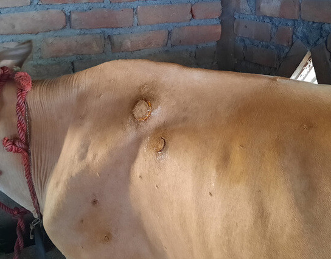
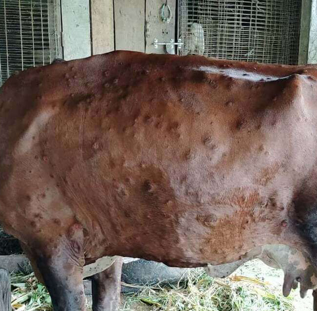
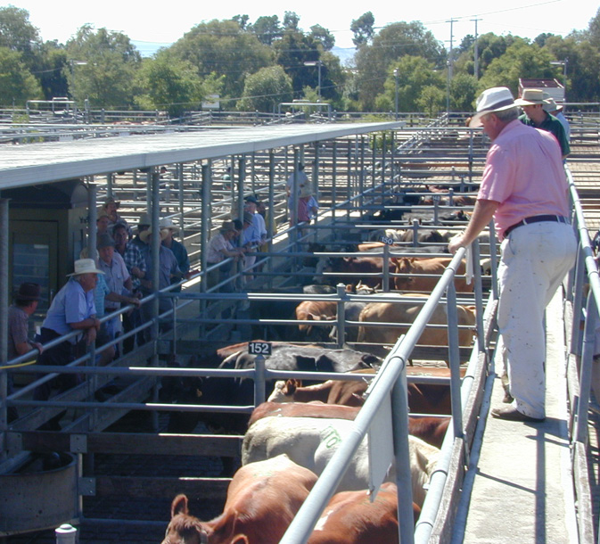
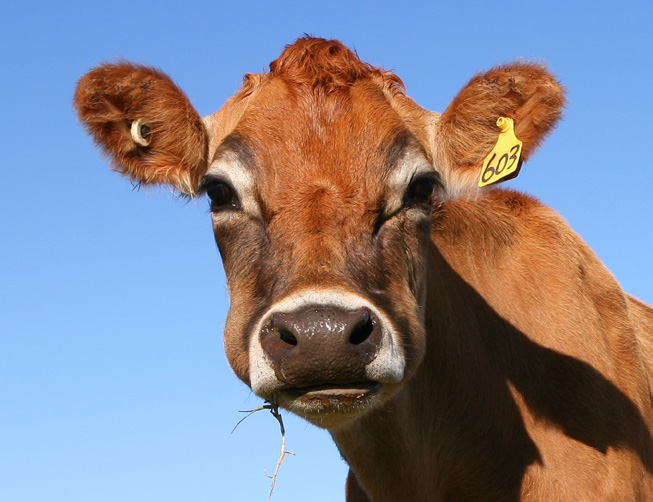
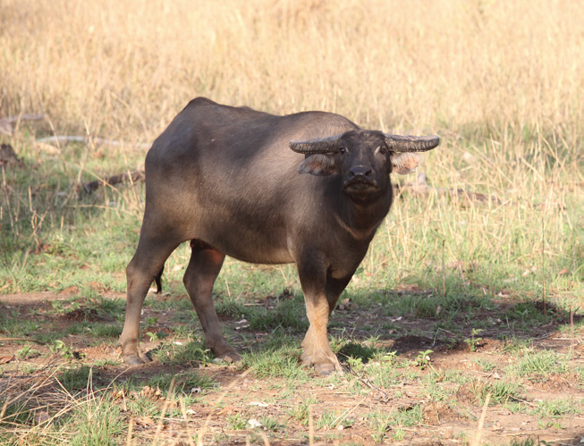
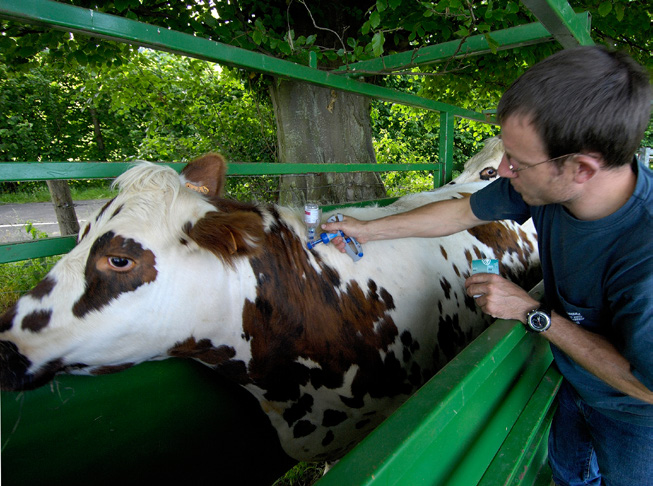

# AUSVETPLAN — Lumpy Skin Disease Response Manual (FA3 (2023))

> **Source**: Animal Health Australia
> **URL**: https://animalhealthaustralia.com.au//wp-content/uploads/2023/05/AHAA1904-AUSVETPLAN-Manuals_Response_Lumpy-skin-disease_FA3_digital.pdf
> **Licence**: Crown / publisher copyright; practitioner reference
> **Retrieved**: 2026-05-07T23:47:54Z
> **SHA-256**: `ad23472b48af6e48d7ff55f4e14a4c87eaf38fb18ca6f437616c326e29319a85`
> **Archived copy**: Internet Archive Wayback Machine — `https://web.archive.org/web/20240419113953id_/https://animalhealthaustralia.com.au//wp-content/uploads/2023/05/AHAA1904-AUSVETPLAN-Manuals_Response_Lumpy-skin-disease_FA3_digital.pdf`
> *(Live publisher URL no longer resolves; this archived snapshot was used for ingest. Cite the publisher URL above.)*
> *Converted from PDF to Markdown format.*

---
## Page 1

i
AUSVETPLAN  /  LUMPY SKIN DISEASE
Lumpy skin 
disease
AUSTRALIAN VETERINARY EMERGENCY PLAN
RESPONSE STRATEGY
AUSVETPLAN
VERSION 5.0, 2022

---
## Page 2

ii
AUSVETPLAN  /  LUMPY SKIN DISEASE
© 1991-2023 Animal Health Australia ABN 86 071 890 956. 
Certain materials in this publication are protected by copyright 
and are reproduced with permission from the Commonwealth 
of Australia, acting through its Department of Agriculture 
Fisheries and Forestry (or any successor agency); each state 
and territory of Australia, as represented by their relevant 
agencies, and by the National Biosecurity Committee and 
Animal Health Committee; and Animal Health Australia’s 
industry members.
ISBN 0 642 24506 1 (printed version) 
ISBN 1 876 71438 7 (electronic version)
Licence
This work is licensed under the Creative Commons Attribution-
NonCommercial-ShareAlike 4.0 International License, with the 
exception of:
•	 any third-party material contained within the work; 
•	 any material protected by a trade mark; and
•	 any images and/or photographs.
To view a copy of this licence, visit http://creativecommons.org/
licenses/by-nc-sa/4.0/. 
Moral Rights 
The author(s) of this work hold ‘moral rights’ as defined in the 
Copyright Act 1986 (Cth) and assert all moral rights in connection 
with this work. This means you must: 
•	 attribute (give credit to) the author(s) of this work;
•	 not say a person is a creator of a work when they are not; and
•	 not do something with the work (such as change or add to it) 
that would have a negative impact on the reputation of the 
author(s) of this work.
Failure to do so could constitute a breach of the Copyright Act 
1986 (Cth). 
Disclaimer and warranty
•	 This publication has been produced in accordance with the 
procedures described in the AUSVETPLAN Overview, and 
in consultation with Australian Federal, State and Territory 
Governments; the relevant susceptible species industries; 
nongovernment agencies; and public health authorities, as 
relevant. Any views and opinions expressed in this document 
do not necessarily represent the views and opinion of the 
authors or contributors, Animal Health Australia or the 
Commonwealth of Australia.
•	 This publication is for use in emergency situations. The 
strategies and policy guidelines in this work are not applicable 
to quarantine policies for imported susceptible species or 
susceptible species products. 
•	 This publication is not legal or professional advice and should 
not be taken as a substitute for legal or other professional 
advice. 
•	 This publication is not intended for use by any person who 
does not have appropriate expertise in the subject matter of 
the work. Before using this publication, you should read it in 
full, consider its effect and determine whether it is appropriate 
for your needs.
•	 This publication was created on May 2023. Laws, practices 
and regulations may have changed since that time. You should 
make your own inquiries as to the currency of relevant laws, 
practices and regulations as laws, practices and regulations 
may have changed since publication of this work.
No warranty is given as to the correctness of the information 
contained in this work, or of its suitability for use by you. To 
the fullest extent permitted by law, Animal Health Australia is 
not, and the other contributing parties are not, liable for any 
statement or opinion, or for any error or omission contained in 
this work, and it and they disclaim all warranties with regard to 
the information contained in it, including, without limitation, all 
implied warranties of merchantability and fitness for a particular 
purpose. Animal Health Australia is not liable for any direct, 
indirect, special or consequential losses or damages of any kind, 
or loss of profit, loss or corruption of data, business interruption 
or indirect costs, arising out of or in connection with the use of 
this work or the information contained in it, whether such loss 
or damage arises in contract, negligence, tort, under statute, or 
otherwise.
Text under development
In this manual, text placed in square brackets [xxx] indicates 
that that aspect of the manual remains unresolved or is under 
development; such text is not part of the official manual. The 
issues will be further worked on by experts and relevant text 
included at a future date.
Contact information
If you have any requests or inquiries concerning reproduction and 
rights, or suggestions or recommendations, you should address 
these to:
AUSVETPLAN — Animal Health Australia 
Head of Program AUSVETPLAN 
PO Box 151 
Lyneham ACT 2602 
Tel: 02 6232 5522 
Email: ausvetplan@animalhealthaustralia.com.au
Approved citation
Animal Health Australia (2022). Response strategy: Lumpy skin 
disease (version 5.0). Australian Veterinary Emergency Plan 
(AUSVETPLAN), edition 5, Canberra, ACT.
EMERGENCY ANIMAL DISEASE WATCH HOTLINE: 1800 675 888
The Emergency Animal Disease Watch Hotline is a toll-free 
telephone number that connects callers to the relevant state 
or territory officer to report concerns about any potential 
emergency disease situation. Anyone suspecting an emergency 
disease outbreak should use this number to get immediate 
advice and assistance.
Publication record
Edition 1 
1991
Edition 2 
Version 2.0, 2006 (major update)
Edition 3 
Version 3.0, 2009 (major update to Edition 3)
Edition 5 
Version 5.0, 2022 (major update and new format)

---
## Page 3

iii
AUSVETPLAN  /  LUMPY SKIN DISEASE
Contents
1	
Introduction.......................................................................................... 1
1.1	 This manual............................................................................................................. 1
1.1.1	 Purpose................................................................................................................1
1.1.2	 Scope....................................................................................................................1
1.1.3	 Development.........................................................................................................1
1.2	 Other documentation............................................................................................... 2
1.3	 Training resources................................................................................................... 2
2	
Nature of the disease............................................................................ 3
2.1	 Aetiology................................................................................................................. 3
2.2	 Susceptible species................................................................................................. 3
2.2.1	 Zoonotic potential.................................................................................................3
2.3	 World distribution.................................................................................................... 4
2.3.1	 Distribution outside Australia..............................................................................4
2.3.2	 Occurrence in Australia........................................................................................4
2.4	 Epidemiology........................................................................................................... 5
2.4.1	 Incubation period..................................................................................................5
2.4.2	 Persistence of agent and modes of transmission................................................5
2.4.3	 Factors influencing transmission.......................................................................10
2.5	 Diagnostic criteria..................................................................................................10
2.5.1	 Clinical signs......................................................................................................10
2.5.2	 Pathology............................................................................................................11
2.5.3	 Differential diagnosis.........................................................................................12
2.5.4	 Laboratory tests.................................................................................................12
2.5.5	 Laboratory diagnosis..........................................................................................14
2.6	 Resistance and immunity........................................................................................15
2.7	 Vaccination.............................................................................................................16
2.8	 Treatment of infected animals................................................................................16
2.9	 Control overseas....................................................................................................16
3	
Implications for Australia................................................................... 17
3.1	 Potential pathways of introduction.........................................................................17
3.2	 Social, economic and environmental effects...........................................................17
3.3	 Critical factors for an Australian response.............................................................19
4	
Policy and rationale............................................................................ 20
4.1	 Introduction............................................................................................................20
4.1.1	 Summary of policy..............................................................................................20
4.1.2	 Case definition....................................................................................................21
4.1.3	 Cost-sharing arrangement.................................................................................21
4.1.4	 Criteria for proof of freedom..............................................................................21
4.1.5	 Governance.........................................................................................................22

---
## Page 4

iv
AUSVETPLAN  /  LUMPY SKIN DISEASE
4.2	 Control and eradication policy................................................................................22
4.2.1	 Epidemiological assessment..............................................................................23
4.2.2	 Biosecurity and movement controls...................................................................24
4.2.3	 Tracing and surveillance....................................................................................24
4.2.4	 Zoning and compartmentalisation for international trade.................................27
4.2.5	 Biosafety and biosecurity for personnel.............................................................28
4.2.6	 Biosecurity for equipment..................................................................................28
4.2.7	 Animal welfare...................................................................................................29
4.2.8	 Vaccination.........................................................................................................29
4.2.9	 Treatment of infected animals...........................................................................31
4.2.10	Treatment of animal products and byproducts..................................................32
4.2.11	Destruction of animals.......................................................................................32
4.2.12	Disposal of animals, and animal products and byproducts................................33
4.2.13	Decontamination................................................................................................33
4.2.14	Wild animal management..................................................................................34
4.2.15	Vector management...........................................................................................34
4.2.16	Public awareness and media..............................................................................35
4.3	 Funding and compensation.....................................................................................35
5	
Declared areas and premises.............................................................. 36
5.1	 Declared areas.......................................................................................................36
5.1.1	 Restricted area (RA)...........................................................................................37
5.1.2	 Control area (CA)................................................................................................37
5.2	 Other areas.............................................................................................................38
5.2.1	 Transmission area (TA).......................................................................................38
5.3 Premises classifications.........................................................................................38
5.3.1	 Premises status classifications..........................................................................38
5.3.2	 Qualifiers............................................................................................................38
5.4	 Reclassifying premises and previously declared areas...........................................39
6	
Movement controls............................................................................. 40
6.1	 Principles...............................................................................................................40
6.2	 Guidelines for issuing permits................................................................................40
6.3	 Types of permits.....................................................................................................42
6.4	 Recommended movement controls.........................................................................42
6.4.1	 Live susceptible animals....................................................................................43
6.4.2	 Carcasses...........................................................................................................45
6.4.3	 Semen and embryos from live susceptible animals...........................................46
6.4.4	 Meat and meat products.....................................................................................47
6.4.5	 Milk and milk products.......................................................................................48
6.4.6	 Hides, skin, wool and other fibres......................................................................49
6.4.7	 Other animal byproducts....................................................................................49
6.4.8	 Waste products and effluent..............................................................................49

---
## Page 5

v
AUSVETPLAN  /  LUMPY SKIN DISEASE
6.4.9	 Vehicles, including empty livestock transport vehicles 
	
and associated equipment..................................................................................49
6.4.10	Nonsusceptible animals.....................................................................................50
6.4.11	People.................................................................................................................50
6.4.12	Specimens..........................................................................................................50
6.4.13	Crops, grains, hay, silage and mixed feeds........................................................50
6.4.14	Equipment, including personal items................................................................51
6.4.15	Sales, shows and other events...........................................................................51
6.4.16	Stock routes and rights of way...........................................................................51
6.4.17	Animal movements for emergency (including welfare) reasons........................51
6.4.18	Other movements...............................................................................................51
7	
Surveillance and proof of freedom...................................................... 52
7.1	 Surveillance...........................................................................................................52
7.1.1	 General considerations......................................................................................52
7.1.2	 Specific considerations......................................................................................52
7.1.3	 Surveillance on suspect premises.....................................................................53
7.1.4	 Surveillance on trace premises..........................................................................54
7.1.5	 Surveillance on dangerous contact premises....................................................54
7.1.6	 Surveillance on at-risk premises and premises of relevance............................54
7.1.7	 Restocking of infected premises, dangerous contact premises 
	
and vaccinated at-risk premises........................................................................55
7.2	 Proof of freedom.....................................................................................................55
Appendix 1................................................................................................ 56
Appendix 2................................................................................................ 58
Appendix 3................................................................................................ 60
Appendix 4................................................................................................ 62
Appendix 5................................................................................................ 66
Glossary................................................................................................... 68
Disease-specific terms..................................................................................................68
Standard AUSVETPLAN terms.......................................................................................69
Abbreviations. .......................................................................................... 81
Disease-specific abbreviations......................................................................................81
Standard AUSVETPLAN abbreviations...........................................................................81
References................................................................................................ 83
Figures
Figure 2.1 Current approach to diagnostic testing at CSIRO-ACDP for LSD....................14
Figure A5.1 Summary of steps in the reporting of an emergency animal disease..........67

---
## Page 6

vi
AUSVETPLAN  /  LUMPY SKIN DISEASE
Tables
Table 2.1 Laboratory tests currently available at CSIRO-ACDP for diagnosis of LSD......14
Table 6.1 Movement controls for live animals moving other than to slaughter..............43
Table 6.2 Movement controls for live animals moving to slaughter. ..............................44
Table 6.3 Movement controls for carcasses...................................................................45
Table 6.4 Movement controls for frozen semen and embryos from 
live cattle and buffalo....................................................................................................46
Table 6.5 Movement controls for meat and meat products.............................................47
Table 6.6 Movement controls for milk and milk products...............................................48

---
## Page 7

1
AUSVETPLAN  /  LUMPY SKIN DISEASE
Introduction
1.1	 This manual 
1.1.1	 Purpose
As part of AUSVETPLAN (the Australian Veterinary Emergency Plan), this response strategy contains 
the nationally agreed approach to the response to an incident – or suspected incident – of lumpy skin 
disease (LSD) in Australia. It has been developed to guide decision making to ensure that a fast, efficient 
and effective response can be implemented consistently across Australia with minimal delay.
1.1.2	 Scope
This response strategy covers LSD caused by lumpy skin disease virus.
This response strategy provides information about:
•	 the disease (Section 2)
•	 the implications for Australia, including potential pathways of introduction; social, environmental, 
human health and economic effects; and the critical factors for a response to the disease (Section 3)
•	 the agreed policy and guidelines for agencies and organisations involved in a response to an outbreak 
(Section 4)
•	 declared areas and premises classifications (Section 5)
•	 biosecurity controls, including quarantine and movement controls (Section 6)
•	 response surveillance and establishing proof of freedom (Section 7).
The key features of LSD are described in the Lumpy skin disease fact sheet (Appendix 1).
1.1.3	 Development 
The strategies in this document for the diagnosis and management of an outbreak of LSD are based 
on risk assessment. They are informed by the recommendations in the World Organisation for Animal 
Health (WOAH) Terrestrial animal health code (Chapters 7.6 and 11.9) and the WOAH Manual of diagnostic 
tests and vaccines for terrestrial animals (Chapter 3.4.12). The strategies and policy guidelines are for 
emergency situations and are not applicable to policies for imported animals or animal products.
This manual has been produced in accordance with the procedures described in the AUSVETPLAN 
Overview, and in consultation with Australian national, state and territory governments; the relevant 
livestock industries; nongovernment agencies; and public health authorities, where relevant.
1

---
## Page 8

2
AUSVETPLAN  /  LUMPY SKIN DISEASE
In this manual, text placed in square brackets [xxx] indicates that that aspect of the manual remains 
unresolved or is under development; such text is not part of the official manual. The issues will be 
worked on by experts and relevant text included at a future date.
1.2	 Other documentation
This response strategy should be read and implemented in conjunction with:
•	 other AUSVETPLAN documents, including the operational, enterprise and management manuals; and 
any relevant guidance and resource documents. The complete series of manuals is available on the 
Animal Health Australia website1
•	 relevant nationally agreed standard operating procedures (NASOPs).2 These procedures complement 
AUSVETPLAN and describe in detail specific actions undertaken during a response to an incident. 
NASOPs have been developed for use by jurisdictions during responses to emergency animal disease 
(EAD) incidents and emergencies
•	 relevant jurisdictional or industry policies, response plans, standard operating procedures and work 
instructions
•	 relevant Commonwealth and jurisdictional legislation and legal agreements (such as the Emergency 
Animal Disease Response Agreement – EADRA3), where applicable.
1.3	 Training resources
EAD preparedness and response arrangements in Australia
The EAD Foundation Online course4 provides livestock producers, veterinarians, veterinary students, 
government personnel and emergency workers with foundation knowledge for further training in EAD 
preparedness and response in Australia.
1	
	 www.animalhealthaustralia.com.au/ausvetplan
2	
	 www.animalhealthaustralia.com.au/nationally-agreed-standard-operating-procedures
3	
	 www.animalhealthaustralia.com.au/eadra
4	
	 www.animalhealthaustralia.com.au/online-training-courses

---
## Page 9

3
AUSVETPLAN  /  LUMPY SKIN DISEASE
Lumpy skin disease (LSD) is an acute to chronic, highly infectious, generalised skin disease of cattle 
and buffalo characterised by widespread skin nodules, production losses and mortality. The disease 
is caused by lumpy skin disease virus, which is similar to the viruses causing sheep pox and goat pox. 
Lumpy skin disease is a mechanically transmitted vector-borne disease, which can also be transmitted 
directly and through fomites.
2.1	 Aetiology
Sheep pox, goat pox and LSD viruses belong to the genus Capripoxvirus of the family Poxviridae. These 
viruses are morphologically indistinguishable from each other; they are also difficult to distinguish 
serologically, and cross-protection does occur (Kitching 2003). However, they are phylogenetically 
distinct and are adapted to different host species (Tulman et al 2001, 2002). They can be differentiated 
using species-specific molecular diagnostic techniques (Le Goff et al 2009; Lamien et al 2011a, b).
2.2	 Susceptible species
LSD mainly affects cattle. Bos taurus cattle are generally more susceptible than Bos indicus (zebu) 
cattle (Davies 1991a, Gari et al 2011). Jersey, Guernsey, Friesian and Ayrshire breeds are particularly 
susceptible. Cases have also been seen in Asian water buffalo (Bubalis bubalis) (Ali et al 1990, El-Nahas 
et al 2011, Elhaig et al 2017) and banteng (Bos javanicus). It has been reported that the morbidity rate in 
buffalo (1.6%) is significantly lower than in cattle (30.8%) (El-Nahas et al 2011). 
Some strains of LSD virus may replicate in sheep and goats, although there is no epidemiological 
evidence of small ruminants acting as a reservoir for the virus (FAO 2017, Tuppurainen et al 2017).
LSD was reported in Arabian oryx in Saudi Arabia (Greth et al 1992); however, differentiation from 
sheep pox was not confirmed. Experimentally, impala and giraffe are also susceptible (Young et al 1970, 
Hedger & Hamblin 1983, Greth et al 1992). No wildlife reservoir species have been identified in Africa.
Antibodies to capripoxviruses have been detected in a range of African wildlife species, including 
Cape buffalo (Syncerus caffer), wildebeest, springbok, eland, impala, kudu and waterbuck (Davies 
1982, 1991a; Hedger & Hamblin 1983; Barnard 1997). LSD virus nucleic acid has been detected in skin 
samples from springbok (Le Goff et al 2009, Lamien et al 2011a).
Australian fauna are unlikely to be susceptible to LSD.
2.2.1	 Zoonotic potential
LSD does not affect humans (OIE 2017).
Nature of 
the disease
2

---
## Page 10

4
AUSVETPLAN  /  LUMPY SKIN DISEASE
2.3	 World distribution
For the latest information on the distribution of LSD, refer to the WOAH World Animal Health Information 
System.5
2.3.1	 Distribution outside Australia
Before 2012, the distribution of LSD was limited to Africa and Israel. However, since then, LSD has spread 
to many parts of the Middle East, Turkey, Cyprus, eastern Europe, the Balkans and the Russian Federation 
(EFSA AHAW Panel 2015).
Since 2019, LSD has spread throughout the Asian continent, including India and China, and southwards 
through Southeast Asia. In 2020, outbreaks were reported in a territory of Taiwan and in Nepal (possibly 
from the movement of flies or mosquitoes from neighbouring countries, or animal movements). In 2021, 
LSD spread further into Cambodia, Malaysia and Thailand. In 2022, cases were reported in Indonesia and 
Singapore.
2.3.2	 Occurrence in Australia
LSD has never been recorded in Australia.
5	
	 wahis.woah.org/#/home
Jersey, Guernsey, Friesian and Ayrshire breeds are particularly susceptible to LSD

---
## Page 11

5
AUSVETPLAN  /  LUMPY SKIN DISEASE
2.4	 Epidemiology
2.4.1	 Incubation period
The incubation period for LSD is 6–26 days (Sohier et al 2019, EFSA 2020).
WOAH incubation period
For the purposes of the WOAH Terrestrial animal health code, the incubation period6 for LSD is 28 days.
2.4.2	 Persistence of agent and modes of transmission
General properties
General properties of LSD virus include:
•	 stable between pH 6.6 and 8.6 (Barnard et al 1994, Coetzer & Tuppurainen 2004)
•	 inactivated in 10 minutes at 60 °C, but dried virus (orthopoxviruses in general) can withstand 100 °C for 
10 minutes (Andrewes et al 1978)
•	 persists in dark environmental conditions for many months (OIE 2017)
•	 persists for long periods in chilled (4 °C) and frozen (–80 °C) material (Weiss 1968)
•	 susceptible to heat, with inactivation at 55 °C in 2 hours and 65 °C in 30 minutes; these values are also 
commonly cited for sheep pox and goat pox viruses (OIE 2017)
•	 susceptible to sunlight and detergents containing lipid solvents
•	 inactivated by a wide range of disinfectants, including some detergents, ether, chloroform, formalin, 
phenol, sodium hypochlorite, iodine compounds and quaternary ammonium compounds (Weiss 1968, 
OIE 2017).
Organic material surrounding the infectious virus in the environment will affect the efficacy of 
disinfectants.
Note that these are general properties, and research to validate specific values is limited. Data on LSD 
virus stability outside the ranges given above are lacking. For example, the range of pH values that the 
virus can tolerate may be wider than thought, and extremes of acidity or alkalinity may be required 
to reliably lead to significant inactivation (Polson & Turner 1954, Herd Health 2017). A few studies 
demonstrate the pH resistance to inactivation of both sheep pox virus and goat pox virus, with virus 
survival between pH 3.0 and 11.0 (OIE 2017).
The common temperature range cited for inactivation of LSD virus is extrapolated from studies on 
sheep pox virus and vaccinia virus. Many studies have produced inactivation in the 50–60 °C range; 
however, some studies had differing findings on inactivation levels and resistance of individual strains 
to these treatments. Although pasteurisation is likely to inactivate some virus, the level of inactivation 
has not been quantified. Consideration should also be given to the protective qualities of milk fat and 
protein (OIE 2017). The WOAH recommendations for importation of milk and milk products are that the 
products have either been derived from animals in a country or zone free from LSD or were subjected to 
pasteurisation or any combination of control measures with equivalent performance, as described in the 
Codex Alimentarius Code of hygienic practice for milk and milk products.7
6	
	 In the WOAH Terrestrial animal health code, ‘incubation period’ means the longest period that elapses between the introduction of the pathogenic agent into 
the animal and the occurrence of the first clinical signs of the disease. See www.woah.org/en/what-we-do/standards/codes-and-manuals/terrestrial-code-
online-access/?id=169&L=1&htmfile=glossaire.htm.
7	
	 www.woah.org/en/what-we-do/standards/codes-and-manuals/terrestrial-code-online-access/?id=169&L=1&htmfile=chapitre_lsd.htm

---
## Page 12

6
AUSVETPLAN  /  LUMPY SKIN DISEASE
Environment (including windborne spread)
Capripoxviruses can remain viable for long periods outside the animal host. They may persist for many 
months in a suitable environment, such as that provided by shaded animal pens (OIE 2017, DoA & 
CSIRO 2019).
Windborne spread has not been documented, but dispersal of vectors by wind may facilitate disease 
spread (see ‘Arthropod vectors’).
Arthropod vectors
Mechanical transmission by biting insects is considered to be the main route of local transmission 
of LSD virus. Longer-distance spread (eg by wind dispersal of vectors) has been implicated in the 
introduction of LSD into new countries.
Uptake of virus by biting vectors is most efficient from clinically affected animals; asymptomatic 
animals in a herd are likely to have much lower virus titres and therefore play less of a role in 
propagation of the virus by vectors (Sanz-Bernardo et al 2021). LSD virus has been shown to persist for 
2.4 days in the vector, and the vector has a 0.19 probability of transmitting LSD to cattle (Sanz-Bernardo 
et al 2021).
The likely insect species involved are expected to vary depending on local conditions and insect 
populations. Mechanical transmission of LSD virus by mosquitoes (Aedes aegyptii) and hard ticks 
(Rhipicephalus appendiculatus) has been demonstrated experimentally (Chihota et al 2001, Tuppurainen 
et al 2013a). Stable flies (Stomoxys calcitrans), tabanid flies, other flies, midges (Culicoides spp.) and 
other hard ticks (eg Amblyomma hebraeum) have also been demonstrated as mechanical vectors (Weiss 
1968, Kitching & Mellor 1986, Muller et al 2011, Tuppurainen et al 2011, Lubinga et al 2015, EFSA AHAW 
Panel 2015). 
LSD virus is not thought to remain infectious in mechanical vectors for long, although survival for at 
least 8 days has been reported in mosquitoes (A. aegyptii) and stable flies (S. calcitrans) (Spickler 2017, 
Sanz-Bernardo et al 2021). Variability in the mean duration of potential virus survival in vectors has 
been reported (Gubbins 2019), which should be considered along with the feeding behaviour of the likely 
vectors and vector life spans.
Recent experimental studies demonstrated mechanical transmission of LSD virus via Stomoxys species 
(including S. calcitrans – stable flies) (Sohier et al 2019, Issimov et al 2020). The ability for Stomoxys 
spp. to travel 21–28 km in 24 hours, in addition to virus survival times, means that Stomoxys activity can 
easily lead to localised spread (Gubbins 2019, Issimov et al 2020). Tabanid horseflies can transmit LSD 
virus (Sohier et al 2019).
Ticks are unlikely to play a role in rapid spread of LSD virus in outbreaks because of their slow mobility. 
However, prolonged survival of the virus in hard ticks may be possible, and ticks may therefore act as 
an environmental reservoir and facilitate overwintering of the virus in endemic areas (EFSA AHAW 
Panel 2015). Transstadial transmission has been demonstrated in hard ticks (R. appendiculatus and 
A. hebraeum) (Lubinga et al 2013). Transovarial transmission has been demonstrated in R. decoloratus; 
LSD virus was detected in the eggs (Tuppurainen et al 2011) and larvae (Lubinga et al 2014) of female 
R. decoloratus ticks fed on LSD virus–infected animals – this tick is closely related to the Australian 
cattle tick, R. australis (previously known as R. microplus). Transmission of LSD virus back to 
susceptible cattle was subsequently demonstrated (Tuppurainen et al 2013b). Larvae from A. hebraeum 
female ticks fed on LSD virus–infected cattle were positive for LSD virus on PCR testing, but cattle 
exposed to these ticks did not develop clinical signs or seroconvert (Lubinga et al 2014).

---
## Page 13

7
AUSVETPLAN  /  LUMPY SKIN DISEASE
Although there is no evidence of multiplication of LSD virus in these vectors, it cannot be excluded 
(Tuppurainen et al 2017). Recent studies did not find evidence of viral replication in the vectors studied; 
thus this is unlikely to be epidemiologically important in transmission (Sanz-Bernardo et al 2021, 
Paslaru et al 2022). Viral retention has been shown as feasible under experimental conditions – for one 
species (Culex pipiens), for up to 10 days. However, it is unknown how this relates to field situations.
Live animals
Transmission of LSD virus is incompletely understood; however, transmission through direct contact 
between infected animals is believed to be inefficient and plays only a minor role in the epidemiology of 
the disease (OIE 2017).
LSD virus is present in nasal, lachrymal and pharyngeal secretions of infected animals, and in their 
semen, milk and blood (Thomas & Mare 1945, cited in Davies 1991b; Weiss 1968). Infectious LSD virus 
has been detected in saliva and nasal discharges for up to 18 days post-infection (Babiuk et al 2008) 
and in blood for up to 16–28 days post-infection (Tuppurainen et al 2005, 2011; Sanz-Bernardo et al 
2021). Direct transmission between animals is likely to be more significant in animals managed under 
intensive scenarios (ie feedlot and dairy), and non-bloodsucking insects may play a role in transmission 
via secretions between animals in these contexts.
LSD virus is found at higher concentrations in skin lesions than in blood in animals with clinical disease 
(Sanz-Bernardo et al 2021).
LSD virus present in bull semen can be a source of infection for females (Tuppurainen et al 2017; see 
‘Semen and embryos from live susceptible animals’).
LSD virus may be spread from cows to their progeny. There are reports of calves from infected cows 
being born with skin lesions; the virus is also thought to be rarely spread to suckling calves through 
infected milk, or from skin lesions on the teats (Tuppurainen et al 2017).
It is assumed that LSD virus is also excreted in vaginal secretions. The resistant nature of the virus 
would make venereal transmission very likely (Committee on Managing Global Genetic Resources 
1993).
There is no carrier status for LSD virus (OIE 2017).
Carcasses
LSD virus is very resistant to inactivation, surviving in necrotic skin nodules for 33 days or longer, 
desiccated crusts for up to 35 days, and at least 18 days in air-dried hides (OIE 2017) – these may pose 
a risk of transmission if they are accessible to arthropod mechanical vectors. Although some arthropod 
vectors may feed on body exudates other than blood, the pathways that enable insects to mechanically 
transmit infection are uncertain. Nevertheless, application of insecticides containing repellents to 
carcasses before transport or burial is recommended (EFSA AHAW Panel 2015). Long-distance spread 
of LSD in Israel was associated with movement of infected carcasses to a disposal site (near where the 
new outbreak occurred), although a causal association was not proven (EFSA AHAW Panel 2015).
Most vectors of LSD virus are unlikely to feed on carcasses, and larvae under the skin that retain the 
virus throughout metamorphosis into the adult stage are very unlikely to transmit the virus. However, 
consideration should be given to the risk that feral pigs, wild dogs and carrion birds feeding on infected 
carcasses may potentially spread the virus. This slight risk means that there are benefits in destroying 
carcasses of animals that exhibited clinical signs, preferably by burial on site. Additional guidance on 
disposal options and methods can be found in the AUSVETPLAN operational manual Disposal.

---
## Page 14

8
AUSVETPLAN  /  LUMPY SKIN DISEASE
Animal products
Meat, meat products and casings, including use as animal feed
Although LSD virus may persist in the meat of infected animals (Weiss 1968), trade in meat for human 
consumption is not a significant risk for transmission of the virus. LSD virus has been found in meat 
and offal after experimental infection, although virus was not found in deep skeletal meat, and the 
risk of transmission through deep skeletal meat has been assessed as minimal (Kononov et al 2019). 
WOAH recommends that the following commodities should not require any LSD-related conditions 
regardless of the status of the animal population of the exporting country: skeletal muscle meat, 
casings, gelatine and collagen, tallow, and hooves and horns.
Heat treatment of meatmeal from affected animals to a minimum internal temperature of 65 °C for at 
least 30 minutes will reduce the risk of LSD virus transmission (OIE 2017).
Australia has well-developed national guidelines and state legislation that ban feeding to all 
ruminants of all meals derived from all vertebrates, including fish and birds.
Milk and dairy products, including use as animal feed
High-temperature/short-time pasteurisation may reduce the infectivity of LSD virus in milk (OIE 
2017). There is some evidence that conditions equivalent to the low-temperature/long-time method of 
pasteurisation (62 °C for 30 minutes) will inactivate capripoxviruses, but the presence of fat, protein 
and other solids in the milk may protect the virus (Wolff et al 2020). The low pH of cheese may also be 
insufficient to inactivate the virus. The thermal inactivation parameters are extrapolated from a single 
study on sheep pox virus and vaccinia virus, which did not include dairy media.
The risk of LSD virus transmission by milk not intended for animal consumption can be mitigated by 
pasteurisation and transport in closed containers (Tuppurainen et al 2017). As noted above, the WOAH 
recommendations for importation of milk and milk products include pasteurisation (OIE 2017).
Animal byproducts
Hides, skin, wool and other fibres
Spread of LSD into new regions via contaminated hides is possible (Spickler 2017). LSD virus may 
remain infectious for up to 18 days in air-dried hides (Weiss 1968).
The WOAH Terrestrial animal health code recommends the following treatments:
•	 dry-salting or wet-salting for at least 14 days
•	 7 days in salt (NaCl) with the addition of 2% sodium carbonate (Na2CO3)
•	 drying for at least 42 days at a temperature of at least 20 °C.
However, noting that hides with clinical LSD lesions are unlikely to be used because of damage and 
that clinical lesions are more significant for transmission than unaffected skin and tissue, partially 
tanned hides and skins may still present a risk – that is, hides and skins that have undergone only 
liming, acid pickling or salting with 2% sodium carbonate at 50% pelt weight for 28 days (T Ingle, 
Australian Government Department of Agriculture, Water and the Environment, pers comm, 2021). 
Fully tanned hides and skins (eg ‘finished’ leather products such as shoes) are unlikely to present a 
risk of virus transmission.

---
## Page 15

9
AUSVETPLAN  /  LUMPY SKIN DISEASE
Semen and embryos from live susceptible animals
Experimental transmission of LSD virus via semen from infected (but asymptomatic) bulls to both 
embryos and heifers has been proven (Annandale et al 2014). Shedding of LSD virus in the semen of 
infected bulls may be prolonged; virus has been isolated from semen for up to 42 days post-inoculation 
in an experimentally infected bull (Irons et al 2005). Viral DNA has been detected in all fractions of 
semen (Annandale et al 2010). Common semen processing methods are inadequate to wash semen free 
of LSD virus contamination (Annandale et al 2018).
Live LSD virus has been isolated from apparently healthy-looking testicular tissue in both clinical and 
subclinical animals (Kononov et al 2019).
There is one report of placental transmission of LSD virus (OIE 2017), and infected pregnant cows are 
known to deliver calves with skin lesions (Tuppurainen et al 2017). However, because of insufficient 
information, the International Embryo Technology Society has not classified LSD virus regarding the 
likelihood of its transmission via embryos.
Viral replication was observed in blastocysts following successful fertilisation of embryos with semen 
containing LSD virus during artificial insemination. LSD virus was also shown to affect the success of 
fertilisation during the experiments (Annandale et al 2019).
Specimens
LSD virus is not zoonotic, and transmission of disease via laboratory specimens is not considered a risk.
Waste products and effluent
There are no reports of isolation of LSD virus from faeces or urine.
Biological products
The use of live, attenuated vaccines for LSD has been associated with disease in some countries 
(Brenner et al 2009, Ben-Gera et al 2015). Transmission of LSD virus through other biological products is 
theoretically possible but not documented.
Nonsusceptible animals
Nonsusceptible animals may act as contaminated fomites for LSD virus and may facilitate the movement 
of arthropod vectors. Application of insect repellents to animals on affected and neighbouring farms may 
help mitigate these risks (Tuppurainen et al 2017).
People
People can potentially act as contaminated fomites for LSD virus. Tuppurainen et al (2017) recommend 
that people leaving affected premises disinfect their hands, boots and clothes, and subsequently wash 
their clothes at a water temperature above 60 °C. There is also merit in adding a sanitiser or disinfectant 
when washing clothing, towels and so on. Use of a clothes dryer on high setting is probably also very 
effective (as it is for killing ticks on clothes). Training station workers, transport operators and so 
on in correct disinfection technique will be vital to minimising the spread of the virus through their 
movements.
Crops, grains, hay, silage and mixed feeds
Experimentally, transmission has occurred between cattle in adjacent insect-proof enclosures only if 
they shared access to water or feed (Weiss 1968, Kononov et al 2020).

---
## Page 16

10
AUSVETPLAN  /  LUMPY SKIN DISEASE
Long survivability of the virus in the environment and the potential for cross-contamination of feed may 
allow contaminated feed to act as a transmission pathway into naive populations (Spickler 2017).
Vehicles, including empty livestock transport vehicles
Vehicles can potentially act as contaminated fomites for LSD virus and may facilitate the movement of 
arthropod mechanical vectors. Cleaning and disinfection of the interior and exterior of the vehicle, and 
use of insecticides, mitigate these risks (Tuppurainen et al 2017).
Equipment, including personal items
Equipment and personal items can potentially act as contaminated fomites for LSD virus. Although 
not specifically documented, reuse of needles and surgical equipment contaminated with blood from 
viraemic animals may mechanically transmit LSD virus to uninfected animals. The Food and Agriculture 
Organization of the United Nations LSD field manual for veterinarians (Tuppurainen et al 2017) 
recommends decontamination of equipment on exit from affected premises.
2.4.3 Factors influencing transmission
The prevalence of insect vectors may affect the rate of transmission of LSD virus. This could account 
for the wide variation in morbidity (1–95%) in different situations (EFSA AHAW Panel 2015). The sharp 
reduction in transmission of LSD after cold weather and frosts, which are associated with reduced insect 
vector populations, supports this hypothesis. A clear seasonal pattern was observed in outbreak events 
in the Balkans, Turkey and the Russian Federation (EFSA 2020). Studies that modelled outbreaks have 
drawn similar conclusions (Allepuz et al 2019, Machado et al 2019).
Movement of infected stock has been the cause of much of the spread of LSD between countries. 
Whereas insect vectors are important in local spread, road and rail transport play an important role in 
rapidly spreading the disease over large geographical distances (Tuppurainen et al 2017). In the Balkans, 
LSD spread mostly up to 4 km at a time (via vectors), but transmission events occurred over much longer 
distances (via animal movements) (EFSA 2018, Manić et al. 2019). In Odisha state, India, the average 
distance between outbreaks in 2019 was 6 km inside districts and 54 km between districts (Sudhakar et 
al 2020).
Larger herd sizes and proximity to lakes (presumably related to increased vector activity) have been 
associated with an increase in prevalence of LSD (Sevik & Dogan 2017).
Viral uptake by vectors and spread of disease are much more efficient from clinically affected animals 
than asymptomatic animals (Sanz-Bernardo et al 2021).
2.5	 Diagnostic criteria
2.5.1	 Clinical signs
LSD typically presents in cattle and buffalo as fever, followed by the development of multiple nodules on 
the skin and mucous membranes; these nodules gradually become necrotic.
Clinical signs in cattle may range from inapparent to severe. Water buffalo may show similar clinical 
signs but are reported to be less severely affected (Sharawi & Abd El-Rahim 2011).
A fever of 40–41.5 °C may last 6–72 hours, occasionally up to 10 days, and is accompanied by increased 
lacrimation, increased nasal and pharyngeal secretions, loss of appetite, reduction in milk production, 
varying degrees of depression and reluctance to move.

---
## Page 17

11
AUSVETPLAN  /  LUMPY SKIN DISEASE
Within 1–2 days, a cutaneous eruption of nodules occurs, which may cover the whole body. The most 
common sites are the head and neck, perineum, genitalia and udder, and limbs. The nodules are 
5–50 mm or more in diameter, initially appearing as round, circumscribed areas of erect hair, firm 
and slightly raised from the surrounding skin. There is hyperaemia, and drops of serum appear on the 
surface. The lesions are full skin thickness, involving the epidermis, dermis and subcutis, which may be 
oedematous. Regional lymph nodes are enlarged and oedematous.
Lesions develop in the muzzle, nostrils, mouth and pharynx. They show a ring-like margin where there 
has been separation from the surrounding healthy epithelium. Lesions in the larynx and trachea, 
and throughout the alimentary tract, especially the abomasum, become ulcerated and necrotic. 
Mucopurulent nasal discharges, persistent hypersalivation, coughing, and stertorous (snoring) and often 
distressed respiration result. Inflammation of the conjunctiva and cornea of the eyes is common.
Inflammatory and oedematous swellings of the limbs, brisket and genitalia may develop. Skin lesions 
become necrotic. Some remain in situ, and others slough, leaving a hole of full skin thickness, known 
as a ‘sitfast’, which becomes infected by pus-forming bacteria. Large areas of skin may slough. Lesions 
in the skin, subcutaneous tissue and muscles of the limbs, together with the severe skin inflammation 
caused by secondary infection of lesions, greatly reduce mobility. Rapid deterioration in body condition 
results, and animals that recover may remain in extremely poor condition for up to 6 months.
Pneumonia is a common and often fatal complication. Absence of oestrus cycles or abortion is frequent 
in females, and painful genitalia in bulls can prevent them from serving. Live neonates or aborted 
fetuses from infected cows may show skin lesions following parturition.
The lesions may persist for 4–6 weeks, and final resolution may take 2–6 months.
Morbidity rates vary greatly and range between 1% and 95% (EFSA AHAW Panel 2015). Mortality rates up 
to 75% have been reported (Babiuk et al 2008), but 1–5% is more usual (Davies 1991a).
In experimental studies, only about 50% of infected animals may develop clinical signs, but the majority 
may become viraemic (Tuppurainen et al 2005, Osuagwuh et al 2007, Annandale et al 2010, 
Sanz-Bernardo et al 2021).
2.5.2	 Pathology
Gross lesions
On autopsy, nodules may be found in subcutaneous tissues, muscle fascia and muscles, which are grey–
pink with caseous necrotic cores. The subcutis is infiltrated by red, watery fluid. Similar nodules may be 
scattered through the nasopharynx, trachea, bronchi, lungs, rumen, abomasum, renal cortex, testicles and 
uterus (DoA & CSIRO 2019). Aborted fetuses may show skin lesions (Spickler 2017).
Microscopic lesions
Prozesky & Barnard (1982) described the histopathology seen with LSD. Clinically affected cattle have 
a granulomatous reaction in the dermis and hypodermis that extends to the surrounding tissue. In the 
early stages, a vasculitis and lymphangitis with accompanying thrombosis and infarction can be seen, with 
resultant necrosis and oedema. Borrel cells or ‘cellules claveleuses’ (epithelioid cells that infiltrate the 
lesions), and intracytoplasmic inclusion bodies – similar to the inclusions found with all pox viruses – can 
be demonstrated on histology.
Electron microscopy reveals virus particles indistinguishable from the orthopoxviruses. These can be 
readily differentiated from the virus particles of contagious ecthyma (also known as contagious pustular 
dermatitis, scabby mouth or orf).

---
## Page 18

12
AUSVETPLAN  /  LUMPY SKIN DISEASE
2.5.3	 Differential diagnosis
The following diseases or conditions should be considered in the differential diagnosis of LSD (OIE 2017).
Endemic:
•	 urticaria
•	 pseudo-lumpy skin disease (bovine herpes mammalitis; herpesvirus 2)
•	 bovine papular stomatitis (parapoxvirus)
•	 dermatophytosis
•	 pseudocowpox (parapoxvirus)
•	 pseudocowpox (parapoxvirus)
•	 streptothricosis (Dermatophilus congolensis)
•	 demodicosis
•	 insect or tick bites
•	 photosensitisation
•	 onchocercosis.
Exotic:
•	 rinderpest
•	 Hypoderma bovis infection
•	 skin tuberculosis.
2.5.4	 Laboratory tests
Samples required
Diagnosis of LSD is based primarily on detection of the virus in lesions. Detection of antibody in serum 
may also aid diagnosis. Specimens that should be collected from live animals include blood (from 
animals with fever), serum, nodular fluid, scabs, and skin scrapings from lesions or skin biopsies.
Virus can be detected in blood and secretions such as oral/nasal fluid, but is present in significantly 
lower concentrations and for shorter periods than in skin lesions. Non-skin samples should not be 
relied on for exclusion of disease.
At postmortem, a range of samples, both fresh and fixed, should be taken from skin lesions, lesions in 
the respiratory and gastrointestinal tracts, and other internal organs.
Following the initial diagnosis, a more restricted sample set, still based on sampling lesions, may be 
defined.
Transport of specimens
Specimens should be submitted in accordance with agreed state or territory protocols. Specimens 
should initially be forwarded to the state or territory laboratory for appropriate analysis, and 
assessment of whether further analysis will be required by the CSIRO Australian Centre for Disease 
Preparedness (CSIRO-ACDP), Geelong.
If the state or territory laboratory deems it necessary, duplicate samples of the specimens should be 
forwarded to CSIRO-ACDP for emergency disease testing, after the necessary clearance has been 
obtained from the chief veterinary officer (CVO) of the state or territory of the suspect case, and

---
## Page 19

13
AUSVETPLAN  /  LUMPY SKIN DISEASE
after the CVOs of Victoria and Australia have been informed about the case and the transport of the 
specimens to Geelong (for the first case). Sample packaging and consignment for delivery to CSIRO-
ACDP should be coordinated by the relevant state or territory laboratory.
LSD virus is a security sensitive biological agent (SSBA). Entities handling and transporting samples 
known or suspected to contain LSD virus should ensure that they meet their obligations under the 
SSBA Regulatory Scheme.
For further information, see the AUSVETPLAN management manual Laboratory preparedness.
Packing specimens for transport
Unpreserved tissue specimens should be chilled and forwarded with water ice or frozen gel packs. If 
delays of more than 48 hours are anticipated in transit, these specimens should be frozen, if practical, 
and forwarded packed in dry ice. Frozen specimens will result in a better diagnostic outcome than 
those that are not frozen, but it is recognised that there may be challenges in keeping specimens frozen 
when travelling long distances from remote areas.
LSD is primarily diagnosed from virus detected in skin lesions

---
## Page 20

14
AUSVETPLAN  /  LUMPY SKIN DISEASE
2.5.5	 Laboratory diagnosis
CSIRO-ACDP tests
The testing method used by CSIRO-ACDP is shown in Figure 2.1. Further details of tests currently 
available at CSIRO-ACDP are shown in Table 2.1.
Table 2.1 Laboratory tests currently available at CSIRO-ACDP for diagnosis of LSD 
Test
Specimen required
Test detects
Time taken to 
obtain result
Agent detection
Capripoxvirus real-time 
PCR
Scabs, blood, tissues or 
cultured virus
Viral DNA
4–5 hours
LSD virus real-time PCR
Scabs, blood, tissues or 
cultured virus
Viral DNA
4–5 hours
Agent characterisation
Sequencing
Scabs, blood, tissues or 
cultured virus
Viral genome
2 days
Virus isolation
Scabs, blood or tissues
Virus
5–10 days
Serology
ELISA
Serum
Antibody
4–5 hours
Virus neutralisation
Serum
Antibody
7 days
ELISA = enzyme-linked immunosorbent assay; PCR = polymerase chain reaction 
Source: Information provided by CSIRO‑ACDP, 2020 (refer to CSIRO‑ACDP for most up‑to‑date information)
Figure 2.1 Current approach to diagnostic testing at CSIRO-ACDP for LSD
Appropriate Sample
Serum
ELISA
Virus 
Neutralisation 
Assay
Virus 
Isolation
Sequencing
Realtime 
PCR

---
## Page 21

15
AUSVETPLAN  /  LUMPY SKIN DISEASE
A number of real-time and gel-based PCR methods are available for detection of capripoxviruses, 
several of which are species-specific and allow differentiation of LSD virus from sheep pox virus and 
goat pox virus (Bowden et al 2008; Le Goff et al 2009; Lamien et al 2011a, b; Gelaye et al 2013). Recently, 
a PCR method allowing differentiation of eight pox viruses has been developed; this also allows 
differentiation of LSD virus from bovine papular stomatitis, pseudocowpox and cowpox viruses (Gelaye 
et al 2017). Virus may also be isolated from cell culture assays. Sequencing of the viral genome, either 
from primary samples or from cultured material, will further aid characterisation of the causative 
agent and provide useful information to inform understanding of the epidemiology of the disease.
A tentative diagnosis of LSD can be made by electron microscopy and histopathology of tissue 
samples; however, with the advent of molecular techniques, these methods are now less commonly 
used for diagnosis.
Other tests
The virus neutralisation test and ELISA tests are validated serological tests for LSD virus (OIE 2021). 
ELISA is the preferred test for serosurveillance. The virus can be detected in milk; however, sensitivity 
is reduced when milk is pooled, thus making bulk milk surveillance unfeasible (Milovanović et al 2020). 
As all members of the Capripoxvirus genus share a common neutralising antigen, serological assays 
cannot distinguish between the individual members of the genus.
The immune response to LSD virus infection is dominated by cell-mediated immunity. For disease 
surveillance, although it may be difficult to detect low titres in individual animals, a herd-based 
approach is reasonable.
Other serological tests for LSD, such as indirect immunofluorescence and immunodiffusion, are 
possible, but lack specificity, cross-reacting with related viruses. These are not currently available in 
Australia.
DIVA testing
Recently, PCR tests have been developed that can differentiate certain vaccine strain viruses from 
wild-type strains, potentially allowing the limited use of DIVA (differentiating infected from vaccinated 
animals) testing as part of a vaccination strategy. The efficacy of this test will need to be assessed for 
any newly developed vaccines.
Most DIVA approaches for other diseases depend on detection of a serological response to the agent, 
rather than direct detection of virus, and this capability is required for any longer-term monitoring of 
vaccinated populations. No such assay exists for LSD, but the development of novel vaccines may offer 
an opportunity for parallel development of a serological DIVA assay.
2.6	 Resistance and immunity
Susceptible cattle of all ages can develop serious clinical disease if infected with LSD virus. In countries 
previously free from LSD, mortality rates up to 75% have been reported (Babiuk et al 2008), but 1–5% is 
more usual (Davies 1991a) once the disease becomes endemic with rapid spread likely.
Different cattle breeds show different susceptibilities to LSD (see Section 2.2).
Maternal immunity provides some protection to calves born to vaccinated or previously exposed cows 
(Davies 1991c). In countries where vaccination against LSD is used, calves are vaccinated at 3–4 months 
of age.

---
## Page 22

16
AUSVETPLAN  /  LUMPY SKIN DISEASE
Active immunity develops in response to vaccination or previous exposure to capripoxviruses. All strains 
of capripoxvirus share a major neutralising site, so that animals that have recovered from infection 
or are vaccinated with one strain are resistant to infection with any other strain. Animals that have 
recovered from natural infection with capripoxviruses are thought to have lifelong immunity. They do 
not become carriers.
2.7	 Vaccination
Australia
Vaccines against LSD are not currently available in Australia; however, a regulatory assessment of a 
candidate vaccine is underway.
Overseas
A range of live, attenuated, homologous (LSD virus) and heterologous (sheep pox and goat pox viruses) 
vaccines are commercially available overseas. These vaccines have predominantly been used for 
control of endemic disease and only recently employed for eradication purposes in certain areas (eg the 
Balkans).
Use of certain commercial vaccines from overseas can be risky (see Appendix 3 for further information).
2.8	 Treatment of infected animals
There is no effective cure for LSD.
2.9	 Control overseas
Control of LSD overseas has invariably involved vaccination of cattle and buffalo with heterologous or 
homologous vaccines. Accompanying measures have differed according to the overall objective of a 
country’s control program.
In endemic countries, herds are vaccinated annually and usually before periods that are associated with 
a high risk of transmission, to reduce overall clinical disease burden. Stamping out or other eradication 
activities are not usually undertaken in this scenario because the goal is to minimise the clinical 
effects, not eradicate disease from a region. The vaccine used is ideally homologous, but heterologous 
vaccines are also used for LSD control where goat pox and sheep pox are also present, and resources 
are limited.
Prevention or eradication of the disease requires additional measures.
Refer to Appendix 4 for further information.

---
## Page 23

17
AUSVETPLAN  /  LUMPY SKIN DISEASE
3.1	 Potential pathways of introduction
The most likely route for introduction of lumpy skin disease (LSD) into Australia is entry of vectors carrying 
the virus to northern Australia following establishment of the disease in neighbouring countries to the 
north.
Currently, the potential for LSD to enter Australia via insects from countries in the region is high – 
especially since the disease has been detected in Indonesia. There is an increased risk of infected 
insects translocating across the seas north of Australia or entering through international ports, despite 
disinsectation protocols; changing insect resistance profiles may alter the risk rating for this entry 
pathway (Schmidt et al 2019).
With cattle produced in many parts of Australia and water buffalo present in northern Australia, it is 
reasonable to assume that infection would establish and an outbreak would occur if infected vectors 
encountered cattle or water buffalo. Extensive grazing of cattle and buffalo across northern Australia may 
lead to delays in recognition of an incursion.
Spread of LSD by the movement of infected animals that then interact with transmission vectors is 
one mechanism by which the disease is spread to new premises or new areas. However, there is little 
possibility of the disease entering Australia by this means because live bovids or their germplasm are not 
imported from LSD-endemic countries.
Introduction of LSD via insects entering Australia on aircraft or ships represents a relatively low risk 
because LSD virus has a short survival time in insects, and the numbers of vectors entering Australia 
in this way would be low. However, the World Organisation for Animal Health (WOAH) recommends that 
disinsectation be conducted on aircraft coming from countries where animal diseases transmitted by 
insect vectors are present.
Because of the long survivability of the virus in the environment, stockfeed, supplements and fomites 
such as skins, hides or equipment may act as a transmission pathway into naive populations. However, 
Australia’s strict biosecurity rules mean that this route would pose a low risk of introduction.
3.2	 Social, economic and environmental effects
LSD is one of the biggest biosecurity threats to Australia’s cattle (and buffalo) industries; the effect on 
animals and animal products would be significant. Trading partners would be expected to introduce 
emergency measures until any outbreak situation became stable, significantly disrupting exports of meat, 
dairy and other bovine-derived animal products. The impacts may include closure of markets, increased 
testing requirements, increased requirements for pre-export quarantine, vaccination requirements, and 
reductions in price premiums for Australian commodities.
Implications 
for Australia
3

---
## Page 24

18
AUSVETPLAN  /  LUMPY SKIN DISEASE
The Meat & Livestock Australia State of the industry report 20208 records that Australian beef 
exports were valued at $10.8 billion in 2019 and that Australian live cattle exports were valued at 
$1.6 billion in 2018–19, with 1.3 million animals exported. The gross value of Australian cattle and calf 
production (including live cattle exports) in 2019–20 is estimated at $15.1 billion (ABARES Agricultural 
Commodities, September 2020). Australian dairy product exports were valued at $3.3 billion in 
2021, and the dairy industry also contributed to high-value live export of heifers and export of meat 
commodities (Dairy Australia 2021). The full range of bovine-derived products affected would depend on 
individual trading partners’ requirements for these commodities.
An incursion of LSD is very likely to involve an extended disease response and surveillance to establish 
proof of freedom. Under WOAH provisions, the earliest time to claim freedom from LSD is 14 months 
after stamping out of the last case or vaccinated animal. Disease response activities of naive countries 
trying to eradicate the disease (eg in the Balkans) have lasted many years. A swift return to country 
freedom status is also impeded by uncertainties about the ability of LSD virus to overwinter and persist 
in the environment. Trade impacts may occur before formal notification from Australian authorities 
to WOAH.
8	
	 www.mla.com.au/news-and-events/industry-news/state-of-the-industry-report-2020-released
An LSD outbreak would have a significant impact on the sale, export and movement of cattle

---
## Page 25

19
AUSVETPLAN  /  LUMPY SKIN DISEASE
Most of northern Australian is dependent on cattle production and would suffer significant 
socioeconomic impacts in the event of an outbreak of LSD in Australia. 
If stamping out of large numbers of animals was required, there would be a negative societal reaction 
to the killing of the animals, as well as effects on tourism and Australia’s way of life.
3.3	 Critical factors for an Australian response
Critical considerations for formulating a policy for the response to an incident of LSD in Australia 
include the following:
•	 LSD is a highly contagious disease of cattle (especially Bos taurus), with low mortality but medium to 
high morbidity predicted for a naive population. The disease has a characteristic clinical presentation, 
so should become apparent relatively soon after introduction where cattle are regularly observed.
•	 Responding to an incursion of LSD would be challenging in parts of Australia that have significant 
numbers of feral cattle and buffalo, and large areas that are only accessible with extreme difficulty 
(eg northern Australia, especially during the wet season). For example, administering vaccine to feral 
buffalo poses significant logistical difficulties.
•	 Susceptible cattle of all ages may develop serious clinical disease.
•	 Acute cases (the most common type in naive populations) should be readily diagnosed clinically.
•	 Identification of disease in feral or free-range buffalo and cattle may be difficult because these 
animals are not regularly observed.
•	 Recovered animals are immune, and there is no carrier state; however, recovery can be prolonged.
•	 Most infection is thought to result from mechanical transmission by insects.
•	 Under Australian conditions, understanding mechanical transmission by biting flies is important. Non-
biting insects are also implicated. Daily flight ranges of flies and other insects will inform the likely 
transmission area.
•	 Fomites may be involved in spread of the disease.
•	 The virus is stable in the environment, especially in cool, shaded areas – this poses an increased risk 
for feedlots (and potentially live export depots in the north).
•	 The virus is susceptible to a range of disinfectants.
•	 Vaccination, if available, is recommended to support disease control procedures, because stamping 
out alone may not be sufficient to eradicate the disease.
•	 Vaccines are not currently available in Australia, so procurement of a stock of vaccine well in advance 
of any outbreak is vital. Vaccines vary in quality, so careful consideration must be given to the selection 
of any vaccine for use in Australia. A regulatory assessment of a candidate vaccine is underway.
•	 Market fluctuations due to public health perceptions or product withdrawals would reduce the value of 
the cattle industry.
•	 There is a risk that LSD could become endemic or be present in Australia for several years if the 
disease is not promptly controlled. Recurring incursions may be a risk if the disease becomes endemic 
in countries in the region.

---
## Page 26

20
AUSVETPLAN  /  LUMPY SKIN DISEASE
4.1	 Introduction
Lumpy skin disease (LSD) is a WOAH–listed disease that has the potential for rapid spread, and has a 
significant negative impact on cattle production and trade. 
4.1.1	 Summary of policy
The premise of AUSVETPLAN as it underpins the Government and Livestock Industry Cost Sharing Deed 
in Respect of Emergency Animal Disease Responses (Emergency Animal Disease Response Agreement 
– EADRA) is the establishment of a mechanism to facilitate a rapid response to an outbreak of LSD, and 
control and eradication, or containment with a view to eradication, of the disease. Thus, the policy set out 
in this AUSVETPLAN response strategy is to eradicate LSD in the shortest possible time, while minimising 
social, economic, animal welfare and environmental impacts, using stamping out with or without 
vaccination,9 supported by a combination of strategies, including:
•	 immediate quarantine of animals, animal products and fomites (facilities, equipment and other items) 
on infected premises (IPs) and dangerous contact premises (DCPs)
•	 rapid recognition and laboratory confirmation of cases
•	 immediate assessment of the epidemiological situation
•	 implementation of legislated declared areas for disease control purposes and to minimise the spread 
of infection
•	 quarantine and movement controls over animals, animal products and fomites in declared areas, to 
minimise the spread of infection
•	 tracing and surveillance to determine the source and extent of infection (including, as necessary, in 
feral animals), and to provide proof of freedom
•	 immediate stamping out on IPs and DCPs based on risk assessment to reduce disease transmission
	–
modified stamping out (stamping out of clinically affected animals with nodules) is the priority
•	 assessment of likely vector species, their distribution and their ecology
•	 management of insect vectors, to minimise mechanical transmission of the virus
•	 enhanced biosecurity on all premises with cattle and buffalo
•	 valuation and destruction of cattle and buffalo on IPs and potentially on DCPs, subject to risk 
assessment
•	 sanitary treatment and/or disposal of destroyed animals and contaminated animal products, to remove 
sources of infection
9	
	 Currently, no vaccines are available in Australia, and there may be difficulties with sourcing vaccine overseas because of regulatory requirements and 
biosecurity risk assessment for importation. Preparations to import appropriate vaccine should be made before LSD is confirmed in Australia.
Policy and 
rationale
4

---
## Page 27

21
AUSVETPLAN  /  LUMPY SKIN DISEASE
•	 decontamination and/or disposal of fomites to minimise the spread of the virus from infected animals 
and premises
•	 vaccination, if available, to support eradication efforts 
•	 provision of epidemiological and other information to support the resumption of international trade
•	 zoning and/or compartmentalisation (where appropriate) to support resumption of market access
•	 management of feral cattle and buffalo populations, where required, based on the epidemiological 
assessment
•	 a public awareness campaign
•	 industry engagement to improve understanding of the issues, facilitate cooperation and address 
animal welfare issues.
Vaccination, if available, is recommended to support disease control procedures, because stamping 
out alone may not be sufficient to eradicate the disease. However, if an incursion is detected very early 
and there has been very limited spread, stamping out alone may be a feasible option. If vaccine is not 
available, an aggressive response should be mounted as quickly as possible, using all the strategies 
listed above, to attempt to eradicate the disease. The nature of the disease means that this may 
ultimately result in large numbers of cattle being slaughtered without complete control of the disease 
being achieved.
4.1.2 Case definition
For the purposes of this response strategy, a case of LSD is defined as laboratory-confirmed10 infection 
with LSD virus in one or more cattle and/or buffalo with or without clinical signs.
Notes:
•	 Positive serology in the absence of detection of LSD virus, with no clinical or epidemiological evidence 
supporting infection, does not constitute a case.
•	 AUSVETPLAN case definitions dictate when a response to an emergency animal disease (EAD) 
incident should be undertaken. AUSVETPLAN case definitions do not determine when international 
reporting of an EAD incident is required.
•	 At the time of an outbreak, revised or subsequent case definitions may be developed with the 
agreement of the Consultative Committee on Emergency Animal Diseases (CCEAD).
4.1.3	 Cost-sharing arrangement
In Australia, LSD is included as a Category 3 EAD in the EADRA.11 When cost sharing of the eligible 
response costs of an incident is agreed, Category 3 diseases are those for which costs will be shared 
50% by government and 50% by industry. 
4.1.4	 Criteria for proof of freedom
The WOAH Terrestrial animal health code states that a country may be considered to be free from LSD 
when LSD is a notifiable disease in the country concerned and the country has been historically free 
from the disease. 
10	
	 See Section 2.5.5 for details of laboratory diagnosis.
11	
	 Information about the EADRA can be found at https://animalhealthaustralia.com.au/eadra.

---
## Page 28

22
AUSVETPLAN  /  LUMPY SKIN DISEASE
When a case of LSD occurs in a country previously free from LSD, one of the following waiting periods are 
applicable to regain free status when a stamping-out policy has been applied:
•	 14 months after the slaughter of the last case, or after the last vaccination if emergency vaccination 
has been used, whichever occurred last, and during which period clinical, virological and serological 
surveillance demonstrated no occurrence of infection with LSD virus
•	 26 months after the slaughter of the last case, or after the last vaccination if emergency vaccination 
has been used, whichever occurred last, and during which period clinical surveillance alone 
demonstrated no occurrence of infection with LSD virus.
The levels and types of surveillance that are necessary to provide proof of freedom are discussed in 
Section 7.1. Physical examination of animals on risk premises will also be necessary.
Australia will need to provide detailed information to demonstrate that surveillance and examinations 
in both the free and infected areas have been adequate, that quarantine movement controls have been 
maintained, and that the virus is not present in insect populations.
4.1.5	 Governance
Governance arrangements for the response to EADs are outlined in the AUSVETPLAN Overview.
Information on the responsibilities of a state coordination centre and local control centre is available in 
the AUSVETPLAN management manual Control centres management (Parts 1 and 2).
4.2	 Control and eradication policy
LSD is primarily a mechanically transmitted vector-borne disease. Without sufficient susceptible 
hosts or sufficient infectious vectors, the transmission cycle in a region will slow and halt. Interrupting 
transmission cycles to stop progression should therefore focus on:
•	 animal movement controls, including the creation of cattle- and buffalo-free buffers
•	 stamping-out activities
•	 widespread regional vaccination
•	 vector control.
In declared areas, consideration of regional vaccination and/or development of cattle- and buffalo-free 
areas to create a minimum buffer of 80–100 km from the nearest IP is likely to be required to halt spread 
of LSD. This distance is recommended because of the long potential incubation period (up to 28 days); 
the continuous, local propagation by mechanical vectors; and the time required to develop effective 
immunity through vaccination (potentially 21–28 days). Spread rates of 1 km/day have been recorded 
(Tuppurainen et al 2020); therefore, a buffer of vaccinated animals of at least 40 km (80–100 km using 
a precautionary approach) would be needed ahead of the disease front. These distances are given as 
guidance based on successful overseas responses; the actual distance for Australian conditions will 
depend on climatic conditions, vector species, epidemiology and geography (see Section 4.2.1). Vectors 
present in Australia and their relative importance in the spread of LSD are currently poorly understood – 
a better understanding will inform the creation of appropriate buffers in each specific situation. Buffers 
should ideally be based on sound epidemiological and geographic parameters rather than the classic 
circular shape (Tuppurainen et al 2020). Reactive local ring vaccination strategies in other countries have 
repeatedly failed to contain the disease. Appendixes 3 and 4 provide more context and history on why 
larger vaccination areas are required for an effective LSD response.

---
## Page 29

23
AUSVETPLAN  /  LUMPY SKIN DISEASE
Animal movement controls are required to prevent movement of potentially infected animals. The long 
potential incubation period of LSD, coupled with the time it takes to develop effective immunity through 
vaccination and potential failure of the vaccine to induce immunity, means that animals that are at risk of 
infection or have been vaccinated should not be moved into uninfected areas.
The large number of cattle in Australia and the significant number of potential vectors mean that disease 
spread could be rapid. Eradication of virus from an infected area, including decontamination of the area, 
is a long-term project. Thus, initial response phases may also prioritise the creation of physical barriers 
against spread into new regions.
Stamping-out activities should prioritise clinically affected animals with nodules (ie modified stamping 
out), because these are the animals most at risk of providing virus for biting vectors to spread the virus 
within a region. Stamping out of all animals in an infected herd should be attempted if sufficient resources 
are available to ensure that this action will not impede vaccination activities.
Control (including appropriate treatments), destruction and sanitary disposal of risk materials and 
commodities are also required, because these items constitute additional potential transmission 
pathways.
Vaccination and stamping-out activities would be supported by a range of strategies, including ongoing 
epidemiological assessment, quarantine and movement controls, tracing and surveillance, disinsectation 
and use of insect preventives on premises at risk of contact, decontamination of premises and potentially 
contaminated fomites, enhanced biosecurity on premises with cattle or buffalo, vector management, 
industry engagement and public awareness campaigns.
These strategies may be complemented by the implementation of zoning and compartmentalisation, 
where appropriate, and this may support a return to international trade (see Section 4.2.4 for more detail).
4.2.1	 Epidemiological assessment
Epidemiological investigation or assessment draws on multiple sources of information to build 
understanding of the disease and how it is behaving in an outbreak. This helps inform response decision 
making.
The key objectives for an epidemiological assessment will be to identify:
•	 the spatial distribution of infected and free animal populations
•	 potential vectors involved, including as potential amplifying hosts
•	 the relative competency of vectors
•	 virus survival in vectors
•	 the source of infection
•	 the prevalence of infection
•	 pathways of spread and the likely size of the outbreak
•	 risk factors for the presence of infection and susceptibility to disease (including weather and insect 
populations).
Epidemiological assessment, and tracing and surveillance activities (see Section 4.2.3) in an EAD 
response are interrelated activities. Early findings from tracing and surveillance will be inputs into the 
initial epidemiological assessment (eg considering spatial distribution of infection). The outcomes of 
the initial epidemiological assessment will then guide decisions on subsequent tracing and surveillance 
priorities.

---
## Page 30

24
AUSVETPLAN  /  LUMPY SKIN DISEASE
The outcomes of the epidemiological assessment will also be used initially to determine the feasibility of 
eradication versus long-term control, and to guide the selection of other appropriate response measures 
(including the application of movement controls) and assess the progress of disease control measures.
Ongoing epidemiological assessment is important for any EAD response to aid evaluation of the continued 
effectiveness and value of response measures, and assessment of the progress of disease control 
measures. Ongoing epidemiological assessment will consider the outcomes of tracing and surveillance 
activities, and will contribute evidence to support any later claims of disease freedom.
4.2.2	 Biosecurity and movement controls
Guidance on declared areas and premises classifications can be found in the AUSVETPLAN guidance 
document Declared areas and allocation of premises definitions in an EAD response.
Quarantine
Quarantine will be immediately imposed on all IPs and DCPs. Individual IPs and DCPs will remain under 
quarantine until at least 56 days after the completion of disease control activities on the premises (see 
Section 5.3 for further guidance).
Quarantine will also be immediately imposed on suspect premises (SPs) and trace premises (TPs) on a 
risk-assessed basis. These properties will remain under quarantine until their status has been further 
classified through risk assessment. The time for lifting of quarantine from these premises will depend on 
their assessed status (ie assessed negative or reclassified as IP, DCP, etc).
Movement controls
Implementation of movement controls will be underpinned by the use of legally declared areas and the 
associated permitted movements to and from these areas. The assistance of police and other relevant 
authorities will be sought to enforce these, as necessary.
Section 6 provides details on movement controls for live animals, reproductive material (semen and 
in vivo–derived embryos), animal products and byproducts, waste products and effluent, vehicles, 
equipment, animal feed, people and other items that might be contaminated.
Cultural, logistical, land ownership and land type (eg land trust land vs freehold land) issues will need to 
be addressed.
4.2.3	 Tracing and surveillance
Tracing will need to include the movements from any IPs of cattle, products, people, vehicles and other 
things, such as equipment and feedstuff, that could have been involved in transmission of LSD virus. The 
period to be covered should be from at least 28 days before the first clinical signs were seen on the initial 
IP to the time that movement restrictions were imposed.
The surveillance will include an epidemiological investigation of the possible vectors that are present, and 
the environmental and ecological factors that may influence their distribution and survival. Surveillance 
will also determine the extent of infection and of vector activity within the area of the IPs and DCPs, to 
enable a realistic restricted area (RA) and control area (CA) to be established.
If they have not been destroyed, cattle and buffalo on DCPs, TPs and SPs should be examined every 
day during the first 4 weeks of quarantine for signs of infection. If numbers are large, a statistically 
appropriate sample of animals on these premises must be examined.

---
## Page 31

25
AUSVETPLAN  /  LUMPY SKIN DISEASE
Following destruction, disposal and decontamination on IPs, DCPs and vaccinated at-risk premises 
(ARPs), the waiting period before restocking will be long. It will be based on a risk assessment that 
considers criteria such as season, climatic conditions and the infection status of the area. Stocking with 
nonsusceptible species may be possible.
If sentinel animals are part of the surveillance and restocking strategy, they may be introduced to the 
property earlier than the recommended period for general restocking, based on risk assessment and the 
need to demonstrate the low-risk status of a given property sooner. 
See Section 7.1 for further details on surveillance.
Tracing
Rapid trace-back and trace-forward of movements of high-risk items from IPs are essential to effectively 
contain LSD.
Trace-back will be applied for a minimum of 28 days (one incubation period) before the onset of clinical 
signs but may be up 56 days (two incubation periods) to allow for the possibility that the first reported 
case (index case) is not the primary case. Similarly, trace-forward will be applied for a minimum of 56 
days before the index case and up to the time that quarantine was imposed. Given the extended incubation 
period, epidemiological analysis at the time may suggest that the periods for trace-back and trace-
forward of movements should be extended.
For extensively managed properties and areas with free-ranging cattle and/or buffalo, consideration must 
be given to the timing of the most recent mustering, an estimation of the percentage of animals mustered 
from the area and other relevant information (eg data from the Bureau of Meteorology on weather 
conditions that may have brought vectors into the area).
Tracing should be prioritised according to the risk of further transmission events, particularly to other 
regions.
The primary means of transmission is vector spread between susceptible hosts, and thus the first priority 
for tracing is all live cattle and buffalo. This will be mainly domestic cattle, but consideration should be 
given to wild or feral animals if an epidemiologically significant population exists. Priority should also be 
given to predicting vector dispersal and expected rate of spread in the outbreak region. These predictions 
should be based on travel patterns of the biting vectors present and other relevant data, such as expected 
wind dispersal or significant meteorological events (eg storms, wind events).
Indirect transmission (eg via contact with fomites or animal products) is an inefficient method of 
transmission, but the risk will increase with greater volumes of contaminated materials or greater 
contact with cattle or buffalo. Therefore, tracing for products involved in indirect transmission pathways 
should be prioritised according to local or regional circumstances. For example, animal feed, hay and feed 
trucks (especially relevant for feedlot situations) are associated with large volumes of potential fomites 
coming into contact with cattle and buffalo and so should generally be a tracing priority for the commodity 
and fomite pathways. 
Germplasm provides a direct pathway for transmission into animals in naive areas but is generally stored 
before use and therefore might be addressed by a national prohibition on using material collected after a 
certain date. 
Although personal vehicles might have a role as contaminated fomites, this pathway would generally be 
ranked lower in prioritisation for tracing. However, strong on-farm biosecurity practices should include a 
record of vehicle movements onto and off the property.

---
## Page 32

26
AUSVETPLAN  /  LUMPY SKIN DISEASE
Overall, tracing should include:
•	 cattle and buffalo, including wild and feral animals
•	 nonsusceptible species, which may require consideration as fomites
•	 dispersal and likely movement of vectors 
•	 animal products – meat, offal, milk and dairy products, skins, hides, semen and embryos, and wastes 
from the processing of these items
•	 vehicles – milk tankers, livestock transport vehicles, feed trucks, farm visitors’ cars, local government 
cars (eg rangers) and other vehicles (eg forestry contractors, service companies)
•	 materials – hay, straw crops, grains and mixed feed
•	 people and equipment – people who live on the property, veterinarians, tanker and other vehicle 
drivers, artificial insemination personnel, sales and feed representatives, tradespeople, technicians, 
visitors, other rural industry contractors (eg pregnancy testing contractors, artificial insemination 
contractors), and equipment moved off the property that may have been in direct contact with stock.
Follow-up investigation of premises identified by tracing should be prioritised according to the likelihood 
of transmission and the potential consequences for disease control activities.
Information management systems should be used to support tracing activities, as well as examination 
of farm records, and interviews with farm workers and managers. Databases for the National Livestock 
Identification System, and documents such as National Vendor Declarations and other movement records, 
or Animal Health Statements should be used to assist with tracing and epidemiological investigations.
Recording individual NLIS identification and movements is critical to trace cattle

---
## Page 33

27
AUSVETPLAN  /  LUMPY SKIN DISEASE
Additional guidance on tracing can be found in the AUSVETPLAN guidance document Tracing and 
surveillance.
Surveillance
Surveillance during an LSD outbreak will initially be aimed at:
•	 defining the extent of infection
•	 detecting new outbreaks
•	 identifying the vector species involved and their distribution
•	 demonstrating that infection is not present in the CA and outside area (OA).
This will be achieved by investigation of SPs, TPs and DCPs, and surveillance of premises in declared 
areas that have cattle and/or buffalo – that is, ARPs in RAs and premises of relevance (PORs) in CAs. 
Prioritising of surveillance should be risk based, and take into account the apparent rate of transmission, 
and profiles of cattle, buffalo and implicated insect vectors in the local context. Surveillance may also 
occur in the OA to follow up on traces, investigate suspect case reports and demonstrate that infection is 
not present.
Surveillance in extensively managed properties and areas with free-ranging cattle and/or buffalo may 
require postmortem examination following aerial shooting of cattle and buffalo.
The surveillance program will include clinical, serological, virological and molecular approaches to the 
surveillance of domestic and feral cattle and buffalo populations. In naive, unvaccinated herds, clinical 
surveillance for development of the characteristic generalised nodular presentation is reliable for 
detection. Molecular and virological surveillance of relevant vector populations may also be important.
See Section 7 for further details on surveillance and proof of freedom from LSD.
Additional guidance on surveillance can be found in the AUSVETPLAN guidance document Tracing and 
surveillance.
4.2.4	 Zoning and compartmentalisation for international trade
Where it is not possible to establish and maintain disease freedom for the entire country, establishing 
and maintaining disease-free subpopulations, through zoning and/or compartmentalisation,12 may be 
considered.
In the case of a limited disease outbreak, a containment zone13 may be established around the areas 
where the outbreak is occurring, with the purpose of maintaining the disease-free status of the rest of the 
country outside the containment zone.
All zoning applications would need to be prepared by the Australian Government in conjunction with the 
relevant jurisdiction(s) and agreed to by the CCEAD. Zoning is usually negotiated after a disease outbreak 
has begun.
Compartmentalisation applications typically need to be negotiated before an outbreak occurs, and will 
require input from the relevant industries.
12	
	 With zoning, disease-free subpopulations are defined primarily on a geographical basis. With compartmentalisation, disease-free subpopulations are 
defined primarily by management practices (such as the biosecurity plan and surveillance practices of enterprises or groups of enterprises).
13	
	 WOAH defines a ‘containment zone’ as an infected zone within a previously free country or zone, which includes all suspected or confirmed cases that 
are epidemiologically linked and where movement control, biosecurity and sanitary measures are applied to prevent the spread of, and to eradicate, the 
infection or infestation. The Australian Government Department of Agriculture Fisheries and Forestry commissioned a report on what would be required for 
the establishment of containment zones in Australia. This report is available at www.ausvet.com.au/tools-resources.

---
## Page 34

28
AUSVETPLAN  /  LUMPY SKIN DISEASE
Recognition of both zones and compartments must be negotiated between the Australian Government 
and individual overseas trading partners. Zoning and compartmentalisation would require considerable 
resources that could otherwise be used to control an outbreak. Careful consideration will need to be 
given to prioritising these activities, because the resulting competition for resources could delay the quick 
eradication of the disease and recognition of disease freedom.
Agreements between trading partners take time to develop, consider and finalise, because of the need 
to provide detailed information on activities such as biosecurity, surveillance, traceability and diagnostics 
to support the approach that is developed. An importing country will need assurance that its animal 
health status is not compromised if it imports from an established disease-free zone in Australia. Trading 
partners may not accept a zoning or compartmentalisation proposal, regardless of the information 
provided. Eradication of disease may be achieved before zoning or compartmentalisation applications are 
finalised.
The WOAH guidelines for zoning and compartmentalisation are in Chapter 4.4 and Chapter 11.9 of the 
WOAH Terrestrial animal health code.
4.2.5	 Biosafety and biosecurity for personnel
Movements of all personnel onto and off high-risk premises (IPs, DCPs, dangerous contact processing 
facilities (DCPFs), SPs and TPs) should be restricted and subject to strict biosecurity measures, including 
change of clothes and footwear, decontamination procedures and record keeping (see Section 6.4).
Personnel involved in destruction, disposal and vaccination activities, and sampling of animals for 
laboratory testing, should wear appropriate personal protective equipment (PPE) to avoid contamination 
and potential onward transmission of the disease to cattle and buffalo. Appropriate PPE includes 
disposable coveralls and footwear. These should remain on the premises and be incinerated on-site.
Details of appropriate controls on the movement of people onto or off high-risk premises are provided in 
Section 6.4.11.
All other cattle and buffalo production premises, particularly those in declared areas, will be encouraged 
to practise good on-farm biosecurity to limit the possible transmission of LSD virus by people acting as 
contaminated fomites.
4.2.6	 Biosecurity for equipment
Movements of all equipment (including vehicles) onto or off high-risk premises (IPs, DCPs, DCPFs, SPs 
and TPs), where permitted, should be restricted and subject to strict biosecurity measures, including 
disposal or decontamination procedures, and record keeping (see Section 6.4).
Equipment used in destruction, disposal and vaccination activities, and for sampling animals for 
laboratory testing should be considered contaminated and either disposed of on-site (see Section 4.2.12) 
or decontaminated (see Section 4.2.13).
Details of appropriate controls on the movement of equipment onto or off high-risk premises are provided 
in Section 6.4.14.
All other cattle and buffalo production premises, particularly those in declared areas, will be encouraged 
to practise good on-farm biosecurity to limit the possible transmission of LSD virus by equipment acting 
as contaminated fomites.

---
## Page 35

29
AUSVETPLAN  /  LUMPY SKIN DISEASE
4.2.7	 Animal welfare
An incursion of LSD into Australia would be a potentially catastrophic event for infected cattle herds. In 
the event of an LSD response, maintaining animal welfare standards, consistent with legislation, codes, 
and national standards and guidelines, is a priority.
Currently, there is no vaccine available for use in cattle before infection and no recognised veterinary 
treatment for cattle post-infection. An effective animal welfare response should include the rapid 
destruction of infected cattle and buffalo. It should also consider the destruction of cattle and buffalo at 
risk of infection to minimise the suffering of these animals.
Welfare issues can be expected to arise in cattle or buffalo infected with LSD. Early destruction of animals 
is required to prevent welfare issues. Managing welfare conditions is likely to be challenging in extensively 
managed pastoral areas, where the animals are not frequently observed.
Animal welfare issues may arise during the movement of animals as a result of border closures, the need 
for livestock inspection and quarantining. Welfare issues may also arise from the inability to transport 
animals, such as restrictions on movement of intensively housed animals (eg on feedlots) or of dairy 
animals to milking. Restrictions on the movement of milk and milk products off dairy premises may also 
necessitate the rapid drying-off of dairy animals, with associated welfare considerations.
If movement controls are applied over the longer term, welfare issues arising from increased stocking 
densities will need to be managed. Dealing with these welfare issues may include the use of emergency 
permits for movement or on-site destruction.
EAD respondents are required to refer to, and comply with, a range of existing welfare requirements, 
including:
•	 state and territory animal welfare legislation
•	 the AUSVETPLAN operational manuals, including Livestock welfare and management and Destruction 
of animals, which describe in detail the recommended operational procedures for an EAD response
•	 the EADRA guidance document Livestock welfare management and compensation principles for parties to 
the Emergency Animal Disease Response Agreement
•	 the Australian Animal Welfare Standards and Guidelines,14 which is a single animal welfare regulation 
model that can be adopted by each state and territory government; the standards are the legal 
requirements for livestock welfare, and the guidelines provide recommended practices to achieve 
desirable livestock welfare outcomes
•	 Australian Animal Welfare Standards and Guidelines: land transport of livestock, which has now been 
implemented by all states and territories.
Additional guidance on rapid drying-off of dairy cattle is available in the AUSVETPLAN enterprise manual 
Dairy processing [in preparation].
4.2.8	 Vaccination
Vaccine availability
Vaccines against LSD virus are not currently available in Australia; however, a regulatory assessment 
of a candidate vaccine is underway. The use of vaccination in combination with other control measures 
(including movement controls and culling) has been critical in the control of LSD overseas (EFSA AHAW 
Panel 2015). The European Union’s experience in trying to control LSD led to several modifications of 
14	
	 www.animalwelfarestandards.net.au

---
## Page 36

30
AUSVETPLAN  /  LUMPY SKIN DISEASE
the control methods recommended by the European Food Safety Authority (originally just stamping out 
in 2015), resulting in a regional vaccination approach (EFSA 2017). An incomplete understanding of the 
role of vector species in disease transmission under Australian conditions and the difficulty in managing 
vector control may increase reliance on a safe and effect vaccine program in Australia.
Vaccination of animals well before exposure to infected vectors is advisable to induce protection before 
the period of peak challenge. Development of protective immunity is expected to take up to 28 days post-
vaccination (EFSA AHAW Panel 2015). Taking into account an incubation period of up to 28 days for clinical 
disease, this means that vaccination must be conducted well in advance of potential spread of LSD into a 
region to provide effective immunity and avoid vaccine failure (Gelaye et al 2015).
Currently, importation of an LSD vaccine would be subject to the issuing of import permit(s) from the 
Australian Government department responsible for agriculture. Supply and use of the vaccine in Australia 
will require an emergency permit and consent to import from the Australian Pesticides and Veterinary 
Medicines Authority. Vaccination will be approved by the National Management Group based on the 
recommendation of the CCEAD.
Spread of LSD due to vector dispersal would be expected during the period between detection of disease 
and the availability of vaccine in Australia. This will have implications for both the control measures 
implemented and the overall area affected during this interim period.
Vaccination strategy
If vaccine is to be used in Australia, depending on the type of vaccine used, several issues will need to be 
considered:
•	 Export market access will be affected by the use of vaccination in Australia.
•	 Because products (eg meat and milk) from vaccinated animals are considered safe for human 
consumption, these animals and products may still potentially enter the domestic market.
•	 Under an eradication policy, vaccinated animals must be considered potentially infected. Their 
presence may adversely affect export market access.
•	 The challenges of balancing the use of different vaccines with side effects and the potential for vaccine 
failure must be carefully considered in procuring a vaccine and deciding on the vaccination program to 
be used.
For further information on vaccination considerations, see Appendix 3.
LSD will continue to spread from foci of infection for as long as sufficient susceptible hosts and vectors 
exist. The preferred vaccination strategy for isolated foci of infection would therefore be to blanket 
vaccinate in large regional areas (eg all cattle and buffalo up to at least 80–100 km from an outbreak) 
to provide a sufficient buffer of immune animals to halt disease progression. This approach has been 
effective overseas (see Section 2.9 and Appendix 4).
Decisions on the boundaries of the vaccination area should take into consideration:
•	 the delay between administration of vaccination and development of peak immunity (approximately 
21 days but up to 28 days, according to overseas experience using homologous vaccines)
•	 the potential for animals to incubate the disease for up to 28 days before being recognised
•	 in the northern pastoral region, the presence and location of boundary fencing, the location of water 
points, and the proximity to populations of feral cattle or buffalo.

---
## Page 37

31
AUSVETPLAN  /  LUMPY SKIN DISEASE
The overlap of the first two of these factors has contributed to outbreaks in ‘vaccinated’ herds overseas. 
However, given the need to vaccinate as many animals as possible around infected herds, it is inevitable 
that some degree of vaccine failure will occur while a vaccination campaign is being instituted. Delaying 
or skipping the vaccination of herds in the immediate area at risk of transmission for fear of vaccination 
failure is not advised, because even herds with partial immunity will reduce the overall production of 
virus, the number of clinically affected animals and viral uptake by vectors, and thereby contribute to 
outbreak control.
In a scenario with widespread outbreaks, blanket vaccination at a state or territory level should be 
considered.
If an appropriate vaccine is available in Australia, vaccination to protect valuable genetic lines will also 
be considered (see the AUSVETPLAN guidance document Risk-based assessment of disease control 
options for rare and valuable animals).
Management of vaccinated animals15
Vaccinated animals need to be permanently identified and easily identifiable to assist interpretation of 
clinical, serological and molecular tests used for surveillance once the outbreak has been controlled, 
particularly as no DIVA (differentiating infected from vaccinated animals) test is currently available.
A vaccinate-to-remove (delayed stamping-out) policy is preferred as part of completely eradicating 
LSD virus and returning to an LSD virus–free status with confidence. LSD virus may still circulate in 
vaccinated populations because:
•	 available vaccines offer incomplete protection, so a proportion of vaccinated animals will become 
infected if challenged with field virus
•	 available vaccines may be incompletely attenuated, so a proportion of vaccinated animals will develop 
clinical disease and shed vaccine virus.
Vaccinated animals would therefore be considered potentially infected. Under an eradication policy, their 
presence in the Australian herd may not be acceptable to overseas trading partners.
However, the overall situation should be reassessed once the outbreak has been controlled to decide 
whether stamping out or removal of these populations is still appropriate, taking into account the total 
number of herds affected and the impact of stamping out.
As well, the cost of controlling and eradicating an incursion of LSD into Australia needs to be balanced 
with the risk of reincursion in future monsoon seasons. 
It is likely that the Australian Government will need to discuss health requirements for LSD with key 
markets in Southeast Asia with a view to allowing trade in cattle to continue.
4.2.9	 Treatment of infected animals
There is no specific treatment for animals infected with LSD virus. To manage risks to animal welfare, 
including where destruction may be delayed, clinically affected animals should be isolated, protected 
from insects and provided with supportive care, where appropriate.
15	
	 See Chapter 11.9 of the WOAH Terrestrial animal health code for details on recovery of free status following use of vaccination (www.woah.org/en/what-
we-do/standards/codes-and-manuals/terrestrial-code-online-access/?id=169&L=0&htmfile=chapitre_lsd.htm).

---
## Page 38

32
AUSVETPLAN  /  LUMPY SKIN DISEASE
4.2.10	Treatment of animal products and byproducts
Meat from infected animals has not been implicated in the transmission of LSD. Although WOAH does not 
have any restrictions on the trade of meat, meat for human consumption in Australia still needs to meet 
the relevant Australian standard to ensure that it is a wholesome product. Movement controls will apply to 
the movement of meat within Australia (see Section 6.4.4).
Milk and milk products from cattle and buffalo, including from IPs, can be processed for human 
consumption if appropriately treated (ie pasteurised, or chemically treated by acidification). Alternatively, 
milk and milk products from cattle and buffalo on IPs can be chemically treated by acidification or heat 
treated (if the process is available on the premises) and buried on the premises. The reason for these 
treatments is the potential for vectors to contact milk that has been disposed of.
Feed, and wastes such as faeces and straw will be treated and disposed of on the premises.
Untreated cattle hides present a major risk. If they originate from IPs and DCPs within 28 days before 
diagnosis of the disease, they will be destroyed unless they are already at a processing plant, in which 
case they will be immediately treated or destroyed. Suitable treatments would include commercial 
tanning because the pH levels achieved during the normal commercial processing of skins and hides are 
sufficient to inactivate the virus. This applies to fully tanned, ‘wet blue’ (lightly or fully chrome tanned, but 
not dried) or ‘wet white’ (pretanned with aluminium sulfate, but limed and acid pickled only) skins and 
hides (DAFF 2001).
Virus can contaminate semen and embryos, which may be sources of infection, so semen and embryos 
collected from animals on IPs and DCPs after the likely date of infection will be destroyed. An informed 
judgment on semen and embryos in storage may be made when all relevant information is available.
Feedstuff from IPs will be destroyed.
4.2.11	Destruction of animals
Destruction plans should be developed for each premises in which animals may be destroyed.
Guidance on destruction methods can be found in the AUSVETPLAN operational manual Destruction of 
animals.
Stamping out
Stamping out refers to the strategy of eliminating infection from premises through the destruction of live 
cattle and buffalo in a manner that permits appropriate disposal of carcasses and decontamination of the 
site. Where resources are limited, stamping out clinically affected animals (predominantly animals with 
skin nodules) should be prioritised because these animals will contribute significantly more to disease 
spread than asymptomatic animals.
Until a vaccine is available, movement controls and stamping out are key to containing (and potentially 
eradicating) LSD. However, the nature of the incursion and the time taken to detect it will likely influence 
the success of stamping-out activities and movement controls. Without access to a vaccine, successful 
containment and eradication will depend on a fast and aggressive response.
Where a vaccine is available, stamping out may be used in conjunction with movement controls and a 
stringent vaccination program. For stamping out in remote locations, there may be a delay between 
destruction and carcass disposal. In these cases, carcasses should be protected from predation and 
access by insect vectors, where possible. Destruction and disposal strategies will be logistically difficult, 
and public perceptions about animals left in situ following aerial shooting will need to be managed.

---
## Page 39

33
AUSVETPLAN  /  LUMPY SKIN DISEASE
4.2.12	Disposal of animals, and animal products and byproducts
Carcasses, animal products and byproducts, feedstuff, wastes and bedding that may have been 
contaminated on IPs and DCPs will be disposed of as soon as possible to reduce exposure to vectors. The 
disposal method chosen will be influenced by the type of material to be disposed of, resources available, 
the local environment, the prevailing weather, legislative requirements (including environmental 
protection legislation) and the risk of disease transmission.
Where possible, disposal will be by burial, burning or composting on-site. Other methods and potential 
locations will be considered under certain circumstances, based on risk assessment. This is especially 
the case for inaccessible locations that require aerial shooting of feral or infected animals, where 
burying or burning of carcasses is not possible, and access of insect vectors to carcasses cannot be 
prevented. Regions where carcass disposal is challenging and/or ‘destroy and let lie’ policies are enacted 
(eg northern Australia) may allow propagation of disease and will need to be considered in vaccination 
programs.
If there is a delay between destruction and disposal, methods of vector control should be implemented, 
taking into consideration local vector species and population dynamics. For example, items for disposal 
could be sprayed with sodium hypochlorite or Virkon (for their virucidal properties), or chemicals from 
the pyrethroid family (to prevent insects feeding on carcasses).
Decontamination of all equipment and machinery involved in on-site disposal will be required.
Disposal must also be in accordance with the requirements in Section 6, and auditable in terms of 
biosecurity, traceability and financial requirements.
Additional guidance on disposal options and methods can be found in the AUSVETPLAN operational 
manual Disposal.
Disposal of milk
Disposal of milk will not usually be required. If it is required based on a risk assessment, it will pose a 
major challenge for a dairying area, especially if large volumes of milk require disposal (depending on 
the time of year, and the location and size of the outbreak). Further information on the disposal of bulk 
milk can be found in the AUSVETPLAN enterprise manual Dairy processing [in preparation].
To limit the volumes of milk requiring disposal, dairy animals on premises subject to stamping out should 
be prioritised for destruction. For high-risk premises not subject to stamping out, options such as drying 
off cows (see the AUSVETPLAN enterprise manual Dairy processing [in preparation]) and using calves 
already on the farm may be considered to reduce the amount of milk that ultimately requires disposal.
4.2.13	Decontamination
Fomites such as bedding materials, feedstuff, footwear, clothing, and cattle-handling facilities and 
equipment will be appropriately decontaminated or destroyed.
Vehicles, people and equipment leaving the premises will be decontaminated. If decontamination cannot 
be reliably achieved, contact with cattle and buffalo will be prohibited for a specified period that will be 
determined by other disease control activities at the time (eg use of vaccination in cattle and buffalo).
Further information is available in the AUSVETPLAN operational manual Decontamination, and in DoA & 
CSIRO (2019).

---
## Page 40

34
AUSVETPLAN  /  LUMPY SKIN DISEASE
4.2.14	Wild animal management
Disposal of contaminated materials (including feedstuffs) and carcasses will be prompt to minimise 
exposure of susceptible feral cattle and buffalo, wild predators and vermin to LSD virus. Feral and 
free-ranging cattle and buffalo are very difficult to contain; where there are infected cattle, it is very 
likely that feral and free-ranging populations in the same geographical area will also become infected. 
Aerial shooting is the most common method of control for feral populations that cannot be mustered. 
Control measures must be such that wild animal populations are not induced to disperse out of the 
RA. Remoteness, accessibility and ruggedness of the terrain will require consideration when selecting 
destruction methods. A range of options may be available, such as baiting, trapping, decoy feeding and 
aerial shooting.
4.2.15	Vector management
With input from an entomologist, a vector monitoring program will be implemented to identify the 
vectors of concern. A targeted approach to vector control to break the transmission cycle will then be 
devised. Recent literature has found that Stomoxys calcitrans, Culicoides nubeculosis and Aedes aegypti are 
potentially efficient transmitters of LSD virus (Sanz-Bernardo et al 2021).
Since several vector species are present in Australia, a range of approaches may be required to manage 
the risks. These may include aerial and ground application of insecticides as ultra-low volume (ULV) 
fogs, and treatment of cattle with either a systemic insecticide (eg ivermectin), an insecticidal or insect-
repellent ear tag, or a topical (eg pour-on) insecticide, ideally to both repel insects and reduce the 
Feral cattle and buffalo will be difficult to contain and control in an outbreak

---
## Page 41

35
AUSVETPLAN  /  LUMPY SKIN DISEASE
population of target insects. The treatment radius would be determined by risk assessment. Topical 
insecticides that repel insects and prevent or reduce biting are preferred, to reduce the likelihood of a 
naive herd becoming infected. The use and application of each of these options would vary in different 
areas of Australia and during different seasons, and will need to take into account safety, efficacy, 
environmental and food safety issues. 
Where practicable, insect-proof housing for animals might also be considered. Cattle and buffalo 
producers should be encouraged to avoid placing animals in paddocks with high levels of insect activity 
(eg swampy areas). 
The area over which vector management is undertaken should be determined taking into consideration 
the local vector species, vector dispersal, vector breeding sites, and the possibility of windborne spread of 
vectors.
If infected source animals can be destroyed and disposed of quickly, the risk of transmission to new 
vector populations will be reduced. Ticks as vectors will require consideration with regard to ongoing 
transmission risk.
Expertise in areas such as virology (including arbovirology), vector epidemiology and mapping will 
be sought to assist with any outbreak, and help provide surveillance data and other advice for use in 
reopening international trade.
4.2.16	Public awareness and media
A considered public information campaign will help to address any public health concerns, and foster 
engagement and support for response activities.
Key public information messages in an outbreak of LSD will include:
•	 advice that LSD is not zoonotic
•	 advice that Australian beef and dairy products remain safe for human consumption
•	 information to support early recognition and reporting of the disease
•	 information to generate understanding of, and support for, disease control measures (eg movement 
controls, highlighting animal welfare; vaccination; culling)
•	 advice to address environmental concerns if aerial spraying for vector control is used
•	 advice on where more detailed information can be obtained.
Additional guidance on managing public information can be found in the AUSVETPLAN resource 
document Biosecurity incident public information manual.
4.3	 Funding and compensation
Details of the cost-sharing arrangements can be found in the EADRA.16 Details of the approach to the 
valuation of, and compensation for, livestock and property in disease responses can be found in the 
AUSVETPLAN operational manual Valuation and compensation.
16	
	 www.animalhealthaustralia.com.au/eadra

---
## Page 42

36
AUSVETPLAN  /  LUMPY SKIN DISEASE
When an emergency animal disease (EAD) is first suspected, the premises involved would undergo a 
clinical and/or epidemiological investigation. If the case definition, as defined in the relevant AUSVETPLAN 
response strategy, is met (ie the index case17), the relevant chief veterinary officer (CVO) or their delegate 
will determine the premises classification and may declare the premises an infected premises (IP).
After the identification of the first IP, a restricted area (RA) and a control area (CA) may be declared.18 
A transmission area (TA) may also be defined, if appropriate. All premises within these areas will be 
classified.
At the beginning of an EAD incident, the initial premises classifications would be IP, at-risk premises (ARP), 
premises of relevance (POR), unknown status premises (UP) and zero susceptible species premises (ZP).
Any premises within the RA or CA will have only one classification at any one time. After an epidemiological 
investigation, clinical assessment, risk assessment or completion of control measures, a premises may be 
reclassified.
Once the first IP has been identified, intelligence gathering through veterinary epidemiological 
investigations would quickly lead to the identification of suspect premises (SPs) and trace premises (TPs). 
These would be high priorities for follow-up investigation by the relevant state or territory authorities. In 
a worst-case scenario, an SP could become an IP; therefore, SPs need to be investigated as a matter of 
very high priority. Similarly, investigation and risk assessment of a TP might identify it as an IP, dangerous 
contact premises (DCP) or dangerous contact processing facility (DCPF). An SP or TP might also be 
assessed as negative and qualified as SP-AN or TP-AN, and eventually reclassified as an ARP, POR or ZP.
All premises classifications are subject to change as a result of a modification in the case definition(s) or 
investigation(s) as the incident response proceeds.
Classifications should be applied with information needs of managers in mind. They should assist 
managers to monitor and report progress. Premises classifications to be used should be agreed early 
in a response, so that control centre personnel can apply the correct and consistent classifications and 
definitions from the outset of the investigation and response.
5.1	 Declared areas
Maintaining movement restrictions on areas for long periods has important implications for resource 
management, animal welfare, business continuity, and socioeconomic impacts on producers and regional 
communities.
17	
	 The first case to come to the attention of investigators
18	
	 This is invariably the case with highly contagious diseases (eg foot-and-mouth disease, equine/avian/swine influenza, classical swine fever) but may not 
apply to less contagious diseases (eg Hendra virus, anthrax, Australian bat lyssavirus).
Declared areas 
and premises
5

---
## Page 43

37
AUSVETPLAN  /  LUMPY SKIN DISEASE
During the course of an EAD response, it may become necessary for a CA or RA to be expanded, as 
additional geographical areas or new foci of infection are identified. Later in the response, as control is 
achieved, mechanisms for gradually reducing the size of the CA and RA can be introduced.
An EAD may involve multiple foci of infection, with several jurisdictions potentially involved. Since disease 
might be controlled at different rates in different areas, there may be the opportunity to progressively lift 
restrictions on an area basis. This would involve reclassifying previously declared areas (RAs and CAs), with 
a staged approach to lifting of movement restrictions. This is a key step in the recovery process and will 
have positive benefits on the community.
5.1.1	 Restricted area (RA)
An RA will be an appropriately sized declared area19 within the CA and within which the disease is contained, 
and will focus on the highest-risk regions, including all IPs and DCPs, and including as many SPs, TPs and 
DCPFs as practicable. Based on risk assessment, the RA is subject to intense surveillance and movement 
controls, and other relevant disease controls. The purpose of the RA is to minimise the spread of the EAD. 
The RA does not need to be circular but can have an irregular perimeter, provided that the boundary is 
initially an appropriate distance from the nearest IP, DCP, DCPF, SP or TP. Multiple RAs may exist within one 
CA.
The boundaries will be modified as new information becomes available, including from an official 
surveillance program. The actual distance in any one direction will be determined by factors such as 
terrain, the pattern of livestock movements, livestock concentrations, the weather (including prevailing 
winds), the distribution and movements of relevant wild (including feral) animals and known characteristics 
of the disease agent. In practice, major geographic features and landmarks, such as rivers, mountains, 
highways and roads, are frequently used to demarcate the boundaries of the RA. Although it would be 
convenient to declare the RA based on local government areas, this may not be practical, as such areas can 
be larger than the particular circumstances require.
5.1.2	 Control area (CA)
A CA is a disease-free buffer between the RA and the outside area (OA). Specific movement controls, 
surveillance strategies and other relevant disease controls will be applied within the CA to maintain its 
disease-free status and prevent spread of the disease into the OA.
An additional purpose of the CA is to control movement of cattle and buffalo for as long as is necessary to 
complete tracing and epidemiological studies, to identify risk factors and forward and backward risk(s).
The CA will be a larger declared area around the RA(s) – initially, possibly as large as the state or territory in 
which the incident occurs – where restrictions will reduce the risk of disease spreading from the RA(s). The 
CA will have a minimum radius of at least 80–100 km beyond the boundary of the RA. The actual distance 
in any one direction will be determined by factors such as terrain, the pattern of livestock movements, 
livestock concentrations, the weather (including prevailing winds), the distribution and movements of 
relevant wild (including feral) animals, and known characteristics of the disease agent. In practice, major 
geographic features and landmarks, such as rivers, mountains, highways and roads, are frequently used 
to demarcate the boundaries of the CA. The boundary will be adjusted as confidence about the extent and 
distribution of the incident increases.
In general, surveillance and movement controls will be less intense in the CA than in the RA, and disease-
susceptible animals and their products may be more likely to be permitted to move under permit within and 
from the area than those originating from the RA.
19	
	 As defined under relevant jurisdictional legislation

---
## Page 44

38
AUSVETPLAN  /  LUMPY SKIN DISEASE
5.2	 Other areas
5.2.1	 Transmission area (TA)
A TA is not a legally declared area, but may be useful in epidemiological modelling to provide some 
guidance on where transmission of the disease may occur over time, based on the activity and range of 
the vectors that carry lumpy skin disease (LSD) virus.
While competent vectors are not clearly defined in the Australian context, the extent of the TA should take 
into consideration the likely range of possible vectors, the prevailing weather, and the possibility of wind 
dispersal and movement with moving stock.
5.3 Premises classifications
Detailed guidelines for classifying premises statuses are provided in the AUSVETPLAN guidance 
document Declared areas and allocation of premises classifications in an emergency animal disease 
response. Definitions are in the glossary.
5.3.1 Premises status classifications
For LSD, the premises classifications to be used are:
•	 infected premises (IP)
•	 suspect premises (SP)
•	 trace premises (TP)
•	 dangerous contact premises (DCP)
•	 dangerous contact processing facility (DCPF)
•	 	approved processing facility (APF)
•	 approved disposal site (ADS)
•	 at-risk premises (ARP)
•	 premises of relevance (POR)
•	 resolved premises (RP)
•	 unknown status premises (UP)
•	 zero susceptible species premises (ZP).
5.3.2 Qualifiers
Refer to the AUSVETPLAN guidance document Declared areas and allocation of premises classifications in 
an emergency animal disease response for more detail on qualifiers.
For LSD, the qualifiers to be used are:
•	 assessed negative (AN)
•	 sentinels on site (SN)
•	 vaccinated (VN).

---
## Page 45

39
AUSVETPLAN  /  LUMPY SKIN DISEASE
5.4	 Reclassifying premises and previously 	
	
	
declared areas
Maintaining movement restrictions on areas for long periods has important implications for resource 
management, animal welfare, business continuity, and socioeconomic impacts on producers and regional 
communities. Therefore, attention should be given to reclassifying premises and previously declared 
areas as quickly as possible.
Detailed guidelines for reclassifying previously declared areas are provided in the AUSVETPLAN guidance 
document Declared areas and allocation of premises classifications in an emergency animal disease 
response.

---
## Page 46

40
AUSVETPLAN  /  LUMPY SKIN DISEASE
6.1	 Principles
General principles for movement controls for managing emergency animal diseases (EADs) are provided in 
the AUSVETPLAN guidance document Movement controls.
Key considerations for movement controls for managing lumpy skin disease (LSD) are as follows:
•	 LSD is primarily a mechanically transmitted vector-borne disease. Biting vectors continually spread the 
disease as they encounter naive hosts, which, in turn, encounter new vectors. Infected animals (including 
vaccinated animals) present a significant, proven risk of spread to new areas when moved, including 
outside declared areas.
•	 Transmission may also occur by direct and indirect pathways between animals and involving their 
secretions; however, these pathways are less efficient.
•	 Animals with clinical disease are highly infectious.
•	 Bos taurus cattle appear more susceptible than Bos indicus cattle; however, all breeds should be treated 
as equally susceptible when implementing control policies.
•	 Infected animals may shed virus without showing clinical signs. Infected animals can incubate the 
disease for up to 28 days.
•	 LSD virus is relatively stable in the environment.
•	 Germplasm may carry and transmit infection.
•	 LSD virus is not known to be shed in the faeces or urine of naturally infected animals.
6.2	 Guidelines for issuing permits
In an EAD event, quarantine and movement controls must strike a balance between quick and effective 
disease control and business continuity. Therefore, it is not appropriate to simply prohibit all movement of 
animals and products on a national scale. On the other hand, diligence needs to be applied to minimise the 
risk of further spread of the disease.
Recommended biosecurity and movement controls in each AUSVETPLAN response strategy provide 
guidance on which movements can be allowed and under what conditions. This is based on an analysis of the 
disease risks that are presented by a specific movement, of a specific commodity, at a specific time during 
the EAD response phase. Each disease response strategy will indicate whether a proposed movement is:
•	 allowed (under normal jurisdictional, including interstate, requirements)
•	 prohibited – except under the conditions of a general, special or emergency permit
•	 prohibited.
Movement 
controls
6

---
## Page 47

41
AUSVETPLAN  /  LUMPY SKIN DISEASE
Permits may not be available until the relevant chief veterinary officer (CVO) provides approval for 
movements, and this may not be available in the early stages of a response. When assessing risk for 
the purposes of issuing a permit, the elements to consider may include:
•	 sources of risk
	–
risk material such as live or dead cattle and buffalo, semen, embryos, meat, meat products, waste 
products, offal, paunch screenings, manure, render material, fertiliser, biological specimens, 
casings, used wrappers and cartons, effluent and fomites (vehicles, people, nonsusceptible 
animals, crops, grains, hay, silage and mixed feeds)
	–
presence of the disease agent on both the originating and destination premises, and uncertainty
	–
location of source and destination premises
	–
fate at destination premises (eg for slaughter vs for growing out)
	–
current vector activity, if relevant
	–
organisation and management issues (ie confidence in animal tracing and surveillance, biosecurity)
	–
proposed use of the animals or products
	–
proposed transport route
	–
	vaccination status of the animals, if relevant
	–
security and monitoring at the destination
	–
environment and natural events
	–
community and human behaviour
	–
risk of sabotage
	–
	technology
	–
regulations and standards
	–
available resources for compliance and enforcement
•	 areas of impact
	–
livestock health (health of affected species, including animal welfare)
	–
human health (including work health and safety), noting that LSD is not zoonotic 
	–
trade and economic impacts (including commercial and legal impacts)
	–
environmental impacts
	–
organisational capacity
	–
political impacts
	–
reputation and image
	–
proposed risk treatment measures
	–
vaccination
	–
destruction and disposal of animals and/or animal products
	–
processing of product
	–
disinfection or other treatment of animals, vehicles and fomites
	–
vector control, if relevant
	–
security
	–
communication.

---
## Page 48

42
AUSVETPLAN  /  LUMPY SKIN DISEASE
6.3	 Types of permits
Permits are either general or special. Emergency permits are a form of special permit. Permits 
are legal documents that describe the animal(s), commodities or things to be moved, the origin 
and destination, and the conditions to be met for the movement. Either type of permit may include 
conditions. Once permit conditions have been agreed from an operational perspective, all permit 
conditions must be met for every permit. Both general and special permits may be in addition to 
documents required for routine movements between or within jurisdictions (eg health certificates, 
waybills, consignment notes, National Vendor Declarations).
General permit
General permits (GPs) are used for lower-risk movements, and create a record of each movement to 
which they apply. They are granted without the need for direct interaction between the person moving 
the animal(s), commodity or thing and a government veterinarian or gazetted inspector of stock. 
The permit may be completed via a webpage or in an approved place (such as a government office or 
commercial premises). A printed version, or electronic copy on an electronic device, of the permit must 
accompany the movement. The permit may impose preconditions and/or restrictions on movements. 
GPs may not be available until the relevant CVO gives approval for general movements, and this may not 
be available in the early stages of a response.
Special permit
Special permits (SpPs) are issued by the relevant government veterinarian or gazetted inspector of 
stock. They are used for higher-risk movements, and therefore require formal application and individual 
risk assessment. SpPs describe the requirements for movement of an animal (or group of animals), 
commodity or thing, for which a specific assessment has been conducted by the relevant government 
veterinarian or gazetted inspector of stock. A printed version, or electronic copy on an electronic device, 
of the permit must accompany the movement. The permit may impose preconditions and/or restrictions 
on movements.
Emergency permit
An emergency permit is an SpP that specifies strict legal requirements for an otherwise high-risk 
movement of an animal, to enable emergency veterinary treatment to be delivered, to enable animals to 
be moved for animal welfare reasons, or to enable any other emergency movement under exceptional 
circumstances. These permits are issued on a case-by-case basis under the authorisation of the 
relevant CVO.
Other movement requests
Movements not reflected within any of the movement control matrixes or narratives may be considered 
by the relevant jurisdictional CVO on a risk-assessed case-by-case basis.
6.4	 Recommended movement controls
GPs and SpPs may not be available until the relevant CVO gives approval for movements, and this may 
not be available in the early stages of a response.
Permit conditions are listed in Appendix 2.

---
## Page 49

43
AUSVETPLAN  /  LUMPY SKIN DISEASE
6.4.1	 Live susceptible animals
Cattle on live export vessels will be assessed as individual consignments by the Department of 
Agriculture, Fisheries and Forestry and relevant jurisdiction(s) to determine options for cattle unloading 
or disposal.
See Section 6.4.10 for movement controls for nonsusceptible animals.
Other than to slaughter
Table 6.1 outlines the controls for the movement of live cattle and buffalo other than to slaughter.
Table 6.1 Movement controls for live animals moving other than to slaughter
To  
RA
CA
OA
From  
IP, DCP, SP, 
TP
ARP
POR
RA
IP, DCP, 
SP, TP
Prohibited
Prohibited
Prohibited
Prohibited
ARP
Prohibited
Prohibited, 
except under SpP 
– conditions 1, 2, 
3, 4, 5, 6, 7, 14, 
18, 19
Prohibited
Prohibited
CA
POR
Prohibited
Prohibited
Prohibited, except 
under SpP – 
conditions 1, 2, 3, 
4, 5, 6, 7, 14, 18, 19
Prohibited
OA
Prohibited
Prohibited
Prohibited, except 
under SpP – 
conditions 1, 2, 3, 
4, 5, 6, 7, 18, 19
Allowed 
under normal 
jurisdictional 
or interstate 
movement 
requirements
ARP = at-risk premises; CA = control area; DCP = dangerous contact premises; IP = infected premises; OA = outside area; POR = premises of relevance; 
RA = restricted area; SP = suspect premises; SpP = special permit; TP = trace premises

---
## Page 50

44
AUSVETPLAN  /  LUMPY SKIN DISEASE
To slaughter
Table 6.2 outlines the controls for the movement of live cattle and buffalo to slaughter.
Table 6.2 Movement controls for live animals moving to slaughter
To  
RA
CA
OA
From  
IP, DCP, 
SP, TP
DCPFa
APF
APF
RA
IP, DCP, 
SP, TP
Prohibited
Prohibited, 
except 
under 
SpP – 
conditions 
2, 3, 4, 5, 6, 
10, 12, 13, 
14, 15, 18, 
19
Prohibited
Prohibited
Prohibited
ARP
Prohibited
Prohibited, 
except 
under 
SpP – 
conditions 
1, 2, 3, 4, 
5, 6, 12, 13, 
14, 15, 18, 
19
Prohibited, 
except 
under 
SpP – 
conditions 
1, 2, 3, 4, 
5, 6, 12, 13, 
14, 15, 18, 
19
Prohibited
Prohibited
CA
POR 
(including 
premises 
with VN 
status) 
Prohibited
Prohibited
Prohibited, 
except 
under 
SpP – 
conditions 
2, 3, 4, 5, 6, 
12, 13, 14, 
15, 18, 19
Prohibited, except 
under SpP – 
conditions 2, 3, 
4, 5, 6, 12, 13, 14, 
15, 18, 19a
Prohibited, except 
under SpP – 
conditions 2, 3, 
4, 5, 6, 12, 13, 14, 
15, 18, 19b,c
OA
Prohibited
Prohibited
Prohibited, 
except 
under 
SpP – 
conditions 
2, 3, 4, 5, 6, 
12, 13, 14, 
15, 18, 19d
Prohibited, except 
under SpP – 
conditions 2, 3, 
4, 5, 6, 12, 13, 14, 
15, 18, 19a,c
Allowed 
under normal 
jurisdictional 
or interstate 
movement 
requirements
APF = approved processing facility; ARP = at-risk premises; CA = control area; DCP = dangerous contact premises; DCPF = dangerous contact processing facility; 
IP = infected premises; OA = outside area; POR = premises of relevance; RA = restricted area; SP = suspect premises; SpP = special permit; TP = trace premises; 
VN = vaccinated
a	
It is important to ensure that processing facilities have approved the receiving of live cattle and/or buffalo before the animals leave the premises.
b	
The transit route taken by the consignment will ideally not cross into an RA or transmission area (TA).
c	
Should only be issued if there is no APF available in the RA or CA.
d	
Should only be issued if there is no abattoir reasonably available in the OA.

---
## Page 51

45
AUSVETPLAN  /  LUMPY SKIN DISEASE
6.4.2	 Carcasses
The definition of the term ‘carcass’ for the purposes of AUSVETPLAN is ‘the body of an animal that died 
in the field’ (see the glossary).
Table 6.3 outlines the controls for the movement of carcasses.
Table 6.3 Movement controls for carcasses
To  
RA
CA
OA
From  
IP, DCP, 
SP, TP
ARP
ADSa
POR
ADS
RA
IP, 
DCP, 
SP, TP
Prohibited
Prohibited
Prohibited, 
except 
under SpP 
–conditions 
1, 3, 4, 5, 6, 
24, 25, 26, 
27
Prohibited
Prohibited
Prohibited
ARP
Prohibited
Prohibited
Prohibited, 
except 
under SpP 
–conditions 
1, 3, 4, 5, 6, 
24, 25, 26, 
27
Prohibited
Prohibited, 
except 
under 
SpP – 
conditions 
3, 4, 5, 6, 
24, 25, 26, 
27b
Prohibited
CA
POR
Prohibited
Prohibited
Prohibited, 
except 
under SpP 
–conditions 
1, 3, 4, 5, 6, 
24, 25, 26, 
27
Prohibited
Prohibited, 
except 
under 
SpP – 
conditions 
3, 4, 5, 6, 
24, 25, 26, 
27
Prohibited
OA
Prohibited
Prohibited
Prohibited, 
except 
under 
SpP – 
conditions 
3, 4, 5, 6c
Prohibited, 
except 
under 
SpP – 
conditions 
3, 4, 5, 6
Prohibited, 
except 
under 
SpP – 
conditions 
3, 4, 5, 6c
Allowed 
under normal 
jurisdictional 
or interstate 
movement 
requirements
ADS = approved disposal site; ARP = at-risk premises; CA = control area; DCP = dangerous contact premises; IP = infected premises; OA = outside area; 
POR = premises of relevance; RA = restricted area; SP = suspect premises; SpP = special permit; TP = trace premises
a	
The ADS in the RA could be another IP for the purposes of communal disposal, with appropriate biosecurity conditions.
b	
This movement is only permitted if there is no ADS in the RA.
c	
The preference is to use an ADS within the OA, or, if none available, the CA, or, if none available, the RA.

---
## Page 52

46
AUSVETPLAN  /  LUMPY SKIN DISEASE
6.4.3	 Semen and embryos from live susceptible animals
Movements of fresh semen and embryos into, within and from the RA and CA should be prohibited.
Table 6.4 outlines the controls for the movement of frozen semen and embryos from live cattle and 
buffalo.
Table 6.4 Movement controls for frozen semen and embryos from live cattle and buffalo
To  
RA
CA
OA
From  
IP, DCP, 
SP, TP
ARP
POR
RA
IP, DCP, 
SP, TP
Prohibited, except 
under SpP – 
conditions 23, 
29, 30
Prohibited, except 
under SpP – 
conditions 23, 
29, 30
Prohibited, except 
under SpP – 
conditions 23, 
29, 30
Prohibited
ARP
Prohibited, except 
under SpP – 
conditions 23, 
29, 30
Prohibited, except 
under SpP – 
conditions 23, 
29, 30
Prohibited, except 
under SpP – 
conditions 23, 
29, 30
Prohibited
CA
POR
Prohibited, except 
under SpP – 
conditions 23, 
29, 30
Prohibited, except 
under SpP – 
conditions 23, 
29, 30
Prohibited, except 
under SpP – 
conditions 23, 
29, 30
Prohibited
OA
Prohibited, except 
under SpP – 
conditions 23, 
29, 30
Prohibited, except 
under SpP – 
conditions 23, 
29, 30
Prohibited, except 
under SpP – 
conditions 23, 
29, 30
Allowed 
under normal 
jurisdictional 
or interstate 
movement 
requirements
ARP = at-risk premises; CA = control area; DCP = dangerous contact premises; IP = infected premises; OA = outside area; POR = premises of relevance; 
RA = restricted area; SP = suspect premises; SpP = special permit; TP = trace premises

---
## Page 53

47
AUSVETPLAN  /  LUMPY SKIN DISEASE
6.4.4	 Meat and meat products
The World Organisation for Animal Health (WOAH) recommends that the following commodities 
should not require any LSD-related conditions, regardless of the status of the animal population of 
the exporting country, because the risk of transmission of the virus is very low: skeletal muscle meat, 
casings, gelatine and collagen, tallow, and hooves and horns. Therefore, meat can be safely moved. 
However, movement controls on vehicles to avoid vector dispersal will still apply for the RA and CA (see 
Section 6.4.9).
Meat and meat products are still required to pass antemortem and postmortem inspection, to ensure 
the wholesomeness of the product. All meat that is to be exported must also comply with trading 
partner requirements, which may be more prescriptive than the WOAH requirements.
Table 6.5 outlines the controls for the movement of meat and meat products.
Table 6.5 Movement controls for meat and meat products
To  
RA
CA
OA
From  
IP, DCP, 
SP, TP, 
ARP
APF, DCPF, 
ADS
POR
APF, DCPF, 
ADS
RA
IP, DCP, 
SP, TP, 
ARP 
Prohibited, 
except 
under GP – 
conditions 3, 
5, 6
Prohibited, 
except 
under GP – 
conditions 3, 
5, 6
Prohibited, 
except 
under GP – 
conditions 3, 
5, 6
Prohibited, 
except 
under GP – 
conditions 3, 
5, 6
Prohibited, 
except 
under GP – 
conditions 3, 
5, 6
CA
POR
Prohibited, 
except under 
under GP – 
condition 3
Prohibited, 
except under 
under GP – 
condition 3
Prohibited, 
except under 
under GP – 
condition 3
Prohibited, 
except under 
under GP – 
condition 3
Prohibited, 
except under 
under GP – 
condition 3
OA
Allowed under normal jurisdictional or interstate movement requirements.
ADS = approved disposal site; APF = approved processing facility; ARP = at-risk premises; CA = control area; DCP = dangerous contact premises; 
DCPF = dangerous contact processing facility; GP = general permit; IP = infected premises; OA = outside area; POR = premises of relevance; RA = restricted area; 
SP = suspect premises; TP = trace premises

---
## Page 54

48
AUSVETPLAN  /  LUMPY SKIN DISEASE
6.4.5	 Milk and milk products
The risk of transmission of LSD virus by milk not intended for animal consumption can be 
mitigated by pasteurisation and transport in closed containers (Tuppurainen et al 2017). The WOAH 
recommendations for importation of milk and milk products include pasteurisation.
Table 6.6 outlines the controls for the movement of milk and milk products.
Table 6.6 Movement controls for milk and milk products
To  
RA
CA
OA
From  
IP, DCP, 
SP, ARP
TP
APF, 
DCPF, 
ADSa
POR
APF, 
DCPF, 
ADS
RA
IP, 
DCP, 
SP, TP
Prohibited
Prohibited
Prohibited, 
except 
under 
SpP – 
conditions 
3, 5, 6, 21, 
22, 31
Prohibited
Prohibited, 
except 
under 
SpP – 
conditions 
1, 3, 5, 6, 
21, 22, 31
Prohibited
TP
Prohibited
Prohibited, 
except 
under 
SpP – 
conditions 
3, 5, 6, 22, 
28
Prohibited, 
except 
under 
SpP – 
conditions 
3, 5, 6, 21, 
22
Prohibited
Prohibited, 
except 
under 
SpP – 
conditions 
1, 3, 5, 6, 
21, 22
Prohibited
ARP
Prohibited
Prohibited, 
except 
under 
SpP – 
conditions 
3, 5, 6, 22, 
28
Prohibited, 
except 
under 
SpP – 
conditions 
3, 5, 6, 21, 
22
Prohibited
Prohibited, 
except 
under 
SpP – 
conditions 
1, 3, 5, 6, 
21, 22
Prohibited, 
except 
under SpP – 
conditions 1, 
3, 5, 6, 21, 22
CA
POR
Prohibited, 
except 
under 
SpP – 
conditions 
3, 5, 6, 22, 
28
Prohibited, 
except 
under 
SpP – 
conditions 
3, 5, 6, 22, 
28
Prohibited, 
except 
under 
SpP – 
conditions 
3, 5, 6, 21, 
22
Prohibited, 
except 
under 
SpP – 
conditions 
3, 5, 6, 22, 
28
Prohibited, 
except 
under 
SpP – 
conditions 
3, 5, 6, 21, 
22
Prohibited, 
except 
under SpP – 
conditions 1, 
3, 5, 6, 21, 22
OA
Allowed under normal jurisdictional or interstate movement requirements.
ADS = approved disposal site; APF = approved processing facility; ARP = at-risk premises; CA = control area; DCP = dangerous contact premises; 
DCPF = dangerous contact processing facility; IP = infected premises; OA = outside area; POR = premises of relevance; RA = restricted area; 
SP = suspect premises; SpP = special permit; TP = trace premises 
a	
It is important to ensure that processing facilities have approved the receiving of milk and milk products before collection from the premises.

---
## Page 55

49
AUSVETPLAN  /  LUMPY SKIN DISEASE
6.4.6 Hides, skin, wool and other fibres
LSD virus is found in the skin of infected animals, and unprocessed or partially processed hides pose a 
potential risk of transmission (via the contamination of mechanical vectors and fomites).
Hides that are fully tanned may be allowed to move without restriction, but records of their origin and 
the processing undertaken should be kept.
Partially tanned hides in the restricted area (RA) may move to an approved processing facility 
(APF) under SpP for further processing (full tanning). The issuance of an SpP will be based on risk 
assessment and subject to appropriate conditions to mitigate the identified risks (eg conditions to 
ensure biosecurity of the hides in transit, appropriate biosecurity and treatment at the APF, record 
keeping).
Movement of unprocessed hides in the RA is prohibited, except under SpP to an approved disposal site 
(ADS). The issuance of an SpP will be based on risk assessment and subject to appropriate conditions 
to mitigate the identified risks (eg conditions to ensure biosecurity of the hides in transit, appropriate 
biosecurity and disposal at the ADS, record keeping).
Unprocessed or partially tanned hides originating from the control area (CA) may move to an APF under 
SpP for further processing (full tanning). The issuance of an SpP will be based on risk assessment and 
subject to appropriate conditions to mitigate the identified risks (eg conditions to ensure biosecurity of 
the hides in transit, appropriate biosecurity and treatment at the APF).
Unprocessed or partially tanned hides originating from the outside area (OA) may be allowed to move 
without restriction, although records of their origin and any processing undertaken should be kept if 
they are processed at a premises within the RA or CA.
6.4.7	 Other animal byproducts
Permission for movements of other animal byproducts will be based on risk assessment and subject to 
appropriate conditions to mitigate the identified risks.
6.4.8 Waste products and effluent
At the time the outbreak is declared, management of all wastes from the RA or CA will be based on risk 
assessment and subject to appropriate conditions to mitigate the identified risks. The risk assessment 
should take into consideration the origin (and therefore the expected LSD virus status) of the animal 
products, any processing undertaken on the waste material, the potential for any post-processing 
cross-contamination from infected material, and the intended site and means of disposal of the wastes 
(including any proposed use for irrigation).
6.4.9	 Vehicles, including empty livestock transport vehicles and 
	
associated equipment
Empty livestock transport vehicles and associated equipment may play a role in spread of infection by 
acting as fomites and carriers of insect vectors.
Movements from infected premises (IPs), dangerous contact premises (DCPs) and trace premises (TPs) 
are prohibited except under SpP. The issuance of an SpP will be based on risk assessment and subject 
to appropriate conditions to mitigate the identified risks. Conditions will include thorough cleaning 
and decontamination, vector control, inspection before leaving the premises, and appropriate record 
keeping.

---
## Page 56

50
AUSVETPLAN  /  LUMPY SKIN DISEASE
Movements from the RA to the CA, or from the CA to the OA, are prohibited except under SpP. The 
issuance of an SpP will be based on risk assessment and subject to appropriate conditions to mitigate 
the identified risks. Conditions will include thorough cleaning and decontamination, disinfection to 
destroy the virus, vector control, inspection before leaving the premises, and appropriate record 
keeping.
For movements originating on at-risk premises (ARPs) or premises of relevance (PORs), a GP is 
required, with the following conditions: vehicles and equipment are thoroughly cleaned before exit from 
the premises, and records are kept of the movement (origin, destination and cleaning undertaken).
Movements originating in the OA are allowed without restriction.
6.4.10	 Nonsusceptible animals
Nonsusceptible animals may play a role in spread of infection by acting as fomites.
Movement of nonsusceptible animals from IPs, DCPs, TPs and SPs will be based on risk assessment 
and subject to appropriate conditions to mitigate the identified risks (eg cleaning to remove mud, 
limiting access to cattle and buffalo at the destination). The risk assessment and conditions applied 
should also consider the potential for vector movement associated with the proposed animal 
movement; for example, some species of ticks may be present on both horses and cattle.
Movement of nonsusceptible animals from ARPs and PORs will also be based on risk assessment, 
taking into consideration the factors outlined above.
Movement of nonsusceptible animals from the OA is allowed without restriction (although permit 
requirements and conditions may apply to the movement of vehicles out of declared areas – see 
Section 6.4.9).
6.4.11	People
People may play a role in spread of infection by acting as fomites.
The conditions applied to movements of people off IPs, DCPs, SPs and TPs should be based on 
risk assessment, taking into consideration any potential contact with livestock and contaminated 
environments. Where the assessed risk is high, a change of clothes, headwear and footwear, or 
decontamination procedures, and record keeping should be implemented. Because viruses can be 
transmitted in nasal cavities, hair and so on, consideration should also be given to the potential need 
for showering before entering another property where there are cattle or buffalo.
For ARPs, PORs and premises in the OA, no specific controls are required, but owners should be 
encouraged to enhance biosecurity measures on their premises to limit the movement of potential 
environmental contaminants (see also Section 4.2.5).
6.4.12	Specimens
The movement of biological specimens for laboratory testing is allowed without restriction.
6.4.13	Crops, grains, hay, silage and mixed feeds
Crops, grains, hay, silage and mixed feeds from IPs, DCPs, SPs and TPs may present a risk of 
transmission by acting as fomites.

---
## Page 57

51
AUSVETPLAN  /  LUMPY SKIN DISEASE
Movements of these items should be based on risk assessment, taking into consideration a range 
of factors, including their location on the property (and the potential for contamination or cross-
contamination), the time of harvest (feeds harvested on the premises within two incubation periods 
from the onset of infection would be considered high risk), the intended end use, and any processing 
to be undertaken. Consideration should be given to the possibility of using only feed that is from a 
FeedSafe-accredited supplier or has a vendor declaration stating that the feed has not come into 
contact with cattle.
Potential animal welfare issues – especially for feedlots, where bringing feed into the premises is vital – 
will need to be considered in the risk assessment process.
Movement of crops, grains, hay, silage and mixed feeds from ARPs should also be subject to risk 
assessment, taking into consideration the factors outlined above and the proximity of the ARP to known 
and expected areas of infection. Movements from the RA to the CA or OA are prohibited except under 
GP, with conditions 3, 5 and 6 (see Appendix 2).
Movement of crops, grains, hay, silage and mixed feeds from premises in the CA or OA to the RA is 
prohibited except under GP, with conditions 3, 5 and 6 (see Appendix 2).
6.4.14	Equipment, including personal items
Equipment that has had direct contact with cattle, buffalo or contaminated environments – or may 
be associated with potentially infected vectors – should be managed in the same manner as empty 
livestock transport vehicles and associated equipment (see Section 6.4.9).
Movements of other equipment and personal items are allowed without restriction.
6.4.15	Sales, shows and other events
Sales, shows and other events involving cattle or buffalo in declared areas are prohibited.
6.4.16	Stock routes and rights of way
Movements of cattle and buffalo on stock routes and rights of way in declared areas are prohibited.
6.4.17	Animal movements for emergency (including welfare) reasons
Permission for the movement of animals for emergency (including welfare) reasons will be based on 
risk assessment and subject to appropriate conditions to mitigate the identified risks.
6.4.18	Other movements
Permission for other movements will be based on risk assessment and subject to appropriate 
conditions to mitigate the identified risks.

---
## Page 58

52
AUSVETPLAN  /  LUMPY SKIN DISEASE
7.1	 Surveillance
The key objectives and priorities for surveillance in response to an outbreak of lumpy skin disease (LSD) 
are outlined in Section 4.2.3. General considerations, and those specific to surveillance for LSD virus, 
are discussed below. The approach to surveillance on premises of different status is then outlined.
7.1.1	 General considerations
General considerations for surveillance for LSD include the following:
•	 Evidence to support later proof of freedom should be collected throughout the response.
•	 Appropriate biosecurity measures must be used to prevent disease spread by surveillance activities; 
this includes preventing unnecessary property visits.
•	 Surveillance regimes may vary with different premises statuses; higher-risk premises will be subject 
to more intense surveillance.
•	 All properties with cattle and/or buffalo within declared areas should be recorded on the information 
management system as soon as practicable, to enable generation of surveillance and tracing 
schedules and reports, and management of premises classifications.
•	 A standardised investigation protocol, and reporting and laboratory submission forms should be used.
•	 Following field surveillance visits, reporting, debriefing and provision of samples to the laboratory 
should follow a schedule that minimises delays in laboratory diagnosis.
•	 Communication strategies targeted at producers and animal health professionals (eg veterinarians, 
stock inspectors, meat inspectors) should outline key clinical signs, to encourage the early reporting of 
any suspicions of LSD to government veterinary services.
7.1.2 Specific considerations
Specific considerations for surveillance for LSD include the following:
•	 Surveillance for LSD virus will include an epidemiological investigation of the potential vectors that 
are present, and the environmental and ecological factors that may influence their distribution and 
survival. Surveillance will also determine the extent of infection and vector activity within the area of 
infected premises (IPs) and dangerous contact premises (DCPs), to enable a realistic restricted area 
(RA) and control area (CA) to be established.
	–
There is a strong possibility that the disease will have already spread at the time of initial diagnosis, 
so establishment of RA and CA boundaries must account for the need for wider surveillance to 
establish the extent of spread (EFSA AHAW Panel et al 2021).
Surveillance and 
proof of freedom
7

---
## Page 59

53
AUSVETPLAN  /  LUMPY SKIN DISEASE
	–
Allowance should be made for the possibility of virus overwintering in arthropod vectors, with 
subsequent seasonal resurgence of the disease.
	–
Transovarial, transstadial and mechanical (intrastadial) transmission by hard tick species has been 
reported.
	–
The National Arbovirus Monitoring Program undertakes surveillance of midge populations in 
Australia and may provide information to support an LSD virus surveillance program.
	–
Public health vector monitoring programs may provide information on other potential vector 
populations in Australia.
•	 Surveillance of feral cattle and buffalo populations in areas where disease is present will be important, 
because these may act as reservoirs of infection.
•	 Clinical surveillance should include groups of animals seen as high risk (eg through enhanced clinical 
inspection of livestock at abattoirs, saleyards and other aggregation points).
•	 In vaccinated populations, the severity of clinical disease may be significantly reduced; as a result, 
passive surveillance may have poor sensitivity for detection of disease. Therefore, active surveillance 
based on clinical examination (67–75% sensitivity in experimental trials) with confirmatory PCR testing 
on skin and blood samples will be more effective (EFSA 2019).
•	 Serological cross-reactions occur between LSD virus and sheep pox and goat pox viruses (although 
these are not present in Australia).
•	 Serological tests are of limited value for individual animals, as a result of low assay sensitivity, but may 
provide some information at the herd level.
	–
Antibodies developed remain detectable for at least 3–6 months post-infection; further studies to 
ascertain long-term antibody persistence have not been done to date. This will be an important 
consideration for proof-of-freedom testing, which will need to rely on serological testing without 
having DIVA (differentiating infected from vaccinated animals) capability.
•	 The survey design should anticipate the occurrence of false positive reactions (as no diagnostic tests 
have perfect specificity), although specificity is generally very high in the assays proposed for this 
purpose, so the number of false positives is expected to be small. Appropriate follow-up procedures 
will be needed, including additional sampling from the animal or herd.
•	 If vaccination is used as part of the disease response, the use of laboratory tests that allow DIVA will be 
important.
	–
There is no serological DIVA capability for LSD virus. DIVA is achieved through duplex PCR assays 
that detect vaccine strains vs wild type; however, these tests are proving ineffectual against the new 
recombinant LSD virus strains.
7.1.3	 Surveillance on suspect premises
Surveillance on suspect premises (SPs) is a priority and should occur as soon as possible after 
suspicious signs are recognised or links to known IPs are identified. Where the number of these 
premises is large (compared with available resources), prioritisation of surveillance should be risk 
based, taking into consideration the likelihood that infection may be present and the impact on the 
response if infection were present on the premises.
Laboratory investigation is required to confirm the status of the suspect animals. Sampling should 
target cattle with clinical signs, and samples should be submitted for PCR testing with or without virus 
isolation.
If the laboratory results are positive, the premises will be reclassified as an IP.

---
## Page 60

54
AUSVETPLAN  /  LUMPY SKIN DISEASE
If the initial laboratory results are negative, additional testing to establish an alternative diagnosis may 
be considered. If there is no alternative diagnosis, further actions will be based on risk assessment, 
taking into consideration the likelihood that the negative result is a true reflection of the status of 
the premises – for example, by considering the number of animals affected, the number of samples 
taken, the level of clinical suspicion, the implications for disease control if the result is a false negative 
result, the duration of clinical disease on the premises and the expected incubation period. Additional 
testing after a period may be warranted before the property is assessed negative and subsequently 
reclassified.
7.1.4	 Surveillance on trace premises
Surveillance on trace premises (TPs) is a priority and should occur as soon as possible after links 
to known IPs are identified. Where the number of these premises is large (compared with available 
resources), prioritisation of surveillance should be risk based, taking into consideration the likelihood 
that infection may be present and the impact on the response if infection were present on the premises.
Surveillance on TPs should include clinical inspection of livestock by surveillance teams. Ideally, 
every mob of cattle or buffalo will be inspected and numbers accounted for. If the number of cattle or 
buffalo on a premises is large, a statistically appropriate sample of animals on these premises must 
be examined, targeting those at higher risk of infection (eg those with known links to IPs and those in 
contact with these cattle). Because the expected disease prevalence remains low for some time after 
introduction into a naive population, for active surveillance to be effective, a large number of herds 
would need to be sampled at high frequency to allow early detection and prevent further spread of the 
disease (EFSA et al 2018).
Laboratory samples (EDTA blood in the absence of skin lesions) for PCR testing should be taken from 
higher-risk cattle at day 0. If the laboratory results are positive, the premises will be reclassified as 
an IP.
If the initial laboratory results are negative, stock should be monitored for development of clinical signs 
(see ‘Surveillance on at-risk premises and premises of relevance’) and higher-risk cattle retested at 
day 28.
If the laboratory results from day 28 testing are positive, the premises will be reclassified as an IP.
If the laboratory results are negative from testing samples at days 0 and 28, and there have been no 
clinical signs of LSD, the premises may be assessed as negative and subsequently reclassified.
7.1.5	 Surveillance on dangerous contact premises
Cattle on DCPs will be subject to stamping out based on risk assessment. If there is a delay in stamping 
out (eg due to resource availability), clinical surveillance should be undertaken (see ‘Surveillance 
on at-risk premises and premises of relevance’). Development of clinical signs and confirmation of 
infection on these premises may alter their prioritisation for destruction, disposal and decontamination 
activities.
7.1.6	 Surveillance on at-risk premises and premises of relevance 
On other properties at risk (at-risk premises (ARPs) and premises of relevance (PORs)), clinical 
surveillance should be undertaken to facilitate early reporting of suspected infection. The characteristic 
clinical signs of LSD mean that producers and stock managers can conduct clinical surveillance for 
these premises. Producers and stock managers should be provided with clear information on signs of

---
## Page 61

55
AUSVETPLAN  /  LUMPY SKIN DISEASE
LSD. They should be advised to inspect all groups of animals on the property – on declaration of the 
outbreak and regularly thereafter. Inspection would ideally occur twice weekly, but the frequency will be 
based on risk assessment, taking into consideration expected vector dispersal (including the potential 
for long-distance dispersal events), production systems and resource availability. Producers and stock 
managers should be given a standard reporting form to capture all relevant information and should 
be advised of triggers for reporting suspicion to the local control centre. Surveillance activities and 
resource allocation are a jurisdictional decision. 
This surveillance should be maintained until the declared area in which the premises is located is 
resolved. Periodic field visits by surveillance teams to clinically inspect stock should be considered, 
subject to resource availability and risk assessment.
Where required, laboratory samples may be taken to support such investigations.
7.1.7	 Restocking of infected premises, dangerous contact premises and vaccinated 	
	
at-risk premises
Following destruction, disposal and decontamination on IPs, DCPs and vaccinated ARPs, the waiting 
period before restocking will be long. Decisions on the length of this period will take into consideration 
season, climatic conditions and the infection status of the area. A minimum waiting period of 6 months 
is recommended, but this may be substantially extended in wet or cooler conditions, or if infection is 
still present or suspected in the area.
7.2	
Proof of freedom
Providing confidence that LSD virus is no longer circulating in Australia will be important to satisfy 
trading partners and regain access to international markets, and to underpin import controls to prevent 
reintroduction of the virus.
Although Chapter 11.9 of the WOAH Terrestrial animal health code provides guidelines for recovering 
LSD-free status, acceptance of LSD-free status following an outbreak will have to be negotiated with 
individual trading partners and may take considerably longer than the minimum periods prescribed in 
the Terrestrial Animal Health Code.
To support proof of freedom, a comprehensive surveillance program will be required to provide 
confidence that there are no seropositive animals remaining in the Australian herd and that there is no 
longer any virus circulation. As the persistence of antibodies post-infection and post-vaccination is not 
well understood, culling of vaccinated animals is likely to be required to avoid a prolonged proof-of-
freedom phase; identification of vaccinated animals is therefore critically important. This program will 
build on the surveillance, tracing and diagnostic testing done during the control phase. It will include 
clinical, serological, molecular and virological surveillance in cattle and buffalo, and surveillance in 
relevant vector populations. The surveillance program will be designed to take into consideration the 
characteristics of the outbreak, and the general and specific considerations for surveillance for LSD 
outlined in Section 7.1.

---
## Page 62

56
AUSVETPLAN  /  LUMPY SKIN DISEASE
LUMPY SKIN DISEASE FACT SHEET
Disease and cause
Lumpy skin disease (LSD) is an acute, highly infectious disease of cattle.
The disease is caused by a virus of the family Poxviridae that is similar to the viruses that cause sheep pox 
and goat pox. The virus is mostly transmitted by biting insects.
Species affected
LSD affects ruminants, primarily cattle, although a few cases have been seen in water buffalo.
LSD is not a zoonotic disease (ie it does not affect humans).
Distribution
The disease has never been recorded in Australia.
LSD is generally considered endemic in sub-Saharan Africa, parts of the Middle East and Turkey. Since 
2015, it has spread to the Balkan countries, the Caucasus and the Russian Federation.
Since 2019, outbreaks have been reported in south and east Asia, including Bangladesh, India and China. 
More recently, outbreaks have been reported in a territory of Taiwan and in Nepal, Indonesia and Singapore 
(possibly from the movement of flies or mosquitoes from neighbouring countries).
In 2022, the disease was reported in northern Indonesia.
Potential pathways for introduction into Australia
LSD may be spread by the movement of infected animals. However, it is unlikely that the disease will enter 
Australia through importation of live cattle or their germplasm, as cattle and genetic material are not 
imported from LSD-endemic countries.
The most likely route for the introduction of LSD into Australia is following establishment of the disease in 
neighbouring countries to the north, with the virus then carried by vectors into northern Australia.
Currently, the potential for introduction of LSD via insects entering Australia from countries in the region 
is high – especially since the disease has been detected in Indonesia. There is an increased risk of infected 
insects translocating across the seas north of Australia, or entering through international ports.
Appendix 1
A1

---
## Page 63

57
AUSVETPLAN  /  LUMPY SKIN DISEASE
Key signs
Firm, raised nodules up to 50 mm in diameter develop on the skin within 1–2 days, especially around the 
head, neck, genitals and limbs. The centres of the nodules die, after which the resultant scabs (‘sitfasts’) 
may fall out, leaving large, ulcerous holes that are subject to secondary bacterial infections.
Nodules also develop in the nose, throat and gut. Oedema of the limbs, brisket and genitals also occurs.
Susceptible cattle of all ages can develop serious clinical disease if infected with LSD virus. Therefore, 
introduction of LSD into Australia could result in high mortalities and rapid spread of the disease.
Spread
LSD virus is present in eye, nose and mouth secretions, and in the semen, milk and blood of infected 
animals. Under Australian conditions, mechanical transmission of the virus by biting insects may be 
important. Non-biting insects have also been implicated in the transfer of infected body fluids.
Many different types of biting insects may be involved in transmission, but particularly mosquitoes and 
flies. Insect vectors on ships and aircraft may spread the disease, and the virus can be readily transported 
on clothing and equipment.
Spread by direct contact between cattle does not occur easily, unless animals share a water trough.
Persistence of the virus
LSD virus is very resistant to inactivation in the environment. It has been isolated from shed skin tissue up 
to 4 months after infection, and may be found in blood for 16–28 days, saliva and nasal discharges for up to 
18 days, and semen for 42 days.
Impacts for Australia
LSD is one of the biggest biosecurity threats to Australia’s cattle (and buffalo) industries; the effect on 
products would be significant. Trading partners would be expected to introduce emergency measures 
until an outbreak situation became stable, significantly disrupting exports of meat, dairy and other bovine-
derived animal products. The impacts may include closure of markets, increased testing requirements, 
increased requirements for pre-export quarantine, vaccination requirements, and reductions in price 
premiums for Australian commodities.

---
## Page 64

58
AUSVETPLAN  /  LUMPY SKIN DISEASE
PERMIT CONDITIONS
Condition
Requirements
1
No evidence of clinical disease in cattle or buffalo on the premises on the day of movement or in 
the previous 28 days.
2
Physical identification of animals (ie National Livestock Identification System – NLIS), with 
appropriate accompanying movement documentation (ie National Vendor Declaration – NVD, 
waybill).
3
Livestock, meat/meat products, carcass or milk transport vehicles and associated equipment 
are cleaned and treated with insecticide before transport to prevent adult competent vectors 
travelling.
4
Animals/carcases/carcasses are treated before transport to control vectors.
5
Agreed transport route and destination that includes only pre-approved stops (no spelling or 
rest stops).
6
The permit accompanies the livestock or vehicle during movement, and the person responsible 
retains a copy of the permit, consistent with the legal requirements of the jurisdiction.
7
Animals are not permitted to move again for 28 days (ie they must remain resident at the 
destination for a minimum of 28 days).
9
For animals originating in the restricted area (RA), movements to slaughter in the control area 
(CA) are allowed only if there is no suitable abattoir within the RA.
10
No evidence of clinical disease in animals being moved.
11
Animals are treated to control vectors, and withholding period or export slaughter interval is 
completed before slaughter.
12
Movement directly to abattoir (either a dangerous contact processing facility (DCPF) or an 
approved processing facility (APF)) with no stopping en route.
13
Appropriate biosecurity at the DCPF or APF, including quality assurance systems; record 
keeping; compliance with traceability requirements; controlled entry of people, equipment and 
vehicles; pest and vector control, addressing transmission pathways for LSD virus; and training 
to recognise LSD and report suspicion or confirmation of disease.
Cont’d
Appendix 2
A2

---
## Page 65

59
AUSVETPLAN  /  LUMPY SKIN DISEASE
14
Onward movement of animals is not permitted.
15
Animals are slaughtered within 24 hours of arrival at the abattoir (DCPF or APF).
16
Only if the RA contains the only appropriate abattoir.
17
Animals are slaughtered within 48 hours.
18
Animals were born on the property or resident on the property for the consecutive 28 days 
immediately before movement.
19
Any animals that develop any clinical signs following movement are immediately reported to a 
government veterinary officer.
21
Heat treatment/pasteurisation (72 °C for 15 seconds) or approved disposal process for the 
commodity or product to inactivate the virus.
22
Milk is not for bovine consumption.
23
The semen is collected a minimum of 56 days20 before identification of the index case, and a risk 
assessment is conducted.
24
Carcases/carcasses are protected from contact with vectors (eg treated for vectors; disposed of 
within hours, such as by burial).
25
Carcases/carcasses for further processing are treated to inactivate virus.
26
Consignment is processed in a single processing run.
27
Facility is cleaned, decontaminated and disinsected following processing of the consignment.
28
Milk products remain contained in transport vehicle.
29
Frozen semen and embryos are delivered to predetermined low-risk location, such as the edge 
of the property.
30
The valuation of animals on a premises is the valuation at the time of first declaration of 
premises status, and is not increased with subsequent improvements (eg insemination or 
implantation of embryo).
31
No further stops en route before arrival at the approved destination.
20	
	 The appropriateness of the 56-day period will need to be considered based on epidemiological considerations (eg site of collection, whether the site is 
outside the declared areas).

---
## Page 66

60
AUSVETPLAN  /  LUMPY SKIN DISEASE
VACCINATION
Currently, both homologous vaccines (live, attenuated lumpy skin disease (LSD) virus) and heterologous 
vaccines (live, attenuated sheep pox virus or goat pox virus) are available for LSD. The homologous 
vaccines provide better protection against LSD virus than the heterologous types (Tuppurainen et al 
2021). More information on vaccination can be found in Section 4.2.8. 
Several live, attenuated homologous vaccines against LSD virus are available, containing a Neethling 
LSD virus strain (eg Lumpivax™ – Kenyan Veterinary Vaccines Production Institute; Herbivac® LS – 
Deltamune, South Africa; lumpy skin disease vaccine – OBP, South Africa) or the SIS Neethling-type 
LSD virus strain (eg Lumpyvax® – MSD Animal Health, South Africa; Bovivax LSD – MCI Sante Animale, 
Morocco). These vaccines are generally administered annually. 
Appendix 3
A3
Vaccination of susceptible animals may be implemented in a response

---
## Page 67

61
AUSVETPLAN  /  LUMPY SKIN DISEASE
The degree of attenuation of these live vaccines requires consideration:
•	 Side effects from the vaccine have been reported, including nodular skin disease, fever, viraemia and 
death, as well as a significant reduction in milk production (Ben-Gera et al 2015, ESFA 2017, Bedeković 
et al 2018, Katsoulos et al 2018). 
•	 Vaccine viral particles have been detected in milk, skin nodules, blood and nasal swabs, and virus has 
been isolated on cell culture up to 21 days post-vaccination (Bedeković et al 2018).
Heterologous vaccines are not recommended for use in a country free from sheep pox and goat pox for 
the following reasons:
•	 Efficacy is variable, and recent evidence shows that they confer only partial immunity to LSD virus 
(Ayelet et al 2013, Tageldin et al 2014, Tuppurainen et al 2014, Gari et al 2015, Abutarbush et al 2016). 
However, goat pox vaccines are likely to afford better protection against LSD virus than sheep pox 
vaccines (Gari et al 2015, Zhugunissov et al 2020).
•	 The Kenyan sheep pox and goat pox strain vaccines (KSGP 0-240 and O-180) have recently been 
found to be LSD virus strains (ie these vaccines are homologous), and therefore their use is not 
recommended until trials in cattle are undertaken to determine true attenuation (Tulman et al 2002, 
Lamien et al 2011b, Tuppurainen et al 2014).
•	 There is a risk of clinical disease in vaccinated cattle due to low-level attenuation. The attenuation and 
quality of the available live sheep pox and goat pox strain vaccines may be associated with a risk of 
reversion, which could introduce sheep pox or goat pox into Australia during the response to LSD. This 
has not historically been an issue because countries with LSD have also had sheep pox and goat pox; 
however, it is a strong consideration for countries free from sheep pox and goat pox.
An inactivated vaccine has recently been developed. Under experimental conditions, it provides good 
protection, but requires multiple doses and 6-monthly boosters. Inactivated virus vaccines would be 
safer than live, attenuated vaccines in terms of negating the risk of reversion of vaccine virus in naive 
populations. However, there are potential challenges with increased time and cost for a program – 
multiple doses and booster doses may be required to produce sufficient immunity (Tuppurainen et al 
2021).
DIVA-capable (differentiating infected from vaccinated animals) vaccines are not commercially available 
but are in development (Tuppurainen & Oura 2012, De Vleeschauwer et al 2017, Hamdi et al 2020). 
Likewise, no specific DIVA test is available.

---
## Page 68

62
AUSVETPLAN  /  LUMPY SKIN DISEASE
Appendix 4
A4
CONTROL OVERSEAS
Since 2015, lumpy skin disease (LSD) has spread throughout the Balkans (Europe). The application of 
stamping out and then standard ring vaccination strategies did not appear to halt the progression of the 
disease. Initial recommendations from the European Food Safety Authority (EFSA) in 2015 considered 
the ‘rapid detection and prompt culling of infected herds’ as effective measures in limiting spread 
and impact. Adjunct measures included a protection zone of 3 km, a surveillance zone of 10 km and a 
restricted zone of 20 km (minimum); if vaccination was required, it should be used in the restricted zone 
(20 km). However, LSD propagated through Greece and into Bulgaria.
The 2016 EFSA recommendations changed to pre-emptive regional vaccination against LSD, to 
minimise the number of outbreaks. Vaccinating entire regions and countries well in advance of disease 
incursion brought the overall situation under control. This assertion is based on the distribution of 
outbreaks in the Balkans with respect to the level of vaccination coverage. In regions with sufficient 
pre-emptive vaccination coverage (eg northern Bulgaria, northern Serbia, Montenegro), the disease 
slowed, and progression halted. In the west and southwest Balkans, where vaccination coverage was 
insufficient and not far enough ahead of the disease, LSD outbreaks continued to occur, including 
among vaccinated herds.
EFSA produced a time-lapse video in 2018 demonstrating the progression of outbreaks through the 
Balkans with respect to vaccination coverage (EFSA 2017).
Other challenges encountered in the European response include:
•	 vaccine failure (eg outbreaks in herds vaccinated only a week or two before)
•	 significant geographical jumps of LSD (eg initial outbreaks in Greece made jumps of 80–100 km; 
early cases in Bulgaria were 80 km or more from the border with Turkey and Greece); it is not known 
whether these were due to movements of vectors, live animals or commodities
•	 the presence of many small, unconsolidated or backyard cattle herds in association with extensive or 
hilly production areas; for example, 70% of the outbreaks in Bulgaria were on farms with less than 10 
cattle.
Animals may miss out on vaccination or routine clinical observation as a result of the remoteness and/
or inaccessibility of their location, difficulties in mustering and/or lack of infrastructure.
LSD was first noted in Turkey in 2013. Controls included heterologous vaccination in response to 
outbreaks. In 2014, Turkey observed that transmission of LSD virus was faster than its vaccination 
program and opted to expand vaccination to any areas neighbouring outbreak regions. This was 
expanded in 2015 to include all provinces in the country. Animal movement controls have been

---
## Page 69

63
AUSVETPLAN  /  LUMPY SKIN DISEASE
progressively strengthened over time to deal with unregulated movements; it was recognised that 
asymptomatic animals (vaccinated or unvaccinated) have been linked to spread. LSD has affected most 
of Turkey, which can be considered endemic for the disease at present; controls are ongoing.
Greece, in response to outbreaks in Turkey close to the Greek border, set up an enhanced safeguard 
zone 10 km from the border. In this zone, enhanced clinical surveillance was performed by 
veterinarians, and authorisation was required to move cattle. When the first outbreaks began at the 
end of 2015, Greek authorities were limited to stamping out because pre-emptive vaccination and 
importation of vaccine were not legally permitted. With the eventual importation of vaccine, a traditional 
ring vaccination and surveillance method was initially applied to regional units where disease had been 
detected. However, in 2016, with ongoing spread of disease, the decision was made to apply blanket, 
preventive vaccination to the entire mainland and then the Greek isles. With the exception of the 
southwest region of Greece, by 2018, most of the mainland had suffered outbreaks, including sporadic 
cases in vaccinated populations (usually linked to naive animals but demonstrating continued viral 
circulation).
The Bulgarian response to LSD in 2016 involved total stamping out, movement controls, vector controls 
and vaccination of the entire country. Vaccination was initially conducted using a 20 km ring strategy, 
but the competent authority opted to expand this to blanket vaccination on observing the ongoing 
progression of LSD throughout the Balkans. Vaccination commenced in naive regions well in advance 
(~100 km) of outbreaks in neighbouring regions, with the result that LSD propagation was limited or not 
detected in these regions.
The former Yugoslav Republic of Macedonia (FYROM) was affected by LSD in April 2016. Stamping 
out was initially used to attempt to control the disease, but the strategy soon shifted to vaccination of 
infected regions and finally blanket vaccination of the entire country. However, although the number of 
outbreaks decreased significantly in response to vaccination of 100% of the national herd, outbreaks 
were recorded across the entire country between April 2016 and December 2016 (the area of the FYROM 
is approximately 100 km by 120 km). A significant number of outbreaks were noted in animals post-
vaccination. The FYROM concluded that an incubation period of 28 days combined with a 28-day21 period 
post-vaccination for immunity to peak should be used for planning purposes. Outbreaks were noted in 
2017 in vaccinated animals, and the FYROM concluded that LSD virus was still circulating in the country.
Preventive vaccination was employed by Croatia (2016) in response to the progression of LSD through 
the Balkans. Annual vaccination of susceptible animals is conducted. Ongoing vaccination is performed 
for risk animals (eg newborn calves from unvaccinated dams, unvaccinated animals imported 
into Croatia). Surveillance for viral presence is performed using quantitative PCR. Surveillance is 
complicated by the lack of a DIVA-capable (differentiating infected from vaccinated animals) vaccine, 
in addition to vaccine virus shedding in various cattle secretions (Bedeković et al 2018). Croatia did not 
report any outbreaks in 2016 or 2017.
A strategy for return to LSD country freedom in the Balkans has not commenced but is expected to be 
challenging, given the evidence of viral circulation in vaccinated populations.
Efforts to control LSD in Asia via vaccination campaigns are ongoing.
Israel has suffered several outbreaks during the past few decades and has responded differently each 
time. The 1989 outbreak was reportedly eradicated by culling all cows in the region and vaccinating 
with a heterologous vaccine within 10 km of the outbreak. However, the 2006 and 2007 outbreaks led 
to ongoing vaccination and other measures in risk regions to prevent recrudescence. In 2012, another 
21	
	 The exact period for peak immunity is still debated, some authors using 21 days or other values; it will depend on the vaccine used, among other 
considerations.

---
## Page 70

64
AUSVETPLAN  /  LUMPY SKIN DISEASE
outbreak occurred and spread across the northern half of the country; it was not controlled until August 
2013. Use of both heterologous and homologous vaccines was studied during this outbreak; one study 
demonstrated that the homologous (Neethling) vaccine was significantly more effective. The outbreak 
was eventually controlled (without culling) by vaccination of approximately 80% of the country’s cattle. 
Relevant points not already covered include the following:
•	 Transport of infected animals caused disease spread (100 km).
•	 Transfer of diseased carcases seems to have caused disease spread (40 km).
•	 Some outbreaks may have been caused by long-range dispersal of infected vectors from other 
countries (eg Klausner et al 2017).
The approach currently favoured by Israel’s competent authority is modified stamping out in 
combination with homologous vaccine coverage, as allowed by available resources. This is not sufficient 
if using a heterologous vaccine.
Vector controls (eg dipping, repellent spray) have been applied at a local herd level as adjunct 
measures. Larger-scale vector control (eg aerial spraying) has not typically been employed by 
countries. Throughout overseas responses, a link has been noted between climatic conditions 
favourable to vector propagation and outbreaks or renewed spread of LSD. Favourable conditions 
include proximity of holdings to rivers and water courses (FAO 2017). Import restrictions on live bovines 
and certain bovine commodities have formed a part of control responses for both infected and naive 
countries.
This analysis is not comprehensive. Further information and case reports are available from the Balkan 
countries, including Albania, Montenegro, Serbia and Kosovo (FAO 2017). Several overarching lessons 
can be drawn:
•	 Control of LSD invariably involves vaccination, and movement restriction on live animals and 
commodities (including infected carcases).
•	 Delays in vaccine procurement and administration have contributed to significant disease spread 
through countries.
•	 Movement restrictions should apply even to vaccinated or asymptomatic animals from transmission 
risk zones.
•	 Vaccination needs to be performed aggressively, pre-emptively and well in advance of disease 
progression to be effective in preventing spread into new regions. Reactive, local-zone ring vaccination 
strategies have repeatedly failed. Vaccination coverage should involve every susceptible herd in a risk 
region (because efficacy of individual vaccinations may vary from 60% to 90%). Bulgaria assessed the 
coverage required as a minimum of 85%. Turkey assessed the required coverage as 80–90%. EFSA in 
2016 found that, with 95% of farms vaccinated, 75% of the vaccinated animals are effectively protected. 
Live, attenuated, homologous vaccines are the most effective for disease control.
•	 One of the most commonly reported reasons for vaccine failure is insufficient time between 
administration of the vaccine and natural challenge by the virus.
•	 Continuous, or somewhat contiguous, propagation of outbreaks is expected until the disease 
encounters a barrier of vaccinated animals (or temporary somnolence due to climatic conditions such 
as winter that are generally not conducive to vector spread).
•	 Larger leaps of disease may occur. They may be due to movement of infected animals, long-range 
vector dispersal and commodity movements.
•	 Viral circulation may be ongoing in vaccinated populations; naive animals within large, vaccinated units 
have been subject to infection.

---
## Page 71

65
AUSVETPLAN  /  LUMPY SKIN DISEASE
•	 A return to country freedom may not be possible in short timeframes.
•	 During the 2019 Israel outbreak, bluetongue virus contamination in a vaccine batch delayed the 
vaccination program for a number of days (EFSA 2020). Contamination of a live, attenuated vaccine 
with other viruses, such as bovine viral diarrhoea virus, is a considerable risk that may reflect issues 
with the quality and control of production inputs and the virus attenuation process for this type of 
vaccine. Reversion of attenuated vaccines to virulence and potential recombination with field strains 
are noted risks (Biswas et al 2020, Lamien 2020, Sprygin et al 2020).

---
## Page 72

66
AUSVETPLAN  /  LUMPY SKIN DISEASE
Appendix 5
A5
FLOWCHART OF AN EMERGENCY ANIMAL 
DISEASE RESPONSE
An overview of Australia’s emergency animal disease (EAD) response structures and governance is 
provided in the Control centres management manual and summarised below to highlight the role of 
AUSVETPLAN.
The chief veterinary officer (CVO) in the state or territory in which the incident occurs is responsible 
for instituting animal disease control action within that state or territory. The strategies to control the 
disease, including the budget for the proposed response actions, are documented in an Emergency 
Animal Disease Response Plan (EADRP). Where the EAD is suspected or confirmed to be a zoonosis, 
the EADRP is developed in collaboration with the chief health officer (CHO) of the affected state or 
territory.
For a response to be cost shared under the Emergency Animal Disease Response Agreement (EADRA), 
EADRPs must be consistent with, and guided by, any relevant AUSVETPLAN manuals. However, 
the Consultative Committee on Emergency Animal Diseases (CCEAD) can, if it thinks reasonable, 
recommend to the National Management Group (NMG) an EADRP even if part of the response plan 
deviates from AUSVETPLAN (eg due to new knowledge). For responses that are not cost shared under 
the EADRA, the development of response plans consistent with AUSVETPLAN is voluntary and is usual 
practice. AUSVETPLAN therefore serves as the authoritative reference on policies and guidelines for 
the management of EADs in Australia.
The CVO is responsible for recommending the EADRP to the CCEAD. Unaffected jurisdictions may also 
need to develop response plans to address jurisdictional activities that may be eligible for cost sharing.
The CCEAD provides technical review of the EADRP and may recommend it to the NMG convened for the 
incident. The NMG decides on whether cost sharing will be invoked (following advice from the CCEAD) 
and whether to approve the EADRP.
CVOs and, where relevant, CHOs implement disease control measures as agreed in the EADRP and 
in accordance with relevant legislation. They make ongoing decisions on follow-up disease control 
measures – including termination of the response – in consultation with the CCEAD and, where 
applicable, the NMG, based on epidemiological information about the outbreak.
It is also important to note that the overall response policy contained in the various AUSVETPLAN 
manuals is used in informing responses to new and emerging diseases.

---
## Page 73

67
AUSVETPLAN  /  LUMPY SKIN DISEASE
Figure A5.1 Summary of steps in the reporting of an emergency animal disease 
Suspected 
case of LSD
Reported to 
authorities 
via EAD 
hotline/state 
veterinarian
State chief 
veterinary 
officer
Australian 
Chief 
Veterinary 
Officer
Testing of 
suspected case
Consultative 
Committee on 
EADs (CCEAD)
National 
Management 
Group (NMG)
Department of 
Agriculture, 
Fisheries 
and Forestry 
notifies WOAH 
and trading 
partners
Laboratory 
confirmation
Movement 
controls with 
stamping out
Vacination 
program, with 
movement 
controls and 
possible 
stamping out
Following 
proof of 
freedom 
testing and 
requirements 
- renegotiation 
of export 
markets
Confirms EAD 
diagnosis
Agrees on 
what needs to 
be done
Approves the 
jurisdictional 
EAD Response 
Plan
If no vaccine 
available
If vaccine 
available
Activates 
pre-agreed 
cost sharing 
(EADRA)
Expected 
closure 
of export 
markets

---
## Page 74

68
AUSVETPLAN  /  LUMPY SKIN DISEASE
Glossary
Disease-specific terms
Abomasum
Fourth stomach of ruminants; also called the ‘true’ or ‘rennet’ 
stomach or ‘reed’. Leads into the small intestine.
Hyperaemia
An increase in the amount of blood in a tissue or organ due to 
dilation of the supplying arteries or constriction of the veins.
Immunodiffusion test
A serological test to identify antigens or antibodies by precipitation 
of antibody–antigen complexes after diffusion through agar gel.
Indirect 
immunofluorescence
A technique in which the presence of antigen or antibody in a 
sample can be detected by binding of a specific antibody bound 
to a fluorescent marker molecule, which is visible under a 
fluorescence microscope.
Mucopurulent
Consisting of mucus and pus.
Regional blanket 
vaccination
Vaccination applied to large numbers of animals within regions 
where disease spread is suspected to be high.
Serosurveillance
Surveillance of an animal population by testing serum samples for 
the presence of antibodies to disease agents.
Serum neutralisation 
test
A serological test to detect and measure the presence of antibody 
in a sample. Antibody in serum is serially diluted to detect the 
highest dilution that neutralises a standard amount of antigen. The 
neutralising antibody titre is given as the reciprocal of this dilution.
Zebu (cattle)
Bovine animals (Bos indicus) with a characteristic large hump over 
the shoulders. Widely distributed in India, China, eastern Africa, 
etc. and used for cross-breeding in Australia.

---
## Page 75

69
AUSVETPLAN  /  LUMPY SKIN DISEASE
Standard AUSVETPLAN terms
Animal
- captive wildlife 
Assessed negative (AN) is a qualifier that may be applied to ARPs, 
PORs, SPs, TPs, DCPs or DCPFs. The qualifier may be applied 
following surveillance, epidemiological investigation, and/or 
laboratory assessment/diagnostic testing and indicates that the 
premises is assessed as negative at the time of classification.
- domestic animal 
An animal that has been tamed and lives under human supervision 
and control to serve a purpose – especially a member of those 
species that have, through selective breeding, become notably 
different from their wild ancestors.
- feral animal
A previously domesticated animal that now does not live under 
human supervision or control. 
- wildlife/wild animal
A previously domesticated animal that now does not live under 
human supervision or control. 
Animal byproducts
Products of animal origin that are not for consumption but are 
destined for industrial use (eg hides and skins, fur, wool, hair, 
feathers, hoofs, bones, fertiliser).
Animal Health 
Committee 
A committee whose members are the chief veterinary officers 
of the Commonwealth, states and territories, along with 
representatives from the CSIRO Australian Centre for Disease 
Preparedness (CSIRO-ACDP) and the Australian Government 
Department of Agriculture Fisheries and Forestry. There are also 
observers from Animal Health Australia, Wildlife Health Australia, 
and the New Zealand Ministry for Primary Industries. The 
committee provides advice to the National Biosecurity Committee 
on animal health matters, focusing on technical issues and 
regulatory policy.
See also National Biosecurity Committee
Animal products
Meat, meat products and other products of animal origin (eg eggs, 
milk) for human consumption or for use in animal feedstuff.
Approved disposal site
A premises that has zero susceptible livestock and has been 
approved as a disposal site for animal carcasses, or potentially 
contaminated animal products, wastes or things.
Cont’d

---
## Page 76

70
AUSVETPLAN  /  LUMPY SKIN DISEASE
Approved processing 
facility
An abattoir, knackery, milk processing plant or other such facility 
that maintains increased biosecurity standards. Such a facility 
could have animals or animal products introduced from lower-risk 
premises under a permit for processing to an approved standard.
At-risk premises
A premises in a restricted area that contains a live susceptible 
animal(s) but is not considered at the time of classification to be 
an infected premises, dangerous contact premises, dangerous 
contact processing facility, suspect premises or trace premises.
Australian Chief 
Veterinary Officer
The nominated senior veterinarian in the Australian Government 
Department of Agriculture Fisheries and Forestry who manages 
international animal health commitments and the Australian 
Government’s response to an animal disease outbreak.
See also Chief veterinary officer
AUSVETPLAN
Australian Veterinary Emergency Plan. Nationally agreed 
resources that guide decision making in the response to 
emergency animal diseases (EADs). It outlines Australia’s 
preferred approach to responding to EADs of national significance, 
and supports efficient, effective and coherent responses to these 
diseases.
Carcase
The body of an animal slaughtered for food.
Carcass
The body of an animal that died in the field.
Case fatality rate
The proportion of infected animals that die of the disease among 
all animals diagnosed with the disease at the time.
Chief veterinary officer 
(CVO)
The senior veterinarian of the animal health authority in each 
jurisdiction (national, state or territory) who has responsibility for 
animal disease control in that jurisdiction.
See also Australian Chief Veterinary Officer
Compartmentalisation
The process of defining, implementing and maintaining one or 
more disease-free establishments under a common biosecurity 
management system in accordance with WOAH guidelines, based 
on applied biosecurity measures and surveillance, to facilitate 
disease control and/or trade.
Cont’d

---
## Page 77

71
AUSVETPLAN  /  LUMPY SKIN DISEASE
Compensation
The sum of money paid by government to an owner for livestock 
or property that are destroyed for the purpose of eradication or 
prevention of the spread of an emergency animal disease, and 
livestock that have died of the emergency animal disease.
See also Cost-sharing arrangements, Emergency Animal Disease 
Response Agreement
Consultative 
Committee on 
Emergency Animal 
Diseases (CCEAD)
The key technical coordinating body for animal health 
emergencies. Members are state and territory chief veterinary 
officers, representatives of CSIRO-ACDP and the relevant 
industries, and the Australian Chief Veterinary Officer as chair.
Control area (CA)
A legally declared area where the disease controls, including 
surveillance and movement controls, applied are of lesser 
intensity than those in a restricted area (the limits of a control area 
and the conditions applying to it can be varied during an incident 
according to need).
Cost-sharing 
arrangements
Arrangements agreed between governments (national and 
state/territory) and livestock industries for sharing the costs of 
emergency animal disease responses.
See also Compensation, Emergency Animal Disease Response 
Agreement
Dangerous contact 
animal
A susceptible animal that has been designated as being exposed to 
other infected animals or potentially infectious products following 
tracing and epidemiological investigation.
Dangerous contact 
premises (DCP)
A premises, apart from an abattoir, knackery or milk processing 
plant (or other such facility) that, after investigation and based on 
a risk assessment, is considered to contain a susceptible animal(s) 
not showing clinical signs, but considered highly likely to contain 
an infected animal(s) and/or contaminated animal products, 
wastes or things that present an unacceptable risk to the response 
if the risk is not addressed, and that therefore requires action to 
address the risk.
Dangerous contact 
processing facility 
(DCPF)
An abattoir, knackery, milk processing plant or other such facility 
that, based on a risk assessment, appears highly likely to have 
received infected animals, or contaminated animal products, 
wastes or things, and that requires action to address the risk.
Declared area
A defined tract of land that is subjected to disease control 
restrictions under emergency animal disease legislation. There 
are two types of declared areas: restricted area and control area.
Cont’d

---
## Page 78

72
AUSVETPLAN  /  LUMPY SKIN DISEASE
Decontamination
Includes all stages of cleaning and disinfection.
Depopulation
The removal of a host population from a particular area to control 
or prevent the spread of disease.
Destroy (animals)
To kill animals humanely.
Disease agent
A general term for a transmissible organism or other factor that 
causes an infectious disease.
Disease Watch Hotline
24-hour freecall service for reporting suspected incidences of 
exotic diseases – 1800 675 888.
Disinfectant
A chemical used to destroy disease agents outside a living animal.
Disinfection
The application, after thorough cleansing, of procedures intended 
to destroy the infectious or parasitic agents of animal diseases, 
including zoonoses; applies to premises, vehicles and different 
objects that may have been directly or indirectly contaminated.
Disinsectisation
The destruction of insect pests, usually with a chemical agent.
Disposal
Sanitary removal of animal carcasses, animal products, materials 
and wastes by burial, burning or some other process so as to 
prevent the spread of disease.
Emergency animal 
disease
A disease that is (a) exotic to Australia or (b) a variant of an 
endemic disease or (c) a serious infectious disease of unknown 
or uncertain cause or (d) a severe outbreak of a known endemic 
disease, and that is considered to be of national significance with 
serious social or trade implications.
See also Endemic animal disease, Exotic animal disease
Emergency Animal 
Disease Response 
Agreement
Agreement between the Australian and state/territory 
governments and livestock industries on the management 
of emergency animal disease responses. Provisions include 
participatory decision making, risk management, cost sharing, the 
use of appropriately trained personnel and existing standards such 
as AUSVETPLAN.
See also Compensation, Cost-sharing arrangements
Endemic animal 
disease
A disease affecting animals (which may include humans) that is 
known to occur in Australia.
See also Emergency animal disease, Exotic animal disease
Enterprise
See Risk enterprise
Cont’d

---
## Page 79

73
AUSVETPLAN  /  LUMPY SKIN DISEASE
Enzyme-linked 
immunosorbent assay 
(ELISA)
A serological test designed to detect and measure the presence of 
antibody or antigen in a sample. The test uses an enzyme reaction 
with a substrate to produce a colour change when antigen–
antibody binding occurs.
Epidemiological 
investigation
An investigation to identify and qualify the risk factors associated 
with the disease.
See also Veterinary investigation
Epidemiology
The study of disease in populations and of factors that determine 
its occurrence.
Exotic animal disease
A disease affecting animals (which may include humans) that does 
not normally occur in Australia.
See also Emergency animal disease, Endemic animal disease
Exotic fauna/feral 
animals
See Wild animals
Fomites
Inanimate objects (eg boots, clothing, equipment, instruments, 
vehicles, crates, packaging) that can carry an infectious 
disease agent and may spread the disease through mechanical 
transmission.
General permit
A legal document that describes the requirements for movement 
of an animal (or group of animals), commodity or thing, for which 
permission may be granted without the need for direct interaction 
between the person moving the animal(s), commodity or thing 
and a government veterinarian or inspector. The permit may 
be completed via a webpage or in an approved place (such as a 
government office or commercial premises). A printed version 
of the permit must accompany the movement. The permit may 
impose preconditions and/or restrictions on movements.
See also Special permit
In-contact animals
Animals that have had close contact with infected animals, such as 
noninfected animals in the same group as infected animals.
Incubation period
The period that elapses between the introduction of a pathogen 
into an animal and the first clinical signs of the disease.
Index case 
– for the outbreak 
The first case of the disease to be diagnosed in a disease outbreak. 
See also Index property 
Cont’d

---
## Page 80

74
AUSVETPLAN  /  LUMPY SKIN DISEASE
– for a herd, flock or 
other defined group 
The first diagnosed case of an outbreak in a herd, flock or other 
defined group. 
Infected premises (IP)
A defined area (which may be all or part of a property) on which 
animals meeting the case definition are or were present, or the 
causative agent of the emergency animal disease is present, or 
there is a reasonable suspicion that either is present, and that the 
relevant chief veterinary officer or their delegate has declared to 
be an infected premises.
Local control centre
An emergency operations centre responsible for the command and 
control of field operations in a defined area.
Monitoring
Routine collection of data for assessing the health status of a 
population or the level of contamination of a site for remediation 
purposes.
See also Surveillance
Movement control
Restrictions placed on the movement of animals, people and other 
things to prevent the spread of disease.
National Biosecurity 
Committee
A committee that was formally established under the 
Intergovernmental Agreement on Biosecurity (IGAB). The IGAB 
was signed on 13 January 2012, and signatories include all states 
and territories except Tasmania. The committee provides advice 
to the Agriculture Senior Officials Committee and the Agriculture 
Ministers’ Forum on national biosecurity issues, and on the IGAB.
National Management 
Group (NMG)
A group established to approve (or not approve) the invoking of 
cost sharing under the Emergency Animal Disease Response 
Agreement. NMG members are the Secretary of the Australian 
Government Department of Agriculture Fisheries and Forestry 
as chair, the chief executive officers of the state and territory 
government parties, and the president (or analogous officer) of 
each of the relevant industry parties.
Native wildlife
See Wild animals
Operational 
procedures
Detailed instructions for carrying out specific disease control 
activities, such as disposal, destruction, decontamination and 
valuation.
Outside area (OA)
The area of Australia outside the declared (control and restricted) 
areas.
Owner
Person responsible for a premises (includes an agent of the owner, 
such as a manager or other controlling officer).
Cont’d

---
## Page 81

75
AUSVETPLAN  /  LUMPY SKIN DISEASE
Polymerase chain 
reaction (PCR)
A method of amplifying and analysing DNA sequences that can be 
used to detect the presence of viral DNA.
Premises
A tract of land including its buildings, or a separate farm or facility 
that is maintained by a single set of services and personnel.
Premises of relevance 
(POR)
A premises in a control area that contains a live susceptible 
animal(s) but is not considered at the time of classification to 
be an infected premises, suspect premises, trace premises, 
dangerous contact premises or dangerous contact processing 
facility.
Prevalence
The proportion (or percentage) of animals in a particular 
population affected by a particular disease (or infection or positive 
antibody titre) at a given point in time.
Primary case
The individual that introduces disease into a herd, flock or other 
group under study. Not necessarily the first case diagnosed case in 
that herd, flock or other group under study.
Proof of freedom
Reaching a point following an outbreak and post-outbreak 
surveillance when freedom from the disease can be claimed with a 
reasonable level of statistical confidence.
Qualifiers
– assessed negative
Assessed negative (AN) is a qualifier that may be applied to ARPs, 
PORs, SPs, TPs, DCPs or DCPFs. The qualifier may be applied 
following surveillance, epidemiological investigation, and/or 
laboratory assessment/diagnostic testing and indicates that the 
premises is assessed as negative at the time of classification.
– sentinels on site
Sentinels on site (SN) is a qualifier that may be applied to IPs 
and DCPs to indicate that sentinel animals are present on the 
premises as part of response activities (ie before it can be 
assessed as an RP).
– vaccinated
The vaccinated (VN) qualifier can be applied in a number of 
different ways. At its most basic level, it can be used to identify 
premises that contain susceptible animals that have been 
vaccinated against the EAD in question. However, depending on the 
legislation, objectives and processes within a jurisdiction, the VN 
qualifier may be used to track a range of criteria and parameters.
Quarantine
Legally enforceable requirement that prevents or minimises 
spread of pests and disease agents by controlling the movement of 
animals, persons or things.
Cont’d

---
## Page 82

76
AUSVETPLAN  /  LUMPY SKIN DISEASE
Resolved premises 
(RP)
An infected premises, dangerous contact premises or dangerous 
contact processing facility that has completed the required control 
measures, and is subject to the procedures and restrictions 
appropriate to the area in which it is located.
Restricted area (RA)
A relatively small legally declared area around infected premises 
and dangerous contact premises that is subject to disease 
controls, including intense surveillance and movement controls.
Risk enterprise
A defined livestock or related enterprise that is potentially a major 
source of infection for many other premises. Includes intensive 
piggeries, feedlots, abattoirs, knackeries, saleyards, calf scales, 
milk factories, tanneries, skin sheds, game meat establishments, 
cold stores, artificial insemination centres, veterinary laboratories 
and hospitals, road and rail freight depots, showgrounds, field 
days, weighbridges and garbage depots.
Sensitivity
The proportion of truly positive units that are correctly identified as 
positive by a test.
See also Specificity
Sentinel animal
Animal of known health status that is monitored to detect the 
presence of a specific disease agent.
Seroconversion
The appearance in the blood serum of antibodies (as determined 
by a serology test) following vaccination or natural exposure to a 
disease agent.
Serosurveillance
Surveillance of an animal population by testing serum samples for 
the presence of antibodies to disease agents.
Serotype
A subgroup of microorganisms identified by the antigens carried 
(as determined by a serology test).
Serum neutralisation 
test
A serological test to detect and measure the presence of antibody 
in a sample. Antibody in serum is serially diluted to detect the 
highest dilution that neutralises a standard amount of antigen. The 
neutralising antibody titre is given as the reciprocal of this dilution.
Slaughter
The humane killing of an animal for meat for human consumption.
Cont’d

---
## Page 83

77
AUSVETPLAN  /  LUMPY SKIN DISEASE
Special permit
A legal document that describes the requirements for movement 
of an animal (or group of animals), commodity or thing, for which 
the person moving the animal(s), commodity or thing must 
obtain prior written permission from the relevant government 
veterinarian or inspector. A printed version of the permit must 
accompany the movement. The permit may impose preconditions 
and/or restrictions on movements.
See also General permit
Specificity
The proportion of truly negative units that are correctly identified 
as negative by a test.
See also Sensitivity
Stamping out
The strategy of eliminating infection from premises through 
the destruction of animals in accordance with the particular 
AUSVETPLAN manual, and in a manner that permits appropriate 
disposal of carcasses and decontamination of the site.
State coordination 
centre
The emergency operations centre that directs the disease control 
operations to be undertaken in a state or territory.
Surveillance
A systematic program of investigation designed to establish 
the presence, extent or absence of a disease, or of infection 
or contamination with the causative organism. It includes the 
examination of animals for clinical signs, antibodies or the 
causative organism.
Susceptible animals
Animals that can be infected with a particular disease.
Suspect animal
An animal that may have been exposed to an emergency disease 
such that its quarantine and intensive surveillance, but not pre-
emptive slaughter, is warranted.
or
An animal not known to have been exposed to a disease agent but 
showing clinical signs requiring differential diagnosis.
Suspect premises (SP)
Temporary classification of a premises that contains a susceptible 
animal(s) not known to have been exposed to the disease agent 
but showing clinical signs similar to the case definition, and that 
therefore requires investigation(s).
Cont’d

---
## Page 84

78
AUSVETPLAN  /  LUMPY SKIN DISEASE
Swill
Also known as ‘prohibited pig feed’, means material of mammalian 
origin, or any substance that has come in contact with this 
material, but does not include:
i.	 milk, milk products or milk byproducts either of Australian 
provenance or legally imported for stockfeed use into Australia
ii.	 material containing flesh, bones, blood, offal or mammal 
carcases that is treated by an approved process1
iii.	a carcass or part of a domestic pig, born and raised on the 
property on which the pig or pigs that are administered the 
part are held, that is administered for therapeutic purposes 
in accordance with the written instructions of a veterinary 
practitioner.
iv.	material used under an individual and defined-period permit 
issued by a jurisdiction for the purposes of research or baiting.
1 In terms of (ii), approved processes are:
1.	 rendering in accordance with the Australian Standard for the 
Hygienic Rendering of Animal Products
2.	 under jurisdictional permit, cooking processes subject to 
compliance verification that ensure that a core temperature of 
at least 100 °C for a minimum of 30 minutes, or equivalent, has 
been reached
3.	 treatment of cooking oil, which has been used for cooking 
in Australia, in accordance with the National Standard for 
Recycling of Used Cooking Fats and Oils Intended for Animal 
Feeds
4.	 under jurisdictional permit, any other nationally agreed process 
approved by AHC for which an acceptable risk assessment has 
been undertaken and that is subject to compliance verification.
The national definition is a minimum standard. Some jurisdictions 
have additional conditions for swill feeding that pig producers 
in those jurisdictions must comply with, over and above the 
requirements of the national definition.
Cont’d

---
## Page 85

79
AUSVETPLAN  /  LUMPY SKIN DISEASE
Swill feeding
Also known as ‘feeding prohibited pig feed’, it includes:
•	 feeding, or allowing or directing another person to feed, 
prohibited pig feed to a pig
•	 allowing a pig to have access to prohibited pig feed
•	 the collection and storage or possession of prohibited pig feed 
on a premises where one or more pigs are kept
•	 supplying to another person prohibited pig feed that the 
supplier knows is for feeding to any pig.
This definition was endorsed by the Agriculture Ministers’ Council 
through AGMIN OOS 04/2014.
Trace premises (TP)
Temporary classification of a premises that contains susceptible 
animal(s) that tracing indicates may have been exposed to the 
disease agent, or contains contaminated animal products, wastes 
or things, and that requires investigation(s).
Tracing
The process of locating animals, people or other items that may be 
implicated in the spread of disease, so that appropriate action can 
be taken.
Unknown status 
premises (UP)
A premises within a declared area where the current presence 
of susceptible animals and/or risk products, wastes or things is 
unknown.
Vaccination
Inoculation of individuals with a vaccine to provide active immunity.
Vaccine
A substance used to stimulate immunity against one or several 
disease-causing agents to provide protection or to reduce the 
effects of the disease. A vaccine is prepared from the causative 
agent of a disease, its products or a synthetic substitute, which is 
treated to act as an antigen without inducing the disease.
– adjuvanted
A vaccine in which one or several disease-causing agents are 
combined with an adjuvant (a substance that increases the 
immune response).
– attenuated
A vaccine prepared from infective or ‘live’ microbes that are less 
pathogenic but retain their ability to induce protective immunity.
– gene deleted
An attenuated or inactivated vaccine in which genes for non-
essential surface glycoproteins have been removed by genetic 
engineering. This provides a useful immunological marker for the 
vaccine virus compared with the wild virus.
– inactivated
A vaccine prepared from a virus that has been inactivated (‘killed’) 
by chemical or physical treatment.
Cont’d

---
## Page 86

80
AUSVETPLAN  /  LUMPY SKIN DISEASE
– recombinant
A vaccine produced from virus that has been genetically engineered 
to contain only selected genes, including those causing the 
immunogenic effect.
Vector
A living organism (frequently an arthropod) that transmits an 
infectious agent from one host to another. A biological vector is one in 
which the infectious agent must develop or multiply before becoming 
infective to a recipient host. A mechanical vector is one that transmits 
an infectious agent from one host to another but is not essential to 
the lifecycle of the agent.
Veterinary 
investigation
An investigation of the diagnosis, pathology and epidemiology of the 
disease.
See also Epidemiological investigation
Viraemia
The presence of viruses in the blood.
Wild animals
– native wildlife
Animals that are indigenous to Australia and may be susceptible to 
emergency animal diseases (eg bats, dingoes, marsupials).
– feral animals
Animals of domestic species that are not confined or under control 
(eg cats, horses, pigs).
– exotic fauna
Nondomestic animal species that are not indigenous to Australia (eg 
foxes).
WOAH Terrestrial Code
WOAH Terrestrial Animal Health Code. Describes standards for safe 
international trade in animals and animal products. Revised annually 
and published on the internet at: www.woah.org/en/what-we-do/
standards/codes-and-manuals/terrestrial-code-online-access.
WOAH Terrestrial 
Manual
WOAH Manual of diagnostic tests and vaccines for terrestrial animals. 
Describes standards for laboratory diagnostic tests, and the 
production and control of biological products (principally vaccines). 
The current edition is published on the internet at: www.woah.org/
en/what-we-do/standards/codes-and-manuals/terrestrial-manual-
online-access.
Wool
Sheep wool.
Zero susceptible 
species premises (ZP)
A premises that does not contain any susceptible animals or risk 
products, wastes or things.
Zoning
The process of defining, implementing and maintaining a disease-
free or infected area in accordance with WOAH guidelines, based on 
geopolitical and/or physical boundaries and surveillance, to facilitate 
disease control and/or trade.
Zoonosis
A disease of animals that can be transmitted to humans.

---
## Page 87

81
AUSVETPLAN  /  LUMPY SKIN DISEASE
Disease-specific abbreviations
ADS
approved disposal site
DIVA
differentiating infected from vaccinated animals
EFSA
European Food Safety Authority
LSD
lumpy skin disease
Standard AUSVETPLAN abbreviations
ACDP
Australian Centre for Disease Preparedness
AN
assessed negative
ARP
at-risk premises
AUSVETPLAN
Australian Veterinary Emergency Plan
CA
control area
CCEAD
Consultative Committee on Emergency Animal Diseases
CSIRO
Commonwealth Scientific and Industrial Research 
Organisation
CVO
chief veterinary officer
DCP
dangerous contact premises
DCPF
dangerous contact processing facility
EAD
emergency animal disease
EADRA
Emergency Animal Disease Response Agreement
Cont’d
Abbreviations

---
## Page 88

82
AUSVETPLAN  /  LUMPY SKIN DISEASE
EADRP
Emergency Animal Disease Response Plan
EDTA
ethylenediaminetetraacetic acid (anticoagulant for whole 
blood)
ELISA
enzyme-linked immunosorbent assay
GP
general permit
IETS
International Embryo Technology Society
IP
infected premises
LCC
local control centre
NMG
National Management Group
OA
outside area
PCR
polymerase chain reaction
POR
premises of relevance
RA
restricted area
RP
resolved premises
SCC
state coordination centre
SP
suspect premises
SpP
special permit
TP
trace premises
UP
unknown status premises
WOAH
World Organisation for Animal Health (founded as OIE)
ZP
zero susceptible species premises

---
## Page 89

83
AUSVETPLAN  /  LUMPY SKIN DISEASE
Abutarbush SM, Hananeh WM, Ramadan W, Al Sheyab OM, Alnajjar AR, Al Zoubi IG, Knowles NG, 
Bachanek-Bankowska K & Tuppurainen ES (2016). Adverse reactions to field vaccination against lumpy 
skin disease in Jordan. Transboundary and Emerging Diseases 63(2):213–219.
Ali AA, Esmat M, Attia H, Selim A & Abdel-Hamid YM (1990). Clinical and pathological studies on lumpy 
skin disease in Egypt. Veterinary Record 127:549–550.
Allepuz A, Casal J & Beltran-Alcrudo D (2019). Spatial analysis of lumpy skin disease in Eurasia: 
predicting areas at risk for further spread within the region. Transboundary and Emerging Diseases 
66(2):813–822.
Andrewes C, Pereira HG & Wildy P (1978). Viruses of vertebrates, 4th edition, Chapter 16, Bailliere 
Tindall.
Annandale CH, Irons PC, Bagla VP, Osuagwuh UI & Venter EH (2010). Sites of persistence of lumpy skin 
disease virus in the genital tract of experimentally infected bulls. Reproduction of Domestic Animals 
45(2):250–255.
Annandale CH, Holm DE, Ebersohn K & Venter EH (2014). Seminal transmission of lumpy skin disease 
virus in heifers. Transboundary and Emerging Diseases 61(5):443–448.
Annandale CH, Smuts M, Ebersohn K & du Plessis L (2018). Effect of semen processing methods on 
lumpy skin disease virus status in cryopreserved bull semen. Animal Reproduction Science 195:24–29.
Annandale CH, Smuts MP, Ebersohn K, du Plessis L, Thompson PN, Venter EH & Stout TAE (2019). 
Effect of using frozen–thawed bovine semen contaminated with lumpy skin disease virus on in vitro 
embryo production. Transboundary and Emerging Diseases 66(4):1539–1547.
Ayelet G, Abate Y, Sisay T, Nigussie H, Gelaye E, Jemberie S & Asmare K (2013). Lumpy skin disease: 
preliminary vaccine efficacy assessment and overview on outbreak impact in dairy cattle at Debre Zeit, 
central Ethiopia. Antiviral Research 98(2):261–265.
Babiuk S, Bowden TR, Parkyn G, Dalman B, Manning L, Neufeld J, Embury-Hyatt C, Copps J & Boyle 
DB (2008). Quantification of lumpy skin disease virus following experimental infection in cattle. 
Transboundary and Emerging Diseases 55(7):299–307.
Barnard BJ (1997). Antibodies against some viruses of domestic animals in southern African wild 
animals. Onderstepoort Journal of Veterinary Research 64:95–110.
Barnard B, Munz E, Dumbell K & Prozesky L (1994). Lumpy skin disease. In: Coetzer JAW, Thomson 
GR & Tustin RC (eds), Infectious diseases of livestock: with special reference to southern Africa, Oxford 
University Press, 604–612.
References

---
## Page 90

84
AUSVETPLAN  /  LUMPY SKIN DISEASE
Bedeković T, Šimić I, Krešić N & Lojkić I (2018). Detection of lumpy skin disease virus in skin lesions, 
blood, nasal swabs and milk following preventive vaccination. Transboundary and Emerging Diseases 
65:491–496.
Ben-Gera J, Klement E, Khinich E, Stram Y & Shpigel NY (2015). Comparison of the efficacy of Neethling 
lumpy skin disease virus and X10RM65 sheep-pox live attenuated vaccines for the prevention of lumpy 
skin disease: the results of a randomized controlled field study. Vaccine 33(38):4837–4842.
Biswas S, Noyce RS, Babiuk LA, Lung O, Bulach DM, Bowden TR, Boyle DB, Babiuk S & Evan DH (2020). 
Extended sequencing of vaccine and wild-type capripoxvirus isolates provides insights into genes 
modulating virulence and host range. Transboundary and Emerging Diseases 67(1):80–97.
Bowden TR, Babiuk SL, Parkyn GR, Copps JS & Boyle DB (2008). Capripoxvirus tissue tropism and 
shedding: a quantitative study in experimentally infected sheep and goats. Virology 371(2):380–393.
Brenner J, Bellaiche M, Gross E, Elad D, Oved Z, Haimovitz M, Wasserman A, Friedut O, Stram Y, 
Bumbarov V & Yadin H (2009). Appearance of skin lesions in cattle populations vaccinated against lumpy 
skin disease: statutory challenge. Vaccine 27(10):1500–1503.
Chihota CM, Rennie LF, Kitching RP & Mellor PS (2001). Mechanical transmission of lumpy skin disease 
virus by Aedes aegypti (Diptera: Culicidae). Epidemiology and Infection 126:317–321.
Coetzer JAW & Tuppurainen E (2004). Lumpy skin disease. Infectious Diseases of Livestock 2:1268–1276.
Committee on Managing Global Genetic Resources: Agricultural Imperatives (1993). Managing global 
genetic resources: livestock, National Academies Press, Washington DC, 222.
DAFF (Australian Government Department of Agriculture, Fisheries and Forestry) (2001). Import risk 
analysis: hides and skins, draft report, Biosecurity Australia, Canberra. 
Dairy Australia (2021). In Focus 2021: the Australian dairy industry, https://cdn-prod.dairyaustralia.com.
au/-/media/project/dairy-australia-sites/national-home/resources/2021/11/19/dairy-industry-in-
focus-2021/dairy-industry-in-focus-2021.pdf?rev=6d48d457eff34cc9a2c74ae6dcc51b14.
Davies FG (1982). Observations on the epidemiology of lumpy skin disease in Kenya. Journal of Hygiene 
88:95–102.
Davies FG (1991a). Lumpy skin disease of cattle: a growing problem in Africa and the Near East. World 
Animal Review 68:37–42.
Davies FG (1991b). Lumpy skin disease, an African capripox virus disease of cattle. British Veterinary 
Journal 147:489–503.
Davies FG (1991c). Lumpy skin disease, a capripox virus infection of cattle in Africa, Food and Agricultural 
Organization of the United Nations, Rome.
De Vleeschauwer A, Demarez C, Haegeman A, De Leeuw I, Mostin L, Vastag M & De Clercq K (2017). 
Update on diagnosis, vaccines and other aspects of lumpy skin disease. Presentation to Standing 
Group of Experts on Lumpy Skin Disease in South East Europe under the Global Framework for the 
progressive control of Transboundary Animal Diseases, 19–20 October 2017.
DoA (Australian Government Department of Agriculture) & CSIRO (2019). Emergency animal diseases: a 
field guide for Australian veterinarians, Canberra.
EFSA (European Food Safety Authority) (2017). Lumpy skin disease vaccination programme in Europe 
(Jan 2016 – Dec 2017), EFSA channel by EFSA, https://youtu.be/-xaY0vzjMBA.

---
## Page 91

85
AUSVETPLAN  /  LUMPY SKIN DISEASE
EFSA (European Food Safety Authority) (2018). Scientific report on lumpy skin disease. II. Data 
collection and analysis. EFSA Journal 16(2):e05176.
EFSA (European Food Safety Authority) (2019). Lumpy skin disease: workshop on risk assessment and 
data collection for epidemiology, control and surveillance. EFSA Supporting Publication 16(11):EN-1751
EFSA (European Food Safety Authority) (2020). Lumpy skin disease epidemiological report. IV: Data 
collection and analysis. EFSA Journal 18(2):e06010.
EFSA (European Food Safety Authority), Calistri P, DeClercq K, De Vleeschauwer A, Gubbins S, Klement 
E, Stegeman A, Cortiñas Abrahantes J, Antoniou S-E, Broglia A & Gogin A (2018). Scientific report on 
lumpy skin disease: scientific and technical assistance on control and surveillance activities. EFSA 
Journal 16(10):e05452.
EFSA AHAW Panel (European Food Safety Authority Panel on Animal Health and Welfare) (2015). 
Scientific opinion on lumpy skin disease. EFSA Journal 13(1):3986.
EFSA AHAW Panel (European Food Safety Authority Panel on Animal Health and Welfare), Nielsen 
SS, Alvarez J, Bicout DJ, Calistri P, Depner K, Drewe JA, Garin-Bastuji B, Gonzales Rojas JL, Gortázar 
Schmidt C, Herskin M, Michel V, Miranda Chueca MÁ, Pasquali P, Roberts HC, Sihvonen LH, Spoolder 
H, Ståhl K, Velarde A, Viltrop A, Winckler C, De Clercq K, Klement E, Stegeman JA, Gubbins S, Antoniou 
S-E, Broglia A, Van der Stede Y, Zancanaro G & Aznar I (2021). Scientific opinion on the assessment of 
the control measures of the category A diseases of animal health law: African horse sickness. EFSA 
Journal 19(2):e06403.
Elhaig MM, Selim A & Mahmoud M (2017). Lumpy skin disease in cattle: frequency of occurrence in a 
dairy farm and a preliminary assessment of its possible impact on Egyptian buffaloes. Onderstepoort 
Journal of Veterinary Research 84(1):1–6.
El-Nahas E, El-Habbaa A, El-Bagoury G & Radwan ME (2011). Isolation and identification of lumpy skin 
disease virus from naturally infected buffaloes at Kaluobia, Egypt. Global Veterinaria 7:234–237.
FAO (Food and Agricultural Organization of the United Nations) (2017). Sustainable prevention, control 
and elimination of lumpy skin disease: eastern Europe and the Balkans, FAO Animal Production and Health 
Position Paper no. 2, FAO, Rome.
Gari G, Bonnet P, Roger F & Waret-Szkuta A (2011). Epidemiological aspects and financial impact of 
lumpy skin disease in Ethiopia. Preventive Veterinary Medicine 102:274–283.
Gari G, Abie G, Gizaw D, Wubete A, Kidane M, Asgedom H, Bayissa B, Ayelet G, Oura CA, Roger F & 
Tuppurainen ES (2015). Evaluation of the safety, immunogenicity and efficacy of three capripoxvirus 
vaccine strains against lumpy skin disease virus. Vaccine 33(28):3256–3261.
Gelaye E, Lamien CE, Silber R, Tuppurainen ES, Grabherr R & Diallo A (2013). Development of a cost-
effective method for capripoxvirus genotyping using snapback primer and dsDNA intercalating dye. 
PLoS One 8:e75971.
Gelaye E, Belay A, Ayelet G, Jenberie S, Yami M, Loitsch A, Tuppurainen E, Grabherr R, Diallo A & 
Lamien CE (2015). Capripox disease in Ethiopia: genetic differences between field isolates and vaccine 
strain, and implications for vaccination failure. Antiviral Research 119:28–35.
Gelaye E, Mach L, Kolodziejek J, Grabherr R, Loitsch A, Achenbach JE, Nowotny N, Diallo A & Lamien 
CE (2017). A novel HRM assay for the simultaneous detection and differentiation of eight poxviruses of 
medical and veterinary importance. Scientific Reports 7:42892.

---
## Page 92

86
AUSVETPLAN  /  LUMPY SKIN DISEASE
Greth A, Gourreau JM, Vassart M, Nguyen Ba V, Wyers M & Lefevre PC (1992). Capripoxvirus disease in 
an Arabian oryx (Oryx leucoryx) from Saudi Arabia. Journal of Wildlife Diseases 28:295–300.
Gubbins S (2019). Using the basic reproduction number to assess the risk of transmission of lumpy skin 
disease virus by biting insects. Transboundary and Emerging Diseases 66(5):1873–1883.
Hamdi J, Boumart Z, Daouam S, El Arkam A, Bamouh Z, Jazouli M, Tadlaoui KO, Fihri OF, Gavrilov B & 
El Harrak M (2020). Development and evaluation of an inactivated lumpy skin disease vaccine for cattle. 
Veterinary Microbiology 245:108689.
Hedger RS & Hamblin C (1983). Neutralising antibodies to lumpy skin disease virus in African wildlife. 
Comparative Immunology and Microbiology of Infectious Diseases 6:209–213.
Herd Health (2017). Persistence of disease agents in carcases and animal products, Herd Health, Maffra.
Irons PC, Tuppurainen ES & Venter EH (2005). Excretion of lumpy skin disease virus in bull semen. 
Theriogenology 63:1290–1297.
Issimov A, Kutumbetov L, Orynbayev M & Khairullin B (2020). Mechanical transmission of lumpy 
skin disease virus by Stomoxys spp. (Stomoxys calcitrans, Stomoxys sitiens, Stomoxys indica), Diptera: 
Muscidae. Animals 10(3):477.
Katsoulos P-D, Chaintoutis SC, Dovas CI, Polizopoulou ZS, Brellou GD, Agianniotaki EI, Tasioudi KE, 
Chondrokouki E, Papadopoulos O, Karatzias H & Boscos C (2018). Investigation on the incidence of 
adverse reactions, viraemia and haematological changes following field immunization of cattle using a 
live attenuated vaccine against lumpy skin disease. Transboundary and Emerging Diseases 65:174–185.
Kitching RP (2003). Vaccines for lumpy skin disease, sheep pox and goat pox. Developments in Biologicals 
114:161–167.
Kitching RP & Mellor PS (1986). Insect transmission of capripoxvirus. Research in Veterinary Science 
40:255–258.
Klausner Z, Fattal E & Klement E (2017). Using synoptic systems’ typical wind trajectories for the 
analysis of potential atmospheric long-distance dispersal of lumpy skin disease virus. Transboundary 
and Emerging Diseases 64:398–410.
Kononov A, Prutnikov P, Shumilova I, Kononova S, Nesterov A, Byadovskaya O, Pestova Y, Diev V & 
Sprygin A (2019). Determination of lumpy skin disease virus in bovine meat and offal products following 
experimental infection. Transboundary and Emerging Diseases 66(3):1332–1340.
Kononov A, Byadovskaya O, Wallace DB, Prutnikov P, Pestova Y, Kononova S, Nesterov A, Rusaleev V, 
Lozovoy D & Sprygin A (2020). Non-vector-borne transmission of lumpy skin disease virus. Scientific 
Reports 10(1):7436.
Lamien C (2020). An overview of serological and molecular tools applied for the detection and surveillance of 
LSD virus, Joint FAO/IAEA Division of Nuclear Techniques in Food and Agriculture, https://rr-asia.woah.
org/wp-content/uploads/2020/07/charles-lamiendetection-and-characterization-of-lsdv_cel_07_2020.
pdf.
Lamien CE, Le Goff C, Silber R, Wallace DB, Gulyaz V, Tuppurainen E, Madani H, Caufour P, Adam T, El 
Harrak M, Luckins AG, Albina E & Diallo A (2011a). Use of the capripoxvirus homologue of vaccinia virus 
30kDA RNA polymerase subunit (RPO30) gene as a novel diagnostic and genotyping target: development 
of a classical PCR method to differentiate goat poxvirus from sheep poxvirus. Veterinary Microbiology 
149(1–2):30–39.

---
## Page 93

87
AUSVETPLAN  /  LUMPY SKIN DISEASE
Lamien CE, Lelenta M, Goger W, Silber R, Tuppurainen E, Matjevic M, Luckins AG & Dialla A (2011b). 
Real time PCR method for simultaneous detection, quantitation and differentiation of capripoxviruses. 
Journal of Virological Methods 171(1):134–140.
Le Goff C, Lamien CE, Fakhfakh E, Chadeyras A, Aba-Adulugba E, Libeau G, Tuppurainen E, Wallace 
DB, Adam T, Silber R, Gulyaz V, Madani H, Caufour P, Hammami S, Diallo A & Albina E (2009). 
Capripoxvirus G-protein-coupled chemokine receptor: a host-range gene suitable for virus animal 
origin discrimination. Journal of General Virology 90:1967–1977.
Lubinga JC, Tuppurainen ES, Stoltsz WH, Ebersohn K, Coetzer JA & Venter EH (2013). Detection of 
lumpy skin disease virus in saliva of ticks fed on lumpy skin disease virus-infected cattle. Experimental 
and Applied Acarology 61:129–138.
Lubinga JC, Tuppurainen ES, Coetzer JA, Stoltsz WH & Venter EH (2014). Transovarial passage and 
transmission of LSDV by Amblyomma hebraeum, Rhipicephalus appendiculatus and Rhipicephalus 
decoloratus. Experimental and Applied Acarology 62:67–75.
Lubinga J, Tuppurainen ES, Mahlare R, Coetzer JA, Stoltsz WH & Venter EH (2015). Evidence of 
transstadial and mechanical transmission of lumpy skin disease virus by Amblyomma hebraeum ticks. 
Transboundary and Emerging Diseases 62(2):174–182.
Machado G, Korennoy F, Alvarez J, Picasso-Risso C, Perez A & VanderWaal K (2019). Mapping changes 
in the spatiotemporal distribution of lumpy skin disease virus. Transboundary and Emerging Diseases 
66(5):2045–2057.
Manić M, Stojiljkovic M, Petrovic M, Nisavic J, Bacic D, Petrovic T, Vidanovic D & Obrenovic S (2019). 
Epizootic features and control measures for lumpy skin disease in south-east Serbia in 2016. 
Transboundary and Emerging Diseases 66(5):2087–2099.
Milovanović M, Milićević V, Radojičić S, Valčić V, Hoffmann B & Dietze K (2020). Suitability of individual 
and bulk milk samples to investigate the humoral immune response to lumpy skin disease vaccination 
by ELISA. Virology Journal 17:28.
Muller GC, Hosgette JA, Kravchenko VD, Revay EE & Schlein Y (2011). New records and ecological 
remarks regarding the tribe Stomoxyini (Diptera: Muscidae) from Israel. Journal of Vector Ecology 
36:468–470.
OIE (World Organisation for Animal Health) (2017). Technical disease card: Lumpy skin disease, OIE, Paris, 
https://www.woah.org/app/uploads/2021/03/lumpy-skin-disease.pdf. 
OIE (World Organisation for Animal Health) (2021). Manual of diagnostic tests and vaccines for terrestrial 
animals, Chapter 3.4.12: Lumpy skin disease, OIE, Paris.
Osuagwuh UI, Bagla V, Venter EH, Annandale CH & Irons PC (2007). Absence of lumpy skin disease 
virus in semen of vaccinated bulls following vaccination and subsequent experimental infection. Vaccine 
25(12):2238–2243.
Paslaru AI, Maurer LM, Vögtlin A, Hoffmann B, Torgerson PR, Mathis A & Veronesi E (2022). Putative 
roles of mosquitoes (Culicidae) and biting midges (Culicoides spp.) as mechanical or biological vectors 
of lumpy skin disease virus. Medical and Veterinary Entomology, doi:10.1111/mve.12576
Polson A & Turner GS (1954). pH stability and purification of lumpy skin disease virus. Journal of General 
Microbiology 11:228–235.

---
## Page 94

88
AUSVETPLAN  /  LUMPY SKIN DISEASE
Prozesky L & Barnard BJ (1982). A study of the pathology of lumpy skin disease in cattle. Onderstepoort 
Journal of Veterinary Research 49:167–175.
Sanz-Bernardo B, Haga IR, Wijesiriwardana N, Basu S, Larner W, Diaz AV, Langlands Z, Denison E, 
Stoner J, White M, Sanders C, Hawes PC, Wilson AJ, Atkinson J, Batten C, Alphey L, Darpel KE, Gubbins 
S & Beard PM (2021). Quantifying and modeling the acquisition and retention of lumpy skin disease 
virus by haematophagous insects reveals clinically but not subclinically infected cattle are promoters of 
viral transmission and key targets for control of disease outbreaks. Journal of Virology 95(9):e02239-20.
Schmidt TL, van Rooyen AR, Chung N, Endersby-Harshman NM, Griffin PC, Sly A, Hoffmann AA & 
Weeks AR (2019). Tracking genetic invasions: genome-wide single nucleotide polymorphisms reveal the 
source of pyrethroid-resistance Aedes aegypti (yellow fever mosquito) incursions at international ports. 
Evolutionary Applications 12(6):1136–1146.
Sevik M & Dogan M (2017). Epidemiological and molecular studies on lumpy skin disease outbreaks in 
Turkey during 2014–2015. Transboundary and Emerging Diseases 64(4):1268–1279.
Sharawi SSA & Abd El-Rahim IHA (2011). The utility of polymerase chain reaction for diagnosis of lumpy 
skin disease in cattle and water buffaloes in Egypt. Revue Scientifique et Technique-OIE 30(3):821.
Sohier C, Haegeman A, Mostin L, De Leeuw I, Van Campe W, De Vleeschauwer A, Tuppurainen ESM, van 
den Berg T, De Regge N & De Clercq K (2019). Experimental evidence of mechanical lumpy skin disease 
virus transmission by Stomoxys calcitrans biting flies and Haematopota spp. horseflies. Scientific Reports 
9(1):20076.
Spickler AR (2017). Lumpy skin disease, technical fact sheet, Center for Food Security and Public Health, 
Iowa State University, www.cfsph.iastate.edu/Factsheets/pdfs/lumpy_skin_disease.pdf. 
Sprygin A, Pestova Y, Bjadovskaya O, Prutnikov P, Zinyakov N, Kononova S, Ruchnova O, Lozovoy D, 
Chvala I & Kononov A (2020). Evidence of recombination of vaccine strains of lumpy skin disease virus 
with field strains, causing disease. PLoS One 15(5):e0232584.
Sudhakar SB, Mishra N, Kalaiyarasu S, Jhade SK, Hemadri D, Sood R, Bal GC, Nayak MK, Pradhan SK 
& Singh VP (2020). Lumpy skin disease (LSD) outbreaks in cattle in Odisha state, India in August 2019: 
epidemiological features and molecular studies. Transboundary and Emerging Diseases 67:2408–2422.
Tageldin MH, Wallace DB, Gerdes GH, Putterill JF, Greyling RR, Phosiwa MN, Al Busaidy RM & Al 
Ismaaily SI (2014). Lumpy skin disease of cattle: an emerging problem in the Sultanate of Oman. 
Tropical Animal Health and Production 46(1):241–246.
Thomas AD & Mare CVE (1945). Knopvelsiekte. Journal of the South African Veterinary Association 16:36–
43.
Tulman ER, Afonso CL, Lu Z, Zsak L, Kutish GF & Rock DL (2001). Genome of lumpy skin disease virus. 
Journal of Virology 75:7122–7130.
Tulman ER, Afonso CL, Lu Z, Zsak L, Sur JH, Sandybaev NT, Kerembekova UZ, Zaitsev VL, Kutish GF & 
Rock DL (2002). The genomes of sheeppox and goatpox viruses. Journal of Virology 76:6054–6061.
Tuppurainen ES & Oura CA (2012). Review: lumpy skin disease: an emerging threat to Europe, the 
Middle East and Asia. Transboundary and Emerging Diseases 59(1):40–48.
Tuppurainen ES, Venter EH & Coetzer JA (2005). The detection of lumpy skin disease virus in samples of 
experimentally infected cattle using different diagnostic techniques. Onderstepoort Journal of Veterinary 
Research 72:153–164.

---
## Page 95

89
AUSVETPLAN  /  LUMPY SKIN DISEASE
Tuppurainen ES, Stoltsz WH, Troskie M, Wallace DB, Oura CA, Mellor PS, Coetzer JA & Venter EH 
(2011). A potential role for ixodid (hard) tick vectors in the transmission of lumpy skin disease virus in 
cattle. Transboundary and Emerging Diseases 58(2):93–104.
Tuppurainen ES, Lubinga JC, Stoltsz WH, Troskie M, Carpent ST, Coetzer JA, Venter EH & Oura CA 
(2013a). Mechanical transmission of lumpy skin disease virus by Rhipicephalus appendiculatus male 
ticks. Epidemiology and Infection 141:425–430.
Tuppurainen ESM, Lubinga JC, Stoltsz WH, Troskie M, Carpenter ST, Coetzer JAW, Venter EH & Oura 
CAL (2013b). Evidence of vertical transmission of lumpy skin disease virus in Rhipicephalus decoloratus 
ticks. Ticks and Tick-borne Diseases 4:329–333.
Tuppurainen ESM, Pearson CR, Bachanek-Bankowska K, Knowles NJ, Amareen S, Frost L, Henstock 
MR, Lamien CE, Diallo A & Mertens PPC (2014). Characterization of sheep pox virus vaccine for cattle 
against lumpy skin disease virus. Antiviral Research 109:1–6.
Tuppurainen E, Alexandrov T & Beltran-Alcrudo D (2017). Lumpy skin disease field manual: a manual for 
veterinarians, FAO Animal Production and Health Manual no. 20, Food and Agriculture Organization of 
the United Nations, Rome.
Tuppurainen ESM, Antoniou S-E, Tsiamadis E, Topkaridou M, Labus T, Debeljak Z, Plavšić B, Miteva A, 
Alexandrov T, Pite L, Boci J, Marojevic D, Kondratenko V, Atanasov Z, Murati B, Acinger-Rogic Z, Kohnle 
L, Calistri P & Broglia A (2020). Field observations and experiences gained from the implementation of 
control measures against lumpy skin disease in South-East Europe between 2015 and 2017. Preventive 
Veterinary Medicine 181:104600.
Tuppurainen E, Dietze K, Wolff J, Bergmann H, Beltran-Alcrudo D, Fahrion A, Lamien CE, Busch 
F, Sauter-Louis C, Conraths FJ, De Clercq K, Hoffmann B & Knauf S (2021). Review: vaccines and 
vaccination again lumpy skin disease. Vaccines 9(10):1136.
Weiss KE (1968). Lumpy skin disease virus, Virology Monographs, vol 3, Springer Verlag, New York.
Wolff J, Beer M & Hoffmann B (2020). Thermal inactivation of different capripox virus isolates. 
Microorganisms 8(12):2053.
Young E, Basson PA & Weiss KE (1970). Experimental infection of game animals with lumpy skin 
disease virus (prototype strain Neethling). Onderstepoort Journal of Veterinary Research 37:79–87.
Zhugunissov K, Bulatov Y, Orynbayev M, Kutumbetov L, Abduraimov Y, Shayakhmetov Y, Taranov D, 
Amanova Z, Mambetaliyev M, Absatova Z, Azanbekova M, Khairullin B, Zakarya K & Tuppurainen E 
(2020). Goatpox virus (G20-LKV) vaccine strain elicits a protective response in cattle against lumpy skin 
disease at challenge with lumpy skin disease virulent field strain in a comparative study. Veterinary 
Microbiology 245:108695.

