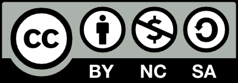
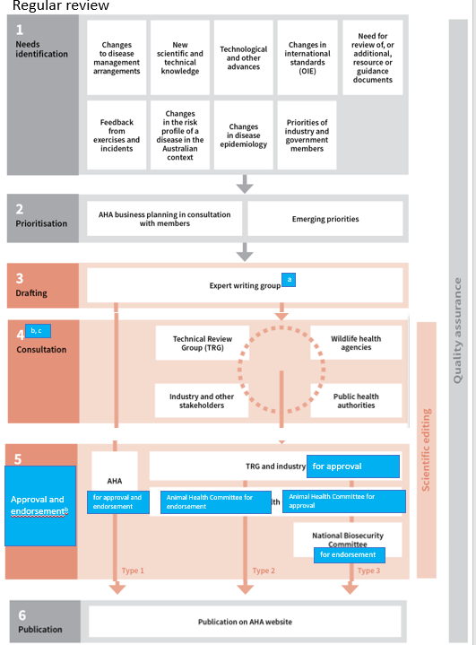
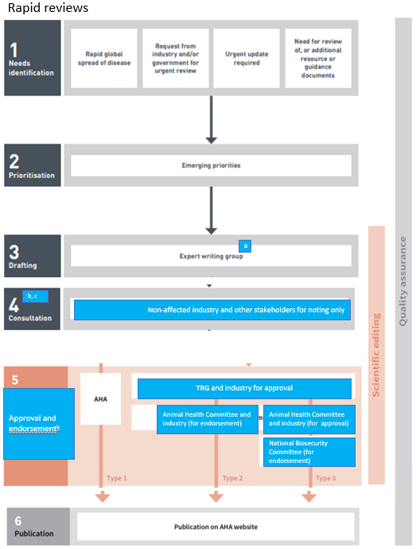

# AUSVETPLAN — Overview (v5.1 (2018))

> **Source**: Animal Health Australia
> **URL**: https://animalhealthaustralia.com.au//wp-content/uploads/dlm_uploads/2018/07/AUSVETPLAN-Overview-5.1.pdf
> **Licence**: Crown / publisher copyright; practitioner reference
> **Retrieved**: 2026-05-07T23:47:46Z
> **SHA-256**: `864a97b4b97b8c97ed6106056095876dda8805583211256b829fe22cee120f4f`
> *Converted from PDF to Markdown format.*

---
## Page 1

 
 
AUSTRALIAN VETERINARY EMERGENCY PLAN 
AUSVETPLAN 
Overview 
Version 5.1 
 
 
 
 
 
 
 
 
 
 
 
 
 
 
 
 
AUSVETPLAN is a series of technical response plans that describe the 
proposed Australian approach to an emergency animal disease incident. 
The documents provide guidance based on sound analysis, linking policy, 
strategies, implementation, coordination and emergency management 
plans. 
National Biosecurity Committee

---
## Page 2

© 1991–2023 Animal Health Australia ABN 86 071 890 956. Certain materials in this publication 
are protected by copyright and are reproduced with permission from the Commonwealth of 
Australia, acting through its Department of Agriculture, Water and the Environment (or any 
successor agency); each state and territory of Australia, as represented by their relevant agencies, 
and by the National Biosecurity Committee and Animal Health Committee; and Animal Health 
Australia’s industry members. 
ISBN 0 642 24506 1 (printed version) 
ISBN 1 876 71438 7 (electronic version) 
Licence 
This work is licensed under the 
Creative Commons Attribution-
NonCommercial-ShareAlike 4.0 
International Licence, with the 
exception of: 
• 
any third-party material contained within the work 
• 
any material protected by a trademark 
• 
any images and/or photographs. 
To view a copy of this licence, visit http://creativecommons.org/licenses/by-nc-sa/4.0/. 
Moral rights 
The author(s) of this work hold ‘moral rights’ as defined in the Copyright Act 1986 (Cwlth) and 
assert all moral rights in connection with this work. This means you must: 
• 
attribute (give credit to) the author(s) of this work 
• 
not say a person is a creator of a work when they are not 
• 
not do something with the work (such as change or add to it) that would have a negative 
impact on the reputation of the author(s) of this work. 
Failure to do so could constitute a breach of the Copyright Act 1986 (Cwlth). 
Disclaimer and warranty 
• 
This publication has been produced in accordance with the procedures described in the 
AUSVETPLAN Overview, and in consultation with Australian national, state and territory 
governments; the relevant livestock industries; nongovernment agencies; and public health 
authorities, as relevant. Any views and opinions expressed in this document do not necessarily 
represent the views and opinion of the authors or contributors, Animal Health Australia or the 
Commonwealth of Australia. 
• 
This publication is for use in emergency situations. The strategies and policy guidelines in this 
work are not applicable to quarantine policies for imported livestock or livestock products. 
• 
This publication is not legal or professional advice and should not be taken as a substitute for 
legal or other professional advice. 
• 
This publication is not intended for use by any person who does not have appropriate 
expertise in the subject matter of the work. Before using this publication, you should read it in 
full, consider its effect and determine whether it is appropriate for your needs. 
• 
This publication was created on 17 July 2023. Laws, practices and regulations may have 
changed since that time. You should make your own inquiries as to the currency of relevant 
laws, practices and regulations, as these may have changed since publication of this work.

---
## Page 3

No warranty is given as to the correctness of the information contained in this work, or of its 
suitability for use by you. To the fullest extent permitted by law, Animal Health Australia is not, 
and the other contributing parties are not, liable for any statement or opinion, or for any error or 
omission contained in this work, and it and they disclaim all warranties with regard to the 
information contained in it, including, without limitation, all implied warranties of merchantability 
and fitness for a particular purpose. Animal Health Australia is not liable for any direct, indirect, 
special or consequential losses or damages of any kind, or loss of profit, loss or corruption of data, 
business interruption or indirect costs, arising out of or in connection with the use of this work or 
the information contained in it, whether such loss or damage arises in contract, negligence, tort, 
under statute, or otherwise. 
Text under development 
In this manual, text placed in square brackets [xxx] indicates that that aspect of the manual 
remains unresolved or is under development; such text is not part of the official manual. The 
issues will be further worked on by experts and relevant text included at a future date. 
Contact information 
If you have any requests or inquiries concerning reproduction and rights, or suggestions or 
recommendations, you should address these to: 
AUSVETPLAN – Animal Health Australia 
Head of Program AUSVETPLAN 
PO Box 151 
Lyneham ACT 2602 
Tel: 02 6232 5522 
email: ausvetplan@animalhealthaustralia.com.au 
Approved citation 
Animal Health Australia (2023). AUSVETPLAN: Overview (version 5.1). Australian Veterinary 
Emergency Plan (AUSVETPLAN), edition 5, Canberra, ACT. 
EMERGENCY ANIMAL DISEASE HOTLINE: 1800 675 888 
The Emergency Animal Disease Hotline is a toll-free telephone number that connects callers 
to the relevant state or territory officer to report concerns about any potential emergency 
disease situation. Anyone suspecting an emergency disease outbreak should use this number 
to get immediate advice and assistance. 
Publication record 
Edition 1 
1991 
Edition 2: 
Version 2.0, 1996 (major update) 
Edition 3: 
Version 3.0, 2003 (interim draft including new diseases since 1996) 
Version 3.1, 2008 (major update) 
Edition 4: 
 
Version 4.0, 2018 (major update, and renaming from Summary document to Overview)

---
## Page 4

Edition 5 
Version 5.0, 2020 (new format) 
Version 5.1, 2023 (update to section 5)

---
## Page 5

 
Overview (Version 5.0) 
5 
Contents 
Publication record .............................................................................................................. 3 
1 Introduction .............................................................................................................. 7 
1.1 
This manual ........................................................................................................... 7 
1.1.1 
Purpose ................................................................................................... 7 
1.1.2 
Scope ....................................................................................................... 7 
1.1.3 
Development ........................................................................................... 7 
1.2 
Other documentation ........................................................................................... 7 
1.3 
Training resources ................................................................................................ 8 
1.3.1 
EAD preparedness and response arrangements in Australia .................. 8 
2 Vision and purpose of AUSVETPLAN ........................................................................... 9 
2.1 
Vision .................................................................................................................... 9 
2.2 
Purpose ................................................................................................................. 9 
3 Principles and scope of AUSVETPLAN ....................................................................... 10 
3.1 
Principles ............................................................................................................. 10 
3.2 
Scope................................................................................................................... 10 
4 Structure of AUSVETPLAN ........................................................................................ 11 
4.1 
AUSVETPLAN Overview ....................................................................................... 11 
4.2 
Disease-specific response strategies .................................................................. 11 
4.3 
Operational manuals .......................................................................................... 11 
4.4 
Enterprise manuals ............................................................................................. 12 
4.5 
Management manuals ........................................................................................ 13 
4.5.1 
Control centres management (Parts 1 and 2) ....................................... 13 
4.5.2 
Laboratory preparedness ...................................................................... 13 
4.6 
Supporting documents ....................................................................................... 13 
5 Development and approvals process ........................................................................ 15 
5.1 
Phase 1: Identification of need for new documents or revisions to documents 
under AUSVETPLAN ............................................................................................ 16 
5.2 
Phase 2: Prioritisation of AUSVETPLAN work plan ............................................. 16 
5.3 
Phase 3: Drafting ................................................................................................. 17 
5.3.1 
Regular reviews ..................................................................................... 18 
5.3.2 
Rapid reviews ........................................................................................ 18

---
## Page 6

 
6 
AUSVETPLAN Edition 5 
5.4 
Phase 4: Consultation for type 2 and type 3 changes......................................... 19 
5.4.1 
Regular reviews ..................................................................................... 19 
5.4.2 
Rapid reviews ........................................................................................ 19 
5.5 
Phase 5: Approval and endorsement.................................................................. 20 
5.5.1 Regular reviews .......................................................................................... 20 
5.5.2 Rapid reviews ............................................................................................. 20 
5.6 
Phase 6: Publication ............................................................................................ 20 
6 Expectations of members ........................................................................................ 24 
7 How AUSVETPLAN is used ........................................................................................ 25 
8 Summary of steps in the reporting of an EAD ........................................................... 26 
Glossary ....................................................................................................................... 27 
Abbreviations ............................................................................................................... 33

---
## Page 7

 
Overview (Version 5.0) 
7 
1 Introduction 
1.1 
This manual 
1.1.1 
Purpose 
This document provides an overview of AUSVETPLAN (the Australian Veterinary Emergency 
Plan). 
1.1.2 
Scope 
This overview includes information on the following aspects of AUSVETPLAN: 
• 
vision and purpose 
• 
principles and scope 
• 
structure 
• 
development and approvals process 
• 
expectations of members 
• 
use in an emergency animal disease (EAD) response. 
1.1.3 
Development 
This document has been produced in accordance with the procedures described in Section 5, and 
in consultation with Australian national, state and territory governments; the relevant livestock 
industries; nongovernment agencies; and public health authorities, where relevant. 
In this document, text placed in square brackets [xxx] indicates that that aspect of the manual 
remains contentious or is under development; such text is not part of the endorsed document. The 
issues will be worked on by experts and relevant text included at a future date. 
1.2 
Other documentation 
This document should be read and implemented in conjunction with: 
• 
other AUSVETPLAN documents, including disease-specific response strategies and 
response policy briefs; operational, enterprise and management manuals; and any 
relevant guidance and resource documents. The complete series of manuals is available 
on the Animal Health Australia website1 
• 
relevant nationally agreed standard operating procedures (NASOPs).2 These procedures 
complement AUSVETPLAN and describe in detail specific actions undertaken during a 
response to an incident. NASOPs have been developed for use by jurisdictions during 
responses to EAD incidents and emergencies 
 
1  
www.animalhealthaustralia.com.au/our-publications/ausvetplan-manuals-and-documents/ 
2  
www.animalhealthaustralia.com.au/what-we-do/emergency-animal-disease/nationally-agreed-standard-operating-procedures/

---
## Page 8

 
8 
AUSVETPLAN Edition 5 
• 
relevant jurisdictional or industry policies, response plans, standard operating 
procedures and work instructions 
• 
relevant Commonwealth and jurisdictional legislation and legal agreements (such as the 
Emergency Animal Disease Response Agreement,3 where applicable). 
1.3 
Training resources 
1.3.1 
EAD preparedness and response arrangements in Australia 
The EAD Foundation Online course4 provides livestock producers, veterinarians, veterinary 
students, government personnel and emergency workers with foundation knowledge for further 
training in EAD preparedness and response in Australia. 
 
 
3  
www.animalhealthaustralia.com.au/what-we-do/emergency-animal-disease/ead-response-agreement/ 
4  
www.animalhealthaustralia.com.au/emergency-animal-disease-training-program/

---
## Page 9

 
Overview (Version 5.1) 
9 
2 Vision and purpose of AUSVETPLAN 
2.1 
Vision 
AUSVETPLAN – the Australian Veterinary Emergency Plan – is Australia’s nationally 
agreed approach to responding to emergency animal diseases (EADs) of national 
significance. It comprises resources that support efficient, effective and coherent responses 
to these diseases.5 
2.2 
Purpose 
Effective responses to EAD incidents require planning at national, state and territory, and 
district levels. They also require the involvement of animal health authorities, livestock 
and affiliated industries, organisations in affected communities, and emergency 
management organisations. 
AUSVETPLAN has been developed and agreed upon by governments and relevant 
industries in non-outbreak times to ensure that a coherent, efficient and effective EAD 
response can be implemented consistently across Australia with minimal delay. 
In meeting this purpose, AUSVETPLAN: 
• 
addresses foreseeable disease risks 
• 
provides a framework for policy development for unforeseen risks that occur 
during an EAD response 
• 
serves as nationally agreed reference material for EAD training and exercises 
• 
assists governments and industries to fulfil their roles and meet their 
responsibilities under the Emergency Animal Disease Response Agreement 
(EADRA) 
• 
contributes to identifying deficiencies in technical knowledge 
• 
informs research priorities 
• 
facilitates Australia’s access to export markets by supporting trading partners’ 
evaluation of the competency of Australia’s animal health services. 
 
5  
Refer to the Emergency Animal Disease Response Agreement, Clause 7.2; the Emergency Animal Disease Response Plan 
must be consistent with the relevant AUSVETPLAN management manuals and disease strategy.

---
## Page 10

 
10 
AUSVETPLAN Edition 5 
3 Principles and scope of 
AUSVETPLAN 
3.1 
Principles 
The guidance in AUSVETPLAN: 
• 
results from collaboration between, and consultation with, government and 
industry stakeholders 
• 
is evidence based, peer reviewed and contemporary 
• 
provides flexibility to address the nature of individual emergency animal disease 
(EAD) incidents and the range of contexts across Australia 
• 
recognises the need to balance a range of considerations (including animal health 
and welfare, human health, environmental, social and economic considerations) 
in the response to EADs 
• 
undergoes continuous improvement to reflect changes in our understanding of 
EADs and the management of EAD responses in Australia’s context. 
3.2 
Scope 
The scope of AUSVETPLAN is agreed resources that guide decision making in the response 
to EADs in terrestrial and arboreal animals. An EAD is defined as meeting one of the 
following criteria: 
• 
It is a known disease that does not occur in endemic form in Australia and for 
which it is considered to be in the national interest to be free from the disease. 
• 
It is a variant, non-endemic form of an endemic disease that is caused by a strain 
or type of agent that can be distinguished by appropriate diagnostic methods, and 
would have a national impact if established in Australia. 
• 
It is a serious infectious disease of unknown or uncertain cause, which may, on 
the evidence available at the time, be an entirely new disease. 
• 
It is a known endemic disease, but is occurring in such a fulminant outbreak form 
(far beyond the severity expected) that an emergency response is required to 
ensure that there is neither a large-scale epidemic of national significance nor a 
serious loss of market access. 
• 
It is a disease that does not otherwise meet any of the above criteria but is agreed 
by consensus of all Animal Health Australia’s members to be of national 
significance.6 
 
6 AUSVETPLAN response strategies that are proposed for diseases that are not nationally notifiable should be 
led by the relevant organisation proposing the response strategy in question.

---
## Page 11

 
Overview (Version 5.1) 
11 
4 Structure of AUSVETPLAN 
AUSVETPLAN comprises disease-specific response strategies, operational manuals, 
enterprise manuals and management manuals. Additional supporting information is 
available in guidance and resource documents. The complete series of AUSVETPLAN 
manuals and documents is available on the Animal Health Australia website.7 
4.1 
AUSVETPLAN Overview 
The AUSVETPLAN Overview (this document) provides background information about the 
components of AUSVETPLAN and their functional relationships, and the development and 
approval of AUSVETPLAN. 
4.2 
Disease-specific response strategies 
For each disease listed in the Emergency Animal Disease Response Agreement, a specific 
response strategy has been developed.8 These contain the agreed policy (and supporting 
technical information) for the response to an incident – or suspected incident – of the 
disease in Australia. 
Response strategies include information on: 
• 
the nature of the disease (aetiology, host range, geographic distribution, 
incubation period, transmission, clinical signs, diagnosis, development of 
immunity, and availability of vaccination and treatment) 
• 
principles of control and eradication (critical factors for formulating a response 
strategy, and options for control or eradication based on these factors) 
• 
policy and rationale (the agreed Australian response policy and strategies for its 
implementation – such as the use of declared areas and premises classifications, 
recommended quarantine and movement controls, vaccination, treatment, 
destruction, disposal, decontamination, wild animal and vector control, public 
awareness and media). 
4.3 
Operational manuals 
Operational manuals describe in detail the recommended procedures for activities that are 
common to most emergency animal disease (EAD) responses. The manuals are as follows: 
• 
Destruction of animals – provides clear guidance on acceptable euthanasia 
techniques for most species in the most likely situations as part of disease control 
measures in an EAD response. 
 
7  
www.animalhealthaustralia.com.au/our-publications/ausvetplan-manuals-and-documents 
8  
The current disease strategies and response policy briefs are gradually being replaced with response strategies.

---
## Page 12

 
12 
AUSVETPLAN Edition 5 
• 
Disposal – addresses the issues to be considered and provides a decision-making 
framework for disposing of waste, including animal carcasses and products, for 
disease control purposes. 
• 
Decontamination – outlines the properties of the causative agents of diseases 
covered by AUSVETPLAN, the disinfectants and other methods available to 
inactivate them, and the decontamination procedures that need to form part of a 
decontamination plan. It also provides decontamination strategies for particular 
disease agents or groups of agents. 
• 
Livestock welfare and management – describes the husbandry strategies, 
assessment procedures, roles and decision-making processes to be implemented 
in the event of an EAD incident to ensure that animal welfare requirements are 
met. 
• 
Valuation and compensation – describes the operational procedures for 
valuation and compensation for animals and property that are destroyed, and 
animals that die, as a result of an EAD incident or of disease control measures in 
the response to the incident. 
• 
Wild animal response strategy – provides information on the management of 
wild animals in an EAD incident, including information to underpin strategic 
planning; decision-making frameworks; and operational guidelines outlining 
procedures and techniques for surveys, sampling, population reduction and 
containment, multispecies operations and response management functions. 
4.4 
Enterprise manuals 
Enterprise manuals are developed for specific types of enterprises that pose special 
economic or disease eradication problems, or are important in the spread or impact of 
certain EADs. They provide information and guidance on the structure and operations of 
the relevant type of enterprise, the key risks to enterprises – and posed by enterprises – in 
EAD incidents, and how these may be managed in an EAD response. 
Enterprise manuals target personnel: 
• 
involved in EAD response and decision making who may be unfamiliar with the 
operations of that enterprise or industry 
• 
working in the enterprise or industry and seeking guidance on the 
– operational procedures that may be used in an EAD incident to exclude, contain or 
eradicate a disease 
– development of EAD preparedness, including contingency plans. 
The manuals cover: 
• 
artificial breeding centres 
• 
feedlots 
• 
meat processing

---
## Page 13

 
Overview (Version 5.1) 
13 
• 
pig industry 
• 
poultry industry 
• 
wool industry 
• 
saleyards and transport 
• 
zoos. 
4.5 
Management manuals 
4.5.1 
Control centres management (Parts 1 and 2) 
The Control centres management manual provides a management structure for handling 
an EAD outbreak at national, state and territory, and local levels: 
• 
Part 1 describes the principles and arrangements for managing a response to an 
EAD, and introduces the structures for managing the response. It promotes 
consistent but flexible frameworks for response management across all 
jurisdictions and is aligned with contemporary incident management systems. 
• 
Part 2 describes the specific functions of state, territory and local EAD control 
centres and forward command posts; the functions of their response personnel 
during a response; and the wide range of field duties. 
4.5.2 
Laboratory preparedness 
The purpose of the Laboratory preparedness manual is to assist veterinary laboratories 
to prepare an EAD contingency plan for an EAD emergency. The manual includes 
information on the Laboratories for Emergency Animal Disease Diagnosis and Response 
(LEADDR) network9 and how laboratories will cooperate to form an effective diagnostic 
network in a response. 
4.6 
Supporting documents 
Guidance and resource documents support AUSVETPLAN manuals by providing 
information for stakeholders on specific topics. These supporting documents may be 
referenced in AUSVETPLAN manuals. Guidance documents provide general guidance to 
personnel involved in an EAD outbreak, to assist with understanding relevant policies and 
procedures. Resource documents provide information on specific technical issues relevant 
to managing an EAD outbreak – they are not endorsed AUSVETPLAN manuals. 
Nationally agreed standard operating procedures (NASOPs)10 have been developed for use 
by jurisdictions during responses to EAD incidents and emergencies. NASOPs do not form 
part of AUSVETPLAN; however, they underpin elements of AUSVETPLAN and describe in 
 
9  
LEADDR is a national network of laboratories established in 2009 to effectively prepare for, and respond to, an Australian 
EAD incident. The network reports directly to the Animal Health Committee. 
10  www.animalhealthaustralia.com.au/what-we-do/emergency-animal-disease/nationally-agreed-standard-operating-
procedures

---
## Page 14

 
14 
AUSVETPLAN Edition 5 
detail specific actions undertaken during a response to an incident. NASOPs cross-
reference AUSVETPLAN manuals, where appropriate. 
States and territories also have their own standard operating procedures to guide 
activities within the jurisdiction. These are supported by jurisdiction-specific work 
instructions, and forms and templates (nationally agreed or jurisdiction specific).

---
## Page 15

 
Overview (Version 5.1) 
15 
5 Development and approvals process 
Development and approval11 of AUSVETPLAN is a collaborative process between Animal 
Health Australia (AHA), its government, industry and associate members (ie. AHA 
members), and other stakeholders as required. 
In the context of AUSVETPLAN development and approvals, the AUSVETPLAN Technical 
Review Group and Industry Forum ‘approve’ AUSVETPLAN manuals, whereas Animal 
Health Committee ‘endorses’ manuals. 
AHA manages the ongoing maintenance and review of the AUSVETPLAN manuals to keep 
them current, accurate and fit for purpose. AHA actively engages all its government and 
industry members, and other stakeholders in the maintenance, review and ongoing 
development of AUSVETPLAN to ensure that they all have an adequate say in developing 
and approving manuals relevant to them. AHA does this by coordinating and managing 
industry–government expert writing or working groups and other forums to evaluate the 
latest information available, including lessons from recent emergency animal disease 
(EAD) exercises or actual responses. 
More broadly, all stakeholders have input into AUSVETPLAN development and approval by 
contributing to and engaging in AHA member meetings (eg Members’ Forum, Industry 
Forum, Government Forum), and other relevant committees and groups (eg Animal Health 
Committee – AHC12 – and associated task groups; AUSVETPLAN Technical Review Group – 
TRG;13 AUSVETPLAN writing groups and working groups; AHA governance, steering and 
reference groups). 
AHA relies on input and engagement from its industry and government members, and 
other stakeholders to ensure that AUSVETPLAN continues to be fit for purpose and is used 
by governments and industries during responses to EAD incidents. 
The AUSVETPLAN development and approvals processes are not meant to be laborious or 
overly lengthy, and it is recognised that perfection is not possible. The aim is to develop 
accurate and useful manuals that are concise and contain relevant information for use by 
jurisdictions to enable rapid responses to EAD outbreaks. 
Under the Intergovernmental Agreement on Biosecurity, the National Biosecurity 
Committee (NBC) has the authority to approve AUSVETPLAN manuals. The NBC will only 
authorise AUSVETPLAN publications if support is demonstrated from all relevant 
government and industry signatories to the Emergency Animal Disease Response 
Agreement (EADRA). The NBC has delegated authority for approval of certain types of 
 
11  In this manual, ‘approve’ means to give formal or official sanction whereas ‘endorse’ means to approve openly. 
Endorsement allows the party to confirm they have viewed, understood and agree with (endorse) the document. 
12  www.agriculture.gov.au/agriculture-land/animal/health/committees/ahc 
13  AHA convenes and chairs the AUSVETPLAN TRG to assist with progressing the AUSVETPLAN work plan, and ensuring that 
AUSVETPLAN is fit for purpose and readily available.

---
## Page 16

 
16 
AUSVETPLAN Edition 5 
AUSVETPLAN amendments and for certain AUSVETPLAN documents to AHA or AHC. The 
types of amendments, and their delegated authorisations, are: 
• Type 1 – changes to an existing manual that are clear matters of fact or minor 
operational procedures (authorisation: AHA) 
• Type 2 – more substantial changes to an existing manual, relating to significant 
technical issues or operational policies and procedures (authorisation: AHC) 
• Type 3 – all new manuals and significant policy changes to an existing manual that have 
financial implications for stakeholders (authorisation: NBC). 
The six phases in the development and approvals process for AUSVETPLAN manuals are 
identification, prioritisation, drafting, consultation, approval/endorsement and 
publication. Figures 1 and 2 outline this process. 
5.1 
Phase 1: Identification of need for new documents or revisions to 
documents under AUSVETPLAN 
The need for revisions to AUSVETPLAN can arise in several ways, including from: 
• 
routine (including time-based) review 
• 
a change in the risk profile of a disease in the Australian context (eg a rapid 
global spread of a disease that would otherwise not be of significant risk to 
Australia) 
• 
a change in the regulatory status of a disease 
• 
changes in international standards (eg by the World Organisation for Animal 
Health – WOAH) 
• 
feedback from relevant exercises or EAD incidents in Australia or overseas 
• 
changes in, or new, scientific or technical knowledge 
• 
significant changes in disease epidemiology 
• 
changes in priorities of industry and/or government members 
• 
technological or other advances 
• 
changes to EAD management arrangements in Australia. 
5.2 
Phase 2: Prioritisation of AUSVETPLAN work plan 
Once the need for revision to an AUSVETPLAN manual has been identified, it is considered 
for inclusion in the AUSVETPLAN project plan and associated work plan. Prioritisation of 
AUSVETPLAN work is risk based. The AUSVETPLAN work plan, including manuals for 
rapid and regular reviews, is reviewed by AHA and the AUSVETPLAN Technical Review 
Group and endorsed each year by AHA’s government and industry members through 
AHA’s business planning process. 
AUSVETPLAN manuals are further prioritised for 'regular’ or ‘rapid’ reviews. Identification 
of the need for a rapid review — which usually falls outside of the normal annual work

---
## Page 17

 
Overview (Version 5.1) 
17 
planning process — may require reprioritisation of other reviews; AHA members will be 
advised accordingly. 
5.3 
Phase 3: Drafting 
Type 1 amendments are typically drafted by AHA, with or without consultation with the 
parties that identified the need for the required change. 
Type 2 or type 3 amendments (ie more substantial reviews) are typically drafted by 
expert writing groups made up of relevant government and industry personnel. These 
writing groups are convened by AHA. In some cases, type 1 and type 2 amendments may 
be drafted by the proponent of a particular change (eg AHA, the AUSVETPLAN TRG or AHA 
members). 
Chairs for the expert writing groups are usually AHA staff or members of the AUSVETPLAN 
TRG because of the importance of having a good understanding of the process. However, 
other personnel may chair expert writing groups if they have appropriate knowledge and 
understanding of national EAD response mechanisms and structures, the content of 
AUSVETPLAN, and the development and approvals process, and also have a close 
relationship with relevant personnel who can assist. 
During the drafting phase, AHA government and industry members, and other 
stakeholders are encouraged to contribute to ensure that the information is current and 
accurate, and will be used to respond to EAD incidents. 
Relevant industry and government members should provide nominees to be involved in 
maintenance, revision and ongoing development of AUSVETPLAN because all are 
accountable for ensuring that the manuals are usable and fit for purpose. Relevant 
stakeholders who are not AHA members may be asked by AHA to contribute to the writing 
groups. 
Ideally, writing groups should be limited to a core group of about 5–8 members. AHA may 
call on others with specific expertise to contribute. These additional personnel would only 
attend those meetings in which the discussion is relevant to their expertise. Alternatively, 
they may be engaged by AHA out of session to provide specific input. 
Writing group members are encouraged to actively consult within their organisation or 
industry peak body to ensure their input reflects the broader opinion of the group they 
represent. This also assists with the further approvals and endorsement process (see 
Section 5.5). 
The terms of reference for each writing group will identify the scope of the review, and will 
be guided by AHA and the TRG, and drafted by AHA. Writing group members will have 
opportunity to comment on the terms of reference, and, if required, the terms of reference 
will be reviewed by the TRG.

---
## Page 18

 
18 
AUSVETPLAN Edition 5 
5.3.1 
Regular reviews 
Regular reviews typically take the form of a series of writing group meetings (either 
physical or virtual) during which writing group members address the agreed terms of 
reference for the writing group and reach consensus14 on sections of the manual. Decisions 
made by the writing group at each meeting are included in the notes from each meeting as 
resolutions. 
The groups aim to follow an agreed workplan, which is prepared by the chair of the writing 
group. Members typically meet every 3–4 weeks. A final meeting usually provides writing 
group members with an opportunity to review revised text with a view to identifying any 
consequential changes required, ensuring readability and confirming the terms of 
reference have been met. 
Once the terms of reference are met, or agreement is made to address them through other 
processes, the manual, or part thereof, enters the consultation process if this has not been 
part of the drafting process. 
5.3.2 
Rapid reviews 
Some reviews may need to be expedited because of an increased risk profile of a disease in 
the Australian context. This type of rapid review will only be used when it is needed and 
there are no alternative pathways, because it puts considerable strain on both internal and 
external resources and is not sustainable for business as usual. The criteria for 
determining whether a rapid review should take place include: 
• 
a rapid global spread of a disease that would otherwise not be of significant risk 
to Australia 
• 
a justifiable direct, urgent request from industry and/or governments to expedite 
the process 
• 
an urgent need for a major update to the response policy (eg a new vaccine 
becomes available and would become a key element of the response strategy, 
especially where no vaccine has been available previously). 
A rapid review may not encompass review of the entire manual; it may only need to 
include one section or a few sections of a manual. The scope of the review will be identified 
in the writing group’s terms of reference. A rapid review may require parallel iterative 
review of several sections, allowing AHA to release updates to the manual in stages. It may 
also require the Chair to approve the formation of small subordinate working groups to 
concurrently advance the review of crucial sections of the manual for prompt discussion 
and decision by the writing group. 
 
14  Under the Emergency Animal Disease Response Agreement, ‘consensus’ is defined as ‘the making of decisions by general 
agreement (which may involve a measure of compromise necessary to ensure a workable outcome), and that none of 
the Parties actively participating in the decision-making process opposes the decision’.

---
## Page 19

 
Overview (Version 5.1) 
19 
During a rapid review, AHA will need to maintain a rapid pace, and input from writing 
group members (both government and industry) will require a greater than usual 
commitment. 
The process of a rapid review will include the need: 
• 
for AHA to convene multiple writing group meetings (mostly via 
videoconference) at frequent intervals (eg fortnightly) 
• 
for revised versions of the manual (incorporating updates discussed at the 
meetings) to be released to the writing group promptly 
• 
to ensure that the writing group members reach consensus on sections of the 
manual and move on to the next section as quickly as possible (balancing the 
need for worthwhile consultation and discussion with moving on when issues are 
resolved). 
5.4 
Phase 4: Consultation for type 2 and type 3 changes 
5.4.1 
Regular reviews 
The aim of the consultation phase is to ensure that any scientific and technical information 
is accurate, that it informs policy appropriately, and that any significant concerns with the 
policies and text proposed during the drafting phase have been addressed before approval 
and endorsement of the draft is sought. 
During this phase, AHA consults as appropriate15 with its members – through the 
AUSVETPLAN TRG (government) and directly with Industry Forum members. AHA also 
consults with other stakeholders as appropriate, including non-member organisations 
such as public health authorities and wildlife health agencies. 
For efficiency, parties to be consulted may be engaged during the drafting process as 
guests to the writing group, or consultation may happen separately but concurrently with 
the drafting phase. 
5.4.2 
Rapid reviews 
When manuals are undergoing rapid reviews, following completion of the government–
industry expert writing group drafting step, drafts are presented to non-affected Industry 
Forum members and other stakeholders for noting only. 
For efficiency and when desirable, parties to be consulted may be engaged during the 
drafting process as guests to the writing group, or consultation may happen separately but 
concurrently with the drafting phase. 
 
15  If the drafts involve only type 1 changes (changes that are clear matters of fact or minor operational procedures), they 
typically proceed directly to the approvals phase.

---
## Page 20

 
20 
AUSVETPLAN Edition 5 
5.5 
Phase 5: Approval and endorsement 
After the consultation phase has been completed and all significant issues are adequately 
addressed, AUSVETPLAN manual drafts undergo approval16 through the TRG and Industry 
Forum, and endorsement17 by AHA, AHC or NBC depending on the type of amendment as 
described above. The aim of this phase is to ensure that only appropriately authorised and 
endorsed AUSVETPLAN documents are published and made publicly available. 
5.5.1 Regular reviews 
For type 1 amendments, AHA may approve — and endorse — the changes and move 
directly to publication of the updated manual. Depending on the nature of the changes, 
AHA may advise AHA members accordingly (for noting). 
For type 2 and type 3 amendments, following the consultation step, AHA will provide the 
revised draft AUSVETPLAN manual to the AUSVETPLAN TRG and then to Industry Forum 
EADRA signatories for approval before progressing to the endorsement step. Non-EADRA 
signatory comments received will be considered on a case-by-case basis. 
Comments received from the AUSVETPLAN TRG and Industry Forum EADRA signatories 
are reviewed by AHA at each step with a view to resolution by consensus, and then for final 
progression to the AHC or NBC for endorsement. 
The usual timeframe for the AUSVETPLAN TRG, Industry Forum and AHC/NBC to provide 
approval/comment at each step is 3–4 weeks. 
5.5.2 Rapid reviews 
When manuals are undergoing rapid reviews, in the case of type 2 or 3 amendments, 
following completion of the government–industry expert writing group drafting step, AHA 
provides the drafts to the TRG and Industry Forum EADRA signatories for approval with an 
indicative turnaround time of 2 weeks at each step. Drafts are presented to other 
stakeholders for noting only. 
For type 2 and type 3 changes, AHA then provides the drafts to AHC members 
(government) for approval or endorsement. A 2-week turnaround time is proposed. 
For type 3 changes, the AHC-approved drafts are presented to NBC for endorsement. 
5.6 
Phase 6: Publication 
For regular reviews, AUSVETPLAN manuals and documents are professionally edited 
during the approval and endorsement phase and are then published on the AHA website.18 
 
16  Approve/approval — means to provide the organisation’s (ie government organisation or industry peak body) formal 
and official sanction that the revised draft AUSVETPLAN manual is satisfactory, and can be provided by Animal Health 
Australia to Animal Health Committee and/or National Biosecurity Committee for endorsement. 
17  Endorse/endorsement — Animal Health Committee (AHC) and/or National Biosecurity Committee (NBC) have the 
authority to endorse AUSVETPLAN manuals before publication. Endorse/endorsement means that every member of AHC 
and/or NBC confirms they have viewed, understood and agreed with (endorse) the revised manual for publication. 
18  www.animalhealthaustralia.com.au/our-publications/ausvetplan-manuals-and-documents

---
## Page 21

 
Overview (Version 5.1) 
21 
However, for rapid reviews, the professional editing process may be undertaken 
concurrent with the drafting, consultation or approval and endorsement phase. 
Further information on the development and approval of AUSVETPLAN is available from 
AHA.19 
 
19  animalhealthaustralia.com.au

---
## Page 22

 
22 
AUSVETPLAN Edition 5 
 
AHA = Animal Health Australia; TRG = AUSVETPLAN Technical Review Group; WOAH = World Organisation for Animal 
Health 
a May not be required for type 1 amendments. 
b. The usual timeframe for stakeholders to provide comment at each step is 4 weeks. 
c. Parties to be consulted may be engaged during the drafting process. 
Figure 1 
Outline of the process for development, consultation, approval and 
endorsement of AUSVETPLAN (text, manuals and documents) — regular review 
Reprioritisation 
WOAH 
TRG and Industry Forum (EADRA signatories) for approval

---
## Page 23

 
Overview (Version 5.1) 
23 
 
AHA = Animal Health Australia; TRG = AUSVETPLAN Technical Review Group 
a May not be required for type 1 amendments. 
b. The usual timeframe for stakeholders to provide comment at each step is 2 weeks. 
c. Parties requiring consultation may be engaged during the drafting process. 
Figure 2  
Outline of the process for development and approval/endorsement of 
AUSVETPLAN (text, manuals and documents) — rapid review 
 
Reprioritisation 
TRG and Industry Forum (EADRA signatories) for approval

---
## Page 24

 
24 
AUSVETPLAN Edition 5 
6 Expectations of members 
The ongoing review process for AUSVETPLAN is always challenging, and Animal Health 
Australia (AHA) constantly balances available resources (both within AHA and externally – 
jurisdictional and industry resources), competing priorities and new information that 
needs to be incorporated into AUSVETPLAN in a timely manner. 
The AUSVETPLAN project is heavily reliant on input and engagement from AHA’s industry 
and government members. For various reasons, these external stakeholders may not 
always be able to contribute in the timeframes required by AUSVETPLAN business plans. 
For example, jurisdictional staff may be diverted to other priorities such as emergency 
animal disease responses. 
To progress the AUSVETPLAN development and approvals process, members and others 
who contribute to the review of AUSVETPLAN manuals should be aware of, and adhere to, 
the following principles of participation: 
• 
expectations in terms of the timelines for providing feedback on, and approving, 
AUSVETPLAN documents (ie no late comments are accepted, and a nil response is 
taken as endorsement) 
• 
when providing comments, noting that AUSVETPLAN documents undergo 
professional editing and proofreading before publication, so feedback on 
copyediting (eg spelling, punctuation, grammar) is not needed – please adhere to 
the guidance provided in the document Providing comments on AUSVETPLAN20 
• 
the agreed approach to consensus in AUSVETPLAN approvals (ie if there is no 
active dissent raised, the matter is taken as endorsed) 
• 
where consensus cannot be reached on a complete draft, publication of 
incomplete documents, with contentious sections marked as under development 
(ie placed in square brackets and greyed-out to clearly identify them) 
• 
where consensus cannot be reached among government or industry members, 
escalation of the issue to Animal Health Committee for decision and resolution. 
 
20  www.animalhealthaustralia.com.au/our-publications/ausvetplan-manuals-and-documents

---
## Page 25

 
Overview (Version 5.1) 
25 
7 How AUSVETPLAN is used 
An overview of Australia’s emergency animal disease (EAD) response structures and 
governance is provided in the Control centres management manual and summarised 
below to highlight the role of AUSVETPLAN. 
The chief veterinary officer (CVO) in the state or territory in which the incident occurs is 
responsible for instituting animal disease control action within that state or territory. The 
strategies to control the disease, including the budget for the proposed response actions, 
are documented in an Emergency Animal Disease Response Plan (EADRP). Where the EAD 
is suspected or confirmed to be a zoonosis, the EADRP is developed in collaboration with 
the chief health officer (CHO) of the affected state or territory. 
For a response to be cost shared under the Emergency Animal Disease Response 
Agreement (EADRA), EADRPs must be consistent with, and guided by, any relevant 
AUSVETPLAN manuals. It is recognised that the Consultative Committee on Emergency 
Animal Diseases (CCEAD) can, if it thinks reasonable, recommend to the National 
Management Group (NMG) an EADRP even if part of the response plan deviates from 
AUSVETPLAN (eg due to new knowledge). For responses that are not cost shared under 
the EADRA, the development of response plans consistent with AUSVETPLAN is voluntary 
and is usual practice. AUSVETPLAN therefore serves as the authoritative reference on 
policies and guidelines for the management of EADs in Australia.21 
The CVO is responsible for recommending the EADRP to the CCEAD. Unaffected 
jurisdictions may also need to develop response plans to address jurisdictional activities 
that may be eligible for cost sharing. 
The CCEAD provides technical review of the EADRP and may recommend it to the NMG 
convened for the incident. The NMG decides on whether cost sharing will be invoked 
(following advice from the CCEAD) and whether to approve the EADRP. 
CVOs and, where relevant, CHOs implement disease control measures as agreed in the 
EADRP and in accordance with relevant legislation. They make ongoing decisions on 
follow-up disease control measures – including termination of the response – in 
consultation with the CCEAD and, where applicable, the NMG, based on epidemiological 
information about the outbreak. 
It is also important to note that the overall response policy contained in the various 
AUSVETPLAN manuals is used in informing responses to new and emerging diseases. 
 
21  Because of the potentially wide range of circumstances occurring during an EAD incident, EADRPs may deviate from the 
described policies and guidelines in AUSVETPLAN with the agreement of the CCEAD and, where applicable, the NMG.

---
## Page 26

 
26 
AUSVETPLAN Edition 5 
8 Summary of steps in the reporting of an EAD 
 
 
On-plant veterinarian, farmer, private 
veterinarian suspects an EAD
Notifies authorities via EAD 
hotline/state veterinarian
State chief veterinary officer
Australian Chief Veterinary Officer
Consultative Committee on EADs 
(CCEAD)
Confirms EAD diagnosis
Agrees on what needs to be done
National Management Group (NMG)
Approves the jurisdictional EAD 
Response Plan
Activates pre-agreed cost sharing 
(EADRA)
Department of Agriculture, Water 
and the Environment notifies  WOAH 
and trading partners

---
## Page 27

 
Overview (Version 5.1) 
27 
Glossary 
Animal Health Committee 
A committee whose members are the Australian and state 
and territory chief veterinary officers; the Director of the 
CSIRO Australian Centre for Disease Preparedness; and 
the Australian Government Department of Agriculture, 
Water and the Environment. The committee provides 
advice to the National Biosecurity Committee on animal 
health matters, focusing on technical issues and 
regulatory policy (formerly called the Veterinary 
Committee). 
See also National Biosecurity Committee 
Animal products 
Meat, meat products and other products of animal origin 
(eg eggs, milk) for human consumption or for use in 
animal feedstuff. 
Australian Chief Veterinary 
Officer 
The nominated senior veterinarian in the Australian 
Government Department of Agriculture, Water and the 
Environment who manages international animal health 
commitments and the Australian Government’s response 
to an animal disease outbreak. 
See also Chief veterinary officer 
AUSVETPLAN 
Australian Veterinary Emergency Plan. Nationally agreed 
resources that guide decision making in the response to 
emergency animal diseases (EADs). It outlines Australia’s 
preferred approach to responding to EADs of national 
significance, and supports efficient, effective and coherent 
responses to these diseases.  
Carcass 
The body of an animal that died in the field. 
Chief veterinary officer 
(CVO) 
The senior veterinarian of the animal health authority in 
each jurisdiction (national, state or territory) who has 
responsibility for animal disease control in that 
jurisdiction. 
See also Australian Chief Veterinary Officer

---
## Page 28

 
28 
AUSVETPLAN Edition 5 
Compensation 
The sum of money paid by government to an owner for 
livestock or property that are destroyed for the purpose 
of eradication or prevention of the spread of an 
emergency animal disease, and livestock that have died of 
the emergency animal disease. 
See also Cost-sharing arrangements, Emergency Animal 
Disease Response Agreement 
Consultative Committee on 
Emergency Animal 
Diseases (CCEAD) 
The key technical coordinating body for animal health 
emergencies. Members are state and territory chief 
veterinary officers, representatives of CSIRO-ACDP and 
the relevant industries, and the Australian Chief 
Veterinary Officer as chair. 
Cost-sharing arrangements 
Arrangements agreed between governments (national 
and state/territory) and livestock industries for sharing 
the costs of emergency animal disease responses. 
See also Compensation, Emergency Animal Disease 
Response Agreement 
Declared area 
A defined tract of land that is subjected to disease control 
restrictions under emergency animal disease legislation. 
There are two types of declared areas: restricted area and 
control area. 
Decontamination 
Includes all stages of cleaning and disinfection. 
Destroy (animals) 
To kill animals humanely. 
Disease agent 
A general term for a transmissible organism or other 
factor that causes an infectious disease. 
Disease Watch Hotline 
24-hour freecall service for reporting suspected 
incidences of exotic diseases – 1800 675 888. 
Disinfectant 
A chemical used to destroy disease agents outside a living 
animal. 
Disinfection 
The application, after thorough cleansing, of procedures 
intended to destroy the infectious or parasitic agents of 
animal diseases, including zoonoses; applies to premises, 
vehicles and different objects that may have been directly 
or indirectly contaminated. 
Disposal 
Sanitary removal of animal carcasses, animal products, 
materials and wastes by burial, burning or some other 
process so as to prevent the spread of disease.

---
## Page 29

 
Overview (Version 5.1) 
29 
Emergency animal disease 
A disease that is (a) exotic to Australia or (b) a variant of 
an endemic disease or (c) a serious infectious disease of 
unknown or uncertain cause or (d) a severe outbreak of a 
known endemic disease, and that is considered to be of 
national significance with serious social or trade 
implications. 
See also Endemic animal disease, Exotic animal disease 
Emergency Animal Disease 
Response Agreement 
Agreement between the Australian and state/territory 
governments and livestock industries on the management 
of emergency animal disease responses. Provisions 
include participatory decision making, risk management, 
cost sharing, the use of appropriately trained personnel 
and existing standards such as AUSVETPLAN. 
See also Compensation, Cost-sharing arrangements 
Endemic animal disease 
A disease affecting animals (which may include humans) 
that is known to occur in Australia. 
See also Emergency animal disease, Exotic animal disease 
Emergency Animal Disease 
Hotline 
24-hour 
freecall 
service 
for 
reporting 
suspected 
incidences of exotic diseases – 1800 675 888. 
Enterprise 
See Risk enterprise 
Epidemiological 
investigation 
An investigation to identify and qualify the risk factors 
associated with the disease. 
See also Veterinary investigation 
Epidemiology 
The study of disease in populations and of factors that 
determine its occurrence. 
Exotic animal disease 
A disease affecting animals (which may include humans) 
that does not normally occur in Australia. 
See also Emergency animal disease, Endemic animal 
disease 
Incubation period 
The period that elapses between the introduction of a 
pathogen into an animal and the first clinical signs of the 
disease. 
Local control centre 
An emergency operations centre responsible for the 
command and control of field operations in a defined 
area. 
Movement control 
Restrictions placed on the movement of animals, people 
and other things to prevent the spread of disease.

---
## Page 30

 
30 
AUSVETPLAN Edition 5 
National Biosecurity 
Committee 
A committee that was formally established under the 
Intergovernmental Agreement on Biosecurity (IGAB). The 
IGAB was signed on 13 January 2012, and signatories 
include all states and territories except Tasmania. The 
committee provides advice to the Agriculture Senior 
Officials Committee and the Agriculture Ministers’ Forum 
on national biosecurity issues, and on the IGAB. 
National Management 
Group (NMG) 
A group established to approve (or not approve) the 
invoking of cost sharing under the Emergency Animal 
Disease Response Agreement. NMG members are the 
Secretary of the Australian Government Department of 
Agriculture, Water and the Environment as chair; the 
chief executive officers of the state and territory 
government parties; and the president (or analogous 
officer) of each of the relevant industry parties. 
Operational procedures 
Detailed instructions for carrying out specific disease 
control activities, such as disposal, destruction, 
decontamination and valuation. 
Premises 
A tract of land including its buildings, or a separate farm 
or facility that is maintained by a single set of services 
and personnel. 
Quarantine 
Legally enforceable requirement that prevents or 
minimises spread of pests and disease agents by 
controlling the movement of animals, persons or things. 
Risk enterprise 
A defined livestock or related enterprise that is 
potentially a major source of infection for many other 
premises. Includes intensive piggeries, feedlots, abattoirs, 
knackeries, saleyards, calf scales, milk factories, 
tanneries, skin sheds, game meat establishments, cold 
stores, artificial insemination centres, veterinary 
laboratories and hospitals, road and rail freight depots, 
showgrounds, field days, weighbridges and garbage 
depots. 
Stamping out 
The strategy of eliminating infection from premises 
through the destruction of animals in accordance with the 
particular AUSVETPLAN manual, and in a manner that 
permits appropriate disposal of carcasses and 
decontamination of the site.

---
## Page 31

 
Overview (Version 5.1) 
31 
State coordination centre 
The emergency operations centre that directs the disease 
control operations to be undertaken in a state or 
territory. 
Surveillance 
A systematic program of investigation designed to 
establish the presence, extent or absence of a disease, or 
of infection or contamination with the causative 
organism. It includes the examination of animals for 
clinical signs, antibodies or the causative organism. 
Tracing 
The process of locating animals, people or other items 
that may be implicated in the spread of disease, so that 
appropriate action can be taken. 
Vaccination 
Inoculation of individuals with a vaccine to provide active 
immunity. 
Vaccine 
A substance used to stimulate immunity against one or 
several disease-causing agents to provide protection or to 
reduce the effects of the disease. A vaccine is prepared 
from the causative agent of a disease, its products or a 
synthetic substitute, which is treated to act as an antigen 
without inducing the disease. 
Vector 
A living organism (frequently an arthropod) that 
transmits an infectious agent from one host to another. A 
biological vector is one in which the infectious agent must 
develop or multiply before becoming infective to a 
recipient host. A mechanical vector is one that transmits 
an infectious agent from one host to another but is not 
essential to the lifecycle of the agent. 
Veterinary investigation 
An investigation of the diagnosis, pathology and 
epidemiology of the disease. 
See also Epidemiological investigation 
Wild animals 
 
– native wildlife 
 
Animals that are indigenous to Australia and may be 
susceptible to emergency animal diseases (eg bats, 
dingoes, marsupials). 
– feral animals 
Animals of domestic species that are not confined or 
under control (eg cats, horses, pigs). 
– exotic fauna 
Nondomestic animal species that are not indigenous to 
Australia (eg foxes).

---
## Page 32

 
32 
AUSVETPLAN Edition 5 
Zoonosis 
A disease of animals that can be transmitted to humans.

---
## Page 33

 
Overview (Version 5.1) 
33 
Abbreviations 
Abbreviation 
Full title 
ACDP 
Australian Centre for Disease Preparedness 
AHA 
Animal Health Australia 
AHC 
Animal Health Committee 
AUSVETPLAN 
Australian Veterinary Emergency Plan 
CCEAD 
Consultative Committee on Emergency Animal Diseases 
CSIRO 
Commonwealth Scientific and Industrial Research Organisation 
CVO 
chief veterinary officer 
EAD 
emergency animal disease 
EADRA 
Emergency Animal Disease Response Agreement 
EADRP 
Emergency Animal Disease Response Plan 
NMG 
National Management Group 
OIE 
World Organisation for Animal Health 
TRG 
Technical Review Group

