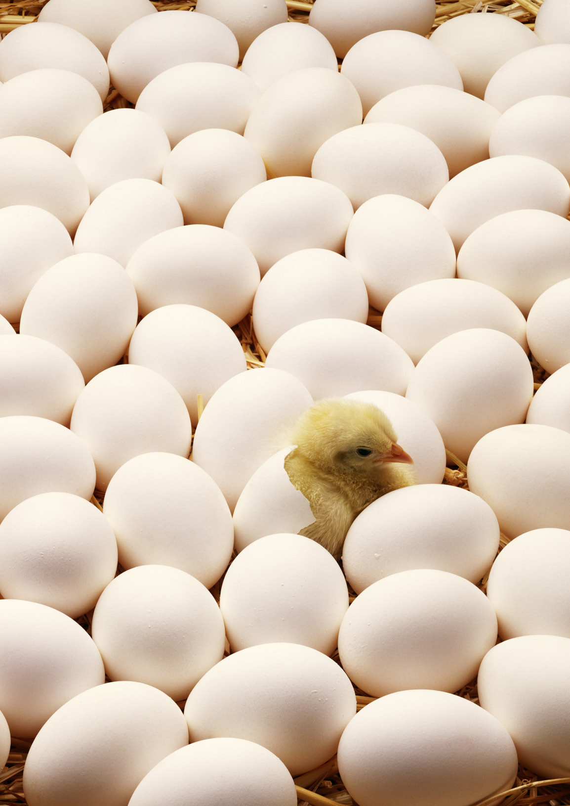
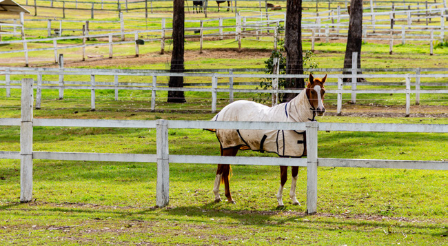
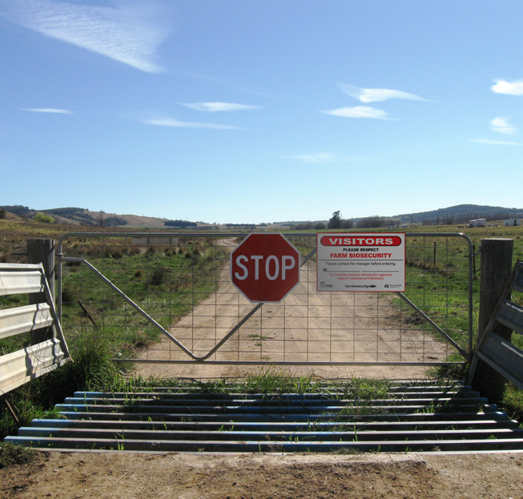
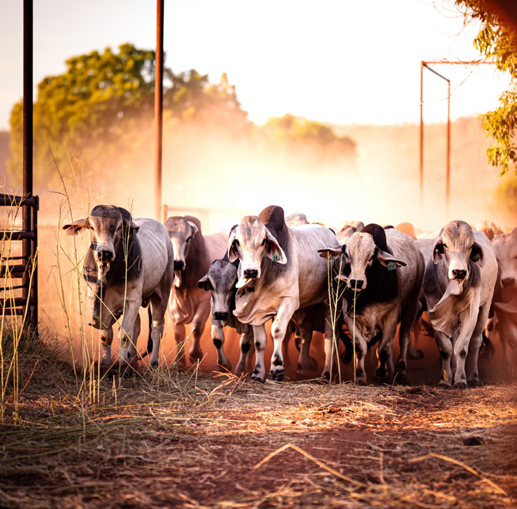
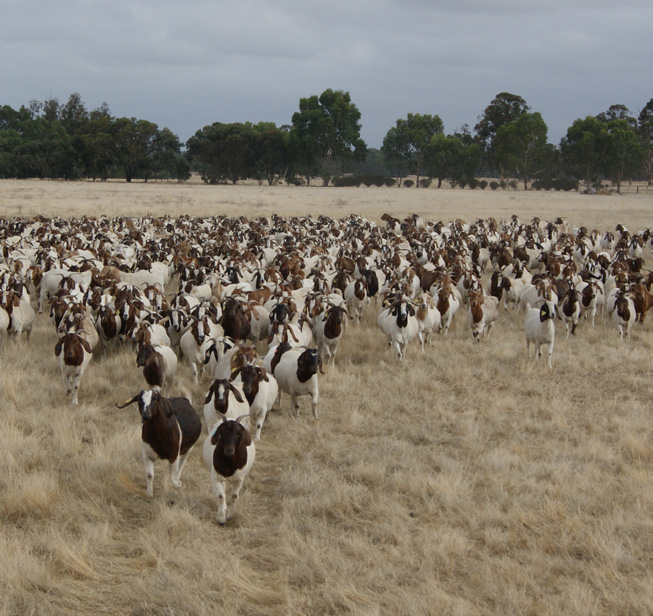
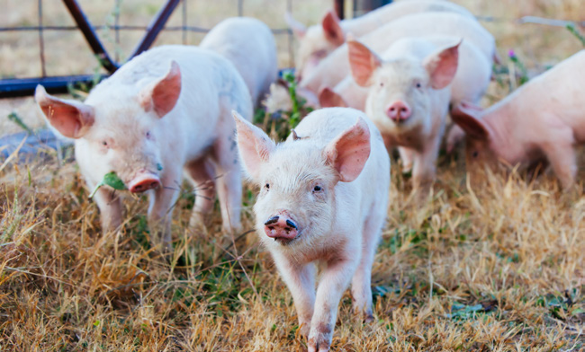
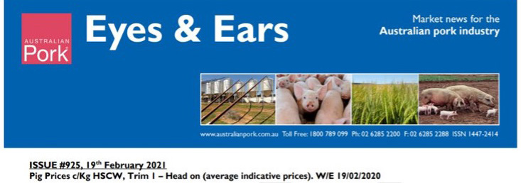
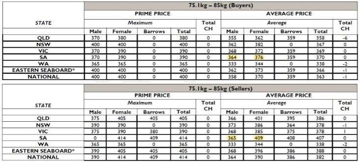

# AUSVETPLAN — Operational Manual: Valuation and Compensation (2022)

> **Source**: Animal Health Australia
> **URL**: https://animalhealthaustralia.com.au//wp-content/uploads/2022/12/AUSVETPLAN-Manuals_Operational_Valuation-and-compensation.pdf
> **Licence**: Crown / publisher copyright; practitioner reference
> **Retrieved**: 2026-05-07T23:47:58Z
> **SHA-256**: `35633e2134bab300703629b6df03da4fcaf6c000094e3c799c22f076ef1f4bc7`
> *Converted from PDF to Markdown format.*

---
## Page 1

i
AUSVETPLAN  /  OPERATIONAL MANUAL VALUATION AND COMPENSATION
Valuation and 
compensation
AUSTRALIAN VETERINARY EMERGENCY PLAN
OPERATIONAL MANUAL
AUSVETPLAN
VERSION 5.0, 2022

---
## Page 2

ii
AUSVETPLAN  /  OPERATIONAL MANUAL VALUATION AND COMPENSATION
© 1991–2022 Animal Health Australia ABN 86 071 890 956. 
Certain materials in this publication are protected by copyright 
and are reproduced with permission from the Commonwealth of 
Australia, acting through its Department of Agriculture, Fisheries 
and Forestry (or any successor agency); each state and territory 
of Australia, as represented by their relevant agencies, and by the 
National Biosecurity Committee and Animal Health Committee; 
and Animal Health Australia’s industry members.
ISBN 0 642 24506 1 (printed version) 
ISBN 1 876 71438 7 (electronic version)
Licence
This work is licensed under the Creative Commons Attribution-
NonCommercial-ShareAlike 4.0 International License, with the 
exception of:
•	 any third-party material contained within the work; 
•	 any material protected by a trade mark; and
•	 any images and/or photographs.
To view a copy of this licence, visit http://creativecommons.org/
licenses/by-nc-sa/4.0/.
Moral Rights 
The author(s) of this work hold ‘moral rights’ as defined in the 
Copyright Act 1986 (Cth) and assert all moral rights in connection 
with this work. This means you must: 
•	 attribute (give credit to) the author(s) of this work;
•	 not say a person is a creator of a work when they are not; and
•	 not do something with the work (such as change or add to it) that 
would have a negative impact on the reputation of the author(s) 
of this work.
Failure to do so could constitute a breach of the Copyright Act 1986 
(Cth). 
Disclaimer and warranty
•	 This publication has been produced in accordance with the 
procedures described in the AUSVETPLAN Overview, and 
in consultation with Australian Federal, State and Territory 
Governments; the relevant livestock industries; nongovernment 
agencies; and public health authorities, as relevant. Any views 
and opinions expressed in this document do not necessarily 
represent the views and opinion of the authors or contributors, 
Animal Health Australia or the Commonwealth of Australia.
•	 This publication is for use in emergency situations. The 
strategies and policy guidelines in this work are not applicable to 
quarantine policies for imported livestock or livestock products. 
•	 This publication is not legal or professional advice and should 
not be taken as a substitute for legal or other professional 
advice. 
•	 This publication is not intended for use by any person who does 
not have appropriate expertise in the subject matter of the work. 
Before using this publication, you should read it in full, consider 
its effect and determine whether it is appropriate for your needs.
•	 This publication was created on October 2022. Laws, practices 
and regulations may have changed since that time. You should 
make your own inquiries as to the currency of relevant laws, 
practices and regulations as laws, practices and regulations may 
have changed since publication of this work.
No warranty is given as to the correctness of the information 
contained in this work, or of its suitability for use by you. To the 
fullest extent permitted by law, Animal Health Australia is not, and 
the other contributing parties are not, liable for any statement or 
opinion, or for any error or omission contained in this work, and 
it and they disclaim all warranties with regard to the information 
contained in it, including, without limitation, all implied warranties 
of merchantability and fitness for a particular purpose. Animal 
Health Australia is not liable for any direct, indirect, special or 
consequential losses or damages of any kind, or loss of profit, 
loss or corruption of data, business interruption or indirect costs, 
arising out of or in connection with the use of this work or the 
information contained in it, whether such loss or damage arises in 
contract, negligence, tort, under statute, or otherwise.
Text under development
In this manual, text placed in square brackets [xxx] indicates 
that that aspect of the manual remains unresolved or is under 
development; such text is not part of the official manual. The 
issues will be further worked on by experts and relevant text 
included at a future date.
Contact information
If you have any requests or inquiries concerning reproduction and 
rights, or suggestions or recommendations, you should address 
these to:
AUSVETPLAN — Animal Health Australia 
Executive Manager, Emergency Preparedness and Response 
PO Box 5116 
Braddon ACT 2612 
Tel: 02 6232 5522 
email: aha@animalhealthaustralia.com.au
Approved citation
Animal Health Australia (2022). Operational manual: Valuation and 
compensation (version 5.0). Australian Veterinary Emergency Plan 
(AUSVETPLAN), edition 5, Canberra, ACT.
EMERGENCY ANIMAL DISEASE WATCH HOTLINE: 1800 675 888
The Emergency Animal Disease Watch Hotline is a toll-free 
telephone number that connects callers to the relevant state or 
territory officer to report concerns about any potential emergency 
disease situation. Anyone suspecting an emergency disease 
outbreak should use this number to get immediate advice and 
assistance.
Publication record
Edition 1 
1991
Edition 2 
Version 2.0, 1996 (major update)
Edition 3 
Version 3.0, 2006 (major update and inclusion of new cost-sharing 
arrangements)
Edition 4 
Version 4.0, 2017
Edition 5 
Version 5.0, 2022 (major update to the pig and pig-products 
information)

---
## Page 3

iii
AUSVETPLAN  /  OPERATIONAL MANUAL VALUATION AND COMPENSATION
Contents
1	
Policy and principles............................................................................. 1
2	
Introduction.......................................................................................... 2
3	
Strategic considerations....................................................................... 4
3.1	 Principles of valuation and compensation................................................................ 4
3.1.1	 Emergency Animal Disease Response Agreement..............................................5
3.1.2	 State and territory legislation (as of June 2021)..................................................6
3.1.3	 Exclusions............................................................................................................6
3.2	 Objectives................................................................................................................ 6
3.3	 Governance.............................................................................................................. 7
3.4	 Preparedness.......................................................................................................... 8
3.5	 Valuers.................................................................................................................... 8
3.5.1	 Appointment of valuers........................................................................................8
3.5.2	 Identification of valuers........................................................................................8
3.5.3	 Payment of valuers...............................................................................................9
3.5.4	 Training of valuers................................................................................................9
4	
Operations........................................................................................ 10
4.1	 Process for valuation and compensation.................................................................10
4.2	 Valuation procedures at local control centre...........................................................12
4.2.1	 Valuer operations...............................................................................................13
4.2.2	 Documentation for compensation claims..........................................................15
4.2.3	 Final valuation procedures.................................................................................16
4.3	 Valuation procedures on premises..........................................................................16
4.3.1	 Reporting to IP site supervisor...........................................................................16
4.3.2	 Considering eligibility of items for compensation..............................................16
4.3.3	 Information provided to valuer by IP Site Supervision function.........................17
4.3.4	 Owner.................................................................................................................17
4.3.5	 Valuation sequence............................................................................................18
4.3.6	 Relevant date of valuation..................................................................................18
4.4	 Determining the value............................................................................................19
4.4.1	 Consistent standard valuation procedures.........................................................19
4.4.2	 Natural increase.................................................................................................19
4.4.3	 Valuing live animals, semen and embryos.........................................................20
4.4.4	 Valuing dead animals.........................................................................................42
4.4.5	 Valuing property.................................................................................................42
4.4.6	 Agreement of owner on inventory......................................................................43

---
## Page 4

iv
AUSVETPLAN  /  OPERATIONAL MANUAL VALUATION AND COMPENSATION
4.4.7	 State or territory procedures for compensation applications............................43
4.4.8	 Initial valuations.................................................................................................43
4.4.9	 Second valuation at restocking..........................................................................43
4.5	 Disputes and resolution process.............................................................................44
4.5.1	 Dispute by owner................................................................................................44
4.5.2	 Dispute by government.......................................................................................44
Appendix 1: Provisions for compensation in the Emergency 
Animal Disease Response Agreement............................................. 45
Appendix 2: Sample valuers’ determination schedules, 
inventory forms and worksheets..................................................... 47
Appendix 2.1: Linkages. ................................................................................................47
Appendix 2.2: Valuer’s determination schedules...........................................................48
Appendix 2.3: Inventory and valuation forms and notes.................................................52
Appendix 2.4: Samples of standard valuation schedules...............................................79
Appendix 3: Sample compensation claim forms........................................ 81
Appendix 3.1: Application for compensation (sample)...................................................81
Appendix 3.2: Application for compensation — second payment (sample).....................84
Appendix 3.3: Notice of dispute form (sample)..............................................................87
Appendix 3.4: Notice of request for second valuation (sample)......................................88
Appendix 4: Considerations for authorised valuer’s 
contract agreement......................................................................... 89
Glossary................................................................................................... 90
Abbreviations. ........................................................................................ 102
Tables
Table 3.1 Core state and territory legislation related to compensation........................... 6
Table 4.1 Beef and beef–dairy cross categories.............................................................21
Table 4.2 Grain-fed cattle categories.............................................................................22
Table 4.3 Valuation grid.................................................................................................23
Table 4.4 Functional categories for dairy cattle.............................................................26
Table 4.5 Definitions for valuation of sheep...................................................................27
Table 4.6 Provides a reference for the value of sows depending on week of 
pregnancy or lactation with suckers..............................................................................29
Table 4.7 Provides a reference for the valuation of each age group class of 
pigs from weaner/nursery stock through to finishers...................................................31
Table A2.1 SCHEDULE 1: Valuer’s determination of compensation payable — 
livestock and livestock products....................................................................................50
Table A2.2 SCHEDULE 2: Valuer’s determination of compensation payable — 
destroyed structures, plant and equipment...................................................................51
Table A2.3 Cattle inventory and valuation form.............................................................52

---
## Page 5

v
AUSVETPLAN  /  OPERATIONAL MANUAL VALUATION AND COMPENSATION
Table A2.4 Cattle description worksheet.......................................................................53
Table A2.5 Sheep inventory and valuation form.............................................................54
Table A2.6 Sheep description worksheet.......................................................................55
Table A2.7 Pig inventory and valuation form — part 1...................................................56
Table A2.8 Pig inventory and valuation form — part 2...................................................56
Table A2.9 Poultry/game birds inventory and valuation form — part 1..........................58
Table A2.10 Poultry/game birds inventory and valuation form — part 2........................58
Table A2.11 Classes of poultry and poultry producers...................................................60
Table A2.12 Horse inventory and valuation form...........................................................61
Table A2.13 Horse description worksheet. ....................................................................62
Table A2.14 Goats inventory and valuation form — part 1..............................................63
Table A2.15 Goats inventory and valuation form — part 2..............................................63
Table A2.16 Deer inventory and valuation form — part 1...............................................65
Table A2.17 Deer inventory and valuation form — part 2...............................................65
Table A2.18 Uncommon farm animals inventory and valuation form — part 1...............67
Table A2.19 Uncommon farm animals inventory and valuation form — part 2...............67
Table A2.20 Bee inventory and valuation form...............................................................69
Table A2.21 Semen inventory and valuation form..........................................................70
Table A2.22 Embryos/fertile eggs inventory and valuation form. ..................................71
Table A2.23 Other animals inventory and valuation form — part 1................................72
Table A2.24 Other animals inventory and valuation form — part 2................................72
Table A2.25 Livestock products inventory and valuation form — meat..........................74
Table A2.26 Livestock products inventory and valuation form — milk...........................75
Table A2.27 Livestock products inventory and valuation form — wool...........................76
Table A2.28 Livestock products inventory and valuation form — poultry products........77
Table A2.29 Livestock products inventory and valuation form — other products...........78
Figures
Figure 4.1 Process map for valuation and compensation...............................................11
Figure 4.2 Valuation of short-fed grain-fed cattle..........................................................24
Figure 4.3 Valuation of middle-fed grain-fed cattle.......................................................24
Figure 4.4 Valuation of long-fed grain-fed cattle...........................................................24
Figure 4.5 Valuation of Wagyu grain-fed cattle..............................................................25
Figure 4.6 Valuation of grain-fed yearling heifers.........................................................25
Figure 4.7 Valuation of grain-fed yearling steers..........................................................25
Figure 4.8 Indicative value of broiler parent breeder stock...........................................35
Figure 4.9 Indicative value of fertile eggs......................................................................36
Figure 4.10 Value of contract grower fee for broiler chickens over a 52-day 
growing cycle, at 30 June 2014......................................................................................37
Figure 4.11 Value of parent breeder stock, at 30 June 2011...........................................38
Figure 4.12 Value of fertile eggs, at February 2014.......................................................38
Figure 4.13 Valuation of layers......................................................................................39

---
## Page 6

vi
AUSVETPLAN  /  OPERATIONAL MANUAL VALUATION AND COMPENSATION

---
## Page 7

1
AUSVETPLAN  /  OPERATIONAL MANUAL VALUATION AND COMPENSATION
Policy and 
principles
Summary of valuation and compensation policy 
•	 The main aim of compensation is to encourage early reporting of an emergency animal disease.
•	 Compensation is determined by state and territory legislation and processes.
•	 Compensation is not payable for consequential losses.
•	 The core objective of valuation is to achieve agreement between the owner and the state or territory on 
the level of compensation.
•	 Local market value is the primary basis for valuation.
•	 Consistent standard valuations should be used for nonstud and non-elite classes of stock.
•	 Stud, elite and high-value animals should be valued by trained, licensed valuers or value assessors.
•	 Disputes are settled by further discussion and agreement, disputes processes set out in state or 
territory legislation, or a variety of state or territory judicial processes.
•	 Cost sharing of response costs, including compensation, is:
	–
requested by the combat jurisdiction(s) and detailed in the Emergency Animal Disease Response 
Plan
	–
recommended by the Consultative Committee on Emergency Animal Diseases
	–
approved by the National Management Group
	–
managed and administered by Animal Health Australia, using the Emergency Animal Disease 
Response Agreement.
1

---
## Page 8

2
AUSVETPLAN  /  OPERATIONAL MANUAL VALUATION AND COMPENSATION
Payment of compensation for animals and other property affected by an emergency animal disease 
(EAD) outbreak is a vital part of the strategy for eradicating or controlling the disease. Without 
compensation, there is little incentive to report an EAD, and industry would be more likely to resist the 
strong measures necessary to deal with the outbreak.
The Valuation and Compensation Manual, an integral part of the Australian Veterinary Emergency 
Plan (AUSVETPLAN), describes the operational procedures for valuation and compensation for 
animals and property destroyed, and animals that die, as a result of an EAD outbreak or the response 
to the outbreak. The manual provides structured, predictable and fair procedures endorsed by 
livestock industries to minimise the risks associated with inconsistent valuation processes.
Management of EAD responses, including valuation and compensation, is the responsibility of the 
affected state or territory government. Responses are managed according to the jurisdiction’s 
legislation and government processes. The relevant jurisdiction’s legislation provides the power 
for the destruction of livestock and property, and ultimately determines the process by which 
compensation is paid. The Government and Livestock Industry Cost Sharing Deed in Respect of 
Emergency Animal Disease Responses (Emergency Animal Disease Response Agreement)1 provides 
a mechanism for cost sharing of the expenses incurred in an EAD response between the Australian 
Government, state and territory governments, and affected livestock industries in an agreed, legally 
binding and predictable manner.
Fundamental to the efficient conduct of an EAD response is that any compensation paid to the owners 
of livestock or property is expedient, fair and predictable according to state or territory legislation and 
processes. Ensuring that the process is consistent and fair will avoid the risk that affected parties will 
dispute, complain about or appeal valuation decisions. If this were to occur, two risks to the efficient 
conduct of an EAD response are possible:
•	 Perceptions of unfairness could discourage affected producers from reporting the EAD.
•	 Those managing the EAD may need to divert scarce resources from managing the EAD response to 
dealing with complaints or appeals.
The previous version of this manual made allowance, in exceptional circumstances, for the application 
of compulsory standard valuations. In a prolonged or rapidly expanding response to an EAD, markets 
may become distorted by lack of export markets and public reactions to the outbreak. As well, in 
some circumstances — for example, during a foot-and-mouth disease response — large numbers of 
animals may need to be disposed of quickly, potentially resulting in a shortage of valuers. In these 
cases, the chief veterinary officers of affected jurisdictions had the option of recommending to the 
National Management Group that schedules of standard valuations be compulsorily used for the 
more commercial classes of cattle, sheep and pigs. This would make it easier to reach a valuation 
1	
	 Information about the EAD Response Agreement can be found at www.animalhealthaustralia.com.au/eadra
Introduction
2

---
## Page 9

3
AUSVETPLAN  /  OPERATIONAL MANUAL VALUATION AND COMPENSATION
in a distorted market, give consistency between valuers and allow eradication activities to proceed 
unhindered.
This version of the Valuation and Compensation Manual expands this concept into a consistent 
standard valuation procedure, which would be used as the norm rather than an exception. The 
procedure will facilitate a rapid, predictable and fair process, to allow disease eradication to proceed 
without unwanted distraction, or the diversion of resources to complaints and appeals. The formulae in 
the manual should be used at all times in an EAD incident to determine the value of livestock covered 
by the manual.
The manual recommends that stud, elite and high-value animals be valued by trained, licensed 
valuers or value assessors. It provides guidelines for valuing these animals to facilitate consistency in 
approach.
The approach to valuation provided in this manual has been endorsed by governments and livestock 
industries. Where disagreements over valuation arise, these should be resolved by further discussion, 
or, if necessary, through the dispute processes set out in state or territory legislation or judicial 
processes.
The terms ‘valuation’, ‘valuer’ and ‘appraiser’ may have specific legal or administrative meanings in 
some states or territories, or may be reserved for people or organisations with specific qualifications 
or training. Each jurisdiction will need to consider the use of alternative terminology for the terms used 
in this manual (valuation and valuer), if required by jurisdictional legislative, legal or administrative 
processes.
The terms ‘compensatable’ and ‘compensable’ are a source of some controversy. Although some 
authorities consider the latter to be more grammatically correct and more commonly used, the term 
compensatable is used throughout this manual because it conveys the intended meaning clearly and 
immediately.

---
## Page 10

4
AUSVETPLAN  /  OPERATIONAL MANUAL VALUATION AND COMPENSATION
3.1	 Principles of valuation and compensation
State and territory legislation and processes that apply to the payment of compensation vary between 
jurisdictions. Section 3.1.2 lists the core state and territory legislation that determines if, when, where, 
how, to whom and how much compensation is payable.
The Emergency Animal Disease Response Agreement (EADRA) does not determine whether 
compensation will be paid. This is always determined by state or territory legislation and processes. 
The EADRA does determine how the cost sharing of response costs (including compensation, if 
appropriate) will be determined.
If an individual, group or organisation wishes to determine whether a particular item, livestock or 
property is compensatable, they would need to approach the appropriate state or territory authority. 
Once it has been determined that an item, livestock or property is compensatable, it can be included in 
the Emergency Animal Disease Response Plan (EADRP) and identified as a compensatable item, and 
the National Management Group (NMG) can then consider approving cost sharing of the compensation.
In some cases, compensation may be required under state or territory legislation, but the NMG may 
decide not to cost share the compensation or to cost share only part of the compensation.
High-value animals should be valued by trained, licensed valuers or value assessors.
Strategic 
considerations
3

---
## Page 11

5
AUSVETPLAN  /  OPERATIONAL MANUAL VALUATION AND COMPENSATION
3.1.1	 Emergency Animal Disease Response Agreement
Legislation in each state and territory will determine what animals and property are eligible 
for compensation, and whether compensation will be paid. The EADRA is only activated when 
jurisdictions request cost sharing of the response cost, including eligible compensation. Cost 
sharing is agreed to by the NMG, on the advice of the Consultative Committee on Emergency 
Animal Diseases (CCEAD). Jurisdictions need to request the cost sharing of response costs, 
including compensation, by identifying in the EADRP the response costs to be cost shared.
Clause 3.4 of Schedule 6 of the EADRA (see Appendix 1 of this manual) sets out the items eligible 
for compensation under state or territory legislation. These are summarised below.
Items eligible for compensation under state or territory legislation
Compensation may be paid to the owner of:
•	 any livestock or property that is destroyed for the purpose of eradication or prevention of the 
spread of an emergency animal disease (EAD)
•	 any livestock that an inspector accredited under the applicable legislation is satisfied has died 
of an EAD. The inspector must be a veterinary surgeon or approved by a chief veterinary officer 
(CVO). The inspector must be satisfied that there has been no unreasonable delay in reporting the 
signs of disease or death of the livestock, and the CVO must certify that the livestock would have 
been compulsorily slaughtered if they had not died.
A second payment for livestock destroyed as part of the EAD response or that died as a result 
of the EAD may be made when the property becomes eligible to be restocked, provided that the 
total value of livestock is greater on that date. The compensation in this second payment is the 
difference between the total value of these livestock on that date and the amount initially paid.
Items not eligible for compensation under state or territory legislation
The following items are generally not eligible for compensation under state or territory legislation:
•	 animals that die from causes other than the EAD, or that would not have been compulsorily 
slaughtered had they survived
•	 consequential losses — that is, loss of profit, loss occasioned by breach of contract, loss of 
production or any other consequential loss
•	 property that is not intended for decontamination that is inadvertently damaged during a control 
procedure (ex gratia payments may be considered; in other cases, the owner would have recourse 
to normal legal mechanisms)
•	 incidental costs, such as use of a tractor, power, fuel, water or an office, and hire of labour; these 
costs should be included in a contract for services with the producer.
The EADRA may not provide for cost sharing of all of the costs for compensation where a valuation 
does not comply with the EADRA valuation guidelines (eg if consequential loss is included in the 
valuation).

---
## Page 12

6
AUSVETPLAN  /  OPERATIONAL MANUAL VALUATION AND COMPENSATION
3.1.2	 State and territory legislation (as of June 2021)
Table 3.1 shows the main state and territory legislation relevant to compensation associated with an 
EAD response.
Table 3.1 Core state and territory legislation related to compensation
Australian Capital Territory
Animal Diseases Act 2005
New South Wales
Biosecurity Act 2015
Northern Territory
Livestock Act 2008
Queensland
Biosecurity Act 2014
South Australia
Livestock Act 1997
Tasmania
Biosecurity Act 2019
Victoria
Livestock Disease Control Act 1994
Western Australia
Exotic Diseases of Animals Act 1993
Biosecurity and Agriculture Management Act 2007
 
3.1.3	 Exclusions
Circumstances under which an owner may be considered ineligible for compensation, or where 
compensation can be denied or withheld are determined by state or territory legislation. The most 
significant of these include:
•	 failure to report a suspect EAD
•	 failure to report a suspect EAD within an appropriate timeframe
•	 when an owner is convicted of an offence that is related to the outbreak in question (eg illegally 
importing an animal product that was contaminated with the disease organism).
Valuation should proceed as usual. However, any payment for compensation should not be made until 
after the legal process has been completed. Any payment (including partial payment) before a trial may be 
prejudicial to the trial process and outcomes. Legal advice should be sought to ensure that due process is 
followed.
3.2	 Objectives
The valuation and compensation procedures outlined in this manual have been developed to ensure that:
•	 payment of compensation for animals and property is rapid and equitable
•	 valuation procedures do not unnecessarily delay destruction and other eradication measures
•	 issues that may impinge on valuation procedures are clearly identified
•	 valuers are aware of their roles and responsibilities in the event of an EAD outbreak.
The manual is also designed to ensure optimal preparedness before any outbreak occurs, and to assist in 
the operation of the valuation system and EADRA among industries and governments.

---
## Page 13

7
AUSVETPLAN  /  OPERATIONAL MANUAL VALUATION AND COMPENSATION
3.3	 Governance
The CVO in the state or territory in which the outbreak occurs is responsible for developing an EADRP for 
the particular outbreak.
The CCEAD, convened for the incident, assesses the response plan drawn up by the affected jurisdiction’s 
CVO for technical soundness and consistency with AUSVETPLAN, and endorses it or seeks modifications 
to it. The CCEAD may also ask unaffected jurisdictions to develop response plans to address activities in 
the jurisdictions that will be cost shared. Overall operational management of the incident rests with the 
CVO of the affected jurisdiction, with oversight by the CCEAD.
The NMG, also convened for the specific incident, decides on whether cost sharing will be invoked 
(following advice from the CCEAD) and manages the national policy and resourcing needs. It also has 
responsibility to authorise an order for vaccine on advice from the CCEAD.
For large multijurisdictional EAD responses, a whole-of-government response will be required. Four 
emergency arrangements are now in place to coordinate national emergencies, including biosecurity:
•	 Australian Emergency Management Arrangements
•	 Australian Government Crisis Management Framework
•	 Australian Government Agricultural Incident Plan
•	 state emergency arrangements and plans.
These arrangements are intended to coordinate, and provide interdisciplinary and interagency assistance 
at national, state and territory, and local levels.
For further details, refer to the AUSVETPLAN Overview Document (previously the Summary Document).
CVOs will implement disease control measures as agreed in the EADRP and in accordance with relevant 
legislation. They will make ongoing decisions on follow-up disease control measures in consultation with 
the CCEAD and the NMG, based on epidemiological information about the outbreak.
For information on the responsibilities of state coordination centres and local control centres, see the 
Control Centres Management Manual.
This Valuation and Compensation Manual is only applicable once a decision by the NMG has been made 
to activate the EADRA and cost sharing of response costs, including compensation, if appropriate.
Compensation issues and management before any decision is made on cost sharing by the NMG is a state 
or territory matter, and is administered under the appropriate state or territory legislation and processes.
The principles and processes described in this manual may be used by states and territories to guide 
their internal processes, to provide standardisation and consistency in the event of a response in which 
compensation is initially not requested but is requested later. In such circumstances, the cost sharing 
of compensation may be backdated to the start of the response, at the NMG’s discretion; a standard and 
consistent valuation process may contribute to such a decision.

---
## Page 14

8
AUSVETPLAN  /  OPERATIONAL MANUAL VALUATION AND COMPENSATION
3.4	 Preparedness
The Control Centres Management Manual contains details of the responsibilities, skills and tasks of:
•	 the State Coordination Centre Compensation function (SCC FA 07)
•	 the Local Control Centre (LCC) Valuation and Compensation function (LCC OP 04.1)
•	 the Field Valuation and Compensation function (FLD OP 04.1).
These functions must ensure that the following preparedness procedures for valuation and compensation 
are followed:
•	 keeping lists of specialist valuers and officers who can value other items (see Section 4.4)
•	 having available the approved rates of pay for valuers
•	 making those involved aware of what is required of them (training and competency assessment)
•	 ensuring that information and financial management systems are workable and understood by those 
who may operate them.
Other functions involved in the process of valuation and compensation on property are:
•	 the Field Infected Premises Site Supervision function (FLD OP 04)
•	 the FLD Case Management function (FLD OP 04.5).
3.5	 Valuers
3.5.1	 Appointment of valuers
The LCC Valuation and Compensation function must appoint appropriately qualified personnel and/or 
contractors (‘valuers’), and instruct them on how to undertake this function in the field (see the FLD 
Valuation and Compensation function, FLD OP 04.1). Valuers may be appointed by reference to an 
approved list of valuers. However, stock inspectors and other government officers can value items valued 
below an authorised amount. Also, for some specialist valuations, the state or territory authority may 
need to appoint people who are not on the list (eg wool valuers).
3.5.2	 Identification of valuers
Each state or territory should work closely with industry to identify valuers, including licensed and/or 
accredited valuers, and provide them with the appropriate preparedness (or ‘just-in-time training’).
Valuers may include:
•	 for horses, members of Federation of Bloodstock Agents Australia Ltd2
•	 accredited Auctions Plus assessors,3 and licensed stock and station agents
•	 for land, buildings and other property, registered valuers or members of the Australian Livestock and 
Property Agents Association,4 The Australian Property Institute5 or the Australian Livestock Markets’ 
Association.6
2	
	 www.bloodstockagents.com.au
3	
	 www.auctionsplus.com.au
4	
	 www.alpa.net.au
5	
	 www.api.org.au
6	
	 http://australiansaleyards.com.au

---
## Page 15

9
AUSVETPLAN  /  OPERATIONAL MANUAL VALUATION AND COMPENSATION
Other categories of people may be included, such as experienced stock inspectors (government 
employees) and people with specialist knowledge.
The state or territory can appoint other people for this purpose in specific situations where a suitable 
valuer cannot be identified.
All contracted valuers are expected to provide their own professional indemnity insurance.
3.5.3	 Payment of valuers
Payment of valuers is to be negotiated with the appropriate jurisdiction. The payment should be in 
accordance with state or territory processes, and accepted industry practice and guidelines.
3.5.4	 Training of valuers
Licensed valuers and others who will be involved in procedures relating to valuation or processing of 
compensation claims should receive training in the procedures detailed in this manual.
A training program can be developed that leads to a field exercise in which all aspects of valuation and 
compensation can be trialled.
Valuation and processing of claims should be included in exercises (including field exercises). Because 
these processes vary from state to state, each jurisdiction should conduct such exercises.
Valuers will also need to be inducted into the response at the time of the EAD outbreak. Induction will 
focus on orientation to the response and the current administrative arrangements for response personnel 
(see the LCC Induction function — LCC LG 03.1). Specific training in biosecure field procedures will also be 
required (see the LCC Training and Assessment function — LCC LG 03.2).

---
## Page 16

10
AUSVETPLAN  /  OPERATIONAL MANUAL VALUATION AND COMPENSATION
4.1	 Process for valuation and compensation
Figure 4.1 summarises the process of valuation and compensation. Further details are presented below. 
For more detailed information, please consult the Control Centres Management Manual.
The following notes relate to the numbers shown in Figure 4.1.
1. Jurisdictions are responsible for identifying livestock and property valuers, including specialist valuers 
for unusual assets.
2. The local control centre (LCC) Valuation and Compensation function is responsible for:
•	 identifying valuation needs of the response
•	 identifying, selecting and appointing available valuers and specialist valuers.
3. The Infected Premises Site Supervision (IPSS) function (or the FLD Case Management function) is 
responsible for briefing the owner, including on:
•	 the valuation and compensation process
•	 compensation application forms
•	 the disputes process
•	 top-up valuation at restocking.
4. The LCC Valuation and Compensation function is responsible for briefing valuers before tasks, 
including on:
•	 the emergency animal disease (EAD)
•	 adherence to biosecurity requirements, especially personal and vehicle biosecurity
•	 restrictions on visits to other farms after visiting an infected premises
•	 contractual issues and conflict of interest
•	 communication and contact details for the LCC
•	 transport, maps and directions
•	 guidelines for valuation, including the approval, disputes resolution and appeal processes
•	 the order of visits and the need to make contact with the LCC after each visit.
5. The IPSS function (or the FLD Case Management function), in consultation with the owner, is 
responsible for mustering stock on the farm in preparation for valuation and disease control measures.
Operations
4

---
## Page 17

11
AUSVETPLAN  /  OPERATIONAL MANUAL VALUATION AND COMPENSATION
Identity valuers
1
Identity valuers
2
Brief valuer
4
Validate 
inventory
7
Conduct 
valuation
8
Check 
valuation and 
documentation
9
Consult with 
LCC logistics
13
Submit dispute 
of valuation
11
Submit 
application for 
compensation
12
Disputes 
process under 
jurisdictional 
legislation
14
Compensation 
process under 
jurisdictional 
legislation 
15
Compensation 
payment
16
End of process
Jurisdiction
LCC Valuation and 
Compensation function
Valuer
On farm 
(government officer)
Owner
LCC = local control centre
Figure 4.1 Process map for valuation and compensation
Brief owner
3
Arrange muster
5
Arrange 
inventory of 
stock product 
property
6
Agree valuation
10
RESOLVED
UNRESOLVED
LCC 
logistics
NO
YES

---
## Page 18

12
AUSVETPLAN  /  OPERATIONAL MANUAL VALUATION AND COMPENSATION
6. The IPSS function (or the FLD Case Management function), in consultation with the owner, is 
responsible for preparing a complete inventory of all stock, products and property that may be affected by 
the control measures.
7. The valuer is responsible for confirming that the inventory matches the stock, products and property on 
the farm, by direct inspection and by collecting evidence (eg written and visual records).
8. Simple valuations may take place on the premises, but more complex ones may need the valuer to 
gather further data and information off the premises.
9. The LCC Valuation and Compensation function is responsible for checking that all documentation, 
valuations and other evidence are complete and sufficient.
10. The IPSS function, FLD Case Management function or other government officer will discuss the 
valuation with the owner.
11. If the owner agrees, the owner will complete an application for compensation on the appropriate form 
(see Appendix 3.1).
12. If the owner does not agree, the owner will complete a ‘Notice of dispute’ form (see Appendix 3.3).
13–15. Disputes may be resolved by agreement between the owner and the jurisdiction. If they are not 
resolved, the disputes process outlined in state or territory legislation will be followed. This may be 
facilitated by referring the dispute to the State Coordination Centre (SCC) Compensation function (SCC FA 
07). There may be several tiers to the disputes resolution processes, including:
•	 a second opinion from another independent valuer agreed to by the owner and the LCC Valuation and 
Compensation or IPSS function
•	 discussion and agreement between the owner and an inspector (government officer, IPSS 
representative, ministerial delegate or government veterinary officer)
•	 decision by a ministerial panel (South Australia) or valuation panel (Northern Territory)
•	 appeals to a competent Court (New South Wales), administrative tribunal (Victoria or Queensland) or 
magistrates court (Tasmania)
•	 common law procedures.
16. Once the compensation process has been completed, payment will be made to the owner through the 
LCC Finance and Administration Section (LCC FA 00), or state or territory administrative processes.
The second valuation (top-up payment) at restocking is a separate process. It is initiated by a request from 
the owner for a second valuation, after which the owner submits a second compensation claim.
4.2	 Valuation procedures at local control centre
The Control Centres Management Manual details the responsibilities of the Valuation and Compensation 
function of the LCC.
Although the Valuation and Compensation Manual and the Emergency Animal Disease Response 
Agreement (EADRA) contain the framework for valuation of stock and property affected by an EAD 
response and for cost sharing, the relevant state or territory legislation provides the power for destruction 
of livestock and property, and specifies the process for determining and paying compensation. Each 
jurisdiction therefore needs to develop valuation processes and procedures that are consistent with the 
EADRA and this manual, and may operate under the appropriate state or territory legislation.

---
## Page 19

13
AUSVETPLAN  /  OPERATIONAL MANUAL VALUATION AND COMPENSATION
4.2.1	 Valuer operations
In most disease responses, suitably experienced people will need to be sourced from outside government 
to provide advice to the Valuation and Compensation function at the LCC on the value of livestock and 
property. These qualified people would be known as valuers or value assessors. The government officer at 
the LCC will use the advice received from the valuer to reach an agreement with the owner of the property 
on the value of livestock and property destroyed.
Identification and appointment of valuers
Each state and territory has agreed to work closely with its industry to identify and train valuers. The 
LCC Valuation and Compensation function will identify and appoint valuers that meet the requirements 
detailed in Section 3.5.1 and Section 3.5.2.
Avoiding conflict of interest
If a valuer without a conflict of interest cannot be sourced, the valuer must disclose any direct or indirect 
interest in the animals or property they are valuing, or interest with the owner of the property.
Required skills
Skills required to perform the role of the valuer include:
•	 extensive and recent experience in the valuation of livestock or property
•	 current knowledge of relevant markets
•	 an ability to
	–
work under pressure with highly stressed clients
	–
be well organised
	–
maintain detailed records
	–
operate as part of a team under direction.
LCC briefing
Valuers will be given precise written guidelines on how livestock and other property are to be valued, in 
accordance with this manual.
A particular valuer may be used on more than one property. Valuers must observe the same rules as 
apply to other visitors to infected premises (IPs). Because valuers are often in private enterprise and visit 
farms in the course of their normal work, it is essential that the restrictions on farm visits after visiting an 
IP are adequately explained during the initial briefing at the LCC, and that the valuers agree to them.
Agreement form
It is essential that authorised valuers sign an agreement or contract that:
•	 they are to value livestock and property as directed by the LCC Controller through the Valuation and 
Compensation function at the LCC
•	 they have no proprietary interest in any of the stock or property they are valuing, or with the owner of 
the stock or property
•	 they understand and will abide by restrictions imposed on them after they have visited an IP
•	 they will follow all state or territory processes and procedures.

---
## Page 20

14
AUSVETPLAN  /  OPERATIONAL MANUAL VALUATION AND COMPENSATION
Considerations for an authorised valuer’s contract agreement are in Appendix 4. The agreement should 
be accompanied by guidelines for the procedures to be followed by valuers on IPs and dangerous contact 
premises (DCPs), the restrictions following a visit to an IP (see the Control Centres Management Manual, 
Part 1), and the agreed rates of payment for time and mileage.
Biosecurity
The LCC Valuation and Compensation function will provide valuers with instructions for personal 
decontamination and other biosecurity measures from the Decontamination Manual.
Transportation
The LCC Valuation and Compensation function will determine valuers’ transportation. Valuers may use 
their own vehicles or, where permitted, government vehicles. Travel by light plane or helicopter may be 
appropriate in remote locations. Valuers may travel with other officers.
When valuers visit more than one property in a day, it is essential that they contact the LCC after each 
property has been visited. For this reason, mobile phones or cars equipped with radios may be needed.
Valuers visiting IPs must comply with biosecurity and decontamination measures.

---
## Page 21

15
AUSVETPLAN  /  OPERATIONAL MANUAL VALUATION AND COMPENSATION
4.2.2	 Documentation for compensation claims
The required documentation, correctly completed, is essential for efficient and rapid processing of 
compensation claims, and to provide reliable assessments of compensation costs to date.
All relevant inventory forms from Appendix 2 must be completed. In the case of animals, these forms 
will be used as the basis for the second valuation at the time the property is eligible to be restocked (see 
Section 4.4.9).
Claim forms
Claim forms are unique to each state and territory. Valuers must be instructed in their correct use by the 
LCC Valuation and Compensation function. Appendix 3 contains sample claim forms.
Processing
After valuation is completed, all relevant documents and forms (eg inventories, valuations and claim 
forms) relating to the valuation must be forwarded to the LCC Valuation and Compensation function, or 
the appropriate state or territory administrative and financial office for processing.
Records to support valuations
Records to support valuation will include the following.
Written inventory
The minimum requirement, preferably before destruction and disposal begin, is for a detailed written 
inventory of the animals and other risk property involved (see Section 4.4.6). The IP Site Supervision (IPSS) 
function is responsible for supervising this task. Written records should be supplemented with visual 
records, where required (see below).
Visual records
In some situations, visual records (eg photographs, video) will help the valuer arrive at fair and accurate 
valuations — for example, when:
•	 destruction and/or disposal have already begun
•	 the owner or agent is unavailable
•	 there is a dispute over valuation.
In all cases, it will be important to obtain a comprehensive visual record of the animals that are to be 
destroyed. Failing this, the animals should be photographed after their destruction. The same may apply 
to contaminated property (eg a wooden pig sty) that may have to be destroyed without delay.
The IPSS function (or FLD Case Management function) should have a digital camera for this purpose, 
which may also have a video function. If a video function is not available on the digital camera, specific 
video equipment or smartphones with a video function may be useful. Visual records must be held with 
other valuation records until the second valuation.
Use of other technology
Where animals and infrastructure on a property need to be destroyed rapidly, aerial photography or 
satellite imagery may be desirable in addition to the methods above.

---
## Page 22

16
AUSVETPLAN  /  OPERATIONAL MANUAL VALUATION AND COMPENSATION
4.2.3	 Final valuation procedures
The inventory of all animals and risk items on the premises should be signed by the owner (or the owner’s 
legal representative) and the IPSS function (or FLD Case Management function) as evidence of agreement 
that all the appropriate items have been included in the inventory. This does not oblige the owner to agree 
to the actual value of any particular item decided by the valuer.
All documentation, including visual records, should be validated by the valuer, and then retained by the 
valuer for further processing and determination of final valuation amounts. A copy of the inventory should 
be left with the owner (or the owner’s representative).
The valuer will then complete a valuation of the items on the inventory. They should inform the LCC 
Valuation and Compensation function of the findings within 24 hours of arriving at the final valuation. 
Within 48 hours of arriving at the final valuation, they should supply the LCC Valuation and Compensation 
function with originals of visual records, and signed and completed valuation documents.
After examining and confirming the valuation details, the LCC Valuation and Compensation function may:
•	 request clarification or further detail on valuations
•	 obtain a second opinion from a similarly qualified valuer (see Section 4.5.2).
Following completion of the process, if the LCC Valuation and Compensation function agrees with the 
valuations, they will present the valuations to the owner. Within 21 days of the serving of the valuation 
notice, the owner may serve a notice of dispute (see Section 4.5.1).
If both the owner and the LCC Valuation and Compensation function agree with the valuations, the owner 
must complete a compensation claim form within 90 days of receipt of the valuer’s determination for 
the first valuation, and within 21 days of receipt of the determination for the second valuation. (Refer to 
relevant state or territory legislation for any variation to these time limits.)
In the event of any significant difference between the valuer’s and the owner’s assessment of the value, 
if a satisfactory agreement cannot be reached with the owner, the LCC Valuation and Compensation 
function may invoke the dispute-handling mechanism described in Section 4.5.
4.3	 Valuation procedures on premises
Valuers will be required to carry out detailed valuation procedures on all IPs and DCPs where stock have 
died or been destroyed as a result of the EAD in question, or property or equipment has been damaged or 
destroyed as a result of EAD response operations.
4.3.1	 Reporting to IP site supervisor
On arrival, valuers should report to the IPSS function.
4.3.2	 Considering eligibility of items for compensation
Valuers should be aware of the items that are eligible or ineligible for compensation, as described in state 
or territory legislation, and summarised in the EADRA and Appendix 1.
If the valuer is uncertain of the eligibility of an animal or property for compensation, advice should be 
sought from the IPSS function or LCC Valuation and Compensation function.

---
## Page 23

17
AUSVETPLAN  /  OPERATIONAL MANUAL VALUATION AND COMPENSATION
4.3.3	 Information provided to valuer by IP Site Supervision function
The IPSS function should ensure that an accurate list of all animals and other property to be valued is 
obtained and given to the valuer on arrival. Wherever possible, a map or diagram of the property should 
be used to show the location of stock and other property to be valued.
Destruction and disposal of items should not proceed until the inventory process has been undertaken. 
Ideally, they would not occur before valuation of the items is complete (unless the LCC Infected Premises 
Operations function has instructed otherwise in writing). The IPSS function should prioritise the order of 
valuation according to biosecurity risk and should check the valuer’s records to ensure that each item on 
the inventory has been valued.
On large properties, valuations may take place over a number of days. At the end of valuation, all the 
valuer’s worksheets and inventories should be collated, totalled, and checked against the list held by the 
IPSS function to ensure that all susceptible animals and property requiring destruction and disposal have 
been valued.
A set of example valuer’s forms is provided in Appendix 2.
4.3.4	 Owner
The definition of ‘owner’ is given in relevant state and territory legislation. It does not include a financial 
institution (‘mortgagee not in possession’) from which the owner has borrowed money for the animals or 
property.
‘Owner’ includes any legal representative of the owner (eg a partner from a partnership, a manager from 
a company). In many cases, the owner’s usual livestock agent will be the legal representative.
Contract growers are not considered to be owners of the stock they are growing. Contract growers would 
generally be compensated through provisions in the commercial contractual arrangements in place at the 
time of the EAD response.
Dealing with the owner
Before an inventory is taken, the IPSS function (or FLD Case Management function) should explain 
to the owner the full procedure about to be undertaken. This briefing calls for good interpersonal 
communication skills. The IPSS function (or FLD Case Management function) should inform the owner 
about the legal basis of the operation, and the appeal mechanisms in cases of disputed description of 
items or valuation. An information sheet on the valuation and compensation process should be left with 
the owner for later reference.
Depending on the outcome of this initial briefing, the IPSS function (or FLD Case Management function) 
may suggest that the owner choose a trusted third person to be present throughout the operation, to act 
as a confidante, and to facilitate the inventory and valuation process. Such a support person could be 
anyone with whom the owner feels comfortable and who would act in the owner’s interests.
It is important for the IPSS function (or FLD Case Management function) to obtain maximum cooperation 
from the owner. The owner can be expected to be quite emotional at the imminent destruction of 
their stock or property. Other personnel working on the IP should be briefed about the owner’s likely 
emotional state, as this may affect them. Depending on the circumstances, the IPSS function (or FLD 
Case Management function) might consider recommending to the LCC that a professional counsellor be 
employed to minimise stress among those on the IP.

---
## Page 24

18
AUSVETPLAN  /  OPERATIONAL MANUAL VALUATION AND COMPENSATION
Owners of agisted and straying animals
It is possible that not all animals on a property will belong to the property owner. Animals on agistment, 
stray animals and animals on the property for any other reason should be identified on a separate 
inventory. They should be valued, but any compensation claim forms should be signed by the actual owner 
of these animals. It is also desirable that this owner (or their legal representative) signs the separate 
inventory for these animals.
Where possible, the owner of these other animals should be contacted by the IPSS function (or FLD Case 
Management function) and asked to nominate someone to act as their legal representative. In many 
cases, the person nominated will be the property owner. If the owner of the animals or their nominated 
representative cannot be contacted or be present, the property owner may sign the inventory, and 
valuation and destruction will proceed. The owner of the animals will subsequently sign the compensation 
application form.
A number of owners could be involved. Because of biosecurity risks, it would not be desirable for them all 
to visit the IP to facilitate valuation.
Owners of the animals described above will need to be contacted when the property is eligible to be 
restocked, so that they may make a second claim if they wish (see Section 4.4.9).
Information provided by owner
The valuer should discuss and share information, and communicate openly with both the owner and the 
IPSS function.
Records of items to be valued
The IPSS function should ensure that an accurate list of all animals and other property to be valued is 
obtained from the owner or manager, and is available when the valuer arrives. Wherever possible, a map 
or diagram of the property should be used to show the location of stock and other property to be valued.
On large properties, valuations may take place over a number of days. At the end of valuation, all the 
valuer’s worksheets and inventories should be collated, totalled, and checked against the list held by the 
IPSS function to ensure that all susceptible animals and property requiring destruction and disposal have 
been valued.
A set of the valuer’s forms is provided in Appendix 2. See also Section 4.3.3.
4.3.5	 Valuation sequence
The IPSS function should prioritise, according to risk, the order in which animals and property will be 
valued. As a rule, valuation of animals should be performed before destruction, and therefore the valuer 
should keep ahead of the destruction team. Animals that are already dead but whose carcasses are still 
available should be valued first. Other property (including animal products and fodder) should be valued 
before disposal, in descending order of risk.
See also Section 4.3.3.
4.3.6	 Relevant date of valuation
The relevant date of valuation (ie the date on which values are to be based) is governed by state or 
territory legislation.7
7	
	 This issue is under discussion. This manual will be updated to reflect any consequent legislative changes when they take effect.

---
## Page 25

19
AUSVETPLAN  /  OPERATIONAL MANUAL VALUATION AND COMPENSATION
For animals, the relevant date of valuation will be:
•	 the date the owner reports the EAD or suspicion of EAD to an inspector of stock or a veterinary 
surgeon
•	 if the disease is not reported — for example, if it is detected by a surveillance team — the date of 
detection (which is usually the date the property is declared to be an IP)
•	 if there is no disease — for example, for animals that are destroyed on a DCP — the date that 
quarantine is imposed. Some properties may have sections of land or animals quarantined on different 
dates. In this case, the animals are valued according to the date of the relevant quarantine notice.
Where more than one of the above conditions applies, the relevant date of valuation is the date of the 
earliest event.
For property, the relevant date is the date of its destruction.
4.4	 Determining the value
The value of livestock or property is calculated as the farm-gate value — that is, on the basis of a sale 
at the location of the stock when it was destroyed or died of the disease, or the property when it was 
destroyed.
The value of animals is determined as if they were disease free (ie ignoring the clinical effects of the 
disease). It will take into account the animals’ age, sex, breed, body condition, liveweight, production 
records and other factors relevant to their class.
The determination should reflect the value of comparable animals at the most recent local livestock 
markets before the valuation date. Where transport and selling costs are likely to have been included in 
the value, these costs should be deducted from the value.
No allowance will be made for loss of profit, loss occasioned by breach of contract, loss of production or 
any other consequential loss.
4.4.1	 Consistent standard valuation procedures
The formulae in this manual should be used at all times in an EAD incident to determine the value of 
nonstud and non-elite livestock. Defined stud or elite classes of sheep, cattle and pigs should be valued 
by trained, licensed valuers or value assessors, using their insured value or the formulae provided in this 
manual as guidance to facilitate consistency.
The following sections provide guidelines on valuing various classes of animal; guidelines for valuing 
property are given in Section 4.4.5.
4.4.2	 Natural increase
Valuers should take note of any pregnant animals that could give birth between valuation and destruction. 
Live offspring born between valuation and destruction may need to be deducted from the count when 
animals are slaughtered unless, as in extensively farmed areas, this is the only opportunity for an 
accurate count to be made. The birth of such animals should not affect the valuation, because the 
valuation must be based on the ‘relevant date of valuation’ (defined in Section 4.3.6). Previously, when the 
date of destruction was used as the legal valuation date, births could affect the overall value because the 
legal valuation date (destruction) could occur after the actual valuation.

---
## Page 26

20
AUSVETPLAN  /  OPERATIONAL MANUAL VALUATION AND COMPENSATION
4.4.3	 Valuing live animals, semen and embryos
Where relevant, the electronic identification of animals must be recorded, so that relevant databases can 
be updated.
Cattle
Nonstud and non-elite cattle
Beef and beef–dairy cross cattle
Cattle will be categorised according to the published Meat & Livestock Australia (MLA) schedules, and 
valued according to their weight and condition. The value will be the average of the published MLA prices,8 
from the most recent sale at each of the two saleyards closest to the affected area, if available, for that 
category, for the average weight of the mob.
8	
	 www.mla.com.au/prices-markets
Cattle are valued based upon recent sale results published by MLA.

---
## Page 27

21
AUSVETPLAN  /  OPERATIONAL MANUAL VALUATION AND COMPENSATION
The schedule in Table 4.1 should be applied to beef and beef–dairy crossbreeds of cattle. Pure dairy breed 
cattle (eg Friesians) should be valued using the dairy cattle schedule (see ‘Dairy cattle’, below).
Table 4.1 Beef and beef–dairy cross categories
Age/sex category
Description
Liveweight classes (kg)
Vealer steers and vealer 
heifers
Castrated male and female cattle with no 
permanent teeth. Less than 12 months old 
and still suckling
<200
200.1–280
280.1–330
330.1+
Yearling steers and yearling 
heifers
Castrated male and female cattle. 
Predominantly with no permanent teeth, 
but 2 are permissible
<330
330.1–400
400.1+
Steers
Castrated male cattle with any number of 
permanent teeth
200–320
320.1–400
400.1–500
500.1–600
600.1–750
750.1+
Heifers
Female cattle with 2–6 permanent teeth 
and not yet calved
200–320
320.1–400
400.1–540
540.1+
Bulls
Male and castrated male cattle over 6 
months of age showing bullish traits
<450
450.1–600
600.1+
Cows
Female cattle with 8 permanent teeth, or 
female cattle with 2–6 permanent teeth 
that have calved
<400
400.1–520
520.1+

---
## Page 28

22
AUSVETPLAN  /  OPERATIONAL MANUAL VALUATION AND COMPENSATION
Beef feedlot cattle
Categories of feedlot cattle are defined according to the destination market (export or domestic) and 
time on feed.
Table 4.2 shows the six export and three domestic categories of grain-fed cattle that are required to be 
considered.
Table 4.2 Grain-fed cattle categories
Market
Period on feed (days)
Grain-fed: export
0–60
61–99
100–150 
(short fed)
151–200 
(middle fed)
201–300 
(long fed)
301–450+ 
(wagyu)
Grain-fed yearling: 
domestic (heifer and 
steer)
0–60 
(heifer) or 
70 steer)
70–99
100+
Goats are valued similarly to sheep and considers the condition and weight of the stock.

---
## Page 29

23
AUSVETPLAN  /  OPERATIONAL MANUAL VALUATION AND COMPENSATION
The owner has the option of having the valuation based on either the nearest recent livestock markets, 
taking into account any premium over grass-fed cattle that an owner can demonstrate to the valuer 
from records of recent consignments, or using the following grid and graphs.
The categories provide a framework for developing valuation graphs (Figures 4.2–4.7) for the different 
categories of cattle on feed. These graphs enable estimation of the value of a feedlot animal at any 
point during its feeding program.
The graphs for each category of feeder cattle on a feedlot reflect prior performance of turn-off cattle. 
No premium is applicable for cattle that have just gone onto feed, but the full premium applies for 
cattle ready or near ready for processing, with a pro rata adjustment for the premium applicable for 
intermediate days on feed. The basis for determining the market value of cattle in the various feeding 
categories is shown in Table 4.3.
Table 4.3 Valuation grid
Cattle class
Period on feed 
(days)
Value at entry
NLRS export sales category 
(pricing reference for M)
Grain-fed export
Short fed
100+
M
Short-fed steer
Middle fed
150+
M
Medium-fed steer
Long fed
200+
M
Long-fed steer
Wagyu steer
350+
M
Wagyu-cross steer
Wagyu heifer
350+
M
Wagyu-cross heifer
Grain-fed yearling (GFYG)
GFYG steer
70+
M
Steer
GFYG heifer
60+
M
Heifer
M = current market value of equivalent class of cattle on entry to the feedlot (ie the purchase price of 
that class of cattle if being purchased at the date of valuation). The M value would be agreed by the 
valuer and owner for each feedlot and each category of cattle before valuation, drawing on feedlot 
records and current market information; NLRS = National Livestock Reporting Service (Meat & 
Livestock Australia market information; www.mla.com.au/Prices-and-markets/Market-reports-and-
prices/National-livestock-reporting-service)

---
## Page 30

24
AUSVETPLAN  /  OPERATIONAL MANUAL VALUATION AND COMPENSATION
In Figures 4.2–4.7, the x axis = days of growth, and the y axis = indicative market value per head.
Figure 4.2 Valuation of short-fed grain-fed cattle
1400
1200
1000
800
600
400
200
0
entry
Shortfed
1-42
43-60
61-80
81-99
100-120
121-149
150-179
180-199
200-249
250-299
300-349
350-399
400+
market $/head
Figure 4.3 Valuation of middle-fed grain-fed cattle
1600
1400
1200
1000
800
600
400
200
0
entry
Midfed
1-42
43-60
61-80
81-99
100-120
121-149
150-179
180-199
200-249
250-299
300-349
350-399
400+
market $/head
Figure 4.4 Valuation of long-fed grain-fed cattle
2000
1800
1600
1400
1200
1000
800
600
400
200
0
entry
Longfed
1-42
43-60
61-80
81-99
100-120
121-149
150-179
180-199
200-249
250-299
300-349
350-399
400+
market $/head

---
## Page 31

25
AUSVETPLAN  /  OPERATIONAL MANUAL VALUATION AND COMPENSATION
Figure 4.5 Valuation of Wagyu grain-fed cattle
3000
2500
2000
1500
1000
500
0
entry
Wagyu
1-42
43-60
61-80
81-99
100-120
121-149
150-179
180-199
200-249
250-299
300-349
350-399
400+
market $/head
Figure 4.6 Valuation of grain-fed yearling heifers
1200
1000
800
600
400
200
0
entry
GFYG heifer
1-42
43-60
61-80
81-99
100-120
121-149
150-179
180-199
200-249
250-299
300-349
350-399
400+
market $/head
Figure 4.7 Valuation of grain-fed yearling steers
1400
1200
1000
800
600
400
200
0
entry
GFYG steer
1-42
43-60
61-80
81-99
100-120
121-149
150-179
180-199
200-249
250-299
300-349
350-399
400+
market $/head

---
## Page 32

26
AUSVETPLAN  /  OPERATIONAL MANUAL VALUATION AND COMPENSATION
Dairy cattle
The current value of dairy breeds of cattle will be determined by the prices paid at the last substantial 
dairy cattle dispersal sale (ie a sale where the majority of a herd is sold) for this category of stock, 
multiplied by the current MLA beef benchmark, divided by the equivalent MLA benchmark at the time of 
the dairy dispersal sale.
CV = DV × current MLA beef benchmark ÷ MLA beef benchmark at DV time
where CV is the current value, and DV is the price paid at the last substantial sale.
Dairy–beef crossbreed animals should be valued using the beef cattle schedule.
Table 4.4 shows the functional categories for dairy cattle.
Table 4.4 Functional categories for dairy cattle
Age/sex category
Description
Female calves
Female calves less than 6 months old
Male calves
Male calves less than 6 months old
Rising 1-year-old heifers
Female cattle 4–12 months old, with no permanent teeth
Rising 2-year-old heifers
Mated female cattle 12–24 months old. Predominantly with no permanent teeth, 
but 2 are permissible
Milker cows
Female cattle with 2–8 permanent teeth that have calved. Includes dry and wet 
animals
Heifers
Female cattle with 2–6 permanent teeth that have not yet calved
Bulls
Male cattle over 6 months of age
Steers
Castrated male cattle over 6 months of age with any number of permanent teeth
Stud beef and dairy cattle
Cattle will only be considered as stud cattle if they are registered with a breed society.
Stud cattle should be valued by trained, licensed valuers or value assessors. The following guidance 
may be used by valuers to facilitate consistency:
•	 The insured value of an animal can be used as a guideline for determining value. (Note: If an animal is 
covered by an insurance policy, compensation will not be paid in addition to any insurance payment.9)
•	 Uninsured stud cattle may be valued at the following percentages above the values for nonstud and 
non-elite animals
	–
	heifer calves — 25%
	–
cows — 50%
	–
bull calves — 200%
	–
bulls — 400%.
9	
	 Insurance may be available to cover livestock losses as a result of accident or disease; however, most such policies exclude cover for livestock that are 
destroyed under a compulsory disease control program, and typically exclude payments for animals that die of a disease if the state or territory legislation 
provides compensation for the same animals.

---
## Page 33

27
AUSVETPLAN  /  OPERATIONAL MANUAL VALUATION AND COMPENSATION
Stud cattle may receive a greater top-up payment than nonstud cattle at the time of restocking if the 
cost of replacing the destroyed animals is greater than the initial valuation.
Sheep and goats
Similar processes apply to sheep and goats.
Nonstud and non-elite sheep and goats
In valuing sheep, the definitions in Table 4.5 will apply.
Table 4.5 Definitions for valuation of sheep
Age/sex category
Description
Lamb
Male or female sheep with no permanent teeth
Hogget
Male or female sheep with no ram-like characteristics and up to two permanent 
teeth
Ewe
Female sheep with more than two permanent teeth
Wether
Castrated male sheep with no ram-like characteristics and more than two 
permanent teeth
Ram
Male, including castrated male, sheep with ram-like characteristics
Crossbred
A merino crossed with a prime lamb sheep breed
Sheep will be categorised according to the published MLA schedules, and valued according to their 
weight and condition. The value will be the average of the published MLA prices,10 from the most recent 
sale at the two saleyards closest to the affected area, if available, for that category, for the average 
weight of the mob. The previous week’s published MLA over the hooks (OTH) market reports for the 
relevant state or territory may be used instead of published MLA saleyard prices where the stock being 
valued would normally have been sold OTH.
All stock valued will be classified to the closest description of categories in the MLA list (see Table 4.5). 
Ewes with young lambs at foot will be classified separately, using the average per-kilogram estimated 
price for the average lamb to calculate the value of lambs.
The process for valuation of goats is similar to the process for sheep.
Stud sheep
Sheep will only be considered as stud sheep if they are registered with a breed society.
Stud sheep should be valued by trained, licensed valuers or value assessors. The following guidance 
may be used by valuers to facilitate consistency:
•	 The insured value of an animal can be used as a guideline for determining value. (Note: If an animal is 
covered by an insurance policy, compensation will not be paid in addition to any insurance payment.)
•	 Uninsured stud sheep may be valued at the following percentages above the values for nonstud or 
non-elite animals
	–
ewe lambs — 25%
	–
ewes — 50%
10	
	 The conversion rate for HSCW price to a liveweight price (76%) is based on information as of August 2020.

---
## Page 34

28
AUSVETPLAN  /  OPERATIONAL MANUAL VALUATION AND COMPENSATION
	–
ram lambs (0–6 months) — 25%
	–
ram lambs (6–13 months) — 200%
	–
rams — 400%.
Stud sheep may receive a greater top-up payment than nonstud sheep at the time of restocking if the 
cost of replacing the destroyed animals is greater than the initial valuation.
Pigs
Valuation of pigs will be based on:
•	 The 75.1-85-kg Hot Standard Carcase Weight (HSCW) price category in the latest Australian Pork 
Limited Eyes & Ears report – or if this is no longer available, then a suitable alternative published 
reference price (referred to as the slaughter price per kg throughout this text).
	–
The sellers and buyers average price for males and females (excluding barrows) should be 
determined by using the data from the Eyes & Ears report of the state/territory where the piggery 
operation/site resides.
	–
In the case of missing data in the Eyes & Ears report and for Western Australia, the average Eastern 
Seaboard Average Price will be used.
•	 If a producer can demonstrate a higher value for any class of stock than the valuation calculated using 
the Eyes & Ears report by producing records (eg evidence of their average price received based on their 
most recent 5 weeks market records or contract price achieved by the farm), this can be used as the 
basis for valuation.
•	 In some cases, higher value or alternative claims will be referred for advice to an independent national 
review panel convened by Australian Pork Limited.
Note
•	 All ‘set’ or ‘flat rate’ values used throughout this document (eg $80 for at weaning value) are based on 
industry knowledge and advice as at 2021.
Specific valuations for each class of stock
1. Unmated sows and gilts
Definition – ‘unmated sows and gilts’ are non-market female pigs which have not been mated, that are 
purchased in for breeding, or retained for breeding when their age cohort is slaughtered.
•	 Unmated sows and gilts will be valued at the slaughter price per kg multiplied by an estimated industry 
average carcass weight of 76kg plus an additional $150.
	–
The additional $150 covers the inputs to house, feed and manage the gilt from baconer to normal 
mating weight, including genetic premium, vaccination costs, etc.
•	 This figure accurately reflects the cost of replacing breeding animals at the time of restocking.
•	 This price will be called the Value of Replacement Gilts (VRG).
2. Pregnant sows
Definition – ‘pregnant sows’ are all female pigs of breeding age which have been mated.
•	 Pregnant sows will be valued at the VRG plus a factor to account for the cost of mating a sow and 
providing feed and inputs each week to produce an expected 10 piglets weaned alive.
•	 At week 16 the value of the sow and her suckers reaches the threshold (ie VRG plus 10 piglets at

---
## Page 35

29
AUSVETPLAN  /  OPERATIONAL MANUAL VALUATION AND COMPENSATION
$80 each11), and remains constant until weaning at which point the unmated sow is valued at VRG 
separately from the weaners which are valued at $80 each.
Table 4.6 Provides a reference for the value of sows depending on week of pregnancy 
or lactation with suckers
Week of pregnancy
Sow value calculation
Unmated
VRG
Week 1
VRG + (0.06 x 800)
Week 2
VRG + (0.12 x 800)
Week 3
VRG + (0.18 x 800)
Week 4
VRG + (0.25 x 800)
Week 5
VRG + (0.31 x 800)
Week 6
VRG + (0.37 x 800)
Week 7
VRG + (0.43 x 800)
Week 8
VRG + (0.50 x 800)
Week 9
VRG + (0.56 x 800)
Week 10
VRG + (0.62 x 800)
Week 11
VRG + (0.68 x 800)
Week 12
VRG + (0.75 x 800)
Week 13
VRG + (0.81 x 800)
Week 14
VRG + (0.87 x 800)
Week 15
VRG + (0.93 x 800)
Week 16
VRG + (1.00 x 800)
Weeks of lactation
Sow and sucker value calculation
Week 17–20
VRG + (1.00 x 800)
 
3. At weaning value
 
•	 The at weaning value will be valued at a flat rate of $80 per head.
11	
	 Irrespective of the actual number of suckers.

---
## Page 36

30
AUSVETPLAN  /  OPERATIONAL MANUAL VALUATION AND COMPENSATION
4. Weaner/nursery stock
Definition – ‘weaners/nursery stock’ are pigs aged between 19‑28 days (at weaning) and up to 91 days which 
have been removed from the sow but are yet to reach market value.
•	 Weaners/nursery stock will be valued at $80 plus input costs (feed, labour, resources etc.) as follows:
	–
For weeks 4-13, the cost of inputs is equal to $5 each additional week from week 4 through to 
week 13
	–
From 14 weeks onwards either (whichever is higher):
	»
the valuation calculation method is liveweight (as per Table 2) multiplied by 0.76 of the slaughter 
price per kg12 – ie the liveweight multiplied by the liveweight reference price per kg13 OR
	»
an additional $5 for each week beyond 13 weeks.
•	 Refer to Table 4.7 for more detail on valuing weaners/nursery/grower/slaughter stock
5. Pigs (grower and slaughter weight)
Definition – ‘grower and slaughter weight pigs’ are pigs over 91 days of age that are grown for the purposes 
of slaughter.
•	 Grower and slaughter weight pigs will be valued based on a function of liveweight and the liveweight 
reference price per kg.
•	 The liveweight reference price per kg is now used with the estimated average liveweight for each age 
group from Table 2 in conjunction with the assessed number of the producer’s head inventoried on-
farm at these ages/liveweights to agree a growing pig inventory.
•	 Refer to Appendix A for worked examples.
12	
	 75.1-85-kg HSCW price category in the latest Australian Pork Limited Eyes & Ears report – or if this is no longer available, then a suitable alternative 
published reference price.
13	
	 The conversion rate for HSCW price to a liveweight price (76%) is based on information as of August 2020.
Grower pigs are valued on a liveweight reference price.

---
## Page 37

31
AUSVETPLAN  /  OPERATIONAL MANUAL VALUATION AND COMPENSATION
Table 4.7 Provides a reference for the valuation of each age group class of pigs from 
weaner/nursery stock through to finishers
Age group class
Weeks of age
Liveweight (kg)14 
Calculation methoda
Weaner/ nursery 
stock
4
7.5
80
5
8.0
80+5
6
11.3
85+5
7
14.6
90+5
8
19.2
95+5
9
23.8
100+5
10
28.4
105+5
Grower
11
34.0
110+5
12
39.6
115+5
(91 days)
13
45.2
120+5
14
50.8
50.8 x liveweight reference price per kg
15
56.4
56.4 x liveweight reference price per kg
16
62.0
62.0 x liveweight reference price per kg
Finisher
17
67.6
67.6 x liveweight reference price per kg
18
73.8
73.8 x liveweight reference price per kg
19
80.1
80.1 x liveweight reference price per kg
20
86.3
86.3 x liveweight reference price per kg
21
92.5
92.5 x liveweight reference price per kg
22
98.8
98.8 x liveweight reference price per kg
a	
From 14 weeks onwards either (whichever is higher):
	
• the valuation calculation method is liveweight (as per Table 4.7) multiplied by 0.76 of the slaughter price per kg15 – ie the liveweight multiplied by the 
liveweight reference price per kg16
	
OR
	
• an additional $5 for each week beyond 13 weeks.
6. Teaser Boars
Definition – ‘teaser boars’ are entire male pigs that are not used for breeding purposes.
•	 Teaser boars will be valued based on an assumed liveweight of 180 kg multiplied by the liveweight 
reference price per kg.
14	
	 If a producer can demonstrate achievement of higher weights at earlier ages than listed in this table – by producing appropriate records – this can be used 
as the basis for valuation.
15	
	 75.1-85-kg HSCW price category in the latest Australian Pork Limited Eyes & Ears report – or if this is no longer available, then a suitable alternative 
published reference price.
16	
	 The conversion rate for HSCW price to a liveweight price (76%) is based on information as of August 2020.

---
## Page 38

32
AUSVETPLAN  /  OPERATIONAL MANUAL VALUATION AND COMPENSATION
7. Breeding Boars
Definition – ‘breeding boars’ are entire male pigs of breeding age and are used for breeding purposes.
•	 Breeding boars will be valued as per teaser boars unless the producer can demonstrate the boars are 
specifically used for breeding purposes – such as used in an artificial breeding centre, or they have 
been bought as breeding boars – at which they will be referred to an independent national review panel 
convened by Australian Pork Limited for advice.
8. High Value Animals, Rare Breeds or Nucleus Stock
•	 All other high value animals, rare breeds or nucleus stock will initially be valued as per commercial 
stock, and then will be referred to an independent national review panel convened by Australian Pork 
Limited for advice.
APPENDIX A
Worked examples
Using the Eyes & Ears report for 19 February 2021 as the basis for calculating the slaughter price per kg 
(latest version available at https://australianpork.com.au/facts-figures/market-reporting/)
For the 75.1 – 85kg Hot Standard Carcase Weight (HSCW) price category, using South Australia data for 
the basis for calculating the slaughter price per kg
Table 4.8 Regional prices in c/kg for 75.1-85kg pigs.

---
## Page 39

33
AUSVETPLAN  /  OPERATIONAL MANUAL VALUATION AND COMPENSATION
Unmated sows and gilts
•	 Slaughter price per kg = ((364+376)/2 + (365+409)/2)/2 = $3.78
•	 Multiplied by estimate industry average carcase weight of 76kg = 3.78 x 76 = $287
•	 Plus $150 = 287+150 = $437
Therefore, price for unmated sows and gilts (value of replacement gilts; VRG) = $437.00
Pregnant sows
•	 Using the above VRG = $437.00
•	 For each week of pregnancy, sow value = VRG + 0.06 (cumulative)
Therefore, price for a mated sow at week 10 of pregnancy = $933.00
Table 4.9 Guide for the value of sows at different stages of pregnancy based on South 
Australian data from February 2021
Week of pregnancy
Sow value calculation
Sow value
Unmated
VRG
$437.00
Week 1
437 + (0.06 x 800)
$485.00
Week 2
437 + (0.12 x 800)
$533.00
Week 3
437 + (0.18 x 800)
$581.00
Week 4
437 + (0.25 x 800)
$637.00
Week 5
437 + (0.31 x 800)
$685.00
Week 6
437 + (0.37 x 800)
$733.00
Week 7
437 + (0.43 x 800)
$781.00
Week 8
437 + (0.50 x 800)
$837.00
Week 9
437 + (0.56 x 800)
$885.00
Week 10
437 + (0.62 x 800)
$933.00
Week 11
437 + (0.68 x 800)
$981.00
Week 12
437 + (0.75 x 800)
$1,037.00
Week 13
437 + (0.81 x 800)
$1,085.00
Week 14
437 + (0.87 x 800)
$1,133.00
Week 15
437 + (0.93 x 800)
$1,181.00
Week 16
437 + (1.00 x 800)
$1,237.00
Weeks of lactation
Sow and sucker value calculation
Sow and sucker value
Week 17–20
VRG + (1.00 x 800)
$1,237.00

---
## Page 40

34
AUSVETPLAN  /  OPERATIONAL MANUAL VALUATION AND COMPENSATION
At weaning value
•	 The at weaning value = $80.00 per piglet
Weaner/nursery stock
•	 Refer to the below table for worked examples
Therefore, the price for a 6 week old (ie 42 day old) weaner/nursery stock = $90.00
Grower and slaughter weight pigs
•	 Liveweight reference price per kg = 0.76 x 3.78 = $2.87
•	 A function of producer’s head inventory on-farm for each age group in Table 2 x liveweight and the 
liveweight reference price per kg.
Therefore, the valuation of 400 grower pigs at approximately 15 weeks of age (ie approximately 105 days) = 
400 x 162 = $64,800.00
Table 4.10 Guide for the value of pigs in different age categories based on South 
Australian data from February 2021
Class of 
stock
Weeks 
of age
Liveweight 
(kg)
Weaner/nursery stock 
calculation method
Weaner/ nursery 
stock value
Weaner/ 
nursery 
stock
4
7.5
80
$80.00
5
8.0
80+5
$85.00
6
11.3
85+5
$90.00
7
14.6
90+5
$95.00
8
19.2
95+5
$100.00
9
23.8
100+5
$105.00
10
28.4
105+5
$110.00
Grower
11
34.0
110+5
$115.00
12
39.6
115+5
$120.00
(91 days)
13
45.2
120+5
$125.00
14
50.8
50.8 x liveweight reference price per kg
$145.00
15
56.4
56.4 x liveweight reference price per kg
$162.00
16
62.0
62.0 x liveweight reference price per kg
$177.00
Finisher
17
67.6
67.6 x liveweight reference price per kg
$194.00
18
73.8
73.8 x liveweight reference price per kg
$211.00
19
80.1
80.1 x liveweight reference price per kg
$229.00
20
86.3
86.3 x liveweight reference price per kg
$247.00
21
92.5
92.5 x liveweight reference price per kg
$265.00
22
98.8
98.8 x liveweight reference price per kg
$283.00

---
## Page 41

35
AUSVETPLAN  /  OPERATIONAL MANUAL VALUATION AND COMPENSATION
30
25
20
15
10
5
0
Poultry
There are two classes of commercial poultry: meat chickens and layers. Valuation of birds and eggs will 
be based on the graphs in Figures 4.8-4.13.
All valuations will be on the ‘on-farm’ basis. That is, where transport and selling cost would otherwise 
have been incurred, these costs are deducted from the value. As with other livestock species, the 
value calculated for poultry will be as close as possible to a market value. It will therefore include a 
calculated gross margin or profit margin, even if the birds are never traded outside one financial entity.
Meat chickens
Parent breeder stock
The dollar value per bird will be determined by the audited value of birds, as indicated in Figure 4.8. 
The audited value of birds at 1 day and 24 weeks will be inserted in this graph. The value is depreciated 
in a straight line from week 24 over the next 40 weeks to give current prices for birds at all ages to 64 
weeks.
Figure 4.8 Indicative value of broiler parent breeder stock
$/bird
Age (wks)
0
7
14
21
28
35
42
49
56
63

---
## Page 42

36
AUSVETPLAN  /  OPERATIONAL MANUAL VALUATION AND COMPENSATION
40
35
30
25
20
15
10
5
0
Figure 4.9 Indicative value of fertile eggs
cents/egg or bird
0
1
2
3
4
5
6
7
8
9
10
11
12
13
14
15
16
17
18
19
20
21
Age (days)
Fertile eggs
Figure 4.9 provides information on the value of eggs during incubation.
The starting point on day 1 is the market value of fertile eggs. The value at the other end of the graph 
at 21 days is 82.5% (assuming a hatching rate of 82.5%) of the value of a newly hatched chick before 
vaccination and other costs incurred at the hatchery. This is an auditable figure, as would be the fertile 
egg value. The value of the egg being incubated increases with time, reflecting the input costs needed 
(hatchery running costs). For simplicity, this increase is assumed to be linear, to reach the final value 
on day 21. The fertile egg value just before hatching will be substantially lower than the value of day-old 
chicks delivered on farm because of the hatching rate being less than 100%, the processing costs at the 
hatchery, and additional inputs such as vaccinations, management procedures and transport.
Broilers
Because of the vertically integrated structure of the poultry meat industry, it is not realistic to calculate 
a real market value for growing birds. Any compensation for destruction of birds under the EADRA 
is made to the owner of the birds; in the case of commercial meat chickens, this will usually be the 
processor. Contracts between the processing companies and the growers will determine the payment 
that growers are due from the processor as a consequence of an EAD response.
Broiler chickens will be valued by adding other costs incurred by the owner company to the grower fee 
in Figure 4.10. The costs are:
•	 the value of a day-old chick (an auditable value for every batch of grower birds), which will include the 
costs of vaccinations and sexing (where applicable), other costs incurred at the hatchery, and delivery/
on-farm placement costs
•	 the cost of feed used — the total cost of feed supplied for use by the contract grower but owned by 
the company is auditable. The feed used can be calculated by subtracting the feed remaining from the 
amount of feed supplied (if the remaining feed is destroyed, it will be compensated separately)
•	 the gross margin percentage calculated by the company to cover fixed costs; this is also an auditable 
figure.

---
## Page 43

37
AUSVETPLAN  /  OPERATIONAL MANUAL VALUATION AND COMPENSATION
80
70
60
50
40
30
20
10
0
For example, if a shed of 1000 birds were destroyed at age 30 days, the value is calculated by adding 
the day-old-chick value (60 c) to the cumulative grower fee for 30 days (from Figure 4.10), multiplying 
by 1000 birds, adding the feed used by multiplying the proportion used (0.3) by the total value of feed 
delivered, and adding the standard gross margin at the time by multiplying by 1.25:
Value = $[(0.52+0.60) × 1000 + (0.3 × 3000)] × 1.25 = $2250
(Note that these values are indicative, not actual.)
More generally:
Value of n birds = $[(pro rata grower fee + value of one day-old + cost of vaccination and other 
procedures at hatchery + transport) × n + (cost of feed used)] × (1 + standard gross margin).
Figure 4.10 Value of contract grower fee for broiler chickens over a 52-day growing cycle, at 30 June 2014
cents/bird
0
10
20
30
40
50
Age (days)

---
## Page 44

38
AUSVETPLAN  /  OPERATIONAL MANUAL VALUATION AND COMPENSATION
Fertile eggs for pullets
The dollar value per incubated egg will be determined by the most recent ‘fertile eggs price list’ from 
the existing layer fertile egg producers: Hy-Line Australia,17 Lohmann Layers Australia18 and Baiada 
17	
	 http://esvc000306.wic040u.server-web.com
18	
	 www.specialisedbreeders.com.au/technical-news-2
Layers
Parent breeder stock
For parent layer birds, the dollar value per bird will be determined by the most recent audited layer 
breeder values. The value of birds at 1 day and 24 weeks will be inserted in the graph in Figure 4.11 to 
give current prices for birds at all ages to 64 weeks.
30
25
20
15
10
5
0
Figure 4.11 Value of parent breeder stock, at 30 June 2011
$/bird
Age (days)
0
7
14
21
28
35
42
49
56
63
40
35
30
25
20
15
10
5
0
Figure 4.12 Value of fertile eggs, at February 2014
cents/egg or bird
Age (days)
0
1
2
3
4
5
6
7
8
9
10
11
12
13
14
15
16
17
18
19
20
21

---
## Page 45

39
AUSVETPLAN  /  OPERATIONAL MANUAL VALUATION AND COMPENSATION
(ISA Brown Layer).19 The value of the egg being incubated increases with time, reflecting the input costs 
needed (hatchery running costs). For simplicity, this increase is linear to reach the final value on day 21.
The value of fertile eggs should be calculated as a linear extrapolation between the value of a fertile 
egg entering the hatchery and the value of the day-old chick at the point of leaving the hatchery 
(Figure 4.12). Over the following 24 hours, the value of the day-old chicks increases as a result of 
the application of vaccines; other practices such as beak trimming, sorting, packing and sexing; and 
transport to the farm.
The hatched chick’s value (not included in Figure 4.12) will be higher because of the hatching 
rate factor (0.8), processing costs at the hatchery, and additional inputs such as vaccinations and 
management procedures. The value doubles once the chick is sexed, since most males have zero value. 
The value of the hatched chick will be determined by the auditable value of the undelivered chick at this 
age, exclusive of any levies. If cockerels are sold, the cost of the sold proportion will be determined by 
their auditable value.
Pullets and layers on farm
Day-old layer chicks are valued at market value, which can be obtained as the nonstud and non-elite 
industry sale price from Hy-Line Australia,20  Lohmann Layers Australia,21 Baiada (ISA Brown Layer)22 
or other suppliers. The dollar value for older birds will be linearly extrapolated from the day-old-chick 
value and the market value at point of lay at around 20 weeks of age. It is assumed that hens will be 
kept until they are 74 weeks of age. Note that the market value at 74 weeks must be reduced by the cost 
of disposal at the end of the hens’ economic life once they are placed on the farm, to reflect the true net 
value. The value peaks at 20 weeks and then depreciates linearly over the following 54 weeks to reach a 
(negative) value equal to the cost of disposal of spent hens. This is illustrated in Figure 4.13.
19	
	 www.baiada.com.au
20	
	 http://esvc000306.wic040u.server-web.com
21	
	 www.specialisedbreeders.com.au/technical-news-2
22	
	 www.baiada.com.au
Moulting 
period
Value of bird
Age of layer bird
Figure 4.13 Valuation of layers
DOC value (as delivered 
to farm, incl. sexing, 
vaccinations etc)
Longer cycle, 
no moulting
Standard cycle, 
no moulting
Moulting at around week 
60 and end of productive 
cycle at 110 weeks
approx $9
Point of lay market value
cost of disposal
cost of disposal
approx $2
74 
weeks
110 
weeks

---
## Page 46

40
AUSVETPLAN  /  OPERATIONAL MANUAL VALUATION AND COMPENSATION
If hens are moulted during their laying life, their value when they recommence laying is equated to the 
value of the investment during the moulting period (assumed to be 4 weeks in the example in Figure 4.13). 
Input costs are therefore calculated for the nonproductive period that has elapsed. This value is linearly 
depreciated once the hen has been brought into production to a final value at 110 weeks that equals zero 
minus the disposal costs. The costs for the moult period (2–4 weeks) are essentially housing, labour and 
a small amount of feed. The hen is then treated as a hen coming back into lay (over a 4–5-week period). 
To these costs must be added the depreciated value of the layer at the age the moult commenced. This is 
because most layers (if moulted) are moulted before their normal depopulation age, and thus they have a 
depreciated value at that moult age. An average depopulation age of 110 weeks should be used.
Horses
Where appropriate, the identity of each horse should be verified and recorded at the time of valuation. 
If the identity of a horse cannot be verified from its registration documents, and/or it is not branded 
or microchipped, a written description and diagram of its markings must be attached to the horse 
description worksheet and additional visual records (such as a photograph or video).
Racehorses and competition horses must be valued individually. If the animal is insured, the insured value 
may form the basis of valuation, taking into account the date of the insurance valuation, and any change to 
the horse’s status (eg poor or excellent performance) and industry values generally since then.
Prices paid for similar horses at recent public auctions may also be relevant. The following characteristics 
can determine the value of a horse at auction or sale, and also apply generally to unproven horses, such 
as foals, weanlings and yearlings:
•	 physical traits such as age, health, reproductive potential (ie gelded or not), conformation and 
soundness
•	 behavioural traits such as disposition and temperament
•	 for tried horses, performance on the racetrack or in competition — at certain levels of achievement, 
this can increase value dramatically
•	 for stallions/sires and broodmares, seasonal earnings or performance of progeny on the racetrack or 
in competition, and value of progeny sold at auction
•	 performance by siblings
•	 supply of, and demand for, popular or fashionable pedigrees, or progeny of proven stallions whose 
matings have been limited to increase value.
In the case of stud and potential stud horses (eg a racing stallion), any value attributable to consequential 
loss must be ignored. For example, the loss of stud fees already contracted for a racing stallion should 
not be included in the compensation valuation. It is likely that the horse’s future production will already 
have been taken into account in establishing its value.
Some stud horses may be worth more than $20 million, and non-elite eventing, dressage and show-
jumping horses may command prices as high as $1 million. The valuer should still proceed with the 
valuation of expensive animals, even if it is likely that negotiations will take place between the government 
and the owner over the final compensation payout. Difficulties may also arise with valuation of rare breeds 
or breeds that have only a small Australian gene pool, which have to be imported.
In most cases, other breeds and types of horses will also be valued individually. Breed societies may be 
able to help.
For unregistered horses of limited value, the market price of horses sold for slaughter may be a useful 
benchmark.

---
## Page 47

41
AUSVETPLAN  /  OPERATIONAL MANUAL VALUATION AND COMPENSATION
Bees
Cost sharing of bee diseases is handled under the Emergency Plant Pest Response Deed by Plant Health 
Australia.
Semen and embryos
Semen and embryos that have been purchased or are saleable are considered ‘animals’ for compensation 
purposes, and valued at their nonstud or non-elite value. These values are eligible for assessment for 
top-up valuation when the property is released from quarantine restrictions.
Semen and embryos from an artificial breeding establishment (including semen and embryos purchased 
from such an establishment), and custom-collected semen (where state law permits its sale) should have 
a readily ascertainable market value.
Custom-collected semen on a property where all livestock of the species is to be destroyed, and where 
state law prohibits sale of the semen, has no tradeable value. Consideration may be given to valuing it at 
the current cost of collection.
Other domestic and/or nonstud and non-elite animals
Species not covered by the EADRA, such as deer and alpaca, now have established market values. 
Special consideration may be needed to establish fair values for more exotic species, such as llamas. The 
owner might agree to the value being established at a later date, after research has been undertaken. 
Photographs and videos of the animals should be used in such cases.
Compensation may be payable for these animals under state or territory legislation, but cost sharing 
would be at the discretion of the National Management Group.
Wild animals
Under legislation in at least one jurisdiction, wild animals on a property belong to the owner. If a wild 
animal control program were conducted, compensation would be payable, and therefore these animals 
would need to be valued.
Imported animals
Animals imported from overseas that were incubating a disease either before they arrived in Australia or 
while in a quarantine station in Australia are subject to the provisions of the Biosecurity Act 2015.
Animals that were infected in their country of origin or in transit are not eligible for compensation, but it 
is still important that they be valued in the usual way, in case of dispute. The inventory should be clearly 
marked to indicate that they are imported, and a separate claim form should be used.
Imported animals that are not diseased or have acquired the disease after release from quarantine 
should be valued as if they were born in Australia.
Companion animals
Companion animals that are euthanased for disease control purposes may be eligible for compensation 
under state or territory legislation. However, they do not fall within the scope of the EADRA, and 
compensation costs are therefore not cost shared.
In some cases, companion animals may have only nominal market value; sentimental value cannot be 
taken into consideration. Values at pet shops, kennels and catteries can be used as a basis for valuation.
Valuation of stud animals should be possible. However, most dogs and cats are sold privately, and there

---
## Page 48

42
AUSVETPLAN  /  OPERATIONAL MANUAL VALUATION AND COMPENSATION
are no authorised bodies or organisations that specialise in their valuation. The Australian National 
Kennel Council and its member bodies do not provide this service. Breed societies may give some 
assistance, and advertisements in rural publications may provide guidance on the valuation of working 
dogs.
As with racehorses, insured value may be useful for valuing racing greyhounds, but few such dogs are 
insured. Market value is usually governed by race performances, pedigree and soundness.
Animals vaccinated for foot-and-mouth disease
[Under development]
Welfare slaughter
Animals that are deemed to require destruction because they are sufficiently clinically affected by the 
disease that destruction is required under state or territory welfare legislation can be the subject of 
financial assistance. Such payments may be cost shared if they are included in an approved Emergency 
Animal Disease Response Plan (EADRP).
Animals that are deemed to require destruction because their welfare is sufficiently at risk that 
destruction is required under state or territory welfare legislation (eg if operational measures involving 
movement restrictions prevent sufficient feed from being delivered, or available space is insufficient to 
allow animals to be accommodated) can be the subject of financial assistance. Such payments may be 
cost shared if they are included in an approved EADRP.
4.4.4	 Valuing dead animals
If animals are already dead when the valuer arrives, either because they died from the disease or because 
a decision was taken not to delay destruction, an inspector should examine the carcasses and certify that 
the animals died of the EAD or were destroyed as part of an EAD response. If the carcasses have already 
been disposed of, the valuer should be given access to photographs or videotapes of the animals.
Animals dying of an EAD may be eligible for compensation under state or territory legislation (see Section 
3.1.3 for exclusions).
Where carcasses have been destroyed and there is no visual record, an accurate description of them 
should be made available to the valuer. However, this situation should be avoided, if possible.
4.4.5	 Valuing property
Property includes animal products such as milk, meat, wool, eggs, chicken litter, skins and hides. Values 
should be available for most items.
Other items that may need valuation include fodder, fencing, equipment and structures. For items that 
can be considered ‘fixed’ assets, such as equipment and structures normally subject to depreciation, a 
depreciated value method is suitable. Another method could be to value the property with and without the 
structure, the difference being the value of the structure. The method used should be the one that gives 
the greater value.
Property to be destroyed
Any item identified for destruction should preferably be valued before destruction. If this is not possible, a 
detailed inventory and description with photographs, and any additional evidence that could assist in the 
valuation should be gathered before destruction.

---
## Page 49

43
AUSVETPLAN  /  OPERATIONAL MANUAL VALUATION AND COMPENSATION
Wool
The value of wool is determined by the most recent Australian Wool Exchange (AWEX) market report on 
the AWEX website.23 Valuers will need access to this subscription service. Micron, wool length and clean 
weight would be assessed. Past records may assist, where available, as well as visual assessment.
Property already destroyed
When property has already been destroyed, the valuer should have access to visual records, including 
aerial photographs or satellite imagery, if appropriate. If the property is a structure, the valuer should 
visit the site where it stood, to ensure that the valuation reflects the structure’s geographical location (eg 
the value may be less if the structure was located on a floodplain).
4.4.6	 Agreement of owner on inventory
Once a decision has been made to destroy animals or property, a complete inventory of all the animals or 
property to be destroyed should be developed. This may be done by the appropriate government official 
in consultation with the owner. The owner and the government official should agree on the completeness 
and accuracy of the inventory as a first step in the valuation process. Depending on the size and 
complexity of the farming enterprise, the valuation may be done on-farm, or information on valuation may 
need to be obtained elsewhere.
4.4.7	 State or territory procedures for compensation applications
State or territory legislation determines the processes that owners should follow to claim compensation 
for animals and property destroyed during an EAD response. The process described in the following 
sections is that followed in most jurisdictions.
4.4.8	 Initial valuations
Following completion of the valuation, the relevant department will serve the owner with the valuer’s 
determination.
If the owner agrees with the valuation, an ‘Application for compensation’ form (see Appendix 3.1) should 
be completed and signed by:
•	 the owner (who will be accepting compensation in accordance with the claim)
•	 an authorised government officer.
The application should then be submitted by the owner. It does not have to be submitted immediately; in 
most jurisdictions, the owner has 90 days from the date of death or destruction to submit the application.
When the owner signs the application form, the compensation under the state or territory EAD legislation 
is the amount stated on the form (subject to audit).
4.4.9	 Second valuation at restocking
When a property is released from restocking restrictions, an owner can request a second valuation of 
the animals, if they believe that the total value of the same number of stock, equivalent to those that 
died or were destroyed in accordance with the legislation, is greater at the release date than at the 
relevant date of the first valuation.
23	
	 www.awex.com.au/market-information/awex-online

---
## Page 50

44
AUSVETPLAN  /  OPERATIONAL MANUAL VALUATION AND COMPENSATION
A ‘Notice of request for second valuation’ (see Appendix 3.4) should be submitted within 30 days of the 
owner being advised of eligibility to restock.
Following receipt of the second valuation determination from the department, the owner can either:
•	 agree with the valuation and submit, within 21 days, an ‘Application for compensation — second 
payment’ (see Appendix 3.2), or
•	 dispute the second valuation and submit a ‘Notice of dispute’ (see Appendix 3.3) within 21 days of 
receipt of the valuation.
The government may dispute the second valuation, in which case it must notify the owner within 21 
days of receipt of the valuer’s determination.
4.5	 Disputes and resolution process
Disputes on valuation for compensation are common and expected. All matters and issues relating 
to disputes should be referred initially to the SCC Compensation function, or the appropriate state 
or territory department that is tasked with managing the compensation claims procedures during 
a response. They are not managed by the response staff in LCCs or staff involved in on-site disease 
control procedures.
4.5.1	 Dispute by owner
Owners have the right to dispute the amount of compensation determined by the valuer. Providing the 
owner with an explanation of the valuation and the reasons for variation from their expected values 
will help avoid disputation. State or territory legislation provides a mechanism for dealing with such 
disputes. Appendix 3.3 shows a sample ‘Notice of dispute’ form.
Certain officers (eg the valuer and the IPSS function) may need to appear as witnesses. Photographic or 
video records may be required as evidence.
The administrative arrangements for a dispute should be handled outside the LCC. Results of the 
dispute, including compensation payable and other decisions, need to be notified to the LCC (if it is still 
operating) to enable financial records to be updated.
As well as the specific dispute-handling mechanism provided for by state or territory legislation, 
an owner has recourse to common law procedures to obtain recompense for animals or property 
destroyed.
4.5.2	 Dispute by government
Disputes by government should not occur unless the valuation is significantly different from other 
valuations of similar animals or property, in which case the valuer should be asked for an explanation. 
If a satisfactory explanation is not given, the dispute-handling mechanism can be invoked, and that 
valuer should no longer be used. The owner must be notified within 21 days of receipt of the initial 
valuer’s determination that the government disputes the valuation.
Another valuer may be used to obtain a second opinion. If the government and owner agree with the 
valuation (of either or both valuers), the dispute is settled.

---
## Page 51

45
AUSVETPLAN  /  OPERATIONAL MANUAL VALUATION AND COMPENSATION
Provisions for compensation in the Emergency 
Animal Disease Response Agreement
Extract from the Government and Livestock Industry Cost Sharing Deed in Respect 
of Emergency Animal Disease Responses (Part 3.4 of Schedule 6)
3.4 Compensation
Consistent with the relevant legislation applying in the jurisdiction in question, compensation is to be 
paid to the owner of:
a.	 any livestock or property which is destroyed for the purpose of eradication or prevention of the spread 
of an emergency animal disease;
b.	 any livestock which an inspector accredited under the applicable legislation in that jurisdiction, who 
is a veterinary surgeon or who is approved by a CVO, is satisfied has died of the EAD and who has 
certified to that effect, and who (after due enquiry) is satisfied that there has been no unreasonable 
delay in reporting the death of the livestock and where the CVO certifies that the livestock would have 
been compulsorily slaughtered had they not died.
3.4.1 Additional principals re Compensation payments that are eligible for Cost Sharing
Second valuation or ‘top-up payment’
In the case of livestock, a second payment may become due on the date the property where the 
livestock were located becomes eligible to be restocked provided the total value of livestock is greater 
on that date. The Compensation payable at this second payment is the difference between the total 
value of livestock on that date and the amount paid for livestock in (a) and (b) above.
To whom payable
Compensation to be payable to the ‘owner’, which includes every person (in case of a body corporate, 
the manager/secretary), other than a mortgagee not in possession, having or claiming any right title or 
interest in any stock or land.
Time limit for applications
A claim for Compensation in respect of livestock or other property must be made by, or on behalf of, the 
owner within ninety (90) days after the date of destruction or death of the livestock or other property.
Appendix 1
A1

---
## Page 52

46
AUSVETPLAN  /  OPERATIONAL MANUAL VALUATION AND COMPENSATION
A request for a second valuation must be made by or on behalf of the owner within thirty (30) days 
of receipt of notification that the property is eligible to be restocked. A claim for a second payment 
for Compensation must be made within twenty-one (21) days of receipt of the second valuation 
determination.
Exclusions
No Compensation or any such part of the Compensation otherwise payable as the responsible authority 
thinks reasonable shall be payable under these guidelines to any owner if they have been convicted of 
an offence under any Act or regulations which is directly related to the containment and eradication of 
the EAD.
Method of valuation
In the case of livestock the value is based on:
a.	 the date the owner or owner’s representative reports the disease or suspicion of disease to an 
inspector accredited under applicable legislation or a veterinary surgeon; or
b.	  the date of detection of the disease by an inspector accredited under applicable legislation; or
c.	 the date of imposition of a quarantine order relating to the disease,
whichever is the earlier.
In the case of livestock, the date on which the second valuation is based is the date of release of all 
restrictions pertaining to the property’s eligibility to be restocked.
In the case of property (including buildings), the value is that applicable immediately before destruction.
In determining the Compensation to be paid no allowance shall be made for loss of profit, loss 
occasioned by breach of contract, loss of production or any other consequential loss whatsoever (in the 
context of the Deed).
For the purpose of calculating the value of the stock or property, that value shall be calculated upon the 
basis of a sale at the place where the stock or property was when it was destroyed or where the stock 
was when it died of the disease, that is, farm gate value.
The value of any stock or property in respect of which Compensation is payable shall be the amount 
determined by the relevant legislation in the jurisdiction in which the death or destruction occurred.
False statements
Any person who is suspected of having acted with intent to mislead or defraud the Crown for the 
purpose of obtaining Compensation for himself or any other person under this Agreement, or who is 
suspected of having knowingly made a statement which is in any respect false or misleading or who 
is suspected of practices or of being concerned in any fraudulent act shall be reported to the relevant 
authorities for appropriate action. That person, if proven to have so behaved forfeits all rights to 
Compensation and any Compensation paid, under the Deed for the EAD.

---
## Page 53

47
AUSVETPLAN  /  OPERATIONAL MANUAL VALUATION AND COMPENSATION
Sample valuers’ determination schedules, 
inventory forms and worksheets
Appendix 2.1: Linkages
Appendix 2
A2
Cattle inventory 
form
Appendix 2.3A
Cattle 
description 
worksheet
Inventory Forms
Worksheets
Sheep inventory 
form
Appendix 2.3B
Sheep 
description 
worksheet
Horse inventory 
form
Appendix 2.3E
Horse 
description 
worksheet
Other livestock 
inventory forms
Appendix 2.3
Poultry / game 
birds (D)
Pigs (C)
Goats (F)
Deer (G)
Uncommon farm 
animals (H)
Bees (I)
Semen (J)
Embryos / fertile 
eggs (K)
Other animals (L)
Livestock  
products 
inventory forms
Appendix 2.3
Meat (D)
Milk (N)
Wools (O)
Poultry products 
(P)
Other products (Q)
Valuer’s determination: inventories of livestock, livestock products, structures, 
plant and equipment; and compensation payable
(Appendix 2.2, schedules 1, 2 and 3)
Figure 4.1 Process map for valuation and compensation

---
## Page 54

48
AUSVETPLAN  /  OPERATIONAL MANUAL VALUATION AND COMPENSATION
Appendix 2.2: Valuer’s determination schedules
VALUER’S DETERMINATION
Inventories of livestock, livestock products, structures, plant and equipment; incidental costs; and 
compensation payable
1. Property identification
LCC case number:
Owners Name:
Telephone No (H):
(F):
(W):
Email address:
Portion no:
Parish no:
Region:
Nearest major town:
Stock brand:
Property Identification Code (PIC):
Ear mark:
Other identification: 
 
2. Valuation status
Select method and date.
Method
Yes/No
Date
(a) Notification
(b) Detection
(c) Quarantine
 
3. Summary of valuer’s determination
(a) Livestock (Schedule 1): $
(b) Livestock products (Schedule 1): $
(c) Structures, plant and equipment (Schedule 2): $
(e) Other (specify): $
Total: $

---
## Page 55

49
AUSVETPLAN  /  OPERATIONAL MANUAL VALUATION AND COMPENSATION
4. Validation data
Date of valuer’s inspection:
Valuer’s name:
Valuer’s registration no:
Valuer’s signature:
I agree that the valuer has included all compensatable items from this property in this determination. 
I acknowledge that, by signing this form, I am not agreeing with any valuation figures contained in 
the document. I also reserve the right to request that further eligible property be assessed to receive 
compensation if it is identified at a later date.
Owner/owner’s representative name:
Owner/owner’s representative signature:
Date: 
LCC case no:
Producer identification:

---
## Page 56

50
AUSVETPLAN  /  OPERATIONAL MANUAL VALUATION AND COMPENSATION
Table A2.1 SCHEDULE 1: Valuer’s determination of compensation payable — livestock 
and livestock products
LIVESTOCK
(A) Cattle
$
(B) Sheep
$
(C) Pigs
$
(D) Poultry/game birds
$
(E) Horses
$
(F) Goats
$
(G) Deer
$
(H) Uncommon farm animals
$
(I) Bees
$
(J) Semen
$
(K) Embryos/fertile eggs
$
(L) Other animals
$
Total
$
LIVESTOCK PRODUCTS
(M) Meat
$
(N) Milk
$
(O) Wool
$
(P) Poultry products
$
(Q) Other products
$
Total
$
Gross value
$
Note: Each entry above is to be supported by a separate inventory form.
LCC case no:
Producer identification:
Page .......... of ..........

---
## Page 57

51
AUSVETPLAN  /  OPERATIONAL MANUAL VALUATION AND COMPENSATION
Table A2.2 SCHEDULE 2: Valuer’s determination of compensation payable — 
destroyed structures, plant and equipment
Item
Description
Estimated 
age (years)
Normal 
life span 
(years)
New 
replacement 
value for 
similar item ($)
Estimated 
current 
value ($)
Comment
Total
$
$

---
## Page 58

52
AUSVETPLAN  /  OPERATIONAL MANUAL VALUATION AND COMPENSATION
Appendix 2.3: Inventory and valuation forms and notes
A. CATTLE 
 
LCC case no:
Producer identification:
 
Table A2.3 Cattle inventory and valuation form
1 
Lot no.
2 
Type of 
cattle
3 
Status
4 
No.
5 
Value per 
animal
6 
Total value
7 
Comment
Total
 
Notes for use of cattle inventory and valuation form
IPSS function will complete sections 1–4, as this constitutes an inventory. The valuer will then complete 
a cattle description worksheet for each lot, and use the summary findings to complete the inventory 
and valuation form.
1. Lot no. corresponds with each group of animals separately described. A separate worksheet must be 
completed for each group.
2. Type of cattle. B = beef, D = dairy, O = other (specify).
3. Cattle status. Enter the appropriate number.
1
Agisted
5
On loan
9
Zoo
2
Contract feedlot
6
Stray
10
Impounded
3
Farmer’s cattle
7
In safe keeping
11
Other (specify)
4
Imported
8
Wild
4. Number. Total number of animals in the lot or group.
5. Value per animal. Take from cattle description worksheet.
6. Total value. Multiply column 4 by column 5.
7. Comment. Use this section to clarify any entry that might prove misleading.
LCC case no:
Producer identification:
Lot number:

---
## Page 59

53
AUSVETPLAN  /  OPERATIONAL MANUAL VALUATION AND COMPENSATION
Table A2.4 Cattle description worksheet
1
Mob/animal identification descriptor (eg paddock/animal name, 2-tooth heifers)
2
Number alive
3
Number dead
4
Sex (M; F; MC; SF)
5
Age (months; years)
6
Breed
7
Bred on property (Y/N)
8
Dates joined
9
Average condition score (beef 1–5; dairy 1–8)
10
Days on feed (for feedlot cattle)
11
Liveweight range (kg)
12
Reference market and basis for valuation (market destination for feedlot cattle)
13
Date of reference market
14
Transport and selling costs to achieve reference market sale ($)
14
Additional information (eg feedlot information such as cattle classification, stud animals)
15
Valuer’s comments
16
Owner’s comments
F = female; M = male; MC = male castrate; SF = spayed female

---
## Page 60

54
AUSVETPLAN  /  OPERATIONAL MANUAL VALUATION AND COMPENSATION
B. SHEEP 
 
LCC case no:
Producer identification:
 
Table A2.5 Sheep inventory and valuation form
1 
Lot no.
2 
Type of 
sheep/lamb
3 
Status
4 
No.
5 
Value per 
animal
6 
Total value
7 
Comment
Total
 
Notes for use of sheep inventory and valuation form
IPSS function will complete sections 1–4, as this constitutes an inventory. The valuer will then complete 
a sheep description worksheet for each lot, and use the summary findings to complete the inventory 
and valuation form.
1. Lot no. corresponds with each group of animals separately described. A separate worksheet must be 
completed for each group.
2. Type of sheep. W = wool, M = meat, X = crossbred.
3. Sheep status. Enter the appropriate number.
1
Agisted
5
On loan
9
Zoo
2
Contract feedlot
6
Stray
10
Impounded
3
Farmer’s cattle
7
In safe keeping
11
Other (specify)
4
Imported
8
Wild
4. Number. Total number of animals in the lot or group.
5. Value per animal. Take from sheep description worksheet.
6. Total value. Multiply column 4 by column 5.
7. Comment. Use this section to clarify any entry that might prove misleading.
LCC case no:
Producer identification:
Lot number:

---
## Page 61

55
AUSVETPLAN  /  OPERATIONAL MANUAL VALUATION AND COMPENSATION
Table A2.6 Sheep description worksheet
1
Mob/animal identification descriptor (eg paddock name, ewe hoggets)
2
Number alive
3
Number dead
4
Sex (M; F; MC)
5
Age (year dropped)
6
Breed (Mo; XB; other — specify)
7
Bred on property (Y/N)
8
Dates joined
9
Average condition score (1–5)
10
Liveweight range (kg)
11
Months off shears
12
Wool length (mm)
13
Wool micron
14
Reference market and basis for valuation
15
Date of reference market
16
Transport and selling costs to achieve reference market sale ($)
14
Additional information (eg feedlot information, stud animals)
15
Valuer’s comments
16
Owner’s comments
F = female; M = male; MC = male castrate; Mo = merino; XB = crossbred

---
## Page 62

56
AUSVETPLAN  /  OPERATIONAL MANUAL VALUATION AND COMPENSATION
C. PIG 
 
LCC case no:
Producer identification:
 
Table A2.7 Pig inventory and valuation form — part 1
1 
Lot/shed 
no.
2 
Status
3 
No. (dead/
alive)
4 
Category
5 
Age/parity 
range
6 
Average 
age
7 
Average 
weight
Total
Table A2.8 Pig inventory and valuation form — part 2
1 
Lot/shed no.
8 
Value per animal
9 
Total value
10 
Valuer’s comment
11 
Owner’s comment
Total
 
Notes for use of pig inventory and valuation form
IPSS function will complete sections 1–7, as this constitutes an inventory.
1. Lot no. corresponds with each group of animals separately described.
2. Pig status. Enter the appropriate number.
1
Contract grower
4
Stray
7
Zoo
2
Farmer’s pigs
5
In safe keeping
8
Impounded
3
Imported
6
Wild
9
Other (specify)
3. Number. Total number of animals in that lot or group. Place a ‘D’ beside the number if the pigs were 
valued dead.
4. Category. Gilts, sows, boars, weaners, growers, finishers.
5. Age/parity range. Enter the appropriate age range or parity range. For convenience in large 
establishments, weaners (3–9 weeks), growers (9–15 weeks) and finishers (16–23 weeks) may be grouped 
together in one group, provided that there are similar numbers of animals in the different age groups.

---
## Page 63

57
AUSVETPLAN  /  OPERATIONAL MANUAL VALUATION AND COMPENSATION
Gilts and first parity sows may be grouped together.
Second, third and fourth parity sows may be grouped together.
6. Average age. Enter the average age for the group.
7. Average weight. Enter the average weight for the group.
8. Value per animal. Enter the appropriate value per animal.
9. Total value. Multiply column 3 by column 8.
10, 11. Comment. Use this section to clarify any entry that might prove misleading.

---
## Page 64

58
AUSVETPLAN  /  OPERATIONAL MANUAL VALUATION AND COMPENSATION
D. POULTRY/GAME BIRDS 
 
LCC case no:
Producer identification:
 
Table A2.9 Poultry/game birds inventory and valuation form — part 1
1 
Shed no. or 
name
2 
Pen or cage 
no.
3 
Bird status
4 
Breed
5 
Commercial/
stud/other
6 
Animal 
classification
Total
Table A2.10 Poultry/game birds inventory and valuation form — part 2
1 
Shed no. 
or name
2 
Pen or 
cage no.
7 
No.
8 
Age 
(weeks/
days)
9 
Weight (kg 
liveweight)
10 
Value per 
bird
11 
Total 
value
12 
Comment
Total
 
Notes for use of poultry and game birds inventory form
IPSS function will complete sections 1–9, as this constitutes an inventory.
1. Shed number or name. Refer to the attached map of the property for identification and enter number 
or name.
2. Pen or cage number. Refer to the attached map and enter the pen number. If pen is not numbered, 
paint a number on the pen. If this is not applicable (eg for large poultry sheds), write ‘na’.
3. Bird status. Enter the appropriate number.
3.1
Agisted
3.5
On loan
3.9
Zoo
3.2
Contract grower
3.6
Stray
3.10
Impounded
3.3
Farmer’s birds
3.7
In safe keeping
3.11
Other (specify)
3.4
Imported
3.8
Wild

---
## Page 65

59
AUSVETPLAN  /  OPERATIONAL MANUAL VALUATION AND COMPENSATION
4. Breed. Enter the appropriate number.
(a)
Egg birds
(b)
Meat birds
(c)
Game birds
4.1
Great-grandparent breeders
4.6
Great-grandparent breeders
4.11
Duck
4.2
Grandparent breeders
4.7
Grandparent breeders
4.12
Goose
4.3
Parent breeders
4.8
Parent breeders
4.13
Quail
4.4
Nonstud and non-elite egg 
layers
4.9
Nonstud and non-elite meat 
birds
4.14
Squab pigeon
4.5
Other (specify)
4.10
Other (specify)
4.15
Pheasant
4.16
Guinea fowl
4.17
Partridge
4.18
Ostrich
4.19
Emu
4.20
Other (specify)
 
5. Commercial, stud or other. Enter ‘N’ for nonstud and non-elite, ‘S’ for stud, ‘O’ for other.
6. Animal classification. Enter a brief description (eg ‘commercial meat birds’).
7. Number. Enter the total number of animals in the pen.
8. Age. Enter the age in weeks and days — for example, 2 weeks, 6 days becomes 2/6.
9. Weight. Enter estimated average liveweight of animals in the pen.
10. Value per bird. Take weight, age and other factors into account.
11. Total value. Multiply column 7 by column 10.
12. Comment. Use this section to clarify any entry that might prove misleading.
13. For details on how to value poultry, refer to attached notes.
Note that:
•	 these values are payable to the owner (processor) only; the amount payable to the grower (farmer) is 
to be negotiated by the processor and grower
•	 the graph parameters and shapes will change from time to time, and need to be regularly updated.

---
## Page 66

60
AUSVETPLAN  /  OPERATIONAL MANUAL VALUATION AND COMPENSATION
Poultry valuation
There are two classes of poultry: broilers and layers. This distinction leads to the two classes of poultry 
farmers: broiler growers and egg producers. Because of separate and distinct housing and production 
techniques, there are no problems in distinguishing between these two classes or between the various 
sections in each class. However, there are many similarities between the breeding processes of the 
classes.
Table A2.11 Classes of poultry and poultry producers
Broiler growers
Egg producers
Broilers/broiler growers
Layers/egg producers
Grandparent breeding stock
Grandparent breeding stock
Fertile breeder eggs (F1)
Fertile layer eggs (F2)
Hatchery
Hatchery
Young parent broiler breeders
Young parent layer breeders
Fertile eggs (F2)
Fertile eggs (F2)
Hatchery
Hatchery
Day-old broiler chickens
Day-old layer chickens
Contract broiler grower (40–50 days)
Pullet growing (company or private farm) up to 18 
weeks
Broiler birds to processors
Larger farm (company or private farm) from 18 to 52 
weeks
Broilers sold to public
Eggs to consumer
At any time, both broilers and layers will include both traded and nontraded classes of poultry.
Note: All values will be on the ‘on‑farm’ basis. That is, where transport and selling costs would 
otherwise have been incurred, these costs are deducted from the value.

---
## Page 67

61
AUSVETPLAN  /  OPERATIONAL MANUAL VALUATION AND COMPENSATION
E. HORSES 
 
LCC case no:
Producer identification:
 
Table A2.12 Horse inventory and valuation form
1 
Worksheet 
number
2 
Horse 
name or 
microchip 
number
3 
Horse 
use
4 
Ownership 
status
5 
Breed
6 
Age
7 
Value
8 
Comment
Total
 
Notes for use of horse inventory and valuation form
IPSS function will complete sections 1–6, as this constitutes an inventory.
1. Worksheet number. A separate horse description worksheet must be completed for each horse. 
Because horses are valued individually, the identity of each horse must be verified and recorded at the 
time of valuation.
2. Horse name or microchip number. If the identity of the horse cannot be verified by reference to its 
registration documents, and/or it is not branded or microchipped, a written description and diagram of 
the horse’s markings must be attached to the worksheet.
3. Horse use. Enter the appropriate use (eg breeding, racing, eventing, showing).
4. Ownership status. Enter the appropriate number.
1
Owned or part owned by 
property owner
4
Leased
7
Feral horse
2
Agisted
5
Syndicated
8
Impounded
3
On loan
6
Visiting broodmare
9
Other (specify)
5. Horse breed. Enter the appropriate breed (eg thoroughbred).
6. Age. If known, enter the age in years and months. For example, two-and-a-half years becomes 2/6. 
Otherwise, estimate year of birth from dentition.
7. Value. Take weight, age, condition score and other factors into account. Carried forward from each 
horse description worksheet.
8. Comment. Use this section to clarify any entry that might prove misleading, or to specify a use, 
ownership or breed if a code for ‘Other’ (9) has been recorded.
LCC case no:
Producer identification:

---
## Page 68

62
AUSVETPLAN  /  OPERATIONAL MANUAL VALUATION AND COMPENSATION
Table A2.13 Horse description worksheet
1
Name of horse (if unnamed, name of sire/dam)
2
Identification (brands, microchip or registration document number — otherwise, attach a written 
description and diagram of the horse’s markings to the worksheet)
3
Approximate height (in hands)
4
Colour
5
Sex (M; F; R; MC; SF)
6
Year of birth (from registration document or estimated from dentition)
7
Breed (if known)
8
Registered with breed or performance association, or in stud book (Y/N)
9
Insured (Y/N)
10
Pregnant (Y/N)
If Y, date of last service
11
Imported (Y/N)
12
Body condition score (0–5)
13
Additional information (eg basis for valuation — reference markets, value of progeny, success in racing/
competition)
14
Valuer’s comments:
15
Owner’s comments:
F = female; M = male; MC = male castrate; R = rig; SF = spayed female

---
## Page 69

63
AUSVETPLAN  /  OPERATIONAL MANUAL VALUATION AND COMPENSATION
F. GOATS 
 
LCC case no:
Producer identification:
 
Table A2.14 Goats inventory and valuation form — part 1
1 
Paddock no. 
or name
2 
Type of goat
3 
Goat status
4 
Breed
5 
Commercial/
stud/other
6 
Animal 
classification 
(including 
velvet status)
Total
Table A2.15 Goats inventory and valuation form — part 2
1 
Paddock 
no. or 
name
7 
No.
8 
Age 
(years/
months)
9 
Months off 
shearing
10 
Condition 
score
11 
Value 
per 
animal
12 
Total 
value
13 
Comment
Total
 
Notes for use of goats inventory and valuation form
IPSS function will complete sections 1–10, as this constitutes an inventory.
1. Paddock number or name. Refer to the attached map of the property for identification and enter 
number/name.
2. Type of goat. H = hair; M = meat; X = crossbred.
3. Goat status. Enter the appropriate number.
3.1
Agisted
3.4
Imported
3.7
In safe keeping
3.10
Impounded
3.2
Contract feedlot
3.5
On loan
3.8
Wild
3.11
Other (specify)
3.3
Farmer’s goats
3.6
Stray
3.9
Zoo

---
## Page 70

64
AUSVETPLAN  /  OPERATIONAL MANUAL VALUATION AND COMPENSATION
4. Breed. Enter the appropriate number.
4.1
Angora
4.3
British Alpine
4.5
Cashmere
4.7
Other (specify)
4.2
Anglo–Nubian
4.4
Saanen
4.6
Toggenburg
4.8
Crossbreed 
(specify)
5. Commercial, stud or other. Enter ‘N’ for nonstud and non-elite, ‘S’ for stud, ‘O’ for other.
6. Animal classification. Enter a brief description of goats (eg ‘2-tooth wether’).
7. Number. Enter the total number of animals in the paddock, pen, yard, etc.
8. Age. Enter age in years and months. For example, two-and-a-half years becomes 2/6.
9. Months off shearing. Enter a number between 1 and 12 (or higher, if applicable).
10. Condition score. As it applies in the state or territory where the valuation is being conducted. If animal 
is dead, write ‘D’.
11. Value per animal. Take weight, age, condition score and other factors into account.
12. Total value. Multiply column 7 by column 11.
13. Comment. Use this section to clarify any entry that might prove misleading.

---
## Page 71

65
AUSVETPLAN  /  OPERATIONAL MANUAL VALUATION AND COMPENSATION
G. DEER 
 
LCC case no:
Producer identification:
 
Table A2.16 Deer inventory and valuation form — part 1
1 
Paddock no. 
or name
2 
Type of deer
3 
Deer status
4 
Breed
5 
Commercial/
stud/other
6 
Animal 
classification
Total
Table A2.17 Deer inventory and valuation form — part 2
1 
Paddock no. 
or name
7 
No.
8 
Age (years/
months)
9 
Condition 
score
10 
Value per 
animal
11 
Total value
12 
Comment
Total
 
Notes for use of deer inventory and valuation form
IPSS function will complete sections 1–9, as this constitutes an inventory.
1. Paddock number or name. Refer to the attached map of the property for identification and enter 
number/name.
2. Type of deer. V = venison and velvet; O = other (specify).
3. Deer status. Enter the appropriate number.
3.1
Farmer’s deer
3.4
On loan
3.7
Zoo
3.2
Imported
3.5
Stray
3.8
Impounded
3.3
Agisted
3.6
Wild
3.9
Other (specify)

---
## Page 72

66
AUSVETPLAN  /  OPERATIONAL MANUAL VALUATION AND COMPENSATION
4. Breed. Enter the appropriate number.
4.1
Fallow
4.4
Rusa
4.7
Other (specify)
4.2
Red
4.5
Chital
4.3
Sambar
4.6
Wapiti
5. Commercial, stud or other deer. Enter ‘N’ for nonstud and non-elite, ‘S’ for stud, ‘O’ for other.
6. Animal classification. Enter a brief description of deer (eg ‘herd stags’).
7. Number. Enter the total number of animals in the paddock, pen, yard, etc.
8. Age. Enter age in years and months. For example, two-and-a-half years becomes 2/6.
9. Condition score. As it applies in the state or territory where the valuation is being conducted. If animal 
is dead, write ‘D’.
10. Value per animal. Take weight, age, condition score and other factors into account.
11. Total value. Multiply column 7 by column 10.
12. Comment. Use this section to clarify any entry that might prove misleading.

---
## Page 73

67
AUSVETPLAN  /  OPERATIONAL MANUAL VALUATION AND COMPENSATION
H. UNCOMMON FARM ANIMALS 
 
LCC case no:
Producer identification:
 
Table A2.18 Uncommon farm animals inventory and valuation form — part 1
1 
Paddock, pen 
or cage no.
2 
Type of 
animal
3 
Animal status
4 
Breed
5 
Commercial/
stud/other
6 
Animal 
classification
Total
Table A2.19 Uncommon farm animals inventory and valuation form — part 2
1 
Paddock, 
pen or cage 
no.
7 
No.
8 
Age (years/
months)
9 
Condition 
score
10 
Value per 
animal
11 
Total value
12 
Comment
Total
 
Notes for use of uncommon farm animals inventory and valuation form
IPSS function will complete sections 1–9, as this constitutes an inventory.
1. Paddock, pen or cage number. Refer to the attached map of the property for identification and enter 
number/name.
2. Types of uncommon farm animals. Alpacas, llamas, other (specify).
3. Animal status. Enter the appropriate number.
1
Agisted
5
On loan
9
Zoo
2
Contract feedlot
6
Stray
10
Impounded
3
Farmer’s animal
7
In safe keeping
11
Other (specify)
4
Imported
8
Wild

---
## Page 74

68
AUSVETPLAN  /  OPERATIONAL MANUAL VALUATION AND COMPENSATION
4. Breed. Enter the breed, if known.
5. Commercial, stud or other. Enter ‘N’ for nonstud and non-elite, ‘S’ for stud, ‘O’ for other.
6. Animal classification. Enter a brief description of animal (eg ‘alpaca female’).
7. Number. Enter the total number of animals in the paddock, pen, yard, etc.
8. Age. Enter age in years and months. For example, two-and-a-half years becomes 2/6.
9. Condition score. As it applies in the state or territory where the valuation is being conducted. If 
animal is dead, write ‘D’.
10. Value per animal. Take weight, age, condition score and other factors into account.
11. Total value. Multiply column 7 by column 10.
12. Comment. Use this section to clarify any entry that might prove misleading.

---
## Page 75

69
AUSVETPLAN  /  OPERATIONAL MANUAL VALUATION AND COMPENSATION
I. BEES 
 
LCC case no:
Producer identification:
 
Table A2.20 Bee inventory and valuation form
1 
Type of bee or 
hive
2 
No. of hives
3 
Value per hive
4 
Total value
5 
Comment
Total
 
Notes for use of bee inventory and valuation form
IPSS function will complete sections 1–2, as this constitutes an inventory.
1. Type of bee or hive. Prod = production hives; Poll prod = pollen production hives; Poll = pollination 
hives; Q = queen production hives; N = nucleus hives; Other (specify).
2. No. of hives. Enter the total number of hives of that type.
3. Value per hive. Take the type of hive and bees, and other factors into account.
4. Total value. Multiply column 2 by column 3.
5. Comment. Use this section to clarify any entry that might prove misleading.

---
## Page 76

70
AUSVETPLAN  /  OPERATIONAL MANUAL VALUATION AND COMPENSATION
J. SEMEN 
 
LCC case no:
Producer identification:
 
Table A2.21 Semen inventory and valuation form
Units in stock
($)/unit
Gross value
Comment
Cattle
Sheep
Pigs
Poultry/game birds
Horses
Goats
Deer
Uncommon farm animals
Other animals
Total
Notes for use of semen inventory and valuation form
Units in stock section will be completed by IPSS function, as this constitutes an inventory.

---
## Page 77

71
AUSVETPLAN  /  OPERATIONAL MANUAL VALUATION AND COMPENSATION
K. EMBRYOS/FERTILE EGGS 
 
LCC case no:
Producer identification:
 
Table A2.22 Embryos/fertile eggs inventory and valuation form
Units in stock
($)/unit
Gross value
Comment
Cattle
Sheep
Pigs
Poultry/game birds 
(fertile eggs)
Horses
Goats
Deer
Uncommon farm animals
Other animals
Total
Notes for use of embryos/fertile eggs inventory and valuation form
Units in stock section will be completed by IPSS function, as this constitutes an inventory.

---
## Page 78

72
AUSVETPLAN  /  OPERATIONAL MANUAL VALUATION AND COMPENSATION
L. OTHER ANIMALS 
 
LCC case no:
Producer identification:
 
Table A2.23 Other animals inventory and valuation form — part 1
1 
Kennel, pen 
or cage no.
2 
Type of 
animal
3 
Animal status
4 
Breed
5 
Commercial/
stud/other
6 
Animal 
classification
Total
Table A2.24 Other animals inventory and valuation form — part 2
1 
Paddock 
no. or 
name
7 
No.
8 
Age 
(years/
months)
9 
Months off 
shearing
10 
Condition 
score
11 
Value 
per 
animal
12 
Total 
value
13 
Comment
Total
 
Notes for use of other animals inventory and valuation form
IPSS function will complete sections 1–9, as this constitutes an inventory.
1. Kennel, pen or cage number. Refer to the attached map of the property for identification and enter 
number/name.
2. Type of animal: dogs, cats, birds, other (specify).
3. Animal status. Enter the appropriate number
1
Domestic pet
4
Imported
7
In safe keeping
10
Impounded
2
Guard/racing 
animal
5
On loan
8
Wild
11
Guide dog
3
Farmer’s animal
6
Stray
9
Zoo
12
Other (specify)
4. Breed. Enter the breed, if known.
5. Commercial, stud or other. Enter ‘N’ for nonstud and non-elite, ‘S’ for stud, ‘O’ for other.
6. Animal classification. Enter a brief description of animal (eg ‘greyhound bitch’, ‘racing pigeon’).

---
## Page 79

73
AUSVETPLAN  /  OPERATIONAL MANUAL VALUATION AND COMPENSATION
7. Number. Enter the total number of animals in the kennel, pen, yard, etc.
8. Age. Enter age in years and months. For example, two-and-a-half years becomes 2/6.
9. Condition score. As it applies in the state or territory where the valuation is being conducted. If 
animal is dead, write ‘D’.
10. Value per animal. Take weight, age, condition score and other factors into account.
11. Total value. Multiply column 7 by column 10.
12. Comment. Use this section to clarify any entry that might prove misleading.

---
## Page 80

74
AUSVETPLAN  /  OPERATIONAL MANUAL VALUATION AND COMPENSATION
M. LIVESTOCK PRODUCTS — MEAT 
 
LCC case no:
Producer identification:
 
Table A2.25 Livestock products inventory and valuation form — meat
Dead weight in 
stock (kg)
$/kg dead 
weight
Gross value
Comment
Beef
Lamb/mutton
Pork
Poultry
Venison
Other meat
Total
 
Notes for use of meat inventory and valuation form
Dead weight in stock section will be completed by IPSS function, as this constitutes an inventory.

---
## Page 81

75
AUSVETPLAN  /  OPERATIONAL MANUAL VALUATION AND COMPENSATION
N. LIVESTOCK PRODUCTS — MILK 
 
LCC case no:
Producer identification:
 
Table A2.26 Livestock products inventory and valuation form — milk
Units in stock
$/unit
Gross value
Comment
Dairy cattle
Sheep
Goats
Uncommon farm animals
Total
 
Notes for use of milk inventory and valuation form
Units in stock section will be completed by IPSS function, as this constitutes an inventory.

---
## Page 82

76
AUSVETPLAN  /  OPERATIONAL MANUAL VALUATION AND COMPENSATION
O. LIVESTOCK PRODUCTS — WOOL 
 
LCC case no:
Producer identification:
 
Table A2.27 Livestock products inventory and valuation form — wool
Clean weight in 
stock (kg)
$/kg
Gross value
Comment
Wool sheep
Other sheep
Total
 
Notes for use of wool inventory and valuation form
Clean weight in stock section will be completed by IPSS function, as this constitutes an inventory.

---
## Page 83

77
AUSVETPLAN  /  OPERATIONAL MANUAL VALUATION AND COMPENSATION
P. LIVESTOCK PRODUCTS — POULTRY PRODUCTS 
 
LCC case no:
Producer identification:
 
Table A2.28 Livestock products inventory and valuation form — poultry products
Units in stock
$/unit
Gross value
Comment
Eggs
Meat birds
Egg birds
Litter
Meat birds
Egg birds
Feathers
Meat birds
Egg birds
Total
 
Notes for use of poultry products inventory and valuation form
Units in stock section will be completed by IPSS function, as this constitutes an inventory.

---
## Page 84

78
AUSVETPLAN  /  OPERATIONAL MANUAL VALUATION AND COMPENSATION
Q. LIVESTOCK PRODUCTS — OTHER PRODUCTS 
 
LCC case no:
Producer identification:
 
Table A2.29 Livestock products inventory and valuation form — other products
Units in stock
$/unit
Gross value
Comment
Goat fibre
Deer velvet
Other (specify)
Total
 
Notes for use of other products inventory and valuation form
Units in stock section will be completed by IPSS function, as this constitutes an inventory.

---
## Page 85

79
AUSVETPLAN  /  OPERATIONAL MANUAL VALUATION AND COMPENSATION
Appendix 2.4: Samples of standard valuation schedules
CATTLE
Table A2.30 Cattle valuation schedule sample
Age/sex category
Description
Liveweight 
classes (kg)
Value ($)
Calves
Male and female calves less than 6 months old
<80
80.1+
Vealer steers and vealer 
heifers
Castrate male and female cattle with no permanent 
teeth. Less than 12 months old and still suckling
<200
200.1–280
280.1–330
330.1+
Yearling steers and 
yearling heifers
Castrate male and female cattle. Predominantly 
with no permanent teeth, but 2 are permissible
<330
330.1–400
400.1+
Steers
Castrate male cattle with any number of permanent 
teeth
200–320
320.1–400
400.1–500
500.1–600
600.1–750
Heifers
Female cattle with 2–6 permanent teeth that have 
not yet calved
200–320
320.1–400
400.1–540
540.1+
Bulls
Male and castrate male cattle over 6 months of age 
showing bullish traits
0–450
450.1–600
600.1+
Cows
Female cattle with 8 permanent teeth, or 2–6 
permanent teeth and have calved
0–400
400.1–520
520.1+

---
## Page 86

80
AUSVETPLAN  /  OPERATIONAL MANUAL VALUATION AND COMPENSATION
SHEEP
Table A2.31  - Sheep valuation schedule sample
Age/sex category
Description
HSCW class 
(kg)
Value ($)
Lambs
Male and female sheep with no ram-like 
characteristics and no permanent teeth
<16
16.1–18
18.1–20
20.1–22
22.1–24
24.1–26
26.1+
Hoggets
Male and female sheep with no ram-like 
characteristics and up to two permanent teeth
<22
22.1+
Ewes
Female sheep with more than two permanent teeth
<18
18.1–24
24.1+
Wethers
Castrated male sheep with no ram-like 
characteristics and with more than two permanent 
teeth
<18
18.1–24
24.1+
Rams
Male and castrated male sheep with ram-like 
characteristics
<26
26.1+
HSCW = hot standard carcase weight
Note: These values include pelts with up to 2 cm of wool. An additional allowance should be added to the schedule values for wool over 2 cm in length.

---
## Page 87

81
AUSVETPLAN  /  OPERATIONAL MANUAL VALUATION AND COMPENSATION
Sample compensation claim forms
Note that most states and territories will have their own custom-made range of forms, adapted to their 
own legislation and processes. The forms shown here are indicative sample forms that may be used if 
no other forms are available.
Appendix 3.1: Application for compensation (sample)
No. __________________________________________________________________________________
Part A — Application
I (name of claimant)...................................... of (address).......................................................................... 
hereby make application for compensation to the value of ........ dollars........ cents ($ . ) in respect of 
animals and/or property described in the schedule below, which were destroyed or which animals were 
certified as having died of ............................. disease, during the period of the outbreak of that disease.
Holding or premises: (location and description).........................................................................................
* Order to destroy no......................................... , dated.............................................................. , 20.........
* Certificate of death no.................................... , dated.............................................................. , 20.........
* Inventory no.................................................... , dated.............................................................. , 20 ........
Date of destruction/
death
Description of animals 
and/or property
Number
Value claimed ($)
Total
The relevant date for determination of valuation is
1. Livestock ...............................................
20......
2. Property ...............................................
20......
I hereby agree to accept compensation in accordance with this claim.
Date.................................	
	
Claimant’s signature......................................................................
Appendix 3
A3

---
## Page 88

82
AUSVETPLAN  /  OPERATIONAL MANUAL VALUATION AND COMPENSATION
Part B — Verification
I, *Inspector of Stock/*Government Veterinary Officer, of ............................................................... hereby 
verify that the above animals/property died or were destroyed as a result of an emergency disease to 
which Part ....... of the ......................................................... Act applies.
Note: This verification does not relate to the actual amount of compensation payable.
Date.................................	
	
Claimant’s signature......................................................................
* Delete whichever is inapplicable.
Please note:
1. An application for compensation in respect of any domestic animal that has been destroyed or has 
died, or any property that has been destroyed must be handed to a Government Veterinary Officer or an 
Inspector of Stock or posted to the Chief Veterinary Officer of the Department of ................................. by 
certified mail within 90 days of the destruction or death, or within such further time the minister may, in 
a particular case, allow.
2. If you dispute the amount of the valuation, you must lodge a Notice of Dispute with the Minister of 
Agriculture within 21 days of receipt of the valuation.
3. The value shall be that applying at the relevant date valuation is determined:
3.1 Livestock. The date shall be the earliest of:
(a) the date when the owner reports to an Inspector of Stock or a veterinary surgeon that an animal is 
suspected to be, or is, affected by or has died of the disease
(b) the date of imposition of a quarantine order relating to the disease by an Inspector of Stock
(c) the date infection is suspected or detected by an Inspector of Stock.
3.2 Property (including buildings). The date shall be the date of destruction.

---
## Page 89

83
AUSVETPLAN  /  OPERATIONAL MANUAL VALUATION AND COMPENSATION
Part C — Declaration
* Strike out the words and paragraphs that do not apply:
I,........................................................................... of......................................................................................
................................................................................ in the state/territory of ................................................
......................................... declare that:
*1. I am the owner of the *animals/*property referred to in this claim, that the claim is correct in every 
particular and that the *animals/*property *are/*is not included in any mortgage or lien;
OR
*2. (a) I am the agent of (name) ................................ of (address)................................................................. 
who is the owner of the *animals/*property referred to in this claim; and
(b) I am authorised by the owner to make the declaration; and
(c) the *animals/*property *are/is not included in any mortgage or lien; and
(d) I have made enquiries as to the correctness of the particulars in the claim and am satisfied that the 
claim is correct in every particular.
OR
*3. (a) I am the mortgagee named in the Mortgage No. .................... registered in the office of 
the Registrar-General on the .................... day of .............................. (year)...., being currently the 
mortgagee in possession, and the *animals/*property described in this claim are included in the 
mortgage; and
(b) the claim is correct in every particular.
Signature:.....................................................................................................................................................
Name:..........................................................................................................................................................
Witness:.......................................................................................................................................................

---
## Page 90

84
AUSVETPLAN  /  OPERATIONAL MANUAL VALUATION AND COMPENSATION
Appendix 3.2: Application for compensation — second payment (sample)
No. __________________________________________________________________________________
Part A — Application
I (name of claimant)...................................... of (address).......................................................................... 
hereby make application for a second payment of compensation to the value of ........ dollars........ cents 
($ . ) in respect of animals for which compensation has previously been claimed.
The animals were destroyed or were certified as having died of ................................................... disease, 
during the period of the outbreak of that disease.
A1. DETAILS OF INITIAL COMPENSATION CLAIM(S)
Claim form number(s)
Date animals 
destroyed/died
No. of animals
Compensation value
Total
A2. SECOND VALUATION DETAILS
Relevant date of the second valuation:
...............................................................................
Total value determined (all animals):
$.............................................................................
Documentary proof of the type and breed of both the destroyed animals and the replacement animals is 
required, together with their value.
A3. FINAL COMPENSATION PAYMENT CLAIMED
Second valuation total (A2) =
$............................................................................
less total of original claim(s) (A1)
$................................... = $...................................
I hereby agree to accept compensation in accordance with this claim.
Date.................................	
	
Claimant’s signature......................................................................

---
## Page 91

85
AUSVETPLAN  /  OPERATIONAL MANUAL VALUATION AND COMPENSATION
Part B — Verification
I, (department officer)................................................................................................................ hereby 
verify that I have checked the claim and verify that it is true and correct, and complies with the 
provisions of the..................................................................................... Act and regulations thereunder
Note:
1. An application for a second payment of compensation under section ..... of the .............................
...... Act in respect of domestic animals that have been destroyed or have died must be handed to a 
Government Veterinary Officer or an Inspector of Stock, or posted to the Chief Veterinary Officer of the 
Department of ................................... by certified mail within 21 days following receipt of the second 
valuation determination or within such further time the minister may, in a particular case, allow.
2. If you dispute the amount of the valuation, you must lodge a Notice of Dispute with the Minister of 
Agriculture within 21 days of receipt of the valuation.
3. The relevant date for the second valuation is the date from which the Chief Veterinary Officer certifies 
that the property quarantine has been revoked.

---
## Page 92

86
AUSVETPLAN  /  OPERATIONAL MANUAL VALUATION AND COMPENSATION
Part C — Declaration
* Strike out the words and paragraphs that do not apply:
I,........................................................................... of......................................................................................
................................................................................ in the state/territory of ................................................
......................................... declare that:
*1. I am the owner of the animals referred to in this claim, that the claim is correct in every particular 
and that the animals *are/*are not included in any mortgage or lien;
OR
*2. (a) I am the agent of (name) ................................ of (address)................................................................. 
who is the owner of the animals referred to in this claim; and
(b) I am authorised by the owner to make the declaration; and
(c) the animals *are/*are not included in any mortgage or lien; and
(d) I have made enquiries as to the correctness of the particulars in the claim and am satisfied that the 
claim is correct in every particular.
OR
*3. (a) I am the mortgagee named in Mortgage No. .................... registered in the office of the Registrar-
General on the .................... day of .............................. (year)...., being currently the mortgagee in 
possession, and the animals described in this claim are included in the mortgage; and
(b) the claim is correct in every particular.
 
Signature:.....................................................................................................................................................
Name:..........................................................................................................................................................
Witness:.......................................................................................................................................................

---
## Page 93

87
AUSVETPLAN  /  OPERATIONAL MANUAL VALUATION AND COMPENSATION
Appendix 3.3: Notice of dispute form (sample)
To the Minister of Agriculture
Address:
I, ................................................................................................................................... (name of owner) 
of ............................................................................................................................... (address of owner), 
having received the valuation of animals and/or property determined by ..........................................
........................................................................................... (name of valuer), for which I am claiming 
compensation, hereby dispute that valuation and request you to appoint an Arbitration Panel to hear 
this dispute.
The values that I maintain apply to the animals and/or property that are the subject of my claim of 
compensation are as follows:
Date of destruction/
death
Description of animals 
and/or property
Number
Value claimed ($)
Total
Date.................................	
	
Signature of owner ......................................................................
Note: This notice must be received by the Minister of Agriculture within 21 days of the date of receipt by the department of the valuer’s determination.

---
## Page 94

88
AUSVETPLAN  /  OPERATIONAL MANUAL VALUATION AND COMPENSATION
Appendix 3.4: Notice of request for second valuation (sample)
To the Chief Veterinary Officer
Address:
I, ................................................................................................................................... (name of owner) 
of ............................................................................................................................... (address of owner), 
being eligible to claim compensation for animals that were certified as having died of .........................
...................................................................................................... disease or were destroyed during the 
outbreak of that disease, hereby request that you appoint a valuer to conduct a second valuation of my 
animals under section ................................................... of the ............................................................. Act.
Date property quarantine revoked:..........................................................................................................
This request applies to animals listed on the following compensation claim forms:
Claim form number(s)
Date animals died or were 
destroyed
Total value of animals
Total
Date.................................	
	
Signature ......................................................................................
Note: 
1. Further compensation may be payable under section …… of the ……………………………… Act; that is, in addition to the value determined in accordance with 
subsection ……, where the total value of all animals that died or were destroyed in accordance with the Act is greater at the date from which the Chief Veterinary 
Officer certifies that the property quarantine has been revoked, the owner shall be entitled to compensation to that value less any amount already paid with 
respect to those same animals.
2. This notice must be received by the Chief Veterinary Officer within 30 days of the owner being advised that the property quarantine has been revoked and that, 
therefore, the owner is eligible to restock.

---
## Page 95

89
AUSVETPLAN  /  OPERATIONAL MANUAL VALUATION AND COMPENSATION
Appendix 4: Considerations for authorised valuer’s contract agreement
1.	 Authority for the chief executive officer of the department to enter into an agreement is derived from 
the relevant section of the relevant Act in each jurisdiction.
2.	 Appropriately qualified valuers are contracted to carry out the valuing of livestock and property.
3.	 The contract will require that:
	–
the valuer undertakes duties as directed by the local control centre (LCC) controller
	–
the valuer has no financial interest directly or indirectly in the animals or property being valued
	–
the valuer personally carries out all valuations unless authorised by the LCC controller to employ 
an assistant
	–
as soon as possible, and within 24 hours of completion of valuation, the valuer will inform the LCC 
controller of the total amount of the valuation
	–
as soon as possible, and within 48 hours of completion of valuation, the valuer will supply to the 
LCC controller copies of the approved property and stock description worksheets, and the inventory 
records on which the valuation has been based
	–
the valuer will carry out all required disinfection procedures when entering or leaving properties
	–
	the valuer will not visit any property holding specified livestock species within a specified time limit.
4.	 The department agrees to pay an agreed hourly and mileage rate for the service, provided that the 
times and distances are adequately substantiated.
5.	 The department will provide all relevant forms for the valuer to record the basis of their valuations.
6.	 The department will provide all necessary training and procedural manuals in relation to the disease 
eradication program.
7.	 The LCC controller may require that the valuation be reviewed by the valuer or by an appointed 
independent consultant if, in the controller’s opinion, the valuation is at variance with accepted 
valuations of similar stock.
8.	 The contract will be in force for a specified period, after which either renewal or termination will occur.
9.	 The contract agreement should be signed by the valuer and a representative of the chief executive 
officer of the department.
Appendix 4
A4

---
## Page 96

90
AUSVETPLAN  /  OPERATIONAL MANUAL VALUATION AND COMPENSATION
Glossary
Standard AUSVETPLAN terms
Animal byproducts
Products of animal origin that are not for consumption but are 
destined for industrial use (eg hides and skins, fur, wool, hair, 
feathers, hoofs, bones, fertiliser).
Animal Health Committee
A committee whose members are the chief veterinary officers 
of the Commonwealth, states and territories, along with 
representatives from the CSIRO Australian Centre for Disease 
Preparedness (CSIRO-ACDP) and the Australian Government 
Department of Agriculture, Fisheries and Forestry. There are 
also observers from Animal Health Australia, Wildlife Health 
Australia, and the New Zealand Ministry for Primary Industries. 
The committee provides advice to the National Biosecurity 
Committee on animal health matters, focusing on technical 
issues and regulatory policy.
See also National Biosecurity Committee
Animal products
Meat, meat products and other products of animal origin 
(eg eggs, milk) for human consumption or for use in animal 
feedstuff.
Approved disposal site
A premises that has zero susceptible livestock and has been 
approved as a disposal site for animal carcasses, or potentially 
contaminated animal products, wastes or things.
Approved processing facility
An abattoir, knackery, milk processing plant or other such 
facility that maintains increased biosecurity standards. Such 
a facility could have animals or animal products introduced 
from lower-risk premises under a permit for processing to an 
approved standard.
Cont’d

---
## Page 97

91
AUSVETPLAN  /  OPERATIONAL MANUAL VALUATION AND COMPENSATION
At-risk premises
A premises in a restricted area that contains a live susceptible 
animal(s) but is not considered at the time of classification to be 
an infected premises, dangerous contact premises, dangerous 
contact processing facility, suspect premises or trace premises.
Australian Chief Veterinary 
Officer
The nominated senior veterinarian in the Australian 
Government Department of Agriculture, Fisheries and Forestry 
who manages international animal health commitments and 
the Australian Government’s response to an animal disease 
outbreak.
See also Chief veterinary officer
AUSVETPLAN
Australian Veterinary Emergency Plan. Nationally agreed 
resources that guide decision making in the response to 
emergency animal diseases (EADs). It outlines Australia’s 
preferred approach to responding to EADs of national 
significance, and supports efficient, effective and coherent 
responses to these diseases.
Carcase
The body of an animal slaughtered for food.
Carcass
The body of an animal that died in the field.
Chief veterinary officer 
(CVO)
The senior veterinarian of the animal health authority in each 
jurisdiction (national, state or territory) who has responsibility 
for animal disease control in that jurisdiction.
See also Australian Chief Veterinary Officer
Compartmentalisation
The process of defining, implementing and maintaining one or 
more disease-free establishments under a common biosecurity 
management system in accordance with WOAH guidelines, 
based on applied biosecurity measures and surveillance, to 
facilitate disease control and/or trade.
Compensation
The sum of money paid by government to an owner for livestock 
or property that are destroyed for the purpose of eradication or 
prevention of the spread of an emergency animal disease, and 
livestock that have died of the emergency animal disease.
See also Cost-sharing arrangements, Emergency Animal 
Disease Response Agreement
Consultative Committee 
on Emergency Animal 
Diseases (CCEAD)
The key technical coordinating body for animal health 
emergencies. Members are state and territory chief veterinary 
officers, representatives of CSIRO-ACDP and the relevant 
industries, and the Australian Chief Veterinary Officer as chair.
Cont’d

---
## Page 98

92
AUSVETPLAN  /  OPERATIONAL MANUAL VALUATION AND COMPENSATION
Control area (CA)
A legally declared area where the disease controls, including 
surveillance and movement controls, applied are of lesser 
intensity than those in a restricted area (the limits of a control 
area and the conditions applying to it can be varied during an 
incident according to need).
Cost-sharing arrangements
Arrangements agreed between governments (national and 
state/territory) and livestock industries for sharing the costs of 
emergency animal disease responses.
See also Compensation, Emergency Animal Disease Response 
Agreement
Dangerous contact animal
A susceptible animal that has been designated as being exposed 
to other infected animals or potentially infectious products 
following tracing and epidemiological investigation.
Dangerous contact 
premises (DCP)
A premises, apart from an abattoir, knackery or milk processing 
plant (or other such facility) that, after investigation and based 
on a risk assessment, is considered to contain a susceptible 
animal(s) not showing clinical signs, but considered highly likely 
to contain an infected animal(s) and/or contaminated animal 
products, wastes or things that present an unacceptable risk 
to the response if the risk is not addressed, and that therefore 
requires action to address the risk.
Dangerous contact 
processing facility (DCPF)
An abattoir, knackery, milk processing plant or other such 
facility that, based on a risk assessment, appears highly likely 
to have received infected animals, or contaminated animal 
products, wastes or things, and that requires action to address 
the risk.
Declared area
A defined tract of land that is subjected to disease control 
restrictions under emergency animal disease legislation. There 
are two types of declared areas: restricted area and control 
area.
Decontamination
Includes all stages of cleaning and disinfection.
Depopulation
The removal of a host population from a particular area to 
control or prevent the spread of disease.
Destroy (animals)
To kill animals humanely.
Disease agent
A general term for a transmissible organism or other factor that 
causes an infectious disease.
Cont’d

---
## Page 99

93
AUSVETPLAN  /  OPERATIONAL MANUAL VALUATION AND COMPENSATION
Disease Watch Hotline
24-hour freecall service for reporting suspected incidences of 
exotic diseases – 1800 675 888.
Disinfectant
A chemical used to destroy disease agents outside a living 
animal.
Disinfection
The application, after thorough cleansing, of procedures 
intended to destroy the infectious or parasitic agents of animal 
diseases, including zoonoses; applies to premises, vehicles 
and different objects that may have been directly or indirectly 
contaminated.
Disinsectisation
The destruction of insect pests, usually with a chemical agent.
Disposal
Sanitary removal of animal carcasses, animal products, 
materials and wastes by burial, burning or some other process 
so as to prevent the spread of disease.
Emergency animal disease
A disease that is (a) exotic to Australia or (b) a variant of an 
endemic disease or (c) a serious infectious disease of unknown 
or uncertain cause or (d) a severe outbreak of a known endemic 
disease, and that is considered to be of national significance 
with serious social or trade implications.
See also Endemic animal disease, Exotic animal disease
Emergency Animal Disease 
Response Agreement
Agreement between the Australian and state/territory 
governments and livestock industries on the management 
of emergency animal disease responses. Provisions include 
participatory decision making, risk management, cost sharing, 
the use of appropriately trained personnel and existing 
standards such as AUSVETPLAN.
See also Compensation, Cost-sharing arrangements
Endemic animal disease
A disease affecting animals (which may include humans) that is 
known to occur in Australia.
See also Emergency animal disease, Exotic animal disease
Enterprise
See Risk enterprise
Enzyme-linked 
immunosorbent assay 
(ELISA)
A serological test designed to detect and measure the presence 
of antibody or antigen in a sample. The test uses an enzyme 
reaction with a substrate to produce a colour change when 
antigen–antibody binding occurs.
Cont’d

---
## Page 100

94
AUSVETPLAN  /  OPERATIONAL MANUAL VALUATION AND COMPENSATION
Epidemiological 
investigation
An investigation to identify and qualify the risk factors 
associated with the disease.
See also Veterinary investigation
Epidemiology
The study of disease in populations and of factors that 
determine its occurrence.
Exotic animal disease
A disease affecting animals (which may include humans) that 
does not normally occur in Australia.
See also Emergency animal disease, Endemic animal disease
Exotic fauna/feral animals
See Wild animals
Fomites
Inanimate objects (eg boots, clothing, equipment, instruments, 
vehicles, crates, packaging) that can carry an infectious 
disease agent and may spread the disease through mechanical 
transmission.
General permit
A legal document that describes the requirements for 
movement of an animal (or group of animals), commodity or 
thing, for which permission may be granted without the need 
for direct interaction between the person moving the animal(s), 
commodity or thing and a government veterinarian or inspector. 
The permit may be completed via a webpage or in an approved 
place (such as a government office or commercial premises). A 
printed version of the permit must accompany the movement. 
The permit may impose preconditions and/or restrictions on 
movements.
See also Special permit
In-contact animals
Animals that have had close contact with infected animals, such 
as noninfected animals in the same group as infected animals.
Incubation period
The period that elapses between the introduction of a pathogen 
into an animal and the first clinical signs of the disease.
Index case
The first case of the disease to be diagnosed in a disease 
outbreak.
See also Index property
Index property
The property on which the index case is found.
See also Index case
Cont’d

---
## Page 101

95
AUSVETPLAN  /  OPERATIONAL MANUAL VALUATION AND COMPENSATION
Infected premises (IP)
A defined area (which may be all or part of a property) on which 
animals meeting the case definition are or were present, or the 
causative agent of the emergency animal disease is present, 
or there is a reasonable suspicion that either is present, and 
that the relevant chief veterinary officer or their delegate has 
declared to be an infected premises.
Local control centre
An emergency operations centre responsible for the command 
and control of field operations in a defined area.
Monitoring
Routine collection of data for assessing the health status of a 
population or the level of contamination of a site for remediation 
purposes.
See also Surveillance
Movement control
Restrictions placed on the movement of animals, people and 
other things to prevent the spread of disease.
National Biosecurity 
Committee
A committee that was formally established under the 
Intergovernmental Agreement on Biosecurity (IGAB). The IGAB 
was signed on 13 January 2012, and signatories include all 
states and territories except Tasmania. The committee provides 
advice to the Agriculture Senior Officials Committee and the 
Agriculture Ministers’ Forum on national biosecurity issues, and 
on the IGAB.
National Management 
Group (NMG)
A group established to approve (or not approve) the invoking of 
cost sharing under the Emergency Animal Disease Response 
Agreement. NMG members are the Secretary of the Australian 
Government Department of Agriculture, Fisheries and Forestry 
as chair, the chief executive officers of the state and territory 
government parties, and the president (or analogous officer) of 
each of the relevant industry parties.
Native wildlife
See Wild animals
Operational procedures
Detailed instructions for carrying out specific disease control 
activities, such as disposal, destruction, decontamination and 
valuation.
Outside area (OA)
The area of Australia outside the declared (control and 
restricted) areas.
Owner
Person responsible for a premises (includes an agent of the 
owner, such as a manager or other controlling officer).
Polymerase chain reaction 
(PCR)
A method of amplifying and analysing DNA sequences that can 
be used to detect the presence of viral DNA.
Cont’d

---
## Page 102

96
AUSVETPLAN  /  OPERATIONAL MANUAL VALUATION AND COMPENSATION
Premises
A tract of land including its buildings, or a separate farm 
or facility that is maintained by a single set of services and 
personnel.
Premises of relevance 
(POR)
A premises in a control area that contains a live susceptible 
animal(s) but is not considered at the time of classification to 
be an infected premises, suspect premises, trace premises, 
dangerous contact premises or dangerous contact processing 
facility.
Prevalence
The proportion (or percentage) of animals in a particular 
population affected by a particular disease (or infection or 
positive antibody titre) at a given point in time.
Proof of freedom
Reaching a point following an outbreak and post-outbreak 
surveillance when freedom from the disease can be claimed 
with a reasonable level of statistical confidence.
Qualifiers
– assessed negative
Assessed negative (AN) is a qualifier that may be applied to 
ARPs, PORs, SPs, TPs, DCPs or DCPFs. The qualifier may be 
applied following surveillance, epidemiological investigation, 
and/or laboratory assessment/diagnostic testing and indicates 
that the premises is assessed as negative at the time of 
classification.
– sentinels on site
Sentinels on site (SN) is a qualifier that may be applied to IPs 
and DCPs to indicate that sentinel animals are present on 
the premises as part of response activities (ie before it can be 
assessed as an RP).
– vaccinated
The vaccinated (VN) qualifier can be applied in a number of 
different ways. At its most basic level, it can be used to identify 
premises that contain susceptible animals that have been 
vaccinated against the EAD in question. However, depending on 
the legislation, objectives and processes within a jurisdiction, 
the VN qualifier may be used to track a range of criteria and 
parameters.
Quarantine
Legally enforceable requirement that prevents or minimises 
spread of pests and disease agents by controlling the movement 
of animals, persons or things.
Resolved premises (RP)
An infected premises, dangerous contact premises or 
dangerous contact processing facility that has completed the 
required control measures, and is subject to the procedures and 
restrictions appropriate to the area in which it is located.
Cont’d

---
## Page 103

97
AUSVETPLAN  /  OPERATIONAL MANUAL VALUATION AND COMPENSATION
Restricted area (RA)
A relatively small legally declared area around infected 
premises and dangerous contact premises that is subject to 
disease controls, including intense surveillance and movement 
controls.
Risk enterprise
A defined livestock or related enterprise that is potentially a 
major source of infection for many other premises. Includes 
intensive piggeries, feedlots, abattoirs, knackeries, saleyards, 
calf scales, milk factories, tanneries, skin sheds, game meat 
establishments, cold stores, artificial insemination centres, 
veterinary laboratories and hospitals, road and rail freight 
depots, showgrounds, field days, weighbridges and garbage 
depots.
Sensitivity
The proportion of truly positive units that are correctly identified 
as positive by a test.
See also Specificity
Sentinel animal
Animal of known health status that is monitored to detect the 
presence of a specific disease agent.
Seroconversion
The appearance in the blood serum of antibodies (as 
determined by a serology test) following vaccination or natural 
exposure to a disease agent.
Serosurveillance
Surveillance of an animal population by testing serum samples 
for the presence of antibodies to disease agents.
Serotype
A subgroup of microorganisms identified by the antigens carried 
(as determined by a serology test).
Serum neutralisation test
A serological test to detect and measure the presence of 
antibody in a sample. Antibody in serum is serially diluted to 
detect the highest dilution that neutralises a standard amount of 
antigen. The neutralising antibody titre is given as the reciprocal 
of this dilution.
Slaughter
The humane killing of an animal for meat for human 
consumption.
Cont’d

---
## Page 104

98
AUSVETPLAN  /  OPERATIONAL MANUAL VALUATION AND COMPENSATION
Special permit
A legal document that describes the requirements for 
movement of an animal (or group of animals), commodity or 
thing, for which the person moving the animal(s), commodity 
or thing must obtain prior written permission from the relevant 
government veterinarian or inspector. A printed version of the 
permit must accompany the movement. The permit may impose 
preconditions and/or restrictions on movements.
See also General permit
Specificity
The proportion of truly negative units that are correctly 
identified as negative by a test.
See also Sensitivity
Stamping out
The strategy of eliminating infection from premises through 
the destruction of animals in accordance with the particular 
AUSVETPLAN manual, and in a manner that permits 
appropriate disposal of carcasses and decontamination of the 
site.
State coordination centre
The emergency operations centre that directs the disease 
control operations to be undertaken in a state or territory.
Surveillance
A systematic program of investigation designed to establish 
the presence, extent or absence of a disease, or of infection 
or contamination with the causative organism. It includes the 
examination of animals for clinical signs, antibodies or the 
causative organism.
Susceptible animals
Animals that can be infected with a particular disease.
Suspect animal
An animal that may have been exposed to an emergency disease 
such that its quarantine and intensive surveillance, but not pre-
emptive slaughter, is warranted.
or
An animal not known to have been exposed to a disease agent 
but showing clinical signs requiring differential diagnosis.
Suspect premises (SP)
Temporary classification of a premises that contains a 
susceptible animal(s) not known to have been exposed to the 
disease agent but showing clinical signs similar to the case 
definition, and that therefore requires investigation(s).
Cont’d

---
## Page 105

99
AUSVETPLAN  /  OPERATIONAL MANUAL VALUATION AND COMPENSATION
Swill
Also known as ‘prohibited pig feed’, means material of 
mammalian origin, or any substance that has come in contact 
with this material, but does not include:
i.	 milk, milk products or milk byproducts either of Australian 
provenance or legally imported for stockfeed use into 
Australia
ii.	 material containing flesh, bones, blood, offal or mammal 
carcases that is treated by an approved process1
iii.	a carcass or part of a domestic pig, born and raised on the 
property on which the pig or pigs that are administered the 
part are held, that is administered for therapeutic purposes 
in accordance with the written instructions of a veterinary 
practitioner.
iv.	material used under an individual and defined-period permit 
issued by a jurisdiction for the purposes of research or 
baiting.
1 In terms of (ii), approved processes are:
1.	 rendering in accordance with the Australian Standard for the 
Hygienic Rendering of Animal Products
2.	 under jurisdictional permit, cooking processes subject to 
compliance verification that ensure that a core temperature 
of at least 100 °C for a minimum of 30 minutes, or equivalent, 
has been reached
3.	 treatment of cooking oil, which has been used for cooking 
in Australia, in accordance with the National Standard for 
Recycling of Used Cooking Fats and Oils Intended for Animal 
Feeds
4.	 under jurisdictional permit, any other nationally agreed 
process approved by AHC for which an acceptable risk 
assessment has been undertaken and that is subject to 
compliance verification.
The national definition is a minimum standard. Some 
jurisdictions have additional conditions for swill feeding that 
pig producers in those jurisdictions must comply with, over and 
above the requirements of the national definition.
Cont’d

---
## Page 106

100
AUSVETPLAN  /  OPERATIONAL MANUAL VALUATION AND COMPENSATION
Swill feeding
Also known as ‘feeding prohibited pig feed’, it includes:
•	 feeding, or allowing or directing another person to feed, 
prohibited pig feed to a pig
•	 allowing a pig to have access to prohibited pig feed
•	 the collection and storage or possession of prohibited pig 
feed on a premises where one or more pigs are kept
•	 supplying to another person prohibited pig feed that the 
supplier knows is for feeding to any pig.
This definition was endorsed by the Agriculture Ministers’ 
Council through AGMIN OOS 04/2014.
Trace premises (TP)
Temporary classification of a premises that contains susceptible 
animal(s) that tracing indicates may have been exposed to the 
disease agent, or contains contaminated animal products, 
wastes or things, and that requires investigation(s).
Tracing
The process of locating animals, people or other items that 
may be implicated in the spread of disease, so that appropriate 
action can be taken.
Unknown status premises 
(UP)
A premises within a declared area where the current presence 
of susceptible animals and/or risk products, wastes or things is 
unknown.
Vaccination
Inoculation of individuals with a vaccine to provide active 
immunity.
Vaccine
A substance used to stimulate immunity against one or several 
disease-causing agents to provide protection or to reduce the 
effects of the disease. A vaccine is prepared from the causative 
agent of a disease, its products or a synthetic substitute, which 
is treated to act as an antigen without inducing the disease.
– adjuvanted
A vaccine in which one or several disease-causing agents are 
combined with an adjuvant (a substance that increases the 
immune response).
– attenuated
A vaccine prepared from infective or ‘live’ microbes that are less 
pathogenic but retain their ability to induce protective immunity.
– gene deleted
An attenuated or inactivated vaccine in which genes for non-
essential surface glycoproteins have been removed by genetic 
engineering. This provides a useful immunological marker for 
the vaccine virus compared with the wild virus.
– inactivated
A vaccine prepared from a virus that has been inactivated 
(‘killed’) by chemical or physical treatment.
Cont’d

---
## Page 107

101
AUSVETPLAN  /  OPERATIONAL MANUAL VALUATION AND COMPENSATION
– recombinant
A vaccine produced from virus that has been genetically 
engineered to contain only selected genes, including those 
causing the immunogenic effect.
Vector
A living organism (frequently an arthropod) that transmits an 
infectious agent from one host to another. A biological vector 
is one in which the infectious agent must develop or multiply 
before becoming infective to a recipient host. A mechanical 
vector is one that transmits an infectious agent from one host to 
another but is not essential to the lifecycle of the agent.
Veterinary investigation
An investigation of the diagnosis, pathology and epidemiology of 
the disease.
See also Epidemiological investigation
Viraemia
The presence of viruses in the blood.
Wild animals
– native wildlife
Animals that are indigenous to Australia and may be susceptible 
to emergency animal diseases (eg bats, dingoes, marsupials).
– feral animals
Animals of domestic species that are not confined or under 
control (eg cats, horses, pigs).
– exotic fauna
Nondomestic animal species that are not indigenous to 
Australia (eg foxes).
WOAH Terrestrial Code
WOAH Terrestrial Animal Health Code. Describes standards 
for safe international trade in animals and animal products. 
Revised annually and published on the internet at: www.woah.
org/en/what-we-do/standards/codes-and-manuals/terrestrial-
code-online-access.
WOAH Terrestrial Manual
WOAH Manual of diagnostic tests and vaccines for terrestrial 
animals. Describes standards for laboratory diagnostic tests, 
and the production and control of biological products (principally 
vaccines). The current edition is published on the internet at: 
www.woah.org/en/what-we-do/standards/codes-and-manuals/
terrestrial-manual-online-access.
Wool
Sheep wool.
Zero susceptible species 
premises (ZP)
A premises that does not contain any susceptible animals or 
risk products, wastes or things.
Zoning
The process of defining, implementing and maintaining 
a disease-free or infected area in accordance with WOAH 
guidelines, based on geopolitical and/or physical boundaries 
and surveillance, to facilitate disease control and/or trade.
Zoonosis
A disease of animals that can be transmitted to humans.

---
## Page 108

102
AUSVETPLAN  /  OPERATIONAL MANUAL VALUATION AND COMPENSATION
Standard AUSVETPLAN abbreviations
ACDP
Australian Centre for Disease Preparedness
AN
assessed negative
ARP
at-risk premises
AUSVETPLAN
Australian Veterinary Emergency Plan
CA
control area
CCEAD
Consultative Committee on Emergency Animal Diseases
CSIRO
Commonwealth Scientific and Industrial Research 
Organisation
CVO
chief veterinary officer
DCP
dangerous contact premises
DCPF
dangerous contact processing facility
EAD
emergency animal disease
EADRA
Emergency Animal Disease Response Agreement
EADRP
Emergency Animal Disease Response Plan
EDTA
ethylenediaminetetraacetic acid (anticoagulant for whole 
blood)
ELISA
enzyme-linked immunosorbent assay
GP
general permit
IETS
International Embryo Transfer Society
IP
infected premises
Cont’d
Abbreviations

---
## Page 109

103
AUSVETPLAN  /  OPERATIONAL MANUAL VALUATION AND COMPENSATION
LCC
local control centre
NMG
National Management Group
OA
outside area
PCR
polymerase chain reaction
POR
premises of relevance
RA
restricted area
RP
resolved premises
SCC
state coordination centre
SP
suspect premises
SpP
special permit
TP
trace premises
UP
unknown status premises
WOAH
World Organisation for Animal Health
ZP
zero susceptible stock premises

