# Crisis Appreciation and Strategic Planning (CASP) Guidebook

> **Source**: Australian Government — Department of Home Affairs / NEMA
> **URL**: https://www.homeaffairs.gov.au/emergency/files/casp-guidebook.pdf
> **Licence**: CC BY 4.0
> **Retrieved**: 2026-05-07T23:46:37Z
> **SHA-256**: `3fa8e3ed02cbb4cb11a9dd19120df7dd0c101c3696e046336f169a2832dce9b8`
> *Converted from PDF to Markdown format.*

---
## Page 1

   
1 
A catastrophic disaster is what is 
beyond our current arrangements, 
thinking, experience and imagination 
(i.e. that has overwhelmed our 
technical, non-technical and social 
systems and resources, and has 
degraded or disabled governance 
structures and strategic and 
operational decision-making 
functions). 
– Australian Disaster Preparedness 
Framework 2019 
  Crisis Appreciation and Strategic Planning       
OFFICIAL 
OFFICIAL 
 
 
 
 
 
Report Title 
Subtitle

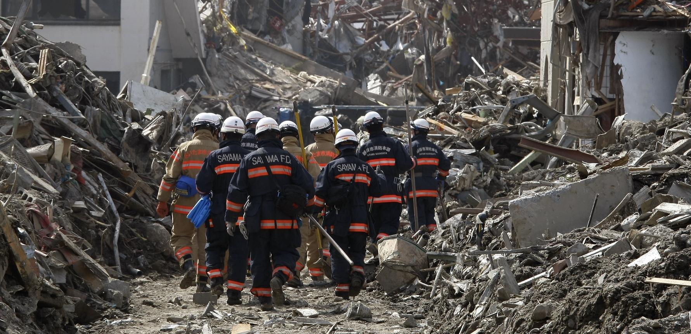

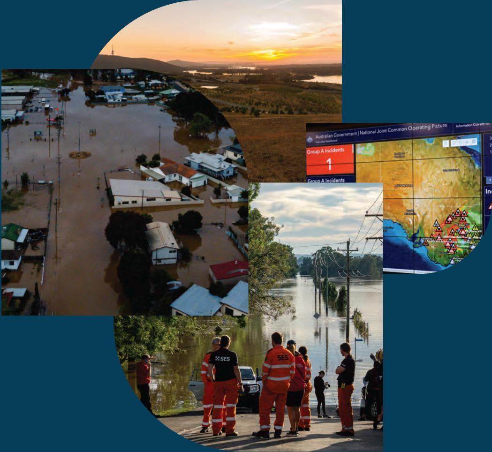

---
## Page 2

   
2 
  Crisis Appreciation and Strategic Planning       
 
 
Acknowledgment of Country 
In the spirit of reconciliation, NEMA acknowledges the Traditional Custodians 
of Country throughout Australia and their connections to land, sea and the 
community. We pay our respects to their Elders past and present and extend 
that respect to all Aboriginal and Torres Strait Islanders peoples today.

---
## Page 3

   
3 
  Crisis Appreciation and Strategic Planning       
Copyright  
All content in this publication is provided under a Creative Commons Attribution 4.0 International (CC BY 4.0) 
licence.  
http://creativecommons.org/licenses/by/4.0/ with the exception of: 
• 
the Commonwealth Coat of Arms 
• 
the National Emergency Management Agency (NEMA) corporate logo 
• 
photographs of NEMA staff and premises 
• 
content provided by third parties – including photographs, logos, drawings and written descriptions of 
patents and designs  
Third party copyright  
NEMA has made all reasonable efforts to: 
• 
clearly label material where the copyright is owned by a third party 
• 
ensure that the third party has consented to this material being presented in this publication. 
Permission may need to be obtained from third parties to re-use their material.  
© Commonwealth of Australia 2024  
The CC BY licence is a standard form licence agreement that allows you to copy and redistribute the material 
in any medium or format, as well as remix, transform, and build upon the material, on the condition that you 
provide a link to the licence, you indicate changes were made (if any), and you attribute the source material as 
follows:  
Licensed from the Commonwealth of Australia under a Creative Commons Attribution 4.0 International 
Licence. Contact NEMA (contact@nema.gov.au) if you have any enquiries about NEMA’s copyright licence or 
the use of material in this publication.

---
## Page 4

   
4 
  Crisis Appreciation and Strategic Planning       
Version Details 
Version # 
Date of Issue 
Brief description of change 
1.1 
May 2024 
Establishment of version control  
1.2 
July 2024 
Terminology update. CASP template update. Completed CASP update. 
1.3 
August 2024 
Addition of ‘A new Paradigm’ on page 9. Review of wording and grammar 
across Guidebook.  
1.4 
January 2025 
Administrative and formatting updates 
1.5 
August 2025 
Inclusion of copyright information 
1.6 
January 2026 
Update to Appendix B & C. Inclusion of ‘Recommendations’ on page 27. 
Update of CASP process graphic.

---
## Page 5

   
5 
  Crisis Appreciation and Strategic Planning       
 
 
Contents 
Introduction .......................................................................................................................................................... 7 
The Changing Face of Crises .............................................................................................................................. 8 
The CASP Approach ......................................................................................................................................... 12 
Conceptualising the Levels ................................................................................................................................ 15 
CASP Methodology Overview ........................................................................................................................... 18 
Time ............................................................................................................................................................... 20 
 ....................................................................................................................................................................... 20 
Defining the Environment ............................................................................................................................... 20 
Strategic Analysis ........................................................................................................................................... 20 
Developing Courses of Action ........................................................................................................................ 20 
Execution ....................................................................................................................................................... 21 
CASP Process How-To Steps ........................................................................................................................... 22 
Defining the Environment .................................................................................................................................. 24 
Strategic Analysis .............................................................................................................................................. 29 
Articulating and Validating Strategic Intent .................................................................................................... 30 
Determining Priorities ..................................................................................................................................... 31 
Conducting Gap Analysis ............................................................................................................................... 32 
Defining the Planned End State ..................................................................................................................... 33 
Developing an End State ............................................................................................................................... 34 
Developing Lines of Effort and Success Conditions ...................................................................................... 34 
Identifying Essential Strategic Tasks ............................................................................................................. 35 
Updating the Time Wedge and Effects of Time ............................................................................................. 35 
Developing Key Messages ............................................................................................................................ 35 
Developing Courses of Action ........................................................................................................................... 36 
Executing  the Plan ............................................................................................................................................ 39 
CASP Outcomes ............................................................................................................................................ 40 
Providing Strategic Tasks .............................................................................................................................. 40 
Coordinating and Synchronising Efforts......................................................................................................... 40 
Conclusion ......................................................................................................................................................... 41 
Appendix A: CASP Template ............................................................................................................................ 43 
Appendix B: CASP Example ............................................................................................................................. 49

---
## Page 6

   
6 
A catastrophic disaster is what is 
beyond our current arrangements, 
thinking, experience and imagination 
(i.e. that has overwhelmed our 
technical, non-technical and social 
systems and resources, and has 
degraded or disabled governance 
structures and strategic and 
operational decision-making 
functions). 
– Australian Disaster Preparedness 
Framework 2019 
  Crisis Appreciation and Strategic Planning       
OFFICIAL 
OFFICIAL 
 
 
 
 
 
 
 
 
 
 
 
 
 
 
 
 
Foreword 
 
The National Emergency Management Agency 
(NEMA), is Australia’s National Disaster Management 
Organisation. NEMA delivers programs, policies and 
services that strengthen the national security and 
emergency management capability of Australia. NEMA 
coordinates the Australian Government’s physical and 
financial support following emergencies and disasters 
in collaboration with state and territory governments, 
which manage emergency responses within their 
jurisdiction. 
Given the increased complexity, intensity and 
frequency of disasters and crises in Australia, NEMA 
has developed a repeatable strategic planning tool to 
make sense of complex issues related to crises and 
disasters using a national perspective.  
The Crisis Appreciation and Strategic Planning (CASP) 
employs a structured, systematic methodology to 
analyse complex scenarios and is the Australian 
Governments preferred planning tool in line with the 
Australian Government Crisis Management 
Framework (AGCMF). CASP is a set of tools that 
allows timely integration of information from multiple 
sources and the exploration of how government, not-
for-profit and private sector efforts can integrate to 
provide a unified response.  
 
1 AIIMS manual 2017 
 
 
 
 
 
 
 
 
 
 
 
 
 
 
 
 
 
 
 
CASP was developed using a research process that 
generated solutions to practical problems and 
empowered practitioners to develop and test the tool. 
CASP draws on approaches used by the military, 
human-design thinking and the Australasian Integrated 
Inter-services Management Systems (AIIMS)1. The 
process has been tested and refined using real-world 
disaster and crisis management responses.  
This guide is an introduction and overview of the 
CASP methodology. It provides a detailed illustration 
of the purpose, inputs, outputs and outcomes for each 
phase.  
 
Joe Buffone 
Deputy Coordinator-General (2022 – 2025) 
Emergency Management and Response Group 
National Emergency Management Agency

---
## Page 7

  
7 
  Crisis Appreciation and Strategic Planning       
OFFICIAL 
OFFICIAL 
Introduction 
 
Under Australia’s constitutional arrangements, state 
and territory governments have primary responsibility 
for emergency management within their jurisdiction. 
However, the effects of severe or widespread disasters 
could exceed the capacity of an individual jurisdiction. 
These effects are exacerbated in the context of a 
catastrophic disaster.  
The Australian crisis management arrangements bring 
together the efforts of governments, the private sector, 
volunteer agencies and communities to coordinate 
emergency management. These arrangements are 
based on a high level of trust and cooperation with 
stakeholders and communities. 
Since 2000, Australia has responded successfully to a 
diverse range of incidents. Despite this, the 2009 
Victorian Bushfires Royal Commission final report, the 
2011 Victorian Floods Review final report and the 
report of the 2011 Perth Hills Bushfire Inquiry, all 
highlight limitations of incident management. In 
addition. Recent disasters have highlighted that a 
diverse range of agencies should work towards a 
shared objective using a consolidated plan2 that links 
tactical actions to the strategic whole.3 Traditional 
incident-management approaches have not been 
structured to meet these requirements. 
 
 
 
 
 
 
 
 
 
 
 
 
2 Conway, G. 2012. ‘AIIMS Doctrine: have we got the fundamentals right?’, 
Australian Journal of Emergency Management vol. 27(2). 
 
 
 
 
 
 
 
The Royal Commission into National Natural Disaster 
Arrangements established in response to the extreme 
bushfire season of 2019-20 found that planning was an 
essential element of being prepared for responding to 
disasters and to be effective planning should involve 
all levels of government, private sector entities and 
non-government organisations. Specifically, planning 
must identify possible consequences across the social, 
built, economic and natural environments. Managing 
catastrophic disasters through a command-and-control 
model is no longer enough to cover the strategic levels 
of planning and decision-making in the recurrent and 
volatile, uncertain, complex and ambiguous 
environments (VUCA) that catastrophic disasters 
present. Leaders must make sense of the complexity 
inherent with emergencies and disasters. Effective use 
of strategic planning in the planning and execution 
stages of crises provides the vision and the necessary 
information for skilled personnel at operational and 
tactical levels to carry out their activities aligned to the 
strategic intent and with unity of effort.  
 
 
3 Conway, G. 2012. ‘AIIMS Doctrine: have we got the fundamentals right?’, 
Australian Journal of Emergency Management vol. 27(2). 
Governments, at all levels, ensure reasonable protections from emergencies and 
disasters. When emergencies occur, communities are served best by effective 
preparedness, response, relief and recovery efforts.

---
## Page 8

   
8 
  Crisis Appreciation and Strategic Planning       
 
 
 
The Changing 
Face of Crises 
Crisis Appreciation 
Strategic Planning

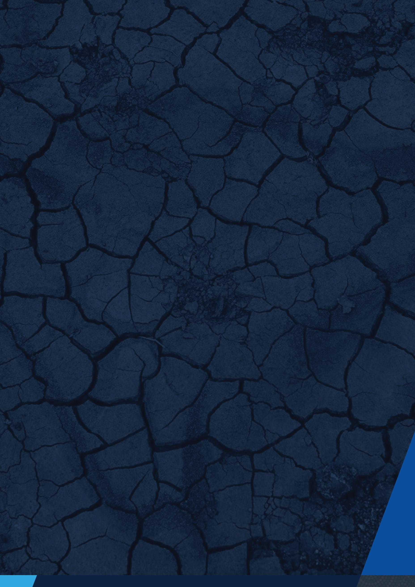

---
## Page 9

   
9 
  Crisis Appreciation and Strategic Planning       
The Changing Face of Crises 
 
 
 
These characteristics are exacerbated by: 
- 
concurrent and consecutive events that require 
emergency management agencies to apply 
resources judiciously in response to the 
immediate incident and to reduce decision delay 
to meet accountabilities and governance 
expectations 
- 
compounding effects of concurrent and 
consecutive events that result in first-, second- 
and third-order consequences where a nationally 
coordinated response allows national and 
international capabilities and capacity to be 
leveraged  
- 
complexity that increases with the scale and 
frequency of events, compounded with 
concurrency challenges, requires multi-policy and 
multi-jurisdictional responses.4 While emergency 
management arrangements make provisions for 
states and territories to request assistance from 
other jurisdictions and from the Australian 
Government,5 unifying organisational missions, 
cultures and structures (including the private 
sector, non-government organisations and 
volunteers) remains a challenge. 
The challenges of managing contemporary crises has 
moved from problems that are ‘complicated’ to 
problems that are ‘complex.   
As society becomes more interconnected and 
interdependent, expectations increase as do the 
consequences of failure.  
 
 
 
 
4 https://www.mmc.com/content/dam/mmc-web/Files/Strategic-Crisis-Management-
paper-July-2013.pdf 
 
 
 
 
 
 
 
The stakes are potentially higher as we operate in an 
environment where actions (or inaction) can have 
secondary effects and detrimental consequences. 
Historically, incidents were typically linear and isolated.  
Now, incidents and disasters can overlap and produce 
waves of second- and third-order effects as well as 
challenges. 
As the scale and frequency of incidents increase, 
emergency managers and incident leaders face a 
spectrum of consequences with proportionately fewer 
resources. 
The challenges are considerable: 
- 
Aligning disparate missions, cultures and 
structures: Current emergency management 
arrangements make provisions for state and 
territories to request assistance from jurisdiction 
and the Australian Government, however, it 
remains a challenge to define and articulate 
shared-objectives across the broad-range of 
organisational missions, cultures and structures 
(including the private sector, non-government 
organisations and volunteers). 
- 
Allocating resources during consecutive and 
concurrent events: On any given day there is a 
finite number of responders and resources 
available to emergency managers. Consecutive 
and concurrent events require emergency 
managers to prioritise and apply resources 
judiciously. They must also support decision-
making at all levels in volatile, uncertain, complex 
and ambiguous situations while meeting 
accountabilities and government expectations. 
 
5 Handbook 9: Australian Emergency Management Arrangements, pp. 4-5. At: 
https://knowledge.aidr.org.au/media/10162/handbook_aema_web_2023.pdf. 
 
Complicated vs. Complex 
Complicated problems originate from causes that can be individually distinguished. They can be addressed 
piece-by-piece—for each input to the system there is a proportionate output. The relevant systems can be 
controlled and the problems they present admit permanent solutions. 
On the other hand, complex problems result from networks of multiple interacting causes that cannot be 
individually distinguished. They cannot be addressed in a piecemeal way, and they are such that small inputs 
may result in disproportionate effects. The problems they present cannot be solved once and forever but need to 
be systematically managed. 
 – Roberto Poli, Author of Working with the Future:, Ideas and Tools to Govern Uncertainty

---
## Page 10

   
10 
  Crisis Appreciation and Strategic Planning       
- 
Balancing potential vs. ongoing needs: No one 
knows when the next crisis will occur. Decisions 
to commit resources to a threat may be 
challenged by emerging or other critical threats. 
Emergency managers must make decisions 
regarding current needs while maintaining 
flexibility to meet unknown future needs – 
factoring in recovery and resource variables.  
 
 
 
 
 
 
 
 
 
 
 
 
 
 
 
 
 
 
 
 
 
 
 
 
 
 
 
 
 
 
 
 
 
 
 
 
- 
A new paradigm: The heuristic model 
demonstrates the new paradigm.  The X axis 
indicates intensity and consequence and the Y 
axis depicts capability and capacity.  Once we 
move beyond severe, the rules change; the 
consequences and impacts will exceed our 
capability and capacity and the event over 
runs the system’s ability to respond. 
- 
Fostering trust with communities: In the 
technology and communication age, both 
accurate and inaccurate information can be 
communicated rapidly. Crisis leaders need to 
provide accurate information within their 
communities and shape the meaning that 
communities apply to these events to build or 
restore trust. This requires integrated crisis 
management that supports achieving shared 
strategic objectives.

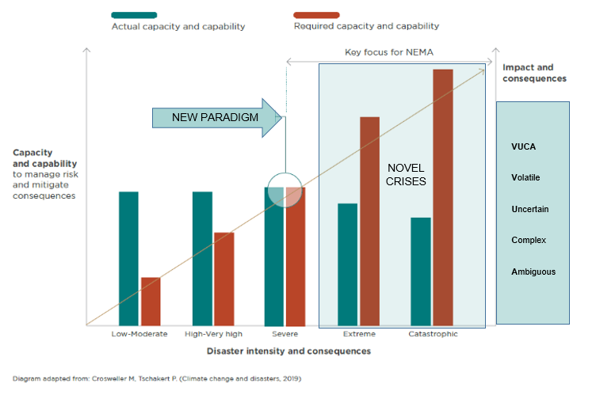

---
## Page 11

   
11 
  Crisis Appreciation and Strategic Planning       
The Organisation for Economic Co-operation and 
Development (OECD) identified the shifts in 
management between traditional preparedness 
and response phases and new crises.6 
 
(Tables 1 and 2 below outline the OECD shifts in crisis 
management) 
 
 
 
6 Organisation for Economic Co-operation and Development 2015. The Changing Face of Strategic Crisis 
Management.  
 
7 Principle of subsidiarity requires that decisions are made by people at the 
most local level possible. 
8 This may include establishing rosters of subject matter experts from a range 
of disciplines to support rapid mobilisation 
Table 2 – Response Phase 
Response Phase -  
Traditional Crisis Management 
Contemporary Crisis Management 
 
 
 
●  command-and-control systems 
●  standard operating procedures 
●  strict line of responsibilities 
●  sectoral approaches 
●  principle of subsidiarity7  
●  crisis identification and monitoring, role of expertise 
●  flexible and multi-purpose crisis management teams and facilities  
●  common concepts across agencies to inform leadership with highly adaptive 
capacities 
●  similar tools and protocols to be used for many crises 
●  international cooperation 
●  managing large response networks 
●  ending crisis and restoring trust (communications) 
●  seeking stakeholder feedback  
Collectively, this shows that roles and responsibilities of emergency and incident management continues to 
evolve. The traditional command-and-control model no longer generates the flexibility and adaptability 
required for strategic crisis planning and decision-making during complex crises in particular when dealing 
with a catastrophic disaster. Executed effectively, strategic emergency planning provides the necessary 
information and vision to allow operational teams to work with minimal friction and in alignment with the 
strategic intent.  
Table 1 – Preparedness Phase 
Preparedness Phase -  
Traditional Crisis Management 
Contemporary Crisis Management 
●  risk assessments based on historical        
events 
●  scenario based emergency planning 
●  training to test plans and procedures 
●  early warning systems based on monitoring, 
forecasting, warning, communication and 
linked with emergency response. 
●  risk assessment through horizon scanning, risk radars and forward-looking 
analysis to detect emerging threats 
●  frequent updates and different time scales, international analysis sharing and 
multi-disciplinary approaches8 
●  capability-based planning and network building 
●  strategic crisis management training to enhance agility and adaptability and 
develop and strengthen partnerships 
●  strategic engagement from government.

---
## Page 12

  
12 
  Crisis Appreciation and Strategic Planning       
OFFICIAL 
OFFICIAL 
 
The CASP 
Approach 
Crisis Appreciation 
Strategic Planning

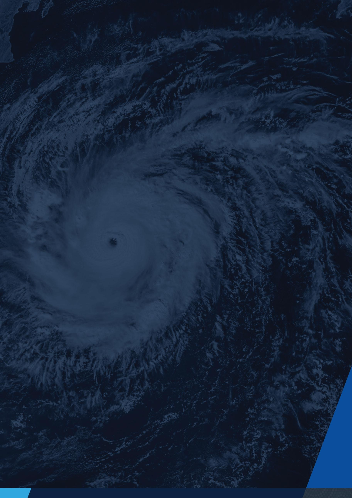

---
## Page 13

  
13 
  Crisis Appreciation and Strategic Planning       
OFFICIAL 
OFFICIAL 
The CASP Approach 
NEMA developed the CASP methodology to respond 
to the emerging complexity of crises. CASP consists of 
processes and products that make the complex 
simple. Simple – but not necessarily easy. The 
fundamental purpose for using CASP is to lower the 
risk of negative outcomes and increase the 
opportunities for positive outcomes. CASP 
accomplishes this through a structured, systematic 
methodology that uses strategic and critical thinking 
and conceptualising the big picture in emergency 
planning. It focusses on the consequence 
management rather than the hazard management.  
There is a range of incident management systems and 
coordination mechanisms used in Australia and 
internationally. These systems provide a common 
framework and support interoperability. However, they 
are designed for and are most effective at the 
operational level. They do not provide a framework for 
conceptualising or managing disasters and crises at 
the strategic level. The absence of a strategic focus 
has hampered unity of effort and synchronisation 
following large-scale incidents that required response 
across governments, non-government, private sector 
and community organisations and agencies. 
When compounded with the challenges of time 
constraints, planning teams can default to a cut-and-
paste mindset, reverting to what has been done in the 
past. In this instance, team members may make 
intuitive and rapid decisions based on their 
experiences rather than leveraging off collective 
experiences. While suitable for less complex tactical 
problems, this form of decision-making in volatile, 
uncertain, complex and ambiguous conditions 
diminishes the level of rigour in decision-making, 
CASP therefore provides a process that maintains the 
rigour of critical thinking and analysis for planning and 
responding to such crises. 
The CASP process facilitates diversity of thought, 
perspective and input so that informed decisions guide 
operations. It requires team input at critical steps 
during planning to create a ‘common operating picture’ 
(COP) that informs decisions and generates meaning.  
Using the CASP process, decision-makers evaluate 
and categorise risk to ensure appropriate priority of the 
values at risk. The CASP creates a record of 
decisions, and documents how decisions were made.  
This addresses shortfalls in previous responses 
identified by the Royal Commissions and inquiries. The 
outputs generated by using CASP, whether targeted at 
senior leaders or operational, are simple, clear, 
understandable and actionable. The CASP 
methodology is a practical guide to plan and manage 
challenges systematically including: 
Concurrent events: CASP helps managers triage and 
prioritise values at risk, lines of effort and objectives. 
Managers can align strategic, operational and tactical 
actions for the greatest effect with finite resources. 
Using the CASP process informs options where 
maximum gain is achieved with the least amount of 
risk necessary. Using CASP, managers can build a 
shared understanding of the operations, priorities and 
risks.  
Consequence of uncertainty: CASP captures the 
variables inherent in a volatile, uncertain, complex and 
ambiguous event and provides a framework to develop 
multiple courses of action and contingency plans. This 
framework enables multiple efforts to be synchronised 
over space and time in a way designed to keep as 
many options open for as long as possible. 
Complexity: Emergency/Crisis managers are required 
to deal with a range of strategic and operational 
matters associated with a crisis. In addition, they are 
required to consider consequences driven from 
political, security, infrastructure and socio-economic 
issues. CASP allows managers to capture, evaluate 
and prioritise multiple and varied issues in complex 
environments. This helps planning teams identify 
potential concerns before they occur or escalate and 
allows them to address risks and issues early.  
Communications: CASP helps managers prioritise 
critical event messaging. This can give clarity to senior 
leadership, operational and tactical personnel, 
partners, stakeholders and the public by providing 
critical information about actions and decisions that 
can create confidence.  
 
 
 
 
 
 
“It is a simple task to make 
things complex, it is a 
complex task to make things 
simple. 
– Chinese Proverb

---
## Page 14

   
14 
  Crisis Appreciation and Strategic Planning       
The CASP Approach 
The CASP methodology was developed utilising elements of the Joint Military Appreciation Process (JMAP) and 
human-design thinking. In 2023 CASP was recognised as the principle emergency management strategic planning 
tool for the Australian Government.  
 
 
 
 
 
 
 
 
 
 
 
Figure 2: The timeline of the CASP approach.

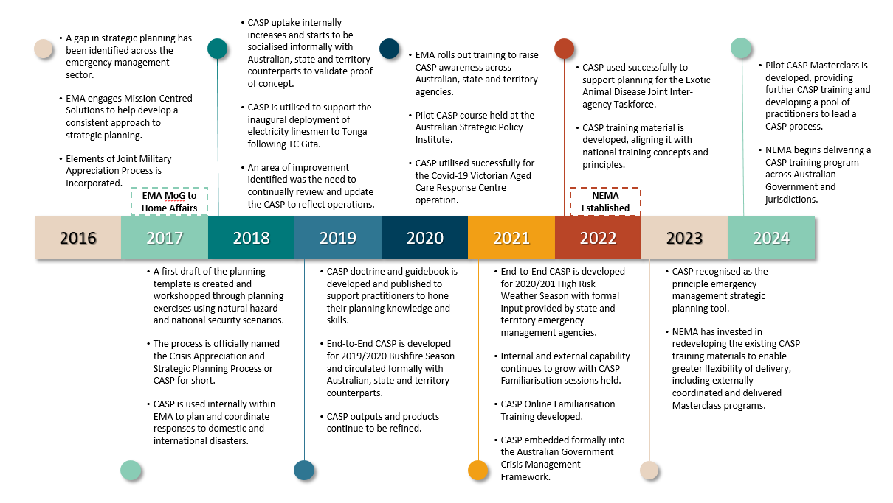

---
## Page 15

   
15 
  Crisis Appreciation and Strategic Planning       
Crisis Appreciation 
Strategic Planning
Conceptualising 
the Levels

---
## Page 16

  
16 
  Crisis Appreciation and Strategic Planning       
OFFICIAL 
OFFICIAL 
Conceptualising the Levels of 
Crisis Management 
 
 
Figure 3: Level of emergency and crisis management include the 
strategic, operational and tactical levels. 
Strategic Level 
At the strategic level of emergency and crisis 
management, national or multi-national objectives are 
set and resources are identified. Whether the event is 
jurisdictional or national in scale, early efforts must 
reach a unified approach to achieve the objective. 
There is ample doctrine that supports decision making 
and action at the tactical level, however, strategic-level 
intent has had a less prominent role. CASP addresses 
this gap. Conceptually, what constitutes the strategic 
level depends upon the nature of the crisis.  
The strategic level can be characterised as: 
1. Temporal (a span of time) generally longer term 
and forward looking, making plans relating to the 
future. Future state is defined in terms of strategic 
goals, objectives and a pathway to achievement. 
This process depends on making assumptions 
based on information known at the time. This 
approach to pre-planning is essential in 
coordinating complex crises9.  
 
 
 
 
 
9 Preparing To Lead in a CRISIS – Dunn 2018.  
 
 
 
 
2. Responsive – to achieve an immediate objective. 
This element of the definition required 
overarching strategies to be considered when 
quickly producing a plan of action to respond to 
an emerging crisis. This especially relates to 
planning the response to an unforeseen crisis. As 
the response is initiated and progresses, senior 
leaders must ensure that “big picture” and long 
term issues are not lost in the midst of high-
tempo activity that is associated with a crisis 
response.  
These two approaches are often used in isolation and 
applied to specific spheres. Senior crisis leaders 
should address both aspects of strategy concurrently. 
Activities at the strategic level provide the foundation 
for all response actions and priorities, defining the 
desired end states and providing the critical sense 
making to support the operational and tactical levels. 
The strategic level identifies constraints and assesses 
risks and consequences to guide the whole of 
government response. Decisions made at this level 
serve to influence and align action at the operational 
and tactical levels.  
Operational Level 
The operational level includes incident management 
systems. Here, the focus is on operational decision 
making and plans that implement the strategic intent.  
Activities at the operational level translate the strategic 
intent into implementation at the tactical level and 
provide a direct connection between the strategic level 
and the tactics used. CASP establishes and helps 
coordinate operational actions that accomplish the 
strategic intent. This is done through sequencing 
actions to achieve the operational objectives and 
coordinating resources to bring about and sustain 
these actions
Planning, decisions and operations are framed in the strategic, operational and tactical context. 
In practice, these do not operate in isolation and nor are they hierarchical. Each level interacts 
with the other, where the strategic level overlaps with the operational level and, to a significantly 
lesser degree, overlaps with the tactical level. The operational level overlaps with all areas in a 
more proportional level.

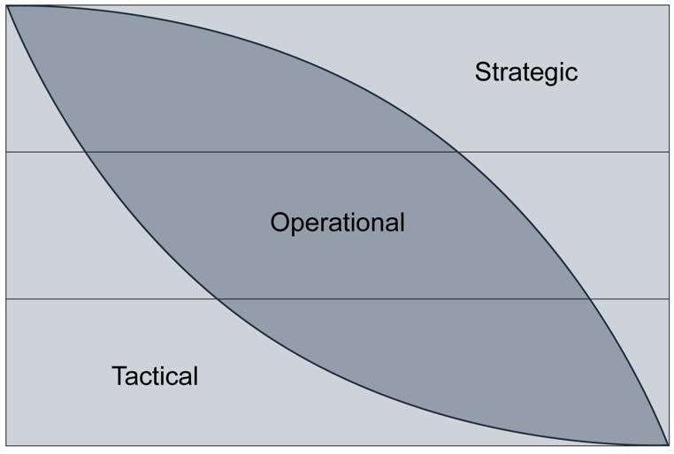

---
## Page 17

  
17 
  Crisis Appreciation and Strategic Planning       
OFFICIAL 
OFFICIAL 
Tactical Level 
The tactical level is where operational actions are 
planned and executed. Actions are conducted under 
the AIIMS guidelines. The work of Incident 
Management Teams (IMTs) is tactical because the 
planning periods are usually 24 to 48 hours. AIIMS is a 
mature and tested system and is effective for 
assigning and executing day-to-day response 
operational actions and activities. 
 
 
 
 
 
 
 
 
 
 
 
 
 
 
 
Relationship between Levels 
Figure 4 shows where CASP and AIIMS fit together. In 
AIIMS, incident management structures are designed 
along hierarchal strata. However, this does not 
represent crisis management in practice. People at 
every level work and cooperate across all levels in 
order to successfully bring order to chaos. Figure 2 is 
representative of how all people at all levels work 
together in a unity of effort.
 
 
 
 
 
 
 
 
 
 
 
 
Figure 4: Where CASP and AIIMS fit together 
 
Strategic managers must have sound situational awareness – ‘ground truth’ – and may intervene in operational or 
tactical actions where these actions have negative implications or have varied from the strategic intent. Tactical 
responders are most successful when they understand the strategic intent and, second- and third-order 
consequences of their tasks. Operational leaders are the bridge between the strategic intent and what results on 
the ground.

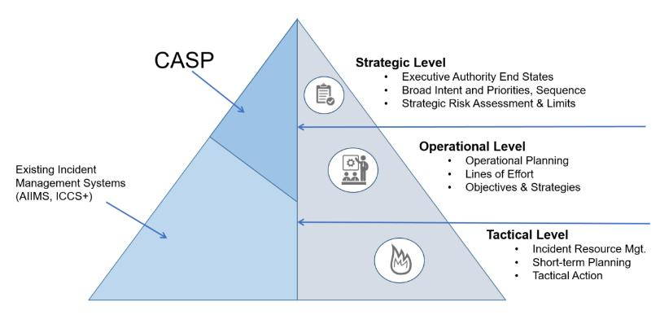

---
## Page 18

  
18 
  Crisis Appreciation and Strategic Planning       
OFFICIAL 
OFFICIAL 
Crisis Appreciation 
Strategic Planning
CASP 
Methodology 
Overview

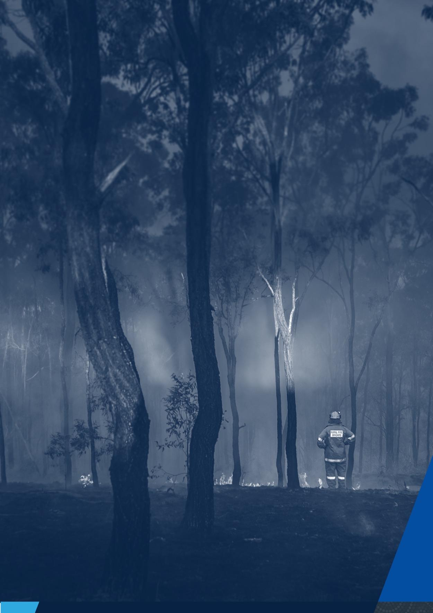

---
## Page 19

  
19 
  Crisis Appreciation and Strategic Planning       
OFFICIAL 
OFFICIAL 
CASP Methodology Overview 
 
 
 
 
The CASP methodology consists of four major steps as shown in Figure 5. 
 
 
 
Figure 5: the CASP methodology flows from defining the environment to executing the tasks.

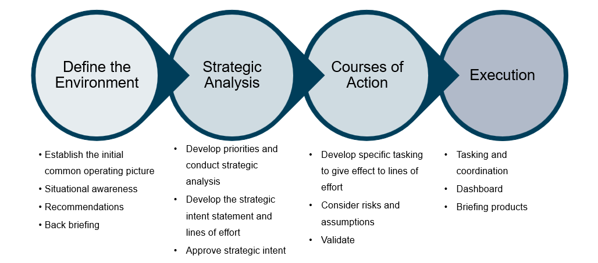

---
## Page 20

   
20 
  Crisis Appreciation and Strategic Planning       
Time All planning takes place within the constraints of 
time. 
 
 
 
 
 
 
 
 
 
 
 
 
 
Figure 6: Time – 1/3 planning and analysis, 2/3 
implementation.  
 
The relationship between time and decision-making is 
best expressed as a wedge.   
Once you recognise a problem and begin to consider 
options, you enter the Time Wedge. In the wide end, 
you have many options and choices. As time moves 
you to the right, you have fewer and fewer options until 
you reach a point where the environment makes your 
decision by default.   
 
Within CASP there are multiple time wedges.  One of 
the first time wedges for consideration in the CASP 
process is the allocation of time for each of the four 
steps of the CASP process.  Appropriate time must be 
allocated to undertake each step.  Once you have 
established the time you have available to generate 
the initial CASP, you must plan to the time of impact 
for a cyclone or bushfire, to time required to load, 
move and stage resources for a course of action to be 
effective. All time wedges are best managed through 
backward planning. Starting at the pointy end of the 
wedge and working backward, to the left, incrementally 
allocating time to each phase or step required to 
ensure a plan or operation can be accomplished within 
the overall time available. 
 
A principle of CASP is 'Speed to Action'. In planning 
for critical large-scale emergencies, CASP will almost 
always occur in a volatile, uncertain, complex and 
ambiguous (VUCA) environment. In planning for. 
Everyone will want more time to be certain of data and 
facts. There are several planning maxims that state 
that a 50% plan well executed will always beat a 100% 
plan that the evolving situation makes obsolete by the 
time the ink is dry. 
 
To be successful, the planning team has to accept that 
60-70% information certainty is “what right looks like” 
in initial CASP planning. Taking more time to be more 
accurate or comfortable in certainty is robbing critical 
time for action by others in the overall time wedge of 
the event. 
 
Defining the Environment 
Defining the environment creates a ‘common operating 
picture’.  The common operating picture includes the 
situational awareness and involves consideration and 
sense making of the current and potential 
circumstances.  The process can include discussion, 
analysis of potential consequences and impacts, 
experience during similar events and research and 
data.  The process should be undertaken by planning 
team members and subject matter experts in order to 
build a robust, shared understanding of the 
environment to inform the values at risk. 
Strategic Analysis 
The centrepiece of Strategic Analysis is the strategic 
intent statement which provides a high level who, 
what, when, where and why for the entire CASP and 
the actions it expects to generate.   
The Strategic Analysis process develops lines of effort 
to achieve a desired end state. The end state clarifies 
what the environment will look like once defined 
success conditions have been met.  
Following a disaster, communities usually have to 
adapt to a new normal. Identifying an end state helps 
define the new normal. It represents an achievable 
vision to align strategic and operational action.  
Once the strategic intent is developed, planners 
organise lines of effort to establish the success 
conditions necessary to achieve the end state.  
Developing lines of effort breaks down the situation 
into manageable, purpose oriented efforts (medical 
treatment, triage and transport, evacuation and shelter, 
and infrastructure restoration) that may have distinct 
end states and objectives. The lines of effort are a set 
of practical and workable actions that support the 
strategic intent. 
Developing Courses of Action 
Planners develop courses of action by identifying 
broad-scale actions and evaluating those actions and 
relevant enablers that are required to accomplish lines 
of effort. 
“You can ask me for anything 
you like, except time.”  
Napoleon to his generals

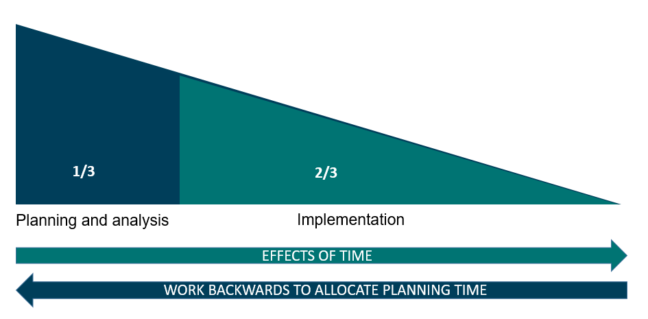

---
## Page 21

   
21 
  Crisis Appreciation and Strategic Planning       
Execution 
Execution and coordinating tasks involves breaking 
down the broad-scale courses of action into tasks and 
assignments appropriate for resources such as IMTs 
or strategic air lift. The form that these tasks and 
assignments take depends on agency-specific policies 
and requirements, for example a high level task may 
be the development of a briefing dashboard. 
Regardless of their form, tasks and assignments must 
align with the strategic intent and they connect to 
corresponding strategic priorities. In this way, 
operational and tactical personnel have a clear 
understanding of how their work fits into and supports 
the overall objectives.

---
## Page 22

  
22 
  Crisis Appreciation and Strategic Planning       
OFFICIAL 
OFFICIAL 
 
 
Crisis Appreciation 
Strategic Planning
CASP Process 
How-To Steps

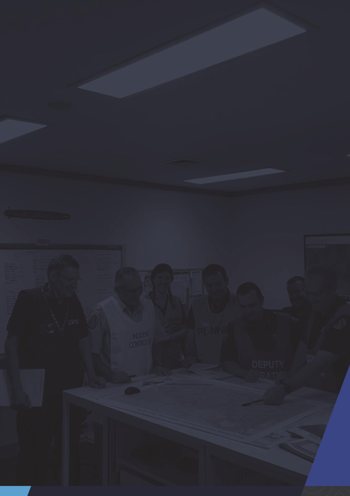

---
## Page 23

  
23 
  Crisis Appreciation and Strategic Planning       
OFFICIAL 
OFFICIAL 
“The planning is more  
important than the plan”.  
– Summary of several quotes by Winston 
Churchill and Dwight D. Eisenhower 
CASP - a practical approach 
through critical thinking 
 
The CASP process promotes disciplined critical 
thinking and team discussions to consider the scope 
and scale of an incident and the proposed response.  
The CASP is designed to produce meaningful 
responses to the consequences of a crisis. CASP 
centres on critical thinking, dialogue, analysis and 
understanding.  
The CASP template offers a structure to rapidly build 
situational awareness, interpret complex situations and 
develop shared understanding. Templates are tools to 
structure the deliberations and record conclusions and 
decisions. They can be recalled and connected to 
subsequent discussions and provide visual displays. 
Completed templates are combined into a common 
operating picture ‘dashboard’ so that context, 
relationships and decisions can be referenced. (See 
example dashboard at Appendix A) 
Critical thinking and rigour in the planning team 
dialogue are critical at each step of CASP. Research 
and practical experience overwhelmingly demonstrates 
the value of engaging key stakeholders and planners 
in this process.  
The process provides a structured means by which the 
CASP team brings together experience, intelligence, 
research and data to support analysis of the 
situation.  The rigour applied to each step ensures the 
efficacy of critical thinking and consideration of risks, 
resulting in the best possible outcomes from the CASP 
process. 
 
 
 
 
 
 
 
 
 
 
 
 
 
 
Good Practice 
 
Having a diverse group of key planners contributes 
and leverages each person’s unique perspectives, 
experiences, worldviews and functional expertise to 
develop shared situational understanding. The CASP 
Process can be facilitated efficiently by: 
Understanding and defining the intent and 
requirements of the CASP by developing a CASP 
Intent Statement to allow the planning team to achieve 
the identified task. 
Engaging a diverse and broad group of planners in the 
process is the most effective way to quickly develop 
shared meaning across the team. At the conclusion of 
the process, the planning team should have common 
awareness and understanding of the vast dimensions 
and aspects of the disaster, which allows them to be 
more effective in pursuing their specific functional 
responsibilities. 
Designating a CASP leader to provide coordination, 
oversight and focus and a time keeper to monitor time 
constraints. 
Establishing the team separate to other planning and 
operational activities. Use visual resources such as 
whiteboards or screens, in an area where information 
can be displayed and reviewed, as the team works 
through the process. Keeping people focused, 
interactively engaged and maintaining discipline to 
timings, assists in completing the process. 
Conducting the initial process using a small group of 
planning specialists and then validating decisions, and 
conclusions with subject matter experts or other critical 
stakeholders that have equity in the outcomes of the 
CASP.  
Drawing in a broader group of stakeholders to validate 
the decisions and conclusions to build awareness and 
understanding of the dimensions and aspects of the 
event, particularly those that have equity in the lines of 
effort.

---
## Page 24

  
24 
  Crisis Appreciation and Strategic Planning       
OFFICIAL 
OFFICIAL 
Crisis Appreciation 
Strategic Planning
Defining the 
Environment

---
## Page 25

  
25 
  Crisis Appreciation and Strategic Planning       
OFFICIAL 
OFFICIAL 
Defining the Environment 
Template fields 
CASP Intent Statement: provides clear direction to 
the planning team on CASP tasking. The CASP Intent 
Statement should be the first step of the process, 
articulating the purpose and intent of the CASP to the 
planning team. It should include: 
• 
who 
• 
to conduct what essential task 
• 
subtask 
• 
action 
• 
what 
• 
when 
 
 
 
 
Example: The Crisis Coordination Team undertakes 
planning on behalf of the Australian Government to 
determine potential support options for Jurisdictions in 
response to severe flooding events on the east coast. 
The initial CASP is to be completed in 3 hours, for a 
planning period of 10 days.
Figure 7: The CASP methodology flows from defining the environment to executing the tasks. 
Defining the environment involves laying the foundation of the common operating picture by outlining the incident 
environment. Initial first discussions establish the scope to ensure that the planning team fully understands the 
incident parameters and that the critical issues are highlighted. Inputs include data from situation reports, media or 
other sources (formal and informal). 
The length of time required to establish the initial common operating picture varies and can be 15 – 20 minutes for 
‘no notice’ incidents, 30 – 45 minutes for emerging incidents and more than 60 minutes for long-range incidents.  
Note: 
The process of collecting, assessing and documenting information to define the environment is an ongoing and iterative 
process. The first attempt may be quick and rough. The components of the common operating picture should be 
improved as soon as time and resources allow. It should be reviewed and updated daily and more often if the incident 
warrants.  
Scoping the Incident Environment and establishing a Common Operating Picture (COP). 
The incident environment template allows teams to establish the primary components of the common operating 
picture.

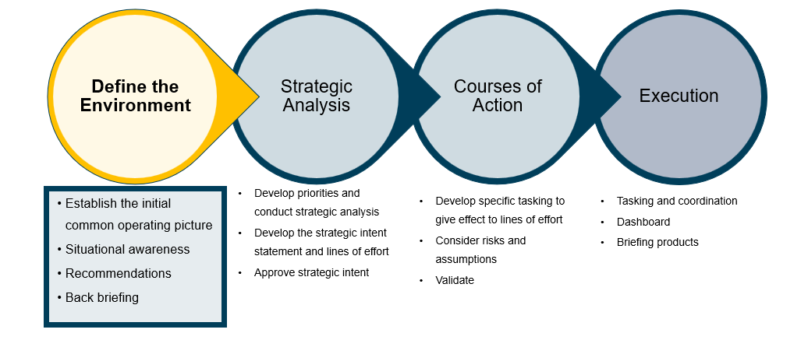

---
## Page 26

  
26 
  Crisis Appreciation and Strategic Planning       
OFFICIAL 
OFFICIAL 
Area of Operations: the geographical area directly 
affected by the emergency or crisis and where tactical 
operations will occur. It might include areas of bushfire, 
flood, cyclone, dam failure or earthquake etc., or the 
location where activities such as search and rescue, 
fire suppression or infrastructure reconstruction might 
occur.  
Area of Interest: extends beyond the area of 
operations to include locations that may be affected by 
second- and third-order consequences of the incident. 
For example, a community that has been isolated 
because of damage to an access road. Planners 
should identify areas that are affected as well as those 
that may be affected.  
Area of Consequence: the broadest view of the 
incident and includes second-, third- and fourth-order 
effects. This area can extend to other jurisdictions and 
to other countries or influence socio-economic 
systems.  
Example: A monsoon trough in 2019 caused 
significant flooding in North Queensland. The flood had 
second-order effects on the cattle industry and third-
order effects on wine production and prices. In 
addition, there were fourth-order effects of economic 
impacts on the rest of the country in some form. In 
defining ‘area of consequence’, planners measure 
effects on communities such as disruptions to 
government services, people’s livelihoods, education 
and recreation as well as critical infrastructure or 
supply lines that disrupt supply chains for food or 
industry.  
Note: 
When considering time effects, a good-practices 
approach is a one-third/two-third rule. Working back 
from the action required, one-third of time should be 
spent on planning and two-thirds on executing the 
task.  
Weighing Critical Factors and PSESIIE 
Dimensions 
After developing the parameters of the incident 
environment, planners weigh critical factors and the 
Public Administration, Social, Economic, Security, 
Infrastructure, Information and Environment (PSESIIE) 
dimensions.  
The focus on critical factors generates robust 
discussion to consider the situation from all aspects. 
Critical factor groupings are taken from the 
philosophy of Sun Tzu, a strategic genius who wrote 
The Art of War in 500 BC. Sun Tzu’s philosophy 
assesses information through the lens of contrast, 
assessing elements from opposing points of view. The 
result is a well-rounded and comprehensive appraisal 
of the situation.  
When weighing critical factors, the team considers 
eight blocks of situational intelligence: 
• 
The unknown versus the known. 
• 
What can be controlled or influenced versus 
what cannot be controlled or influenced.  
• 
Relative strengths versus relative weaknesses. 
• 
Inherent dangers versus unique opportunities. 
PSESIIE dimensions show that incidents are ultimately 
about disruption to societal norms, systems and 
expectations. Incident leaders account for these 
impacts and opportunities to achieve the mission. 
The strategic aspects of an incident can be identified 
and assessed by considering the PSESIIE dimensions. 
The incident isn’t resolved until disruptions to the 
PSESIIE dimensions are resolved or mitigated. It is 
important to note that some topics, such as shutting 
down a power grid, may apply to multiple PSESIIE 
dimensions.  
• 
Public Administration: the attitudes and 
concerns of governments, public administration, 
political and public figures or groups towards a 
problem, policy or actions; the probable effects of 
the incident or response actions on these figures 
or groups.  
• 
Social: the consequences to humans and the 
way they live, work, play, relate to each another, 
organise to meet their needs and cope as 
members of society. This includes cultural 
aspects involving changes to the norms, values 
and beliefs that guide and rationalise people’s 
cognition of self and society. These may be short-
term effects or long-term changes. 
• 
Economic: the direct damage caused to physical 
structures and structure content as well as the 
indirect damage caused when people lose 
incomes and livelihoods. Direct and indirect 
damage cause adverse longer-term 
consequences for economic stability, growth, 
development and poverty reduction. These 
consequences are generally negative but 
economic opportunities can be identified. 
• 
Security: the protection of human, physical and 
intellectual assets. Security also embodies the 
personal, emotional and mental sense of being 
secure. 
• 
Infrastructure: the damage to essential services 
of shelter, water and sanitation, power (electricity, 
gas, oil, coal), transportation (road, rail, air, 
water), communications (radio, landlines, mobile 
phone, satellite phone), technology (internet), 
food production and distribution, public health and 
medicine (hospitals, emergency medical 
services), financial services and security services 
(military, police, corrections). 
• 
Information: the public perception of the incident 
and the effects of influencers and advocates. This

---
## Page 27

   
27 
  Crisis Appreciation and Strategic Planning       
includes the information needs of people and 
organisations, creating and distributing relevant 
information and key messaging. 
• 
Environment: the environmental and heritage 
values where direct or indirect damage may 
cause long lasting effects on the environment or 
society. These are considered in the context of 
the areas of operation, interest and consequence. 
Collectively, the assessments of the critical factors and 
PSESIIE dimensions become the context of the 
incident and are fundamental to the common operating 
picture.  
Note: It is best to examine and discuss the critical factors 
and PSESIIE dimensions simultaneously with two 
scribes, each capturing ideas for each one. The 
scribes need to be attentive to what people are saying 
to determine where the information fits in the 
templates. When a piece of information could apply in 
several areas, it may be a strong indicator that that 
issue has a higher level of priority. 
Threat Effects – Most Likely or Most Dangerous: 
this section requires planners to consider and describe 
the unfolding incident. Predictions rely on team 
members’ intuition and are based on collective 
expertise, experience and what is known about the 
event. The team’s collective assessment of the Most 
Likely predictions shapes primary efforts with common 
sense solutions. The Most Dangerous predictions 
presses team members (and those they brief) to 
consider credible worst-case scenarios and identify 
trigger points for escalation. 
Time Effects: in considering time effects, team 
members discuss the urgency of their planning efforts 
in relation to the incident and its management. 
Depending on the status of the incident, considerations 
may include how to best spend time before an event 
(such as the landfall of a cyclone) or when outputs of 
the planning process, such as recommended courses 
of action, need to be complete.  
 
Identifying Values at Risk 
The significance of an incident is defined by the level 
and scope of social disruption. Identifying the societal 
components—the ‘values at risk’—that are being 
threatened or disrupted is important. To counter 
threats to societal values, it is essential to identify what 
those values are, why the threats are meaningful and 
their level of significance. 
This high-level consideration includes values at risk 
that have strategic implications. Developing a 
complete list of values at risk guides all downstream 
activities, such as resource prioritisation and 
allocation, financial expenditures, hazard and risk 
mitigation and other critical decisions. 
The template ‘Values at Risk’ structures discussions 
regarding the values at risk. 
• 
Values at risk: the high-level incident priorities of 
human life, critical infrastructure, basic human 
needs, ecosystems and law and order. 
• 
Description of values at risk: provides clarity 
and detail for the high-level priority. For example, 
if the value at risk is critical infrastructure, the 
description might define the specific aspect of the 
critical infrastructure component at risk (e.g., 
water supply to the city of 100,000 people). 
• 
Jurisdiction/ownership: the agency, entity or 
authority that is responsible for the value; public 
or private, government or non-government. This 
can be as specific or general as necessary to 
identify the stakeholders or responsible parties 
needed for management and coordination. 
• 
Consequences: the assessment of the scope 
and scale of the incident on life, health and safety 
as well as the PSESIIE dimensions. Previous 
discussions measure probability, so here 
managers consider the potential severity of the 
impacts.  
Example: 
If a city’s water supply is at risk of being polluted 
and rendered unusable for a long period of time, 
the situation would significantly affect the lives and 
health of residents and there would likely be 
significant PSESIIE consequences. 
• 
Priority the first pass through the worksheet to 
identify values at risk allows assessment of the 
potential effects. It is too early for an accurate 
assessment of the relative priorities. Ranking the 
relative priority of the values at risk can be 
challenging. Team members weigh low 
probability, high consequence threats against high 
probability, low consequence situations. The 
priorities determined should align with the overall 
incident priorities. Once in place, priorities inform 
the allocation of resources, justify the expenditure 
of money and balancing the operational risk 
versus benefit.  
Forming Big Questions and Key 
Assumptions 
Working through the incident environment, critical 
factors, PSESIIE dimensions and values at risk, two 
important deliberations emerge: big questions and key 
assumptions.  
• 
Big questions: The three to five questions about 
primary unknowns that, once answered, have a 
significant impact on how the team views and 
manages the incident.

---
## Page 28

   
28 
  Crisis Appreciation and Strategic Planning       
Example: 
During a flood event, a question might be whether a 
critical and aging levee will hold or breach. Another 
could be the percentage of housing stock that is built 
to code and can withstand a specific category of 
cyclone. One outcome may create a set of 
opportunities while the other identifies threats and 
complexities.  
• 
Key assumptions: The assumptions made 
during initial assessment that, if verified or proven 
false, could have a significant impact on how the 
team views or manages the incident.  
Example: 
During the flood (see previous), the team builds into 
their common operating picture analysis that the 
weather for the foreseeable future is going to be warm 
and sunny and an assumption is made that the levy 
will hold. This assumption would be documented in 
template fields of Environment, Predictions (both Most 
Likely and Most Dangerous), Strengths, Opportunities 
and, potentially, all of the PSESSIIE dimensions. This 
assumption would influence subsequent planning 
steps including recommended actions, trigger points of 
concern, courses of action and so on. 
Documenting big questions and key assumptions, and 
incorporating them into the common operating picture 
dashboard gives them visibility. This reduces the 
possibility that changes to big questions and key 
assumptions are lost.  
Big questions and key assumptions are included in the 
common operating picture briefing to underscore the 
constraints or limitations of the team’s analysis and 
situational understanding. 
Establishing Trigger Points of Concern 
A recurring shortfall during planning is failing to identify 
conditions that warrant re-evaluating the plan and the 
assumptions on which it is built. Trigger points of 
concern are the situations and conditions that 
necessitate re-evaluation of any component of the 
common operation picture (incident environment, 
critical factors, PSESIIE dimensions, big questions and 
key assumptions).  
These trigger points include spatial or geographic 
factors (e.g., when the fire crosses Highway XX), 
temporal aspects (e.g. when the hurricane is 12 hours 
from making landfall) and event-specific activities (e.g. 
when a Coordination or Control Centre is 
overwhelmed). A list of trigger points is not all inclusive 
but identifies two to five high-impact conditions that, if 
triggered, would potentially challenge or confirm the 
validity of the common operating picture. Recording 
trigger points of concern within the common operating 
picture dashboard keeps them visible to planners and 
incident managers. 
 
Determining Immediate Actions 
Defining the environment focuses on the situational 
‘what’ and ‘so what’. Defining the immediate actions is 
based on ‘what is known so far’.   
Determining immediate actions can be limited but 
should remain at a high level. They could be: 
• 
do nothing 
• 
monitor progress 
• 
plan contingencies 
• 
activate systems, plans or resources on standby 
• 
mobilise and deploy resources immediately. 
Immediate actions should be documented and 
displayed as well as recorded in the common 
operating picture dashboard. 
 
Recommendations 
Recommendations delineate the high-level 
recommendations for other government agencies, or 
that require executive authorisation or whole of 
government consideration. The planning team may 
suggest actions or steps other responsible entities 
could undertake but these recommendations cannot 
be enforced.

---
## Page 29

  
29 
  Crisis Appreciation and Strategic Planning       
OFFICIAL 
OFFICIAL 
 
 
 
 
 
 
 
 
 
Crisis Appreciation 
Strategic Planning
Strategic Analysis

---
## Page 30

  
30 
  Crisis Appreciation and Strategic Planning       
OFFICIAL 
OFFICIAL 
Strategic Analysis 
 
 
Articulating and Validating Strategic Intent 
The steps taken to define the strategic intent statement 
should be linked directly back to the identified values 
at risk and likely strategic lines of effort.  The nature of 
the incident will determine to what extent the intent 
must be validated or formally approved.  The strategic 
intent statement should clearly articulate what the 
intent of the planning activity is for and include 
consideration of who, what, for, why and by when.   
Validating the strategic intent will align it with the 
executive decision-maker (senior department leaders 
and ministers). It is important to limit downstream 
confusion or conflict. Work conducted thus far is based 
on information the planning team has gleaned and 
synthesised in a relatively short period of time and it is 
directed at understanding the situation and defining 
what success looks like. While these efforts are the  
 
 
 
foundation of the team leader’s intent, the CASP 
process is about the executive authority’s intent. When 
the executive agrees that the team’s understanding 
and vision is consistent with their own, then trust is 
created, which is vital to shaping confidence, 
communication and cohesion. 
If formal approval is required the process should be 
identified early. It is essential to know who needs to be 
involved, their availability (24/7? office hours only? with 
1-hour notice or 24-hour notice?) and what actions can 
or cannot be taken if approval is absent?  
All of these can have a profound effect on the team’s 
ability to begin additional planning efforts and/or can 
limit operational activities. 
 
 
 
 
Figure 8: The CASP methodology flow from defining the environment to executing the tasks. 
 
Strategic Analysis involves four interrelated processes: 
● 
developing priorities 
● 
conducting gap analysis 
● 
developing desired end state 
● 
defining lines of effort and success conditions. 
Working through these processes defines what success looks like by describing the desired outcomes. Using the 
COP when defining the environment the planning team can define the leader’s intent and the vision for moving 
forward.

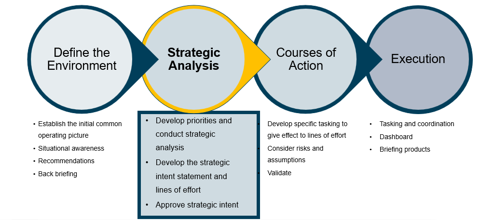

---
## Page 31

   
31 
  Crisis Appreciation and Strategic Planning       
 
Determining Priorities 
Managing an emergency or crisis is ultimately about 
making difficult choices concerning allocation of 
resources, expenditure, exposure to hazards or high 
levels of risk and, perhaps, life and death. These 
choices are often made with little time and, frequently, 
without guidance and permission through chains of 
authority.  
Incident priorities include generally accepted social 
and moral priorities of:  
1. 
preserving life  
2. 
suppling essential humanitarian needs 
3. 
preventing further harm or suffering  
4. 
maintaining governance and law and order  
5. 
providing essential services and infrastructure  
6. 
preserving cultural ethos and values  
7. 
maintaining communication and public trust. 
 
Incident priorities will always change. Whilst the 
protection of human life will always be the top priority, 
when using the CASP in an all hazards context. For 
example, in a maritime incident the protection of the 
environment may be number one priority if there is not 
risk to human life. Not all the priorities listed may be 
present in a given incident. Other priorities may be 
listed depending on need and the PSESIIE 
dimensions. However, most lists of incident priorities 
will be similar in order and description to the one 
shown. 
Planners validate incident priorities at a high (macro-
scale) level. The strategic planning team interprets 
executive intent and validates the incident priorities. 
Once the macro-scale incident priorities are validated, 
the team can revisit the values at risk and prioritise 
them to correspond with the incident priorities.  
Building on the work completed in ‘Defining the 
Environment’, the priority column on the Values at Risk 
Template is referenced, which informs the gap 
analysis discussion.

---
## Page 32

  
32 
  Crisis Appreciation and Strategic Planning       
OFFICIAL 
OFFICIAL 
Conducting Gap Analysis 
Examples of current (disorder) conditions include: 
• 
mass casualties 
• 
dangerous conditions to life 
• 
inadequate emergency and health services (e.g. 
‘ventilator capacity exceeded – 323 COVID-19 
ICU patients need access’) 
• 
outbreak of disease 
• 
lack of drinking water 
• 
lack of food 
• 
unsanitary conditions 
• 
people displaced, exposed 
• 
government services disrupted  
• 
lawlessness and civil unrest 
• 
air, ground, sea transport disrupted 
• 
major infrastructure damage 
• 
economic instability  
• 
power grid failure 
• 
communication networks damaged 
• 
environmental scale damage.  
 
 
 
 
 
 
 
 
 
 
 
 
 
 
 
 
 
 
 
 
 
 
 
 
 
 
 
Examples of desired conditions (acceptable order) 
include: 
• 
acceptably safe environment 
• 
emergency services available (e.g. ‘hospital, 
ICU and ventilator capacity meet patient 
requirements’) 
• 
disease controlled 
• 
adequate potable water 
• 
adequate food supply 
• 
acceptably clean environment 
• 
adequate shelter available 
• 
effective government services 
• 
effective judicial system 
• 
acceptable level of security 
• 
economic stability and opportunity  
• 
travel unrestricted  
• 
access to information 
• 
sustainable ecosystems 
• 
sense of community. 
 
The gap analysis involves comparing current conditions and desired conditions to identify what actions are 
necessary to bridge the gap from the current situation to the desired end state (refer figure 6). 
Current conditions are the reasons a strategic plan is needed. They are the disruption to society and social 
systems that often inform disaster/emergency declarations. The identified effects or disorders are key at a high 
level.  
For each identified disorder, the team identified the acceptable level of order. There are several caveats 
in determining what is acceptable: 
● 
It is essential to identify what it means to resolve each problem or disorder. 
●  
The key is to identify what is acceptable, as opposed to ‘back to normal’, fully fixed or rebuilt or what 
might be wanted in the long term.  
● 
Desired conditions should describe the acceptable state.

---
## Page 33

   
33 
  Crisis Appreciation and Strategic Planning       
 
 
Defining the Planned End State 
Establishing the planned end state is crucial to 
establishing organisational and situational alignment 
from the highest levels of political or executive 
authority out to tactically engaged resources. Gaining 
agreement on the planned end state and the 
definitions of success allows influence, resources and 
capabilities to be aligned towards achieving the 
desired end state.  
The end state is an expression of the nature and 
scope of the leader’s intent. The end state specifically 
describes what success looks like and gives operators 
a defined target for their actions. It may not mean that 
conditions are as they were before the incident 
because the situation may never be resolved to that 
degree.  
An operation will have success criteria specific to the 
phase. For example, the end state relative to incident 
stabilisation may focus on rescues, suppression or 
containment while the end state for long-term recovery 
may centre on infrastructure reconstruction, 
repopulation or decontamination.  
 
 
 
Defining an end state adds value to the response by 
providing a concrete means for gaining alignment of 
intent and a shared vision with administrators, elected 
officials and key leaders and stakeholders.  
Components of the End State 
An end state defines what right looks like and creates 
concentric action at all levels. In practice, end states 
should always be written in past or present tense. 
Example: 
The fires are/were fully suppressed. All 
displaced residents are/were in 
acceptable shelters. Roads are/were 
passible to emergency traffic. Power 
is/was restored to the affected area.  
The tense creates a true or false quality to the 
statement that enables validation and measurement. 
When each statement in the end state is true, success 
is achieved. While any statement in the end state is 
not true, continued action is required. 
 
 
STRATEGIC INCIDENT PRIORITIES 
 
 
 
 
1. preserve life  
2. supply essential humanitarian needs 
3. prevent further harm or suffering  
4. maintain governance and law and order  
5. provide essential services and infrastructure  
6. preserve cultural ethos or values  
7. maintain communication and public trust. 
 
 
 
 
 
 
 
 
CURRENT CONDITIONS 
(DISORDER) 
GAP ANALYSIS 
DESIRED CONDITIONS 
(ACCEPTABLE ORDER) 
• 
uncontrolled fire  
• 
schools closed  
• 
some power outages 
• 
communications networks disrupted 
• 
transport disruptions  
• 
road closures 
• 
conservation area damaged. 
• 
fires fully contained  
• 
schools reopened 
• 
power restored 
• 
communications restored 
• 
transport services return to normal  
• 
roads reopened  
• 
threats to conservation area fully 
mitigated. 
Figure 9: Gap analysis showing incidents priorities, current conditions and desired conditions.  
Gaps between disorder and acceptable order will drive crisis priorities

---
## Page 34

   
34 
  Crisis Appreciation and Strategic Planning       
Developing an End State 
The work necessary to build an end state is 
accomplished during the gap analysis where the 
desired condition for each high-level disorder has been 
articulated and success has been defined. The final 
step is to identify which conditions have the highest 
priority.  
Following is an example initial planned end state with 
conditions prioritised to align with incident priorities: 
Example: 
Working with state and territory 
governments, the Australian Government 
supported response agencies in saving 
lives. Affected people were evacuated. A 
functional health system was established 
to provide emergency health services to 
people affected. Essential supply routes, 
infrastructure and services have been 
restored. Affected communities received 
supplies and support to meet essential 
humanitarian needs and they were 
treated with dignity. Providing information 
was a coordinated national effort. Early 
recovery activities were established. 
The end state is a planned end state and is based on 
the available information at the time it was developed. 
The planned end state may change or need refinement 
as the incident progresses and additional situational 
information and understanding becomes available. 
Note: To write the planned end state, determine the 
desired condition for each high-level disorder. 
Take each desired condition in order of priority 
and write these in the ‘Strategic Analysis’ 
section of the Strategic Analysis table. Each 
statement must be in past or present tense to 
establish the necessary binary (true/false) 
tension. Once completed, the planned end 
state will be a paragraph that defines the 
conditions necessary for the successful 
resolution of that aspect of the incident to 
establish the necessary binary (true/false) 
tension.  
 
 
 
 
 
 
 
 
Developing Lines of Effort and Success 
Conditions 
Once the planned end state has been defined, the next 
step is to develop the lines of effort necessary to 
achieve the end state. Lines of effort link strategic and 
operational objectives using the logic of purpose 
(cause and effect) to achieve the end state. Defining 
lines of effort helps teams visualise, execute and 
measure their part of the operation.  
Objectives are SMART—Specific, Measurable, 
Attainable, Relevant and Time-Based. On larger, 
volatile, uncertain, complex and ambiguous incidents, 
lines of effort are needed to break down the enormity 
of the situation into discrete, purpose-oriented efforts, 
which may also have distinct end states, tactical 
objectives and success conditions.  
Possible lines of effort include: 
• 
emergency saving of life and medical treatment 
• 
humanitarian relief and assistance 
• 
restoration of governance, law and order 
• 
infrastructure restoration. 
In whatever way they may be written or defined, lines 
of effort must contribute to achieving the end state. 
Part of the process of developing lines of effort is 
defining related success conditions. One way to think 
of success conditions is that they are ‘mini end states’. 
For each line of effort it is important to articulate the 
required conditions defining success in order to 
describe exactly the nature and scope of the leader’s 
intent. 
The primary difference between lines of effort success 
conditions and the end state is that success conditions 
are near-term, and give effect of the specific lines of 
effort, whereas the end state could encompass 
conditions over a longer term. Consequently, for the 
duration of the incident, each line of effort will have 
multiple success conditions that act as milestones. 
They cumulatively result in achievement or resolution 
of each line of effort. Once all the lines of effort have 
been resolved, the end state will have been achieved. 
In the same manner as the incident end state, lines of 
effort success conditions are written in past or present 
tense.

---
## Page 35

  
35 
  Crisis Appreciation and Strategic Planning       
OFFICIAL 
OFFICIAL 
Identifying Essential Strategic Tasks 
Prior to the validation of the strategic intent, high-level 
challenges may be uncovered that need to be 
addressed. These challenges are considered 
‘essential strategic tasks’ because failure to obtain 
resolution may impede the incident. Essential strategic 
tasks need the authority for approval by delegated 
levels of jurisdiction or particular agencies.  
Example: 
Government-level authority is required to make 
an immigration decision to allow foreign 
medical school graduates to practice in 
emergency rooms during the SARS-CoV-2 
pandemic.  
Updating the Time Wedge and Effects of 
Time 
In Defining the Environment, the team considered the 
time effects of the situation. The one-third-two-third 
principle (one-third for planning and two-thirds to 
implement or action) applies. With the strategic intent 
approved or validated, it is important to consider ‘the 
time wedge’.  
If the time of an event is known such as the forecasted 
landfall of a cyclone, a flood peak or a wind change for 
a fire, teams must plan backwards from that time and 
consider the planning and related tasks to be 
accomplished in the available time – ‘the time wedge’.  
• 
What needs to be communicated and to whom?  
• 
Do warning orders need to go out to the public? 
• 
Do resources need to be put on standby or 
prepositioned?  
• 
Are there any exemptions needed from federal, 
state, territory or local policies? 
• 
How much time will it take to do….? 
 
 
 
 
Developing Key Messages 
The common operating picture, strategic analysis and 
the strategic intent provide the material for crisis 
communication specialists to develop key messages. 
Public information issues can tend to focus on what is 
going on. In contrast, questions from the media and 
the public are more likely to focus on why the 
government is doing a particular action and where 
everything is headed. The CASP process provides that 
information early in the crisis timeline. 
Table 3: Examples of lines and efforts and possible success conditions. 
Lines of Effort 
Success Conditions 
1. Provision of emergency saving of 
life and medical treatment. 
People who could be rescued were rescued within 72 hours. Emergency 
medical treatment was provided to people with urgent needs.  
2. Provision of immediate 
humanitarian relief and assistance. 
All people who were displaced had access to immediate humanitarian 
needs within 48 hours. 
3. Restoration of governance, public 
safety, law and order. 
Governance and public order were restored within 24 hours. 
4. Assessment of critical 
infrastructure requiring restoration.  
Initial assessment of damaged critical infrastructure was initiated within 
24 hours.

---
## Page 36

  
36 
  Crisis Appreciation and Strategic Planning       
OFFICIAL 
OFFICIAL 
 
 
Crisis Appreciation 
Strategic Planning
Developing 
Courses of Action

---
## Page 37

  
37 
  Crisis Appreciation and Strategic Planning       
OFFICIAL 
OFFICIAL 
Developing Courses of Action 
With the strategic intent formulated, planning commences to inform the operational level of 
incident management. Specifically, courses of action identify the broad-scale actions and 
tasks that achieve the desired end state. 
 
 
Figure 10: The CASP methodology flows from defining the environment to executing the tasks. 
 
The Planning Team has been defining the environment, strategic analysis and approving the strategic intent.  
The team should include additional subject matter experts and provide in developing courses of actions. 
Conclusions generated from the planning process are valuable to answer questions: 
● What are the acceptable levels of risk or actions for responders in relation to the values at risk? 
● What are the desired or expected levels of efficiency (e.g. cost?) 
● How effective do operations need to be (e.g. is 70 per cent resolution adequate or is the target 100 per 
cent?) 
● What are the special considerations identified (especially big questions and key assumptions) that are 
needed to develop courses of action?

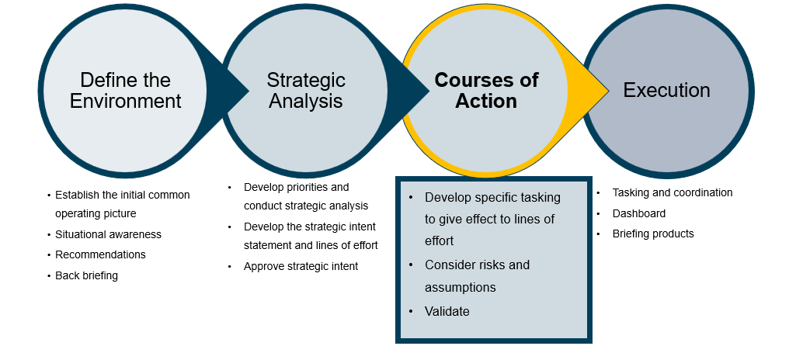

---
## Page 38

   
38 
  Crisis Appreciation and Strategic Planning       
OFFICIAL 
OFFICIAL 
• 
Lines of effort number is transcribed from the 
strategic analysis end state and lines of effort. 
• 
Success conditions are transcribed or 
referenced from the strategic analysis lines of 
effort. 
• 
Courses of action are the descriptions to the 
potential solutions. Planners generate and 
compare options consistent with the team leader’s 
intent to select the best one (e.g. two courses of 
action may be to place a single agency in charge 
or mobilise a Joint Taskforce).  
Options are based on the success conditions, 
considerations and critical shortfalls, menu of 
capabilities/providers and is consistent with the 
constraints. 
• 
Responsible agency or providers is the 
agencies, people, expertise, equipment and other 
resources available to commit or that can be 
requested to support an event. This list can 
include non-traditional resources. 
• 
Assumptions: 
+  Planning assumptions. Any piece of planning 
information that must become a fact for the plan 
to succeed. These would include essential 
strategic tasks and other issues that impede the 
response or situations that cannot be overcome 
by adapting or improvising.  
+ This is an opportunity to ask questions such as: 
▪ Do we have critical information requirements 
defined to turn those assumptions into facts? 
▪ Do we have no-later-than time requirements 
identified to validate any assumptions? 
• 
Risks to success are based on a high-level risk 
assessment looking at identified PSESIIE 
dimension issues and relative effectiveness 
shortfalls that may hamper achieving the success 
conditions. The factors below may be considered 
when assessing the risks to success.  
 
+ Constraints are the legal, policy, financial and 
moral restrictions that determine the must do’s 
(requirements) and cannot do’s (prohibiting 
factors). This includes identifying operational 
security restrictions.  
Defining the constraints early narrows the range 
of courses of action by removing options that 
are prohibited or that would potentially violate an 
organisation’s authorities. Also, by articulating 
requirements, teams can establish methods and 
means so that defined courses of action 
maintain fidelity to those requirements.  
 
+ Considerations and critical shortfalls are 
based on the assessment of the relative 
effectiveness of the current response effort to 
identify gaps or needs. Relative effectiveness 
categories could include measurement of: 
▪ unity of command 
▪ intelligence 
▪ operational level risks 
▪ security  
▪ offensive/defensive capability 
▪ sustainment 
▪ communication 
▪ public or political perception 
▪ leadership. 
 
+ Advantages/Disadvantages are anything that 
may impact on the mobilisation, deployment, 
use and demobilisation. Considerations might 
include: 
▪ acceptable risks and vulnerabilities 
▪ effectiveness 
▪ organisational values 
▪ redundancy 
▪ simplicity 
▪ flexibility 
▪ speed 
▪ positioning 
▪ sustainability 
▪ surge and reserve capacity 
▪ cost 
▪ contingencies 
▪ perception 
▪ political 
▪ legal or policy-driven rules of engagement 
▪ second and third order effects.

---
## Page 39

   
39 
  Crisis Appreciation and Strategic Planning       
OFFICIAL 
OFFICIAL 
 
Crisis Appreciation 
Strategic Planning
Executing  
the Plan

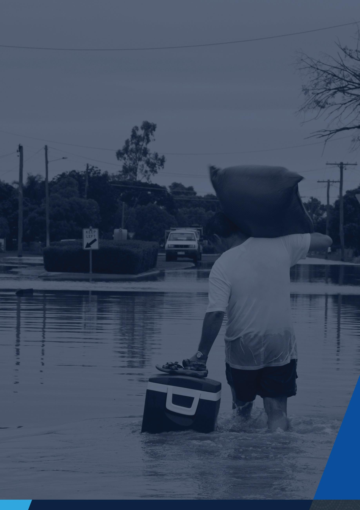

---
## Page 40

 
40 
  Crisis Appreciation and Strategic Planning       
OFFICIAL 
OFFICIAL 
Executing the Plan 
CASP Outcomes 
Execution and the outputs/outcomes of CASP will be 
different depending on the purpose of the CASP and 
the authorities involved. 
The CASP outcome could be a recommendation for a 
National Coordination Mechanism (NCM) meeting, or 
potential response options. The output could be the 
development of a dashboard and a briefing to those 
involved. 
It could be the provision of a guidance document or 
recommendations to encourage a unity of effort across 
a whole of community response. 
The output could be requests or tasking’s to agencies 
based on existing arrangements. 
 
Providing Strategic Tasks 
The process of providing strategic tasks varies and 
often uses documents, processes and formats such as 
Delegations of Authority or tasking’s. The end format is 
determined by what is necessary to meet agency-
specific policies and requirements. Nonetheless, while 
addressing unique specifications, any format should 
include the critical elements generated from the 
planning efforts, namely the elements of leaders intent: 
Task, Purpose and End State. 
 
 
 
 
Coordinating and Synchronising Efforts 
Coordinating and synchronising the activities, needs 
and requirements is crucial to success and efficiency 
in deployment of capabilities and realising desired 
effects.  
For example, a decision about lifting disaster or 
security declarations after a catastrophic event cannot 
be made without a series of security conditions being 
met, policy decisions being finalised, and the capacity 
of local law enforcement being re-established. This 
type of a decision triggers its own sequence of actions 
from demobilising military assets to setting up press 
conferences and coordinating social media posts.  
The synchronisation helps facilitate coordination of 
effort so that the elements of action, tempo, sequence 
and location result in the right things happening in the 
right order at the right time. 
The CASP process is an investment in critical thinking and is essential for successful 
execution. 
 
 
Figure 11: The CASP methodology flows from defining the environment to executing the tasks. 
 
Careful strategic thinking and planning is the necessary foundational work to enable tactical operators to efficiently 
and effectively execute the leaders intent, with all efforts aligned to a common end state.

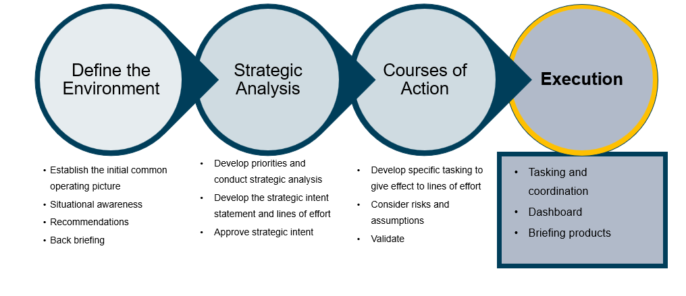

---
## Page 41

 
41 
  Crisis Appreciation and Strategic Planning       
OFFICIAL 
OFFICIAL 
 
Conclusion 
Crisis Appreciation 
Strategic Planning

---
## Page 42

 
42 
  Crisis Appreciation and Strategic Planning       
OFFICIAL 
OFFICIAL 
 
Conclusion 
 
CASP should not be a rote process, where ticking 
boxes is more important than the well-considered 
meaning this strategic planning process provides. The 
increasing frequency, intensity and duration of 
disasters in volatile, uncertain, complex and 
ambiguous conditions requires an evolved 
methodology and toolset. 
CASP informs strategic operational planning and is the 
strategic bridge between preparedness plans and 
operational action once a crisis is imminent, has 
occurred or is transitioning to recovery. 
CASP leverages concepts that align disparate 
organisational missions, cultures and structures and 
provide the tools for leaders to communicate and to 
enable emergency managers to fulfil their roles. It 
supports leaders to make sense of inherent complexity 
of contemporary disasters and make decisions 
supported through a process of critical thinking and 
analysis. CASP is flexible and adaptable and when 
done effectively provides the vision, strategic intent 
and alignment of activities that gives effect to the unity 
of effort. CASP will continue to evolve as the future 
crisis environment dictates.

---
## Page 43

   
43 
  Crisis Appreciation and Strategic Planning       
 
Appendix A: 
CASP Template 
Crisis Appreciation 
Strategic Planning

---
## Page 44

 
44 
  Crisis Appreciation and Strategic Planning       
OFFICIAL
OFFICIAL

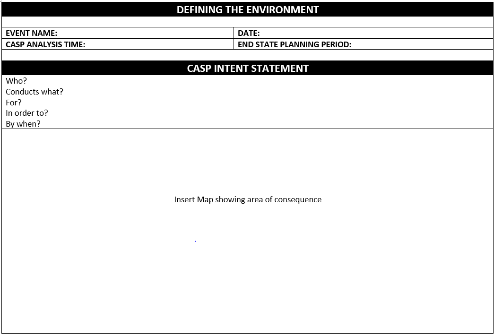

---
## Page 45

 
45 
  Crisis Appreciation and Strategic Planning       
OFFICIAL
OFFICIAL

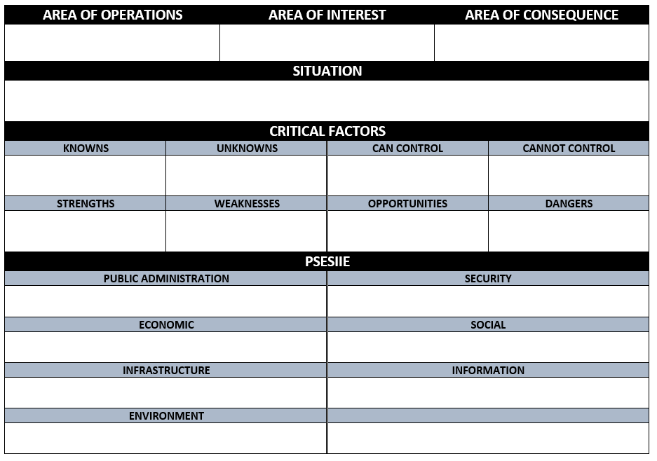

---
## Page 46

 
46 
  Crisis Appreciation and Strategic Planning       
OFFICIAL
OFFICIAL

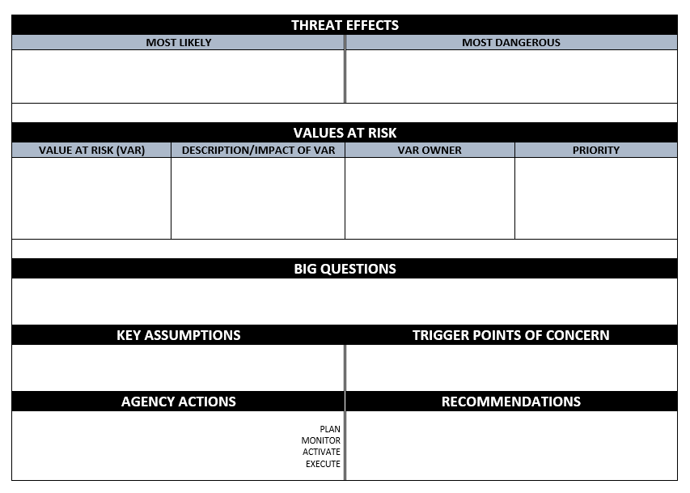

---
## Page 47

 
47 
  Crisis Appreciation and Strategic Planning       
OFFICIAL
OFFICIAL

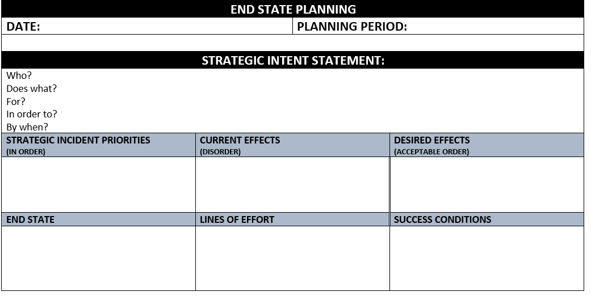

---
## Page 48

 
48 
  Crisis Appreciation and Strategic Planning       
OFFICIAL
OFFICIAL

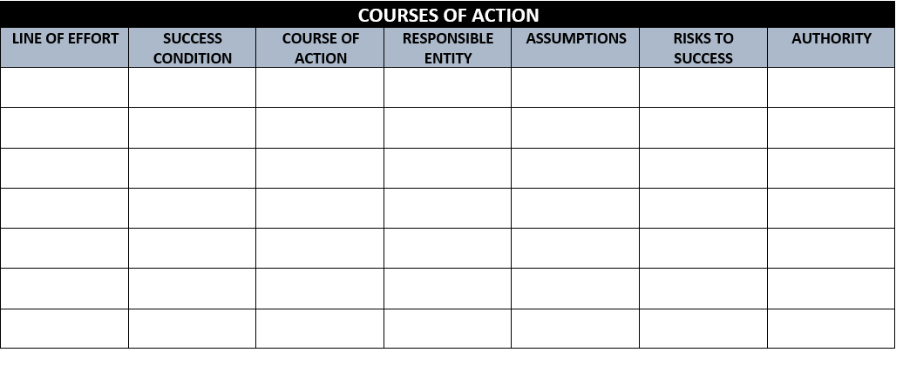

---
## Page 49

   
49 
OFFICIAL 
OFFICIAL 
Crisis Appreciation 
Strategic Planning 
Appendix B: CASP 
Example

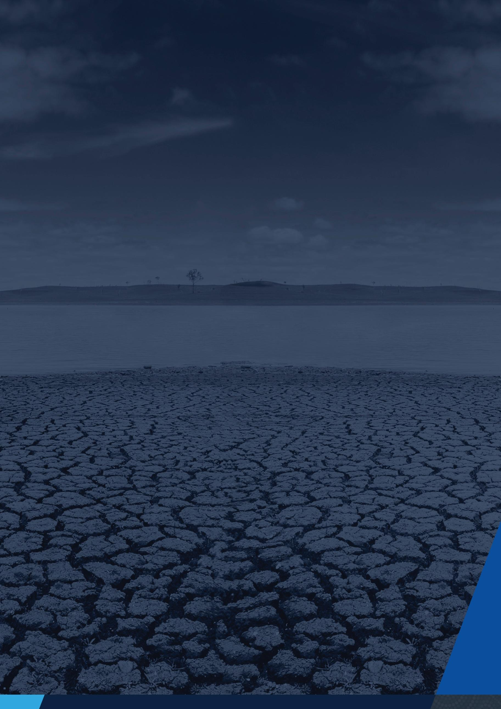

---
## Page 50

   
50 
OFFICIAL
  Crisis Appreciation and Strategic Planning       
OFFICIAL
 
DEFINING THE ENVIRONMENT 
 
EVENT NAME:  
Exercise Scenario Day 0   
DATE:  
26 January 2025 
CASP ANALYSIS TIME:  
1 hour 30 minute 
END STATE PLANNING PERIOD:  
7 days to 2 January 2025 
 
CASP INTENT STATEMENT 
NEMA is undertaking planning on behalf of the Australian Government to determine response and recover options to the impacts of severe weather across 
Australia, the ongoing H5 HPAI incursion and the Geelong oil refinery fire. The CASP is to be completed within 1 hour and 30 minutes and cover a planning 
period of 7 days to 2 February 2025. 
 
 
 
 
 
 
 
 
 
 
 
 
 
 
 
 
Geelong refinery fire 
 
HPAI H5 
 
Heatwave  
 
Weather systems 
 
Bushfire / Grass Fire 
 
Power Outages 
Legend

---
## Page 51

 
 
51 
  Crisis Appreciation and Strategic Planning       
OFFICIAL
AREA OF OPERATIONS 
AREA OF INTEREST 
AREA OF CONSEQUENCE 
Australia 
Australia 
Global 
SITUATION 
• 
The National Avian Influenza Wild Bird Surveillance Program confirms H5 HPAI has been detected in wild birds across three regions: the Northern Territory’s floodplains, Far 
North Queensland’s wetlands, and South East Queensland. Rangers report magpie geese and brolgas dying en masse in Kakadu and the Atherton Tablelands. 
• 
Southern parts of Western Australia and western South Australia swelter under record heatwaves. Temperatures have exceeded 47°C in inland regions for six consecutive days, 
overloading power grids and triggering rolling blackouts that disrupt water pumping, telecommunications, and cooling centres.  
• 
A Monsoon Trough is bringing cloud, lengthy periods of heavy rain and localised flooding across the Northern Territory, northern Queensland and Western Australia. 
Communities is Western Australia's north are on high alert for the risk of flooding. The Bureau of Meteorology has warned flash flooding is likely in the northern and western 
parts of the Kimberley, with the risk extending further inland. 
• 
In Victoria a long hot summer has exacerbated the bushfire risk and hindered controlled burns. There is a catastrophic bushfire warning and state-wide fired ban in place.  
• 
An out of control fire is accidentally ignited at the Geelong oil refinery, responsible for over half of the state’s fuel supply and over 10% of Australia’s fuel, forcing a total 
shutdown. Within hours, panic buying sweeps Melbourne and regional towns, as social media teems with unverified claims of terrorism, sabotage, or an impending national fuel 
shortage. Authorities scramble to deploy emergency fuel reserves and design rationing protocols, even as logistics operators begin contingency planning for multi‑state 
distribution. Social media rapidly fills with unverified claims suggesting terrorism as the cause, triggering a spike in public anxiety. Panic buying begins at petrol stations across 
Victoria and New South Wales. Less reputable media outlets are claiming Australia will run out of fuel within three days—an assertion that spreads faster than authorities can 
refute it. 
• 
Emergency services juggle overlapping threats: dealing with the damage to the refinery and ensuring the fire is completely out, mounting wildlife disease surveillance, and 
restoring power under relentless heat. Public messaging emphasises factual updates on fuel availability, health guidance around HPAI, and heatwave safety, but the sheer 
volume of crises fuels anxiety.  
• 
Recovery – QLD in recovery from TC Jasper and Eastern States have recently experienced large storms with hail, flash flooding and damaging winds. Western Victoria, South 
Australia and WA all recovering from bushfires. 
CRITICAL FACTORS 
KNOWNS 
UNKNOWNS 
CAN CONTROL 
CANNOT CONTROL 
 
• 
Out of control fire in oil refinery in 
Geelong 
• 
Panic buying of fuel in VIC 
• 
Nationwide emergency services are 
responding to multiple threats 
• 
Multiple infrastructure systems 
stressed from heat in WA and SA 
• 
Catastrophic bushfire warning for 
VIC with a statewide bushfire ban 
 
• 
Community sentiment and impact 
on trust of all levels of government 
• 
Potential spread of H5 HPAI due to 
Bird migration 
• 
Current fuel capacity, impacts and 
resupply requirements 
• 
Impacts of forecast conditions 
• 
Extent of impact to life due to 
heatwaves 
 
• 
Aus Gov messaging and warnings 
• 
Aus Gov crisis response and 
recovery functions  
• 
Aus Gov response and coordination 
mechanisms 
• 
Access to national fuel supply 
• 
Repositioning of Aus Gov assets 
• 
Existing relationships with 
jurisdictional agencies  
 
• 
Public response 
• 
Actions of social media companies 
• 
Spread of H5 HPAI in wild 
population 
• 
Weather  
• 
Power outages 
• 
Jurisdictional warnings and 
response 
• 
Initial media response

---
## Page 52

 
 
52 
  Crisis Appreciation and Strategic Planning       
OFFICIAL
• 
Public messaging is not enough to 
combat the mis and dis information 
around H5 HPAI and cause of fire at 
oil refinery 
• 
Unverified claims of National fuel 
shortage 
• 
H5 HPAI active response since late 
November impacting wild fowl and 
poultry in Kakadu NSW, VIC, NT & 
TAS 
• 
Rolling Power Outages 
• 
Multiple States in active recovery 
• 
Forecast for worsening conditions 
• 
Access to APS surge capabilities 
• 
Biosecurity powers (chapter 8) 
• 
Compounding events  
 
STRENGTHS 
WEAKNESSES 
OPPORTUNITIES 
DANGERS 
 
• 
Aus Gov and jurisdictional 
preparedness measures on H5 HPAI 
outbreak plan  
• 
Well established Aus Gov and 
jurisdictional response mechanisms 
in place 
• 
National firefighting assets are 
currently in Australia, strong 
resourcing sharing capabilities 
through the National Resource 
Sharing Centre (AFAC) 
• 
Australian Government 
coordination mechanisms and 
communication pathways – NCMs, 
NEMA Crisis Comms 
• 
All stakeholders having significant 
experience responding to a range 
of natural hazard events  
 
 
• 
Jurisdictional and Aus Gov response 
forces are fatigued from busy, 
extended HRWS 
• 
Geographical spread of concurrent 
events and scale of response 
requirements 
• 
Mis and Disinformation across 
social media 
• 
Limited experience with oil fuel 
shortages and the consequences 
• 
Legislation that has not been 
enacted at National level and how it 
works with state legislation  
 
 
• 
Enable national coordination 
arrangements 
• 
Utilise Australian Government 
Crisis Comms Guidelines. 
• 
Utilise the National Emergency 
Management Stockpile 
• 
Build relationships between Aus 
Gov agencies in response and 
recovery 
 
 
 
• 
Fatigue of response agencies and 
risks associated with prolonged 
response  
• 
Communities experiencing warning 
fatigue 
• 
Communities in recovery 
deprioritised due to active 
response 
• 
Mis/dis-information impacting 
social cohesion and public trust 
• 
H5 HPAI spill over to other animals 
and humans 
• 
Trade/export impacts due to H5 
HPAI 
• 
Significant loss of fuel reserves and 
limited capacity to resupply in 
necessary timeframes 
• 
Miscommunication between 
responding Aus Gov and 
jurisdictional agencies  
• 
Straining relationships in all sectors

---
## Page 53

 
 
53 
  Crisis Appreciation and Strategic Planning       
OFFICIAL
PSESIIE 
PUBLIC ADMINISTRATION 
SECURITY 
 
• 
Public interest – risks of media and mis/dis-information impacting trust in 
environment of increased public interest 
• 
Senior official and government restructures may impact communications and 
coordination pathways 
• 
Social cohesion risks due to mis/dis-information, especially around the unverified 
claims of sabotage or terrorism and actions around avian influenza 
• 
Public anxiety – panic buying and looting can increase during natural hazard 
events, impacting community safety and resource shortages 
• 
Power outages impacting security infrastructure that could impact accessibility 
and safety of communities and industry 
• 
Community interaction with birds (both natural environment and commercial) 
 
ECONOMIC 
SOCIAL 
• 
Impacts to multiple supply chains – agriculture, critical infrastructure, road closures 
due to flooding and fire impacting transportation of goods and services  
• 
Risks of potential culling of poultry animals causing significant losses, limiting 
supply and increasing costs and demand 
• 
Oil fire potential to impact fuel supply causing increased prices, limited availability 
and broader supply concerns across industries  
• 
Broad impacts of power outages to major industries and small businesses across 
jurisdictions 
• 
Panic buying limiting supply of key resources, causing broader supply chain 
constraints across groceries, fuel, etc  
• 
Second and third order consequences of impacts to key agriculture industries i.e. 
poultry, farming, stock that may all be impacted by concurrent events. Broader 
consequences to GDP and international trade due to supply constraints and lost 
resources  
• 
Transient populations during holiday period, multiple events i.e. fires, heatwaves 
and floods impacting peoples movements that may limit potential tourism 
industries during this time of year 
• 
Heatwaves pose significant impacts to community health, especially at-risk 
cohorts such as elderly and children. This is exacerbated by broad power outages 
• 
Fires and floods impacting community access to key resources and services, 
straining health systems 
• 
Compounding events potential to overwhelm health system  
• 
Community anxiety and disorder due to concern for compounding events, novel 
events (H5 HPAI) and fatigue from prolonged HRWS 
• 
Impact on responding personnel, service providers, emergency services and 
mental health systems due to compounding and prolonged events across 
jurisdictions 
• 
Potential for community isolations, potential to feel forgotten, needing key 
resources but increased pressure on services meaning limited scope to support all 
communities 
• 
Social cohesion, increased social media interests and concern of community – 
potential for unrest  
• 
Aboriginal and Torres Strait Islander communities more likely to be in areas of 
increased natural hazard events, need to understand community needs and 
locations  
• 
Cultural impact on Aboriginal and Torres Strait Islander communities that may 
evacuation from Country, concern for disruption of connection to Country, cultural 
activities and community connections 
• 
Natural hazard and novel events increase potential impacts for at risk cohorts such 
as elderly, youth and peoples with disabilities. Needs to understand where key 
groups are located, their needs, current state and potential response 
considerations for Aus Gov and jurisdictions

---
## Page 54

 
 
54 
  Crisis Appreciation and Strategic Planning       
OFFICIAL
• 
Understanding for communities still in active recovery that may experience 
compounding events or vicarious trauma from experiences compounding large 
scale events  
• 
Potential damage to culturally significant and/or environmental heritage 
sites/objects, impacting ecosystem services, community wellbeing and cultural 
access for Aboriginal and Torres Strait Islander peoples 
• 
Food security – poultry and dairy key food sources for many communities 
• 
Potential water scarcity due to heatwaves impacting community access 
• 
Australia Day demonstrations  
 
INFRASTRUCTURE 
INFORMATION 
 
• 
Significant impact to critical infrastructure – power, water and waste management 
due to compounding events  
• 
Significant, widespread supply chain disruptions of key industries, road closures etc  
• 
Impact to oil industry – fuel access  
• 
loss of productivity in transport sector 
• 
loss of telecommunications/emergency warnings 
• 
Water pumping disruptions due to overloaded power grids resulting in rolling 
blackouts 
• 
Heat effects on rail and road networks 
• 
Road network damage during wet season 
• 
Bass Link – impacting power between Tas and Vic  
• 
Potential impact to ports in Geelong, Vic  
 
 
 
 
 
 
 
• 
Mis/dis-information  
• 
Increased media interest and political sensitivities of compounding events, 
resource accessibility and community concerns  
• 
Potential for social media attention to promote social unrest 
• 
Need for consistent messaging and warning across all governments  
• 
Potential differing messaging between emergency warnings, weather 
forecasting and government messaging  
• 
blackouts hindering information flow 
• 
Potential loss of telecommunications due to energy supply disruptions and power 
outages  
• 
Potential disengagement and community warning fatigue from compounding 
events and prolonged HRWS  
 
 
 
ENVIRONMENT 
 
 
• 
Potential to impact national parks, Indigenous Protected Areas, and nationally 
significant environments, UNESCO World Heritage Sites, and areas of community 
value i.e. Kakadu Naitonal Park  
• 
Impact of fire – air and water contamination from smoke

---
## Page 55

 
 
55 
  Crisis Appreciation and Strategic Planning       
OFFICIAL
• 
Natural hazard impacts on native species, particularly threatened and critically 
endangered species  
• 
H5 HPAI zoonotic spread – impacting bird species (poultry, native and migratory) 
potentially spreading to other species  
• 
Severe water shortages worsened by heatwave – environmental water, water 
availability etc  
• 
Oil refinery would need significant HAZMAT response and impact environment 
THREAT EFFECTS 
MOST LIKELY 
MOST DANGEROUS 
• 
Active response plans/arrangements across multiple sectors (biosecurity, natural 
hazard, energy supply) 
• 
COMDISPLAN activated in anticipation of RFAs 
• 
H5 HPAI will spread through Australia via wild bird movement and require response 
activities 
• 
Mis/dis-information resulting in breakdown in social cohesion 
• 
Temporary fuel supply impacts  
• 
Catastrophic fire danger results in stretching of state response capabilities 
• 
Relevant jurisdictional plans will be activated 
• 
COMDISPLAN activated in anticipation of RFAs and a CCT stood up 
• 
Panic buying by communities 
• 
H5 HPAI impacts supply chains and food supply 
• 
Fuel supply will be impacted 
• 
Refinery fire will take multiple days to extinguish  
• 
Extended misinformation leads to breakdown in social cohesion 
• 
Deaths from heatwave 
 
• 
Jurisdictional response is overwhelmed resulting in multiple RFAs and use of NRSC 
• 
H5 HPAI spreads to humans, other species and overwhelms key industries 
and requires national response for agriculture industry and protection of 
native species  
• 
Widespread, prolonged power outages, overwhelm critical infrastructure 
causing significant impacts to communities and industries.  
• 
Widespread community isolations caused by compounding natural hazards 
and critical infrastructure disruptions  
• 
Widespread civil unrest – Australia Day demonstrations, community 
concern for novel events, mis-/dis-information, looting of fuel 
• 
Any new fires unable to be contained and spreads 
• 
Significant impacts to aviation and maritime due to the inability to access 
refuelling from the Geelong oil refinery 
• 
H5 HPAI spreads with significant impacts to food supply chains, native species and 
migratory birds 
• 
Panic buying for essential resources, food and fuel 
• 
Significant fatalities across hazard events, mortuary capacity is reached 
• 
Refinery fire is not contained and spreads into residential areas and industry areas 
• 
Refinery fire causes significant loss of fuel, impacting national and global oil 
supplies  
• 
Ongoing power supply issues, water supply and telecommunications impact 
emergency services capacity.  
• 
Fuel shortages impact aviation and maritime assets 
 
VALUES AT RISK

---
## Page 56

 
 
56 
  Crisis Appreciation and Strategic Planning       
OFFICIAL
VALUE AT RISK (VAR) 
DESCRIPTION/IMPACT OF VAR 
VAR OWNER 
PRIORITY 
 
1. Preservation of Human 
Life 
2. Humanitarian assistance 
3. Supply chain and critical 
infrastructure 
4. Maintain and protect 
communications and 
public trust 
5. Maintaining Law and 
Order 
6. Conservation and 
protection of the 
environment 
7. Protection of culturally 
significant sites, areas and 
objects 
 
 
1. Protection of human life throughout the disaster 
continuum 
2. Provide adequate and timely humanitarian 
assistance to affect communities. 
3. Maintain and restore supply chains and critical 
infrastructure 
4. Maintain, collaborate and coordinate public 
communications and warnings 
5. Maintaining Law and Order 
6. Conserve and minimise environmental protection 
7. Protect and minimise harm to culturally 
significant sites, areas and objects 
 
1. Jurisdictional response agencies 
2.  Jurisdictional and Aus Gov recovery agencies 
3. Jurisdictional and Aus Gov recovery agencies, key 
industries, critical infrastructure suppliers. 
4. All government agencies 
5. Aus Govt and Jurisdictional Govt and Jurisdictional 
Police Services 
6. Aus Gov and Jurisdictional environmental agencies 
7. Aus Gov and Jurisdictional agencies 
 
 
1 
2 
3 
4 
5 
6 
7 
 
BIG QUESTIONS 
 
• 
Which Tier under the Australian Government Crisis Management Framework is the Australian Government operating at? 
• 
What are the impacts and consequences from the oil refinery shutdown? 
• 
Does the situation meet the threshold for a National Emergency Declaration? 
• 
What (or who) are the key drivers of the mis/dis-information? 
• 
Identifying at-risk communities, what are their needs, where are they located, who are their support services? 
• 
What is the level of fatigue in Aus Gov and Jurisdictional response agencies? 
• 
How are all levels of government prioritising compounding events? 
KEY ASSUMPTIONS 
TRIGGER POINTS OF CONCERN 
 
• 
Strain of H5 HPAI is uncontrollable 
• 
All Aus Gov and jurisdictional agencies are actively communicating and 
coordinating efforts  
• 
NRSC and national RFAs will be utilised – prioritisation will be required 
 
• 
Significant spread of H5 HPAI – geographical or scale across poultry industry  
• 
Spread of H5 HPAI to other species or human

---
## Page 57

 
 
57 
  Crisis Appreciation and Strategic Planning       
OFFICIAL
• 
Relevant national plans are/will be activated  
• 
Jurisdictions will be responding to multiple hazards  
• 
Ongoing and additional events will occur  
• 
Further community impacts will occur  
• 
Fuel restrictions will be in place  
• 
Prolonged response and recovery activities will be required  
• 
Responding agencies and personnel already fatigued  
• 
International support available  
• 
Collaboration between CCT, NCM and Recovery IDC 
• 
 
 
• 
Heatwave causing significant impact to critical infrastructure, compounding fuel 
shortages impacting emergency services and health infrastructure (hospitals, aged 
cared, air-conditioned community facilities)  
• 
Compounding, concurrent events across jurisdictions 
• 
Further flooding in northern Australia resulting in supply chain disruptions and 
community isolations 
• 
Prolonged fire conditions increasing severity and scale of fires across Vic, SA, WA 
• 
National resources at capacity, already utilised or required for internal 
jurisdictional response 
AGENCY ACTIONS 
RECOMMENDATIONS 
 
• 
Activate CCT (potential for multiple) 
• 
Activate Crisis Comms Cell 
• 
Conduct ongoing CASP 
• 
Hold multiple NCMs – NCMAUSGOV and NCM 
• 
Deploy and accept LOs – jurisdictional and Aus Gov  
• 
Maintain situational awareness and provide briefings through the NSR 
• 
Activate recovery IDC 
• 
Review NEMS capabilities  
 
 
 
• 
All relevant Aus Gov Agencies review relevant preparedness and response 
activities  
• 
Preposition national assets and resources  
• 
National crisis communication strategy 
• 
Lead coordinating senior officials agree to AGCMF Tier  
• 
Brief relevant ministers on situation 
 
 
 
END STATE PLANNING 
DATE: 26 January 2025 
PLANNING PERIOD: 7 Days – 2 February 2025 
 
STRATEGIC INTENT STATEMENT:

---
## Page 58

 
 
58 
  Crisis Appreciation and Strategic Planning       
OFFICIAL
The Australian Government, working in partnership with Australian states and territories, will respond to the severe weather events across Australia, the ongoing H5 
HPAI incursion and the Geelong oil refinery fire to mitigate the compounding impacts and consequences to the community, including those in recovery from previous 
events, over the next 7 days, 2 February 2025. 
STRATEGIC INCIDENT PRIORITIES 
(IN ORDER) 
CURRENT EFFECTS  
(DISORDER) 
DESIRED EFFECTS  
(ACCEPTABLE ORDER) 
1. Preservation of human life 
2. Provision of Aus Gov support for humanitarian 
assistance 
3. Protecting or reestablish supply chains and critical 
infrastructure 
4. Maintain and protect communications and public 
trust 
5. Maintaining Law and Order 
6. Conservation and protection of the environment 
7. Protection of culturally significant sites, areas and 
objects 
 
1. Active fires, ongoing flooding, heatwave 
forecast, tropical weather and the oil fire 
impacting communities 
2. Maintain essential services and humanitarian 
assistance to impacted communities 
3. Restore impacted critical infrastructure, 
mitigate additional risks to supply chains and 
protect existing infrastructure from further 
harm  
4. Compounding events across jurisdictions with 
mis-/dis-information impacting 
communication lines between governments, 
industry and communities  
5. Increased risk of social unrest due to mis-/dis-
information 
6. Mitigate impact of compounding events on 
environments and species, protect 
surrounding ecosystems  
7. Identify potential culturally significant sites, 
areas and objects that may be impacted by 
compounding events 
 
 
1. Adequate and timely protection measures are in 
place to ensure the safety of affected communities 
2. Impacted essential services and humanitarian 
assistance have adequate mitigation measures and 
resources to begin restoration. Other services are 
protected from potential harm 
3. Resourcing and personnel for restoration of critical 
infrastructure are identified. Industries are 
supported to ensure mitigation of supply chain 
impacts 
4. All governments, responding agencies and 
industries coordinate communications and 
warnings to ensure public awareness 
5. Appropriate and timely safety measures are 
enforced to support law and governance 
maintenance 
6. Environmental protections in place to mitigate 
hazard damages and prevent additional harm.  
7. Culturally significant, sites, areas and objects are 
identified and protected from harm, where 
possible 
END STATE 
LINES OF EFFORT 
SUCCESS CONDITIONS 
The Australian Government has supported response and 
recovery activities and provided consistent communication 
to support jurisdictional response to compounding hazards 
to ensure the preservation of human life, provide 
humanitarian assistance, maintain critical infrastructure and 
support public messaging and law and order.  Protection of 
1. Coordinate Australian Government response and 
recovery activities 
2. Undertake preparedness activities 
3. Provision of essential humanitarian assistance 
4. Provide near-real time situation awareness and 
briefing products to relevant stakeholders 
1. Australian Government supported jurisdictional 
response through timely and effective application 
of response and recovery activities 
2. Preparedness activities were undertaken, where 
appropriate

---
## Page 59

 
 
59 
  Crisis Appreciation and Strategic Planning       
OFFICIAL
the environment and culturally significant sites was 
provided where possible  
5. Crisis communication and public messaging 
enacted 
 
3. Humanitarian assistance was provided to ensure 
the minimisation of further harm to affected 
communities 
4. Ongoing situational awareness was provided in a 
timely and accurate manner to all relevant 
stakeholders ensure a single source of information 
5. Crisis communication was coordinated across 
relevant stakeholders to ensure consistent public 
messaging 
 
 
COURSES OF ACTION 
 
LINE OF EFFORT 
SUCCESS 
CONDITION 
COURSE OF ACTION 
RESPONSIBLE 
ENTITY 
ASSUMPTIONS 
RISKS TO 
SUCCESS 
AUTHORITY 
1 
Coordinate Australian 
Government response 
and recovery activities 
 
 
Australian Government 
supported jurisdictional 
response through 
timely and effective 
application of response 
and recovery activities 
 
1. Continue of CCT 
activations  
2. Deploy CPO/LOs into 
Jurisdictions 
3. Respond to RFAs 
4. Activate Crisis Comms 
Cell 
5. Activate Recovery IDC 
6. Conduct NCMs 
 
 
 
 
2 
Undertake 
preparedness activities 
 
Preparedness activities 
were undertaken, 
where appropriate 
 
1. Determining 
prepositioning relevant 
NEMS capabilities  
2. Convening CCOSCs and 
engaging with 
jurisdictions to 
understand requirements 
3. Hold NCMs to determine 
the requirements of 
jurisdictions, Aus Gov 
and industries in 
response and recovery  
4. Complete a CASP

---
## Page 60

 
 
60 
  Crisis Appreciation and Strategic Planning       
OFFICIAL
3 
Provision of essential 
humanitarian assistance 
 
Humanitarian 
assistance was 
provided to ensure the 
minimisation of further 
harm to affected 
communities 
 
1. Identify potentially 
relevant NHEMS 
capabilities and providers  
2. NCM specifically for 
humanitarian assistance 
requirements 
 
 
 
 
4 
Provide near-real time 
situation awareness and 
briefing products to 
relevant stakeholders 
 
Ongoing situational 
awareness was 
provided in a timely 
and accurate manner 
to all relevant 
stakeholders ensure a 
single source of 
information 
 
1. Disseminate event 
notifications, event 
dashboards and relevant 
situational products 
2. Hold NCMs to provide 
situational awareness to 
all stakeholders 
 
 
 
 
5 
Crisis communication 
and public messaging 
enacted 
Crisis communication 
was coordinated across 
relevant stakeholders 
to ensure consistent 
public messaging 
 
1. Crisis Communication 
Cell established 
2. Crisis Communication 
Strategy established 
3. WoAG Talking Points 
established  
4. Hold NCMs to coordinate 
crisis communications

---
## Page 61

   
61 
OFFICIAL
  Crisis Appreciation and Strategic Planning       
OFFICIAL
 
 
 
                   
                          
                                
                     
                                    
                    
 
Active response plans arrangements across multiple
sectors (biosecurity, natural hazard, energy supply)
 
C MDISP AN activated in anticipation of R As
 
HPAI H5 will spread through Australia via wild bird
movement and require response activities
 
Mis dis information resulting in breakdown in social
cohesion
 
Temporary fuel supply impacts
 
Catastrophic fire danger results in stretching of state
response capabilities
 
Relevant  urisdictional plans will be activated
 
C MDISP AN activated in anticipation of R As and a
CCT stood up
 
Panic buying by communities
 
HPAI H5 impacts supply chains and food supply
 
 uel supply will be impacted
 
Refinery fire will take multiple days to extinguish
 
Extended misinformation leads to breakdown in social
cohesion
 
Deaths from heatwave
         
There is a catastrophic bushfire warning and state wide fire ban in  ictoria.
An out of control fire is occurring at Geelong oil refinery impacting the State s fuel supply and causing panic buying from
consumers.
HPAI H5 has been detected in Norther Territory, far north   D and SE   D.
Monsoon trough brings extended heavy rain and localised flooding to NT, N   D and  A.  lash flooding is likely in western
parts of the  imberley.
 A and SA have had  7 C temperatures for the past six days with heatwaves causing blackouts, disrupting water supplies and
telecommunications.
                       
 
 urisdictional response is overwhelmed resulting in
multiple R As and use of NRSC
 
HPAI H5 spreads to humans, other species and impacts
food supply chains, native species and migratory birds and
overwhelms key industries and requires national response
 
 idespread, prolonged power outages, overwhelm
critical infrastructure causing significant impacts
 
 idespread community isolations caused by
compounding natural hazards and critical infrastructure
disruptions
 
 idespread civil unrest  Australia Day demonstrations,
community concern for novel events, mis  dis information,
looting of fuel
 
Any new fires unable to be contained and spreads
 
Significant impacts to aviation and maritime due to the
inability to access refuelling from the Geelong oil refinery
 
Panic buying for essential resources, food and fuel
 
Significant fatalities across hazard events, mortuary
capacity is reached
 
Refinery fire is not contained and spreads into residential
areas and industry areas, resulting in a significant loss of
fuel, impacting national and global oil supplies
 
 ngoing power supply issues, water supply and
telecommunications impact emergency services capacity.
 
 uel shortages impact aviation and maritime assets
Geelong refinery
fire
HPAI H5
Heatwave
 eather systems
Bushfire   Grass
 ire
Power  utages
      
                          
                          
                           
         Incidents of concern across Australia

---
## Page 62

 
 
62 
  Crisis Appreciation and Strategic Planning       
OFFICIAL
 
 
 
                   
                          
                                
                     
                                    
                          
                          
                           
               
 
Strain of H5 HPAI is uncontrollable
 
All Aus Gov and  urisdictional agencies are actively
communicating and coordinating efforts
 
NRSC and national R As will be utilised  prioritisation will be
required
 
Relevant national plans are will be activated
 
 urisdictions will be responding to multiple hazards
 
 ngoing and additional events will occur
 
 urther community impacts will occur
 
 uel restrictions will be in place
 
Prolonged response and recovery activities will be required
 
Responding agencies and personnel already fatigued
 
International support available
 
Collaboration between CCT, NCM and Recovery IDC
                         
 
Significant spread of H5 HPAI  geographical or scale across
poultry industry
 
Spread of H5 HPAI to other species or human
 
Heatwave causing significant impact to critical infrastructure,
compounding fuel shortages impacting emergency services
and health infrastructure (hospitals, aged cared, air conditioned
community facilities)
 
Compounding, concurrent events across  urisdictions
 
 urther flooding in northern Australia resulting in supply chain
disruptions and community isolations
 
Prolonged fire conditions increasing severity and scale of fires
across  ic, SA,  A
 
National resources at capacity, already utilised or required for
internal  urisdictional response
      
 
 ut of control fire in oil refinery in Geelong
 
Panic buying of fuel in  IC
 
Nationwide emergency services are responding to multiple
threats
 
Multiple infrastructure systems stressed from heat in  A and
SA
 
Catastrophic bushfire warning for  IC with a statewide bushfire
ban
 
Public messaging is not enough to combat the mis and dis
information around HPAI H5 and cause of fire at oil refinery
 
Unverified claims of National fuel shortage
 
HPAI H5 active response since late November impacting wild
fowl and poultry in  akadu NS ,  IC, NT & TAS
 
Rolling Power  utages
 
Multiple States in active recovery
 
 orecast for worsening conditions
        
 
Community sentiment and impact on trust of all levels of
government
 
Potential spread of HPAI H5 due to Bird migration
 
Current fuel capacity, impacts and resupply requirements
 
Impacts of forecast conditions
 
Extent of impact to life due to heatwaves
               
 
All relevant Aus Gov Agencies review relevant preparedness
and response activities
 
Preposition national assets and resources
 
National crisis communication strategy
 
 ead coordinating senior officials agree to AGCM  Tier
 
Brief relevant ministers on situation
         National emergency stockpile
          ire ban in place

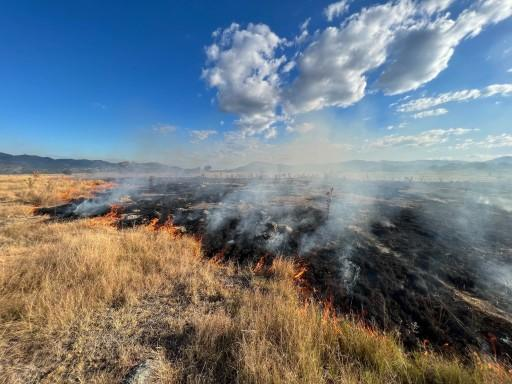

---
## Page 63

 
 
63 
  Crisis Appreciation and Strategic Planning       
OFFICIAL
 
                   
                          
                                
                     
                                    
                          
                          
                           
                
The Australian Government, working in partnership with Australian
states and territories, will respond to the severe weather events
across Australia, the ongoing HPAI H5 incursion and the Geelong
oil refinery fire to mitigate the compounding impacts and
consequences to the community, including those in recovery from
previous events, over the next 7 days, 2  ebruary 2025.
                   
 
Preservation of human life
 
Provision of Aus Gov support for humanitarian assistance
 
Protecting or reestablish supply chains and critical infrastructure
 
Maintain and protect communications and public trust
 
Maintaining  aw and  rder
 
Conservation and protection of the environment
 
Protection of culturally significant sites, areas and ob ects
         
The Australian Government has supported response and recovery
activities providing consistent communication to support
 urisdictional response to compounding hazards to ensure the
preservation of human life, provide humanitarian assistance,
maintain critical infrastructure and support public messaging and
law and order. Protection of the environment and culturally
significant sites was provided where possible
                 
                  
               
1.
Continue of CCT activations
2.
Deploy CP    s into  urisdictions
3.
Respond to R As
 .
Activate Crisis Comms Cell
5.
Activate Recovery IDC
 .
Conduct NCMs
Australian Government supported  urisdictional response through
timely and effective application of response and recovery activities
Coordinate Australian Government response and recovery
activities
 
1.
Determining prepositioning relevant NEMS capabilities
2.
Convening CC SCs and engaging with  urisdictions to
understand requirements
3.
Hold NCMs to determine the requirements of  urisdictions, Aus
Gov and industries in response and recovery
 .
Complete a CASP
Preparedness activities were undertaken, where appropriate
Undertake preparedness activities
 
1.
Identify potentially relevant NHEMS capabilities and providers
2.
NCM specifically for humanitarian assistance requirements
Humanitarian assistance was provided to ensure the minimisation of
further harm to affected communities
Provision of essential humanitarian assistance
 
1.
Disseminate event notifications, event dashboards and
relevant situational products
2.
Hold NCMs to provide situational awareness to all
stakeholders
 ngoing situational awareness was provided in a timely and accurate
manner to all relevant stakeholders ensure a single source of
information
Provide near real time situation awareness and briefing
products to relevant stakeholders
 
1.
Crisis Communication Cell established
2.
Crisis Communication Strategy established
3.
 oAG Talking Points established
 .
Hold NCMs to coordinate crisis communications
Crisis communication was coordinated across relevant stakeholders
to ensure consistent public messaging
Crisis communication and public messaging enacted

---
## Page 64

   
64 
  Crisis Appreciation and Strategic Planning       
OFFICIAL 
OFFICIAL 
 
Crisis Appreciation 
Strategic Planning 
Appendix B: CASP 
Example

