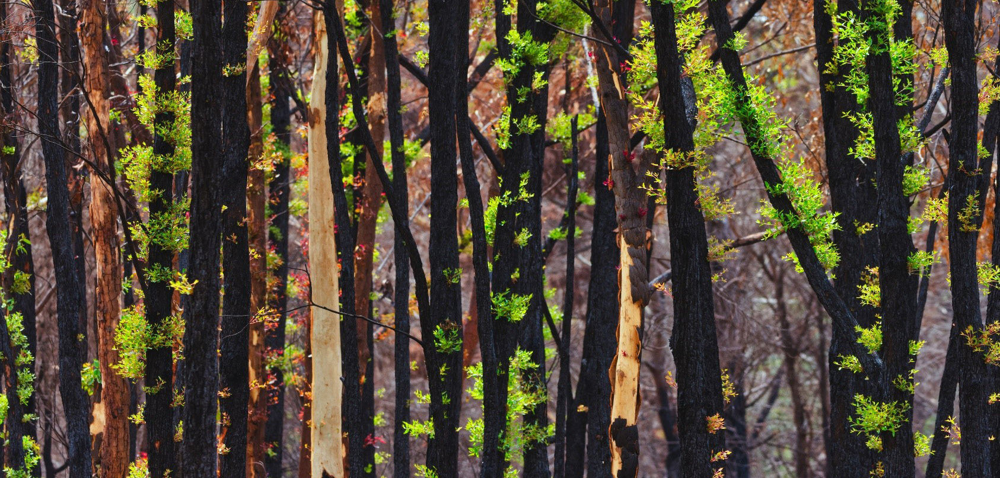
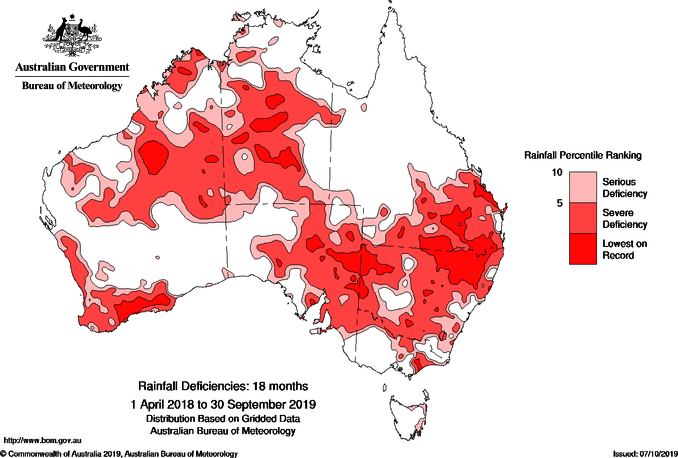
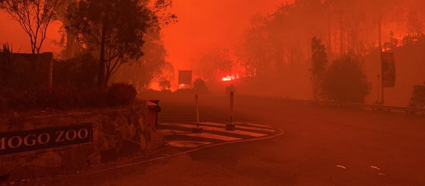
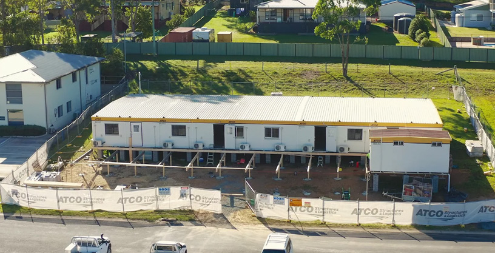
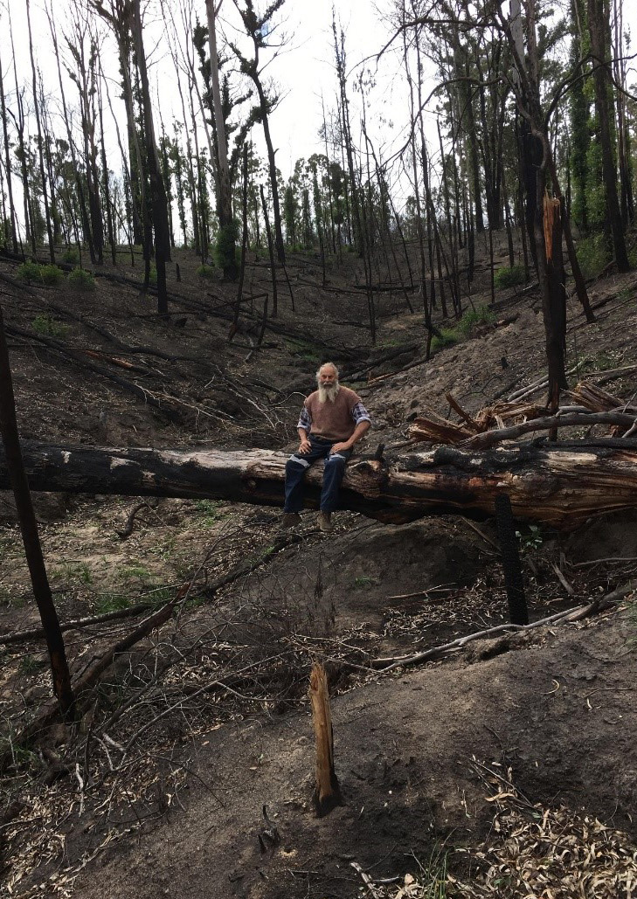
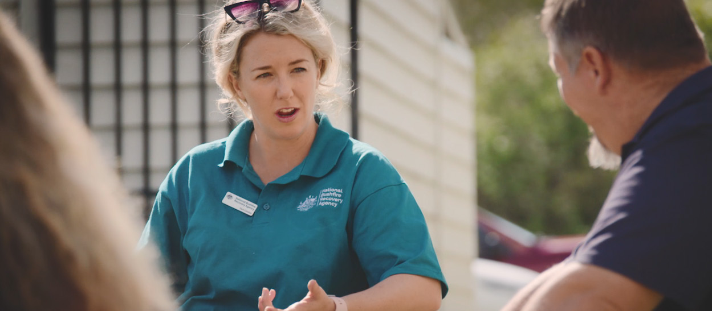
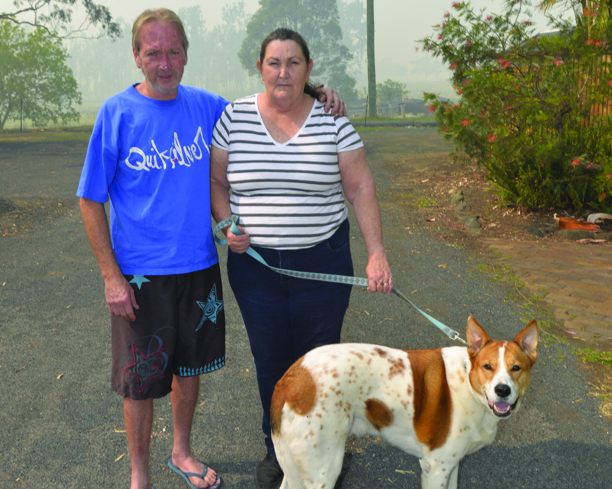
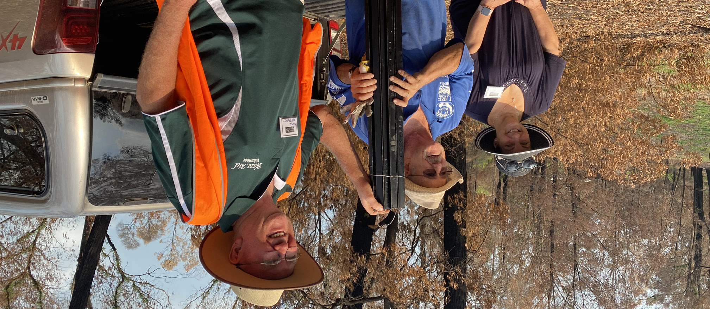
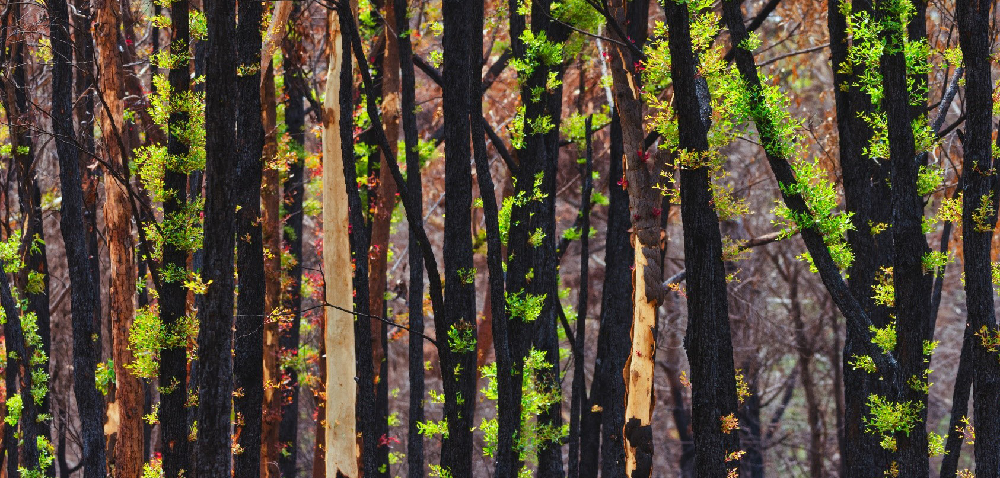

# Journey to Recovery — A national framework for disaster recovery

> **Source**: Australian Government — National Emergency Management Agency (NEMA)
> **URL**: https://nema.gov.au/sites/default/files/2024-08/journey%20to%20recovery_0.pdf
> **Licence**: CC BY 4.0
> **Retrieved**: 2026-05-07T23:46:29Z
> **SHA-256**: `89ff1102139ec137e96af659cdc57fd3c323ed01ce166ae4be1e0acab607c04d`
> *Converted from PDF to Markdown format.*

---
## Page 1

Journey to 
recovery

---
## Page 2

This publication (and any material sourced from it) should be attributed as: 
Department of the Prime Minister and Cabinet 2020, 
Australian Government Bushfire Recovery Plan, 
Canberra, October 2020.

---
## Page 3

i
Contents
Introduction	
1
Black Summer
2
Recovery	

9
Why we need a national approach 	

9
What we know about recovery	 
10
The human experience	 
17
Planning the journey to recovery	

18
Communities and local governments	

18
State and territory governments	
19
Australian Government	 
21
The role of the not-for-profit and private sectors	
24
How recovery plans connect	

25
Australia’s collaborative journey to recovery	
26
What happens next?	

34
How to stay involved	

36

---
## Page 4

ii
Journey to recovery 
Acknowledging the impact of the fires
In the wake of Black Summer, there is a need to acknowledge what we 
have lost, and to move forward together. 
We acknowledge those who lost loved ones, homes, businesses and 
livelihoods during the devastating Black Summer bushfires.
We acknowledge the dedication of emergency workers, front line service 
providers and volunteers who have worked tirelessly to provide safety 
and relief.
We acknowledge Indigenous Nations, Traditional Owners, Elders and 
Custodians throughout Australia, recognising the anguish the bushfires 
have caused through the destruction of sites of significance and country. 
We acknowledge the deep cultural ties and knowledge about fire held 
by Indigenous Australians and communities, and community desire to 
heal country. 
We thank those who provided comfort, donations and support. 
We celebrate the strength and resilience of all of those who have been 
affected by the bushfires, and the strength of local leaders, including 
Indigenous leadership and cultures, as witnessed throughout this crisis 
and now during the journey of recovery.

---
## Page 5

1
Journey to recovery 
Introduction 
Purpose  
Journey to recovery describes the collaborative approach being taken across Australia to recover from the 
devastating 2019–20 Black Summer bushfires. 
While recovery plans are developed at a state or territory level, the scale of the recent Black Summer bushfires 
was unprecedented, and recovery is beyond the resources of any one jurisdiction. Such an extraordinary 
event requires an extraordinary response. 
For the first time, this document describes what the states and territories are doing in response to the bushfires, 
while also providing a national foundation for future cooperation.
It details the overarching framework that supports all levels of government, communities and individuals in 
their specific recovery actions. 
It does not replace the recovery plans of each jurisdiction. Rather, it shows how these plans connect, along 
with additional Australian Government resources and support, to ensure a cooperative, national approach. 
It provides certainty to communities and to the states and territories regarding governance and support.  
Journey to recovery is informed by consultation with communities and discussions with local, state and 
territory governments, industry bodies and charities. 
It outlines what happened leading up to, during and immediately after the Black Summer bushfires. 
It sets out a clear and structured approach for coordinated action by communities, local governments, 
state and territory governments and the Australian Government.
By working together in this way — alongside the private and not-for-profit sectors — we can ensure 
those directly affected by the bushfires receive the services and programs they need while empowering 
communities to rebuild and create a more resilient future. 
National Bushfire Recovery Agency 
In January 2020, the Australian Government established the National Bushfire Recovery Agency 
to work with state and territory governments to help coordinate and support the vital work of 
communities and their corporate and non-government recovery partners. 
We have prepared Journey to recovery on behalf of the Australian Government and at the request 
of the then Council of Australian Governments.

---
## Page 6

2
Journey to recovery 
Black Summer 
A dangerous season
‘Black Summer’ has come to describe the intense and widespread fires that burned across much of Australia 
during 2019–20. Never before has our nation experienced such fierce firefighting conditions across so many 
communities over such a sustained period. 
Leading up to that bushfire season, conditions were unusually warm and dry over large parts of southern 
and eastern Australia. January to November 2019 was the second driest period on record. Rainfall over 
much of Australia was ‘below’ to ‘very much below’ average. 
This map shows the extent of rainfall deficiency during the 18 months to September 2019. At the same time, 
temperatures were the second warmest on record. Drought ravaged vast areas of the country. 
Rainfall Deficiencies: 18 months
1 April 2018 to 30 September 2019
Distrubuition Based on Gridded Data
Australia Bureau of Meteorlogy
Rainfall Deficiencies: 18 months, 1 April 2018 to 30 September 2019, Australia Bureau of Meteorology.
The sustained, severely dry conditions, combined with high temperatures and record low humidity, contributed 
to the bushfire season’s dangerous and early start. From mid-2019, there was a growing acknowledgement 
that a long and challenging season was ahead. 
By December 2019, catastrophic fire conditions existed in parts of New South Wales, Western Australia, 
South Australia and Victoria.
Rainfall Percentile Ranking
Serious Deficiency 
Severe Deficiency 
Lowest on Record
10
5

---
## Page 7

3
Journey to recovery 
NORTHERN TERRITORY
•	 October 2019 – significant 
fires start burning in the 
Stuart Estate near Katherine 
and in Dundee, South 
of Darwin
QUEENSLAND
•	 August 2019 – fire season 
starts, on top of intense 
drought from Rockhampton 
to the New South Wales 
border and extending inland 
to around St George
•	 September 2019 – multiple 
blazes out of control across 
south-eastern and northern 
Queensland
VICTORIA
•	 November 2019 –  
60 bushfires start
•	 December 2019 – lightning 
strike starts the bushfire at 
Wingan River, north-west 
of Mallacoota
•	 January 2020 – Australian 
Navy evacuates Mallacoota 
(see case study)
•	 27 February 2020 – 
all significant fires 
declared contained
SOUTH AUSTRALIA
•	 October 2019 – fires start
•	 December 2019 – a tree 
falling on power lines starts 
the Cudlee Creek fire
•	 December 2019/
January 2020 – one third 
of Kangaroo Island burns 
(170,000 hectare)
THE FIRES

The fires began to impact communities before the end of winter, 
in August 2019. The terrain of bushfire-prone areas across eastern 
and southern Australia made it difficult to control the spread and 
manage the fires. 
The figure below shows the varying
start times and locations of major fires, 
and other social and environmental 
factors that contributed to the 
challenging firefighting conditions. 
TASMANIA
•	 October 2019 – fires start
•	 January 2020 – fires continue 
burning with the Fingal 
fire covering more than 
20,000 hectares
AUSTRALIAN CAPITAL 
TERRITORY
•	 5–6 January 2020 – Canberra 
records worst air quality 
in the world, 23 times 
the threshold considered 
hazardous
•	 27 January 2020 – fire starts 
in Namadgi National Park 
•	 27 February 2020 – Orroral 
and Clear Range fires out
WESTERN AUSTRALIA
•	 September 2019 – 
bushfires start
•	 December 2019 – lightning 
sparks fire in Stirling Ranges 
and burns more than 
40,000 hectares of parkland
•	 December 2019 /
January 2020 – fires near 
Norseman blocks access to 
the Eyre Hwy and Nullarbor, 
preventing people from 
entering and leaving 
Western Australia 
NEW SOUTH WALES
•	 September 2019 – bushfires 
start in the Blue Mountains
•	 October 2019 – lightning bolt 
starts mega fire in Gospers 
Mountain, epicentre of the 
biggest forest fire to have 
started from a single ignition 
point in Australia
•	 February 2020 – fire covers 
7% of the state
•	 March 2020 – the last fire
was extinguished

---
## Page 8

4
Journey to recovery 
You can watch an animated national picture of the location and timing of the fires at: 

  	 https://www.bushfirerecovery.gov.au/2019-20-bushfire-impact
Many months of drought had drawn every drop of moisture from our landscape – 
dams and paddocks were dry, random patches of bushland had started to 
turn brown. People feared what the long, hot days of summer would do to 
our scattered communities.
Leanne Barnes, Bega Valley Shire Local Council General Manager
The emergency response
In an emergency, state and territory governments have primary responsibility to protect life, property and the 
environment within their jurisdiction. But when bushfires burn across borders, affected jurisdictions are required 
to cooperate. 
Some emergencies require even broader collaboration and coordination across all levels of government, 
and with the private and not-for-profit sectors. 
This is what happened during the 2019–20 bushfires.
We certainly haven’t had any firefighting experience – there wasn’t anyone on 
the site who had ever fought a fire before and I don’t know how you would ever get 
that training. It’s just the understanding that you need a heap of water and quickly. 
Chad Staples, Managing Director, Mogo Zoo
 	 https://www.bushfirerecovery.gov.au/recovery-stories
Mogo Zoo, 31 December 2019.

---
## Page 9

5
Journey to recovery 
The 2019–20 bushfire season saw the largest coordinated interstate and international deployment of firefighting 
and emergency personnel Australia has ever experienced. In addition to regular firefighting crews, more than 
7,000 extra workers supported the efforts, ranging from on-the-ground firefighters to incident managers and 
aviation personnel.
The Australian Defence Force (ADF) also assisted firefighting crews in Queensland and New South Wales, 
early in their bushfire seasons. As the fires spread, this assistance extended to local emergency services in 
Queensland, New South Wales, Victoria and South Australia, through Operation Bushfire Assist 2019–20. 
You can read more about the Operation here https://news.defence.gov.au/national/operation-
bushfire-assist-2019-2020. In January 2020, thousands of ADF Reservists were mobilised to support the 
emergency response when the Prime Minister, Minister for Defence and Minister for Agriculture, Drought and 
Emergency Management announced the compulsory call-out of ADF Reserve Brigades for the first time 
in the country’s history. In all, about 8,000 ADF personnel and nearly 500 personnel from Australia’s international 
defence force partners provided critical support, alongside a multitude of government departments at state, 
territory and national level. 
Emergency evacuations 
In early January 2020, more than 1,000 people and over 100 pets were evacuated from fire-hit 
Mallacoota on the Victorian coast. The Royal Australian Navy ships HMAS Choules and MV Sycamore, 
along with Army Black Hawk and Chinook helicopters from Sydney and Townsville, joined Victorian 
authorities to provide emergency aid and evacuation support. More details are at 
https://news.navy.gov.au/en/Jan2020/Operations/5672/Choules-prepares-for-return-to-Mallacoota.htm 
 This is just one example of ADF support provided to evacuate people from fire-affected areas.
As the scale of the fires increased, the response increased. 
HMAS Choules and MV Sycamore off the coast of Mallacoota.

---
## Page 10

6
Journey to recovery 
International partners rallied. Nearly 100 personnel from the Canadian Interagency Forest Fire Centre 
responded to Australian requests for assistance from September 2019. Close to 300 personnel from the 
United States Department of Agriculture’s Forest Service agency and the Department of the Interior were 
also deployed to support firefighting efforts from December 2019 to February 2020. Australia received 
additional help in various forms from other countries ranging from New Zealand to the Republic of Mauritius.
The disaster also highlighted the compassion, diversity and strength of the Australian people. Individuals 
offered material assistance and shelter, rescued animals, established and resourced recovery centres, 
and delivered food to firefighters and volunteers. 
People who had lost everything were focused on the wellbeing of their neighbours, 
saying ‘I will be okay, but I really need you to check in on the family down the street’. 
Andrew Colvin, National Bushfire Recovery Coordinator  
The impacts
While the fires did not burn in all states and territories – and did not all burn at the same time – the impact was 
felt deeply in communities across the nation, leaving physical and psychological scars. 
of the total 
Australian 
land mass 
During Black Summer, 35.8 million hectares1 of land was burnt across 
Australia, an area 5 times the size of Tasmania. 
Tragically, 33 lives were lost. Of these, 9 were firefighters, 3 of whom 
were aerial firefighters from the United States.
More than 3,000 homes and 7,000 facilities and out-buildings 
were destroyed.
More than 100,000 head of livestock perished. 
 No other event in our lifetimes has brought such sudden, drastic loss to 
Australia’s biodiversity as the last bushfire season. 
 The scale of the fires
The impact on wildlife and the environment was devastating and will continue to be significant. 
An estimated 3 billion native mammals, birds, reptiles and frogs were killed or displaced. There was damage 
to National parks, World Heritage areas, wetlands of international significance, threatened species and 
ecological communities. The health of waterways, catchments and soils has also been affected.
Millions of people, often far away from the fires, were exposed to extremely high levels of particulate air 
pollution. Smoke blanketed towns and regions from Sydney to Melbourne, reached Auckland in New Zealand 
and was detected 10,000 kilometres away in South America. 
1	
This figure represents the total area burnt across Australia, as at 31 May 2020. The burn area for Local Government Areas activated 
under the Disaster Recovery Funding Arrangements was 13.3 million hectares.

---
## Page 11

7
Journey to recovery 
In Australia is it estimated that up to 3,000 people were admitted to hospital with health issues related to the 
bushfire smoke and, sadly, there were further deaths.2
Importantly, the social impact on communities, and the emotional trauma experienced by individuals cannot 
be under-estimated. Many individuals, families and emergency service workers sought, and will continue 
to seek, emotional and mental health support – either informal or clinical support – in the days, weeks and 
months after the fires.
In January 2020, well before the fires were out, the first case of COVID-19 was confirmed in Australia. 
The pandemic has added a layer of complexity to the impacts of the fires, and our ability as a nation 
to respond. 
Some communities and groups of people have been disproportionately impacted, whether because of 
how badly the fires hit their area, or due to their unique needs and circumstances. Many of the communities 
affected by the bushfires were already facing pressure from drought or industry vulnerability. 
Beyond the direct and indirect costs and impacts of the bushfires, there are impacts that are harder 
to measure. Only over time can we start to understand the full mental health and wellbeing costs to 
individuals and communities. 
Further, the cost to the economy has been estimated in several ways, but is complicated by the COVID-19 
pandemic and social costs that are complex to measure.   
The journey to recovery will be different for each community and will happen at a pace that reflects their 
needs, especially for communities that have faced the cumulative impacts of multiple disasters and stressors. 
These unique needs of communities must be at the heart of recovery efforts.
All levels of government are working together to help address these impacts, and to help communities build 
resilience for the future.
I refuse to let it break me. I’m always positive, so the drought or the fire’s not 
going to take that away from me.
Darren Sage, cattle farmer, Bellangry, New South Wales 
  	 https://www.bushfirerecovery.gov.au/recovery-stories
Local bushfire impact and 
recovery assistance 
The National Bushfire Recovery Agency has compiled information on each bushfire-affected 
Local Government Area. Profiles include general information, as well as specific details, including 
bushfire impact, relief and recovery support, and maps. These profiles are grouped together by 
state and territory. www.bushfirerecovery.gov.au/progress-to-date/local-communities
2	
Arrigada NB, Palmer AJ, Bowman DMJS, Morgan GG, Jalaludin BB, Johnston FH. ‘Unprecedented smoke related health burden 
associated with the 2019–20 bushfires in eastern Australia’, The Medical Journal of Australia 12 March 2020. 
https://doi.org/10.5694/mja2.50545

---
## Page 12

8
Journey to recovery 
LIVES LOST
35 million 
hectares 
More than 
BURNT
Firefighters
Community 
members
THE 
WIDESPREAD 
IMPACT 
The impact was 
unprecedented
Tragically, 33 people lost their lives
INDIGENOUS COMMUNITIES
WILDLIFE
ADF
AGRICULTURE AND ENVIRONMENT
84,000
Indigenous people of 
New South Wales and Victoria live 
in the fire-affected area. Compared 
with 1/10 of the non-indigenous 
population.
HOUSES AND OTHER BUILDINGS (excluding Western Australia and the Northern Territory)
2,738
BUILDING AND FACILITIES DAMAGED
5,941
BUILDINGS AND FACILITIES DESTROYED
1,080
HOUSES DAMAGED
More than 3,000
HOUSES DESTROYED
of Adelaide Hills entire 
region’s vineyards was 
lost – approximately 
1,000 hectares – in one night.
identified as being at high risk, 
with 471 plant species identified 
as the highest priorities for 
urgent management intervention.
PLANTS
Six of Australia’s 19 World Heritage properties, 
including approximately 82% of the Greater Blue 
Mountains Area (New South Wales) burnt.
damage has been 
caused to three main 
apple growing regions.
$72 M 
identified as in need urgent 
attention, with 10% of the known 
habitat for 330 species affected 
and the entire geographic range 
of some species burnt.
ANIMAL SPECIES
750 
5.4 M litres
73.3K
4,848 km 240 km
roads cleared
firebreak cleared
of water
litres of fuel
3.9 M litres
water purified at 
Kangaroo Island
6.1 M litres
water purified 
at Bega
1,287km
of fencing
PROVIDED:
This raises a significant risk 
of sustained reduction of 
honey production.
BEEHIVES LOST
9,800
129,000 hectares
of commercial plantations were impacted in the fires. 
This included 24% of all plantations in New South Wales, 
2.4% in Victoria and 95% on Kangaroo Island, 
South Australia.
served on Defence bases to emergency 
services personnel and evacuees
22
discrete Indigenous communities 
located in fire-affected areas – 
20 in New South Wales.
MEALS

---
## Page 13

9
Journey to recovery 
Recovery
Recovery is ‘the restoring or improving of livelihoods and health, as well as 
economic, physical, social, cultural and environmental assets, systems and 
activities, of a disaster-affected community or society, aligning with the 
principles of sustainable development and ‘build back better’, to avoid 
or reduce future disaster risk.
Australian Institute for Disaster Resilience 
Recovery is primarily the responsibility of states and territories, to assess impacts, engage with the affected 
communities and plan to meet their needs. It is critical that recovery is community-led because recovery has 
different meanings to different people. There is no single experience of the Black Summer bushfires and no 
single way for individuals or communities to recover. 
Just as the impacts of the fires are varied, so are the recovery efforts.
Recovery depends on the scale and intensity of the bushfire, the preparedness of the affected communities, 
the degree of community engagement during recovery planning, and the coordination of recovery actions. 
Core to the understanding of recovery is the concept of resilience – including actions that aim to make 
individuals, businesses and communities more able to withstand future disasters, building stronger communities, 
economies, and natural and built environments.
Why we need a national approach 
The Black Summer bushfires were of a scale never before experienced.
In addition to the work of local councils, state and territory governments and the Australian Government, 
the response has also involved – and will continue to involve – volunteers, community groups and not-for-profit 
organisations, businesses and industry groups. 
Journey to recovery describes how all of us will work together to rebuild, recover and create a resilient future, 
while ensuring the needs of those impacted and their communities are at the centre of this effort.

---
## Page 14

10
Journey to recovery 
What we know about recovery
Recovery is a process of addressing the disruptions and changes caused by a disaster. There is more than 
one path to recovery – the journey is different for each person and for their community. 
In Australia, we use the National Principles for Disaster Recovery to guide our efforts, approach, planning and 
decision-making: https://knowledge.aidr.org.au/resources/national-principles-disaster-recovery/.
These principles, outlined below, act like a checklist to inform actions and ensure they meet community needs. 
Principles of recovery 
Outlining the principles of recovery
Understand 
the context
Successful recovery is based on an understanding of community context, 
with each community having its own history, values and dynamics.
Recognise 
complexity
Successful recovery is responsive to the complex and dynamic nature of 
both emergencies and the community.
Use community-led 
approaches
Successful recovery is community-centred, responsive and flexible, 
engaging with community and supporting them to move forward.
Coordinate 
all activities
Successful recovery requires a planned, coordinated and adaptive approach, 
between community and partner agencies, based on continuing assessment of 
impacts and needs.
Communicate 
effectively
Successful recovery is built on effective communication between the 
affected community and other partners.
Recognise and 
build capacity
Successful recovery recognises, supports, and builds on individual, 
community and organisational capacity and resilience.
Phases of recovery
This document describes the journey to recovery in 3 phases: 
•	
response
•	
relief 
•	
recovery.
While the process always starts with response, the phases can overlap, reflecting the fact that individuals 
and communities need different things at different times. 
These phases of recovery come after the emergency phase, which is the immediate action needed to 
save human lives or alleviate suffering, and to prevent widespread loss or damage to property, animals 
and the environment.

---
## Page 15

11
Journey to recovery 
The figure below illustrates the phases of the journey to recovery.
Ongoing  
community 
development 
work
Ongoing 
community 
development work
Early 
recovery
Time
Level of activity 
Relief
Long-term 
recovery
Ongoing  
community 
development work
DISASTER 
EVENT
Effect of disaster on ongoing community development and interface with relief and recovery – Adapted from Australian 
Institute of Disaster Resilience – Community Handbook 2
Phase
Description
Response
The help provided during or immediately after an emergency, providing immediate safety 
and security to those who have been impacted (including food, emergency shelter and 
medical care).
Relief
Short-term assistance, including material support, short- to medium-term accommodation, 
and access to mental health support that contributes to the recovery and resilience of 
communities.
Recovery
The coordinated process of restoring emotional, social, economic and physical wellbeing, 
and rebuilding infrastructure into the medium- and longer-term, and building resilience. 
This document describes response, relief and recovery actions undertaken in the short-, medium- and 
longer-term.
The number one thing about recovery is there must be an overt effort to stay in the 
game for the long run. And you must have a relationship with the local community, 
and it doesn’t happen overnight.
Kevin Butler, President, BlazeAid 
 	 https://www.bushfirerecovery.gov.au/recovery-stories

---
## Page 16

12
Journey to recovery 
Domains of recovery
We describe the impacts of the bushfires and the actions taken to respond in the context of four domains of 
recovery:
•	
social 
•	
built
•	
economic 
•	
environmental. 
This is consistent with the approach in the National Disaster Risk Reduction Framework a national guide to help 
minimise the loss and suffering caused by disasters in Australia. You can read more about the National 
Disaster Risk Reduction Framework at https://www.homeaffairs.gov.au/emergency/files/national-disaster
-risk-reduction-framework.pdf 
To ensure community-led recovery, national recovery spans all four domains. 
Social 
Built
Environmental 
Community-led 
recovery
Economic 
Domains of Recovery 
Note: COVID-19 has exacerbated the impact of the fires, testing people’s resolve and resilience. 
The pandemic has impacted individuals, workplaces, retail trade and state border restrictions. 
While acknowledging the impact on bushfire-affected communities, we believe the complexities 
surrounding COVID-19 are best addressed in other recovery plans.

---
## Page 17

13
Journey to recovery 
 Social domain of recovery
Develop and build local relationships and staff. The connections, knowledge and 
passions these people bring are critical when organisations and communities are 
stretched beyond capacity
Leanne Barnes, General Manager, Bega Valley Shire Local Council 
Australians recognise social wellbeing as a vital component of community recovery. 
The ‘social domain’ includes individuals and communities, and the bonds between them. 
Black Summer tested these bonds – people were displaced, homes and schools were destroyed, families 
and communities were traumatised. For Indigenous Australians, sites of significance and country were lost. 
These impacts occurred at the same time as the services designed to support people were under 
additional pressure. 
The national response to Black Summer includes services and support to strengthen the resources, 
capacity and resilience already present within individuals and communities, as well as making 
sure these services are readily available and easy to use. This includes making sure services meet 
the needs of vulnerable groups, and that they have a voice in the recovery process. In particular, 
there has been a significant focus on ensuring communities have a range of mental health supports 
available in the days, weeks and months after the fires.
 Built domain of recovery
The desalination plant (on Kangaroo Island, South Australia) is the first of many 
priority projects that will receive local economic recovery funding available 
for bushfire-affected communities. This ensures a locally led approach to 
bushfire recovery.
The Hon David Littleproud MP, Minister for Agriculture, Drought and Emergency Management
Australians want to make the most of opportunities to build back better, to meet communities’ future needs 
and improve their resilience. 
The ‘built domain’ includes essential services and utilities, community infrastructure like schools and hospitals, 
transport services, property and changes to planning and building regulations as a result of bushfires. 
In many areas hit by the 2019–20 bushfires, much of the built environment was destroyed. Homes and 
buildings, roads, public and private infrastructure, telecommunications and water infrastructure are just 
some examples. 
The national response to Black Summer includes action to quickly restore services and facilities, 
sometimes through temporary solutions, while also investing in longer-term improvement. Simple, 
practical solutions, such as fee waivers for access to the bushfire construction standard, support the 
recovery and rebuilding of bushfire ravaged communities.

---
## Page 18

14
Journey to recovery 
  Economic domain of recovery
Whether it is bushfires or global pandemic, we need businesses to pull through and 
keep communities alive. We’re doing what business does best, acting quickly to 
cut through red tape and get things done. 
Sir Peter Cosgrove, Chair, BizRebuild
Australians are entrepreneurial and hardworking, and they understand the role of economic recovery in the 
overall recovery of bushfire-affected communities.
The ‘economic domain’ supports local economies to operate so the material and service needs of 
communities are met through: business activity, including primary production; labour and employment; 
business development; land use; financial resources; and interaction with the broader economy.
The Black Summer destruction of the built environment contributed to many people losing their jobs or 
businesses. Entire industries were affected either directly through the fires or indirectly through significantly 
reduced visitor numbers or smoke taint to crops. 
Economic losses also complicate social impacts, as individuals and communities derive identity and belonging 
from what they produce and contribute. 
The national response to Black Summer includes support from various levels of government for 
affected businesses and industries. A collaborative, well-coordinated and flexible approach is key 
to long-term economic recovery.
	 https://www.bushfirerecovery.gov.au/recovery-stories
Construction of the Mogo pop-up mall with donated demountables. Credit: Business Council of Australia.

---
## Page 19

15
Journey to recovery 
  Environmental domain of recovery
This is an historic environmental challenge … [the] recovery effort requires 
collaboration between governments, environment organisations, scientists, farmers, 
communities, business, philanthropists and industry.
The Hon Sussan Ley MP, Minister for the Environment 
Australians value the natural environment, as it is also a source of social and economic wellbeing.
Environmental recovery includes restoration of land and water resources, restoration of cultural and natural 
heritage sites, protection of wildlife and habitat protection, and management of pollution. 
The Black Summer bushfires had a devastating impact on Australia’s unique native animals and plants. 
More than 300 threatened species were in the path of the fires. Almost 3 billion animals died or were 
displaced. Ongoing risks for animals that survived include lack of food, water and shelter, competition 
and predation from feral animals, weed invasions, and sediment and ash clogging up waterways. 
Environmental damage from the bushfires also has social, cultural and economic implications. 
The loss of much-loved local bushland affects communities, tourism and recreation. Indigenous Australians 
have suffered deeply from the impacts on culturally significant sites and species. Recovery for our environment 
will require a decade or more of sustained effort. Importantly, we have taken the first steps on this journey. 
The national response to Black Summer has supported environmental action across many sectors. 
A new expert panel on wildlife and threatened species has guided initial investments, through 
assessing impacts and prioritising actions. Across the nation, communities have come together to 
help rescue at-risk species, control pest animals and plants, protect critical habitat or create new 
homes for wildlife, and revegetate burnt landscapes. The CSIRO continues to work with rural fire 
agencies and other research bodies to apply knowledge of ecosystem and bushfire dynamics to 
real events, and draws on a wide range of expertise to understand, predict and manage fires and 
support recovery, rehabilitation and resilience.

---
## Page 20

16
Journey to recovery 
Rob Fitzclarence of Cann Valley Landcare Group at one of the gullies leading 
into the Genoa River at Wangarabell. 
Credit: Landcare Australia.

---
## Page 21

17
Journey to recovery 
The human experience
We need to ensure the trauma and mental health needs of our people are 
supported in a way like we never have before.
The Hon Greg Hunt MP, Minister for Health 
Journey to recovery considers that people respond to disaster in different ways and over different 
time frames. 
The figure below illustrates the psychosocial experiences people may go through immediately after a disaster. 
Responses range from feeling heroic and a sense of community cohesion to feelings of disappointment, 
anger and frustration as clean-up and reconstruction commence, finally moving to reconstruction and a 
new normality. 
It is important to realise that, just as actions in the recovery domains are not necessarily linear nor sequential, 
people and communities may move through these phases at different paces, meaning they are ready for 
new recovery actions at different times. 
Immediate to short-term
Disappointment
Anger
Frustration
Exhaustion
Disillusionment
Disputes
Obstacles
Honeymoon
Heroic
Reconstruction
Delays
Medium- to long-term

Human experience of recovery – adapted from Australian Institute of Disaster Resilience, Community Recovery Handbook 2

---
## Page 22

18
Journey to recovery 
Planning the journey 
to recovery
Recovery planning happens in a ‘system of systems’. The journey starts and ends with bushfire impacted 
communities and is supported by each layer of government and their relevant responsibilities, as illustrated 
in the figure below.  
Bushfire-affected 
communities
L
o
c
a
l
 
g
o
v
e
r
n
m
e
n
t
s
S
t
a
t
e
 
a
n
d
 t
e
r
r
it
o
r
y
 
g
o
v
e
r
n
m
e
n
t
s
A
u
s
tr
a
li
a
n
 
G
o
v
e
rn
m
e
n
t
Australian Government 
Enables and supports recovery 
through additional funding 
and resources
State and territory 
governments
Consolidate and support 
planning activity across 
the jurisdiction
Local governments
Develop local plans, based 
on community needs
Bushfire-affected 
communities
Identify needs, actions 
and priorities
National Bushfire 
Recovery Agency
Builds and maintains partnerships 
to support recovery efforts
The recovery planning system
Recovery plans summarise the principles and actions that will support communities, regions, states and 
territories, and the nation to move from the immediate impact of a disaster to a ‘new normal’. 
Communities and local governments
Depending on the scale of an event, recovery needs are best identified within states and territories, at 
the local level by local governments and their communities, using existing resources and expertise. Local 
governments may develop emergency management and recovery plans or reshape existing strategic plans 
and priorities following major events such as bushfires. 
Recovery specialists and liaison officers work directly with local communities to support locally led recovery. 
In some cases, recovery officers have been employed by local, state or territory governments to support this 
process, which may be jointly funded by the Australian Government. Local governments may have hundreds 
of communities within their catchment. Depending on the scale of bushfires, these communities may be doing 
their own recovery planning.

---
## Page 23

19
Journey to recovery 
Many local governments and recovery committees have arrangements in place to consult and 
engage widely, particularly with vulnerable groups in their communities. The Australian Local Government 
Association is the peak body representing local governments as part of this system. It provides the
mechanism for local governments to feed into national decision-making bodies. 
In the case of Black Summer, activity started in affected communities while the fires were still burning. 
Local businesses contributed to the effort, charities mobilised, and local governments activated their 
emergency management plans. This activity continues. 
State and territory governments
State and territory governments are responsible for leading recovery efforts across their jurisdiction. 
States and territories develop recovery plans that inform and guide the governance, planning and 
operational matters relating to recovery, consistent with the National Disaster Recovery Outcomes Framework 
and the National Principles for Disaster Recovery. 
State and territory governments have primary responsibility for funding the activities in their plans. 
However, to increase the pool of funding available, and to ensure that help can be provided quickly 
to disaster-affected communities, the Australian Government also shares the costs. 
Under the joint Australian Government-State Disaster Recovery Funding Arrangements 2018, assistance is 
provided to alleviate the financial burden on states and territories. These arrangements also support the 
provision of urgent financial assistance to disaster-affected communities.
Under the arrangements, the state or territory government determines which areas receive assistance and 
what assistance is available to people and communities. You can read more about these arrangement at: 
www.disasterassist.gov.au/Pages/related-links/disaster-recovery-funding-arrangements-2018.aspx.
The states most impacted by the 2019–20 bushfire season have developed specific recovery plans or 
frameworks to enable recovery in affected communities. Rather than replicating these, links to these plans 
and the relevant recovery, emergency and resilience agencies are provided in the following map.  
This approach helps communities to realise their own visions for recovery, with well-coordinated support from 
all levels of government in addition to economic recovery actions taken by states and territories. 
Coordinated funding approaches
Together, the state and territory governments and the Australian Government have made more 
than $700 million available to support the delivery of local recovery plans – targeting the most 
severely affected areas in New South Wales, Victoria, South Australia and Queensland. 
This funding will support recovery across the four recovery domains: social; built; economic; 
and environmental.
Importantly, to receive funding, communities must participate in the planning and development 
process, and support the proposed project.

---
## Page 24

20
Journey to recovery 
WESTERN AUSTRALIA
www.dfes.wa.gov.au recovery/
Pages/default.aspx
NORTHERN TERRITORY
www.securent.nt.gov.au
/prepare-for-an-emergency/
bushfires
NEW SOUTH WALES
www.resilience.nsw.gov.au
AUSTRALIAN CAPITAL 
TERRITORY
www.environment.act.gov.
au/ACT-parks-conservation/
bushfire_management/
recovering-from-the-2020-
bushfires
VICTORIA
www.vic.gov.au/
bushfire-recovery-victoria
SOUTH AUSTRALIA
www.recovery.sa.gov.au 
TASMANIA
www.dpac.tas.gov.au/
divisions/osem/
recovery_from_emergencies_
in_tasmania
LINKS TO STATE 
AND TERRITORY 
RECOVERY 
AGENCIES 

Click through the links to see each 
state and territory recovery plans.
QUEENSLAND
www.qra.qld.gov.au/
our-work/state-recovery-
plans#:~:text=The%20
Queensland%20
Bushfires%20State%20
Recovery,September%20
through%20to%20
December%202019

---
## Page 25

21
Journey to recovery 
Australian Government
The Australian Government collaborates with the state and territory governments on disaster management 
and recovery. 
Emergency Management Australia – Australia’s national disaster management organisation – coordinates 
the provision of assistance through the Disaster Recovery Funding Arrangements with the states and territories. 
In addition, the Commonwealth provides financial assistance directly to people impacted by 
major disasters, through:
•	
Disaster Recovery Payments – a one-off payment to eligible Australian residents who are adversely 
affected by a major disaster. 
•	
Disaster Recovery Allowance – a fortnightly payment for up to 13 weeks for eligible individuals whose 
income has been affected by a major disaster. 
The difference with the Black Summer fires was the level of cooperation required across states and territories. 
Recognising this, on 6 January 2020, the Australian Government appointed a National Bushfire Recovery 
Coordinator, Mr Andrew Colvin APM OAM, to lead a new National Bushfire Recovery Agency and oversee 
a new National Bushfire Recovery Fund.
Recovery operations require a whole-of-government response, and that is why 
we established the National Bushfire Recovery Agency…it is overseeing a national 
bushfire recovery fund, which will support all recovery efforts across Australia over 
the next 2 years and for as long as it takes.
Prime Minister, the Hon Scott Morrison MP, speech to Parliament
Our role as the National Bushfire Recovery Agency is to assist people to get the help they need across 
governments, and to coordinate and support the vital work of communities and their corporate and 
not-for-profit recovery partners. We have locally engaged staff working in many of the hardest hit 
communities. We consult directly with communities and communicate what we hear back to government, 
to improve recovery efforts.

---
## Page 26

22
Journey to recovery 
State–Federal Recovery Consultative Group
This group comprises heads of the Commonwealth, state and territory agencies responsible for bushfire 
relief and recovery, chaired by the National Bushfire Recovery Coordinator. The group supports 
collaboration and coordination across jurisdictions, with a view to monitoring recovery progress and 
identifying joined-up support to those affected by the 2019–20 bushfires. 
National Charities 
Bushfire Recovery 
Coordinators Forum
National 
Peak Bodies 
Bushfire Recovery 
Coordinators Forum
State–Federal 
Bushfire Recovery 
Coordinators Forum
Commonwealth 
Senior Officials 
Bushfire 
Recovery Forum

Australian Government bushfire recovery consultation groups
Australian Government assistance
At the time of writing, the Australian Government has made available more than $2.8 billion to support bushfire 
recovery efforts.
In many cases, the Australian Government has provided funding to local councils and charities to spend 
where it is needed, or to state and territory governments to deliver programs on the Commonwealth’s behalf, 
using existing systems and structures.
 The National Bushfire Recovery Agency brings stakeholders together through several forums to make sure we 
are sharing information and acting together in the best interests of bushfire-affected communities.
Credit: Daniel Unsworth, NBRA.

---
## Page 27

23
Journey to recovery 
The National Bushfire Recovery Fund is more than $2 billion of new funding that is allocated to more than 
30 initiatives. The largest part of this fund is to provide economic support, in recognition of the Australian 
Government’s commitment to support the Australian economy.
In addition to the National Bushfire Recovery Fund, the Australian Government has committed funding through 
other existing programs and services.
Australian Government funding is summarised below. More detail, including who is delivering initiatives under 
the National Bushfire Recovery Fund and their take-up so far is available at: www.bushfirerecovery.gov.au/
progress-to-date/funding.
Disaster recovery 
payments and 
allowances 
for individuals 
and families 
$546.5m
Property clean-up
$445.9m
Local economic 
recovery projects
$448.5m
Help for primary 
producers and industry
$243.7m
Mental health 
support
$107.2m
Funding to 
councils

$62m
Help for 
kids & 
families
$59.9m

Tourism 
support
$76m
Help for small 
business
$302.4m
Help for the 
environment
$203.1m
Defence force 
support
$68.4m
Research & 
evaluation 
$89.4m
Support for 
volunteer 
firefighters
$15m
Legal help
$8.7m
Financial 
counseling
$41.3m
Firefighting 
aircraft
$31m
Telecommunications
$27.1m
Funding to 
charities
$40m
Social
Economic
Environmental
Built

---
## Page 28

24
Journey to recovery 

The role of the not-for-profit and private sectors
Local activities and plans are often supported by the generosity of charities, philanthropic and 
community-based organisations and private enterprises. These organisations contribute to community 
recovery for different objectives, in different locations, drawing on different funding sources. Charities and 
not-for-profit organisations play a critical role through their capacity to turn the enormous generosity of 
Australians, and overseas well-wishers, into organised and sustained support delivered to communities and 
individuals in need. In recognition, the Australian Charities and Not-for-profits Commission works with regulators 
across the country to reduce red tape for charities, making it easier for them to focus on coordinating 
donations and helping where it is needed. 
Non-government organisations are funded to support immediate responses across all recovery domains 
(social, built, economic, environmental) – staffing recovery centres, attending to immediate needs, including 
food and shelter, rescuing wildlife and supporting people to connect with other services. Through contracts 
with local, state and territory governments, and the Australian Government, these organisations continue to 
aid recovery and provide critical services, including mental health support and advocacy, through the initial 
relief period and on to long-term recovery. 
Brian and Karen Nixon of Rainbow Flats NSW.

---
## Page 29

25
Journey to recovery 
How recovery plans 
connect
The following diagram shows how recovery plans at each level – local, state and territory – work together to 
create a strong national approach, supported by Commonwealth and the joint funding outlined above.
Scale of Bushfire Events
Localised / Minor Bushfire Event(s)
Developed at national level (by NBRA), in collaboration with 
jurisdictions, to complement jurisdictions & local plans.
PURPOSE: draw together commonwealth initiatives and 
priorities & present them as a collective plan to address the 
longer term recovery needs of impacted regions.
Developed at jurisdictional level 
(e.g. Bushfire Recovery Victoria).
PURPOSE: outline jurisdictional recovery plans & initiatives; 
define recovery milestones & outcome; layer state priorities 
across the local priorities; link Commonwealth/State 
initiatives (across the recovery domains)
Developed by local Government 
(or a regional organisation of councils).
PURPOSE: define Council’s roles and responsibilities; provide 
guidance direction for the local recovery effort; identify 
recovery requirements & link these to local priorities; provide 
support & advice to recovery agencies & government 
departments.
Community-led plan development 
(e.g. Community Recovery Committees).
PURPOSE: empower communities to manage their own 
long-term recovery; identify community needs/priorities; 
coordinate resources; provide information & advice to 
recovery agencies, council & government departments.
National Bushfire 
Recovery Plan
State/Territory Bushfire 
Recovery Plan(s)
Local/Regional Bushfire 
Recovery Plan(s)
Community 
Development Bushfire 
Recovery Plan(s)
Complexity of Recovery Approach
Interaction of recovery plans, NBRA website
Increasing level of plans build on plans below

---
## Page 30

26
Australia’s collaborative 
journey to recovery
Who takes action
Immediate response
Relief (short-term)
Communities
- volunteers
- non-government and 
not-for-profit organisations
- local businesses 
- charities
SOCIAL
•	 food, water and 
sanitation supplies
•	 evacuations
•	 relief centres
•	 domestic animal rehoming 
and care 
•	 emergency shelter, 
emergency medical care
•	 primary and specialist 
health services
•	 volunteering 
•	 communications 
and social media 
•	 food, water and 
sanitation supplies
•	 coordinated counselling 
and mental health support
•	 short to medium-term 
accommodation
•	 primary and specialist 
health services
BUILT
•	 property and home defence
•	 fencing 
•	 debris removal
•	 fence and boundary 
building
ECONOMIC
•	 fundraising
•	 financial support
•	 Indigenous-specific payments 
•	 ongoing fundraising 
and financial support 
ENVIRONMENTAL
•	 wildlife rescue and care
•	 protection of threatened animal 
and plant species
•	 documentation of event
•	 cuttings and propagation 
of flora for regeneration
•	 revegetation
•	 nesting boxes
•	 feeding programs
•	 documentation of recovery
Communities

---
## Page 31

27
Australia’s journey to recovery will be achieved by the 
combined efforts outlined in the national approach 
and state, territory, local, regional and community 
development bushfire recovery plans. 
This journey is summarised in the following table and 
describes what has happened and will happen, 
and when. It is organised into the recovery domains 
to show how individuals and communities are 
supported holistically over time, according to their 
needs and circumstances.
Early recovery (short-term)
Recovery (medium-term)
Long-term recovery
•	 case management 
•	 counselling
•	 primary and specialist  
health services
•	 case management 
•	 counselling
•	 primary and specialist  
health services
•	 case management 
•	 counselling
•	 primary and specialist  
health services
•	 debris removal
•	 fence and  
boundary building
•	 ongoing fundraising  
and financial support
•	 ongoing fundraising  
and financial support
•	 ongoing fundraising  
and financial support
•	 cuttings and propagation  
of flora for regeneration
•	 revegetation
•	 nesting boxes
•	 feeding programs
•	 documentation of recovery
•	 flora regeneration
•	 revegetation
•	 nesting boxes
•	 feeding programs
•	 documentation of recovery
•	 flora regeneration
•	 revegetation
•	 nesting boxes
•	 feeding programs
•	 documentation of recovery

---
## Page 32

28
Who takes action
Immediate response
Relief (short-term)
Local governments
- local councils
- local assemblies
SOCIAL
•	 activate emergency/disaster management plans
•	 local coordination of support efforts and information
•	 community engagement
•	 domestic animal support
•	 assistance for vulnerable members of community
•	 facilities for goods and food distribution
•	 temporary accommodation 
BUILT
•	 permission and management of temporary housing and emergency 
evacuation shelters
•	 debris removal, including asbestos
•	 audit damage and urgent repairs
•	 manage local traffic
ECONOMIC
•	 local government resources, staff, plant and equipment and 
coordination of local fundraising for bushfire affected councils 
•	 regional arrangements for approach to recovery  
•	 Internal Recovery Action Committees
•	 24/7 help lines and one-stop-shop arrangements 
•	 office space for Australian Defence Force and police
•	 manage and distribute funds from local fundraising
ENVIRONMENTAL
•	 audit nature reserves for damage
•	 livestock management and disposal
•	 debris clearing
•	 tree clearing
•	 waste removal
Local government

---
## Page 33

29
Early recovery (short-term)
Recovery (medium-term)
Long-term recovery
•	 childcare and early  
childhood arrangements
•	 community consultation  
for recovery
•	 community mental health 
support
•	 grant management
•	 local coordination 
•	 community mental  
health support
•	 community events  
and networking
•	 celebration of milestones
•	 remembrance and  
physical memorials
•	 debris removal, including 
asbestos
•	 advice to homeowners and 
businesses about rebuilding
•	 permission and management 
of temporary housing 
•	 rubbish collection 
•	 infrastructure rebuilding
•	 strategic plans for new buildings 
with higher bushfire ratings
•	 reduced council fees  
and rates 
•	 grant management 
•	 manage and distribute local 
fundraising funds 
•	 ongoing support for business 
community
•	 rebuilding of council infrastructure
•	 marketing for tourism and business 
opportunities
•	 livestock management  
and disposal
•	 weed, pest and animal 
management 
•	 water quality 
•	 grant management
•	 revegetation
•	 rebuilding infrastructure in council 
owned reserves
•	 strategic fire management
•	 long-term rehabilitation

---
## Page 34

30
Who takes action
Immediate response
Relief (short-term)
State/territory governments
SOCIAL
•	 Social impact assessments 
•	 multi-agency recovery centres 
•	 recovery centres 
•	 24/7 assistance hotline
•	 disaster funding administration
•	 purchasing extraordinary non-government support and services 
•	 community outreach 
•	 mental health support services and psychological first aid 
•	 medical and health care
•	 multi-media recovery information 
•	 recovery governance groups
•	 awareness/advocacy at risk populations
•	 community outreach activities 
BUILT
•	 impact assessment
•	 restore utilities and supply chains, clear access, 
•	 respond to immediate health and emergency housing needs
•	 debris clean-up
•	 term-appropriate temporary housing
ECONOMIC
•	 economic impact assessments 
•	 activate Disaster Recovery Funding Arrangements (DRFA)
•	 economic support as appropriate
ENVIRONMENTAL
•	 environmental damage assessment
•	 impacts assessment for environmental and cultural significance
•	 threat assessment to threatened species and prioritisation of actions
•	 damage assessment of public infrastructure 
•	 wildlife organisations support 
•	 hazardous tree clearing
•	 recovery of native wildlife and environmental assets
•	 improvement of environmental resilience 
•	 fire scar mapping  
State/Territory governments

---
## Page 35

31
Early recovery (short-term)
Recovery (medium-term)
Long-term recovery
•	 grant administration/distribution
•	 education and child care support
•	 short- to medium-term 
accommodation
•	 individual home repair/ 
rebuild support 
•	 case management
•	 purchasing of additional 
extraordinary disaster  
recovery supports 
•	 targeted mental health programs 
•	 recovery centres/hubs
•	 targeted outreach
•	 education support
•	 grant administration/
distribution
•	 event-specific State 
recovery plans 
•	 State disaster recovery and 
reconstruction coordination
•	 support local government 
recovery planning
•	 support grants for recovery 
of local communities 
•	 home repair/rebuild  
case management 
•	 mental health and wellbeing 
and support
•	 complex case management 
to communities 
•	 grant administration/distribution
•	 evaluate funds/grant programs
•	 long term mental health  
and wellbeing support
•	 emergency roadworks
•	 debris removal
•	 transport
•	 telecommunications
•	 power
•	 water
•	 sewage
•	 maintain supply chains for critical 
chemicals and fuels
•	 debris removal
•	 road restoration
•	 immediate DRFA support, including 
grants or loans for small businesses,  
not-for profit businesses and primary 
producers
•	 immediate DRFA support, 
including grants or loans  
for small businesses,  
not-for profit businesses  
and primary producers
•	 immediate DRFA support, 
including grants or loans  
for small businesses,  
not-for profit businesses  
and primary producers
•	 water quality
•	 revegetation
•	 rebuild state-owned infrastructure
•	 pest and weed control 
•	 clearing debris and rebuilding tracks 
to reopen state parks
•	 implementation of priority species 
recovery actions
•	 grant management 
•	 support to wildlife organisations
•	 assistance with  
waste management
•	 impact assessment for ecosystem, 
wildlife and cultural heritage 
•	 long-term rehabilitation
•	 water quality 
•	 monitoring and intervention 
to protect natural assets and 
significant species
•	 monitoring of ecosystem 
and species recovery
•	 pest and weed control 
•	 support to wildlife 
organisations
•	 rebuilding infrastructure  
and amenity 
•	 threatened species recovery 
action plans 
•	 documentation of recovery
•	 long-term rehabilitation
•	 water quality
•	 review and adoption of improved 
bushfire management and hazard 
reduction
•	 continued monitoring of 
ecosystem and species 
•	 pest and weed control
•	 support to wildlife organisations
•	 documentation of recovery

---
## Page 36

32
Who takes action
Immediate response
Relief (short-term)
Australian Government
SOCIAL
•	 Australian Defence Force assistance to evacuate and provide 
immediate life-support assistance
•	 establish National Bushfire Recovery Agency 
•	 Ausmat deployment of personal protective equipment 
•	 emergency assistance to local governments 
•	 Medical Benefits Scheme (MBS)/Pharmaceutical Benefits Scheme 
(PBS) changes 
•	 National Natural Disaster Mental Health Framework
•	 primary care and mental health support through Primary Health Networks
•	 telecommunications review and response
•	 receive and coordinate international contributions
BUILT
•	 Support maintenance of supply chains for critical chemicals and fuels
•	 Australian Defence Force (including Reservists) – debris and make-safe 
activities for communities and critical road infrastructure
ECONOMIC
•	 Disaster Recovery Allowance
•	 Disaster Recovery Payment
•	 Disaster Recovery Funding Arrangements
•	 Australian Taxation Office – PAYG and GST deferral arrangements 
•	 Services Australia – immediate access to Family Tax Benefit Part A
ENVIRONMENTAL
Australian Government

---
## Page 37

33
Early recovery (short-term)
Recovery (medium-term)
Long-term recovery
•	 continued consultation and forums
•	 Recovery Connect website
•	 Royal Commission into Natural  
Disaster Arrangements 
•	 CSIRO report
•	 NBRA liaison network
•	 mental health support, counselling  
and community recovery activities
•	 Royal Commission Interim 
Report 
•	 CSIRO bushfire research
•	 NBRA liaison network
•	 mental health support, 
counselling and community 
recovery activities
•	 Royal Commission 
recommendations 
•	 CSIRO bushfire research
•	 continuing mental  
health support
•	 infrastructure support 
•	 burn scar mapping
•	 telecommunications infrastructure 
•	 grants, industry support and  
financial counselling
•	 burn scar mapping
•	 industry and primary producer  
specific supports
•	 Australian Taxation Office –  
PAYG and GST deferral arrangements
•	 Local Economic Recovery 
Fund
•	 industry-specific supports
•	 Local Economic  
Recovery Fund
•	 industry-specific supports
•	 impact assessments for threatened 
plant and animal species, ecological 
communities and heritage places 
•	 recovery priorities
•	 review of threatened species listings
•	 funding support to zoos, national 
environment organisations, natural 
resource management groups, states 
and territories 
•	 protecting unburnt areas that  
provide refuge 
•	 feral predator and herbivore control 
•	 emergency salvage of plant  
and animal species 
•	 rapid on-ground assessment for species 
and communities of concern 
•	 Supplementary shelter, food,  
and water for animals 
•	 grants and targeted 
investment to support wildlife 
and habitat recovery, and  
long-term resilience
•	 preparation to protect 
environmental assets in  
future bushfire events 
•	 mechanisms to increase 
resilience of the natural 
environment to a  
changing climate

---
## Page 38

34
Journey to recovery 
What happens next?
Recovery takes time. It will touch on many aspects of people’s lives – from the way they live and work in their 
community, through to local landscapes, infrastructure and economies. 
The way people have banded together, through the fires and beyond, is testament to the spirit, strength 
and resilience of the local communities. 
The new version of normal will be different for everyone. 
There is much we can achieve together. It is important that we continue to focus on recovery for the 
communities affected by the Black Summer, including through the impacts of COVID-19, and as we 
approach the 2020–21 bushfire season.
Credit: AAP images.

---
## Page 39

35
Journey to recovery 
Listening and learning 
The nation’s journey to recovery, and the programs delivered through the National Bushfire Recovery Fund, 
will be reviewed and updated, in consultation with communities, to reflect changing needs and lessons learned.
We will continue to listen to and engage with our state, territory and local government partners as well as 
charities, non-government organisations and the local communities, to understand and anticipate need, 
and to adjust our approach. Data and expert analysis will complement the lived experiences communities 
share with us. 
We will continue to examine the economic, social, infrastructure and environmental consequences of the 
2019–20 bushfires and appropriate responses. These considerations will include existing and complementary 
support measures and any gaps in the recovery effort.
This will continue to inform future responses to national disasters and to build long-term resilience. 
Safer into the future
All levels of government are considering future fire seasons and how to keep people safe. 
For example:
•	
Briefings and workshops with state, territory and Australian Government agencies, along with industry 
partners, have started as part of the 2020 Australian Government Preparedness Program, to discuss:
	–
national coordination
	–
capabilities, preparedness, response, planning and recovery arrangements informed 
by observations from 2019–20 
	–
any nationally focused emerging risks or issues, prior to the high-risk weather season.
•	
State and territory governments and volunteer fire services are continuing their annual preparation 
activities ahead of the next fire season, including hazard reduction. 
•	
The Australian Government is investing in telecommunications, to build resilience during emergencies 
by improving connectivity at fire service depots and evacuation centres.
•	
	In addition to providing mental health support to emergency service workers, including volunteers 
and their families, the Australian Government is working to develop a National Action Plan to lower 
suicide rates and improve mental health outcomes among Australia’s current and former emergency 
services workers.
•	
	The Royal Commission into Natural Disaster Arrangements will make recommendations in its final report 
about the coordination, preparedness for, response to, and recovery from disasters, as well as improving 
resilience and adapting to changing climatic conditions, and mitigating the impact of natural disasters.

---
## Page 40

36
Journey to recovery 
How to stay involved
We will keep communicating about our activities so that Australians know what is ahead. 
If you would like more information about how to get involved, whether through donations, volunteering 
or passing on information to others about the support that is available, you can visit the National Bushfire 
Recovery Agency website at: www.bushfirerecovery.gov.au. 
Volunteers really are the oxygen of Australia, and volunteers need to be held 
up as the incredible people they are.
Kevin Butler, BlazeAid 
If you need support
If you were affected by the bushfires, getting your life back together may not be easy. Many people are 
receiving help, whether it is from governments, through donations, or from local people coming together. 
These hotlines and can tell you what help is available in your area: 

New South Wales
13 77 88
Victoria
1800 560 760
South Australia
1800 302 787
Queensland
1800 173 349
Tasmania
1300 135 513
Australian 
Capital Territory
13 22 81
	

It is also normal to have strong emotional and physical reactions after a significant event. If you are not feeling 
like yourself after the bushfires, it can help to talk. You or people you know may be feeling this way after the 
bushfires, and now also with COVID-19. Everyone reacts to these feelings in a different way. 
More information about support available is at: 
www.bushfirerecovery.gov.au/recovery-assistance/families-individuals/mental-health.

---
## Page 41

37
Journey to recovery 
Sharing stories and experiences
The scale of the fires means communities right across the country are experiencing similar journeys.
Acknowledging what we have lost, as individuals and communities, can be an important part of coping with 
what has happened. Sharing stories of support, compassion and good ideas can also help us move forward. 
We share stories across communities to link people and their good ideas together.
Since joining GIVIT, I have seen the raw end of being impacted by the fires. 
When I think of the things some people, some children have seen and lived through, 
I want to do the best I can to make their recovery process as seamless and 
comfortable as possible.
Solange Ardiles, Victorian Manager for GIVIT 
	 https://www.bushfirerecovery.gov.au/recovery-stories

To ask questions, share stories, ideas or lessons learned, contact us: 
Kevin and Rhonda Butler with a local farmer who lost his home in the East Gippsland fires. 
Credit: BlaizeAid.
Email
contact@bushfirerecovery.gov.au 
Facebook 
(direct message)
https://www.facebook.com/FireRecoveryAU/
Talk to one of our Recovery Support 
Officers in your local area: 
https://www.bushfirerecovery.gov.au/key-contacts

---
## Page 42

---
## Page 43

39
Journey to recovery

---
## Page 44

