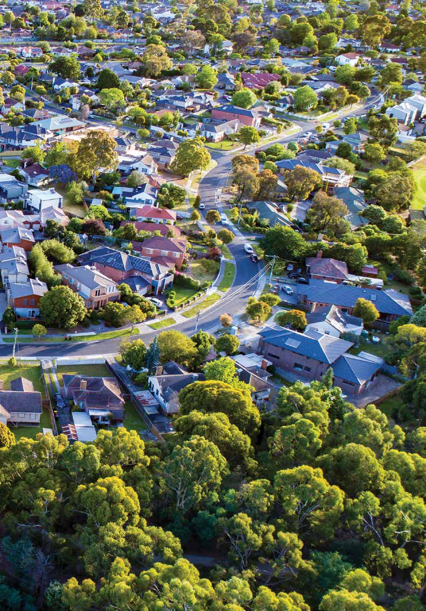
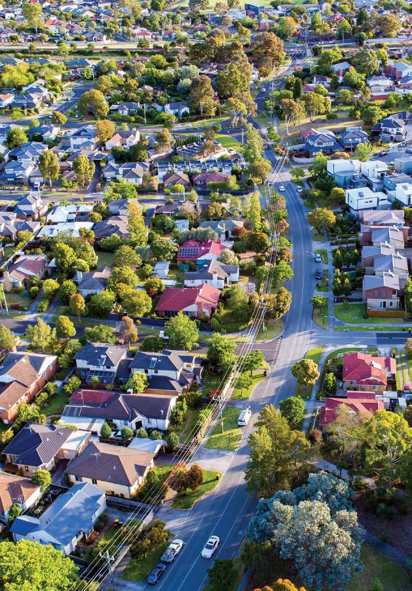

# National Disaster Risk Reduction Framework (2018)

> **Source**: Australian Government — National Emergency Management Agency (NEMA) / Department of Home Affairs
> **URL**: https://nema.gov.au/sites/default/files/2024-08/national-disaster-risk-reduction-framework.pdf
> **Licence**: CC BY 4.0
> **Retrieved**: 2026-05-07T23:46:12Z
> **SHA-256**: `10b0daf5fab05c4a25d99306cafbbf932b8fc0139e8dadcff1cb8ca6f778aedb`
> *Converted from PDF to Markdown format.*

---
## Page 1

Aerial view of Melbourne's beutifully green eastern suburbs.
National Disaster 
Risk Reduction
Framework

---
## Page 2

Department of Home Affairs
Acknowledgements
The National Disaster Risk Reduction Framework is a multi-
sector collaboration led by the National Resilience Taskforce 
within the Australian Government Department of Home Affairs.
The framework was co-designed with representatives from all 
levels of government, business and the community sector. Over 
100 participants from a diverse range of over 80 organisations 
came together at a three-day intensive ‘policy sprint’ in 
June 2018 to develop key components of the framework. 
The National Resilience Taskforce worked closely with an 
inter-jurisdictional Steering Committee to develop, refine 
and undertake further broad consultation on the framework.
The Department of Home Affairs thanks all sectors, 
organisations and individuals involved in co-design for 
their time, effort and expertise. This framework would 
not have been made possible without these contributions.
© Commonwealth of Australia 2018
With the exception of the Commonwealth Coat of Arms, all material presented in this 
publication is provided under a Creative Commons Attribution 4.0 International license at 
https://creativecommons.org/licenses/by/4.0/legalcode.
This means this license only applies to material as set out in this document.
The details of the relevant license conditions are available on the Creative Commons 
website at https://creativecommons.org/ as is the full legal code for the CC BY 4.0 license at 
https://creativecommons.org/licenses/by/4.0/legalcode.
Use of the Coat of Arms
The terms under which the Coat of Arms can be used are detailed at the Department of Prime 
Minister and Cabinet website – https://www.pmc.gov.au/government/commonwealth-coat-arms.
Contact us
Enquiries regarding the licence and any use of this document are welcome at:
Department of Home Affairs
PO Box 25
BELCONNEN ACT 2616

---
## Page 3

National Disaster Risk Reduction Framework
Page 3
Foreword
In Australia, we are all too familiar with the devastation and 
disruption that natural hazards such as bushfires, cyclones and 
flooding can cause. 
Over the last decade we have made great progress towards being more 
resilient to natural hazards and in reducing disaster risk. However, with the 
driver of a changing climate there is growing potential for some natural 
hazards to occur at unimagined scales, in unprecedented combinations and 
in unexpected locations. 
Many natural hazards are becoming more frequent and intense. More people 
and assets are exposed and vulnerable to these hazards. The essential 
services we rely on – power, water, telecommunications, the internet and 
finance – are also exposed to these impacts. As a result, the cost of disasters 
is increasing for all sectors of society – governments, industry, business, 
not-for-profits, communities and individuals. These costs include not only 
direct costs but the indirect ones, including costs from all the flow-on effects 
that disasters have. 
Across all sectors, we are already working together to enrich Australia’s 
prosperity, wellbeing, economic growth and international standing.  By taking 
collective action now to reduce disaster risk, we can ensure Australia 
continues to sustainably enjoy the benefits of global change.
Investment in reducing disaster risk can deliver benefits beyond avoiding loss 
and suffering. Disaster risk reduction can unlock economic opportunities. 
Broader social and economic benefits can also be realised even without a 
hazard occurring. This can be true of investment in disaster risk reduction by 
all sectors across the built, social, economic and natural environments.
We are better positioned now than ever before to take a comprehensive 
approach to addressing the causes of disaster risk, rather than only dealing 
with the symptoms. We can give urgent priority to this sophisticated program 
of work. This will ensure Australian communities can endure more frequent 
and intense natural hazards. It will also ensure Australian communities can 
thrive and prosper following these events.
Responding to these opportunities and challenges, the National Disaster Risk 
Reduction Framework outlines a national, comprehensive approach to 
proactively reducing disaster risk, now and into the future.

---
## Page 4

Page 4
Introduction
As Australians see the 
growing potential for natural 
hazards to trigger devastating 
disasters, we rightfully 
expect that all sectors of 
society will work together 
to limit these impacts.
In 2011, for the first time in 
Australia, the Council of Australian 
Governments’ National Strategy 
for Disaster Resilience (NSDR) 
established a national resilience-
based approach to disaster 
management. Australia’s resilience 
to disaster impacts is critical to our 
continued wellbeing and prosperity. 
However, our capacity to be resilient 
to disasters diminishes as disaster 
risk, and potential impacts, grows.
In 2015, the Sendai Framework for 
Disaster Risk Reduction 2015 – 2030 
(the Sendai Framework) was adopted 
by Australia and other members of 
the United Nations at the third UN 
World Conference on Disaster Risk 
Reduction. Through the Sendai 
Framework, countries around the 
world recognise the importance of 
not only managing disasters, but 
managing disaster risk. 
The Sendai Framework states that to 
strengthen resilience, countries must 
prevent new and reduce existing 
disaster risk. It also outlines four 
global priorities for action to reduce 
disaster risk: understanding disaster 
risk; strengthening disaster risk 
governance to manage disaster risk; 
investing in disaster risk reduction for 
resilience; and enhancing disaster 
preparedness for effective response, 
and to ‘Build Back Better’ in recovery, 
rehabilitation and reconstruction.
The Paris Agreement and the 
2030 Agenda for Sustainable 
Development (including the 
Sustainable Development Goals) 
were also agreed on in 2015. Both 
agreements highlight the importance 
of climate adaptation and disaster 
risk reduction. The United Nations 
Office for Disaster Risk Reduction 
recognises that progress in 
implementing the Sendai Framework 
supports the global community in 
meeting the Sustainable 
Development Goals.
Reducing disaster risk is critical 
to supporting communities and 
economies to be resilient when 
a shock occurs. Recognising this, 
in early 2018 the Australian 
Government invited all states and 
territories, local government, and 
key private sector representatives 
to work together to co-design and 
develop this framework. 
The framework outlines a 
coordinated approach to reducing 
disaster risk. This is one critical 
component to enable resilience. It is 
designed to leverage the great work 
and progress made across all sectors 
since the release of the NSDR in 2011 
to better understand and reduce 
disaster risks, improve resilience, and 
bolster the capability and capacity 
of communities to withstand 
natural hazards. 
Disaster resilience and risk reduction 
is a shared responsibility, but often 
not equally shared. While individuals 
and communities have their roles 
to play, they do not control many of 
the levers needed to reduce some 
disaster risks. Governments and 
industry in particular must take 
coordinated action to reduce 
disaster risks within their control to 
limit adverse impacts on 
communities. More than ever, 
limiting the impact of disasters now 
and in the future requires a 
coordinated effort across and within 
many areas including land use 
planning, infrastructure, emergency 
management, social policy, 
agriculture, education, health, 
community development, energy 
and the environment.

---
## Page 5

National Disaster Risk Reduction Framework
Page 5
Drivers for action
NATURAL HAZARDS ARE MORE FREQUENT AND INTENSE
Many natural hazards are becoming more frequent and more intense, driven by Australia’s changing climate. 
The Bureau of Meteorology/CSIRO’s 2018 State of the Climate report describes the effect of Australia’s changing 
climate, including warming temperatures, rising sea level, more severe fire weather, and increased rainfall in 
Australia’s north and decreases in the south. It is predicted that these changes will continue, while new natural 
hazard threats will emerge. There is growing potential for cumulative or concurrent, large-scale natural hazards 
to occur.
ESSENTIAL SERVICES ARE INTERCONNECTED AND INTERDEPENDENT
Australians depend on reliable and affordable food, water, energy, telecommunications, transport networks 
(including road, rail, aviation and maritime), and financial services. These functions also depend on each other. 
The networks that ensure the sustained delivery of food, water and energy involve complex interactions between 
infrastructure, people, the environment, money and technology. A failure in any of these elements could have 
wide-ranging consequences across communities, businesses, governments and economies.
PEOPLE AND ASSETS ARE MORE EXPOSED AND VULNERABLE
As cities and regional centres expand to accommodate growing populations, the buildings and infrastructure 
needed to support our future communities will be exposed and vulnerable to natural hazards. The 2015 
Intergenerational Report highlights that our population is growing and ageing. Our overall standard of living has 
improved, yet socioeconomic differences among communities remain, and people and assets continue to be 
located in at-risk areas such as coastal zones, floodplains and areas where bushland meets cities and towns.
DISASTER IMPACTS ARE LONG TERM AND COMPLEX
The impacts of disasters can be long term, complex, and intangible. Collectively, we are only now beginning 
to fully understand indirect, flow on and cumulative effects of disasters. We do know that disasters can trigger 
long-term challenges across a range of areas, including reduced education and workforce participation, 
increased crime, and physical and mental health and wellbeing. These impacts are often felt disproportionately 
by vulnerable or susceptible groups. Factors such as health and wellbeing, economic resources, social capital 
and knowledge influence a person’s ability to prepare for, respond to, and recover from disasters.

---
## Page 6

Page 6
THE COSTS OF DISASTERS ARE GROWING
In 2017 Deloitte Access Economics, reporting to the Australian Business Roundtable for Disaster Resilience and 
Safer Communities, found that over the past 10 years disasters have cost the Australian economy around 
$18 billion per year. Assuming current development patterns and population growth continue, this is forecast to 
reach $39 billion per year by 2050. This forecast does not account for the effects of a changing climate, which are 
expected to magnify these costs; nor does it account for losses that cannot be quantified but are no less 
important to people. Deloitte Access Economics found in 2015 that the intangible costs of disasters – including 
increased family violence, mental health impacts, chronic disease, alcohol and drug use, short and long-term 
unemployment, changes to school academic outcomes, and crime – are at least equal to, if not greater than, 
tangible costs.
MOMENTUM TO ADDRESS FINANCIAL IMPACTS OF A CHANGING CLIMATE IS BUILDING
There is significant momentum building across sectors to address climate and disaster risks. The release of the 
2017 Taskforce on Climate-related Financial Disclosure report increased market understanding of climate risk and 
demand for services to help identify and manage that risk. The Australian Prudential Regulation Authority and 
Australian Securities and Investment Commission have stated that climate-related physical and economic 
transition risks are foreseeable and material financial risks that should be addressed by company directors 
alongside all other financial risks. Mainstream investors are divesting from stock in exposed industries, credit 
rating companies are reassessing credit ratings to factor in climate-related risks and several banks have 
commissioned analysis of their mortgage books based on location. The Investor Group on Climate Change, in its 
2018 Investing in Resilience report, predicts that the ability to differentiate investment opportunities by climate 
risks will be a key financial metric within the next 3-5 years. These developments provide additional reasons to 
take action to reduce disaster risk and position Australia for the future.
Purpose
The National Disaster Risk Reduction 
Framework (‘the framework’) guides 
national, whole-of-society efforts to 
proactively reduce disaster risk in 
order to minimise the loss and 
suffering caused by disasters.
Scope
This framework is designed to guide Australia’s efforts to reduce disaster risk 
associated with natural hazards. It translates the first three Sendai Framework 
priorities into action for the Australian context; though the strategies outlined 
in this framework are applicable to disaster preparedness and recovery 
efforts, the fourth priority of the Sendai Framework is largely progressed 
through other national strategies, primarily the Australian Disaster 
Preparedness Framework. 
The framework establishes a 2030 vision, goals and priorities broadly aligned 
to the Sendai Framework and the 2030 Sustainable Development Goals, and 
outlines foundational strategies for action to meet these across the five years 
from 2019 – 2023. The framework will be reviewed and updated at the end of 
this five-year period to ensure its relevance and accuracy across the remaining 
years to 2030.
It is not exhaustive nor prescriptive, and should be holistically applied across 
and between four key environments: built, social, natural, and economic.

---
## Page 7

National Disaster Risk Reduction Framework
Page 7
BUILT ENVIRONMENT
Physical and social infrastructure assets such as transport, energy and 
telecommunications, water utilities, housing, cultural and commercial 
precincts, and other assets.
SOCIAL ENVIRONMENT
Socioeconomic and demographic trends, social networks and relationships, 
cultural practices, technology, innovation, wellbeing, essential services such 
as health and education, and lifestyles.
NATURAL ENVIRONMENT
Natural assets such as wetlands, rivers, land, forests, oceans, other complex 
natural ecosystems, agriculture, and water sources.
ECONOMIC ENVIRONMENT
Public sector, private sector and individual economic activities; workforce 
participation; credit, debt, and finance; and small, medium, national and 
multinational business.
The fundamentals – natural hazards, disaster risk, climate 
risk and resilience 
The United Nations Office for Disaster 
Risk Reduction defines disaster risk as the 
potential loss of life, injury, or destroyed 
or damaged assets that could occur 
to a system, society or a community. 
This framework recognises that disaster 
risk is a product of hazard (a sudden 
event or shock), exposure (the people 
and things in the path of potential 
hazards), vulnerability (the potential 
for those people and things to be 
adversely impacted by a hazard) and 
capacity (the ability for those people 
and assets and systems to survive 
and adapt). 
It focuses only on natural hazards: 
shocks caused by a natural process or 
phenomenon that may cause loss of 
life, injury, damage and disruption. 
Natural hazards include bushfires, 
floods, cyclones, storms, heatwaves, 
earthquakes and tsunamis. 
Natural hazards trigger disasters when 
they impact what people value. 
The United Nations Office for 
Disaster Risk Reduction recognises 
climate change is an underlying 
driver of disaster risk. Climate 
change can increase disaster risk in a 
variety of ways, including by altering 
the frequency and intensity of natural 
hazards, affecting vulnerability to 
natural hazards, and changing 
exposure patterns. These impacts 
are outlined in reports such as the 
Fifth Assessment Report of the 
Intergovernmental Panel on Climate 
Change (2014), the National Climate 
Resilience and Adaptation Strategy, 
and Bureau of Meteorology/ CSIRO 
State of the Climate 2018 Report. 
The United Nations Office for Disaster 
Risk Reduction defines disaster 
resilience as the ability to resist, 
absorb, accommodate, adapt to, 
transform and recover from the effects 
of a hazard. As disaster risk increases, 
the capacity of communities and 
systems to be resilient is diminished. 
This framework focuses on reducing 
disaster risk as one key component 
of enabling resilient communities and 
economies in Australia.

---
## Page 8

Page 8
Figure 1 Framework overview
Sendai Framework Outcome 2030
The substantial reduction of disaster risk and losses in lives, livelihoods and health, and in the economic, physical, 
social, cultural and environmental assets of persons, businesses, communities and countries.
2030 Vision for Disaster Risk Reduction in Australia
In Australia, we are enabled and supported to actively reduce disaster risk and limit the impacts of disasters on 
communities and economies. All sectors of society understand and respond to social, environmental, 
technological and demographic changes which have the potential to prevent, create or exacerbate disaster risks. 
All sectors of society:
–	make disaster risk-informed decisions,
–	are accountable for reducing risks within their control, and
–	invest in reducing disaster risk in order to limit the cost of disasters when they occur.
2030 Disaster Risk Reduction Goals
Take action to reduce existing 
disaster risk
Minimise creation of future 
disaster risk through decisions 
taken across all sectors
Equip decision-makers with 
the capabilities and information they 
need to reduce disaster risk and 
manage residual risk 
Framework Priorities
Understand 
disaster risk
1
Accountable 
decisions
2
Enhanced
investment
3
Governance, ownership 
and responsibility
4
Guiding Principles
Shared and defined 
responsibilities
All sectors have 
shared but defined 
responsibilities to 
reduce disaster risk.
Cultural change
All sectors cultivate 
a culture of disaster risk 
reduction awareness 
and action.
Integrated action
Efforts to reduce 
disaster risk must 
be integrated 
across sectors, not 
progressed in silos.
Inclusive engagement 
All sectors connect with 
diverse stakeholders 
to ensure inclusive 
decision-making leading 
to more effective 
solutions.
Practical change at local, state and national levels
Continual improvement
All sectors continuously learn 
and innovate to improve practices 
and share our lessons, data and 
knowledge widely.
Data-driven decision making
Data and information 
informs implementation planning 
and execution.
Leadership
Commitment is required at all 
levels and in all sectors to 
effectively reduce disaster risk.

---
## Page 9

National Disaster Risk Reduction Framework
Page 9
Figure 2 Priorities and strategies at a glance
PRIORITY 1: 
Understand disaster risk
•	 Improve public awareness of, and 
engagement on, disaster risks and impacts
•	 Identify and address data, information 
and resource gaps
•	 Address technical barriers to data and 
information sharing and availability
•	 Integrate plausible future scenarios into 
planning
•	 Develop cohesive disaster risk information 
access and communication capabilities 
to deliver actionable disaster risk data 
and information
•	 Support long-term and solution-driven 
research, innovation and knowledge 
practices, and disaster risk education
•	 Improve disclosure of disaster risk 
to all stakeholders
PRIORITY 2: 
Accountable decisions
•	 Consider potential avoided loss 
(tangible and intangible) and broader 
benefits in all relevant decisions 
•	 Identify highest priority disaster risks 
and mitigation opportunities
•	 Build the capability and capacity of 
decision-makers to actively address 
disaster risk in policy, program and 
investment decisions
•	 Establish proactive incentives, and 
address disincentives and barriers, to 
reducing disaster risk
•	 Maintain planning and development 	
practices that adapt to rapid social, 
economic, environmental and cultural 
change
•	 Promote compliance with, and embed 
	
    resilience requirements into, relevant
	
	
standards, codes and specifications
PRIORITY 3:
Enhanced investment
•	 Pursue collaborative commercial financing 
options for disaster risk reduction initiatives
•	 Develop disaster risk reduction investment 
tools to provide practical guidance on 
investment mechanisms
•	 Leverage existing and future government 
programs to fund priority risk reduction 
measures
•	 Identify additional current and future 
potential funding streams
•	 Improve the accessibility, variety and 
uptake of insurance
•	 Empower communities, individuals and 
small businesses to make informed and 
sustainable investments
PRIORITY 4: 
Governance, ownership and 
responsibility
•	 Establish a national mechanism to oversee 
and guide disaster risk reduction efforts 
and cross-sector dependencies
•	 Establish a national implementation plan 
for this framework
•	 Support and enable locally-led and owned 
place-based disaster risk reduction efforts
•	 Incentivise improved transparency of 
disaster risk ownership through personal 
and business transactions
•	 Consistently report on disaster risk 
reduction efforts and outcomes
•	 Create clear governance pathways for 
pursuing disaster risk reduction projects
 
ACTION TO  
REDUCE DISASTER 
RISK

---
## Page 10

Page 10Aerial view of Melbourne's beutifully green eastern sub

---
## Page 11

National Disaster Risk Reduction Framework
Page 11
Priorities and strategies 
for action

---
## Page 12

Page 12
National Priority 1
Understand disaster risk
Relates to Sendai Framework priority 1: understanding disaster risk
FIVE-YEAR OUTCOMES
Legal liability of decision-makers 
relating to disaster risk information 
is further understood and 
acted upon
Australia is supported with enduring 
and cohesive national capabilities 
that enable the creation, capture 
and sharing of useful disaster 
risk information
Meaningful disaster risk information 
is freely disclosed, shared and 
integrated into risk planning 
across sectors
To be reduced, all components of 
disaster risk and impacts must be 
understood by all sectors: 
vulnerability, capacity, exposure of 
persons and assets, hazard 
characteristics, and the environment.
Across all sectors, there is 
an urgent and growing 
demand for trusted and 
authoritative disaster risk 
information and services to 
inform operational and 
strategic decisions.
This information must be matched by 
investments in the capabilities and 
technology required to meet these 
demands. Disaster risk can be 
unintentionally created or 
exacerbated when decisions are 
made without understanding future 
consequences, including climate 
change impacts.
It is our collective responsibility to 
efficiently equip decision-makers in 
all sectors with the information and 
capabilities they need to make 
decisions that reduce disaster risk. 
Change will come from improved 
access to reliable information and 
capability development, and through 
greater public awareness of direct 
and indirect disaster risks and 
impacts. 
A wealth of disaster risk data, 
information and knowledge already 
exists. Over the last five years states 
and territories have developed a 
sophisticated understanding of 
state-wide risks and have released 
these findings. Some states have 
developed state-wide infrastructure 
strategies and critical infrastructure 
resilience strategies informed by a 
comprehensive understanding of 
natural hazards, exposure and 
resilience. Industries and other 
non-government sectors have also 
invested significantly in improved 
natural hazard and disaster risk 
information. 
However, much existing data relates 
to historical natural hazard patterns 
and while useful, it cannot be relied 
on as a sole predictor of future 
risk. This is due to the rapidly 
changing nature of many natural 
hazards and the uncertain speed 
of climatic changes.
Despite progress, disaster risk data 
and information is not always 
available to those who need it and it 
does not adequately integrate 
climate science. More needs to be 
done to properly connect and 
leverage existing data, information 
and services that are not accessible 
or affordable. Also, we need to 
better understand and address key 
data and information gaps and 
overcome barriers to sharing it.
To make sensible long-term 
decisions and prevent new risks 
being created, we need to 
understand possible future disaster 
risks and impacts. All sectors seek 
trusted, credible and consistent 
approaches to developing and using 
scenarios and risk forecasting 
methods; the right information is 
needed at the right level.

---
## Page 13

National Disaster Risk Reduction Framework
Page 13
Priority 1 – Strategies for action: 2019-2023
STRATEGY A
Improve public awareness 
of, and engagement on, 
disaster risks and impacts
Greater awareness of the potential long-term and highly uncertain direct 
and indirect impacts of disasters on all sectors requires formal and informal 
education and community-driven engagement. An improved understanding 
of the systemic nature of disaster risk and what that means for all sectors, 
including communities, is critical.
STRATEGY B
Identify and address 
data, information and 
resource gaps
New data sets and information relating to all components of disaster risk 
should be collated to contribute to a more comprehensive understanding 
of disaster risk. Information gaps at the intersection of disaster risk and 
climate science should be addressed and resourcing needs identified. 
STRATEGY C
Address technical barriers 
to data and information 
sharing and availability
Technological advancements, including smart infrastructure, should be 
leveraged to create improved disaster risk information. Clarification on 
liability, copyright, privacy and intellectual property issues is needed to 
facilitate improved data sharing and release.
STRATEGY D
Integrate plausible future 
scenarios into planning
Scenario-based risk and vulnerability assessment can provide a structured 
and rigorous method to factor future climate and disaster risks into decision-
making, in the context of a variety of social, environmental, demographic 
and economic changes. It is designed to inform both straightforward and 
complex decisions, including management of residual risk, and is a useful 
method for navigating future uncertainties.
STRATEGY E
Develop cohesive disaster 
risk information access and 
communication capabilities 
to deliver actionable disaster 
risk data and information
Existing knowledge and technological capabilities can be better utilised 
and connected, and existing data better analysed and integrated with 
future scenarios, to improve the availability of useful disaster risk 
information. Useful disaster risk information should improve understanding 
of the systemic nature of disaster risk, consider interactions between all 
components of disaster risk, and inform management of residual risk. 
Links between policy, research, operational expertise and formal education 
should be strengthened to support and contribute to these capabilities. 
STRATEGY F
Support long-term and 
solution-driven research, 
innovation and knowledge 
practices, and disaster risk 
education
Greater policy-research connection and innovation is needed to ensure 
necessary evidence bases are available to inform efforts to identify, 
prioritise and reduce disaster risks. A greater variety of knowledge 
practices, including Indigenous knowledge practices, should also be better 
integrated in research and knowledge application. Diverse ways of 
understanding and reducing disaster risk are needed to address disaster 
risk in all of its components.
STRATEGY G
Improve disclosure 
of disaster risk to all 
stakeholders
Information about disaster risks and their implications for all sectors of 
society should be disclosed to better enable all sectors to reduce risks within 
their control. This should include information about residual disaster risk.

---
## Page 14

Page 14
National Priority 2
Accountable decisions
Relates to Sendai Framework priority 1: understanding disaster risk; priority 2: strengthening 
disaster risk governance to manage disaster risk; and priority 3: invest in disaster risk reduction 
for resilience
FIVE-YEAR OUTCOMES
Decision-making 
processes and models, 
including cost benefit 
analyses, adequately 
address current and future 
disaster risks
Priority disaster risks are 
identified and actively 
mitigated
Integrated and robust 
frameworks are used to 
assess and reduce disaster 
risk in all environments, but 
particularly infrastructure, 
land use and development 
planning 
Greater understanding of disaster 
risk has limited value unless actively 
applied. Decisions made today must 
respond to identified immediate and 
long-term disaster risks and related 
challenges.
All types of decisions – 
from where to build 
infrastructure or where 
to invest funds to where 
to buy a home, where 
to place services or how 
to design public assets 
– have the potential 
to reduce, create or 
prevent disaster risk.
Decisions and trade-offs made in all 
sectors matter, whether those 
decisions relate to a multi-billion 
dollar infrastructure investment, 
small business continuity planning, 
or residential property purchases. 
Reducing disaster risk through better 
decision-making requires informed 
trade-offs and accountability for 
those decisions.
The obligations of decision-makers 
to actively address disaster risk 
within their areas of responsibility are 
becoming increasingly explicit. For 
example, in 2017 Infrastructure 
Australia released national guidelines 
requiring that all project proposals 
consider climate risk.
To enable Australians to act on 
their respective responsibilities, 
decision-makers must use improved 
risk information to manage the 
potential for decisions to create or 
exacerbate disaster risk. They also 
need tools and methods to 
appropriately and consistently assess 
a broad range of opportunities and 
associated costs, and prioritise risk 
reduction efforts accordingly.
To improve resilience in the built 
environment, further attention is 
needed to remove disincentives 
and strengthen planning and 
development practices while 
ensuring the sustainable needs of 
Australia’s growing population are  
met. Earlier work to implement the 
Enhancing Disaster Resilience in the 
Built Environment Roadmap should 
be leveraged to help deliver this.
Public, private and 
community sector 
decision-makers are 
working towards 
addressing disaster risk 
along with other risks

---
## Page 15

National Disaster Risk Reduction Framework
Page 15
Priority 2 – Strategies for action: 2019-2023
STRATEGY A
Consider potential avoided 
loss (tangible and intangible) 
and broader benefits in all 
relevant decisions 
Measured assessment of disaster risk and impacts should be undertaken 
for investments of all types, across all sectors. To appropriately determine 
the costs and benefits of reducing existing and future disaster risk, 
opportunities and losses should be quantified. Those that cannot be 
quantified should be accounted for in a consistent manner. These methods 
should be able to consider unexpected and unknown risks, as well as flow 
on risks and impacts.
STRATEGY B
Identify highest priority 
disaster risks and mitigation 
opportunities
It is often not possible to reduce all identified risks. Efforts and resources 
should be targeted to reduce risks with the greatest potential impact. 
Highest priority risks and vulnerabilities and appropriate mitigations should 
be identified using consistent principles and strategic risk assessment 
methods. Consideration of residual risk should be a key component.
STRATEGY C
Build the capability and 
capacity of decision-makers 
to actively address disaster 
risk in policy, program and 
investment decisions
STRATEGY D
Establish proactive incentives, 
and address disincentives 
and barriers, to reducing 
disaster risk
Use sector-specific professional development and guidance materials to 
build the capability of decision-makers to use improved disaster risk 
information to appropriately identify and address current and potential 
future disaster risks and impacts within their area of responsibility.
Current and future policy, legislative, regulatory, cultural, knowledge, 
behavioural and financial settings should be adjusted to enable and support 
decision-makers to actively reduce risk within their area of responsibility. 
This should be pursued while ensuring the sustainable development needs 
of Australia’s growing population are met. 
STRATEGY E
Maintain planning and 
development practices that 
adapt to rapid social, 
economic, environmental 
and cultural change
Infrastructure, land use and development planning and practices must be 
integrated, strategic and adaptive to avoid creating new disaster risk.
STRATEGY F
Promote compliance with, 
and embed resilience 
requirements into, relevant 
standards, codes and 
specifications
Leverage existing mechanisms for reviewing standards, codes and 
specifications to minimise disaster risk being built into the urban 
environment and regional landscape, recognising that preservation of life 
must remain a priority.

---
## Page 16

Page 16
National Priority 3
Enhanced investment
Relates to Sendai Framework priority 3: investment in disaster risk reduction for resilience
FIVE-YEAR OUTCOMES
Existing and future disaster risk 
reduction investments target high 
priority locally and nationally 
significant disaster risks
Where possible, investment in 
disaster risk reduction is designed 
to maximise broader outcomes 
including increased productivity, 
improved connectivity, and social 
inclusion
Investments in disaster risk 
reduction and resilience limit future 
disaster recovery costs
The total economic cost of disasters 
is increasing along with the cost of 
disaster recovery. Current federal 
and state government spending on 
direct recovery from disasters is 
already around $2.75 billion per year 
and indirect recovery costs may 
be borne by many sectors across 
multiple years.
Much of the work needed to reduce 
disaster risk and contain this growing 
cost will require upfront financial 
investment.
All sectors must invest in 
reducing disaster risk, 
through both funding and 
financing, to limit the cost 
of disasters in the future.
Existing stresses or pressures in 
the natural and social environments 
may cause natural hazards to 
disproportionately impact vulnerable 
communities. Investing in disaster 
risk reduction across each of natural, 
social, built and economic 
environments can reduce our 
vulnerability to disasters and help 
achieve broader social and economic 
benefits.
Investment in risk reduction and 
resilience can deliver a triple 
dividend:
•	 Avoid loss and suffering 
• 	 Reduce future disaster costs
• 	 Unlock economic opportunities 
and broader economic and social 
benefits to be realised even in the 
absence of a natural hazard.
All levels of government, communities 
and the private sector already make 
significant investments to reduce 
disaster risk but are now actively 
seeking a return on that investment 
in terms of immediate outcomes and 
avoided losses.
This presents a significant 
opportunity for public and private 
sectors to work together to identify 
and leverage the broader economic 
value and opportunity created by 
investments in disaster risk reduction 
and resilience. In particular, there is 
a need to focus on:
(1)	 Finding or developing financing 
and funding pathways to address 
existing high priority risks across 
all environments, and
(2)	Identifying financing mechanisms 
and pathways to pursue disaster 
risk reduction measures in 
planned projects, particularly 
infrastructure and development 
projects.

---
## Page 17

National Disaster Risk Reduction Framework
Page 17
Priority 3 – Strategies for action: 2019-2023
STRATEGY A
Pursue collaborative 
commercial financing 
options for disaster risk 
reduction initiatives
Commercial financing and investment models such as loans, equity 
contributions, guarantees and Public-Private Partnerships can be applied to 
disaster risk reduction projects. These models can deliver financial returns 
on investment, unlock economic opportunities, and deliver not only avoided 
losses but broader sustainability and productivity outcomes.
STRATEGY B
Develop disaster risk 
reduction investment tools 
to provide practical guidance 
on investment mechanisms
Investment literacy and capability should be improved across all sectors 
to ensure potential investment opportunities can be properly identified 
and leveraged by decision-makers across governments, the private sector 
and communities.
STRATEGY C
Leverage existing and future 
government programs to fund 
priority risk reduction measures
Governments at all levels should collaborate to align and leverage existing 
and future funding streams to create clearer funding pathways for disaster 
risk reduction projects. Significant existing investment in infrastructure 
across all environments, climate adaptation and energy security can also be 
leveraged to deliver disaster risk reduction outcomes.
STRATEGY D
Identify additional current 
and future potential funding 
streams
All sectors should leverage improved disaster risk information to proactively 
identify current and future risk reduction funding needs and establish 
funding pathways to meet these needs.
STRATEGY E
Improve the accessibility, 
variety and uptake of 
insurance
All sectors should work to diversify the variety of insurance products, 
better communicate these products, and address barriers to insurability 
– for example, by supporting assessment of asset conditions.
STRATEGY F
Empower communities, 
individuals and small 
businesses to make informed 
and sustainable investments
Communities and individuals can own their role as informed and active 
investors in disaster risk reduction, subject to their capacity, capability and 
financial position, to their own benefit and the benefit of their broader 
networks and economies. This requires communities to be supported to 
understand disaster risks and impacts relevant to what they value and the 
choices they make. It is essential to identify what support may be needed by 
those with limited capacity and capability to act as an informed investor.

---
## Page 18

Page 18
National Priority 4
Governance, ownership and responsibility
Relates to Sendai Framework priority 2: strengthening disaster risk governance to manage 
disaster risk
FIVE-YEAR OUTCOMES
All sectors and 
communities understand 
the extent to which they 
have a responsibility to 
reduce disaster risk
Mechanisms are in place 
nationally to identify and 
reduce disaster risk arising 
from cross-sector 
interdependencies
Transferred ownership 
of disaster risk through 
commercial exchanges 
is transparent and 
acknowledged
All sectors and 
communities are engaged 
in a national mechanism to 
connect and guide efforts 
to reduce disaster risk
To be effective, action to reduce 
disaster risk must be transparent, 
sustainable, accountable and 
undertaken in partnership.
Disaster risk reduction is a 
shared responsibility. 
However, it is not equally 
shared and it can often be 
unclear where certain 
responsibilities lie.
Disaster risk reduction requires 
strong governance that not only 
responds to the uncertain and 
changing nature of disasters and a 
changing climate, but to the 
interrelated and complex distribution 
of responsibility for identifying, 
managing and reducing disaster risk. 
It is critical that governance 
mechanisms include all relevant 
stakeholders and clearly identify 
roles and responsibilities.
In the same way that disaster risk can 
be inadvertently created or 
exacerbated by decisions made 
across all sectors, the impact of 
disaster risk can knowingly or 
unknowingly be transferred to 
others. Disaster risk governance 
mechanisms play a critical role in 
ensuring any transfer of risk from one 
sector or entity to another is 
informed and understood by all 
relevant stakeholders.
To improve disaster risk reduction 
outcomes, there is significant 
potential for a nationally-owned and 
multi-stakeholder led coordination 
mechanism. Such a mechanism could 
bring together relevant cross-
sectoral expertise to support 
effective implementation and 
monitoring of disaster risk reduction 
efforts across the country. It would 
provide an important link between 
local and national efforts.

---
## Page 19

National Disaster Risk Reduction Framework
Page 19
Priority 4 – Strategies for action: 2019-2023
STRATEGY A
Establish a national mechanism 
to oversee and guide disaster 
risk reduction efforts and 
cross-sector dependencies
This mechanism should be partnership-based, agile and dynamic. It could 
comprise multiple components and forums, and should create and leverage 
partnerships that support coordination, collaboration and advice between 
all sectors to reduce disaster risk.
STRATEGY B
Establish a national 
implementation plan 
for this framework
The implementation plan should include initiatives at a national and 
jurisdictional level, as well as place-based locally-led initiatives and sector-
specific initiatives. It should also be leveraged to clarify roles and 
responsibilities for reducing disaster risk and improving resilience.
STRATEGY C
Support and enable locally-led 
and owned place-based 
disaster risk reduction efforts
Where disaster risks are location-specific, governments and other relevant 
sectors should support local ownership and delivery of place-based disaster 
risk reduction and resilience measures.
STRATEGY D
Incentivise improved 
transparency of disaster risk 
ownership through personal 
and business transactions
All sectors should explore opportunities to ensure there is appropriate 
transparency of disaster risk and potential impacts in transactions where 
disaster risk may be shifted from one party to another.
STRATEGY E
Consistently report on 
disaster risk reduction 
efforts and outcomes
To minimise duplication of effort and allow success to be shared and 
leveraged, all sectors should regularly share and report on work being 
undertaken to identify, prioritise and reduce disaster risks and losses.
STRATEGY F
Create clear governance 
pathways for pursuing disaster 
risk reduction projects
Aligning decision-making practices across sectors and levels of government, 
where possible, would allow a clearer line of sight from identifying disaster 
risks to prioritising and taking action to reduce them. In the first instance, 
this will require disaster risk reduction to be incorporated into existing 
governance arrangements across all sectors. This should apply to various 
types of decision-making in all sectors and environments. It will also help to 
clarify the movement of disaster risk, including residual risk, among sectors.

---
## Page 20

Page 20
Figure 3 Strategic context and policy environment
This figure outlines how the National Disaster Risk Reduction Framework is situated within the broader disaster resilience policy context, and demonstrates the 
breadth of the disaster risk reduction ‘world’ within this broader context. Arrows represent interactions. The diagram is indicative, rather than exhaustive.
2030 Agenda
for Sustainable
Development
Sendai Framework
for Disaster Risk
Reduction 2015–2030
Paris Agreement
NATIONAL STRATEGY FOR DISASTER RESILIENCE
Disaster
preparedness
Disaster
response
Disaster
recovery
Critical infrastructure
Climate adaptation
Education
Standards and codes
Essential public services
Economics
Telecommunications
Land use planning and
development
Natural resource
management
Emergency
management
Community services
Community development
Housing
Insurance
Social policy
Energy
Infrastructure, transport
and assets
Finance and investment
Agriculture
Health
National
Disaster Risk
Reduction
Framework
Disaster
risk reduction

---
## Page 21

National Disaster Risk Reduction Framework
Page 21
Implementation 
Who is the Framework for?
The framework is designed to be 
implemented by decision-makers 
within all sectors at national, state 
and local levels. 
The framework should not prompt 
the question ‘who will do this?’, 
but rather:
How can my sector, organisation or 
community implement this 
framework within our areas of 
responsibility?
What national or cross-sectoral 
actions or initiatives may be 
required to implement it, and what 
role can my sector, organisation or 
community play in progressing 
these?
Figure 3 (see page 20) outlines 
examples of sectors with a role to 
play in reducing disaster risk. 
Figure 4 below demonstrates the 
different types of decision-making 
that this framework should inform, 
and indicates the relevance of these 
types of decision-making to various 
sectors of society.
Figure 4  Types of decision-making relevant to this framework and the indicative relevance to various sectors
Decision types
Individual
Communities
Governments 
Industries
Business
Not-for-profit 
sector
Investment 
and spending 
✔
✔
✔
✔
✔
✔
Public policy
✔
✔
Development/ 
land use 
decisions
✔
✔
✔
✔
✔
Legislation/ 
regulation
✔
Program and 
resource 
decisions
✔
✔
✔
✔
✔
Implementation 
plan
The framework will be supported by 
a five-year national implementation 
plan to be developed in conjunction 
with all levels of government and 
non-government sectors.
The national implementation plan, to 
be released in 2019, will detail 
initiatives to be undertaken by all 
sectors of society to reduce disaster 
risk and limit the impacts of disasters 
on communities and the economy. 
Measuring 
success
The five-year outcomes listed under 
each of the National Priorities set a 
collective measure of success for 
each framework priority in the short 
term. In the long term, the success of 
the framework will be measured 
against nationally relevant targets of 
the Sendai Framework, including the 
reduction of disaster mortality, 
number of people affected by 
disasters, direct economic loss, 
damage to critical infrastructure and 
disruption of basic services. 
Acknowledging that disasters have 
growing potential to undermine 
economic and social development, 
the success of the framework should 
also be measured against relevant 
Sustainable Development Goals, 
particularly those relating to the 
reduction of poverty, health and 
wellbeing risks, education, 
protection of the natural 
environment including marine and 
coastal ecosystems, development of 
resilient infrastructure and increased 
number of sustainable cities.

---
## Page 22

Page 22
Glossary
Climate risk
Climate risk refers to how climate 
change could impact social, 
economic and natural environments. 
Climate risk is made up of two 
primary types of risk, physical and 
transitional, which also give rise to 
secondary risks including liability.
Physical: 
The physical risks associated with 
rising aggregate global 
temperatures. For example, this 
could be direct impacts to the built 
environment from increasing 
intensity and frequency of extreme 
weather events.
Transitional: 
These are associated with activities 
that may (or may not) occur in the 
processes of adjusting towards a 
lower-carbon economy. 
Liability: 
Liability risks can arise when a person 
or entity may be held responsible for 
not acting sufficiently on physical or 
transitional risks, causing damage 
to others.  
Community
A social group with a commonality of 
association and generally defined by 
location, shared experience or 
function, and with a number of things 
in common such as culture, heritage, 
language, ethnicity, pastimes, 
occupation or workplace.
Decision-makers
Individuals, groups, organisations or 
entities who make investment, 
spending, policy, program, 
legislative, regulatory, resource 
allocation, planning or lifestyle 
decisions. 
Disaster
A serious disruption of the 
functioning of a community or a 
society at any scale due to hazardous 
events interacting with conditions of 
exposure, vulnerability and capacity, 
leading to one or more of the 
following: human, material, economic 
or environmental losses and impacts.
Disaster mitigation
The lessening or minimising of the 
adverse impacts of a hazardous 
event.
Disaster risk
The potential loss of life, injury, or 
destroyed or damaged assets which 
could occur to a system, society or 
a community.
Disaster risk reduction
Disaster risk reduction is aimed at 
preventing new and reducing 
existing disaster risk and managing 
residual risk, all of which contribute 
to strengthening resilience and 
therefore to the achievement of 
sustainable development.
Financing
The investment of capital or money 
for a specific purpose.
Funding
The provision of financial resources, 
whether through a supply of 
money or commercial resources, 
for a specific purpose.
Nationally significant
Considered to have significant 
national and cross-jurisdictional 
effect, impact or influence.

---
## Page 23

National Disaster Risk Reduction Framework
Page 23
Natural hazards
A natural process or phenomenon 
that may cause loss of life, injury 
or other health impacts, property 
damage, social and economic 
disruption or environmental 
degradation.
Residual risk
The disaster risk that remains even 
when effective disaster risk reduction 
measures are in place, and for which 
emergency response and recovery 
capacities must be maintained. The 
presence of residual risk implies a 
continuing need to develop and 
support effective capacities for 
emergency services, preparedness, 
response and recovery together with 
socioeconomic policies such as safety 
nets and risk transfer mechanisms, as 
part of a holistic approach.
Resilience
The ability of a system, community or 
society exposed to hazards to resist, 
absorb, accommodate, adapt to, 
transform and recover from the 
effects of a hazard in a timely and 
efficient manner, including through 
the preservation and restoration of 
its essential basic structures and 
functions through risk management.
Sectors
All sectors of society including 
government, industries, business, 
not-for-profits, communities and 
individuals. 
Systems
A complex network or networks of 
interconnecting and related rules, 
structures and mechanisms that work 
towards a common goal. 
Vulnerability
The conditions determined by 
physical, social, economic and 
environmental factors or processes 
which increase the susceptibility of 
an individual, community, assets or 
systems to the impacts of hazards.

---
## Page 24

