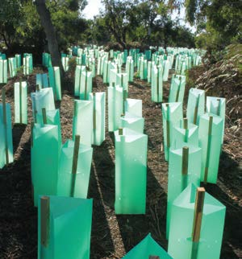
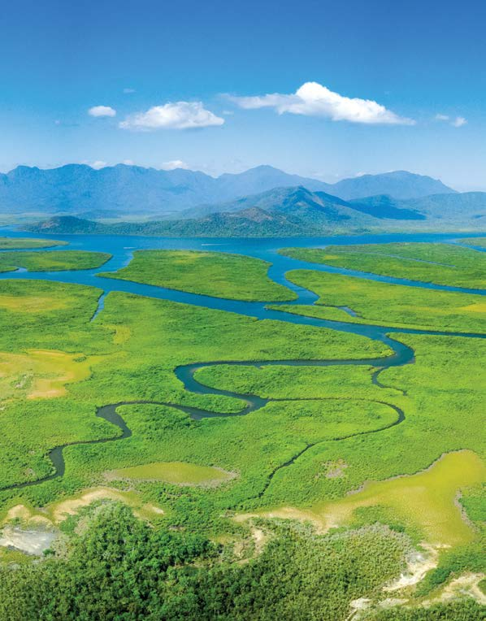
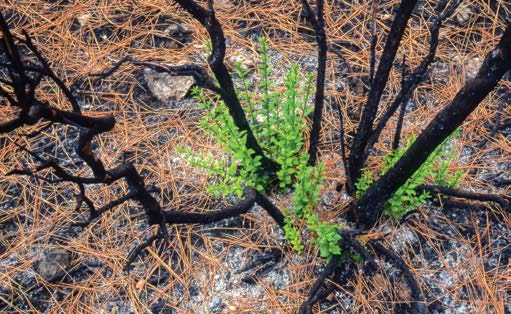

# National Disaster Recovery Needs Assessment Guidelines

> **Source**: Australian Government — National Emergency Management Agency (NEMA)
> **URL**: https://nema.gov.au/sites/default/files/2024-08/nat-rec-needs-assess-guidelines.pdf
> **Licence**: CC BY 4.0
> **Retrieved**: 2026-05-07T23:46:27Z
> **SHA-256**: `3b777926568652becf0f5351c6376f01b5fd31c6c6dcbea560898daeea28ec41`
> *Converted from PDF to Markdown format.*

---
## Page 1

National 
Disaster 
Recovery 
Needs 
Assessment 
Guidelines
Principles and processes for nationally 
compatible approaches to support the 
design and implementation of community 
recovery needs assessment.
Version 1.0 March 2024

---
## Page 2

We acknowledge the Traditional Custodians 
throughout Australia and acknowledge their 
connection to land, waters and community.
We pay our respects to the people, the 
cultures and the Elders past and present.
We acknowledge those who have lost loved 
ones, homes, businesses and livelihoods in 
disasters across Australia.
We acknowledge the dedication of emergency 
workers, front line service providers and 
volunteers who work tirelessly to provide 
safety and relief.
We celebrate the strength and resilience 
of all of those who have been affected by 
disasters.

---
## Page 3

Acknowledgements
These guidelines have been developed and advanced 
with the support of disaster recovery professionals 
across Australia, and Community Outcomes and 
Recovery Sub-Committee (CORS) members.
Document information 
and version control
Endorsed by the Community Outcomes and Recovery Sub-committee 
on 6 July 2023. 
Endorsed by the Australia-New Zealand Emergency Management 
Committee on 3 November 2023.
Document sponsor:	
Australia-New Zealand Emergency 
Management Committee (ANZEMC)
Document owner:	
Community Outcomes and Recovery 
Sub-committee (CORS)
Document custodian:	
National Emergency Management Agency 
Australia (NEMA [Au])
Document author:	
Version 1.0 prepared by Queensland 
Reconstruction Authority as Project Lead 
for the CORS
Document management:	
These guidelines will be reviewed annually 
for essential updates. Extraordinary 
amendments or considerations for future 
revision can be discussed by contacting: 
nationalrecoveryprojects@nema.gov.au
National Disaster Recovery Needs Assessment Guidelines    1

---
## Page 4

2

---
## Page 5

Table of Contents
1.	 Introduction	
4
1.1	 Definitions	
4
1.2	 Purpose	
5
1.3	 Audience	
5
1.4	 Scope	
5
2.	 Types of disaster recovery assessments	
6
2.1	 Disaster Impact Assessment	
7
2.2	 Disaster Consequence Assessment	
7
2.3	 Disaster Recovery Needs Assessment	
8
3.	 Disaster Recovery Needs Assessment and 
	
the Recovery Project Cycle	
9
4.	 Preparing for a disaster recovery needs assessment	
10
4.1	 What is a Disaster Recovery Needs Assessment?	
10
4.2	Why undertake disaster recovery needs assessments?	
13
4.3	Why is community–led important?	
13
5.	 Considerations when undertaking a 
	
Disaster Recovery Needs Assessment	
14
5.1	 Guiding approaches to engagement 	
14
5.2	 Community capacity	
17
5.3	Whose needs are to be considered?	
17
5.4	Recovery domains and timespans	
18
5.5	The do’s and don’ts	
20
5.6	Stakeholder engagement	
21
6.	 Data collection	
23
6.1	 Types of data	
23
6.2	Considerations for data collection	
24
6.3	Considerations for data analysis 	
25
6.4	Using the data	
26
6.5	Sharing data	
26
7.	 Glossary of terms	
27
8.	 References	
30
National Disaster Recovery Needs Assessment Guidelines    3

---
## Page 6

1.
	 Introduction
1.1	 Definitions
For the purposes of the National Disaster Recovery Needs Assessments Guidelines (the Guidelines), 
and to ensure disaster recovery needs assessments are supported with standardised terminology and 
agreed definitions, recovery needs and recovery needs assessment are defined below. 
Table 1: Recovery needs and recovery needs assessment (NEMA [Au], 2022)
Recovery 
needs
Requirements that address the ever-evolving, unique consequences of a disaster, 
on both an immediate and long-term timescale, informing the prioritisation of 
recovery efforts.
Requirements to support an individual’s emotional, spiritual, cultural, psychological, 
social wellbeing, as well as basic needs (including health and shelter).
Recovery 
needs 
assessment
The ongoing process of collecting a wide range of information from disaster 
affected communities to provide both recovery practitioners and decision makers 
a timely understanding of these needs to inform and adapt recovery programs 
and strategy.
A more comprehensive list of terms is available in the Glossary (section 8).
4

---
## Page 7

1.2	 Purpose
The Guidelines are nationally compatible approaches 
that support the design and implementation of 
disaster recovery needs assessments by providing 
principles and processes that:
•	 Clarify the important distinction between 
disaster impact assessments, disaster 
consequence assessments and disaster 
recovery needs assessments
•	 Detail the different types of disaster recovery 
needs assessments 
•	 Explain why and how to undertake disaster 
recovery needs assessments
•	 Identify recovery needs across the four recovery 
domains
•	 Assist with collecting, analysing and sharing 
assessment needs data. 
The Guidelines:
•	 Link recovery needs assessments with recovery 
program design
•	 Deliver a set of national principles and processes 
for undertaking a needs assessment with practical 
methods for information gathering and use.
Drawing on best practice and guidance used by 
recovery practitioners, the Guidelines may support 
jurisdictions within their existing recovery 
arrangements and may contribute to a nationally 
consistent way of collecting recovery-related data. 
The Guidelines take into account the impact of 
compounding events as well as ongoing and 
evolving recovery needs and will help identify 
where there are gaps and challenges in the 
collection of this information.
The Guidelines draw upon existing guidance 
for conducting recovery needs assessments 
including the Australian Red Cross Needs 
Assessment and Psychosocial Support after 
Emergencies and the Australian Institute 
of Family Studies Needs Assessment. 
The Guidelines seek to complement these 
frameworks rather than duplicate existing tools. 
The process of developing the Guidelines will 
also enhance the National Impacts Assessment 
Framework Data Dictionary, with a focus on 
recovery needs and consequence definitions.
1.3	 Audience
The Guidelines are not intended to take the form 
of a standard operating procedure and are 
not expected to be used in each jurisdiction. 
The Guidelines are intended to assist recovery 
practitioners in the design and implementation 
of recovery needs assessments. This includes 
policy makers and practitioners working across 
national, state and territory, and local levels of 
government.
The Guidelines may also support:
•	 Official government emergency management 
and disaster recovery agencies and/or 
services at every jurisdictional level
•	 Non-government organisations (NGOs) 
including emergent groups established in 
response to the disaster
•	 Community leaders and members of 
community-based groups.
1.4	 Scope
The Guidelines apply to all recovery domains and 
to all types and scales of disasters including 
cascading and compounding events – acknowledging 
that needs can be ongoing and evolving. 
The Guidelines are specifically tailored to guide 
the assessment of community recovery needs, 
noting that communities vary in nature (for 
example rural and remote, urban or regional, 
large or small), and have diverse needs and 
capacities when recovering from a disaster.
Development of the Guidelines has drawn 
on evidence-based recovery principles and 
resources including: 
•	 Australian Institute for Disaster Resilience 
(AIDR) Community Recovery Handbook
•	 National Principles for Disaster Recovery
•	 Monitoring and Evaluation Framework for 
Disaster Recovery Programs
•	 Australian Disaster Recovery Framework
•	 Guide to Post-Disaster Recovery Capitals.
National Disaster Recovery Needs Assessment Guidelines    5

---
## Page 8

2.
	Types of disaster 
recovery assessments
Disaster impacts, consequences and needs are interconnected and 
compounding. To ensure effective disaster recovery assessments are 
undertaken, it is important to understand the distinction between disaster 
impact assessments, disaster consequence assessments, and recovery 
needs assessments. A detailed definition of each is provided in sections 
2.1, 2.2 and 2.3. 
For context, Figure 1 – Disaster Recovery Assessment Cycle (DRAC) illustrates the components 
of the DRAC and their relationship to one another.
Figure 1: Disaster Recovery Assessment Cycle. Adapted from AS/NZS ISO 31000:2018 Risk management – Guidelines
Monitoring 
and 
evaluation
• Inform recovery 
 program design
• Inform recovery 
 review process
• Lessons learned
Community profile
• Pre-disaster context – key characterisics such as 
 socio-demographics, social structures, economic 
 activities, community facilities 
• Community strengths, vulnerabilities and level of resilience
Recovery planning and programming
• Developing recovery strategies across all four domains
• Implementation of coordinated activities to facilitate 
 community recovery
Disaster
Communication 
and 
consultation
• Stakeholder   
 engagement
Disaster impact
Infrastructure and assets. Production of goods and services. 
Government processes.
Disaster consequence
Across four recovery domains: 
Social environment, Economic environment, 
Natural environment and Built environment.
Disaster recovery needs
Incorporate build back better. Considers disaster risk 
reduction.
6

---
## Page 9

2.1	 Disaster Impact Assessment
Disaster Impact Assessments (DIAs) are used 
to improve preventative measures and response 
and recovery programs, which can help mitigate 
impacts of future disasters.
In the response and recovery phases they 
promote understanding of the impacts and 
consequences of disasters over time.1 
DIAs assess impacts that are the direct result 
of a disaster. Disaster impacts may be localised 
and immediate, or more widespread and gradual. 
How the impacts present will vary depending 
on the disaster. For example: during a flood, 
the disaster impacts could be water inundation 
which results in crops being destroyed. DIAs do 
not provide a detailed understanding of recovery 
needs, particularly at the community level, 
however, they can provide an understanding of 
the initial activities required during recovery. 
Disaster impacts can be observed and measured 
(e.g. building/infrastructure damage, morbidity, 
and mortality). It is important to assess both the 
tangible and intangible impacts of a disaster. 
Tangible impacts are those that can be measured 
in monetary terms such as destruction of 
property, buildings or infrastructure.2 Examples 
of intangible impacts include loss or damage 
to cultural artefacts, losses of memorabilia, 
environmental impacts and psychological effects).3 
The types of impact data collected may be 
guided by the Sendai Framework for Disaster 
Risk Reduction 2015–2030 reporting data. 
Note: A DIA differs from a Rapid Impact 
Assessment (RIA) which is usually conducted 
in the immediate aftermath of a disaster 
(when the area is accessible and safe to 
approach). An RIA is a point in time assessment 
to obtain an understanding of the immediate 
impacts of a disaster. This may include 
information on affected people and their 
immediate needs, damage to property, the 
environment and infrastructure. It is generally 
conducted by emergency services workers, 
first responders, relief and recovery workers. 
RIAs provide a baseline to complete a more 
holistic DIA. 
2.2	Disaster Consequence 
Assessment
Disaster Consequence Assessments (DCA) 
assess the consequences of a disaster across 
the recovery domains – social environment, 
economic environment, natural environment 
and built environment. The DCA goes beyond 
the initial impacts of a disaster, and looks at 
the consequences the impacts caused by the 
disaster.  For example: flooding that has resulted 
in crops being destroyed, the consequences are 
not solely relevant to the owner of the crops 
but may also have consequences for export 
markets, supply chains and increased prices 
for, and decreased access to, fresh produce 
for consumers. Such consequences can be 
challenging to assess as they are often hidden, 
hard to measure and sometimes intangible. 
Addressing the gaps in disaster consequence 
is significantly more challenging than 
addressing those of disaster impact. For 
disaster consequence, the situation is primarily 
a knowledge gap rather than a data gap 
(i.e. a limited understanding of how complex 
interconnected socio-economic, built and 
ecological systems work).
National Disaster Recovery Needs Assessment Guidelines    7
1	
Lauge et al, (2023), Disaster Impact Assessment: A Holistic Framework, p. 730
2	
Lauge et al, (2023), Disaster Impact Assessment: A Holistic Framework, p. 731
3	
Lauge et al, (2023), Disaster Impact Assessment: A Holistic Framework, p. 731

---
## Page 10

2.3	Disaster Recovery Needs Assessment
A Disaster Recovery Needs Assessment (DRNA) is a critical component of managing recovery 
programs. DRNAs identify specific impacts, needs, available services and gaps in disaster affected 
communities. They must be dynamic to keep pace with the evolving situation. Effective needs 
assessments support recovery programs to be evidence based and tailored to the context and 
needs of the disaster affected communities. This includes consideration of pre-event context 
such as community profile, demographics and vulnerabilities. These assessments form part of 
the ongoing process of monitoring recovery programs. Needs are not static and evolve over time. 
As such, collection and analysis of data on disaster impact, consequence and recovery needs 
should be repeated over time so that changing community needs are understood and addressed.
DRNA is defined in more detail below in section 4.1.
Some examples of disaster impacts, disaster consequences and disaster recovery needs are provided 
below in Table 2.
Table 2: Examples of disaster impacts, consequences and recovery needs
RECOVERY 
DOMAIN
IMPACT 
EXAMPLE
CONSEQUENCE 
EXAMPLE
RECOVERY NEEDS 
EXAMPLE
Social environment
Individuals impacted 
by the disaster 
experience a 
traumatic event
•	 Individuals suffer 
PTSD
•	 Increased and better 
access to mental 
health support 
services such as 
free counselling
Economic environment
Damage or loss 
of food crops
•	 Loss of income 
for farmers
•	 Export markets 
affected
•	 Price rises for 
consumers due to 
demand exceeding 
supply
•	 Financial support 
under the Disaster 
Recovery Funding 
Arrangements 
(DRFA)
•	 Subsidies for 
affected farmers
•	 Increased financial 
support for low 
income earners 
Natural environment
Surface or ground 
water contamination
•	 Undrinkable water 
supply
•	 Water needs to be 
transported into 
affected areas
Built environment
Damage to energy 
infrastructure
•	 Increases in energy 
operating costs
•	 Increased costs 
passed onto the 
consumer with 
higher energy bills
•	 Assistance for 
energy bills via 
rebates/subsidies 
for the consumer
•	 Assistance to energy 
suppliers to assist 
with rebuilding or 
repairing
2. Types of disaster recovery assessments (continued)
8

---
## Page 11

3.
	Disaster Recovery Needs 
Assessment and the 
Recovery Project Cycle
The Recovery Project Cycle involves a number of phases (Figure 2) 
including recovery needs assessment, planning/programming, implementation 
of services/activities, and continuous monitoring, and evaluation. Effective 
disaster recovery needs assessments enable the development of evidence-
based recovery planning and programs that are tailored to meet the needs 
of disaster affected communities. 
It includes pre-event context 
such as community profiles, 
demographics, socio-economic 
status and vulnerabilities. 
Ongoing recovery 
needs assessments 
assist in providing a 
mechanism that is:
	
% Responsive to the 
dynamic nature of 
recovery needs
	
% Takes into account 
the needs and context 
of the community at 
different stages of their 
recovery
	
% Enables informed 
strategy and planning 
for long-term recovery
	
% Informs the 
development of 
effective recovery 
plans and programs 
which aim to increase 
community resilience
	
% Provides a foundation 
for recovery program 
evaluation.
Understanding the type, size, impact and consequences of a 
disaster event on a community will assist in highlighting their 
unique recovery needs. It is critical to understand the complexities 
of compounding impacts, including the interaction between 
the disaster event and long-term stressors on communities and 
individuals. Opportunities to build community resilience through 
the implementation of locally led recovery strategies that reduce 
the need for long-term support services, should be identified from 
the earliest phase of recovery planning.
Figure 2: The Recovery Project Cycle. Adapted from AIDR Community 
Recovery Handbook (2018).
01
02
03
04
Recovery
Needs
Assessment
Monitoring
and evaluation
of services
Planning/
programming
Implementation
of services
National Disaster Recovery Needs Assessment Guidelines    9

---
## Page 12

4.
	Preparing for a disaster 
recovery needs assessment
4.1	 What is a Disaster Recovery Needs Assessment?
As Figure 2 above shows, a data-driven recovery needs assessment is seen as the first stage of 
the Recovery Project Cycle.4 As such they should be undertaken for all types and scales of events. 
It is important that the data collected is recorded and shared to inform a common operating picture, 
to improve decision-making, and to ensure the design and implementation of effective recovery 
and evaluation programs.
In practice, recovery needs assessment and planning/programming occur simultaneously. The 
process of communicating and coordinating with multiple stakeholders, during the planning process, 
identifies needs that in turn inform the recovery plan. 
There are four key types of recovery assessments that can take place during the various 
stages of the Recovery Project Cycle:
Community profile provides an 
understanding of the community prior to 
a disaster. This will assist in the recovery 
planning and programming phase, and 
will help to ensure recovery programs 
recognise, support and build upon individual, 
community and organisational capacity and 
resilience. Undertaking a community profile 
captures a range of information including 
key characteristics relating to socio-
demographics, political and social structures, 
economic activities, community facilities, 
local institutions, the natural environment, 
risk profiles, and available resources within 
the community. 
Community profiles also identify pre-existing 
capabilities, capacities, vulnerabilities, and 
strengths, which are key to understanding 
the capacity and resilience of a community 
and will shape the scale and type of recovery 
needs it may require. It will also enable the 
development of recovery programs that 
include opportunities for disaster risk reduction, 
‘building back better’ and identifying 
resilience outcomes. 
Rapid Needs Assessment (RNA) are aimed at 
getting a snapshot of the type and urgency of 
needs of those affected by a disaster. RNAs are 
usually conducted within one to two weeks of 
the disaster impact. Rapid response to (acute) 
needs helps to reduce further impact.5 RNAs 
gather information on the immediate needs and 
existing capacities of the affected populations, 
possible areas of intervention and resource 
requirements. The goal of an RNA is to gauge 
needs at a group level, not to make inferences 
about factors affecting individual recovery. 
Therefore, RNAs are able to include existing 
data about known risk and resilience factors 
in a community group. RNAs do not always 
need to collect new information about the 
key characteristics of the affected population 
as this information can be obtained from the 
Community Profile.6 An RNA is a precursor to 
a detailed needs assessment. 
10
4	
AIDR Community Recovery Handbook, Section 3.3.4 Recovery Project Cycle, p. 62
5	
Bosmans et al, (2022), A systematic review of rapid needs assessments and their usefulness for disaster decision making
6	
Bosmans et al, (2022), A systematic review of rapid needs assessments and their usefulness for disaster decision making

---
## Page 13

Detailed Needs Assessment (DNA) is a 
comprehensive information gathering process 
that examines in detail the needs arising as a 
result of a disaster. The purpose is to identify the 
needs requiring longer-term interventions and 
provide the data on which recovery programs 
for impacted community groups are designed. 
Conducting DNAs prior to the implementation 
of medium to long-term recovery programs 
will help to ensure those programs are 
appropriate to the real needs of the disaster 
affected communities. Failure to conduct such 
assessments could result in programs being 
implemented that are ineffective, do not meet 
current needs, or make the current situation 
worse. DNAs are a vital first step in the recovery 
planning process as they form part of the 
broader recovery planning and program design.
Continual Needs Assessment (CNA) occurs 
when recovery plans or programs have 
been implemented. Most commonly this is 
achieved through monitoring and evaluation 
processes. To do this effectively, key 
indicators or measures of success for each 
recovery action need to be identified and 
considered at the program design process. 
The National Monitoring and Evaluation 
Framework for Disaster Recovery Programs7 
can assist with the program logic design of 
a community recovery program, focusing 
on resilience and sustainability outcomes 
from recovery actions/investments. It is 
important to remember, during multiple 
and compounding disasters, where there 
is an accumulation of impacts, new groups 
may emerge that have support needs. The 
fact that needs change over time highlights 
the importance of conducting continual 
needs assessments to evaluate whether the 
assistance provided is adequate.
National Disaster Recovery Needs Assessment Guidelines    11
7	
The Australia and New Zealand School of Government (ANZSOG), (2018), A Monitoring and Evaluation Framework for 
Disaster Recovery Programs

---
## Page 14

Applying these indicators through monitoring and evaluation processes enables objective reflection 
on the selected interventions to ensure they are meeting the identified need and not creating 
additional unmet needs. These assessments enable the identification of additional emerging 
needs which can inform amendments to program delivery or act as a catalyst for creating new 
interventions/programs. The decision to implement amendments to existing programs or introduce 
additional programs rests with the body responsible for coordinating recovery activities.  
Figure 3: the Correlation between needs assessment types
Pre-disaster
• Preparation.
• Community profile.
Disaster impact
• Relief.
• Rapid Needs 
 Assessment.
Recovery planning
• Short to long-term recovery.
• Detailed Needs Assessment.
• Continual assessment.
4. Preparing for a recovery needs assessment (continued)
12

---
## Page 15

4.2	Why undertake disaster 
recovery needs assessments?
Needs assessments provide an evidence-
informed approach for transparent, planned 
and systemic prioritisation and allocation of 
resources. Each needs assessment should 
build on the information collected, collated 
and analysed from the previous assessment. 
This will build a robust shared situational 
awareness of the social environment, economic 
environment, natural environment, and built 
environment domains that informs all stages 
of the recovery project cycle. 
The data collected from a DRNA (within a specific 
location or community following an event/
disaster/disruption) provides information to:
•	 Inform recovery planning
•	 Implement effective programs that are 
relevant, credible, and appropriate, 
adequately addressing current needs
•	 Advocate for funding or other forms 
of support
•	 Build relationships among stakeholders 
and build support for action8
•	 Contribute to citizen empowerment 
and community building9
•	 Provide baseline data for evaluation 
of recovery programs and policies and 
demonstration of funding outcomes
•	 To identify unmet and emerging needs.
As recovery needs are dynamic in nature and 
can evolve throughout different phases of 
recovery, the needs assessment process should 
be ongoing to ensure emerging needs are 
identified and understood. 
4.3	Why is community–led 
important?
The concept of ‘community-led’ emphasises a 
community driven approach, the goal of which is 
strong community participation and leadership 
in all levels of planning, implementation and 
evaluation of the recovery process.10 A DRNA 
that actively involves the community will have 
a more comprehensive understanding of 
community needs and capacity. This supports 
the delivery of tailored recovery programs that 
are responsive to the context of the disaster 
and community; meeting current, emergent and 
future recovery needs. It can also strengthen 
relationships between community members and 
service providers. An important component of 
community-led assessment is the participation 
of people with lived experience and people 
with greater or specific risks (such as persons 
with disability, the elderly, children etc.). Those 
with lived experience can be a rich source of 
expertise, while the participation of people 
with greater risk will ensure that the DRNA is 
inclusive and accurately captures the needs of 
all community members.
It is also important to avoid contributing 
to ‘consultation fatigue’ where community 
members have been repeatedly approached 
on the same or similar issues without seeing 
tangible outcomes. Communicating with 
other agencies in the region and collaborating 
on a needs assessment, or sharing data, 
can be a better alternative to individual 
agencies conducting separate DRNAs11.
National Disaster Recovery Needs Assessment Guidelines    13
8	
Australian Institute of Family Studies (AIFS), (2019), Needs Assessment: Families and Children Expert Panel practice 
resource, p. 3
9	
AIFS, (2019), Needs Assessment: Families and Children Expert Panel practice resource, p. 3
10	 AIFS, (2019), Needs Assessment: Families and Children Expert Panel practice resource, p. 8
11	 AIFS, (2019), Needs Assessment: Families and Children Expert Panel practice resource, p. 8

---
## Page 16

5.
	Considerations when undertaking a 
Disaster Recovery Needs Assessment
Assessments enable recovery practitioners to gain an understanding of a 
situation, which assist in the identification of problems, their sources and 
consequences. The DRNA provides a summary of consequences to be 
addressed. It is important to remember that as a standalone document 
a DRNA does not create a recovery plan or strategy. 
It is also important to note 
that when conducting DRNAs, 
information should be limited 
to issues that are essential to 
support recovery.
Some of the elements to 
consider when completing 
a DRNA include:
•	 Guiding approaches 
to engagement
•	 Community capacity
•	 Whose needs are 
to be considered
•	 Recovery domains 
and timespans
•	 The do’s and don’ts
•	 Stakeholder 
engagement
•	 Data collection:
	»
Types of data
	»
Considerations 
for data collection 
	»
Considerations 
for analysis 
	»
Using the data
	»
Sharing data.
5.1	 Guiding approaches to engagement 
The following approaches should be adopted by disaster management 
practitioners when engaging with communities for the purpose 
of conducting DRNAs. These approaches are the hallmark of a 
quality DRNA. They emphasise the importance of participation 
and coordination – essential components in a successful recovery 
process. The approaches outlined below have been adopted from 
both national and international research and guidelines. 
Humanity – Ensure human suffering is addressed where it is found, 
focusing on those with greatest need first, and respect is shown 
toward everyone involved without bias.12
Do no harm – Maximise the benefits and minimise the negative 
consequences of all implemented support mechanisms including 
the way data are collected. If there is no capacity to address some 
of the problems, then there is no need to collect data related to 
that issue.13
Impartiality – It is essential to provide impartial assistance based 
on the needs of communities and people affected by crisis, 
making no distinctions on the basis of nationality, race, gender, 
religious belief, class or political opinions.14
Acknowledge bias – Be aware of the potential to have 
unconscious bias which may impact on the outcomes of the 
needs analysis process. Ensure mechanisms are implemented 
to overcome those biases. 
14
12	 UN Office for the Coordination of Humanitarian Affairs (OCHA), (2012), OCHA on Message: Humanitarian Principles
13	 Gurtner et al, (2011), James Cook University (JCU) Pre & Rapid: Community Impact Assessment for Disaster Recovery, p. 11
14	 Social Recovery Reference Group (SRRG), National Principles for Disaster Recovery, p. 2

---
## Page 17

Coordination – Each phase of the Recovery 
Project Cycle (disaster recovery needs 
assessments, planning and programming, 
implementation, monitoring and evaluation) 
across the four recovery domains should be 
coordinated and complementary. Activities that 
are coordinated and complement one another 
tend to reach more people, meet more needs 
and are often more sustainable.
Participation – Maximising the participation 
of affected populations in recovery response 
leads to better outcomes. In most situations, 
significant numbers of people exhibit sufficient 
resilience to participate in recovery efforts. 
Where possible, recovery should be locally led, 
locally understood and locally implemented. 
Empower individuals – Empowering affected 
people to meaningfully share their experiences 
and needs, as well as to influence recovery 
outcomes, is beneficial to both the individual 
and the community. Use the opportunity to get 
a better understanding of local dynamics, pre 
and post event, which will contribute to locally 
led recovery and build resilience. Recognise 
that new community leaders may often emerge 
during and after a disaster who may not hold 
positions of authority. 
Community-led – Successful recovery is 
community-centred, responsive and flexible, 
engaging with community and supporting them 
to move forward. Ensure there are mechanisms 
in place to allow the community to lead the 
recovery, if they have capacity to do so.15
Capacity – Successful recovery recognises, 
supports and builds on individual, community 
and organisational capacity and resilience. 
Don’t expect communities to lead recovery 
beyond their capacity to do so and ensure there 
is enough support available where required. 
Recognise that existing resources may be time 
limited and sustainability issues may need to be 
addressed.16
Multi-layered support – In disasters, people are 
affected in different ways and have different 
needs. A key to organising recovery efforts is 
to develop a layered system of complementary 
supports that meets the needs of different 
groups. This may be illustrated by a pyramid 
(see Figure 4). All layers of the pyramid are 
important and should ideally be implemented 
concurrently.17
Capture lessons – Ensure there are processes 
in place to capture the lessons identified during 
the needs assessment process. This should 
happen at each part of the Disaster Recovery 
Assessment Cycle and used to inform the next 
steps.
National Disaster Recovery Needs Assessment Guidelines    15
15	 SRRG, National Principles of Disaster Recovery, p. 2
16	 SRRG, National Principles of Disaster Recovery, p. 2
17	 Inter-Agency Standing Committee (IASC), (2007), IASC Guidelines on Mental Health and Psychosocial Support in Emergency 
Settings, p. 13

---
## Page 18

Figure 4: Intervention pyramid for support in disasters. Adapted from IASC’s Intervention pyramid for mental health 
and psychosocial support in emergencies, (2007), p. 12
Specialised
services
Focused,
non-specialised supports
Community and family supports
Basic services and security
Additional support required for those affected 
whose suffering, despite the supports already 
mentioned, is intolerable and who may have 
significant difficulties in basic daily functioning.
Supports necessary for the still smaller number 
of people who additionally require more 
focused individual, family or group interventions 
by trained and supervised workers.
People who are able to maintain their 
health and wellbeing and meet their 
material needs if they receive help 
in accessing key community and 
family supports.
The wellbeing of all people should be 
protected through the (re)establishment 
of security, adequate governance and 
services that address basic physical 
needs including food, shelter, water,
 basic health care and control of 
communicable diseases.
5. Considerations when undertaking a Recovery Needs Assessment (continued)
16

---
## Page 19

5.2	Community capacity
Successful recovery recognises, supports 
and builds on individual, community and 
organisational capacity and resilience. When 
designing and implementing any type of 
needs assessment, there should be a focus 
on identifying existing capacities within 
communities. Recovery programs that utilise 
existing community skills, strengths and 
resources, and build community capacity and 
capability, produce more sustainable outcomes.18
One of the key issues for any community that 
has been affected by disaster, is the assessment 
of the capacity, capability and resilience of the 
community as it is found ‘post-disaster’. An 
assessment done at this time, is likely to be 
inaccurate and distorted due to the combined 
impact of physical damage, disruption, shock 
and grief. Community profiles developed pre-
disaster are an invaluable tool to support 
sustainable recovery outcomes and community 
resilience as they can assist in identifying 
community strengths including pre-existing 
capacity and capabilities. 
5.3	Whose needs are to be 
considered?
Disasters do not affect individuals and 
communities equally. The same hazard can have 
significantly different impacts and outcomes 
for each person or group affected. The level of 
resilience in a community significantly influences 
the impact of the disaster, and subsequent 
recovery needs. The community profile, for 
example, can assist in identifying individuals and 
communities who may require more support in 
their recovery journey. 
18	 SRRG, National Principles of Disaster Recovery, p. 2
When assessing need, it is important to consider 
the consequences of the disaster event with 
the resilience capacity of individuals and their 
community. For example: a small event may hit 
a less-resilient community harder than a large 
event that impacts a highly resilient community. 
As such, the recovery needs for each affected 
group will vary. 
When completing a DRNA it is important to 
understand whose needs are being assessed, 
how those needs interrelate with the broader 
needs of the community and any other groups, 
and any crossovers or gaps between the 
recovery domains. Failure to correlate the 
identified needs with recovery planning and 
programming activities, may lead to recovery 
interventions inadvertently creating further 
needs or disadvantage. 
The following outlines whose needs may 
require consideration when completing a needs 
assessment: 
•	 Individuals (including affected individuals 
who left the impacted area)
•	 Households
•	 Families (including affected families who 
left the impacted area)
•	 Transient or visitor groups
•	 Discrete groups within a community
•	 Communities
•	 Local government areas
•	 Representative bodies
•	 State and territory governments 
•	 National governments
•	 International systems.
National Disaster Recovery Needs Assessment Guidelines    17

---
## Page 20

Disaster impacts, consequences and recovery 
needs reflect and often exacerbate existing 
social inequities, particularly for people who 
are disadvantaged in multiple ways.19 Needs 
assessments should be inclusive of all population 
groups, taking into account their specific 
requirements to support whole-of-community 
recovery. Relevant groups for consideration, 
identified in the Community Engagement for 
Disaster Resilience Handbook include but are 
not limited to: 
•	 Indigenous Australians (Aboriginal and 
Torres Strait Islander peoples)
•	 Culturally and linguistically diverse groups 
(CALD)
•	 People who are living with disability, chronic 
illness or mental health issues
•	 People of diverse genders and sexual 
orientations
•	 Those living in socially or physically isolated 
locations, or high-risk circumstances 
(including domestic and family violence) 
•	 Those experiencing homelessness, 
unemployment or poverty 
•	 The elderly (whether living in their own 
homes or in formalised care arrangements)
•	 Children and young people
•	 Those with limited access to information 
or resources.20
It is important that gender, social, cultural, 
ecological and economic diversity within community 
groups is considered when conducting DRNAs.21 
All these factors contribute to how a disaster 
impacts different groups within the community. 
Participants in DRNAs should reflect the gender, 
social and cultural diversity of the population 
within the area for which the assessment is being 
conducted. A DRNA is of little value if it does 
not adequately represent the different groups 
impacted by a disaster.22
5.4	Recovery domains and 
timespans
As the needs of those affected are multidimensional, 
DRNAs should have a wide focus in order to 
get a full picture of potential needs. Needs will 
differ based on the type of disaster and phase 
of the recovery timeline. Recovery needs within 
a few weeks of a disaster event will differ from 
those after several months or years. It should 
also not be assumed that recovery needs will 
linearly decrease (or increase) over time. This 
reinforces the requirement for ongoing, iterative 
DRNAs that span the entire recovery timeline. 
DRNAs should consider potential short, medium 
and longer-term needs across the recovery 
domains.
Issues such as a changing climate mean that 
Australian communities are increasingly at risk 
of exposure to successive and cascading disaster 
events (where one hazard event leads to systems 
failures and/or secondary hazard events). This 
may lead to impacts across all recovery domains. 
As disaster events become more frequent and 
severe, communities may face multiple disasters 
simultaneously or in quick succession, adding to 
the overall complexity of recovery management 
efforts and lived experience.
5. Considerations when undertaking a Recovery Needs Assessment (continued)
18
19	 Recovery Capitals (ReCap) Project Team, (2021), Guide to Post-Disaster Recovery Capitals (ReCap)
20	AIDR, (2020), Community Engagement for Disaster Resilience Handbook p. 2
21	 United Nations High Commissioner for Refugees (UNHCR), (2009), FRAME Toolkit: Framework for Assessing, Monitoring 
and Evaluating the environment in refugee-related operations, p. 51
22	 UNHCR, (2009), FRAME Toolkit: Framework for Assessing, Monitoring and Evaluating the environment in refugee-related 
operations, p. 51

---
## Page 21

When designing questions for a DRNA, some potential impacts, consequences and needs to consider 
are listed below. These suggestions are not meant to be exhaustive and are drawn from The Recovery 
Capitals23:
Table 3: Example of potential impacts, consequences and needs across recovery domains 
SOCIAL ENVIRONMENT
•	 How can damaged social connections 
in community groups be mended?
•	 What ways can risks to public health be 
reduced?
•	 What services are available for those 
whose mental health has been impacted 
by the disaster?
•	 Are there any groups that are more 
vulnerable to the impact of the disaster? 
What are their unique needs?
•	 What assistance do education providers 
require to meet the needs of children, 
families and staff and to resume classes?
•	 Are existing community services/facilities 
impacted? What support do they need to 
get up and running again?
ECONOMIC ENVIRONMENT
•	 Is support (financial or otherwise) 
available following job loss due to the 
consequences of the disasters?
•	 What support can be provided to businesses 
to support reopening and economic 
recovery?
•	 Do people need support after suffering 
material/property damage?
•	 Is there need for assistance with insurance 
claims?
•	 Is financial assistance required?
•	 What are the indirect impacts/costs to 
individuals and communities impacted by 
the disaster?
NATURAL ENVIRONMENT
•	 Is the environment safe to remain in? 
(e.g. continued flooding; contaminated 
water ways) 
•	 How can ecosystems and protected areas 
be protected from further impact?
•	 Is there any vulnerable flora and fauna that 
needs protection or temporary relocating?
•	 Are native animals and plants being 
considered as part of the recovery planning? 
•	 Is there support for both companion animals 
and livestock? (e.g. boarding for domestic 
pets or food support for livestock)
•	 Who will manage the environmental 
clean-up? (e.g. deceased livestock).
BUILT ENVIRONMENT
•	 What infrastructure (public and/or 
private) needs rebuilding or repairing?
•	 Have utilities been impacted? What 
assistance is needed to get them up 
and running again?
•	 Is emergency housing needed (for both 
short and long-term)?
•	 Have hospitals been impacted? What 
assistance do hospitals need to meet the 
needs of their patients?
•	 Are transport networks impacted?
•	 Are government services affected/
accessible? Can support be provided to 
ensure easy access to services?
•	 What are redevelopment plans? Do they 
include building back better and ensuring 
communities are more resilient towards 
disasters?
National Disaster Recovery Needs Assessment Guidelines    19
23	 ReCap Project Team, (2021), Guide to Post-Disaster Recovery Capitals (ReCap)

---
## Page 22

The Recovery Capitals is an additional resource, which has been developed as a guide for people, 
organisations and governments managing disaster recovery. The guide aims to support wellbeing after 
disasters by providing evidence-based guidance to aid decision making. It identifies seven areas 
of recovery – natural, social, financial, cultural, political, built and human – and emphasises the 
interconnectedness between them. It is targeted and practical, and can be applied to any type 
of emergency, large or small.24
It is also important to engage with Aboriginal and Torres Strait Islander people, other CALD people, 
disadvantaged community groups, LGBTIQA+, women and people with a disability, to understand 
their needs as they relate to all recovery domains.
5.5	The do’s and don’ts
Each disaster is unique and so are the recovery needs of affected individuals and communities. 
While it is challenging to identify universal prescriptions of good practice, experience from many 
different recovery situations indicate that some actions are advisable, whereas others should 
typically be avoided when assessing recovery needs, as identified below. 
Table 4: Recovery actions do’s and don’ts25
DO’s
DON’Ts
	
% Where possible, establish one overall 
coordination group who will coordinate 
recovery needs assessments.
	
× Do not create separate groups that do not 
talk or coordinate with one another.
	
% Support a coordinated response, participating 
in coordination meetings and adding value 
by complementing the work of others.
	
× Do not work in isolation or without thinking 
how one’s own work fits with that of others.
	
% Collect and analyse information to determine 
what the unique recovery needs are of 
affected individuals and communities.
	
× Do not conduct duplicate assessments 
or accept preliminary data in an uncritical 
manner.
	
% Tailor disaster recovery needs assessments 
to the local context.
	
× Do not use assessment tools not validated 
in the local, disaster-affected context.
	
% Recognise that people are impacted by 
disasters in different ways. More resilient 
people may function well, whereas others 
may be severely affected and may need 
specialised supports.
	
× Do not assume that everyone in a disaster 
is traumatised, or that people who appear 
resilient need no support.
	
% Facilitate the development of community-
owned, managed and run programmes.
	
× Do not duplicate assessments or ask very 
distressing questions without providing 
follow-up support.
	
% Build local capacities, supporting self-help 
and strengthening the resources already 
present in affected groups.
	
× Do not organise supports that undermine or 
ignore local responsibilities and capacities.
24	 ReCap Project Team, (2021), Guide to Post-Disaster Recovery Capitals (ReCap)
25	 IASC,(2007), Guidelines on Mental Health and Psychosocial. Support in Emergency Settings, p. 15
5. Considerations when undertaking a Recovery Needs Assessment (continued)
20

---
## Page 23

5.6	Stakeholder engagement
Successful recovery requires a planned, coordinated and adaptive approach with active support 
and participation from all relevant stakeholders including national, state and local governments, 
impacted communities, NGOs and private sector partners.26 A better understanding of the roles, 
responsibilities, accessible information and opportunities for collaboration across stakeholders can 
facilitate improved outcomes in the recovery process.27 For example, prior to DRNAs being designed 
and conducted, engagement with stakeholders tasked with providing recovery services allows 
for input on key information gaps that should be addressed during the assessment (e.g. lack of 
knowledge about current services available or services that have been affected, financial assistance 
required, identifying vulnerable groups).28 This will also help reduce unnecessary duplication of 
assessments and the possibly over/under provision of recovery programs. 
When planning a DRNA, it is important to identify and engage with relevant stakeholders as this 
will assist in the timely sharing of relevant data once DRNAs have been conducted. Table 5 below 
provides a summary of key recovery stakeholders and their potential roles in recovery.29
Table 5: Summary of key stakeholders and recovery roles
STAKEHOLDER
ROLE IN RECOVERY
Impacted 
community/
communities
•	 Will not be a homogenous group – communities are made up of different 
groups and voices
•	 Will have skills, experience and local knowledge that could be used as a 
potential resource for future activities, planning and longer-term recovery 
arrangements should have the community at the centre and be aimed at 
facilitating the community’s ability to drive its own recovery processes and 
outcomes
Impacted 
individuals 
and families
•	 May live within the disaster-impacted area, or be geographically dispersed 
•	 Will have different experiences of the event and different recovery needs
•	 Recovery may be compounded by pre-existing issues such as illness, disability, 
financial insecurity, substance abuse, etc.
Local 
government
•	 Recovery role will vary depending on legislation
•	 Local government provides a broad range of services to communities within 
and outside of disaster recovery
•	 Strong local knowledge and networks
State/territory 
government
•	 Will have a range of recovery responsibilities across the portfolios of 
government, e.g. health, education, infrastructure, economic development, etc. 
•	 Structure may include regional-level arrangements as well as state-level
•	 A key coordinating role in disaster recovery
26	 AIDR Community Recovery Handbook, p. 66
27	 Australian Journal of Emergency Management, July 2020 edition
28	 IASC Guidelines on Mental Health and Psychosocial. Support in Emergency Settings, p. 158
29	 AIDR Community Recovery Handbook, p. 38
National Disaster Recovery Needs Assessment Guidelines    21

---
## Page 24

Table 5: Summary of key stakeholders and recovery roles (continued)
STAKEHOLDER
ROLE IN RECOVERY
Commonwealth 
government
•	 Provides leadership and collaborates with other levels of government in disaster 
research, policy making and support for disaster relief and community recovery 
•	 Provides resources through the DRFA when state and territory resources are 
insufficient
Non-government 
organisations
•	 A key role in recovery through the provision of personal support, management 
of appeal funds, coordination of donated goods and volunteer efforts
Local 
community and 
social service 
organisations
•	 Integral to community recovery and likely to be ‘first on scene’ in terms of 
establishing initial recovery activities
•	 Trusted, local providers of services such as community health, education, 
housing, drug/alcohol/family violence programs, youth and family services, etc.
•	 Local knowledge, skills and experience
•	 Remain in the community over a longer term
•	 May be directly impacted, which can affect service provision, at least temporarily
Local 
community 
groups
•	 Integral to community recovery and likely to be ‘first on scene’ in terms of 
establishing initial recovery activities
•	 Will have local knowledge, skills and experience that could be used as a 
potential resource for future activities, planning and longer term recovery
•	 Able to connect with and mobilise community capacity
•	 May have pre-existing, community-designed plans for recovery
•	 Members may be directly impacted, which can affect the group’s functioning, 
at least temporarily
Emergent 
groups
•	 May be from within or outside of the impacted community
•	 Generally emergent groups form to provide assistance with one or more 
aspects of recovery
•	 May include groups who expand their ordinary operations to include recovery 
activities, e.g. service clubs such as Rotary or Lions
•	 Can be a vital source of ‘surge capacity’ to help manage relief and recovery
Emergency 
services
•	 Have legislated responsibilities for response and transition to relief and recover
•	 Likely to be locally based within (and include members from) the impacted 
community
•	 Likely to continue to assist with recovery efforts, where possible, in a formal 
or informal capacity
Local 
businesses
•	 Critical stakeholders in economic recovery
•	 May also comprise impacted individuals and families
•	 May be particularly vulnerable to the effects of recovery activities, e.g. restricted 
access to the ommunity and impact of donated goods on economic supply
Utilities and 
statutory 
authorities
•	 Critical stakeholders in the repair and reconnection of services such as water, 
power and telecommunications
•	 May have a role in determining how reconstruction and recovery occurs in terms 
of land use and availability/connection to infrastructure services and utilities
5. Considerations when undertaking a Recovery Needs Assessment (continued)
22

---
## Page 25

6.
	Data 
collection
6.1	 Types of data
Data can be grouped into the categories of 
primary data and secondary data. Within 
these categories, data can be qualitative or 
quantitative. 
Primary data are information gathered directly 
from the data source. Primary data are useful 
as they are collected with the purpose of 
addressing a particular problem. Primary data 
may include observations or interviews with 
those affected/working in the affected areas.30 
Other types of engagement activities to collect 
primary data include focus group discussions, 
surveys and outreach activities. This list is not 
exhaustive and there are a number of guidance 
materials in the resources list at Section 8 that 
suggest engagement methods and associated 
activities. Recommended engagement methods 
can be found via the International Association for 
Public Participation. The person completing the 
assessment is encouraged to select a method of 
engagement which is reflective of the audience 
and the material needing to be collected. 
Secondary data are taken from sources that 
have already been created (usually for another 
purpose) and reused for a particular purpose. 
Secondary data in the context of a recovery 
needs include written reports, pre-existing 
documents, maps, images, journal articles, 
and newspaper reports. For example, when 
conducting a Community Profile Assessment, 
the Australian Bureau of Statistics (ABS) is a 
valuable source for verified data on community 
demographics using data by region or census 
Community Profiles products as a starting point.
Qualitative data are:
•	 Non-numerical and express subjective and 
interpretive qualities, characteristics, and 
patterns of an item or process. 
•	 Collected through methods like interviews, 
focus groups, observations, or diary accounts, 
and analysed using methods like grounded 
theory or thematic analysis. 
Quantitative data are: 
•	 Measures of values or counts and are 
expressed as numbers.
•	 Data about numeric variables (e.g. how many, 
how much or how often).
Quantitative and qualitative data provide 
different outcomes, and are often used together 
to get a full picture of a population. For 
example, if data are collected on annual income 
(quantitative), occupation data (qualitative) 
could also be gathered to get more detail on 
the average annual income for each type of 
occupation. Further examples can be found on 
the ABS website.
To assist in collecting data, it is recommended 
that existing local/district human and social 
recovery plans are reviewed to further 
understand the community context when 
conducting a recovery needs assessment.
National Disaster Recovery Needs Assessment Guidelines    23
30	JCU, Pre rapidCommunity Impact Assessment, p. 33

---
## Page 26

6.2	Considerations for data 
collection
The below outlines some key considerations 
when collecting data to support disaster 
recovery needs assessments: 
•	 Pre-prepared and agreed upon questions are 
used for the collection
•	 Consideration of timeframes (from and until 
when should questions assess a situation)
•	 When the data will be available
•	 Consideration of partnerships in the collection 
process
•	 Consideration of the typical information sources 
•	 Accessibility to information sources
•	 Common/standard formats for recording 
information 
•	 Data are gathered from a diverse range of 
sources to ensure the coverage of distinct 
geographical areas, culturally and linguistically 
diverse groups and gender differences. 
Special attention is given to assessing the 
situation of the most vulnerable populations 
(which are often the most difficult to assess)
•	 Sources are recorded but care is taken not 
to expose respondents to risk of data breach 
in insecure areas
•	 Both qualitative and quantitative data are 
sought and used
•	 Sample design and the selection of key 
respondents to capture the capacities, 
resilience and resources of different groups 
within the affected community:
	»
e.g. a local group in the area may have 
well established networks such as food 
kitchens, there may be a strong youth 
mental health program in the district or 
a local community group may have set 
up a donated goods hub which has been 
running since week one. 
	»
A good data source is Socio-Economic 
Indexes for Areas (SEIFA) developed 
by the ABS. This resource ranks areas 
in Australia according to relative 
socio-economic advantage and 
disadvantage. 
•	 Where feasible, those collecting data should 
be trained and competent to do so in a 
recovery setting
•	 Ensure respondents’ privacy and security are 
safeguarded:
	»
Personal information (e.g. names) is 
only recorded with consent, and such 
information is not shared outside of the 
team unless necessary. 
	»
If data are to be shared and there are no 
security or protection measures in place, 
it is important to ensure data are de-
identified or identifiable information is not 
collected in the first place. 
	»
Establish a policy on collecting and 
referring sensitive information. It should 
define the circumstances under which 
information may be referred and respect 
the principle of informed consent.
6. Data collection (continued)
24

---
## Page 27

6.3	Considerations for data analysis 
Analysis is an important component of the assessment process to ensure needs requirements 
are addressed. The key questions to be asked are:
What has 
happened and 
what are the 
consequences?
Are the existing 
services/capacity 
in community able 
to address these 
consequences? 
(yes or no)
What are the gaps 
and do they need 
to be addressed?
How can the gaps 
be addressed?
In addition to the considerations outlined in 6.2, 
the following questions should be addressed:
•	 Has the data been triangulated? 
	»
Triangulation refers to the use of multiple 
methods or data sources to develop a 
comprehensive understanding of a disaster 
event31 and tests the validity of data 
through cross verification from more than 
two sources.
•	 Does the data conflict? 
•	 Have any assumptions been made? If so, what 
are they and how do they impact the data?
•	 Does the data analysis cover capacities and 
resources, including the resilience of different 
population groups, as well as ‘needs’ related 
to the current situation? 
•	 How is the current situation anticipated 
to evolve?
•	 Has secondary data been systematically 
reviewed and evaluated in relation to: 
	»
The data collection techniques used 
including the adequacy and reliability 
of sampling?
	»
Whether the reported findings appear to 
represent the true situation (and, if not, the 
likely direction of the bias – over-estimation 
or under-estimation)?
•	 Has data on the current situation been 
compared with both national standards 
and local pre-crisis seasonal norms?
•	 Have changes identified been compared 
with the pre-crisis situation/baseline in 
relation to demographics, health status, 
and health care systems?
•	 Has analysis been initiated in real time 
concurrent with data collection and initial 
findings discussed in open dialogue with 
all involved parties including the impacted 
communities? Have the findings been 
regularly reported back to the affected 
communities to enable verification, ownership 
and participation in the recovery process?
National Disaster Recovery Needs Assessment Guidelines    25
31	 Carter et al., (2014), The use of triangulation in qualitative research

---
## Page 28

6.4	Using the data
Once data are collected and analysed, there 
should be a better understanding of the needs 
of the affected individuals and communities. 
Data from the DRNAs should highlight:
•	 Where needs exceed local capacity
and/or capability, 
•	 Which needs require addressing. 
Approaches for meeting identified needs 
should not be solely developed by a planning 
team. Other stakeholders need to be included 
in the Recovery Project Cycle including 
community-based organisations, emergent 
volunteers or community representatives (such 
as local government representatives) and 
most importantly, the affected individuals and 
community members. It is essential that the 
latter two groups are an integral part of, and 
participate in, all stages of the recovery cycle. 
The collection, analysis and use of data is a 
dynamic situation and an important part of 
the Recovery Project Cycle. Following the 
assessment of needs, recovery projects are 
planned, implemented, monitored and evaluated; 
the data collected at each stage of the Recovery 
Project Cycles informs the next.
The following table is an example of how the 
data gathered can be collated and presented
as part of the Disaster Recovery Needs 
Assessment.
6.5	Sharing data
Once data are collected, analysed and collated 
it is important that the data are shared with 
relevant stakeholders. DRNA data will help to 
inform the development of effective recovery 
plans and programs, and provide a foundation 
for recovery program evaluations. The list of 
relevant stakeholders in Section 5.5 will assist 
in identifying who the relevant data should be 
shared with and reduce the number of agencies 
conducting overlapping assessments.
Table 6: Example Recovery Needs Assessment Data 
CATEGORY
IMPACT
METRICS
CURRENT 
ASSESSMENT
CONSEQUENCES
NEED
NEED 
ANALYSIS
RELEVANT  
RECOVERY 
DOMAINS
Education
School 
buildings 
damaged
Useable 
buildings 
remaining
5% of 
students 
can attend 
school
No in-class 
attendance, 
delays with 
learning 
outcomes
Alternative 
education 
options
This need 
requires 
an external 
solution as 
local school 
cannot 
provide an 
alternative 
option
Social
Built
Economic
6. Data collection (continued)
26

---
## Page 29

7.
	 Glossary 
of terms
Arrangements
A high-level, scalable overview of how states and territories address the risks 
and impacts of hazards through a collaborative approach to the prevention of, 
preparedness for, response to and recovery from emergencies 
(NEMA [Au], 2022).
Built 
environment
“Those human-made assets that underpin the functioning of a community” 
(AIDR, 2018, p. 92).
Capability
Capability is the collective ability and power to deliver and sustain an effect within 
a specific context and timeframe (NEMA [Au], 2022).
Capacity
Successful recovery recognises, supports and builds on individual, community 
and organisational capacity and resilience (AIDR, 2018, p. 11).
Community
A social group with a commonality of association and generally defined by 
location, shared experience or function, and with a number of things in common, 
such as culture, heritage, language, ethnicity, pastimes, occupation or workplace 
(NEMA [Au], 2022).
Consequence
1.	 The outcome of an event or situation expressed qualitatively or quantitatively, 
being a loss, injury, disadvantage or gain.
2.	 The outcome of an event or situation expressed qualitatively or quantitatively. 
In the emergency risk management context, consequences are generally 
described as the effects on persons, society, the environment and the economy 
(AIDR, n.d.).
Continual 
Needs 
Assessment 
(CNA)
Occurs when recovery plans or programs have been implemented and is mostly 
achieved through monitoring and evaluation processes.
Costs
Of activities, both direct and indirect, involving any negative impact, including 
money, time, labour, disruption, goodwill, political and intangible losses (AIDR, n.d.). 
Detailed 
Needs 
Assessment 
(DNA)
Comprehensive information gathering process that examines in detail the needs 
arising as the result of a disaster to identify the needs requiring longer-term 
interventions, and provide the data on which recovery programs for impacted 
community groups are designed.
Disaster
A serious disruption of the functioning of a community or a society at any scale 
due to hazardous events interacting with conditions of exposure, vulnerability and 
capacity, leading to one or more of the following: human, material, economic and 
environmental losses and impacts. The effect of the disaster can be immediate 
and localised, but is often widespread and could last for a long period of time. 
The effect may test or exceed the capacity of a community or society to cope 
using its own resources, and therefore may require assistance from external 
sources, which could include neighbouring jurisdictions, or those at the national 
or international levels. (UNDRR, n.d.). 
Disaster 
Consequence 
Assessment 
(DCA)
DCAs are conducted in the recovery phase and consider the long-term 
consequences of a disaster events across the four recovery domains.
National Disaster Recovery Needs Assessment Guidelines    27

---
## Page 30

Disaster 
Impact 
Assessment 
(DIA)
Carried out in response and recovery phases, DIAs assess impacts that are the 
direct result of a disaster event (after RIAs) and promote understanding of the 
impacts and consequences over time.
Disaster 
Recovery 
Needs 
Assessment 
(DRNA)
DRNAs are an ongoing, dynamic process that inform the identification of specific 
impacts, needs, available services and gaps in disaster affected communities 
through the collection of impact, consequence and recovery needs data and 
disaster information. DRNAs provide recovery practitioners and decision makers 
with a timely understanding of these needs to inform and adapt recovery programs 
and strategy.
Economic 
environment
The system whereby the affected community’s material and service needs 
are met through appropriate labour and employment, business development, 
land use, financial resources, and interaction with the broader economy 
(NEMA [Au], 2022).  
Hazard
A process, phenomenon or human activity that may cause loss of life, injury 
or other health impacts, property damage, social and economic disruption 
or environmental degradation. Hazards may be natural, anthropogenic or 
socio-natural in origin. (UNDRR, n.d.).
Impact
A sudden occurrence without prior warning. Can be Tangible or Intangible.
Jurisdiction
The state or territory in which an agency, organisation or statutory position has 
authority or responsibility (NEMA [Au], 2022).
Natural 
environment
Encompasses the natural and cultural resources of the community 
(NEMA [Au], 2022).
Needs
Requirements that mitigate the ever-evolving, unique impacts of a disaster 
event, on both an immediate and long-term timescale, informing the prioritisation 
of recovery efforts. Requirements for an individual’s emotional, spiritual, 
cultural, psychological, social as well as basic needs (including health) 
(NEMA [Au], 2022).
Non-
government 
organisations 
(NGOs)
Voluntary group of individuals or organisations that provides services and/or 
advocates a public policy (NEMA [Au], 2022).
Outcomes
Changes in the knowledge, behaviour, skills, status, and level of functioning, 
of a group or set of individuals; or changes to an institution such as its context 
and organisational capacity (NEMA [Au], 2022).
Rapid Impact 
Assessment 
(RIA)
RIAs are conducted immediately after an event to assess the impact of a disaster 
on affected people, property, environment and community infrastructure.
7. Glossary of terms (continued)
28

---
## Page 31

Recovery
The restoring or improving of livelihoods and health, as well as economic, 
physical, social, cultural and environmental assets, systems and activities, of a 
disaster affected community or society, aligning with the principles of sustainable 
development and “build back better”, to avoid or reduce future disaster risk. 
(UNDRR, n.d.).
Recovery 
domains
The range of community impacts of disasters can be described across the social, 
economic, natural, and built environments. The four domains are separated for the 
purpose of functional responsibilities within recovery, however, in terms of how 
communities operate the four domains are intrinsically linked. (AIDR, 2018, p. 54).
Recovery 
interventions
Effective recovery interventions require conducting a needs assessment across all 
affected sectors of society and using this information to create a recovery strategy.
Effective recovery interventions help affected communities address early recovery 
challenges at the same time as they tackle longer-term issues in sustainable and 
innovative ways.
Interventions that focus on measures such as capacity development, coordination and 
information management can make recovery much more effective (UNDP, 2016).
Recovery 
needs
Requirements that address the ever-evolving, unique consequences of a disaster, 
on both an immediate and long-term timescale, informing the prioritisation of 
recovery efforts. Includes requirements to support an individual’s emotional, 
spiritual, cultural, psychological, social wellbeing, as well as basic needs (including 
health and shelter).
Recovery 
plan/strategy
A document that provides details of actions to manage disaster risk reduction and 
recovery from events (NEMA [Au], 2022).
Recovery 
program
A set of activities that deploys resources to achieve desired recovery objectives 
and outcomes. The word ‘program’ is sometimes used interchangeably with other 
terms such as ‘project’ or ‘effort’; in this Framework, we will use the word program 
whenever we discuss a set of coordinated activities that have disaster recovery as 
their key objective (NEMA [Au], 2022).
Recovery 
stages
The several phases of recovery, which will likely overlap and interact 
(NEMA [Au], 2022).
Social 
environment
The “relationships connected by networks of communication ... [it] consists of 
individuals, families and common interest groups that form whole communities” 
(AIDR, 2018, p. 79). 
National Disaster Recovery Needs Assessment Guidelines    29

---
## Page 32

8.
	References
AIDR, Australian Disaster Resilience Glossary (aidr.org.au)
AIDR, (2020), Community Engagement for Disaster Resilience (aidr.org.au)
AIDR, (2018), Community Recovery Handbook (aidr.org.au)
ANZSOG, (2018), A Monitoring and Evaluation Framework for Disaster Recovery Programs 
(aidr.org.au)
Australian Institute of Family Studies (AIFS), (2019), Needs Assessment: Families and Children 
Expert Panel practice resource (aifs.gov.au)
Australian Red Cross Society, (2016), Needs assessment and psychological support after 
emergencies (redcross.org.au)
Bosmans et al, (2022), A systematic review of rapid needs assessments and their usefulness for 
disaster decision making: Methods, strengths and weaknesses and value for disaster relief policy, 
International Journal of Disaster Risk Reduction, Volume 71, 2022 (sciencedirect.com)
Carter et al, (2014), The use of triangulation in qualitative research (pubmed.ncbi.nlm.nih.gov)
Commonwealth of Australia, (2020), Royal Commission into National Natural Disaster Arrangements 
Report (royalcommission.gov.au)
Gurtner et al, (2011), JCU, PRE & RAPID: Community Impact Assessment for Disaster Recovery 
(jcu.edu.au)
International Committee of the Red Cross, (2008), Guidelines for assessment in emergencies 
(icrc.org)
International Association for Public Participation, (2018), IAP2 Spectrum of Public Participation 
(iap2.org)
30

---
## Page 33

Lauge et al, (2023), Disaster Impact Assessment: A Holistic Framework (idl.iscram.org)
McLeod S, (2020), Maslow’s Hierarchy of Needs (simplypsychology.org)
(NEMA [Au]), (2022), Australian Disaster Recovery Framework (nema.gov.au)
NEMA (New Zealand), (2020), Impact Assessments Director’s Guideline and National Impact 
Assessment Data Set and Dictionary Technical Standard (civildefence.govt.nz)
OCHA, (2012), OCHA on Message: Humanitarian Principles (reliefweb.int)
ReCap Project Team, (2021), Guide to Post-Disaster Recovery Capitals (ReCap) 
(recoverycapitals.org.au)
Sleezer et al., (2014), A Practical Guide to Needs Assessment (onlinelibrary.wiley.com)
Social Recovery Reference Group (SRRG), National Principles for Disaster Recovery (aidr.org.au)
United Nations Development Programme, (UNDP 2016), Disaster Recovery: Challenges and Lessons 
(undp.org)
UNHCR, (2009), FRAME Toolkit: Framework for Assessing, Monitoring and Evaluating the 
environment in refugee-related operations (unhcr.org)
United Nations Office for Disaster Risk Reduction, Disaster Risk Reduction Terminology (undrr.org)
National Disaster Recovery Needs Assessment Guidelines    31

---
## Page 34

National Disaster Recovery 
Needs Assessment Guidelines

