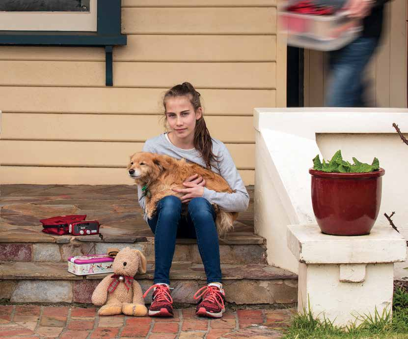
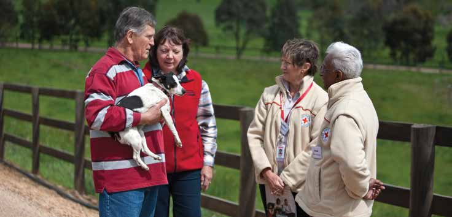
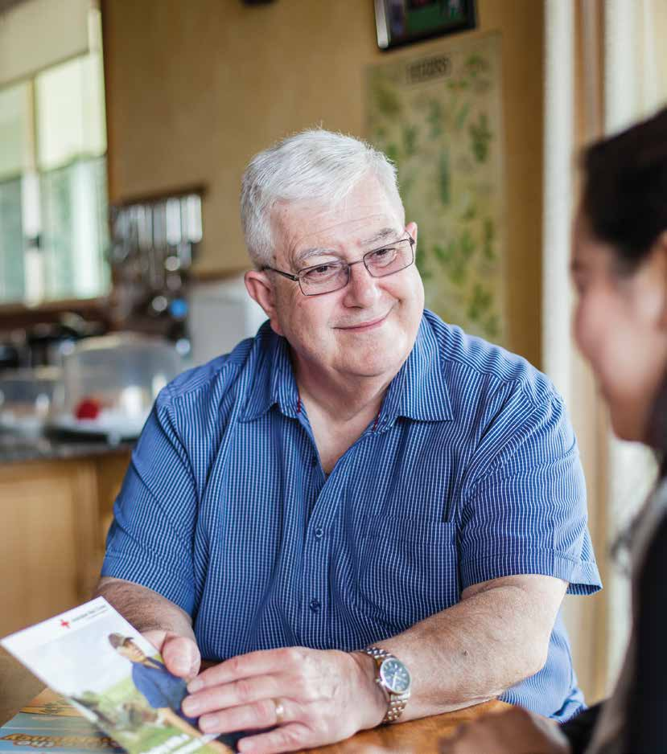
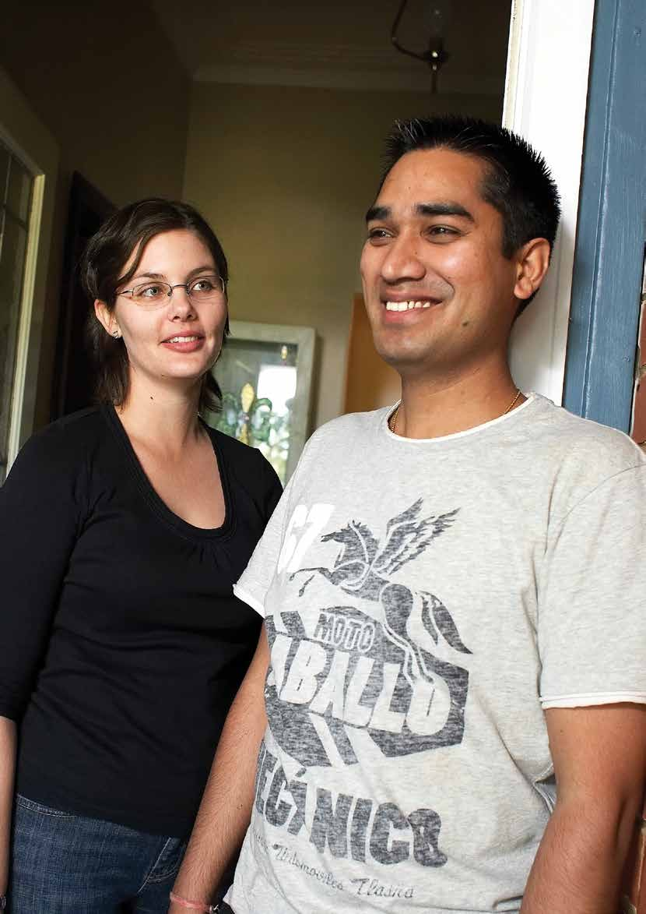
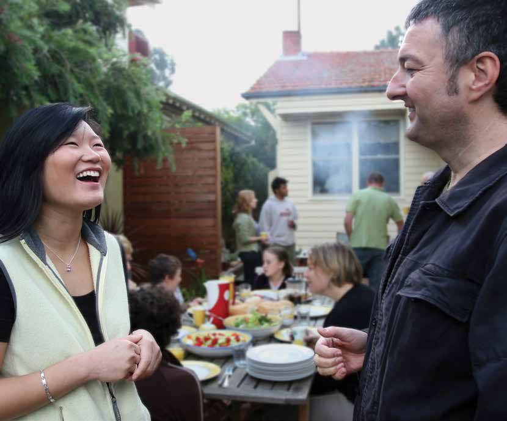
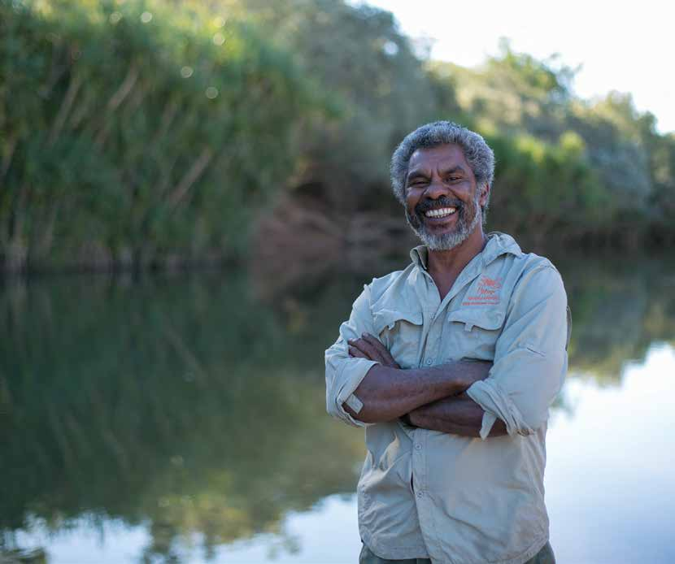
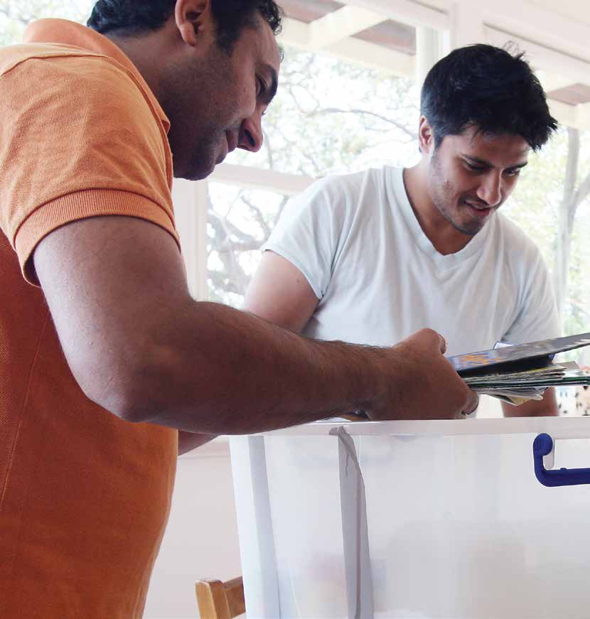
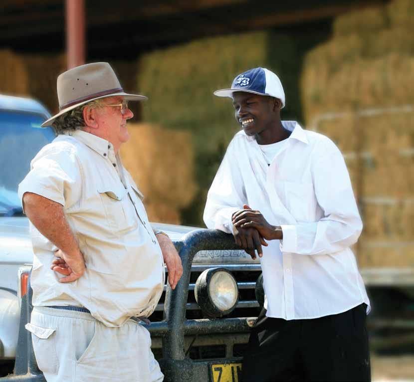
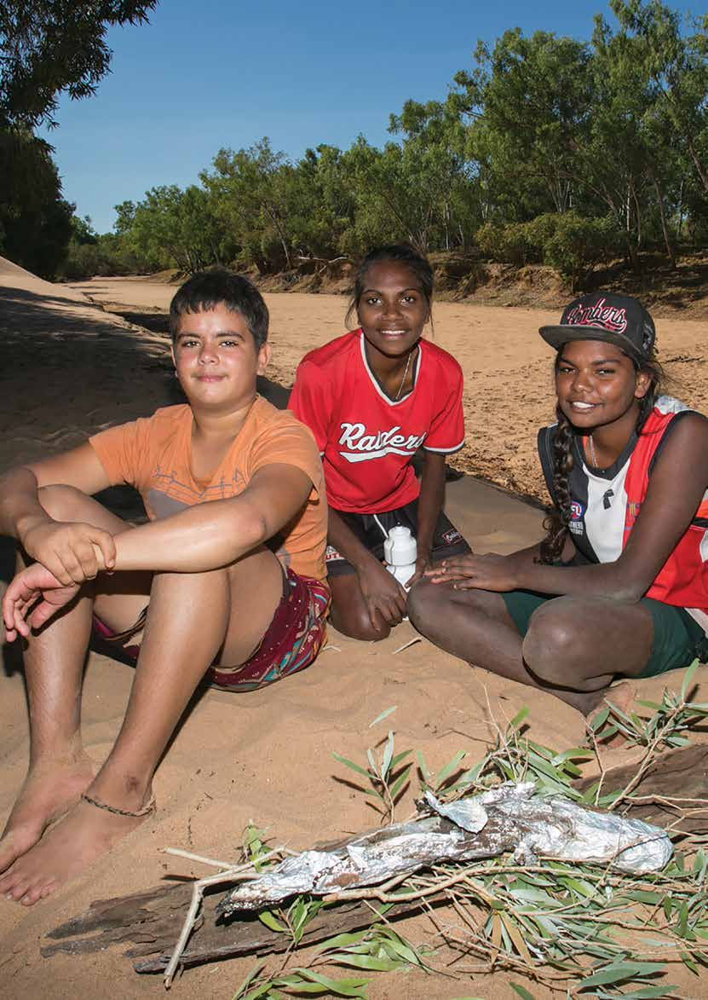

# REDiPlan — Australian Red Cross Household Preparedness Guide (Lite)

> **Source**: Australian Red Cross
> **URL**: https://www.redcross.org.au/contentassets/cdd5b2675ae944d8852aba02397fc8ee/rediplan-lite.pdf
> **Licence**: Australian Red Cross — practitioner & community use; cite source
> **Retrieved**: 2026-05-07T23:46:36Z
> **SHA-256**: `a4e61c952c1819ac909f7c8fc8f022964224d4c8f26d37e166d7426ba2be4d2d`
> *Converted from PDF to Markdown format.*

---
## Page 1

EMERGENCIES HAPPEN: 
protect  
what  
matters  
most
redcross.org.au/prepare

---
## Page 2

Emergencies don’t just include 
major natural disasters like 
bushfires, earthquakes or floods. 
A fall in the home that results in 
an unexpected hospital stay, a 
car accident, or serious illness can 
also cause significant disruption 
and add stress to your life. 
You can reduce the impact of 
emergencies, big and small,  
by being prepared.
redcross.org.au/prepare
Prepare for  
what life  
throws at you,  
big or small

---
## Page 3

Your RediPlan 
Contents:
RediPlan® is a registered Australian Red Cross trademark: 
© Australian Red Cross Society 
This document may not be used, copied, reproduced or disseminated by or to any other  
person except with the express written permission of Australian Red Cross Society, which  
may be given subject to conditions. 
Cover image: Australian Red Cross/Steve Young
STEP 2: GET CONNECTED 
Overview	
16
Introducing RediPlan	
04
Prepare your mind	
06
for an emergency
STEP 1: GET IN THE KNOW  
Overview	
08
Personal assessment	
12
STEP 4: GET PACKING
Overview	
20
Start a conversation
Overview	
22 
Prepare your 	
24 
mind worksheet	
 
Your RediPlan	
27–32 
Additional resources	
33
STEP 3: GET ORGANISED
Overview	
18

---
## Page 4

4  RediPlan | Section Details
One in three Australians will 
experience an emergency or 
the threat of an emergency  
in their lifetime.1
More than one in five  
families will be impacted  
by an insurable event in 
their working lives.3
1 IN 3
AUSTRALIANS
MORE THAN
1 IN 5
MORE THAN
80%
65%
EXPERIENCE
TRAUMA
65 per cent of people will 
experience a traumatic  
event in their lifetimes.2 
(vehicle accident,  
violent assault,  
workplace accident)
After an emergency,  
more than 80 per cent 
of people affected will 
recover well without 
prolonged distress 
and without the event 
significantly impacting  
on their mental health.4
1 Reser, J, Bradley, G, Glendon, A, Ellul, M, 
Callaghan, R 2012, Public Risk Perceptions, 
Understandings, and Responses to Climate 
Change and Natural Disasters in Australia  
and Great Britain
3 Kelly, S and Vu, Q N (2010) Understanding the 
Social and Economic Cost of Underinsuance 
The Lifewise/NATSEM Report
2 Australian Centre for Post Traumatic  
Mental Health (2007) Acute Stress  
Disorder and Post Traumatic Stress  
Disorder: a Practitioner’s Guide
4 Mark van Ommeren, Shekhar Saxena, 
& Benedetto Saraceno, (2005), Mental 
and social health during and after acute 
emergencies: emerging consensus? Bulletin 
of the World Health Organisation 2005; 
83:pp71-76.
redcross.org.au/prepare
EMERGENCIES 
DON’T 
DISCRIMINATE

---
## Page 5

Your RediPlan has been designed to provide an easy-to-follow set of actions to  
help you plan for emergencies, grouped into four simple steps:
GET IN THE KNOW
1
GET CONNECTED
2
GET ORGANISED
3
GET PACKING
4
Australian Red Cross/Rodney Dekker 
5
Emergencies. Not something we think  
about every day. Yet still they affect  
hundreds of thousands of people  
across Australia every year.
Emergencies can strike at any time. They can damage  
and in some cases destroy homes and valuables.  
They often have negative effects on health, they upset 
routines, and in many cases they can lead to significant 
financial burden. 
Some of us feel the effects of an emergency for a long 
time. For some, lives will never return to the way they  
were before.
While emergency services do all they can to help,  
the person most responsible for your wellbeing before, 
during and after an emergency is you. And the people 
most likely to help you will be those you know.
Thankfully, there are things you can do now to help  
you and your loved ones to be prepared and cope  
better should an emergency occur.

---
## Page 6

First things 
First: prepare 
your mind
6  RediPlan | Prepare Your Mind
As you work through your RediPlan, it’s  
really important to think about how to 
prepare both practically and psychologically 
for an emergency.
Face it, emergencies are scary and stressful. And most people under a lot of 
stress don’t think as clearly as usual, affecting decisions and reactions. So the 
first step to help you cope with your responses and those of others is to be 
able to anticipate, identify and manage beforehand how you and your family 
are likely to feel, think and respond in an emergency.  
 
Here are some useful tips to help do just that:

---
## Page 7

7
ANTICIPATE – it’s going to get stressful
•	 How do you think you will react to the stress? How do you usually react 
to highly stressful situations? Think about how you might feel during an 
emergency and what you and others might be thinking. Common feelings 
include anxiety, fear, general stress, uncertainty and helplessness.  
Although these reactions are very natural, they may stop you from  
preparing or acting so it’s important to acknowledge them and manage  
them better when they happen.
IDENTIFY – your feelings and thoughts  
•	 How you feel in highly stressful situations is strongly affected by the way  
you cope with the physical signs of anxiety and the thoughts running  
through your head
•	 We experience anxiety in a variety of ways, including upset stomach, 
irritability, headaches, shortness of breath and tightness in the chest.  
For children it might include anxious behaviour, such as excessive clinging
•	 Try to also identify any frightening and negative thoughts you might have.  
Do those thoughts help or hinder? Some typical, but unhelpful thoughts 
include things like: “I can’t cope,” “I’m so scared,” “We’re all going to die,”  
“I don’t know what to do”
•	 Some unhelpful thoughts might also be ones that try to minimise the threat, 
like: “this happened last year so it can’t possibly happen again this year”.  
Not thinking about a threatening possibility or denying the need to prepare 
can actually make us more anxious—and far less prepared—in the event of  
an official warning situation.
MANAGE – your feelings and thoughts with simple  
breathing and self-talk 
Use familiar techniques to help manage your feelings or try the following:
•	 Practise calming techniques, such as deep, relaxed breathing or mindfulness 
(use a smart phone app such as Smiling Mind to help you get started)
•	 Replace frightening thoughts with more helpful ones like: “Breathe calmly,”  
“I can handle this,” “I’m coping”.
Try not to focus on the bad things that might happen, but instead tell yourself 
that the calmer you are, the better you’ll be at managing exactly what needs  
to be done.
Complete the worksheet at the end of this book to help prepare your mind.
This section was written with the assistance of the Australian Psychological Society.

---
## Page 8

PHOTO CREDIT 
STEP
GET IN THE KNOW
1
Getting in the know is your vital first step 
towards being prepared for an emergency. 
You need to know the risks you face, how  
your life might be disrupted and who can  
help, before you can act.
There’s a lot of information available 
and many people willing to help you 
to get in the know when it comes 
to emergencies. It’s just a matter of 
knowing where to look.
Australian Red Cross/Rodney Dekker

---
## Page 9

9
Do the following to help you to get in the know:
Learn about local emergency risks and impacts
•	 Get in touch with reliable sources of information like your local  
council, library, people who have lived in your area a long time,  
local indigenous organisations and local emergency services
•	 Ask about local risks, traditional weather knowledge, hazard seasons and 
emergencies that have happened in the past in your area. Ask how these 
emergencies have affected the community. Find out who is responsible  
for managing emergencies and community recovery and which agencies 
can provide you with information during an emergency.
Tune in to emergency information
•	 Tune your radio to your local ABC 
•	 Subscribe to emergency services’ Facebook and Twitter feeds
•	 Download an emergency app.
Know what you can and can’t do to help yourself
•	 Fill in a personal assessment worksheet on page 12
WHAT YOU KNOW
Y
N
NOTES
Do you know what 
emergencies might  
affect you?
□□
Fire, flash flood, 
power out.
Get a copy of existing local emergency plans
•	 Find out how your childcare provider, schools, aged care facility and  
other organisations you rely on in your community plan to respond  
to a particular emergency. Ask how information will be passed on to  
you, what is expected of you, what services might be available and  
how services could be disrupted. 
RediPlan | Step 1 - Get in the know

---
## Page 10

10  RediPlan | Step 1 - Get in the know
People die in emergencies 
Australia’s fire services and state/territory emergency services have well-tested 
planning guides for bushfires, cyclones, floods, storms, earthquakes and tsunamis.
These guides help you make decisions about how you might manage potentially  
life-threatening situations. Seek advice from the experts to plan for these events.
Getting help in an emergency
•	 Call 000 for police, fire or ambulance  
ONLY in a life-threatening situation. 
Do not use this number to get general 
information. This number must stay  
clear for emergency calls
•	 If you are hearing impaired and  
rely on TTY, use 106 to send a  
text message
•	 Contact the SES or Territory Emergency 
Services on 132 500 if you have urgent 
storm damage or are threatened  
by floods
•	 Keep emergency telephone numbers 
handy, including electricity, gas, water, 
council, local doctor/hospital/vet and 
school/childcare.
PREPARE
TO BE
PREPARED

---
## Page 11

11
Australian Red Cross/Tim Lofthouse

---
## Page 12

12  RediPlan | Step 1 - Get in the know
This worksheet will help you and others 
better understand what you can do for 
yourself and what you’ll need help with 
during an emergency. 
Share this with your personal support 
network and remember to update it at least 
annually to reflect changes in your life.
PERSONAL 
ASSESSMENT
WORKSHEET
WHAT YOU KNOW
Y
N
NOTES
TIP
Do you know what 
emergencies might  
affect you?
□□
Remember to think about 
emergencies that might affect you  
in all the important places in your 
life, not just at home.  
Do you know where to  
get information about  
an emergency?
□□
There are many ways to get 
information about emergencies.  
Can you access  
this information?
□□
Emergency agencies have 
information and resources available 
on their websites and can send 
you information upon request. 
There might even be emergency 
preparedness sessions you can 
attend in your local area.  
Can you understand  
this information?
□□
Some emergency information can 
be complex. Ask a friend, family 
member or colleague to help explain 
information to you.
Is your ability to 
communicate with others 
affected by any of the 
following?
•	 Language
•	 Literacy level
•	 Disability
□□
Talk to your personal support 
network about getting information 
delivered to you in a way that 
addresses your needs.

---
## Page 13

13
YOUR WELLBEING
Y
N
NOTES
TIP
Are you in good health?
□□
Think physical and emotional 
health. It’s important that you are 
as healthy as you can be before an 
emergency occurs. Your wellbeing 
now will have an impact on how you 
recover from an emergency. 
Are you actively 
managing any physical or 
mental health conditions?
□□
It’s really important that you are 
actively managing any illnesses 
or health conditions you have 
that may impact on your recovery 
from an emergency. These might 
be physical, emotional or mental 
health conditions. List medications 
or medical assistance of any kind 
you currently rely on in your medical 
plan and include in your kit. 
Have you had any major 
life changes in the last  
six months?
□□
Major changes in our lives, like 
moving house, having a baby, a 
relationship breakup, or changing/
losing a job can affect our ability to 
cope. Think about ways to manage 
the impacts major changes may 
have on your life. See the section 
First things first: prepare your mind 
(page 6) for more information.
Are you able to cope with 
stressful situations?
□□
Almost everyone affected by 
an emergency will experience 
varying degrees of stress at some 
point during and after the event. 
Anticipating, monitoring and 
understanding your own and your 
loved ones’ reactions will really help 
you during an emergency.  
See the section First things first: 
prepare your mind (page 6)  
for more information.
Is your ability to 
communicate with others 
affected when you are 
under stress?
□□
Inform your support network and 
talk to them about what assistance 
they can provide to help you to 
communicate during an emergency. 
See page 16

---
## Page 14

14  RediPlan | Step 1 - Get in the know
YOUR WELLBEING
Y
N
NOTES
TIP
Do you suffer  
from anxiety?
□□
Think about what you do or need 
to seek relief from anxiety. List this 
in your medical plan and let your 
personal network know that you’ve 
done so.
Are you able to manage 
your daily routine 
without assistance?
□□
For those who need assistance with 
things like personal care, getting 
around, or preparing or eating food, 
think about how an emergency 
might affect any assistance you 
receive. Work with your support 
network to ensure you have a plan 
should assistance be disrupted 
or should you be required to stay 
somewhere else. 
Are you reliant upon any 
medical equipment?
□□
Make sure you include medical 
equipment in your RediPlan and kit 
and that you have talked to your 
support network about assistance 
you might need. Remember that 
medical equipment that requires 
electricity might be affected if the 
power is cut. 
Are you reliant upon  
a caregiver?
□□
Include your caregiver when
planning for an emergency. They
should be a part of your personal
support network and they can help 
you put your RediPlan together.
Include in your RediPlan what
happens if your carer is unable to
visit you.
YOUR NETWORK
Y
N
NOTES
TIP
Do you feel well-
supported? Support 
may come from family, 
friends, your community 
and/or care services.
□□
It is really helpful to identify your 
own personal support network or to 
become a part of a support network 
for someone you know. See page 16
Are you part of a club,  
a group or a service?
□□
The connections you have with 
people in your community will help 
you in many really important ways 
after an emergency. See page 16

---
## Page 15

15
YOUR NETWORK
Y
N
NOTES
TIP
Would you know how to 
get involved in a club, a 
group or a service if you 
were interested in  
doing so?
□□
Think about who is missing from 
your network. If you feel like you are 
not part of a community or could 
benefit from expanding your existing 
network, think about how you might 
do this. See page 16
Do you know the names 
of people in your street?
□□
Write these names (and phone 
numbers if you have them) down in 
your RediPlan.
YOUR SECURITY
Y
N
NOTES
TIP
Do you have a reliable 
source of income?
□□
Emergencies can be really expensive 
and financial matters can become a 
significant burden that causes a lot 
of stress to people. Think about how 
you can plan to cover financial losses 
caused by an emergency and in 
doing so avoid the stressful burden 
that accessing money can become.
Have you financially 
protected your assets  
and livelihood  
(i.e. insurance)?
□□
Get insurance, review your current 
insurance policies, and/or make 
a financial plan. Insurance is an 
important step in protecting your 
property and your income. Make 
sure your household and income 
protection insurance policy covers 
you for all types of emergencies. 
Is your home  
disaster resilient? 
□□
Talk to your local council about 
existing building codes, planning 
zones and any criteria for disaster 
resilient homes in your area. Talk to 
your local emergency services for 
tips to protecting your home and 
property from an emergency.
Do you feel safe in your 
home or neighbourhood? □□
Feeling insecure in your home or 
neighbourhood can affect your 
ability to cope with stressful 
situations. Talk to your personal 
support network if you do not feel 
safe in your home.

---
## Page 16

16  RediPlan | Section Details
STEP
GET CONNECTED
2
Being connected to your 
community means you can help 
each other in an emergency 
and, if you need it, in the long 
recovery journey afterwards.
People who receive positive support from their community 
(i.e. family members, friends, co-workers, neighbours) after 
an emergency tend to recover better than those who don’t. 
That’s why getting connected is such an important step to 
being prepared for an emergency.
Think about your existing connections. Who do you  
consider to be in your community? Who do you already 
know? A community is more than the geographic area you 
live in. It may also include others who share something 
in common with you, such as language, culture, religion, 
interest or hobby.
Australian Red Cross/Lisa Fitzgerald

---
## Page 17

17
Do the following to help you get connected:
Identify a meeting place and an out-of-town contact
•	 Agree on a location that everyone can meet at should you not be able to get 
home or if there is a communications disruption. Talk about how you might  
get there in different situations
•	 Identify someone who does not live near you who you and your network can 
phone to let them know you’re ok. Agree that you’ll go to your out-of-town 
contact’s house should you be unable to return home. Record their number  
in your plan. 
Grow your community
•	 Introduce yourself to your neighbours and leave your contact details  
with them where you feel comfortable doing so
•	 Get to know your local service providers; the local café staff,  
hairdresser, florist or grocery store staff 
•	 Organise a street party or hold a communal garage sale or clean-up
•	 Join an existing community through local council groups, events or  
local initiatives
•	 Join or start up an online community through sites such as Facebook,  
Twitter, LinkedIn and Instagram.
Talk about emergencies and being prepared for them
•	 Start a conversation about how an emergency might affect your group/
community. Talk about your strengths as a community, any gaps that  
need attention and who might need more help in your community.  
Agree on responsibilities during and after an emergency.
Identify a personal support network
•	 Include people who can help you get the resources you’ll need during and  
after an emergency. This could be family, friends, neighbours or a carer
•	 Ask your network to help you plan for an emergency and make sure everyone  
in your network knows your plan
•	 Become a part of someone else’s support network.
Write down your important numbers
•	 Include friends and family members, your out-of-town contact, your doctor, 
dentist, vet and other services you access regularly. Include utility providers,  
such as your gas, phone, electricity, water and sewerage. Don’t forget details  
for schools, childcare centres, nursing homes and any other organisations  
you’ll need to be in contact with during and after an emergency.
RediPlan | Step 2 - Get connected

---
## Page 18

18  RediPlan | Section Details
STEP    
GET ORGANISED
3
You’ve thought about the impact 
emergencies may have on you  
and your community. You’ve 
strengthened your community 
links. You’re well on the road to 
having an emergency plan.
  
Now it’s time to get organised. 
Organising the things that will help you gain  
a sense of control after an emergency is the next  
step to being prepared. 
Getting organised means thinking through what might 
happen to you during and after an emergency, and  
taking action to protect the important things in your  
life before an emergency occurs. 
Getting organised will reduce stress and save you 
precious time as you recover.
Australian Red Cross/Michael Torres

---
## Page 19

19
RediPlan | Step 3 - Get organised
Do the following to help you get organised:
Write down your  
medical information
•	 Write down information 
about any medical 
conditions that you have, 
as well as emergency 
contact details for your 
medical providers and 
include this in your plan.
Identify a next of kin
•	 Your next of kin will be  
informed in case something 
serious happens to you.  
Tell your next of kin that 
you expect them to 
communicate with other 
members of your family, 
and friends.
Make a financial plan
•	 Emergencies can be  
costly. They can affect 
your job. Develop a 
financial plan that helps 
you deal with changed 
financial circumstances.
Get and review insurance 
•	 Consider household, 
business and income 
protection insurance.
Make a will
•	 People die in emergencies. 
A will can bring peace of 
mind and reduce stress 
for loved ones, should the 
unforeseen happen.
Plan for your pets/stock 
•	 Write down how you 
will manage your pets/
stock in the event of  
an emergency.
Protect the things you  
can’t replace
•	 Write a list of items  
that can’t easily be 
replaced and jot down  
in your plan how you plan  
to protect these things 
in an emergency.
Write down your  
emergency plan 
•	 Use the RediPlan template  
at the back of this book 
to write down your plan. 
Identify a power of attorney
•	 You need to identify who 
you want to have enduring 
power of attorney should 
you find yourself in 
circumstances that will 
need someone to make 
decisions for you.
Review and practise 
your plan annually  
and keep it in an  
easy to find place.

---
## Page 20

20  RediPlan | Section Details
STEP
GET PACKING
4
So, you know your local risks and their 
impacts, you’ve connected more to  
your community, and you’ve begun  
the process of getting organised.
Now it’s time to get really practical.
Packing a kit of items that will help 
you during and after an emergency 
is an important way to prepare 
practically for an emergency. Having 
the things you need to cope with 
a situation will help you to reduce 
anxiety and stress and give you a 
sense of confidence and control. 
Australian Red Cross/Lisa Fitzgerald

---
## Page 21

21
RediPlan | Step 4 - Get packing
Get packing:
Pack survival essentials 
•	 Pack things that you’d need to get you through a 
couple of days at home without basic services
•	 Pack things you’d like to have with you if you had  
to leave home unexpectedly
•	 Talk to your local fire services and state and territory 
emergency services agencies for emergency kit lists 
and recommendations that will help you put your  
kit together
•	 Red Cross has a range of emergency preparedness 
products including wind up torch radios and first aid 
kits. To purchase, visit shop.redcross.org.au
Copy important documents and pack copies in  
your kit and somewhere other than your home  
(work, mobile phone, in the cloud, etc).
•	 Photograph important and insured items  
and store copies in your kit and somewhere other  
than your home 
•	 Map where your valuable items are stored  
in your home 
•	 Store your kit where it is easy to access  
and review it at least annually.
	 Survival items –  
things that will help if you have to evacuate your  
home quickly or if you have to stay in your home  
when essential services have been cut off.
	 Recovery items –  
things that will help limit the disruption to your life  
after the emergency has passed. These will be much  
more personal to your own needs and situation.
There are two types of items you should think about:
Start with:
•	 Passports
•	 Wills 
•	 Driver’s licences
•	 Marriage and birth certificates
•	 Land titles
•	 Mortgage papers
•	 Insurance papers
•	 Prescriptions
•	 Medical histories
•	 Child immunisation books 
•	 Copy videos and photos and store copies in  
your kit and somewhere other than your home.

---
## Page 22

22  RediPlan | Section Details
START A 
CONVERSATION
redcross.org.au/prepare
Australian Red Cross/Marlon Dalton

---
## Page 23

23
Now that you’ve taken steps 
to prepare yourself, take a 
moment to help others in  
your community to prepare. 
A resilient community has a shared knowledge and 
understanding about emergencies, their impacts and  
what can be done individually and together to reduce  
these impacts. 
Talk to others about emergencies 
A conversation is where an action begins. Explain the 
risks and impacts and what you’ve done to prepare 
yourself. Encourage them to do the same. Talk to people 
at your local school or childcare facility, at your children’s 
local sporting group, with your parents, your hobby 
group, or any of the groups or networks you consider  
to be a part of your community.
 
Help others get in the know
Help others to get in the know about the emergencies 
that might affect them and how to find the resources 
they need to help them prepare. You probably know 
people who might need special assistance. Offer to help 
them think through the emergencies that might affect 
them, who might be able to help them and where they 
can get information to suit their special needs.
Organise a preparedness workshop
Arrange to have emergency services workers talk to 
a group you belong to about how to prepare for an 
emergency. All agencies run sessions, usually for free. 
Contact Red Cross in your state or territory if you’d like  
to hear from a trained Red Cross presenter.
 
Share your story
The experience of an emergency or a loved one 
experiencing an emergency are two of the most 
common reasons people give for their own emergency 
preparedness. If you or a loved one has experienced  
an emergency, share the story with others. Let them 
know the impacts it had on your life, what you did 
beforehand that helped, and what you’d do next time  
to lessen the impacts.
Join an emergency or community service organisation. Red Cross has emergency services 
teams across the country. These teams help people with a range of services including  
supporting people to prepare for emergencies and responding to people’s needs during  
and after an emergency. More information is available at redcross.org.au

---
## Page 24

24  RediPlan | Prepare Your Mind 
This worksheet helps you to identify  
your anticipated stressors, the feelings  
and thoughts they may provoke, and  
prompt you to think about how you  
can invest in your wellbeing.
Prepare  
your mind
WORKSHEET
Anticipate:  
My stress triggers: e.g. tiredness,  
being pulled in too many directions.
* Aspirational. 
Identify:
How I know I am experiencing  
negative stress:
MY PLAN TO COUNTER NEGATIVE STRESS AND INVEST IN MY WELLBEING:
In an ideal day* I will:
Connect
Be active
Take notice
Keep learning
Give

---
## Page 25

25
Manage: 
These five actions are identified as helping  you feel good and function well: connect, be 
active, take notice, keep learning, and give.1 Invest in your wellbeing by incorporating these 
actions into your day to day life: 
My rule for when I will seek further help  
e.g three consecutive nights of disrupted sleep.
1 New Economics Foundation (2008): Five Ways to Wellbeing  
neweconomics.org

---
## Page 26

26  RediPlan | Section Details
Australian Red Cross/Michael Torres

---
## Page 27

’S RediPlan.
YOUR RediPlan
MY EMERGENCY INFORMATION
Name of 
household 
member
Medicare  
number
Centrelink  
number
Passport  
number
Tax file  
number
Driver 
Licence  
number
Car  
registration
MY IMPORTANT NUMBERS
Name
Relationship 
Phone
Address
Member of support network
Member of support network
Member of support network
Out-of-town contact #1
Out-of-town contact #2
Other:
redcross.org.au/prepare

---
## Page 28

MY IMPORTANT SERVICES
Company
Account number
Contact details
Electricity
Gas
Water
Internet
Phone
Roadside assistance
Other:
MY ALTERNATIVE PLACE TO STAY IN AN EMERGENCY
Name
Phone
Address
MY LOCAL ABC FREQUENCY:  
MY AGREED MEETING PLACE:
See Step 2 for more information about staying connected during an emergency, including 
identifying an out-of-town contact, an agreed meeting place, and an alternative place to  
stay in an emergency.

---
## Page 29

Consider getting a medical alert system that can easily call for help if you are immobilised in an 
emergency. Most alert systems require a working phone line, so have a back-up plan, such as a 
mobile phone or pager, in case landlines are disrupted. 
MY MEDICAL PLAN
Medical  
support list
Name
Phone
Out of hours 
contact
Address
Doctor
Local hospital 
with 24-hour 
emergency
Chemist
Optometrist
Dentist
Other: 
MEDICAL CONDITIONS
Y
N
Plan to manage condition during and after an emergency 
Heart disease
□□
Diabetes
□□
Asthma
□□
Migraines
□□
Fainting spells
□□
Anxiety
□□
Epilepsy
□□
High blood pressure
□□
Thyroid problems
□□
Dizziness
□□
Other: 
□□

---
## Page 30

Plan to have all the things you’d need with you for a week or two. This includes any 
medications you take regularly or specialised equipment (wheelchair, glasses, hearing aid) and 
supplies (patch kit for a wheelchair tyre or extra batteries). See Step 4 for more information 
about packing a survival and recovery kit.
CURRENT MEDICATIONS
Medical 
condition
Medication
Dosage
Times  
taken
Prescribing doctor 
(include contact 
details)
Location of 
medication  
in the home
Current medications
 
Write down below any medication you are currently taking. 
Remember to attach copies of concession cards, health insurance cards and 
prescriptions to this plan. You may also want to identify where you keep the 
medication in your home in case you have to evacuate quickly or someone 
needs to get it for you.
MEDICAL AIDS
Y
N
Details
Plan to manage equipment in 
the case of an emergency
Do you use any equipment 
to assist you
□□
Style and serial numbers of 
medical devices
Allergies and/or 
sensitivities (food, 
medication etc)
Blood type

---
## Page 31

DISABILITY
Y
How my disability might affect my  
ability to respond to an emergency  
Support plan
Intellectual
□
Learning
□
Speech-related
□
Sensory
□
Physical
□
Neurological
□
Other:
□
See Step 3 for more information about insurance cover.
MY INSURANCE
Insurer
Contact details
Policy number
Home and contents
Health
Car
Life
Income protection
Business
MY WILL
Solicitor/s
Address
Phone
Location of my Will
MY POWER OF ATTORNEY:  
Consider your particular needs and how your support network might best assist you during 
an emergency. If you require help to evacuate, include written instructions and ensure your 
support network is aware of your plan. For example, “I am diabetic. Please take my insulin 
from the regrigerator”, “My service animal may legally remain with me”.

---
## Page 32

MY ANIMAL PLAN
Animal name
Breed
Microchip 
number 
Vet/Kennel 
contact details
Emergency 
safe place
Equipment 
required
Plan 
MY IMPORTANT ITEMS LIST AND PLAN
Item
Location
Plan for protection 
See Step 3 for more information about how to identify and protect important items.
In planning for emergencies you’ll also need to think about your pets and animals and what 
they would need over the course of a week or more, including food, identification, medication, 
transport and accommodation.

---
## Page 33

MY IMPORTANT 
NUMBERS
EMERGENCIES
Police Fire Ambulance
 000
SES
132 500
Poisons Info Line
13 11 26
Lifeline
13 11 14
BeyondBlue
1300 22 46 36
MY IMPORTANT CONTACTS
Doctor
Home Care Agency
Dentist
Local Radio Frequencies 
ABC
Vet
Local Radio Frequencies 
Other
Solicitor
Out-of-Town Contact
Council
Power of Attorney
Gas
Insurer
Telco
Bank
Power
Roadside Assistance
Water
redcross.org.au/prepare

---
## Page 34

MY HOUSEHOLD NUMBERS
Name
Work
School
Mobile
MY NEIGHBOURS / PERSONAL CARE NETWORK NUMBERS
Name
Work
Mobile
Tip:  
Store these numbers in your phone and take a picture of the card so you will have all your 
important details available in one place. You may also want to send a copy to friends or  
relatives to have on file in case of an emergency.
MY IMPORTANT 
NUMBERS
OTHER IMPORTANT NUMBERS
Name
Work
Mobile

---
## Page 35

CONNECTING TO  
THE SOCIAL GRID
Tear out these handy postcards and leave in your neighbour’s letterbox.
Besides being fulfilling in many other ways, 
being a part of a community will help you 
in an emergency.
redcross.org.au/prepare
Besides being fulfilling in many other ways, 
being a part of a community will help you 
in an emergency.
redcross.org.au/prepare

---
## Page 36

CONNECTING TO  
THE SOCIAL GRID
Need more? Download a PDF and print your own from: redcross.org.au/prepare
Did you know it’s most likely to be your neighbour  
or a passer-by, not emergency services, who will help 
you survive during an emergency? Neighbours can 
also provide practical and emotional support after an 
emergency, as well as important information about 
recovery services. 
Hello! My name is:
I live :
□ Next door 
□ Over the road at
□ Up the street at
My/our details are:
Name
Phone
Email
We are also good for: 
□ Putting out the bins  
□ Collecting mail 
□ Watering the garden  
□ Feeding pets  
□ Cup of sugar
Did you know it’s most likely to be your neighbour  
or a passer-by, not emergency services, who will help 
you survive during an emergency? Neighbours can 
also provide practical and emotional support after an 
emergency, as well as important information about 
recovery services. 
Hello! My name is:
I live :
□ Next door 
□ Over the road at
□ Up the street at
My/our details are:
Name
Phone
Email
We are also good for: 
□ Putting out the bins  
□ Collecting mail 
□ Watering the garden  
□ Feeding pets  
□ Cup of sugar

---
## Page 37

REd cross
Emergency
RediPlan
Your Emergency RediPlan has been proudly supported by 
Land Rover, Medibank Private and the First National Foundation. 
Red Cross has been helping people  
prepare for, cope with and recover  
from emergencies since 1914.  
Emergency RediPlan is an award winning 
and internationally recognised disaster 
preparedness guide, designed to assist 
individuals and households create their 
own personalised emergency plan and 
prepare themselves for the longer-term 
psychosocial impacts of an emergency. 
 
Red Cross supports people to be better prepared, 
better connected and more resilient to the psychosocial 
impacts of emergencies. We recognise that the 
impacts of emergencies extend beyond the physical, to 
people’s psychological and social wellbeing. In all of our 
preparedness activities, Red Cross takes a non-hazard 
specific approach, meaning that we help individuals and 
communities to prepare for any type of emergency — 
natural or man-made, big or small. Our work has been 
designed to complement the work of other emergency 
services agencies, such as fire and rescue. 
 
To learn more about preparing for an emergency or  
to complete an online version of RediPlan visit  
redcross.org.au/prepare

---
## Page 38

ACT 
3 Dann Cl
Garran ACT 2605
T +61 2 6234 7600
NSW
St Andrews House
Level 4, 464 Kent St
Sydney NSW 2000
T 1800 812 028 (free call)
NT
Level 1, 13 CASCOM Centre
Scaturchio Street
Casuarina NT 0810
T +61 8 8924 3900
QLD
49 Park Rd
Milton QLD 4064
T +61 7 3367 7222
November 2016
SA
212 Pirie St
Adelaide SA 5000
T +61 8 8100 4500
TAS
40 Melville St
Hobart TAS 7000
T +61 3 6235 6077
VIC
23-47 Villiers St
North Melbourne VIC 3051
T 1800 810 710 (free call)
WA
110 Goderich St
East Perth WA 6004
T +61 8 9225 8888
National Office 
155 Pelham St
Carlton VIC 3053
T +61 3 9345 1800
Supporter Services Centre 
GPO Box 2957
Melbourne VIC 8060
T 1800 811 700 (free call)
F 1800 855 240
E donorinfo@redcross.org.au
How can I become a supporter? 
Red Cross relies on committed volunteers, 
members and donors. 
You can support Red Cross by:
1.	 giving monthly, leaving a bequest in your will or making  
a one-off donation to Disaster Relief and Recovery
2.	 visiting your local Red Cross store
3.	 donating blood
redcross.org.au or call 1800 811 700
facebook.com/AustralianRedCross
@redcrossau
youtube.com/AustralianRedCross
linkedin.com/company/australian-red-cross
redcross.org.au

