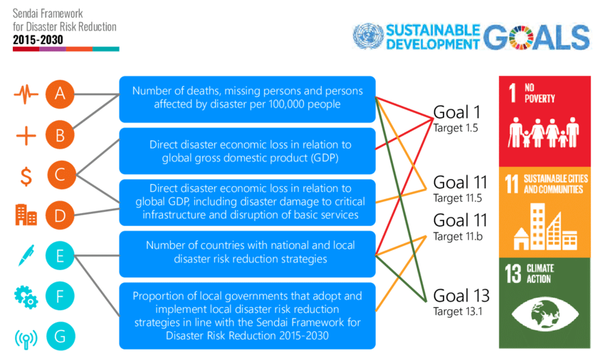

# Second National Action Plan to Implement the National Disaster Risk Reduction Framework (2023)

> **Source**: Australian Government — National Emergency Management Agency (NEMA)
> **URL**: https://nema.gov.au/sites/default/files/2024-08/28605%20NEMA%20Second%20Action%20Plan_V10_A_1.pdf
> **Licence**: CC BY 4.0
> **Retrieved**: 2026-05-07T23:46:23Z
> **SHA-256**: `2872b830a3273d550a9ae815a98b2931e545aed03b1b819a8045784ae80aa7cc`
> *Converted from PDF to Markdown format.*

---
## Page 1

THE SECOND 
NATIONAL ACTION PLAN
To implement the National Disaster Risk Reduction Framework

---
## Page 2

---
## Page 3

CONTENTS
Ministerial foreword 	
3
Disaster risk outlook	
4
The Second National Action Plan	
6
Risk reduction: A shared responsibility	
8
Outcomes and National Actions	
10
Priority 1: Understand disaster risk 	
12
	
Outcome 1: An increased understanding of disaster risk across Australian society.	
14
	
Outcome 2: An effective and connected disaster risk reduction knowledge 
system that provides a solid foundation for action.	
17
Priority 2: Accountable decisions	
22
	
Outcome 3: Disaster risk is addressed in all relevant decisions.	
24
	
Outcome 4: More decision-makers are informed, empowered and capable 
of reducing risk and building resilience.	
29
Priority 3: Enhanced investment	
34
	
Outcome 5: Investment provides highest disaster risk reduction benefit.	
36
	
Outcome 6: Investment in resilience is attractive.	
40
	
Outcome 7: Financing and investment systems account for disaster risk 
and resilience.	
44
Priority 4: Governance, ownership and responsibility	
48
	
Outcome 8: Disaster management arrangements are inclusive, networked 
and aligned, supported by meaningful partnerships.	
50
	
Outcome 9: Increased recognition of shared ownership and responsibility 
for risk management.	
55
Next steps	
60
Appendix 1: Glossary	
62
Appendix 2: Disaster risk reduction in Australia	
70
Appendix 3: Developing the Second National Action Plan	
72
Appendix 4: Domestic inputs 	
76
Appendix 5: Consultation inputs 	
78
Appendix 6: Reviews and other inputs 	
82
Appendix 7: Global inputs 	
84
Page 1
THE SECOND NATIONAL ACTION PLAN

---
## Page 4

Acknowledgement of Country
We acknowledge the Traditional Owners and Custodians throughout Australia and 
acknowledge their connection to land, waters and community. We pay our respects to 
the people, the cultures and the Elders past and present.
We acknowledge and honour Aboriginal and Torres Strait Islander peoples, who have, 
over several millennia, developed sophisticated ecological knowledge and practices to 
predict, prepare for, cope with, and survive natural hazard events, drawing from their 
intimate relationship with Country. 
Who is this document for?
The Second National Action Plan to implement the 
National Disaster Risk Reduction Framework (the Second 
National Action Plan) is for all Australians – individuals, 
communities, organisations and sectors, and 
governments. By effectively coordinating and aligning 
action, this Second National Action Plan aims to reduce 
systemic disaster risk in order to create stronger, more 
secure and more resilient communities before, during and 
after disasters. 
This Second National Action Plan also aims to mature 
Australia’s disaster risk reduction system, further enable 
disaster risk reduction action across all of society, and 
empower all Australians to take locally-led, targeted and 
coordinated action. 
In recognition of the variable terminology and phrases 
used across jurisdictions, contexts and sectors, a Glossary 
of terms, and how they are used within this Second 
National Action Plan, is at Appendix 1.
Why is this document needed?
We recognise those who have lost loved ones, homes, 
businesses and livelihoods in disasters across Australia 
and the dedication of emergency workers, frontline 
service providers and volunteers who work tirelessly to 
provide safety and relief.
Climate change is exacerbating existing vulnerabilities, 
increasing the frequency and severity of natural hazards, 
and magnifying their impacts. In the coming years we 
expect climate change to affect entire communities as 
extreme weather events impact homes, livelihoods, and 
the environment. We accept that further changes to the 
climate are coming, even with strong and decisive global 
action to reduce emissions. Australia has committed to 
reach net zero greenhouse gas emissions by 2050, and to 
reduce emissions to 43 per cent below 2005 levels by 
2030. While we play our part to reduce emissions and 
mitigate global climate change, we must also prepare for 
impacts which cannot be avoided, which is why Australia 
has invested in developing a National Climate Risk 
Assessment and National Adaptation Plan.
Understanding and planning for our future climate risk 
is a critical part of this effort. The Australian Government 
is working to assess and identify risks posed by climate 
change through the National Climate Risk Assessment, 
to help governments, businesses and communities 
understand and respond to these risks. Further 
information on the National Climate Risk Assessment can 
be found at: www.dcceew.gov.au/climate-change/policy/
adaptation/ncra.
Thank you
The Second National Action Plan represents the 
culmination of an extensive multi-sector collaboration 
process to identify and determine the most significant 
and transformational actions which can be taken to 
reduce the impacts of disasters on all Australians. 
The National Emergency Management Agency, on behalf 
of the Australian Government, is grateful for the 
generosity of the people from all levels of government, 
sectors, organisations, experts, practitioners and 
community groups who shared their time, effort, and 
expertise to make this Second National Action Plan 
possible. 
Page 2
THE SECOND NATIONAL ACTION PLAN

---
## Page 5

MINISTERIAL FOREWORD 
Australia has reached a significant milestone in increasing our 
resilience to disasters; Australian Emergency Management 
Ministers have endorsed this Second National Action Plan to 
implement the National Disaster Risk Reduction Framework.
We stand united in our commitment to 
the United Nations Sendai Framework 
for Disaster Risk Reduction. 
We live in one of the most disaster prone 
regions in the world and Australia has 
faced extraordinary challenges since 
the First National Action Plan. In 2022 
alone, 70% of Australians lived in a 
disaster declared region, and many 
communities faced multiple, rolling 
disasters, compounded by the lingering 
impacts of COVID.
The increasing frequency and intensity of 
natural hazards we are already facing has 
strengthened and re-affirmed our 
commitment to collective disaster risk 
reduction action. 
Australia’s Sendai Framework Midterm 
Review found that while substantial effort 
is under way across all sectors of society 
and progress has been made, there is still 
much to be done to reduce disaster risk 
and better protect communities by 2030.
I recognise that reducing disaster risk and 
building resilience is a whole of society 
effort and thank governments, industries, 
communities, households, not-for-profits 
and more for stepping up and embracing 
this challenge. 
There is an important leadership role that 
all governments must play in driving this 
systemic change to how Australia 
approaches resilience and risk reduction.  
Risks are increasing due to factors such as 
climate change, population growth, 
decisions on land-use planning, building 
and urbanisation. The pace of change and 
increasing rate of severe to catastrophic 
disasters needs to be met with equivalent 
action to minimise the creation of new 
risks, and manage existing risks.
While natural hazard events are inevitable, 
catastrophic disasters don’t have to be. We 
must be committed to taking harm out of 
the system, to reduce the impact of events 
like bushfires, floods, storms, and cyclones.
The task for this Second National Action Plan 
is to help mature our disaster risk reduction 
system by setting out the outcomes and 
actions to which all members of society may 
contribute to realise meaningful change.  
The Second National Action Plan is for all 
Australians, for all of us to work together 
to drive coordinated action towards the 
goals that we have heard from Australian 
communities they need. 
These actions should guide our decisions 
around investment and building capability, 
and should be inclusive of the needs of all 
members of society. We recognise the 
need for strong leadership, coordination, 
and collaboration to achieve this goal.
It is not inevitable risk continues to grow.
Now is the time for all of us to work 
together to implement the Second 
National Action Plan, reduce our risk and 
to continue building a disaster-resilient 
Australia for generations to come.
Senator the Hon Murray Watt 
Minister for Agriculture, Fisheries, 
Forestry and Emergency Management
“‘Whole-of-nation’ 
effort and 
cooperation is 
necessary to make 
Australia more 
resilient to natural 
disasters. This 
calls for action, 
not only by 
governments and 
individuals, but 
also by industry, 
businesses, 
charities, 
volunteers, the 
media, community 
groups and 
others.”
Royal Commission 
into National Natural 
Disaster Arrangements
Endorsed by:
The Hon Jihad Dib MP
NSW Minister for Emergency 
Services
The Hon Jaclyn Symes MP
VIC Attorney-General, 
Minister for Emergency Services
The Hon Mark Ryan MP
QLD Minister for Fire and 
Emergency Services
The Hon Stephen Dawson MLC
WA Minister for Emergency 
Services; Innovation and ICT; 
Medical Research; Volunteering
The Hon Joseph Szakacs MP
SA Minister for Police, Emergency 
Services and Correctional Services
The Hon Felix Ellis MP
TAS Minister for Police, Fire 
and Emergency Management
Mr Mick Gentleman MLA
ACT Minister for Police 
and Emergency Services 
The Hon Kate Worden MLA
NT Minister for Police, 
Fire and Emergency Services
Page 3
THE SECOND NATIONAL ACTION PLAN

---
## Page 6

Disasters cost the 
Australian economy 
$38 BILLION 
per year on average
Deloitte Access Economics, 2021
The estimated cost 
of disasters is forecast 
to reach at least 
$73 BILLION
per year by 2060
Deloitte Access Economics, 2021
The estimated* number of wildlife present in the 11.46 million hectares 
of woodland and forest habitats that burned in the 2019-2020 Black 
Summer bushfires
*Dickman CR 2021, ‘Ecological consequences of Australia’ s “Black Summer” bushfires: Managing for recovery, Integrated Environmental Assessment 
  and Management, vol.7, no.6, pp. 1162-1167 
143 MILLION
MAMMALS
181 MILLION
BIRDS
51 MILLION
FROGS
2.46 BILLION
REPTILES
The increase and intensity in short 
duration extreme rainfall events 
in recent decades. By 2030 this is 
forecasted to increase by a further 
7% and up to 15% more by 2050
10%
INCREASE
State of the Climate Report 2022, CSIRO and the Bureau of Meteorology
Since 2010-11, the Commonwealth 
Government has provided through the 
Disaster Recovery Funding Arrangements
National Emergency Management Agency
$16 BILLION+
For every $1.00 invested through 
resilience initiatives, there is an 
estimated $9.60 return on investment
Insurance Council of Australia, 2022
ROI
Live in a Local Government Area 
that was subject to a disaster 
activation in 2022
National Emergency Management Agency
70% OF AUSTRALIANS 
Of Australians do not believe their 
community learns from past 
experiences
Fire to Flourish National survey, 2021
OVER 60%
DISASTER RISK OUTLOOK
Page 4
THE SECOND NATIONAL ACTION PLAN

---
## Page 7

198 FLOODS
impacting 466 LGAs
129 BUSHFIRES
impacting 217 LGAs
38 CYCLONES
impacting 390 LGAs
have been declared 
as disasters under 
the Disaster 
Recovery Funding 
Arrangements 
in the last 10 years*.
*from 01/01/2013
APPROXIMATELY
17.6 MILLION PEOPLE
Lived in disaster declared LGAs 
in 2021-22. There were just over 
1.6 million disaster assistance 
payments to Australians in this 
period*. The average annual 
household cost of extreme weather 
in 2021-22 was $1,532, which is 
forecast to increase to $2,509 by 2050
* In 2021-22 1,646,035 Australian Government Disaster Recovery 
   Payment and Disaster Recovery Allowance payments were made.
Insurance Council of Australia, 2022
496 LGAs
IMPACTED BY DISASTERS
THE NUMBER OF EXTREME FIRE WEATHER DAYS 
IN AUSTRALIA OVER THE LAST 4 DECADES
This was an annual increase in fire season length across 
Australia by an additional 27 days over the 
last 41 years (1979-2019). This is forecast 
to increase by a further 20% by 2030 and 
up to 40% by 2050
State of the Climate Report 2022, CSIRO and the Bureau of Meteorology
56%INCREASE
The number of 
reported human 
lives lost from 
declared disaster 
events since 2013
Australian Insitute of Disaster 
Resilience 2023, Insurance 
Council of Australia 2023
This is 92% of all LGAs in Australia 
impacted since 2013. In addition to 
the 537 councils represented by the 
Australian Local Government 
Association (ALGA), NEMA includes 
two more, the ACT and Weipa 
National Emergency Management Agency
116
LIVES LOST
Page 5
THE SECOND NATIONAL ACTION PLAN

---
## Page 8

THE SECOND 
NATIONAL ACTION PLAN
Disasters are not ‘natural’. Natural hazards such as flood and fire 
only lead to disaster if they intersect with an exposed or 
vulnerable society and exceed people’s capacity to cope. 
Australia’s disaster risk environment is complex. 
The recent cascading and compounding 
experience of disaster and disruption 
has challenged us all. These disasters have 
drawn attention to the changing nature of 
risk, the limitations of our capacity, 
capability and existing disaster 
management arrangements, and revealed 
the underlying vulnerabilities which exist 
across society - whether it be housing, 
power, supply-chains, health and 
wellbeing, businesses, economies, and 
even the way governments work. 
Recent experiences have highlighted the 
opportunity for all levels of government, 
all sectors, communities and individuals, 
to do things differently and to better 
share our learnings. Disaster resilience is a 
long-term outcome, which will require 
long-term commitment across years and 
political cycles. 
Australia recognises the importance of 
reducing disaster risk and enhancing 
resilience beyond avoiding losses, to 
ensure we achieve the United Nations 
Sustainable Development Goals and 
enable all Australians to be safe and 
prosper. 
United Nations Sendai Framework for 
Disaster Risk Reduction 2015-2030 is the 
key international framework driving 
disaster risk reduction, and seeks to 
achieve a substantial reduction of disaster 
risk by 2030. Australia’s National Midterm 
Review of the Sendai Framework 
illustrated that while we have made great 
progress towards this goal, more work is 
needed.
Local, state and territory government, 
private sector and non-governmental 
perspectives are essential in building a 
national picture of the disaster risk 
reduction efforts occurring in Australia. 
This is reflected in our National Disaster 
Risk Reduction Framework, which guides 
our efforts to reduce disaster risks, and 
which is implemented through National 
Action Plans, with this being the Second 
National Action Plan. Consultation during 
the development of the Second National 
Action Plan reiterated support for 
National Action Plans as a meaningful 
implementation mechanism. 
Local, state and territory, private sector 
and non-governmental perspectives 
are essential to build a national picture 
of the disaster risk reduction efforts in 
Australia, and all sectors of society have 
a role to play.
Page 6
THE SECOND NATIONAL ACTION PLAN

---
## Page 9

The National Disaster Risk Reduction Framework is 
designed to be implemented by anyone who makes 
decisions as an individual, across contexts and sectors at 
national, state and local levels. The Framework should not 
prompt the question “who will do this?” but rather: “How 
can my sector, organisation or community implement this 
Framework within our areas of responsibility?” 
The Second National Action Plan should be read in this 
light. Everyone has a role in decision-making, in reducing 
their own risk, and contributing to the resilience of our 
nation. Everyone has a role in ensuring we have an 
inclusive and enabling system which authorises and 
empowers action. The Second National Action Plan 
ensures all our efforts are aligned. 
The Second National Action Plan:
•	 draws together Outcomes and National Actions 
identified as important by stakeholders, 
calibrated against global and government 
priorities
•	 ensures a strategic link to the National Disaster 
Risk Reduction Framework, its 4 priorities and 
its strategies for action
•	 includes suggestions for action drawn from 
consultation and good practice, aligned to the 
National Actions to achieve the Outcomes.
Further information on Australia’s disaster policy 
context and the First National Action Plan can be 
found at Appendix 2.
Page 7
THE SECOND NATIONAL ACTION PLAN

---
## Page 10

Risk reduction: 
A shared responsibility
In 2011, all Australian governments endorsed a resilience-
based approach to emergency management through the 
National Strategy for Disaster Resilience (the Strategy). 
The Strategy recognises disaster resilience is a shared 
responsibility across society for individuals, businesses, 
non-government organisations and communities, as well 
as for governments. It represented a fundamental change 
by recognising that increased disaster resilience is not 
solely the domain of emergency management agencies, 
rather it is a shared responsibility across society.
State and territory governments have responsibility for 
coordinating and planning the response to, and recovery 
from, disasters within jurisdictions. Each jurisdiction deals 
with disaster risk reduction differently, with some 
legislating disaster risk reduction requirements, some 
delegating planning responsibility to local governments, 
some taking a hazard-specific approach, and some a 
sectoral approach. All jurisdictions have matured their 
approaches, building on lessons learned through lived 
experience of disasters and the outcomes of several 
reviews and reforms.
The National Emergency Management Agency is 
responsible for supporting states and territories through 
the Australian Government’s longer term disaster risk 
reduction and resilience building activities. The National 
Emergency Management Agency enables more secure, 
stronger and resilient communities before, during and 
after emergencies, by working through meaningful 
partnerships to build Australia’s capacity for disaster 
resilience, and support communities when they need it 
most. 
Through the National Emergency Management Agency, 
the Australian Government’s Disaster Ready Fund is 
providing up to $1 billion dollars over the next 5 years, 
from 2023-24, for natural disaster resilience and risk 
reduction activities across Australia. The Australian 
Government also provides financial assistance following 
eligible disasters. This funding is significant, and presents 
opportunities to do things differently and build-back-
better to reduce future disaster risk. 
While individuals and communities have their roles to 
play, they do not control many of the levers needed to 
reduce systemic disaster risks. Government, whether 
local, state or federal will always have a role in disaster 
risk reduction. Governments and industry must take 
coordinated action to reduce disaster risks within their 
control, to limit adverse impacts on communities. 
Some level of risk will always remain, and individuals are 
responsible for their own safety. 
Everyone has a unique combination of capabilities and 
capacity to prepare, cope and recover from disaster, 
which means they are vulnerable and resilient in different 
ways. Each level of society has aspects of resilience or 
vulnerability nested within it. Central to this is better 
understanding the systemic nature of risk and Australia’s 
vulnerability, as highlighted through the Profiling 
Australia’s Vulnerability Report. 
Governments
Organisations
Communities
Individuals, households, family
Knowledge of risks faced
Ability to anticipate risks and impacts
Ability to reduce potential consequences
Ability to respond
Ability to recover
Capacity to cope
Knowledge of risks faced
Ability to anticipate risks and impacts
Ability to reduce potential consequences
Ability to respond
Ability to recover
Capacity to cope
Page 8
THE SECOND NATIONAL ACTION PLAN

---
## Page 11

Policy context for the United Nations Sendai Framework for Disaster Risk Reduction 2015-2030
2030 Disaster Risk Reduction Goals
Framework Priorities
United Nations Sendai Framework for Disaster Risk Reduction
2015-2030
The substantial reduction of disaster risk and losses in lives, livelihoods and health, and in the economic, physical, 
social, cultural and environmental assets of persons, businesses, communities and countries.
2030 Vision for Disaster Risk Reduction in Australia
In Australia, we are enabled and supported to actively reduce disaster risk and limit the impacts of disasters on
communities and economies. All sectors of society understand and respond to social, environmental,  
technological and demographic changes which have the potential to prevent, create or exacerbate disaster risks. 
All sectors of society:
– make disaster risk-informed decisions,
– are accountable for reducing risks within their control, and
– invest in reducing disaster risk in order to limit the cost of disasters when they occur.
Take action to reduce existing 
disaster risk
Minimise creation of future  
disaster risk through decisions 
taken across all sectors
Equip decision-makers with  
the capabilities and information they 
need to reduce disaster risk and 
manage residual risk 
Understand  
disaster risk
1
Accountable 
Reducing systemic disaster risk through aligned action by all levels of government and society
Achieved through the national synthesis of commitments aligned to National Actions
Ambitious national actions provide authorising environment and drive collective action towards achieving Outcomes
All of society identify their responsibilities and priorities aligned to National Actions to achieve Outcomes
 
decisions
2
Enhanced 
investment
3
Governance, ownership 
and responsibility
4
Page 9
THE SECOND NATIONAL ACTION PLAN

---
## Page 12

This table presents the Second National Action Plan Outcomes and National Actions to implement the National Disaster 
Risk Reduction Framework Priorities. 
Priority
Outcome
National Action
1. 
UNDERSTAND 
DISASTER RISK
1 	An increased 
understanding of 
disaster risk across 
Australian society
1 Create consistent, accessible information, tools, guidance and 
programs to help everyone better understand their disaster 
risk and responsibilities, prepare risk mitigation plans and take 
appropriate action to manage their risks.
2 Improve disclosure of disaster risk across all stakeholders to 
support a shared understanding of risk and the development 
of hazard risk mitigation plans.
2 	An effective and 
connected disaster 
risk reduction 
knowledge system 
that provides a solid 
foundation for action
3 Collaborate to harmonise and improve how data, information 
and research is produced, shared, tailored and used to inform 
effective approaches to risk reduction.
4 Build evidence, intelligence and insights by integrating local 
knowledge and lived experience, including traditional 
knowledge, to inform effective decisions.
5 Facilitate continuous improvement through monitoring and 
evaluating risk reduction activities and sharing lessons.
2. 
ACCOUNTABLE 
DECISIONS
3 	Disaster risk is 
addressed in all 
relevant decisions
6 Create hazard mitigation plans and scale across different 
levels, from individual and household plans, through to 
community, regional, state and national plans.
7 Strengthen risk-informed decision-making across all systems to 
address disaster risk and deliver co-benefits.
8 Strengthen risk-informed land-use planning, building control 
systems and settlement decisions to minimise the creation of 
new risk and address legacy risk.
4 	More decision-
makers are informed, 
empowered and 
capable of reducing 
risk and building 
resilience
9 Incorporate a range of community values into decision-making 
processes that acknowledge the broader benefits achievable 
through inclusive disaster risk reduction.
10 Enable and equip decision-makers to make adaptive and agile 
decisions when faced with imperfect information, and in a 
changing risk environment.
11 Strengthen the capability and capacity of individuals and 
communities to become leaders and make informed risk 
reduction decisions relevant to their local contexts.
12 Facilitate greater emergency management sector 
professionalisation, capability and participation, including 
volunteerism.
OUTCOMES AND 
NATIONAL ACTIONS
Page 10
THE SECOND NATIONAL ACTION PLAN

---
## Page 13

Priority
Outcome
National Action
3.
ENHANCED 
INVESTMENT
5 	Investment provides 
highest disaster risk 
reduction benefit
13 Align investment decisions with hazard risk mitigation plans 
and strategies at local, state, regional and national levels.
14 Explicitly consider future disaster risk and betterment in 
investment decisions for disaster-specific and other funding 
streams.
6 	Investment in 
resilience is attractive
15 Create mechanisms for innovation, valuing resilience beyond 
avoided costs and showcase project results which demonstrate 
effective outcomes.
16 Provide the environment for sustainable funding and consistent 
policy settings and processes to encourage the development 
of pipelines of investment for disaster risk reduction projects.
7 	Financing and 
investment systems 
account for disaster 
risk and resilience
17 Pursue innovative finance models for risk reduction initiatives, 
including through co-investment and public-private 
partnerships, to encourage greater funds towards resilience 
outcomes.
18 Enable greater integration of disaster risk reduction into the 
financial system by exploring cooperation, optimising policy, 
regulatory frameworks, standards and guidance.
4. 
GOVERNANCE, 
OWNERSHIP AND 
RESPONSIBILITY  
8 	Disaster management 
arrangements are 
inclusive, networked 
and aligned, 
supported by 
meaningful 
partnerships
19 Create spaces, opportunities and governance arrangements 
for inclusive and diverse community representation, 
participation and access to the disaster management system.
20 Form and encourage meaningful partnerships and support 
place-based, community-led, locally-implemented, regionally-
coordinated approaches to disaster risk reduction, which 
ensure equity and inclusion across the system.
21 Better align recovery and resilience activities, governance, 
funding, policy and processes to support betterment and 
long-term disaster risk reduction.
9 	Increased recognition 
of shared ownership 
and responsibility for 
risk management
22 Understand barriers and disincentives to risk reduction to 
ensure all in Australian society are empowered to exercise 
choice to reduce risk without disadvantage.
23 Strengthen mechanisms to improve cooperation and further 
support devolved disaster risk reduction planning and 
management at local and risk-appropriate regional levels.
24 Better align disaster risk and related disciplines which result in 
similar local impacts, particularly physical climate risk 
mitigation and adaptation and drought, to simplify and 
streamline governance, plans and effort.
Page 11
THE SECOND NATIONAL ACTION PLAN

---
## Page 14

PRIORITY 1: 
UNDERSTAND DISASTER RISK 
The first priority in the National Disaster Risk Reduction 
Framework aims to improve understanding and awareness of 
disaster risk. Underpinning a disaster-resilient community is 
knowledge and understanding of local disaster risks. 
We all share responsibility to understand 
these risks, and how they might affect us 
now and into the future. By understanding 
the systemic nature and extent of risks, 
we can seek to avoid or minimise their 
impacts, and inform the way we prepare 
for, and recover from disasters.
During consultation, we heard two key 
outcomes are required under this priority. 
First, all Australian society must know their 
disaster risk and responsibilities and the 
effective measures they can take to 
reduce this risk. Second, an effective, 
connected and multidisciplinary disaster 
risk reduction knowledge system must 
exist to research, develop, translate and 
share the information and data needed 
about disaster risk so it can be managed. 
Consultation on this priority revealed the 
following themes:
•	 create a shared picture of disaster and 
natural hazard risk informed by climate 
information, and relevant to future 
scenarios. This will help us understand 
who and what is at greatest risk. This 
should indicate the limitations and 
information sources, the assumptions 
made and values prioritised. 
Importantly, this picture should be 
tested across a range of sources before 
release 
•	 develop tools and methods to guide 
and support the awareness and 
management of systemic disaster risk 
across society. These should be tailored 
to relevant audiences, based on a 
consistent evidence-base drawn from 
authoritative sources, which are trusted 
by and appropriate for the end user
•	 integrate undervalued or non-
traditional forms of knowledge and 
ways of knowing, including traditional 
knowledge, local knowledge, 
community feedback, lived experience, 
and transdisciplinary approaches such 
as sociology, and support the use of 
scenarios which extend the imagination 
An effective, connected and 
multidisciplinary disaster risk reduction 
knowledge system must exist to 
research, develop, translate and share 
the information and data needed about 
disaster risk so it can be managed.
Page 12
THE SECOND NATIONAL ACTION PLAN

---
## Page 15

•	 increase transparency of risk disclosure so risk is not 
blindly passed down to those who are least able to 
mitigate it
•	 build the capability of relevant organisations to 
understand disaster risk through improved access to 
information which is relevant to the situation (e.g. 
banks and the disaster risk of a mortgage to mortgage 
applicants, councils and the risk of a land parcel to 
developers etc.)
•	 use the same language across the system, from 
warnings to education campaigns and media 
statements. It must be meaningful and understandable 
to people, and mindful of the differing meanings of the 
word ‘resilience’ in disaster-affected communities
•	 understand the way different groups understand risk 
information and tailor information to empower action.
Outcome 1  focuses on ensuring the right information 
about risk is created, available and understood at the 
right time to inform hazard risk mitigation plans and 
appropriate implementation actions.
Outcome 2  focuses on information sharing, translation 
and communication. This includes, but is broader than, 
technical capabilities, better information sharing, 
knowledge and ability. The aim is to enhance our 
understanding of systemic causes of risk, exposure and 
vulnerability and identify what is needed to further build 
and sustain mature and diverse networks that listen, learn 
and work together to reduce disaster risk. 
Page 13
THE SECOND NATIONAL ACTION PLAN

---
## Page 16

Outcome 1  
An increased understanding of disaster risk across Australian society.
PRIORITY 1: UNDERSTANDING DISASTER RISK (continued)
NATIONAL ACTION 1: 
Create consistent, accessible information 
tools, guidance and programs to help 
everyone better understand their disaster 
risk and responsibilities, prepare risk 
mitigation plans and take appropriate action 
to manage their risks.
This action aims to support all Australians to develop a 
more holistic understanding of disaster risk and individual 
responsibilities. It aims to not only consolidate, connect 
and integrate new and existing climate and disaster risk 
information, but to tailor the tools and guidance for 
end-users so that information is consistent, accessible, 
and available at the right time to inform decisions. 
We have learned from Australia’s National Midterm 
Review of the Sendai Framework that information about 
disaster risks does not, on its own, lead to risk reduction. 
It must be accessible, tailored and understood, and it 
must be clear why the information is important to the 
decisions of the end user so they can use it to take 
appropriate action. The National Disaster Risk Reduction 
Framework recognises the wealth of disaster risk data, 
information and knowledge which already exists. 
“We must devise better processes, 
protocols and methodologies for transfer 
of knowledge and resources between 
different scales of response, national, 
state, local, community” 
Participant: From Risk to Resilience Summit, 2022
Implementation Ideas 
To better connect people, communities, 
organisations and industries with the information 
they need to reduce disaster risk, actions could 
include – but are not limited to: 
•	 creating clear, consistent information on risk across 
all natural hazards, including where to get help to 
reduce risk which meets the needs of end-users
•	 developing a greater understanding of risk at the 
national level including national risk outcomes and 
national risk profiles
•	 creating common approaches to risk assessments, 
and communicating the results using a 
multidisciplinary lens to enable action across all 
domains
•	 including disaster risk reduction within school 
curricula, supporting school-based risk mitigation 
plans and providing templates for children to 
engage their households in risk reduction planning
•	 providing open access to information about 
options for reducing risks and managing hazards
•	 ensuring authoritative local and regional hazard 
mitigation plans are kept up-to-date and actively 
shared with communities on a regular basis
•	 ensuring local connection with platforms and 
frameworks for delivery and understanding of 
integrated early warning and evacuation advice
•	 aligning and harmonising our language across the 
disaster management system, from warnings, to 
education campaigns and media statements, to 
make it accessible and meaningful for people to 
understand.
Page 14
THE SECOND NATIONAL ACTION PLAN

---
## Page 17

NATIONAL ACTION 2: 
Improve disclosure of disaster risk across all 
stakeholders to support a shared 
understanding of risk and the development of 
hazard risk mitigation plans.
This action aims to reduce the creation and transfer of 
risk, by addressing information gaps, to support the 
development of hazard mitigation plans and decision-
making in a range of other contexts. Greater transparency 
and aligned planning, as well as associated policy and 
regulation, can reduce the creation of new risks and 
prevent the transfer of risk to those who are not aware of, 
or able to deal with them.  
We have learned that disaster risk is growing, not only 
because of the increased intensity and frequency of 
extreme events, but because our exposure and 
vulnerabilities are amplified by decisions and behaviours 
across the system, including those associated with where 
and how we live and work. This risk creation is further 
exacerbated by risk transfer, often to those who are 
ill-equipped to deal with such risk. 
“The private sector has a key role to play 
by fostering risk-informed business 
behaviour that includes disclosure of risk, 
communication of their contribution to 
resilience building and workplace safety, 
among others.”
The Bali Agenda for Resilience, 2022
Implementation Ideas 
To ensure risk is not opaquely transferred to those 
least able to mitigate it, actions could include – but 
are not limited to:
•	 creating and maintaining alignment between local, 
state and national assessments of natural hazard 
risk, to create a national picture
•	 undertaking systemic risk assessments for local 
areas which identify hazard threats and system 
interdependencies, and taking these assessments 
into account in settlement plans and ensuring any 
residual risk is disclosed and passed on to 
developers and purchasers
•	 disclosing disaster risk profiles alongside property 
transactions to household and land purchasers, 
prior to exchange
•	 implementing risk disclosure schemes such as the 
Task Force on Climate-related Financial Disclosures
•	 ongoing alignment of data collection and 
application through common data approaches, 
increasing data literacy and measuring what 
matters.
Page 15
THE SECOND NATIONAL ACTION PLAN

---
## Page 18

PRIORITY 1: UNDERSTANDING DISASTER RISK (continued)
Case Study Outcome 1
Improving evidence-based decision-making – National Climate Risk 
Assessment
The Commonwealth is taking strong action. We are helping Australians prepare 
for weather and climate events. We are developing Australia’s first National 
Climate Risk Assessment. The Risk Assessment will help understand the risks and 
impacts to Australia from climate change.
The National Climate Risk Assessment is part of the $28 million budget measure. 
It will be delivered over 2 years from 2023. The Risk Assessment will identify and 
prioritise the things that Australians care for the most. It will focus on those that 
are of national significance and are at risk of impacts from climate change.
The Risk Assessment will provide an objective and science-based evidence for 
decision-making. It will help others across government, industry, and communities 
to conduct their own climate risk assessments.
State, territory and local governments have developed their own climate risk 
programs over the years. The Risk Assessment will build on the work already 
done. It will deliver a shared national framework. This will inform national priorities 
for climate adaptation and resilience actions. It will enable consistent monitoring 
of climate risk across Australia.
The Risk Assessment will deliver a baseline of current climate risks. This will 
include new and emerging risks. This will ascertain Australia’s national priorities for 
climate adaptation and resilience action. The Risk Assessment will draw on the 
expertise and capability of world-leading scientists through the Australian Climate 
Service. The Australian Climate Service is a partnership between the Bureau of 
Meteorology, CSIRO, the Australian Bureau of Statistics and Geoscience Australia.
Case study provided by the Department of Climate Change, Energy, the 
Environment and Water
Page 16
THE SECOND NATIONAL ACTION PLAN

---
## Page 19

Outcome 2  
An effective and connected disaster risk reduction knowledge system that provides a solid 
foundation for action.
Implementation Ideas 
For those in the system to better connect across 
disciplines and communities, produce meaningful 
outputs for end-users and empower them to reduce 
risk, actions could include – but are not limited to: 
•	 creating safe platforms for sharing data that 
addresses intellectual property, privacy or security 
concerns
•	 hosting and participating in non-traditional forums 
such as ‘hack-a-thons’ and ‘mission-challenges’ 
across public, private and non-government 
sectors, bringing together insights to address key 
challenges
•	 convening regular forums to create, reinforce and 
sustain relationships to share knowledge, including 
outcomes from research and reflections from 
community disaster experiences
•	 identifying critical priority information and 
knowledge gaps and targeting efforts to improve 
our understanding of knowledge systems and the 
analysis to address the gaps 
•	 developing more tailored information products 
and guidance for communities and other users 
(e.g. in languages other than English and which 
meet cultural needs) 
•	 creating a shared understanding of key concepts, 
data and information to drive the better use of 
data and evidence, to support decision-making at 
every level. 
NATIONAL ACTION 3: 
Collaborate to harmonise and improve how 
data, information and research is produced, 
shared, tailored and used to inform effective 
approaches to risk reduction.
This action aims to support collaboration and cohesion 
between producers and users of information by better 
using data and evidence to support decision-making at 
every level. It will improve availability and consistency of 
information tailored to users’ decision-making needs. 
We have learned through consultation that there is a 
feeling of disconnect between locally-led risk reduction 
planning and innovation, and ‘top down’ national 
processes. Sharing knowledge from the bottom up, top 
down and across the system will ensure we all have the 
information needed to drive collective action. 
Internationally, the Political declaration of the high-level 
meeting on the Midterm Review of the Sendai Framework 
called for member states to ensure “that disaster risk data 
and information are accessible, interoperable and 
available in easily understandable formats for public and 
private sector use in decision-making in all sectors.”
“National government agencies can 
support subnational authorities in 
translating government objectives into 
initiatives to strengthen resilience by 
providing hazard information; by 
providing training and technical expertise 
in areas such as hazard mapping and 
risk assessment; by encouraging the 
development of local disaster databases; 
and by establishing financial incentives 
for subnational government progress in 
this area.”
Investing in Resilience: Ensuring a Disaster-Resistant 
Future, Asian Development Bank, 2013
Page 17
THE SECOND NATIONAL ACTION PLAN

---
## Page 20

NATIONAL ACTION 4: 
Build evidence, intelligence, and insights by 
integrating local knowledge and lived 
experience, including traditional knowledge, 
to inform effective decisions.
This action aims to build upon, enhance and integrate 
what already exists to ensure a fulsome evidence base for 
decision-making. 
This action aims to ensure we draw on multiple 
knowledge systems and ways of knowing to inform 
decisions and actions to reduce disaster risk. 
We have learned from Australia’s National Midterm 
Review of the Sendai Framework that we need broader 
inclusion and participation in disaster risk reduction; with 
local lived experience and traditional knowledge being 
important sources to address our challenges. 
The Royal Commission into National Natural Disaster 
Arrangements noted the importance of First Nations’ 
land management and how local knowledge has 
successfully informed land management for tens of 
thousands of years. This knowledge is drawn from 
observation, ongoing interaction, active custodianship, 
and adaptation to changing circumstances of Australia’s 
landscapes. Greater recognition of First Nations land and 
fire management practices was also identified. 
“We call on governments and 
stakeholders to uphold the guiding 
principles of the Sendai Framework 
and ensure that the capacities, networks, 
resources, and insights of all people are 
incorporated into planning, decision-
making and implementation of disaster 
risk reduction initiatives.” 
Co-Chairs’ Statement: Asia-Pacific Ministerial 
Conference on Disaster Risk Reduction, 2022
PRIORITY 1: UNDERSTANDING DISASTER RISK (continued)
Implementation Ideas 
To ensure First Nations and local communities 
are empowered to lead decision-making that draws 
upon local and traditional knowledge, and lived 
experience through genuine partnerships across 
the system, actions could include – but are not 
limited to: 
•	 formalising and communicating the important role 
of local, experiential, and traditional knowledge in 
informing strategic and operational decisions
•	 encouraging meaningful engagement in design 
processes and building enduring relationships
•	 co-designing frameworks, policies, and or 
strategies with First Nations peoples that embed 
‘Caring for Country’ as a first principle in disaster 
risk reduction efforts
•	 building governance mechanisms to safely embed 
traditional knowledge and science into institutions
•	 conducting co-design with communities to 
understand what they value and their knowledge 
of vulnerability, mitigation, and adaptation options
•	 including multidisciplinary learning, from sociology 
through to ecology, to ensure social cohesion and 
ecosystem-based approaches to disaster risk 
reduction are included in risk reduction plans, 
policies and programs as appropriate risk 
reduction measures. 
Page 18
THE SECOND NATIONAL ACTION PLAN

---
## Page 21

NATIONAL ACTION 5: 
Facilitate continuous improvement through 
monitoring and evaluating risk reduction 
activities and sharing lessons. 
This action aims to facilitate and support the 
measurement, evaluation and sharing of lessons from 
disaster risk reduction activities, so we can scale up 
effective disaster risk reduction efforts. 
The Systemic Monitoring, Evaluation and Learning 
(SysMEL) project and associated tools will enable the 
measurement and evaluation of Australia’s disaster 
risk reduction interventions. 
This will help us see whether we are collectively 
reducing disaster risks, achieving progress and 
identifying any gaps against the National Disaster 
Risk Reduction Framework and outcomes of the 
National Action Plans.  
This requires a collective commitment to participate 
in the SysMEL from all sectors that will ensure we 
learn, improve and build our shared understanding 
of what works, and what doesn’t.
We have learned the value of sharing lessons and the 
importance of being able to accurately understand, 
quantify and measure our disaster impacts, loss, damage 
and successes. 
While the SysMEL project will develop a national system 
for risk reduction as it matures, we need to continue to 
improve monitoring, evaluation, and learning practices. 
Creating informed, targeted interventions where we work 
together to design and implement policies, programs and 
projects will drive effective  risk reduction. 
 “Quality assurance and monitoring 
supports accountability and builds 
consistency across all levels of disaster 
management arrangements. With the 
goal of promoting best practice and 
continuous improvement across all phases 
of disaster management, these encourage 
the best use of resources, and best 
possible outcomes for our communities.”
Royal Commission into National Natural Disaster 
Arrangements, 2020
Implementation Ideas 
To engage with the SysMEL, undertaking monitoring 
and evaluation activities where appropriate and 
share lessons learned, actions 
could include – but are not limited to:
•	 adopting adaptive management processes to 
support continuous improvement based on sound 
research, modelling, monitoring and evaluation, 
and lessons management
•	 establishing accurate baselines through national-
level risk assessments
•	 improving equipment and data collection to 
support prioritisation of risk reduction activities
•	 enabling measurement evaluation and exchange of 
learning across the system to inform decisions
•	 contributing to the SysMEL framework and 
participating in assessment activities, such as the 
national survey, and sharing case studies to 
regional, state and national platforms.
Page 19
THE SECOND NATIONAL ACTION PLAN

---
## Page 22

Case Study Outcome 2
Kaurna Cultural Burning at Field River 
Kaurna have been on site undertaking land management activities including the 
cultural use of fire at the Field River. The works, supported by the Green Adelaide 
Board, have included 21 operational days for a team of three, and participation 
and educational sharing at six community events. Future steps for the program 
including supporting greater involvement from the Kaurna community, supporting 
Kaurna with sharing the story of their journey, supporting training and 
development within Green Adelaide and the Department for Environment and 
Water, and the development of process structures. As a part of the collaboration 
between collaboration between Green Adelaide, the Kaurna Land Management 
Team and Firesticks Alliance, new full-time positions have been created to support 
four Kaurna People to continue this work across Kaurna Yarta and beyond.  
There is considerable research and evidence to suggest a correlation between an 
absence of Traditional Aboriginal Ecological Land Management Practices and 
large scale, extreme weather events, such as bushfires. For many thousands of 
years, Aboriginal People managed their land with fire, using ‘cool burns’ to clear 
land, germinate seed and attract animals. Conversely, as the reduction in 
Aboriginal Land Management practices has steadily occurred, a larger 
unmanaged fuel load has accumulated resulting in hotter fires, less habitat and 
food for animals, and an increase in invasive species. 
The preservation and application of Traditional Ecological Knowledge is 
intrinsically linked with Healthy Country/Healthy Community principles. 
Reaffirming Aboriginal Fire Management as a critical component of natural 
resource management, underpinned by positive ecological outcomes, will 
contribute to climate adaptation in a raft of ways; at community level with vast 
social benefits for Aboriginal Communities; at an agency level as partnerships with 
Traditional Owners diversify and the collective knowledge is applied to manage 
country; and at a National level as Australia combats increasing average 
temperatures and catastrophic weather events.
Case study provided by the Department for Environment and Water, 
South Australia 
PRIORITY 1: UNDERSTANDING DISASTER RISK (continued)
Page 20
THE SECOND NATIONAL ACTION PLAN

---
## Page 23

Case Study Outcome 2
Return to Cultural Burning 
During June 2022, Goreng-Menang Noongar Elders undertook a series of small cultural burns on Nowanup 
country, about 150 kilometres North East of Albany.
The burning was led by the Elders who selected appropriate locations to achieve cultural and environmental 
outcomes and commenced the burning using traditional techniques.
The outcomes from the day made it clear to those involved that cultural burning is ‘Healing Country, Healing 
People.’
Why is this important?
Critical to the success of the burns was the opportunity for the Elders to apply longheld cultural burning practices 
and express their custodial responsibilities involved with Caring for Country. For over 60 years, cultural burning 
has been absent from this Country.
“We want to make the old way become the new way by handing this down to our younger generation coming 
through. And when I say hand it down, I’m talking about non-Aboriginal people as well as Noongars. That’s a way 
of walking forward together.” – Uncle Eugene Eades, Goreng Menang Noongar Elder
Working in partnership
The University of Western Australia (UWA) Albany Campus, Gondwana Link, the Nowanup Rangers and the DFES 
Bushfire Centre of Excellence (BCoE) Cultural Fire Program collectively supported the burning by bringing 
diverse skillsets and expertise together.
UWA’s ‘Walking Together’ Project played an important role in capturing learnings as part of their collaborative 
research.
“Cross-cultural science is the idea of bringing Indigenous and Western science together to better understand how 
we can care for Country and look after the bush.” – Ursula Rodrigues, PhD candidate, UWA Albany.
BCoE’s Cultural Fire Program
The Cultural Fire Program will enhance understanding, knowledge and application of cultural fire practices in 
WA, including the safe and respectful integration of cultural and contemporary practices within the bushfire 
management sector.
“The cultural burns were an excellent opportunity for us to demonstrate our program in action. It enabled cultural 
burning on Country, strengthened our networks and relationships and supported knowledge sharing.”
– David Windsor, Cultural Fire and Partnerships Coordinator, BCoE
Acknowledgment
We acknowledge and thank the Goreng Menang Noongar Elders for welcoming us onto their Country, and  
respectfully acknowledge UWA, Gondwana Link and the Nowanup Rangers. 
Case study provided by Department of Fire and Emergency Services, Western Australia
Page 21
THE SECOND NATIONAL ACTION PLAN

---
## Page 24

The second priority in the National Disaster Risk Reduction 
Framework aims to improve risk-informed decision-making. 
Leaders and decision makers at all levels need to be empowered 
to make inclusive, risk-informed decisions. 
During consultation, we heard that two 
key outcomes are required under this 
priority. Firstly, all relevant decisions must 
address disaster risk. Secondly, leaders 
and decision-makers must take disaster 
risk into account in their decisions, 
informed by inclusive processes with 
people who have a stake in the result of 
the decision. They must also have the 
capability to make risk-informed decisions 
in the face of uncertainty. 
Consultation on this priority revealed the 
following themes:
•	 decision-making should be risk-
informed, inclusive and sustainable, 
guided by community need
•	 connect the complexity of disaster risk 
reduction with how people perceive 
risk and make decisions
•	 provide Australians with confidence 
and security about their future, 
supporting their decisions by outlining 
a clear set of deliverables with states, 
territories and Australian Government 
mitigation priorities through plans with 
commitments and funding
•	 build capability to address disaster 
risk in policy, program and investment 
decisions through improved 
understanding of the systemic nature 
of disaster risk. This includes 
recognition that reducing disaster risk 
is only achieved when a coherent and 
consistent approach sits alongside 
climate mitigation, adaptation and 
sustainable development
•	 create ways for including diverse 
individuals and groups in decision-
making processes
•	 develop methods to incorporate a 
wider set of values (e.g. models of 
Caring for Country) and trade-offs in 
decision-making, because values that 
are not measured, are excluded from 
decision-making
•	 encourage place-based, community-
led, locally-implemented, regionally-
coordinated approaches to disaster risk 
reduction
•	 remove the ‘blame’ culture in the initial 
response to give leaders the courage to 
create environments to do things 
differently, or operate with imperfect 
information and make the best decision 
•	 invest in people not just things. Build 
competencies, capability and capacity 
(e.g. enable youth to act for their 
present and future), and develop, 
promote, and reward different ways of 
leading, including systems leadership 
which supports action through strategic 
learning and ethical, collaborative 
approaches.
PRIORITY 2: 
ACCOUNTABLE DECISIONS
Leaders and decision-makers must 
take disaster risk into account in 
their decisions, informed by inclusive 
processes with people who have a stake 
in the result of the decision.
Page 22
THE SECOND NATIONAL ACTION PLAN

---
## Page 25

Outcome 3  focuses on the systemic nature of disaster 
risk and how decision-makers operate across all sectors 
and at all levels, from individuals and households, to 
communities at the local, regional, state, and national 
levels. This includes through the development of hazard 
mitigation plans and preparedness plans for the residual 
risk, and the linkages between climate mitigation, 
adaptation and disaster risk reduction and resilience. 
Outcome 4  focuses on helping all decision-makers 
build confidence and capability to make risk informed 
decisions, often in ambiguity. The aim is to create an 
enabling environment for decision-makers across sectors, 
and at all levels, to incorporate disaster risk reduction 
considerations into their thinking.
Page 23
THE SECOND NATIONAL ACTION PLAN

---
## Page 26

Outcome 3   
Disaster risk is addressed in all relevant decisions.
PRIORITY 2: ACCOUNTABLE DECISIONS (continued)
NATIONAL ACTION 6: 
Create hazard mitigation plans and scale 
across different levels, from individual and 
household plans through to community, 
regional, state and national plans.
This action aims to support the creation of hazard 
mitigation plans, from individual and household plans, 
to community, regional and state plans which establish 
proactive mitigation priorities.
We have learned through consultations, that planning for 
disaster risk is inconsistent and does not always adopt a 
systems-approach. Risk is different according to local 
context. Communities have differing social structures, 
dependencies and exposures, alongside differing 
strengths. 
“Planning is an essential element of being 
prepared for and responding to natural 
disasters. To be effective, that planning 
needs to address a wide range of factors 
and involve all levels of government, 
private sector entities, non-government 
organisations, communities and 
individuals” 
The Royal Commission into National Natural Disaster 
Arrangements, 2020
Implementation Ideas 
To the create and implement hazard mitigation plans 
at individual, household, community, regional, state/
territory and national levels, as well as ensure these 
plans are interconnected and aligned across 
jurisdictions, actions could include – but are not 
limited to:
•	 providing guidance for common approaches to 
hazard mitigation planning, and direct guidance for 
those more removed from technical or practitioner-
level knowledge
•	 supporting development of plans by those with 
experience or expertise, including providing surge 
support for planning, dynamic responses and 
significant mitigation and recovery initiatives to 
support resilience
•	 creating and participating in open risk discussions 
with those moving into the area, whether 
residential, commercial, or other, to ensure risk is 
known and connected with local plans
•	 taking a participatory approach to planning, 
including representation from everyone the plans 
will cover, in developing, reviewing, updating and 
implementing, to ensure priorities are grounded 
and shared
•	 incentivising the creation and implementation of 
risk reduction plans with activities recognised in 
monetary terms, such as decreased rates, 
insurance premiums, or tax incentives (e.g. bushfire 
plans, business continuity plans etc.)
•	 incentivising and embedding cross-border 
collaboration and consistency in risk reduction 
planning, thereby reducing inequities based on 
notional boundaries
•	 facilitating plans for those with specific needs, 
including people with disability (e.g. Person-
Centred Emergency Plans), people from non-
English speaking backgrounds, First Nations 
people, people experiencing homelessness, 
people at risk of domestic violence, the young and 
the aged. 
Page 24
THE SECOND NATIONAL ACTION PLAN

---
## Page 27

NATIONAL ACTION 7: 
Strengthen risk-informed decision-making 
across all systems to address disaster risk and 
deliver co-benefits.
This action aims to support decisions-makers in the 
disaster management and risk reduction spaces as well as 
‘mainstreaming’ disaster risk reduction in other decision-
making contexts (e.g. social, environmental, energy or 
health policy).  
We have learned through consultations that a big-picture 
approach to disaster risk reduction is needed to mobilise 
all sectors in decision-making that builds resilience. 
“In other inquiries and in a number of 
submissions from private sector bodies, 
state and local governments, and 
emergency responders we heard a desire 
for greater investment in mitigation. We 
also heard that mitigation in many cases 
can be a cost-effective means of 
managing risk. The CSIRO contended: 
A $1 investment in climate adaptation 
or disaster risk reduction saves between 
$2 and $11 in post-disaster recovery and 
reconstruction.”
The Royal Commission into National Natural Disaster 
Arrangements, 2020 
Implementation Ideas 
To consider disaster risk in decisions across all 
systems and deliver co-benefits, actions could 
include – but are not limited to:
•	 increasing awareness and understanding of 
disaster risk and systemic risk across a range of 
portfolios and decision-making contexts outside of 
the emergency management domain, including 
among businesses and community members
•	 increasing awareness of disaster risk reduction in 
adjacent spaces, and coordinating across 
stakeholders and sectors to better realise co-
benefits (e.g. social, health, economic or 
environmental etc.)
•	 increasing the knowledge of all stakeholders by 
sharing experiences, lessons, good practice, 
training, and education
•	 facilitating horizontal and vertical community-
based disaster risk reduction to build capability 
and connections.
Page 25
THE SECOND NATIONAL ACTION PLAN

---
## Page 28

NATIONAL ACTION 8: 
Strengthen risk-informed land-use planning, 
building control systems and settlement 
decisions to minimise the creation of new risk 
and address legacy risk.
This action aims de-risk the built environment and to 
embed resilience, generational planning equity and 
sustainable development, as core principles in planning 
and development. This action also seeks to combine 
these principles with betterment, ensure decisions and 
investments protect what is at risk, as well as generate 
value and deliver co-benefits for communities. These 
principles will underpin future planning, development 
and infrastructure decisions, such as land use or urban 
planning, to reduce existing risk and the creation of 
new risk.
We have learned from the findings of the Royal 
Commission that land-use planning is an important 
mechanism governments can use to manage exposure 
to natural hazards. The Royal Commission also 
recognised that decisions have far-reaching and long-
lasting consequences for exposed and vulnerable 
communities in relation to future natural hazards. 
Australia’s National Midterm Review of the Sendai 
Framework also highlighted that land-use planning 
plays a critical role in building resilience across cities 
and regional communities. 
“Member States and stakeholders should 
pursue adaptive, vertically and horizontally 
integrated risk governance within 
socioeconomic and development planning 
that allows prospective risk reduction able 
to deal with uncertainties and surprises 
inherent in transforming social, 
technological and ecological systems and 
address vulnerabilities, exposures and 
contextual factors” 
UNDRR Midterm Review of the Sendai Framework, 
2023
PRIORITY 2: ACCOUNTABLE DECISIONS (continued)
Implementation Ideas 
To focus on how disaster risk is considered in 
land-use planning, building control systems and 
settlement decisions actions could include – but are 
not limited to:
•	 creating tools for infrastructure, building and 
industry planners and approvers, to assess disaster 
risk and  guide development decisions
•	 incorporating future climate and disaster risk 
reduction considerations into strategic land-use 
planning, regional and local planning, such as 
through narrative scenarios, and promoting the use 
of hybrid approaches that draw on quantitative 
data alongside narrative scenarios
•	 including natural hazard risk reduction education in 
built-environment-related trade courses
•	 ensuring building codes for new houses are fit for 
purpose and cities grow in less disaster prone 
areas
•	 improving national consistency of hazard-specific 
building standards and supporting voluntary 
compliance with local supply chains to decrease 
cost
•	 promoting the use of embedding betterment, 
value creation and resilience building requirements 
into relevant processes, standards, codes, and 
specifications
•	 improving alignment between land use and other 
strategic planning (e.g. transport, infrastructure, 
energy etc.) across all levels of government
•	 understanding the built environment as a set of 
interconnected systems, and tracking the risk 
reduction measures needed across these systems 
to address the legacy risk of individual assets
•	 mainstreaming disaster risk reduction strategies 
into rural and urban development planning, water 
management, preservation of ecosystems, and 
management of rivers, coastal flood plain areas, 
drylands, wetlands and all other areas prone to 
droughts and flooding
•	 supporting local disaster risk reduction strategies 
with relevant legislation, infrastructure regulations 
and risk-informed land-use planning and multi-
hazard urban risk assessments.
Page 26
THE SECOND NATIONAL ACTION PLAN

---
## Page 29

Case Study Outcome 3
Regional approach to flood risk management: 
Hawkesbury-Nepean Valley Case Study 
The Hawkesbury-Nepean Valley (the Valley) has one of the highest flood risks in 
NSW, if not Australia, due to its large population and unique catchment 
characteristics. The Valley covers around 500km2 of floodplain in Western Sydney 
and is made up of a mix of urbanised areas interspersed with peri-urban and 
agricultural landscapes. 
Floods here can be extensive, rapid, deep and slow to dissipate, causing 
significant impacts to people’s lives, livelihoods and homes. The extent and depth 
of flooding is influenced by the unique ‘bathtub’ effect created by the geography 
of the Valley. Most river valleys tend to widen as they approach the sea. The 
opposite is the case in the Hawkesbury-Nepean. Large upstream catchments flow 
into the Hawkesbury-Nepean River, and narrow sandstone gorges downstream 
between Sackville and Brooklyn create natural choke points. Floodwaters back up 
and rise rapidly, causing deep and widespread flooding across the floodplain. The 
effects are much like a bathtub with multiple taps turned on, but only 1 plug hole 
to let the water out. Flood risk in the Valley is already substantial and will likely 
increase over time with increasing urbanisation, population growth and climate 
change. The Valley has a long history of flooding, most recently in July 2022, 
March 2022 and March 2021. These were relatively small floods (1 in 10-20 chance 
per year flood events), yet still contributed to loss of life (in 2021), significant 
property damage and high economic costs. Additionally, around 36% of the 
region’s population speak another language in their homes. Most of the current 
population have only experienced minor flood events, with residential turnover of 
around 30% every 5 years. 
continued over
Page 27
THE SECOND NATIONAL ACTION PLAN

---
## Page 30

PRIORITY 2: ACCOUNTABLE DECISIONS (continued)
The management of flood risk is a shared responsibility between local, state and 
federal governments. This means activities undertaken to manage flood risk in the 
valley sit within a multilayered regulatory and policy framework. Given the fact 
that the flood problem in the valley spans multiple local government areas, an 
integrated and coordinated approach with local government, state government, 
business, industry and community partners working together at a regional level is 
required. In 2017 the NSW Government endorsed the Resilient Valley, Resilient 
Communities Flood Strategy (the Flood Strategy) which included a range of 
targeted actions designed to deliver nine outcomes across the following areas: 
improved flood risk information, infrastructure risk reduction measures, strategic 
road and land use planning, an aware, prepared and responsive community, 
improved weather and flood predictions, best practice emergency response and 
recovery, adequate local roads for evacuation an embedded measurement 
framework. The strategy was delivered by a multi-disciplinary team including flood 
risk management specialists, community engagement, stakeholder engagement 
and communications expertise, GIS and spatial data analysts, evacuation 
specialists, policy and strategy expertise. 
This place-based, integrated approach was commended during the NSW 2022 
Flood Inquiry and the Flood Strategy will now become the first regional Disaster 
Adaptation Plan being delivered by the NSW Reconstruction Authority.
The Flood Strategy has delivered excellent results during the first phase of the 
program, including delivery of a flood risk mapping tool, updating regional flood 
risk information, flood evacuation modelling and delivering flood resilient design 
guidelines for road transport planning. A key, innovative element has been a focus 
on community preparedness underpinned by quantitative and qualitative social 
research. Through a suite of integrated actions including awareness and 
preparedness campaigns, community outreach programs and a school curriculum 
program, we have worked with 14 community sectors, 38 project partners and 
300-plus organisations. The Community Resilience Program was recognised for 
implementing best practice engagement, receiving the Floodplain Management 
Australia – NRMA Insurance ‘Flood Risk Management Project of the Year’ award 
for 2021. Research in 2021 has shown since the program began in 2017, 75% of 
community have seen flood information – up from 26%; 66% of residents now 
believe they need to be prepared for floods - up from 33%; 48% of residents were 
able to identify three things to do in an evacuation – up from 25%. New flood 
emergency procedures are now in place with many community sectors including 
aged care and schools 
The approach is aligned to all actions of the Second National Action Plan, from 
promoting greater understanding of disaster risk and enabling accountable 
decisions through to enhancing investment decision making and governance.
Case study provided by New South Wales Reconstruction Authority
Case Study Outcome 3 
Regional approach to flood risk management: 
Hawkesbury-Nepean Valley Case Study (continued)
Page 28
THE SECOND NATIONAL ACTION PLAN

---
## Page 31

Outcome 4 
More decision-makers are informed, empowered and capable of reducing risk 
and building resilience.
NATIONAL ACTION 9: 
Incorporate a range of community values into 
decision-making processes that acknowledge 
the broader benefits achievable through 
inclusive disaster risk reduction.
The action aims to expand the range of values 
considered in decision-making, beyond those which are 
purely economic, such as avoided loss, or those which are 
limited to the protective value of built solutions, such as 
seawalls.
We have learned that stakeholders want the Second 
National Action Plan to consider more and different 
values in decision-making. This includes incorporating the 
values generated by nature, family and kinship, 
community, intergenerational equity and Caring for 
Country. This also includes values specific to the 
community or place, such as local amenities and social 
infrastructure. This action is intended to ensure risk and 
resilience decision-making engages with, and reconciles 
a range of diverse community values and drivers. 
Processes are also needed to reassess values, as people 
value things differently in stable times versus times of 
disruption. 
“Embed ‘Caring for Country’ as a first 
principle, recognising that it includes 
people, Cultures, place, obligation, 
purpose, spirituality and wellbeing. 
Elevate people’s connection to and 
understanding of their dependency on 
healthy ecosystems, so that they value, 
care and prioritise environment” 
NRRA Second National Action Plan Deep Dive 
Session, 2022
“Structures, rules, and arrangements 
influence whose views and priorities are 
considered. As the magnitude of change 
becomes increasingly uncertain, it is 
important that diverse and broad 
stakeholder values and knowledge are 
incorporated in decisions made” 
Systemic Disaster Risk Handbook, AIDR, 2021  
Implementation Ideas 
To expand the range of values considered in 
decisions, with a focus on the values of the 
community affected by the decision, actions could 
include – but are not limited to:
•	 identifying, understanding, and reflecting 
community values in recovery and resilience 
planning and risk reduction plans
•	 embedding ‘Caring for Country’ principles which 
reflect the interwoven nature of the human, natural, 
and spiritual world, and its impact on wellbeing
•	 enhancing current risk assessment approaches to 
incorporate environmental, social and other values 
alongside the current focus on economy and built 
environment
•	 developing ways to measure and assess non-
financial values in risk reduction and resilience 
efforts
•	 understanding the value of non-built disaster risk 
reduction approaches, such as ecosystem-based 
approaches or investments in social infrastructure, 
and applying these as part of implementing risk 
reduction plans
•	 using scenarios with communities to test and 
inform local value prioritisation.
Page 29
THE SECOND NATIONAL ACTION PLAN

---
## Page 32

PRIORITY 2: ACCOUNTABLE DECISIONS (continued)
NATIONAL ACTION 10: 
Enable and equip decision-makers to make 
adaptive and agile decisions when faced with 
imperfect information and in a changing risk 
environment.
This action aims to support and equip decision-makers 
to make sound decisions in the face of uncertainty, 
complexity or when under pressure, with imperfect 
information. This will involve adaptive decision-making 
and learning.
We have learned from Australia’s National Midterm 
Review of the Sendai Framework that we need better 
decision-maker tools and methods to assist in addressing 
uncertainty, developing and considering options, and 
dealing with the different values, needs and perspectives 
of stakeholders. 
“There is a substantial body of published 
Australian and international literature 
demonstrating that decision makers need 
support, in the form of decision tools, 
scenarios and other climate services, to 
use data on future climate and risk 
effectively”
The Royal Commission into National Natural Disaster 
Arrangements, 2020 
Implementation Ideas 
To shift from delaying decisions due to uncertainty 
or values contestation, and to improve outcomes 
and confidence in decision-making, actions could 
include – but are not limited to:
•	 building capacity of key decision-makers in 
systems thinking
•	 developing analytical decision methods and 
guidance to support the use of scenarios and 
values trade-off decisions
•	 supporting the creation of ‘playbooks’ that 
reinforce plans that are flexible, disaster risk 
changes as a result of interconnected systems, and 
decisions are being regularly reviewed
•	 developing and applying adaptive pathway 
planning methods and tools which draw on, and 
are  aligned with, climate adaptation approaches
•	 changing the narrative in relation to ‘mistakes’ and 
‘blame’ in disaster management and recognising 
that all are doing their best with the information 
they have at the time
•	 facilitating the sharing of, and engagement with, 
lessons, as well as celebrating incremental 
progress.
Page 30
THE SECOND NATIONAL ACTION PLAN

---
## Page 33

NATIONAL ACTION 11: 
Strengthen the capability and capacity of 
individuals and communities to become 
leaders and make informed risk reduction 
decisions relevant to their local contexts.
This action aims to enable everyone to play a more 
active role in leading efforts to reduce disaster risk, by 
empowering them to make risk-informed decisions 
relevant to their context. This action seeks to support 
local leadership, drive social cohesion and increase 
participation in planning and risk mitigation activities.
We have learned that building the capability and 
capacity of communities is fundamental to resilience. 
Through consultation, stakeholders stressed the primacy 
of locally-led risk reduction, recovery, and response. 
There is a need to reduce boundaries and constraints; 
and enhance enablers that encourage people and 
communities to engage in disaster risk reduction, to make 
informed decisions, and build capabilities to participate in 
resilience-building activities. This includes non-traditional 
partnerships supporting local leadership through social 
infrastructure. For example, the spaces and places which 
help build and maintain social ties and trust such as 
libraries, green spaces and community centres.
“Communities and individuals can own 
their role as informed and active investors 
in disaster risk reduction, subject to their 
capacity, capability and financial position, 
to their own benefit and the benefit of 
their broader networks and economies. 
This requires communities to be 
supported to understand disaster risks 
and impacts relevant to what they value 
and the choices they make.” 
National Disaster Risk Reduction Framework
Implementation Ideas 
To build community leadership, improving social 
resilience, participation, and risk-informed decision-
making, actions could include – but are not limited 
to: 
•	 supporting organisations and groups already 
building community capacity by linking these with 
local, regional, and state resilience plans and 
priorities
•	 encouraging place-based, community-led, locally-
implemented, regionally-coordinated approaches 
to disaster risk reduction
•	 equipping the next generation of Australians to act 
and become future community leaders 
•	 providing consistent education and training 
resources and guides to community leaders, to 
better prepare them to lead and engage in 
disaster risk reduction planning and decision-
making, supported by a network, to encourage 
continuous improvement
•	 incentivising skills and capability uplift in disaster 
management decision-making and leadership
•	 recognising the strengths-base of different 
communities, and support them, to build regional 
and national capability
•	 incorporating disaster risk reduction into broader 
decision-making on climate risks and hazards, and 
vice versa
•	 establishing centres of excellence to bring 
stakeholders together for training and learning.
Page 31
THE SECOND NATIONAL ACTION PLAN

---
## Page 34

PRIORITY 2: ACCOUNTABLE DECISIONS (continued)
NATIONAL ACTION 12: 
Facilitate greater emergency management 
sector professionalisation, capability and 
participation, including volunteerism.
The action aims to recognise that resilient communities 
are best supported by a proficient emergency 
management sector. This sector must continue to adapt, 
scale and operate in complex environments to support 
and sustain emergency management planning, and 
contribute to building disaster resilience in communities 
before, during and after disasters. This action is intended 
to ensure the emergency management sector is 
supported to deliver strong plans that are rehearsed, 
supported by ‘peacetime’ hazard mitigation efforts and 
champion risk reduction.
We have learned that stakeholders value a proficient 
emergency management sector, but that levels of 
participation and opportunities for capability building, 
enhanced proficiency and nationally consistent training 
are not meeting current or future needs or risks. This 
presents a risk to the resilience of communities to 
disasters. 
“Communities that develop a high level of 
resilience are better able to withstand a 
crisis event and have an enhanced ability 
to recover from residual impacts. 
Communities that possess resilience 
characteristics can also arrive on the other 
side of a crisis in a stronger position than 
pre-event. For example: 
•	 a community with well-rehearsed 
emergency plans
•	 superior fire mitigation processes in the 
cooler months 
•	 appropriate building controls, suitable 
to local hazards and risks
•	 widely adopted personal and business 
financial mitigation measures 
(e.g. insurance suitable to the risks) 
•	 is likely to suffer less during an extreme 
fire event and is likely to be able to 
recover quickly; financially, physically 
and as a community.” 
Improving Community Resilience to Extreme Weather 
Events, Insurance Council of Australia, 2008
Implementation Ideas 
To strengthen the capability of, and engagement 
with the emergency management sector, and 
increase resilience outcomes for all, actions could 
include – but are not limited to:
•	 ensuring organisations and workforces throughout 
the emergency management sector are adequately 
trained, exercised, supported, and always 
equipped, not just in times of crisis
•	 encouraging and incentivising participation in 
structured and unstructured volunteering 
opportunities that build community cohesion and 
resilience, particularly targeting the under-
represented under 40 years age range
•	 recognising the mental health and wellbeing 
impacts of disasters on first responders, and the 
impact this may have on the capability, longevity 
and capacity of the sector, if they don’t have 
meaningful and timely support
•	 promoting the value of volunteering, and 
supporting resilience-building capability and 
capacity through non-competitive or non-event 
linked funding streams
•	 creating opportunities for people to work in 
partnership with emergency management 
agencies, their local authorities, and other relevant 
organisations before, during and after emergencies
•	 understand national capability and gaps to 
strengthen the emergency management sector’s 
ability to meet future national threats and risks, as 
informed by the Australian Disaster Preparedness 
Framework. 
Page 32
THE SECOND NATIONAL ACTION PLAN

---
## Page 35

Case Study Outcome 4
Community Based Bushfire Management
Community Based Bushfire Management (CBBM) is a community development 
program in Victoria which takes a long-term, place-based approach to disaster risk 
reduction. The foundational activity of the program is to facilitate and strengthen 
relationships within and between communities, fire agencies and local stakeholders 
in selected high-bushfire risk locations.  The objective is to foster bushfire risk 
understanding and collaborative local action.
Ten facilitators are employed in different land and fire management agencies at 
the regional and district scale. Through community-centred practice, the program 
aims to build social capital by strengthening connections and creating 
opportunities to share knowledge, support respectful conversations and enable 
informed decision making based on the values, priorities, and strengths of 
communities. 
This long-term facilitated approach allows time for stakeholders to develop trust 
and respect, enabling local communities to genuinely partner with fire and land 
management agencies and take a driving role in what matters to them and where 
they live. 
Daylesford and Hepburn are communities which have been involved in CBBM 
since 2016. Both communities deeply value their connection to land and 
discussions with these communities have frequently centred on traditional cultural, 
ecological health and sustainable land management practices. Community-centred 
bushfire management has enabled a respectful, facilitated approach to ensure all 
parties can participate and that divergent opinions and values are appreciated.
Recently, a Bush Walk-and-Talk series was developed in response to the concern 
and curiosity of local residents, who observed agency operations in and around 
their township. The community wanted to better understand the management 
practices being employed, while also having an opportunity to discuss their values 
and concerns. 
The Bush Walk-and-Talk sessions have enabled the community to walk with agency 
staff and local government through areas undergoing weed and fuel reduction. 
Agency staff, local government, Traditional Owners, community, and other 
stakeholders are engaging in respectful and genuine two-way conversations, which 
have provided multiple opportunities for appreciation of the values and 
approaches of all parties. This approach has resulted in greater trust and 
appreciation. In addition, stakeholders report feeling relief – as the process has 
reduced tension and distrust between stakeholders.
The most recent evaluation of Victoria’s Community Based Bushfire Management 
(2021) recognised and described the complexity and non-linearity of community 
development approaches to bushfire risk reduction. It provided strong evidence of 
the positive outcomes and impacts of the community-centred risk reduction model 
and highlighted the importance of locally defined goals in strengthening 
community and agency capability to work together in managing bushfire risk.
Case study provided by Country Fire Authority Victoria
THE SECOND NATIONAL ACTION PLAN
Page 33

---
## Page 36

PRIORITY 3: 
ENHANCED INVESTMENT
The third priority in the National Disaster Risk Reduction 
Framework aims to improve effective investment in disaster risk 
reduction for resilience. 
During consultation, we heard that three 
key outcomes are required under this 
priority. Firstly, investment is strategic, 
targeted to mitigations which will make 
the most difference in areas of highest risk 
and take into account future climate-risk 
modelling. Secondly, investment in 
resilience must attract investors, show a 
return or benefit, and create strong 
partnerships to secure the quantum of 
funds needed from a range of sources.
Thirdly, change is required to the broader 
financing and investment system to 
account for disaster risk and resilience. 
Disaster risk reduction financing strategies 
should work across sectors for sustainable 
development, encourage investment in 
prevention and establish an evidence 
base for investment in disaster risk 
reduction.
Consultation on this priority revealed the 
following themes:
•	 explore ways of reworking financial 
systems to account for the real costs of 
risk, particularly over the long term, 
across asset life spans, different values, 
and include factors such as 
sustainability, the value of ecosystems 
and future climate change impacts
•	 reconfigure or align funding models 
and rules, risk planning and financing, 
including:
	
–	 reviewing funding rules and models 
to mainstream consideration of 
climate and disaster risk in 
investment decisions within 
government (e.g. into all new policy 
proposals and the Treasury’s 
processes)
	
–	 bringing programs together and 
unifying efforts beyond existing silos 
to reduce the duplication of funding 
efforts and risk of maladaptation 
(e.g. retrofit for energy efficiency and 
retrofit for natural hazards)
	
–	 reducing competition between 
community groups, non-government 
organisations, private organisations 
and government agencies in 
accessing limited funds 
	
– 	ensuring there is a quantum of 
funding for pre-disaster risk 
reduction and resilience which is not 
competitive or open to recovery 
activities and projects.
Disaster risk reduction financing 
strategies should work across sectors 
for sustainable development, encourage 
investment in prevention.
Page 34
THE SECOND NATIONAL ACTION PLAN

---
## Page 37

•	 explore opportunities to prioritise place-based, 
community-led, locally-implemented and regionally-
coordinated projects which deliver multiple benefits. 
These projects should accommodate rapid change, 
high uncertainty and changing values. They need to 
consider how to minimise disruption during extreme 
events, and demonstrate low-regret decisions in 
investing in infrastructure which is resilient in a climate-
changed future
•	 invest in place-based case studies which demonstrate 
expanded values, mutual benefits, and shared impact 
to more investors. This will help create greater 
confidence to invest, build capability and connect 
locally-implemented processes through different 
regional, state, and national scales, with a view to 
scalability or transferability to other places
•	 create pathways for government investment in local 
community capacity and capability building initiatives 
focused on disaster risk reduction and resilience 
planning and action
•	 invest in communities and future infrastructure, 
including exploring and piloting innovative projects 
(e.g. modelled on projects which bring the three levels 
of government together to build resilience). 
Outcome 5  focuses on disaster risk reduction 
investment. It is all about helping reduce our disaster risks 
by supporting investment decisions which provide the 
highest benefit to those affected. This outcome considers 
investment by governments, and funding and financing 
by the private sector. 
The true realisation of benefits may vary across domains, 
however they should be equitably shared and not have 
adverse impacts. We know values vary across society, but 
funding and investments should deliver value to those 
impacted, and reflect the values, priorities and 
preferences of affected and interested people and 
stakeholders. Progress towards this outcome will see the 
benefits of our investment decisions in disaster risk 
reduction maximised, by creating alignment across 
investment domains and incorporating future disaster risk 
into investment decisions. 
Outcome 6  focuses on ensuring disaster risk reduction 
and resilience target investments are attractive to 
investors. Progress towards this outcome will see 
investment in resilience becoming more attractive as we 
support investors to identify the co-benefits and broader 
value of resilience investments with clear pipelines for 
forward investment. 
Outcome 7  focuses on modernising and transforming 
existing models to enable new approaches to investment 
in disaster risk reduction and resilience across sectors. 
Progress towards this outcome will see opportunities to 
mainstream disaster risk reduction into financial decision-
making, seek out partnerships, and consider 
opportunities to do things better. The Sendai Framework 
emphasises that successful recovery is increasingly being 
recognised as an opportunity to prepare for and build 
resilience to future disasters by ‘building back better’.
Page 35
THE SECOND NATIONAL ACTION PLAN

---
## Page 38

Outcome 5  
Investment provides highest disaster risk reduction benefit.
PRIORITY 3: ENHANCED INVESTMENT (continued)
NATIONAL ACTION 13: 
Align investment decisions with hazard risk 
mitigation plans and strategies at local, state, 
regional and national levels.
This action aims to ensure resilience, recovery and risk 
mitigation plans are current with evidence-based funding 
that targets areas of high risk, vulnerability and impact, 
and is reflective of plans. This action will minimise 
disruption during extreme events and low-regret 
decisions in over-investing in infrastructure that is 
redundant in the future under climate change.
We have learned there is a need to prioritise place-
based, community-led, locally-implemented and 
regionally-coordinated projects which deliver multiple 
benefits. Projects should accommodate rapid change, 
high uncertainty and changing values. 
“… more public and private investment 
is needed to build the disaster resilience 
of communities, regions and economies as 
the climate changes. This must be 
underpinned by an accepted process for 
valuing a resilience-building asset, feature 
or activity that recognises the systemic 
and cascading nature of climate and 
disaster risks and considers important 
environmental, social, economic and 
governance factors. The responsibility for 
financing resilience is shared, which will 
require shared frameworks and agreed 
understanding across different sectors.
This approach will help to avoid future 
losses and generate benefits for 
communities, the environment and 
the economy.” 
Submission to Second National Action Plan discussion 
paper, 2022
Implementation Ideas 
To align investment decisions with evidence-based 
hazard mitigation plans, actions could include – but 
are not limited to:
•	 supporting local councils and communities to 
develop and implement resilience plans which 
align with state and national strategies and 
frameworks
•	 working across jurisdictions to align risk reduction 
strategies for shared risks at a local level
•	 developing overarching sector-specific strategies 
to align and plan for participation in disaster risk 
reduction activities, such as for the not-for-profit 
sector or the insurance sector
•	 supporting communities to highlight and prioritise 
their needs for investment to lead their own 
resilience planning and action and deliver broader 
benefits
•	 incentivising the development and implementation 
of hazard-risk mitigation plans through the design 
and targeting of funding programs. 
Page 36
THE SECOND NATIONAL ACTION PLAN

---
## Page 39

NATIONAL ACTION 14: 
Explicitly consider future disaster risk and 
betterment in investment decisions for 
disaster-specific and other funding streams.
This action aims to integrate disaster risk reduction and 
unify funding programs to connect silos, minimise 
duplication of funding efforts and risk of maladaptation. 
It also aims to consider ways to standardise the 
consideration of risks and their true cost across financial 
systems, particularly over the long term, and across 
different streams. Other funding streams able to consider 
how they could create risk or build resilience include, but 
are not limited to, infrastructure, net zero transitions and 
conservation. 
We have learned the cost of recovery represents a 
significant proportion of disaster-related costs for all 
levels of government and industry. While retrofitting 
infrastructure to a more resilient standard will incur higher 
costs in the short-term, it is likely to generate longer-term 
savings. We have also heard investments should better 
consider future climate and disaster risks, and value 
creation opportunities through building resilience and 
empowering communities and regions. 
“Develop information and guidance 
materials to demonstrate how disaster risk 
reduction considerations can be included 
in financial decision making and 
supervision, public spending, and budgets 
(Improve oversight and build the financial 
rationale)”
Opportunities for delivering risk-informed investment: 
Addressing the barriers, UNDRR, 2021
Implementation Ideas 
To ensure disaster risk reduction and betterment is 
considered across funding streams to deliver better 
investment outcomes, actions could include – but 
are not limited to:
•	 investing in place-based case studies which 
demonstrate an expanded range of values and 
benefits to diverse stakeholders to create greater 
investment confidence
•	 harnessing opportunities to embed disaster risk in 
broader policy action, such as the transition to a  
net zero economy and diversification of our 
regional economies 
•	 promoting a diverse range of risk-informed energy 
sources to support the resilience of a community 
or place
•	 exploring innovative solutions through research, 
partnerships or shared investments between 
different sectors and actors
•	 reconfiguring guidelines and requirements to 
ensure disaster risk reduction and resilience is 
considered in investment decisions
•	 ensuring investment in disaster risk reduction 
builds the resilience of households and 
communities, and prevents backsliding into 
poverty when disasters strike
•	 pursuing risk-informed approaches across all 
sectors and policies, including in the agricultural, 
health, manufacturing and tourism sectors.
Page 37
THE SECOND NATIONAL ACTION PLAN

---
## Page 40

Case Study Outcome 5
Disaster Ready Fund
Recognising the increasing risk posed by disasters, the Australian Government has committed to investing up 
to $200 million per year over five years, from 2023-24, on disaster prevention and resilience initiatives through 
the Disaster Ready Fund (DRF).
Context
Thousands of Australians face bushfires, floods and cyclones every year. The DRF is helping to curb the 
devastating impacts of disasters by investing in important disaster prevention and preparedness projects such 
as flood levees, seawalls, evacuation centres and early warning systems. Projects that target systemic risk 
reduction to build community resilience and capability are also eligible for funding.
The DRF aligns with Australia’s national disaster risk reduction obligations and priorities as detailed in the Sendai 
Framework for Disaster Risk Reduction 2015-2030 and the National Disaster Risk Reduction Framework, and 
complements recovery funding available under the Disaster Recovery Funding Arrangements.
Round One
NEMA received over 300 project proposals through Round One, which were assessed in accordance with 
a robust and transparent process.
$200 million in Commonwealth funds was awarded to 187 disaster resilience and risk reduction projects 
across Australia, including:  
•	 almost $65 million of Commonwealth investment for 74 infrastructure projects; 
•	 almost $84 million of Commonwealth investment for 74 systemic risk reduction projects; and 
•	 over $51 million of Commonwealth investment for 39 projects that will deliver both infrastructure and 
systemic risk reduction outcomes
Funding was matched by state, territory or local government or other project proponents, where possible, 
delivering a combined investment of nearly $400 million.
To ensure projects are locally-driven, states and territories were expected to work closely with key stakeholders, 
including local governments and First Nations communities to identify and prioritise suitable projects for 
Round One.
Future Rounds
Consultation with states, territories, local government, not-for-profit organisations, First Nations people, 
insurers and other key stakeholders will continue throughout the life of the DRF to ensure strong and constructive 
collaboration and the achievement of the maximum public benefit possible.
Case study provided by the National Emergency Management Agency
PRIORITY 3: ENHANCED INVESTMENT (continued)
Page 38
THE SECOND NATIONAL ACTION PLAN

---
## Page 41

Case Study Outcome 5
Regional Adaptive Pathways Planning – Illawarra Shoalhaven pilot 
The NSW Department of Planning and Environment (DPE) and the CSIRO are piloting an 
adaptive pathways approach to disaster risk reduction in the Illawarra Shoalhaven Region of 
NSW. This pilot is particular to strategic land-use planning and while applying at the regional 
scale, this approach is designed to be both scalable and transferrable. The approach 
considers how we might accommodate housing and associated infrastructure in the context 
of a range plausible future population, climate and natural hazard events that may play out. 
With a focus on strategic decision-making the approach drives more systemic risk-informed 
decisions and investments at scale and has been funded under the joint Australian 
Government–NSW Government National Partnership Agreement on Disaster Risk Reduction. 
The pilot demonstrates a participatory multi-hazard disaster opportunity and risk assessment 
approach through broad  engagement with and across different disciplinary, First Nations, 
and community perspectives together with regional networks of public and private sector 
agencies to identify, deliberate and assess disaster risk reduction options and pathways that 
inform, enable and support delivery of housing that is safe and affordable in the context of 
the increasing intensity and severity of natural hazards under climate change, and through 
the lens of avoided costs and value creation.  
With particular focus on how and where the need for housing over the next 20 to 40 years 
may be met, the stakeholder deliberations are providing fora for building shared 
understanding of the issues, challenges and opportunities and consensus on the most 
suitable locations for, and types of, future housing and the associated ‘enabling 
infrastructure’ and mitigation measures required to reduce future impacts from hazards and 
keep communities safe.  
Through this deliberative approach, the expertise of First Nations representatives and the 
contributions of broader community representatives are included at the earliest stages of, 
and throughout, the participatory processes. Their important voices provide the foundational 
principles, values and visions for the region and represent the desired outcomes in which the 
options and pathways are deliberated.  
The approach is aligned to all actions of the 2nd National Action Plan, from promoting 
greater understanding of disaster risk and enabling accountable decisions through to 
enhancing investment decision making and governance. 
Case study provided by Department of Planning and Environment, New South Wales
Page 39
THE SECOND NATIONAL ACTION PLAN

---
## Page 42

Implementation Ideas 
To facilitate innovation and shift the way we value 
resilience beyond avoided costs to achieve co-
benefits across the system, actions could include – 
but are not limited to:
•	 identifying new value creation and funding 
strategies, evaluating expanded community 
benefits and beneficiaries
•	 facilitating collaborative and coordinated 
partnerships that create social, economic and 
environmental value
•	 investing in a range of mitigation options, 
including those that are non-traditional, such as 
ecosystems-based approaches
•	 expanding the focus from the resilience of a built 
asset to the contribution the asset makes to the 
resilience of the broader network, place or system
•	 reporting mechanisms, such as the Task Force on 
Climate-related Financial Disclosures, which 
encourage engagement and demonstrate good 
practice.
Outcome 6  
Investment in resilience is attractive.
PRIORITY 3: ENHANCED INVESTMENT (continued)
NATIONAL ACTION 15: 
Create mechanisms for innovation, valuing 
resilience beyond avoided costs and 
showcase project results that demonstrate 
effective outcomes.
This action aims to develop ways to measure and assess 
the value of resilience beyond traditional economic 
means and drive greater investment by demonstrating a 
range of benefits. 
We have learned the current focus of resilience decision-
making is weighted toward economic and technical 
cost-benefit decisions. We heard this is because there are 
gaps in our ability to measure and analyse multiple, 
diverse and competing values that might be important to 
a community. This creates a barrier to being able to 
consider these values when making decisions.   
“While there have been many efforts 
to collect and provide open access to 
hazard risk, exposure and vulnerability 
data, and data on losses caused by 
disasters associated with natural and 
human-induced hazards, its use and 
interconnection with financial decision-
making could be significantly expanded. 
This is especially the case for ensuring 
that the financial rationale for risk 
reduction, e.g. comprehensive evidence 
on either the financial, economic, societal 
and environmental costs of hazards, or 
the value of taking preventative actions, 
is in a format which is usable by the 
investment sector.”
Policy brief: Accelerating financing and de-risking 
investment, UNDRR, 2021 
Page 40
THE SECOND NATIONAL ACTION PLAN

---
## Page 43

NATIONAL ACTION 16: 
Provide the environment for sustainable 
funding and consistent policy settings and 
processes to encourage the development 
of pipelines of investment for disaster risk 
reduction projects. 
This action aims to encourage collaboration between the 
public and private sector to identify and develop a 
pipeline of disaster risk reduction projects ripe for 
investment. This would encourage innovation and reduce 
competition, allow for strategic planning and prioritisation 
to reduce duplication and deliver greater value. It would 
also delineate disaster risk reduction and resilience 
funding to prevent competition.
We have learned traditional funding cycles and 
mechanisms put significant time and competition 
pressure on beneficiaries. We heard that the competitive 
grants processes are not necessarily achieving their 
intended outcomes, with communities competing against 
one another to suit government timeframes as opposed 
to community readiness and need. 
“Recommendation 4 – Establish technical 
and institutional connectivity to more 
effectively bridge and coordinate action 
between climate and disaster risk 
information communities. The [National 
Disaster Risk Reduction] Framework 
articulates a whole-of-government, 
industry and society approach to disaster 
risk reduction. Therefore, there is a need 
for the national capability to assist in 
bridging disaster management oriented 
information communities and those 
attempting to address longer term 
climate risk.”
Pilot Project Outcomes Report, National Disaster Risk 
Information Services Capability, 2020
Implementation Ideas 
To promote and enable sustainable funding models 
and nationally consistent policies, actions could 
include – but are not limited to:
•	 aligning funding allocations with the needs 
identified by communities
•	 submitting proposals aligned with the Second 
National Action Plan for funding under disaster 
funding and other funding streams
•	 improving the way the existing planning systems 
identify and generate options and projects
•	 trialling participatory granting, giving the 
communities most at need the authority to 
determine who and what to fund
•	 investing in nature-based solutions that sustainably 
manage and restore natural and modified 
ecosystems to address these societal challenges, 
effectively and adaptively, while simultaneously 
providing human wellbeing, ecosystem services, 
resilience and biodiversity benefits
•	 establishing standard methodologies to value and 
measure resilience which inform how decision-
makers prioritise investments
•	 developing a pipeline of climate and disaster-
resilient infrastructure projects with demonstrated 
benefits, by adopting engineering strategies that 
consider disaster risk at every stage of 
development.
Page 41
THE SECOND NATIONAL ACTION PLAN

---
## Page 44

Case Study Outcome 6
Investing in tourism infrastructure to enhance economic resilience in the Somerset region
The 2019 Black Summer bushfires had an immense impact on Queensland’s Somerset region. To strengthen the 
Somerset region’s economy and aid in overall recovery, the Queensland and Australian Governments invested 
more than $2.6 million in upgrades to the Brisbane Valley Rail Trail (BVRT) and the Mountain to Mountain 
connection through the joint Commonwealth and Queensland Government funded $36.8 million Local Economic 
Recovery (LER) Program.
The Brisbane Valley Rail Trail, a 161 km trail that follows the disused Brisbane Valley rail line, is a crucial tourism 
asset for the Somerset region.
The longest rail trail in Australia, it is open to walkers, cyclists, and horse riders, with the majority of users day 
trippers, while others explore the trail over several days and stay overnight in towns along the way.
The LER investment has seen new pathways, trailheads, solar lighting, shelters, and turfing added along the trail 
in Esk, Toogoolawah, Lowood, and Fernvale.
Additionally, wayfinding and interpretive signage have been installed to make the trail more accessible and inclusive.
The signs provide information about local flora and fauna, which adds value to the trail experience and 
encourages visitors to pause and appreciate their surroundings.
The Mountain to Mountain connection upgrades have also enhanced tourism and recreation links between 
Mount Glen Rock and Blanks Mountain.
Alongside the new infrastructure, clearing works carried out as part of the upgrades have improved community 
safety by enhancing fire breaks and mitigating the risk of future bushfires.
While the LER Program supports rebuilding infrastructure that has been damaged or destroyed through natural 
disaster, it is about building back better: strengthening communities by supporting projects that contribute to 
local, regional, economic and social recovery.
The upgrades funded through the LER Program realise part of the Somerset Regional Council’s broader tourism 
strategy, which aims to generate a 10 per cent uplift in visitation spend from $63 million to $73 million per annum.
This increase is projected to boost local employment, with an estimated 84 new full-time jobs set to be created.
These upgrades will drive tourism, increase visitor expenditure and create job opportunities for locals. It will 
also position the region to capitalise on its proximity to Brisbane and coastal tourism destinations, and tap into 
tourism opportunities associated with the 2032 Olympic Games.
Case study provided by from the Queensland Reconstruction Authority
PRIORITY 3: ENHANCED INVESTMENT (continued)
Page 42
THE SECOND NATIONAL ACTION PLAN

---
## Page 45

Case Study Outcome 6
Savanna Fire Management in Northern Australia 
The Australian Government supports early dry season savanna fire management 
projects across Northern Australia by issuing Australian Carbon Credit Units 
(ACCUs) through the Clean Energy Regulator. As at August 2023, there are 81 
such projects under way, 32 of which are Indigenous-led. 
As an example, the West Arnhem Land Fire Abatement project uses an innovative 
mix of customary Indigenous fire management techniques and contemporary 
technology to manage fires across West Arnhem Land. The aim of the project is to 
reduce the area and severity of late dry-season fires and associated greenhouse 
gas emissions, through targeted early dry season prescribed burning. The project 
receives ACCUs for reductions in emissions compared to the average emissions 
calculated for the ten years prior to the project beginning. 
As more than 50 Warddeken Rangers are involved in the prescribed burn and 
wildfire suppression, the project has served to re-establish an appropriate fire 
regime based upon traditional knowledge and responding to modern threats. The 
ACCUs generated provide the First Nations owned, not-for-profit company with 
substantial annual revenue.
Case study provided by the Clean Energy Regulator
Page 43
THE SECOND NATIONAL ACTION PLAN

---
## Page 46

PRIORITY 3: ENHANCED INVESTMENT (continued)
Outcome 7  
Financing and investment systems account for disaster risk and resilience.
NATIONAL ACTION 17: 
Pursue innovative finance models for risk 
reduction initiatives, including through co-
investment and public-private partnerships, 
to encourage greater funds towards resilience 
outcomes.
This action aims to drive partnerships and 
transdisciplinary approaches that innovate how we invest 
in resilience and disaster risk reduction. It will explore how 
partnerships can support investment and engagement 
and promote the opportunities and benefits of non-
monetary returns for shareholders, and between all 
stakeholders. 
We have learned the current approach to incentivising 
investment is not working. There is a need to explore how 
public and private capital could help finance new, and 
adapt existing, infrastructure to build resilience, reduce 
disaster risk and derive a financial return to investors. 
“(100) Member States need to engage 
with the private sector to enhance 
incentives and mechanisms to scale up 
private sector investment in disaster risk 
reduction, This could involve Member 
States collaborating with financial 
institutions to better integrate multi-
hazard, long-term risk analysis in private 
investment decisions, or committing to 
develop financial structures dedicated to 
disaster risk reduction, such as blended 
finance, resilience bonds or impact 
investing funds.”
The Report of the Main findings and recommendations 
of the Midterm Review of the implementation of 
the Sendai Framework for Disaster Risk Reduction 
2015-2030
Implementation Ideas 
To incentivise investment partnerships across the 
system and to enhance resilience outcomes, actions 
could include – but are not limited to: 
•	 supporting and piloting innovative partnerships 
and delivery mechanisms
•	 developing the necessary tools, frameworks, 
governance mechanisms and policies to incentivise 
and catalyse investment in disaster risk reduction 
by the private sector and potentially the 
community 
•	 exploring government co-contributions, innovative 
lending and investment schemes and their 
applicability to increasing resilience
•	 funding trials of business cases that explicitly 
consider the costs and benefits of different 
resilience options for different climate scenarios
•	 sharing best practice and contributing to the 
development of environment and climate risk 
management in the financial sector
•	 experimenting with new funding models that 
directly invest in community priorities.
Page 44
THE SECOND NATIONAL ACTION PLAN

---
## Page 47

Implementation Ideas 
To mainstream disaster risk reduction into finance 
systems and ensure systemic engagement and 
delivery of disaster risk reduction outcomes, actions 
could include – but are not limited to: 
•	 supporting the development of business cases 
for major investment to consider climate and 
disaster risk
•	 regulating entities across the banking, insurance 
and superannuation industries to undertake  
voluntary climate-risk self-assessments. These 
assessments need to better align practices to 
manage the financial risks and opportunities 
created by climate change
•	 mainstreaming disaster risk reduction 
considerations into infrastructure investments 
by governments at all levels
•	 research to help sectors understand the return 
on investment for disaster risk reduction, 
particularly in relation to social resilience 
(non-structural).
NATIONAL ACTION 18: 
Enable greater integration of disaster risk 
reduction into the financial system by 
exploring cooperation, optimising policy, 
regulatory frameworks, standards and 
guidance.
This action aims to adjust funding rules and models to 
mainstream disaster risk reduction into all policy 
proposals, new project proposals and designs. Applying 
a robust theory of change or program logic to deliver 
outcomes is needed to achieve this. 
We have learned approaches to funding have been ad 
hoc, piecemeal, fragmented and siloed. Short-term and 
competitive funding cycles are criticised, especially when 
they pit community groups against each other and their 
local governments, or pre-disaster disaster risk reduction 
and resilience funding bids against recovery bids. A key 
message from consultations was the need for long-term 
resourcing of local communities to enable action.
“To achieve the 2030 Agenda, disaster 
risk reduction must be integrated at the 
core of development and finance policies, 
legislation and plans.”
Co-Chairs’ Summary: Bali Agenda for Resilience, 2022
Page 45
THE SECOND NATIONAL ACTION PLAN

---
## Page 48

Case Study Outcome 7
Resilient Futures Investment Roundtable
The Resilient Futures Investment Roundtable (the Roundtable, previously the 
Resilience Valuation Initiative) 
is a group of private, public, research and not-for-profit organisations collaborating 
to improve the way that the costs and benefits of resilience are valued to create 
better public and private resilience investment decisions. 
The Roundtable is currently funded through the Disaster Risk Reduction Package 
to build capability across sectors to identify and apply approaches to resilience 
valuation that recognize the systemic and cascading nature of climate risk, and 
take into consideration the broad economic, social, environmental and 
governance benefits that can be achieved through resilience. 
The Roundtable supports diverse organisations with different values and priorities 
to understand the spectrum 
of uses of resilience value information. Through this convening and coordination 
role, members are supported 
to navigate complexity, uncertainty and interdependencies of systems in a 
changing climate. 
As a cross-sectoral collaboration, the Roundtable promotes a holistic approach to 
making decisions about when, where and how to invest in resilience. A traditional 
cost-benefit analysis focusses on avoided costs and losses, and does not fully 
integrate the wide social, governance, economic and governance benefits that can 
be generated by investing in resilience. The Roundtable is exploring tools and 
methodologies that take a holistic approach to valuing resilience, allowing for 
decisions to be made based on a more comprehensive understanding of the 
impact of funding. Taking a holistic approach to understanding the value of 
resilience investment can enable governments and other stakeholders to make 
informed, efficient and sustainable choices that address systemic challenges and 
foster collaboration to reduce disaster risk and build resilience.
Members have worked collaboratively to establish a shared understanding of what 
a robust resilience valuation approach looks like, agreeing that it should adopt a 
broad, systemic and whole-of-life perspective considering interdependencies and 
externalities, and also be functional and reliable. A scan of available tools and 
methodologies has identified that while there are many tools that focus on specific 
hazards or sectors, it is difficult for organisations to choose the most appropriate 
methodology for their specific context. This process identified the need to build 
capability across all sectors and organisations to undertake robust resilience 
valuation for improved investment decision-making.   
To meet this need, the Resilient Futures Investment Roundtable provides a forum 
for cross-sector capacity building, knowledge sharing and identifying potential 
opportunities for collaborative partnerships on complex challenges. Members are 
also working together to develop guidance materials, practice cases and 
supporting resources and learning opportunities. These outputs are being 
designed to enable organisations to understand and navigate the landscape of 
valuing resilience, and access examples of organisations who are using robust 
tools to improve decisions about when, where and how to invest in resilience. 
Case study sourced from the Independent review of Commonwealth Disaster 
Funding
PRIORITY 3: ENHANCED INVESTMENT (continued)
Page 46
THE SECOND NATIONAL ACTION PLAN

---
## Page 49

Page 47
THE SECOND NATIONAL ACTION PLAN

---
## Page 50

PRIORITY 4: GOVERNANCE, 
OWNERSHIP AND RESPONSIBILITY
Progress towards this outcome will see 
high value, multilevel and contemporary 
governance practices deliver a system 
that is inclusive, networked and aligned.
The fourth priority in the National Disaster Risk Reduction 
Framework aims to improve governance to support disaster risk 
reduction action at all levels. 
During consultation, we heard that two 
key outcomes are required under this 
priority. Firstly, governance arrangements 
need to be inclusive, enable partnerships, 
recognise shared responsibility and 
incentivise engagement. Secondly, the 
need to embrace multilevel and 
contemporary governance arrangements 
and practices to connect decision-making 
processes, including across recovery and 
resilience, and across disaster-risk-related 
disciplines with similar community 
impacts.
Consultation on this priority revealed the 
following themes:
•	 establish disaster risk governance 
arrangements which recognise 
distributed responsibility for 
identifying, reducing and managing 
disaster risk. This includes transitions 
towards systemic risk governance for 
disaster risk reduction and resilience 
across institutions, business and 
communities
•	 create multi-level and multi-sector 
governance with an established place 
at the decision-making table for all 
sectors of society
•	 invest in people and processes, not 
only products and ‘things’, including: 
	
–	 co-design processes, building 
competencies in ethics, having 
conversations about value tensions, 
and building networks and co-
ordinating bodies and agencies to 
catalyse collaboration and change
	
–	 ongoing co-ordinating bodies, 
regional-bridging organisations, 
communities of practice, innovation 
hubs and ‘backbone’ organisations 
for collective action, which foster 
cross-sector partnerships and build 
relationships leading to solving 
problems together.
Page 48
THE SECOND NATIONAL ACTION PLAN

---
## Page 51

•	 co-design governance structures for funding and 
resourcing for and with communities, focused on 
common ideas of what success means 
•	 bring together risk management governance between 
climate and disaster risk management to improve 
efficacy and de-conflict decision-making, reduce 
competition and streamline action towards resilience 
outcomes.
Outcome 8  focuses on how we govern decision-making, 
processes and implementation of disaster risk reduction 
in Australia, recognising this is a complex and multi-
layered system. Progress towards this outcome will see 
high value, multilevel and contemporary governance 
practices deliver a system that is inclusive, networked and 
aligned. Through our governance arrangements we are 
able to create the authority and rules needed to make 
changes across the system. 
We recognise the importance of diverse and inclusive 
representation, and that governance arrangements 
should further push for equity, not just representation.
Outcome 9  focuses on supporting collective ownership 
and responsibility at all levels and sectors for managing 
our disaster risk, from households and communities to 
businesses, organisations, and governments.  Progress 
towards this outcome will help all Australians recognise 
their role in managing disaster risk and feel empowered 
to take ownership of this responsibility. There is no one 
group, solution or activity available to meet the complex 
disaster risk challenges we face in Australia. 
Page 49
THE SECOND NATIONAL ACTION PLAN

---
## Page 52

PRIORITY 4: GOVERNANCE, OWNERSHIP AND RESPONSIBILITY (continued)
NATIONAL ACTION 19: 
Create spaces, opportunities and governance 
arrangements for inclusive and diverse 
community representation, participation and 
access to the disaster management system.
This action aims to support the development of 
mechanisms to ensure diverse voices are heard and 
represented in the governance arrangements for disaster 
risk reduction activities.
We have learned through consultation of the need for 
more inclusive governance arrangements and greater 
input from diverse and under-represented groups. 
Disaster risk reduction efforts need to consider the 
unique contexts, functional needs and systemic issues of 
social inequality to build resilience across communities. 
They need to recognise the strengths of communities, 
enable community and First Nations leadership and be 
respectful. There has been a clear call to action to 
provide more seats at the table, through formal 
governance arrangements. 
“(88) Governments must develop 
institutional structures to engage and 
mobilise the expertise of scientific, 
academic, private sector, civil society and 
local stakeholders, creating platforms 
and spaces for such stakeholders to be 
listened to and exert a meaningful 
influence over risk-informed decision-
making processes.” 
The Report of the Main findings and recommendations 
of the Midterm Review of the implementation of 
the Sendai Framework for Disaster Risk Reduction 
2015-2030
Outcome 8  
Disaster management arrangements are inclusive, networked and aligned, supported by 
meaningful partnerships.
Implementation Ideas 
To increase inclusive and diverse community 
representation, participation, and access to the 
disaster management system, actions could include 
– but are not limited to:
•	 integrating diverse groups and their 
representation, reflective of community 
composition into existing governance mechanisms, 
or creating dedicated arrangements where 
appropriate
•	 creating open, inclusive conversations across 
diverse groups, government, community, not-for-
profits and the charitable sector about risk, how 
we reduce vulnerability and build resilience
•	 supporting local youth workers and peer workers 
to support youth-led social and environmental 
resilience activities, creating local youth advisory 
groups, and training for young people and youth 
workers to become community leaders
•	 ensuring people with disability are meaningfully 
engaged and empowered in the development and 
delivery of support needs across the disaster 
management system by removing any accessibility, 
participation and collaboration barriers, in 
alignment with Australia’s Disability Strategy 
2021-2031 and Emergency Management Targeted 
Action Plan
•	 establishing policy and program processes that are 
sensitive to the needs of people with diverse 
sexual orientation, gender identity, gender 
expression and sex characteristics in disasters 
•	 co-designing local risk reduction and recovery 
strategies and plans with First Nations, with clear 
roles articulated between the disaster 
management sector and First Nations
•	 sharing and reporting to the Australian public on 
activities and achievements in reducing risk, to 
encourage connection and demonstrate efficacy of 
governance arrangements
•	 supporting social inclusion and responding to the 
needs of a multicultural Australia
•	 creating local leadership platforms to connect 
people across the system
•	 reforming policy and planning engagement 
practices to support First Nations leadership and 
participation, and broader community inclusion.
Page 50
THE SECOND NATIONAL ACTION PLAN

---
## Page 53

NATIONAL ACTION 20:
Form and encourage meaningful partnerships 
and support place-based, community-led, 
locally-implemented, regionally-coordinated 
approaches to disaster risk reduction, which 
ensure equity and inclusion across the 
system.
This action aims to support and engage local 
communities in the disaster risk reduction system, by 
helping to create networked communities that are 
empowered to take action in their local context. 
We have learned through consultation that stakeholders 
want to build and drive place-based, community-led, 
locally-implemented and regionally-coordinated disaster 
risk reduction efforts. There is widespread international 
recognition that engaging communities and supporting 
place-based solutions and approaches to disaster risk 
reduction generate system-wide benefits. 
“While the enabling, guiding and 
coordinating role of national and federal 
State Governments remain essential, it is 
necessary to empower local authorities 
and local communities to reduce disaster 
risk, including through resources, 
incentives and decision-making 
responsibilities, as appropriate.”
“To ensure the use of traditional, 
indigenous and local knowledge and 
practices, as appropriate, to complement 
scientific knowledge in disaster risk 
assessment and the development and 
implementation of policies, strategies, 
plans and programmes of specific sectors, 
with a cross-sectoral approach, which 
should be tailored to localities and to 
the context.”
Sendai Framework for Disaster Risk Reduction 
2015-2030
Implementation Ideas 
To empower communities to act within their local 
context and reduce their disaster risks, actions could 
include – but are not limited to:
•	 supporting local decision-making bodies and 
arrangements, enabled through state and territory 
governments and the Australian Government
•	 establishing or maintaining national governance 
mechanisms, which are stable, inclusive, and 
empathetic
•	 articulating governments’ role, perspective and 
commitment
•	 developing and piloting collaborative models for 
community-based disaster management
•	 establishing a national, community-focused 
network, which enables and fosters knowledge 
sharing, peer support, capability building and 
influencing
•	 building flexibility into governance and institutional 
arrangements to account for localisation
•	 recognising the contributions of local governments 
in informing regional, state and national 
approaches to risk reduction in governance forums
•	 building community-owned initiatives across 
Australia
•	 creating and publicising channels through which 
decision-makers can easily engage and escalate 
risks and issues
•	 wherever possible, ensuring disaster risk reduction 
laws, policies, programs and governance address 
structural inequality as an underlying driver of risk.
Page 51
THE SECOND NATIONAL ACTION PLAN

---
## Page 54

NATIONAL ACTION 21:
Better align recovery and resilience activities, 
governance, funding, policy and processes to 
support betterment and long-term disaster 
risk reduction. 
This action aims to enhance resilience through recovery 
programs, supporting communities to build-back-better. 
It aims to ensure people are better prepared for and 
more resilient to the impacts of future disaster events. 
We have learned that a key challenge is viewing the 
emergency management prevention, preparedness, 
response and recovery cycle as linear. There is optimism 
this is evolving, noting resilience and recovery must share 
a symbiotic relationship in part due to increased 
cascading compounding events. 
“A driver of successful recovery is when 
recovery is viewed holistically, as part 
of a continuum and inseparable from 
preparedness, response, mitigation and 
sustainable development.
A driver of successful recovery is when 
recovery is approached in a cyclical 
manner wherein actions to strengthen 
resilience are taken both before and 
after disasters occur – rather than a linear 
approach that limits recovery action to 
the aftermath of an event.”
Words into Action guidelines: Build back better 
in recovery, rehabilitation and reconstruction, 
UNDRR, 2017
Implementation Ideas 
To ensure recovery programs support and deliver 
betterment outcomes and long-term resilience, 
actions could include – but are not limited to: 
•	 building capacity across jurisdictions to share 
better practice approaches to recovery and 
resilience
•	 preparing for and building resilience into recovery 
operations to reduce future risks
•	 approaching recovery from a whole-of-system 
perspective, to ensure risks are not recreated and 
that the system is stronger for future events
•	 providing clear proactive guidance on betterment 
and betterment standards for critical community 
infrastructure, including those most frequently lost 
or damaged
•	 engaging with communities to understand how 
damaged assets are valued in the community, to 
assess how they should be restored or transformed 
to support resilient outcomes
•	 developing standards and guidance for building 
resilience into recovery programs and investment.
PRIORITY 4: GOVERNANCE, OWNERSHIP AND RESPONSIBILITY (continued)
Page 52
THE SECOND NATIONAL ACTION PLAN

---
## Page 55

Case Study Outcome 8
Resilient Asset Management Project 
Embedding climate resilience means we prepare for, cope with and recover from 
the impacts of climate change to stay productive, connected and strong. Council 
assets like roads, stormwater pipes and jetties support community resilience by 
facilitating transport, flood mitigation and community connection. It is important 
that our assets continue to function effectively and benefit their communities as 
the climate changes. Building and maintaining infrastructure is a major cost for 
councils, so it is vital to factor the impacts of climate change to ensure our 
financial sustainability. 
Resilient South is a partnership between the South Australian Cities of Holdfast 
Bay, Marion, Mitcham and Onkaparinga, and the South Australian Government. 
Resilient South launched the Resilient Asset Management Project (RAMP) to embed 
climate risk considerations into the way local councils think about and manage their 
infrastructure. This includes recognising how asset management decisions can either 
build or decrease regional resilience and quantifying the magnitude of climate 
change risks to selected asset classes and the functions they provide. 
The RAMP supports councils to ensure that new infrastructure projects account 
for climate risks, identify risk mitigation options, understand how to retrofit 
existing assets to improve asset performance over time, and develop ways to fund 
the actions needed to meet community expectations. 
The RAMP is a pilot project, with each council piloting the integration of a 
separate asset class. These are open space and coastal assets (Holdfast Bay), 
major buildings (Marion), bridges (Mitcham) and stormwater infrastructure 
(Onkaparinga). Roads were selected as an additional asset class to be piloted 
across the entire region, recognising the importance of roads to our regional 
economy and resilience. The RAMP brings together leaders from local 
government, industry, and academia to undertake work that has been recognised 
as critical to underpin the sustainability of our communities. The approach 
developed through the RAMP will be shared for use by local governments and 
other agencies. 
Case study provided by the Department for Environment and Water, 
South Australia 
Page 53
THE SECOND NATIONAL ACTION PLAN

---
## Page 56

Case Study Outcome 8
Queensland Strategy for Disaster Resilience 
Increased disaster resilience is a long-term outcome, 
requiring a coordinated and strategic approach to 
address systemic challenges, climate change and build 
safer, stronger, more resilient communities. 
The Queensland Government is committed to 
strengthening disaster resilience so our communities 
are better equipped to deal with the increasing 
prevalence of natural disasters. The Queensland 
Strategy for Disaster Resilience 2022-2027 (QSDR), 
launched in September 2022, promotes a systems 
approach to resilience that connects with a range of 
agencies and sectors to deliver improved outcomes 
for Queensland. 
Over the past decade, Queensland’s thinking has 
evolved. We’ve moved from having a reactive 
approach to recovery to an approach that is strategic, 
proactive and planned. The QSDR is designed to 
guide how Queensland can continue to strengthen its 
disaster resilience, based on local and regional needs. 
A key challenge will continue to be the need for 
strengthened cooperation between all levels of 
government, and partnering non-government 
organisations, private sector and academics to build 
on existing frameworks and research to continue to 
strengthen resilience. 
A systems approach to disaster resilience is required 
to tackle existing and emerging threats. Looking 
forward, we need our leaders in communities, 
governments and other organisations to consider and 
recommend resilient results when making decisions, 
investments and developing core services, products, 
infrastructure and mitigation activities.  
The updated QSDR aims to achieve this by 
embedding resilience activities into business as usual 
and mandates the need for collaboration across 
stakeholders to ensure the 4 objectives,19 strategic 
commitments and 52 actions are clearly outlined with 
agreed responsible lead agencies for delivery. 
Resilience is a shared responsibility and the success of 
the QSDR will depend on the collective effort of 
individuals, communities, businesses, and state 
agencies. The first round of progress reporting on the 
QSDR has shown all identified actions are currently in 
progress and on track. This has created visibility across 
Queensland Government of the collective efforts to 
strengthen resilience.
Case study provided by the Queensland 
Reconstruction Authority
PRIORITY 4: GOVERNANCE, OWNERSHIP AND RESPONSIBILITY (continued)
Page 54
THE SECOND NATIONAL ACTION PLAN

---
## Page 57

Outcome 9  
Increased recognition of shared ownership and responsibility for risk management.
NATIONAL ACTION 22: 
Understand barriers to risk reduction to 
ensure all in Australian society are 
empowered to reduce risk without 
disadvantage.
This action aims to identify the barriers to collective 
action in risk reduction and the required steps and actors 
who can remove them.  
We have learned actors across the system are limited or 
do not have the right incentives to act or make decisions 
that would reduce their disaster risk. This could relate to 
barriers such as regulations and policy in other domains, 
costs and their ability to access the solution. It’s clear 
there is an eagerness to do more to reduce disaster risk, 
but there are constraints to action in other policy domains 
because disaster risk reduction has not always been 
considered. Identifying these blocks and who is 
responsible for remedying them will empower Australians 
to act across a broader set of contexts.  
“Bali Agenda for Resilience called for 
transformation of risk-governance 
mechanisms to ensure that management 
of risk is a shared responsibility across 
sectors, systems, scales and borders. 
Examples show that working transversally 
across ministries and departments at all 
levels can help governments break 
institutional silos.” 
The Bali Agenda for Resilience, 2022
Implementation Ideas 
To ensure all of society is empowered to participate 
in disaster risk reduction where they can and explore 
opportunities to remove barriers and disincentives, 
actions could include – but are not limited to:
•	 undertaking meaningful community-led 
conversations to understand experiences of 
disasters and set agendas for recovery and risk 
reduction plans
•	 developing implementation templates and 
guidance on how to create an implementation plan 
across contexts 
•	 identifying activities underway or planned that 
support the delivery of National Actions and 
Outcomes
•	 referring gaps in capability and capacity to 
monitoring and evaluation processes to better 
understand what people need to create their plans 
•	 seeking help from experts in the community to 
co-create informed plans 
•	 identifying and removing barriers to reducing 
disaster risk 
•	 using behavioural research to inform targeted 
education and awareness raising activities for 
highest risk areas.
Page 55
THE SECOND NATIONAL ACTION PLAN

---
## Page 58

PRIORITY 4: GOVERNANCE, OWNERSHIP AND RESPONSIBILITY (continued)
NATIONAL ACTION 23: 
Strengthen mechanisms to improve 
cooperation and further support devolved 
disaster risk reduction planning and 
management at local and risk-appropriate 
regional levels.
This action aims to support place-based and locally-led 
approaches to disaster risk reduction by continuing to 
strengthen and mature the arrangements and 
mechanisms at local, regional and state levels. It will 
provide state-level strategic oversight and harmonisation, 
streamlining future funding considerations and 
applications through clear priorities and capacity 
building. 
We have learned that place-based, locally-led 
approaches empower communities and that lived 
experience and knowledge provide valuable insights to 
what matters most to different communities and groups. 
Through improving cooperation at different levels, more 
meaningful planning and management can take place to 
break down silos and inform broader scale decisions. 
“Communities require genuine decision-
making power to lead their recovery from 
disasters, reduce disaster risk and build 
thriving and resilient futures.”
Second National Action Plan, Discussion paper 
submission, 2022
Implementation Ideas 
To ensure disaster risks are managed with local 
community participation and ownership and at the 
most appropriate level, actions could include – but 
are not limited to: 
•	 developing, implementing and maintaining 
locally-led plans and strategies that align with 
regional, state and national strategies to prioritise 
high-value risk reduction strategies
•	 strengthening governance mechanisms with a 
focus on reducing systemic vulnerabilities
•	 engaging with communities, sectors and groups 
for deliberation and input into local plans and 
understanding of their regional links
•	 considering opportunities to align day-to-day 
decision-making with local disaster risk reduction 
planning
•	 reviewing plans regularly to ensure they are 
updated, and aligned to local, regional, state and 
national frameworks and plans, where relevant
•	 supporting community needs-based policy 
development that focuses on risk reduction and 
driving down inequality.
Page 56
THE SECOND NATIONAL ACTION PLAN

---
## Page 59

NATIONAL ACTION 24: 
Better align disaster risk and related 
disciplines that result in similar local impacts, 
particularly physical climate risk mitigation 
and adaptation and drought, to simplify and 
streamline governance, plans and effort.
This action aims to support, align and coordinate 
strategic approaches to disaster risk reduction across the 
climate and drought spheres. It recognises the similarity 
in the way communities experience and respond and 
looks to provide better informed decision-making and 
aligned effort across the system. 
We have learned through lived experience that Australia 
is facing increased frequency and intensity of disasters 
due to climate change, including bushfires, floods, 
cyclones and heatwaves. This poses a significant 
challenge in adapting to disaster impacts and reducing 
risks to communities, infrastructure and the economy. 
Similarly, drought is often raised by stakeholders as a 
‘natural disaster’, though its slow onset and responses 
need to be tailored accordingly. 
“The creation of governance 
arrangements that support integrated 
understanding and management of risks 
across all sectors, scales, and domains, 
and are reflective of the broadened scope 
of hazards and risks, is key to accelerating 
Sendai Framework implementation. This 
requires a shift in the locus of 
responsibility and accountability for 
preventing risk creation and reducing 
existing risk, away from a single 
centralised agency, to coordinated, risk-
informed decision-making and investment 
by all State institutions and all of society. ) 
Essentially, no longer treating disaster risk 
reduction as a sector, but as an outcome.” 
Report of the Main findings and recommendations 
of the Midterm Review of the implementation of the 
Sendai Framework for Disaster Risk Reduction 
2015-2030 
Implementation Ideas 
To ensure disaster risk management and related 
disciplines are not duplicating effort, but share a 
vision for disaster risk reduction, actions could 
include – but are not limited to:
•	 designing place-based programs that reflect local 
priorities, community values and embed both 
resilience and adaptation to a range of stresses 
from natural hazards, which are increasing in 
severity due to climate change
•	 aligning drought, climate change adaptation plans 
and hazard mitigation plans to address the 
common underlying vulnerabilities and the 
common impacts of climate, drought and disasters 
on communities: 
	
–	 this could be achieved by developing and using 
nationally consistent climate scenarios and risk 
information across the three spheres, and 
ensuring aligned and complementary 
approaches are adopted to deal with 
immediate, medium and long-term risks.
•	 creating sector-specific information bases that help 
businesses assess the effects of changing climate 
on their own physical risks
•	 identifying options for strategically-guided funding 
streams that address community needs and build 
drought, climate and disaster resilience. 
Page 57
THE SECOND NATIONAL ACTION PLAN

---
## Page 60

Case Study Outcome 9
Resilient by Design – Victoria’s Critical Infrastructure Arrangements  
Context: In July 2015, Victoria introduced new legislative and policy arrangements to improve critical 
infrastructure resilience and reduce disruption of services to the community due to emergencies. Victoria’s 
arrangements are leading practice as an effective framework to manage critical infrastructure and build strong 
partnerships between industry and government. 
Stakeholders: Critical infrastructure provides important services to the community – safe drinking water, reliable 
transport, communications, energy supply, food and grocery items, banking, healthcare and government 
services. The community would experience significant impacts if these services were disrupted for a prolonged 
time. For this reason, in Victoria, industry and government work hard to bolster the resilience of critical 
infrastructure. 
Approach: Victoria’s critical infrastructure arrangements and enshrined in legislation and encourage an ongoing 
focus on preparedness, collaboration, information sharing, situational awareness and maintaining trusted 
relationships. The strength and success of Victoria’s critical infrastructure resilience framework has been evident 
in recent years as Victoria has responded to frequent emergency events. The genuine collaboration between 
industry and government, and the resilience approach adopted by Victoria’s critical infrastructure sectors has 
contributed to the reliability of services essential to the Victorian community. 
Case study provided by Emergency Management Victoria
PRIORITY 4: GOVERNANCE, OWNERSHIP AND RESPONSIBILITY (continued)
Page 58
THE SECOND NATIONAL ACTION PLAN

---
## Page 61

Case Study Outcome 9
Coordinated Disaster Risk Reduction – Strategic Bushfire Management Plan 
The bushfire disaster in the ACT in 2003 destroyed 
500 homes and took the lives of 4 people on the 
urban interface of Canberra. In response to this 
disaster the ACT restructured the Emergency 
Management arrangements for the Territory including 
the development of a Strategic Bushfire Management 
Plan (SBMP). 
The SBMP is the overarching document that directs all 
levels of bushfire planning in the ACT. Its purpose is to 
provide a strategic framework to protect the ACT 
community from bushfires and reduce resulting harm 
to the physical, social, cultural and economic 
environment of the Territory. 
To achieve this, the SBMP sets objectives and actions 
for: 
•	 agency and community preparation and response 
for bushfires 
•	 bushfire hazard assessment and risk analysis 
•	 bushfire prevention, including hazard reduction 
•	 adaptive management to apply best practice to 
bushfire management and prevention practices in 
the ACT in a changing environment. 
Over the past 18 years, under the Emergencies Act 
2004, the ACT Emergency Services Agency has 
successfully delivered four Strategic Bushfire 
Management Plans (SBMPs), each spanning five years. 
The SBMP has delivered improvements in disaster risk 
reduction across the four disaster management phases 
of planning preparedness response and recovery. 
Highlights include: 
•	 Improved practices in urban planning 
•	 coordination of bushfire risk mitigation. 
•	 Improved community education and engagement   
•	 Support and enabling of rural land managers 
•	 Development of bushfire fighting capacity and 
capability 
•	 Enhanced risk analysis and planning capabilities. 
•	 Implementation of lessons learned nationally and 
internationally. 
The coordinated approach to bushfire risk mitigation 
has improved the ACT resilience in the face of other 
disasters, from storm to pandemic.  The emergency 
arrangements, policy and procedures that support 
planning and response to bushfire hazard, 
complement and enhance the capabilities across the 
community and agencies in what is now an 
increasingly multi hazard environment. 
The ACT will build upon the success of the SBMP to 
continue to deliver against the National Actions 
delivering improved governance, informed decision 
making and a community prepared for disasters.  The 
strength of the SBMP lies in the engagement across 
government and community to deliver the shared 
objectives.
Case study provided by the Justice and Community 
Safety Directorate, Australian Capital Territory
Page 59
THE SECOND NATIONAL ACTION PLAN

---
## Page 62

NEXT STEPS
Managing disaster risks will remain everyone’s responsibility, 
as we continue to face serious hazards over the coming years 
and decades. 
The Second National Action Plan is 
designed to provide a pathway for all 
sectors of society to actively participate in 
reducing our risks. Each sector of society 
should reflect on how they can best 
contribute to its implementation. 
For Governments, there is the 
opportunity to align work already 
underway across portfolios to implement 
outcomes and national actions, and to 
identify priority areas to implement new 
activities in line with national, state, 
regional and local strategies. 
Non-government sectors and 
businesses may wish to identify the 
outcomes and national actions which 
most impact them, including things 
they can do to align their activities to 
implement as well as share the good 
practices that are already underway in 
disaster risk reduction, via The Sendai 
Framework Voluntary Commitments 
(SFVC) online platform. Through the 
platform, they can show specific 
contributions to the Sendai Framework 
and highlight their achievements. 
There is an important role for individuals 
to play in implementing the Second 
National Action Plan. This includes 
understanding their disaster risks, 
responsibilities and the actions they can 
take in all the roles they have in life, how 
disaster risk can be taken into account in 
individuals’ decisions, helping develop 
hazard mitigation and preparedness 
plans, and connecting individuals to their 
local community through planning and 
sharing of risk information and local 
knowledge. 
As Australians take forward 
implementation of the Second National 
Action Plan, the Australian Government 
will work to align policy, programs and 
funding with the Second National Action 
Plan. 
The National Emergency Management 
Agency will further consider how it can 
support sectors to develop their own 
plans and provide avenues for national 
engagement, including through hosting 
national discussions on priority areas to 
bring together different actors and 
approaches to implement systemic 
solutions. The need for a National 
Platform to support national conversation 
and engagement, and share case studies 
was also a key theme identified through 
the consultation to develop the Second 
National Action Plan to facilitate a culture 
of collecting, measuring and learning to 
accelerate action.
Page 60
THE SECOND NATIONAL ACTION PLAN

---
## Page 63

Governance, Monitoring and Evaluation
While all Australians have ownership, the Australian Government, through the National 
Emergency Management Agency, is the steward of the Second National Action Plan.
The National Emergency Management Agency and the Australian Climate Service are 
establishing a Systemic Monitoring, Evaluation and Learning System (SysMEL) to monitor 
and report on implementation of the Second National Action Plan. 
The SysMEL will inform future disaster risk reduction policy decisions and assist our 
understanding of whether we are doing the right activities, in the right way, across the 
system, to meet the outcomes of the Second National Action Plan. The emphasis is on 
active strategic learning to assess which interventions are effective in addressing 
complex problems.
Page 61
THE SECOND NATIONAL ACTION PLAN

---
## Page 64

APPENDIX 1: GLOSSARY
Term 
Definition 
Affected
People who are affected, either directly or indirectly, by a hazardous event. Directly 
affected are those who have suffered injury, illness or other health effects, who were 
evacuated, displaced, relocated or have suffered direct damage to their livelihoods, 
economic, physical, social, cultural and environmental assets. Indirectly affected are 
people who have suffered consequences, other than or in addition to direct effects, 
over time, due to disruption or changes in economy, critical infrastructure, basic 
services, commerce, or work, or social, health and psychological consequences.
(UNDRR)
Betterment
For the purposes of the DRFA, infrastructure ‘betterment’ is considered to be the 
restoration or replacement of a damaged essential public asset to a significantly more 
disaster resilient standard than its pre disaster standard.
(Royal Commission into National Natural Disaster Arrangements)
Build back better 
The use of the recovery, rehabilitation and reconstruction phases after a disaster to 
increase the resilience of nations and communities through integrating disaster risk 
reduction measures into the restoration of physical infrastructure and societal systems, 
and into the revitalization of livelihoods, economies and the environment.
(UNDRR)
Building code
A set of ordinances or regulations and associated standards intended to regulate 
aspects of the design, construction, materials, alteration and occupancy of structures 
which are necessary to ensure human safety and welfare, including resistance to 
collapse and damage.
(UNDRR)
Capacity
The combination of all the strengths, attributes and resources available within an 
organisation, community or society to manage and reduce disaster risks and strengthen 
resilience. Capacity may include infrastructure, institutions, human knowledge and 
skills, and collective attributes such as social relationships, leadership and management.
(UNDRR)
Climate change 
adaptation 
Climate change adaptation refers to adjustments in ecological, social or economic 
systems in response to actual or expected climatic stimuli and their effects. It refers to 
changes in processes, practices and structures to moderate potential damages or to 
benefit from opportunities associated with climate change. In simple terms, countries 
and communities need to develop adaptation solutions and implement actions to 
respond to current and future climate change impacts. 
(UNFCCC)
Climate risk
The potential for adverse consequences for human or ecological systems, recognising 
the diversity of values and objectives associated with such systems. In the context of 
climate change, risks can arise from potential impacts of climate change as well as 
human responses to climate change. Relevant adverse consequences include those on 
lives, livelihoods, health and well-being, economic, social and cultural assets and 
investments, infrastructure, services (including ecosystem services), ecosystems and 
species.
(IPCC)
Page 62
THE SECOND NATIONAL ACTION PLAN

---
## Page 65

Term 
Definition 
Compounding Disasters 
Compounding disasters may be caused by multiple disasters happening 
simultaneously, or one after another. Some may involve multiple hazards – fires, floods 
and storms. 
Some have cascading effects – threatening not only lives and homes, but also the 
nation’s economy, critical infrastructure and essential services, such as our electricity, 
telecommunications and water supply, and our roads, railways and airports. 
(Royal Commission into National Natural Disaster Arrangements)
Critical Infrastructure
The physical structures, facilities, networks and other assets which provide services that 
are essential to the social and economic functioning of a community or society.
(UNDRR)
Damage
Disaster damage occurs during and immediately after the disaster. This is usually 
measured in physical units (e.g., square metres of housing, kilometres of roads, etc.), 
and describes the total or partial destruction of physical assets, the disruption of basic 
services and damages to sources of livelihood in the affected area.
(UNDRR)
Decision-makers
Individuals, groups, organisations or entities who make investment, spending, policy, 
program, legislative, regulatory, resource allocation, planning or lifestyle decisions.
(NDRRF)
Disaster 
A serious disruption of the functioning of a community or a society at any scale due to 
hazardous events interacting with conditions of exposure, vulnerability and capacity, 
leading to one or more of the following: human, material, economic and environmental 
losses and impacts.
(UNDRR)
Disaster management
The organisation, planning and application of measures preparing for, responding to 
and recovering from disasters.
(UNDRR)
Disaster Ready Fund
The Australian Government has established the Disaster Ready Fund (DRF) through the 
Disaster Ready Fund Act 2019. The DRF is providing up to one billion dollars over the 
next five years, from 2023-24 for natural disaster resilience and risk reduction across 
Australia.
(NEMA)
Page 63
THE SECOND NATIONAL ACTION PLAN

---
## Page 66

Term 
Definition 
Disaster resilience
Rather than define disaster resilience, the NSDR 2011 focuses on the common 
characteristics of disaster resilient communities, individuals and organisations. These 
characteristics are:
•	 functioning well while under stress
•	 successful adaptation
•	 self-reliance, and
•	 social capacity
Resilient communities also share the importance of social support systems, such as 
neighbourhoods, family and kinship networks, social cohesion, mutual interest groups, 
and mutual self-help groups.
(NSDR 2011)
Disaster risk 
The potential loss of life, injury, or destroyed or damaged assets which could occur to a 
system, society or a community in a specific period, determined probabilistically as a 
function of hazard, exposure, vulnerability and capacity. The definition of disaster risk 
reflects the concept of hazardous events and disasters as the outcome of continuously 
present conditions of risk. Disaster risk comprises different types of potential losses 
which are often difficult to quantify. Nevertheless, with knowledge of the prevailing 
hazards and the patterns of population and socioeconomic development, disaster risks 
can be assessed and mapped, in broad terms at least. It is important to consider the 
social and economic contexts in which disaster risks occur and that people do not 
necessarily share the same perceptions of risk and their underlying risk factors.
(UNDRR)
Disaster risk governance
The system of institutions, mechanisms, policy and legal frameworks and other 
arrangements to guide, coordinate and oversee disaster risk reduction and related 
areas of policy.
(UNDRR)
Disaster risk information
Comprehensive information on all dimensions of disaster risk, including hazards, 
exposure, vulnerability and capacity, related to persons, communities, organisations 
and countries and their assets.
(UNDRR)
Disaster risk 
management
Disaster risk management is the application of disaster risk reduction policies and 
strategies to prevent new disaster risk, reduce existing disaster risk and manage 
residual risk, contributing to the strengthening of resilience and reduction of disaster 
losses.
(UNDRR)
Disaster risk reduction 
Disaster risk reduction is aimed at preventing new and reducing existing disaster risk 
and managing residual risk, all of which contribute to strengthening resilience and 
therefore to the achievement of sustainable development. Disaster risk reduction is the 
policy objective of disaster risk management, and its goals and objectives are defined 
in disaster risk reduction strategies and plans.
(UNDRR)
APPENDIX 1: GLOSSARY (continued)
Page 64
THE SECOND NATIONAL ACTION PLAN

---
## Page 67

Term 
Definition 
Emergency
Emergency is sometimes used interchangeably with the term disaster, as, for example, 
in the context of biological and technological hazards or health emergencies, which, 
however, can also relate to hazardous events that do not result in the serious disruption 
of the functioning of a community or society.
(UNDRR)
Emergency Management 
Emergency management involves the plans, structures and arrangements which are 
established to bring together the normal endeavours of government, voluntary and 
private agencies in a comprehensive and coordinated way to deal with the whole 
spectrum of emergency needs including prevention, response and recovery. (AIDR) 
Emergency management is also used, sometimes interchangeably, with the term 
disaster management, particularly in the context of biological and technological 
hazards and for health emergencies. While there is a large degree of overlap, an 
emergency can also relate to hazardous events that do not result in the serious 
disruption of the functioning of a community or society.
(UNDRR)
Exposure
The situation of people, infrastructure, housing, production capacities and other 
tangible human assets located in hazard-prone areas.
(UNDRR)
Financing
The investment of capital or money for a specific purpose.
(NDRRF)
Funding
The provision of financial resources, whether through a supply of money or commercial 
resources, for a specific purpose. 
(NDRRF)
First Nations 
First Nations Australians has been used to encompass two very distinct cultural groups: 
Aboriginal and Torres Strait Islander peoples. While it is a generic term, it 
acknowledges the diversity of Australia’s First Peoples.
Recognising the significant diversity within these two groups, these groupings are 
umbrella terms, within which sits a large array of different nations, each with their own 
culture, language, beliefs and practices.
(AIATSIS)
Hazard
A process, phenomenon or human activity that may cause loss of life, injury or other 
health impacts, property damage, social and economic disruption or environmental 
degradation. Hazards may be natural, anthropogenic or socionatural in origin.
(UNDRR)
Impact
Disaster impact is the total effect, including negative effects (e.g., economic losses) and 
positive effects (e.g., economic gains), of a hazardous event or a disaster. The term 
includes economic, human and environmental impacts, and may include death, injuries, 
disease and other negative effects on human physical, mental and social well-being.
(UNDRR)
Land management 
practices 
Land management practices describe the way that land is managed - the means by 
which a land use outcome is achieved. 
(DAFF)
Page 65
THE SECOND NATIONAL ACTION PLAN

---
## Page 68

Term 
Definition 
Mitigation
The lessening or minimising of the adverse impacts of a hazardous event.
(UNDRR)
National Disaster Risk 
Reduction Framework
The National Disaster Risk Reduction Framework (the Framework) guides national, 
whole-of-society efforts to proactively reduce disaster risk in order to minimise the loss 
and suffering caused by disasters.
(Home Affairs)
National Platform for 
Disaster Risk Reduction 
A generic term for national mechanisms for coordination and policy guidance on 
disaster risk reduction that are multisectoral and interdisciplinary in nature, with public, 
private and civil society participation involving all concerned entities within a country.
(UNDRR)
Natural hazards 
Natural Hazards are predominantly associated with natural processes and phenomena. 
Geologic, meteorological, or biological hazard. 
(UNDRR)
Place-based
Place-based approaches are collaborative, long-term approaches to build thriving 
communities delivered in a defined geographic location. This approach is ideally 
characterised by partnering and shared design, shared stewardship, and shared 
accountability for outcomes and impacts. Place-based approaches are often used to 
respond to complex, interrelated or challenging issues—such as to address social 
issues impacting those experiencing, or at risk of, disadvantage, or for natural disasters.
(QLD Department of Housing)
Public-Private-
Partnership (PPP)
A PPP can broadly be defined as a long-term arrangement between the public and 
private sector for the development, delivery, operations, maintenance, and financing of 
service enabling public infrastructure. PPPs offer opportunities to improve services and 
achieve better value for money in the development, maintenance and operation of 
service-based infrastructure.
(NSW Treasury)
Preparedness
Measures to ensure that, should an emergency occur, communities, resources and 
services are capable of coping with the effects; the state of being prepared.
(NSDR 2011)
Prevention
Measures to eliminate or reduce the incidence or severity of emergencies. 
(NSDR 2011)
Recovery 
As a process, recovery is the process of coming to terms with the impacts of a disaster 
and managing the disruptions and changes caused, which can result, for some people, 
in a new way of living. Being ‘recovered’ is being able to lead a life that individuals and 
communities value living, even if it is different to the life they were leading before the 
disaster event.
As an outcome, recovery is the restoring or improving of livelihoods and health, as well 
as economic, physical, social, cultural and environmental assets, systems and activities, 
of a disaster-affected community or society, aligning with the principles of sustainable 
development and ‘build back better’, to avoid or reduce future disaster risk.
(Australian Disaster Recovery Framework)
APPENDIX 1: GLOSSARY (continued)
Page 66
THE SECOND NATIONAL ACTION PLAN

---
## Page 69

Term 
Definition 
Rehabilitation
The restoration of basic services and facilities for the functioning of a community or a 
society affected by a disaster.
(UNDRR)
Resilience 
The ability of a system, community or society exposed to hazards to resist, absorb, 
accommodate, adapt to, transform and recover from the effects of a hazard in a timely 
and efficient manner, including through the preservation and restoration of its essential 
basic structures and functions through risk management. 
(UNDRR)
Response
Actions taken directly before, during or immediately after a disaster in order to save 
lives, reduce health impacts, ensure public safety and meet the basic subsistence needs 
of the people affected.
(UNDRR)
Retrofit
Reinforcement or upgrading of existing structures to become more resistant and 
resilient to the damaging effects of hazards.
(UNDRR)
Risk
The likelihood of harmful consequences arising from the interaction of hazards, 
communities and the environment; the chance of something happening that will have 
an impact upon objectives. It is measured in terms of consequences and likelihood; a 
measure of harm, taking into account the consequences of an event and its likelihood. 
(NSDR 2011)
Risk Transfer
The process of formally or informally shifting the financial consequences of particular 
risks from one party to another, whereby a household, community, enterprise or State 
authority will obtain resources from the other party after a disaster occurs, in exchange 
for ongoing or compensatory social or financial benefits provided to that other party.
(UNDRR)
Royal Commission into 
National Natural Disaster 
Arrangements
The Royal Commission into National Natural Disaster Arrangements (Royal Commission) 
was established on 20 February 2020 in response to the extreme bushfire season of 
2019-20 which resulted in loss of life, property and wildlife and environmental 
destruction. The report was tabled in Parliament on Friday, 30 October, 2020.
(Royal Commission)
Society
A society is a grouping of individuals, which is characterised by common interest and 
may have distinctive culture and institutions. It includes all levels of government, 
non-government organisations, communities, businesses and individuals.
(New World Encyclopedia)
Sustainable development 
Development that meets the needs of the present without compromising the ability of 
future generations to meet their own needs and balances social, economic and 
environmental concerns.
(IPCC)
Page 67
THE SECOND NATIONAL ACTION PLAN

---
## Page 70

Term 
Definition 
Systemic disaster risk
Systemic risks emerge from the interactions of climate change and natural hazards, with 
the complex, interdependent and interconnected networks of social, technical, 
environmental, and economic systems. These risks are not necessarily obvious using 
traditional hazard-by-hazard risk assessments and revealing them requires an 
understanding of the degree of magnitude of failure across these systems that could 
suddenly or gradually exceed society’s capacity to cope.
(United Nations Global Assessment Report 2019)
Systemic Monitoring, 
Evaluation and Learning 
(SysMEL)
The SysMEL will monitor the progress of systemic disaster risk reduction activities, 
specifically to understand the barriers and enablers to undertaking these activities and 
to gather insights and learnings.
(Australia’s National Midterm Review of the Sendai Framework)
Traditional knowledge 
Traditional knowledge refers to the knowledge, innovations and practices of indigenous 
peoples. Developed from experience gained over the centuries and adapted to the 
local culture and environment, traditional knowledge is often transmitted orally from 
generation to generation. It tends to be collectively owned and can be expressed in 
stories, songs, folklore, proverbs, cultural values, beliefs, rituals etc.
(UN Permanent Forum on Indigenous Issues)
United Nations Office for 
Disaster Risk Reduction 
(UNDRR)
The lead UN agency for the coordination of disaster risk reduction. UNDRR helps 
decision makers across the globe better understand and change their attitude to risk. 
The UNDRR convenes partners and coordinates activities to create safer, more resilient 
communities and works globally towards the prevention of new, and the reduction of 
existing disaster risk.
(UNDRR)
Vulnerability
The conditions determined by physical, social, economic and environmental factors or 
processes which increase the susceptibility of an individual, a community, assets or 
systems to the impacts of hazards.
(UNDRR)
APPENDIX 1: GLOSSARY (continued)
Page 68
THE SECOND NATIONAL ACTION PLAN

---
## Page 71

THE SECOND NATIONAL ACTION PLAN
Page 69

---
## Page 72

APPENDIX 2: DISASTER 
RISK REDUCTION IN AUSTRALIA
The context for domestic disaster risk reduction in Australia spans across many scales, 
industries and sectors. It is important everyone in society recognises they can get 
involved. The information detailed below provides an overview of the broader 
foundational drivers for action.
There is a deep interconnectedness between the Sendai 
Framework, the Paris Agreement and the 2030 
Sustainable Development Goals (SDGs) because 
sustainable development and climate change adaptation 
can contribute to systemic disaster risk and build 
resilience. 
The National Disaster Risk Reduction 
Framework 
Released in 2019 and nationally endorsed by all Australian 
Governments on 13 March 2020, the National Disaster 
Risk Reduction Framework (the Framework) implements 
Australia’s commitment to the Sendai Framework and 
establishes Australia’s 2030 vision and goals for disaster 
risk reduction.
The Framework establishes a strategic foundation for 
reform, taking a whole-of-society, systems, and values-
based approach to be actioned across five years from 
2019-2023. 
Since the Framework was released in 2020, Australia’s 
disaster risk management system has significantly 
matured to better manage our complex risk landscape. 
Additionally, the development of the Second National 
Action Plan revealed not only what stakeholders want to 
see, but the limitations of the current framework. The 
Framework is being reviewed in 2023-24 to ensure it 
drives progress across the remaining years to 2030. 
Australia’s National Midterm Review of the 
Sendai Framework
In 2022, Australia completed a National Midterm Review 
of the domestic implementation of the Sendai 
Framework, which contributed to the global report. The 
National Midterm Review of the Sendai Framework was 
informed by extensive stakeholder consultation 
conducted alongside the development of this Second 
National Action Plan. 
Australia’s National Midterm Review of the Sendai 
Framework identified the following four elements to 
make scaled-up, on-ground actions more coherent, 
coordinated, and effective:
1.	enabling inclusive and interconnected governance 
and collaboration networks which assist in 
aligning frameworks, disaster risk reduction 
strategies and plans across levels of government
2.	mainstreaming disaster risk reduction into other 
sectors to achieve more harmonised systemic 
interventions
3.	investing in the necessary information and 
decision support mechanisms to enable decision-
makers to address complexity and contestation in 
decision-making.
4.	developing the frameworks, tools, data, 
governance, and evidence-base to enable 
rigorous and consistent assessment of risk, 
resilience benefits and returns that will enable 
private sector investment in infrastructure.
The National Midterm Review of the Sendai Framework 
overwhelmingly found that climate change is the most 
prevalent emerging issue which will impact Australia’s 
ability to achieve the goal of the Sendai Framework by 
2030, and beyond. This Second National Action Plan 
builds on these findings.
Page 70
THE SECOND NATIONAL ACTION PLAN

---
## Page 73

The First National Action Plan
The former Council of Australian Governments tasked 
Commonwealth, state and territory Emergency 
Management Ministers to develop the First National 
Action Plan in March 2020, with endorsement for the 
First National Action Plan gained in May 2020. 
The First National Action Plan took stock of the initiatives 
and efforts by Commonwealth, State and Territory 
governments, aligned with the Framework. Development 
of the First National Action Plan was a critical step 
towards national recognition that reducing disaster risk 
could not be achieved by the traditional disaster 
management sector alone. 
The First National Action Plan highlighted work that was 
underway to mature Australia’s national disaster risk 
reduction system. Some of these foundational activities 
included:
•	 establishing a new national climate and disaster 
intelligence capability, now known as the Australian 
Climate Service, to provide improved data and 
intelligence on climate and disaster risks and impacts 
to support decision-making
•	 publishing the Australian Prudential Regulation 
Authority’s Prudential Practice Guide on Climate 
Change Financial Risks and Climate Vulnerability 
Assessment to collectively understand and assess 
the impacts of a changing climate
•	 developing the Systemic Monitoring, Evaluation and 
Learning Framework for the National Disaster Risk 
Reduction Framework, to measure the extent to which 
disaster risk reduction activities were occurring across 
Australia’s disaster risk reduction system 
•	 hosting the Asia-Pacific Ministerial Conference on 
Disaster Risk Reduction in Brisbane, bringing together 
government ministers and officials, representatives 
from the private sector,  non-for-profits, civil society, 
and vulnerable groups to progress disaster risk 
reduction efforts.
The First National Action Plan championed shared 
responsibility, showing by example that disaster risk 
reduction requires coordinated action and across 
government portfolios and policy areas. It consolidated 
these shared efforts and made preliminary steps towards 
bringing together efforts across the system. In taking 
stock, the First National Action Plan also highlighted 
future areas for action. 
Consultation during the development of the Second 
National Action Plan reiterated support for National 
Action Plans as a meaningful implementation mechanism. 
To implement the  
National Disaster Risk Reduction Framework
THE FIRST  
NATIONAL ACTION PLAN
The First National Action Plan: To implement the National Disaster Risk Reduction Framework
Page 2
Page 3
PRIORITY 1:  
Understand disaster risk
A  Improve public awareness of, and 
engagement on, disaster risks and impacts
B  Identify and address data, information  
and resource gaps
C  Address technical barriers to data and 
information sharing and availability
D  Integrate plausible future scenarios into 
planning
E  Develop cohesive disaster risk information 
access and communication capabilities  
to deliver actionable disaster risk data  
and information
F  Support long-term and solution-driven 
research, innovation and knowledge 
practices, and disaster risk education
G  Improve disclosure of disaster risk  
to all stakeholders
PRIORITY 2: 
Accountable decisions
A  Consider potential avoided loss  
(tangible and intangible) and broader 
benefits in all relevant decisions 
B  Identify highest priority disaster risks  
and mitigation opportunities
C  Build the capability and capacity of 
decision-makers to actively address 
disaster risk in policy, program and 
investment decisions
D  Establish proactive incentives, and  
address disincentives and barriers, to 
reducing disaster risk
E Maintain planning and development  
practices that adapt to rapid social, 
economic, environmental and cultural 
change
F  Promote compliance with, and embed 
 
    resilience requirements into, relevant
 
 
standards, codes and specifications
PRIORITY 3: 
Enhanced investment 
A  Pursue collaborative commercial financing 
options for disaster risk reduction initiatives
B  Develop disaster risk reduction investment 
tools to provide practical guidance on 
investment mechanisms
C  Leverage existing and future government 
programs to fund priority risk reduction 
measures
D  Identify additional current and future 
potential funding streams
E  Improve the accessibility, variety and 
uptake of insurance
F  Empower communities, individuals and 
small businesses to make informed and 
sustainable investments
PRIORITY 4:  
Governance, ownership and 
responsibility
A  Establish a national mechanism to oversee 
and guide disaster risk reduction efforts 
and cross-sector dependencies
B  Establish a national implementation plan 
for this framework
C  Support and enable locally-led and owned 
place-based disaster risk reduction efforts
D  Incentivise improved transparency of 
disaster risk ownership through personal 
and business transactions
E  Consistently report on disaster risk 
reduction efforts and outcomes
F  Create clear governance pathways for 
pursuing disaster risk reduction projects
ACTION TO  
REDUCE DISASTER  
RISK
Framework Priorities and Strategies Snapshot
Page 71
THE SECOND NATIONAL ACTION PLAN

---
## Page 74

APPENDIX 3: DEVELOPING 
THE SECOND NATIONAL ACTION PLAN
Significant consultation was undertaken to develop the Second National Action Plan 
(the Plan), including online and in-person workshops, a From Risk to Resilience Summit, 
and public and direct stakeholder consultation. 
This consultation process provided value beyond the 
input to the document and ensures the Plan represents a 
collaborative, inclusive effort reflecting diverse 
stakeholder perspectives and experiences from across 
Australia. Key themes are reflected where appropriate 
under the actions and refer to Appendices 4-7 for further 
information on the inputs to the Plan. 
Inputs to the Plan include: 
Domestic inputs: There has been increased cross-
sector efforts at national, state, and local levels to 
deliver reforms to the emergency management and 
disaster risk reduction system since the first National 
Action Plan. This has occurred while simultaneously 
experiencing and having to respond to disasters. This 
maturing of the system and action at all levels of 
government has provided a solid foundation from 
which this Plan now builds upon. See Appendix 4.
Consultation process: To ensure the Plan is a truly 
national and strategic document, extensive 
consultation was undertaken across sectors, groups 
and scales in 2022-23. See Appendix 5.
Post-disaster event reviews: This includes the 
Royal Commission into National Natural Disaster 
Arrangements and other national and jurisdictional 
inquiries and reviews conducted since 2020. 
See Appendix 6.
Global inputs: Australia is party to a range of 
international agreements relevant to disaster 
resilience and risk reduction and is committed to 
domestic action to support their implementation. The 
foundation of Australia’s risk reduction work and this 
Plan sits under the UNDRR Sendai Framework for 
Disaster Risk Reduction, as well as other global inputs 
and influences. See Appendix 7. 
Consultation: Key emerging themes
Overall, there was a clear message that all of society is a 
part of how we do things differently to drive effective risk 
reduction action. Eight cross-cutting themes emerged 
from the consultation and the engagement activities 
exploring the desired future state and actions. These are 
outlined below in the table.
The key themes reflect the importance of involving 
people in the development and implementation of 
disaster risk reduction strategies, and ensuring their 
needs and perspectives are considered. This includes a 
focus on building social capital, community resilience and 
empowering individuals to take action to reduce their 
own risk, as well as promoting a more inclusive decision-
making approach that considers the needs of diverse 
groups, including First Nations people, youth, people 
with disability, and those from culturally and linguistically 
diverse backgrounds.
Furthermore, consultation highlighted the need for 
greater use of nature-based solutions and traditional 
knowledge in building disaster resilience. This includes a 
recognition of the important role ecosystems and 
biodiversity can play in reducing disaster risk, and the 
need to engage with traditional landowners and 
custodians of knowledge. This is so we can better 
understand and incorporate traditional approaches to 
disaster risk reduction, including ‘Caring for Country’ and 
earth-centred processes such as ‘greenprints’ (creating 
regenerative societies that live within ecological limits).
In doing things differently, consultations reiterated that 
people-based assets and social capital is key. This 
includes developing community competencies, enhancing 
capability through collaboration, building on community 
strengths, deeply listening to community needs, and 
extending into regionally cohesive replicable, scalable, 
and sustainable action. 
Page 72
THE SECOND NATIONAL ACTION PLAN

---
## Page 75

A summary of the eight high level themes that cross-cut the Framework priorities:
Key themes
Description
Framework 
priority 
Take a contemporary, 
integrated approach to 
Disaster Risk Reduction
Take a big-picture, integrated approach to disaster risk reduction to 
mobilise all sectors to build resilience for the long-term. Accelerate efforts 
to reduce the drivers of vulnerability and disaster (e.g. emission reduction, 
poverty, inequality, social determinants of health). Shift mindsets and ways 
of thinking about disaster risk reduction to resonate with whole-of-society 
agency and action.
1, 2, 3, 4
Incorporate a broader 
range of values into 
decisions and investment.
Incorporate a broader range of values into decisions and investment 
(including social, cultural, wellbeing, heritage, wildlife and environmental 
as exemplified by ‘Caring for Country’). Develop ways to measure an 
expanded range of values for decision-making, and methods to support 
trade-off decisions that deal with uncertainty, long time horizons, and 
multiple objectives. Use cross-sector case studies to test, demonstrate 
and build confidence. 
1, 2, 3
Integrate broader forms of 
knowledge and brokering
Integrate broad forms of knowledge and ways of knowing (e.g. including 
First Nations, transdisciplinary, lived experiences). Enhance collaboration 
and coordination using knowledge brokering organisations. Invest in 
people and capability, including systems leadership and volunteers. 
Engage the arts, culture, and humanities to communicate complexity and 
engage through emotions. 
1, 2, 3, 4
Create ways for diverse 
people and groups to 
be included in decision-
making processes.
Create ways for diverse people and groups to be included in decision-
making. Provide a seat at the table for First Nations and underrepresented 
groups through formal governance processes. Create agency and develop 
competencies for young people to act for the future, including through 
formal education, social media, and other means.
2, 4
Invest in place-based, 
locally led and 
implemented, regionally 
coordinated processes 
to act.
Invest in place-based, locally led and implemented, regionally coordinated 
processes to act. Use existing groups and structures. Build infrastructure 
(grey, blue, green) that delivers multiple benefits.
2, 3, 4
Reduce incentives for risk 
creation and use equitable 
risk transfer mechanisms
Reduce incentives for risk creation and risk transfer, particularly where risk 
is transferred to those not aware, or who cannot afford or are unable to 
deal with the risk. Generate equitable, legitimate, and transparent transfer 
mechanisms for residual risk.
2, 4
Review funding rules and 
models to deliver disaster 
risk reduction outcomes 
Review funding rules and models to deliver disaster risk reduction 
outcomes across portfolio and sector areas and groups, including smarter, 
more efficient and aligned investments. Reduce competition between 
community groups, NGOs, private organisations, and government 
agencies in accessing limited buckets of funding and encourage 
collaboration to ensure the funding for pre-disaster disaster risk reduction/
resilience is not directly competing with response and recovery activities 
and projects.
2, 3, 4
Build a national platform 
for case studies, learn 
from effort and focus on 
collecting and measuring 
appropriate and accessible 
information.
Measure what matters. Research and communicate community case 
studies because what works locally is nationally relevant. Build outcomes 
frameworks to guide actions at all levels and across a range of sectors and 
organisations. Embed a learning culture, and implement systemic 
monitoring, evaluation and learning to accelerate effective action.
1, 2, 4
Page 73
THE SECOND NATIONAL ACTION PLAN

---
## Page 76

APPENDIX 3: DEVELOPING THE SECOND NATIONAL ACTION PLAN (continued)
The key challenges
We know disaster and climate risk is complex. 
The Second National Action Plan consultations identified 
changes in the current and future operating environment 
within a dynamic political, social, economic and policy 
landscape surrounding disaster risk reduction, resilience, 
and adaptation. This is amplified by natural hazards 
becoming more frequent and intense due to a changing 
climate. Essential services are more interconnected and 
interdependent than ever before, and people and assets 
are more exposed and vulnerable due to cascading 
shocks and stresses.
The decisions we each make about where to build, work and 
live can create, amplify, or reduce risks, meaning this risk 
landscape is ever-changing and increasingly complex. 
There was recognition that key to reducing disaster risk is 
acknowledging and addressing the systemic creation of risk. 
Understanding how hazards intersect with vulnerability 
and exposure is fundamental to understanding and then 
reducing risk.
It was repeatedly acknowledged that addressing these 
challenges will require a coordinated effort from all 
levels of government, emergency management agencies, 
communities, sectors and individuals. It will require a 
focus on prevention and preparedness, as well as a 
willingness to adapt and innovate in response to new and 
emerging threats.
Key Challenges 
Several broad challenges contributing to disaster risk reduction were identified, including:
1.	Climate change impact: Australia is facing increased frequency and intensity of natural disasters due to climate 
change, including bushfires, floods, cyclones, and heatwaves. This poses a significant challenge in adapting to 
impacts and reducing risks to communities, infrastructure, and the economy.
2.	Governance complexity: Australia’s disaster risk, climate risk and emergency management are governed by a 
complex web of federal, state, and local government agencies, making it difficult to coordinate risk reduction, 
prioritise efforts, and share hazard and risk information effectively.
3.	Building resilience in response and recovery: The emergency management Prevention, Preparedness, 
Response and Recovery cycle has previously been viewed as a linear step model. This has evolved over time. It is 
now widely accepted that resilience and recovery must share a symbiotic relationship in part due to increased 
cascading compounding events. We must enhance resilience through recovery programs, while the community 
has funding, motivation and attention. 
4.	Limited citizen engagement: The lack of public awareness and engagement hinders disaster risk reduction 
efforts. Many Australians are unaware of the risks they face and actions they can take to reduce those risks. 
Accessible and reliable risk information, tools and guidance are crucial to increase public awareness and 
encourage engagement in risk reduction measures.
5.	Risk prioritisation: The absence of contemporary, nationally comparable risk information, along with the 
different methodologies and risk assessments across governments and disciplines, the complexity and 
uncertainty of natural hazard risk mitigation plans, and the impact of climate change make it challenging to 
identify and prioritise risks. This hinders the ability to allocate resources effectively.
6.	Funding and investment gap: Disaster risk reduction requires significant investments from both public and 
private funding sources. However, attracting sufficient investment from the private sector is challenging, and 
quantifying the value of resilience and creating value for investment is critical.
7.	Social vulnerabilities: Social and economic inequality leads to different impacts on marginalised communities 
during and after disasters, with First Nations’ peoples, people with disability, youth, and those experiencing 
gender-based discrimination being more vulnerable. Disaster risk reduction efforts need to consider the unique 
contexts, functional needs, and systemic issues of social inequality to build resilience in these communities.
8.	Urbanisation and population growth: Past approaches to urbanisation have led to development in risk areas. 
The increase in urbanisation and population growth in Australia exposes densely populated areas to natural 
hazards and infrastructure vulnerabilities, presenting significant challenges in disaster risk reduction.
9.	Ecosystem degradation and biodiversity loss: Ecosystem degradation and biodiversity loss have reduced the 
natural protection against natural hazards and the loss of ecosystem services, contributing to the impact severity 
of disasters such as bushfires, heatwaves and floods.
Page 74
THE SECOND NATIONAL ACTION PLAN

---
## Page 77

2030 Vision for Disaster Risk Reduction 
The Framework vision is to enable and empower 
Australian society to actively reduce disaster risk and limit 
the impacts of disasters on communities, economies, and 
the environment. Our national ambition is for all sectors 
of society to understand and adapt to the social, 
environmental, technological, and demographic changes 
that have the potential to prevent, create or exacerbate 
disaster risks.
The change we seek through implementing the 
Framework is that all sectors of society:
•	 make systemic disaster risk-informed decisions
•	 are accountable for reducing risks within their control
•	 invest in reducing climate and disaster risk to avoid or 
limit the loss and damage when disasters occur.
To achieve this, we will:
•	 by 2025, align our collective efforts and resources 
around this Plan
•	 by 2030, unify and harmonise systems and processes 
that integrate efforts to strengthen resilience into the 
fabric of society
•	 by 2050, integrate cultural, social, environmental, and 
economic values in decision-making to ensure natural 
hazards have minimal impact on community and 
country.
Further information on these elements and timelines can 
be found in the Catalysing Change Workshop report. 
Page 75
THE SECOND NATIONAL ACTION PLAN

---
## Page 78

APPENDIX 4: DOMESTIC INPUTS 
Over the last three years, since the release of the First National Action Plan, there has 
been increased cross-sector efforts at national, state, and local levels to deliver reforms 
to the emergency management and disaster risk reduction system while simultaneously 
experiencing and having to respond to disasters. 
This maturing of the system and action at all levels of 
government provide a solid foundation for this Plan to 
build on. It is worth recognising the good work that has 
taken place, particularly to respond to disaster events and 
build resilience through recovery. At the national level 
government systemic shifts have supported disaster risk 
reduction. 
Creation of the National Emergency 
Management Agency
On 1 September 2022, the National Emergency 
Management Agency (NEMA) was established to provide 
end-to-end oversight on disaster risk reduction, 
prevention, preparedness, response, and recovery in 
Australia at the national level. Formed through a merger 
of the National Recovery and Resilience Agency and 
Emergency Management Australia, NEMA provides 
national leadership and coordination across the 
emergency management continuum. NEMA is working to 
ensure that Australia is more resilient to disasters by 
leading national disaster risk reduction and emergency 
management efforts, in line with the Framework, and 
through informed strategic oversight and guidance. 
Funding for Disaster Risk Reduction
The Australian, state and territory governments 
committed $261 million (50:50) over five years from 
2019‑20 to 2023‑24 to a Disaster Risk Reduction Package 
(DRRP). The DRRP funds risk reduction initiatives aligned 
to the Framework. The Australian Government 
contributes $130.5 million to the DRRP, comprising: 
•	 $104.4 million to support states and territories in 
reducing disaster risks at the state and local level 
through the National Partnership Agreement on 
Disaster Risk Reduction
•	 $26.1 million to deliver national projects, in 
consultation with the states and territories, which 
reduce disaster risk at the national level for the benefit 
of all Australians. 
Note the final round of the DRRP was allocated in June 
2023 and a review of the program will take place.
The Disaster Ready Fund
A new funding stream for disaster risk reduction was 
established by the Australian Government in 2022-23, 
the Disaster Ready Fund (DRF). The DRF will provide 
$1 billion over five years, with up to $200 million available 
per year to states and territories, for projects related to 
natural disaster resilience and risk reduction around 
Australia. The DRF seeks to mitigate potential disaster 
loss and damage, reduce harm, loss of life, property loss 
and the impacts on economic productivity. 
The DRF is given effect through the Disaster Ready Fund 
Act 2019. It is intended as an enduring fund to provide all 
levels of government, as well as affected stakeholders, 
with the certainty need to plan for robust investments in 
resilience projects to reduce systemic disaster risk and 
the impacts of disasters. Senator the Hon Murray Watt, 
Minister for Emergency Management announced the 
successful DRF Round 1 projects on 7 June 2023.
The DRF is delivering against the recommendations of the 
Productivity Commission Inquiry into National Disaster 
Funding in 2015 for up to $200 million per year on 
disaster resilience, with funding matched by states and 
territories. It directly contributes to Australia’s obligations 
under the Sendai Framework and Australia’s National 
Disaster Risk Reduction Framework. It is also supported 
by calls from industry and civil society, such as Insurance 
Council of Australia’s 2022 Building a more resilient 
Australia report, and the Climate Council and Emergency 
Leaders for Climate Action’s The Great Deluge: 
Australia’s New Era of Unnatural Disasters which have 
both called for prioritised investment in resilience and 
adaptation.
Page 76
THE SECOND NATIONAL ACTION PLAN

---
## Page 79

THE SECOND NATIONAL ACTION PLAN
Page 77

---
## Page 80

APPENDIX 5: CONSULTATION INPUTS 
Australia’s journey towards the 2030 goal of the National Disaster Risk Reduction 
Framework is an ambitious but achievable one, with the support of all stakeholders 
and a commitment to a more comprehensive and inclusive approach to disaster 
risk reduction.
Work began on the development of the Second National 
Action Plan (the Plan) in late March 2022 through 
consultation and engagement with hundreds of 
stakeholders through a mixed methodology approach. It 
was conducted in partnership with the Australian Institute 
for Disaster Resilience (AIDR) and in conjunction with 
Australia’s National Midterm Review of the Sendai 
Framework, through workshops, submissions to a formal 
discussion paper, a survey and a From Risk to Resilience 
Summit. The range of themes and ideas emerging from 
this process was comprehensive and captured in 
summary reports. 
Consultation, delivered in partnership with AIDR, 
commenced with a set of exploratory dialogues on the 
key stakeholders recognised as having the knowledge 
and experience to begin identifying the Plan components 
and consultation process. 
The first public facing consultation occurred in early April 
2022, with a thought leadership webinar hosted by AIDR 
and the then National Recovery and Resilience Agency. 
This was followed by:
•	 the Catalysing Change workshop
•	 a discussion paper 
•	 the Reducing Disaster Risk in Australia survey
•	 six online and two in-person deep dive conversations
•	 a charities roundtable 
•	 the From Risk to Resilience Summit. 
Online discovery discussions
Online discovery discussions were held 21-23 March 
2022. Three two-hour sessions were conducted. 
Attendees were from various sectors and recognised as 
having the knowledge and experience to identify what 
should be included in the next Plan, as well as 
considerations for ongoing consultation. 33 people 
attended the online discovery discussions.
Thought leadership webinar
The thought leadership webinar was held on 4 April 2022. 
This webinar was the first public facing consultation 
activity. During the webinar the then National Recovery 
and Resilience Agency (NRRA) provided an overview of 
the agency, the Framework, and the intended approach 
to develop the Plan. 412 people attended the webinar live 
and it can be viewed online: https://knowledge.aidr.org.
au/resources/second-national-action-plan-for-disaster-
risk-reduction/ 
Catalysing Change workshop
The Catalysing Change workshop took place on 7 April 
2022 in Sydney. The workshop was an opportunity for 
participants to build upon the themes identified in the 
online discovery discussions. The day was divided into 
four sessions. Session one focused on the NRRA’s plan for 
developing the Plan, with an explanation of the stages 
and how these would build upon each other using a 
process of inclusive dialogue. Session two sought to 
establish a collective vision for achieving disaster risk 
reduction in Australia using multi-staged, guided 
conversations focused on three time horizons: 2025 
(alignment); 2030 (unity); and 2050 (realising our vision). 
Session three asked participants what already exists (i.e. 
Frameworks) and what they thought the National Action 
Plan needed to do. Session four asked the question: how 
do we get there? 46 people attended. The Catalysing 
Change Summary Report is available here: Catalysing 
Change Summary Report (aidr.org.au)
Page 78
THE SECOND NATIONAL ACTION PLAN

---
## Page 81

Developing the Second National Action Plan 
Discussion paper 
A discussion paper was released on 9 May 2022 and 
sought feedback and comments from a range of voices 
and sectors to identify nationally significant 
transformational actions to reduce disaster risk. 
Responses to the discussion paper contributed to a 
shared understanding of the key challenges to address 
and the development of a Plan by all sectors, for all 
sectors. The discussion paper encouraged responses 
from stakeholders to share experiences and insights 
related to the role they play and the things that would 
help them or their organisation contribute more 
effectively to reducing disaster risk and building 
resilience. 
At the close of submissions in June 2022, 61 submissions 
were received in the following categories: 
•	 29 submissions from government organisations 
(12 federal, 15 state, 2 local)
•	 4 from private sector
•	 17 from not for profit
•	 4 from academia
•	 5 from individuals
•	 2 from other. 
Survey data 
The Reducing Disaster Risk in Australia Survey was open 
to all members of the public and organisations from 
9 May 2022 to 14 June 2022 to inform the development 
of the Plan and contribute to the Midterm Review of the 
Sendai Framework. Stakeholders were invited to take part 
and share their views. The Survey sought feedback on a 
range of systemic disaster risk issues to establish a 
baseline of Australia’s understanding of disaster risk 
reduction and the broader national disaster risk reduction 
system. The survey closed in June 2022. Below are some 
of the high-level results: 
The charts below relate to the level of understanding 
about ‘systemic disaster risk’. 21 respondents selected 
they don’t know yet, 109 selected they are beginning to 
develop an understanding, 95 selected they are well 
across the key concepts and 43 selected they have an 
advanced understanding. 
213 respondents selected that they did not think there 
has been a reduction in disaster risk since 2015, and the 
varied and complex nature of risk creation seemed well 
understood by those who completed the survey. 
In prevalence order, the most inhibiting factors to 
including disaster risk reduction into decision-making 
included: Institutional arrangements; Capacity (time, 
resources, staff); Formal rules (policy, legislation) and 
access to the right information.
Education/Training
Emergency/Management/Services
Finance/Investment/Insurance
Infrastructure
Other
Planning
Policy
Program Management
Research/Academia
Risk Management
Honestly, I don’t really know yet
I’m well across the key concepts
I’m beginning to develop an understanding
I have an advanced understanding
0
20
40
60
80
Q1 Your understanding of ’systemic disaster risk’…
7.84%
16.04%
40.67%
35.45%
Page 79
THE SECOND NATIONAL ACTION PLAN

---
## Page 82

APPENDIX 5: CONSULTATION INPUTS (continued)
To the question on to what degree has the Framework 
improved your understanding of the root causes of 
disaster risk: 
•	 21 respondents selected none at all
•	 54 respondents selected a little, and a moderate 
amount
•	 35 selected a lot
•	 13 selected a great deal
•	 26 respondents selected that they did not know what 
the Framework is.
Deep dive sessions
From the end of May through to mid-June 2022, eight 
consecutive deep dive discussions were held. Each deep 
dive was designed to test and validate emerging 
pathways from the dialogue previously captured. 183 
people attended the deep dives. In addition, a charities 
roundtable was held on 15 June 2022. The Deep Dive 
Summary Report is available here: Deep Dives Summary 
Report (aidr.org.au)
From Risk to Resilience Summit 
The From Risk to Resilience Summit was held in Sydney 
on 29-30 June 2022, with 184 people attending from 
across the charitable and philanthropic, youth, climate, 
regulatory and private sectors. Representatives from the 
Commonwealth, state, territory, and local government 
also attended. 
The Summit was the final consultation for phase 1 of the 
development of content for the National Action Plan. The 
focus of the Summit was not only to further develop 
content for the Plan, but to build collective understanding 
and ownership of what is needed for a more resilient 
future. Global, national, and regional perspectives on the 
impacts of climate change and systemic disaster risk were 
presented, and alternative ways of thinking and acting 
were proposed. In between presentations, interactive 
workshops explored themes and ideas related to draft 
actions for the National Action Plan that were identified 
during earlier consultations.
The two day event comprised speakers covering what 
happens when planetary boundaries are exceeded by the 
choices and decisions humans make; the need for 
accelerated action to stop the spiral of cascading risk 
formation and transform societies systems in achieving 
this; rebuilding social capital through a shift in mindset 
about the values we espouse and the goals we commit to; 
First Nations peoples ways of knowing and thinking 
emphasising the symbiosis of place and nature and the 
need to re-evaluate what we value and embrace 
uncertainty; adopting an earth centred perspective 
recognising our failure to manage our relationship with 
the living world has led to climate change; biodiversity 
loss; degraded ecosystems and shortage of the things we 
need to survive; use of creativity to inspire different ways 
of thinking and an inspiring call to action to change the 
way the room was thinking, as well as who they are 
consulting.
At the From Risk to Resilience Summit participants were 
asked to describe characteristics of their desired future. 
Here are the top 50 responses:
Page 80
THE SECOND NATIONAL ACTION PLAN

---
## Page 83

The From Risk to Resilience Summit Summary Report is 
available here: From Risk to Resilience Summit Report 
(aidr.org.au)
Cross-sector panel 
A panel of resilience experts and national leaders were 
brought together in early 2022 to steer the development 
of the Plan, setting the course for synergies across the 
system to ensure it is a truly national plan from inception. 
This panel comprised a broad range of members, 
including from the insurance industry, environmental 
consulting, the finance sector, philanthropic organisations, 
humanitarian organisations and government. 
Disaster Risk Reduction Time Limited Working 
Group
The Disaster Risk Reduction Time Limited Working Group 
(the Working Group), formerly the Sendai Time Limited 
Working Group, provides a forum for national 
coordination of disaster risk reduction policy, including 
progress against the Sendai Framework and other related 
reporting.
The Working Group, made up of policy experts from state 
and territory and Australian governments, contributed 
significantly to Australia’s domestic Midterm Review of 
implementation of the Sendai Framework, the Systemic 
Monitoring, Evaluation and Learning System (SysMEL) and 
were engaged in the early development of this Plan to 
implement the Framework.
Charitable, Not-for-Profit and Philanthropic 
Sector Roundtable
The Charitable, Not-for-Profit and Philanthropic sector 
were engaged in various capacities throughout the 
drafting of the Plan, through participation in workshops, 
consultations and summit and providing feedback via 
written submissions. The Roundtable on 16 May 2023 
provided an update on the Plan and a workshop was 
held to explore the key emerging themes for the sector: 
plans, strong communities, collaboration and 
understanding risk.
States and territories engagement
The success of the Plan is dependent on the document 
creating the authorising environment for all in society to 
act. States and territories, with their different contexts, 
priorities and maturity in managing disaster risk provided 
vital feedback throughout the development of the Plan. 
This ensures it is a truly national document. Over mid-
2023, feedback from states and territories was 
instrumental in refining the Plan. 
Direct engagement with AIDR
The Australian Institute for Disaster Resilience (AIDR) was 
a key partner in the consultation process to inform the 
design and development of the Plan. As a thought leader, 
and trusted voice of diverse stakeholders, AIDR was 
instrumental in bringing together stakeholders, across 
stages of the Plan’s development, including consultation 
throughout 2022, and refinement in 2023.
Page 81
THE SECOND NATIONAL ACTION PLAN

---
## Page 84

APPENDIX 6: REVIEWS AND 
OTHER INPUTS 
Following the 2019-20 Black Summer Bushfires, a Royal Commission into 
National Natural Disaster Arrangements (Royal Commission) was completed. 
The Royal Commission’s report made recommendations to improve arrangements 
that are being implemented by governments today. Relevant to this Plan, 
the Royal Commission noted:
JAN
2020
MAY 2020
First National
Action Plan
 to implement
 the National
 Disaster Risk
 Reduction
 Framework
CTH
JUN 2020
Independent
 Review into
 South Australia's
2019-2020
 Bushfire Season
SA
JUL 2020
NSW Bushfire Inquiry
NSW
AUG 2020 
Report to the 
Minister for 
Police and 
Emergency 
Services on ACT 
Government 
coordination and 
response during 
the 2019-20 
Bushfire Season
ACT
OCT 2020 
Review of the Former COAG 
Councils and Ministerial Forums 
CTH
MAR 2021 
K’gari (Fraser Island) 
Bushfire Review 
QLD
JUL 2021 
MAY 2021 
June 2021 Extreme 
Weather Event 
Community Report
VIC
Review of 10 years of reform in Victoria's 
emergency management sector 
VIC
Reducing Bushfire Risks: Indpendent 
assurance report to Parliament 2020-21
VIC
Inquiry into the 2019–20
 Victorian fire season
Phase 1: Sector and
community preparedness
 and response
VIC
Inquiry into the 2019-20 
Victorian Fire Season 
Phase 2 - Relief and 
recovery arrangements
VIC
Royal Commission into National 
Natural Disaster Arrangements
CTH
Wooroloo Bushfire
WA
FEB 2021
NSW Storms and Floods
NSW
MAR 2021
APR 2021
Severe Tropical 
Cyclone Seroja
WA
NSW Severe Weather and Flooding
NSW
Victorian 
floods and 
storms
VIC
JUN 2021
Southern QLD Severe Weather
QLD
North East NSW
Severe Weather
NSW
OCT 2021
NSW Severe Weather 
and Flooding
NSW
NOV 2021
Central, Southern 
and Western rainfall 
and flooding
QLD
Victoria Storms
VIC
Statewide Storms
SA
Tropical Cyclone Niran and
associated low pressure system
QLD
Page 82
THE SECOND NATIONAL ACTION PLAN

---
## Page 85

DEC
2024
AUG 2022 
NSW Flood Inquiry 
NSW
SEP 2022 
Inquiry into the West Belconnen 
Supercell Thunderstorm 
ACT
South East QLD 
Rainfall and Flooding Event 
February-March 2022 Review 
QLD
APR 2024 
Independent 
Review of 
Commonwealth 
Disaster Funding 
CTH
APR 2023 
Review of QLD's 
Disaster Management 
Arrangements 
QLD
FEB 2023 
Severe Tropical Cyclone 
Seroja Community Report  
WA
TBA 
Disaster Recovery 
Funding Arrangements Review  
CTH
Independent Review of 
Disaster Governance Arrangements 
CTH
Southern NSW 
Storm and Floods
NSW
Northern Beaches 
Severe Storm
NSW
DEC 2021
Ex-Tropical 
Cyclone Seth
QLD
DEC 2022
JAN 2022
Lithgow Severe 
Storm
NSW
FEB 2022
NSW Severe Weather 
and Flooding
NSW
South East QLD 
Rainfall and Flooding
QLD
MAY 2022
Southern QLD Flooding
QLD
AUG 2022
SEP 2022
NSW flooding
NSW
Victorian Floods
VIC
JUN 2022
Tasmanian 
Severe Weather 
TAS
OCT 2022
NSW Severe Weather 
and Flooding
NSW
Southern and Central 
West NSW flooding
NSW
NOV 2022
SA Floods
SA
Ex-Tropical 
Cyclone Ellie and 
associated flooding
WA
Northern and 
Central QLD monsoon 
and flooding
QLD
“National frameworks and strategies generally establish sensible principles. 
It has, however, been difficult for us to determine the extent to which these 
principles have been, or will be, translated into tangible outcomes (24.18).” 
Multiple jurisdictions also conducted inquiries and reviews, including into flooding events across 
New South Wales and Queensland – the South East Queensland Rainfall and Flooding February to 
March 2022 Review and the 2022 NSW Flood Inquiry. These reviews have led to transformative changes 
nationwide since the publication of the First National Action Plan.
Page 83
THE SECOND NATIONAL ACTION PLAN

---
## Page 86

APPENDIX 7: GLOBAL INPUTS 
Australia is party to a range of international agreements relevant to disaster 
resilience and risk reduction and is committed to domestic action to support their 
implementation. 
The foundation of Australia’s risk reduction work and this 
Plan is the UNDRR Sendai Framework for Disaster Risk 
Reduction. Other global inputs and influences which 
informed this Plan are explored in more detail below. 
The Plan incorporates national actions which give effect 
to our learnings from Australia’s National Mid-term 
Review of the Sendai Framework, refined to align with 
recommendations from the Global Midterm Review of 
the Sendai Framework and the accompanying report 
of Good Practices in Disaster Risk Reduction. The 
development of the Plan has also taken account of 
a breadth of global inputs that will continue to shape 
how we implement the national actions. 
The wide range of global inputs include:
•	 2030 Agenda for Sustainable Development
•	 United Nations Framework Convention on Climate 
Change (UNFCCC)
•	 The Paris Agreement
•	 Global Assessment Report on Disaster Risk 
Reduction 2022 and Australia’s contribution 
•	 Global Platform on Disaster Risk Reduction and 
The Bali Agenda for Resilience
•	 Pacific Disaster Risk Reduction Ministers Meeting 
and The Nadi Declaration 2022
•	 Asia-Pacific Ministerial Conference on Disaster 
Risk Reduction
•	 G20 Disaster Risk Reduction Working Group
•	 Addis Ababa Action Agenda of the Third 
International Conference on Financing for 
Development 
•	 United Nations’ New Urban Agenda
•	 UNDRR Principles for Resilient Infrastructure 
The Sendai Framework for Disaster Risk 
Reduction 2015-2030 
In 2015 UN Member States, including Australia, agreed 
on the Sendai Framework for Disaster Risk Reduction 
2015-2030 – the global blueprint for building the world’s 
disaster resilience. It was adopted alongside the Paris 
Agreement and the Sustainable Development Goals 
(SDGs) recognising the need for coherence across these 
efforts to achieve the 2030 Agenda.
The Sendai Framework seeks to achieve a substantial 
reduction of disaster risk and losses in lives, livelihoods, 
and health in the economic, physical, social, cultural, 
and environmental assets of persons, businesses, 
communities, and countries. It focuses on the adoption 
of measures that address the three dimensions of disaster 
risk (exposure to hazards, vulnerability and capacity, and 
hazard’s characteristics) to prevent the creation of new 
risk, reduce existing risk and increase resilience. 
Page 84
THE SECOND NATIONAL ACTION PLAN

---
## Page 87

The Global Midterm Review of the Sendai 
Framework Report 2023
In early 2023, a Midterm Review of the Sendai Framework 
was released by the United Nations Office for Disaster 
Risk Reduction (UNDRR). It assessed global progress 
towards the priorities of the Sendai Framework. The 
review looked at member state implementation from 2015 
to 2022, identifying implementation challenges, context 
shifts and actions to accelerate implementation from 
2023 to 2030. 
The review identified the need for shifts in:
•	 global and local risk governance, accountability, and 
responsibility
•	 how risk is treated in the global financial system
•	 reconfiguring metrics of growth so that they are 
compatible with planetary boundaries and human 
wellbeing, as opposed to wealth concentration and risk 
accumulation
•	 shifting the temporal frame from short-term to long-
term thinking in decision-making. 
The review identified Australia as leading 
through examples of international good practice 
including:
•	 Sendai Priority 1: Understanding Disaster Risk: 
Embracing Indigenous Knowledge and nature-
based solutions to tackle climate-change-induced 
disaster risks.
•	 Sendai Priority 2: Strengthening disaster risk 
governance to manage disaster risk: Systemic 
Disaster Risk Handbook. The program targets 
leaders in government, business, and 
communities across all sectors, and beyond those 
traditionally responsible for emergency 
management.
•	 Sendai Priority 3: Investing in disaster risk 
reduction for resilience through the Disaster 
Ready Fund; invest up to $200 million per year 
from 2023 - 2024 in disaster prevention and 
resilience initiatives. 
Page 85
THE SECOND NATIONAL ACTION PLAN

---
## Page 88

APPENDIX 7: GLOBAL INPUTS (continued)
2030 Agenda for Sustainable Development
Adopted by all United Nations Member States in 2015, 
the Framework lists 17 Sustainable Development Goals 
(SDGs) that recognise ending poverty and other 
deprivations must go together with strategies that 
improve health and education, reduce inequality, and 
spur economic growth – all while tackling climate change 
and working to preserve our oceans and forests.
The 2030 Agenda for Sustainable Development 
recognises and reaffirms the urgent need to reduce the 
risk of disasters. There are specific opportunities to 
achieve SDGs through reducing disaster risk. For 
example, by reducing exposure and vulnerability of the 
poor to disasters or building resilient infrastructure. There 
are also several SDGs, targets that can contribute to 
reducing disaster risk, and building resilience, even where 
disaster risk reduction is not explicit
The Paris Agreement and the United Nations 
Framework Convention on Climate Change 
(UNFCCC)
The 2015 Paris Agreement is the premier international 
treaty framework for addressing climate change. Australia 
and 195 other countries have ratified the Paris Agreement 
with aims to limit global temperature increase to below 2 
degrees and pursue efforts to limit increase to 1.5 
degrees above pre-industrial levels, increase the ability to 
adapt to the adverse impacts of climate change and 
foster resilience, and align global financial flows 
consistent with low greenhouse gas emissions and climate 
resilient development.
The Paris Agreement builds on the 1992 UN Framework 
Convention on Climate Change that sets out a common 
objective to prevent dangerous human interference with 
the climate system by stabilising greenhouse gas 
concentrations “at a level that would prevent dangerous 
anthropogenic (human induced) interference with the 
climate system.”
1	 https://www.undrr.org/publication/national-leadership-how-change-thinking-about-vulnerability-and-systemic-disaster-risk
Global Assessment Report on Disaster Risk 
Reduction 2022
The sixth edition of the United Nations Global 
Assessment Report on Disaster Risk Reduction – Our 
World at Risk: Transforming Governance for a Resilient 
Future 2022 (GAR 2022) explores how, around the world, 
structures are evolving to better address systemic risk. 
The report offers valuable recommendations to reduce 
risk and increase resilience. 
It also details how innovations in systemic risk modelling 
offer a promising mechanism to better anticipate and 
respond to risk. The report shows how governance 
systems can evolve to reflect the interconnected value of 
people, the planet and prosperity.
The GAR 2022 identifies three key actions that have 
contributed to the framing of the Plan:
1.	Measure what we value
2.	Design systems to factor in how human minds make 
decisions about risk
3.	Reconfigure governance and financial systems to work 
across silos and design in consultation with affected 
people
Australia’s contribution to the GAR 2022
In 2022, Australia submitted a contributing paper to the 
GAR 2022 titled National leadership: How a change in 
thinking about vulnerability and systemic disaster risk is 
shaping nation-wide reforms and national programs of 
work in disaster risk reduction in Australia1.
The paper explores how Australia is learning to navigate 
the governance challenges and implement strategies to 
address complex, systemic risks. It includes a focus on 
national leadership and describes the styles and 
competencies of leadership that are useful for convening 
in contested and complex environments. It also explains 
how reframing disaster provides a new way for leaders to 
think and talk about systemic climate and disaster risk.
Page 86
THE SECOND NATIONAL ACTION PLAN

---
## Page 89

Global Platform on Disaster Risk Reduction
The seventh session of the Global Platform for Disaster 
Risk Reduction in Bali, Indonesia, resulted in the Bali 
Agenda for Resilience – delivered by the co-chairs. 
While there has been some progress, such as in the 
development of new financing mechanisms and better 
linkages with climate action, the data still points to 
insufficient investment and progress in disaster risk 
reduction in most countries, especially in investing in 
prevention. 
Risk understanding remains limited, particularly risk from 
emerging and future hazards with government policies 
remaining largely reactive. Effective disaster risk 
management is often hindered by siloed and limited 
inter-sectoral and trans-boundary approaches. 
Pacific Disaster Risk Reduction Ministers 
Meeting 
The Nadi Declaration was adopted on 16 September 
2022 at the Pacific Disaster Risk Reduction Ministers 
Meeting, to acknowledge that ministers responsible for 
disaster risk reduction and disaster management in the 
Pacific can collectively and individually galvanise 
meaningful action towards the achievement of 
strengthened levels of resilience. 
Asia-Pacific Ministerial Conference on Disaster 
Risk Reduction
Convened by the UNDRR and co-hosted by Australia, the 
APMCDRR brought together UN Member States, 
intergovernmental organisations, international and 
national organisations, and stakeholder groups to 
accelerate progress on disaster risk reduction. The 
APMCDRR was held in September 2022 under the theme 
From Crisis to Resilience: Transforming the Asia-Pacific 
Region’s future through disaster risk reduction. 
Page 87
THE SECOND NATIONAL ACTION PLAN

---
## Page 90

G20 Disaster Risk Reduction Working Group
In 2023, as part of its presidency, India established the 
Disaster Risk Reduction Working Group to draw attention 
to encourage collective work by the G20, undertake 
multi-disciplinary research and exchange best practices 
on disaster risk reduction. India’s proposed priorities 
during its G20 presidency include:
1.	Global coverage of Early Warning Systems for all 
hydro-meteorological disasters
2.	Increased commitment towards making infrastructure 
systems disaster and climate resilient
3.	Stronger national financial frameworks for disaster risk 
reduction 
4.	Strengthened national and global disaster response 
system to address the consequences of increasing 
frequency and intensity of disasters 
5.	Increased application of ecosystems based approaches 
to disaster risk reduction.
Addis Ababa Action Agenda of the Third 
International Conference on Financing for 
Development 
Heads of state and government and high representatives 
gathered in Addis Ababa from 13 to 16 July 2015 to 
affirm their strong political commitment to address the 
challenge of financing and creating an enabling 
environment at all levels for sustainable development 
in the spirit of global partnership and solidarity. 
United Nations’ New Urban Agenda
The New Urban Agenda was adopted at the United 
Nations Conference on Housing and Sustainable Urban 
Development in Quito, Ecuador, on 20 October 2016. 
Members adopted a shared vision that envisages cities 
and human settlements that adopt and implement 
disaster risk reduction and management, reduce 
vulnerability, build resilience and responsiveness to 
natural and human-made hazards and foster mitigation 
of and adaptation to climate change.
UNDRR Principles for Resilient Infrastructure 
The report describes a set of normative goals and 
desirable outcomes for systemic resilience of 
infrastructure and the targets to meet the Sustainable 
Development Goals and the Sendai Framework for 
Disaster Risk Reduction. Specifically, it seeks to further 
progress on Sendai Framework Target D – to substantially 
reduce disaster damage to critical infrastructure and 
disruption of basic services, among them health and 
educational facilities, including through developing 
their resilience by 2030.
APPENDIX 7: GLOBAL INPUTS (continued)
Page 88
THE SECOND NATIONAL ACTION PLAN

---
## Page 91

V 1.0

---
## Page 92

THE SECOND NATIONAL ACTION PLAN
To implement the National Disaster Risk Reduction Framework

