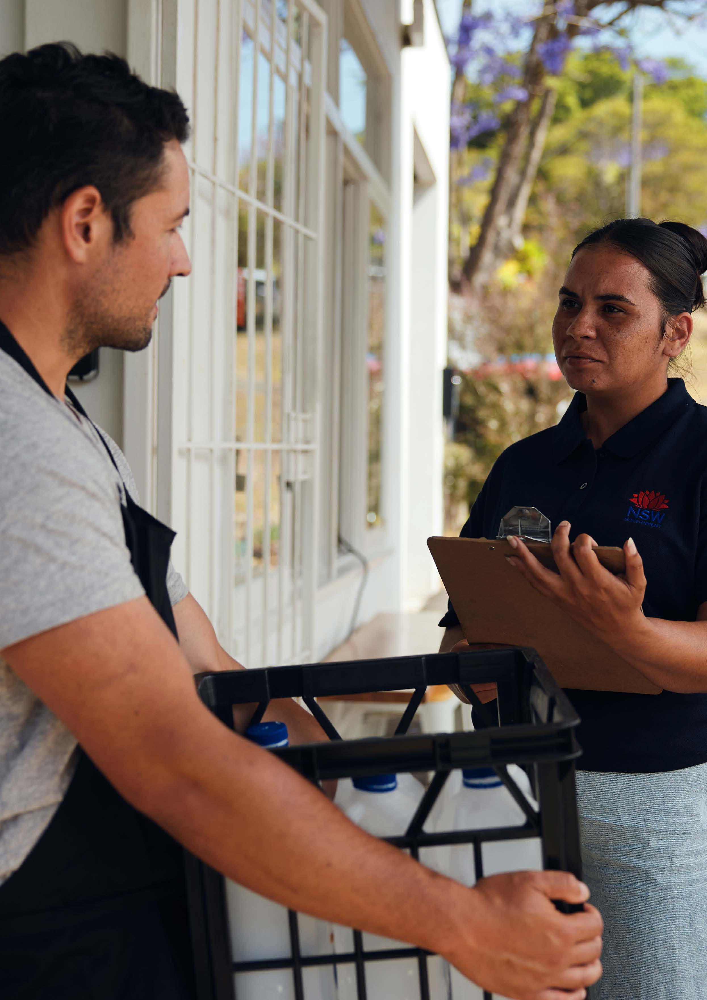

# NSW Recovery Plan (2023)

> **Source**: NSW Reconstruction Authority
> **URL**: https://www.nsw.gov.au/sites/default/files/noindex/2024-04/23923%20NSWRA%20NSW%20Recovery%20Plan%202023%20V12_ACCESSIBILITY.pdf
> **Licence**: CC BY 4.0
> **Retrieved**: 2026-05-07T13:39:44Z
> **SHA-256**: `334ee85d8d8a5584831f5611acb72ea7a443685b3abef6d5008087f109e2cf58`
> *Converted from PDF to Markdown format.*

---
## Page 1

i
NSW Recovery Plan 2023
NSW Recovery Plan
Supporting plan of the NSW State 
Emergency Management Plan
Updated December 2023Macquarie River in Dubbo near Dundullmal homestead and farm

---
## Page 2

ii 
NSW Recovery Plan 2023
NSW Recovery Plan
Cover image: Sunrise over the Macquarie River, Dubbo, 
in Wiradjuri Country. © Zetter.
Published by NSW Reconstruction Authority 
nsw.gov.au/departments-and-agencies/
nsw-reconstruction-authority 
First published February 2024
ISBN/ISSN: 978-0-9756278-0-8
Department or Agency reference number: D24/783
More information
Email: nswrecoveryplan@reconstruction.nsw.gov.au
Phone: (02) 9212 9200
Acknowledgements
Extensive stakeholder engagement and input from 
recovery and community partners, combat agencies, 
local councils, non-government organisations, industry 
groups, other state government departments and 
the Commonwealth informed the NSW Recovery 
Plan update.
The NSW Reconstruction Authority thanks the 
organisations and individuals who generously gave their 
time and expertise to this important review.
Copyright and disclaimer
© State of New South Wales through the NSW 
Reconstruction Authority 2023. Information 
contained in this publication is based on knowledge 
and understanding at the time of writing, December 
2023, and is subject to change. For more information, 
please visit nsw.gov.au/departments-and-agencies/
nsw-reconstruction-authority.
Authorisation
The NSW Recovery Plan 2023 has been prepared under 
the provisions of the NSW State Emergency and Rescue 
Management Act 1989 (SERM Act) and in accordance 
with the NSW State Emergency Management Plan 
(EMPLAN). This plan is authorised by the NSW 
Government Minister responsible for Emergency 
Services and the State Emergency Recovery Controller 
(SERCON) who has responsibility for overseeing the 
preparation and maintenance of recovery policies, 
arrangements and plans for NSW.
This plan is a supporting plan to the EMPLAN. It was 
approved by the SERCON on 9 February 2024 and 
endorsed by the NSW State Emergency Management 
Committee on 13 December 2023.
- Simone Walker, State Emergency Recovery Controller

---
## Page 3

iii
NSW Recovery Plan 2023
Healing together by Monique RennieHealing together by Monique
Acknowledgement of Country
The NSW Government acknowledges the Traditional Custodians of the lands where we work and live. We celebrate 
the diversity of Aboriginal peoples and their ongoing cultures and connections to the lands and waters of NSW.  
We pay our respects to Elders past and present and acknowledge the Aboriginal and Torres Strait Islander people 
who contributed to the development of the NSW Recovery Plan 2023. 
Healing Together 
The artwork ‘Healing together’ was created by Monique Rennie, a proud Kamillaroi woman living on Wonnarua country in 
the NSW Upper Hunter. It illustrates organisations and communities joining together to find the strength to recover and 
rebuild after a natural disaster or significant event. At the centre of the artwork sits our communities and organisations 
coming together to discuss ways to recover. The artwork features gum leaves branching in from the corners and 
embracing the communities, providing their healing and growing together. Around the artwork are lemon myrtle blooms 
healing the families in their centre and grass tree flowers representing the flourishing that can happen after hardship.

---
## Page 4

iv 
NSW Recovery Plan 2023
Acronyms
Acronym
Full Title
AIDR
Australian Institute for Disaster 
Resilience
ANZEMC
Australian and New Zealand 
Emergency Management Committee
CN
Community Network
DRFA
Disaster Recovery Funding 
Arrangements
DSERCON
Deputy State Emergency Recovery 
Controller
EMPLAN
NSW State Emergency 
Management Plan
EOCON
Emergency Operations Controller
LEMC
Local Emergency Management 
Committee
LEMO
Local Emergency Management Officer
LEOCON
Local Emergency Operations 
Controller
LGA
Local Government Area
NEMA
National Emergency Management 
Agency
RA
NSW Reconstruction Authority
REMC
Regional Emergency Management 
Committee
REMO
Regional Emergency Management 
Officer
REOCON
Regional Emergency Operations 
Controller
RPIC
Recovery Public Information 
Coordinator
SEMC
NSW State Emergency Management 
Committee
SEOC
State Emergency Operations Centre
SEOCON
State Emergency Operations 
Controller
SERCON
State Emergency Recovery Controller
SERM Act
State Emergency and Rescue 
Management Act 1989
SRC
State Recovery Committee
SRRG
Social Recovery Reference Group
The Act
NSW Reconstruction Authority Act 2022
The Plan
NSW Recovery Plan
Quick reference icons
Important definition
Key legislation
Committees and community 
networks
Roles and responsibilities of 
government
Key leadership roles
Key funding information
Handover and transition 
processes
Key documents
Mental health support
Temporary accommodation

---
## Page 5

v
NSW Recovery Plan 2023
1
2
3
4
5
6
7
8
9
Contents
Acronyms	
iv
Quick reference icons	
iv
Introduction, Aims, Context and Legislative 
Framework 	
2
1.1 Introduction	
3
1.2 Aims	
4
1.3 Context	
4
1.4 Legislative Framework	
5
1.5 NSW Reconstruction Authority Act 2022	
6
1.6 Other Legislation	
6
Scope, Principles and Community-Centred 
Recovery  	
7
2.1 Defining Recovery	
8
2.2 Scope	
8
2.3 Principles for Disaster Recovery	
10
2.4 Community-Centred Recovery	
11
Governance Structures and Committees    	
12
3.1 Governance Structures	
13
3.2 Local Structures	
13
3.3 Local Recovery Committee	
14
3.4 Regional Structures	
14
3.5 Regional Recovery Committee	
15
3.6 State Structures	
15
3.7 State Recovery Committee	
16
3.8 Recovery Subcommittees and
       Working Groups	
18
3.9 National Structures	
19
3.10 Recovery at the National Level	
19
Roles and Responsibilities  	
20
4.1 Local Council	
21
4.2 State Emergency Recovery Controller	
21
4.3 NSW Government Agencies	
22
4.4 Recovery Coordinators	
23
4.5 State Emergency Operations Controller	
23
4.6 Combat Agencies	
24
4.7 Australian Government	
24
4.8 Non-Government and Not-For‑Profit
       Organisations	
24
Recovery Funding and Financial
Arrangements   	
25
5.1 Recovery Funding and Financial Arrangements 	26
Triggers, Coordination and Announcements    	27
6.1 Transition from Response to Recovery	
28
6.2 Triggers for Transition	
29
6.3 Recovery Coordination Models	
30
6.4 Stages of Recovery	
31
6.5 Public Information 	
32
6.6 Transition to Ongoing Recovery	
32
Recovery Operations	
33
7.1 Recovery Needs Assessment	
34
7.2 Recovery Action Plan	
34
7.3 Recovery Delivery Model	
35
7.4 Recovery Program Model	
35
7.5 Temporary Housing 	
35
7.6 Mental Health in Recovery	
36
7.7 Recovery Resourcing	
36
7.8 Donations Management 	
36
7.9 Spontaneous Volunteers	
36
7.10 Community Networks 	
37
7.11 Community Hubs	
37
7.12 Cross-Border Communities 	
37
Training, Exercising and Evaluation  	
38
8.1 Training and Exercising	
39
8.2 Monitoring, Evaluation and Reporting	
39
8.3 Reviewing the NSW Recovery Plan	
39
Definitions 
40

---
## Page 6

2 
NSW Recovery Plan 20231
Introduction, 
Aims, Context 
and Legislative 
Framework

---
## Page 7

3
NSW Recovery Plan 2023
“
“
1.1 Introduction
New South Wales is rich with diversity of people, 
history, culture, and landscapes. Covering more than 
800,000km2, 8.2 million people call the state home 
with forecast growth putting the population at 10 
million by 2041.
NSW’s striking natural topography and a changing 
climate can make regions and communities more 
susceptible to disasters of increasing frequency and 
magnitude. Since 2019, the impact of disasters and 
emergencies on NSW communities, local economies, 
infrastructure, and the natural environment has been 
unprecedented.
Every Local Government Area has been affected 
by an emergency or natural disaster in recent 
years. Many NSW communities were devastatingly 
impacted by the catastrophic 2021-22 flood events, in 
particular the Northern Rivers and the Central West.  
Others are still recovering from the 2019-20 Black 
Summer bushfires, while the COVID-19 pandemic has 
fundamentally changed the way we live and work.
The increased frequency and intensity of disasters 
and other emergencies challenge how we collectively 
prepare, respond and recover. There is growing 
recognition that a greater emphasis on preparedness 
and planning, rather than reactive emergency 
management, is key to reducing risk and the impact 
on communities. 
NSW Communities
Recovery from disaster follows the response and 
immediate relief phase. It encompasses coordinated 
support across four key domains – social, built, 
economic and environmental. At the centre of these 
four domains is community.
Communities across NSW are diverse. Roughly 
66% of the state’s population lives in Greater 
Sydney, with 44% of us living in regional, rural and 
remote locations.  
Just over a quarter of the state’s residents were born 
overseas, 275 different languages are spoken and 
there are 144 religions practiced.  
NSW has Australia’s largest population of Aboriginal 
and Torres Strait Islander people, making up 3.4% 
of the state’s population, with a younger median age 
compared to NSW’s non-Aboriginal population.
Overall, we have an ageing population as people live 
longer and families have fewer children. 
More than 1.3 million people in NSW live with 
disability and a 2020–2022 national study showed 
40% of respondents are living with a lifetime mental 
health disorder.
NSW has a diversified, service driven economy, 
with strong rates of labour force participation 
following the pandemic-driven declines of recent 
years. But rates of economic disadvantage are 
disproportionately high for certain demographic 
groups and geographic locations, and inequality in 
NSW has widened between the most recent and 
previous census.
Beyond the statistics, NSW communities are unique. 
Each has their own history, culture, local assets and 
sense of place. Each has their own strengths and 
faces their own challenges. 
Community-centred recovery is responsive to these 
unique attributes, harnessing local strengths, assets 
and know-how, along with existing networks and 
connections. It recognises the importance of agency 
in the recovery process and that communities are 
best placed to define their own recovery goals.
NSW Recovery Plan 2023
The NSW Recovery Plan 2023 has been developed to 
guide coordination across government agencies and 
with other stakeholders – local councils, industries, 
businesses, non-government organisations, 
community groups and others on the ground – for the 
delivery of successful recovery. 
Recovery can be a complex and lengthy process. 
The time it takes a community to recover can vary 
depending on the scale of the disaster, the level 
of preparation and resourcing, inequities that may 
already exist, and the extent of social cohesion, 
connection and community assets.
The NSW Government plays a key role in recovery, 
with decision making, resource allocation and 
program delivery responsibilities across four 
domains. This role must be guided by local know-
how and understanding, and be responsive to local 
need, driven by local priorities and enabling of 
ground-up efforts. 
This plan is intended to guide a collaborative and 
flexible approach whereby government roles 
and responsibilities align with and complement 
community-centred approaches and the efforts of 
other recovery partners to get communities back 
on their feet.
‘Recovered’ is being able to 
lead a life that individuals 
and communities value 
living, even if it is different 
from the life they were living 
before the event (AIDR).

---
## Page 8

4 
NSW Recovery Plan 2023
Community-centred recovery and resilience framework
Embedding a community-centred approach is an ongoing process. The next step for the NSW Reconstruction 
Authority is to collaborate with key community stakeholders to develop a community-centred recovery and 
resilience framework. 
This framework will guide and strengthen our collective approach to leveraging, supporting and developing 
community knowledge, leadership and resilience. It will foster stronger partnerships between government, 
local stakeholders and impacted communities, to enable more coordinated approaches underpinned by 
shared responsibility. 
The new framework will include strategies to support Aboriginal communities to lead their own recovery, and to 
ensure that those most at risk are not left further behind. 
1.2 Aims
The NSW Recovery Plan 2023 strives to:
•	 be a practical, action-orientated document for key 
recovery activities
•	 ensure recovery planning and activities are 
community-centred and align with the National 
Principles of Disaster Recovery
•	 provide a collaborative, coordinated, adaptable 
and scalable approach to recovery activities, to 
achieve optimum community outcomes that match 
community need
•	 incorporate actions to reduce future risks, as 
guided by the State Disaster Mitigation Plan and 
documented in local Disaster Adaptation Plans
•	 outline governance structures at the local, regional 
and state level to plan and prepare for emergencies 
and recovery 
•	 inform the development of other recovery plans and 
tools in NSW
•	 define the triggers and process for the transition 
from response to recovery
•	 articulate the roles and responsibilities of 
Recovery Coordinators 
•	 define the roles and responsibilities of recovery 
partners and agencies within NSW that play a role 
in emergency management, and the handover 
of responsibility back to the community at the 
appropriate time.
1.3 Context
1.3.1. 
The NSW Recovery Plan (the Plan) is prepared 
and maintained by the NSW Reconstruction 
Authority. The NSW Recovery Plan is an 
all-hazards plan.
1.3.2. The Plan provides the framework for recovery 
in New South Wales and can be tailored to 
the requirements and scale of each disaster, 
emergency or community, supporting the 
affected community through its recovery.
1.3.3. The Plan recognises that localised, 
community-driven recovery efforts 
begin immediately following disasters 
or emergencies. These efforts will often 
commence before formal and structured 
recovery efforts begin and it is the primary 
role of formal recovery activities to support 
these immediate efforts.
1.3.4. Make safe (for example, clearing hazardous 
trees or debris) and priority works to critical 
assets and infrastructure (for instance, 
energy, water, sewerage, gas) relevant to 
public safety and humanitarian necessity will 
often be undertaken by combat agencies prior 
to the activation of formal recovery activities. 
1.3.5. The 2023 Plan is consistent with the SERM 
Act and is a supporting plan of the NSW State 
Emergency Management Plan (EMPLAN). It 
was developed alongside the EMPLAN and 
the State Disaster Mitigation Plan.
1.3.6. The Plan is supported by local Pre-Event 
Recovery Plans and guidance documents that 
inform recovery readiness, activations and 
announcements.

---
## Page 9

5
NSW Recovery Plan 2023
Figure 1: Legislation and policy framework of NSW 
emergency management arrangements
1.4 Legislative Framework
State Emergency and Rescue Management Act 1989
1.4.1. 
Under the State Emergency and Rescue 
Management Act 1989 (SERM Act), the 
Minister for Emergency Services (the Minister) 
is responsible for:
a. 
Ensuring that adequate measures are 
taken by government agencies to prevent, 
prepare for, respond to, and assist recovery 
from emergencies
b. 
Coordinating the activities of government 
agencies in taking those measures (Part 2, 
Division 1, Subdivision 1, Section 10), and
c. 
Appointing a State Emergency Recovery 
Controller (SERCON) and Deputy State 
Emergency Recovery Controller (DSERCON) 
(Part 2, Division 1, Subdivision 5).
1.4.2. Subdivision 5 of the SERM Act establishes 
the role of the SERCON. Responsibility 
for the overall coordination of recovery 
operations in NSW rests with the SERCON, 
unless prescribed in hazard-specific plans. 
(Source: EMPLAN)
1.4.3. The SERCON has the delegation to direct 
agencies, including local council, to undertake 
actions in recovery. (Source: SERM Act, Part 2, 
Division 1, Subdivision 5, Section 20B)
1.4.4. The SERCON has the authority to engage the 
support of government agencies as required 
and to engage with industry, non-government 
organisations (NGOs), local and the Australian 
Government, as necessary, to contribute to 
the recovery process.

---
## Page 10

6 
NSW Recovery Plan 2023
1.5 NSW 
Reconstruction 
Authority Act 
2022
1.5.1. 
The NSW Reconstruction Authority Act 
2022 (‘the Act’) aims to promote community 
resilience to the impact of disasters in New 
South Wales through:
	•
Disaster prevention, preparedness, and 
adaptation, and
	•
Recovery and reconstruction 
following disasters.
1.5.2. To achieve this aim, the Act has established 
the NSW Reconstruction Authority (‘the RA’), 
which leads four key disaster functions:
Mitigation and 
adaptation, including 
public infrastructure, 
homes, and land 
use planning
Local preparedness, 
including education 
and community 
information
Community-
centred recovery
Long-term rebuilding 
and reconstruction
1.6 Other 
Legislation
1.6.1. 
Other legal powers exist within government 
agencies’ legislation to enable and support 
recovery. For example, the Community 
Welfare Act 1987 and the Protection of the 
Environment Operations Act 1997.
1.6.2. The Government Sector Employment Act 2013 
provides for the temporary secondment of 
staff (Part 5, Section 66). This mechanism can 
be used by the SERCON to support all aspects 
of recovery, including recovery operations and 
other support.

---
## Page 11

7
NSW Recovery Plan 20232
Scope, Principles 
and Community-
Centred Recovery

---
## Page 12

8 
NSW Recovery Plan 2023
“
“
“
“
2.1 Defining 
Recovery
2.1.1. 
The State Emergency and Rescue Management 
Act 1989 defines recovery as:
...the process of 
returning an affected 
community to its proper 
level of functioning 
after an emergency. 
2.1.2. Under this Plan, the definition is expanded 
to recognise the complexity, breadth, and 
timeframes of recovery, and is defined as:
…[involving] the 
coordinated process 
of supporting affected 
communities in the 
reconstruction of the 
built environment and the 
restoration of emotional, 
social, economic, 
built and natural 
environment wellbeing.
(Source: AIDR) 
2.2 Scope
2.2.1. Under Section 20B of the SERM Act, the 
RA’s CEO (or a person designated by the 
CEO that is either a senior executive in the 
RA or NSW Police Force) is recognised as 
the State Emergency Recovery Controller 
(SERCON) with general responsibility for 
controlling recovery in NSW following 
emergencies. While the SERM Act recognises 
that another agency may be better placed to 
lead recovery following certain emergencies, 
it also empowers the SERCON to assume 
responsibility for those emergencies, 
as required.
2.2.2. It is the RA’s role to lead and coordinate 
recovery in NSW following disasters as 
defined in the NSW Reconstruction Authority 
Act 2022 and emergencies affecting more 
than one region, as defined in the SERM Act. 
It is recognised that while these are distinct 
roles, there is a high degree of overlap 
and commonality. 
2.2.3. In support of the SERCON, the RA can take 
an all-hazards approach to recovery, relying 
on its broad function in Section 10 of the NSW 
Reconstruction Authority Act 2022 and noting 
that any emergency or hazard can be brought 
within the definition of disaster in the Act, 
should the need arise. 
2.2.4. Disaster is defined in Section 6 of the NSW 
Reconstruction Authority Act 2022 to mean:
a. 
natural disasters, including, for example, 
bush fires, coastal hazards, cyclones, 
earthquakes, floods, heatwaves, landslides, 
severe thunderstorms, tornadoes 
and tsunamis
b. 
hazards caused by natural disasters 
including air pollution, water and soil 
contamination and water insecurity
c. 
other emergencies in relation to 
which the Minister has requested 
assistance from the RA
d. 
other emergencies in relation to which—
	•
a public authority, including a Minister 
other than the Minister administering 
this Act, has requested assistance 
from the RA, and
	•
the RA has agreed to provide assistance
e. 
events, incidents or matters, or classes of 
events, incidents or matters, prescribed by 
the regulations.

---
## Page 13

9
NSW Recovery Plan 2023
2.2.5. The RA has extensive recovery functions 
described in Section 10 of the NSW 
Reconstruction Authority Act 2022, including 
those listed below:
a. 
reconstruction and recovery 
following disasters and other 
emergencies, including—
	•
assisting the Minister administering the 
SERM Act and the SERCON to exercise 
the Minister’s and Controller’s functions 
in relation to recovery under that Act
	•
facilitating, coordinating and directing 
the recovery, planning and rebuilding 
of affected communities, including 
repairing and rebuilding land and 
infrastructure and other development
	•
balancing constraints to enable a 
focused, timely and expedited recovery 
of affected communities
b. 
information provision and exchange and 
community engagement, including—
	•
supporting collaboration and 
coordination between government 
agencies, local councils, service 
providers and communities to improve 
disaster prevention, preparedness, 
recovery, reconstruction and adaptation
	•
increasing the flow of information and 
enabling community participation to 
support the development of strategies 
for disaster prevention, preparedness, 
recovery, reconstruction and adaptation
c. 
to coordinate the development and 
implementation of whole-of-government 
policies for ensuring communities can 
recover, reconstruct, and adapt effectively 
and efficiently following disasters 
d. 
to lead the management and coordination 
of housing and infrastructure renewal and 
recovery within affected communities
e. 
to work closely with affected communities 
to ensure the needs of each community 
are recognised in the recovery and 
reconstruction of the community, and to 
improve the disaster preparedness and 
resilience of communities
f. 
to carry out research and provide advice, 
proposals, recommendations and reports 
to the Minister about recovery and 
reconstruction following disasters
g. 
to enter into joint ventures, project delivery 
agreements and other arrangements 
with landowners, developers, state and 
Commonwealth government agencies 
and local councils in relation to disaster 
prevention, recovery and reconstruction
h. 
to implement funding schemes to provide 
financial support in relation to disaster 
prevention, recovery, and reconstruction
i. 
to exercise other functions conferred or 
imposed on the RA by or under this Act or 
any other Act
j. 
to do anything supplementary, incidental 
or consequential on the exercise of the 
RA’s functions.
2.2.6. The RA’s recovery functions do not limit the 
functions of any other agency under the 
SERM Act (Section 10(2) of the Act).

---
## Page 14

10 
NSW Recovery Plan 2023
2.3 Principles for Disaster Recovery
2.3.1. Disaster recovery is part of emergency 
management and includes phases of 
prevention, preparedness, and response. 
Planning for recovery is integral to emergency 
preparation. Furthermore, mitigation and 
adaptation activities may be initiated as part 
of recovery to reduce future disaster risk.
2.3.2. Disaster risk is recognised as the 
consequence of the interactions between 
hazard and the conditions that make people, 
places and assets vulnerable and exposed.
2.3.3. Vulnerability is defined as ‘the characteristics 
of a person or group and their situation that 
influence their capacity to anticipate, cope 
with, resist and recover from the impact 
of a hazard’ (AIDR 2022). More broadly, 
vulnerability can also be used to describe 
the characteristics of places, assets and 
infrastructure.
2.3.4. The impacts of disasters and other 
emergencies can exacerbate vulnerabilities, 
such as social inequalities, which can reduce 
a community’s ability to recover. 
2.3.5. Recovery presents an opportunity to reduce 
risks and strengthen community resilience. 
During recovery the community may learn 
about the risks it faces and may apply this 
knowledge to build resilience and capacity to 
withstand future shocks.
2.3.6. Disaster recovery activities must support 
community development by addressing 
pre-existing vulnerabilities across the four 
domains of recovery. Addressing the causes 
of vulnerabilities in community recovery 
supports the development of resilience 
within communities. Recovery activities and 
programs must support sustainable and 
equitable outcomes and reduce disaster risk. 
2.3.7. Disaster risk is recognised as the 
consequence of the interactions between 
hazards and the conditions that make people, 
places and assets vulnerable and exposed.
2.3.8. Successful risk reduction decreases the 
impacts of events and the cost and time 
required for recovery. Prevention can reduce 
or avoid an event impact and minimise longer 
term recovery requirements.
2.3.9. The Sendai Framework for Disaster Risk 
Reduction 2015-2030 (Sendai Framework) 
also supports disaster risk reduction. 
It recognises that government has the 
primary role to reduce disaster risk, but 
that responsibility should be shared with 
other stakeholders including local councils, 
NGOs and other stakeholders. The Sendai 
Framework can be accessed here. 
2.3.10. The Australian Institute for Disaster 
Resilience (AIDR) promotes the six 
National Principles for Disaster 
Recovery that are incorporated into 
NSW recovery planning:
1. Understand the context: 
Successful recovery is 
based on understanding 
community context, with 
each community having 
its own history, values 
and dynamics.
2. Recognise the 
complexity: Successful 
recovery is responsive 
to the complex and 
dynamic nature of 
both emergencies and 
the community.
3. Use community-centred 
approaches: Successful 
recovery is community-
centred, responsive, 
and flexible, engaging 
with community and 
supporting them to 
move forward.
4. Coordinate all 
approaches: Successful 
recovery requires a 
planned, coordinated, 
and adaptive approach 
between community 
and partner agencies, 
based on continuing 
assessment of 
impacts and needs.
5. Communicate 
effectively: Successful 
recovery is built on 
effective communication 
between the affected 
community and 
other partners.
6. Recognise and build
capacity: Successful
recovery recognises,
supports, and builds on
individual, community
and organisational
capacity and resilience.

---
## Page 15

11
NSW Recovery Plan 2023
Figure 2: Community-centred recovery focuses on recovery needs segmented into four domains
2.4 Community-Centred Recovery
2.4.1. Effective recovery requires a thorough 
understanding of the community and its 
central role in leading its recovery. Planning 
must enable those impacted to participate in 
all stages of the recovery process and across 
the four recovery domains (refer to Figure 2) 
to integrate response and recovery activities.
2.4.2. The four recovery domains emphasise the 
reconstruction of buildings and infrastructure, 
restoration of economic, emotional, and 
physical wellbeing of communities and the 
restoration of the natural environment. In 
NSW, restoration of the natural environment 
includes restoring associated infrastructure 
and heritage sites, and the management of 
pollution and contamination. 
2.4.3. 	A community-centred approach is 
collaborative, enabling and supporting 
communities and individuals to participate 
in the development of recovery goals and 
outcomes that are community specific 
and meet the unique recovery needs of 
impacted communities. 
2.4.4. Community-centred recovery recognises 
the diversity of communities and the need 
to foster inclusive, culturally appropriate 
approaches to deliver equitable ‘whole-of-
community’ recovery outcomes. 
2.4.5. Community-centred recovery acknowledges 
and respects Aboriginal expertise as central 
to recovery for Aboriginal communities; 
and that connection to Country, culture 
and community can be profoundly 
impacted by disasters, while also 
being a source of strength 
and resilience in the 
recovery process. 
2.4.6. 	Agencies should support and coordinate 
with Aboriginal Elders, leaders, community 
controlled organisations and landowners, 
including Local Aboriginal Land Councils, 
to strengthen engagement and ensure their 
significant land, community assets, cultural 
ties and knowledge are recognised and 
factored into recovery (and at all stages of 
an emergency).
2.4.7. People’s ability to prepare for and withstand 
the effects of disaster may be constrained 
by a range of life circumstances. Community-
centred recovery recognises the importance 
of working in partnership with people 
with lived experience whose voices can 
often be overlooked, including people with 
disability, children and young people,  older 
people, and those living in isolated and 
remote communities. 
2.4.8. It is important that the NSW Government 
works with individuals and groups, and 
partners with the services that support and 
advocate for them, to identify action-oriented 
strategies to increase access, inclusion and 
equitable outcomes when planning for and 
coordinating recovery.
2.4.9. A dedicated community-centred recovery and 
resilience framework developed by the RA will 
guide and strengthen the NSW Government 
approach to leveraging, supporting, 
and developing community knowledge, 
leadership, and resilience to disasters and 
other emergencies.

---
## Page 16

12 
NSW Recovery Plan 20233
Governance 
Structures and 
Committees

---
## Page 17

13
NSW Recovery Plan 2023
3.1 Governance 
Structures
3.1.1. 
Governance structures exist at national, state 
and local levels of government to plan and 
prepare for emergencies and recovery.
3.1.2. Governance structures for recovery 
operations are scalable, flexible and designed 
to allow the escalation of unresolved issues, 
risks and threats. Escalation is determined by 
the scale of the event. 
3.1.3. Depending on the scale, the type of event 
and community needs, one or a mixture 
of appropriate governance structures can 
be utilised.
3.1.4. Management of a recovery operation, 
including the coordination of services, 
information and resources, should take place 
at the local level where possible.
3.1.5. In small-scale events, this would be achieved 
by allowing the Local Recovery Committee 
to take the lead and seek advice and 
guidance from  relevant government agencies 
as required.
3.1.6. 
When events overwhelm local capacity, 
the NSW Government, through the NSW 
Reconstruction Authority will coordinate 
recovery operations in partnership with 
local council and via collaboration with 
impacted communities.
3.1.7. 
In these circumstances, the Local and/or 
Regional Recovery Committee play a critical 
role in recovery efforts because members 
have key knowledge, connections and 
understanding of the community.
3.1.8. Where appropriate the RA may convene 
an Elected Officials Working Group 
to enable elected officials (of local 
government, the NSW Government and the 
Australian Government) to:
	•
represent community needs and issues 
directly to the relevant recovery committee
	•
be a conduit of information on recovery back 
to the community and/or, 
	•
facilitate a channel for issues to be resolved 
by the relevant recovery committee.
3.1.9. 
Local, regional and state governance 
structures do not operate in isolation and 
effective communication between them 
is critical.
3.2 Local 
Structures
3.2.1. The SERM Act recognises that the 
involvement of local councils in all stages 
of an emergency is critical. This includes 
in prevention, preparation, response 
and recovery. Therefore, the emergency 
management structure and arrangements 
at the local level are based on the local 
government areas (LGAs) or combined LGAs.
3.2.2. The Local Emergency Management 
Committee (LEMC) is responsible for the 
preparation of plans relating to emergency 
prevention, preparation, response and 
recovery in the LGA (noting both combat 
agencies and the RA have separate planning 
responsibilities).
3.2.3. LEMCs and Local Recovery Committees 
must develop relationships and build trust 
with Aboriginal communities (including 
Discrete Aboriginal Communities) to support 
an inclusive and culturally safe approach 
to emergency and recovery planning and 
the delivery of recovery services. that is 
community-centred.
3.2.4. Consistent with local engagement structures 
detailed in the SERM Act, the RA has the 
function of improving recovery outcomes by 
supporting collaboration and coordination 
between government agencies, local 
councils, service providers and community 
in relation to information sharing and 
community engagement.

---
## Page 18

14 
NSW Recovery Plan 2023
3.3 Local Recovery Committee
3.3.1. During the response phase, the RA will receive 
a briefing from the Emergency Operations 
Centre (EOC) or Combat Agency Control 
Centre regarding recovery implications and 
will consider the need to establish a Local 
Recovery Committee. The RA will consider 
impact assessments to determine recovery 
arrangements and needs. 
3.3.2. The Local Recovery Committee is the 
strategic decision-making body for local 
recovery. It provides visible and strong 
leadership and has a key role in restoring 
community confidence. This is achieved 
by assessing the consequences of the 
emergency and coordinating activities to 
rebuild, restore and rehabilitate the social, 
built, economic and natural environments of 
the affected community.
3.3.3. The combat agency and Local Emergency 
Operations Controller (LEOCON) will attend 
initial meetings of a Local Recovery Committee, 
to provide an overview of the situation.
3.3.4. The Local Recovery Committee will be chaired 
by a local council delegate. If local council 
elects not to chair, a Recovery Coordinator will 
assume this responsibility.
3.3.5. Other representatives, not specifically 
designated as members of LEMCs, should be 
part of a Local Recovery Committee to ensure 
an inclusive approach. It should include 
local representatives from key stakeholders 
in the recovery process (government and 
non-government, local businesses, social 
service organisations and functional 
areas). Consideration should also be given 
to including representatives of relevant 
Community Networks and/or any other 
pre-existing community groups.
3.3.6. The Local Recovery Committee will: 
a. represent the local community 
b. conduct and update the Recovery 
Needs Assessment 
c. assess the need for a Recovery 
Centre or Recovery Assistance Point 
and recommend to the SERCON or 
Recovery Coordinator
d. guide decisions about local 
priorities and resource allocation 
and management, referring to the 
Pre-Event Recovery Plan
e. assess the need for one or more local 
recovery subcommittees to focus on 
one or more recovery domains 
f. develop and maintain a Recovery 
Action Plan with an agreed strategy 
for ongoing recovery 
g. liaise with the community and other 
stakeholders and coordinate local 
recovery activities in partnership 
with the NSW Reconstruction 
Authority or Recovery Coordinator 
h. communicate effectively with 
Regional and State Recovery 
Committees, if activated
i. ensure that relevant stakeholders 
and the community are involved in 
the development and implementation 
of Recovery Action Plans and are 
informed of progress
j. ensure the recovery aligns 
with the National Principles of 
Disaster Recovery
k. support the SERCON to undertake 
program monitoring and evaluation. 
3.3.7. The Local Recovery Committee retains 
responsibility for strategic decision-making 
regarding local recovery. The committee 
communicates regularly with the RA or the 
Recovery Coordinator to ensure that local 
recovery activities complement and align with 
the activities of the state. 
3.3.8. The local council is responsible for prioritising 
its own resources to contribute to the 
recovery objectives that are identified by the 
Local Recovery Committee, in the Pre-Event 
Recovery Plan and Recovery Action Plan. This 
effort should align with the work of the RA or 
Recovery Coordinator. 
3.4 Regional Structures
3.4.1. For the purposes of the SERM Act, the state 
is divided into such regions as the Minister 
may determine. 
3.4.2. The Regional Emergency Management 
Committee (REMC) is responsible for 
preparing and reviewing plans in relation to 
the prevention of, preparation for, response to 
and recovery from emergencies in the region 
for which it is constituted. 
3.4.3. In accordance with the EMPLAN, a Regional 
Recovery Committee may be formed 
to coordinate the recovery effort if an 
emergency affects several LGAs. 
3.4.4. REMCs and Regional Recovery Committees 
must consider any specific needs of 
Aboriginal communities (including Discrete 
Aboriginal Communities) in emergency 
and recovery planning and the delivery of 
recovery services.
3.4.5. The SERCON may send a representative 
to the REMC.

---
## Page 19

15
NSW Recovery Plan 2023
3.5 Regional 
Recovery 
Committee
3.5.1. If an emergency affects several LGAs, the 
RA will receive a briefing from the relevant 
Emergency Operations Centre (EOC) or 
Combat Agency Control Centre regarding 
recovery implications and will consider 
the need to establish a Regional Recovery 
Committee. The RA will consider any impact 
assessments in determining the need for 
recovery arrangements.
3.5.2. The Regional Recovery Committee will be 
chaired by a Recovery Coordinator.
3.5.3. The composition of the Regional Recovery 
Committee will be determined according to 
the nature and scale of the event, however 
delegates from each functional area should 
be encouraged to attend. 
3.5.4. The combat agency controller and Regional 
Emergency Operations Controller (REOCON) 
will attend initial Regional Recovery 
Committee meetings to provide an overview 
of the situation. 
3.5.5. The Regional Recovery Committee will:
a. coordinate a cohesive approach 
to recovery activities across 
multiple LGAs
b. ensure effective communication 
between the Regional 
Recovery Committee and Local 
Recovery Committees 
c. ensure effective communication with 
the State Recovery Committee 
d. provide advice and guidance to 
assist community-centred recovery
e. support the work of the Recovery 
Coordinator 
f. guide decisions about priorities and 
resource allocation and management 
g. develop and maintain a Recovery 
Action Plan with an agreed strategy 
for ongoing recovery 
h. ensure that relevant stakeholders 
and the community are involved in 
the development and implementation 
of Recovery Action Plans and 
informed of progress 
i. ensure the recovery is aligned 
with the National Principles for 
Disaster Recovery
j. support the SERCON to undertake 
program monitoring and evaluation.
3.5.6. Where a Regional Recovery Committee is 
established, the Recovery Coordinator and 
their team will provide support, guidance and 
resources to assist with the implementation of 
recovery activities. The Recovery Coordinator 
remains responsible for coordinating state 
recovery operations in the field. 
3.5.7. 	In circumstances where a Regional Recovery 
Committee is established, the NSW Recovery 
Plan recognises that resources may be 
stretched and that delegates may need to be 
redirected from attendance at Local Recovery 
Committees. The flow of information between 
committees becomes even more critical in 
such circumstances. 
3.6 State Structures
3.6.1. 
The NSW State Emergency Management Committee (SEMC) that is established under the SERM Act has 
responsibilities that include, but are not limited to:
a. 
emergency planning for NSW
b. 
facilitating the development of emergency 
and recovery management capabilities
c. 
endorsing supporting plans, including 
Pre-Event Recovery Plans
d. 
ensuring appropriate linkages with federal 
arrangements where relevant.

---
## Page 20

16 
NSW Recovery Plan 2023
3.7 State Recovery Committee
3.7.1. 
The NSW State Recovery Committee is 
established under the EMPLAN and provides 
strategic oversight and guidance to recovery 
efforts following disasters that overwhelm 
local and regional capacity. This may occur 
through one large-scale event or through 
several disasters or emergencies that occur 
simultaneously. 
3.7.2. The State Recovery Committee (SRC) is a 
standing committee which will continue to 
meet while communities remain in recovery.  
3.7.3. The SRC will be chaired by the SERCON. 
3.7.4. The SRC is responsible for:
a. 
providing strategic direction in relation to 
disaster recovery
b. 
considering funding packages for recovery 
programs and services, guided by local/
regional priorities, needs assessments, and 
desired recovery outcomes
c. 
establishing subcommittees to lead 
delivery across functions
d. 
overseeing reconstruction and 
recovery efforts
e. 
oversight and management of strategic 
risks in recovery
f. 
providing senior leadership to facilitate 
whole-of-government coordination
g. 
facilitating the accurate and timely flow 
of information, reports and responding to 
requests for escalations from Local and 
Regional Recovery Committees and the 
NSW Government
h. 
monitoring and reporting to standing 
committees and the NSW Reconstruction 
Authority Advisory Board, as required 
i. 
identifying, cataloguing and oversighting 
lessons management processes. 
3.7.5. The RA provides executive support to the SRC. 
3.7.6. The SRC comprises delegates drawn from 
the subcommittees as well as a range of 
government agencies, local bodies and 
others, as determined by the nature and scale 
of the event.
3.7.7. 
In the case of subcommittees, both the Chair 
and Deputy Chair are encouraged to attend 
as delegates. 
3.7.8. The Plan recognises that resources may be 
stretched and that delegates may need to 
be redirected from attendance at Local and 
Regional Recovery Committees to the SRC. 
3.7.9. Local and Regional Recovery Committees 
should prioritise the submission of information 
to the SRC as this information is part of the 
intelligence that directly informs program 
development and the deployment of state 
resources to support impacted communities. 
3.7.10. At a minimum, SRC delegates are 
typically drawn from the range of sources 
outlined below.
	•
SERCON (Chair) 
	•
SEOCON 
	•
Aboriginal Affairs NSW 
	•
Animal and Agriculture subcommittee 
	•
Australian Defence Force 
	•
Business, Industry and Tourism 
subcommittee
	•
Department of Communities and Justice
	•
Department of Customer Service
	•
Department of Education 
	•
Department of Regional NSW 
	•
Fire and Rescue NSW
	•
	Funding subcommittee 
	•
	Health and Wellbeing subcommittee
	•
Infrastructure subcommittee 
	•
Insurance Council of Australia
	•
	Local Government NSW
	•
Multicultural NSW
	•
	NSW Police Force 
	•
NSW Reconstruction Authority
	•
	NSW Rural Fire Service
	•
	NSW State Emergency Service
	•
	NSW Telecommunications Authority 
	•
	NSW Treasury
	•
Office of Local Government
	•
Premier’s Department
	•
Regional Recovery Committees 
	•
Service NSW
	•
Temporary Housing subcommittee
	•
The Cabinet Office
	•
Waste and Environment subcommittee
	•
Any others as determined by the nature and 
scale of the event. 
3.7.11. When the nature or scale of the event dictates 
the need for additional delegates, they are 
often drawn from the following sources:
	•
Emergency Information Coordination Unit
	•
Crown Lands – Housing and Property
	•
Public Information Functional Area
	•
Telecommunications Functional Area
	•
Transport Services Functional Area
	•
Health Services Functional Area
	•
Energy and Utilities Functional Area
	•
Engineering Services Functional Area
	•
Environmental Services Functional Area
	•
Welfare Services Functional Area
	•
Homes NSW.
3.7.12. The SRC may change the formation or 
function of the subcommittees to meet the 
requirements of the recovery effort.

---
## Page 21

17
NSW Recovery Plan 2023
Figure 3: Schematic representation of the State Recovery Committee with local and regional structures, 
including working groups (WG) and subcommittees (SC) of the State Recovery Committee

---
## Page 22

18 
NSW Recovery Plan 2023
Figure 4: Recovery subcommittees and working groups which may be established by local, regional, and state 
recovery committees
3.8 Recovery Subcommittees and 
Working Groups
3.8.1. Recovery Committees at all levels may form 
subcommittees and working groups to focus 
on providing specialised support and advice 
to the Recovery Committee. The need for 
subcommittees is based on the impacts 
of the event. 
3.8.2. Recovery subcommittee membership is 
determined by the Recovery Committee. 
Members include representatives 
from government and non-government 
organisations and have specific knowledge in 
one of the four recovery domains.
3.8.3. Representatives from the Recovery 
Committee will chair each of the 
subcommittees to coordinate and implement 
recovery tasks and disseminate decisions 
from the Recovery Committee as required. 
The chair of the subcommittee is also
responsible for communicating information
and issues up to the Recovery Committee 
and over to other relevant committees, 
where established.
3.8.4. It is important for the subcommittee structure 
to be agile. Therefore, depending on the 
impact of the disaster or emergency, the 
types of subcommittees and appropriate 
chairs may vary. 
3.8.5. Working Groups may also be formed under 
Recovery Committees, with specific remits 
or deliverables. The chairs of these working 
groups are responsible for communicating 
information and issues up to the Recovery 
Committee and to other relevant committees.
3.8.6. The groupings in Figure 4 can be replicated or 
adapted as required.

---
## Page 23

19
NSW Recovery Plan 2023
3.9 National 
Structures
3.9.1. 
The National Cabinet is chaired by the Prime 
Minister and includes the Premiers and Chief 
Ministers from each state and territory.
3.9.2. The National Emergency Management 
Ministers Meeting is the national ministerial-
level committee responsible for development 
of policy and arrangements relating to 
emergencies in Australia.
3.9.3. The Australian and New Zealand Emergency 
Management Committee (ANZEMC) works to 
strengthen the resilience of each nation by 
providing strategic leadership on emergency 
management policy and supporting related 
capability and capacity development 
activities. It comprises representatives 
from the commonwealth, state and territory 
governments, New Zealand Government, and 
the Australian Local Government Association.
3.9.4. 	The ANZEMC has a specific mandate to 
promote and consider community-centred 
disaster recovery policy and planning in 
keeping with the National Principles for 
Disaster Recovery.
3.10 Recovery at 
the National 
Level
3.10.1. The National Catastrophic Natural Disaster 
Plan describes the national coordination 
arrangements for supporting both the NSW 
Government and Australian Government 
in responding to and recovering from 
catastrophic natural disasters in Australia.
3.10.2. The National Emergency Declaration Act 2020 
enables the Governor-General to declare a 
national emergency on the advice of the Prime 
Minister. The National Emergency Declaration 
Act 2020 allows Commonwealth agencies to 
waive certain bureaucratic requirements. 
3.10.3. The National Emergency Declaration Act 2020 
also allows Commonwealth entities to be 
compelled to report on certain information.

---
## Page 24

20 
NSW Recovery Plan 20234
Roles and 
Responsibilities

---
## Page 25

21
NSW Recovery Plan 2023
Figure 5: The SERCON is responsible for controlling the recovery from a natural disaster or other emergency
4.1 Local Council
4.1.1. 
Local councils play a key role in leading, 
managing and supporting their community’s 
local recovery, providing services and 
assistance to the community and advice 
and advocacy to the NSW Government. RA 
staff provide direct support to and work 
closely with councils to lead and manage 
local recovery.
4.1.2. Local council will chair the Local Recovery 
Committee. If council elects not to chair, the 
RA or a Recovery Coordinator will assume 
this responsibility.
4.1.3. Local council provides expertise and 
local knowledge to inform the Local 
Recovery Committee.
4.1.4. Local council provides executive support to 
the Local Recovery Committees, as needed.
4.2 State Emergency Recovery 
Controller
4.2.1. Section 20A of the SERM Act states that 
the Office of the State Emergency Recovery 
Controller (SERCON) is to be held by the Chief 
Executive Officer of the NSW Reconstruction 
Authority, unless delegated.
4.2.2. The responsibilities of the SERCON are 
detailed in Section 20B of the SERM Act 
and the EMPLAN.
SERCON

---
## Page 26

22 
NSW Recovery Plan 2023
4.3 NSW Government Agencies
4.3.1. The EMPLAN outlines the roles and 
responsibilities of agencies within NSW that 
have a role in emergency management.
4.3.2. Recovery is a whole-of-government activity 
and may require participation and involvement 
of all government agencies, depending on 
the nature and impact of the event. All NSW 
Government agencies and statutory bodies 
need to maintain the capacity and capability to 
participate in the recovery effort, as directed 
by the SERCON and as per agency plans.
4.3.3. The SERCON and DSERCON may request 
that agencies provide staff and subject 
matter experts to support the work of the 
Recovery Coordinator(s).
4.3.4. 	Under Section 14 of the Act, every 
government agency, local council, and state-
owned corporation is required to cooperate 
with the RA in relation to its recovery 
functions following a disaster.
Functional
Areas
4.3.5. The SERCON will coordinate recovery 
activities throughout the state and will 
be supported by the State Emergency 
Operations Centre (SEOC) and the 
following functional areas:
	•
Agriculture and Animal Services
	•
Telecommunications Services
	•
Energy and Utility Services
	•
Engineering Services
	•
Environmental Services
	•
Health Services
	•
	Public Information Services
	•
Transport Services
	•
Welfare Services.
4.3.6. A number of NSW Government 
agencies also support recovery 
functions as part of their 
core business.
NSW Reconstruction 
Authority
4.3.7. The RA is responsible for providing support 
to the Minister for Emergency Services and 
the SERCON by:
a. 
providing senior leadership to facilitate 
whole-of-government coordination
b. 
coordinating formal recovery processes at 
the direction of the SERCON. Coordination 
should prioritise community-centred 
recovery and may include coordination at 
the local, regional or state level.
c. 
developing and maintaining recovery 
policies, plans and arrangements
d. 
resourcing one or more Recovery 
Coordinator positions. Recovery Coordinators 
will be identified by the SERCON as required. 
Recovery Coordinators will usually be drawn 
from within the ranks of the RA (however, 
the SERCON may consult with the Minister 
on these appointments as necessary and 
required). Recovery Coordinators will be 
supported in their role by RA staff. 
e. 
providing recovery management and 
operational expertise to Local and Regional 
Recovery Committees 
f. 
administering and delivering temporary 
housing solutions
g. 
administering and delivering recovery 
programs such as Recovery Support 
Services, Community Recovery Officers 
and Disaster Relief Grants
h. 
maintaining operational oversight and 
disseminating operational reports to key 
stakeholders
i. 
share information and liaise with elected 
officials to enhance communication 
arrangements back to the community
j. 
preparing progress and other reports 
associated with recovery operations
k. 
coordinating the analysis of impact 
assessment data to inform operational and 
non-operational recovery planning
l. 
coordinating the analysis of Recovery Needs 
Assessment data to inform operational and 
non-operational recovery planning
m. monitoring and evaluating state-funded 
recovery programs
n. 
implementing a lessons management 
process for recovery
o. 
leading whole-of-government 
communications and messaging 
during recovery
p. 
providing a point of contact for Australian 
Government agencies in relation to recovery 
issues and requests. These Commonwealth 
counterparts will include, but not be limited 
to, the National Emergency Management 
Agency (NEMA).

---
## Page 27

23
NSW Recovery Plan 2023
4.4 Recovery Coordinators
4.4.1. A Recovery Coordinator coordinates recovery 
operations on behalf of the state government 
in an impacted area.
4.4.2. Depending on the scale of the emergency, 
a Recovery Coordinator can be appointed 
at either or both local and regional levels. A 
Recovery Coordinator and their team provide 
advice, support, guidance and resources 
to assist the efforts of the Local Recovery 
Committee and the local council. This 
includes supporting local council to facilitate 
community recovery service models. 
4.4.3. A Recovery Coordinator’s functions are to:
a. 
in consultation with the lead response 
agency, support the transition from the 
response phase to formal recovery
b. 
establish and maintain an effective 
relationship with local council and 
other key community leaders, groups 
and organisations to facilitate 
community-centred recovery
c. 
chair the Local Recovery Committee 
when required 
d. 
chair the Regional Recovery Committee 
e. 
oversee the implementation of Recovery 
Needs Assessments
f. 
coordinate the development of Recovery 
Action Plans
g. 
support the RA to maintain an operational 
picture of the impact and keep Local and/or 
Regional Recovery Committees informed
h. 
communicate key messages to identified 
audiences in accordance with the agreed 
public information strategy
i. 
establish regular dialogue with key 
stakeholders and opportunities for input 
and influence to ensure their understanding 
of, participation in, and contribution to the 
recovery process
j. 
establish regular communication and 
engagement with NSW Government agency 
representatives
k. 
assist with the facilitation and coordination 
of non-government and private sector 
organisations’ to support their role in the 
recovery process, leverage their insights in 
relation to gaps and concerns, and enable 
their input to ongoing recovery planning. 
l. 
brief the SRC and escalate unresolved 
issues and risks 
m. identify areas where existing policy 
provisions are unlikely to be sufficient to 
achieve the requisite level of recovery and 
provide advice to the SERCON
n. 
at the conclusion of the official recovery 
phase, provide a report to the SERCON 
detailing actions taken, lessons identified 
and recommended mitigation measures. 
4.5 State Emergency Operations 
Controller
4.5.1. The State Emergency Operations Controller 
(SEOCON) is established under the SERM 
Act and staffed by the Commissioner of Police 
or a Senior Executive Service member of the 
NSW Police Force. 
4.5.2. The SEOCON and SERCON will liaise during 
the response phase of an emergency.
4.5.3. For emergencies for which the SEOCON 
is controlling, the SEOCON is responsible 
for ensuring initial impact assessments are 
completed following an emergency, to inform 
recovery arrangements.
4.5.4. If an emergency response, of which the 
SEOCON is controlling, is ongoing and a 
recovery operation is likely to be initiated, the 
SEOCON coordinates impact assessments in 
conjunction with the SERCON. 
4.5.5. The SEOCON facilitates the handover from 
response to recovery for emergencies of 
which the SEOCON has control. If required, 
the SEOCON may choose to delegate a 
relevant Emergency Operations Controller 
(EOCON) to conduct the handover on 
their behalf.

---
## Page 28

24 
NSW Recovery Plan 2023
4.6 Combat 
Agencies
4.6.1. 
The combat agency will undertake relief 
activities, including make safe works to 
ensure that it is safe to commence the 
transition to formal recovery arrangements.
4.6.2. The combat agency will provide Recovery 
Committees with information about continuing 
response activities, guidance on mitigation 
strategies and general advice and assistance.
4.6.3. The combat agency provides appropriate 
information on the scale and impact of an 
event to the RA and relevant local, regional or 
state recovery committees.
4.6.4. The combat agency provides appropriate 
representation at local, regional or state 
recovery committees.
4.7 Australian 
Government
4.7.1. 
The Australian Government (through NEMA) 
is responsible for administering the Disaster 
Recovery Funding Arrangements (DRFA). 
These arrangements provide a financial safety 
net which supports significant recovery 
efforts within NSW.
4.7.2. The Australian Defence Force (ADF) has 
capabilities and resources that can be useful 
in providing assistance during recovery from 
natural disasters. The ADF provides this 
support under the Defence Assistance to the 
Civil Community (DACC) arrangements.
4.8 Non-Government and 
Not-For‑Profit Organisations
4.8.1. Social service NGOs play an important 
role in supporting affected communities, 
particularly vulnerable community members 
who can be disproportionately impacted by 
disasters. Support may include practical 
assistance such as financial or food relief, 
psychosocial support, assistance with clean 
up, legal advice, tenancy support or financial 
counselling. Social service organisations also 
provide specialist support for issues that can 
escalate in the wake of disasters including 
domestic violence, homelessness, parenting 
challenges, educational disengagement and 
child neglect.  
4.8.2. These organisations are often longstanding, 
locally based, community managed and 
highly trusted by their communities. As 
such they play an important role in building 
connection, social cohesion and a sense 
of belonging, which are critical factors in 
effective community-centred recovery 
efforts. They are also rich sources of valuable 
data and intelligence on local culture, needs, 
challenges and strengths.  
4.8.3. Relationships with NGOs and not-for-profit 
organisations can be managed through 
a range of formal agreements, including 
Memorandums of Understanding (MoUs), 
service contracts and other arrangements, 
recognising that resourcing to respond 
to rising demand is an ongoing challenge. 
Regardless, building collaborative, mutually 
respectful relationships is key.

---
## Page 29

25
NSW Recovery Plan 20235
Recovery Funding 
and Financial 
Arrangements

---
## Page 30

26 
NSW Recovery Plan 2023
5.1 Recovery Funding and Financial 
Arrangements 
5.1.1. 
The RA is the NSW Government agency 
responsible for recovery funding and recovery 
arrangements. This responsibility includes 
liaising with NEMA to coordinate the DRFA 
and the National Partnership Agreement. 
Ongoing policy advice, direction and support 
will be provided for administering agencies as 
part of their role in delivering the DRFA.  
5.1.2. The DRFA is an Australian Government 
instrument that provides a financial safety 
net to states and territories, enabling 
certain expenditure above defined financial 
thresholds to be reimbursed, if relevant 
criteria are met. 
5.1.3. NSW expenditure must meet the eligibility 
criteria and exceed certain thresholds to be 
eligible for Commonwealth assistance under 
DRFA. A Natural Disaster Declaration triggers 
the DRFA and is made once the eligibility 
criteria are met. The small disaster criterion is 
a minimum of $240,000 public infrastructure 
damage, response, and recovery costs. The 
SERCON provides advice to the Minister 
for Emergency Services as to whether the 
threshold has been met and a natural disaster 
can be declared. 
5.1.4. The DRFA also includes provisions for 
reimbursement in circumstances where 
extraordinary costs are incurred in connection 
with Counter Disaster Operations. In such 
circumstances, funding may be available 
to assist with minimal suppression works 
and restoration (commonly referred to 
as ‘Make Safe Works’). Make Safe Works 
are an essential precursor to the more 
formalised recovery effort. These works may 
be undertaken by combat agencies, local 
councils and/or private contractors engaged 
by those authorities. 
5.1.5. NSW Disaster Assistance Guidelines reflects 
the DRFA and includes arrangements 
administered directly through NSW 
Government departments. More information 
on the assistance available can be 
found at nsw.gov.au/disaster-recovery/
disaster-relief-and-support
5.1.6. 
The NSW Disaster Assistance Guidelines 
has established a range of relief measures 
designed to address impacts on: 
	•
individuals and households 
	•
small businesses 
	•
primary producers 
	•
local councils
	•
community organisations. 
5.1.7. 
Expenditure of funds by agencies during 
recovery operations is to be met in the first 
instance by the agency from within their 
normal operating budgets or arrangements 
with NSW Treasury. NSW Treasury may 
provide additional funding if the expenditure 
is of a magnitude that prevents the agencies 
or functional areas from continuing their 
normal operations for the remainder of the 
financial year. Agencies cannot be guaranteed 
that funding will be provided.

---
## Page 31

27
NSW Recovery Plan 20236
Triggers, 
Coordination and 
Announcements

---
## Page 32

28 
NSW Recovery Plan 2023
Figure 6: Demonstrates the transition from response to recovery in the context of recovery relative to time, highlighting 
that recovery begins at the impact of a disaster or other emergency and continues over time. Relief activities may be 
ongoing following the transition from response to early recovery. The transition from long‑term recovery to ongoing 
community development work signals the progressive handover of recovery activities to the community.
6.1 Transition from 
Response to Recovery
6.1.1. 
The recovery process begins at impact. It 
operates in parallel to the response phase 
and continues long after the response phase 
is complete. The combat agency retains 
responsibility until it advises the SERCON 
and/or Recovery Coordinator (if appointed) 
that the identified response phase is 
complete, and the area is now safe.
6.1.2. The SERCON may, in consultation with 
the EOCON and/or Incident Controller 
(or delegate), deploy a Recovery Liaison 
Officer to the most appropriate Emergency 
Operations Centre or Combat Agency 
Operations Centre, as necessary. 
6.1.3. The combat agency, or EOCON when in 
control, is to provide information on the 
response operation to the Recovery Liaison 
Officer. This data, including damage and 
impact assessment information, should be 
used as a basis for planning recovery and feed 
into the Recovery Needs Assessment. The 
EOCON should support the combat agency 
and functional areas on request to develop 
the impact assessment.
6.1.4. As the response concludes, a transition to 
recovery will be formalised. In events of 
medium and high severity, this process will be 
formally documented and recorded.
6.1.5. The combat agency, or EOCON when in 
control, will provide the SERCON/Recovery 
Coordinator with a detailed handover brief 
and associated data to facilitate the seamless 
transition of management responsibility to 
the SERCON. 
6.1.6. 
The SERCON, the SEOCON and relevant 
Combat Agency Controller will ensure that 
senior representatives from the combat 
agency are assigned as Liaison Officers to 
attend the relevant Recovery Committee and 
engage with the Recovery Coordinator (if 
appointed) throughout the transition.
6.1.7. 
The SERCON will ensure that a coordinated 
public information strategy is developed 
and implemented to assure the community 
that services are still available, despite the 
withdrawal of emergency response agencies.
6.1.8. Where possible, the transition from response 
to recovery should occur at the lowest level.

---
## Page 33

29
NSW Recovery Plan 2023
6.2 Triggers for Transition
6.2.1. The transition from response to recovery will 
commence when:
a. 
The combat agency, or EOCON when in 
control, determines that the response has 
been completed and,
b. 
A Recovery Coordinator has been appointed 
(if necessary and dependent on scale of 
impact) and/or,
c. 
Agreement between combat agency, or 
EOCON when in control, and relevant 
recovery agency, SERCON and/or 
appointed Recovery Coordinator to accept 
the handover.
6.2.2. Where a Recovery Coordinator has not 
been appointed, the combat agency and/or 
EOCON will provide advice to the SERCON 
or delegate. 
6.2.3. The combat agency and/or EOCON can 
determine that the response has been 
completed at a ‘sector’ level. A sector may 
include a region, LGA, suburb or street, 
depending on the size of the event and scale 
of the impact. 
6.2.4. Relief activities may be ongoing prior 
to, during and following the transition to 
recovery. Following the transition from 
response to recovery, relief activities will 
be coordinated by the RA. Relief activities 
may typically include ongoing clean up, 
damage assessment, addressing welfare 
and emergency housing needs and public 
health needs. Relief activities will be 
delivered by relevant combat agencies and/or 
functional areas. 
6.2.5. The transition to recovery is completed and 
official upon public announcement. The public 
announcement may be delivered by a variety 
of mediums including broadcast, print media 
and social media.

---
## Page 34

30 
NSW Recovery Plan 2023
6.3 Recovery Coordination Models
Low Severity Activation
6.3.1. Where an event impacts a single LGA or 
causes limited disruption to communities 
and damage to physical infrastructure, the 
affected local council leads the recovery 
operations, and where possible, from its own 
resources. A Local Recovery Committee 
may be established. The most appropriate 
recovery service model will be activated to 
provide services to affected communities. 
6.3.2. The RA will support local councils through 
its regionally based teams. Other NSW 
government agencies may assist recovery 
operations, through existing local resources. 
State agency activities are handled through 
business-as-usual channels. 
6.3.3. The Combat Agency Controller and LEOCON 
or their delegates attend initial recovery 
committee meetings to provide an overview of 
the emergency response operation.
6.3.4. The Regional Emergency Management 
Officer (REMO) and appropriate functional 
area delegates are invited to the initial 
local meeting and to subsequent meetings, 
as required.
6.3.5. The SERCON may determine to appoint a 
Recovery Coordinator to:
	•
attend the LEMC, Local Recovery Committee 
and subsequent recovery meetings
	•
provide expert recovery advice and 
guidance to support community-centred 
recovery efforts
	•
produce regular situation reports in support 
of the recovery effort.
Medium Severity Activation
6.3.6. Where a single event or multiple events 
moderately impact one or multiple LGAs and 
there is a moderate disruption to communities 
and physical infrastructure, the combat 
agency / EOCON, in consultation with the RA, 
identifies the need for assistance from the 
state to provide resourcing for the affected 
local council and advises recovery operations. 
The most appropriate recovery service 
model will be activated to provide services 
to affected communities. The SERCON may 
decide to confirm the appointment of a 
Recovery Coordinator.
6.3.7. State agencies are widely engaged in 
recovery operations and have deployed 
additional personnel to coordinate activities.
6.3.8. The SERCON directs the Recovery Coordinator 
to support, advise and guide local recovery 
efforts and to coordinate recovery operations. 
6.3.9. A Local Recovery Committee is established 
and is working with local stakeholders and 
the Recovery Coordinator (or RA) to develop 
a Recovery Action Plan. There may also be 
need for a Regional Recovery Committee 
to be established if the event impacts 
multiple LGAs.
6.3.10. The Local and Regional Recovery Committees 
will work closely with Recovery Coordinators 
to coordinate recovery efforts.
High Severity Activation
6.3.11. Where a major event or multiple events have 
affected numerous LGAs or regions, causing 
widespread disruption to communities and 
damage to physical infrastructure, and require 
a coordinated recovery effort that is beyond 
the capacity of Local and Regional Recovery 
Committees to manage. A Recovery Centre(s) 
and/ or other recovery service model(s) and 
programs are required to provide services to 
affected communities.
6.3.12. The NSW Government assumes responsibility 
for overall coordination of recovery 
operations, with extensive commitment of 
personnel and resources to the recovery 
effort. The SERCON directs the appointment 
of one or many Recovery Coordinator(s) 
and may consult with the Minister on these 
appointments.
6.3.13. The Local Recovery Committee retains a 
central role developing Recovery Action Plans 
and ensuring local recovery activities are 
coordinated with state efforts.
6.3.14. Upon consulting with the SRC, the SERCON 
will provide strategic advice to the Minister 
and the government on key recommendations 
around recovery priorities, programs and 
longer-term recovery actions.
Catastrophic Severity Activation
6.3.15. Should an event exceed the NSW 
Government’s capacity to manage recovery 
within existing arrangements, the government 
may implement enhanced state-led 
arrangements. This may take the form of a 
high-level Disaster Recovery Government 
Coordination Taskforce, which brings 
together relevant subject matter expertise 
to expedite recovery and ensure a whole-of-
government approach.

---
## Page 35

31
NSW Recovery Plan 2023
Figure 7: Recovery activities and outputs may be sequenced across three key stages of recovery to support the evolving 
needs of disaster impacted communities
6.4 Stages of Recovery
6.4.1. The NSW Government recognises that 
communities recover at different rates due 
to many factors, including planning and 
preparedness prior to an event. 
6.4.2. Understanding the stages of recovery 
enables recovery leaders to take a more 
proactive approach to recovery delivery, 
planning programs and facilitating 
recovery coordination. 
6.4.3. Recovery generally spans three key stages. 
Each stage requires different activities to 
meet evolving community needs. These 
activities are informed through data and 
it is important to acknowledge that data 
requirements evolve as recovery transitions 
between stages. The stages (Figure 7) are:
	•
Short-Term: necessary activities 
within the first few weeks or months 
following a disaster
	•
Medium Term: necessary activities some 
months after the disaster event, and what 
planning activities need to be undertaken as 
the recovery operation continues
	•
Long-Term: looking at key milestones 
including the commencement, continuation 
or conclusion of reconstruction for the 
built environment, the gradual cessation 
of funding and grant programs and the 
transition back to longer-term locally-led 
community development work. 
6.4.4. Relief activities to meet the most basic needs 
of the community including emergency 
accommodation, initial clean up and 
emergency stabilisation works, are delivered 
during the response phase. Relief activities 
are led by functional areas, combat agencies 
or other government departments. 
6.4.5. Relief activities may be ongoing during 
the early stages of recovery, for example, 
emergency accommodation and clean up. 
Following the transition from response 
to recovery, the RA will coordinate these 
activities, but the delivery of services 
remains the responsibility of the relevant 
functional area, combat agency or other 
government agency. 
•	 Site safety and security
•	 Clean up activities
•	 Reconnecting essential utilities and services
•	 Immediate health supports - medical care and pharmaceuticals
•	 Immediate psychological and wellbeing support
•	 Provide food and shelter
•	 Immediate financial support
•	 Recovery Needs Assessment
•	 Develop Recovery Action Plan
•	 Temporary accommodation
•	 Psychological services and wellbeing support continues
•	 Restore roads, transport networks and access
•	 Reconnecting essential utilities and services continues
•	 Stand up of recovery programs
•	 Activation of supports to return residents to home
•	 Temporary accommodation and transition to a return to home
•	 Psychological services and wellbeing support continues
•	 Reconstruction support
•	 Council reimbursements
•	 Monitoring, evaluation and reporting
•	 Transition to ongoing recovery

---
## Page 36

32 
NSW Recovery Plan 2023
6.5 Public Information 
6.5.1. Public information strategies will be 
developed following natural disasters or other 
emergencies as part of the recovery planning 
process. These public information strategies 
will be coordinated by the Recovery Public 
Information Coordinator (RPIC) and support 
the effective management, coordination 
and release of key messages that are timely 
and accurate.
6.5.2. The RPIC will work in partnership with 
the Crisis Communications Executive 
Committee to coordinate all agencies that 
have a role in recovery in developing public 
communications.
6.5.3. The Local Recovery Committee and Recovery 
Coordinator (if appointed) are to work 
together to ensure that key messages are 
aligned and that public communication 
provides accurate and credible information 
regarding the services available to assist 
recovery. Where response is occurring 
concurrently in neighbouring communities, a 
coordinated approach to public information 
between response and recovery leads 
is essential.
6.6 Transition to Ongoing Recovery
6.6.1. 
A transition strategy is a systematic plan to 
achieve the withdrawal of formal government 
recovery arrangements. This strategy is to 
be documented in the Recovery Action Plan. 
Withdrawal of formal recovery arrangements 
requires a handover of the activities to 
agencies that usually have responsibility for 
those activities, under normal circumstances.
6.6.2. Recovery Committees will establish a 
timeframe for transition.
6.6.3. The transition strategy outlines the handover 
of responsibilities for the following:
	•
Recovery Coordinator(s)
	•
the local/regional/state recovery 
committee(s).
6.6.4. 	The SERCON will oversee the gradual 
reduction in recovery operations from the 
state level.
6.6.5. Responsibility for leading ongoing local 
recovery rests with the local/regional 
Recovery Committee.
6.6.6. In circumstances where local councils 
require additional support to facilitate the 
ongoing recovery process, this support will be 
provided by the NSW Government.
6.6.7. The transition from formal recovery structures 
is staged and conducted in consultation 
with the local council and Local Recovery 
Committee and in conjunction with an 
appropriate communications strategy.
6.6.8. Ultimately, recovery will conclude when the 
community acknowledges they have achieved 
a recovered state.  
6.6.9. Data, information, and lessons identified 
during the recovery phase should be shared 
with the relevant local councils, combat 
agencies and the community, and be 
factored into future planning for prevention, 
preparedness and mitigation activities. 
6.6.10. Prevention, preparedness and effective 
planning for future events can reduce 
or avoid event impacts and significantly 
influence more positive and effective recovery 
outcomes in the future, especially when past 
recovery data and lessons are included in 
preparedness planning.

---
## Page 37

33
NSW Recovery Plan 20237
Recovery 
Operations

---
## Page 38

34 
NSW Recovery Plan 2023
7.1 Recovery Needs Assessment
7.1.1. 
A Recovery Needs Assessment is required 
to inform planning for the provision of basic 
recovery services. The needs assessment 
will be based on the impact assessments 
completed during the response phase by the 
combat agency and EOCON, or delegate.
7.1.2. 
Developing the Recovery Action Plan and 
designing an appropriate recovery service 
model relies on an accurate understanding 
of the impact of the event and context of the 
community, or communities, it has affected.
7.1.3. 
Damage and impact assessments will be 
completed throughout the response phase 
and during the transition to recovery by the 
lead combat agency and functional areas, 
supported by the EOCON.
7.1.4. 
The Recovery Coordinator (or RA) is 
responsible for undertaking and updating 
the Recovery Needs Assessment with the 
support of the RA. It is critical that this work is 
community-centred and community-informed.
7.1.5. 
For a Recovery Needs Assessment to be 
effective, it relies on timely, accurate and 
relevant intelligence and data provided by a 
range of sources. 
7.2 Recovery Action Plan
7.2.1. 
The Recovery Action Plan provides the 
strategic direction and details actions 
required to facilitate recovery at local, 
regional and/or the state level. 
7.2.2. Recovery Action Plans will be informed by 
local Pre-Event Recovery Plans. 
7.2.3. A key activity for Recovery Coordinators 
is to develop a Recovery Action Plan with 
Local and Regional Recovery Committees 
that detail priorities, resource allocation and 
management at the local and regional level. 
7.2.4. The Recovery Action Plan is unique to each 
event and guided by the ongoing needs of 
the community. It is a living document that 
changes over time. Local council plays a 
critical role in ensuring the local context and 
needs are accurately represented in this plan. 
Depending on the size and scale of the event, 
it may include some or all four of the recovery 
domains (social, built, economic and natural) 
and a recovery delivery model.
7.2.5. Recovery Action Plans are used by Recovery 
Committees to:
	•
Prioritise recovery activities to maximise the 
efficient use of resources 
	•
Track all recovery activities being 
undertaken by government agencies, 
local councils, relevant community 
groups and NGOs.
7.2.6. The recovery delivery model should provide 
relevant, appropriate and effective assistance 
across the different recovery environments 
to strengthen community capability and 
capacity for recovery.

---
## Page 39

35
NSW Recovery Plan 2023
7.3 Recovery 
Delivery Model
7.3.1. 
The RA uses a multi-channel, flexible 
approach to recovery to ensure that all 
members of disaster impacted communities 
are supported by the relevant recovery 
services. Impacted individuals and 
communities can expect to receive support 
either in person, over the phone, online, or via 
a combination of these modes. Support can be 
tailored depending on the nature and impact 
of the event, the community demographic and 
their individual community needs. 
7.3.2. Recovery Coordinators or the RA should 
consider information, including Pre-Event 
Recovery Plans and impact assessments, to 
inform recovery activities. 
7.3.3. Recovery Centres and Recovery Assistance 
Points are designed to centralise local, 
state and Commonwealth government and 
non-government services and enable people 
affected by disasters to access one-on-one 
support and recovery services, including: 
	•
financial assistance and advice 
	•
temporary housing advice and support 
	•
personal support (care and comfort) 
	•
referral to mental health and 
counselling services 
	•
insurance enquiries 
	•
primary production assistance 
	•
legal services 
	•
business support. 
7.3.4. The nature of the event and its impact on 
the community will determine which multi-
channel support mechanisms are utilised. 
7.3.5. Recovery Centres and Recovery Assistance 
Points may be supplemented or replaced 
by alternative support mechanisms, where 
required. These alternatives include, but 
are not limited to, community meetings, 
Community Networks, telephone support 
services and/or bespoke options, such as 
property visits. 
7.3.6. In circumstances where a Recovery Centre or 
Recovery Assistance Point is required, local 
council will provide the facility. The RA and 
the Engineering Services Functional Area 
work with local councils to identify a suitable 
location and complete fit-out works. Recovery 
Centres and Recovery Assistance Points are 
coordinated and managed by the RA. 
7.4 Recovery 
Program Model
7.4.1. 
Sometimes communities require medium to 
long-term support (depending on the scale 
of the event).
7.4.2. Recovery programs can be developed and 
implemented to provide the support needed 
by community. These programs include a 
range of off-the-shelf supports that can be 
quickly delivered. More targeted and bespoke 
programs can be developed to meet specific 
recovery needs. Recovery programs cover the 
four recovery domains.
7.4.3. Recovery programs are informed by data 
and intelligence, captured throughout the 
course of the response phase and as recovery 
activities continue.
7.5 Temporary 
Housing 
7.5.1. 
The NSW Government can provide a range 
of temporary housing solutions to support 
those impacted by natural disasters and other 
emergencies, from shortly after the point 
of impact through to the medium-term of 
their recovery. 
7.5.2. Temporary housing solutions should 
focus resources on supporting people to 
return home as soon as possible. Temporary 
housing programs seek to supplement return 
home and repair initiatives in cases where 
there is an ongoing housing need directly 
related to a disaster that cannot be met 
through alternative support.

---
## Page 40

36 
NSW Recovery Plan 2023
7.6 Mental 
Health in 
Recovery
7.6.1. 
The changing nature of climate related and 
natural disasters has led to events that are 
longer lasting with cumulative effects on 
vulnerable individuals and communities. A 
significant proportion of disaster impacted 
individuals will benefit from practical support 
and an approach based on the principles of 
Psychological First Aid. Those that experience 
more serious mental health impacts may need 
access to specialist mental health services. 
7.6.2. The focus for mental health services in 
the first days and weeks after an event is 
to maintain access to specialist care while 
providing consultation and advice to welfare 
and support agencies in evacuation centres 
(see definitions) and Recovery Centres. 
7.6.3. A range of mental health recovery programs 
are in place that work in partnership with 
primary health and community agencies 
and provide ongoing outreach and support, 
including pathways to specialist care as 
needed. These programs are developed 
in collaboration with local communities 
and focus on building resilience and skills 
to promote recovery of disaster impacted 
individuals and communities. 
7.7 Recovery 
Resourcing
7.7.1. 
Support for recovery operations can be 
provided through resourcing arrangements. 
These arrangements are underpinned by 
the Government Sector Employment Act 2013, 
which provides for the temporary secondment 
of staff (Part 5, Section 66).
7.7.2. 
Interjurisdictional assistance (resourcing 
support from other Australian states and 
territories) is available through arrangements 
established by the Social Recovery 
Reference Group (SRRG). NSW can activate 
the SRRG Interjurisdictional Assistance 
arrangements to seek workforce assistance 
from other states and territories to assist with 
recovery operations.  
7.8 Donations 
Management 
7.8.1. 
Disasters often generate significant 
unsolicited donations that do not meet the 
specific needs of an affected community. 
7.8.2. The management of unsolicited donated 
goods can divert valuable resources away 
from other critical recovery activities. 
Emergency management, local councils and 
recovery agencies should actively discourage 
material donations, as they require extensive 
logistical management and can reduce the 
capacity of a person’s ability to manage their 
own recovery. 
7.8.3. The NSW Government recommends monetary 
donations as a preferred method of support 
as it provides disaster-affected people with 
more flexibility and choice over their recovery 
and ensures funds are delivered where they’re 
needed most.
7.8.4. The NSW Government has engaged 
a contractor to support donations 
management during disasters. Inquiries 
about the management of donations can be 
referred to the RA.
7.9 Spontaneous 
Volunteers
7.9.1. 
Volunteerism is at the heart of recovery 
activities immediately following an event. It is 
the role of the NSW Government to provide 
support to community-initiated recovery, 
to ensure that genuine community-centred 
recovery is encouraged and enabled. 
7.9.2. Organised volunteer groups are key to 
providing relevant services which meet the 
specific needs of their communities. These 
groups should be leveraged to inform and 
where relevant, support recovery activities. 
7.9.3. Where volunteers unaffiliated with organised 
groups attend the community to render 
assistance, they should be directed in the first 
instance to the Volunteer Coordinator, who is 
identified in the Pre-Event Recovery Plan.

---
## Page 41

37
NSW Recovery Plan 2023
7.10 Community 
Networks 
7.10.1. The SERCON, Recovery Coordinator, the 
Regional or Local Recovery Committee will 
utilise local Community Networks (CNs) to 
enable members of the local community to 
provide input to the recovery process. This 
includes people affected by the event and 
representatives from local organisations.
7.10.2. CNs will also include community leaders who 
can provide a representative voice for their 
communities and will often play a key role in 
recovery activities.  
7.10.3. Elected officials play an important role in CNs. 
Elected officials provide community with an 
additional avenue to bring recovery needs and 
issues to relevant recovery committees and 
provide information back to communities on 
recovery services and objectives.
7.10.4. The SERCON, Recovery Coordinator, Regional 
Recovery Committee or Local Recovery 
Committee will connect with and use the CN 
to understand impact, needs and capacity 
after a disaster.
7.10.5. CNs should be supported by the Recovery 
Coordinator or the chair of the Local 
Recovery Committee. 
7.10.6. The CN is a platform that enables 
communities impacted by a disaster to have 
a voice in the recovery process. Community 
networks will: 
	•
represent the community in the 
recovery process
	•
facilitate dialogue between the Local 
Recovery Committee and the community
	•
regularly advise on issues of concern
	•
work with the Local Recovery Committee 
and task groups to tackle specific issues
	•
assist with the coordination of recovery 
initiatives undertaken in the community.
7.10.7. CNs may be delivered using a variety 
of models, including Community 
Resilience Networks. 
7.11 Community 
Hubs
7.11.1. A local council or organisation may establish 
a Community Hub, which is a place where 
impacted community members can seek 
information about different types of 
assistance that may be available.
7.11.2. Types of assistance accessed within a 
Community Hub vary and may include access 
to local support networks, local volunteering 
opportunities and the provision of material aid 
and donations.
7.11.3. Community Hubs are established and 
managed solely by local organisations, 
including the local council, and are often 
staffed by volunteers.
7.12 Cross-Border 
Communities 
7.12.1. People and businesses in NSW border 
communities can experience adverse 
outcomes if neighbouring jurisdictions take 
different approaches to recovery and service 
delivery. In applying recovery arrangements, 
agencies should ensure the needs of border 
communities are considered and consult the 
Office of the Cross-Border Commissioner, 
if appropriate.

---
## Page 42

38 
NSW Recovery Plan 20238
Training, Exercising 
and Evaluation

---
## Page 43

39
NSW Recovery Plan 2023
8.1 Training and 
Exercising
8.1.1. 
The NSW Recovery Plan and capabilities are 
routinely tested through operations, exercises 
and training. The results of these activities 
are reviewed by the SERCON, ensuring 
that recovery capabilities are appropriately 
maintained and developed.
8.1.2. Representatives from relevant CNs 
should be invited to exercises to develop 
community capacity.  
8.1.3. Multi-agency exercises are considered best 
practice because the recovery function is 
rarely performed by one agency in isolation.
8.1.4. It is the responsibility of each agency with a 
role in recovery to ensure that it has enough 
appropriately trained staff to execute its 
responsibilities during operations.
8.2 Monitoring, 
Evaluation and 
Reporting
8.2.1. 
The NSW Government has developed the NSW 
Evaluation Policy and Guidelines to establish 
a monitoring and evaluation framework that 
guides activities over the life of an initiative. 
8.2.2. Monitoring is a continuous and systematic 
process of collecting and analysing 
information about the implementation and 
impacts of an initiative. Monitoring may 
include a range of measures and indicators 
that track performance. 
8.2.3. Monitoring can begin as soon as an initiative 
is implemented. Shared outcomes and 
correlating indicators will be monitored 
and reported against as part of the ongoing 
monitoring of recovery initiatives.
8.2.4. Evaluation is a systematic and transparent 
process used to assess the appropriateness, 
effectiveness, efficiency, and net benefits of 
an initiative once it has been implemented. 
Evaluation is most effective when the 
implementation and impacts of an initiative 
are monitored. 
8.2.5. The RA will leverage this guidance and 
incorporate it into its monitoring and 
evaluation activities.
8.3 Reviewing the 
NSW Recovery 
Plan
8.3.1. As part of the RA’s commitment to continuous 
improvement, the Plan will be reviewed 
and revised regularly (at least every three 
years), following a major event and/or at the 
discretion of the SERCON.

---
## Page 44

40 
NSW Recovery Plan 20239
Definitions

---
## Page 45

41
NSW Recovery Plan 2023
Term
Definition
Agency
A government agency or a non-government agency. (Source: EMPLAN)
Combat agency
The agency identified in EMPLAN as the agency primarily responsible for controlling the 
response to a particular emergency. (Source: EMPLAN)
Community 
Networks
Community Networks are a flexible model that link local community leaders and 
organisations with NSW Government agencies and local councils, who are involved 
in recovery and resilience building. Community Networks provide a channel for the 
community to engage with emergency management structures including Local Emergency 
Management Committee and Local Recovery Committees. Community Networks enable 
agencies and organisations involved in recovery to understand community impacts, needs 
and capabilities. Community Networks may include the more formal Community Resilience 
Network model.
Communications 
strategy
A plan detailing efficient and effective dissemination of information to the affected 
community and the community at large, in respect to recovery measures and contact 
points, is essential.
Coordination
The bringing together of agencies and individuals to ensure effective emergency or rescue 
management but does not include the control of agencies and individuals by direction. 
(Source: EMPLAN)
Deputy State 
Emergency 
Recovery Controller 
(DSERCON)
A statutory position designated by the Chief Executive Officer of the NSW Reconstruction 
Authority and responsible for controlling the recovery from the emergency in accordance 
with Section 20A of the SERM Act.
Disaster
An occurrence, whether or not due to natural causes, that causes loss of life, injury, 
distress or danger to persons, or loss of, or damage to, property. (Source: EMPLAN)
Disaster Adaptation 
Plan
Disaster Adaptation Plans (DAPs) are designed for communities to better adapt to their 
specific risks and outline actions that can be taken at a local level. They can be prepared 
by a local council, another relevant entity, or the NSW Reconstruction Authority. They 
will be developed in line with framework and guidelines being prepared by the RA that 
consider legislative requirements. DAPs support the State Disaster Mitigation Plan.
Disaster recovery
The coordinated process of supporting disaster-affected communities in the 
reconstruction of the physical infrastructure and the restoration of emotional, social, 
economic, environmental, and physical wellbeing. (Source: AIDR)
Disaster 
Recovery Funding 
Arrangements 
(DRFA)
The Australian Government provides funding through the DRFA to help pay for natural 
disaster relief and recovery costs based on the terms and conditions in the Disaster 
Recovery Funding Arrangements 2018.
Disaster risk
The potential loss of life, injury, or destroyed or damaged assets which could occur to a 
system, society, or a community in a specific period of time, determined probabilistically 
as a function of hazard, exposure, vulnerability and capacity. The definition of disaster risk 
reflects the concept of hazardous events and disasters as the outcome of continuously 
present conditions of risk. (Source: United Nations Office for Disaster Risk Reduction 2016)
EMPLAN
The NSW State Emergency Management Plan (EMPLAN). The object of EMPLAN is to 
ensure the coordinated response to emergencies by all agencies having responsibilities 
and functions in emergencies. (Source: EMPLAN)
Emergency
An actual or imminent occurrence (such as fire, flood, storm, earthquake, explosion, 
terrorist act, accident, epidemic or warlike action) which:
	•
endangers, or threatens to endanger, the safety or health of persons or animals in 
the state, or
	•
destroys or damages, or threatens to destroy or damage, any property in the state, or
	•
causes a failure of, or a significant disruption to, an essential service or infrastructure
	•
being an emergency, which requires a significant and co-ordinated response.
For the purposes of the definition of emergency, property in the state includes any part of 
the environment of the state. Accordingly, a reference in the SERM Act to:
	•
threats or danger to property includes a reference to threats or danger to the 
environment, and
	•
the protection of property includes a reference to the protection of the environment. 
(Source: EMPLAN)

---
## Page 46

42 
NSW Recovery Plan 2023
Term
Definition
Emergency 
Operations Centre 
(EOC)
A centre established at State, Region, or Local level as a centre of communication 
and as a centre for the coordination of operations and support during an emergency. 
(Source: EMPLAN)
Essential services
For the purposes of the Essential services Act 1988, a service is an essential service if it 
consists of any of the following:
	•
the production, supply, or distribution of any form of energy, power or fuel or of energy, 
power or fuel resources
	•
the public transportation of persons or freight
	•
the provision of fire-fighting services
	•
the provision of public health services (including hospital or medical services)
	•
the provision of ambulance services
	•
the production, supply or distribution of pharmaceutical products
	•
the provision of garbage, sanitary cleaning, or sewerage services
	•
the supply or distribution of water
	•
the conduct of a welfare institution
	•
the conduct of a prison
	•
a service declared to be an essential service under subsection (2)
	•
a service comprising the supply of goods or services necessary for providing any 
service referred to in paragraphs (a) – (k).
(Source: EMPLAN)
Evacuation Centre
A centre set up at the request of a Combat Agency or EOCON to meet the immediate 
needs of disaster affected people following evacuation from an emergency. This may 
include travellers (commuters and tourists) who are unable to complete their journey. 
(Source: Welfare Services Functional Area Plan)
Functional area
The nominated coordinator of a functional area, tasked to coordinate the provision of 
functional area support and resources for emergency response and recovery operations, 
who, by agreement of participating and supporting organisations within the functional 
area, has the authority to commit the resources of those organisations. (Source: EMPLAN)
Functional Area 
Coordinator
The nominated coordinator of a functional area, tasked to coordinate the provision of 
functional area support and resources for emergency response and recovery operations 
who, by agreement of participating and supporting organisations within the functional 
area, has the authority to commit the resources of those organisations. (Source: EMPLAN)
Government 
agency
Means:
	•
a Public Service agency
	•
a public authority, being a body (whether incorporated or not) established by or under 
an Act for a public purpose, other than:
	
—the Legislative Council or Legislative Assembly or a committee of either or both of
	
—those bodies; or 
	
—a court or other judicial tribunal
	•
the NSW Police Force
	•
a local government council or other local authority; or
	•
a member or officer of an agency referred to in paragraphs (a) – (d) or any other person 
in the service of the Crown who has statutory functions, other than:
	
– the Governor, the Lieutenant-Governor, or the Administrator of the State
	
– a Minister of the Crown
	
– a Member of the Legislative Council or Legislative Assembly or an officer of that
	
– Council or Assembly; or
	
– a judicial officer. 
(Source: EMPLAN)
Hazard
A potential or existing condition that may cause harm to people or damage to property or 
the environment. (Source: EMPLAN)
Impact assessment
A continuous and dynamic process of ongoing information collection and assessment. It is 
coordinated by the EOCON with combat agency and functional areas contributing to the 
data collection process.

---
## Page 47

43
NSW Recovery Plan 2023
Term
Definition
Liaison Officer (LO)
A person nominated or appointed by an organisation or functional area to represent 
that organisation or functional area at a control centre, emergency operations centre, 
coordination centre or site control point. A liaison officer maintains communications with 
and conveys directions/requests to their organisation or functional area, and provides 
advice on the status, capabilities, actions and requirements of their organisation or 
functional area. (Source: EMPLAN)
Local Emergency 
Management 
Committee (LEMC)
The committee constituted under the State Emergency and Rescue Management Act, 
1989 for each local government area, and is responsible for the preparation of plans in 
relation to the prevention of, preparation for, response to and recovery from emergencies 
in the local government area (Local EMPLAN) for which it is constituted. In the exercise 
of its functions, any such Committee is responsible to the relevant Region Emergency 
Management Committee. (Source: EMPLAN)
Local Emergency 
Operations 
Controller 
(LEOCON)
A police officer appointed by the Region Emergency Operations Controller as the Local 
Emergency Operations Controller for the Local Government Area. (Source: EMPLAN)
Local Government 
Area (LGA)
An area within the meaning of the Local Government Act 1993 and includes a combined 
local government area as referred to in section 27 of the State Emergency and Rescue 
Management Act, 1989. (Source: EMPLAN)
Minister
The Minister for Emergency Services
Mitigation
Measures taken in advance of, or after, a disaster aimed at decreasing or eliminating its 
impact on society and environment. (Source: EMPLAN)
National Disaster 
Recovery Principles
A series of principles endorsed by the Australian and New Zealand Emergency 
Management Committee (ANZEMC), intended to apply at national, state and territory, 
regional and local levels. The Principles define a standard for good practice, as well as 
a basis for accountability and evaluation, and should underpin emergency management 
plans and arrangements at all levels. (Source: Australian Disaster Recovery Framework, 
October 2022)
NSW 
Reconstruction 
Authority
An agency constituted under the NSW Reconstruction Authority Act 2022 which provides 
operational support to the SERCON during recovery, particularly operational support to 
local, region and state level recovery committees. It also provides policy, governance and 
operational support to the State Recovery Committee and its various subcommittees.
Non-government 
agency
A voluntary organisation or any other private individual or body, other than a government 
agency. (Source: EMPLAN)
Preparation
Arrangements or plans to deal with an emergency or the effects of an emergency. 
(Source: EMPLAN)
Prevention
The identification of hazards, the assessment of threats to life and property, and the 
taking of measures to reduce potential loss to life or property. (Source: EMPLAN)
Public awareness
The process of informing the community as to the nature of the hazard and actions needed 
to save lives and property prior to and in the event of disaster. (Source: EMPLAN)
Reconstruction
The medium and long-term rebuilding and sustainable restoration of resilient critical 
infrastructures, services, housing, facilities and livelihoods required for the full functioning 
of a community, or a society affected by a disaster, aligning with the principles of 
sustainable development. (Source: United Nations Office for Disaster Risk Reduction 2016)
Recovery
The process of returning an affected community to its proper level of functioning after an 
emergency. (Source: EMPLAN)
Recovery Action 
Plan
A plan developed to provide the strategic direction and operational actions required to 
facilitate successful recovery at local, region and/or state level.
Recovery Centre
A one-stop-shop that centralises local, state and Commonwealth government and 
non-government services to support people affected by disasters. Recovery Centres may 
be supplemented or replaced by Recovery Assistance Points (scaled down versions of full 
Recovery Centres). Recovery Centres and Recovery Assistance Points are coordinated and 
managed by the RA.

---
## Page 48

44 
NSW Recovery Plan 2023
Term
Definition
Recovery 
Committee
The strategic decision-making body for recovery, providing visible and strong leadership 
with a key role in restoring confidence to the community through assessing the 
consequences of the emergency and coordinating activities to rebuild, restore and 
rehabilitate the affected community.
Recovery 
Coordinator(s)
The public face of the recovery operation, providing leadership to the Local/Regional 
Recovery Committee and coordinating the recovery effort in accordance with agreed 
recovery plans. Appointed by the SERCON as required.
Recovery Needs 
Assessment
An assessment of the community as a result of an event, including effects, community 
demography, available resources and the pre-existing psychological state of the 
community. (Source: AIDR Community Recovery Handbook)
Recovery Plan
The plan outlining the strategic intent, responsibilities, authorities, and mechanisms for 
disaster recovery in NSW. 
The Recovery Plan refers to this Plan.
Region
The state is divided into regions as determined by the Minister by order published in the 
Gazette. Any such order may describe the boundaries of a region by reference to LGAs, 
maps or otherwise. (Source: EMPLAN)
Regional 
Emergency 
Management 
Committee (REMC)
The committee constituted under the SERM Act (as amended), which at regional level 
is responsible for preparing plans in relation to the prevention of, preparation for, 
response to and recovery from emergencies in the region (Region EMPLAN) for which it is 
constituted. In the exercise of its functions, any such committee is responsible to the State 
Emergency Management Committee. (Source: EMPLAN)
Regional Emergency 
Operations 
Controller 
(REOCON)
The Region Commander of Police appointed by the Commissioner of Police, as the 
Regional Emergency Operations Controller for the Emergency Management Region. 
(Source: EMPLAN)
Relief
Relief refers to the provision of essential support to meet the basic and immediate 
needs and safety of persons and animals affected by, or responding to, an emergency. 
(Source: EMPLAN)
Rescue
Means the safe removal of persons or domestic animals from actual or threatened danger 
of physical harm. (Source: SERM Act)
Response
In relation to an emergency includes the process of combating an emergency and of 
providing immediate relief for persons affected by an emergency. (Source: EMPLAN)
Risk
A concept used to describe the likelihood of harmful consequences arising from the 
interaction of hazards, communities, and the environment. (Source: EMPLAN)
Risk assessment
The process used to determine risk management priorities by evaluating and comparing 
the level of risk against predetermined standards, target risk levels or other criteria. 
(Source: EMPLAN)
Risk management
The systematic application of management policies, procedures and practices to the tasks 
of identifying, analysing, evaluating, treating and monitoring risk. (Source: EMPLAN)
Spontaneous 
volunteer
Individuals or groups of people who seek or are invited to contribute their assistance 
during and/or after an emergency and who are unaffiliated with any part of the existing 
official emergency management response and recovery system. They may or may not have 
relevant training, skills, or experience. (Source: EMPLAN)
State Disaster 
Mitigation Plan
The State Disaster Mitigation Plan identifies NSW’s exposure to natural hazards and how 
the associated risk changes over time. The plan will identify the areas of highest risk 
and the potential risk reduction tools. A range of measures will be identified to either 
reduce impacts where possible or adapt and prepare where necessary. The SDMP will be 
supported by place-based regional or local Disaster Adaptation Plans (DAPs).
State Emergency 
Management 
Committee (SEMC)
The committee constituted under the SERM Act (as amended), as the principal committee 
established under this Act for the purposes of emergency management throughout 
the state, and, in particular, is responsible for emergency planning at state level. 
(Source: SERM Act)

---
## Page 49

45
NSW Recovery Plan 2023
Term
Definition
State Emergency 
Operations 
Controller 
(SEOCON)
The State Emergency Operations Controller is the Commissioner of Police and is 
responsible for controlling an emergency affecting more than one region or for which 
the SEOCON assumes responsibility. The SEOCON is to establish and control a State 
Emergency Operations Centre. (Source: SERM Act)
State Emergency 
Recovery Controller 
(SERCON)
The State Emergency Recovery Controller is the Chief Executive Officer of the NSW 
Reconstruction Authority and is responsible for controlling the recovery from the 
emergency in accordance with Section 20B of the SERM Act. (Source: SERM Act)
State Emergency 
and Rescue 
Management Act 
1989 (SERM Act)
The underlying act for emergency management in NSW. It specifies responsibilities of the 
Minister and requirements of the EMPLAN.
Supporting 
organisation
Government departments and statutory authorities that provide specialist services to 
Agency Controllers or Functional Area Coordinators across hazards and functions. They 
are required to provide this support in line with their service delivery responsibilities. 
(Source: EMPLAN)
Supporting plan
A plan prepared by an agency/organisation or functional area, which describes the 
support that is to be provided to the controlling or coordinating authority during 
emergency operations. It is an action plan that describes how the agency/organisation 
or functional area is to be coordinated to fulfil the roles and responsibilities allocated. 
(Source: EMPLAN)
Vulnerability
Australian Institute of Disaster Resilience (AIDR) defines vulnerability as ‘the 
characteristics of a person or group and their situation that influence their capacity to 
anticipate, cope with, resist and recover from the impact of a … hazard’. Examples of 
vulnerabilities include low income, low literacy levels, being uninsured, homelessness 
and use of languages other than English. (Source: Australian Institute of Disaster 
Resilience, 2022)

---
## Page 50

46 
NSW Recovery Plan 2023
More information 
nsw.gov.au/departments-and-agencies/nsw-reconstruction-authority
Contact us 
Email: info@reconstruction.nsw.gov.au
Phone: (02) 9212 9200
Postal address: GPO Box 5434, Sydney NSW 2001

