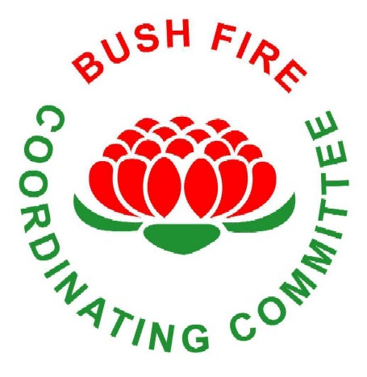

# NSW RFS Bush Fire Coordinating Committee (BFCC) Policy Register

> **Source**: NSW Rural Fire Service / Bush Fire Coordinating Committee
> **URL**: https://www.rfs.nsw.gov.au/__data/assets/pdf_file/0004/9526/Bush-Fire-Coordinating-Committee-BFCC-Policy-Register.PDF
> **Licence**: Crown copyright NSW; practitioner and public-information use
> **Retrieved**: 2026-05-07T13:40:09Z
> **SHA-256**: `e0cb8106f6c224e39ce6d43ccde4b744500fcc79231220c4e6d67b4469f56a40`
> *Converted from PDF to Markdown format.*

---
## Page 1

 
15 January 2021 
Doc18/42482 
Page 1 of 3 
BUSH FIRE COORDINATING COMMITTEE 
POLICY REGISTER 
 
Policy 
Number 
Subject 
Minute 
Number 
Date Adopted 
Date Issued 
1/2000 
Dispute Avoidance/Dispute Resolution – includes:  “Guidelines for Dispute Avoidance/Dispute 
Resolution” 
14/2000 
23 Mar 00 
10 Apr 00 
3/2000 
Coordinated Firefighting Operations Health and Safety 
25/2000 
23 Mar 00 
10 Apr 00 
3/2001 
Bush Fire Smoke Management 
57/2001 
18 Oct 01 
24 Oct 01 
6/2001 
Notified Steps for the Establishment and Maintenance of Planted Forests  
63/2001 
18 Oct 01 
31 Oct 01 
2/2003 
Ecologically Sustainable Development 
11/2003 
20 Feb 03 
04 Mar 03 
3/2003 
Safety Advisor – Standard Operating Procedure 
79/2003 
25 Sept 03 
03 Oct 03 
4/2003 
Communication 
100/2003 
20 Nov 03 
27 Nov 03 
1/2006 
Bush Fire Management Committees 
Decision 91.9  
26/2006 
17 Mar 20 
1 Jun 06 
17 Mar 20 
20 Jun 06 
2/2006 
Management of Bush Fire Operations (Amended) 
26/2006 
5/2014 
01 Jun 06 
24 Jul 14 
20 Jun 06 
04 Aug 14 
1/2007 
Section 44 Payment and Reimbursement Criteria and Payment Procedures (Amended) 
14/2007 
29 Mar 07 
03 Apr 07 
1/2008 
Bush Fire Risk Management (Amended by Policy 2/2012) 
Annex A – Model Bush Fire Risk Management Plan 
Annex B – Bush Fire Risk Management Planning Guidelines 
Annex I – Exhibition and Approval Process for Draft Bush Fire Risk Management Plans  
24/2008 
26 June 08 
30 Sep 08 
1/2011 
Allocation Principles for Funding of Bush Fire Mitigation Works 
4/2011 
10 Mar 11 
23 Mar 11 
1/2012 
Community Safety and Coordinated Evacuations 
13/2012 
26 Jul 12 
27 Aug 12 
2/2012 
Notified Step for the protection of Neighbourhood Safer Places 
(Incorporating amendments to Policy 1/2008) 
7/2011 
26 Sept 12 
10 Oct 12 
1/2017 
Fire Access & Fire Trails 
Fire Access & Fire Trails Model Plan (attached to policy) 
81.10 
83.10 
3 Aug 17 
15 Mar 18 
03 Apr 18 
03 Apr 18 
1/2018 
Aviation Support to Bush Firefighting 
83.12 
15 Mar 18 
03 Apr 18

---
## Page 2

 
15 January 2021 
Doc18/42482 
Page 2 of 3 
 
BUSH FIRE COORDINATING COMMITTEE 
REPEALED POLICIES 
Policy 
Number 
Subject 
Minute 
Number 
Date 
Adopted 
Date 
Issued 
Repealed 
Replaced 
with 
1/1998 
District Bush Fire Management Plan – Operations 
2nd Mtg 
30 Apr 98 
30 Apr 98 
04 Nov 04 
2/2004 
2/1998 
Bush Fire Risk Management Plan Part 1 – Framework 
5th Mtg 
03 Sep 98 
03 Sep 98 
30 Aug 07 
N/A 
2/1998 
Bush Fire Risk Management Plan Part 2 – Guidelines  
5th Mtg 
03 Sep 98 
03 Sep 98 
30 Aug 07 
N/A 
2/1998 
Bush Fire Risk Management Plan Part 3 – Model Plan 
5th Mtg 
03 Sep 98 
03 Sep 98 
30 Aug 07 
3/2007 
1/1999 
Management of Bush Fire Operations 
11/1999 
02 Jul 99 
22 Jul 99 
04 Nov 04 
2/2004 
2/1999 
Preparation of Bush Fire Risk Management Plans 
25/1999 
26 Aug 99 
14 Sep 99 
30 Aug 07 
3/2007 
2/1999 
Guidelines for the Public Exhibition of Plans 
25/1999 
16 Jun 99 
31 Jan 00 
30 Aug 07 
3/2007 
3/1999 
Bush Fire Risk Management Planning Principles 
25/1999 
26 Aug 99 
14 Sep 99 
30 Aug 07 
3/2007 
4/1999 
Bush Fire Management Committees  
N/A 
47/1999 
25 Feb 99 
16 Dec 99 
22 Oct 99 
05 Jan 00 
16 Dec 99 
01 Jun 06 
N/A 
1/2006 
2/2000 
Residential Evacuation 
24/2000 
23 Mar 00 
10 Apr 00 
26 Jul 12 
1/2012 
1/2001 
Guidelines for the Amalgamation of Bush Fire Management Committees 
12/2001 
15 Feb 01 
28 Feb 01 
19 Aug 04 
1/2004 
2/2001 
Fire Mitigation Works Funding Policy and Guidelines 
28/2001 
25 May 01 
04 Jul 01 
02 Jun 05 
3/2005 
4/2001 
Aviation Support to Firefighting 
59/2001 
18 Oct 01 
24 Oct 01 
30 Mar 05 
1/2005 
5/2001 
Section 44 Payment and Reimbursement Criteria and Payment 
Procedures 
58/2001 
18 Oct 01 
24 Oct 01 
29 Mar 07 
1/2007 
1/2003 
Fire Trails and Guidelines for the Classification of Fire Trails 
Guidelines for Fire Trail Signage 
Guidelines for the Depiction of Primary, Secondary and Dormant Fire 
Trails 
11/2003 
53/2003 
83/2003 
20 Feb 03 
17 Jul 03 
25 Sep 03 
04 Mar 03 
01 Aug 03 
03 Oct 03 
28 Jun 07 
2/2007 
1/2004 
Policy and Guidelines for the Amalgamation of Bush Fire Management 
Committees 
39/2004 
19 Aug 04 
006 Sept 04 
01 Jun 06 
1/2006 
2/2004 
Policy on the Management of Bush Fire Operations 
62/2004 
04 Nov 04 
17 Nov 04 
30 Mar 05 
2/2005

---
## Page 3

 
15 January 2021 
Doc18/42482 
Page 3 of 3 
Policy 
Number 
Subject 
Minute 
Number 
Date 
Adopted 
Date 
Issued 
Repealed 
Replaced 
with 
2/2005 
Management of Bush Fire Operations (including Model Operations 
Coordination Plan)  
15/05 
30 Mar 05 
18 May 05 
01 Jun 06 
2/2006 
3/2005 
Fire Mitigation Works Funding  
38/2005 
02 Jun 05 
08 Jun 05 
10 Mar 11 
1/2011 
2/2007 
Fire Trails 
26/2007 
13/2015 
28 Jun 07 
07 May 15 
01 Aug 07 
03 Aug 17 
1/2017 
3/2007 
Bush Fire Risk Management 
Annex A Bush Fire Risk Management - Model Risk Management Plan 
Annex B Bush Fire Risk Management – Guidelines 
Annex K Bush Fire Risk Management – Preparing an Annual Program of 
Works – Instructions for Bush Fire Management Committees 
Annex L Bush Fire Risk Management – Guidelines for Bush Fire Risk 
Management Works Reporting Program  
45/2007 
30 Aug 07 
10 Sep 07 
24 Jan 08 
24 Jan 08 
30 Sep 08 
1/2008 
1/2005 
Aviation Support to Bush Firefighting 
8/2005 
30 Mar 05 
18 May 05 
15 Mar 18 
1/2018

