# NSW RFS Bush Fire Management Committee (BFMC) Handbook (2024)

> **Source**: NSW Rural Fire Service / Bush Fire Coordinating Committee
> **URL**: https://www.rfs.nsw.gov.au/__data/assets/pdf_file/0009/268893/BFMC-Handbook-24.pdf
> **Licence**: Crown copyright NSW; practitioner and public-information use
> **Retrieved**: 2026-05-07T13:40:06Z
> **SHA-256**: `f00fc461cd54c33c847a4c16e6e6fdbbca8e71abec39dbe790b5dcc87e5cf3d6`
> *Converted from PDF to Markdown format.*

---
## Page 1

BUSH FIRE 
MANAGEMENT 
COMMITTEE 
HANDBOOK | 2024

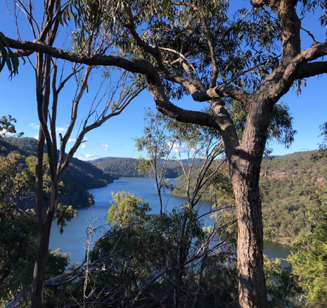

---
## Page 2

Acknowledgements
The BFCC acknowledges and pays respect to the Traditional Owners of the lands on which we work, and the lands we travel through. We also 
acknowledge our Elders – past, present and emerging.
This third edition of the Bush Fire Management Committee Handbook has been prepared for the NSW Bush Fire Coordinating Committee 
(BFCC) by a working group established by the Standing Advisory Subcommittee of the BFCC. 
The Working Group included representation from:
–	 NSW Aboriginal Land Council
–	 NSW Crown Lands
–	 Fire and Rescue NSW
–	 Forestry Corporation of NSW
–	 NSW National Parks and Wildlife Service
–	 NSW Rural Fire Service
Input was also provided by the Nature Conservation Council.
Limitations / Disclaimer
This Handbook contains information to assist in understanding the role and responsibilities of BFMCs operating in NSW. It does not contain 
information relating to bush fire management, fire behaviour, environmental considerations or the management practices or attitudes of 
particular organisations/agencies. For more information on these matters, refer to the information provided by member organisations/
agencies and the associated BFCC Policies. 
DISCLAIMER STATEMENT
While the material within this BFCC Brand Guidelines is current at the time of writing changes in circumstances after the time of publication may 
impact on the accuracy of the material. Individuals are responsible for ensuring they have the most current version of this publication.
The information and material contained herein is general in nature and is intended for your use and information. The NSW RURAL FIRE SERVICE 
(RFS) disclaims, to the extent permitted by law, all warranties, representations or endorsements, express or implied, with regard to the material 
contained herein. The RFS does not warrant or represent that the material contained herein is free from errors or omissions, or that it is 
exhaustive. Users should exercise their own skill and care with respect to its uses. You must not assume that this material will be suitable for 
the particular purpose that you had in mind when using it.
The RFS disclaims any liability (including but not limited to liability by reason of negligence) to the users of the material for any loss, damage, 
cost or expense whether direct, indirect, consequential or special, incurred by, or arising by reason of, any person using or relying on the 
material and whether caused by reason of, any error, omission or misrepresentation in the material or otherwise. Users of the Website will be 
responsible for making their own assessment of the material and should verify all relevant representations, statements and information with 
their own professional advisers.
© State of New South Wales through the NSW RURAL FIRE SERVICE 2024 on behalf of the Bush Fire Coordinating Committee. The NSW RURAL 
FIRE SERVICE encourages the availability, dissemination and exchange of public information. You may copy, distribute, display, download and 
otherwise freely deal with this material for personal, in-house or non-commercial use, on the condition that you include the copyright notice 
© State of New South Wales through the NSW RURAL FIRE SERVICE on all such uses. In the event that you wish to copy, distribute, display, 
download, store, or use this material for a purpose other than personal, in house or non-commercial use, you must obtain permission from the 
Bush Fire Coordinating Committee by writing to the following address:
Commissioner
NSW RURAL FIRE SERVICE
Locked Mall Bag 17 Granville NSW 2142

---
## Page 3

3
Commissioner's foreword
The catastrophic 2019/20 fire season challenged our 
established bush fire management and firefighting 
techniques, knowledge and experience like no other. It 
has since proven a catalyst for major reform, advances 
in resources and technology and the introduction of 
new approaches, policies and procedures. 
Much of this change has been driven by the 
recommendations of the NSW Bushfire Inquiry. 
This new edition of the Bush Fire Management 
Committee (BFMC) Handbook has been developed in 
response to recommendations of the Inquiry in relation 
to strengthening our cross-agency accountability and 
delivery and improving bush fire risk management 
outcomes, including through the work of the network of 
52 BFMCs across NSW.  
BFMCs are critical to the protection of life and property 
and to ensuring the effectiveness of our coordinated 
NSW firefighting arrangements.
Each committee brings together representatives of 
numerous government agencies, stakeholders and 
communities with expertise in bush fire mitigation, 
prevention and suppression, overlaid by in-depth 
local knowledge of their area’s fire history, weather 
conditions, topography and assets.
This joint experience is employed in the development of 
comprehensive suites of plans to identify local fire risks 
and mitigation measures to help protect life and assets:
	
> Bush Fire Risk Management Plans (BFRMP);
	
> Fire Access and Fire Trail Plans; and
	
> Plans of Operation.
A number of the reforms introduced since 2019/20 
are assisting the work of the BFMCs. The Next 
Generation BFRMPs now under development 
represent a great advance in risk planning, employing 
the latest technology and informed by additional 
community consultation processes. The RFS has 
recently published updated Fire Trail Standards and 
Committees now take a tenure-blind approach to bush 
fire hazard mitigation.
This third edition of the BFMC Handbook has now 
been developed to provide a reference resource to 
assist committees and their members in fulfilling 
their roles and responsibilities and implementing the 
changes flowing from the Inquiry. 
The publication has been compiled a collaborative 
working group of BFCC member agencies following 
a survey of BFMC members and Executive Officers. 
This group included representatives of the RFS, Fire 
and Rescue NSW, the National Parks and Wildlife 
Service, Forestry Corporation NSW, NSW Aboriginal 
Land Council and NSW Crown Lands, with the Nature 
Conservation Council also providing feedback. 
Thank you to all who contributed to this process and to 
the numerous BFMC members for your ongoing work 
and steadfast commitment to improving the safety of 
communities across NSW.
Rob Rogers
Chair
Bush Fire Co-ordinating Committee
BUSH FIRE MANAGEMENT COMMITTEE HANDBOOK

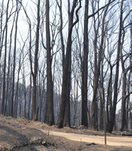

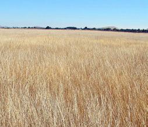

---
## Page 4

4
CONTENTS
	
Acknowledgements. .  .  .  .  .  .  .  .  .  .  .  .  .  .  .  .  .  .  .  .  .  .  .  .  .  .  . . . . . . . . . . . . . . . . . . . . . . . . . . . . 2
	
Limitations / Disclaimer . .  .  .  .  .  .  .  .  .  .  .  .  .  .  .  .  .  .  .  .  .  .  .  .  . . . . . . . . . . . . . . . . . . . . . . . . . . . 2
	
Commissioner's foreword. .  .  .  .  .  .  .  .  .  .  .  .  .  .  .  .  .  .  .  .  .  .  .  .  . . . . . . . . . . . . . . . . . . . . . . . . . . 3
PART 1	
BUSH FIRE MANAGEMENT COMMITTEE ROLES, RESPONSIBILITIES AND 
MEMBERSHIP	
7
	
1.	 The Bush Fire Coordinating Committee; Bush fire prevention and coordinated bush fire 
fighting arrangements in NSW. .  .  .  .  .  .  .  .  .  .  .  .  .  .  .  .  .  .  .  .  .  .  . . . . . . . . . . . . . . . . . . . . . . . . 7
	
1.1	
Bush Fire Management Committees. .  .  .  .  .  .  .  .  .  .  .  .  .  .  .  .  .  .  .  .  .  .  .  .  .  .  .  .  7
	
1.2	
Relationship between a BFMC and the BFCC .  .  .   .  .   .  .   .  .   .  .   .  .   .  .   .  .  .  .  .  .  .  .  . 8
	
2.	 Functions and responsibilities of a BFMC. .  .  .  .  .  .  .  .  .  .  .  .  .  .  .  .  .  . . . . . . . . . . . . . . . . . . . . 8
	
2.1	
Plan of Operations for coordinated fire fighting arrangements. .  .  .  .  .  .  .  .  .  .  .  .  .  .  .  8
	
2.2	
Bush Fire Risk Management Plan.  .  .   .  .   .  .   .  .   .  .   .  .   .  .   .  .   .  .   .  .  .  .  .  .  .  .  .  .  . 10
	
2.3	
Fire access and fire trail plans.  .  .   .  .   .  .   .  .   .  .   .  .   .  .   .  .   .  .   .  .   .  .  .  .  .  .  .  .  .  .  . 10
	
2.4	
Prioritise funding applications.  .  .   .  .   .  .   .  .   .  .   .  .   .  .   .  .   .  .   .  .   .  .  .  .  .  .  .  .  .  .  . 11
	
2.5	
Annual Report.  .  .   .  .   .  .   .  .   .  .   .  .   .  .   .  .   .  .   .  .   .  .   .  .   .  .   .  .  .  .  .  .  .  .  .  .  .  .  . 11
	
3.	 Recommendations to the RFS Commissioner . .  .  .  .  .  .  .  .  .  .  .  .  .  .  .  . . . . . . . . . . . . . . . . . 11
	
3.1	
Make recommendations regarding bush fire danger periods.  .  .   .  .   .  .   .  .   .  .   .  .  .  .  . 11
	
3.2	
The Fire Classification Group .  .  .   .  .   .  .   .  .   .  .   .  .   .  .   .  .   .  .   .  .   .  .  .  .  .  .  .  .  .  .  . 12
	
4.	 Work and Actions Out of Scope for BFMCs. .  .  .  .  .  .  .  .  .  .  .  .  .  .  .  .  . . . . . . . . . . . . . . . . . . . 12
	
4.1	
A BFMC cannot assess or give approval for hazard reduction work .  .  .   .  .   .  .   .  .  .  .  . 12
	
4.2	
A BFMC is not a fire fighting authority.  .  .   .  .   .  .   .  .   .  .   .  .   .  .   .  .   .  .   .  .  .  .  .  .  .  .  . 12
	
4.3	
A BFMC cannot propose, undertake, veto or direct hazard reduction works.  .  .   .  .   .  .  . 12
	
5.	 Membership. .  .  .  .  .  .  .  .  .  .  .  .  .  .  .  .  .  .  .  .  .  .  .  .  .  .  .  .  . . . . . . . . . . . . . . . . . . . . . . . . . . . . . . . 12
	
5.1	
Eligibility .  .  .   .  .   .  .   .  .   .  .   .  .   .  .   .  .   .  .   .  .   .  .   .  .   .  .   .  .   .  .  .  .  .  .  .  .  .  .  .  .  .  . 12
	
5.2	
Representation.  .  .   .  .   .  .   .  .   .  .   .  .   .  .   .  .   .  .   .  .   .  .   .  .   .  .   .  .  .  .  .  .  .  .  .  .  .  .  . 14
	
5.3	
Other organisations/agencies.  .  .   .  .   .  .   .  .   .  .   .  .   .  .   .  .   .  .   .  .   .  .  .  .  .  .  .  .  .  .  . 14
	
5.4	
Member responsibilities .  .  .   .  .   .  .   .  .   .  .   .  .   .  .   .  .   .  .   .  .   .  .   .  .  .  .  .  .  .  .  .  .  .  . 14
	
5.5	
Induction.  .  .   .  .   .  .   .  .   .  .   .  .   .  .   .  .   .  .   .  .   .  .   .  .   .  .   .  .   .  .  .  .  .  .  .  .  .  .  .  .  .  . 15
	
5.6	
Alternate Members.  .  .   .  .   .  .   .  .   .  .   .  .   .  .   .  .   .  .   .  .   .  .   .  .   .  .  .  .  .  .  .  .  .  .  .  .  . 16
	
5.7	
Changing members. .  .  .  .  .  .  .  .  .  .  .  .  .  .  .  .  .  .  .  .  .  .  .  .  .  .  .  .  .  .  .  .  .  .  .  .   16
	
5.8	
Removing members.  .  .   .  .   .  .   .  .   .  .   .  .   .  .   .  .   .  .   .  .   .  .   .  .   .  .  .  .  .  .  .  .  .  .  .  . 16
	
6.	 Chairperson. .  .  .  .  .  .  .  .  .  .  .  .  .  .  .  .  .  .  .  .  .  .  .  .  .  .  .  .  . . . . . . . . . . . . . . . . . . . . . . . . . . . . . . . 16
	
6.1	
Who is the Chairperson? . .  .  .  .  .  .  .  .  .  .  .  .  .  .  .  .  .  .  .  .  .  .  .  .  .  .  .  .  .  .  .  .  .   16
	
6.2	
Role and responsibilities.  .  .   .  .   .  .   .  .   .  .   .  .   .  .   .  .   .  .   .  .   .  .   .  .  .  .  .  .  .  .  .  .  .  . 17
	
6.3.	 Absence of Chairperson.  .  .   .  .   .  .   .  .   .  .   .  .   .  .   .  .   .  .   .  .   .  .   .  .  .  .  .  .  .  .  .  .  .  . 17
	
7.	 Executive Officer. .  .  .  .  .  .  .  .  .  .  .  .  .  .  .  .  .  .  .  .  .  .  .  .  .  .  . . . . . . . . . . . . . . . . . . . . . . . . . . . . . 17
	
7.1	
Role and responsibilities.  .  .   .  .   .  .   .  .   .  .   .  .   .  .   .  .   .  .   .  .   .  .   .  .  .  .  .  .  .  .  .  .  .  . 17
	
7.2	
Managing the workload. .  .  .  .  .  .  .  .  .  .  .  .  .  .  .  .  .  .  .  .  .  .  .  .  .  .  .  .  .  .  .  .  .  .   18
	
7.3	
Executive Officer limitations.  .  .   .  .   .  .   .  .   .  .   .  .   .  .   .  .   .  .   .  .   .  .  .  .  .  .  .  .  .  .  .  . 18
	
7.4	
Conducting business without the Executive Officer.  .  .   .  .   .  .   .  .   .  .   .  .   .  .  .  .  .  .  .  . 18
	
7.5	
Managing observers and guests . .  .  .  .  .  .  .  .  .  .  .  .  .  .  .  .  .  .  .  .  .  .  .  .  .  .  .  .  .   19
BUSH FIRE MANAGEMENT COMMITTEE HANDBOOK

---
## Page 5

5
PART 2	
BFMC governance and business processes	
20
	
8.	 Good governance. .  .  .  .  .  .  .  .  .  .  .  .  .  .  .  .  .  .  .  .  .  .  .  .  .  .  . . . . . . . . . . . . . . . . . . . . . . . . . . . . . 20
	
9.	 Meetings. .  .  .  .  .  .  .  .  .  .  .  .  .  .  .  .  .  .  .  .  .  .  .  .  .  .  .  .  .  .  . . . . . . . . . . . . . . . . . . . . . . . . . . . . . . . . 20
	
9.1	
Extraordinary meetings. .  .  .  .  .  .  .  .  .  .  .  .  .  .  .  .  .  .  .  .  .  .  .  .  .  .  .  .  .  .  .  .  .  .   20
	
9.2	
Quorum . .  .  .  .  .  .  .  .  .  .  .  .  .  .  .  .  .  .  .  .  .  .  .  .  .  .  .  .  .  .  .  .  .  .  .  .  .  .  .  .  .  .   20
	
9.3	
Conducting business out of session.  .  .   .  .   .  .   .  .   .  .   .  .   .  .   .  .   .  .   .  .  .  .  .  .  .  .  .  . 21
	
9.4	
Meeting agendas and standing Items.  .  .   .  .   .  .   .  .   .  .   .  .   .  .   .  .   .  .   .  .  .  .  .  .  .  .  . 21
	
9.5	
Meeting papers . .  .  .  .  .  .  .  .  .  .  .  .  .  .  .  .  .  .  .  .  .  .  .  .  .  .  .  .  .  .  .  .  .  .  .  .  .  .   21
	
9.6	
Acknowledgment of traditional owners. .  .  .  .  .  .  .  .  .  .  .  .  .  .  .  .  .  .  .  .  .  .  .  .  .  .   21
	
10.	 Decision-making by consensus. .  .  .  .  .  .  .  .  .  .  .  .  .  .  .  .  .  .  .  .  .  . . . . . . . . . . . . . . . . . . . . . . . 22
	
10.1	 Conflict resolution .  .  .   .  .   .  .   .  .   .  .   .  .   .  .   .  .   .  .   .  .   .  .   .  .   .  .  .  .  .  .  .  .  .  .  .  .  . 22
	
11.	 Disclosure of pecuniary interests and conflicts of interest. .  .  .  .  .  .  .  .  .  .  .  . . . . . . . . . . . . . 22
	
12.	 Subcommittees . .  .  .  .  .  .  .  .  .  .  .  .  .  .  .  .  .  .  .  .  .  .  .  .  .  .  .  . . . . . . . . . . . . . . . . . . . . . . . . . . . . . 23
	
13.	 Changes to the BFMC. .  .  .  .  .  .  .  .  .  .  .  .  .  .  .  .  .  .  .  .  .  .  .  .  . . . . . . . . . . . . . . . . . . . . . . . . . . . 23
	
13.1	 Changing the name of a BFMC .  .  .   .  .   .  .   .  .   .  .   .  .   .  .   .  .   .  .   .  .   .  .  .  .  .  .  .  .  .  . 23
	
13.2	 Amalgamation of BFMCs. .  .  .  .  .  .  .  .  .  .  .  .  .  .  .  .  .  .  .  .  .  .  .  .  .  .  .  .  .  .  .  .  .   23
	
14.	 Making and recording decisions. . . . . . . . . . . . . . . . . . . . . . . . . . . . . . . . . . . . . . . . . . . . 23
	
14.1	 Minutes.  .  .   .  .   .  .   .  .   .  .   .  .   .  .   .  .   .  .   .  .   .  .   .  .   .  .   .  .   .  .  .  .  .  .  .  .  .  .  .  .  .  .  . 23
	
15.	 BFMC records and files. .  .  .  .  .  .  .  .  .  .  .  .  .  .  .  .  .  .  .  .  .  .  .  .  . . . . . . . . . . . . . . . . . . . . . . . . . . 25
	
15.1	 Membership list and contact details.  .  .   .  .   .  .   .  .   .  .   .  .   .  .   .  .   .  .   .  .  .  .  .  .  .  .  .  . 25
	
16.	 Dealing with sensitive information. .  .  .  .  .  .  .  .  .  .  .  .  .  .  .  .  .  .  .  .  . . . . . . . . . . . . . . . . . . . . . . 25
	
16.1	 Open access to information and the Government Information (Public Access) Act 2009.  25
	
16.2	 Privacy and personal information .  .  .   .  .   .  .   .  .   .  .   .  .   .  .   .  .   .  .   .  .  .  .  .  .  .  .  .  .  . 25
	
17.	 Public visibility and image . .  .  .  .  .  .  .  .  .  .  .  .  .  .  .  .  .  .  .  .  .  .  .  . . . . . . . . . . . . . . . . . . . . . . . . . 26
	
18.	 Budget, finances and resources. .  .  .  .  .  .  .  .  .  .  .  .  .  .  .  .  .  .  .  .  .  . . . . . . . . . . . . . . . . . . . . . . . 26
	
19.	 Monitoring, evaluating and reporting on performance. .  .  .  .  .  .  .  .  .  .  .  .  . . . . . . . . . . . . . . . 26
	
19.1	 Annual performance evaluation.  .  .   .  .   .  .   .  .   .  .   .  .   .  .   .  .   .  .   .  .   .  .  .  .  .  .  .  .  .  . 26
	
19.2	 External evaluation of performance.  .  .   .  .   .  .   .  .   .  .   .  .   .  .   .  .   .  .   .  .  .  .  .  .  .  .  .  . 26
APPENDIX A NSW Bush Fire Management Committees	
29
APPENDIX B BFMC member organisation’s profiles	
31
APPENDIX C Templates	
35
APPENDIX D Good meeting practice	
56
APPENDIX E BFMC member engagement 	
57
APPENDIX F Subcommittees of the BFMC 	
58
APPENDIX G Legislation, policy and useful links 	
68
APPENDIX H Glossary	
70
APPENDIX I Abbreviations	
72
BUSH FIRE MANAGEMENT COMMITTEE HANDBOOK

---
## Page 6

This document has been developed to provide guidance and support for Bush Fire Management 
Committees. It aims to assist Bush Fire Management Committee members in understanding 
their responsibilities and provides them with the information required to establish a functional and 
successful Committee.   
Part 1 of the Handbook describes the Bush Fire Management Committee roles, responsibilities 
and membership.
Part 2 of the Handbook provides guidance on governance and business processes. 
This document should be read in conjunction with the Rural Fires Act 1997, the Rural Fires 
Regulation 2022, the BFMC Charter and Bush Fire Coordinating Committee Policy. 
If any further support is required please contact bfmcsupport@rfs.nsw.gov.au.
Any enquiries related to the BFCC should be directed to the RFS Committees 
and Projects Team via committees@rfs.nsw.gov.au.
BUSH FIRE MANAGEMENT COMMITTEE HANDBOOK

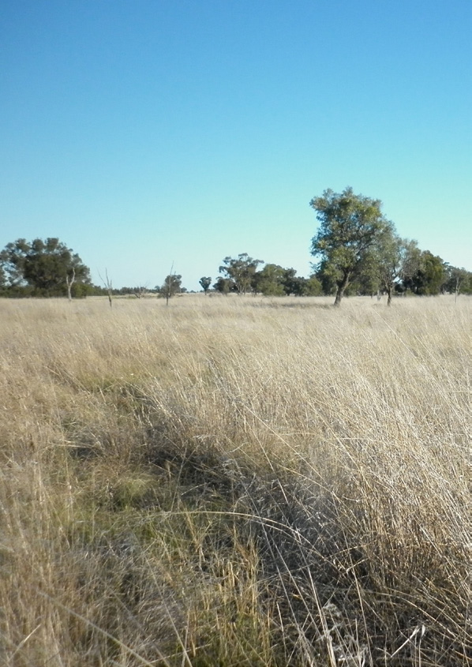

---
## Page 7

7
1.	 The Bush Fire Coordinating Committee; 
Bush fire prevention and coordinated 
bush fire fighting arrangements in NSW
The Bush Fire Coordinating Committee (BFCC) is a NSW 
statutory body representing the Crown, established under 
the provisions of the Rural Fires Act 1997 (the Act). 
The BFCC meets four times a year and provides a forum 
through which a broad cross-section of Government and 
non-Government organisations with an interest in bush 
fire prevention, mitigation and suppression can come 
together. The BFCC develops policies and procedures 
that provide for a coordinated approach to bush fire 
prevention and bush fire fighting operations. The BFCC 
constitutes the Bush Fire Management Committees 
(BFMC) in NSW and determines their requirements and 
operation through policy, direction and support. BFCC 
membership is identified in the Act (s47). 
The BFCC’s coordinated approach to bush fire 
management across agencies and tenures has 
enormous benefits for NSW. It facilitates improved 
efficiencies and ensures that all organisations involved 
work towards a common goal of better prepared and 
more effective bush fire management across NSW.
While the BFCC does not have a role in fire fighting 
operations, it does receive a debrief of major bush fire 
suppression operations to identify opportunities for 
improvement.
The BFCC has one permanent Standing Committee: 
the Standing Advisory Subcommittee (SAS). The 
SAS is responsible for investigating and making 
recommendations on issues referred by the BFCC or 
the Commissioner of the RFS. 
The SAS meet at least four times a year, ahead of each 
BFCC meeting.
Figure 1 illustrates the structure of coordinated bush fire 
arrangements in NSW.
1.1	 Bush Fire Management Committees
BFMCs are established under the provisions of the Act 
and the Rural Fires Regulation 2022 (the Regulation).
BFMCs are groups of people with technical expertise, 
experience and local knowledge who work together 
locally for bush fire management purposes, and who 
can collaboratively determine bush fire management 
arrangements.
A BFMC is constituted for every rural fire district and 
fire district in NSW with a reasonable risk of bush fire. 
BFMCs are generally based on Local Government 
boundaries and can include one or many Local 
Government areas. A BFMC area covers all tenures 
both private and public. Appendix A identifies the 
BFMCs currently established in NSW.
BFMC members are drawn from particular 
organisations and agencies, as specified in the 
Regulation (Section 5). 
Each member is there to discuss, coordinate and 
deliver bush fire management objectives for the 
local community, while also aiming to represent their 
organisation and achieve outcomes that are consistent 
with their organisation's objectives. 
BFMCs are subordinate to the BFCC and are subject to 
its directions. BFMCs are not council committees, nor are 
they RFS committees, they are responsible to the BFCC.
A BFMC may establish a subcommittee or number 
of subcommittees to assist them in undertaking their 
functions (Section 12).
BUSH FIRE MANAGEMENT COMMITTEE ROLES, 
RESPONSIBILITIES AND MEMBERSHIP
PART
1
BUSH FIRE MANAGEMENT COMMITTEE HANDBOOK

---
## Page 8

8
1.2	 Relationship between a BFMC 
and the BFCC 
1.2.1  Responsibilities of the BFCC to BFMCs
The BFCC:
	
> develops policy which guides the BFMCs on bush 
fire management issues, the preparation of plans and 
other required tasks;
	
> provides guidance and instruction to BFMCs; 
	
> contacts BFMCs when any decision affecting BFMC 
business is made by the BFCC, or when the BFCC 
becomes aware of any such change made by others;
	
> provides a forum for dispute resolution for BFMCs 
where local attempts to reach agreement have failed; 
and
	
> approves Plans of Operations, Bush Fire Risk 
Management Plans and Fire Access and Fire Trail 
Plans.
1.2.2	 Responsibilities of BFMCs to the BFCC
BFMCs will:
	
> operate in accordance with all policy, guidelines and 
instructions issued by the BFCC;
	
> prepare and submit draft plans to the BFCC as 
required by the Act;
	
> submit reports as required by BFCC and BFCC Policy;
	
> refer any items which have not reached consensus to 
the BFCC;
	
> refer issues and recommendations with wider policy 
implications to the BFCC where necessary (for 
example After Action Reviews);
	
> refer any matters considered relevant or likely 
to be of interest to BFCC for its information and 
consideration; and
	
> make available to the BFCC membership details, 
attendance and the minutes of BFMC meetings.
Time frames for the submission of draft Plans and 
reports as required by the Act and BFCC policies 
is identified in Appendix C "Bush Fire Management 
Committee Schedule.
2.	 Functions and Responsibilities 
of a BFMC
A BFMC has a number of responsibilities under the Act, 
the Regulation and BFCC policies. The key functions of 
the BFMC are illustrated in Figure 2. 
This Handbook and the BFMC Charter provide guidance 
to BFMC members on the function of the BFMC and 
their roles and responsibilities.
The Act (s52), requires each BFMC to prepare a draft 
Plan of Operations, a draft Bush Fire Risk Management 
Plan (BFRMP), and a draft Fire Access and Fire Trail 
Plan (FAFT Plan).  
In accordance with s51(2) of the Act, BFMCs are to 
have regard to the principles of ecologically sustainable 
development in carrying out any function that affects the 
environment. 
S62 of the Act requires a bush fire management plan to 
be published on the NSW Rural Fire Service website, or 
another NSW Government website as decided by the 
RFS Commissioner.
1
Figure 1. Structure of Coordinated Bush Fire Arrangements in NSW 
BUSH FIRE MANAGEMENT COMMITTEE HANDBOOK

---
## Page 9

9
Figure 2. The Key Functions and Responsibilities of a BFMC 
2.1	 Plan of Operations for Co-ordinated 
Fire Fighting Arrangements
A Plan of Operations is established under s52 of the 
Act. This plan outlines the arrangements for effective 
and efficient co-ordinated fire fighting practices across 
a BFMC area. 
It identifies Incident Management Team roles, key 
contacts and operational readiness arrangements for 
each Fire Danger Rating. It also contains information on 
any local agreements or Pre-Incident Plans in place.
Under the Act, a draft Plan of Operations must 
be submitted to the BFCC within 12 months of the 
establishment of a BFMC. A new draft plan must be 
submitted within each successive two year period 
following the constitution of the BFMC. Reviews and 
amendments can be made more frequently, if required.
The BFCC Policy for Management of Bush Fire 
Operations sets out the detailed requirements for the 
preparation of these plans.
Once a Plan of Operations has been approved by 
the BFCC, the BFMC must make regular reference 
to it to ensure that all relevant parties are meeting 
the arrangements and provisions it contains. Some 
provisions will only have force when a bush fire incident 
is running; others need to be monitored continuously. 
The Plan of Operations should be reviewed and updated 
where necessary, on a regular basis, irrespective of fire 
activity or lack thereof, so that non-compliance does not 
become evident only during a bush fire fighting operation.
2.1.1	
Maintain an Operations Coordination Manual
Each BFMC must maintain an Operations Coordination 
Manual. Requirements are detailed in the BFCC Policy 
for Management of Bush Fire Operations. 
2.1.2	 Prepare a Pre-season Checklist
Each BFMC must prepare a Pre-season Checklist every 
year. Requirements are detailed in the BFCC Policy for 
Management of Bush Fire Operations.
1
BUSH FIRE MANAGEMENT COMMITTEE HANDBOOK

---
## Page 10

10
2.1.3	 Operational Exercise
Each BFMC must undertake at least one scenario 
based operational exercise each year as per the BFCC 
Policy for Bush Fire Management Committees.   
2.2	 Bush Fire Risk Management Plan
A BFRMP is established under the Act (s52). A BFRMP 
is a document that maps and describes the level of bush 
fire risk across an area and sets out treatment strategies 
to minimise and mitigate the risk over a five year period. 
The BFRMP identifies residential, special fire protection 
purpose, economic, cultural and environmental assets 
at risk. It describes Focus Areas and a register of 
coordinated multi-agency treatments to reduce the risk 
of bush fire across a BFMC area. 
BFMCs hold local workshops to identify hazard 
reduction priorities for a five year planning horizon to 
mitigate the bush fire risk to assets for the BFMC area.
Treatment strategies may include fuel management, 
community preparedness, ignition prevention and 
response planning. BFMCs must consider the number 
and location of Neighbourhood Safer Places  (NSPs) 
within their area when preparing draft BFRMPs (s54). 
All NSPs require ongoing treatment by the applicable 
landowner to ensure the asset remains viable as a place 
of last resort for people during a bush fire.
Under the Act, a draft plan must be submitted to the 
BFCC within 12 months of the establishment of a BFMC. 
A new draft BFRMP must be submitted within each 
successive five year period following the constitution 
of the BFMC. Reviews and amendments can be made 
more frequently, if required including after a major fire. 
A BFRMP remains in force until replaced by another 
BFRMP approved by the BFCC.
Once the BFRMP is approved by the BFCC, the BFMC 
must monitor progress towards the completion of 
treatments listed in the BFRMP, and the timeliness of 
the works. The monitoring of compliance with the plan 
is carried out continuously through an Annual Works 
Plan (AWP) (2.2.2) and Annual Report (2.5).
The BFCC Policy for Bush Fire Risk Management and 
its annexures sets out the detailed requirements for the 
preparation of a BFRMP.
2.2.1	 Ignition Prevention Plan
Each BFMC must prepare an Ignition Prevention Plan 
(IPP) that identifies strategies to address the occurrence 
of deliberate bush fires within their area. 
The IPP is designed to escalate prevention measures 
as the potential for ignition and impact on community 
escalates (based on the Fire Danger Rating).
Ignition types for consideration in the IPP, include 
suspicious and landowner-initiated ignitions. 
IPPs must be reviewed annually and made available to 
the BFCC.
2.2.2 Annual Works Plan
In accordance with section 11 of the BFCC Policy for 
Bush Fire Risk Management, a BFMC must prepare an 
AWP for each financial year. The AWP should identify 
the priority treatments from the BFRMP that will be 
undertaken in the upcoming year. 
The preparation of the AWP provides an opportunity 
for BFMC members to collaborate, using a tenure blind 
approach, and determine the most appropriate suite of 
treatments for their BFMC area and community each year.
In accordance with s74 of the Act, progress against the 
AWP must be reported at each BFMC meeting using the 
template provided. Monitoring progress against planned 
treatments allows a BFMC to self-audit its progress 
towards making the community and assets safer from 
bush fire and completing all the treatments in the 
BFRMP.
Any treatments identified in an AWP that are not 
completed, must be carried over to the AWP for the 
following year.
2.2.3 Neighbourhood Safer Places
A Neighbourhood Safer Place (NSP) is defined by 
section 62C of the Rural Fires Act 1997 as “land or a 
building designated as a neighbourhood safer place”. 
NSPs provide a place of last resort for people during 
a bush fire. All designated NSP locations for NSW are 
available at www.rfs.nsw.gov.au. 
BFMCs are required to consider the number and 
location of Neighbourhood Safer Places (NSPs) within 
their area. 
All NSPs require ongoing treatment by the applicable 
land owner to ensure that the asset remains viable 
as a place of last resort for people during a bush fire. 
Therefore, all NSPs within the BFMC area are required 
to be treated and have been included in the Fuel 
Management Register.
1
BUSH FIRE MANAGEMENT COMMITTEE HANDBOOK

---
## Page 11

11
2.3	 Fire Access and Fire Trail Plans
A FAFT Plan is prepared under the Act s52(3) and 
54A. A FAFT Plan provides for the identification, 
maintenance, certification and registration of fire trails 
for the purposes to prevent, fight, manage or contain 
bush fires.  The FAFT planning process considers a 
wide range of factors that review the adequacy of the 
access system for fire fighting to provide access for the 
protection of life and assets in the area.
The BFCC Policy for Fire Trails and the RFS Fire 
Trail Standards sets out the requirements for the 
preparations of these plans.
A FAFT Plan shall:
	
> be prepared in accordance with the Guideline for the 
Preparation of FAFT Plans;
	
> be prepared tenure blind;
	
> be prepared having regard to the relevant Bush Fire 
Risk Management Plan and Plan of Operations; 
	
> be prepared in accordance with the BFCC Policy and 
associated Guidelines;
	
> include all identified trails that form the identified fire 
trail network; and
	
> be prepared and submitted in accordance with the Act.
A draft plan must be prepared and submitted within the 
period notified by the BFCC following the establishment 
of each BFMC.
A new draft plan must be submitted to the BFCC within 
each successive five year period. The BFMC should 
aim to formally review their FAFT Plan so that it is 
always current. A FAFT Plan remains in force until 
replaced by another FAFT Plan approved by the BFCC.
Reviews and amendments can be made more 
frequently, if required including after all major fires. 
The BFCC Policy for Fire Trails and the RFS Fire Trail 
Standards sets out the detailed requirements for the 
preparation of these plans.
Once the FAFT Plan is approved by the BFCC, the 
BFMC must make regular reference to it to ensure that 
all relevant parties are meeting the arrangements and 
provisions it contains. The monitoring of compliance 
with the FAFT Plan needs to be carried out continuously. 
The BFMC needs to monitor and report progress 
towards the completion of fire trail projects listed 
in the FAFT Plan, and timeliness of the works. The 
BFMC needs to be aware of any delay in completion 
of works, and to recommend amendments to the 
planned programs to compensate.
2.3.1	 Fire Trail Treatment Register
FAFT Plans need to include a Treatment Register, 
which sets out a schedule for when works will be 
undertaken on identified priority trails.
As per the FAFT Policy, the Treatment Register must 
be submitted to the RFS Commissioner as part of the 
FAFT Plan.
2.4	 Prioritise funding applications
All land managers, public and private, are obliged under 
the Act (s63) to undertake certain actions to prevent the 
occurrence and minimise the spread of bush fires. Each 
public land manager is expected to commit its own 
resources to meet these obligations. 
However, there is funding available through the RFS 
to assist public land managers to carry out additional 
works to those supported by their internal budgets.
Under BFCC Policy, one of the key principles 
underpinning the allocation of bush fire mitigation funding 
in NSW is that advice on local priorities is sought from 
BFMCs. Whilst local priorities will typically be informed by 
the AWP, BFRMPs and FAFT Plans, the BFMCs may be 
requested to prioritise funding applications for their area.  
This information is then used to assist in the allocation 
of funding across both the BFMC area and the State to 
ensure that the greatest protection to assets at risk from 
bush fire is delivered throughout NSW.
BFCC Policy, Allocation Principles for Funding of Bush 
Fire Mitigation Works, provides detail regarding the 
funding arrangements. 
2.5	 Annual Report
As required by the Act (s51) and defined in the BFCC 
Policy for Bush Fire Management Committees, a BFMC 
must report each financial year to the BFCC on:
	
> BFMC meetings held;
	
> attendance of member agencies at meetings;
	
> the status and implementation progress of the BFMC 
Plan of Operations, BFRMP (via the AWP) and 
FAFT Plan (in accordance with the BFCC Policy and 
associated Guidelines);
	
> operational exercises undertaken; and
	
> any other matters that may be requested by the BFCC. 
The Annual Report must be made available to the BFCC 
by 1 August each year.
1
BUSH FIRE MANAGEMENT COMMITTEE HANDBOOK

---
## Page 12

12
1
3.	 Recommendations to the 
RFS Commissioner 
As outlined in Section 1.2, a BFMC can make 
recommendations to the BFCC on matters relating 
to bush fire prevention, mitigation and response. In 
addition, a BFMC can also make recommendations to 
the RFS Commissioner for bush fire danger periods and 
fire classification in its area. 
3.1	 Make recommendations regarding bush 
fire danger periods
The RFS Commissioner may vary the bush fire danger 
period for an area from that prescribed by the Act 
(s81-83), on their own initiative or on the 
recommendation of the BFMC.
BFMCs are required to formally consider whether it 
is appropriate to vary their bush fire danger period 
annually. Any recommendation from the BFMC should 
be provided to the RFS Commissioner in writing, and 
must detail the reasons for the variation requested. The 
RFS Commissioner may also decide to vary the period 
on their own initiative, but must first consult with and 
take into account any recommendations made by the 
BFMC.
3.2	 The Fire Classification Group
The Fire Classification Group consists of the BFMC 
members who represent fire fighting agencies/
authorities.
The group has a very specific role in facilitating the 
coordinated management of fires involving more than 
one fire fighting authority.
The Fire Classification Group has the following roles:
	
> make recommendations to the RFS Commissioner 
in accordance with BFCC Policy Management of 
Bush Fire Operations and as specified in the Plan of 
Operations; and 
	
> be consulted regarding any recommendation for a 
declaration in accordance with the Act (s44) with 
consideration given to a potential Incident Controller 
and Deputy Incident Controllers.
Refer to BFCC Policy, Management of Bush 
Fire Operations, for further detail regarding fire 
classification arrangements. 
4.	 Work and Actions Out of Scope 
for BFMCs
The BFMC is not a legal entity, it is neither a fire fighting 
authority nor an environmental approval authority. 
Therefore, there are a range of things it cannot do, 
which are outlined below.
4.1	 A BFMC does not assess or give approval 
for hazard reduction work
A BFMC is not an approval authority. Any environmental 
and other necessary assessments and approvals must 
be sought from the relevant approval authorities, by the 
organisation concerned.
A BFMC has no authority to prevent a land owner/ 
manager or other person carrying out work on land. 
While a BFMC may advise that works are inappropriate 
for bush fire hazard reasons or not required for bush fire 
management purposes, it has no authority to prevent 
the works.
4.2	 A BFMC is not a fire fighting authority
The BFMC has no authority to direct fire fighting 
agencies or rural fire brigades in any manner. A BFMC 
must not conduct or take part in fire fighting or fire 
prevention operations (Regulation s16).
4.3	 A BFMC does not propose, undertake, 
veto or direct hazard reduction works
The proponent for hazard reduction works or other 
physical work should be the owner of the land, or the 
organisation intending to carry out the work. Although 
BFMCs do not propose works, they will and should 
identify and discuss works through a tenure blind 
process within the BFRMP and FAFT Plan context.
A BFMC has no power to undertake works. If members 
of the BFMC undertake work, they do it under the 
auspices of their organisation. A BFMC cannot veto, 
direct or force land owners / managers or any other 
person to undertake or cease works. Further the BFMC 
cannot enter into any contract.
BUSH FIRE MANAGEMENT COMMITTEE HANDBOOK

---
## Page 13

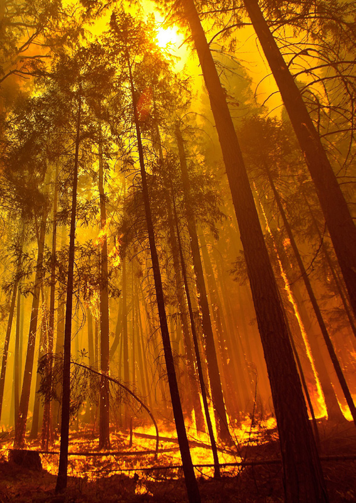

---
## Page 14

14
5.	 Membership
5.1	 Eligibility
Membership of a BFMC is set by the Regulation (s15), 
which specifies that, unless the BFCC determines 
otherwise, the listed agencies are to be invited to become 
members of a BFMC. Appendix B provides background 
information regarding each eligible organisation.
Where any of the listed organisations/agencies exist 
within a BFMCs area they must be invited to nominate a 
member of the BFMC. If the BFCC makes any variation 
to membership under the Regulation, the BFMCs 
concerned will be advised in writing. 
Invitations to eligible organisations and agencies are 
issued by the BFMC on behalf of the BFCC. Every 
effort should be made to contact the organisations/
agencies listed.
There is no obligation for any person or organisation 
invited to be a member of a BFMC to accept that 
invitation, although full participation is strongly 
encouraged by the BFCC. 
Organisations and agencies can choose who they will 
provide as a member of a BFMC, within the scope 
provided by the legislation.
Their decision as to whether or not they want to provide 
a member, must be recorded in the minutes of the 
BFMC meeting following the issue of the invitation.
5.2	 Representation
In choosing BFMC members and alternates, 
organisations and agencies need to ensure that the 
person satisfies the eligibility requirement of the 
Regulation. They should also give consideration to 
which person has the experience and knowledge to 
contribute to discussion. 
The representative needs to be able and confident to 
make decisions on behalf of their organisation.
Local authorities need to ensure that their nominated 
member has responsibility for the performance of the 
local authority’s functions respecting the environment or 
bush fire management. Ideally, the nominated member 
should be responsible for implementing those activities 
as identified in a BFRMP and FAFT Plan.
5.3	 Other organisations/agencies
The Regulation (s15) provides for additional members 
to be drawn from other organisations and agencies, 
which exist in a BFMCs area, subject to the approval 
of the BFCC.
If a BFMC wishes to add members other than those 
specifically provided for by the Regulation, it must 
seek the approval of the BFCC. The request must be 
made in writing to the BFCC, explaining the reasons 
for requesting the additional member.
The types of organisations/agencies that are to 
be considered under this provision include those 
with a significant land management or fire fighting 
responsibility within the BFMCs area or Aboriginal 
groups who have an interest in Country but who are 
not land managers or firefighting agencies.
In determining whether to allow any additional member, 
the BFCC will consider whether the addition is 
appropriate or if the need could be satisfied in some 
other manner (such as the person attending meetings 
as an observer).
5.4	 Member responsibilities
A BFMC member has a number of responsibilities 
which need to be met to assist the BFMC in exercising 
its functions. The key responsibilities of a member are 
outlined in Sections 5.4.1 to 5.4.7.
5.4.1	 Represent an organisation’s interests on 
the BFMC and participate in discussion and 
decision-making.
Members must ensure they understand their own 
organisation’s role, responsibilities and policies on bush 
fire management issues. 
It is a member’s responsibility to ensure that the BFMC 
understands the roles and responsibilities of their 
organisation in terms of bush fire management activities.
Members should endeavour to express the full range of 
opinions and needs of their organisation, including the risk 
of adopting or not adopting particular courses of action.
As specified in the BFMC Charter, a BFMC is required 
to conduct its business based on consensus decision- 
making. 
Members should ensure they:
	
> participate and communicate constructively to 
achieve consensus on all issues;
	
> help develop and use mechanisms that encourage 
resolution of issues;
	
> work together inclusively and cooperatively; and
	
> negotiate with other members to resolve conflicting 
issues and make balanced decisions.
Members of the BFMC have been selected from their 
organisation so that the BFMC has a broad range of 
expertise available to it.
1
BUSH FIRE MANAGEMENT COMMITTEE HANDBOOK

---
## Page 15

15
Members should decide what appears to be the best 
outcome for the community, and then consider how their 
organisation might contribute to achieving that outcome.
Members need to inform and educate themselves about 
the business of the BFMC. All members should strive for 
the effectiveness of the BFMC and be willing to provide 
explanations and suggestions. A BFMC is made up of a 
variety of people working together as a team. It should 
not be a meeting of organisation representatives with 
adversarial or narrow-minded attitudes.
5.4.2	 Provide advice, information and reports
Members must make available to the BFMC all data 
and information they are aware of which is relevant 
to the BFMCs work, except privileged ‘commercial in 
confidence’ information.
Members must provide regular reports to the BFMC on 
the activities of their organisation with regard to the Plan 
of Operations, BFRMP, FAFT Plan, hazard reduction, 
fire fighting and any other relevant activities. 
Member reports must be provided in a BFCC approved 
template or system in advance to BFMC meetings.  
5.4.3	 Report back to their organisation
Members need to keep their organisation informed of 
the decisions of the BFMC. Members should report 
back to their organisation to inform and seek opinion 
on BFMC activities. Without this feedback and two-way 
communication, the effectiveness of the BFMC is limited.
5.4.4	 Contribute to the work of the BFMC
Each BFMC has an Executive Officer (XO) and a 
Chairperson to facilitate the meetings. However, all 
members of the BFMC are equal, and have equal 
responsibilities. All members are responsible for 
undertaking the responsibilities of the BFMC. 
If the BFMC fails to do something it is required to do, the 
failure falls on all members. 
Members need to take an interest in ensuring that the 
work of the BFMC is carried out in a timely fashion, 
even if their organisation has a limited involvement in a 
particular task.
Members are not expected to do all the work personally 
– for example, the XO is responsible for producing the 
minutes, but they may have an administrative assistant 
or RFS delegate attend the meeting with them, take 
notes and draft minutes for them to check.
All members of the BFMC are equally responsible for 
the carriage and discharge of the BFMC’s obligations. 
Members are not there just to update others on what 
their own organisation has done.
5.4.5	 Attend meetings
Attendance of meetings by all members is critical to 
ensure BFMCs can exercise their functions.
Members must attend meetings regularly and on time. 
Members should advise the XO if they cannot make the 
meeting and send an alternate in their place if possible. 
Only unavoidable absences are acceptable. Sending 
an alternate should not become a standard practice. 
(Section 5.6 of this handbook.)
Non-attendance puts the BFMC at risk of being without 
a quorum. All members count towards the calculation 
of the quorum. If members are not intending to turn up 
regularly, or have other commitments that seriously limit 
their involvement, they should not be a member. Instead, 
they should find someone else from their organisation 
who can attend and contribute. Alternatively, if an 
organisation’s interest is only on isolated issues, they 
should advise the BFMC that they do not wish to provide 
a member, but ask to have an observer attend meetings 
when such issues arise.
The BFMC must provide a record of attendance for every 
BFMC meeting and make that information available to 
the BFCC (BFMC Annual Report).  
Appendix E provides further information that may be 
useful in engaging BFMC members.
5.4.6	 Prepare for meetings
Members must prepare adequately for each meeting. All 
members must carefully read the minutes of the previous 
meeting, the agenda and any papers that are circulated. 
Any queries or business arising should be identified, and 
preferably notified to the XO in advance, so that they can 
be included on the agenda for the meeting, if necessary. 
Members must check any actions that they are 
responsible for and be ready to report to the BFMC on 
progress made. 
This includes risk treatments and other activities 
identified in the BFRMP, FAFT Plan, Plan of Operations 
and the AWP.
Members should prepare a report of their risk treatment 
activities in a BFCC-approved system and ensure it is 
made available to the XO prior to the BFMC meeting. 
1
BUSH FIRE MANAGEMENT COMMITTEE HANDBOOK

---
## Page 16

16
5.4.7	 Contribute to development of plans and 
other tasks as required
All members are expected to participate in the 
preparation of plans, other documents and projects. 
All members should be given the opportunity to 
participate in BFMC tasks and projects. Subcommittees 
may be established for specific BFMC tasks (Section 
12), however all members should have the opportunity 
to join a subcommittee.
5.5	 Induction
All members, when joining a BFMC, must be given 
a briefing on their role on the BFMC by their own 
organisation. BFMC member organisations should employ 
a mentoring approach to assist new BFMC members.  
Members must also be provided with an introduction to 
the BFMC by the XO, including an explanation of:
	
> the purpose and functions of the BFMC;
	
> the BFMCs area of responsibility;
	
> the structure of the BFMC (i.e. the members and 
the organisations/agencies they represent; any 
subcommittees and working groups and their 
composition and functions).
	
> protocols relating to the management and 
administration of the BFMC;
	
> any current planning, plans and activities of the 
BFMC; and
	
> the legislative framework within which the BFMC 
operates.
They must also be provided with either copies (or links 
to the locations) of the following documents:
	
> The BFMC Charter and the BFMC Handbook;
	
> Any current plans and any draft plans currently in 
preparation;
	
> The last set of meeting minutes; and
	
> A list of all current BFMC members and their contact 
details.
An induction training package is in development to 
assist XOs in managing BFMC business and members 
understanding their role. 
5.6	 Alternate Members
Where required, a BFMC member may send an 
alternate to attend a BFMC meeting. The alternate 
has the same voting rights and responsibilities as the 
member. It is recommended that all member agencies 
pre-identify an alternate member. 
Having a regular alternate will assist in sharing the work 
load and ensure continuity of organisation attendance.
Alternate member representatives need to be provided 
to the XO in writing prior to the first meeting of the 
calendar year. At any time when an alternate is required 
to attend a meeting, the nominated member should 
advise the XO in writing.
It is up to the member to tell their alternate what 
they may or may not commit to on behalf of their 
organisation. An alternate needs to ensure that they 
understand the role of the BFMC and the implications 
of its deliberations and decisions. Alternate members 
need to be able to speak and undertake commitments 
on behalf of their organisation.
Sending an alternate must not become a standard 
practice. Although attendance of an alternate member in 
an observer capacity is encouraged. It is up to the member 
to ensure their alternate receives appropriate induction.
5.7	 Changing members
The organisation must advise the BFMC as soon as 
possible of any change to its representation. Changes 
to representation must be provided in writing to the XO. 
Member organisations should ensure the 
correspondence is sent by someone with appropriate 
authorisation and delegations. The XO must arrange for 
the recording and updating of membership information.
Further to this, every eligible organisation who does 
not have current member representation should be 
given the opportunity to nominate a member at the 
commencement of each calendar year.
5.8	  Removing members
If a member is failing to adequately participate in BFMC 
business, the BFMC Chairperson should attempt to 
resolve the situation with the individual concerned, their 
organisation, within the BFMC and as a last resort the 
BFCC. An attitude aimed at encouraging appropriate 
participation should be maintained.
The BFCC may give a direction to an organisation to 
provide a substitute representative if problems cannot 
be satisfactorily resolved.
Where all attempts in getting a member to attend BFMC 
meetings are unsuccessful, the BFMC can pass a 
motion to remove the member. However, this can only 
occur following written advice to the member, their 
organisation and the BFCC. 
In addition, it must be demonstrated that the non-
attendance of the member is impacting the ability of a 
BFMC to perform its functions.
1
BUSH FIRE MANAGEMENT COMMITTEE HANDBOOK

---
## Page 17

17
6.	 Chairperson
6.1	 Who is the Chairperson?
The members of the BFMC elect a Chairperson 
annually.  The BFMC may also choose to elect a 
Deputy Chairperson at this time. The Chairperson is 
a member of the BFMC, but cannot be the XO or a 
member referred to in section 15(2) (a) (ii), (b) or (c) of 
the Regulation. As such, the following BFMC members 
are eligible for the Chairperson role:
	
> The Mayor, Councillor or senior representative of 
the Council;
	
> Nature Conservation Council of NSW;
	
> One of the NSW Rural Fire Brigade 
representatives; 
	
> NSW Farmers Association;
	
> Local Aboriginal Land Council; and
	
> A member approved by the BFCC under section 
15(h) of the Regulation.
The Chairperson holds office, subject to any rules made 
by the BFCC, for a period of 12 months. A Chairperson 
is eligible for re-election for subsequent terms and no 
gap is necessary.
6.2	 Role and responsibilities
The Chairperson role is in addition to and separate from 
their responsibilities as a member. The Chairperson 
presides at BFMC meetings and signs correspondence. 
Under the directive of the Chairperson, the XO can sign 
certain correspondence as agreed to by the BFMC. 
The Chairperson must sign all correspondence to the 
BFCC. In addition, the Chairperson must also:
	
> ensure the BFMC carries out its statutory 
responsibilities and any directions from the BFCC.  
While the BFMC is collectively responsible for 
meeting its objectives, the Chairperson must guide 
and, where necessary, direct the Committee so 
that it remains focussed on set tasks and maintains 
momentum in performing its business;
	
> determine the agenda for each meeting of the BFMC, 
noting that the XO will assist with this task;
	
> ensure BFMC meetings are held in a timely manner 
and that required documents and reports are 
submitted by due dates;
	
> provide leadership to the BFMC in its deliberations 
and facilitate consensus outcomes;
	
> establish and foster a cooperative working 
relationship within the BFMC;
	
> approve the attendance of guests and observers at 
the BFMC meeting; and
	
> ensure meetings are effective, giving everyone a 
fair and equal chance to be heard and participate 
in the deliberations of the BFMC. The Chairperson 
needs to manage the discussions to ensure that 
everyone’s view is heard and understood, and no 
one feels excluded.
6.3.	 Absence of Chairperson
If the Chairperson or previously elected Deputy is absent, 
members present at a meeting of the BFMC must elect 
one of the members present to chair that meeting.
When the election of an Acting Chairperson is 
necessary, the members who are not eligible to be 
Chairperson, should not act in the position. The XO 
should never chair the meeting.
7.	 Executive Officer
The XO is a member of the RFS or Fire and Rescue 
NSW (FRNSW), as specified by the Regulation (s19).
7.1	
Role and responsibilities
The XO of a BFMC is also a member of the BFMC. 
The role is in addition to and separate from their 
responsibilities as member. 
The XO is essentially a Secretary and the focus of 
the role is to assist the Chairperson and the BFMC to 
be effective and meet their obligations. To carry out 
this role, the XO will need to be very familiar with the 
business of the Committee.
The XO needs to have a good understanding of the 
legislative framework, policies and procedures that 
impact on a BFMC.
The XO must:
	
> prepare agendas, minutes and BFMC 
correspondence;
	
> distribute reports and relevant information;
	
> monitor compliance with legislation, policies and 
plans and advise the Chairperson;
	
> compile reports and business papers;
	
> book, prepare and arrange meetings;
	
> collate apologies;
	
> maintain and manage BFMC files and records;
	
> maintain membership records, contact details and 
record attendance;
	
> distribute BFMC correspondence;
	
> liaise with adjoining BFMC XOs and NSW RFS 
Area Command;
	
> distribute copies of correspondence from the 
BFCC as soon as it is received;
1
BUSH FIRE MANAGEMENT COMMITTEE HANDBOOK

---
## Page 18

18
	
> provide induction material for new members;
	
> undertake additional tasks as identified in BFCC Policy. 
Appendix C provides templates that will assist the XO to 
manage the business of the BFMC.
7.1.1	
Assist Chairperson
The XO assists the Chairperson to carry out their role. 
The XO should consult with the Chairperson prior to 
each meeting and discuss:
	
> the matters listed on the agenda;
	
> other matters which the XO is aware that are likely to 
arise during the meeting; and
	
> who should be called on to inform / brief the BFMC 
on matters during the meeting.
7.1.2	 Assist BFMC
It is the XO’s responsibility to know about the issues, 
actions, reports and plans for which the BFMC is 
responsible. The XO needs to advise the BFMC what 
it needs to achieve throughout the year and suggest 
timetables to ensure the BFMC’s responsibilities are met. 
It is helpful for the BFMC if the XO can make it very 
clear what the BFMC needs to achieve at each meeting. 
The agenda should highlight current issues, tasks 
required and due dates to ensure that people turn up 
ready to complete the business of the day. 
The XO needs to be able to answer queries on BFMC 
business. The material contained in this Handbook 
should assist with most inquiries, however the XO should 
seek further advice from the BFCC where required.
The XO needs to pass on all information to BFMC 
members. It is not the XO’s role to decide what does 
and does not get passed on in full to BFMC members. 
The XO is an administrative assistant rather than a filter 
or gate-keeper for the BFMC.
7.2	 Managing the workload
An XO must remember to separate the work required of 
them as XO, and what is expected of them as a BFMC 
member as they are not one and the same.
It is essential that all XOs strive to ensure that they work 
within the role set by the BFCC and described in BFCC 
Policy. Other BFMC members must respect and adhere 
to the aspects of the XO position.
While the XO is responsible for a number of tasks, they 
do not necessarily have to do everything themselves. 
XOs can use the resources they have available from 
their own organisation and can also ask other BFMC 
members to assist with tasks. 
7.3	 Executive Officer limitations
There is no additional status or standing attached to the 
position of XO in terms of rights to speak or vote at the 
BFMC. The XO is also a member of the BFMC and in 
that capacity has the same speaking and voting rights 
as any other member.
The XO does not “own” or “run” the BFMC, and care 
needs to be taken to ensure that this perception does 
not develop. The XO does not have the right to speak 
on behalf of the BFMC. The Chairperson speaks on 
behalf of the BFMC, when required.
BFMC correspondence is signed by the Chairperson 
and not the XO. The exception is where the BFMC has 
instructed the XO to do something in particular, for 
example sending out correspondence. 
The correspondence must be exactly as per the BFMC 
instruction.
An XO should not make a practice of doing things 
without BFMC meeting endorsement, unless to do 
something absolutely urgent that cannot wait. This does 
not include something that should have been done at a 
meeting but was forgotten.
Where the BFMC has to report on its activities, this 
means the BFMC needs to report, not the XO. The 
XO must not prepare and submit reports ‘on behalf 
of’ the BFMC. The XO’s job is to prepare the report 
or submission based on information provided by the 
BFMC. If an organisation’s input is expected or required, 
but is not provided, this may be noted in the draft report 
or submission. 
It is essential that all members are involved in the 
review and reporting cycle so that they are aware of 
BFMC successes and shortcomings, and can self-audit 
to ensure that they are not the cause of any delays. An 
XO must not attempt to hide failures by preparing the 
report themselves and submitting it without full review.
7.4	 Conducting business without the 
Executive Officer
There is no provision for the XO role to be delegated or 
transferred to any other person. 
An XO may make arrangements to assist them in their 
role and can ask other BFMC members and resources 
within their own organisation to  to assist with managing 
workload (Section 7.2 of this Handbook), but this must 
not be confused with delegation. 
Further, it is important to note that in accordance with 
the Act (s34 and s35), a person acting as the Fire 
Control Officer, including the Deputy Fire Control Officer 
in the absence of the Fire Control Officer, in a rural fire 
district may exercise all the functions of the position. 
1
BUSH FIRE MANAGEMENT COMMITTEE HANDBOOK

---
## Page 19

This includes performing the XO role for the BFMC. 
Similarly, for fire districts, a person acting in the position 
of Zone Commander as directed by the Fire and Rescue 
NSW Commissioner can also assume the XO role.
A BFMC meeting may go ahead even if the XO is absent. 
While this is undesirable in terms of managing the 
paperwork, the presence of the XO is not essential for 
the meeting to proceed. If the XO cannot attend, those 
present need to choose someone to take notes and draft 
minutes, to pass on to the XO for completion.
Although the XO may send a delegate for them as a 
member, their delegate does not take on the XO function.
7.5	 Managing observers and guests
An observer is any person who attends a meeting but 
is not a member of the BFMC. With approval from the 
Chairperson, an observer or guest may be invited by 
the BFMC to attend for any number of reasons such as 
contributing or making a presentation on a particular 
subject, or for administrative reasons such as recording 
the minutes.
An observer or guest should:
	
> attend only with the BFMCs concurrence (which 
can be either prearranged or granted at the start 
of a meeting). The BFMC may decide that certain 
observers may be in attendance only while the matter 
relevant to them is being considered;
	
> make presentations or comment only at the request 
of a member and/or the invitation of the Chairperson. 
Observers must not propose or vote on motions;
	
> not intrude on the BFMCs deliberations or decision-
making processes; and
	
> observe all confidentialities and operating protocols 
of the BFMC, as well as any other conditions of 
attendance specified by the BFMC.
The record of attendance in the minutes should clearly 
distinguish between members and observers. There is a 
tendency for additional organisation personnel to attend 
meetings in an observer capacity as they are directly 
involved in their organisational responsibilities. 
However, over time regular observers tend to merge with 
the representatives and actively participate in BFMC 
decision-making. This scenario should be managed 
by clearly documenting the status of attendees at each 
BFMC meeting.

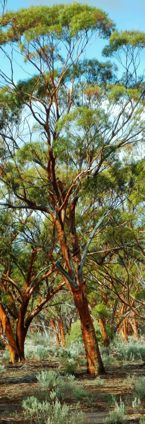

---
## Page 20

20
BFMC GOVERNANCE AND BUSINESS 
PROCESSES
PART
2
8.	 Good Governance
It is the responsibility of all members to ensure that the 
BFMC carries out the activities outlined in the BFMC 
Charter to ensure compliance with its responsibilities 
under the Act. The function of good governance in the 
public sector is to ensure that entities act in the public 
interest at all times. 
Acting in the public interest requires:
	
> strong commitment to integrity, ethical values, and 
the rule of law; and
	
> openness and comprehensive stakeholder 
engagement.
The nature of cross representation in the BFMC 
promotes good governance. Members should conduct 
themselves in accordance with their own organisation’s 
code of conduct and ethics.
This BFMC Handbook and associated BFCC Policy 
provide the basis for an effective BFMC. Appendix 
D provides additional guidance for BFMCs on good 
meeting practice.
9.	 Meetings
Most BFMC business is conducted within meetings. 
Meetings may be in person or online. The frequency 
of meetings needs to be sufficient to deal with 
BFMC business, and to meet statutory requirements, 
objectives and other obligations.
At least two meetings must be held each year. The need 
for more meetings may vary between BFMCs. When 
determining the frequency of meetings, the BFMC will 
need to consider the actions and timeframes necessary 
for the achievement of its objectives and tasks each year.
To facilitate an efficient and effective working 
environment, a calendar of BFMC meetings should be 
prepared and distributed prior to the start of each year.
Having determined the frequency of meetings, it 
is preferable to forecast the meeting dates for the 
upcoming 12 month period and ensure the schedule is 
made available to all BFMC members (Appendix C).
To maximise opportunities for member attendance, 
consideration should be given to the days and times of 
meetings (Appendix E). The XO should also consider the 
schedule of adjacent BFMCs that have shared members. 
Members must be given adequate notice of any 
changes to meetings dates.
9.1	 Extraordinary meetings
Where there is a pressing need, any member with the 
support of two other members can request in writing 
that the Chairperson call an extraordinary meeting.
The Chairperson can call an extraordinary meeting 
at any time. The Chairperson must then convene a 
meeting within 15 days.
9.2	 Quorum
A quorum is the minimum number of people required 
to be present in order for a meeting to proceed.
The quorum for a meeting of the BFMC is half of its 
members (rounded up to the nearest whole number). 
That is, at least half of the current members must be 
in attendance for a meeting to go ahead.
Processes for the management of membership 
and alternates are an important tool to assist in 
determining if a quorum is present.
If all members in attendance wish to proceed with a 
meeting without a quorum, all decisions will need to be 
ratified through the out of session process.
It is acceptable for members to participate online, and 
their presence is to be counted into the quorum.
The BFMC should be cautious regarding the business 
to be transacted at meetings where some members will 
be absent. 
BUSH FIRE MANAGEMENT COMMITTEE HANDBOOK

---
## Page 21

21
The principle to remember is that the Committee is 
there as a forum to ensure all views are heard and 
considered when bush fire management decisions are 
made. It goes against this principle to allocate business 
to meetings on the basis of which members will and will 
not be attending.
The BFCC strongly discourages action, which leads to 
rescission motions as this would indicate that the BFMC 
is not functioning in the spirit of cooperation.
If the number of members making apologies prior 
to a scheduled meeting leaves the BFMC unable to 
form a quorum, the meeting should be deferred and 
members advised accordingly. Early advice is essential, 
particularly where members have to travel considerable 
distances for the meeting. A revised date for the 
meeting should be arranged as soon as possible.
9.3	 Conducting business out of session
There will be times when matters must be dealt with and 
no quorum is present or key stakeholders are absent 
from the meeting. At these times, the members present 
may proceed to discuss the matter, with records of 
their discussion later circulated to the other members 
for comment out of session. If no unresolved objections 
are found, the XO may collate the responses to form 
the decision of the BFMC, applying the quorum rule to 
the number of responses required. The outcome for the 
matter should be tabled at the BFMC’s next meeting. If 
objections arise that cannot be resolved out of session, 
the matter should be deferred until the next meeting. 
An urgent meeting may need to be called in some 
circumstances.
The BFMC may transact any of its business at a 
meeting at which some or all members participate 
online, or other means, but only if any member who 
speaks on a matter during the meeting can be heard by 
the other members.
The BFMC may transact any of its business without a 
formal meeting if required, by the circulation of papers/ 
motions among all the members. Papers may be 
circulated among the members by email, post or any 
other agreed means.
9.4	 Meeting agendas and standing Items
The agenda is the plan for the meeting. It is a list of 
matters the BFMC is to deal with and provides the order 
in which they will be addressed. The more carefully the 
agenda is compiled, the more constructive the meeting 
is likely to be. 
An agenda template is included in Appendix C, 
which includes some recommended standing items. 
Agendas are prepared by the XO and approved by 
the Chairperson. Any member can request items be 
included on the agenda.
9.5	 Meeting papers
Members should be provided with as much information 
as possible about issues to be discussed, prior to the 
meeting. This enables them to understand the issues 
and to establish their organisation’s position prior to the 
meeting, minimising the need for issues to be deferred 
to subsequent meetings. It also allows them time to 
absorb and consider the issues, enhancing efficiency 
and effective decision-making.
In addition to the agenda and copies of correspondence, 
it is preferable to provide a business paper containing 
a short overview on items requiring decision. Business 
papers are prepared by members, collated by the CO 
and approved by the Chairperson.
Agenda and business papers should be circulated at 
least seven days prior to the meeting.
When a member is required to provide a report to the 
BFMC it should be provided in a written form or BFCC 
approved system. It may be only a dot point brief, which 
the member elaborates on during the meeting.
9.6	 Acknowledgment of Traditional Owners
In line with the NSW Public Service Commission 
website Delivering an Acknowledgement of Country, 
it is appropriate for an Acknowledgement of Country 
to occur at the opening of each BFMC meeting. 
Where there is a member of the Aboriginal community 
present at the meeting, they should be given an 
opportunity to deliver the Acknowledgement of Country 
to the BFMC. Should this offer be declined, the 
Chairperson or a nominated person should offer the 
Acknowledgement of Country.
An example of a statement of Acknowledgement of 
Country is:
"I acknowledge (Traditional Custodians name) on the 
lands that we are meeting today. I pay my respects to 
Elders past, present and emerging and celebrate the 
diversity of Aboriginal peoples and their ongoing cultures 
and connections to the lands and waters of NSW. I also 
acknowledge and pay my respects to our Aboriginal and 
Torres Strait Islander people joining us today."
2
BUSH FIRE MANAGEMENT COMMITTEE HANDBOOK

---
## Page 22

22
10.	Decision Making by Consensus
BFMCs must ensure that all decisions are made by 
consensus. Consensus is a decision that is ‘consented’ 
to by all the members of the BFMC. ‘Consent’ does not 
imply that everyone must be completely satisfied with the 
outcome. Reaching decision by consensus means that 
all the members contribute to the degree that suits them 
and they all understand and accept the decision and are 
prepared to support it. As such, there may be different 
levels of consensus reached at the BFMC:
	
> Everyone enthusiastically supports the decision;
	
> Everyone is satisfied with the decision;
	
> Everyone can live with the decision; or
	
> Not everyone agrees with the decision but will accept 
the outcome and not object to it.
Where consent is given with reservations, contrary 
views should be recorded in the minutes.
Should the BFMC be unable to reach consensus and 
the issue requires resolution, advice can be sought from 
external persons such as a subject matter expert or 
BFMC support staff from the RFS.
If consensus still cannot be reached, the issue must 
be referred to the BFCC for advice and determination. 
When writing to the BFCC, the BFMC Chairperson 
must document the discussion and clearly highlight the 
differences of opinion.
Consensus decision-making requires the BFMC to fully 
consider the issues and views of all the members to 
develop a resolution, which is acceptable to the group. It 
also assists the BFMC to:
	
> explore, understand and respect a diverse range 
of views (including limitations) leading to practical 
solutions;
	
> be well-informed and make quality decisions; and
	
> identify common elements on which actions can be 
planned and decisions based.
The advantage of decision-making by consensus is 
that the all of the BFMC ‘owns the decision’. Some 
of the key principles that underpin decision-making 
by consensus include:
	
> members develop and agree on theBFMC’s 
decision-making process;
	
> issues being considered are outcome-driven and 
relevant to all interests represented on the BFMC;
	
> members with an interest in the issue being 
considered are aware of or involved in the process;
	
> members who formally participate in or provide 
information for the process do so voluntarily;
	
> the BFMC's decisions are consistent with its basic 
values, principles, objectives and targets;
	
> the process is flexible and adaptable to changing 
needs;
	
> members have equal access to relevant information 
and the opportunity to participate effectively 
throughout the process;
	
> members acknowledge and accept each other’s 
value, interests and knowledge;
	
> the process identifies realistic timeframes; and
	
> the process includes a commitment to 
implementation and monitoring.
10.1	 Conflict resolution
There may be occasions when one member’s opinion 
will differ significantly from other members of the BFMC. 
There may be times when discussions become heated 
and positions or actions are not agreed upon. 
Some general skills in conflict resolution can be 
invaluable in these situations. The BFCC Policy for 
Dispute Avoidance / Dispute Resolution provides 
guidance on conflict resolution and how to avoid conflict. 
It advises that conflicts should be resolved, wherever 
possible, at the location and as close to the time of 
the original disagreement as possible. This allows for 
difficulties to be overcome and relationships within the 
BFMC to be maintained wherever possible.
Issues that cannot be resolved at the BFMC 
should be referred to the BFCC for advice and 
possible determination.
11.	 Disclosure of Pecuniary Interests and 
Conflicts of Interest
Members need to be aware of the potential for conflicts 
between their role on the BFMC and their other 
interests. Pecuniary interests are particularly important.
If a member has a direct or indirect pecuniary interest in 
a matter being considered by the BFMC, and the interest 
appears to raise a conflict with the proper performance of 
the member’s duties in relation to the matter, the member 
must, as soon as possible after becoming aware of it, 
disclose the nature of the interest to the BFMC.
A disclosure to the BFMC that the member:
a.	is a member, or is in the employment, of a specified 
company or other body; or
b.	is a partner, or is in the employment, of a specified 
person; or
c.	as some other specified interest relating to a specified 
company or other body or to a specified person,
is a sufficient disclosure of the nature of the interest in 
any matter relating to that company or other body or to 
that person. No further details are required or can be 
demanded of the member.
2
BUSH FIRE MANAGEMENT COMMITTEE HANDBOOK

---
## Page 23

23
Details of any disclosure made must be recorded in the 
minutes of the meeting. After a member has disclosed 
the nature of an interest in any matter, the member must 
not be present during any deliberation or decision with 
respect to the matter, unless the BFMC determines 
otherwise. In some cases, the member may still be able 
to fully participate.
Conflicts of interest must be a standing Agenda Item 
and need to be declared as the beginning of each 
BFMC meeting.
12.	Subcommittees
Due to the size and complexity of some tasks 
particularly the preparation of plans, it may be 
necessary for BFMCs to establish subcommittees to 
assist them in undertaking their functions.
The BFMC may not delegate any of its functions to a 
subcommittee. All recommendations by Subcommittees 
must be referred to the BFMC for decision. Care must 
be taken to ensure that subcommittees do not subsume 
the role of the BFMC itself. Subcommittees may 
investigate issues and develop draft plans or programs 
but all decision-making must be referred to the BFMC.
The subcommittee must only consist of either members 
of the BFMC or organisation representatives that have 
been nominated by their BFMC member.
Each subcommittee must have a Convenor who is 
responsible for coordinating the work of the group. 
The subcommittee may seek input from people or 
organisations/agencies who are not part of the group.
The procedures for calling meetings of a subcommittee 
and for the conduct of those meetings are to be 
determined by the BFMC. A subcommittee may 
determine these procedures where a direction has been 
issued from the BFMC.
At  least one BFMC member should be on the 
subcommittee to ensure objectives are being met and  
the work remains in scope. 
Appendix F provides further information and supporting 
documentation for subcommittees.
13.	Changes to the BFMC
13.1	 Changing the name of a BFMC
The BFCC has the authority to change a BFMC name. 
A BFMC may request a name change by writing to 
the BFCC, explaining the reasons for the requested 
change. This will need to be supported by the BFMC 
and minutes demonstrating endorsement will need to 
accompany the request.
13.2	Amalgamation of BFMCs
BFMCs may only be amalgamated, split or otherwise 
altered with the approval of the BFCC. A request for 
amalgamation or alteration can be made in writing 
to the BFCC, explaining the reasons for the change 
requested, in accordance with the BFCC Policy for 
Bush Fire Management Committees.
 When writing to the BFCC, the BFMC should provide 
any supporting information including a copy of the 
minutes showing the decision and confirming the 
attending members reached a quorum.
Amalgamations and establishment of new BFMCs may 
also be carried out by the BFCC as a result of external 
factors (e.g. changes to Local Government boundaries).
14.	Making and Recording Decisions
It is important to ensure that everyone is clear on 
the precise nature of the decisions they are making. 
Decisions should be affirmed and recorded in sufficient 
detail to stand alone. Anyone should be able to tell, from 
the minutes, what decisions were made at a meeting. As 
a guide to whether the minutes are clear enough, anyone 
reading them should understand exactly what was 
resolved and be able to explain the actions to be taken.
14.1	 Minutes
The minutes of a meeting are the official record of 
decisions made and progress on activities. They 
are a tool to assist the BFMC in working towards its 
objectives and a record of the actions to be taken.
A template for meeting minutes is included in Appendix 
C of this Handbook.
Formal minutes must be taken for all BFMC meetings.
In the case of subcommittees, the decision as to 
whether formal minutes or summary notes are used will 
depend on the group, the convenor and its purpose. 
In either case, the record of the meeting must be 
presented in a form that is easily used as a working 
document. 
It must at least, indicate the issue discussed and the 
decision taken including who has the responsibility for 
action.
The minutes do not need to be a verbatim record of who 
said what. However, they need to document important 
points that underpin the decisions made.
As the decision by consensus method is used in 
BFMCs, it is not usually necessary to record the mover 
and seconder details unless specifically requested.
2
BUSH FIRE MANAGEMENT COMMITTEE HANDBOOK

---
## Page 24

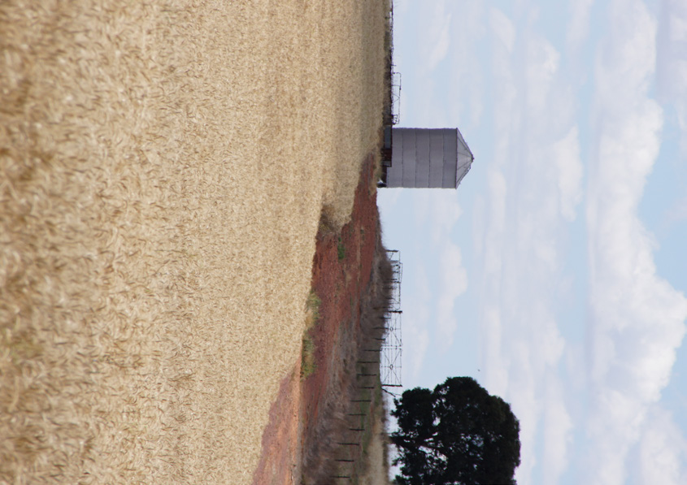

---
## Page 25

25
The decision can simply be recorded as “The Committee 
resolved to …” or “The Committee agreed to…”
The discussions that led to the decisions are rarely 
needed except when it may be useful to know the nature 
of reasoning behind a particular decision. In this case, it is 
still only necessary to record the discussion in point form.
Decisions (or resolutions) should be given an identifying 
number to facilitate their monitoring to completion. 
The numbering system to be used is year/ sequential 
decision number (24/1, 24/2…. 25/1 etc.).
The decision numbers restart at 1 each year.
Draft minutes should be prepared and distributed as 
soon as possible after the meeting. This allows members 
to review the minutes whilst the meeting is fresh in their 
minds and allows them to advise the XO of any changes 
required. It also reminds them of the actions they are 
expected to undertake before the next meeting. 
Waiting until the next meeting to issue the minutes 
is unacceptable.
A meeting minutes template is included in Appendix C.
15.	BFMC Records and Files
Records and Files must be maintained for each 
BFMC using an online BFCC approved system that is 
accessible by all BFMC members and BFCC members. 
This includes agendas, minutes (draft and adopted), 
papers, reports, tabled documents, correspondence in 
and out (including emails) and current Plans.
BFMC files are not available for perusal by persons 
other than BFMC members (that is, other organisation 
staff, BFMC observers, the public etc.) without the 
express approval of the BFMC or in accordance with a 
request under Government Information (Public Access) 
Act 2009.
15.1	 Membership list and contact details
It is necessary for the running of the BFMC to record the 
names and contact details of BFMC members. These 
details will be made available to the BFCC, organisation 
staff assisting the BFCC (at present, the RFS), and BFMC 
members through an online BFCC approved system.
Additionally, organisations and agencies will have 
access to details of all BFMC members from their own 
organisation. Those with access to the information 
will be instructed that the data must only be used for 
conducting BFMC business.
16.	Dealing with sensitive information
All proceedings in the BFMC are confidential until the 
BFMC has agreed otherwise, where the provider of the 
information advises that it is publicly available and no 
restrictions apply to its release or under the provisions 
of Government Information (Public Access) Act 2009.
At times, BFMCs will discuss issues, which may be 
sensitive or controversial. Information provided and 
subsequent discussions must be treated with the utmost 
confidentiality and must be kept within the confines of 
the BFMC. 
A member’s discussions within their own organisation 
regarding meeting proceedings should be limited to 
those with specific responsibilities pertinent to the 
business of the BFMC.
In some circumstances (e.g. discussions on Persons 
of Interest for arson), relevant agencies may seek to 
convene out of session to talk over a sensitive issue 
in detail and report back to the BFMC as appropriate. 
BFMC members must respect the confidentiality of their 
deliberations and any privileged information with which 
they may be provided.
16.1	 Open access to information and the 
Government Information (Public Access) 
Act 2009
BFMCs are bound by The Government Information 
(Public Access) Act 2009 (GIPAA) which provides rights 
to information that are designed to meet community 
expectations of more open and transparent government. 
It encourages the routine and proactive release of 
government information, including information held 
by the providers of goods and services contracted by 
government agencies.
16.2	Privacy and personal information
BFMCs are bound by the Privacy and Personal 
Information Protection Act 1998 (PPIPA) regarding 
the collection, management and release of personal 
information. For the purposes of the PPIPA, the BFCC 
(and consequently its subsidiary BFMCs) is taken to be 
a public sector organisation. 
The PPIPA requires that a public sector organisation must 
not collect personal information about people unless:
	
> the information is collected for a lawful purpose 
that is directly related to a function or activity of the 
organisation; and
	
> the collection of the information is reasonably 
necessary for that purpose.
There are specific requirements for the handling and 
access to any personal information that has been 
collected. Refer to the PIPPA for more information.
2
BUSH FIRE MANAGEMENT COMMITTEE HANDBOOK

---
## Page 26

26
17.	 Public Visibility and Image
BFMCs usually have a very limited public profile; 
usually organisations/agencies do their own media. 
However, there may be times when it is appropriate for 
the Chairperson on behalf of a BFMC to issue media 
releases or comment. These must be approved and 
signed by the Chairperson, not the XO. RFS Media 
are able to assist the Chairperson and will consult with 
media units within other agencies.
Members need to ensure that the message is clearly 
delivered as from the BFMC, not the organisation to which 
the Chairperson belongs. Media releases or comments 
issued by a BFMC must not be inconsistent with BFCC 
Policy. Assistance and advice can be sought from the 
BFCC Secretariat who will source appropriate advice..
The BFMC may wish to consider having an open public 
forum or targeted engagement sessions, during periods 
of public exhibition of BFRMPs or following public 
concerns regarding fire management issues within the 
area. These types of community engagement activities 
may be particularly worthwhile for matters that are 
relevant to multi-agency risk management planning or 
operations.
18.	Budget, Finances and Resources
BFMCs are not legal entities in a financial sense. That 
is, they cannot expend or receive monies. A BFMC 
cannot conduct works, or engage contractors to conduct 
works. It has no budget nor financial responsibility.
Members must provide finances for the hire of meeting 
rooms, provision of refreshments or meals, document 
production, photocopying and the like. In practice, the 
basic administrative costs are often carried by the 
organisation providing the XO, or the local council.
The BFMC needs to discuss this issue and come to 
agreement on who will bear what costs.
BFMC members should share access to resources 
necessary to carry out the BFMC’s work, such as 
printers, and meeting rooms.
19.	Monitoring, Evaluating and Reporting on 
Performance
The RFS Commissioner may conduct a performance 
audit of the implementation of bush fire risk 
management plans in accordance with s62A of the Act.
19.1	 Annual performance evaluation
BFMCs need to undertake an internal review of 
their performance on an annual basis. The BFMC 
should check that they have met all their functional 
requirements. 
During such audits, it is advisable for the BFMC to 
nominate an audit leader, usually the XO.
19.2	External evaluation of performance
BFMCs may be required to participate in an external 
audit. The external audit will include compliance with 
reporting and activities as specified in the bush fire 
management plans, and review the attendance, record 
keeping and business process of the BFMC.
2
BUSH FIRE MANAGEMENT COMMITTEE HANDBOOK

---
## Page 27

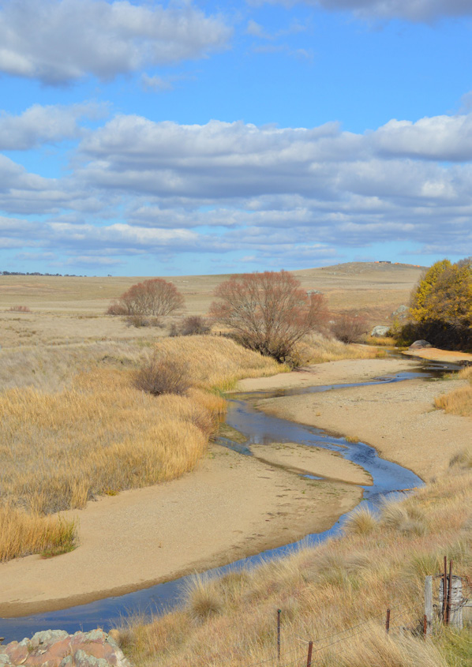

---
## Page 28

28
APPENDIX A - NSW BUSH FIRE MANAGEMENT COMMITTEES . .  .  .  .  .  .  .  .  .  . . . . . . . . .  29
APPENDIX B - BFMC MEMBER ORGANISATION PROFILES  . .  .  .  .  .  .  .  .  .  .  .  . . . . . . . . . . . . 31 
APPENDIX C - BFMC TEMPLATES . .  .  .  .  .  .  .  .  .  .  .  .  .  .  .  .  .  .  .  .  .  .  . . . . . . . . . . . . . . . . . . . . . . . . . 36 
APPENDIX D - GOOD MEETING PRACTICE . .  .  .  .  .  .  .  .  .  .  .  .  .  .  .  .  .  .  . . . . . . . . . . . . . . . . . . . . . 56 
APPENDIX E - BFMC MEMBER ENGAGEMENT . .  .  .  .  .  .  .  .  .  .  .  .  .  .  .  .  .  . . . . . . . . . . . . . . . . . . 57 
APPENDIX F - SUBCOMMITTEES OF THE BFMC . .  .  .  .  .  .  .  .  .  .  .  .  .  .  .  . . . . . . . . . . . . . . . . . . 58 
APPENDIX G - LEGISLATION, POLICY AND USEFUL LINKS . .  .  .  .  .  .  .  .  .  .  .  . . . . . . . . . . . . . 68 
APPENDIX H - GLOSSARY . .  .  .  .  .  .  .  .  .  .  .  .  .  .  .  .  .  .  .  .  .  .  .  .  .  .  .  . . . . . . . . . . . . . . . . . . . . . . . . . . . 70 
APPENDIX I - ABBREVIATIONS. .  .  .  .  .  .  .  .  .  .  .  .  .  .  .  .  .  .  .  .  .  .  .  .  .  . . . . . . . . . . . . . . . . . . . . . . . . . . 72
APPENDICES
BUSH FIRE MANAGEMENT COMMITTEE HANDBOOK

---
## Page 29

29
NSW BUSH FIRE MANAGEMENT COMMITTEES
APPENDIX
A
This map is current as of February 2024.
BUSH FIRE MANAGEMENT COMMITTEE HANDBOOK

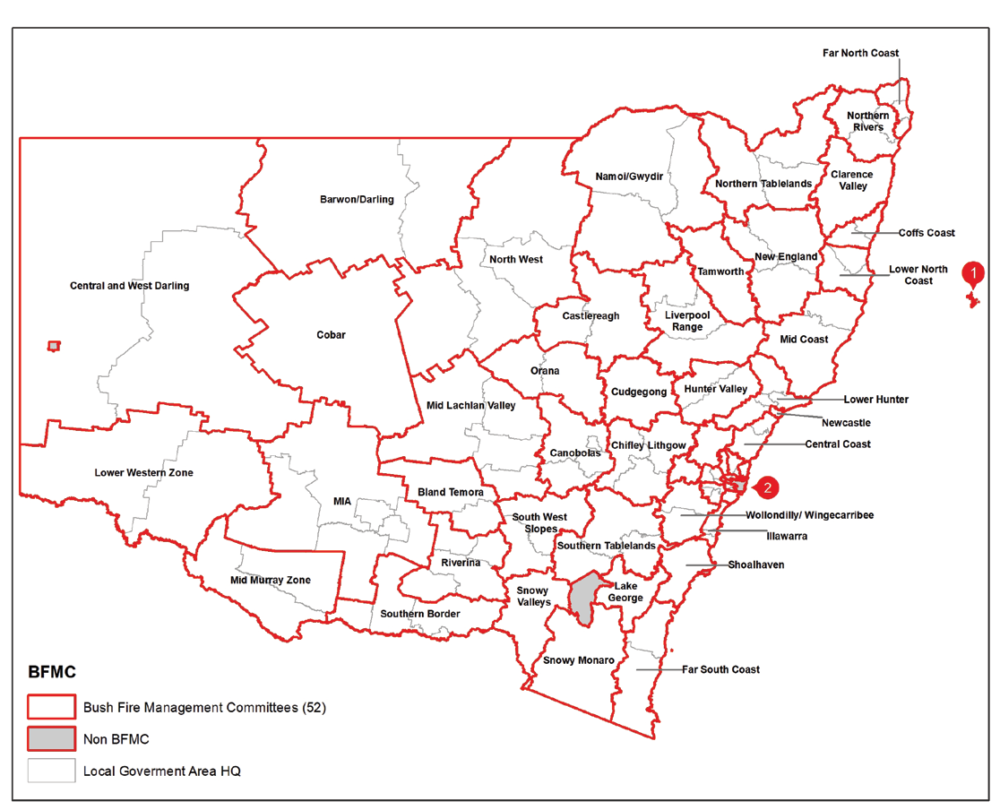

---
## Page 30

30
BUSH FIRE MANAGEMENT COMMITTEE HANDBOOK

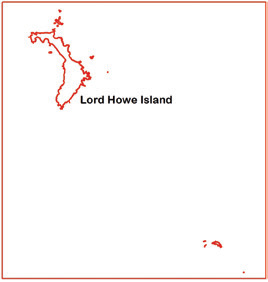

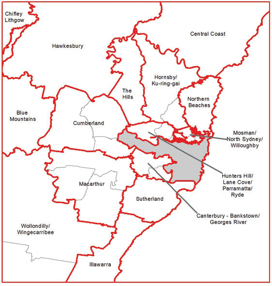

---
## Page 31

31
BFMC MEMBER ORGANISATION’S PROFILES
APPENDIX
NSW Rural Fire Service
The NSW Rural Fire Service (NSW RFS) was 
established on 1st September 1997, by the Rural Fires 
Act 1997. It is the successor of an organisation that has 
been around for 100 years - known as the NSW Bush 
Fire Brigades.
While the RFS does not own any land, it is responsible 
for fire suppression and prevention activities in over 
95% of NSW.
The RFS plays a key role in managing bushfire 
hazards across the State, and also provides advice to 
landowners, developers and councils about bushfire 
protection measures required for new and existing 
developments.
https://www.rfs.nsw.gov.au/
Local Authority / Councils
Councils operate under the framework of the Local 
Government Act 1993. It is important to note that 
Councils, as managers of land and built assets, also 
have statutory responsibilities under a range of other 
Acts and regulations, such as obligations regarding the 
maintenance of biodiversity and preservation of cultural 
and heritage values. These other obligations are often 
critical considerations when planning and implementing 
bush fire risk management work.
Councils provide a wide array of assets, services and 
advice to their communities and as a result of their 
comprehensive roles, are able to provide a significant 
amount of data that can be utilised by a BFMC. 
Further, Councils often need to manage an array of 
competing issues when implementing bush fire risk 
management works. Wherever possible, Councils 
will try to facilitate delivery of identified works for the 
protection of the community.
https://www.lgnsw.org.au/
Lord Howe Island Board
The functions of the Lord Howe Island Board are to 
undertake the care, control and management of the Island 
and trading affairs on the Island including: protection and 
conservation of fisheries, flora and fauna; water supply, 
sewerage, drainage; public health; roads and public 
facilities generally; tourist trade; and dealings in leases 
etc. The management of bush fire impacts on the Island 
also falls within the responsibilities of the Board.
https://www.lhib.nsw.gov.au
Forestry Corporation of NSW
Forestry Corporation of NSW (FCNSW) is a Public 
Trading Enterprise responsible for sustainably 
managing more than 2 million hectares of public native 
forests and an expanding estate of hardwood and 
softwood planted forests.
Its goal is to manage the forests under its care to 
provide the widest range of benefits to the present 
and future generations of people in NSW. FCNSW 
is also a ‘fire fighting authority’ which has a statutory 
role in assisting other fire fighting authorities in the 
management of bush fires.
https://www.forestrycorporation.com.au/
Fire and Rescue NSW
Fire and Rescue NSW (FRNSW) is the NSW 
government organisation responsible for managing fire 
emergencies in the major cities, metropolitan areas and 
some towns across rural and regional NSW. It is also 
responsible for protecting the State from hazardous 
material incidents and by extension of this capability, 
the consequences of terrorism. It has 3,546 permanent 
and 3,212 on-call firefighters, with approximately 4,660 
community fire unit members and 515 Administrative 
and trade staff. 
https://www.fire.nsw.gov.au/
The membership of a Bush Fire Management Committee (BFMC) can consist of a range 
of organisations that are committed to the cooperative management of bush fire and its 
associated risks. The following provides a brief overview of the organisations involved and 
their roles in the community.
B
BUSH FIRE MANAGEMENT COMMITTEE HANDBOOK

---
## Page 32

32
NSW Police Force
The NSW Police Force is Australia's oldest and 
largest police organisation and one of the biggest in 
the English speaking world.
The main functions of the NSW Police Force are 
preventing, detecting and investigating crime, 
monitoring and promoting road safety, maintaining 
social order, performing and coordinating 
emergency and rescue operations, traffic control, 
communications, intelligence analysis and anti-
terrorist negotiation.
https://www.police.nsw.gov.au/
Electricity Distribution Network 
Service Providers
Essential Energy
Essential Energy is owned by the NSW Government. 
It is responsible for building, operating and 
maintaining Australia’s largest electricity network. It 
provides essential network services to 95 per cent of 
NSW. 
It also provides water and sewerage services to 
20,000 customers in far west NSW.
https://www.essentialenergy.com.au/
Ausgrid
Ausgrid is one of the largest private distributors of 
electricity on Australia’s east coast, providing power to 
over 1.7 million customers. Their network is made up of 
substations, power lines, underground cables and power 
poles, spanning 22,275 square kilometres throughout 
Sydney, the Central Coast and the Hunter Valley.
https://www.ausgrid.com.au/
Endeavour Energy
Endeavour Energy is responsible for the safe and 
reliable supply of electricity to 2.4 million people in 
households and businesses across Sydney's Greater 
West, Blue Mountains, Southern Highlands, Illawarra 
and the South Coast. Endeavour Energy is owned by 
both the state and private industry.
http://www.endeavourenergy.com.au
Local Land Services
Local Land Services is a regional-focused 
NSW Government agency delivering quality 
customer service to farmers, landholders and the 
wider community.  Local Land Service are also 
responsible for management of a network of Crown 
land Travelling Stock Reserves in New South Wales. 
There are 11 LLS regions in NSW, with each 
region governed by a board of local community 
representatives. Board members work closely with 
landholders and local communities to identify and 
deliver services relevant to local needs. Local boards 
are a mix of Ministerially-appointed and elected board 
members. The local boards have legislated functions 
with four main focus areas including strategy, 
community engagement, advocacy and advice.
https://www.lls.nsw.gov.au/
National Parks and Wildlife Service
The NSW National Parks and Wildlife Service 
(NPWS) is responsible for developing and 
maintaining the parks and reserve system and 
conserving natural and cultural heritage throughout 
our state. 
NPWS manages more than 8 million hectares of 
land, approximately 10% of NSW, which consists 
of a variety of protected areas, including National 
Parks, Nature Reserves, World Heritage, rainforests, 
beaches, alpine ecosystems and sites of great 
cultural and historic significance.
As a ‘fire fighting authority’ NPWS has a statutory 
role in assisting other NSW fire fighting agencies 
and National Park neighbours in the management of 
bushfires. NPWS is committed to the work that the 
BFCC and BFMCs deliver to the NSW community.
https://www.nationalparks.nsw.gov.au/
B
BUSH FIRE MANAGEMENT COMMITTEE HANDBOOK

---
## Page 33

33
Crown Lands
Crown Lands is responsible for the sustainable and 
commercial management of Crown land. It also includes 
lands in the Western Division formerly managed by the 
Western Lands Commissioner.
Covering approximately 42% of all land in NSW, much of 
this Crown land is managed as reserve or under lease 
or licence. There are 35,000 Crown reserves managed 
by appointed Crown Land Managers as a partnership 
between government and the community. 
Local councils, professional boards, not- for-profit 
organisations and individual community- based 
volunteer boards all play a role in managing Crown 
reserves. In addition there are around 54,000 leases 
and licences enabling the use of Crownland across the 
state for a range of commercial, agricultural, industrial, 
community, residential and private uses. 
The Department is also responsible for investigating 
Aboriginal land claims under the Aboriginal Land Rights 
Act 1983.
Whilst the area of lands directly managed by Crown 
Lands may be small compared to other public land 
managers, these lands are often strategically important 
for bush fire mitigation, being located directly on the 
urban-bushland interface.
https://www.industry.nsw.gov.au/lands
Transport for NSW
Transport for NSW is the lead organisation of the NSW 
Transport cluster (replacing Roads and Maritime Service 
in 2019). Their role is to lead the development of a safe, 
efficient, integrated transport system that keeps people 
and goods moving, connects communities and shapes 
the future of our cities, centres and regions. 
They are responsible for strategy, planning, policy, 
regulation, funding allocation and other non-service 
delivery functions for all modes of transport in NSW 
including road, rail, ferry, light rail, point to point, regional 
air, cycling and walking. Agencies operating under this 
cluster include Sydney Trains, NSW Trains, State Transit 
and Sydney Metro.
https://www.transport.nsw.gov.au/
Nature Conservation Council (NCC)
The Nature Conservation Council of NSW (NCC) 
was established in 1955 to provide a shared voice for 
community environmental organisations across the 
State. The NCC maintains an active interest in both the 
environmental impact of bush fires and the use of fire as 
a natural tool in achieving conservation objectives.
Under the Act, the NCC has a statutory role on Bush 
Fire Management Committees, the Rural Fire Service 
Advisory Council and the NSW Bush Fire Co-ordinating 
Committee (BFCC). The NCC is also represented on the 
BFCC Standing Advisory Subcommittee and contributes 
to other BFCC policy working groups.
NCC bush fire representatives aim to ensure that the 
identification and ongoing conservation of significant 
natural and cultural heritage values is properly 
considered during all bush fire prevention, planning, 
mitigation and suppression activities.
Our representatives have an interest and relevant 
qualifications and experience in a wide range of 
areas including wildlife conservation, protected area 
management, natural resource management and 
fire ecology. 
Representatives are also part of a wide network of both 
local and state conservation groups and specialists and 
are guided by the NCC Bush Fire Policy available on 
their website.
https://www.nature.org.au/
NSW Rural Fire Brigades
The Rural Fire Brigades are part of the NSW Rural Fire 
Service. They consist of entirely volunteer members 
who are involved in front-line fire fighting and support 
roles across 95% of the State.
Incidents and activities they attend include bush, grass, 
house and structure fires, storm damage, search and 
rescue, motor vehicle accidents, community education 
and bush fire mitigation.
https://www.rfs.nsw.gov.au/
B
BUSH FIRE MANAGEMENT COMMITTEE HANDBOOK

---
## Page 34

34
NSW Farmers Association
The NSW Farmers’ Association is a dynamic, 
innovative and voluntary industry body whose 
members are representative of the whole farming 
community in NSW. Through its commercial, 
policy and lobbying activities it provides a powerful 
and positive link between farmers and the public, 
government and local authorities.
Bush fire management impacts on members’ 
business, livelihood, residence and family, with 
individual economic impact being a key driver of 
representation.
Our BFMC representatives have practical land 
management and fire-fighting expertise together with 
experience in history and impact of fires, asset and 
treatment identification, bringing ideas and outcomes 
of other farmers from around the State, who 
collectively manage about 70% of the rural landscape.
http://www.nswfarmers.org.au/
Local Aboriginal Land Council
Local Aboriginal Land Councils are autonomous 
bodies created by the Aboriginal Land Rights Act 
1983. Their objective is to improve, protect and foster 
the best interests of all Aboriginal persons within their 
Council’s area and other persons who are members 
of the Council. There are 121 Local Aboriginal Land 
Councils in NSW.
http://alc.org.au/
Property and Development NSW
Property and Development NSW is the central 
property agency for the NSW government, focusing 
on excellence in property, infrastructure and places.
They manage the State's significant property 
portfolio and its places, which results in better visitor 
experiences and services for the people of NSW. 
Property and Development NSW is the brand name 
encompassing the entities of the former Property 
NSW, Government Property NSW (GPNSW), the 
former Sydney Harbour Foreshore Authority (SHFA), 
Teacher Housing Authority of NSW (THA) and Waste 
Assets Management Corporation (WAMC).
https://www.property.nsw.gov.au/
B
BUSH FIRE MANAGEMENT COMMITTEE HANDBOOK

---
## Page 35

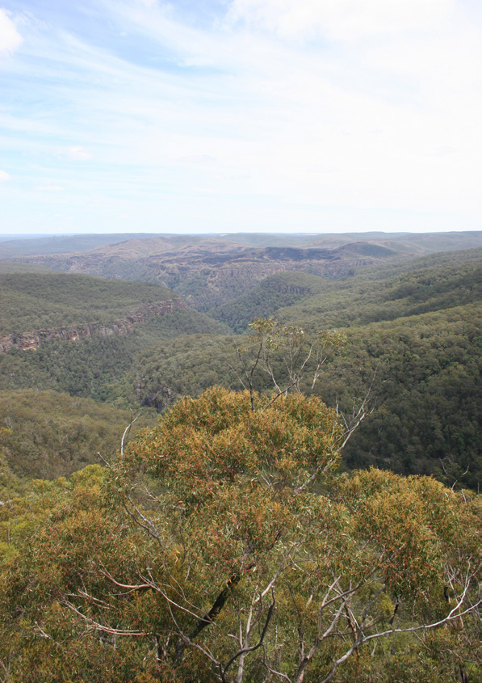

---
## Page 36

36
TEMPLATES
APPENDIX
C
Contents
1.	
BFMC Agenda Template. .  .  .  .  .  .  .  .  .  .  .  .  .  .  .  .  .  .  . . . . . . . . . . . . . . . . . . . .  37
2.	
Business Paper Template . .  .  .  .  .  .  .  .  .  .  .  .  .  .  .  .  .  . . . . . . . . . . . . . . . . . . . .  42
3.	
Organisational Report Template . .  .  .  .  .  .  .  .  .  .  .  .  .  .  .  . . . . . . . . . . . . . . . . .  43
4.	
Minutes Template. .  .  .  .  .  .  .  .  .  .  .  .  .  .  .  .  .  .  .  .  .  . . . . . . . . . . . . . . . . . . . . . . .  44
5.	
BFMC Formal Correspondence Template. .  .  .  .  .  .  .  .  .  .  .  . . . . . . . . . . . . . .  49
6.	
BFMC Member Invitation Template. .  .  .  .  .  .  .  .  .  .  .  .  .  .  . . . . . . . . . . . . . . . .  50
7.	
BFMC Member Welcome Letter Template. .  .  .  .  .  .  .  .  .  .  .  . . . . . . . . . . . . . .  51
8.	
BFMC Standard email text. .  .  .  .  .  .  .  .  .  .  .  .  .  .  .  .  .  . . . . . . . . . . . . . . . . . . . .  52
9.	
BFMC Annual Schedule Template . .  .  .  .  .  .  .  .  .  .  .  .  .  .  . . . . . . . . . . . . . . . .  53
BUSH FIRE MANAGEMENT COMMITTEE HANDBOOK

---
## Page 37

37
1. BFMC AGENDA TEMPLATE
[Name]  
BUSH FIRE MANAGEMENT COMMITTEE
AGENDA
Meeting:  	
.. . . . . . . . . . . . . . . . . . . . . . . . . . . . . . . . . . . . . . . . . . . . . . . . . . . . . . . . . . . . . . . . . . . . . . . . . . . . . . . . . . . . . . . . . . . . . . . . . . . . . . . . . . . . . . . . . . . . . . . . . . .
Convened by: 	.. . . . . . . . . . . . . . . . . . . . . . . . . . . . . . . . . . . . . . . . . . . . . . . . . . . . . . . . . . . . . . . . . . . . . . . . . . . . . . . . . . . . . . . . . . . . . . . . . . . . . . . . . . . . . . . . . . . . . . . . . . .
Attendees: 	
.. . . . . . . . . . . . . . . . . . . . . . . . . . . . . . . . . . . . . . . . . . . . . . . . . . . . . . . . . . . . . . . . . . . . . . . . . . . . . . . . . . . . . . . . . . . . . . . . . . . . . . . . . . . . . . . . . . . . . . . . . . .

	
.. . . . . . . . . . . . . . . . . . . . . . . . . . . . . . . . . . . . . . . . . . . . . . . . . . . . . . . . . . . . . . . . . . . . . . . . . . . . . . . . . . . . . . . . . . . . . . . . . . . . . . . . . . . . . . . . . . . . . . . . . . .

	
.. . . . . . . . . . . . . . . . . . . . . . . . . . . . . . . . . . . . . . . . . . . . . . . . . . . . . . . . . . . . . . . . . . . . . . . . . . . . . . . . . . . . . . . . . . . . . . . . . . . . . . . . . . . . . . . . . . . . . . . . . . .

	
.. . . . . . . . . . . . . . . . . . . . . . . . . . . . . . . . . . . . . . . . . . . . . . . . . . . . . . . . . . . . . . . . . . . . . . . . . . . . . . . . . . . . . . . . . . . . . . . . . . . . . . . . . . . . . . . . . . . . . . . . . . .

	
.. . . . . . . . . . . . . . . . . . . . . . . . . . . . . . . . . . . . . . . . . . . . . . . . . . . . . . . . . . . . . . . . . . . . . . . . . . . . . . . . . . . . . . . . . . . . . . . . . . . . . . . . . . . . . . . . . . . . . . . . . . .

	
.. . . . . . . . . . . . . . . . . . . . . . . . . . . . . . . . . . . . . . . . . . . . . . . . . . . . . . . . . . . . . . . . . . . . . . . . . . . . . . . . . . . . . . . . . . . . . . . . . . . . . . . . . . . . . . . . . . . . . . . . . . .

	
.. . . . . . . . . . . . . . . . . . . . . . . . . . . . . . . . . . . . . . . . . . . . . . . . . . . . . . . . . . . . . . . . . . . . . . . . . . . . . . . . . . . . . . . . . . . . . . . . . . . . . . . . . . . . . . . . . . . . . . . . . . .

	
.. . . . . . . . . . . . . . . . . . . . . . . . . . . . . . . . . . . . . . . . . . . . . . . . . . . . . . . . . . . . . . . . . . . . . . . . . . . . . . . . . . . . . . . . . . . . . . . . . . . . . . . . . . . . . . . . . . . . . . . . . . .
Location: 	
. . . . . . . . . . . . . . . . . . . . . . . . . . . . . . . . . . . . . . . . . . . . . . . . . . . . . . . . . . . . . . . . . . . . . . . . . . . . . . . . . . . . . . . . . . . . . . . . . . . . . . . . . . . . . . . . . . . . . . . .
Date and Time: 	 . . . . . . . . . . . . . . . . . . . . . . . . . . . . . . . . . . . . . . . . . . . . . . . . . . . . . . . . . . . . . . . . . . . . . . . . . . . . . . . . . . . . . . . . . . . . . . . . . . . . . . . . . . . . . . . . . . . . . . . .
Minutes by: 	
. . . . . . . . . . . . . . . . . . . . . . . . . . . . . . . . . . . . . . . . . . . . . . . . . . . . . . . . . . . . . . . . . . . . . . . . . . . . . . . . . . . . . . . . . . . . . . . . . . . . . . . . . . . . . . . . . . . . . . . .
YYYY / Number (e.g. 2024/1)
Place, address, room
C
BUSH FIRE MANAGEMENT COMMITTEE HANDBOOK

---
## Page 38

38
Table 1: Agenda Items
Agenda Item 1
Responsible
Welcomes and Acknowledgement of Country
Chairperson 
Agenda Item 2
Responsible
Apologies
Chairperson 
Agenda Item 3
Responsible
Disclosure of Interests
Chairperson 
Agenda Item 4
Responsible
Confirmation of Minutes of [Year/Number] held [date previous meeting]
Chairperson 
Agenda Item 5
Responsible
Business arising from previous minutes – Open Action Items Table 2
Chairperson 
Agenda Item 6
Responsible
Subcommittee Reports (list Subcommittees)
(List Subcommittee Conveners)
Agenda Item 7
Responsible
Organisation Reports
(List Members)
Agenda Item 8
Responsible
Annual Works Plan
BFMC members
C
BUSH FIRE MANAGEMENT COMMITTEE HANDBOOK

---
## Page 39

39
Agenda Item 9
Responsible
Fire Access and Fire Trail Register
BFMC members
Agenda Item 10
Responsible
Grant Funding
BFMC members
Agenda Item 11
Responsible
Seasonal Outlook
XO
Agenda Item 12
Responsible
General Business
Chair
Agenda Item 13
Responsible
Close
Chair
Next Meeting:
Date:
Table 2: Open Action Items from the Last Meeting 
Reference No.
Item Description:
Due date:
Status:
Responsible:
Reference No.
Item Description:
Due date:
Status:
Responsible:
C
BUSH FIRE MANAGEMENT COMMITTEE HANDBOOK

---
## Page 40

40
Reference No.
Item Description:
Due date:
Status:
Responsible:
Reference No.
Item Description:
Due date:
Status:
Responsible:
Table 3: Documents to be tabled 
Document title
Author
Date
C
BUSH FIRE MANAGEMENT COMMITTEE HANDBOOK

---
## Page 41

41
Table 4: Correspondence Register
[TITLE HERE]
BUSH FIRE MANAGEMENT COMMITTEE CORRESPONDENCE
Date .. . . . . . . . . . . . . . . . . . . . . . . . . . . . . . .  to .. . . . . . . . . . . . . . . . . . . . . . . . . . . . . . . . . . . . . . . .
Correspondence in:
No.
From
Date Received
Subject
Document Reference
1
2
3
4
5
6
7
8
9
10
Correspondence out:
No.
Subject
Date Receive
Addressed To
Document Reference
1
2
3
4
5
6
7
8
9
10
C
BUSH FIRE MANAGEMENT COMMITTEE HANDBOOK

---
## Page 42

42
2. BUSINESS PAPER TEMPLATE
[NAME]  
BUSH FIRE MANAGEMENT COMMITTEE
Title:  .. . . . . . . . . . . . . . . . . . . . . . . . . . . . . . . . . . . . . . . . . . . . . . . . . . . . . . . . . . . . . . . . . . . . . . . . . . . . . . . . . . . . . . . . . . . . . . . . . . . . . . . . . . . . . . . . . . . . . . . . . . . . . . . . . . . . . . .
Purpose: 	
  To note	
  Action	
  Assign	
  Endorse
Background: . . . . . . . . . . . . . . . . . . . . . . . . . . . . . . . . . . . . . . . . . . . . . . . . . . . . . . . . . . . . . . . . . . . . . . . . . . . . . . . . . . . . . . . . . . . . . . . . . . . . . . . . . . . . . . . . . . . . . . . . . . . . .

. . . . . . . . . . . . . . . . . . . . . . . . . . . . . . . . . . . . . . . . . . . . . . . . . . . . . . . . . . . . . . . . . . . . . . . . . . . . . . . . . . . . . . . . . . . . . . . . . . . . . . . . . . . . . . . . . . . . . . . . . . . . . . . . . . . . . . . . . . . . . . . .

. . . . . . . . . . . . . . . . . . . . . . . . . . . . . . . . . . . . . . . . . . . . . . . . . . . . . . . . . . . . . . . . . . . . . . . . . . . . . . . . . . . . . . . . . . . . . . . . . . . . . . . . . . . . . . . . . . . . . . . . . . . . . . . . . . . . . . . . . . . . . . . .
Current position: . . . . . . . . . . . . . . . . . . . . . . . . . . . . . . . . . . . . . . . . . . . . . . . . . . . . . . . . . . . . . . . . . . . . . . . . . . . . . . . . . . . . . . . . . . . . . . . . . . . . . . . . . . . . . . . . . . . . . . .
Recommendation: . . . . . . . . . . . . . . . . . . . . . . . . . . . . . . . . . . . . . . . . . . . . . . . . . . . . . . . . . . . . . . . . . . . . . . . . . . . . . . . . . . . . . . . . . . . . . . . . . . . . . . . . . . . . . . . . . . . . .

. . . . . . . . . . . . . . . . . . . . . . . . . . . . . . . . . . . . . . . . . . . . . . . . . . . . . . . . . . . . . . . . . . . . . . . . . . . . . . . . . . . . . . . . . . . . . . . . . . . . . . . . . . . . . . . . . . . . . . . . . . . . . . . . . . . . . . . . . . . . . . . .

. . . . . . . . . . . . . . . . . . . . . . . . . . . . . . . . . . . . . . . . . . . . . . . . . . . . . . . . . . . . . . . . . . . . . . . . . . . . . . . . . . . . . . . . . . . . . . . . . . . . . . . . . . . . . . . . . . . . . . . . . . . . . . . . . . . . . . . . . . . . . . . .

. . . . . . . . . . . . . . . . . . . . . . . . . . . . . . . . . . . . . . . . . . . . . . . . . . . . . . . . . . . . . . . . . . . . . . . . . . . . . . . . . . . . . . . . . . . . . . . . . . . . . . . . . . . . . . . . . . . . . . . . . . . . . . . . . . . . . . . . . . . . . . . .

. . . . . . . . . . . . . . . . . . . . . . . . . . . . . . . . . . . . . . . . . . . . . . . . . . . . . . . . . . . . . . . . . . . . . . . . . . . . . . . . . . . . . . . . . . . . . . . . . . . . . . . . . . . . . . . . . . . . . . . . . . . . . . . . . . . . . . . . . . . . . . . .

. . . . . . . . . . . . . . . . . . . . . . . . . . . . . . . . . . . . . . . . . . . . . . . . . . . . . . . . . . . . . . . . . . . . . . . . . . . . . . . . . . . . . . . . . . . . . . . . . . . . . . . . . . . . . . . . . . . . . . . . . . . . . . . . . . . . . . . . . . . . . . . .

. . . . . . . . . . . . . . . . . . . . . . . . . . . . . . . . . . . . . . . . . . . . . . . . . . . . . . . . . . . . . . . . . . . . . . . . . . . . . . . . . . . . . . . . . . . . . . . . . . . . . . . . . . . . . . . . . . . . . . . . . . . . . . . . . . . . . . . . . . . . . . . .
Attachments: .. . . . . . . . . . . . . . . . . . . . . . . . . . . . . . . . . . . . . . . . . . . . . . . . . . . . . . . . . . . . . . . . . . . . . . . . . . . . . . . . . . . . . . . . . . . . . . . . . . . . . . . . . . . . . . . . . . . . . . . . . . .
Name: 	
.. . . . . . . . . . . . . . . . . . . . . . . . . . . . . . . . . . . . . . . . . . . . . . . . . . . . . . . . . . . . . . . . . . . . . . . . . . . . . . . . . . . . . . . . . . . . . . . . . . . . . . . . . . . . . . . . . . . . . .
Title: 	
.. . . . . . . . . . . . . . . . . . . . . . . . . . . . . . . . . . . . . . . . . . . . . . . . . . . . . . . . . . . . . . . . . . . . . . . . . . . . . . . . . . . . . . . . . . . . . . . . . . . . . . . . . . . . . . . . . . . . . .
Contact number: 	.. . . . . . . . . . . . . . . . . . . . . . . . . . . . . . . . . . . . . . . . . . . . . . . . . . . . . . . . . . . . . . . . . . . . . . . . . . . . . . . . . . . . . . . . . . . . . . . . . . . . . . . . . . . . . . . . . . . . . .
Type here
Type here
Type here
C
BUSH FIRE MANAGEMENT COMMITTEE HANDBOOK

---
## Page 43

43
3. ORGANISATION REPORT TEMPLATE
[NAME]  
BUSH FIRE MANAGEMENT COMMITTEE
Reference:  	 .. . . . . . . . . . . . . . . . . . . . . . . . . . . . . . . . . . . . . . . . . . . . . . . . . . . . . . . . . . . . . . . . . . . . . . . . . . . . . . . . . . . . . . . . . . . . . . . . . . . . . . . . . . . . . . . . . . . . . . . . . . . . . .
Date:	
 .. . . . . . . . . . . . . . . . . . . . . . . . . . . . . . . . . . . . . . . . . . . . . . . . . . . . . . . . .   
[Name of Organisation] Progress Report
Agenda Item 7
Responsible
Action Items
Provide an overview of the status of any BFMC Action Items assigned to your 
organisation
Bush Fire Risk 
Management 
Plan
Provide an outline of any treatment activities completed since the last BFMC meeting (or 
refer to completed treatments as recorded in BFCC approved online system). Provide an 
overview of any planned activities coming up.  
Fire Access and 
Fire Trail Plan
Summarise any fire trail works that have been completed since the last BFMC meeting 
(or refer to completed treatments as recorded in BFCC approved online system). 
Provide an overview of any planned activities coming up.  
Plan of 
Operations
Provide an update of any significant operational / response and pre-incident planning 
activities that have occurred since the last BFMC meeting. 
Advise of any significant changes in personnel and contacts as listed in the Plan of 
Operations appendices.
Training / Joint 
Initiatives
Include information on any past or upcoming training / joint initiatives that are relevant to 
the BFMC
Infrastructure
Provide an overview of any changes / enhancements to infrastructure that would be of 
interest to the BFMC
General
Summarise any other matters that would relate to BFMC business (e.g. tenure changes, 
new relevant organisation policy or plans)
YYYY / Number (e.g. 2024/1)
C
BUSH FIRE MANAGEMENT COMMITTEE HANDBOOK

---
## Page 44

44
4. MINUTES TEMPLATE
[NAME]  
BUSH FIRE MANAGEMENT COMMITTEE
Meeting: 	
 . . . . . . . . . . . . . . . . . . . . . . . . . . . . . . . . . . . . . . . . . . . . . . . . . . . . . . . . . . . . . . . . . . . . . . . . . . . . . . . . . . . . . . . . . . . . . . . . . . . . . . . . . . . . . . . . . . . . . . . . . .
Convened by: 	 . . . . . . . . . . . . . . . . . . . . . . . . . . . . . . . . . . . . . . . . . . . . . . . . . . . . . . . . . . . . . . . . . . . . . . . . . . . . . . . . . . . . . . . . . . . . . . . . . . . . . . . . . . . . . . . . . . . . . . . . . . .
Location:  	
. . . . . . . . . . . . . . . . . . . . . . . . . . . . . . . . . . . . . . . . . . . . . . . . . . . . . . . . . . . . . . . . . . . . . . . . . . . . . . . . . . . . . . . . . . . . . . . . . . . . . . . . . . . . . . . . . . . . . . . . . . .
Date and time:  . . . . . . . . . . . . . . . . . . . . . . . . . . . . . . . . . . . . . . . . . . . . . . . . . . . . . . . . . . . . . . . . . . . . . . . . . . . . . . . . . . . . . . . . . . . . . . . . . . . . . . . . . . . . . . . . . . . . . . . . . .
Minutes by:  	
. . . . . . . . . . . . . . . . . . . . . . . . . . . . . . . . . . . . . . . . . . . . . . . . . . . . . . . . . . . . . . . . . . . . . . . . . . . . . . . . . . . . . . . . . . . . . . . . . . . . . . . . . . . . . . . . . . . . . . . . . . .
Table 1: Attendance Record
Members (alternate)
Organisation 
Present
Apology
Absent
Observers / Support
Organisation 
Present
Apology
Absent
YYYY / Number (e.g. 2024/1)
Chairs name – Organisation
Place, address, room
Day, date, time
Name – organization
C
BUSH FIRE MANAGEMENT COMMITTEE HANDBOOK

---
## Page 45

45
Table 2: Documents Referred to in the Meeting
Document title
Author
Date
Minutes
Agenda Item 1
Responsible
Welcomes and Acknowledgement of Country
Chairperson 
Agenda Item 2
Responsible
Apologies
Chairperson 
Agenda Item 3
Responsible
Disclosure of Interests
Chairperson  
Agenda Item 4
Responsible
Confirmation of minutes of [YEAR/NUMBER] held [DATE PREVIOUS 
MEETING]
Chairperson 
Agenda Item 5
Responsible
Business arising from previous minutes – Open Action Items Table 2
Chairperson 
C
BUSH FIRE MANAGEMENT COMMITTEE HANDBOOK

---
## Page 46

46
Table 3. Outstanding Action Items From Meeting [YYYY/Number]
Reference No. (Year/Meeting/#)
Item Description:
Due date:
Status:
Responsible:
Reference No. (Year/Meeting/#)
Item Description:
Due date:
Status:
Responsible:
Reference No. (Year/Meeting/#)
Item Description:
Due date:
Status:
Responsible:
Reference No. (Year/Meeting/#)
Item Description:
Due date:
Status:
Responsible:
C
BUSH FIRE MANAGEMENT COMMITTEE HANDBOOK

---
## Page 47

47
Agenda Item 6
Responsible
Subcommittee Reports
Subcommittee Conveners 
Agenda Item 7
Responsible
Organisation Reports
BFMC member Organisations 
Agenda Item 8
Responsible
Annual Works Plan
BFMC members
Agenda Item 9
Responsible
Fire Access and Fire Trail Register
BFMC members
Agenda Item 10
Responsible
Grant Funding
BFMC members
C
BUSH FIRE MANAGEMENT COMMITTEE HANDBOOK

---
## Page 48

48
Agenda Item 11
Responsible
Seasonal Outlook
XO
Agenda Item 12
Responsible
General Business
Chair
Agenda Item 13
Responsible
Close
Chair
Table 4. Updated Action Items
Ref No.
Item Description
Responsible
Due Date
Status
YYYY/meeting/#
Table 5. Next meeting
Date
Start time
Finish time
Location
00.00
0.00
C
BUSH FIRE MANAGEMENT COMMITTEE HANDBOOK

---
## Page 49

49
5. BFMC FORMAL CORRESPONDENCE 
[NAME]  
BUSH FIRE MANAGEMENT COMMITTEE
Address all correspondence to: Executive Officer Address here.
Type name and surname
Your reference
Type organisation
Our reference
Type address
Phone number
DD/MM/YY
Email address
Dear.. . . . . . . . . . . . . . . . . . . . . . . . . . . . . . . . . . . . . . . . . .
. . . . . . . . . . . . . . . . . . . . . . . . . . . . . . . . . . . . . . . . . . . . . . . . . . . . . . . . . . . . . . . . . . . . . . . . . . . . . . . . . . . . . . . . . . . . . . . . . . . . . . . . . . . . . . . . . . . . . . . . . . .
. . . . . . . . . . . . . . . . . . . . . . . . . . . . . . . . . . . . . . . . . . . . . . . . . . . . . . . . . . . . . . . . . . . . . . . . . . . . . . . . . . . . . . . . . . . . . . . . . . . . . . . . . . . . . . . . . . . . . . . . . . .
Yours sincerely,
. . . . . . . . . . . . . . . . . . . . . . . . . . . . . . . . . . . . . . . . . . . . . . . . . . . . . . . . . . . . . . . . . . . . . . . . . . . . . . . . . . . . . . . . . . . . . . . . . . . . . . . . . . . . . . . . . . . . . . . . . . .
. . . . . . . . . . . . . . . . . . . . . . . . . . . . . . . . . . . . . . . . . . . . . . . . . . . . . . . . . . . . . . . . . . . . . . . . . . . . . . . . . . . . . . . . . . . . . . . . . . . . . . . . . . . . . . . . . . . . . . . . . . .
	
 [TYPE TITLE AND SURNAME],
[TYPE SUBJECT OF LETTER]
[TYPE BEGINNING OF LETTER] 
[TYPE NAME AND SURNAME]
[TYPE POSITION] 
C
BUSH FIRE MANAGEMENT COMMITTEE HANDBOOK

---
## Page 50

50
6. INVITATION FOR BFMC MEMBERSHIP 
LETTER (SAMPLE)
[NAME]  
BUSH FIRE MANAGEMENT COMMITTEE
Address all correspondence to: Executive Officer Address here.
Type name and surname
Your reference
Type organisation
Our reference
Type address
Phone number
DD/MM/YY
Email address
Dear  [TYPE TITLE AND SURNAME],
RE: Invitation for membership of [NAME] Bush Fire Management Committee
I am writing to invite you to nominate a representative from your organisation for the [NAME] Bush Fire 
Management Committee (BFMC).
BFMCs are groups of people with technical expertise, experience and local knowledge who work together for bush 
fire management purposes, and who can collaboratively develop better bush fire management decisions than 
anyone acting alone.
The BFMC is responsible for preparing, reviewing and updating a Bush Fire Risk Management Plan, the 
Operations Coordination Plan and Fire Access and Fire Trail Plan, within the local area.
The Rural Fires Regulation 2013 states that a person nominated by [INSERT RELEVANT SECTION OF THE 
REGULATIONS SECTION 14 FOR THE ORGANISATION YOU ARE WRITING TO] located in the Bush Fire 
Management Committee’s area, is eligible to join the BFMC.
Your organisation is not, at present, represented on the [NAME] BFMC and as such I would like to invite and 
encourage you to nominate a representative to join the committee.   
The next general meeting will be held on [DATE] at [PLACE] at [ADDRESS]. If your organisation would like to 
have representation on the [NAME] BFMC, it would be appreciated if you could notify the Executive Officer prior 
to the above date so that appropriate correspondence and notification of events can be sent accordingly. 
Your assistance in this matter would be greatly appreciated.
If you have any enquiries or would like further information about the BFMC and its operations, please do not 
hesitate to contact me.
I look forward to hearing from you.
[NAME] 
Executive Officer/Chair
[NAME] Bush Fire Management Committee
C
BUSH FIRE MANAGEMENT COMMITTEE HANDBOOK

---
## Page 51

51
7. BFMC WELCOME LETTER (SAMPLE)
[NAME]  
BUSH FIRE MANAGEMENT COMMITTEE
Address all correspondence to: Executive Officer Address here.
Type name and surname
Your reference
Type organisation
Our reference
Type address
Phone number
DD/MM/YY
Email address
Dear  [TYPE TITLE AND SURNAME],
Re: Welcome to the [NAME] Bush Fire Management Committee
May I take this opportunity to welcome you to the [Name] Bush Fire Management Committee (BFMC), as the member 
representing the [ORGANISATION]. 
As with the previous {[ORGANISATION]} representatives I am certain we will continue the productive and collaborative 
relationship that has existed in the past and thank you for your willingness to be involved. We welcome the participation 
of {[ORGANISATION]} on the BFMC and are looking forward to your contribution to the work of the BFMC.
The Committee meets [INSERT NUMBER] times a year and you will receive confirmation of the meeting date, time 
and location, together with a copy of the agenda, prior to the meeting. 
The remaining scheduled BFMC meetings for this year are [DATE]. Please find the minutes of the last BFMC meeting, 
which has been enclosed to this correspondence to provide some background.
Also enclosed is a copy of the BFMC Charter, which will provide an introduction to the BFMC and your role as a 
member of the Committee. 
I would also like to direct you to the BFMC Handbook. This document contains additional information that will further 
assist you in understanding your role and expands on the information that is provided in the BFMC Charter. 
The BFMC Handbook is downloadable on the RFS website. 
Please do not hesitate to contact me for a briefing on the role of the Committee, its Bush Fire Risk Management Plan, 
Plan of Operations, Fire Access and Fire Trail Plan, and the matters currently being dealt with.
Yours sincerely,
[NAME] 
Executive Officer
[NAME] Bush Fire Management Committee
C
BUSH FIRE MANAGEMENT COMMITTEE HANDBOOK

---
## Page 52

52
8. BUSH FIRE MANAGEMENT COMMITTEE STANDARD EMAIL TEXT
(SAMPLE)
CALL FOR AGENDA ITEMS
Call for agenda items should be sent at least of 1 month prior to the meeting of the BFMC.
Dear [NAME] BFMC members and delegates,
Please advise if you have any agenda items you would like added to the agenda for the upcoming (Name) BFMC 
meeting to be held at [time, date, location]. Suggestions for items will need to be received by [date] in order to be 
included in the agenda.   
Can you please confirm your availability for this meeting and advise if you seek to have any observers or guests 
attend.
Thank you,
[NAME] 
Executive Officer/Chair
[NAME] Bush Fire Management Committee
Standard Email Text – Distribution of Agendas and Business Papers.
Agendas and business papers should be sent a minimum of 7 days prior to the 
meeting of the BFMC.
Dear [NAME] BFMC members and delegates,
Attached is the agenda, business papers and related documentation for the next [NAME] BFMC meeting to be 
held at [TIME, DATE, LOCATION]. Please review this documentation as well as any action items assigned to your 
organisation and ensure you are in a position to discuss these matters at the meeting. 
Draft minutes of the previous meeting [and any other supporting material] are also attached for your review and 
comment.
If you haven’t already, it would be appreciated if you could confirm your availability for this meeting along with the 
attendance of any observers or guests by close of business today.
Thank you,
[NAME]
Executive Officer
[NAME] Bush Fire Management Committee
BFMC Calendar (Sample)
C
BUSH FIRE MANAGEMENT COMMITTEE HANDBOOK

---
## Page 53

53
9. Bush Fire Management Committee Schedule
[INSERT NAME XXX]  Bush Fire Management Committee  Schedule
Establishment date of BFMC: [INSERT DATE XXX]
When
What
Who
Completed
YEARLY
Start or end of the year
Prepare 12 months 
calendar of BFMC 
meeting dates
BFMC (Executive 
Officer)
Start of the Year (or 
near the establishment 
date of the Committee) 
Elect Chairperson and 
deputy Chairperson
BFMC
Start of the Year (or 
near the establishment 
date of the Committee)
Contact those 
organisations eligible 
for BFMC membership 
and issue an invitation to 
provide a member to the 
BFMC. This should be 
done in writing.
BFMC (Chairperson / 
Executive Officer)
(INSERT DATE) 
BFMC Meeting~ 
YYYY/1
BFMC
March
Consider Variation to 
Extend the Bush Fire 
Danger Period
BFMC (Subcommittee)
(INSERT DATE) 
(Name) Subcommittee 
Meeting
(Name) Subcommittee 
members
(INSERT DATE) 
BFMC Meeting YYYY/2
BFMC
June 30
BFMC Annual Works 
Plan endorsed by BFMC
BFMC
(INSERT DATE) 
BFMC Meeting YYYY/3
BFMC
August 1
BFMC Annual Report 
endorsed by BFMC and 
made available to BFCC
BFMC
(INSERT DATE) 
(Name) Subcommittee 
Meeting
(Name) Subcommittee 
members
August 31
Pre-season Checklist  
made available to BFCC
FAFT Plan 
implementation report to 
BFCC.
BFMC
C
BUSH FIRE MANAGEMENT COMMITTEE HANDBOOK

---
## Page 54

54
When
What
Who
Completed
Prior to Bush Fire 
Danger Period
Operational exercise 
undertaken
Operations Coordination 
Manual prepared
Fire Trail Treatment 
Register reviewed
Ignition Prevention Plan 
reviewed
BFMC
(INSERT DATE) 
BFMC Meeting YYYY/4
BFMC
EVERY 2 YEARS
The dates for 
submission are based 
on the establishment 
date of your BFMC
Prepare and submit Plan 
of Operations
BFMC
The dates for 
submission are based 
on the establishment 
date of your BFMC
Prepare and submit Fire 
Access and Fire Trail 
Plan
BFMC
EVERY 5 YEARS
Submission dates 
are based on the 
establishment of your 
BFMC
Prepare and submit 
Bush Fire Risk 
Management Plan
BFMC
C
BUSH FIRE MANAGEMENT COMMITTEE HANDBOOK

---
## Page 55

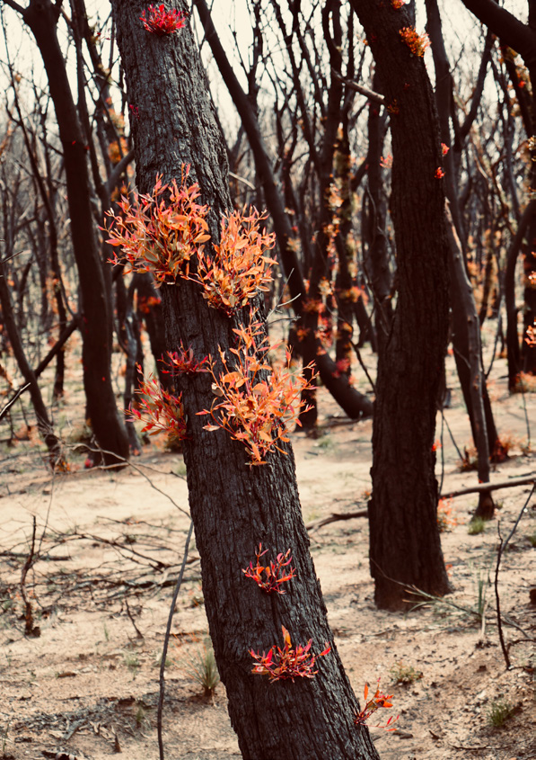

---
## Page 56

56
GOOD MEETING PRACTICE
APPENDIX
D
1.	 Be punctual and prepared
	
> Arrive to the meeting and return from any breaks 
on-time.
	
> Ensure you are prepared to contribute to the BFMC 
and address any items that have been allocated to 
your organisation.
	
> Bring a positive attitude and a willingness to 
collaborate with other members.
2.	 Stay mentally and physically present
	
> Be present, and don’t attend to non-meeting 
business during the meeting.
	
> Listen attentively to others and don’t interrupt or have 
side conversations.
	
> Treat all meeting participants with the same respect 
you would want from them.
3.	 Actively participate in discussions
	
> Share your thoughts, ideas and contribute to the 
discussions.   
	
> Ask questions and provide constructive feedback.
	
> Clearly articulate any points of disagreement and 
offer practical solutions.
4.	 Allow others to participate
	
> Provide an opportunity for others to share their 
views.
	
> Actively listen to other members and do not 
interrupt them.
	
> Respect each other’s thinking and value 
everyone’s contributions.
	
> Be open to new ways of doing things and learn 
from the experiences of other members.
5.	 Be clear, concise and stay on topic
	
> Ensure you understand the topic being discussed 
before contributing. It’s OK to ask questions before 
providing input.
	
> Keep your comments relevant, brief and to the point.
	
> Do not simply repeat what others have said or bring 
up previous conversations.
	
> Avoid using acronyms and phrases that can be 
misunderstood.
6.	 Attack the problem, not the person
	
> Capture the different perspectives of the BFMC 
membership.
	
> This will assist in achieving the best outcomes.
	
> Challenge the idea, respectfully and openly, without 
being confrontational.
	
> Do not criticise or belittle the views of other members.
	
> Stay professional in your conduct and do not be 
personal with your comments.
7.	 Reach consensus and record action 
items
	
> The Chairperson will facilitate consensus on any 
BFMC decisions.
	
> Any issues and action items arising from the 
discussion must be noted in the meeting minutes.
	
> Ensure that you act on any action items that are 
assigned to your organisation.
	
> The Chairperson should provide a summary of action 
items at the meeting.
8.	 Document outcomes and share 
learnings
	
> Record resolutions to problems and assigned tasks.
	
> Openly provide relevant information to all BFMC 
members.
	
> Consult with adjoining BFMC(s), Local Emergency 
Management Committees and other stakeholders to 
discuss any common issues and share learnings or 
outcomes.
8 PRINCIPLES FOR GOOD MEETING PRACTICE
BUSH FIRE MANAGEMENT COMMITTEE HANDBOOK

---
## Page 57

57
BFMC MEMBER ENGAGEMENT 
APPENDIX
E
Good communication and engagement practice
Although membership is not compulsory, the BFCC 
encourages all eligible agencies and organisations to 
participate in BFMC business. 
BFMCs may need to be flexible and consider alternative 
engagement methods outside of formal BFMC meeting 
processes. This may be particularly important when 
engaging with member agencies and organisations who 
may not have a current representative to attend meetings 
but whose values, views, interests or management 
responsibilities may be impacted by bush fire 
management activities and the decisions of the BFMC. 
This Appendix is designed to provide general guidance 
to BFMCs on good communication and engagement 
practice to maximise opportunities for member agencies 
and organisations to actively and equitably participate in 
BFMC business.
Barriers to active participation
Conflict with paid employment or other 
responsibilities 
Many agency representatives are paid for their time as 
part of their job. However, representatives from volunteer-
based or non-for-profit organisations who are not paid for 
their time to attend BFMC meetings may find it difficult 
to participate during standard business hours due to 
loss of wages caused by the need to take time from paid 
employment to travel and attend. This increases the risk 
of low participation in BFMC processes. 
Communication breakdown
BFMC representatives may change within an agency or 
organisation due to leave or staff turnover. There is the 
potential for information and contacts to be lost in transition. 
Cultural safety
The location or timing of a BFMC activity may affect how 
a member responds to BFMC engagement attempts. 
Timing
Scheduling BFMC meetings at particular times and dates 
e.g. during school holidays or culturally significant events. 
Accessibility 
The location of meetings is important and can impact 
participants’ level of comfort and their ability to attend. 
Some BFMCs cover large geographical distances 
meaning some representatives may have to travel far to 
attend meetings in-person. 
Consultation fatigue
Consultation fatigue may occur when a member sits on 
multiple BFMCs or other stakeholder groups. 
Strategies to support good communication 
and engagement 
	
> Don’t rely on a single method of communication 
Use a variety of communication and engagement 
methods – don’t rely on a single email to get your 
message across. Lead with a phone call then follow 
up with an email to ensure your message has been 
received by the right person. 
	
> Be flexible – consider alternative engagement 
methods outside of formal BFMC meeting processes. 
Participate in community meetings rather than asking 
people to join pre-determined BFMC processes.
	
> Consider varying the day and time that meetings 
are held and the location – maximise opportunities 
for representatives to attend at a time that suits their 
work and/or caring responsibilities. 
	
> Set realistic timeframes – communicate and allow 
members adequate time to report back to their 
colleagues and communities.
	
> Hold combination of face-to-face and online 
meetings – tailor communication to your audience, 
in terms of materials, methods and communication 
channels. Providing alternatives to traditional in-
person meetings allows people who have to travel or 
have other commitments flexibility, while the face-
to-face gives option can support people with poor 
telecommunications quality. 
	
> Be open and transparent about the decision-
making process – set expectations about what is 
in and out of scope for a particular issue. The BFCC 
requires that BFMCs ensure all decisions are made by 
consensus.
	
> Be mindful of consultation fatigue – make efforts 
to find out who is already engaging with agencies or 
organisations not currently sending representatives 
to BFMC meetings. Seek opportunities to join a 
conversation or activity that is already taking place, 
particularly where you are consulting the same 
stakeholder groups.  
	
> Close the loop -  plan to communicate with 
representatives on how their input has been 
considered in the project or decision.
BUSH FIRE MANAGEMENT COMMITTEE HANDBOOK

---
## Page 58

58
SUBCOMMITTEES OF THE BFMC 
APPENDIX
F
Subcommittees of the BFMC
A BFMC may choose to establish a subcommittee, or 
subcommittees to assist in fulfilling its responsibilities 
under the Rural Fires Act 1997, the Bush Fire 
Coordinating Committee (BFCC) Policy and the BFMC 
Charter. A subcommittee may bring together specific 
BFMC members (or subject matter experts from BFMC 
member organisations) to assist the BFMC with the 
development and monitoring of the following:
	
> Draft Bush Fire Risk Management Plan;
	
> Draft Fire Access Fire Trail Plan;
	
> Draft Plan of Operations;
	
> Annual Works Plan;
	
> Funding Applications; and
	
> Annual Ignition Prevention Plan.
Not all BFMCs will require a subcommitee, however 
every BFMC should consider whether the formation 
of a subcommittee would improve the functionality of 
the BFMC. The BFMC may be able to resolve many 
issues itself or refer it to the appropriate member(s) to 
investigate and report back to the BFMC.
If a BFMC decides to establish a subcommittee, it 
is recommended that the number of subcommittees 
are kept to a minimum. The creation of multiple 
subcommittees that consist of the same representatives 
should be avoided as it may cause unnecessary 
complexity and confusion. However, where there is 
variation in the membership and expertise required 
to address different BFMC matters, the formation of 
multiple subcommittees may be necessary. 
Two examples of subcommittees are provided in this 
appendix, however each BFMC should determine a 
subcommittee structure that best assists their BFMC.   
Example 1:	 Bush Fire Risk Management 
Subcommittee
Scope
	
> Bush Fire Risk Management Plan;
	
> Fire Access and Fire Trail Plan;
	
> Fuel Management through the Annual Works Plan;
	
> BFMC Annual Report;
	
> Neighbourhood Safer Places and Community 
Protection Plans; and
	
> Funding applications.
Membership 
All Land Management Agencies should be represented 
on this subcommittee to ensure that draft Plans are 
locally relevant, practical and take into account the 
views of key stakeholders.   
Meeting Frequency
During the preparation of Plans, the subcommittee may 
be required to meet regularly. Following the approval 
and endorsement of Plans, this subcommittee may 
meet three to four times a year to plan and coordinate 
AWPs, monitor and review Plans and prepare the 
Annual Report. 
Example 2:	Operations Subcommittee
Scope:
	
> Plan of Operations:
	
> Pre-season Checklist:
	
> Operational Exercise; and
	
> Ignition Prevention Plan.
Membership
Representation from fire authorities and NSW Police 
Service would be critical to the functioning of this 
subcommittee. Membership may need to be restricted 
due to the sensitive nature of some of the issues to be 
dealt with by this subcommittee (e.g. arson). 
Other organisations could be invited along to these 
subcommittee meetings as required.
BUSH FIRE MANAGEMENT COMMITTEE HANDBOOK

---
## Page 59

59
Meeting Frequency
This subcommittee may meet at least twice a year. 
Once before and once after the BDFP. Additional 
meetings may be required during the development of 
the Plan of Operations or during the BDFP to address 
any specific operational issues that arise. 
Governance arrangements
Establishment of a subcommittee and the nominated 
members should be documented in the BFMC meeting 
minutes. As outlined in Section 12, the subcommittee 
must only consist of members of the BFMC or BFMC 
organisation representatives that have been nominated 
by their BFMC member. 
At least one BFMC member should be involved in 
the subcommittee to oversee its activities to ensure 
objectives are being met and work remains within scope. 
A Convener must be appointed for each subcommittee. 
A subcommittee can investigate issues, develop draft 
documents or programs and make recommendations for 
the BFMC to consider. However, any decision-making 
must be performed by the BFMC.
There will be occasions where a subcommittee must 
deal with sensitive information in undertaking its 
role. Members are subject to the same confidentiality 
arrangement as the BFMC, which are detailed in 
Section 16.2 of this handbook. In some instances, 
it may be appropriate for specific agencies to hold 
detailed discussions independent of the subcommittee 
and report back as required.    
Subcommittees should only engage in discussions on 
matters that have been referred to it by the BFMC. To 
ensure that the subcommittee is clear on its role and 
purpose, a Terms of Reference needs to be prepared 
and approved by the BFMC. 
The Terms of Reference should clearly outline matters 
that are within the scope of the subcommittee and 
identify the official membership of the group. A standard 
template for a subcommittee Terms of Reference is 
attached to this Appendix.
The Convener
The Convener for the subcommittee has a similar role 
to the BFMC XO, which is detailed in Section 7 of this 
handbook. The Convener can be anyone endorsed by 
the BFMC. The role includes the following duties:
	
> Book, prepare and arrange meetings;
	
> Collate apologies;
	
> Prepare meeting agendas and minutes;
	
> Compile reports and any business papers for 
submission to the BFMC;
	
> Maintain and manage subcommittee files and 
records;
	
> Maintain membership records and contact details; 
and
	
> Distribute any relevant correspondence. 
The arrangements in place for BFMC meetings as 
outlined in Section 9 of the BFMC Handbook should 
also be employed for subcommittee. Standard 
templates for subcommittee agenda, minutes and 
progress reports have been attached to this Appendix. 
A report to the BFMC, which summarises the activities 
of the subcommittee since the last BFMC meeting, 
should be submitted to the BFMC at each meeting. 
This report should include copies of the agenda(s), 
minutes and any relevant documents tabled with the 
subcommittee. Where a recommendation is to be made 
by the subcommittee to the BFMC, a separate paper 
is to be prepared by the Convener, consistent with the 
template provided in Appendix C.     
Whilst minutes should be prepared for each 
subcommittee meeting, they do not need to be a 
detailed appraisal of discussions that took place. 
However, they should provide some context, reasoning 
and background to any recommendations made by the 
subcommittee.
F
BUSH FIRE MANAGEMENT COMMITTEE HANDBOOK

---
## Page 60

60
TERMS OF REFERENCE
[NAME] SUBCOMMITTEE OF THE
[NAME] BUSH FIRE MANAGEMENT COMMITTEE
Role of the Subcommittee
The [NAME] Subcommittee has been established to carry out the following tasks:
	
> [INSERT TASK – e.g. prepare draft Bush Fire Risk Management Plan]
	
> [INSERT TASK – e.g. prepare draft Fire Access and Fire Trails Plan]
This subcommittee may also be requested by the BFMC to investigate and provide advice on specific matters relevant 
to the above tasks.
Membership
Membership of the [NAME]  Subcommittee is outline below. At least one BFMC member must be represented on the 
subcommittee to oversee its activities. 
Table 1:	 Membership of the [NAME] Subcommittee
Name
BFMC Member or 
BFMC Organisation 
Representative 
Organisation
Contact Details
Convener -
Meetings
Members of the [NAME] subcommittee will meet on 
a regular basis to address matters that have been 
referred to it by the BFMC. Dates of meetings are to be 
determined at the start of each year in consultation with 
subcommittee members. 
A minimum of two weeks notice should be provided if 
meeting dates change or additional meetings are added. 
Reporting
Following each meeting of the [NAME] subcommittee, a 
summary report is to be prepared by the Convener and 
submitted to the BFMC at its next meeting. 
The report must include a copy of the agenda(s), 
minutes and any relevant documents tabled at the 
subcommittee meeting. 
Where a recommendation is to be made by the 
subcommittee for BFMC consideration, a separate 
paper is to be prepared by the Convener.    
F
BUSH FIRE MANAGEMENT COMMITTEE HANDBOOK

---
## Page 61

61
[NAME] Bush Fire Management Committee
Agenda Item XXX
[Name] subcommittee Progress Report
Purpose:
 To note
Recommendation:
a.	That the [NAME] BFMC receives and notes the [NAME] subcommittee Progress Report.
Background:
Current Position:
Attachment(s):
	
Name:	
Title:	
 
Contact number:	
F
BUSH FIRE MANAGEMENT COMMITTEE HANDBOOK

---
## Page 62

62
[NAME] SUBCOMMITTEE OF THE
[NAME] BUSH FIRE MANAGEMENT COMMITTEE
AGENDA
Meeting:	
[MEETING NUMBER/YEAR]
Convened by:	 [CONVENER NAME - ORGANIZATION]
Location:	
[PLACE, ADDRESS, ROOM]
Date and time:	 [DAY, DATE, TIME]
Minutes by:	
[NAME – ORGANIZATION]
AGENDA
Table 1: Agenda Items
No.
Agenda item
Responsible
1
Welcome/ Acknowledgement of Country
Convener
2
Apologies
3
Disclosure of Interests
Convener
4
Confirmation of Minutes of #/YEAR
 [INSERT # OF LAST MEETING /YEAR] 
meeting held [DATE PREVIOUS MEETING]
Convener
5
Business arising from previous minutes
a.	General
b.	Action Items
Convener
6
[INCLUDE ITEMS TO BE ADDRESSED AT THIS MEETING 
AND ADD ADDITIONAL ROWS AS REQUIRED]
7
Close
Convener
Next meeting:	 [DAY, DATE AND TIME]
F
BUSH FIRE MANAGEMENT COMMITTEE HANDBOOK

---
## Page 63

63
Table 2. Open Action Items from the Last Meeting 
Ref. Item Description
Responsible
Due Date
Status
Table 3. Documents to be tabled
Item Description
Responsible
Status
BFMC Subcommittee Minutes 
BFMC Subcommittee
Draft Focus Areas for Bush Fire 
Risk Management Plan
Convener
Draft Annual Works Plan 
BFMC Subcommittee
FAFT Plan
BFMC
	
	
	
	
	
	
	
	
F
BUSH FIRE MANAGEMENT COMMITTEE HANDBOOK

---
## Page 64

64
[NAME] SUBCOMMITTEE OF THE
[NAME] BUSH FIRE MANAGEMENT COMMITTEE
MINUTES
Meeting:	
[MEETING NUMBER/YEAR]
Convened by:	 [CONVENOR’S NAME - ORGANIZATION]
Location:	
[PLACE, ADDRESS, ROOM]
Date and time:	 [DAY, DATE, TIME]
Minutes by:	
[NAME – ORGANIZATION]
Table 1: Attendance Record
Members (alternate):	
Organisation 
Present
Apology
Absent
NSW Rural Fire Service
Fire and Rescue NSW
National Parks and Wildlife Service
Forestry Corporation of NSW
[NAME] Council
Department of Industry – 
Crown Lands
NSW Farmers Association
Nature Conservation Council
Observers / Support
Organisation 
Present
Apology
Absent
NSW Rural Fire Service
[NAME] Council
Table 2. Documents Referred to in the Meeting
Document title
Author
Date
BFMC Minutes 
2024 BFRMP
2024 FAFT Plan
F
BUSH FIRE MANAGEMENT COMMITTEE HANDBOOK

---
## Page 65

65
Minutes
Item 1
Welcomes and Acknowledgement of Country
Chairperson 
Item 2
Apologies
Chairperson 
As outlined above
Item 3
Disclosure of Interests
Chairperson  
Item 4
Confirmation of Minutes of #/YEAR [insert # of last meeting /year] 
meeting held [date previous meeting]
Chairperson 
Item 5
Business arising from previous minutes – General and Action Items
Chairperson 
Table 3. Action Items From [DATE] Meeting
	
	
	
Ref No. Item 
Description
Responsible
Due Date
Status
Subcommittee 
Update
Updates have been provided on the following items:
01/18-3 Action Name
Update provided
01/19-1 Action Name
Update provided
Item 5
Matters that arise
Chairperson  
Item 6
Close
F
BUSH FIRE MANAGEMENT COMMITTEE HANDBOOK

---
## Page 66

66
Table 4. Updated Action Items
Ref No. Item 
Description
Responsible
Due Date
Status
Table 5. Next meeting
Date
Start time
Finish time
Location
	
	
	
F
BUSH FIRE MANAGEMENT COMMITTEE HANDBOOK

---
## Page 67

67
F
BUSH FIRE MANAGEMENT COMMITTEE HANDBOOK

---
## Page 68

68
Rural Fires Act 1997
Part 3 Division 2 Bush Fire Coordinating Committee
https://legislation.nsw.gov.au/view/html/inforce/current/act-1997-065#pt.3-div.2
Part 3 Division 3 Bush Fire Management Committees 
https://legislation.nsw.gov.au/view/html/inforce/current/act-1997-065#pt.3-div.3
Part 3 Division 4 Preparations of draft bush fire management plans 
https://legislation.nsw.gov.au/view/html/inforce/current/act-1997-065#pt.3-div.4
Part 3 Division 5 Public participation in preparation of plans 
https://legislation.nsw.gov.au/view/html/inforce/current/act-1997-065#pt.3-div.5
Part 3 Division 6 Clause 62A - Audits of bush fire risk management plans 
https://legislation.nsw.gov.au/view/html/inforce/current/act-1997-065#pt.3-div.6
Schedule 1 Constitution and procedure of Advisory Council and Bush Fire Coordinating Committee 
https://legislation.nsw.gov.au/view/html/inforce/current/act-1997-065#sch.1
Rural Fires Regulation 2022
Part 3 Bush Fire Management Committees 
https://legislation.nsw.gov.au/view/html/inforce/current/sl-2022-0215#pt.3
Bush Fire Coordinating Committee Policies
https://www.rfs.nsw.gov.au/resources/publications/corporate-governance-and-planning/bush-fire-coordinating-
committee-policies
Bush Fire Mitigation Funding
https://www.rfs.nsw.gov.au/about-us/grants
Other Relevant Legislation and Documentation
Government Information (Public Access) Act 2009
https://legislation.nsw.gov.au/view/html/inforce/current/act-2009-052
Privacy and Personal Information Protection Act 1998
https://legislation.nsw.gov.au/view/html/inforce/current/act-1998-133
A Guide to Aboriginal Cultural Protocols for NSW Government Sector Events
https://www.nsw.gov.au/arts-and-culture/engage-nsw-arts-and-culture/resource-hub/aboriginal-arts-and-culture-
protocols
LEGISLATION, POLICY AND USEFUL LINKS 
APPENDIX
G
BUSH FIRE MANAGEMENT COMMITTEE HANDBOOK

---
## Page 69

69
Useful Links
Bush Fire Environmental Assessment Code
https://www.rfs.nsw.gov.au/resources/publications/hazard-reduction/bush-fire-environmental-assessment-code 
Bush Fire Risk Management Plans 
https://www.rfs.nsw.gov.au/plan-and-prepare/know-your-risk/bush-fire-risk-management-plans
Community Protection Plans 
https://www.rfs.nsw.gov.au/resources/publications/community-protection-plans
National Parks and Wildlife Services
Plans of Management 
https://www.environment.nsw.gov.au/topics/parks-reserves-and-protected-areas/park-management/plans-of-
management
Fire Management Strategies
https://www.environment.nsw.gov.au/topics/parks-reserves-and-protected-areas/fire/fire-management-strategies/
search-fire-management-strategies
NCC Online Training Video – Undertaking Online Biodiversity Searches 
http://fireandrestoration.org.au/searching-for-threatened-species/
Neighbourhood Safer Places (main heading, not a subheading under NPWS):
https://www.rfs.nsw.gov.au/plan-and-prepare/neighbourhood-safer-places
One RFS 
https://one.rfs.nsw.gov.au/
Planning Portal – Property Information 
https://www.planningportal.nsw.gov.au/spatialviewer/#/find-a-property/address
Planning for Bush Fire Protection
https://www.rfs.nsw.gov.au/__data/assets/pdf_file/0011/86519/DPP1007-Planning-for-Bushfire-Protection-2018-
280818-D22.pdf
Seed Environmental Data Portal 
https://www.seed.nsw.gov.au/
SIXmaps – NSW GIS Data 
https://maps.six.nsw.gov.au/
G
BUSH FIRE MANAGEMENT COMMITTEE HANDBOOK

---
## Page 70

70
GLOSSARY
APPENDIX
H
Bush Fire
An unplanned fire burning in vegetation including grass; also referred to as wildfire.
Bush Fire Danger 
Period
A period fixed by or under Section 81 or 82 of the Act as a bush fire danger period.
Bush Fire 
Coordinating 
Committee
As constituted under Part 3 of the Act.
Bush Fire Hazard 
Reduction Work
Involves the following activities:
a.	The establishment or maintenance of fire breaks and fire trails on land, and 
b.	The controlled application of appropriate fire regimes or other means for the 
reduction or modification of available fuels within a predetermined area to mitigate 
against the spread of a bush fire 
But does not include construction of a track or road.
Bush Fire 
Management 
Committee
A Bush Fire Management Committee constituted under Part 3 of the Act.
Bush Fire 
Management Plan
a. a Plan of Operations; or
b. a Bush Fire Risk Management Plan; or
c. a Fire Access and Fire Trail Plan.
Bush Fire Risk 
Management Plan
Is a Bush Fire Management Plan prepared under Part 3 Division 4 of the Act for the 
purpose referred to in s52 (1)(b).
Commissioner
The Commissioner of the NSW Rural Fire Service.
Council
A council, county council or joint organisation within the meaning of the 
Local Government Act 1993.
Crown Land
As defined in the Crown Land Management Act 2016.
Executive Officer
As constituted under s50 (1) of the Act is to be the Fire Control Officer for the 
BFMC's area; or under s50 (1A) of the Act is to be a member of Fire and Rescue 
NSW (FRNSW )nominated as Executive Officer by the  Fire and Rescue NSW 
Commissioner.
Fire Access and Fire 
Trail Plan
Prepared under Part 3 Division 4 of the Act for the purposes referred to in 
Section 52(3).
Fire Brigade
A fire brigade within the meaning of the Fire and Rescue NSW Act 1989.
Fire Control Officer
A Fire Control Officer of the NSW Rural Fire Service.
Fire District
Land within a fire district constituted under the Fire and Rescue NSW Act 1989.
BUSH FIRE MANAGEMENT COMMITTEE HANDBOOK

---
## Page 71

71
Fire Fighting 
Authority
Is one of the following:
a.	the NSW Rural Fire Service,
b.	Fire and Rescue NSW,
c.	the National Parks and Wildlife Service,
d.	the Forestry Corporation of NSW,
e.	any other body prescribed by the regulations for the purposes of this definition.
Fire Trail Standards
The Fire Trail Standards under Section 62K of the Act.
Local Authority
a.	in relation to land that is situated within an area within the meaning of the 
Local Government Act 1993 - the council of the area, or
b.	in relation to land within the Western Division (other than land referred to in 
paragraph a), person appointed under Section 7A of the Act, or
c.	in relation to Lord Howe Island the Lord Howe Island Board.
Local Emergency 
Management 
Committee
Is constituted under Part 2 of the State Emergency and Rescue Act 1989.
Local Government 
Area
As constituted under Part 1 of Chapter 9 of the Local Government Act 1993.
Member
 As identified in the Rural Fires Regulation 2022
Neighbourhood Safer 
Place
Land or a building designated as a neighbourhood safer place under Section 62C 
of the Act.
Observer
A person that attends a BFMC meeting (with approval from the Chairperson), but is 
not a member of the BFMC.
Plan Of Operations
Prepared under Division 4 of Part 3 for the purposes referred to in s52(1)(a) 
of the Act.
Registered Fire Trail
A fire trail that is listed on the register of certified fire trails referred to in s62O of the 
Act.
Rural Fire Brigade
a rural fire brigade formed under Part 2 of the Act.
Rural Fire District
a rural fire district within the meaning of Part 1 of the Act.
H
BUSH FIRE MANAGEMENT COMMITTEE HANDBOOK

---
## Page 72

72
ACT RFS
Australian Capital Territory Rural Fire Service
ADF
Australian Defence Force
ARTC
Australia Rail Track Corporation
APZ
Asset Protection Zone
BFCC
Bush Fire Coordinating Committee
BFEAC (Code)
Bush Fire Environmental Assessment Code
BFMC
Bush Fire Management Committee
BFRMP
Bush Fire Risk Management Plan
CL
Crown Lands
CPP
Community Protection Plan
DFCO
Deputy Fire Control Officer
ESD
Ecologically Sustainable Development
FEZ
Fire Exclusion Zone
FRNSW
Fire and Rescue New South Wales
FAFT
Fire Access and Fire Trail Plan
FCO
Fire Control Officer
FC NSW
Forestry Corporation Of NSW
GIPAA
Government Information (Public Access) Act 2009
HR
Hazard Reduction
LALC
Local Aboriginal Land Council
LEMC
Local Emergency Management Committee
LGA
Local Government Area
LLS
Local Land Services
LMZ
Land Management Zone
NCC
Nature Conservation Council
NPWS
National Parks and Wildlife Service
NSP
Neighbourhood Safer Place
NSW FA
New South Wales Farmers Association
NSW RFS
New South Wales Rural Fire Service
OCP
Operations Coordination Plan
PBP
Planning For Bush Fire Protection
PPIPA
Privacy and Personal Information Protection Act 1998
RMS
Roads and Maritime Services
SFAZ
Strategic Fire Advantage Zone
The Act
Rural Fires Act 1997
The Regs
Rural Fires Regulation 2013
XO
Executive Officer
APPENDIX
I
ABBREVIATIONS
BUSH FIRE MANAGEMENT COMMITTEE HANDBOOK

---
## Page 73

NOTES
. . . . . . . . . . . . . . . . . . . . . . . . . . . . . . . . . . . . . . . . . . . . . . . . . . . . . . . . . . . . . . . . . . . . . . . . . . . . . . . . . . . . . . . . . . . . . . . . . . . . . . . . . . . . . . . . . . . . . . . . . . . . . . . . . . . . . . . . . . . . . . . .

. . . . . . . . . . . . . . . . . . . . . . . . . . . . . . . . . . . . . . . . . . . . . . . . . . . . . . . . . . . . . . . . . . . . . . . . . . . . . . . . . . . . . . . . . . . . . . . . . . . . . . . . . . . . . . . . . . . . . . . . . . . . . . . . . . . . . . . . . . . . . . . . . 	

. . . . . . . . . . . . . . . . . . . . . . . . . . . . . . . . . . . . . . . . . . . . . . . . . . . . . . . . . . . . . . . . . . . . . . . . . . . . . . . . . . . . . . . . . . . . . . . . . . . . . . . . . . . . . . . . . . . . . . . . . . . . . . . . . . . . . . . . . . . . . . . .

. . . . . . . . . . . . . . . . . . . . . . . . . . . . . . . . . . . . . . . . . . . . . . . . . . . . . . . . . . . . . . . . . . . . . . . . . . . . . . . . . . . . . . . . . . . . . . . . . . . . . . . . . . . . . . . . . . . . . . . . . . . . . . . . . . . . . . . . . . . . . . . .

. . . . . . . . . . . . . . . . . . . . . . . . . . . . . . . . . . . . . . . . . . . . . . . . . . . . . . . . . . . . . . . . . . . . . . . . . . . . . . . . . . . . . . . . . . . . . . . . . . . . . . . . . . . . . . . . . . . . . . . . . . . . . . . . . . . . . . . . . . . . . . . .

. . . . . . . . . . . . . . . . . . . . . . . . . . . . . . . . . . . . . . . . . . . . . . . . . . . . . . . . . . . . . . . . . . . . . . . . . . . . . . . . . . . . . . . . . . . . . . . . . . . . . . . . . . . . . . . . . . . . . . . . . . . . . . . . . . . . . . . . . . . . . . . .

. . . . . . . . . . . . . . . . . . . . . . . . . . . . . . . . . . . . . . . . . . . . . . . . . . . . . . . . . . . . . . . . . . . . . . . . . . . . . . . . . . . . . . . . . . . . . . . . . . . . . . . . . . . . . . . . . . . . . . . . . . . . . . . . . . . . . . . . . . . . . . . .

. . . . . . . . . . . . . . . . . . . . . . . . . . . . . . . . . . . . . . . . . . . . . . . . . . . . . . . . . . . . . . . . . . . . . . . . . . . . . . . . . . . . . . . . . . . . . . . . . . . . . . . . . . . . . . . . . . . . . . . . . . . . . . . . . . . . . . . . . . . . . . . .

. . . . . . . . . . . . . . . . . . . . . . . . . . . . . . . . . . . . . . . . . . . . . . . . . . . . . . . . . . . . . . . . . . . . . . . . . . . . . . . . . . . . . . . . . . . . . . . . . . . . . . . . . . . . . . . . . . . . . . . . . . . . . . . . . . . . . . . . . . . . . . . .

. . . . . . . . . . . . . . . . . . . . . . . . . . . . . . . . . . . . . . . . . . . . . . . . . . . . . . . . . . . . . . . . . . . . . . . . . . . . . . . . . . . . . . . . . . . . . . . . . . . . . . . . . . . . . . . . . . . . . . . . . . . . . . . . . . . . . . . . . . . . . . . .

. . . . . . . . . . . . . . . . . . . . . . . . . . . . . . . . . . . . . . . . . . . . . . . . . . . . . . . . . . . . . . . . . . . . . . . . . . . . . . . . . . . . . . . . . . . . . . . . . . . . . . . . . . . . . . . . . . . . . . . . . . . . . . . . . . . . . . . . . . . . . . . .

. . . . . . . . . . . . . . . . . . . . . . . . . . . . . . . . . . . . . . . . . . . . . . . . . . . . . . . . . . . . . . . . . . . . . . . . . . . . . . . . . . . . . . . . . . . . . . . . . . . . . . . . . . . . . . . . . . . . . . . . . . . . . . . . . . . . . . . . . . . . . . . .

. . . . . . . . . . . . . . . . . . . . . . . . . . . . . . . . . . . . . . . . . . . . . . . . . . . . . . . . . . . . . . . . . . . . . . . . . . . . . . . . . . . . . . . . . . . . . . . . . . . . . . . . . . . . . . . . . . . . . . . . . . . . . . . . . . . . . . . . . . . . . . . .

. . . . . . . . . . . . . . . . . . . . . . . . . . . . . . . . . . . . . . . . . . . . . . . . . . . . . . . . . . . . . . . . . . . . . . . . . . . . . . . . . . . . . . . . . . . . . . . . . . . . . . . . . . . . . . . . . . . . . . . . . . . . . . . . . . . . . . . . . . . . . . . .

. . . . . . . . . . . . . . . . . . . . . . . . . . . . . . . . . . . . . . . . . . . . . . . . . . . . . . . . . . . . . . . . . . . . . . . . . . . . . . . . . . . . . . . . . . . . . . . . . . . . . . . . . . . . . . . . . . . . . . . . . . . . . . . . . . . . . . . . . . . . . . . .

. . . . . . . . . . . . . . . . . . . . . . . . . . . . . . . . . . . . . . . . . . . . . . . . . . . . . . . . . . . . . . . . . . . . . . . . . . . . . . . . . . . . . . . . . . . . . . . . . . . . . . . . . . . . . . . . . . . . . . . . . . . . . . . . . . . . . . . . . . . . . . . .

. . . . . . . . . . . . . . . . . . . . . . . . . . . . . . . . . . . . . . . . . . . . . . . . . . . . . . . . . . . . . . . . . . . . . . . . . . . . . . . . . . . . . . . . . . . . . . . . . . . . . . . . . . . . . . . . . . . . . . . . . . . . . . . . . . . . . . . . . . . . . . . .

. . . . . . . . . . . . . . . . . . . . . . . . . . . . . . . . . . . . . . . . . . . . . . . . . . . . . . . . . . . . . . . . . . . . . . . . . . . . . . . . . . . . . . . . . . . . . . . . . . . . . . . . . . . . . . . . . . . . . . . . . . . . . . . . . . . . . . . . . . . . . . . .

. . . . . . . . . . . . . . . . . . . . . . . . . . . . . . . . . . . . . . . . . . . . . . . . . . . . . . . . . . . . . . . . . . . . . . . . . . . . . . . . . . . . . . . . . . . . . . . . . . . . . . . . . . . . . . . . . . . . . . . . . . . . . . . . . . . . . . . . . . . . . . . .

. . . . . . . . . . . . . . . . . . . . . . . . . . . . . . . . . . . . . . . . . . . . . . . . . . . . . . . . . . . . . . . . . . . . . . . . . . . . . . . . . . . . . . . . . . . . . . . . . . . . . . . . . . . . . . . . . . . . . . . . . . . . . . . . . . . . . . . . . . . . . . . .

---
## Page 74

NOTES
. . . . . . . . . . . . . . . . . . . . . . . . . . . . . . . . . . . . . . . . . . . . . . . . . . . . . . . . . . . . . . . . . . . . . . . . . . . . . . . . . . . . . . . . . . . . . . . . . . . . . . . . . . . . . . . . . . . . . . . . . . . . . . . . . . . . . . . . . . . . . . . .

. . . . . . . . . . . . . . . . . . . . . . . . . . . . . . . . . . . . . . . . . . . . . . . . . . . . . . . . . . . . . . . . . . . . . . . . . . . . . . . . . . . . . . . . . . . . . . . . . . . . . . . . . . . . . . . . . . . . . . . . . . . . . . . . . . . . . . . . . . . . . . . . . 	

. . . . . . . . . . . . . . . . . . . . . . . . . . . . . . . . . . . . . . . . . . . . . . . . . . . . . . . . . . . . . . . . . . . . . . . . . . . . . . . . . . . . . . . . . . . . . . . . . . . . . . . . . . . . . . . . . . . . . . . . . . . . . . . . . . . . . . . . . . . . . . . .

. . . . . . . . . . . . . . . . . . . . . . . . . . . . . . . . . . . . . . . . . . . . . . . . . . . . . . . . . . . . . . . . . . . . . . . . . . . . . . . . . . . . . . . . . . . . . . . . . . . . . . . . . . . . . . . . . . . . . . . . . . . . . . . . . . . . . . . . . . . . . . . .

. . . . . . . . . . . . . . . . . . . . . . . . . . . . . . . . . . . . . . . . . . . . . . . . . . . . . . . . . . . . . . . . . . . . . . . . . . . . . . . . . . . . . . . . . . . . . . . . . . . . . . . . . . . . . . . . . . . . . . . . . . . . . . . . . . . . . . . . . . . . . . . .

. . . . . . . . . . . . . . . . . . . . . . . . . . . . . . . . . . . . . . . . . . . . . . . . . . . . . . . . . . . . . . . . . . . . . . . . . . . . . . . . . . . . . . . . . . . . . . . . . . . . . . . . . . . . . . . . . . . . . . . . . . . . . . . . . . . . . . . . . . . . . . . .

. . . . . . . . . . . . . . . . . . . . . . . . . . . . . . . . . . . . . . . . . . . . . . . . . . . . . . . . . . . . . . . . . . . . . . . . . . . . . . . . . . . . . . . . . . . . . . . . . . . . . . . . . . . . . . . . . . . . . . . . . . . . . . . . . . . . . . . . . . . . . . . .

. . . . . . . . . . . . . . . . . . . . . . . . . . . . . . . . . . . . . . . . . . . . . . . . . . . . . . . . . . . . . . . . . . . . . . . . . . . . . . . . . . . . . . . . . . . . . . . . . . . . . . . . . . . . . . . . . . . . . . . . . . . . . . . . . . . . . . . . . . . . . . . .

. . . . . . . . . . . . . . . . . . . . . . . . . . . . . . . . . . . . . . . . . . . . . . . . . . . . . . . . . . . . . . . . . . . . . . . . . . . . . . . . . . . . . . . . . . . . . . . . . . . . . . . . . . . . . . . . . . . . . . . . . . . . . . . . . . . . . . . . . . . . . . . .

. . . . . . . . . . . . . . . . . . . . . . . . . . . . . . . . . . . . . . . . . . . . . . . . . . . . . . . . . . . . . . . . . . . . . . . . . . . . . . . . . . . . . . . . . . . . . . . . . . . . . . . . . . . . . . . . . . . . . . . . . . . . . . . . . . . . . . . . . . . . . . . .

. . . . . . . . . . . . . . . . . . . . . . . . . . . . . . . . . . . . . . . . . . . . . . . . . . . . . . . . . . . . . . . . . . . . . . . . . . . . . . . . . . . . . . . . . . . . . . . . . . . . . . . . . . . . . . . . . . . . . . . . . . . . . . . . . . . . . . . . . . . . . . . .

. . . . . . . . . . . . . . . . . . . . . . . . . . . . . . . . . . . . . . . . . . . . . . . . . . . . . . . . . . . . . . . . . . . . . . . . . . . . . . . . . . . . . . . . . . . . . . . . . . . . . . . . . . . . . . . . . . . . . . . . . . . . . . . . . . . . . . . . . . . . . . . .

. . . . . . . . . . . . . . . . . . . . . . . . . . . . . . . . . . . . . . . . . . . . . . . . . . . . . . . . . . . . . . . . . . . . . . . . . . . . . . . . . . . . . . . . . . . . . . . . . . . . . . . . . . . . . . . . . . . . . . . . . . . . . . . . . . . . . . . . . . . . . . . .

. . . . . . . . . . . . . . . . . . . . . . . . . . . . . . . . . . . . . . . . . . . . . . . . . . . . . . . . . . . . . . . . . . . . . . . . . . . . . . . . . . . . . . . . . . . . . . . . . . . . . . . . . . . . . . . . . . . . . . . . . . . . . . . . . . . . . . . . . . . . . . . .

. . . . . . . . . . . . . . . . . . . . . . . . . . . . . . . . . . . . . . . . . . . . . . . . . . . . . . . . . . . . . . . . . . . . . . . . . . . . . . . . . . . . . . . . . . . . . . . . . . . . . . . . . . . . . . . . . . . . . . . . . . . . . . . . . . . . . . . . . . . . . . . .

. . . . . . . . . . . . . . . . . . . . . . . . . . . . . . . . . . . . . . . . . . . . . . . . . . . . . . . . . . . . . . . . . . . . . . . . . . . . . . . . . . . . . . . . . . . . . . . . . . . . . . . . . . . . . . . . . . . . . . . . . . . . . . . . . . . . . . . . . . . . . . . .

. . . . . . . . . . . . . . . . . . . . . . . . . . . . . . . . . . . . . . . . . . . . . . . . . . . . . . . . . . . . . . . . . . . . . . . . . . . . . . . . . . . . . . . . . . . . . . . . . . . . . . . . . . . . . . . . . . . . . . . . . . . . . . . . . . . . . . . . . . . . . . . .

. . . . . . . . . . . . . . . . . . . . . . . . . . . . . . . . . . . . . . . . . . . . . . . . . . . . . . . . . . . . . . . . . . . . . . . . . . . . . . . . . . . . . . . . . . . . . . . . . . . . . . . . . . . . . . . . . . . . . . . . . . . . . . . . . . . . . . . . . . . . . . . .

. . . . . . . . . . . . . . . . . . . . . . . . . . . . . . . . . . . . . . . . . . . . . . . . . . . . . . . . . . . . . . . . . . . . . . . . . . . . . . . . . . . . . . . . . . . . . . . . . . . . . . . . . . . . . . . . . . . . . . . . . . . . . . . . . . . . . . . . . . . . . . . .

. . . . . . . . . . . . . . . . . . . . . . . . . . . . . . . . . . . . . . . . . . . . . . . . . . . . . . . . . . . . . . . . . . . . . . . . . . . . . . . . . . . . . . . . . . . . . . . . . . . . . . . . . . . . . . . . . . . . . . . . . . . . . . . . . . . . . . . . . . . . . . . .

---
## Page 75

NOTES
. . . . . . . . . . . . . . . . . . . . . . . . . . . . . . . . . . . . . . . . . . . . . . . . . . . . . . . . . . . . . . . . . . . . . . . . . . . . . . . . . . . . . . . . . . . . . . . . . . . . . . . . . . . . . . . . . . . . . . . . . . . . . . . . . . . . . . . . . . . . . . . .

. . . . . . . . . . . . . . . . . . . . . . . . . . . . . . . . . . . . . . . . . . . . . . . . . . . . . . . . . . . . . . . . . . . . . . . . . . . . . . . . . . . . . . . . . . . . . . . . . . . . . . . . . . . . . . . . . . . . . . . . . . . . . . . . . . . . . . . . . . . . . . . . . 	

. . . . . . . . . . . . . . . . . . . . . . . . . . . . . . . . . . . . . . . . . . . . . . . . . . . . . . . . . . . . . . . . . . . . . . . . . . . . . . . . . . . . . . . . . . . . . . . . . . . . . . . . . . . . . . . . . . . . . . . . . . . . . . . . . . . . . . . . . . . . . . . .

. . . . . . . . . . . . . . . . . . . . . . . . . . . . . . . . . . . . . . . . . . . . . . . . . . . . . . . . . . . . . . . . . . . . . . . . . . . . . . . . . . . . . . . . . . . . . . . . . . . . . . . . . . . . . . . . . . . . . . . . . . . . . . . . . . . . . . . . . . . . . . . .

. . . . . . . . . . . . . . . . . . . . . . . . . . . . . . . . . . . . . . . . . . . . . . . . . . . . . . . . . . . . . . . . . . . . . . . . . . . . . . . . . . . . . . . . . . . . . . . . . . . . . . . . . . . . . . . . . . . . . . . . . . . . . . . . . . . . . . . . . . . . . . . .

. . . . . . . . . . . . . . . . . . . . . . . . . . . . . . . . . . . . . . . . . . . . . . . . . . . . . . . . . . . . . . . . . . . . . . . . . . . . . . . . . . . . . . . . . . . . . . . . . . . . . . . . . . . . . . . . . . . . . . . . . . . . . . . . . . . . . . . . . . . . . . . .

. . . . . . . . . . . . . . . . . . . . . . . . . . . . . . . . . . . . . . . . . . . . . . . . . . . . . . . . . . . . . . . . . . . . . . . . . . . . . . . . . . . . . . . . . . . . . . . . . . . . . . . . . . . . . . . . . . . . . . . . . . . . . . . . . . . . . . . . . . . . . . . .

. . . . . . . . . . . . . . . . . . . . . . . . . . . . . . . . . . . . . . . . . . . . . . . . . . . . . . . . . . . . . . . . . . . . . . . . . . . . . . . . . . . . . . . . . . . . . . . . . . . . . . . . . . . . . . . . . . . . . . . . . . . . . . . . . . . . . . . . . . . . . . . .

. . . . . . . . . . . . . . . . . . . . . . . . . . . . . . . . . . . . . . . . . . . . . . . . . . . . . . . . . . . . . . . . . . . . . . . . . . . . . . . . . . . . . . . . . . . . . . . . . . . . . . . . . . . . . . . . . . . . . . . . . . . . . . . . . . . . . . . . . . . . . . . .

. . . . . . . . . . . . . . . . . . . . . . . . . . . . . . . . . . . . . . . . . . . . . . . . . . . . . . . . . . . . . . . . . . . . . . . . . . . . . . . . . . . . . . . . . . . . . . . . . . . . . . . . . . . . . . . . . . . . . . . . . . . . . . . . . . . . . . . . . . . . . . . .

. . . . . . . . . . . . . . . . . . . . . . . . . . . . . . . . . . . . . . . . . . . . . . . . . . . . . . . . . . . . . . . . . . . . . . . . . . . . . . . . . . . . . . . . . . . . . . . . . . . . . . . . . . . . . . . . . . . . . . . . . . . . . . . . . . . . . . . . . . . . . . . .

. . . . . . . . . . . . . . . . . . . . . . . . . . . . . . . . . . . . . . . . . . . . . . . . . . . . . . . . . . . . . . . . . . . . . . . . . . . . . . . . . . . . . . . . . . . . . . . . . . . . . . . . . . . . . . . . . . . . . . . . . . . . . . . . . . . . . . . . . . . . . . . .

. . . . . . . . . . . . . . . . . . . . . . . . . . . . . . . . . . . . . . . . . . . . . . . . . . . . . . . . . . . . . . . . . . . . . . . . . . . . . . . . . . . . . . . . . . . . . . . . . . . . . . . . . . . . . . . . . . . . . . . . . . . . . . . . . . . . . . . . . . . . . . . .

. . . . . . . . . . . . . . . . . . . . . . . . . . . . . . . . . . . . . . . . . . . . . . . . . . . . . . . . . . . . . . . . . . . . . . . . . . . . . . . . . . . . . . . . . . . . . . . . . . . . . . . . . . . . . . . . . . . . . . . . . . . . . . . . . . . . . . . . . . . . . . . .

. . . . . . . . . . . . . . . . . . . . . . . . . . . . . . . . . . . . . . . . . . . . . . . . . . . . . . . . . . . . . . . . . . . . . . . . . . . . . . . . . . . . . . . . . . . . . . . . . . . . . . . . . . . . . . . . . . . . . . . . . . . . . . . . . . . . . . . . . . . . . . . .

. . . . . . . . . . . . . . . . . . . . . . . . . . . . . . . . . . . . . . . . . . . . . . . . . . . . . . . . . . . . . . . . . . . . . . . . . . . . . . . . . . . . . . . . . . . . . . . . . . . . . . . . . . . . . . . . . . . . . . . . . . . . . . . . . . . . . . . . . . . . . . . .

. . . . . . . . . . . . . . . . . . . . . . . . . . . . . . . . . . . . . . . . . . . . . . . . . . . . . . . . . . . . . . . . . . . . . . . . . . . . . . . . . . . . . . . . . . . . . . . . . . . . . . . . . . . . . . . . . . . . . . . . . . . . . . . . . . . . . . . . . . . . . . . .

. . . . . . . . . . . . . . . . . . . . . . . . . . . . . . . . . . . . . . . . . . . . . . . . . . . . . . . . . . . . . . . . . . . . . . . . . . . . . . . . . . . . . . . . . . . . . . . . . . . . . . . . . . . . . . . . . . . . . . . . . . . . . . . . . . . . . . . . . . . . . . . .

. . . . . . . . . . . . . . . . . . . . . . . . . . . . . . . . . . . . . . . . . . . . . . . . . . . . . . . . . . . . . . . . . . . . . . . . . . . . . . . . . . . . . . . . . . . . . . . . . . . . . . . . . . . . . . . . . . . . . . . . . . . . . . . . . . . . . . . . . . . . . . . .

. . . . . . . . . . . . . . . . . . . . . . . . . . . . . . . . . . . . . . . . . . . . . . . . . . . . . . . . . . . . . . . . . . . . . . . . . . . . . . . . . . . . . . . . . . . . . . . . . . . . . . . . . . . . . . . . . . . . . . . . . . . . . . . . . . . . . . . . . . . . . . . .

---
## Page 76

76
BUSH FIRE MANAGEMENT COMMITTEE
committees@rfs.nsw.gov.au
NSW RURAL FIRE SERVICE
Locked Mall Bag 17
Granville NSW 2142

