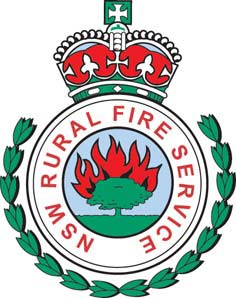
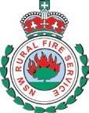
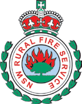
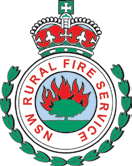

# NSW RFS Operational Protocol 1.1.2 — Remote Area Firefighting (RAF)

> **Source**: NSW Rural Fire Service
> **URL**: https://www.rfs.nsw.gov.au/__data/assets/pdf_file/0015/42306/OP-1.1.2-Remote-Area-Firefighting-RAF-1.4.pdf
> **Licence**: Crown copyright NSW; practitioner and public-information use
> **Retrieved**: 2026-05-07T13:40:20Z
> **SHA-256**: `7ca4f757d9951660caf7cdfe06dd906e6ceacac991d63979cdf61cfb1e0499f2`
> *Converted from PDF to Markdown format.*

---
## Page 1

OP 1.1.2 
Joint 
Operational Protocol 
For 
Remote Area Firefighting 
Between 
 New South Wales Rural Fire Service
And
National Parks and Wildlife Service 
Version 1.4
2022

---
## Page 2

Joint Operational Protocol  
OP 1.1.2 Remote Area Firefighting 
Page 2 of 5 
30 August 2022
 Version 1.4 
Joint 
Operational Protocol 
For 
Remote Area Firefighting (RAF) 
For the use of all members of the NSW Rural Fire Service (NSW RFS) 
And 
NSW National Parks and Wildlife Service (NPWS) 
Suggested Distribution: 
NSW RFS 
and 
NPWS 
Prepared by: 
Operational Support and Mitigation Services 
NSW Rural Fire Service 
42 Lamb Street, Glendenning 
Locked Bag 17, Granville 2142 
Telephone: (02) 8741 5555 
Fax: (02) 8741 5300 
Table of Contents 
1. Links
2. Superseded Protocol
3. Purpose
4. Qualifications
5. Deployment Management Remote Area Firefighting Teams
6. Aviation
Appendix A - RAFT Risk Analysis Checklist for Incident Controllers
NSW Rural Fire Service Specific Appendix 
Appendix B – NSW RFS RAFT Personal Equipment List 
Appendix C – NSW RFS RAFT Firefighting Equipment List 
Appendix D – NSW RFS RAFT Communications Kit

---
## Page 3

Joint Operational Protocol  
OP 1.1.2 Remote Area Firefighting 
Page 3 of 5 
30 August 2022
 Version 1.4 
1 Links 
NSW RFS / NPWS Operational Agreement – 2011 Remote Area Firefighting 
NSW and ACT Fire Agencies Bushfire Aviation Standard Operating Procedures 
2011 version 3.1 
NSW RFS RAF – (2005) (Remote Area Firefighter) Course Guide 
NSW RFS Remote Area Firefighting Doctrine  
NPWS Fire Management Manual 
2 Superseded Protocol 
2.1 This Operational Protocol supersedes RFS Operational Protocol 1.1.2 for 
Remote Area Firefighting (RAF) 2009.  
3 Purpose 
3.1 Early suppression of fires in remote terrain can be essential to preventing 
the natural development of large, potentially destructive fires.  The State 
has significant areas of bushland where rapid response to fire suppression 
operations by vehicle is not possible due to access, topography and/or the 
distance involved. 
3.2 Remote Area Firefighting Teams (RAFTs) are established as a pivotal tool 
to enable Incident Controllers to deal with these situations. RAFT 
deployment is task based and by its nature requires hard, protracted 
physical activity.  Personnel must meet strict medical, physical and 
competency standards. 
3.3 This Operational Protocol is for joint agency use by the NSW Rural Fire 
Service (NSW RFS) and NSW National Parks and Wildlife Service 
(NPWS).  This policy applies to any class of remote fire and includes 
remote prescribed burning operations.  Both agencies have a duty of care 
to ensure that their staff, volunteers and contractors tasked to remote area 
firefighting operations are competent and capable of undertaking the tasks 
allocated to them and that those tasks are undertaken as safely as 
possible.      
3.4 This Operational Protocol has been developed by the NSW RFS and 
NPWS to facilitate cooperative operations.  Other agencies working with 
the NSW RFS and/or NPWS may operate under their organisations existing 
operating procedures or guidelines.  The NSW RFS and NPWS will operate 
under this Operational Protocol when deployed in other agencie’s 
jurisdictions and it will be these agencies responsibility to ensure 
compliance with this Operational Protocol. 
3.5 NSW RFS RAFTs are established and administered at a District level as 
determined by the District management. 
3.6 NPWS RAFTs are established and administered at a regional level on a 
needs basis for incident deployment.

---
## Page 4

Joint Operational Protocol  
OP 1.1.2 Remote Area Firefighting 
Page 4 of 5 
30 August 2022
 Version 1.4 
3.7 Rapid Aerial Response Teams (RART) is a programme where specially 
trained firefighting teams (trained RAFT Firefighters) are placed on standby 
at appropriate times and in appropriate places, transported by helicopter to 
the scene of an incident when needed and, if necessary, transferred to the 
ground by winching or similar insertion techniques.  The deployment and 
coordination of RART is operated under the Operational Protocol for Rapid 
Aerial ResponseTeams. 
4 Qualifications for Remote Area Firefighting Team 
(RAFT) Firefighters 
4.1 
RAFT Firefighters 
RAFT Firefighters must be currently competent in Remote Area Firefighting 
as set by the respective Fire Agency.  The levels are outlined in the 
respective Fire Agencies Training Guidelines for Remote Area Firefighting 
(RAF). 
4.2 
RAFT Leaders 
RAFT Leaders are to be qualified in Crew Leader in their respective Fire 
Agency, as well as currently being competent in Remote Area Firefighting 
as set by the respective Fire Agency. 
5 Deployment Management Remote Area Firefighting 
Team (RAFT) 
5.1 RAFT Firefighters may typically be deployed to: 
(a) Areas that are only accessible by helicopter landing, hover entry/exit
and winching;
(b) Areas that are only accessible by boat;
(c) Areas that are only accessible by foot; and
(d) Carry out tasks that require a high level of fitness and endurance over
extended periods of time in steep and/or uneven terrain.  Such tasks
include extended periods of rake-hoe work and carrying of equipment.
5.2 The Incident Controller (IC) must only authorise deployment of RAFT 
following the completion of the RAFT Risk Assessment Checklist for 
Incident Controllers (appendix A). 
5.3 RAFT deployment will be included in the Incident Action Plan (IAP) 
detailing the following information that is specific to the RAFT operation: 
(a) Safety and contingency planning
(b) Communications and channel allocation
(c) Reporting mechanisms and timeframes
(d) Any other relevant factors that may affect the safe operation of the
RAFT
5.4 Prior to RAFT deployment the Incident Controller or a delegate must,

---
## Page 5

Joint Operational Protocol  
OP 1.1.2 Remote Area Firefighting 
Page 5 of 5 
30 August 2022
 Version 1.4 
(a) Conduct a briefing with the RAFT and provide an Incident Action Plan
(IAP), and
(b) Provide a situational map to each RAFT Firefighter
5.5 RAFT Firefighters are to be properly equipped for the assigned task as per 
each Fire Agency schedule of equipment for Remote Area Firefighting. 
5.6 In considering RAFT deployment Incident Controllers should be 
encouraged to consider the advantages of night operations. 
5.7 A RAFT will consist of a minimum of two Firefighters including one qualified 
RAFT Leader and must have at least one Firefighter qualified in First Aid. 
5.8 The RAFT Leader, in consultation with the RAFT and Aircrew will make the 
final determination whether or not the RAFT insertion takes place, utilising 
Crew Resource Management (CRM) process. 
5.9 If at any stage during the deployment the IC or RAFT Leader become 
concerned with the safety and welfare of the RAFT, they can authorise the 
need for immediate extraction or relocation to a safe area or safety refuge. 
6 Aviation 
6.1 There are various options for aerial insertion, these are landing, hover 
entry/exit and winching.  Winching should only be approved when other 
options are not possible.  Procedures must be in accordance with the NSW 
and ACT Fire Agencies Bushfire Aviation Standard Operating Procedures 
2011 version 3.1

---
## Page 6

Page 1 of 2 
30 August 2022
Joint Operational Protocol       
OP 1.1.2 Remote Area Firefighting 
Version 1.4 
Appendix A 
RAFT Risk Analysis for Incident Controllers 
The purpose of these questions is to ensure that the incident controller 
analyses the safe, effective and efficient deployment of RAFT.  This analysis is 
to be used as a guide and to inform the Incident Action Plan (IAP). 
Incident Name………………………………….     Date…………………….. 
1. Is close containment the best option? Has consideration been given to the
advantages and disadvantages of close containment versus broader
containment strategies?
2. Has consideration been given to the time taken to get to the fire ground and
whether sufficient gains can be made during shift lengths?
3. Has consideration been given to the effectiveness of RAFT night operations?
4. In initiating RAFT night operations has consideration been given to the
availability of extraction, the level of support required and relief opportunities?
5. Have fire weather conditions based on both the BOM Special Fire Weather
Forecast and fire ground weather , including current, forecasted and predicted
weather at deployment location for the period of deployment, been assessed?
Conditions that require special consideration include: temp>40º, RH<10%, wind
> 20kph, FBI 24 and above.
6. Are key weather parameters suitable for the deployment?
7. Throughout the deployment will weather conditions continue to be monitored
to ensure that if there are significant changes the deployment will need to be
re-evaluated?
8. Have the factors effecting fire behaviour including vegetation type, overall fire
hazard, slope, aspect and weather conditions been adequately assessed?
9. Are conditions conducive to safe and effective control?
Conditions that require special consideration including: size > 20 ha, active
edge > 1km, flame height > 1.5 m, Overall Fuel Hazard > High?
10. Has a safe insertion point been identified?
The RAFT Crew Leader, in consultation with their team and aircrew will make
the final determination whether or not the insertion takes place and confirm
extraction point for crews.
11. Have at least one (1) means of extraction and a safe refuge or two (2) means of
escape been identified?

---
## Page 7

Page 2 of 2 
30 August 2022
Joint Operational Protocol       
OP 1.1.2 Remote Area Firefighting 
Version 1.4 
12. Are adequate communications available to allow the crew leader to
communicate either directly or indirectly with the incident control centre?
13. Has consideration been given to proximity of medical assistance and the
possible need for additional designated medical resources eg deployment of
paramedic crew at heli base?
14. Have sufficient aircraft resources been identified to support the RAFT
deployment?
15. Are crews adequately equipped for the deployment, including overnight kits,
food, water and fire fighting tools?
16. Has an assessment of the deployment task considered the level of fitness and
physical exertion required to successfully complete the task?
17. Is the deployment more than 45 minutes from mechanical extraction?
If so, NPWS Moderate RAFT crews are not permitted to participate in this
deployment?
18. Are the available RAFT personnel appropriately experienced for the proposed
task?
19. Have key decision points or triggers for the extraction of crews been
identified?
20. Are there any special considerations that need to be examined prior to
deployment?
Prepared By: 
Approved By: 
Signature 
Signature: 
DTG: 
DTG:

---
## Page 8

Page 1 of 1 
30 August 2022
Joint Operational Protocol       
OP 1.1.2 Remote Area Firefighting 
Version 1.4
Appendix B 
Remote Area Firefighting Team Personal Equipment List 
The following equipment is designed as a minimum set of equipment for Remote 
Area Firefighters.  Equipment can be added to the kits on a local identified needs 
basis.   
1 x 30 Litre Back Pack Summit Gear Cockatoo RFS or similar 
1 x 3 litre Camelback Bladder or similar 
1 x Sleeping Bag 
1 x Sleeping Mat 
1 x Emergency solid fuel stove 
1 x Spare fuel stove tablets box 
1 x Headlight Yukon HL  
1 x Leatherman type tool 
1 x Compass with mirror Silva Ranger S or similar 
1 x 5 metres x 6mm Light Rope 
1 x Insect Repellent Bushmans Ultra 
1 x Oz Hiker Fly 350x210 hoochie 
2 x Matchbox waterproof 
1 x Screw gate Carabina 
1 x Personal First Aid Kit 
1 x Whistle Plastic Torpeko 
1 x Emergency Space Blanket 
1 x Nylon Poncho or Raincoat 
1 x Roll Heavy Duty 50mm tape 
2 x Cyallume sticks 
1 x 420ml Polypropylene cup 
1 x Polypropylene deep plate  
1 x Knife Fork Spoon set  
1 x Small aluminium billy 
1 x Notebook + Pencil

---
## Page 9

Page 1 of 1 
30 August 2022
Joint Operational Protocol       
OP 1.1.2 Remote Area Firefighting 
Version 1.4
Appendix C 
Remote Area Firefighting Team Firefighting Equipment 
The following equipment is designed as a minimum set of equipment for Remote 
Area Firefighters.  Equipment can be added to the kits on a local identified needs 
basis.   
Hand Tool Kit 
4 x McLeod Tools  
2 x Summit gear splat mats or equivalent 
1 x Summit Gear winch bag winch3-PB 
Chain Saw Kit 
1 x MS261 Stihl chainsaw with 16 inch bar 
1x Chain saw tool kit 
1 x Helmet with visor and ear muffs 
1 x Chainsaw chaps Stihl 
1 x File kit .325 
2 x Wedges alloy large 
2 x Fuel bottles MSR 887ml  
1 x Bar oil, bottle MSR 590ml  
1 x Axe with cover 
1 x Spare chain for chainsaw 
1 x Stump vice 
1 x Summit Gear chainsaw winch bag RFS-CB 
Pump Kit 
1 x 4 Stroke 25mm outlet pump Honda Gaam WX10 or similar, with suction hose 
and strainer 
1 x Pump tool kit 
3 x 25mm x 10m peculating storz coupled hoses 
1 x Dial a Jet Nozzle 
2 x Fuel bottles MSR 887ml  
1 x Summit Gear pump winch bag RFS-PB 
Blower Kit 
1 x Stihl BR600 leaf blower hi pressure 
1 x Blower tool kit  
2 x Fuel bottles MSR 887ml  
1 x Summit Gear blower winch bag RFS-BB 
1 x Ear protection

---
## Page 10

Page 1 of 1 
30 August 2022
Joint Operational Protocol       
OP 1.1.2 Remote Area Firefighting 
Version 1.4 
Appendix D 
Remote Area Firefighting Team Communications Kit 
The following equipment is designed as a minimum set of equipment for Remote 
Area Firefighters.  Equipment can be added to the kits on a local identified needs 
basis.   
1 x Motorola GRN portable radio 
1 x Charger unit 
1 x Spare battery 
2 x Fireground portable radios 
2 x Charger units 
2 x Spare batteries 
1 x Mid band frequency portable radio (NPWS, State Forests programmed) 
1 x Charger unit 
1 x Spare battery 
1 x PMR/40 channel UHF portable radio 
1 x Charger unit 
1 x Spare battery 
1 x GPS Garmin GPSMAP 78S or similar 
1 x 406 MHz personal EPIRB  
1 x Kestrel 3000 pocket weather meter 
1 x Personal strobe light  
1 x Dual radio chest harness 
1 x Hard Case Pelican or similar

