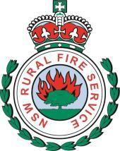
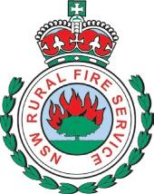

# NSW RFS Operational Protocol 1.2.14 — Prescribed Burning

> **Source**: NSW Rural Fire Service
> **URL**: https://www.rfs.nsw.gov.au/__data/assets/pdf_file/0007/245851/RFS-OPG-Prescribed-Burning.pdf
> **Licence**: Crown copyright NSW; practitioner and public-information use
> **Retrieved**: 2026-05-07T13:40:22Z
> **SHA-256**: `287e60341e95f65b6b39a4324768337681a70adb67af64a03fd795614ec05c6f`
> *Converted from PDF to Markdown format.*

---
## Page 1

Prescribed Burning Activities General 
Operational Protocol 
Owner: Predictive Services 
Maintained by: Operational Performance 
Issue Date: June 23 
Page 1 of 3 
 
 
 
1 Scope 
This Operational Protocol must be followed when conducting prescribed burning activities. 
2 Protocol 
› All prescribed burning activities where RFS members are in attendance must be 
approved by the Fire Control Officer (FCO/District Manager) or, their absence, a Deputy 
Fire Control Officer (DFCO), for the relevant rural fire district. Prescribed burning 
activities may include agricultural and pile burns. 
› A Basic Burn Checklist or a Prescribed Burn Plan must be completed for all prescribed 
burns, except for pile burns that are in accordance with the RFS Standards for Pile 
Burning, refer to RFS OPG - Planning for a Prescribed Burn. 
› A prescribed burn plan must be approved by the FCO or delegate and the Burn Incident 
Controller (BIC), before the burn is conducted. The FCO or delegate must not sign the 
plan more than 12 months prior to the burn being conducted. 
› An Operational Map is required for all Level One (Simple) and Level Two (Complex) 
prescribed burns. The operational map must be made available to all personnel on the 
fireground. 
› A prescribed burn plan must take into account the safety of members of the public and 
personnel participating in the burn activity, the protection of property, the protection of 
environmental values and associated legislative requirements. 
› In preparing a prescribed burn plan, a planner should consider whether consultation with 
specialists is necessary. For example; Environment Services, Aviation - Incendiary 
Operations Supervisor (IOS) and/or Predictive Services (Fire Behaviour Analysis, 
Smoke Modelling, Weather Advice). 
› An effective system of command/control and communications in accordance with 
Incident Control System (ICS) principles must be applied. 
› The prescribed burn shall be under the overall coordination of a BIC. 
› The FCO must ensure that all hazard reduction prescribed burning proposals and 
completed activities, including completed prescribed burn plan documentation, is entered 
into the current RFS system. 
3 Special Considerations 
› Procedures applied during the burn activity are to be of the same safety standard as 
those specified for equivalent activities conducted in Fireground operations. 
› The LACES safety checklist system (Lookouts – Awareness – Communications – 
Escape routes – Safety refuges) is to be applied to all prescribed burning activities. 
4 Related Information 
Basic Burn Checklist 
Prescribed Burn Plan Template - Level One SIMPLE  
Prescribed Burn Plan Template - Level Two COMPLEX 
NSW Interagency Prescribed Burn Field Operations Attachment 
Prescribed Burn Operational Map Guidelines 
Prescribed Burn Operational Map Example 
Request to Enter Land to Assess Bush Fire Risk 
RFS Hazard Reduction Consent Letter 
RFS Hazard Reduction Notification Letter 
Land Owner Occupier Request for Assistance Letter

---
## Page 2

Prescribed Burning Activities General 
Operational Protocol 
Owner: Predictive Services 
Maintained by: Operational Performance 
Issue Date: June 23 
Page 2 of 3 
 
 
 
5 Definitions 
 
AAR 
After Action Review - Similar to a debrief, an AAR involves 
describing what was intended, what actually happened, 
what mistakes were made and how participation might 
improve in the future. 
Basic Burn Checklist 
Very low risk burns as determined by the Fire Control 
Officer. 
BIC 
Burn Incident Controller - The person who has overall 
control of the burn and is responsible for the implementation 
of the prescribed burn plan in the field. The Burn Incident 
Controller is responsible to a senior officer, such as the Fire 
Control Officer who is remote from the burn site. 
BOM 
Bureau of Meteorology - Australia's national weather, 
climate, and water agency which provides regular weather 
forecasts, warning advice for floods, fires and storms, and 
also monitoring and advice for the Australian region and 
Antarctic territory. 
CLW or CLG 
Crew Leader Wildfire - Members must have successfully 
completed Advanced Firefighter (including API, CSW, HYD, 
NAV & WFB). 
DDO 
District Duty Officer 
DFCO 
Deputy Fire Control Officer 
FBA 
Fire Behaviour Analysis 
FBI 
The Fire Behaviour Index - provides a scale of potential fire 
danger (should a fire start) based on the predicted rate of 
fire spread. 
FCO 
Fire Control Officer (District Manager) 
ICS 
Incident Control System - An operational management 
system adopted by the RFS for integrating personnel, 
procedures, facilities, equipment and communications into a 
common organisational structure. 
IOS 
Incendiary Operations Supervisor 
IWF 
Incident Weather Forecasts - provides critical information 
relating to key weather parameters (e.g. wind changes, 
potential for thunderstorms/precipitation, and condition 
uncertainties) to incident managers to help them make 
important operational decisions. 
Level One (Simple) 
Prescribed Burn 
A prescribed burn characterised by low risk, low intensity, 
small area, low potential impact on assets, completion in 
one shift and minimal variation of fuel and terrain. (As 
determined by the Fire Control Officer).

---
## Page 3

Prescribed Burning Activities General 
Operational Protocol 
Owner: Predictive Services 
Maintained by: Operational Performance 
Issue Date: June 23 
Page 3 of 3 
 
 
 
Level Two (Complex) 
Prescribed Burn 
A prescribed burn characterised by moderate to high risk, a 
range of fire intensities, medium to large areas, significant 
potential impacts on assets and may involve a variety of 
fuels and terrain. The burn operation may involve a large 
number of resources requiring the establishment of a formal 
management and support structure. It may require several 
separate ignitions (ground and/or aerial), possibly over 
several days. It may have a number of high value assets 
requiring complex protection actions. (As determined by the 
Fire Control Officer). 
Prescribed Burning 
The controlled application of fire under specified 
environmental conditions to a predetermined area and at a 
time, intensity, and rate of spread required to attain planned 
resource-management objectives. 
Prescribed Burn Plan 
An approved plan that incorporates the specifications and 
conditions under which the operation is to be conducted.

---
## Page 4

Planning for a Prescribed Burn 
Operational Protocol 
Owner: Predictive Services 
Maintained by: Operational Performance 
Issue Date: June 23 
Page 1 of 2 
 
 
 
1 Scope 
This Operational Protocol must be followed when planning for a specific prescribed burn. 
2 Protocol 
Basic Burn Checklist (Pile Burns, Windrow Burns & Very Low Risk Burns only) 
› A Basic Burn Checklist records information about the activity being undertaken. It must 
be completed when a brigade is assisting a landowner/occupier in conducting a burn that 
is inconsistent with the RFS Standards for Pile Burning (e.g. a windrow), or for a very low 
risk burn, e.g. a routine agricultural burn. 
› The landowner/occupier is responsible for obtaining all relevant environmental 
approvals, obtaining a fire permit if required (refer to Part 4 Division 5 of the Rural Fires 
Act 1997), making notifications and establishing control lines. 
› The Basic Burn Checklist can be completed by the Officer in Charge on the day of the 
burn. The activity requires Fire Control Officer (FCO) approval. 
Prescribed Burn Plans 
› Prescribed Burn Plans describe the desired outcomes of the activity and suggest the 
operational tactics to be implemented. The plans also allow for the recording of 
information during and after the activity. 
› A Prescribed Burn Plan must be prepared when the RFS is proposing and conducting a 
simple/complex prescribed burn. The contents of the prescribed burn plan may vary 
depending on the size, nature of the hazard and safety issues associated with the 
proposed activity. The FCO, or Deputy Fire Control Officer (DFCO), is to consider the 
complexity of the burn and select the most appropriate level of plan. 
› There are two Prescribed Burn Plan options available: 
› Level One (Simple) Prescribed Burn Plan; or 
› Level Two (Complex) Prescribed Burn Plan. 
Level One (Simple) Prescribed Burn Plan 
› A simple prescribed burn is characterised by low risk, low intensity, small area, low 
potential impact on assets, completion in one shift and minimal variation of fuel and 
terrain. The plan must conform to the Prescribed Burn Plan Template Level One 
SIMPLE. 
› The Prescribed Burn Operational Map should conform to the Prescribed Burn 
Operational Map Guidelines. 
› An Operational Map must be made available to all personnel on the fireground. 
› RFS District staff are responsible for ensuring the completion of the prescribed burn plan 
and Operational Map, however Volunteer Members may assist with the preparation. 
Level Two (Complex) Prescribed Burn Plan 
› A complex prescribed burn is characterised by moderate to high risk, a range of fire 
intensities or ignition methods, medium to large areas, significant potential impacts on 
assets and may involve a variety of fuels and terrain. The plan must conform to the 
Prescribed Burn Plan Template Level Two COMPLEX. 
› The Prescribed Burn Operational Map should conform to the Prescribed Burn 
Operational Map Guidelines. 
› An Operational Map must be made available to all personnel on the fireground.

---
## Page 5

Planning for a Prescribed Burn 
Operational Protocol 
Owner: Predictive Services 
Maintained by: Operational Performance 
Issue Date: June 23 
Page 2 of 2 
 
 
 
› The minimum information provided to all personnel on the fireground is a completed A3 
NSW Interagency Prescribed Burn Field Operations attachment. 
› RFS District staff are responsible for ensuring the completion of the prescribed burn plan 
and Operational Map, however Volunteer Members may assist with the preparation. 
3 Special Considerations 
Consents for RFS to conduct Prescribed Burn Activities 
› The RFS requires consent from land owners or occupiers to enter their land for the 
purpose of planning, preparing and undertaking a prescribed burn (hazard reduction). 
› A Request to Enter Land to Assess Bush Fire Risk Form must be used when the RFS is 
assessing an area for a proposed Hazard Reduction Burn. 
› An RFS Hazard Reduction Consent Letter must be sent to a landowner when the RFS is 
initiating the proposal to undertake a prescribed burn. In this case, the RFS would be 
responsible for obtaining all relevant environmental approvals, making notifications, and 
establishing control lines. 
› An RFS Hazard Reduction Notification Letter should be used to notify adjoining 
landowners/occupiers of the prescribed burn activity. 
› A Certificate of Currency is NOT required unless specifically requested. Refer to ONE 
NSWRFS for an application. 
Requests for RFS Assistance in undertaking Prescribed Burn Activities 
› A formal request letter is required from the land owner/s or occupier/s when a request is 
made for RFS assistance in undertaking a prescribed burn. The land owner/occupier 
must use the Landowner/Occupier Request for Assistance Letter template. 
› In this case, the landowner would be responsible for obtaining all relevant environmental 
approvals, a fire permit (refer to Part 4 Division 5 of the Rural Fires Act 1997), making 
notifications and establishing control lines. 
› Note: under Part 4 Division 5 of the Rural Fires Act 1997, Section 95 Fire Permits are not 
required for fires lit by public authorities. 
4 Related Information 
NSW Environment Protection Authority 
RFS - Bush Fire Hazard Reduction Certificate (application process) 
RFS Fire Permit 
RFS Standards for Pile Burning 
Rural Fires Act 1997 
Rural Fires Regulation 2022

---
## Page 6

Preparing for a Prescribed Burn 
Operational Protocol 
Owner: Predictive Services 
Maintained by: Operational Performance 
Issue Date: June 23 
Page 1 of 2 
 
 
 
1 Scope 
This Operational Protocol must be followed when preparing for a specific prescribed burn. 
2 Protocol 
In preparing a prescribed burn, confirmation should be sought on the following: 
› That an appropriate prescribed burn plan has been prepared and approved within 12 
months of the burn being conducted; 
› That all information is adequately addressed in the prescribed burn plan; 
› That conditions in the area of the burn are still as described in the prescribed burn plan. 
Such conditions may include; land status and tenure, occupancy, fuel type, fuel moisture 
content, fuel load, and topography; 
› That control lines are completed and the burn is fully prepared; 
› The A3 NSW Interagency Prescribed Burn Field Operations attachment with an 
Operational Map printed on the back is completed as the minimum information required 
for field personnel; 
› That weather forecasts for prescribed burning activities have been provided from official 
sources (Bureau of Meteorology [BoM]). An Incident Weather Forecast (IWF) is 
recommended for Level Two Complex burns; 
› Note - IWF requests should be made to BoM by 1400 for same day processing. 
› That all notifications have been completed and the burn activity is recorded in the current 
RFS systems; 
› The burn can be implemented to safely achieve the objectives of the prescribed burn 
plan under the current/forecasted weather and fuel moisture conditions/readings, within 
the planned operation period; 
› Assess appropriate timing for implementation of prescribed burning, including on site 
conditions and weather forecast; 
› Resources required to safely implement the burn are available; 
› Contingency arrangements have been established; and 
› That smoke impact has been considered, and if required, smoke modelling and analysis 
has been requested. All requests are to be emailed to FBA@rfs.nsw.gov.au. 
› Smoke modelling is required for prescribed burns with a planned area of over; 
› 10ha in proximity to high density or high risk population centres, 
› 50ha for low density or low risk population centres. 
Confirmation is also required that the personnel involved in the burn are currently 
competent. In particular that: 
› For Basic Burns, the Burn Incident Controller (BIC) should be competent to RFS Crew 
Leader level (CLW or CLG or equivalent); 
› For all prescribed burns undertaken using the Level One Simple Prescribed Burn Plan, 
the BIC should be accredited in this competency Conduct Simple Prescribed Burn or is 
authorised in writing by the Fire Control Officer (FCO), to undertake the burn in 
accordance with this protocol; and 
› For all prescribed burns undertaken using the Level Two Complex Prescribed Burn Plan, 
the BIC should be accredited in this competency Conduct Complex Prescribed Burn or is 
authorised in writing by the FCO to conduct the burn in accordance with this protocol.

---
## Page 7

Preparing for a Prescribed Burn 
Operational Protocol 
Owner: Predictive Services 
Maintained by: Operational Performance 
Issue Date: June 23 
Page 2 of 2 
 
 
 
3 Special Considerations 
Nil. 
4 Related Information 
Rural Fires Act 1997

---
## Page 8

Conducting a Prescribed Burn 
Operational Protocol 
Owner: Predictive Services 
Maintained by: Operational Performance 
Issue Date: June 23 
Page 1 of 2 
 
 
 
1 Scope 
This Operational Protocol must be followed when conducting a prescribed burn. 
2 Protocol 
› The safe and effective conduct of a prescribed burn requires careful and thorough 
planning to ensure that the objectives can be safely achieved. 
› If the Fire Behaviour Index (FBI) exceeds the optimum FBI range (typically up to 11 for a 
low intensity burn) specified in the prescribed burn plan, then the ‘FBI exceeded checklist’ 
must be completed and the decision of whether to proceed or not must be made by the 
Burn Incident Controller (BIC) and final approval to proceed given by the Fire Control 
Officer (FCO) or delegate. 
› Prior to ignition, the BIC shall complete the Burn Incident Controller Checklist located in 
the prescribed burn plan (Appendix 1) to ensure that all necessary precautions and 
planning details have been considered and are in place. 
› Prior to ignition, the BIC shall notify the FCO (or delegate) of the imminent intention to 
implement the prescribed burn plan. 
› Procedures used during a prescribed burn are to be of the same safety standard as 
those specified for equivalent activities conducted in Fireground operations. 
› A burning operations log must be completed by the BIC. 
› A Safety Officer reporting directly to the BIC is to be appointed for all prescribed burns. 
At Level One Simple burns and Basic Burns, the function of the Safety Officer may be 
retained as part of the role of the BIC. Where this occurs the role must be carried out as 
an integral function. 
› Prior to ignition, all personnel are to be briefed using the SMEACS format and provided 
access to an A3 Operational Map for Level One and Level Two Burns. The A3 NSW 
Interagency Prescribed Burn Field Operations attachment is the minimum information 
required for all Level Two Complex burns. 
› Ignition of the burn is to be under the overall coordination of the BIC. 
› The prescribed burn should be planned around suitable containment lines and with 
suitable refuge areas and escape routes in place. Ignition patterns/lighting sequence 
must not place personnel at risk whilst undertaking operations. 
› It is the responsibility of the BIC to monitor and record burn site weather readings at the 
start of the burn, hourly during the burn and at the completion of the burn. Additional 
readings may be required during the burn if unpredicted weather changes occur. 
› Once the burn is contained, the burn area is to be secured and patrolled until the BIC is 
confident that the burn is completely extinguished. Ensure adequate resources are 
established during the patrol period, including night patrol where required. 
› The BIC is responsible for the burn until the burn is declared out or is handed over. If the 
BIC is unable to monitor the burn site, the FCO/District Duty Officer (DDO) may assume 
responsibility. Monitoring forecast weather and regular or systematic patrol of the burn 
perimeter must continue until the burn is declared out. 
› Pile burns or windrows that have the potential to continue smouldering undetected must 
have a mineral earth break established around the perimeter of the burnt area. Where 
the fire has been left in the care of the property owner, and if a permit is required, the 
permit must have a condition for the maintenance and patrol of this break.

---
## Page 9

Conducting a Prescribed Burn 
Operational Protocol 
Owner: Predictive Services 
Maintained by: Operational Performance 
Issue Date: June 23 
Page 2 of 2 
 
 
 
3 Special Considerations 
Nil. 
4 Related Information 
Australian Fire Danger Rating System: AFDRS 
RFS – Bush Fire Environmental Assessment Code  
RFS Hazard Reductions 
Rural Fires Act 1997

---
## Page 10

Evaluating a Prescribed Burn 
Operational Protocol 
Owner: Predictive Services 
Maintained by: Operational Performance 
Issue Date: June 23 
Page 1 of 1 
 
 
 
1 Scope 
This Operational Protocol must be followed when evaluating a specific prescribed burn. 
2 Protocol 
› It is important that burn outcomes are evaluated and recorded in as much detail as 
appropriate. This information is useful for future planning and should form part of the 
documentation of the burn report. 
› All personnel involved in a prescribed burn should participate in an After Action Review 
(AAR) at the appropriate level as deemed by the Burn Incident Controller (BIC). 
› The AAR should follow the standard format of: 
› What did we set out to achieve? 
› What actually happened? 
› What can we do better next time? 
› For Level One Simple and Level Two Complex prescribed burns, the BIC shall complete 
an After Action Review located in the prescribed burn plan (Appendix 4). 
› The BIC should provide the District Office/ Fire Control Officer (FCO) with the following 
documents as soon as practical after the completion of the burn: 
› A copy of the completed prescribed burn plan including operations log and any 
additional documents. 
› A post burn assessment, in accordance with the relevant prescribed burn plan template, 
must be conducted by the Prescribed Burn Planner and the BIC (where possible). Where 
any remedial action is required consult with the FCO. 
› Where a prescribed burn resulted in an accident, near miss, or significant escape of fire, 
or damage to any asset, the FCO shall initiate an investigation of the burn, under 
relevant Operational Procedures and Guidelines (OPG). 
3 Special Considerations 
Nil. 
4 Related Information 
Lessons Management Framework 
Rural Fires Act 1997

