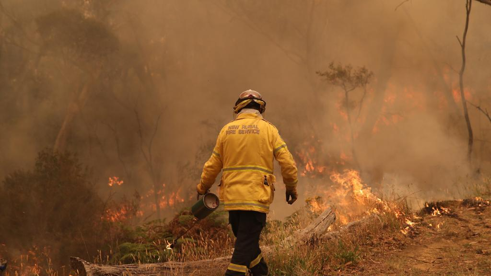

# NSW RFS Operational Protocol 1.2.20 — Backburning

> **Source**: NSW Rural Fire Service
> **URL**: https://www.rfs.nsw.gov.au/__data/assets/pdf_file/0006/189402/OP-1.2.20-Backburning.pdf
> **Licence**: Crown copyright NSW; practitioner and public-information use
> **Retrieved**: 2026-05-07T13:40:26Z
> **SHA-256**: `febeaab30d5952272ef3d3e003e6684e7496e482a74fbf1c51b0d7168dace229`
> *Converted from PDF to Markdown format.*

---
## Page 1

 
OP 1.2.20 OPERATIONAL PROTOCOL FOR 
BACKBURNING 
 
 
 
 
 
 
 
 
 
 
 
Prepared by the Operations Directorate

---
## Page 2

 
NSW RURAL FIRE SERVICE – OP ON BACKBURNING  V1.5 08/22  
PRINTED DOCUMENTS ARE UNCONTROLLED 
2 of 10 
 
Document control 
Release history 
Version 
Date 
Author 
Summary of changes 
0.1 
21 Sept 2020 
Supt. Dan Meijer 
Initial Draft 
Multiple 
October 2020 
Supt. Dan Meijer 
Revisions with consultative groups and key 
personnel 
1.0 
14 October 2020 
Supt. Dan Meijer 
Edit to final draft for approval 
1.1 
27 October 2020 
Supt. Dan Meijer 
Revisions from Dep Commissioner. 
1.2 
20 December 2020 
Supt. Dan Meijer 
Revisions from feedback across workforce 
1.3 
28 January 2021 
Supt. Dan Meijer 
Revisions from Dep Commissioner. 
1.4 
22 February 2020 
Supt. Dan Meijer 
Revisions from NPWS 
1.5 
19 August 2022 
Matthew Atkins 
Reviewed in line with AFDRS 
Reviewed by 
Name 
Title 
Date 
Consultative Group 
Various 
7-8 Oct 2020 
Ch. Supt. Josh Atkins 
Manager, Operational Performance 
14 Oct 2020 
Asst. Comm. Ben Millington 
Director, State Operations 
25 Feb 2021 
Approved by 
Name 
Title 
Date 
Dep. Comm. Peter McKechnie 
A/Executive Director, Field Operations 
26 Feb 2021 
Related documents 
Document name 
Version 
NSW RFS Fireground SOPs 
1999 
Cover photo: David Swift 
Consultative Group: 
Gp. Capt. Craig Burley – Air Attack Supervisor (Hawkesbury District)  
Gp. Capt. Peter Conn (Orana Team) 
Gp. Capt. Ken Pullen (Hawkesbury District) 
Gp. Capt. Craig Walters (Orana Team) 
Gp. Capt. Grant Wargren (Hornsby/Ku-ring-gai District) 
Capt. Syd McRoy (Mid Coast District) 
Supt. Jim Darrant – S44 IC (Monaro Team) 
Supt. Karen Hodges – S44 IC (Hawkesbury District) 
Supt. Roger Orr – S44 IC (Riverina Zone)

---
## Page 3

 
NSW RURAL FIRE SERVICE – OP ON BACKBURNING  V1.5 08/22  
PRINTED DOCUMENTS ARE UNCONTROLLED 
3 of 10 
 
Contents 
 
1 
LINKS ............................................................................................................................................. 4 
2 
SUPERSEDED PROCEDURE ....................................................................................................... 4 
3 
PURPOSE ...................................................................................................................................... 4 
4 
HAZARDS AND PRECAUTIONS .................................................................................................... 5 
4.1 
Hazards and Risks ............................................................................................................... 5 
4.2 
Precautions .......................................................................................................................... 5 
5 
PERSONAL PROTECTIVE EQUIPMENT ....................................................................................... 5 
6 
OPERATIONAL PROCEDURES .................................................................................................... 5 
6.1 
Types of backburns .............................................................................................................. 5 
6.2 
Backburning Considerations ................................................................................................. 6 
6.3 
Approval for Backburns ........................................................................................................ 6 
6.4 
Recording Backburning Activity ............................................................................................ 7 
7 
OPERATIONAL GUIDANCE ........................................................................................................... 7 
7.1 
Resourcing ........................................................................................................................... 7 
7.2 
Ignition ................................................................................................................................. 8 
7.3 
Independent Review when FDR Approaches Severe ........................................................... 8

---
## Page 4

 
NSW RURAL FIRE SERVICE – OP ON BACKBURNING  V1.5 08/22  
PRINTED DOCUMENTS ARE UNCONTROLLED 
4 of 10 
 
1 LINKS  
› NSW RFS Fireground SOPs (1999) 
› Final Report of the NSW Bushfire Inquiry (2020) 
› NSW Coroner’s Report on the Inquest into the 2017 Fire at Flagview South, Sir Ivan Dougherty Drive, 
Leadville (2019) 
› AFAC Guideline on Aerial Ignition Operations 
 
2 SUPERSEDED PROCEDURE 
› NSW RFS Fireground SOP #17 (1999) 
 
3 PURPOSE 
 
This Operational Protocol outlines protocols for strategic and tactical backburning; the recording of backburn 
implementation and results; and a process for a review of strategic backburns at State level. 
 
The 2020 Independent Inquiry into the 2019-2020 bush fires identified that there was a need to expand the NSW 
RFS’s protocols regarding backburning.  
 
Recommendation 47  
That, in order to enhance fire fighting strategies in severe conditions, the NSW RFS implements the following in 
respect to backburning:  
a) establish protocols for each category (tactical and strategic) within their operational and training doctrine. These 
protocols should include lessons learnt from the 2019-20 season  
b) modify ‘ICON’ to implement the capability to record all backburns, including whether or not they break 
containment lines  
c) when fire conditions are approaching Fire Behaviour Index (FBI) 50 or above, an independent review must be 
undertaken at State Operations Level before strategic backburns are implemented  
d) where there is significant concern within a community regarding a backburn, the NSW RFS should undertake a 
community engagement session with affected residents to discuss the backburn, including any investigation and 
relevant findings. 
 
This Operational Protocol addresses parts a) and c) of this Recommendation. 
  
Multiple Observations collected by the NSW RFS after the 2019-2020 bush fires from across the NSW RFS and 
external agency members, collected under the Lessons Management Framework, were concerned with 
backburning. While some Observations were positive about the way that backburns were implemented and the 
success they had in containing fire spread, some also identified what appears to be a disconnect between 
firefighters in the field, and those in IMTs, regarding understanding the difference between strategic and tactical 
backburns, and the processes around undertaking each type. 
 
The Inquiry’s findings discussed the balance required between empowering crews in the field to undertake tactical 
backburning when conditions were suitable and the initiative could be taken, with recognising the broader situational 
awareness held by the IMT of factors not generally apparent to crews in the field, including the effect that a backburn 
may have on the overall firefighting effort if not undertaken as part of the overall Incident Action Plan (IAP). It also 
identified the need for Crew Resource Management (CRM) principles such as error-checking in certain conditions 
to be formalised in processes.  
 
These discussions mirror those to be found in the 2019 Coronial Inquiry into the 2017 Sir Ivan fire at Leadville, 
regarding the differing levels of situational awareness between IMTs and crews in the field.

---
## Page 5

 
NSW RURAL FIRE SERVICE – OP ON BACKBURNING  V1.5 08/22  
PRINTED DOCUMENTS ARE UNCONTROLLED 
5 of 10 
 
4 HAZARDS AND PRECAUTIONS 
4.1 Hazards and Risks 
Hazards associated with backburning may include, but are not limited to: 
• 
Backburn is commenced in incorrect location. 
• 
Effects of heat and smoke on firefighters. 
• 
Incorrect lighting techniques leading to extension of fire area and impact.  
• 
Falling trees and branches. 
• 
Spot fires. 
• 
Insufficient resources or time allowed resulting in burn not being contained. 
• 
Unexpected deterioration in fireground weather conditions leading to increase in burn intensity and 
potential escape. 
• 
Lack of broader situational awareness leading to burns being implemented which then have a detrimental 
effect on the overall operation. 
• 
Insufficient safety margins in control lines. 
4.2 Precautions 
Precautions to be taken when conducting backburns include: 
• 
Ensuring adequate resources are allocated to conduct, mop-up, and patrol the backburn safely and 
effectively. 
• 
Calculating likely work rates to ensure that the burn is completed before the main fire impacts the area. 
• 
Use of suitable ignition techniques and patterns. 
• 
Inclusion of local knowledge into backburn planning and supervision wherever possible. 
• 
Thorough briefing of crews, and provision of Sitreps, to maximise situational awareness. 
• 
Appreciation of weather, topography, fuel type and arrangement. 
• 
Ensuring that wherever possible, crews assigned to the backburn have experience in the type of country 
where they will be working. If not, direct supervision from suitably experienced personnel is required. 
• 
Individual skills including risk assessment, hazard identification, lighting patterns, equipment and PPE/C 
use 
5 PERSONAL PROTECTIVE EQUIPMENT 
 
All personnel involved in backburning operations must have a complete set of bush fire PPC/E available to them 
at all times. 
 
6 OPERATIONAL PROCEDURES 
 
6.1 Types of backburns 
Backburning refers to using fire on an area of land ahead of a bush fire’s progress, to remove fuel from between an 
established control line (natural or constructed) and the going fire edge. Backburning is a technique which may be 
used in an offensive bush firefighting strategy, under the tactics of parallel attack or indirect attack. 
 
Depending on their scale and objective, backburns are classed as either strategic or tactical.  
 
Strategic Backburning  
Strategic Backburning is used as one of the primary means to halt the main fire or to secure the spread of parts of 
a fire. It is proactive, generally conducted over a larger area than Tactical Backburning, and may involve 
implementing burns of hundreds of metres up to kilometres in length and depth. Strategic Backburning is planned 
and informed by a range of personnel including fireground commanders, members with local knowledge, and Fire

---
## Page 6

 
NSW RURAL FIRE SERVICE – OP ON BACKBURNING  V1.5 08/22  
PRINTED DOCUMENTS ARE UNCONTROLLED 
6 of 10 
 
Behaviour Analysts, and is usually part of the plan in the IAP. It is carefully co-ordinated, suitably resourced and 
must only be conducted with approval from the Incident Controller. Strategic backburns usually increase the 
effective area that is involved in fire. 
 
Tactical Backburning  
Tactical Backburning is used to protect specific assets or for other small-scale purposes. It is conducted at a small 
scale, often within limits of the OIC’s visibility. It is conducted at the discretion of field commanders and/or Brigade 
and Group officers, often reactively, and is not usually contained in the IAP. It must not interfere with other firefighting 
operations and is generally conducted under orders from the officer in charge of the area which it will affect. Tactical 
backburns do not usually influence the overall fire path or progression of the fire.  
 
Burning Out is a technique where fire is intentionally lit to consume sections of unburnt fuel inside a fire area, to 
remove patches of fuel in case of spotting or fire flare-ups in anticipated deteriorating weather conditions. Its 
conditions are similar to Tactical Backburning. 
 
It is extremely important that all members understand the difference between these types of backburns. A backburn 
that cannot be easily controlled by the appliances present, and that will notably contribute to growth of the overall 
fire area, should always be considered strategic, not tactical. 
 
6.2 Backburning Considerations 
All backburning should be strictly supervised, and details of plans and implementation must be recorded.  
 
Command personnel at all levels – crew, Sector, Division, and IMT - should ensure that: 
• 
Weather and fuel conditions are suitable for a controllable backburn. 
• 
Adequate time and resources are available for the backburning operation (eg: tankers, firefighters, look-
outs, communications, etc) including for contingency plans if the situation changes. 
• 
Backburning is commenced and completed from suitable, safe “anchor” point/s. 
• 
Firefighters light-up on the correct side of the firebreak and use appropriate lighting patterns. 
• 
Spot-overs can be quickly extinguished with resources present at the scene. 
• 
Firebreaks are sufficiently wide to be effective. 
• 
Wind direction and strength and relative humidity are monitored for change. 
• 
If firefighters can no longer see or communicate with one another, by sight, voice, or radio, they are to 
cease lighting-up until they can. Supervising officers should have direct communications with lighting 
parties wherever possible. 
• 
Backburns are used to strengthen existing control lines. 
• 
Firefighters on the ground are consulted regarding backburn plans and strategies wherever practicable. 
 
Backburning should not be conducted when: 
• 
People or saveable property, fodder, crops, livestock, etc, are in the area to be burnt by the proposed 
backburn. However, the IC may vary this requirement depending on specific circumstances. 
• 
Current or anticipated weather conditions are likely to render a backburn uncontrollable or unable to be 
completed safely and effectively.  
• 
Consideration has not been made for time required for mop-up and patrol before the onset of bad 
weather. 
• 
There are no adequate control lines. 
• 
There is insufficient time or resources to conduct the backburn. 
• 
Burning is prohibited by the Incident Controller, or a prohibition on Backburning is noted in the IAP. 
ICs and IMTs should empower field commanders to undertake tactical backburns when the situation and weather 
permits, in the knowledge that tactical backburns do not contribute to the overall growth or path of the fire. Field 
commanders must recognise the situational awareness over the broader fireground that is held by the IC/IMT, as 
well as its accountability, which may not be immediately apparent to crews on the ground. 
 
6.3 Approval for Backburns 
 
For Tactical Backburns and Burning Out, approval must be obtained from the officer in charge of the area in 
which the backburn is being conducted, eg Sector or Divisional Commander (for small Class 1 fires where the IC is

---
## Page 7

 
NSW RURAL FIRE SERVICE – OP ON BACKBURNING  V1.5 08/22  
PRINTED DOCUMENTS ARE UNCONTROLLED 
7 of 10 
 
in the field, the next level of command may be the Incident Controller). This is to ensure that situational awareness 
at a higher level is obtained and maintained, and so that records can be kept. This must be notified upwards in 
routine Sitreps and recorded in logs. 
 
For Strategic Backburns, approval must be obtained from the Incident Controller. Depending on fireground 
organisation, this may first go through a Division Commander and an Operations Officer. Strategic backburns are 
rarely initiated at short notice in the field, and are generally identified as part of an overall IAP. 
 
When a Strategic Backburn is being considered, and the Fire Behaviour Index in the next 36 hours from time of 
ignition exceeds or is forecast to exceed 50, the Incident Controller must contact the MIC Desk or State Duty 
Operations Officer for an independent review to be convened by officers approved by the State Operations 
Controller (SOC); the support or otherwise from the review is to be noted in the incident logs. In Class 1 fires where 
the IC is in the field, the District Duty Officer may facilitate this process with the FCO and MIC on behalf of the IC. 
 
Command personnel should seek to approve backburns unless there are clear concerns regarding factors including 
safety, resourcing, effectiveness, timeliness, etc. 
 
6.4 Recording Backburning Activity 
 
All backburning activities must be recorded. All personnel in command roles should maintain a log of activities, 
decisions, and other details throughout their shift; these logs should form the basis of regular Sitreps up to the next 
level of command. ICs and Duty Officers are to ensure that strategic backburn plans, approvals, resources, 
progress, and results are recorded in the approved operational management system. 
 
For Strategic Backburns, regardless of class of fire, the following should be recorded. 
- 
The IC’s intent. 
- 
A description of the aim of the backburn, related to the intent and objectives, with the anticipated end-state. 
- 
A description of the risks involved with the backburn. 
- 
A consequence analysis addressing the potential consequences of: 
o 
The backburn being implemented successfully. 
o 
The backburn being implemented unsuccessfully, or if it escapes control. 
o 
The backburn not being implemented at all. 
- 
A fire weather forecast for the area. 
- 
A map illustrating the above. 
- 
A list of assigned and available resources, and any border/jurisdictional issues. 
- 
The contingency plan for if the backburn is unable to be conducted or completed safely and effectively 
 
All command personnel must ensure that plans for backburns and progress of approved backburns are regularly 
reported upwards in routine Sitreps. 
 
7 OPERATIONAL GUIDANCE 
 
7.1 Resourcing 
All personnel in command roles are to ensure that they determine and report the required resources in order for a 
backburn to be implemented and concluded safely and effectively. This will involve considering required preparation 
of control lines, the work rate of crews in the given topography and vegetation, the current and forecast weather 
conditions, time available before the main fire reaches the area of the backburn, type of resources available and 
able to access the fireground, crew numbers and fatigue levels, heavy plant and aviation support, etc. 
Where possible, a Safety Officer should review Strategic backburn plans and advise the IC as to whether or not the 
resources allocated are sufficient for safe execution of the plan. In Class 1 fires where the IC is in the field, the 
District Duty Officer may provide similar support.

---
## Page 8

 
NSW RURAL FIRE SERVICE – OP ON BACKBURNING  V1.5 08/22  
PRINTED DOCUMENTS ARE UNCONTROLLED 
8 of 10 
 
7.2 Ignition 
 
When undertaking a backburn, firefighters must consider using different lighting patterns depending on conditions, 
slope, aspect, vegetation, weather, and fuel moisture content, so as to ensure that the burn is implemented as safely 
and effectively as possible. Where time and conditions permit, consideration should be given to cooler, less intense 
burning practises – similar to considerations when conducting prescribed burns. If Aerial Ignition options are being 
considered, discussion should include the Air Operations Manager and/or any Air Attack Supervisors available. 
 
In general, fires lit from a single point (spot ignition) will take much longer to reach the average rate of spread for 
the given conditions. However, fires lit in strips will reach their maximum rate of spread very quickly after ignition. 
Officers may direct a change in lighting patterns dependant on observed fire behaviour. 
 
It is important that prevailing weather conditions, atmospheric stability, vegetation type and arrangement, 
topography, and fuel loads are considered when determining how backburns will be lit. This should be mentioned 
in the IAP if ground truthing of the area has been conducted, otherwise field commanders must take the effect of 
lighting patterns into account when translating the IAP into a set of practical orders for their area of responsibility. 
 
When a backburn reaches the fire front, the junction zone will experience in a notable increase in fire intensity and 
flame height, as well as an increase in spotting activity. In particular, tactical backburns must consider these effects 
owing to the smaller scale of these operations and the likelihood of the junction zone being located closer to 
firefighters and exposures than in strategic backburns. 
 
Aerial ignition 
 
Aerial ignition (AI) is regularly used to implement or enhance larger-scale backburns, as well as burning out or infill 
of underburnt areas after containment has been established. When AI operations are undertaken, an Incendiary 
Operations Supervisor (IOS) must be appointed. As with all other requirements for strategic backburns, AI work 
must be conducted in line with the considerations in Sec 6.4. Of particular importance are the provision of maps 
clearly showing AI requirements, and ensuring that AI will not result in current or future threat to personnel, public, 
or assets, though fire behaviour prediction. 
 
The IOS will determine rate of incendiary drop, placement, and spacing, to achieve the IC’s intent in line with the 
IAP. The IOS will also ensure that the area of operation is clear of ground personnel, and will monitor for and 
communicate hazards. 
 
AI crews (and Air Observers) can be an excellent source of fireground Intelligence and Situational Awareness to 
the IC and field commanders, regarding backburn progress, conditions, and problems. Personnel must ensure that 
communications are maintained between the IOS, the Air Operations Manager (AOM), and field commanders, and 
that intelligence on ignition and burn progress is captured in regular Sitreps and shared. 
 
7.3 Independent Review when FBI Approaches 50+ 
 
When a Strategic Backburn is being considered, and the Fire Behaviour Index in the 36 hours from the time of the 
burn is forecast to exceed 50, the Incident Controller must contact the MIC Desk or State Duty Operations Officer 
to request an independent review be convened by officers approved by the State Operations Controller (SOC). 
 
The Independent Review will require the IC to provide: 
- 
The current IC’s intent. 
- 
A description of the aim of the backburn, related to the intent and objectives, with the anticipated end-state. 
- 
A description of the risks involved with the backburn. 
- 
A consequence analysis addressing the potential consequences if: 
o 
The backburn being implemented successfully. 
o 
The backburn being implemented unsuccessfully or if it escapes control. 
o 
The backburn not being implemented at all. 
- 
A fire weather forecast for the area. 
- 
A map illustrating the above. 
- 
A list of assigned and available resources, and any border/jurisdictional issues.

---
## Page 9

 
NSW RURAL FIRE SERVICE – OP ON BACKBURNING  V1.5 08/22  
PRINTED DOCUMENTS ARE UNCONTROLLED 
9 of 10 
 
- 
The contingency plan for if the backburn is unable to be conducted or completed safely and effectively. 
 
If time allows, the above should be provided in written form. If time pressures are critical, the above may be provided 
verbally. Either way, the IC must ensure that the above information is entered into ICON as soon as is practicable, 
in the Event Log and/or as attached documents. In Class 1 fires where the IC is in the field, the District Duty Officer 
is to facilitate this process on behalf of the IC. 
 
The Independent Review will be convened by the SOC, who will consult suitable officers as required, such as Fire 
Behaviour Analysts. The SOC will advise the IC if the strategic backburn plan is supported or not. The Reviewers 
must ensure that the review’s result and reasons are entered into the approved operational management system 
for the incident.

---
## Page 10

 
NSW RURAL FIRE SERVICE – OP ON BACKBURNING  V1.5 08/22  
PRINTED DOCUMENTS ARE UNCONTROLLED 
10 of 10 
 
OP 1.2.20 
Backburning 
Procedural Checklist 
 
 
Is the predicted benefit of the backburn greater than the risks if the backburn is not carried out? 
 
For Strategic Backburns: 
 
Does the backburn fit the IC’s intent and plan as per the IAP? 
 
Has the IC approved the backburn after reviewing with the Safety Officer, where one is 
appointed? 
 
Are resources allocated to the burn sufficient to implement and mop the burn up, and deal with 
any spot fires which may occur? 
 
Have the backburn’s plans, maps, and associated information been entered into ICON? 
 
If the FBI is or is likely to exceed 50 before the burn is mopped up or in the next 36 hours, has the 
MIC/SDOO been contacted for an Independent Review? 
 
For Tactical Backburns: 
 
Is the risk of putting fire on the ground outweighed by the risk if the burn is not conducted? 
 
Is this burn small in scale, and able to be controlled by the appliances currently located in the 
immediate area? 
 
Has the next person in the chain of command been notified and given approval to light? 
 
Are all firefighters tasked with carrying out the burn capable of implementing it safely and 
effectively? 
 
Do you have situational awareness of where the burn may run if not controlled, and the location of 
nearby crews? 
 
Are suitable resources and personnel available? 
 
Have all personnel involved in backburning been briefed regarding the conducting of the burn, ignition 
plans and locations, contingencies, etc? 
 
Have tactical communications been established for the backburn area?  
 
Can the backburn be completed (including mop-up) in time, considering resourcing, weather, terrain, and 
fire progression? 
 
Have you noted in your log, the backburn plan, approvals, and progress? 
 
 
 
 
 
For further information regarding OP 1.2.20, please contact Operational Performance via 
ops.performance@rfs.nsw.gov.au

