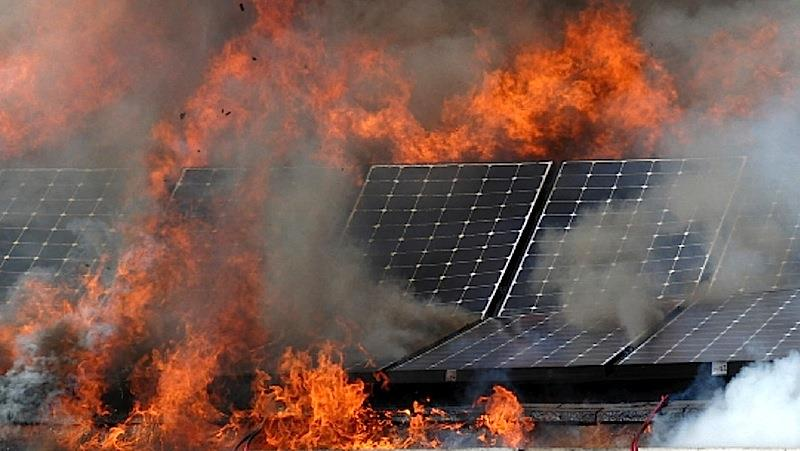
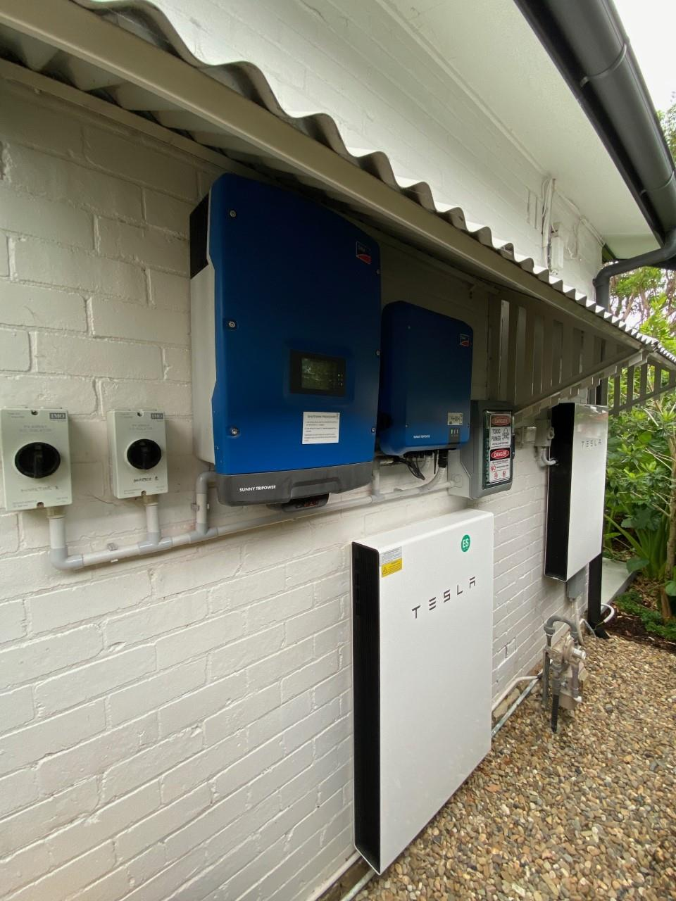
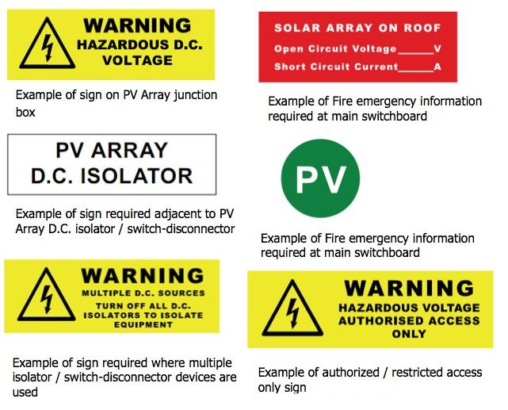
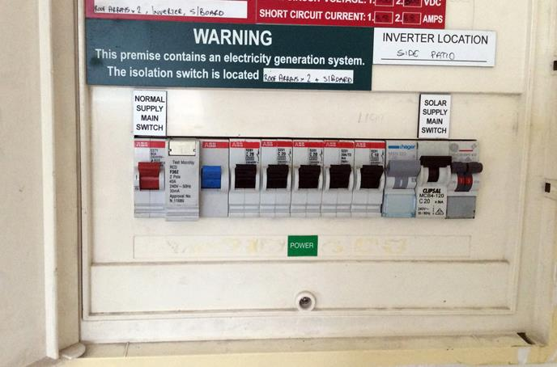
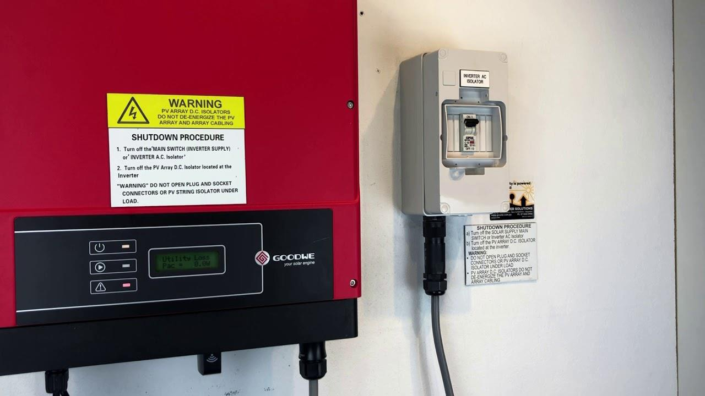
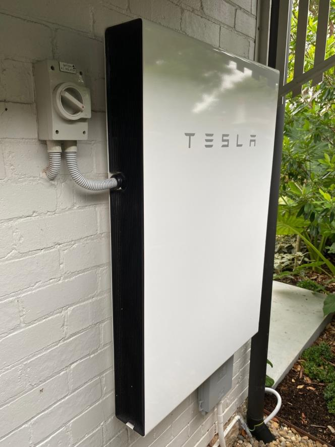
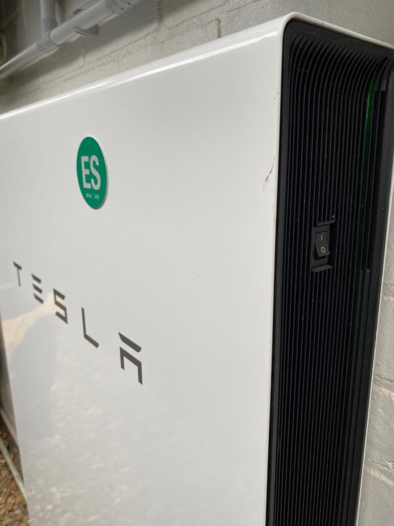

# NSW RFS Operational Protocol 1.2.22 — Photovoltaic Arrays

> **Source**: NSW Rural Fire Service
> **URL**: https://www.rfs.nsw.gov.au/__data/assets/pdf_file/0004/247891/OP-1.2.22-Photovoltaic-Arrays.pdf
> **Licence**: Crown copyright NSW; practitioner and public-information use
> **Retrieved**: 2026-05-07T13:40:32Z
> **SHA-256**: `72d6981585471d4bc695cb78157e13b04bb77f94fe5f9f0a60f2e5459bd235b0`
> *Converted from PDF to Markdown format.*

---
## Page 1

 
OP 1.2.22 OPERATIONAL PROTOCOL FOR 
INCIDENTS INVOLVING PHOTOVOLTAIC 
(SOLAR) ARRAYS AND BATTERY ELECTRIC 
STORAGE SYSTEMS 
 
 
 
 
 
 
 
 
Prepared by the Preparedness & Capability Directorate

---
## Page 2

 
NSW RURAL FIRE SERVICE – OP1.2.22 Photovoltaic Arrays  
PRINTED DOCUMENTS ARE UNCONTROLLED 
2 of 13 
 
Document control 
Release history 
Version 
Date 
Author 
Summary of changes 
0.1 
2020 
Supt. D. Meijer 
Revision of previous drafts 
0.2 
May 2021 
Supt. D. Meijer 
Addition of major facility section 
0.3 
May 2022 
Supt. D. Meijer 
Revision of procedural checklist 
Reviewed by 
Name 
Title 
Date 
Ch. Supt. Josh Atkins 
Manager Operational Performance 
20 May 2022 
Assist. Comm. Paul Seager 
Director Training & Doctrine 
23 May 2022 
 
 
 
Approved by 
Name 
Title 
Date 
Dep. Comm. Kyle Stewart 
Deputy Commissioner Preparedness & Capability 
24 May 2022 
Dep. Comm. Peter McKechnie 
Deputy Commissioner Field Operations 
19 Dec 2022 
 
 
 
Related documents 
Document name 
Version 
Guideline for Incidents involving photovoltaic array and battery energy storage systems, AFAC 
2020 
 
Australian Standard 5033:2014. 
 
CFA Design Guidelines and Model Requirements for Renewable Energy Facilities 2022 
 
FRNSW SOG 14-7 Alternative Power Sources

---
## Page 3

 
NSW RURAL FIRE SERVICE – OP1.2.22 Photovoltaic Arrays  
PRINTED DOCUMENTS ARE UNCONTROLLED 
3 of 13 
 
Contents 
 
1 
LINKS ............................................................................................................................................. 4 
2 
SUPERSEDED PROCEDURE ....................................................................................................... 4 
3 
PURPOSE ...................................................................................................................................... 4 
4 
HAZARDS AND PRECAUTIONS .................................................................................................... 4 
4.1 
Hazards ................................................................................................................................ 4 
5 
PERSONAL PROTECTIVE EQUIPMENT ....................................................................................... 5 
6 
OPERATIONAL PROCEDURES .................................................................................................... 6 
6.1 
Power Isolation ..................................................................................................................... 6 
6.2 
Solar Panels involved in fire ................................................................................................. 8 
6.3 
Solar Panels damaged in storms .......................................................................................... 8 
6.4 
Solar Panels in floods ........................................................................................................... 8 
6.5 
Battery Electrical Storage Systems (BESS) involved in fire .................................................. 9 
6.6 
Incident Handover .............................................................................................................. 10 
7 
OPERATIONAL GUIDANCE ......................................................................................................... 10 
7.1 
Grid-Connect Systems ....................................................................................................... 11 
7.2 
Stand-Alone Systems ......................................................................................................... 11 
7.3 
Solar Farms and Large Scale Installations ......................................................................... 12 
7.4 
Procedural Checklist .......................................................................................................... 13

---
## Page 4

 
NSW RURAL FIRE SERVICE – OP1.2.22 Photovoltaic Arrays  
PRINTED DOCUMENTS ARE UNCONTROLLED 
4 of 13 
 
1 LINKS  
› Guideline for Incidents involving photovoltaic array and battery energy storage systems, AFAC 2020 
› Australian Standard 5033:2014. 
› FRNSW SOG 14-7 Alternative Power Sources 
› CFA Design Guidelines and Model Requirements for Renewable Energy Facilities 2022 
 
2 SUPERSEDED PROCEDURE 
Nil 
 
3 PURPOSE 
 
This Operational Protocol is designed to assist firefighters to work safely at incidents where Photovoltaic (PV, or 
Solar) arrays and/or Battery Electric Storage Systems (BESS) are present. It is to be used as part of overall 
electrical safety procedures. 
 
4 HAZARDS AND PRECAUTIONS 
 
4.1 Hazards 
 
The presence of an alternative power source may not be obvious. It should (but may not) be indicated on or near 
the switchboard. 
During daylight hours a solar system will continue to generate electricity even if the system is shut down or the solar 
panels are damaged. 
A potentially lethal voltage may therefore be present at: 
› the panels, 
› in DC cabling on the array side of the disconnection switch; or 
› in any other conducting material in contact with damaged system components. 
Where internal DC cable may have been impinged by fire or mechanical damage, a risk assessment of internal 
operations must take into account the fact that lethal voltages may be present in the internal cables or conductive 
materials touching them and that AC detection equipment will not detect DC voltage. 
Wires between solar panels and isolator switches may still be live even when the isolator has operated. 
At night, solar arrays will not generate dangerous voltages unless exposed to intense light such as emergency 
vehicle floodlights or flames shining directly on the solar array. 
A solar array that is not generating electricity at night will start producing electricity once daylight returns. 
Commencement of electricity generation once daylight returns has the potential to cause arcing in damaged DC 
cabling – a known ignition source.  
Solar systems also pose a hazard in that accessing them requires crews to work safely at height. 
Covering Solar panels is theoretically an effective method of controlling the electrical hazard from a solar array. 
However, while NSW RFS crews do not carry materials that have been tested and proven to completely block light, 
crews should not attempt to cover solar arrays. 
During floods, water in contact with solar panels may be live.

---
## Page 5

 
NSW RURAL FIRE SERVICE – OP1.2.22 Photovoltaic Arrays  
PRINTED DOCUMENTS ARE UNCONTROLLED 
5 of 13 
 
Some solar systems may include battery electrical storage systems (BESS) for use when the system is not 
energized. Size-up must include determining the presence of batteries and the likelihood that the system may 
remain energized even if panels are isolated. 
An example of domestic PV inverter installation with dual BESS: 
 
 
5 PERSONAL PROTECTIVE EQUIPMENT 
All members attending incidents involving Solar Arrays and/or BESS will wear either: 
› Structural fire fighting ensemble including gloves, with helmet visor down. 
› Bush fire fighting ensemble including gloves, with goggles worn.

---
## Page 6

 
NSW RURAL FIRE SERVICE – OP1.2.22 Photovoltaic Arrays  
PRINTED DOCUMENTS ARE UNCONTROLLED 
6 of 13 
 
6 OPERATIONAL PROCEDURES 
 
6.1 Power Isolation 
Electrical power should be turned off before commencing operations in structures. Pre-incident plans should 
identify facilities where uninterrupted power may be required (eg health care facilities). 
On arrival at an incident in a building, the Incident Controller (IC) must check whether premises have Solar/BESS 
systems fitted as part of their incident size-up. 
AS/NZS 5033:2014 requires signage to be installed at switchboards and fuse boxes, and cables connected to 
Solar systems to be clearly marked. Examples are shown below: 
 
 
 
Crews must be aware that signage may not be installed or visible at all premises. A visual external 
check is required at all incidents involving structures to determine if a solar array and/or BESS is 
present. 
 
Firefighters should turn off systems by operating isolators and AC mains switches. However, current will still be 
present between the Solar panels and the isolator. Only a Solar-qualified electrician can confirm that a solar array 
is completely isolated, as this requires disconnection of wiring from the Solar panels. 
 
To turn off a solar array: 
› Liaise with the owner/occupier of the premises for information on system shut-off. 
› Turn off the AC Solar Supply main switch at the switchboard  
› Turn off the AC Power Supply switch next to the inverter 
› Operate the disconnection switch(es) in the DC system. First switch off the DC switch(es) next to the inverter; 
then (if there is one, and it can be accessed safely) switch off the DC switch(es) next to the panels. Not all 
systems will have this last switch. 
› Isolate any BESS present by operating the switch on the unit as well as its AC isolator.

---
## Page 7

 
NSW RURAL FIRE SERVICE – OP1.2.22 Photovoltaic Arrays  
PRINTED DOCUMENTS ARE UNCONTROLLED 
7 of 13 
 
An example of Solar Supply Main Switch on a domestic switchboard: 
 
 
 
An example of AC Power Supply Switch next to inverter:

---
## Page 8

 
NSW RURAL FIRE SERVICE – OP1.2.22 Photovoltaic Arrays  
PRINTED DOCUMENTS ARE UNCONTROLLED 
8 of 13 
 
 
 
When solar arrays are present, operations should be restricted to actions which save life or prevent the 
dangerous expansion of the incident. 
When a solar array is damaged, personnel should be excluded from areas around Solar panels, switchboards, 
wiring and inverters, and any conductive materials which may be in contact with damaged components of the 
array. 
If a solar system is undamaged, personnel may not need to be excluded from the above areas. 
Firefighters must not rely on AC current detection devices (eg Modiwarks) as they do not detect the DC 
current generated by solar arrays. 
 
 
6.2 Solar Panels involved in fire 
If Solar panels or isolators attached to them are on fire: 
› Conduct firefighting from the ground. Do not get onto the roof, or use a ladder as roof/gutter materials may be 
electrified. 
› Extinguish the fire with a fog nozzle, using a broken stream in a spray pattern. 
› If Solar Panels are at ground level, consider using a CO2 extinguisher, maintaining an air gap between the 
extinguisher and electrified components. 
 
6.3 Solar Panels damaged in storms 
When working near solar panels which have been damaged in storms: 
› Assume that the entire solar system is live 
› Establish an exclusion zone of at least 3m from any damaged solar components. If damaged components are 
in contact with conductive material, increase the exclusion zone to 8m. 
› Isolate the solar system. 
6.4 Solar Panels in floods 
Before a flood. 
If a solar system is in an area likely to be affected by floodwater: 
› Turn off the solar system..  
› If the floodwater level will reach the Solar panels – and there is time – advise the owner/occupier to have their 
electrician isolate the Solar power system.  
 
During a flood. 
If a solar system is affected by floodwater: 
› Assume that the Solar panels, inverter, associated wiring and surrounding area are live. Assume the 
floodwater and any conductive material in contact with the solar power system is live. 
› Do not attempt to turn off the solar power system. 
› Establish an Exclusion Zone of 8 metres around the solar panels and conductive material. 
 
After a flood. 
If a solar system has been affected by floodwater: 
› Assume that the Solar panels, inverter, associated wiring and surrounding area are live. Assume any 
conductive material in contact with the Solar panels is live. 
› Establish an Exclusion Zone of 8 metres around the Solar panels

---
## Page 9

 
NSW RURAL FIRE SERVICE – OP1.2.22 Photovoltaic Arrays  
PRINTED DOCUMENTS ARE UNCONTROLLED 
9 of 13 
 
6.5 Battery Electrical Storage Systems (BESS) involved in fire 
A BESS is similar to the battery in an electric or hybrid motor vehicle. The presence of a BESS can mean additional 
hazards, and fires may require different extinguishment techniques. 
 
An example of a domestic BESS; note the large AC isolator switch on the wall, and the small on/off switch on the 
BESS itself. Both need to be switched off when involved in an incident. 
 
 
BESSs may contain a range of chemicals, from lithium to lead acid, depending on model and age.  
 
A BESS is to be regarded as energised and appropriate hose streams used. BESSs use DC current; remember 
that current AC voltage detectors will not give an alert in the presence of DC current.   
 
If a BESS is involved in fire, thermal runaway may occur. Thermal runaway is a chemical reaction where a cell fails 
inside a battery and a short circuit ignites the electrolyte, releasing excessive heat, toxic gases, and flammable 
vapours. The heat may affect surrounding cells also sending them into thermal runaway. 
 
Indicators of thermal runaway in a battery are:  
› Intense or uneven areas of heat on the battery surface  
› Smoke or vapour from the battery.  
 
Cooling with water can potentially prevent thermal runaway. Water is the best extinguishing agent as foam does not 
assist in cooling and may inhibit use of a thermal imaging camera (TIC) to identify affected areas of the battery. 
 
Firefighters should wear structural PPC and CABA and only attempt to fight the fire if a dynamic risk assessment 
indicates that it is safe to do so. An exclusion zone of at least 8m must be maintained for all other personnel. If 
structural PPC and CABA is not available for crews on scene, a crew with that capability should be requested to 
attend. Bush fire PPC and respirators do not offer sufficient protection for firefighters from thermal runaway fires.

---
## Page 10

 
NSW RURAL FIRE SERVICE – OP1.2.22 Photovoltaic Arrays  
PRINTED DOCUMENTS ARE UNCONTROLLED 
10 of 13 
 
A large and sustained supply of water may be required (at least 4000 litres). The battery needs to be cooled for 15 
minutes, then checked with a thermal imaging camera. After ambient temperature is reached, the battery needs to 
be monitored for up to 60 minutes, then checked again. In the instance of a large scale BESS – for example inside 
an industrial building or on a large-scale outdoor installation – there may potentially be multiple appliances required 
to effectively extinguish a fire and cool the BESS. Ensure that rapid scale-up (with appropriate command and 
control) is considered. 
Depending on BESS construction and available resources, a defensive strategy may be adopted, protecting 
exposures as the BESS burns itself out. 
 
If a BESS casing is breached, there is potential for hazardous materials to enter the environment. Ensure that 
Firecom is advised and FRNSW is notified. 
 
Isolating a solar panel system will not isolate a BESS, which will remain energised. The BESS isolator must also be 
operated and the BESS itself switched off. The battery retains its stored current even when isolated, which can be 
a hazard to firefighters. If a TIC is not available, the attendance of an appliance with one should be requested 
through Firecom. 
 
6.6 Incident Handover 
Crews are to brief a person (eg home owner) or organisation (eg facility management) taking possession of an 
incident scene, to warn of potential for secondary ignition in BESS, and recommend the attendance of a solar-
qualified electrician. Incident reports should note details of this handover. 
 
7 OPERATIONAL GUIDANCE 
 
Domestic solar systems can generate voltages up to 650V DC and high amperages. Noncontact voltage detectors, 
commonly used by agencies, do not have the ability to detect DC voltages. The energy produced by a solar system 
is sufficient to kill emergency workers. 
 
The regulatory systems surrounding the design, installation and testing of solar systems will change given local 
considerations and improvements in technology. It therefore needs to be understood that systems will differ, and 
the experience from working with one system at an incident will not necessarily translate to the next incident. 
 
The publication of AS/NZS 5033:2012 (2012, revised in 2014) Installation and Safety Requirements for Photovoltaic 
(PV) Arrays should become a driver toward standardisation in solar arrays, including those provisions covering 
signage for fire and emergency services. Systems installed before the publication of that standard may not meet 
the requirements set out in it and such systems number hundreds of thousands across Australia and New Zealand 
combined. 
 
Electricity supply providers do not, in most jurisdictions, provide support to emergency services in relation to 
alternative energy systems. It is generally accepted that the owner of the alternative energy system is responsible 
for its management. However at the time of the incident, the owner or occupier may not be available or if they are, 
may not have the ability to isolate the system. 
 
Persons that install solar systems are required to hold the appropriate qualifications for this task. However once the 
system has been affected by fire or other incident conditions, their skills and knowledge to safely isolate the system 
may be insufficient. Incident controllers have a responsibility to satisfy themselves as to the capability of third parties 
before allowing them to undertake isolation functions on the incident ground.  
 
District Pre-Incident Planning may identify local solar-accredited electricians who are available for dispatch to 
emergency incidents to provide Incident Controllers with technical advice. 
 
There are two main types of solar systems: Grid‐connect and Stand‐alone. Generally, there is only one type of solar 
system at a site; however other alternative energy systems may also be present. Consideration of the presence of 
a solar system should always form part of the size up of any emergency incident involving a structure.

---
## Page 11

 
NSW RURAL FIRE SERVICE – OP1.2.22 Photovoltaic Arrays  
PRINTED DOCUMENTS ARE UNCONTROLLED 
11 of 13 
 
7.1 Grid-Connect Systems 
 
A Grid-Connect System is a solar system that is connected to the electricity grid allowing the associated premises 
to draw grid power where necessary, and for surplus power from the solar array to be fed back into the grid. These 
systems may include a BESS, enabling the system/building to maintain power independently of the grid. 
 
The key components are: 
› PV panels connected together to form solar arrays 
› DC cabling 
› Inverter 
› Main Switchboard 
› Disconnection switches (sometimes referred to as ‘isolation’ switches, these switches disconnect the solar array 
from the inverter, but do not isolate the solar system because the panels and associated wiring up to the first 
disconnection switch remain live). 
› BESS may be present. 
 
7.2 Stand-Alone Systems 
 
A Stand-Alone System is a solar system that is not connected to the electricity grid so that the circuits it powers rely 
on battery storage (BESS) to provide current when insufficient solar electricity is being generated. Other alternative 
energy systems may also be present at premises with standalone solar systems. 
 
The key components are: 
› Solar panels connected together to form solar arrays 
› DC cabling 
› Charge controller and storage batteries 
› Inverter (in some systems) 
› Main Switchboard 
› Disconnection switches 
› BESS 
 
The most obvious visual indicators of a solar system being present at a site include 
› Visible solar panels 
› Presence of an inverter or charge controller 
› Presence of a BESS visible from the outside of a building. 
› Signage at the main switchboard or connection point for other power supply (for example a grid supply service 
fuse) advising of the presence of an alternate energy power source. 
 
Personnel working at an incident must not assume that the absence of one or more of these indicators excludes 
the possibility of a solar system being present. For example, solar panels on a roof may be invisible from street 
level. Inverters may be mounted on interior walls or in garages and not visible from outside a building.

---
## Page 12

 
NSW RURAL FIRE SERVICE – OP1.2.22 Photovoltaic Arrays  
PRINTED DOCUMENTS ARE UNCONTROLLED 
12 of 13 
 
7.3 Solar Farms and Large Scale Installations 
 
Development Planning and Approval. 
› Developers of large scale installations should consult with NSW RFS and FRNSW during the development 
application process (as per NSW Planning's "Large Scale Solar Energy Guideline.") 
› NSW RFS will advise the developer of design features required for installations planned for bush fire prone land. 
 
 
Pre-Incident Plans. 
 
Districts and Brigades should work with the management of large scale solar installations in their areas, to develop 
appropriate plans and familiarisation activities, for the event of: 
› A nearby bush or grass fire potentially impacting the installation 
› A fire within the installation  
› A fire within the installation escaping and causing a bush or grass fire. 
 
Large scale solar facilities must have an emergency management plan which should be shared with the local District 
office. Attention must be drawn to whether the facility is for generation and transmission, battery storage of power, 
or both. 
 
Firefighting in and around large scale solar installations 
 
› Firefighting activities will not occur within 8m of any generation infrastructure (such as panels, batteries, or 
transmission infrastructure), or by accessing a fenced-off area, without explicit assurance from the facility 
manager of de-energisation of the infrastructure. 
› Procedures for fires within large scale installations will be managed in the same way as fires in other electrical 
infrastructure such as substations, and in accordance with the facility emergency management plan. 
› Large scale solar facilities threatened by bush fires are triaged and defended in the same way as other significant 
infrastructure. 
› Fires involving BESS are treated as in Sec 6.5 however scale is to be taken into account; multiple appliances 
are likely to be required unless there is reticulated water son site. 
› The presence of hazardous materials involved in the incident is to be reported to FRNSW.

---
## Page 13

 
NSW RURAL FIRE SERVICE – OP1.2.22 Photovoltaic Arrays  
PRINTED DOCUMENTS ARE UNCONTROLLED 
13 of 13 
 
OP 1.2.22 
Photovoltaic Arrays and Battery Electrical Storage Systems. 
7.4 Procedural Checklist 
 
 Has a complete scene size-up been completed to determine if a PV array and/or BESS is 
present? 
 Have isolator switches at the switchboard, inverter, and BESS been operated to isolate the 
system? 
 Has Firecom been advised that a PV array or BESS is involved in the incident? 
 If a BESS is involved in fire, is CABA and a TIC available? If not, has a crew with this equipment 
been requested from Firecom? 
 Have all personnel been told to maintain safe distances from PV arrays/BESS? 
 If a BESS is involved, has it been confirmed to be at ambient temperature before ceasing 
operations? 
 After the incident is concluded, has the scene been handed to someone with advice of potential 
reignition of BESS, and details of that person recorded? 
 
 
 
 
 
For further information regarding OP 1.2.22., please contact the NSW Rural Fire Service by email 
operational.performance@rfs.nsw.gov.au

