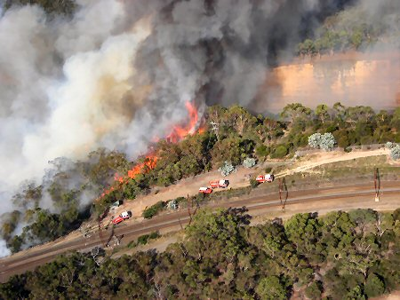
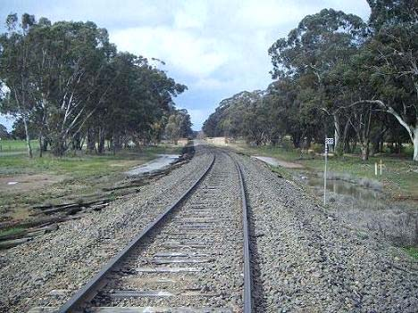
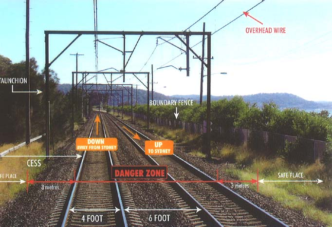
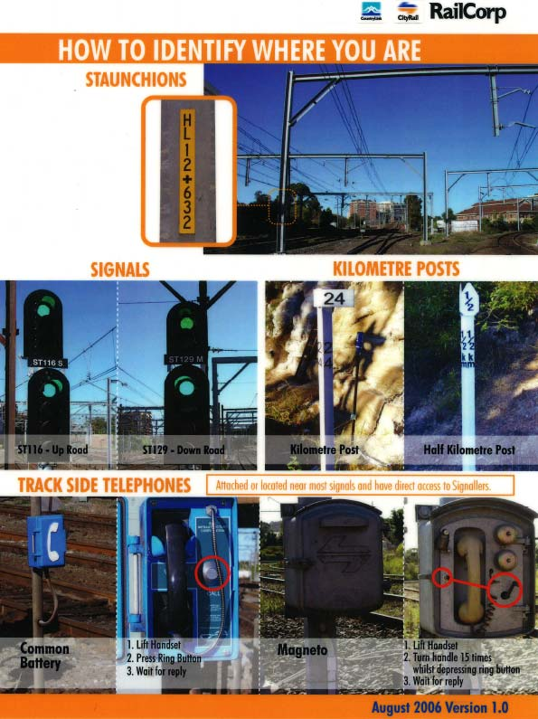
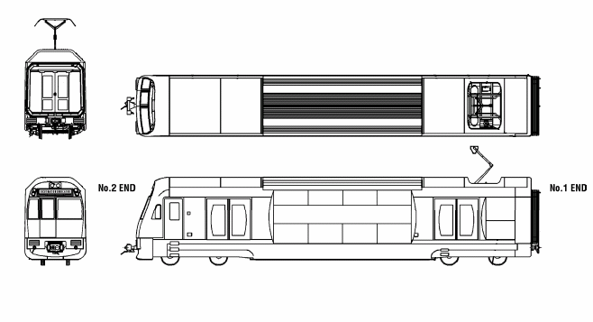
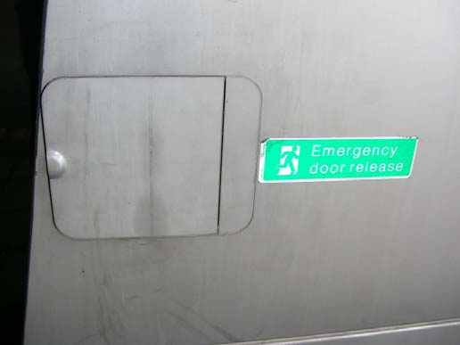
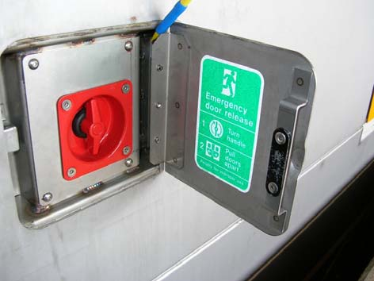

# NSW RFS Operational Protocol 1.2.3 — Working in the Rail Corridor

> **Source**: NSW Rural Fire Service
> **URL**: https://www.rfs.nsw.gov.au/__data/assets/pdf_file/0018/42282/OP-1.2.3-Working-in-the-Rail-Corridor.pdf
> **Licence**: Crown copyright NSW; practitioner and public-information use
> **Retrieved**: 2026-05-07T13:40:28Z
> **SHA-256**: `03be0acafa127ae892c10bd8ce3d15f60130a886aae2a7f9ad82fdd478e9141a`
> *Converted from PDF to Markdown format.*

---
## Page 1

 
 
 
 
OP 1.2.3 
Operational Protocol  
for 
Working in the  
Rail Corridor

---
## Page 2

 
OP 1.2.3 
OPERATIONAL PROTOCOL 
FOR 
 
WORKING IN THE RAIL CORRIDOR 
 
 
 
 
 
 
 
Prepared by: 
 
Operational Services 
NSW Rural Fire Service 
15 Carter St, Lidcombe 2127 
Locked Bag 17, Granville 2142 
Telephone: (02) 8741 5555 
Fax: (02) 8741 5300 
 
 
Table of Contents 
 
TITLE 
PAGE 
Dictionary ............................................................................................................ 1 
1. 
............................................................................................................. 2 
Links
2. 
................................................................................. 2 
Superseded Procedure
3. 
........................................................................................................ 2 
Purpose
4. 
.......................................................................................... 4 
The Rail Corridor
5. 
................................................ 6 
Identifying Your Location in the Rail Corridor
6. 
.............................................................................. 7 
Hazards and Precautions
7. 
......................................................................... 7 
Personal Protective Clothing
8. 
................................................................................ 8 
Operational Procedures
9. 
................................................................................. 12 
Operational Guidance
 
Procedural Checklist................................................................................... 13 
 
Appendix 1 
 
   Emergency Telephone Numbers ............................................................. 14

---
## Page 3

 
 
Dictionary 
Appliance 
An operational firefighting vehicle with visible and audible 
warning devices. 
ARTC 
Australian Rail Track Corporation (ARTC), the Federal 
Management Agency for the rail corridor, outside of the 
electrified rail corridor.  This includes the area of New South 
Wales outside of the area bounded by Hamilton Junction 
(Newcastle) in the north, Bowenfels (Lithgow) in the west and 
Bomaderry (Kiama) on the south coast and Macarthur in the 
south.  The ARTC manages this corridor under a 60 year 
leasing arrangement between the Australian Federal 
Government and the NSW State Government as of September 
2004.  ARTC has responsibility for the rail corridor and the 
maintenance of lines; it manages the timetables for the 
movement of freight across the rail system, but does not own 
rolling stock. 
Emergency 
An emergency due to an actual or imminent occurrence (such 
as fire, flood, storm, earthquake, explosion, accident, epidemic 
or warlike action) which: 
(a) endangers, or threatens to endanger, the safety or 
health of persons in the State, or 
(b) destroys or damages, or threatens to destroy or damage 
property in the State, 
being an emergency which requires significant and co-ordinated 
response. 
Emergency Conditions 
The presence of a sudden state of danger requiring immediate 
action by the emergency services. 
Fire Control  
Refers to the District/Team/Zone Fire Control Officer, delegated 
and authorised staff or S44 Incident Controller, managing 
firefighting authorities at the emergency incident. 
Line side access tracks 
Roads beside rail tracks that are provided for access by rail 
maintenance vehicles.  
Railcorp NSW 
Railcorp NSW own and manage the electrified rail corridor, on 
behalf of the NSW State Government, within the Greater 
Sydney Area bounded by Newcastle, Lithgow and Kiama.  
Railcorp owns the lines, the rolling stock and buildings and 
controls the lines, timetables, employment and all train 
movements within its area of responsibility. 
Rail Management 
Centre (RMC) {Railcorp} 
The centre provided by Railcorp to manage the operation of 
Railcorp’s rail network and other networks as contracted. 
Train Control Centre 
(TCC) {ARTC} 
A control centre used by the ARTC to manage the operation of 
train movements within the ARTC Network and some private 
sidings. 
Rail Protection Officer 
Rail personnel who provide protection for workers in the rail 
corridor. 
Rail Staff 
Personnel employed by the railways which includes railway 
officers and rail protection officers. 
Rail Representative 
Personnel employed by the railways. 
Running Lines 
A line which is used for movements of trains. 
Site Specific Induction 
If required, an induction into the site specific hazards associated 
with the work to be performed. 
OP 1.2.3 
 
 
                      Page 1 of 13  
      
          25 March 2010 
Working in the Rail Corridor 
Version 1.0

---
## Page 4

 
 
1. 
Links 
 
Rural Fires Act 1997 
2. 
Superseded Procedure 
 
Fireground SOP #11Part H Railway Incidents 
3. 
Purpose 
3.1 
Section 27 “Permission of SRA or RIC required” of the Rural Fires Act 1997 
as amended states that you may not exercise any function in relation to land 
or property vested in, or under the control of “Railways” without the 
permission of the Authority or Corporation or a person authorised by the 
Authority or Corporation to give permission. 
 
3.2 
These Working in the Rail Corridor SOPs establish a framework for members 
and staff whilst involved in emergency and planned operations and must be 
followed at all times and without exception. 
 
3.3 
Emergency operations may include bush fires, structural fires, signal box 
fires, level crossing accidents, train fires, train crashes, derailment, first 
response to hazardous materials incident, terrorist attacks, etc., and planned 
operations may include hazard reductions, track maintenance, training 
exercises, etc. 
 
3.4 
The NSW Rural Fire Service (NSW RFS) has a duty of care and a 
responsibility under the provisions of Occupational Health and Safety (OH&S) 
for the safety of its members and other persons in the vicinity whilst 
undertaking activities on or adjacent to the NSW rail corridor and to mitigate 
all associated risks. 
 
3.5 
This operational protocol should be read in conjunction with other NSW RFS 
policies, service standards, incident management procedures and SOPS 
relating to incident management. 
 
3.6 
This document has been prepared in consultation with Railcorp NSW 
(Railcorp) and Australian Rail Track Corporation (ARTC).  Railcorp own and 
manage the electrified system within the Greater Sydney Area bounded by 
Newcastle, Lithgow and Kiama and ARTC manage the remainder of the 
State.  Refer to Definitions for the detailed description of Railcorp and ARTC.  
In the first instance, contact must be made with one of these organisations for 
managing emergencies or planned activities, as both operate within the 
jurisdiction of the NSW RFS in rural fire districts.  
 
3.7 
The NSW Rail Network consists of single and multiple tracks and trains may 
approach from either direction.  There are a number of private sidings that 
have been identified but these must be dealt with by the district manager on a 
case-by-case basis in conjunction with the appropriate authority. 
 
OP 1.2.3 
 
 
                      Page 2 of 13  
      
          25 March 2010 
Working in the Rail Corridor 
Version 1.0

---
## Page 5

 
 
3.8 
If NSW RFS personnel cause any damage to any rail infrastructure, they must 
report the incident as soon as practicable to their fire control who will then 
advise the Train Control Centre (TCC)/Rail Management Centre (RMC). 
OP 1.2.3 
 
 
                      Page 3 of 13  
      
          25 March 2010 
Working in the Rail Corridor 
Version 1.0

---
## Page 6

 
 
4. 
The Rail Corridor 
4.1 
In much of NSW the rail corridor is a single line track with passing points that 
allow movement of trains in both directions.  The Hunter Valley consists of 
multiple tracks.   
 
Typical single rail corridor in country NSW 
 
 
 
 
 
 
 
KILOMETRE   
POST 
 
 
 
 
 
 
 
 
 
 
OP 1.2.3 
 
 
                      Page 4 of 13  
      
          25 March 2010 
Working in the Rail Corridor 
 
 
 
  3 METRES 
   DANGER ZONE
 
 SAFE  
PLACE 
SAFE  
PLACE 
4 FOOT 
 3 METRES 
 
 
 
 
 
 
 
 
4.2 
There are also a number of private sidings in NSW, in most cases they are on 
private property and do not come under the direct control of TCC/RMC, 
however, they may control the movement of trains within these sidings.  
These private sidings should be identified by the District and appropriate 
liaison established with the appropriate authority and/or land manager. 
Version 1.0

---
## Page 7

 
 
 
Typical Rail Corridor in and around Sydney with overhead wires 
 
 
 
 
 
 
 
 
 
 
 
 
 
 
 
 
 
 
 
 
 
 
 
 
 
Danger Zone 
Everywhere within 3 metres horizontally from the nearest rail unless a 
safe place exists or is created 
Safe Place 
A place where employees and equipment cannot be struck by rail traffic.  
 
 Anywhere within the rail corridor is still considered a  
 dangerous place! 
 
Four Foot 
(1.2 Metres) 
The area between the rails of a track.  Note: the use of feet is standard rail 
terminology. 
Six Foot 
(1.8 Metres) 
The area between the rails of adjacent track. Note: the use of feet is 
standard rail terminology. 
Cess 
The area between the outermost rail and the Rail Corridor boundary 
Up Track 
Usually a dedicated track for train services to Sydney  
(Trains could approach from any direction at ANYTIME) 
Down Track 
Usually a dedicated track for train services away from Sydney  
(Trains could approach from any direction at ANYTIME) 
 
STAUNCHION 
OP 1.2.3 
 
 
                      Page 5 of 13  
      
          25 March 2010 
Working in the Rail Corridor 
Version 1.0

---
## Page 8

 
 
5. 
Identifying Your Location in the Rail Corridor 
5.1 
On arrival at any incident or location where entry into the rail corridor is 
required, it is important to relay to the fire control centre your exact location. 
 
5.2 
As seen below, use identification markers shown on staunchions, signals and 
kilometre posts to reference your location. 
 
OP 1.2.3 
 
 
                      Page 6 of 13  
      
          25 March 2010 
Working in the Rail Corridor 
Version 1.0

---
## Page 9

 
 
 
6. 
Hazards and Precautions 
6.1 
When working in the electrified rail corridor, NSW RFS personnel should be 
aware that the 1500V DC supply to the overhead wire has not necessarily 
been removed even when trains are stopped, unless specifically confirmed. 
This confirmation must be from the RMC to fire control, and not from a rail 
employee on site. 
 
6.2 
All overhead 1500V DC lines should be considered ‘live’ unless specific 
confirmation has been received from the fire control centre. This is referred to 
as a “rescue power outage” as issued by RailCorp. 
 
6.3 
Aluminium ladders should never be used where overhead wiring or power 
transmission is evident within the corridor. 
 
6.4 
Within the electrified corridor and in fact at any train incident, great caution is 
to be exercised if using water as trains, including interstate passenger and 
some freight trains, have three phase power running through them.  If it has 
not been confirmed that the power has been removed, then only clean water 
should be used.  Alternatively, in an emergency, clean water may be applied 
through a NSW RFS approved nozzle in broken streams falling onto the fire in 
accordance with safe working procedures and observing “no-go-zones”. 
 
6.5 
In the event of any dangerous trees or power poles, with the potential to fall 
into the rail corridor, being identified either through fire or another incident, the 
OIC should advise fire control, who in turn must advise the TCC/RMC as 
soon as possible.  
 
6.6 
NSW RFS personnel should be aware that many line-side access tracks are 
not regularly maintained and many are dead-end tracks without the provision 
for turning an appliance around.  If this situation is encountered, the vehicle 
should be reversed out using normal NSW RFS driving procedures.  
Alternatively, the OIC must seek approval from fire control to enter the danger 
zone to turn the appliance. 
 
6.7 
NSW RFS personnel should also be aware that even with dual tracks, an 
individual track may be shut down so trains may come from either direction on 
the same track. 
 
7. 
Personal Protective Clothing 
7.1 
All NSW RFS personnel, whether volunteer or salaried, must wear 
appropriate personal protective clothing whenever they are within the rail 
corridor to allow train drivers and their guards a better opportunity to see 
them. 
 
OP 1.2.3 
 
 
                      Page 7 of 13  
      
          25 March 2010 
Working in the Rail Corridor 
Version 1.0

---
## Page 10

 
 
8. 
Operational Procedures 
 
Responsibilities 
 
Fire Control’s Responsibilities 
 
8.1 
The role played by fire control is critical in relation to the safe and effective 
management of NSW RFS personnel working within the rail corridor. 
 
8.2 
For any entry into or across the rail corridor, fire control must contact the 
TCC/RMC (refer to Appendix 1 for contact details) to seek approval. 
 
8.3 
Fire control will, subject to a risk assessment, conducted in conjunction with the 
TCC/RMC and the field OIC, decide whether the operation will proceed. 
 
8.4 
Approval from the TCC/RMC must contain an assurance that all trains have 
been stopped and that power in the overhead electrified power lines, if 
applicable, has been removed.  The TCC/RMC must also nominate the rail 
staff/railway officer/rail protection officer to attend and supervise the operation if 
required. 
 
8.5 
Explicit permission to enter the rail corridor or cross the running line will only be 
given by fire control to the field OIC of NSW RFS personnel. 
 
8.6 
Fire Control is to advise TCC/RMC when the incident is complete and all 
equipment and crews are clear of the rail corridor. 
 
8.7 
During any operation, where the closure extends for say more than 30 minutes, 
it may be considered necessary by TCC/RMC to open the rail corridor for a 
short time to allow the transit of a passenger train.  If this can be safely 
accommodated without hampering the operation, it should be managed in 
accordance with these procedures. 
 
8.8 
Fire Control shall ensure that communication is maintained at least every 30 
minutes with TCC/RMC. 
 
Requirements from the Train Control Centre/Rail Management Centre to NSW 
RFS Fire Control 
 
8.9 
Provide approval to enter rail corridor including: 
 
(a) 
confirmation that all trains have been stopped; 
 
(b) 
confirmation that power to overhead electrified power lines, if applicable, 
has been removed; 
 
(c) 
confirmation that it is safe for NSW RFS crew/s to proceed; 
 
(d) 
identification of entry points in consultation with fire control; and 
 
(e) 
nomination of the rail staff/railway officer/rail protection officer to attend 
and supervise the operation if required. 
 
OP 1.2.3 
 
 
                      Page 8 of 13  
      
          25 March 2010 
Working in the Rail Corridor 
Version 1.0

---
## Page 11

 
 
8.10 
Mobilise the appropriate rail staff/railway officer/rail protection officer and advise 
fire control. 
 
8.11 
Ensure that train drivers are advised of the activities and the NSW RFS 
presence within the corridor and that TCC/RMC will make the decision to stop 
trains as necessary. 
 
8.12 
TCC/RMC must confirm with fire control that all equipment and crews are clear 
of the rail corridor prior to the rail corridor being reopened. 
 
Incident Controller/OIC’s Responsibilities 
 
8.13 
The Incident Controller (IC) is responsible and accountable for the safety of all 
personnel at an incident and each NSW RFS OIC is responsible and 
accountable for all personnel under their direct control as well as other persons 
in the area. 
 
8.14 
The OIC of the NSW RFS personnel will not enter or cross the rail corridor 
without receiving the explicit instruction from their fire control that the TCC/RMC 
has confirmed that all trains have been stopped, that power to overhead 
electrified power lines has been removed and that it is safe for crew/s to 
proceed.  The instruction must also nominate whether a rail representative is to 
attend and supervise the operation. 
 
8.15 
The OIC will not proceed until the rail representative (only if required by the 
TCC/RMC) arrives on scene to escort and oversee the operation in accordance 
with rail network rules and procedures. 
 
8.16 
The OIC ensures that equipment/crew do not come within 1.5m of the 
underside of any overhead wiring or within 3m of the nearest running rail. 
 
8.17 
The driver should remain in the appliance at all times but if this is impractical 
the vehicle keys are to remain in the ignition and the motor is to be running at 
all times so that the appliance may easily be moved at any time.   
 
Entry, Crossing and Working in Rail Corridors or Tunnels 
 
On arrival at any incident or location where entry into the rail corridor is 
required, it is important to relay your exact location to fire control. 
 
Safety 
8.18 
NSW RFS personnel will follow all reasonable directions and any safety related 
directions given by the rail representative whilst working within the rail corridor 
or tunnel. 
 
Crossing the Rail Corridor 
8.19 
NSW RFS vehicles may only cross the rail corridor or running lines at 
authorised formed, sign posted, public “crossing points” provided all normal 
safety precautions are taken in accordance with traffic regulations and any 
“Railways” instructions. 
OP 1.2.3 
 
 
                      Page 9 of 13  
      
          25 March 2010 
Working in the Rail Corridor 
Version 1.0

---
## Page 12

 
 
Working in a Rail Tunnel  
8.20 
Whether electrified or not, it is extremely dangerous and the danger is 
magnified in the event of a fire in such a confined space. 
 
Requirements for all access  
8.21 
The following applies whether access is for planned or emergency operations. 
(a) 
No part of the vehicle or any person is to enter the danger zone (within 
3 metres of the nearest rail) unless an explicit approval has been 
received from fire control. 
(b) 
Where the minimum clearance (within 3 metres of the nearest rail) can 
not be guaranteed, NSW RFS personnel may only proceed on an 
explicit instruction from fire control that the TCC/RMC confirms that all 
trains have been stopped. 
(c) 
The OIC ensures that equipment/crew do not come within 1.5 m of 
underside of any overhead wiring or within 3m of the nearest running 
rail. 
(d) 
Radio communication is to be maintained throughout the operation 
between FireCom and the OIC. 
(e) 
Fire control is to maintain communication with TCC/RMC throughout the 
operation. 
 
Planned access 
8.22 
This access must be arranged at least 4 months in advance of the date of the 
planned activity and will be organised with the TCC/RMC through the local 
Bush 
Fire 
Management 
Committee 
(BFMC), 
the 
Local 
Emergency 
Management Committee, the District Emergency Management Committee or 
direct by fire control. 
(a) 
The Rail Corridor Access Manager will arrange entry points, protection 
and safety with fire control in accordance with rail network rules and 
procedures. 
(b) 
Fire control will liaise with the Rail Corridor Access Manager to ensure 
that advice is given to the TCC/RMC that train drivers are aware of 
NSW RFS personnel working within the corridor.  
(c) 
Safety controls including a site-specific induction, if required, will be 
conducted to ensure the safety of NSW RFS personnel whilst operating 
in the rail corridor. 
(d) 
A rail protection officer must be provided for any planned activities. 
 
Immediate Access for Emergency Operations 
8.23 
NSW RFS personnel may only enter the rail corridor or tunnel for immediate 
emergency access when the following conditions are met. 
(a) 
The OIC has advised fire control of the need to enter or cross with as 
much notice as possible; 
(b) 
Approval has been obtained through the TCC/RMC; 
OP 1.2.3 
 
 
                      Page 10 of 13 
 
      
          25 March 2010 
Working in the Rail Corridor 
(c) 
NSW RFS personnel will not under any circumstances enter a rail 
tunnel for any operational duty without the express permission from fire 
control; 
Version 1.0

---
## Page 13

 
 
 
(d) 
The OIC has received explicit instruction from fire control that the 
TCC/RMC has confirmed that all trains have been stopped, that all 
power to overhead electrified power lines, if applicable, has been 
removed and it is safe for crew/s to proceed; 
(e) 
The appliance’s visible warning devices are activated; and 
(f) 
Upon arrival, the rail staff/railway officer/rail protection officer (if required 
by the TCC/RMC) will supervise the access and oversee the operation 
in accordance with rail network rules and procedures. 
 
Entering or crossing rail corridor only 
8.24 
NSW RFS personnel do not need to await the arrival of the rail staff/railway 
officer/rail protection officer as long as an explicit instruction has been received 
from fire control that the TCC/RMC has advised that it is safe to enter the 
corridor. 
8.25 
NSW RFS personnel will only unlock gates or cut fences and enter the rail 
corridor at pre-approved entry points. 
8.26 
NSW RFS personnel are not to commence fire fighting or other operations in 
the electrified rail corridor until receipt of an explicit instruction from fire control 
that the power has been removed at the scene of the incident. 
 
Entering the rail tunnel 
8.27 
In the case of fire, only enter if qualified and wearing Compressed Air Breathing 
Apparatus (CABA) in accordance with Service Standard 5.1.9 CABA SOPs and 
it is safe to proceed. 
8.28 
The OIC advises fire control once NSW RFS crews are clear of the corridor 
and/or tunnel. 
8.29 
The OIC ensures that gates or cut fences at pre-approved entry points are 
secured at the conclusion of the operation. 
8.30 
Fire control advises TCC/RMC that NSW RFS crew/s are clear.  
OP 1.2.3 
 
 
                      Page 11 of 13 
 
      
          25 March 2010 
Working in the Rail Corridor 
Version 1.0

---
## Page 14

 
 
OP 1.2.3 
 
 
                      Page 12 of 13 
 
      
          25 March 2010 
Working in the Rail Corridor 
Version 1.0 
 
9. 
Operational Guidance 
Entry to Rail Carriages, Emergency Door Release 
9.1 
Whilst attending an incident involving a train there may be a requirement to 
enter rail carriages for evacuation of passengers or suppression of fire. In 
order to do so, the External Emergency Door Release (EEDR) must be 
located and should be operated to open doors. There are two EEDRs located 
on opposite sides and ends of each carriage near the door itself, look for a 
green sticker with a running person next to a small hatch. 
 
Example: 
 
 
 
Intercar door 
 
 
 
 
 
 
 
 
 
 
 
 
 
 
 
Control  
Emergency detrainment           EEDR locations (passenger train)                     Battery Box 
door 
 
 
 
 
 
 
 
 
 
 
 
 
 
 
EEDR cover  
 
 
 
EEDR Turn handle clockwise  
to open door. 
 
9.2 
Internal Emergency Door Releases (IEDRs) are also provided in the interior 
of each carriage for the passenger side doors as well as the passenger 
intercar doors to allow passengers to escape in emergency situations.

---
## Page 15

 
 
OP 1.2.3 
 
WORKING IN THE RAIL CORRIDOR 
 
Procedural Checklist 
 
 
PRIOR TO ENTRY 
 Is it necessary to enter or cross the rail corridor? 
 Has a Sitrep been given to Fire Control indicating location, proposed strategy and 
timeframe? 
 Has Fire Control received approval from TCC/RMC to enter the rail corridor? 
 Has Fire Control received assurance from TCC/RMC that all trains have been 
stopped in both directions? 
 Has Fire Control received assurance from RMC that power from all overhead power 
lines has been removed? 
 Has TCC/RMC nominated rail staff to attend and supervise?  If so, can crews 
proceed or must crews await the arrival of the rail staff? 
 Has OIC received explicit permission from Fire Control that it is safe to enter the rail 
corridor? 
 
 
DURING THE INCIDENT 
 Have all personnel been briefed that no person or equipment may enter the Danger 
Zone (within 3 metres of the rail) without approval (confirmation that all trains have 
been stopped) from Fire Control and Officer in Charge? 
 Have all personnel been briefed that no person or equipment may come within 1.5 
metres of overhead power lines without approval (confirmation that the power has 
been removed) from Fire Control and Officer in Charge? 
 Are visible warning devices activated? 
 Has the driver been briefed to remain with the appliance at all times (but if this is 
impracticable then the key must be in the ignition) with the motor running? 
 Is the OIC maintaining constant communication with Fire Control? 
 Has Fire Control provided a SitRep to TCC/RMC at least every 30 minutes? 
 
 
AT CONCLUSION OF INCIDENT 
 Has the OIC secured entry points? 
 Has the OIC advised Fire Control that the operation is finished and that all crews and 
equipment are clear of the rail corridor? 
 Has Fire Control advised TCC/RMC that the operation is finished and that all crews 
and equipment are clear of the rail corridor? 
 
 
PLANNED ACTIVITIES (in addition to the above) 
 Has a specific site safety induction has been carried out? 
OP 1.2.3 
 
 
                      Page 13 of 13 
 
      
          25 March 2010 
Working in the Rail Corridor 
Version 1.0 
 
 TCC/RMC must nominate rail staff to attend and supervise?

---
## Page 16

 
 
Appendix 1 
 
Emergency Telephone Numbers 
 
 
Emergency Telephone Numbers for use by fire control only 
 
TRAIN CONTROL 
CENTRE (TCC) {ARTC} 
AREA OF RESPONSIBILITY 
EMERGENCY 
TELEPHONE NUMBER 
Broadmeadow 
Northern 
02 4902 9410 
Junee  
South & South Western 
02 6930 5311 
 
 
 
RAIL MANAGEMENT 
CENTRE (RMC) 
{Railcorp} 
AREA OF RESPONSIBILITY  
EMERGENCY 
TELEPHONE NUMBER 
Sydney  
Electrified Lines 
02 9379 1743 / 
02 9379 4444 
 
OP 1.2.3 
 
 
                      Page 14 of 13 
 
      
          25 March 2010 
Working in the Rail Corridor 
Version 1.0

