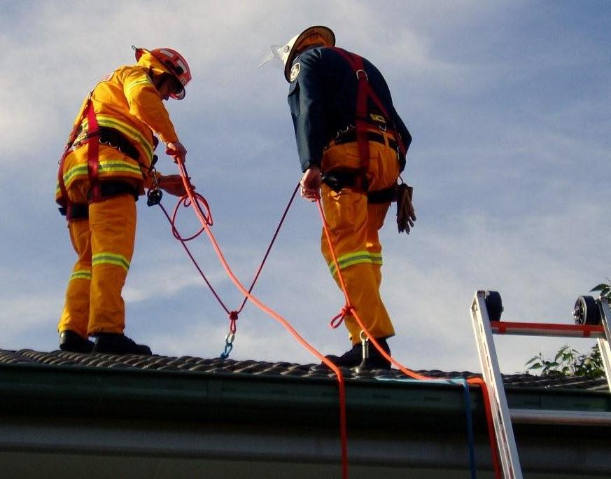
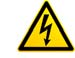
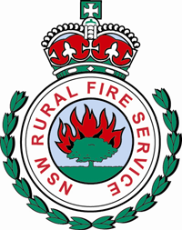

# NSW RFS Operational Protocol 1.2.7 — Working on Roofs

> **Source**: NSW Rural Fire Service
> **URL**: https://www.rfs.nsw.gov.au/__data/assets/pdf_file/0019/42283/OP-1.2.7-Working-on-Roofs.pdf
> **Licence**: Crown copyright NSW; practitioner and public-information use
> **Retrieved**: 2026-05-07T13:40:30Z
> **SHA-256**: `f4ef3cfb00070d4d819a463feeff796d53e9a768fbf6341a477c30c40c21e90f`
> *Converted from PDF to Markdown format.*

---
## Page 1

 
 
 
 
OP 1.2.7 
Operational Protocol  
for 
Working on Roofs

---
## Page 2

Operational Protocol 1.2.7                                        Page 2 of 11 
                  
  14 
December 2010  
Working on Roofs 
Version 1.0 
 
OP 1.2.7 
 
OPERATIONAL PROTOCOL 
 
FOR 
 
WORKING ON ROOFS 
 
 
 
 
 
 
 
Prepared by: 
 
Operational Services 
NSW Rural Fire Service 
15 Carter St, Lidcombe 2127 
Locked Bag 17, Granville 2142 
Telephone: (02) 8741 5555 
Fax: (02) 8741 5300 
 
 
 
 
 
Table of Contents 
 
TITLE 
PAGE 
Dictionary ............................................................................................................ 3 
1 
Links ............................................................................................................4 
2 
Superseded Procedure ................................................................................4 
3 
Purpose .......................................................................................................4 
4 
Hazards and Precautions.............................................................................4 
5 
Personal Protective Equipment....................................................................4 
6 
Operational Procedures ...............................................................................5 
7 
Operational Guidance ..................................................................................7 
Procedural Checklist ........................................................................................... 8 
APPENDIX 1 – Approved RSS Equipment Kit List.............................................. 9 
APPENDIX 2 – RSS Equipment Register ......................................................... 10

---
## Page 3

Dictionary 
Competency  
Skills, knowledge and experience and their application within an 
occupation to the standard of performance required to complete 
a function. 
Carabiner 
A large D-shaped stainless steel device with a spring-loaded 
and screwed gate that serves as an all-purpose connector. 
D/T/Z 
District/Team/Zone 
Fatigue 
Weariness from bodily or mental exertion. 
Large Harpoon 
Descender 
A mechanical device, working on the principle of applying 
friction on a fixed rope, used as an anchor or for controlled 
descent. 
Life Support 
Equipment 
Equipment identified which is essential to the safety of 
personnel working on roofs. 
Precaution 
An action taken, in advance, to protect against possible danger, 
failure, or injury; a safeguard. 
Pure Soap 
Traditional cake soap containing all natural grease cutters and 
soil emulsifiers. 
Reasonable Height 
An elevation determined to be sufficient to damage equipment 
falling on to a hard surface, generally considered to be over 2.5 
metres.  
Risk 
The exposure to the possibility of such things as economic or 
financial loss or gain, physical damage, injury or delay, as a 
consequence of pursuing a particular course of action. The 
concept of risk has two elements -  the likelihood of something 
happening and the consequences if it does happen. (AS4360). 
Risk Assessment  
A systematic use of available information to determine how 
often specific events may occur and the magnitude of their likely 
consequence. During an emergency situation a risk assessment 
is conducted dynamically (continuously due to progressive 
activity). 
Rocker (Rope Grab 
Device) 
A device which employs a cam allowing the device to slide 
freely in one direction (usually the intended direction of 
movement) and provide a firm grip on the rope when pulled on 
in the opposite direction. 
Roof Safety System 
(RSS) 
A Roof Safety System utilises approved identified equipment by 
trained competent crews to work safely on roofs. 
Safety Advisor (SA) 
A person, delegated by and responsible to the IC, responsible 
through the chain of command for the overall function of health 
and safety of all at the incident.  Under this delegated authority 
the SA may stop or change an order, action or condition where 
a person’s life is at immediate risk. 
Working on Roofs 
(WOR) 
Working on Roofs defines the procedures used by trained and 
competent personnel to work safely on roofs for operational 
purposes. 
Operational Protocol 1.2.7                                        Page 3 of 11 
                  
  14 December 2010  
Working on Roofs 
Version 1.0

---
## Page 4

1 Links 
 
NSW RFS Service Standard 3.1.6 Fire and Other Incident Operations 
 
Workcover Codes of Practice for Safe Work on Roofs 
 
NSW RFS Safe Working on Roofs (2010) training workbook 
 
Working on Roofs aligns with the Resources and Infrastructure Industries Package 
unit of competency RIIOHS204A Work safely at heights 
 
Operational Protocols 
 
2 Superseded Procedure 
 
Safe Working On Roofs SOPs (August 2008) 
 
3 Purpose 
3.1 
RFS members may respond to incidents where working on roofs is required, such as 
overhaul at a structure fire or assisting other agencies with storm damage. This 
Protocol details the procedures and equipment required to safely and effectively carry 
out such work on roofs. 
 
4 Hazards and Precautions 
4.1 
Typical hazards associated with working on a roof may include but are not limited to:  
 
(a) Falls from edges or falls through weak or unstable structures 
(b) Weather (wind, rain, hail, lightning, sun, darkness, etc.) 
(c) Fire, structural collapse or falling building materials 
(d) Falling objects (chimneys, trees, power poles, power lines, antennas, etc.)  
(e) Electrical hazards or HazMats 
(f) Building construction or roofing materials. 
 
5 Personal Protective Equipment 
5.1 
PPE is to be appropriate to the task being undertaken and the prevailing weather 
conditions.  If wearing short sleeves sunscreen should be used. 
 
 
 
 
 
Helmet with chin strap must be worn by all members at all times 
when working on or around buildings, regardless of weather 
conditions. 
 
5.2 
Clean bush fire gloves must be used to avoid contamination of the ropes. 
Operational Protocol 1.2.7                                        Page 4 of 11 
                  
  14 December 2010  
Working on Roofs 
Version 1.0

---
## Page 5

6 Operational Procedures 
 
WARNING!  The equipment used in the Roof Safety System (RSS) Kit is life 
support equipment and must be treated accordingly. 
 
Competency 
6.1 
Districts that hold RSS equipment must ensure that members maintain WOR 
competency by practicing roof top work at least once every 12 months (operationally or 
in training). 
 
Activation 
6.2 
If RFS members are required to work on a roof, a RSS must be used, unless: 
 
It is an emergency situation for the preservation of life and a risk assessment 
has been done, 
 
Working from a ladder, 
 
Working from an elevated platform (e.g. “cherry picker”), or 
 
On a roof fitted with appropriate guard rails. 
6.3 
Each Working on Roofs Team (WRT) comprises a minimum of four members, 
maximum 2 on the one RSS on the roof and minimum 2 on the ground, who must be 
competent in Working on Roofs (2010). 
6.4 
Members not qualified in Working on Roofs (WOR) may be used as additional support 
crew. 
6.5 
The decision to activate a WRT must be made by a member competent in WOR in 
consultation with the OIC, if the OIC is not qualified. 
6.6 
Prior to the deployment of a WRT a risk assessment must be conducted and 
appropriate safety controls or precautions implemented. 
6.7 
Do not deploy a WRT when it is determined that: 
(a) The task is beyond the competence of the WRT and/or the equipment available. 
(b) The structure is visibly weak, unstable or suspected to be at risk of collapse, 
(c) Severe or imminent severe weather conditions pose an unacceptable risk, 
(d) The electrical supply (including any back up supply) has not been isolated, 
(e) Repairs can be made without working on the roof, 
(f) There is no benefit in conducting the activities. 
6.8 
The OIC must ensure that all RSS equipment is inspected for wear or damage prior to 
and after use. 
6.9 
As a RSS is being deployed a second competent operator must check all knots, 
anchors, anchor points, slings, protection, harnesses and fittings. 
6.10 WRT members deployed on a roof must be attached to the safety line prior to leaving 
the ground. 
 
Operational Protocol 1.2.7                                        Page 5 of 11 
                  
  14 December 2010  
Working on Roofs 
Version 1.0

---
## Page 6

6.11 Other specialist tasks such as the use of a chain saw must be subject to a separate 
risk assessment and only be conducted by personnel holding the relevant additional 
competency. 
6.12 The OIC must monitor fatigue and rotate operators. 
6.13 A Safety Advisor, if appointed, must be competent in WOR (2010) 
 
Equipment 
6.14 Districts must ensure that RSS equipment (refer to Appendix 1) is sourced from the 
NSW RFS Approved Equipment List and is appropriately tagged.  No equipment is to 
be purchased, replaced or supplemented from unauthorised suppliers. 
6.15 Only approved RSS equipment can be used for WOR activities. 
6.16 RSS equipment must only be used for the purposes for which it is intended. 
6.17 Any damaged or defective equipment must be immediately removed from service and 
clearly tagged for replacement. 
6.18 Where misuse of equipment is identified, it must be immediately removed from service 
and clearly tagged for replacement. 
 
WARNING!  Any metal RSS devices that have been dropped from a 
reasonable height onto a hard surface are considered to be defective and 
must be removed from service. 
 
 
WARNING!  Do not use any sealants for repair work as these adversely affect 
RSS equipment. 
 
6.19 RSS equipment must be kept in a secure, dry and clean storage area with no risk of 
exposure to contaminants, insect or rodent attack. 
6.20 All RSS equipment must be thoroughly cleaned (washed with warm water containing 
only natural soap) if required after use.  Chemical detergents must not to be used. 
6.21 Districts must establish and maintain the RSS Equipment Register, with each item on 
a separate page, to record: 
(a) The Serial No and/or ID No of each item, 
(b) Rope lengths, 
(c) An expiry/replacement date for each item.  If no recommended expiry date is 
nominated, all items must be replaced after 10 years, 
(d) All usage of the equipment, 
(e) Any defects or damage found. 
 
Operational Protocol 1.2.7                                        Page 6 of 11 
                  
  14 December 2010  
Working on Roofs 
Version 1.0

---
## Page 7

Operational Protocol 1.2.7                                        Page 7 of 11 
                  
  14 December 2010  
Working on Roofs 
Version 1.0 
7 Operational Guidance 
Repairing Damaged Roofs 
7.1 
NSW RFS members will only make temporary repairs, so the underlying approach 
should be to “Make it safe, and move on”. 
7.2 
The crew need to assist as many households as possible to minimise any further 
damage, protecting the buildings and occupants from exposure to the elements. 
7.3 
Permanent repairs will be carried out by tradesmen at a later time. 
7.4 
Simple repairs can usually be made using the following materials and tools, which are 
usually available in larger operations: 
 
Tarpaulins 
 
Plastic sheets (often in large rolls) 
 
Gaffer tape 
 
Hammers 
 
Nails 
 
Tie-downs 
 
Ropes 
 
Sand bags. 
7.5 
Tarpaulins or large plastic sheeting must be securely tied off to anchors such as trees, 
stable fences, house support pylons or may be weighed down with sand bags. 
7.6 
Damaged roof tiles or slate may be made good by replacing with spares, if available. 
7.7 
Small areas of damage can be covered with plastic sheet either secured with gaffer 
tape or weighed down with sand bags. 
7.8 
Cracks may be repaired with gaffer tape. 
7.9 
Dislodged sheeting may be moved back into place and refixed using a hammer and 
roofing nails, provided the supports are still in reasonable condition. 
Note:  To be effective tarps must be either over the ridge or anchored under the lower edge 
of existing roof coverings. 
7.10 If using sandbags on a roof, ensure that they are secured and can’t slip off.

---
## Page 8

 
OP 1.2.7 
 
Working on Roofs 
Procedural Checklist 
Competency 
 
 
Are all members of the Working on Roofs Team (WRT) competent? 
 
Activation 
 
 
Is an approved Roof Safety System (RSS) being used? 
 
 
Are there a minimum of four WRT members, max 2 on the one RSS and min 2 on the 
ground? 
 
 
Is the decision to activate a WRT made by a member competent in WOR? 
 
 
Has a risk assessment been conducted and safety controls implemented? 
 
Is the task is beyond the competence of the WRT and/or the equipment available? 
 
Is the structure visibly weak, unstable or suspected to be at risk of collapse? 
 
Is severe or imminent severe weather forecast? 
 
Is the electrical supply (including any back up supply) isolated? 
 
Can repairs be made without working on the roof? 
 
Is there a benefit in conducting the activities? 
 
 
Has all RSS equipment been inspected for wear or damage? 
 
 
Has a second competent operator checked all knots, anchors, anchor points, slings, 
protection, harnesses and fittings? 
 
 
Are WRT members attached to the safety line prior to leaving the ground? 
 
 
Has a separate risk assessment been conducted for other specialist tasks (e.g. chain saw 
operation)? 
 
 
Is fatigue being monitored? 
 
 
If required, has a Safety Advisor been appointed? 
 
Post Incident 
 
 
Has all RSS equipment been thoroughly cleaned after use? 
 
 
Has the RSS Equipment Register been completed? 
Operational Protocol 1.2.7                                        Page 8 of 11 
                  
  14 December 2010  
Working on Roofs 
Version 1.0

---
## Page 9

 
APPENDIX 1 – Approved RSS Equipment Kit List 
 
 
Number of 
Items 
Item Description 
1 
Laminated List of Kit Contents  
2 
4 Point Full Body Harness 
2 
Rocker Rope Grab Device 
1 
12mm Triangular Stainless Steel Quick Link - 5,500kg  
1 
11mm x 50 metre Static Kernmantle Rope – Metal 
swaging ID Band one end 
1 
11mm x 25 metre Static Kernmantle Rope – Metal 
swaging ID Band one end 
6 
Carabiner - Large Stainless Steel D with Screwed Gate - 
3500 kg 
2 
50mm x 2 metre Tube Tape - 1000kg 
2 
Large Harpoon Descender 
1 
Medium Green Rope Bag 
1 
Small Yellow Rope Bag 
1 
400 gram Throw Bag 
1 
50 metre Brickies Fluoro Cord and Reel 
1 
Small gear Roll 
2 
Pairs Bush Firefighting Gloves (clean) 
1 
Tarpaulin 
Operational Protocol 1.2.7                                        Page 9 of 11 
                  
  14 December 2010  
Working on Roofs 
Version 1.0

---
## Page 10

 
APPENDIX 2 – RSS Equipment Register 
 
 
Working on Roofs Equipment Kit 
 
RSS Equipment Register 
 
_____________________ District/Team/Zone 
 
Register Number  ______ 
Operational Protocol 1.2.7                                        Page 10 of 11 
                  
  
 
 
 
 
 
 
 
 14 December 2010  
Working on Roofs 
Version 1.0

---
## Page 11

 
Operational Protocol 1.2.7                                        Page 11 of 11 
                  
  
 
 
 
 
 
 
 
 14 December 2010  
Working on Roofs 
Version 1.0 
 
Equipment 
Item 
      
Rope Length
      
Serial No:
      
      
District/Team/Zone 
ID No:
      
      
Brigade 
Date in Service:
      
Expiry Date:
      
 
Date 
Inspected 
Damaged 
or 
Defective – 
tagged & 
removed 
from 
service 
Used 
Task or Incident 
Cleaned 
Comment 
Name 
Signature

