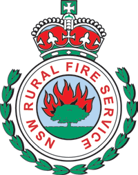

# NSW RFS Operational Protocol 1.4.4 — Fatigue Management

> **Source**: NSW Rural Fire Service
> **URL**: https://www.rfs.nsw.gov.au/__data/assets/pdf_file/0011/42302/OP-1.4.4-Fatigue-Management.pdf
> **Licence**: Crown copyright NSW; practitioner and public-information use
> **Retrieved**: 2026-05-07T13:40:34Z
> **SHA-256**: `bb7b8438c55673e946e3d086d28a0c76f10a644fcf0890be04acf342892fe525`
> *Converted from PDF to Markdown format.*

---
## Page 1

 
 
 
 
OP 1.4.4 
Operational Protocol  
 
Fatigue Management

---
## Page 2

 
 
 
 
Document control 
Release history 
Version Date 
Author 
Summary of changes 
2.0 
December 
2015 
Manager State 
Operations 
Protocol developed to replace guidelines 
 
 
 
 
 
 
 
 
Reviewed by 
Name 
Title 
Date 
AC Yorke 
Director Response & Coordination 
01/12/2015 
PRC 
Policy Review Committee 
22/02/2016 
CEG 
Corporate Executive Group 
15/03/2016 
Approved by 
Name 
Title 
Date 
DC Rogers 
Executive Director Operations 
1/2/16 
 
 
 
 
 
 
Related documents 
Document name 
Version 
Service Standard 3.1.14 - Fatigue Management 
2.0 
 
 
 
 
 
 
 
 
 
OP 1.4.4 Fatigue Management Version 2.0 
15 March 216  
 
Page 2 of 27 
 
 
 Printed documents are uncontrolled

---
## Page 3

 
 
 
 
 
OP 1.4.4 
 
OPERATIONAL PROTOCOL 
FOR 
FATIGUE MANAGEMENT 
 
 
 
 
 
 
 
 
 
 
 
 
 
 
Prepared by: 
 
       Operational Services Directorate 
NSW Rural Fire Service 
15 Carter St, Lidcombe 2127 
Locked Bag 17, Granville 2142 
Telephone: (02) 8741 5555 
Fax: (02) 8741 5300 
 
 
 
 
 
 
 
 
 
 
 
 
 
OP 1.4.4 Fatigue Management Version 2.0 
15 March 216  
 
Page 3 of 27 
 
 
 Printed documents are uncontrolled

---
## Page 4

 
 
 
Contents 
 
DICTIONARY ..........................................................................................       6 
1. 
Links ....................................................................................................... 6 
2. 
Superseded Procedure ........................................................................... 7 
3. 
Purpose .................................................................................................. 7 
4. 
Operational Protocol for Fatigue Management ....................................... 7 
 
Determining individual fitness for duty........................................................................... 7 
 
Tools and techniques to assess individual fitness for duty ........................................... 8 
 
Methods of improving wakefulness ............................................................................... 8 
 
Enhancing the quality of sleep ...................................................................................... 9 
 
NSW RFS Recommendations on Working Hours and Rest Periods ............................ 9 
 
Number of hours of sleep opportunity ........................................................................... 9 
 
Number of hours of sustained wakefulness ................................................................ 10 
 
Shift length ................................................................................................................... 10 
 
Changeovers and briefings ......................................................................................... 11 
 
Arrangements for rostering the first night shift of a major incident .............................. 11 
 
Rest periods between shifts ........................................................................................ 11 
 
Transportation and accommodation ............................................................................ 11 
 
Breaks within shifts ...................................................................................................... 12 
 
Number of consecutive shifts ...................................................................................... 12 
 
Shift patterns ............................................................................................................... 13 
 
Shift swapping/rotation ................................................................................................ 13 
 
Rest periods after the end of a deployment ................................................................ 14 
 
Rest periods after attending out-of-area incidents ...................................................... 14 
 
Exceptional circumstances .......................................................................................... 15 
5. 
General Information on Fatigue ............................................................ 15 
 
Attitudes and behavioural norms towards fatigue ....................................................... 15 
 
Principles for designing shift work schedules .............................................................. 16 
 
Organisational strategies for managing shift work-related fatigue .............................. 16 
6. 
Background Information on Fatigue ...................................................... 16 
 
The recommended number of hours of sleep for adults ............................................. 17 
 
Causes of fatigue......................................................................................................... 17 
 
The effects of shift work on health and safety ............................................................. 17 
OP 1.4.4 Fatigue Management Version 2.0 
15 March 216  
 
Page 4 of 27 
 
 
 Printed documents are uncontrolled

---
## Page 5

 
 
 
 
The organisational consequences of fatigue ............................................................... 17 
 
Signs of fatigue ............................................................................................................ 18 
 
Individual differences in fatigue-related risk ................................................................ 18 
 
Time of day effect ........................................................................................................ 19 
 
Fatigue and age ........................................................................................................... 19 
 
Physical vs. mental fatigue .......................................................................................... 19 
 
Fatigue and driving ...................................................................................................... 19 
 
Fatigue-related performance and blood alcohol concentration ................................... 20 
 
Napping as a technique for maintaining performance ................................................. 20 
Appendix 1 ................................................................................................... 21 
 
Summary of key points of Service Standard 3.14 Fatigue Management and this 
accompanying Operational Guideline ......................................................................... 21 
Appendix 2 ................................................................................................... 22 
 
Example scenarios ...................................................................................................... 22 
Appendix 3 ................................................................................................... 27 
 
Examples of how food may assist fatigue management ............................................. 27 
 
 
 
OP 1.4.4 Fatigue Management Version 2.0 
15 March 216  
 
Page 5 of 27 
 
 
 Printed documents are uncontrolled

---
## Page 6

 
 
 
DICTIONARY 
Critical Incident Support 
Services (CISS): 
Critical Incident Support Services provided by a team of 
specially trained personnel to assist NSW RFS members to 
deal with the effects of critical incident stress 
Crew Resource Management 
(CRM) 
A technique of management consisting of making best use of 
all the available resources including: 
i. 
People; 
ii. 
Equipment;  
iii. 
Supplies; and  
iv. 
Information 
IC 
Incident Controller 
IMT 
Incident Management Team 
I’MSAFER 
The acronym used by the NSW RFS as a checklist against 
which members may assess their ability to respond to an 
incident and consists of: 
Illness or injury 
Medication 
Stress 
Alcohol or drugs 
Fatigue 
Expertise 
Review (new component) 
(Review is a new component of IMSAFE.  It asks the 
question: “Am I fit for frontline firefighting today?”, or 
As a Leader/Supervisor, are all my crew fit for frontline 
firefighting duty today 
Microsleep 
A brief and unintended period of sleep.  Often characterised by 
head snapping, nodding or closing your eyes.  Microsleeps 
commonly occur while trying to stay awake while performing 
monotonous tasks, like driving 
Nap 
any sleep period of less than 3 hours duration 
OIC 
Officer in Charge 
SA 
Safety Advisor (works in the field and reports to SO) 
SO 
Safety Officer (works within the IMT  and reports to IC) 
1. 
Links 
› SS 3.1.14 Fatigue Management   
› P7.1.10 Organisational Risk Management 
› SS 3.1.6 Operational Protocols  
› SS 7.1.1 Chaplaincy  
OP 1.4.4 Fatigue Management Version 2.0 
15 March 216  
 
Page 6 of 27 
 
 
 Printed documents are uncontrolled

---
## Page 7

 
 
 
› SS7.1.2 Critical Incident Support Services  
› Fire Fighters Pocketbook (IMSAFE check)  
› NSW RFS Health, Safety and Welfare section safety@rfs.nsw.gov.au 
 
2. 
Superseded Procedure 
 
› 3.1.14 Fatigue Management V1.0 Operational Guideline 22/8/13 
 
3. 
Purpose 
 
3.1 
This Operational Protocol provides organisational guidelines and general 
information for managing fatigue.  The Protocol should be read in conjunction 
with Service Standard 3.1.14 Fatigue Management. 
3.2 
Service Standard 3.1.14 Fatigue Management highlights the role that fatigue 
plays in the effectiveness and safety of firefighting operations and describes 
the responsibilities of all members of the NSW RFS in relation to fatigue 
management during incidents. 
 
4. 
Operational Protocol for Fatigue Management 
  
4.1 
The NSW RFS Operational Protocol for Managing Fatigue contains the NSW 
RFS suggested better practice standards on working hours and work/sleep 
patterns during incidents.  
4.2 
The better practice standards on working hours and work/sleep patterns for 
the NSW RFS described in these documents form only one component of a 
broader fatigue risk management system. 
4.3 
These suggested standards should be read and understood as guides for 
planning rather than prescribed rules. The unique nature of each individual 
incident requires strategies to be appropriate for that incident.  
4.4 
This Protocol also provides general information to assist in the development 
of strategies for managing fatigue caused by sleep loss, including principles 
for designing shift work schedules, methods for enhancing the quality of 
sleep, and methods for improving wakefulness during shift work operations. 
Determining individual fitness for duty 
4.5 
Each member of the NSW RFS has a responsibility to ensure the health and 
safety of themselves and others. The onus is on individual members who 
report for duty to monitor and assess their individual fitness for duty as 
honestly as possible.  
4.6 
Assessing individual fitness for duty is especially pertinent for members in 
supervisory roles, especially those responsible for operational activities. 
OP 1.4.4 Fatigue Management Version 2.0 
15 March 216  
 
Page 7 of 27 
 
 
 Printed documents are uncontrolled

---
## Page 8

 
 
 
Members who hold such roles have an ethical and operational obligation of 
self-care and must ensure they get adequate sleep to be effective in their 
supervision of other members. More experienced leaders are often 
characterised by the particular care they take to obtain sufficient sleep. 
Tools and techniques to assess individual fitness for duty 
4.7 
There are a number of tools and techniques to assist members assess their 
individual fitness for duty. In the NSW RFS, the I’MSAFE(R) check is 
commonly used to perform a personal risk assessment. I’MSAFE(R) asks 
individuals a series of questions about any:  
Illness/Injury  
Medication  
Stress  
Alcohol/Drug use and levels of  
Fatigue and  
Expertise 
Review   (Refer Dictionary for details)  
On 
commencement 
of 
a 
shift, 
periodically 
throughout 
their 
deployment/shift/activity and on resuming duties after a break of any length, 
members should exercise the I’MSAFE(R) check periodically throughout the 
deployment/ shift/activity.  If they feel they are fatigued, or are at risk of fatigue 
they should advise their supervising officer or a colleague. 
4.8 
In addition to these, individual strategies for managing the impacts of fatigue 
related to shift work include: 
(a) 
Individuals monitoring their sleep periods and keeping a sleep/activity 
log as a way of monitoring how much sleep has been achieved;  
(b) 
encouraging members to write down tasks or messages received 
because fatigue is likely to affect an individual’s short term memory and 
ability to recollect the timing of events; 
(c) 
adopting a ‘brief back’ procedure whereby the receiver of a message 
repeats the message back to the sender to confirm that they have 
received and correctly understood the message; 
(d) 
cross-checking calculations and decisions with team members; and 
(e) 
using checklists when levels of fatigue are likely to degrade memory 
and performance.  
 
Methods of improving wakefulness 
4.9 
Ways of improving wakefulness during incidents where it is likely that fatigue 
will impact performance include: 
OP 1.4.4 Fatigue Management Version 2.0 
15 March 216  
 
Page 8 of 27 
 
 
 Printed documents are uncontrolled

---
## Page 9

 
 
 
(a) 
allowing frequent breaks to alleviate or prevent potential difficulties such 
as strain, boredom and complacency that can be associated with long, 
tedious work shifts; 
(b) 
teaming up personnel to undertake tasks, support each other, and 
check and double check each other’s wellbeing, performance and 
motivation; 
(c) 
increasing interpersonal interaction, i.e. peer support between 
members, particularly during night shift; 
(d) 
if possible, changing and rotating tasks; and 
(e) 
providing suitable facilities to allow napping.  
Enhancing the quality of sleep 
4.10 
Ways of enhancing quality of sleep  include: 
(a) 
creating conditions conducive to sleep, including: 
i. a darkened sleeping area; 
ii. a sleeping area with a temperature ideally between 18 and 24 
degrees Celsius; 
iii. a ready supply of ear plugs and eye shades for those who find them 
comfortable to use; 
iv. a quiet sleeping area away from busy operations rooms, main travel 
routes, resupply and refueling areas etc; and, 
v. within reason, restricting social interactions during times nominated 
for sleep. 
(b) 
ensuring that personnel routinely take personal sleeping gear (ear 
plugs, ear shades) with them on operations, even when the duration of 
an operation is expected to be short; 
(c) 
minimising alcohol consumption. Alcohol disturbs the sleep cycle and 
causes early and more frequent awakening; 
(d) 
avoiding stimulants like nicotine, caffeine and energy drinks prior to 
sleep; and 
(e) 
encouraging good dietary practice and exercise.   
NSW RFS Recommendations on Working Hours and Rest Periods 
Number of hours of sleep opportunity 
4.11 
The guidance regarding shift lengths and rest periods is based on ensuring 
adequate sleep opportunities are provided to NSW RFS members. Eight 
hours of sleep is recommended for adults to perform at their best during a 
subsequent duty period. Given this, members should be provided with the 
opportunity for 8 hours of sleep.  
OP 1.4.4 Fatigue Management Version 2.0 
15 March 216  
 
Page 9 of 27 
 
 
 Printed documents are uncontrolled

---
## Page 10

 
 
 
It should be remembered that even though the opportunity for 8 hours of sleep 
is provided by the NSW RFS to its members, actual sleep obtained may be 
less than 8 hours. Members may not always fall asleep straight away for 
reasons that may include: 
(a) 
they are feeling the lingering effects of adrenalin or stress from the day’s 
activities, or  
(b) 
because they are sleeping in an unfamiliar environment (e.g. a base 
camp or motel room instead of at home).  
Number of hours of sustained wakefulness 
4.12 
Another key determinant of fatigue-related risk as related to the number of 
hours of sleep opportunity is the length of time an individual is continuously 
awake.  
4.13 
The fatigue-related risk increases the longer a person is awake. Research by 
sleep experts suggests that the performance of a person who has been 
awake for 17 hours continuously is equivalent to a person with a blood alcohol 
reading of 0.05 %, the legal driving limit.  
4.14 
Given that NSW RFS members should be provided with the opportunity for 8 
hours of sleep, the maximum amount of sustained wakefulness in any 24 hour 
period should not exceed 16 hours.  
4.15 
There are a range of activities that members may be engaged in during their 
waking hours which may include: 
(a) 
NSW RFS related work (both operational and normal work duties);  
(b) 
non-RFS related work (for volunteers); and  
(c) 
travel to or from an incident.  
Irrespective of what the member did during their waking hours, it is more 
important that the maximum amount of sustained wakefulness in any 24 hour 
period is not exceeded. This concept is illustrated at Appendix 2 Example 
scenarios, Example 2. 
 
Shift length 
4.16 
Twelve hours is the recommended maximum shift duration for incidents, plus 
additional time for changeovers and briefings.  
4.17 
When a major incident is anticipated, it is recommended that in readiness, 
arrangements should be made for some members to be stood down prior to 
the incident in order to obtain sleep in anticipation of shift work.  
4.18 
Naps taken in anticipation of a night shift are an effective method of 
maintaining performance levels. The Operational Readiness and Alert Status 
OP 1.4.4 Fatigue Management Version 2.0 
15 March 216  
 
Page 10 of 27 
 
 
 Printed documents are uncontrolled

---
## Page 11

 
 
 
and 4 day forecast should be used as a guide in situations where shift work is 
likely. 
 
Changeovers and briefings 
 
4.19 
A recommended maximum total period of 1 hour should be provided to take 
part in changeovers and briefings before a shift (30mins) and after a shift 
(30mins).  
Arrangements for rostering the first night shift of a major incident 
 
4.20 
The arrangements for rostering the first day and night shifts following the 
commencement and escalation of a major incident present challenges 
because of the:  
(a) 
difficulties in finding sufficient numbers of people willing to undertake the 
first night shift at short notice;  
(b) 
need to change the sleeping patterns of members undertaking the first 
night shift at short notice; and,  
(c) 
need for members on the first day shift to work extended hours.  
4.21 
The consequences of rostering shift work at short notice will be that:  
(a) 
following the commencement and escalation of a major incident, some 
members may not be provided with 8 hours of sleep opportunity; and,  
(b) 
the recommended maximum shift duration on the first day shift may 
exceed 12 hours. 
Example 1 in Appendix 2 Example scenarios is provided as a guide and 
illustrates one way of rostering the first night shift. It is based on a 12 hour 
rotation shift, with changeovers at 0700hrs and 1900hrs.  
 
Rest periods between shifts 
4.22 
A recommended minimum rest period of 9 hours should be provided between 
shifts. The rest period includes 8 hours opportunity for sleep plus time to 
prepare, eat and wind down. During this rest period, members should be 
completely removed from NSW RFS duties.  
Transportation and accommodation 
4.23 
The recommended 9 hour rest period between shifts does not include 
travelling time. Given the recommended maximum shift duration of 12 hours, 
travel to accommodation needs to be no longer than 1 hour duration to and 
from the incident. Therefore, where a member’s place of residence is located 
in excess of 1 hour travel time each way to and from the incident, local 
sleeping arrangements should be considered.  
OP 1.4.4 Fatigue Management Version 2.0 
15 March 216  
 
Page 11 of 27 
 
 
 Printed documents are uncontrolled

---
## Page 12

 
 
 
As a summary, a breakdown of activities over a 24 hour period is shown in 
Figure 1.  
 
 
 
Figure1. A breakdown of activities over a 24 hour period.12 hours is the 
recommended maximum shift duration for incidents (shown in white). One hour in 
total is the recommended maximum period spent in changeovers and briefings 
before and after a shift (also shown in white). 9 hours is the recommended 
minimum rest period between shifts (shown in black). The rest period includes 8 
hours opportunity for sleep plus time to prepare, eat and wind down. The remainder 
time is allocated to travel to and from the incident (shown in grey). Travel to and 
from the incident needs to be no longer than 1 hour duration, otherwise local 
sleeping arrangements should be considered. 
 
Breaks within shifts 
4.24 
Long periods of continuous duty without breaks are fatiguing. Regular breaks, 
free from any work related activities, should be provided. The frequency and 
timing of breaks will depend on the nature of the work being carried out and 
characteristics of the individual members. The frequency and timing of breaks 
should be able to be determined by the members carrying out the duties in 
consultation with their supervising officer. 
Number of consecutive shifts 
4.25 
Day Shifts: members may complete up to 5 consecutive day shifts. A 
minimum 24 hour rest period must be provided after 5 consecutive day shifts 
before the member is rostered onto another shift. Travel days outside of the 5 
prepare, eat, 
1/2 hr 
travel to 
1hr 
changeover & 
briefing 
1/2hr 
work 
12hrs 
 changeover & 
briefing 
1/2hr 
travel from 
1hr 
 
 
sleep 
8hrs 
Prepare, eat, 
wind down 
 ½ hr 
OP 1.4.4 Fatigue Management Version 2.0 
15 March 216  
 
Page 12 of 27 
 
 
 Printed documents are uncontrolled

---
## Page 13

 
 
 
consecutive shifts may be required for members attending out-of-area 
incidents.  
4.26 
Night Shifts: members may complete up to 3 consecutive night shifts. A 
minimum 24 hour break must be provided after 3 consecutive night shifts. 
Travel days outside of the 3 consecutive night shifts may be required for 
members attending out of area incidents. 
Shift patterns 
4.27 
The recommended day shift pattern is:  
Up to 5 days on shift then 
 
1 day rest then 
            
Up to 5 days on shift then 
 
2 days rest [repeat cycle]    
4.28 
The recommended night shift pattern is: 
3 nights on shift then 
 
1 day rest then 
 
3 nights on shift then  
 
2 days rest [repeat cycle]    
 
Shift swapping/rotation 
4.29 
Continually changing shifts from day to night shift or vice versa is to be 
avoided. In circumstances where a member changes shift, a minimum of 48 
hours rest should be provided from night shift to day shift and a minimum 24 
hour rest from day shift to night shift.   
 
 
 
 
 
 
 
 
Figure 2 illustrates the rest period where a member changes from night shift to day shift.  
N 
N 
N 
 
 
Rest period  
At least  
48 hrs 
 
N 
Normal duties 
24 hr rest 
D 
D 
OP 1.4.4 Fatigue Management Version 2.0 
15 March 216  
 
Page 13 of 27 
 
 
 Printed documents are uncontrolled

---
## Page 14

 
 
 
Rest periods after the end of a deployment  
4.30 
Day shifts: Members who complete one day shift cycle (up to 5 days) or 
less should be provided with a rest period of 24 hours after the end of a 
deployment to allow sufficient rest before commencing ‘normal’ activities. 
Normal activities may include normal work duties for members whose place of 
residence is located locally.  
Members who complete two consecutive day shift cycles or more should 
be provided with a rest period of 48 hours after the end of a deployment to 
allow sufficient rest before commencing ‘normal’ activities. 
4.31 
Night shifts: Members who complete night shift cycles (up to 3 nights) 
should be provided with a rest period of 48 hours after the end of a 
deployment to allow sufficient rest before commencing ‘normal’ activities. The 
rest period of 48 hours applies to any number of night shift cycles completed. 
 
 
 
 
 
 
 
 
 
 
 
Figure 3 illustrates the rest period at the end of a night deployment.  
 
 
Rest periods after attending out-of-area incidents 
4.32 
In circumstances where members drove themselves to attend an out-of-area 
incident, a rest period of at least 10 hours at the end of up to 5 consecutive 
day shifts and 24 hours at the end of 3 consecutive night shifts should be 
made available before they drive home. A longer rest period is required for 
members undertaking night shift because a longer adjustment period is 
required for these members to revert back to a day cycle.  
Note: this rest period applies to members who drove themselves to attend an 
out-of-area incident. It does not apply to members who are transported to an 
out-of area incident.  
4.33 
All members who are provided with transport home after attending an out-of 
area incident should be given a rest period of at least 48 hours at the end of 
the deployment and before commencing normal duties, as outlined above.  
N 
N 
N 
 
 
 
Rest period  
At least  
48 hrs 
 
N 
 
Normal duties 
End of a deployment 
24 hr break 
OP 1.4.4 Fatigue Management Version 2.0 
15 March 216  
 
Page 14 of 27 
 
 
 Printed documents are uncontrolled

---
## Page 15

 
 
 
4.34 
It is important to note that what is more important than the prescribed number 
of hours of rest is how much actual sleep was obtained during shift work by 
individuals.  For example, if members averaged less than 5 hours sleep each 
24 hour period (irrespective of the prescribed hours), they need at least 3 
days to get back to near-baseline performance. 
Exceptional circumstances 
4.35 
Requirements may be altered in circumstances where life and property are at 
imminent and significant risk. If so, supplementary monitoring using dynamic 
risk assessments (by the IC, IMT and/or SO) is to be applied to monitor 
individual fatigue levels and monitor decision making. 
4.36 
Where deployed interstate or internationally it is a requirement that shift 
patterns and lengths are adjusted to ensure a smooth transition into local 
arrangements as approved by the State Operations Controller.  
 
5. General Information on Fatigue 
5.1 
This section contains general information for the NSW RFS on attitudes 
towards fatigue, principles for designing shift work schedules and 
organisational strategies for managing shift work related fatigue.   
Attitudes and behavioural norms towards fatigue 
5.2 
In high-risk industries such as the emergency services, certain dangerous 
attitudes in relation to fatigue can exist. One misconception called “myth of 
immunity” (or “hero syndrome”) is the belief among some that they are 
somehow immune to the effects of fatigue. Admitting to fatigue is viewed as a 
“sign of weakness”.  
5.3 
Another attitude is the “can do” attitude which may help to achieve difficult and 
challenging jobs faced by the NSW RFS, but also has the potential for 
members to allow operational pressures to distort decision making and 
compromise safety standards.  
5.4 
A third related attitude is the “badge of honour” in which members feel 
compelled to get their tasks done and “carry the load”, even if it means 
working extended hours to finish. Some members may feel they are 
indispensible to the success of a mission, when in reality members who 
“tough it out” are at an increased risk of having, or causing, an accident.  
5.5 
These attitudes within an organisation signal a culture that may benefit from a 
program to enhance understanding of the limitations on human performance 
due to fatigue. These attitudes may undervalue the importance of sleep and 
can place the organisation at risk. 
OP 1.4.4 Fatigue Management Version 2.0 
15 March 216  
 
Page 15 of 27 
 
 
 Printed documents are uncontrolled

---
## Page 16

 
 
 
Principles for designing shift work schedules 
5.6 
Any organisational strategies for managing fatigue should take into 
consideration the following design principles when developing shift work 
schedules:  
(a) 
The human body clock or human circadian rhythm has been shown to 
work to a 24 hour cycle. Therefore, wherever possible, any shift work 
schedule should be consistent with a 24 hour cycle;  
(b) 
Wherever possible the main rest/sleep period should be at the same 
time in each 24 hour period, particularly for extended operational 
periods (i.e. more than two days);  
(c) 
Sleep during the night is usually more restful and restorative than sleep 
during the day which may be disrupted, shorter and less satisfying;  
(d) 
Long shifts are a primary cause of fatigue. Its effect is most significant 
on night and early morning shifts; 
(e) 
Early shift starts (before 0700) should be avoided because early starts 
are correlated with sleep loss. It has been shown that just getting one 
hour less sleep than usual has measurable performance deficits 
for the next day or so;  
(f) 
Less sleep than required over consecutive shifts may accumulate sleep 
deficit and increase the incident risk due to fatigue. This sleep deficit 
cannot be made up for later on; 
(g) 
Shift swapping can be fatiguing. In particular, the risk is greatest when 
there is a switch from a night shift to an early morning shift. 
Organisational strategies for managing shift work-related fatigue 
5.7 
Strategies for managing the fatigue-related risks associated with shift work 
within an organisation include: 
(a) 
using training to enhance awareness of the effects of sleep loss and 
improve understanding of individual tolerance to sleep loss; 
(b) 
preparing work/sleep plans to meet the needs of the expected 
operational conditions; and 
(c) 
encouraging as routine, the practice of looking for signs of fatigue in 
peers, subordinates and superiors during operations in order to 
recognise and avoid fatigue-related risks. 
6. Background Information on Fatigue 
6.1 
This section provides background information about fatigue, its causes and its 
effects. The information is general in nature and specialist information may be 
obtained from the NSW RFS Health Safety and Welfare section on 02 8741 
5221. 
OP 1.4.4 Fatigue Management Version 2.0 
15 March 216  
 
Page 16 of 27 
 
 
 Printed documents are uncontrolled

---
## Page 17

 
 
 
The recommended number of hours of sleep for adults 
6.2 
Most adults need 7-8 hours of sleep per night in order to perform effectively 
and safely throughout the next waking day.  
Causes of fatigue 
6.3 
Insufficient or disrupted sleep is the main cause of fatigue. However, there are 
other health risk factors associated with fatigue which may include: 
(a) 
sleep disorders (e.g. sleep apnoea, insomnia); 
(b) 
obesity or being overweight; 
(c) 
medical conditions (e.g. heart disease, anaemia, hypothyroidism, 
diabetes, cold, flu, headache); 
(d) 
alcohol or drug use; 
(e) 
psychological conditions (e.g. depression); 
(f) 
caffeine and other stimulant overload. 
6.4 
Fatigue related to an incident may be caused by: 
(a) 
intense emotional strain and mental workload; 
(b) 
strenuous and sustained physical exertion; 
(c) 
inadequate food and water intake and/or food lacking in nutrition; 
(d) 
adverse environmental conditions (heat, smoke, noise, poor lighting); 
(e) 
periods of monotonous, boring activities. 
The effects of shift work on health and safety 
6.5 
Poorly managed shift patterns can have wide-ranging effects on shift workers. 
The hazards associated with shift work include: 
(a) 
fatigue;  
(b) 
gastro-intestinal, cardiovascular and reproductive health problems;  
(c) 
work related stress; 
(d) 
family problems; 
(e) 
anxiety, irritability and depression.  
The organisational consequences of fatigue 
6.6 
The organisational consequences of fatigue include: 
(a) 
increased risk of errors and accidents; 
(b) 
increased sick leave, absenteeism and turnover; 
(c) 
increased use of health services; 
(d) 
decreased productivity; 
(e) 
decreased motivation, mood swings and depression.  
OP 1.4.4 Fatigue Management Version 2.0 
15 March 216  
 
Page 17 of 27 
 
 
 Printed documents are uncontrolled

---
## Page 18

 
 
 
6.7 
Research also suggests that people who obtain less sleep are more likely to 
violate rules and procedures and behave in an unethical manner.  
Signs of fatigue 
6.8 
The mental and emotional signs of fatigue include: 
(a) 
confusion; 
(b) 
poor concentration; 
(c) 
general cognitive slowness/slow reaction times; 
(d) 
forgetfulness; 
(e) 
narrowed perception; 
(f) 
carelessness; 
(g) 
loss of situation awareness; 
(h) 
poor decision making;  
(i) 
decreased interaction with team members; 
(j) 
lowered morale; 
(k) 
loss of sense of humour,  
(l) 
moodiness, irritability, argumentativeness. 
6.9 
The physical signs of fatigue include: 
(a) 
tiredness and sleepiness; 
(b) 
yawning; 
(c) 
headache; 
(d) 
dizziness; 
(e) 
sore or aching muscles; 
(f) 
muscle weakness; 
(g) 
slurred speech; 
(h) 
impaired hand-eye coordination; 
(i) 
appetite loss; 
(j) 
reduced immune system function; 
(k) 
blurry vision; 
(l) 
vacant stare with sunken bloodshot eyes. 
6.10 
It is important to note that a decline in mental performance is usually not 
apparent to the individual who is fatigued. Given the insidious nature of 
fatigue, a fatigue risk management system cannot rely solely on an 
individual’s self-assessment of their level of fatigue.  
Individual differences in fatigue-related risk 
6.11 
There are individual differences in the degree to which individuals are affected 
by fatigue. As such, a one size fits all, prescriptive approach to fatigue risk 
OP 1.4.4 Fatigue Management Version 2.0 
15 March 216  
 
Page 18 of 27 
 
 
 Printed documents are uncontrolled

---
## Page 19

 
 
 
management is unlikely to meet the sleep needs of all individuals within the 
NSW RFS.  
6.12 
All members need to assess their physical well being for performing the tasks 
they are allocated so as to minimise the possibility of fatigue related incidents. 
Members should ensure they are physically fit to undertake tasks and provide 
advice to officers in charge, when they may consider that they are unable to 
complete their tasks. 
6.13 
Where an officer or crew leader is concerned that a member’s physical 
condition may impact their ability to manage their fatigue they should discuss 
this with the member involved. 
Time of day effect 
6.14 
The human body clock (circadian rhythm) works on a 24 hour cycle. Human 
performance is at its worst and accidents are more likely to occur during 
troughs in the circadian rhythm. Troughs occur from midnight until dawn, and 
during the mid-afternoon, about 1400-1800 hrs (also known as the circadian, 
post-lunch dip or 3 o’clock-itis).  
6.15 
Peaks in mental performance occur in the early morning (0700 til 1200). Peak 
vigilance and reaction time performance occurs in the early evening (1900-
2100). 
Fatigue and age 
6.16 
Research suggests that older people require less sleep as they age, have 
increased difficulty adjusting to changes in sleep and work schedules, and are 
more likely to be adversely affected by disruptions to routine sleep. This has 
implications for older NSW RFS members rostered on to night shift. Research 
also suggests: 
(a) 
ageing is associated with progressive intolerance to sleep disturbance 
and irregular working schedules;   
(b) 
shortfalls in usual sleep duration will be more disruptive for older people;  
(c) 
in older people, sleep becomes more fragmented and is more 
susceptible to disruption by noise; 
(d) 
the restorative value of sleep decreases with age.  
Physical vs. mental fatigue 
6.17 
The amount of sleep required for tasks that are purely physical in nature and 
that required for tasks that mainly require mental processes suggests that 
mental tasks require as much, if not more sleep, than tasks that are mainly 
physical in nature.  
Fatigue and driving 
6.18 
Driving a vehicle while fatigued is a major risk. Night–shift workers are at least 
twice as likely as day workers to have traffic accidents while travelling home 
from work.  This has implications for other activities that require similar motor 
skills and which firefighters commonly undertake (e.g. operating chainsaws, 
OP 1.4.4 Fatigue Management Version 2.0 
15 March 216  
 
Page 19 of 27 
 
 
 Printed documents are uncontrolled

---
## Page 20

 
 
 
heavy machinery and driving tankers), and specialist roles such as RAFT and 
RART.  
Fatigue-related performance and blood alcohol concentration 
6.19 
A fatigue-related performance index, comparing fatigue levels with blood 
alcohol concentrations suggests:  
(a) 
after 17 hours of sustained wakefulness, performance on cognitive (ie 
memory, judgment and reasoning) and psychomotor tasks (such as 
hand-eye coordination) decreases to a level similar to performance with 
a 0.05% blood alcohol content; 
(b) 
24 hours of wakefulness compares with a 0.10% blood alcohol content 
level (twice the legal driving limit); 
(c) 
a person with a blood alcohol content of 0.05% is twice as likely to have 
an accident as a person with zero blood alcohol content; 
(d) 
a person with a blood alcohol content of 0.10% is 7 times more likely to 
have an accident. 
 
Napping as a technique for maintaining performance 
6.20 
Napping is an effective technique for managing fatigue in extraordinary 
circumstances. Defined as any sleep of less than 3 hours, research suggests 
the longer the nap the greater the benefits in improving mood, performance 
and alertness. Even short naps of 10 to 30 minutes, preferably taken in quiet 
environments, are better than no sleep.  
A 30 minute nap will decrease the rate of decline in performance by improving 
performance for a period and a 1 hour nap may reduce the frequency and 
duration of microsleeps. 
6.21 
Naps are usually more effective in the late afternoon or late evening. 
However, any daylight nap will be beneficial particularly after a night without 
sleep. During periods of chronic sleep loss, naps taken in the morning (0400 
to 0600 hours) help to recover performance whilst naps taken late at night 
(2200 to 2400 hours) help to maintain performance. 
6.22 
Importantly, naps can, and wherever possible should, be taken in anticipation 
of a night shift. Taking naps can positively impact alertness and performance 
levels for approximately double the length of the nap taken. For example, a 2 
hour nap before a night shift will on average, help maintain performance for 
approximately 4 hours. Such benefits accumulate for naps as long as 8 hours. 
 
 
OP 1.4.4 Fatigue Management Version 2.0 
15 March 216  
 
Page 20 of 27 
 
 
 Printed documents are uncontrolled

---
## Page 21

 
 
 
Appendix 1  
Summary of key points of Service Standard 3.14 Fatigue Management and this 
accompanying Operational Guideline 
Parameter 
NSW RFS Operational Guidelines  
Number of hours of sleep 
opportunity 
 
Recommended minimum of 8 hours of sleep opportunity 
Number of hours of sustained 
wakefulness 
Recommended maximum 16 hours of sustained wakefulness 
Shift length 
 
Recommended maximum 12 hours of shift, except first shift maximum 
16 hours of sustained wakefulness  
Rest periods between shifts 
Recommended minimum 9 hours of rest 
Changeovers and briefings 
Recommended maximum 1 hour in total spent in changeovers and 
briefings before and after a shift 
Transportation and 
Accommodation 
Local sleeping arrangements should be considered for members 
whose place of residence is located in excess of 1 hour travel time 
each way to and from the incident (see Section 2.23 for details). 
Breaks between shifts 
Regular breaks as required 
Number of consecutive shifts 
Maximum of up to 5 consecutive day shifts followed by a 24 hour rest 
Maximum of up to 3 consecutive night shifts followed by a 24 hour rest 
Shift patterns 
DAY Shift: 
Up to 5 days on shift - 1 day rest – Up to 5 days on shift - 2 days rest, 
continue cycle 
NIGHT Shift: 
3 nights on shift - 1 day rest – 3- nights on shift - 2 days rest, continue 
cycle 
Shift swapping 
Minimum 48 hours rest at the change of shifts from night to day shift or 
24 hours rest from day to night shift 
 
Rest periods after the end of a 
deployment 
Minimum 48 hours of rest at the end of a deployment 
 For members actively driving from an out-of-area incident to their 
place of residence: 
•  A minimum 10 hrs rest at the end of up to 5 consecutive day shifts to 
be provided before commencing their return journey 
• A minimum 24 hrs rest at the end of 3 consecutive night shifts to be 
provided before commencing their return journey 
• Note, the 10 hr and 24 hr rest periods do not apply to members who 
are transported to and from out-of- area incidents (e.g. by air or 
coach) 
OP 1.4.4 Fatigue Management Version 2.0 
15 March 216  
 
Page 21 of 27 
 
 
 Printed documents are uncontrolled

---
## Page 22

 
 
 
Appendix 2  
Example scenarios 
Example 1:  Arrangements for rostering the first night shift of a major incident 
This example is provided as a guide and illustrates one way of rostering the first 
night shift. It is based on a 12 hour rotation shift, with changeovers at 0700hrs and 
1900hrs. Figure 4a and 4b illustrate the example using diagrams.  
 
Assuming Dave, a NSW RFS member, had been awake since 0700hrs, started work 
at 0800hrs, and worked a full day of employment before attending this incident, he 
should not be working past 2200hrs and should be asleep by 2300hrs in order to not 
exceed 16 hours of continuous wakefulness. Already Dave has been working an 
extended day shift (up to 14 hours, counting both normal work duties and RFS 
operational duties).  
 
Members rostered for the first night shift are relieved from their normal work duties 
from the time the incident commences and are provided an opportunity to nap in 
anticipation of night work until the beginning of their night shift. The night shift then 
operates a shorter 9 hour shift from 2200hrs until 0700hrs. The night shift is replaced 
by a ‘day crew’ that have rested overnight and they resume a ‘normal’ 12 hour shift 
from 0700hrs to 1900hrs. The previous night shift returns the following night for a 12 
hour shift from 1900hrs to 0700hrs.  
 
In this example, members undertaking the first day shift will inevitably obtain less 
than the minimum 8 hours of sleep and members undertaking the first night shift will 
most likely obtain even less sleep.  
 
 
 
 
 
 
 
 
 
 
 
Figure 4a one way of rostering the first night shift of a major incident. This example is based 
on a 12 hour rotation, with changeovers at 0700hrs and 1900hrs. Day shift starts at 0700hrs 
and ends at 1900hrs. Night shift starts at 1900hrs and ends at 0700hrs. The figure illustrates 
the ‘desired’ or the ‘end state’ shift work schedule for this example.  
DAY 
NIGHT 
DAY 
NIGHT 
0700 
1900 
0700 
1900 
0700 
12 hr 
12 hr 
OP 1.4.4 Fatigue Management Version 2.0 
15 March 216  
 
Page 22 of 27 
 
 
 Printed documents are uncontrolled

---
## Page 23

 
 
 
 
 
 
 
 
 
 
 
 
 
 
 
 
 
 
 
Figure 4b. This example assumes the members working the first shift woke at 0700hrs and 
started ‘normal’ duties at 0800hrs. In order to achieve the shiftwork schedule shown in 
Figure 5a, members rostered for the first day shift start their shift when the incident begins 
and work until 2200hrs, in order not to exceed 16 hours of sustained wakefulness. Members 
rostered for the first night shift are relieved of their normal work duties from the time the 
incident commences and are provided an opportunity to nap in anticipation of night work until 
the beginning of their night shift. The night shift then operates a shorter 9 hour shift from 
2200hrs until 0700hrs. 
Example 2:  Number of hours of sustained wakefulness 
John, a volunteer attends an incident at 1500hrs. Assuming he woke up at 0700hrs 
and worked a full day of employment and accumulated fatigue before attending this 
incident, John should not be working on the fireground past about 2200hrs and be 
able to sleep by 2300hrs in order to not exceed 16 hours of sustained wakefulness.  
 
In this example, John is a volunteer who took part in non-NSW RFS work duties 
during the day. It is important to recognise that the activities John took part in before 
attending the incident will contribute to his overall level of fatigue.  In managing 
John’s fatigue, it is important that he is not continuously awake for more than 16 
hours in any 24 hour period. The activities that members of the NSW RFS may be 
engaged in during their waking hours can include NSW RFS related work (both 
operational and normal work duties) and travel to and from an incident. 
Example 3:  Interruptions to sleep 
Bill, a volunteer is called out to attend a local incident at 0200hrs. It is a short 
incident and he is back in bed by 0400hrs.  
 
NIGHT 
DAY 
NIGHT 
DUTIES 
NORMAL 
0800 
2200 
Start of normal 
work duties 
Start of incident/day shift 
0700 
1900 
0700 
14 hr 
9 hr 
OP 1.4.4 Fatigue Management Version 2.0 
15 March 216  
 
Page 23 of 27 
 
 
 Printed documents are uncontrolled

---
## Page 24

 
 
 
 
Managing Bill’s fatigue will depend on how much pre-incident sleep and total sleep 
he achieved and will require a collaborative approach between Bill and his 
supervising officer.  If Bill was asleep by 2000hrs because he anticipated being 
called out, he would have gained 6 hours sleep before being called out at 0200 hrs.  
Although anchor sleep is best (i.e. sleep in one period), napping (a sleep of less than 
three hours in one sleep period) and broken sleeps can be reasonably effective in 
making up for not getting one extended sleep.  Given this, a 2 or 3 hour nap at 0400 
hrs would be adequate and Bill should be able to perform effectively and safely 
throughout the next working day. 
 
However, if Bill went to sleep at 2300 hrs and gained only 3 hours sleep before being 
called out at 0200 hrs and obtained a 3 hour nap after returning to bed at 0400hrs, 
Bill obtained less sleep than required and incurs a sleep deficit. Bill should consider 
sleeping in further or starting work later the next day, based on his own self-
assessment and understanding of fatigue.  
 
It is important to consider any special characteristics of the individuals involved and 
the relationship of the effects of fatigue with other risk factors such as age, illness, 
depression or life events, when assessing the risks associated with fatigue. If, for 
example, Bill is 65 years of age, he may have found the disrupted sleep particularly 
disturbing.  He may not have been able to get back to sleep at 0400 hrs. He should 
consider turning his pager off after returning to bed at 0400 hrs, or removing himself 
from work the next day, based on his own self-assessment and understanding of 
fatigue.  
 
If Bill has to work the next day, he should advise his employer of his NSW RFS 
activities the previous night.  He may consider taking extra breaks during the day 
and if he is required to operate heavy machinery, Bill’s supervising officer should 
consider giving Bill low risk work until he recovers from the sleep deficit.  
 
If Bill has a particularly busy period and has interrupted sleep 2 or 3 days in a row, 
he may suffer from the accumulated and compounded effects of sleep deficit. The 
Duty Officers in his district should consider sharing the workload so that busy night 
shifts are shared between the other officers in the team or between adjacent 
districts. Bill should also ensure he advises his employer of his NSW RFS activities. 
Example 4: Number of consecutive shifts and rest periods after the end of a 
deployment 
Sarah is a staff member who works as a Planning Officer in an IMT during incidents. 
A major incident commences, an IMT is formed and Sarah is rostered onto a night 
shift.  
OP 1.4.4 Fatigue Management Version 2.0 
15 March 216  
 
Page 24 of 27 
 
 
 Printed documents are uncontrolled

---
## Page 25

 
 
 
If, for example, the incident started on a Monday and continues for more than 3 
days, Sarah should work until Wednesday night then be provided with a minimum 
24hr rest before commencing another 3 consecutive night shifts (from Friday night 
until Sunday night). During her 24hr rest and with the knowledge that she will 
continue another 3 consecutive night shifts, Sarah should continue as much as 
possible, to sleep in a night cycle and use the rest period provided to her 
appropriately. She may want to think about ways to ensure her daytime sleep is not 
interrupted (e.g. turning her phone off, putting a sign on the door). The cycle of work 
and rest based on 3 nights on shift followed by 1 day rest then 3 nights on shift 
followed by 2 days rest continues until the incident ends. 
At the end of Sarah’s deployment, she should be provided with at least 48hrs  rest 
from the end of her night shift so that she can revert back to a day cycle. If, for 
example, Sarah worked Sunday, Monday and Tuesday nights, the earliest she could 
return to normal duties would be on Friday morning. If Sarah drove herself to attend 
an out-of-area incident, she should not be driving herself home in the first 24hrs after 
the end of her deployment. During her 48hr rest period, she should not be doing 
normal work duties and should be completely removed from NSW RFS duties.   
This example illustrates how consecutive shifts and rest periods work for a NSW 
RFS staff member. The same conditions apply to NSW RFS volunteer members who 
need to ensure that they are adequately rested before returning to non-RFS work 
duties and that they inform their employers of their involvement in NSW RFS 
activities which may contribute to their overall levels of fatigue.  
Example 5: Out-of-area crews  
A crew from one region is called to respond to an incident in another region. They 
were awake in the morning, travel by air in the afternoon, and arrive at 2200hrs.  
 
The crew should be rested until 0800hrs before commencing their deployment. Even 
though the crew spent a large part of the afternoon and evening being transported to 
the incident, and assuming that the crew did not sleep during their flight, the crew 
accumulated fatigue throughout the day. There is no distinction made in the activities 
members engage in during their waking hours.  
 
Note, there may be situations where there may be detrimental impacts on team 
morale should newly arrived crews not immediately commence work to support the 
local teams who are tired or exhausted.  It is up to the supervising officer to make an 
informed decision about how to manage the situation based on an assessment of the 
situation and an understanding of the associated risks.   
Example 6: Providing transportation and accommodation  
OP 1.4.4 Fatigue Management Version 2.0 
15 March 216  
 
Page 25 of 27 
 
 
 Printed documents are uncontrolled

---
## Page 26

 
 
 
A crew from one region is called to respond to an incident in another region. They 
were awake in the morning, travel by air in the afternoon, and arrived at 2400hrs. 
The crew members are provided with a meal then rostered immediately on to the 
night shift which finishes at 0600hrs.  
 
The crew have been awake for 20 hours continuously. Transportation to and from 
the incident, and suitable accommodation (located less than 1 hour travel time to and 
from the incident) have not been provided.  
 
In this instance, the consequence of not providing adequate transportation and 
accommodation may present an increased risk that the crew may have, or cause, a 
road accident whilst driving to and from the incident. The consequence of rostering 
newly arriving crews to a night shift without adequate opportunities for sleep may 
also present an increased risk of accidents on the fireground. The decisions of the 
supervising officer in this instance, may indicate an impaired ability to make sound 
judgments (perhaps due to fatigue in the person involved) and an absence of mutual 
scrutiny within the IMT.  
 
 
OP 1.4.4 Fatigue Management Version 2.0 
15 March 216  
 
Page 26 of 27 
 
 
 Printed documents are uncontrolled

---
## Page 27

 
 
 
Appendix 3  
Examples of how food may assist fatigue management 
 
› Meals made up largely of carbohydrates are known to facilitate better sleep. 
› Meals made up largely of protein are considered to assist wakefulness and work 
activity. 
› Upon waking, eat protein (meat, eggs).  Proteins promote tissue growth and 
regeneration and are digested best in the mornings. 
› Regular meal timings help to regulate the circadian cycle. 
› During the night shift, main meals should be eaten before 0100 hrs. 
› In the morning after a night shift, a light snack of carbohydrates should be taken 
no later than two hours before expected sleep time. 
› Carbohydrates (bread, milk, cheese, potato) take longer to break down and 
provide slow release energy the next day. 
› Minimise alcohol use.  Alcohol may assist in falling asleep, but it disturbs the sleep 
cycles and can cause early awakening.  Alcohol also exacerbates fatigue and 
impairment of mental processes. 
› Avoid stimulants like nicotine and caffeine prior to sleep. 
 
Adapted from Fatigue Management During Operations: A Commanders Guide by 
Murphy, P (2002) p78-79. 
 
OP 1.4.4 Fatigue Management Version 2.0 
15 March 216  
 
Page 27 of 27 
 
 
 Printed documents are uncontrolled

