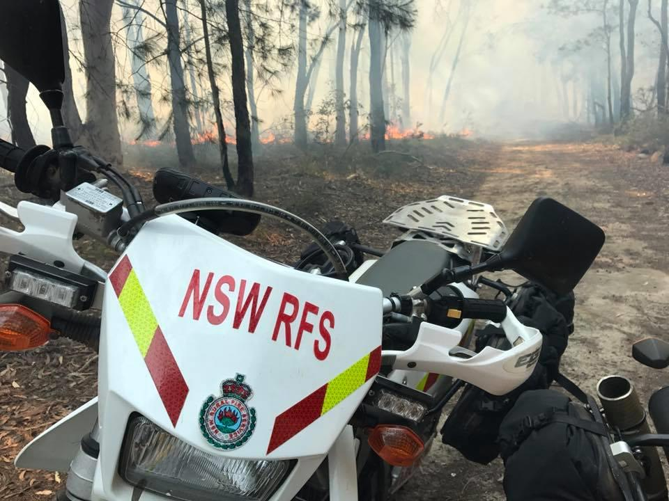

# NSW RFS Operational Protocol 1.4.7 — Trail Bikes Operations

> **Source**: NSW Rural Fire Service
> **URL**: https://www.rfs.nsw.gov.au/__data/assets/pdf_file/0020/246233/OP-1.4.7.pdf
> **Licence**: Crown copyright NSW; practitioner and public-information use
> **Retrieved**: 2026-05-07T13:40:36Z
> **SHA-256**: `c32e233cbe0beb8730ca820c6f62625995edc64452561b86afa40a42dadf2e47`
> *Converted from PDF to Markdown format.*

---
## Page 1

 
 
OP 1.4.7 OPERATIONAL PROTOCOL FOR 
TRAIL BIKE OPERATIONS

---
## Page 2

 
OPERATIONAL PROTOCOL 1.4.7 – TRAIL BIKE OPERATIONS 
2 of 11 
Document control 
Release history 
Version 
Date 
Author 
Summary of changes 
1.1 
October 2015 
Simon Topp 
Original Document 
2.1 
November 2017 
Simon Topp 
Significant modification based on changes to 
the programme 
2.2 
October 2018 
Naju Mehra 
Feedback from DRC and MSO 
Reviewed by 
Name 
Title 
Date 
Christopher Ryder 
Manager, Remote Area Firefighting & 
Specialised Operations 
December 2017 
Steven Yorke 
Director, Operational & Mitigation Services 
June 2018 
Peter McKechnie 
Manger, State Operations 
October 2018 
Jason Heffernan 
Director, Response and Coordination 
October 2018 
Approved by 
Name 
Title 
Date 
Deputy Commissioner Rob Rogers 
Executive Director, Operations 
November 2019

---
## Page 3

 
OPERATIONAL PROTOCOL 1.4.7 – TRAIL BIKE OPERATIONS 
3 of 11 
Contents 
 
1 
Links .............................................................................................................................................. 5 
2 
Superseded Procedure .................................................................................................................. 5 
3 
Purpose ......................................................................................................................................... 5 
3.1 
Capability ............................................................................................................................ 5 
3.2 
Firefighting Capability.......................................................................................................... 5 
4 
Hazards and Precautions .............................................................................................................. 6 
4.1 
Inherent Hazards ................................................................................................................ 6 
4.2 
Risk Management ............................................................................................................... 6 
4.3 
Risk Assessment ................................................................................................................ 6 
4.4 
Dynamic Risk Mitigation Tool .............................................................................................. 6 
4.5 
Safety Triggers.................................................................................................................... 6 
4.6 
Limitations ........................................................................................................................... 6 
4.7 
Crew Resource Management .............................................................................................. 7 
5 
Personal Protective Equipment & Clothing (PPE/C) ...................................................................... 7 
5.1 
Riding PPE/C ...................................................................................................................... 7 
5.2 
Bush Fire PPC .................................................................................................................... 7 
5.3 
First Aid Kit ......................................................................................................................... 7 
5.4 
Personal Locator Beacon .................................................................................................... 7 
6 
Training and Personnel ................................................................................................................. 7 
6.1 
Pre-Requisites .................................................................................................................... 7 
6.2 
Training and Qualifications .................................................................................................. 8 
7 
Operational Procedures ................................................................................................................. 8 
7.1 
Operational Management .................................................................................................... 8 
7.2 
Trail Bike Operations Deployment Plan ............................................................................... 8 
7.3 
Deployment Briefing ............................................................................................................ 8 
7.4 
Trail Bike Team Structure ................................................................................................... 8 
7.5 
Response Riding ................................................................................................................. 8 
7.6 
Use of Flashing LEDs ......................................................................................................... 8 
7.7 
Tenures and Permissions ................................................................................................... 9 
7.8 
Pre-Planned Deployments .................................................................................................. 9 
7.9 
Trail Bike Proactive Standby ............................................................................................... 9 
7.10 Communications ................................................................................................................. 9 
7.11 Search and Rescue Arrangements ..................................................................................... 9 
7.12 Command Structure .......................................................................................................... 10 
7.13 Maintenance ..................................................................................................................... 10

---
## Page 4

 
OPERATIONAL PROTOCOL 1.4.7 – TRAIL BIKE OPERATIONS 
4 of 11 
8 
Operational Guidance .................................................................................................................. 10 
8.1 
Resourcing Local Riders and Equipment .......................................................................... 10 
8.2 
Out of Area (OOA) Requests ............................................................................................ 10 
8.3 
Deployment Method .......................................................................................................... 10 
8.4 
Trail Bike Call Signs .......................................................................................................... 10 
8.5 
Communications Planning ................................................................................................ 11 
8.6 
Equipment ......................................................................................................................... 11 
8.7 
Vehicle Running Sheets .................................................................................................... 11 
Appendix A - Trail Bike Risk Assessment …………………………………………………………………...12 
Appendix B - Trail Bike Deployment Plan …………………………………………………………………...14 
Appendix C - Standard Equipment List….…………………………………………………………………...15

---
## Page 5

 
OPERATIONAL PROTOCOL 1.4.7 – TRAIL BIKE OPERATIONS 
5 of 11 
1 Links 
SS 3.1.4 Arduous and Remote Firefighting (Final draft with R&C for comment). 
Operational Protocol 1.2.19 (Medical Evacuation of Fireground Personnel) 
 
 
2 Superseded Procedure 
Nil 
 
 
3 Purpose  
The purpose of this Operational Protocol is to provide Incident Controllers (ICs), Incident Management 
Team (IMT) members, District Officers and Trail Bike Riders with operational procedures and associated 
guidelines regarding the deployment of NSW RFS Trail Bikes. 
 
3.1 Capability 
The NSW RFS Trail Bike programme utilises Trail Bike Teams (TBTs) consisting of two Riders. A TBT 
will carry with them equipment for basic firefighting, communications, first aid, navigation and basic bike 
maintenance. TBTs are able to be deployed for a number of purposes. These include: 
› Response to fires or incidents in difficult to reach areas 
› Direct attack firefighting 
› Reconnaissance missions 
› Intelligence gathering 
› Patrols 
› Fire trail inspections & clearance operations 
› Assist other agencies e.g. land search rescue operations 
› Install or maintain portable radio repeaters 
› Aviation Bombing Ground Support Operations 
 
It is anticipated that the trail bikes will be able to deployed for a maximum of a 12-hour shift. The fuel 
duration of the bikes will be approximately 140km when fully loaded. The TBTs may be able to refuel in 
the field if there is a suitable service station or NSW RFS vehicles carrying sufficient unleaded fuel.  
 
3.2 Firefighting Capability  
The firefighting equipment kits which may be carried by TBTs include: 
Chainsaw Kit: 
› 1 x Small or Medium Chainsaw 
› 1 x McLeod Tool 
Blower Kit: 
› 1 x Small Leaf Blower 
› 1 x McLeod Tool 
Foam Kit 1: 
› 1 x Compressed Air Foam System (12L Class A Foam) 
Foam Kit 2: 
› 1 x IFEX Impulse Gun (13L Class A Foam) 
 
Each kit can be carried on a bike. Typically, 2 of the above will be selected by the Team to carry based 
on the tasking. Equipment selection is undertaken by the TBT dependant on taskings.

---
## Page 6

 
OPERATIONAL PROTOCOL 1.4.7 – TRAIL BIKE OPERATIONS 
6 of 11 
4 Hazards and Precautions 
 
4.1 Inherent Hazards 
The riding of Trail Bikes is an inherently hazardous activity. Significant identified risks include: 
› Riders falling from or with a trail bike  
› Riders colliding with a stationary object 
› Riders colliding with moving vehicles 
› Traffic accidents 
› Bush Fire overrun 
 
4.2 Risk Management 
Risk is minimised throughout the programme by a variety of controls. Every deployment requires 
thorough consideration of the specific risks associated with the incident or activity.  
 
4.3 Risk Assessment 
An operational risk assessment tool is provided in this document as ‘Appendix A’ and must be completed 
by the requesting authority in consultation with the TBT prior to any deployment.  
 
4.4 Dynamic Risk Mitigation Tool 
TBTs should regularly conduct dynamic risk assessments while riding. A ‘FACT’ check will assist with 
riders with this process: 
F – Fire or other environmental hazards.  
A – Ability of the riders to undertake the tasks 
C – Communications are reliable 
T – Terrain or track conditions 
  
4.5 Safety Triggers  
As with all resource taskings consideration to safety should be given when deploying TBTs during times 
when the Fire Danger Rating is, or is forecast to be ‘Severe’ or above. Based on the nature of the 
environment or the tasking the risk assessment should consider: 
› Trigger points for aborting the deployment,   
› Unsafe areas for the TBT 
› Ensuring regular and reliable communications between FIRECOM and the TBT to ensure situational 
awareness is maintained 
 
Such risks and control measures must be recorded in the risk assessment tool in Appendix A.  
 
4.6 Limitations  
It is important to acknowledge the limitations of a TBT resource. It is not anticipated that TBTs can 
contain fires which exhibit any of the following characteristics: 
› Greater than 1.5m average flame height 
› Greater than 1 Hectare 
› A noticeable rate of spread

---
## Page 7

 
OPERATIONAL PROTOCOL 1.4.7 – TRAIL BIKE OPERATIONS 
7 of 11 
4.7 Crew Resource Management 
The principles of Crew Resource Management (CRM)1 should be utilised to minimise errors. In 
particular, any tasking must be aborted or placed ‘on hold’ if at any time a Rider, District, IC or IMT 
Personnel are concerned for the safety of the TBT.  
 
 
5 Personal Protective Equipment & Clothing (PPE/C) 
 
5.1 Riding PPE/C 
For any NSW RFS Trail Bike riding activity each rider must wear all of the following as issued by the 
NSW RFS: 
› Motorcycle helmet 
› Goggles (anti-fog) 
› Trail bike armoured jacket 
› Riding gloves 
› Knee/shin guards  
› Bush Fire trousers 
› Riding boots 
 
5.2 Bush Fire PPC 
Standard NSW RFS Bush Fire PPC that is not being worn during the ride must be carried on the bike 
by all Riders to allow them to don appropriate bush fire PPC upon arrival at a fire.  
 
5.3 First Aid Kit 
At least one personal first aid kit must be carried by a TBT.  
 
5.4 Personal Locator Beacon 
A Personal Locator Beacon (PLB) must be carried by every TBT as an emergency communication 
device. A PLB must only be activated in an emergency (such as a medical emergency) and when no 
other forms of communications are available.  
 
 
6 Training and Personnel 
 
6.1 Pre-Requisites 
The pre-requisites to participate in any Trail Bike Training are:  
› Advanced Firefighter Qualifications* 
› Current First Aid Application (FAA) 
› Current Arduous Medical 
› Current Arduous Pack Test 
› Current Unrestricted Australian Motorcycle Licence 
 
* For newer AF Qualifications, riders will need at least the following: Wildfire Behaviour (WFB), 
Navigation (NAV) and Crew Safety and Welfare (CSW).  
 
                                               
1 Crew Resource Management and its principles are covered in-depth within the Crew Safety and Welfare 
component of Advanced Firefighter Training.

---
## Page 8

 
OPERATIONAL PROTOCOL 1.4.7 – TRAIL BIKE OPERATIONS 
8 of 11 
Additionally, to ensure riders have existing riding skills a pre-course riding assessment may be 
introduced as a pre-requisite to selection on training courses.  
 
6.2  Training and Qualifications 
The minimum training for any Trail Bike Rider is provided in the form of a Trail Bike Operations (TBO) 
course. This training is offered at a state level and coordinated by Operational Support. TBO is the 
minimum qualification required for NSW RFS personnel in order to operate NSW RFS Trail Bikes. 
 
 
7 Operational Procedures 
 
7.1 Operational Management 
The District or IMT staff are responsible for the operational management of a TBT. 
 
7.2 Trail Bike Operations Deployment Plan  
A Trail Bike Operations (TBO) Deployment Plan must be developed in consultation with the TBT and 
include TBT taskings, routes, equipment and communications plan. The deployment plan must also refer 
to a medical plan2. This information may be included in an Incident Action Plan (IAP) if one exists. A tool 
to assist in the development of a TBO Deployment Plan is provided in Appendix B.  
 
7.3 Deployment Briefing 
A clear and comprehensive briefing must be provided by the District, IMT Operations or delegate to a 
TBT prior to any deployment. The briefing should be in line with SMEACS: 
 
› Situation- Current and predicted fire activity/weather 
› Mission – Summarise the objectives 
› Execution – Strategy and Tactics 
› Administration – Assistance and Logistics 
› Command – Command, Control and Communications 
› Safety – Safety Hazards 
 
The briefing should summarise and complement the TBO Deployment Plan (or IAP) and Risk 
Assessment Tool.  
 
7.4 Trail Bike Team Structure 
A TBT has a minimum of 2 x Riders. At least one rider must be qualified in Crew Leader Wildfire (CLW). 
Both Riders must be qualified and current in First Aid Application (FAA).  Depending upon the risk 
assessment, Crew Leader Grassfire (CLG) may be more appropriate than CLW. 
 
7.5 Response Riding 
NSW RFS Trail Bikes will NOT ‘respond’ to incidents and are not provided exemptions from road rules.  
 
7.6 Use of Flashing LEDs 
The red and blue LEDs are fitted to the bikes for the primary purpose of ensuring high visibility at 
incidents particularly in smoke and around other emergency vehicles. Trail bike red and blue LEDs must 
NOT be used en-route to an incident or while travelling on public roadways in accordance with 7.4 
Response Riding.  
 
                                               
2 Refer to Operational Protocol 1.2.19 (Medical Evacuation of Fireground Personnel).

---
## Page 9

 
OPERATIONAL PROTOCOL 1.4.7 – TRAIL BIKE OPERATIONS 
9 of 11 
7.7 Tenures and Permissions 
Districts and or IMTs overseeing TBTs are responsible for all permissions to enter managed lands, roads 
or trails. Consideration should be given by the IMT to the impact of trail bikes entering such areas – and 
relevant permission sought. 
  
7.8 Pre-Planned Deployments 
Trail Bikes can be activated or deployed as required by the District or IMT. Deployment of NSW RFS 
Trail Bikes must only occur with authorised riders and once the District considers the particular risks of 
the operation. Pre-planned deployments may include: 
› Deployment to identified fires 
› Deployment for reconnaissance or intelligence purposes 
› Deployment at larger fires to assist in patrol or standby for fire breaches 
› Deployment for fire trail inspections 
 
7.9 Trail Bike Proactive Standby 
TBTs may be activated on certain days where there is an elevated risk of fires starting or being detected. 
During these days a TBT may be placed on standby for immediate deployment at a location determined 
by the District or State Duty Operations Officer.  
 
In addition to providing a direct attack capability, a quick deployment of a TBT will provide an opportunity 
to gather intelligence and undertake reconnaissance of fires and contribute to identifying potential 
containment options early.  
 
7.10 Communications 
Regular communications is not only essential for operational awareness but for safety.  If any method of 
communications with FIRECOM or an appropriate level of Fireground Command is unavailable, TBT 
operations must not continue until an alternate communications method is in place. 
 
Each TBT will carry two PMR/GRN/Field Operations Radios and two Fireground Radios.  A satellite 
phone may also be appropriate pending the risk assessment outcomes. The TBT must provide a ‘SAR 
Call’ at least every 30 minutes (similar to aircraft flight following). It is the responsibility of both the TBT 
and the Communications Centre to ensure these regular communications occur.   
 
7.11 Search and Rescue Arrangements 
If a TBT is uncontactable for longer than 30 minutes the District or IMT must take action to regain 
communications with the team. E.g. Diverting resources to ascertain the TBT’s welfare on VHF 
Fireground channels.  
The following search and rescue arrangements are to be implemented if a Trail Bike Team becomes 
overdue by more than 60 minutes. 
› Divert all available local fireground resources from taskings to locate or communicate with TBT 
› Notify State Duty Operations Officer (SDOO) 
› Notify Police of missing TBT

---
## Page 10

 
OPERATIONAL PROTOCOL 1.4.7 – TRAIL BIKE OPERATIONS 
10 of 11 
7.12 Command Structure  
For command and control purposes, a TBT must be considered as a standard incident resource. On the 
fireground a TBT team integrates into the operations structure and reports to relevant fireld commanders.  
 
7.13 Maintenance 
Riders are responsible for maintaining the trail bikes and associated equipment during and following 
their standbys or deployments. The following tasks need to be completed following any use of the bikes 
by Riders or TBTs: 
› Refuel bikes 
› Clean/Wash bikes 
› Inspect and report on any mechanical issues 
› Inspect, clean and restow firefighting equipment 
› Clean, refuel and sharpen chainsaw 
› Recharge radio batteries 
› Place bike batteries on charge 
› Check fluids 
› Report damage or missing equipment 
› Complete log book or running sheets.  
 
 
8 Operational Guidance 
 
8.1 Resourcing Local Riders and Equipment 
Where a district has it’s own allocated Trail bike Unit, the District and/or IMT are responsible for 
resourcing Riders and equipment through local pre-arranged call out procedures. It is the responsibility 
of both the District and the Riders to ensure that the pre-requisites for trail bikes are current for any rider 
being deployed.  
 
8.2 Out of Area (OOA) Requests 
OOA requests for Trail Bikes and Riders may be arranged through existing resource request procedures 
using a SAP 2 form forwarded through standard request processes to a district(s) with an allocated Trail 
Bike Unit. 
 
8.3 Deployment Method 
As a default, Trail Bikes Teams are deployed to an incident in a vehicle with the trailer and bikes in tow.  
  
However, following consideration of risks, distance, equipment and fuel requirements, it may be 
appropriate and more efficient for the trail bikes to be deployed independent of their vehicle and trailer. 
These options should be discussed between the TBT and District during a deployment planning and/or 
briefing.  
 
8.4 Trail Bike Call Signs 
Default radio call signs for a TBT will include either: 
1. The location from which they are based. E.g. “Northern Tablelands Trail Bikes” 
or 
2. If a composite team exists, or multiple teams are operating in one area then TBTs can be allocated 
a phonetic letter. E.g. “Trail Bike Team Alpha”

---
## Page 11

 
OPERATIONAL PROTOCOL 1.4.7 – TRAIL BIKE OPERATIONS 
11 of 11 
TBT radio call signs must only refer to the team. At all times bikes will operate in pairs and the call sign 
will represent the team rather than an individual bike or rider.  
 
8.5 Communications Planning 
The PACE communications planning model (See below) should be planned for and used for Trail Bike 
Requests: 
 
Primary – Primary Communications Channel. e.g. PMR/GRN 
Alternate – Secondary Communications Channel. e.g. fireground or simplex channels  
Contingent – Backup Communications. e.g. Satellite Phone  
Emergency – Emergency communications. e.g. PLB 
 
8.6 Equipment  
A complete equipment list is provided in Appendix C. 
 
8.7 Vehicle Running Sheets 
Trail bikes will be an asset in SAP EAM. Vehicle running sheets will need to be uploaded into SAP EAM 
on a regular basis by district staff. These sheets can also be a record of rider currency showing when 
riders have ridden.

