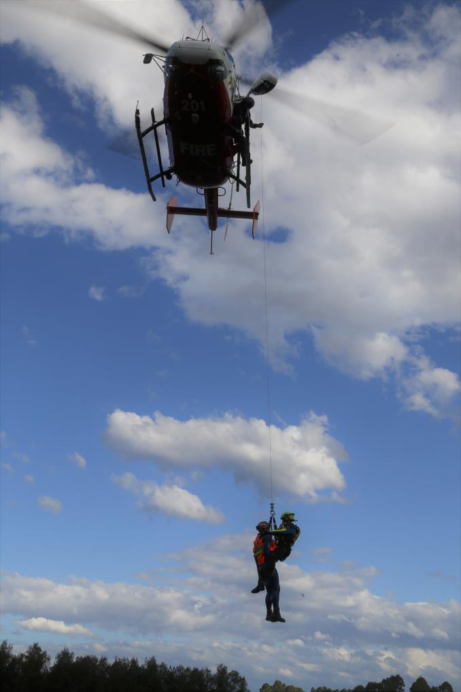

# NSW RFS Operational Protocol 1.4.9 — Helicopter Search and Rescue

> **Source**: NSW Rural Fire Service
> **URL**: https://www.rfs.nsw.gov.au/__data/assets/pdf_file/0005/174569/OP-1.4.9-Helicopter-Search-and-Rescue.pdf
> **Licence**: Crown copyright NSW; practitioner and public-information use
> **Retrieved**: 2026-05-07T13:40:38Z
> **SHA-256**: `1a2210a9bc4f18884afc518fc280e59b0e6da1b3624d8171ee41d6e9b1c3787a`
> *Converted from PDF to Markdown format.*

---
## Page 1

 
 
 
 
OP 1.4.9  
OPERATIONAL PROTOCOL FOR HELICOPTER 
SEARCH AND RESCUE

---
## Page 2

 
OPERATIONAL PROTOCOL 1.4.9 - HELICOPTER SEARCH AND RESCUE  
2 of 15 
Document control 
Release history 
Version 
Date 
Author 
Summary of changes 
1.1 
December 2017 
Simon Topp 
Initial Document 
1.2 
March 2019 
Simon Topp 
Final Draft 1 
1.3 
November 2019 
Simon Topp 
Final Draft 2 
1.4 
February 2020 
Simon Topp 
Final Draft 3 
1.5 
June 2022 
Simon Topp 
AFDRS Changes 
Reviewed by 
 
Title 
Date 
Supt. Christopher Ryder 
Manager, Remote Area Firefighting & Specialised 
Operations 
Dec 2017 
A/C. Steven Yorke 
Director, Operational & Mitigation Services 
June 2018 
Chief Supt. Peter McKechnie 
Manager, State Operations 
Dec 2018 
A/C. Jason Heffernan 
Director, Response & Coordination 
August 2019 
A/C Ben Millington 
Director, State Operations 
June 2022 
Approved by 
Name 
Title 
Date 
Peter McKechnie 
Deputy Commissioner, Field Operations 
August 2022 
Related documents 
Document name 
Version 
NSW RFS Helicopter Winching Standards 
2017 
NSW RFS Helicopter Rescue Winching Standards 
2017 
Interagency Aviation SOPs  
2018 
Operational Protocol 1.2.17 Rapid Aerial Response Teams 
2018 
NSW State Rescue Policy 
2018

---
## Page 3

 
OPERATIONAL PROTOCOL 1.4.9 - HELICOPTER SEARCH AND RESCUE  
3 of 15 
Contents 
 
1 
Links ............................................................................................................................................... 4 
2 
Superseded Procedure ................................................................................................................... 4 
3 
Purpose .......................................................................................................................................... 4 
3.1 
Document ............................................................................................................................. 4 
3.2 
Scope ................................................................................................................................... 4 
3.3 
Capability ............................................................................................................................. 4 
3.4 
Bush Fire Helicopter SAR ..................................................................................................... 4 
4 
Hazards and Precautions ................................................................................................................ 5 
4.1 
Inherent Hazards .................................................................................................................. 5 
4.2 
Risk Management ................................................................................................................ 5 
5 
Personal Protective Equipment & Clothing (PPE/C) ........................................................................ 5 
5.1 
Floodwater SAR PPE/C ........................................................................................................ 5 
5.2 
Non Floodwater SAR PPE/C ................................................................................................ 5 
5.3 
Additional PPE and Safety Equipment .................................................................................. 6 
6 
Training and Personnel ................................................................................................................... 6 
6.1 
ARC Selection and Recruitment ........................................................................................... 6 
6.2 
Pre-Requisites ...................................................................................................................... 6 
6.3 
Minimum Training Requirements .......................................................................................... 7 
6.4 
Currency Requirements ........................................................................................................ 7 
6.5 
Recertification Periods (Qualification Shelf Lives) ................................................................. 7 
7 
Operational Procedures .................................................................................................................. 8 
7.1 
Overarching Procedures ....................................................................................................... 8 
7.2 
Shift Requirements ............................................................................................................... 8 
7.3 
High Risk Operations............................................................................................................ 9 
7.4 
Operational Taskings............................................................................................................ 9 
7.5 
Landed Rescues ................................................................................................................ 10 
7.6 
Hover Rescues ................................................................................................................... 10 
7.7 
Winch Operations ............................................................................................................... 10 
7.8 
Bush Fire SAR Operations ................................................................................................. 13 
7.9 
After Action Review (Debriefing) ......................................................................................... 15

---
## Page 4

 
OPERATIONAL PROTOCOL 1.4.9 - HELICOPTER SEARCH AND RESCUE  
4 of 15 
1 Links or References 
Interagency Aviation SOPs 
Operational Protocol 1.2.17 Rapid Aerial Response Teams 
NSW RFS Helicopter Winching Standards 
NSW RFS Helicopter Rescue Winching Standards 
NSW State Flood Plan (2018) 
NSW State Rescue Policy (2018) 
 
2 Superseded Procedure 
Nil.  
 
3 Purpose  
 
3.1 Document  
The purpose of this Operational Protocol is to provide NSW RFS and other Agencies with Operational 
Procedures and associated guidelines regarding Helicopter Search and Rescue (SAR) Operations 
involving NSW RFS Personnel.   
 
3.2 Scope 
Helicopter SAR operations include: 
› Bush Fire Helicopter SAR Operations 
› Floodwater SAR Operations  
› Land SAR Operations 
 
This Operational Protocol applies: 
› At incidents controlled by the NSW RFS 
› To all NSW RFS personnel directly involved in Helicopter SAR Operations 
› To those overseeing NSW RFS personnel directly involved with Helicopter SAR Operations  
 
3.3 Capability 
The NSW RFS has a recognised helicopter rescue capability involving a number of personnel trained 
and equipped to conduct helicopter rescue operations. Authorised NSW RFS personnel will be attached 
to aircraft tasked by the NSW State Air Desk (SAD) for SAR Operations. 
 
NSW RFS personnel can participate in the following tasks as an Aviation Rescue Crew (ARC): 
› Rescue winch operations (including in water) 
› Rescue operations involving a landed or hovering helicopter 
› Air search operations 
 
3.4 Bush Fire Helicopter SAR 
Previously, the Rapid Aerial Response Teams (RART) programme has transitioned into a SAR 
capability when bush fires have been fast moving and threatened lives or property. RART firefighting is 
inherently different to SAR operations and as such a clear distinction must be made between the two 
capabilities. A Bush Fire Helicopter SAR capability may be activated when the Fire Behaviour Index 
(FBI) excludes the safe limits for RART and direct attack firefighting.

---
## Page 5

 
OPERATIONAL PROTOCOL 1.4.9 - HELICOPTER SEARCH AND RESCUE  
5 of 15 
4 Hazards and Precautions 
 
4.1 Inherent Hazards 
All helicopter operations, particularly helicopter rescue operations have significant hazards. Key risks 
include: 
› Aircraft mechanical failure 
› Low level flying risks (e.g. wire strikes) 
› Environmental hazards 
› Falls (Heights safety) 
› Human factors 
› Injury or death to victims 
› Foreign Object Debris (FOD) 
 
4.2 Risk Management 
The NSW RFS and aircraft operators manage risks by implementing the following controls: 
› Approved and audited aircraft operators 
› NSW RFS Winching Standards 
› NSW RFS Rescue Winching Standards 
› Aviation SOPs 
› Operations Manuals and risk management (Aircraft Operator) 
› Comprehensive NSW RFS training programme 
› Helicopter SAR Procedures (Operational Protocol and Standards) 
 
 
5 Personal Protective Equipment & Clothing (PPE/C) 
NSW RFS ARCs are allocated PPE/C for the different environments and operations they encounter.  
 
5.1 Floodwater SAR PPE/C 
NSW RFS ARCs MUST wear the following when operating in and around floodwater: 
› Helicopter Rescue Helmet (with integrated hearing protection and communications) 
› Goggles 
› Gloves 
› NSW RFS Wetsuit  
› Water Boots 
› Personal Flotation Device (PFD) (Inflatable or Non Inflatable) 
› Non-inflatable life jackets will impede a wearer exiting a helicopter, if it has crashed into 
floodwater and therefore must not be worn for longer than necessary. Non-inflatable PFDs may 
be beneficial when deploying into or near floodwater.  
› Inflatable PFDs should be worn when flying over water and when deemed appropriate by the 
collective aircrew for an operation.  
 
5.2 Non Floodwater SAR PPE/C 
NSW ARCs MUST wear the following when undertaking non-flood helicopter SAR operations such as 
at a bush fire incident: 
› Helicopter Rescue Helmet (with integrated hearing protection and communications) 
› Goggles 
› Gloves 
› NSW RFS approved clothing for aerial operations 
› NSW RFS approved boots

---
## Page 6

 
OPERATIONAL PROTOCOL 1.4.9 - HELICOPTER SEARCH AND RESCUE  
6 of 15 
5.3 Additional PPE and Safety Equipment 
A SAR Aircraft operator must provide a minimum set of equipment as outlined in the NSW RFS Rescue 
Winching Standards. This includes rescue harnesses and equipment.  
 
5.3.1 Ground to Air Communications 
The ARC must have with them a portable radio capable of communicating from the ground to the air. 
This radio is not to be used by the ARC during the winch sequence but may be used under certain 
circumstances on the ground e.g. if the aircraft departs for a circuit etc. Radio communication needs to 
be checked prior to departure from the aircraft. 
 
 
6 Training and Personnel 
 
6.1 ARC Selection and Recruitment 
Operational Support coordinate the ARC programme including recruiting personnel when required. 
Recruitment is conducted only when a designated operational need arises. Selection is based on (but is 
not limited to): 
› Previous remote area operational experience  
› Pre-requisite qualifications 
› Specialist medical and Arduous Pack Test clearance 
› Base location (operational needs) 
› ARC Swim test 
› Helicopter Insertion Techniques and First Aid Theory assessments 
› Winching assessments 
 
6.1.1 Pre-Requisites 
All ARCs must hold the following qualifications or competencies prior to undertaking or being selected 
to undertake any helicopter rescue training or operations: 
› Arduous Medical 
› Arduous Pack Test 
› Helicopter Insertion Techniques (HIT) 
› First Aid Application (FAA) 
 
6.1.2 ARC Swim Test 
An ARC Swim Test consists of the following tasks: 
› 200m swim completed within 4 minutes 30 seconds (Swim wear) 
› Floating on back for 2 minutes (Swim wear) 
› Treading water for 5 minutes (Swim wear) 
 
The above tasks must be completed without a rest break. Following the initial 3 tasks, the following 
further tasks are to be conducted fully clothed (long sleeved shirt and pants.) 
› 15m underwater swim without taking breath 
› 15m swim dragging a manikin (wearing a PFD) 
› 25m swim (wearing a PFD)

---
## Page 7

 
OPERATIONAL PROTOCOL 1.4.9 - HELICOPTER SEARCH AND RESCUE  
7 of 15 
6.2 Minimum Training Requirements 
All operational NSW RFS ARCs must be trained and qualified in a Certificate III in Aviation (Rescue 
Crewman) or equivalent.  
 
The NSW RFS courses and qualifications that meet these requirements are: 
› Helicopter Insertion Techniques 
› Down the Wire Technician  
› Rescue Winching (over land, from or over water) 
› Advanced Resuscitation Techniques 
› Sling Load Operations 
› Crew Resource Management Aviation 
› Air Search and Rescue 
› Helicopter Underwater Escape Training  
 
6.3 Currency Requirements 
The NSW RFS requires that ARCs maintain currency of both their pre-requisite qualifications as well as 
their ARC Role Specific Skills in order to be deployed operationally.  
 
6.3.1 Fit for Task Requirements  
The following medical and fitness requirements must be maintained by ARCs: 
› Arduous Medical (24 month shelf life) 
› Arduous Pack Test (12 month shelf life) 
› NSW RFS ARC Swim Test (3 year shelf life) 
 
6.3.2 Role Specific Currency 
ARCs can only be deployed operationally if they can have achieved or maintained ‘currency’. ARC 
‘currency’ is a combination of formal re-certification and recent experience.  
 
Formal Re-Certifications 
ARCs must be formally, assessed and competent in the following capabilities/qualifications: 
› Down the Wire Operations (Land Based Rescue Winching) – 12-month shelf-life 
› Down the Wire Operations (Water Based Rescue Winching) – 12-month shelf-life 
› Helicopter Underwater Escape Training (HUET) – 3-year shelf-life 
Formal re-certification results are recorded on an Aviation Rescue Crew ID Card. 
 
Recent Experience 
ARCs must be able to demonstrate recent experience of live helicopter training or operations within 6 
months. Recent experience is recorded in an ARC’s log book. Under exceptional circumstances, the 
Manager, Operational Support may extend the required ‘Recent Experience’ period by 2 months.  
 
ARCs can be classified as ‘current’ if they satisfy both the formal re-certification and recent experience 
criteria. 
 
6.4 Recertification Periods (Qualification Shelf Lives) 
 
6.4.1 Down the Wire (DTW) 
ARCs must formally be assessed competent in ‘DTW’ every 12 months in order to maintain operational 
status.

---
## Page 8

 
OPERATIONAL PROTOCOL 1.4.9 - HELICOPTER SEARCH AND RESCUE  
8 of 15 
6.4.2 Helicopter Underwater Escape Training (HUET) 
ARCs must formally be assessed competent in ‘HUET’ every 3 years in order to participate in over 
water operations.  
 
 
7 Operational Procedures 
 
7.1 Overarching Procedures 
 
7.1.1 Callout Procedures 
Operational Support will coordinate the resourcing of ARCs. Operational Support will provide all 
required joining instructions.  
 
7.1.2 ARC Resourcing and Logistics 
Operational Support is responsible for ensuring liaison with the NSW RFS SDOO or SOC and activating 
ARCs to cover requests.  
 
7.1.3 Costs while Deployed 
While deployed as a member of an aircrew a NSW RFS ARC will have their meals and accommodation 
covered by the aircraft operator they are attached with. In the instance an ARC needs to spend their 
own money on transport, meals or accommodation, the ARC must notify Operational Support in 
advance, keep the tax invoice and Operational Support will organise reimbursement.  
 
 
7.2 Shift Requirements 
 
7.2.1 Arrival and Reporting 
An ARC will be given deployment or standby information and instructions by NSW RFS personnel. Upon 
arrival at an airbase or hangar, an ARC will need to identify themselves to the Pilot and Aircrew and 
provide identification in the form of a NSW RFS issued ARC ID Card.  
 
7.2.2 Briefings 
An ARC must receive an aircraft briefing and a rescue briefing at the commencement of every shift. 
There will be minor differences in procedures between aircraft operators and this is an opportunity to 
understand and discuss any differences.  
 
7.2.3 Equipment Checks 
An aircraft operator is responsible for ensuring rescue equipment is provided, approved and serviceable. 
An ARC is to inspect the rescue equipment themselves prior to deployment.  
 
7.2.4 Shift Lengths 
ARCs will work in line with the shift lengths of the aircrew they are attached to. A shift length should be 
no longer than 12 hours, in accordance with Service Standard 3.1.14 Fatigue Management and 
Operational Protocol 1.4.4. If travelling is required, this is included within the total shift length for an 
ARC.  
 
7.2.5 Deployment Duration 
ARC’s must be deployed in accordance with Service Standard 3.1.14 Fatigue Management and 
Operational Protocol 1.4.4.

---
## Page 9

 
OPERATIONAL PROTOCOL 1.4.9 - HELICOPTER SEARCH AND RESCUE  
9 of 15 
7.2.6 Recording of Duty 
All ARCs should record the following details of any standby and deployment in their aviation logbooks: 
› Shift Lengths 
› Activities 
› Missions/Rescues 
› Winches 
 
7.3 High Risk Operations  
The NSW RFS recognises that Helicopter SAR is a high risk activity and it’s impossible to have specific 
procedures for all rescue situations. In all circumstances the decisions to commit or to abort the mission 
is ultimately made by the Pilot in Command and those on scene using situational awareness. These 
decisions must always be made using the principles of CRM1.  
 
To manage the safety of NSW RFS personnel and Aircrew members the following missions are beyond 
the training and scope of NSW RFS ARCs and should not be attempted:  
› Rescues from moving objects such as cars, houses or debris 
› Rescues that require the ARC to enter a confined space such as a car, or house while remaining 
attached to the winch cable/hook 
› Any mission that exposes the Aircraft, Air Crewperson, Pilot, ARC or Victims to an unacceptable risk.  
 
7.4 Operational Taskings 
 
7.4.1 Receipt of Taskings 
The IC or delegate will provide taskings to the Aircrew, (commonly the Pilot). The IC or delegate must 
approve all operations or missions.  
 
7.4.2 Rescue Priorities 
When arriving on scene at a rescue, the aircrew must initially determine whether there is a need for a 
rescue. Additionally, the collective aircrew must explore whether there are other methods available e.g. 
4x4 vehicle or Boat.  
 
If a helicopter is determined as an appropriate rescue appliance, then the first priority should be for the 
helicopter to land and undertake the rescue if possible and practical. Landing should always be the first 
considered options for the aircrew as it will almost always be the safest way to affect a rescue.  
 
In the instance that there is nowhere appropriate to land, the rescue may be affected by undertaking a 
low hover where the victim is escorted by the ARC into the helicopter. Only when neither landing nor 
hovering are possible or practical then a winch should be undertaken.  
 
The NSW RFS accepts that on occasions, a hover rescue poses a greater risk to a winch rescue. The 
option that involves the least risk to victims and the aircrew should be adopted. 
 
Victim(s) safety must be threatened in order for a winch rescue to occur.  
 
7.4.3 Dynamic Risk Assessments 
Upon arriving on scene to undertake a mission, all members of the aircrew including the ARC must 
undertake a dynamic risk assessment and discuss the risks as a group. All members of the collective 
aircrew must be satisfied with the level of risk and that the activities are within the training and capability 
of the personnel involved. 
 
                                               
1 Crew Resource Management and its principles are covered in-depth within the Crew Safety and Welfare 
component of Advanced Firefighter Training.

---
## Page 10

 
OPERATIONAL PROTOCOL 1.4.9 - HELICOPTER SEARCH AND RESCUE  
10 of 15 
 
7.5 Landed Rescues 
Landing a helicopter is generally regarded as the safest method of helicopter rescue.  
 
7.5.1 Procedures 
Landed rescues should be discussed with the Duty Aircrew to ensure procedures align to the aircraft 
and the aircraft operator.  
7.5.2 Victim Management 
An ARC is responsible for managing victims in any rescue. The risks of a landed rescue revolve 
generally around the management and control of victims. Wherever possible the ARC should approach 
victims, provide a brief introduction and instructions. All victims must be directly escorted to the 
helicopter by the ARC and/or Air Crewperson upon the approval of the Pilot and/or Air Crewperson.  
 
 
7.6 Hover Rescues 
A hover rescue may be able to be affected safely in some environments.  
 
7.6.1 Procedures 
Hover rescue procedures should be discussed with the Duty Aircrew to ensure procedures align to the 
aircraft and the aircraft operator.  
 
 
7.7 Winch Operations 
The following section contains information relating to rescue winching operations.  
 
7.7.1 Rescue Crew Checks – Full  
The ARC must carry out a ‘full’ check of themselves and be checked by the Air Crewperson at least 
once prior to every operation. This MUST be done pre-flight. The following checks constitute a Full ARC 
check: 
1. Suitable PPC selected 
2. Helmet secure 
3. Eye protection fitted  
4. Hearing protection fitted 
5. Harness donned, fitted and dressed 
6. ‘Y Piece’ connected and dressed 
7. Quick release set and checked  
8. Rescue equipment sorted 
9. Additional equipment secure and operational (E.g radio, PFD, PLB) 
 
7.7.2 ARC Checks 
When airborne, a shorter series of checks MUST be completed at regular intervals. These check are 
first carried out by the Air Crewperson. Upon receiving positive indication, the ARC must also carry out 
the checks and indicate an OK to proceed. The following checks constitute an ARC Check: 
1. Harness connections checked 
2. ‘Y Piece’ connected and dressed 
3. Quick release set, orientated and checked 
4. Winch hook connection checked 
5. Rescue equipment connections checked 
 
7.7.3 Harness Connection to Hook 
The order of connections to a hook will be as follows: 
1. Harness of the ARC will be connected to the winch hook first (inner connection) 
2. Rescue collar will be connected second. (outer connection), if a rescue collar is being used as the 
retrieval method

---
## Page 11

 
OPERATIONAL PROTOCOL 1.4.9 - HELICOPTER SEARCH AND RESCUE  
11 of 15 
3. If required, an equipment ring may be connected in any position 
 
7.7.4 ARC Flight Security 
An ARC must be connected to the aircraft at all times by a secure method when the aircraft is airborne. 
The only exemption to this is during a hover rescue where at low altitude and for a short period of time, 
the ARC will not be attached to the helicopter.  
 
7.7.5 Connection Checks of the ARC 
The Air Crewperson and ARC will conduct three (3) ARC Checks (See 7.8.2) prior to winching out.  
 
7.7.6 Landing  
Ten (10) feet from the ground (or water or other surface), the ARC will signal a “Stop” and the Air 
Crewperson will slow the winch and check responsiveness, then slowly winch out as required.  
 
7.7.7 Disconnection from Winch Cable 
Where it is deemed necessary, the ARC may disconnect from the winch cable. This must be signalled 
by the ARC and received by the Air Crewperson. The Air Crewperson or Pilot may deny this request if 
the safety of any member of the crew is risked by such an action.  
 
The NSW RFS allows qualified ARC to disconnect and reconnect from the winch hook where 
necessary. Instances where this may be acceptable include: 
› Situations where significant time may be required to access, communicate or prepare a victim for 
rescue 
› Victims requiring assessment of injuries, emotional stability or physical characteristics that may affect 
the safety of the winching operation 
› Significant entanglement of cable, or rescue equipment such that disconnection of the hook would 
rapidly remedy the situation 
 
Unless in an emergency, the ARC will disconnect from the winch cable by opening the winch hook gate 
and removing the ‘Y piece’. The ‘Y piece’ must remain intact and with the ARC.  
 
It is possible that a Helicopter Operator’s SOPs do not permit or recommend that the ARC disconnect 
from the winch hook. In this situation, the Operator’s procedures overrule NSW RFS procedures and 
must be communicated to the ARC during briefings. 
 
7.7.8 Emergency Disconnections 
The ARC must only activate any quick release mechanisms if their safety is immediately threatened by 
the act of remaining attached to the winch cable.  
 
7.7.9 Winch Equipment Hierarchy 
As part of the risk management process for helicopter rescue winching operations, the NSW RFS has a 
hierarchy for equipment used to rescue a victim. Where possible and practical, the choice of equipment 
used should (in priority order) be: 
 
1. Full body harness 
2. Rescue collar with hypothermic strop 
3. Rescue collar without hypothermic strop (Last resort option only) 
4. Twin rescue collars (Permitted only for use when equipment is limited and when imminent 
threat to life exists) 
 
7.7.10 Victim Full Body Harness 
A full body harness must be used in circumstances where time and circumstances allow. This may 
require the ARC to disconnect from the winch cable. These actions possess their own challenges and 
risks.

---
## Page 12

 
OPERATIONAL PROTOCOL 1.4.9 - HELICOPTER SEARCH AND RESCUE  
12 of 15 
 
7.7.11 Rescue Collar 
Where use of a victim full body harness is not practical, a rescue collar used with the hypothermic strop 
deployed under the thighs or knees of the victim should be used.  
 
A rescue collar used without a hypothermic strop must never be used with the exception of the 
following circumstances: 
1. Instances where time is absolutely critical and the ARC cannot afford to spend any time deploying 
the hypothermic strop 
2. Winching a victim from or over water 
 
While an exception is granted for winching from or over water the NSW RFS expects that wherever 
possible the hypothermic strop must be used.  
 
7.7.12 Approaching a Victim 
ARCs will need to assess a situation fully to ensure that it is safe to approach the victim(s). A brief 
introduction should be conducted and approval to rescue the victims sought by the ARC. The ARC will 
need to provide a brief explanation to the victim of what to do and expect during the winch. Hearing and 
eye protection should also be provided to the victim wherever possible. 
 
7.7.13 Evaluating a Victim 
Only victims whose life is in danger should be winched. Victims who are injured, infirm, infants or 
obese require special consideration. The crew may not be appropriately prepared to manage the 
victim/s in such instances. The ARC may refer to the collective aircrew for advice if time and 
communications permit.  
 
Weight on the cable and in the aircraft should be a consideration for all crew at all times. ARC should be 
evaluating the total cable weight of victims and should not exceed 272kg.  
 
7.7.14 Injured or Sick Victims 
The NSW RFS ARCs are not medically trained beyond first aid and resuscitation. Injured or sick victims 
are not to be winched unless the collective aircrew decide that their life is imminently endangered by the 
environment.  
 
7.7.15 ARC Connections Checks (Winching In) 
An ARC must thoroughly check the connections of themselves and their victim prior to requesting a 
winch in from the Air Crewperson. An ARC must also conduct checks again once the cable is loaded 
and both the ARC and victim have left the ground. Particular attention should be given to cross loading 
of the hardware on the winch hook and the condition of the quick release mechanism.  
 
7.7.16 Victim Management 
It is the responsibility of the ARC to manage the victims during the rescue. This is particularly important 
during the winch. In particular, the victim should not touch the winch hook or quick release and must 
keep their arms down. 
 
7.7.17 Door Transition (In) 
The Air Crewperson and ARC will work to handle the victim into the cabin. Once the victim is inside the 
Air Crewperson will manage cable while maintaining aircraft clearances and doors security and the ARC 
will escort the victim into a seat.  
 
7.7.18 Securing Victim in Cabin 
Once inside the cabin, the ARC must secure the victim(s) into a seat. This involves directing them to a 
position, and then fastening their seatbelt over any strop or harness they are wearing. Only when a 
victim is secured by a seatbelt can the harness, Y piece or strop be disconnected.

---
## Page 13

 
OPERATIONAL PROTOCOL 1.4.9 - HELICOPTER SEARCH AND RESCUE  
13 of 15 
 
7.7.19 Conclusion of Rescue 
Once the victim is secured and disconnected from their strop or harness, the ARC will return to their 
seat. If more rescues are required, the process commences again with connections checks prior to 
leaving the seat and moving to the door. The hook (or wander lead) will remain attached to the ARC 
unless there is likely to be a longer time before commencing again.  
 
If no more rescues are required, the ARC will connect to a seatbelt (preferred) or wander lead then the 
Air Crewperson will disconnect the hook. The hook will be stowed and cabin secured, concluding the 
process.   
 
7.7.20 Static Lift Winch Operations 
Situations may occur where a rescue can be affected by undertaking a relocation of the victim(s) rather 
than winching them into the helicopter. In such situations, collective aircrew discussions should occur 
and evaluate the risks and benefits of such a strategy. Static lift winch operations may be conducted 
similar to short haul rescues where a victim and ARC are winched or lifted up to a height above 
obstacles and then statically flown to a safe location. This may be repeated a number of times without 
the need for the victims or the ARCs to return to the helicopter cabin and may have benefits in being 
able to rescue greater numbers of victims in a shorter period of time. Greater risks may be posed here 
by obstacles, in particular wires.  
 
 
7.8 Bush Fire SAR Operations 
Bush Fire SAR operations or standbys will generally occur when the FBI exceeds the safe limits for 
direct attack firefighting with a RART Crew. This should be considered above an FBI of 40.  
 
7.8.1 Overriding Objectives 
1. Preserve life 
2. Supply real time intelligence 
 
While deployed for Bush Fire SAR, a helicopter effectively relinquishes its firefighting capability and 
focuses on the overriding objectives.  
 
7.8.2 Personnel  
A Bush Fire SAR aircrew involves: 
› 1 x Pilot (Aircraft operator)  
› 1 x Aircrew Officer (Aircraft operator)  
› 1 x NSW RFS Aviation Rescue Crew  
 
7.8.3 Deployment of SAR Helicopter 
State Operations will deploy all Bush Fire SAR Helicopters. All deployments will be approved by the 
SOC, SDOO or IC. The deployment briefing will include the following information as a minimum: 
› Basic incident details   
› Latitude and longitude 
› Operational communications channel 
› Fire common traffic advisory frequency (FCTAF) 
› Mission objectives 
 
7.8.4 Command 
Once deployed to a district or incident, the SAR Helicopter will fall under the tactical command of the 
IMT or IC and may be best tasked by the AAS, Air Operations Officer or Operations Officer.

---
## Page 14

 
OPERATIONAL PROTOCOL 1.4.9 - HELICOPTER SEARCH AND RESCUE  
14 of 15 
Strategic oversight of all SAR operations will be maintained by State Operations. State Operations 
retains the authority to redeploy the aircraft to other incidents and districts based on state level priorities 
and in consultation with the SDOO or SOC. If deployments or re-deployments of the SAR helicopter are 
occurring, State Operations will liaise with the affected IMTs.  
 
7.8.5 Modes of Operation 
SAR aircraft may undertake the following roles in consultation with the local IMT/IC or AAS: 
 
1. Rescues 
Situations where a fire has resulted in a need or suspected need for a helicopter rescue or urgent 
relocation of personnel (including firefighters). This may be reported through the incident 
communications channels or separately through external avenues. E.g. Reports of firefighting crew 
fire overrun or fire impacting a remote property.  
2. SAR Patrol 
A SAR helicopter will fly ahead of the path of the fire and will identify and act upon threats to human 
life. The aircrew will also be able to identify other threats to life, behind the fire front, the flanks and 
heel of the fire. This tasking is appropriate with a running fire where there may be an imminent need 
for a rescue. E.g. a fast running grass fire through rural properties.  
3. Bush Fire Aerial Impact Assessment 
If a fire has resulted in loses of structures, the SAR helicopter may be used for impact assessment 
once other threats to life have subsided.  
4. Air Search 
Personnel or objects may need to be located from the air. In such circumstances, an air search mode 
will be adopted by the aircraft.  
7.8.6 Communications 
A SAR helicopter must always maintain communications on: 
1. The incident Fire CTAF  
2. An operational communications channel such as the district channel or an incident operational 
channel 
 
7.8.7 Intelligence 
Intelligence can be gathered and disseminated concurrently with other missions. Key pieces of 
intelligence relevant to an IMT or fireground personnel may be: 
› Properties threatened 
› Properties soon to be threatened 
› Spot fires 
› Best access for ground crews 
› Maps, photos or GPS tracks 
› Other specific information requested by the IMT or SDOO 
 
Where life is threatened, a rescue operation will always take priority over collection and dissemination of 
intelligence.  
 
7.8.8 Airspace Management 
Often fast running fires have multiple aircraft on scene or en-route. A SAR helicopter must be in 
communications (FCTAF) with an Air Attack Supervisor (AAS) and/or other aircraft to ensure spacing 
between aircraft can be maintained.

---
## Page 15

 
OPERATIONAL PROTOCOL 1.4.9 - HELICOPTER SEARCH AND RESCUE  
15 of 15 
In instances where lives are not threatened, SAR helicopters must be careful not to impede aircraft 
firefighting operations and will give way to firefighting aircraft operations. 
 
If there are lives at threat and a rescue mission is being attempted, the SAR helicopter Pilot should 
communicate this fact to other aircraft their intentions and seek priority from all other aircraft to attempt a 
safe rescue. It should also be noted that other firefighting aircraft may be able to reduce the need for 
rescue by applying firefighting agents to a fire.  
 
7.8.9 Safety and Crew Resource Management 
Fast running fires can produce complex and chaotic scenes. If at any point any member of the collective 
SAR aircrew, firefighting aircraft, AAS or IMT identify unsafe practices the mission will be aborted or 
placed on hold until such time as the safety concerns are rectified.  
 
7.8.10 Affecting a Rescue 
Upon arrival at a rescue scene, SAR aircrew members must carry out an evaluation of the risks of, the 
need for and the method of rescue. See 7.4.2.and 7.4.3 
 
7.9 After Action Review (Debriefing) 
It is the expectation of the NSW RFS that all personnel involved in rescue operations undertake a post 
mission after action review. These debriefings should focus on: 
› What the objectives were? 
› What eventuated? 
› Why did those things eventuate? 
› What should happen next time? 
› Communicating and making changes or recommendations.

