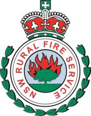
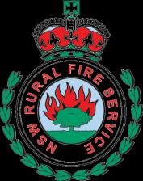
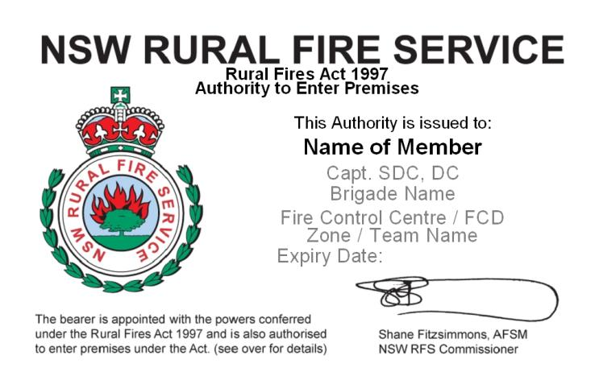
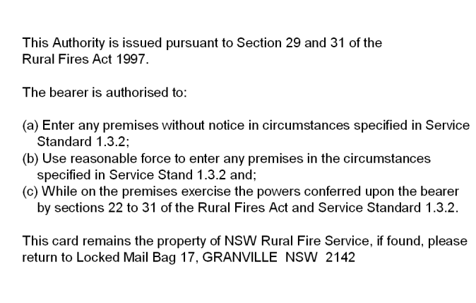

# NSW RFS Service Standard 1.3.2 — Powers of Officers

> **Source**: NSW Rural Fire Service
> **URL**: https://www.rfs.nsw.gov.au/__data/assets/pdf_file/0020/8804/1.3.2-Powers-of-Officers.pdf
> **Licence**: Crown copyright NSW; practitioner and public-information use
> **Retrieved**: 2026-05-07T13:40:11Z
> **SHA-256**: `00fb102b23b4d95490e152ecf4e95f2f42c5faa1c577778f6f3d3fb08f675a21`
> *Converted from PDF to Markdown format.*

---
## Page 1

Service Standard 1.3.2 
Page 1 of 10 
                   19 March 2013 
Powers of Officers 
Version 3.2 
Service Standard 1.3.2 
Powers of Officers 
Date of Issue 19 March 2013 
Version Number 3.2 
1. Purpose 
1.1 
This Service Standard updates and replaces Service Standard 1.3.2 
Powers of Officers version 3.1 
1.2 
Section 22(1) of the Rural Fires Act 1997 (the Act) provides that an 
officer of a rural fire brigade or group of rural fire brigades of a rank 
designated by the Commissioner may: 
(a) exercise any function conferred on the officer by or under the Act; 
or 
(b) take any other action that is reasonably necessary or incidental to 
the effective exercise of such a function. 
1.3 
Exercising such functions and taking such actions may only be for the 
purpose of: 
(a) 
controlling or suppressing a fire; or 
(b) protecting persons, property or the environment from an existing 
or imminent danger arising out of: 
i. a fire; 
ii. an incident; 
iii. or other emergency. 
1.4 
The Commissioner has determined that a Brigade or group officer of 
the rank of deputy captain or above may exercise any function 
conferred on the officer or take any action authorised by or under the 
Act1. 
1.5 
Section 22(2A) of the Act provides that any function that may be 
exercised, or action that may be taken, by a brigade or group officer 
may be exercised or taken by the Commissioner. 
1.6 
Pursuant to the provisions of s14 of the Act the Commissioner has 
delegated the functions conferred upon him by section 22(2A) to those 
officers of the NSW RFS of and above the rank of Officer Level 1. 
 
1   A function conferred on an officer or an action authorised by the Service Standards is a function conferred or an action 
authorised under the Act.

---
## Page 2

Service Standard 1.3.2 
Page 2 of 10 
                   19 March 2013 
Powers of Officers 
Version 3.2 
1.7 
Sections 23 to 32 of the Act list, by way of example, some of the ways 
in which the functions referred to in section 22 may be exercised.  
These provisions do not limit the generality of section 22. 
1.8 
Section 22(2) of the Act provides that an officer may exercise a 
function or take any action authorised by section 22(1) with such other 
persons as the officer considers necessary for the purpose. 
2. Policy 
Powers of officers of a rural fire brigade and groups of rural fire brigades 
2.1 
The following provisions are examples of the way in which the functions 
referred to in clause 1.2 of this Service Standard may be exercised.  
These examples are not exclusive nor are they intended to limit the 
generality of the powers conferred upon an Officer by the Act. 
2.2 
An Officer may: 
(a) 
enter any premises (refer to definition of “premises” in clause 2.15) 
for the purpose of exercising any function conferred or imposed on 
the Officer by or under the Act; 
(b) 
if he or she is the officer in charge of a brigade or group of 
brigades, close any street or public place in the vicinity of a fire, 
incident or other emergency to traffic; 
(c) 
if persons are, or property or the environment is, endangered or 
likely to be endangered by a fire, incident or other emergency: 
i. 
pull down, cut and remove fences on any land; 
ii. 
destroy, pull down or remove any buildings or structures on any 
land; 
iii. 
destroy or remove any living or dead vegetation on any land; 
and 
iv. 
establish firebreaks on any land; 
(d) 
for the purpose of controlling or suppressing a fire: 
i. 
take and use any water from any source on any land; or 
ii. 
use any hydrant or water reticulation system vested in or under 
the management or control of any water supply authority, public 
authority or body; 
(e) 
light a fire for the purpose of back burning; 
(f) 
shut off or disconnect any gas or electricity supply; 
(g) 
move any vehicle, vessel or other object; and/or 
(h) 
remove a person from any land or building or restrain a person 
from entering or re-entering any land or building. 
2.3 
Before entering or taking any action in relation to Country Rail 
Infrastructure Authority or Railcorp NSW land or property, permission

---
## Page 3

Service Standard 1.3.2 
Page 3 of 10 
                   19 March 2013 
Powers of Officers 
Version 3.2 
must first be obtained from the Authority or Corporation. Refer to OP 
1.2.3 Working in the Rail Corridor. 
2.4 
Before taking action of the sort listed in clause 2.2 of this Service 
Standard an Officer must, if practicable: 
(a) 
ensure that the action is taken in a way that minimises damage to 
property; 
(b) 
consult with the owners or occupiers of the property before taking 
action; and 
(c) 
take into consideration environmental, heritage, cultural and 
historical conservation concerns. 
2.5 
If practicable, action involving: 
(a) 
the closure of any street or public place or traffic control; or 
(b) 
the removal or restraint of a person; 
should be taken by a member of the NSW Police Force. 
2.6 
Before removing or destroying any building or structure the Officer 
should, if practicable: 
(a) 
isolate or cordon off the building or structure concerned; 
(b) 
obtain technical advice from an engineer or local authority as to 
whether or not the building or structure can be made temporarily 
safe or, if it must be removed or destroyed, the preferred method of 
removing or destroying the building; 
(c) 
remove or destroy only that part of the building or structure that is, 
in the Officer’s opinion, necessary to render the area safe; and 
(d) 
utilise personnel with specialist engineering or demolition skills. 
2.7 
If practicable the owner of any vehicle, vessel or other object should be 
given the opportunity to move the vehicle, vessel or other object. 
2.8 
Before disconnecting any water, electricity, gas supply or other service 
the Officer must first: 
(a) 
determine whether the supply can be safely disconnected without 
further endangering life and property; and 
(b) 
if practicable: 
i. 
seek the assistance of the relevant supply authority; 
ii. 
utilise competent personnel to disconnect the supply; 
iii. 
advise those persons effected by the disconnection; and 
iv. 
where possible minimise the extent to which services are 
disconnected.

---
## Page 4

Service Standard 1.3.2 
Page 4 of 10 
                   19 March 2013 
Powers of Officers 
Version 3.2 
Entry of Premises 
2.9 
An Officer may enter any premises for the purpose of exercising any 
function conferred or imposed on the Officer under the Act if 
reasonable notice is given to the owner or occupier of an intention to 
enter. 
2.10 
An Officer may enter any premises for the purpose of exercising any 
function conferred or imposed on the Officer under the Act without 
notice: 
(a) with the consent of the owner or occupier; 
(b) if the part of the premises on which entry is made is open to the 
public; or 
(c) if entry is required urgently for the purpose of: 
i. 
controlling or suppressing a fire; 
ii. 
protecting persons, property or the environment from an 
existing or imminent danger arising out of: 
▪ a fire; 
▪ an incident; or 
▪ other emergency; 
iii. 
determining if there is a fire on or near the premises; or 
iv. 
investigating the cause and origin of a fire. 
2.11 
An Officer may use reasonable force to enter premises if he or she is of 
the opinion: 
(a) that it is necessary to use force to enter premises: and 
(b) it is necessary for the purpose of: 
i. 
controlling or suppressing a fire; 
ii. 
protecting persons, property or the environment from an 
existing or imminent danger arising out of: 
▪ a fire; 
▪ an incident; or 
▪ other emergency; 
▪ determining if there is a fire on or near the premises; or 
▪ investigating the cause and origin of a fire. 
2.12 
If the owner or occupier of any premises 
(a) actively prevents access; and 
(b) a member of the NSW Police Force is not present 
force should only be used if the Officer is of the opinion that delay may 
place a person’s safety at risk. 
2.13 
If an Officer uses force to enter premises he or she must, as soon as 
practicable, inform the Commissioner by reporting the incident to a 
District Manager or Fire Control Centre.

---
## Page 5

Service Standard 1.3.2 
Page 5 of 10 
                   19 March 2013 
Powers of Officers 
Version 3.2 
2.14 
When entering premises or taking action on premises an Officer must 
be in possession of an Authority Card issued in accordance with SOP 
1.3.2-1 Authority Cards. 
2.15 
Premises are defined in the Act to include both buildings and land. 
Premises do not include “managed land” (land occupied by the 
Department of Premier and Cabinet, Department of Trade and 
Investment, Regional Infrastructure and Services, Railcorp NSW, 
Transport Construction Authority, Country Rail Infrastructure Authority) 
and land within the catchment area of a water supply authority. 
2.16 
An Officer may direct a member of the NSW RFS to: 
(a) exercise any function conferred on a brigade or group Officer by 
or under the Act, or 
(b) take any action that is reasonably necessary or incidental to the 
effective exercise of such a function, for the purpose of protecting 
persons, property or the environment from an existing or imminent 
danger arising out of a fire, incident or other emergency 
notwithstanding the fact that the officer is not physically present at 
the place where the function is to be exercised. 
The Officer may give the direction by radio, telephone or any other 
form of communication. 
2.17 
Where such a direction is given by an officer, he or she must 
endeavour to ensure that an officer attends the scene where the 
function is to be exercised as soon as is practicable after the direction 
has been given. 
Authority Cards 
2.18 
An Authority Card must be issued to: 
(a) officers of rural fire brigades; 
(b) officers of groups of rural fire brigades; 
(c) officers of or above the rank of Officer Level 1; and 
(d) the Commissioner. 
2.19 
Authority Cards are to be issued in accordance with SOP 1.3.2 - 1. 
2.20 
An Authority Card remains the property of the NSW RFS at all times. 
2.21 
An Authority Card is deemed to have been cancelled and must be 
returned to the Issuing Authority immediately upon the person to whom 
it is issued: 
(a) ceasing to occupy the position in respect of which the Authority 
Card was issued; or 
(b) receiving a letter from the Commissioner or the Issuing Authority 
requiring the return of the Authority Card.

---
## Page 6

Service Standard 1.3.2 
Page 6 of 10 
                   19 March 2013 
Powers of Officers 
Version 3.2 
3. 
Links 
▪ 
Rural Fires Act 1997 
▪ 
SS 1.3.2A Powers of Officers (Jervis Bay Territory) 
▪ 
SS 1.1.7 Code of Conduct and Ethics 
▪ 
SS 1.3.1 Delegations 
▪ 
OP 1.2.3 Working in the Rail Corridor 
4. 
Who is responsible for implementing the Service 
Standard? 
▪ 
Director Regional and Infrastructure Services 
5. 
Amendments 
▪ 
Updated to reflect current practices                                  19 March 2013

---
## Page 7

 
 
Service Standard 1.3.2 
Page 7 of 10 
                   19 March 2013 
Powers of Officers 
Version 3.2 
NSW  
Rural Fire Service 
AUTHORITY TO ENTER PREMISES WITHOUT NOTICE 
PURSUANT TO THE PROVISIONS OF SECTION 29(1) 
OF THE RURAL FIRES ACT 1997 
 
 
Pursuant to the provisions of section 29(1) of the Rural Fires Act 1997, I Shane 
Fitzsimmons, Commissioner of the NSW Rural Fire Service, hereby authorise any 
officer of the rank of Deputy Captain or above to enter any premises without notice 
for the purpose of: 
1. 
controlling or suppressing a fire; 
2. 
protecting persons, property or the environment from an existing or imminent 
danger arising out of: 
 
(a) a fire; 
(b) an incident; or 
(c) other emergency; 
3. 
determining if there is a fire on or near the premises; or 
4. 
investigating the cause and origin of a fire. 
 
 
 
 
 
 
 
____________________________________ 
Shane Fitzsimmons AFSM 
Commissioner 
 
 
 
 
 
 
DATED this          day of  March 2013

---
## Page 8

 
 
Service Standard 1.3.2 
Page 8 of 10 
                   19 March 2013 
Powers of Officers 
Version 3.2 
NSW  
Rural Fire Service 
AUTHORITY TO USE FORCE TO ENTER PREMISES  
PURSUANT TO THE PROVISIONS OF SECTION 31(1) 
OF THE RURAL FIRES ACT 1997 
 
 
 
In accordance with the provisions of section 31(1)(b) of the Rural Fires Act 1997, I 
Shane Fitzsimmons, Commissioner of the NSW Rural Fire Service, hereby authorise 
any officer of the rank of Deputy Captain or above to use reasonable force for the 
purpose of gaining entry to premises where, in the opinion of the officer, one or more 
of the following circumstances exist: 
1. 
it is necessary for the purpose of controlling or suppressing a fire; 
2. 
it is necessary for the purpose of protecting persons, property or the 
environment from an existing or imminent danger arising out of: 
 
(a) a fire; 
(b) an incident; or 
(c) other emergency; 
3. 
it is necessary for the purpose of determining if there is a fire on or near the 
premises; or 
4. 
it is necessary for the purpose of investigating the cause and origin of a fire 
and the officer is of the opinion that is necessary to use force to gain entry to 
the premises. 
 
 
 
 
 
____________________________________ 
Shane Fitzsimmons AFSM 
Commissioner 
 
 
 
 
DATED this          day of March 2013

---
## Page 9

 
 
Service Standard 1.3.2 
Page 9 of 10 
                   19 March 2013 
Powers of Officers 
Version 3.2 
NSW  
Rural Fire Service 
DETERMINATION PURSUANT TO SECTION 22(1) OF THE RURAL 
FIRES ACT 1997 
 
 
 
In accordance with the provisions of section 22(1) of the Rural Fires Act 1997, I 
Shane Fitzsimmons, Commissioner of the NSW Rural Fire Service, hereby 
determine that for the purpose of controlling or suppressing a fire or protecting 
persons or property from an existing or imminent danger arising out of a fire, incident 
or other emergency, an officer of a rural fire brigade or group of rural fire brigades of 
the rank of Deputy Captain or above, may: 
1. 
exercise any function conferred on the officer by or under the Rural Fires Act; or 
2. 
take any other action that is reasonably necessary or incidental to the effective 
exercise of such a function. 
 
 
 
 
 
 
____________________________________ 
Shane Fitzsimmons AFSM 
Commissioner 
 
 
 
 
 
DATED this          day of March 2013

---
## Page 10

 
 
Service Standard 1.3.2 
 
 
 
Page 10 of 10 
 
                          19 March 2013 
Powers of Officers 
Version 3.2 
NSW  
Rural Fire Service 
AUTHORITY TO ENTER PREMISES WITHOUT NOTICE 
PURSUANT TO THE PROVISIONS OF SECTION 74D(3) 
OF THE RURAL FIRES ACT 1997 
 
 
 
Pursuant to the provisions of section 74D(3) of the Rural Fires Act 1997, I, Shane 
Fitzsimmons, Commissioner of the NSW Rural Fire Service, hereby authorise: 
1. 
fire control officers; 
2. 
district/team/zone managers; 
3. 
deputy fire control officers; and 
4. 
members of staff of the NSW RFS who are assigned functions in relation to 
hazard complaints and mitigation works 
to enter during the day time any part of land (other than a dwelling-house) that is the 
subject of a bushfire hazard complaint where, in the opinion of the person so 
authorised, it is necessary to inspect the land in order to form an opinion as to 
whether a bushfire hazard exists on the land. 
 
 
 
 
 
____________________________________ 
Shane Fitzsimmons AFSM 
Commissioner 
 
 
 
 
 
 
DATED this          day of  March 2013

---
## Page 11

 
 
Service Standard 1.3.2 
 
 
 
Page 10 of 10 
 
                          19 March 2013 
Powers of Officers 
Version 3.2 
 
 
 
Approval to Exercise Brigade Officers’ Functions in any rural fire district in New South Wales 
 
Pursuant to the provisions of section 21(2) (b)(i) of the Rural Fires Act, 1997 (NSW) (Act) , I Robin 
Rogers AFSM, Commissioner, NSW Rural Fire Service hereby authorise an officer of a rural brigade 
or group of rural fire brigades to exercise any function conferred on them by or under the Act at a fire, 
incident or other emergency in any rural fire district in New South Wales. 
 
 
 
Robin Rogers AFSM 
Commissioner

---
## Page 12

19 March 2013 
SS 1.3.2 Powers of Officers 
 Version 3.2 
SOP 1.3.2-1 
Page 1 of 2 
 
 
SOP 1.3.2-1 
Authority Cards 
This SOP forms part of  Service Standard 1.3.2 Powers of Officers 
Related forms ▪ None 
1. 
Purpose 
1.1 
This SOP outlines the description to be used for Authority Cards and 
provides the criteria for issuing Authority Cards to relevant members. 
2. 
Procedures 
2.1 
Authority Cards may be issued by: 
(a) 
the Commissioner; 
(b) Regional Managers; and 
(c) 
a District Manager who has been authorised to do so by a 
Regional Manager; 
who are referred to in this SOP as the Issuing Authority. 
 
2.2 
The front of the Authority Card must bear the words: 
 
NSW Rural Fire Service 
Rural Fires Act 1997 
Authority to Enter Premises 
This Authority is issued to: 
Name: 
Rank: 
Expiry Date: 
 
 
2.3 
The back of the Authority Card must bear the following words: 
 
"This Authority is issued pursuant to sections 29 and 31 of the Rural Fires Act 
1997. 
The bearer is authorised to: 
(a) 
Enter any premises without notice in the circumstances specified in 
Service Standard 1.3.2; 
(b) 
Use reasonable force to enter any premises in the circumstances 
specified in Service Standard 1.3.2; and 
(c) 
While on any premises, exercise the powers conferred upon the bearer 
by sections 22 to 31 of the Rural Fires Act and Service Standard 1.3.2.”

---
## Page 13

19 March 2013 
SS 1.3.2 Powers of Officers 
 Version 3.2 
SOP 1.3.2-1 
Page 2 of 2 
 
 
2.4 
An Authority Card issued to officers of rural fires brigades must also 
bear the name of the: 
(a) 
rural fire brigade; and 
(b) 
rural fire district, team or zone in which the rural fire brigade is 
situated. 
2.5 
An Authority Card issued to officers of groups of rural fire brigades and 
members of the staff of the Service who are attached to a particular 
rural fire district, zone or team must also bear the name of the: 
(a) 
rural fire district, team or zone in which the group is situated: or 
(b) 
rural fire district, zone or team to which the member of the staff 
is assigned. 
2.6 
The expiry date may be a date up to 3 years after the date of issue. 
2.7 
The following is a sample of the front and back of an authority card: 
Front: 
           
 
 
 
Back:

