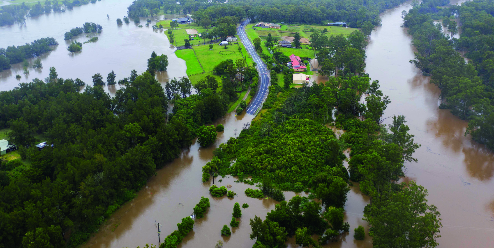

# NSW SES — Flood Emergency Plan Template for Caravan Parks

> **Source**: NSW State Emergency Service (SES)
> **URL**: https://www.ses.nsw.gov.au/sites/default/files/document/caravan-park-plan-generic.pdf
> **Licence**: CC BY 4.0
> **Retrieved**: 2026-05-07T13:39:59Z
> **SHA-256**: `017f57b250835dcd007865c0f2d977881ceed4509e6659f334af0b776cbf3420`
> *Converted from PDF to Markdown format.*

---
## Page 1

PAGE 1
October 2022
Flood Emergency Plan 
template for 
caravan parks
This template is for owners and/or operators of caravan parks in NSW. 
Your final Caravan Park Flood Emergency Plan will be your plan – it needs 
to work for you, and you will need to maintain it. It is recommended your 
plan is reviewed every two years. 
Caravan park name:
Review date: 
PAGE 1

---
## Page 2

CONTENTS
Introduction: Why do caravan parks need to plan for floods? 
4
How to use this plan
5
WORK OUT YOUR FLOOD RISK
9
STEP 1 – How has our park flooded in the past, and what could future floods look like?
10
STEP 2 – What could be affected by flooding at our park?
15
STEP 3 – What are the evacuation routes and safe storage areas for our park?
17
PLAN FOR FLOODS
19
STEP 4 – How can we know a flood is coming?
20
STEP 5 – What actions will we take before, during and after flood emergencies?
24
STEP 6 – How much time will we need with the resources at hand to complete the required actions 
in a flood?
25
STEP 7 – When will we need to do each action?
27
COMPLETE YOUR FLOOD EMERGENCY PLAN
28
STEP 8 – Preparing for, responding to, & recovering from floods
29
PRACTISING AND REVIEWING YOUR PLAN  
34
STEP 9 – How will our staff and occupants know about our plan?
35
STEP 10 – How will we practise our plan?
37
STEP 11 – How will we review our plan so it stays current? 
38
APPENDICES  
39
APPENDIX A – Hawkesbury-Nepean valley flood history
40
APPENDIX B – Hawkesbury-Nepean valley potential flood levels (2019)
41
APPENDIX C – Flood levels / profiles (2019)
42
APPENDIX D – Examples of flood rates of rise 
46
APPENDIX E – Hawkesbury-Nepean forecast gauge flood classifications
47
APPENDIX F – River gauge locations
48
APPENDIX G – River gauge links
53
APPENDIX H – Happy holidays ski park worked examples
56
PAGE 2

---
## Page 3

The NSW State Emergency Service (NSW SES) 
Caravan Park Flood Emergency Plan Workbook and 
Template has been prepared using available flood 
level information and is intended to assist you to 
prepare for a flood at your caravan park. However, 
the Workbook and Template is not intended as an 
assessment of the actual flood risk.
The information provided in the Workbook and 
Template is based on knowledge and understanding 
at the time of publication. However, because of 
advances in knowledge, users are reminded of the 
need to ensure that information upon which they 
rely is up to date. 
The NSW SES takes no responsibility for the 
accuracy, currency, reliability and correctness 
of any information in the publication (including, 
without limitation, any of the information provided 
by third parties) nor for the accuracy, currency, 
reliability and correctness of links or references to 
information sources with regard to the historical 
flood information. 
While all reasonable care has been taken in 
preparing the Workbook and Template, to the 
extent permitted by law, NSW State Emergency 
Service and the State of New South Wales and its 
employees and agents exclude all liability for the 
accuracy or completeness of the information, or for 
any injury, loss, or damage whatsoever (including 
without limitation liability for negligence and 
consequential losses) suffered by any person acting, 
or purporting to act in reliance upon anything 
contained herein.
PAGE 3

---
## Page 4

INTRODUCTION: WHY DO CARAVAN 
PARKS NEED TO PLAN FOR FLOODS? 
KEY ROLES FOR CARAVAN PARK 
OWNERS AND/OR MANAGERS 
INCLUDE: 
 
9 Ensuring people respond safely ahead of 
flooding, e.g. through timely evacuation
 
9 Protecting your and other people’s 
property ahead of flooding – typical 
structures in caravan parks will not cope 
well with deep flooding.
 
9 Reducing the risk to the beautiful river 
environment – its health is at risk if caravans, 
other structures or hazardous materials are 
washed into the river during a flood.
 
9 Educating and supporting your staff and 
occupants – even people experienced 
with the river may not understand how 
the valley floods or know what to do in a 
flood emergency.Flooding in the Hawkesbury Nepean Val
Flooding in the Hawkesbury Nepean Valley March 2021. Source: Infrastructure NSW. Image: Adam Hollingworth.
There is a long history of floods in NSW. While 
many years can pass without floods, recent 
flood events remind us that flood risk is ever 
present. 
Floods can be deep, fast flowing and fast 
rising. Evacuation routes may be cut early. 
We all need to be prepared in advance for 
future floods. 
Caravan parks in NSW are often located on 
low-lying land next to rivers. These idyllic 
settings are also exposed to flooding. Planning 
and preparing for floods can reduce the flood 
impacts at your park and can also help you to 
rebuild and recover more quickly after a flood. 
Having a plan may also help you meet your 
local Council’s requirements for an Approval 
to Operate and Workplace, Health and 
Safety regulations.
This resource was developed through a partnership with NSW State Emergency Service, 
Infrastructure NSW, Hawkesbury City Council, The Hills Shire Council and Penrith City Council, 
in collaboration with caravan parks in the region. This project was developed as part of the 
Hawkesbury-Nepean Valley Flood Risk Management Strategy.
Please note this workbook and template has been updated from the original document to suit  
caravan park locations across NSW.
PAGE 4

---
## Page 5

HOW TO USE THIS PLAN
This Flood Emergency Plan workbook and template is designed to help you work out the flood risk at 
your caravan park, and to develop an effective plan to manage this risk. It steps through five sections to 
create your plan:
SECTION 1: WORK OUT 
YOUR FLOOD RISK (PAGE 9)
Step 1: How has our park flooded in the past, and 
what could future floods look like? 
Step 2: What could be affected by flooding at 
our park?
Step 3: What are the evacuation routes and safe 
storage areas for our park? 
SECTION 2: PLAN FOR FLOODS 
(PAGE 18)
Step 4: How can we know a flood is coming? 
Step 5: What actions will we take before, during 
and after flood emergencies? 
Step 6: How much time will we need with the 
resources at hand to complete the required 
actions in a flood? 
Step 7: What do we need to do and when?  
SECTION 3: FLOOD EMERGENCY PLAN 
(PAGE 26) 
Step 8: Complete your plan
SECTION 4: PRACTISING AND 
REVIEWING THE PLAN (PAGE 30)
Step 9: How will our staff and occupants know 
about our plan? 
Step 10: How will we practise our plan? 
Step 11: How will we review our plan so it 
stays current? 
TIP: Please note that information on local 
flood risks needs to be incorporated into this 
plan. Appendix A outlines where to find this 
information across NSW. 
CARAVAN PARK DETAILS
Name of park:
Address:
Phone number/s:
Plan prepared by:
Person responsible for plan:
Role:
Date plan prepared:
Date plan due for review:
PAGE 5

---
## Page 6

TIP: Insert a site plan here into this document 
Insert a site map here
PAGE 6

---
## Page 7

IMPORTANT CONTACTS
Police/Fire/
Ambulance
Life threatening emergency
000 (Triple Zero)
NSW State 
Emergency Service
Flood/storm emergency assistance 132 500
Bureau of 
Meteorology
NSW weather warning service
1300 659 218 
www.bom.gov.au/nsw/warnings/ 
http://www.bom.gov.au/nsw/flood/index.
shtml
(rainfall and river conditions) 
Transport for NSW 
Road closures and 
traffic information
13 22 13 (to report unsafe road sites)
www.livetraffic.com/
Local Councils
For area specific information
Council Contacts 
  
 

IMPORTANT WEBSITES AND APPS 
NSW SES
www.ses.nsw.gov.au
Bureau of 
Meteorology
www.bom.gov.au
Hazards Near Me
Download from your App Store 
and set your Watch Zone
TIP: Print this contacts list 
separately where it is clearly 
visible for staff
PAGE 7

---
## Page 8

LOCAL CONTACTS
Organisation/service
Name
Phone number
Caravan park
Flood/storm
Fire
Police
Council
Vehicular ferry operator
Electricity 
Water and sewerage
Telecommunications
Other
PAGE 8

---
## Page 9

SECTION 1
The risk of flooding at your caravan park is determined by how likely a 
flood is to happen and the consequences of that flood. 
The steps below help you identify the consequences of past floods and 
potential future floods, and take you through what could be impacted 
at your park. 
What additional information you will need to fill out this section: 
	
Î
Community map for your park – your park’s risk is influenced by 
its layout. Use your map to mark-up key issues identified in the 
steps below. 
	
Î
Ground level contours and flood maps for your park supplied by 
your local NSW SES unit. 
	
Î
Information from your local Council such as flood certificates
WORK OUT YOUR 
FLOOD RISK
PAGE 9

---
## Page 10

STEP 1 – HOW HAS OUR PARK FLOODED 
IN THE PAST, AND WHAT COULD FUTURE 
FLOODS LOOK LIKE?
THE IMPACT OF PAST FLOODS
Knowing how past floods have impacted your park can help you plan for future floods. 
Fill out the table below with information about how past floods have impacted your caravan park. 
Describe the height (level) of the flood at your park, and how much of the park was impacted.
If you don’t know the history, talk with long term residents or previous managers of your park. 
Other ways to find out historic flood levels at your park include:
1.	 Compare the flood extent or the flood depth at a specific point in your park to the ground level 
contour map supplied by your local NSW SES unit. For example, if the flood reached a depth of 1m 
over the floor of an amenities block, and the ground level contour map shows the amenities block is 
at about 6m, then the flood level is 7m. 
2.	 Past media articles or historical society records.
3.	 Your Local Council
TABLE A – FLOOD HISTORY AT PARK 
FLOOD DATE 
FLOOD DESCRIPTION AT PARK 
FLOOD IMPACTS AT PARK
Month and year
e.g. flood about 8m above mean sea 
level, flood about 2m over camping 
sites, flood came up to site X 
e.g. damage to vans, evacuation of 
patrons, site isolated for X days, septic 
tank flooded 
PAGE 10

---
## Page 11

TYPES OF FLOODING:
Riverine flooding
The focus of this plan is on riverine flooding. This 
describes flooding that happens when floodwater 
overflows the banks of the rivers. Several days of 
rain are usually required to generate serious riverine 
floods.
The unique geography of where your park is 
located, affects the extent and depth of flooding. 
Most river valleys tend to widen as they approach 
the sea. The opposite is the case in the Hawkesbury-
Nepean. Narrow and winding downstream 
sandstone gorges between Sackville and Brooklyn 
create natural choke points that cause a ‘bathtub’ 
effect. 
Floodwater acts differently according to the 
geogrpahy where the river is located. it is important 
to know how your river acts in floods.
The below imge shows the possible impacts 
from tidal influences across a range of flood 
situations at the same location. Tidal variations are 
suppressed by larger floods in this example.
Flash flooding 
Flash flooding occurs quickly (within 6 hours) after 
rain, causing overland flooding and rapid stream 
rises. It can occur anywhere and at any time when 
the intensity of the rainfall overwhelms natural or 
artificial drainage systems.
Flash floods can have dangerously high flow speeds 
and carry large amounts of debris.
These kinds of floods can impact on evacuation 
routes before the main river flood arrives.
Tides and storm surge 
Floods can be impacted by tidal conditions and 
storm surges where winds from storms can push 
sea water onto the land. This can be particularly 
dangerous for coastal caravan parks.
Flooding of low-lying areas can also be impacted by 
storm surges.
Hawk
esb
ury
 Ri
ver
 at
 We
bbs Creek (Wisemans
 Ferry) gauge, flood 
hy
dr
o
gr
a
ph
s
, February 20
20 and March 2021
Data source: Department of Planning, Industry and Environment
Hawkesbury River at Webbs Creek (Wisemans Ferry) gauge, flood hydrographs, February 2020 and March 2021
Data source: Department of Planning, Industry and Environment
PAGE 11

---
## Page 12

THE IMPACT OF FUTURE FLOODS AT 
OUR PARK
The table below helps describe the potential 
impacts of different sized floods at your park. 
You will need the following information to fill out 
this table:
•	 Flood level contours, depths and extents for 
your park – flood maps  may be supplied by 
your local NSW SES unit
•	 Flood levels at river gauges 
•	 Flood levels at caravan parks 
TABLE B – TABLE OF IMPACTS AND CONSEQUENCE
CHANCE PER YEAR
FLOOD LEVEL AND DEPTHS AT PARK
FLOOD EXTENT: 
% OF SITES IMPACTED
1 in 2*
 all
 more than half
 half
 less than half
 none
1 in 5
 all
 more than half
 half
 less than half
 none
1 in 10
 all
 more than half
 half
 less than half
 none
1 in 20
 all
 more than half
 half
 less than half
 none
* Note that impacts may occur in very frequent floods such as 1 in 2 chance per year flood or 50% chance in 
a year. 
PAGE 12

---
## Page 13

CHANCE PER YEAR
FLOOD LEVEL AND DEPTHS AT PARK
FLOOD EXTENT: 
% OF SITES IMPACTED
1 in 50
 all
 more than half
 half
 less than half
 none
1 in 100
 all
 more than half
 half
 less than half
 none
1 in 200
 all
 more than half
 half
 less than half
 none
Probable maximum 
flood**
 all
 more than half
 half
 less than half
 none
** Probable maximum flood or PMF is an extremely rare flood that defines the limit of the floodplain. 
TABLE B – TABLE OF IMPACTS AND CONSEQUENCE CONTINUED
PAGE 13

---
## Page 14

HOW FAST MIGHT FLOODS RISE AT OUR PARK?
How fast floods rise affects what you are able to do during a flood emergency. Floodwaters can rise quickly. 
Find out the possible rates of rise in your location and record here the fastest rate of rise at a location near 
your caravan park.
Note that faster rates of rises are possible.
HOW LONG MIGHT FLOODS LAST AT OUR PARK AND ON ROADS?
How long floods last impacts the duration of isolation for anyone who hasn’t evacuated, and the speed 
with which clean up can commence.
PAGE 14

---
## Page 15

STEP 2 – WHAT COULD BE AFFECTED BY 
FLOODING AT OUR PARK?
Identify your park’s key elements so you can then work out how they may be impacted by flooding. 
Fill out the tables below and mark up on your community map as required.
TABLE C - SITES, STRUCTURES, PEOPLE AND VEHICLES 
SITE TYPE
NUMBER 
OF SITES
THE NUMBER OF 
VANS EXPECTED 
TO EVACUATE*
APPROX. NUMBER 
(Low Season)
APPROX. NUMBER 
(High Season)
PEOPLE
VEHICLES
PEOPLE
VEHICLES
Privately owned vans/ 
cabins on leased sites 
(including long-term/
permanent residents)
Onsite vans/cabins for 
hire (park owned)
Other sites (including 
powered/unpowered/
camping sites)
Manager/staff
Day-trippers
n/a
n/a
Special event 
attendees (e.g. 
festivals)
TOTAL
* This should be the number of vans that can easily be relocated in a few hours. Structures attached to a 
rigid annex or sewer, with flat tyres and/or without a draw bar will not be moveable with the warning time 
you are likely to have in a flood emergency. 
OTHER STRUCTURES, BOATS AND EQUIPMENT
List other buildings, structures, boats and other equipment at your park (e.g. office, shop, BBQs, kitchen, 
amenity block, septic tank, storage). Mark this up on your existing community map if not there already.
PAGE 15

---
## Page 16

HAZARDOUS AND OTHER MATERIALS
List hazardous materials and other materials stored at your park that may need to be moved in a flood 
(e.g. fuel, LPG). Mark this up on your existing community map if not there already.
PEOPLE WHO MAY NEED HELP IN A FLOOD EMERGENCY
Provide information about occupants or staff likely to require assistance to safely evacuate. For example, 
someone who has a health issue or someone with no vehicle to evacuate. 
PAGE 16

---
## Page 17

STEP 3 – WHAT ARE THE EVACUATION 
ROUTES AND SAFE STORAGE AREAS FOR 
OUR PARK?
A key issue in understanding the consequences of flooding for your park is knowing at what height of 
flooding your evacuation route/s are affected. Having this knowledge helps you to allow enough time in your 
plan for everyone at your park to leave safely before access roads are cut. 
You also need to understand how and where you will transport any moveable structures, boats, other 
equipment or hazardous materials to store them safely.
•	 Use the flood maps supplied by your local NSW SES unit to look at the evacuation routes for your 
park and consider the height of flooding that impacts these routes. 
MAIN AND BACKUP EVACUATION ROUTES
Provide information about the main evacuation route for park occupants below.
Provide information about the backup evacuation route/s for park occupants, if there are any.
PAGE 17

---
## Page 18

TRANSPORT AND STORAGE LOCATION OF STRUCTURES, BOATS, OTHER 
EQUIPMENT AND HAZARDOUS MATERIALS 
Provide details about the evacuation route/s and suitable storage area/s for any moveable structures, boats 
and equipment that will need to be relocated.
Provide details about any hazardous materials on my site (e.g. fuel, pesticides), and how they will be stored 
safely onsite (e.g. moved to a higher building) or relocated offsite.
Hazardous material
Transport required and safe storage location
Safe storage location
Evacuation routes
PAGE 18

---
## Page 19

SECTION 2 
Now that you better understand what impacts floods could have at 
your caravan park, it’s time to plan how you can reduce those risks to 
life and property.
This section steps through what actions you will take before, during and 
after flood emergencies. It shows you how you can detect flood threats, 
and stage your actions so you have sufficient time to complete them 
before a rising flood stops them. 
What additional information you need to fill out this section: 
	
Î
Flood level contour, depth and extent maps for your park supplied 
by your local NSW SES unit. 
PLAN FOR FLOODS
PAGE 19

---
## Page 20

STEP 4 – HOW CAN WE KNOW A 
FLOOD IS COMING?
There are several ways to detect the threat of flooding, including:
•	 follow Bureau of Meteorology weather forecasts and warnings 
•	 follow NSW State Emergency Service website
•	 Download the Hazards Near Me App to set a Watch Zone to receive Advice, Watch & Act or 
Emergency Warnings
•	 listen to trusted media
•	 monitor rain and river height gauges, and tides 
•	 keep an eye on your environment
•	 talk to your networks and neighbours
A range of sources of flood information, and indicators of a flood threat, are listed below. Some indicators 
(e.g. Flood Watch) happen earlier than others. To develop an effective flood emergency plan, you will likely 
need to use multiple indicators.
BUREAU OF METEOROLOGY
Website: www.bom.gov.au/nsw/warnings 
App: BOM Weather
•	 Check rainfall forecasts using MetEye
•	 Severe Weather Warning for torrential rain
•	 Flood Watch for the Hawkesbury, Nepean, Colo or Macdonald rivers (with minor, moderate and 
major flood classifications provided except for the Macdonald)
•	 Flood Warning for a height of Xm to be reached by a particular time at a forecast location
NSW STATE EMERGENCY SERVICE 
Website: https://www.ses.nsw.gov.au/
NSW SES Facebook page – https://www.facebook.com/NSW.SES
•	 Flood Bulletin
•	 Evacuation Warning
•	 Evacuation Order
MEDIA
ABC for latest news and information about floods. 
Website: www.abc.net.au/emergency 
Radio: ABC 702
App: ABC 702  
YOUR OWN MONITORING OF RAIN AND RIVER HEIGHT GAUGES
(http://www.bom.gov.au/nsw/flood/)
•	 Look up the rainfall
•	 Look up the river height at a gauge near or upstream of your park
YOUR OWN MONITORING OF TIDES
•	 Look up the predicted tides using a reliable source
•	 If you see a tide higher than what was predicted, this may indicate a rising flood
•	 High tides may increase the height of the flood
YOUR OWN MONITORING OF RIVER HEIGHTS AT YOUR PARK
•	 Pick a local marker 
•	 But don’t rely solely on this – you need to consider a rising flood upstream
YOUR OWN NETWORKS AND NEIGHBOURS
•	 Draw on your own social networks to share information
PAGE 20

---
## Page 21

Telecommunication options for our park:
Internet   smart phone   BOM app   landline   satellite phone  
STAYING CONNECTED
Be ready in advance by bookmarking websites, downloading apps and having a battery-operated radio 
ready to use.
Be aware that during a flood you may lose power and telecommunications. Plan in advance for how you will 
stay connected to the latest information. It may be handy to ensure your vehicle has a full tank of fuel so you 
can listen to the radio in the car.
Indicate below which telecommunication options you will use at your park:
UNDERSTANDING OFFICIAL WARNINGS
NSW SES has implemented the national Australian Warning System (AWS), with clearer, more 
action‑oriented flood information and warnings for communities. It is a three three-tiered warning level 
system reflecting the severity of the event based on consequence to the community, with:
•	 Advice – there is a heightened level of threat. Stay up to date as the situation changes.
•	 Watch and Act – conditions are changing and you need to start taking action now to protect 
you and your loved ones.
•	 Emergency Warning – the highest level of warning. You may be in danger and need to take 
action immediately.
For each warning level there are a range of call to action statements to guide protective action by the 
community. These statements evolve as the warning levels increase in severity. As the situation changes and 
the threat is reduced, the level of warning will decrease accordingly.
Find out more about these warnings: https://www.ses.nsw.gov.au/warnings
Leading up to, during and after a flood, NSW SES may issue a series of flood warnings:
•	 Advice – Stay Informed AND/OR Watch and Act – Do not enter floodwater: translates predicted 
flood heights at gauges to consequences, describing what actions need to be taken if there is 
no immediate isolation or evacuation consequences. These warnings may escalate if isolation or 
evacuation impacts develop.
ISOLATION–SPECIFIC 
•	 Watch and Act – Prepare to Isolate: issued when floodwaters are expected to isolate property. If the 
situation escalates people may be told to urgently seek shelter, evacuate (if still possible) or move to 
higher ground.
•	 Emergency Warning – Shelter Now: – may be issued if it is too late to leave safely as evacuation 
routes are likely to be cut off, with instructions to seek shelter in a sturdy raised structure that can be 
safely accessed.
•	 Watch and Act – Do not enter floodwater AND/OR Advice – Monitor Conditions: As floodwater falls 
but there may still be water around changes will be reflected in warning messages and community 
advice
EVACUATION-SPECIFIC 
•	 Watch and Act – Prepare to Evacuate: warns when evacuation routes are likely to be cut or when 
floodwaters are expected to inundate property, preparing people to evacuate and respond quickly if 
the situation escalates, and evacuation becomes necessary. If you require more time or assistance to 
evacuate you should consider leaving when you receive this warning. 
•	 Emergency Warning – Evacuate before/now: advises people what to do in an evacuation and where 
to go. You might receive this warning via radio stations, or by automated telephone and/or SMS, NSW 
SES social media, or door knocks. It is vital that you leave if you receive an Emergency Warning – 
Evacuate before/now, this is the same as having formerly received an Evacuation Order.
•	 Emergency Warning – Move to Higher Ground: may be issued if there is dangerous localised heavy 
rain and/or flooding making it unsafe to evacuate the area. People should immediately move to higher 
ground (e.g. inside a tall sturdy building or a hill). It is vital to move as high above ground as possible.
PAGE 21

---
## Page 22

•	 Advice – Avoid the Area: issued as floodwater falls and there is no longer a need to evacuate, however 
it is still not safe to return due to hazards. This will be followed by an Advice – Returned Threat: Return 
with Caution when it is safe to return to the area. 
•	 Watch and Act – Do not enter floodwater: As floodwater falls but there may still be water around 
changes will be reflected in warning messages and community advice.
•	 Advice – Reduced Threat: Return with Caution: when floodwater falls to a safe level and engineer 
checks are completed for key levees, roads and bridges, communities who received an Evacuate 
before/now message, will receive this Advice informing them they can return to homes and businesses 
taking care and caution as there may still be hazards.
HAZARDS NEAR ME APP
XXXX
MONITORING RIVER HEIGHTS
You most likely already keep an eye on the river height and tides. During periods of heavy rain, it’s also wise 
to monitor the river height, both at your park and at river gauges.
Select some river height gauges you will monitor when floods threaten. It’s a good idea to select a gauge 
near your park as well as a flood warning gauge upstream.
Note: Sometimes river gauges may not work as expected, and during floods they can be damaged and 
not work or not report correct heights. For example, riverbank erosion damaged the Sackville gauge in 
the February 2020 flood. It’s good to have identified back up gauges to also look up.
List below the river height / flood forecasting gauges you will monitor:
PAGE 22

---
## Page 23

You may need to include a range of flood levels because the ground level at your park may fall 
between two flood levels. 
TABLE D – FLOOD FORECASTS AND CONSEQUENCES
LOCATION
CONSEQUENCE
GROUND 
LEVEL
(m)
CORRESPONDING 
LEVEL RANGE AT 
FORECAST GAUGE
FLOOD 
CLASSIFICATION 
RANGE AT
 FORECAST GAUGE
Evacuation route(s)
Low-point on internal 
access road*
People isolated 
and exposed to 
flooding if not 
evacuated
Low-point on external 
evacuation route*
Low-point on back up 
evacuation route*
Low-point on 
evacuation route for 
relocated structures or 
boats*
Property exposed 
to flooding
Property
Lowest site in park
Park begins to 
flood
Highest site in park
Park entirely 
flooded
Environment
Septic tank
Health and/or 
environmental 
hazard if flooded
Hazardous goods 
storage
Health and/or 
environmental 
hazard if flooded
* It is possible that local flooding could cut evacuation routes before the main river flood arrives
INTERPRETING RIVER HEIGHTS
If the Bureau of Meteorology issues a Flood Watch for, say, ‘moderate’ flooding, or issues a Flood Warning 
with a predicted height, it’s important to work out what that means for your caravan park.
One way to do this is to consider the recent flood history or historical records if there hasn’t been a flood 
recently, remembering that every flood is different. Knowing how floods have impacted (or didn’t impact) 
your park provides some indication of the effect of different flood classifications on your park.
Similarly, you could look up the heights of historic floods to make sense of a predicted height during a live 
flood.
For those with a mathematical bent, there is value in estimating the relationships between flood heights at 
your park and flood heights at your chosen forecast gauge. This can help you to estimate at what height on 
the forecast gauge key consequences happen at your park including:
•	 the evacuation route from the park is cut (the road low-point could be on an internal driveway or 
on a public road)
•	 the lowest site is flooded
•	 the entire park is flooded, where applicable.
There is a high degree of variability in floods. For example, one flood might have higher inflows from one 
tributary than another. This means the relationship between flood heights at a forecast gauge and flood 
heights at your park is likely to change somewhat from flood to flood.
 
TIP: No two floods are the same - monitor your local conditions and remain alert 
PAGE 23

---
## Page 24

STEP 5 – WHAT ACTIONS WILL WE 
TAKE BEFORE, DURING AND AFTER 
FLOOD EMERGENCIES?
Emergency management plans generally consider three stages of planning: 
prepare, respond and recover.
Preparing describes things that you can incorporate into your park’s routine 
practices. These could include:
•	 actively monitoring weather forecasts, river levels and tides
•	 displaying flood evacuation procedures in communal areas
•	 maintaining database of occupants with up-to-date contact details
•	 preparing warning messages to issue to occupants
•	 ensuring vans intended to be relocated before a flood are maintained 
in a moveable condition
•	 identifying extra staff/resources to assist in the event of a 
flood emergency.
Responding describes things that you will do when a flood threatens. 
These could include:
•	 contacting all upcoming bookings to defer travel to your park
•	 ‘doorknocking’ all park occupants to advise them of the flood threat / 
direct them to evacuate
•	 relocating hazardous chemicals to higher area
•	 relocating moveable vans to higher ground
•	 securing objects that can float away
•	 isolating power to low-lying areas.
Recovering describes things that you will do after a flood subsides. 
These could include:
•	 communicating with authorities about safety of entering park
•	 undertaking risk assessments with qualified specialists
•	 contacting all owners to request assistance in cleaning their dwellings.
Use the checklists in Section 3 to tick off actions for the prepare and 
recover phases. 
Record in Table E the actions you will take when a flood threatens.
PAGE 24

---
## Page 25

STEP 6 – HOW MUCH TIME WILL WE 
NEED WITH THE RESOURCES AT HAND 
TO COMPLETE THE REQUIRED ACTIONS 
IN A FLOOD?
Part of understanding and managing the flood risk is working out how long the required actions will take. 
You can use the worksheet below to estimate how long each action might take. It is important to also 
consider what additional resources you can access in a flood.
TABLE E – ACTION WORKSHEET
ACTION
AVAILABLE PEOPLE 
AVAILABLE EQUIPMENT 
AND MACHINERY
TIME NEEDED
PAGE 25

---
## Page 26

ACTION
AVAILABLE PEOPLE 
AVAILABLE EQUIPMENT 
AND MACHINERY
TIME NEEDED
TABLE E – ACTION WORKSHEET CONTINUED
PAGE 26

---
## Page 27

STEP 7 – WHEN WILL WE NEED TO DO 
EACH ACTION?
It’s important to plan how you will respond when a Flood Watch or Flood Warning is issued, or from your 
own monitoring of rain and river gauges and the river height at your park.
An effective flood emergency response plan ensures that the time available for an action is greater than 
the time required for that action. You estimated the time required for key actions in Step 5. Here, you need 
to align those actions to triggers that will allow sufficient time to safely complete them, remembering that 
floods can rise quickly. In short, the triggers need to be realistic.
An effective plan also accounts for the unique characteristics of your park. Think about key consequences 
from Table D – when might the evacuation route be cut?; when might the sites be flooded? – and select your 
triggers accordingly. In short, the triggers need to be meaningful. 
Here are some tips for choosing triggers:
•	 A Flood Watch is likely to be the first trigger for most caravan parks. Many parks are quite low-lying 
and close to rivers and are impacted even by minor flooding. This means that you will need to start 
your response earlier than when a Flood Warning is issued to ensure the required actions can be done 
in time.
•	 The NSW SES will issue locaiton specific Advice, Watch and Act or Emergency Warnings for floods.
•	 Factor in the possibility of a fast rising river
•	 Factor in the possibility of local flooding, e.g. runoff from a local creek or hillside that could impact 
the evacuation route before the main river flood arrives.
•	 For these reasons, allow extra time, i.e. choose a conservative, early trigger
•	 In choosing triggers, use a combination of official warnings and your own monitoring of river heights 
and tides (see Step 4)
•	 List two triggers for the one set of actions. Whichever trigger happens sooner will initiate the actions.
•	 Factor in a ‘Plan B’ for imperfect scenarios – not everything goes to plan during floods.
You can record the triggers, linked to actions, directly in your park’s flood emergency response plan in 
Section 3. You may choose to use the pre-populated triggers in Table F, or you can use a Word document to 
list your own triggers.
TIP: A Flood Watch will most likely trigger some sort of response at most parks.
PAGE 27

---
## Page 28

SECTION 3 
It’s now time to bring all the information together and populate your 
caravan park’s flood emergency plan.
What you have done so far includes identifying:
•	
How has our park flooded before and what could future floods look 
like? (Step 1 
) 
•	
What could be affected by flooding at our park? (Step 2 
)
•	
What are the evacuation routes and safe storage areas for our park? 
(Step 3 
)
•	
How can we know a flood is coming? (Step 4 
)
•	
What actions can we take before, during and after flood 
emergencies? (Step 5 
).
•	
How much time will we need with the resources at hand to complete 
the required actions in a flood? (Step 6 
)
•	
What do we need to do and when? (Step 7 
)
COMPLETE YOUR FLOOD 
EMERGENCY PLAN
PAGE 28

---
## Page 29

STEP 8 – PREPARING FOR, RESPONDING 
TO, & RECOVERING FROM FLOODS
PREPARING FOR FLOODS: A CHECKLIST
Flood monitoring (everyones responsibility):
•	 We have downloaded the Bureau of Meteorology app: ‘BOM Weather’ – 
http://www.bom.gov.au/app/
•	 We regularly check the Bureau of Meteorology website page for weather warnings – 
http://www.bom.gov.au/nsw/warnings/
•	 We follow the NSW State Emergency Service (NSW SES) on social media: 
	
— Facebook – https://www.facebook.com/NSW.SES
	
— Twitter – https://twitter.com/NSWSES
	
— Instagram – https://www.instagram.com/nswses
	
— also follow your local units which have their own pages
•	 We have access to the ABC for latest news: 
	
— Website – https://www.abc.net.au/emergency/ 
	
— Radio: ABC 702
	
— Download the ABC Listen app – https://www.abc.net.au/radio/listen/  where you can 
access local news
•	 We follow tides and monitor river heights
Occupant communication (owners and operators responsibility): 
•	 We provide all occupants with current NSW SES information on what to do if there is 
a Flood Watch/Warning, including how to contact park managers. We also provide all 
occupants with a copy of the park’s flood evacuation procedure. We have this information 
visible and accessible and is a key component of our induction process with new occupants.
•	 We inform our occupants of how to monitor weather updates and access weather warnings, 
via the Bureau of Meteorology, NSW SES, and ABC.
•	 We have a process in place for contacting occupants in the event of a flood emergency – 
including who will do this, how it will be done and have prepared messages ready to go. 
We keep track of which occupants will need assistance in the event of an evacuation.
Evacuation (owners and operators responsibility):
•	 We understand our main and back up evacuation routes and have included this in our 
communications for occupants.
•	 We have evacuation maps clearly visible for occupants and staff in key locations.
TIP: Download the Hazards Near Me App and set your Watch Zone for floods.
PAGE 29

---
## Page 30

Site management (owners and operators responsibility):
•	 We have identified resources we would need in the event of a flood warning – including 
additional staff, equipment and storage. We have a list of local suppliers identified.
•	 We have identified hazardous material, how we will move it and where we will store it.
•	 We have identified where we will move/store any moveable boats and vans. 
•	 We keep our park clear of clutter and ask our occupants to store personal items in their van
•	 We have supplied tie down points for each van site
•	 We have checked that vans  intended to be relocated before a flood are maintained in a 
moveable condition
Emergency “Get Ready to Go” kit (everyones responsibility):
•	 We have prepared an emergency kit which includes items such as a battery powered radio, 
spare batteries, a torch, first aid kit and a copy of our emergency plan. 
Insurance (owners/operators and personal Responsibilities):
•	 We have considered flood insurance for our park
•	 I have insured my van and/or contents
Park owners and operators have a renge of responsibilities in preparing parks for floods. 
Occupiers and visitors also have responsibilities to ensure safety and property protection.
Sharing the responsibility to prepare for floods ensures that everyone knows what to do and actions 
are done in a timely manner. Protecting lives is a priority. To do this, park owners and operators as 
well as park occupants and visitors need to share the responsibility to prepare, respond and recover 
together.
PAGE 30

---
## Page 31

FLOOD RESPONSE PLAN
TABLE F
Triggers
What actions will you take and who is responsible?
How long will 
this take?
Flood Watch/ 
Severe Weather 
Warning/
Flood Advice/ 
Emergency 
Warning issued 
(whichever 
comes first)
Communicating 
with site 
occupants and 
visitors
•	  
•	  
•	  
•	  
•	  
•	  
•	
•	
•	
Managing the site
•	  
•	  
•	  
•	  
•	  
•	  
•	
•	
•	
Communicating 
with authorities
•	  
•	  
•	  
•	  
•	  
•	  
•	
•	
•	
Flood Warning/
Advice/Watch & 
Act/ Emergency 
Warning or 
relevant flood 
gauge reaches 
certain level 
(whichever 
comes first) 
Communicating 
with site 
occupants and 
visitors
•	  
•	  
•	  
•	  
•	  
•	  
•	
•	
•	
Managing the site
•	  
•	  
•	  
•	  
•	  
•	  
•	
•	
•	
Communicating 
with authorities
•	  
•	  
•	  
•	  
•	  
•	  
•	
•	
•	
TIP: Avoid driving, riding, walking, boating or 
playing in floodwaters – these are the main causes 
of death during flood
PAGE 31

---
## Page 32

Triggers
What actions will you take and who is responsible?
How long will 
this take?
Vehicular 
evacuation 
route flooded 
and flood rising
Communicating 
with occupants
•	  
•	  
•	  
•	  
•	  
•	  
•	
•	
•	
Managing the site
•	  
•	  
•	  
•	  
•	  
•	  
•	
•	
•	
Communicating 
with authorities
•	  
•	  
•	  
•	  
•	  
•	  
•	
•	
•	
Sites begin to 
flood
Communicating 
with site 
occupants and 
visitors
•	  
•	  
•	  
•	  
•	  
•	  
•	
•	
•	
Managing the site
•	  
•	  
•	  
•	  
•	  
•	  
•	
•	
•	
Communicating 
with authorities
•	  
•	  
•	  
•	  
•	  
•	  
•	
•	
•	
TABLE F CONTINUED
PAGE 32

---
## Page 33

RECOVERING FROM FLOODS – A POST-FLOOD CHECKLIST
The NSW SES will issue an ‘All Clear’ when it is safe for caravan park owners to return to site. 
It is important that occupants do not come back to the park prior to it being deemed safe, including submitting required documents to your local Council. 
Before allowing your occupants to return to site after a flood event, the following should be completed:
Communicating with site occupants:
•	 We have advised occupants that we will inform them when they are able to return to the park, explaining the necessary safety checks 
that must be done first. 
•	 We have advised occupants who wish to return to the premises to collect items or to engage in site clean-up should only attend if 
approved by the Park Manager. We have informed occupants of dates when works are being undertaken as access may be restricted.
•	 We have informed occupants that the site has been deemed safe to re-occupy. 
Site management:
•	 Drinking water supply has been assessed and any necessary repairs have been undertaken. Water sample has been sent for 
microbiological analysis, and verification of results provided to my local Council. 
•	 On-site wastewater system(s) for the premises and individual connections from each site have been assessed by a qualified plumber, 
any necessary repairs/replacement has occurred. 
•	 All electrical infrastructure on the premises, including connections to individual sites, has been assessed by a suitably qualified 
electrician. Confirm requirements with your electricity provider.
•	 All community structures (amenities buildings, kitchens, boat sheds) affected by flood have been assessed by a suitably qualified 
practising structural engineer. A list of recommended remedial works has been provided to my local Council for approval. 
•	 An Occupational Hygienist has been engaged to assess where flood inundation of amenities and moveable dwellings has occurred. 
A report has been obtained confirming the suitability of all structures on the premises for human habitation and provided to my 
local Council.
•	 Check with local Council for approved locations accepting flood waste and for queries in the handling or disposal of any hazardous 
materials (eg asbestos, chemical containers). All flood waste must be disposed of at a licensed waste facility.
•	 Riverbanks have been assessed by a geotechnical engineer for damage by inundation, scouring and erosion and a report has been 
provided to my local Council.
•	 A qualified arborist has assessed trees on the property for damage and a report has been provided to my local Council.
Communicating with authorities:
•	 Provide all reports and required documentation to local Council, confirm their receipt.
•	 Check requirements for approval from Council for replacement or rebuilding of structures and installations within the park.
•	 Confirm that no other correspondence is required prior to re-opening to occupants.
Access support for you or your occupants:
•	 View any support offered by the NSW Government or local organisations. Visit Resilience NSW 
https://www.nsw.gov.au/resilience-nsw for more information.
•	 Disaster Recovery Centres may be established following some disasters. Recovery centres may provide a range of welfare services 
including financial assistance, personal support, organising temporary accommodation and providing information and referrals. 
You can contact Disaster Welfare Services on 1800 018 444.
PAGE 33

---
## Page 34

SECTION 4
Your final Caravan Park Flood Emergency Plan is your plan – it is a living 
document and it needs to work for you. Making sure it works involves 
sharing information about your plan, practising it and reviewing it 
regularly so it stays current. 
PRACTISING AND 
REVIEWING YOUR PLAN  
PAGE 34

---
## Page 35

STEP 9 – HOW WILL OUR STAFF AND 
OCCUPANTS KNOW ABOUT OUR PLAN?
Making sure your Flood Emergency Plan works, involves sharing information about your plan, testing it to 
make sure it works, and regular reviews so it stays current.
Fill out the following table about the activities you will do to develop and maintain awareness of the park’s 
flood risk and what to do with your staff and occupants.
TABLE G – FLOOD AWARENESS AND PREPAREDNESS ACTIVITIES FOR STAFF AND 
OCCUPANTS 
Activity
Audience 
Date 
Timing
Flood information 
signage on site
Staff and occupants
Ongoing
Flood information in new 
occupant packs
Occupants
Annual and with new 
occupants
Flood Emergency Plan 
on display in office
Staff
Ongoing
PAGE 35

---
## Page 36

TABLE G – FLOOD AWARENESS AND PREPAREDNESS ACTIVITIES FOR STAFF AND 
OCCUPANTS CONTINUED
Activity
Audience 
Date 
Timing
PAGE 36

---
## Page 37

STEP 10 – HOW WILL WE PRACTISE 
OUR PLAN?
In a flood emergency, it will be much easier to remember what to do and to know it works if you have run 
through it before. This involves testing and practising key elements of your plan. 
Fill out the table below to keep a record of your training and testing of this plan. 
TABLE H – FLOOD EMERGENCY PLAN TESTING   
Activity 
Who
Date
PAGE 37

---
## Page 38

STEP 11 – HOW WILL WE REVIEW OUR 
PLAN SO IT STAYS CURRENT? 
You will also need to maintain your plan over time. It is recommended your plan is reviewed every two years 
to keep it up to date. 
Provide details below about when and who has reviewed the plan. 
TABLE I – REVIEWING YOUR FLOOD EMERGENCY PLAN 
Plan Review Date 
Position/Role
Date Completed 
PAGE 38

---
## Page 39

SECTION 5
EXAMPLE  
PAGE 39

---
## Page 40

EXAMPLE - HAPPY HOLIDAYS SKI PARK
Happy Holidays Ski Park located along the Lower Hawkesbury River in Utopia LGA is a hypothetical caravan 
park that we’ve invented to help explain some tricky issues.
FLOOD SLOPES
One issue is how a flood height (observed or predicted) at a river height gauge relates to a caravan park 
located some distance from the gauge, and vice versa. This is tricky because of flood slopes. 
The diagram below shows potential flood heights along the length of the Hawkesbury River from 
Yarramundi to Brooklyn. Each line represents a potential flood. If you follow the 1 in 20 chance per year 
(yellow) flood line, you’ll see that the peak flood level falls from about 14m above sea level at Windsor, to 
about 10m at Sackville, about 8m at Lower Portland, and about 5m at Wisemans Ferry. Happy Holidays 
Ski Park is located between Sackville and Lower Portland, so the flood height there will be in-between the 
heights at Sackville and Lower Portland.
Remember that flood slopes vary from flood to flood depending on the size of inflows from different 
tributaries.
Figure: Flood profiles along Hawkesbury River
Source: Hawkesbury-Nepean Valley Regional Flood Study (2019) Figure 40 and supplementary information. Flood profiles are 
subject to revision with further studies.
F
igure: Flood profi
les along Hawkesbury Riv
er
Sou
rce
: H
awk
esb
ury
-Ne
pea
n V
al
le
y 
Re
gi
on
al
 F
lo
od
 S
tu
dy
 (
2019) Figure 40 and supp
lementary information. F
lood profiles are subje
ct to revision with fur
ther studies
PAGE 40

---
## Page 41

Scenario 1 – what does a Flood Watch for minor 
flooding mean for Happy Holidays Ski Park?
The Bureau of Meteorology issues a Flood Watch 
for minor flooding in the Hawkesbury River 
downstream of Windsor.
Using Appendix E, this means that if the anticipated 
rain falls, flooding higher than 4.6m at the Sackville 
river gauge could happen. Using Appendix C, we 
can see that based on current flood models, 4.6m at 
Sackville falls between a 1 in 2 and 1 in 5 chance per 
year flood size, though closer to 1 in 2.
This means that flooding at least as high as a level 
between 3.3m (1 in 2) and 5.7m (1 in 5 chance 
per year) is likely at the hypothetical park, Happy 
Holidays Ski Park (using Appendix C).
Scenario 2 – what does a Flood Warning mean for 
Happy Holidays Ski Park?
The Bureau of Meteorology issues a Flood Warning 
for the Hawkesbury River to peak near 7.0m at 
Sackville river gauge around 6pm on Tuesday. 
Based on current flood models, 7.0m at Sackville 
falls between a 1 in 5 and 1 in 10 chance per year 
flood size, though closer to 1 in 5 (using Appendix C 
to work this out).
This means that a peak flood level between 
5.7m (1 in 5) and 7.7m (1 in 10 chance per year) 
is expected at Happy Holidays Ski Park (using 
Appendix C).
Scenario 3 – at what river gauge height is Happy 
Holidays’ evacuation route cut?
Maps showing ground levels indicate that the 
evacuation route from Happy Holidays Ski Park is 
cut at about 4.1m. Based on current flood models, 
this ground level falls between a 1 in 2 and 1 in 5 
chance per year flood level, though closer to 1 in 2 
(using Appendix C to work this out).
This corresponds to a level of 3.7m (1 in 2) to 6.4m 
(1 in 5 chance per year) at the Sackville river gauge 
upstream (using Appendix C).
So if the Bureau of Meteorology issues a Flood 
Watch for minor flooding of the Hawkesbury River 
downstream of Windsor (i.e. higher than 4.6m 
at Sackville from Appendix E), we know that the 
evacuation route from the park is likely to be cut.
Scenario 4 – at what river gauge height are 
structures at Happy Holidays flooded?
Maps showing ground levels indicate that fixed 
structures at Happy Holidays Ski Park are located 
at about 6.0m. Using Appendix C to work this out 
we can see that based on current flood models, this 
ground level falls between a 1 in 5 and 1 in 10 chance 
per year flood level, though closer to 1 in 5.
This corresponds to a level of 6.4m (1 in 5) to 8.6m 
(1 in 10 chance per year) at the Sackville river gauge 
upstream (using Appendix C). So if the Bureau of 
Meteorology issues a Flood Warning for the river to 
peak near 7.0m at Sackville river gauge, we know 
that flooding of these structures is likely.
SETTING TRIGGERS
Imagine that Happy Holidays Ski Park has two staff 
available to doorknock its 20 sites to direct patrons 
to evacuate. This is estimated to take about 30 
minutes. It is estimated it will then take 60 minutes 
for people to prepare themselves and pack their 
vehicles to leave.
It was identified that the evacuation route is cut at a 
flood level of about 4.1m, so staff will need to start 
doorknocking at least 1.5 hours before that level is 
reached. Using the highest rate of rise for Sackville 
in Appendix D (0.7m/hr), the latest trigger to 
commence doorknocking is approximately 3m.
This level at Happy Holidays corresponds to a flood 
level of 3.4m at Sackville (using Appendix C to 
estimate this).
The park manager/s will need to monitor 
the Sackville gauge closely and also be ready 
to evacuate themselves within the limited 
time available.
An alternative trigger would be to start the 
evacuation process as soon as a Flood Watch 
for minor flooding is issued. This size of flooding 
is likely to cut the evacuation route to Happy 
Holidays Ski Park.
COMPLETING THE FLOOD 
EMERGENCY RESPONSE PLAN
This is the key deliverable of this workbook. 
Note that the example for Happy Holidays Ski Park 
is not prescriptive. There are some features of (the 
hypothetical) Happy Holidays Ski Park, and the way 
floods impact this park, that may not fit your park. 
It is just an example of how to draw on all the 
information to plan for a response to flooding 
that addresses the key objectives set out in 
the introduction:
•	 To ensure people’s safety
•	 To protect property
•	 To reduce the risk to the environment.
There’s a few things to notice:
•	 It’s staged. Lots of things need to happen 
at the Flood Watch / Severe Weather 
Warning stage.
•	 It allows for a ‘Plan B’ in case not everyone 
evacuates before the road access is lost, 
as well as a ‘Plan C’
PAGE 41

---
## Page 42

TRIGGERS
CONSEQUENCE
ACTIONS
Bureau of 
Meteorology 
Flood Watch for 
minor flooding 
of Hawkesbury 
River issued
OR 
Bureau of 
Meteorology 
Severe Weather 
Warning for 
heavy rain issued
OR
Emergency 
Warning – Evacuate 
before/now issued 
(whichever 
happens first)
Flooding 
probable in 
coming days, 
likely to cut 
vehicular 
evacuation route
Communicating 
with site 
occupants and 
visitors
•	 Contact all upcoming bookings and owners 
of moveable dwellings to direct them to 
defer travel to park
•	 Doorknock all site occupants and visitors 
and direct them to prepare to evacuate
•	 Direct site occupants and visitors planning 
to use road ferry services, or with identified 
vulnerabilities, to evacuate promptly
Site 
management
•	 Call on casual staff to assist with 
flood emergency
•	 Relocate any hazardous chemicals (e.g. 
boat/mower fuel) to offsite storage area
•	 Prepare park office and residence 
for evacuation
•	 Raise items in cabins/annexes to higher 
levels (if permission previously given)
Communicating 
with authorities 
/ sourcing 
information
•	 Contact road ferry operators and Council 
re status of evacuation routes
•	 Inform NSW SES unit re status at park
•	 Monitor BoM, SES, river heights, tides
Bureau of 
Meteorology 
Flood Warning of 
4.6m or higher at 
Sackville gauge
OR
Sackville gauge 
reaches 3.7m 
and rising
OR
Emergency 
Warning – Evacuate 
before/now issued 
(whichever 
happens first)
Vehicular 
evacuation route 
expected to 
be cut
Vehicular 
evacuation route 
expected to 
be cut within 
~90 minutes
Communicating 
with site 
occupants and 
visitors
•	 Doorknock all park occupants and direct 
them to evacuate immediately (and indicate 
best route, reminding them to never drive 
through floodwater)
Site 
management
•	 Render assistance to any persons 
requiring help
•	 Check to see sites are vacated
•	 Secure loose objects (e.g. bins, gas cylinder)
•	 Block floor wastes and toilets
•	 Turn off power to sites, and gas appliances
•	 Relocate office/residence essentials off-site
Communicating 
with authorities 
/ sourcing 
information
•	 Contact road ferry operators and Council 
re status of evacuation routes
•	 Inform NSW SES unit re status at park
•	 Monitor BoM, SES, river heights, tides
Vehicular 
evacuation route 
flooded (4.1m 
locally, 4.6m 
Sackville), and 
flood rising
Caravan park 
isolated by road
Communicating 
with site 
occupants 
and visitors
•	 Direct any remaining persons to 
evacuate on foot up designated overland 
escape route
Site 
management
•	 Render assistance to any persons requiring 
help
•	 Check to see sites are vacated
•	 Evacuate yourself and all staff
•	 Secure park
Communicating 
with authorities
•	 Inform NSW SES unit re status at park
Overland escape 
route flooded 
(4.9m locally, 
5.5m Sackville)
Caravan park 
isolated by foot
Site 
management
•	 If evacuation has failed, and no local 
boats available, move to highest ground 
or building
Communicating 
with authorities
•	 Call 000 for rescue
Sites begin to 
flood (6.0m locally, 
6.7m Sackville)
Caravan park 
flooding
Communicating 
with authorities
•	 Call 000 for rescue
HAPPY HOLIDAYS SKI PARK FLOOD EMERGENCY RESPONSE PLAN – 
HYPOTHETICAL EXAMPLE
Avoid driving, riding, walking, boating or playing in floodwaters – these are the main causes of death during floods
PAGE 42

