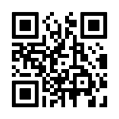

# NSW SES — Emergency Kit Checklist

> **Source**: NSW State Emergency Service (SES)
> **URL**: https://www.ses.nsw.gov.au/sites/default/files/2024-06/NSW-SES_Emergency-Kit-Checklist.pdf
> **Licence**: CC BY 4.0
> **Retrieved**: 2026-05-07T13:40:03Z
> **SHA-256**: `02eaddd4d642127ead843d3d8e5b1dd1c2c6e7b9ad5165b0e4a27b83bae9aac0`
> *Converted from PDF to Markdown format.*

---
## Page 1

Emergency Kit Checklist
Food, water & essentials 
For emergency assistance during a flood, storm or tsunami, 
call NSW SES on 132 500.
In a life-threatening emergency, call Triple Zero (000).  
Important documents
(Save copies to the cloud or a storage device)
Emergency Plans 
Emergency contact list
First aid kit
Non-perishable food & water
Photo IDs & passports
Insurance policies
Certificates
(incl. pets & animal plans)
Proof of address (e.g. lease or utility bill)
To help you leave quickly
Cash
Spare keys
Local maps
(ATMs & EFTPOS may not work)
(to navigate road closures)
(incl. spare batteries)
Radio
(incl. can 
opener)
(for your home & vehicles)
In case of a power outage
Torch
Candles & matches
(incl. spare batteries)
Personal items
Toiletries
Protective equipment
Clothing & footwear
(e.g. soap, dental care, toilet paper, 
sanitary items & sunscreen)
(to signal for help)
(e.g. sleeping bags & blankets)
Whistle
Bedding
(e.g. gloves, masks 
& glasses)
Health & wellbeing
Medical & ID bracelets
Entertainment
(for health 
conditions)
(books, games, toys & 
headphones)
Pet supplies
Food & water
Ownership & ID
Lead, harness & other accessories
(microchip details & photo)
Add these before you leave
Digital devices
Chargers, power banks & hard drives
Medications for 5 days 
(e.g. phones, laptops & tablets)
(incl. Medicare card 
& prescriptions)
Baby supplies (incl. formula, nappies & wipes)
Personal valuables (e.g. photo & jewellery)
(incl. bowls)
(incl. underwear)
(e.g. birth, marriage & wills)
ses.nsw.gov.au/plan-and-prepare
For more information, visit:

