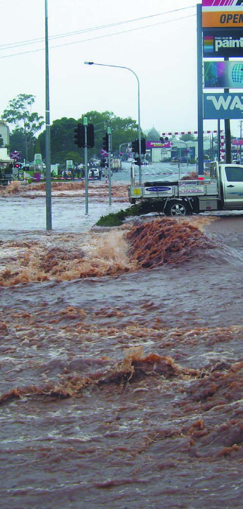
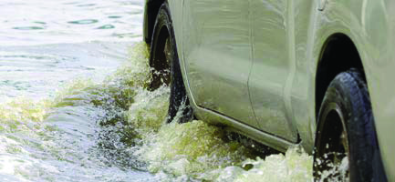
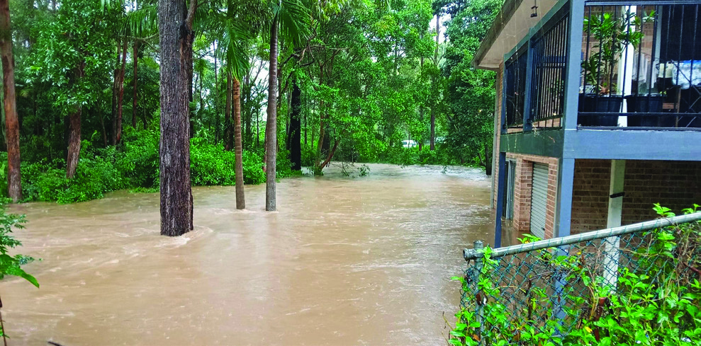
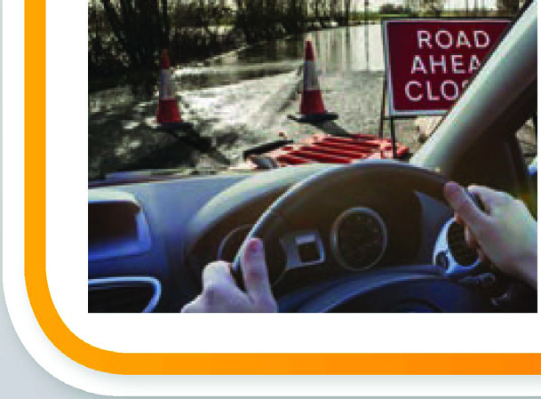
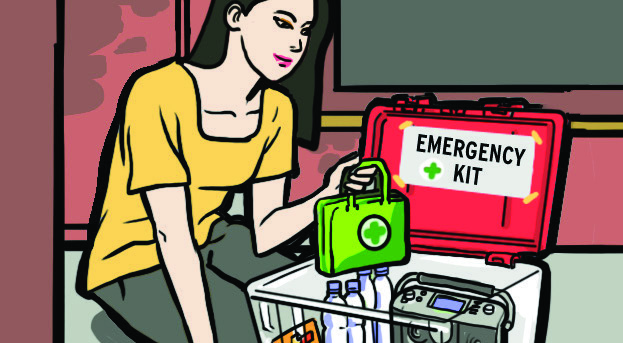

# NSW SES Flash Flood Guide

> **Source**: NSW State Emergency Service (SES)
> **URL**: https://www.ses.nsw.gov.au/sites/default/files/2024-06/Flash-flood-guide.pdf
> **Licence**: CC BY 4.0
> **Retrieved**: 2026-05-07T13:39:47Z
> **SHA-256**: `25002ed5af3ff6e68dd19328a2cbf0e4c88f0db8857f98df4e7544acfc0ef7d2`
> *Converted from PDF to Markdown format.*

---
## Page 1

When flooding is likely
Flash Flood Guide 
The NSW SES is responsible for responding to floods in NSW. 
This includes planning for floods and engaging with 
communities about how to protect themselves and their 
property. 
During floods the NSW SES will provide flood information, 
safety advice and can arrange for the delivery of essential 
supplies to people isolated by floodwater. Where possible, the 
NSW SES will conduct evacuations and undertake flood rescue. 
How the NSW SES can help you
Cover image: Toowoomba Queensland. 
Image provided by Reuters
When flash flooding is likely the best action to take is to leave 
low-lying homes and businesses (evacuate) well before flooding 
begins, but only if it is safe to do so. 
Do not enter floodwater as there is a high risk you may be 
swept away. Consider alternative ways to evacuate if possible.
Do not start driving in affected areas during flash flooding. If 
you are already driving, avoid flooded roads and find the highest 
nearby place to stop. Flash flooding can cause cars to stall, fill 
with water or be swept away.
If you are trapped by rising floodwater, seek refuge inside a 
sturdy multi-storey building with access to upper levels, higher 
natural ground such as a hill or onto the roof of a sturdy 
building. Do not enter the roof cavity as you may become 
trapped.
Stay there and call ‘000’ (triple zero) if it is a life-threatening 
situation. 
Stay clear of possible flash flood areas when severe weather is 
forecast and reconsider non-essential travel. Schools and work 
places have emergency procedures for these situations to keep 
children and workers safe.
Access local media for information, updates, warnings 
and advice
Locate and activate your Business or Home Emergency 
Plan and check your Emergency Kit or Grab and Go bag
Check on your neighbours and make sure they are 
aware of potential flooding 
Stack possessions, records, stock or equipment on 
benches and tables, placing electrical items on top 
Relocate waste containers, chemicals and poisons well 
above floor level 
Move animals, including agisted animals, to high 
ground and prepare pets for possible evacuation 
Secure objects that are likely to float and cause 
damage 
Stay away from and keep children clear of drains,  
culverts, creeks and low lying areas 
#NSWSES
/NSWSES
/NSWSES

---
## Page 2

What is flash flooding?
Stay informed
NEVER ENTER FLOODWATER
Prepare your family and property now
.ffi 
Flash flooding is a rapid rise in water after heavy rainfall over 
a short period of time. It does not usually last more than a few 
hours. 
Low-lying areas (under bridges or around culverts, drains, creeks 
and causeways) can be more susceptible to flash flooding. These 
are often dangerous places to be if it floods. 
Water associated with flash flooding can also move quickly over 
land in either natural depressions or along roadways  
and parkland. 
Flash floodwater can place lives at risk. It can be several metres 
deep, rise quickly and move fast. 
Know where to go
Find the safest route to travel in the event that you might need 
to evacuate. Identify places where evacuation routes may be 
cut and locate alternate routes 
Check with friends or relatives outside the flood prone area to 
organise a place to go. Find out where potential evacuation 
centres could be in your area 
Know who to call
For emergency help in floods and storms, call the NSW SES on 
132 500 
In a life-threatening emergency, call 000 (triple zero)
Keep local emergency numbers handy (near your phone or on 
your fridge)
Know your plan
If you have a Home and/or Business Emergency Plan, review it. 
Otherwise, have a conversation and plan for what you will do 
and take with you if you need to evacuate.
Review your plan annually or after any floods to keep  
it current
If you live in an area with a potential for flash flooding, 
there will be less time for you to act to protect your family 
and property. 
Prepare now. Put together an Emergency Kit consisting of 
a portable battery powered radio and torch, spare batteries, 
first aid kit, candles, waterproof matches, important papers, 
emergency plans and a waterproof bag. 
Never enter or travel 
through floodwater. This 
includes walking, driving, 
riding and playing in 
floodwater. Entering 
floodwater is the leading 
cause of death during 
floods. 
Monitor weather conditions and be aware of environmental 
cues such as very heavy rainfall. In flash flood areas, this may be 
the only indication of possible flash flooding.
The Bureau of Meteorology (www.bom.gov.au) issues Severe 
Thunderstorm Warnings and Severe Weather Warnings for a 
range of dangerous weather. They may also provide warnings 
for possible flash flooding
NSW SES may issue warnings based on the predictions of the 
Bureau of Meteorology with additional information about the 
expected consequences for local communities and what actions 
you should take.
Check with your local council to find out if there is a flash flood 
warning system for your area.
It is important to remember that most flash floods happen with 
little or no warning. Plan to act early. It is safer to stay well clear 
of flash floods.
Flood information including, safety advice, evacuations 
and road closures may be broadcast over local radio 
stations 
Keep monitoring local media for further information, 
updates, warnings and advice
Check with friends and neighbours to make sure they 
are aware of any warnings 
Know your risk
If you live or work close to a river, water course, creek, drain, 
culvert or in a low-lying area, you may be at risk from  
flash floods even if you have never experienced them. It is 
important to be aware of the possibility of flooding where 
you live, where you work, where you keep livestock and 
where you travel 
Find out about the local flood history. A copy of the local 
flood plan may be available from your council. Check with 
the local NSW SES unit or at www.ses.nsw.gov.au to find out 
if there is a local FloodSafe Guide. Contact your local council 
for specific information on how floods may affect your 
property 
Be aware of natural signs of flash flooding. These can include 
heavy rainfall and rushing or pooling water 
Talk with your neighbours and people who have lived in the 
area for a while about the local flood risk 
Knowing your flood risk will help you plan. It is important to 
plan now so that you know what to do when flooding occurs 
Even if your property is not inundated by floodwater, you 
could become isolated. Access to other areas may be cut and 
you might lose power, water and sewerage

