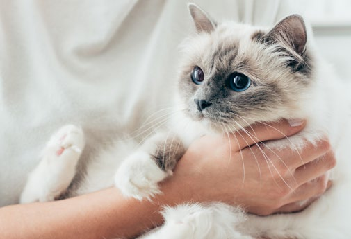
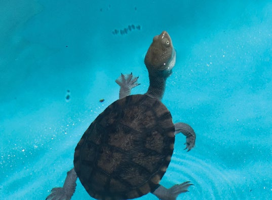
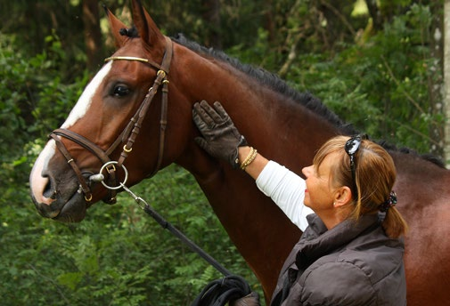
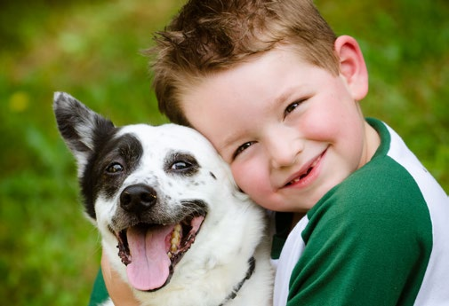
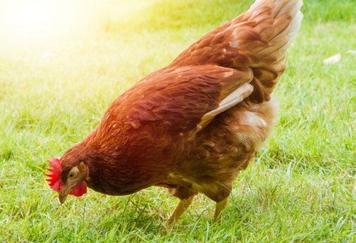

# NSW SES — Pets Emergency Plan

> **Source**: NSW State Emergency Service (SES)
> **URL**: https://www.ses.nsw.gov.au/sites/default/files/document/pets-emergency-plan-x-grab-go-a4-factsheet-digital-1.pdf
> **Licence**: CC BY 4.0
> **Retrieved**: 2026-05-07T13:40:05Z
> **SHA-256**: `23f56590b87672ea6a0d85377744d2809fd0c626bef92656a1105ad2904884d6`
> *Converted from PDF to Markdown format.*

---
## Page 1

ses.nsw.gov.au/plan-and-prepare/animal-safety
For more information, visit:

---
## Page 2

For the latest information during emergencies go to:
NSW Department of Primary Industries www.dpi.nsw.gov.au 
/NSWDPI
NSW State Emergency Service (floods, storms, tsunami) www.ses.nsw.gov.au 
/NSW.SES 
NSW Rural Fire Service (bushfires) www.rfs.nsw.gov.au 
/nswrfs
Fire + Rescue NSW www.fire.nsw.gov.au /frnsw
NSW Police www.police.nsw.gov.au 
/nswpoliceforce
For life threatening emergencies dial 000 (triple zero)
Animals need to go with you if you have to evacuate 
your home. It is safer for them and for you.
Please take a few minutes to complete this plan.
For further information go to  
www.getreadyanimals.nsw.gov.au
Thanks for making a plan. Stay safe, and remember to leave early if you need to evacuate
This plan is on my fridge,  
in my phone and given to  
my family/friend/neighbour
STEP 4
Names:
I will be going to family/friends house with my 
animal(s). Their details are:
Name:
Phone:
Address:
When and where I will go to 
be safe with my animal(s)
What I will take for my 
animal(s) if we have to leave
STEP 3
STEP 1
Leaving early and going to stay with family/friends is 
often most comfortable and convenient.
Evacuation centres may be opened and you can 
always take your animals along with you.
Stay informed by listening to ABC and local radio and 
going to the emergency service links provided below.
If I am not home, our family/friend/neighbour knows 
what to do. Their details are:
Name:
Phone:
Address:
I will relocate my animal/livestock early to:
Name: 
 
 
Phone:
Address:
Crate/Carrier
Cage/Other container
Lead/Harness
Car/Float
Friends Car
Public Transport
How I will contain and 
transport my animal(s)
STEP 2
Check you have enough crates, carriers, cages and 
leads. Also work out with your transport how many 
trips you will need to take.
Remember to secure/contain your animals asap, 
so they are safe while you get ready and close at 
hand so you can leave quickly.
Food and Treats
Bowls/Buckets/Tubs
Any medicines
Toys
Bedding
Identification Tags
Photo with owner
Toileting requirements
Registration and 
vaccination papers
My Grab and Go Bag is located here:
Decide the essential things your animal(s) needs for 
3-7 days. You may not be able to get home for a while.
You can pack them into a Grab and Go Bag, so you 
are ready to leave quickly. Remember to take it with 
you wherever you go.
Microchipping your animal and registering them with 
the NSW Pet Registry at www.petregistry.nsw.gov.au 
will help reunite them with you if separated during an 
emergency.
What I will do with my animals 
during an Emergency
ses.nsw.gov.au/plan-and-prepare/animal-safety
petregistry.olg.nsw.gov.au

