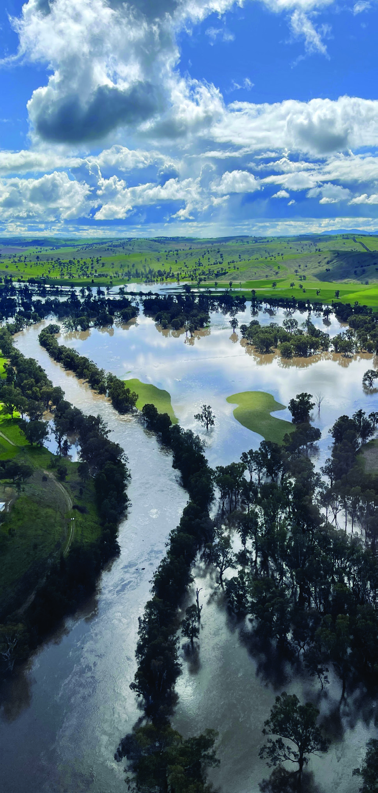
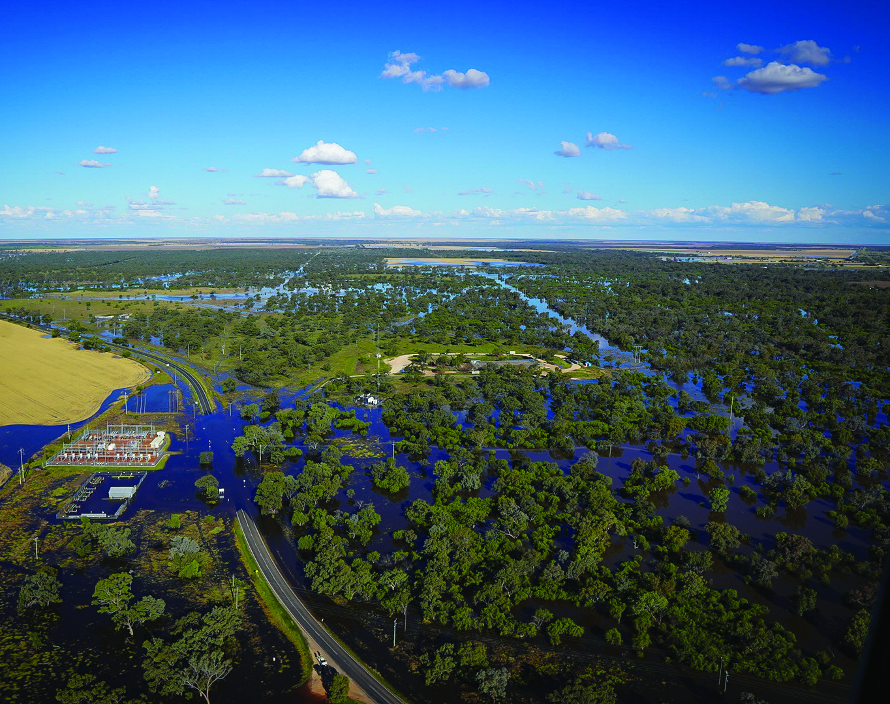
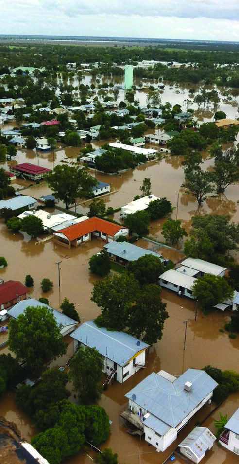
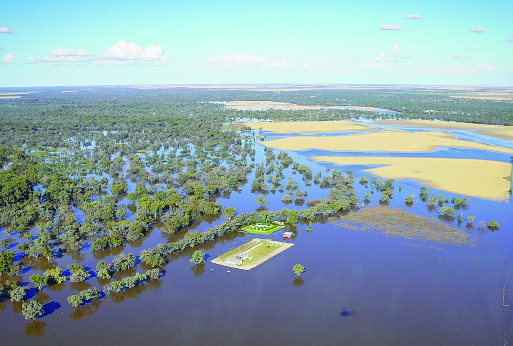
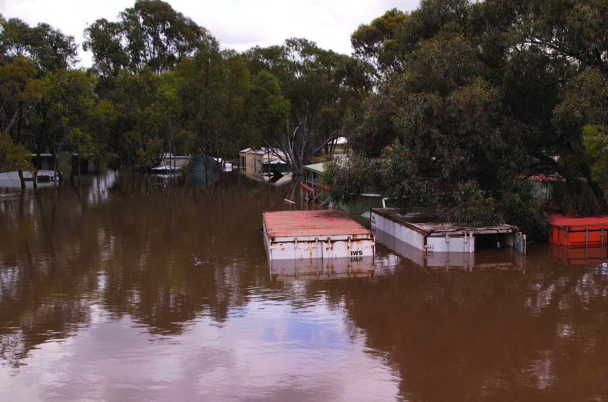
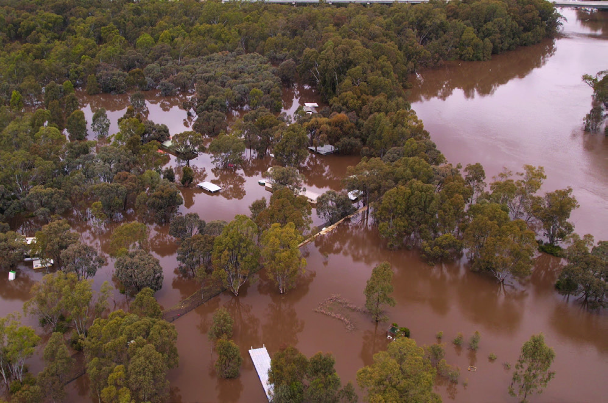

# NSW SES — Flood Safe Guide for Rural Properties

> **Source**: NSW State Emergency Service (SES)
> **URL**: https://www.ses.nsw.gov.au/sites/default/files/2024-02/rural-properties-fsg.pdf
> **Licence**: CC BY 4.0
> **Retrieved**: 2026-05-07T13:39:57Z
> **SHA-256**: `7e5e71f5e46ea51a755f8ffd407231c7873c30aef9e4a692b362af4c293886e3`
> *Converted from PDF to Markdown format.*

---
## Page 1

Pets and animals 
How the NSW SES can help you
How the NSW Department of 
Primary Industries can help you 
Some evacuation centres will not allow animals. Make plans for 
where you will go and how you will care for your pets now, well 
before there is any sign of flooding. 
Do not leave your pets behind. Put them on leads or in pet 
carriers. Dogs should wear a fixed collar with an identification 
tag. Animal carriers should be labeled with the owner’s details. 
Take feed and water with you as well as any medications for 
your pets.
The NSW SES is responsible for responding to floods. This 
includes planning for floods and educating people about how to 
protect themselves and their property. 
During floods the NSW SES will provide flood information, 
safety advice and arrange for the delivery of essential supplies 
to people isolated by floodwater. Where appropriate, the NSW 
SES will conduct evacuations and undertake flood rescue, 
including the rescue of Iivestock. 
NSW Department of Primary Industries is responsible for 
coordinating animal relief services for livestock, wildlife and
companion animals for rural producers affected by severe flood. 
For more information and support visit: www.dpi.nsw.gov.au
Rural and Isolated Properties Flood Guide
#NSWSES
/NSWSES
/NSWSES
During a flood
NSW SES may issue warnings based on the predictions of the 
Bureau of Meteorology when flooding is about to happen. 
Flood Warnings provide a predicted flood level, time at which a 
river may reach that level and expected consequences for local 
communities. 
•	 Never drive, walk, ride through, play or swim in floodwater - 
it is dangerous and toxic. If it’s flooded, forget it. 
•	 Be prepared to evacuate if advised 
•	 Act early, as roads may close 
•	 Keep monitoring local media for further information, updates 
and advice 
•	 Keep in contact with your neighbours

---
## Page 2

Are you at risk from floods?
What you can do now
When flooding is likely
New South Wales has a long history of floods. Some of these 
have been extreme events costing millions of dollars. 
The effects of flooding on rural property owners include losses 
to livestock, crops, fencing, buildings, personal items, farm 
equipment and machinery. While damage to crops and fences 
is usually unavoidable, there is the potential to reduce losses 
particularly to life, livestock and irrigation equipment. 
As a rural property owner or manager you may have 
experienced many floods. It is important to be aware that larger 
floods than those previously experienced can occur in your area.
 
Even if your property is not directly affected by flooding, you 
may be isolated and require assistance such as the supply of 
essential items and feed for livestock. 
It is important to be prepared for floods.
Floods can be a significant risk for rural properties in NSW. Here 
are some steps to take to prepare for floods in these areas:
Develop an emergency plan: Create an emergency plan that 
includes evacuation routes, contact numbers for emergency 
services and neighbors, and instructions for shutting off utilities.
Prepare your property: Make sure your property is ready for a 
flood by clearing gutters and drains, storing outdoor furniture 
and equipment in a safe place, and elevating valuable items and 
documents above flood level.
Stock up on supplies: Ensure you have enough food, water, and 
medical supplies in case you are isolated by floodwaters.
Monitor conditions: Stay informed about weather conditions by 
checking the Bureau of Meteorology website and listening to 
local radio stations. Stay informed about current SES warnings 
by downloading Hazards Near Me or by going to ses.nsw.gov.au
Maintain your property: Regularly maintain your property by 
ensuring waterways are free of debris, and avoiding activities 
that may increase the risk of flooding.
In rural and isolated areas, it may take longer for emergency 
services to reach you during a flood, so it’s important to take all 
necessary precautions to protect yourself, your family, and your 
property. Stay informed, be prepared. 
NSW SES may issue an Advice Warning for areas likely to be 
affected by flooding, based on the Bureau of Meteorology 
issuing a Flood Watch when there is the possibility of flooding. 
NSW SES provides flood information including flood forecasts, 
road closures, and advice on evacuations and property 
protection. Warnings and information are shared at
www.ses.nsw.gov.au, on the Hazards Near Me mobile app, and 
across local media.
•	 If you have a Home and/or Business Emergency Plan, review 
it. Otherwise, have a conversation and plan for what you will 
do and take with you if you need to evacuate
•	 Access local media for information, updates and advice
•	 Lift household items and farm equipment on to benches and 
tables placing electrical goods on top
•	 Secure objects that are likely to float and cause damage
•	 Locate important papers, valuables and mementoes. Put them 
in your emergency kit and take them with you when you 
evacuate
•	 Check sheds and outbuildings and relocate waste containers, 
chemicals and poisons well above floor level
•	 Check if your neighbours need help
•	 Locate and prepare pets for possible evacuation
•	 Move livestock to high ground where they can be provided 
with feed for the duration of the flood
•	 Relocate fodder supplies to high ground
•	 Move farm equipment and relocate pumps to high ground
•	 Have sufficient non-perishable food, essential medications 
fuel and other necessities to last two weeks. Do not forget pet 
food and stockfeed
•	 The safest option is to evacuate as early as possible to avoid 
additional hazards. Do not wait until the last minute
Isolation information
In riverine areas flooding can be prolonged and last for months. 
There may be no water, sewerage, power, telephone or other 
services for several weeks and you may be unable to call for 
help in an emergency. Your home may become a refuge for 
vermin, snakes and spiders. 
If you are not prepared for long term isolation by having 
enough food, clean water, fuel, and other essentials you need to 
evacuate before you become isolated.

