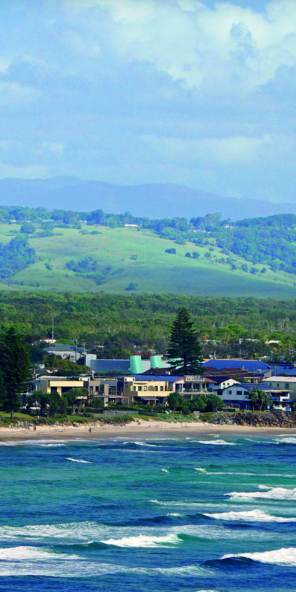
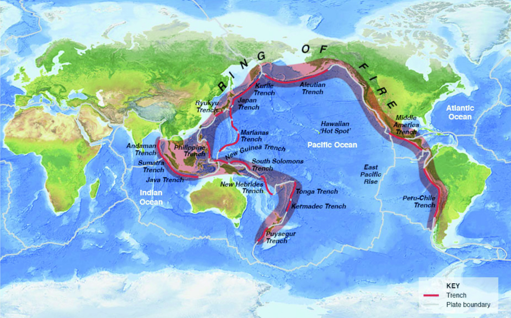
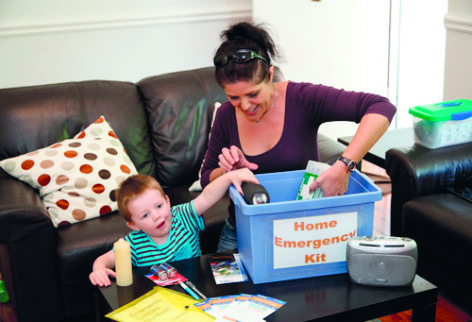

# NSW SES Tsunami Guide — Ballina and Lennox Head

> **Source**: NSW State Emergency Service (SES)
> **URL**: https://www.ses.nsw.gov.au/sites/default/files/2024-02/tsunamisafe-ballina-lennox-6p-print.pdf
> **Licence**: CC BY 4.0
> **Retrieved**: 2026-05-07T13:39:53Z
> **SHA-256**: `9aa27dafff37cd1e25168e87c761a768cfd5954e0f56c75e1067a7310a402aa6`
> *Converted from PDF to Markdown format.*

---
## Page 1

TsunamiSafe
Ballina & Lennox Head
When a Tsunami Warning is issued
Act early on the first warning you receive. Actions to take 
include:
Marine and immediate foreshore threat
	 Get out of the water and move to high ground away from 	 	
	
the immediate foreshore (beach, rocks, estuary etc.)
	 Boats near to shore should return to the nearest mooring. 		
	
Secure your boat and move to high ground.
	 Boats located offshore should move to deep water 
In the event of a land inundation threat you will ALSO need 
to do the following:
	 Move to higher ground, at least 10 metres above sea level 		
	
or 1 kilometre inland
	 Take only essential items, such as important papers, family 	
	
photographs and medication
	 Leave by foot, roads may be congested or closed
	 If you cannot get to higher ground seek shelter in the 	
	
	
upper storey of a sturdy brick or concrete building	
	 Do not go to the coast to watch the tsunami
Police, Fire and Ambulance - 000 (Triple Zero)	
Life-threatening emergencies.
NSW SES Emergency Assistance - 132 500	
The deaf, hard of hearing or speech impaired can call 	
Triple Zero (000) or SES (132 500) using the 	
	
National Relay Service (NRS). 
Emergency contacts
/NSWSES
Supporting information & contacts
My RoadInfo                                               
myroadinfo.com.au for local road information
Joint Australian Tsunami Warning Centre 	 	
(Bureau of Meteorology) - 1300 878 6264 	
	
bom.gov.au/tsunami for the latest Tsunami Warnings 
After a tsunami
An All Clear will be issued by emergency services when it is safe 
to return to areas impacted by tsunami. It may not be safe to 
return for up to 24 hours or longer, depending on the impacts.
	 Do not go sightseeing
    Keep listening to radio for information, updates and advice
Natural warning signs
The natural warning signs of a tsunami are:
	
FEEL the ground shake. If you are near the ocean this 	
	
	
may mean a large earthquake has happened nearby. 	
	
	
This may generate a tsunami.
	 SEE the ocean drop. As a tsunami approaches the 	
	
	
shore, the ocean may drop, but not always
	
HEAR a roaring sound. This may be heard before the 	
	
	
arrival of a tsunami.
Recovery
Disaster Recovery Centres may be established following major 
tsunami. They may provide a range of welfare services including 
financial assistance, personal support, organising temporary 
accommodation and providing information and referrals.
03/2017
Image courtesy of Ian Lacey
/NSW SES
#NSWSES
/NSW SES
/NSWSES
For further information about tsunami visit 
ses.nsw.gov.au
In life-threatening emergencies call 000 (Triple Zero)
132 500
FOR EMERGENCY HELP IN FLOOD, 
STORM AND TSUNAMI CALL
05/2017

---
## Page 2

What is a tsunami
Tsunami are a series of powerful waves, the first wave is not 
always the largest. As tsunami waves approach shallow water, 
they slow down, their height grows and they get closer together. 
A tsunami that is invisible at sea may grow to be several metres 
or more in height near the coast.
Most tsunami are triggered by undersea earthquakes. The 
nearest active earthquake zones to NSW are the trenches to the 
north and south of New Zealand.
Tsunami sources and travel times
How likely are tsunami?
There have been over 50 recorded tsunami events on the 
Australian coastline since European settlement. We are more 
likely to experience marine and immediate foreshore threat 
tsunami than a land inundation threat tsunami.  
Early evacuation could help protect many people. 
(Source: Bureau of Meteorology)
Official tsunami warnings
KEY:   
          Trench                   	
          Plate boundary
What causes a tsunami
ASSESS whether earthquake has a potential to generate a tsunami
MONITOR sea levels to 
verify, re-assess and update 
threat information
DETECT EARTHQUAKE
ISSUE
National Tsunami Watch
ISSUE
No Threat Bulletin
ISSUE National Tsunami 
Warning Summary
ISSUE Watches/Warnings to 
affected States/Territories
CANCEL if Threat Over 
or Didn’t Eventuate
Threat Exists
No Threat Exists
Maximum 
time from 
earthquake
15 mins
30 mins
Repeat on 
at least 
hourly 
cycle
60 mins
Earthquakes
Landslides (underwater & land based)
Volcanic eruptions
Meteorite impact in the ocean
Unknown causes
75%
10%
8%
5%
2%
Threat
Source
Travel time
Location
Local
Underwater 
or coastal 
landslides
Within 
minutes
NSW coastline
Regional
Earthquake 
Could be 
little as 90 
minutes+
Trenches to the 
north and south 
of New Zealand
Distant
Earthquake
Up to 12 
hours
Far away in the 
Pacific Ring of 
Fire such as Chile
How could I receive an official warning? 
Depending on lead time and available resources official warnings 
may be issued using one or more of the following methods:
Tune in: Radio and television broadcasts are one way of 
receiving warnings. They may be accompanied by the Standard 
Emergency Warning Signal (SEWS) - a siren-like noise.
Log On: To the Bureau of Meteorology bom.gov.au/tsunami 
and NSW SES website. Official warnings may also be shared on 
social media including Facebook and Twitter.
Tsunami Warnings have 3 different threat levels:
1.	 No Threat: an undersea earthquake has been detected, 
however it has not caused a tsunami, or the tsunami poses 
no threat to Australia and its offshore areas.
2.	 Marine and Immediate Foreshore Threat: warning of 
potentially dangerous rips, waves and strong ocean currents 
and the possibility of only some localised overflow onto the 
immediate foreshore.
3.	 Land Inundation Threat: warning for low-lying coastal areas 
of major land inundation, flooding, dangerous rips, waves 
and strong ocean currents.
Detecting an earthquake that may cause a tsunami
The Joint Australian Tsunami Warning Centre detects tsunami 
from regional and distant sources and warns of any tsunami 
threat to the coast of Australia. The first stage determines if 
there is a possible tsunami threat to Australia. 
Listen Out: Standard Emergency Warning Signal (SEWS) or 
announcement through a loud speaker. 
A text or recorded message on your phone may be sent to people 
in the affected area. 
Low flying aircraft equipped with public address systems. 
Two-way radio / Marine Satellite Phone UHF, CB marine VHF 
radios and where appropriate marine satellite phones. 
Your friends and family may pass on official warnings.
How to prepare yourself
Some of the things 
you can do are:
	 Prepare an 	
	
	
emergency kit
	 Determine if you live 	
	
or work in an area 	
	
to be evacuated in a 	
	
land inundation threat tsunami (see map overleaf)
	 Know where the nearest high ground 	and the evacuation     	
	
areas are located 	
	 Discuss your emergency plan with the people you know 
	 Identify an evacuation route to the nearest high ground
	 Prepare to take your pets with you and what essential 	
	
	
items you can easily carry
	 Be aware of what to do in case there is a Tsunami Watch or 	
	
Warning

