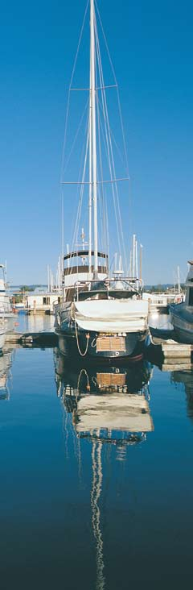
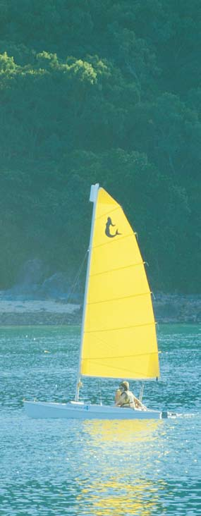
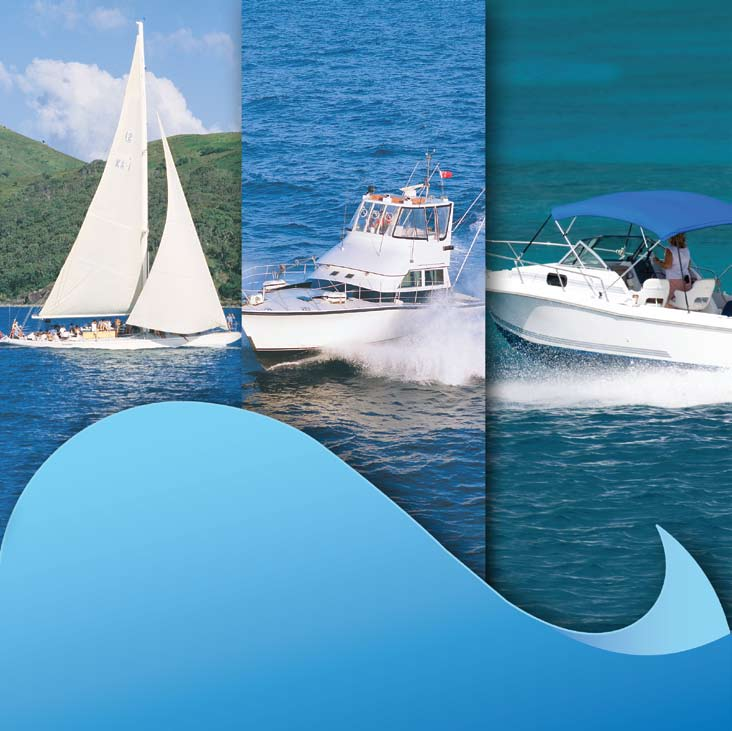
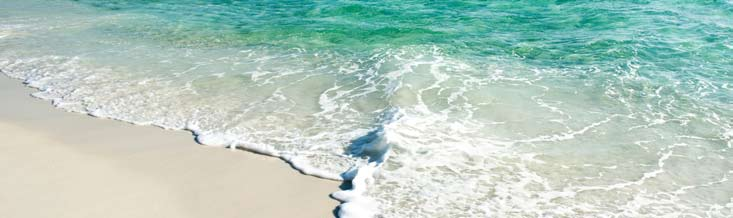
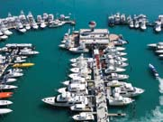
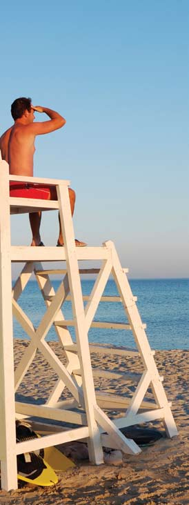

# NSW SES — Tsunami information for recreational boaters

> **Source**: NSW State Emergency Service (SES)
> **URL**: https://www.ses.nsw.gov.au/sites/default/files/2024-06/brochure-tsunami-information-for-recreational-boaters_hi-res.pdf
> **Licence**: CC BY 4.0
> **Retrieved**: 2026-05-07T13:39:55Z
> **SHA-256**: `630b23f6a7e8777b5553329950330ac997afea9f8a81473a6201f43b5ffa1566`
> *Converted from PDF to Markdown format.*

---
## Page 1

What to do with your boat….
You should have an emergency plan for your vessel which includes 
information on where to moor your boat quickly and safely should a 
tsunami warning be issued. If it is safer to move to the deep ocean, you 
should also be familiar with the boating requirements of the area you are 
operating in, local dangers, special rules and regulations. You should know 
where and how to move out to the deep ocean, how long it takes and 
how to get back to the harbour or port. The tsunami warnings issued by 
the Bureau of Meteorology will advise the initial arrival times for various 
locations along the coast of any possible threat. While in the water it is 
extremely important you listen to weather reports and monitor warnings 
on public or marine radio. These are all important factors to consider in 
deciding whether to move your vessel in the event of a tsunami warning.
Please note: Tsunami can cause rapid and unpredictable changes in water 
level and dangerous currents and turbulence in harbours and ports. These 
effects can occur even during a relatively small tsunami.
If your boat is at sea or in the deep ocean
While tsunami may go unnoticed in the deep ocean, unpredictable 
waves and dangerous currents can affect harbours for some time after a 
tsunami. If your boat is at sea or in the deep ocean and a tsunami warning 
is issued, maintain your position and do not return to port until further 
advised.
Boats are safer from tsunami damage in the deep ocean rather than 
moored in a harbour or estuary.
If your boat is moored
If a tsunami warning is issued and your vessel is moored, do not risk 
your safety and attempt to move the vessel out to the deep ocean. Move 
quickly to higher ground or inland.
If your boat is in shallow water or a harbour or estuary
A tsunami wave slows down in shallow water but its wave height increases 
due to the energy in the wave remaining the same. If a tsunami warning 
is issued and your boat is in shallow water, a harbour or estuary, return 
to shore, secure the vessel and move all passengers quickly to higher 
ground.
Where can I find more  
information on tsunami?
Bureau of Meteorology 
www.bom.gov.au/tsunami
Geoscience Australia 
www.ga.gov.au/hazards/tsunami
Emergency Management Australia 
www.ema.gov.au/tsunami
Australian State and Territory emergency services
www.ses.nsw.gov.au
www.ses.vic.gov.au
www.emergency.qld.gov.au/ses
www.fesa.wa.gov.au
www.ses.sa.gov.au  
www.ses.tas.gov.au
www.ses.act.gov.au
www.emergency.nt.gov.au
 
For latest tsunami warnings call  
1300 TSUNAMI (1300 878 6264) 
or visit the Bureau’s website www.bom.gov.au/tsunami
For tsunami assistance call SES on 132 500  
(or if in Tas or NT police assistance on 131 444).
For life threatening emergencies call 000.
www.symagy.com 5750   01/2009
Tsunami
Information
for Recreational 
Boaters
Produced in conjunction with Australian State 
and Territory governments.

---
## Page 2

Tsunami explained
A tsunami is a series of waves travelling across the ocean due to a sudden 
displacement of a large body of water. This displacement can be caused by 
events such as undersea earthquakes, landslides, volcanic eruptions or even 
asteroid impacts. Tsunami are different from wind swell waves on the ocean. 
Normal ocean and wind swell waves may cause motion in the water to depths of 
150 metres. In contrast, the passage of tsunami involve the movement of water 
all the way to the seafloor.
Tsunami waves move outwards away from their source and may go unnoticed 
by ships, boats or from the air. As tsunami cross the deep ocean, wave heights 
may be much less than one metre but speeds can reach up to 950km/hr. 
Tsunami have extremely long wavelengths – up to hundreds of kilometres 
between wave crests in the deep ocean.
Depending on how tsunami approach the coastline, they may look like rapidly 
rising or falling tides or a series of breaking waves. Tsunami will also look and 
behave differently depending on the shape of the seafloor and coastline. There 
may be a relatively long time between waves arriving at the coastline and the 
first wave is not necessarily the largest. The second or third wave is generally 
larger. As tsunami approach the shore, speed reduces and wave height can grow 
significantly – up to several metres. It is not so much this movement of water, 
but the energy moving through it that makes tsunami so dangerous.
Even small tsunami can 
cause dangerous rips and 
currents that are a risk to 
people on boats or those in 
or near water. 
If you own or use a boat for recreational purposes please read ahead for some important 
safety information about tsunami. Keep this brochure handy in case of a tsunami warning.
Marine and immediate foreshore threat
The Joint Australian Tsunami Warning Centre 
(JATWC), jointly operated by the Bureau of 
Meteorology and Geoscience Australia, detects 
and verifies any tsunami threat to the coastline of 
Australia and its offshore territories. Depending 
on the level of threat determined by the JATWC, 
the Bureau of Meteorology may issue a tsunami 
warning (via the radio, television, 1300 TSUNAMI, 
or the Bureau’s website www.bom.gov.au/tsunami) 
restricted to the marine environment and immediate 
foreshore area for parts of the Australian coastline. 
You will be advised to:
• Get out of the water and move away from the 
immediate water’s edge of harbours, coastal 
estuaries, rock platforms and beaches.
• Return any boats in harbours, estuaries and in 
shallow coastal water to shore, then secure your 
boat and move away from the waterfront.
• Move any vessels already at sea to deep water well 
offshore and remain there until further advised.
• Not go to the coast or headlands to watch the 
tsunami.
• Listen to the media for further information and 
follow the advice from emergency services.
• Check that your neighbours have received this 
advice.
Land inundation threat
If there is a possibility of more serious inundation of 
coastal land (ie water that overflows onto normally 
dry land areas), the JATWC may extend the tsunami 
warning for the marine environment and immediate 
foreshore to a tsunami warning for more extensive 
land inundation. Advice on the appropriate response 
is determined in consultation with the relevant State 
or Territory emergency authority who may order the 
evacuation of low lying coastal areas. You will be 
advised to:
• Take only essential items that you can carry 
including important papers, family photographs 
and medical needs. 
• Go to higher ground or inland. Move away from all 
beaches and the water’s edge of harbours and 
coastal estuaries.
• Walk to safety if possible to avoid traffic jams. 
• Take shelter in the upper storey of a sturdy brick or 
concrete multi-storey building if you cannot leave 
the area.
Cancellation of a tsunami warning
Tsunami warnings will be cancelled by the JATWC 
when the main threat is deemed to have passed. 
The relevant State or Territory emergency authority 
will inform the public when it is safe to return to 
the affected area. Caution should still be exercised 
however, as unusually strong waves, currents and 
abnormal sea levels may still affect some beaches, 
harbours and coastal waterways for hours, or even 
days after, depending on the location. 
Information within warnings
It is important that you follow the advice contained in 
these warnings. By reading this guide and responding 
to advice included in warnings, you can minimise the 
risk to your safety. Evacuation or exclusion orders are 
legally enforceable under State/Territory legislation.
Tsunami warnings in Australia
Natural warning signs of tsunami
Tsunami may go unnoticed by vessels in the deep ocean or from 
the air. Therefore, it is extremely important to listen carefully 
to port authorities or volunteer marine radio base networks for 
current information and follow advice given by emergency service 
authorities. 
In harbours and ports the following natural signs of tsunami 
may, but not always, be experienced near the coast in Australia 
or overseas. If you notice any of these warning signs take 
appropriate action as outlined in this guide.
You may...
Feel the earth shake
A large undersea earthquake may be felt prior to tsunami by an 
ongoing shaking of the ground in coastal regions. However, you 
may not feel an earthquake if the source is far away.
See the ocean drop
As tsunami approach the shoreline, the sea level may, but not 
always recede/drop dramatically before returning as a fast-moving 
wall of water. 
Hear an unusual roaring sound
A roaring sound from the ocean may precede the arrival of 
tsunami.
In the unlikely event of tsunami being generated directly 
offshore from our coast, little or no warning may be available for 
communities initially impacted apart from possible natural warning 
signs.

