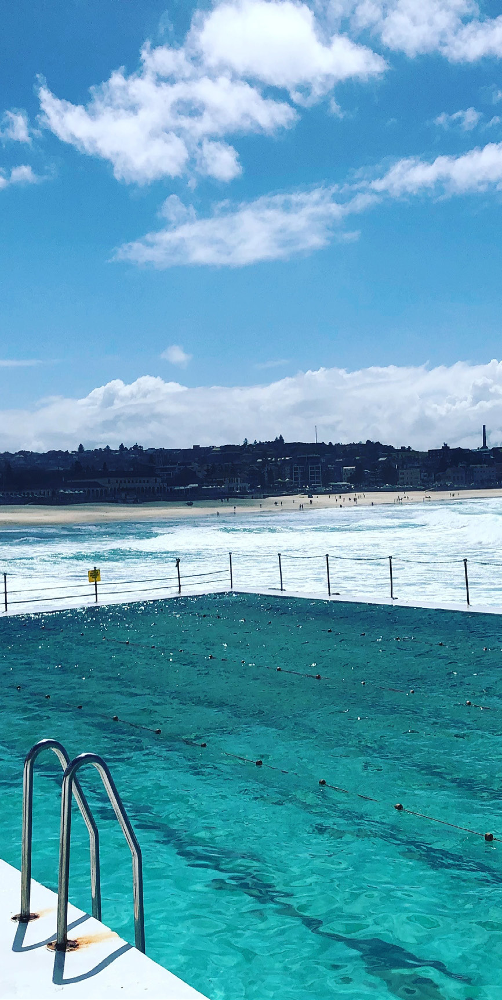
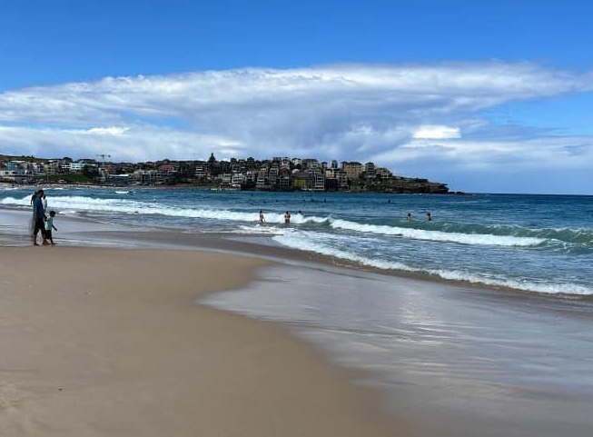
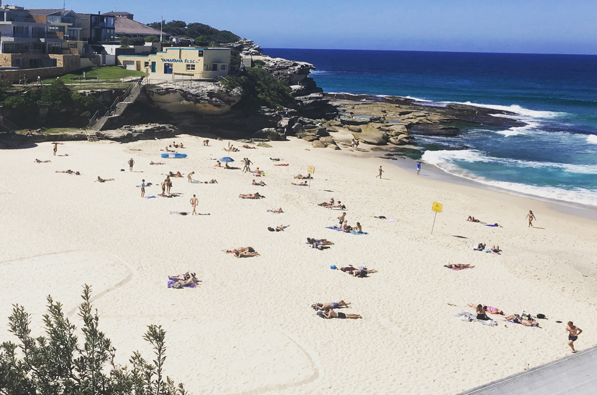

# NSW SES Tsunami Guide — Sydney Eastern Beaches

> **Source**: NSW State Emergency Service (SES)
> **URL**: https://www.ses.nsw.gov.au/sites/default/files/2024-02/2023-sydney-eastern-beaches-tsunami-guide-online.pdf
> **Licence**: CC BY 4.0
> **Retrieved**: 2026-05-07T13:39:51Z
> **SHA-256**: `b112b42241a9aed340546b6e40a53b7d1e5ee7ce88359708fe4bf55e265b48db`
> *Converted from PDF to Markdown format.*

---
## Page 1

Tsunami Guide
Sydney Eastern Beaches
When a Tsunami Warning is issued
/NSWSES
Further information
After a tsunami
Natural warning signs
Recovery
03/2017
/NSW SES

---
## Page 2

What is a tsunami
How likely are tsunami?
(Source: Bureau of Meteorology)
Bureau of Meteorology warnings
KEY:   
          Trench                   	
          Plate boundary
What causes a tsunami
75%
10%
8%
5%
2%
How could I receive official Advice and Emergency Warnings? 
How to prepare yourself
NSW SES Warnings
Emergency Warning
You may be in danger 
and need to take 
action immediately.
ACTION 
STATEMENTS
Evacuate now /
Evacuate before [time] 
Avoid the Area
Advice
An incident is happening.
 
Stay up to date in case the 
situation changes.
ACTION 
STATEMENTS
Stay Informed
Monitor Conditions
Reduced Threat: 
Return with Caution

