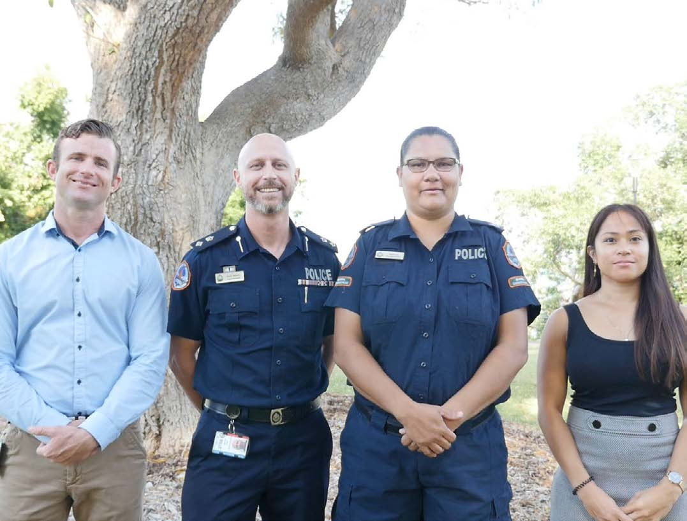
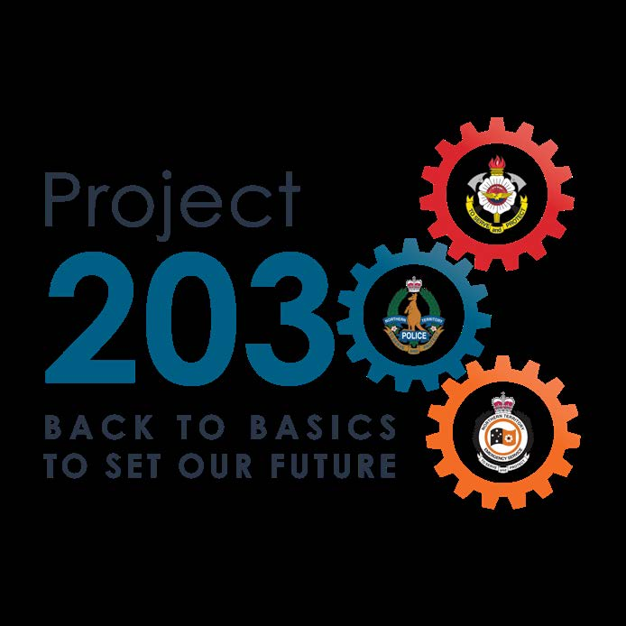

# Northern Territory Police, Fire and Emergency Services — Ten Year Strategy 2020–2030 (2020)

> **Source**: NT Police, Fire and Emergency Services
> **URL**: https://pfes.nt.gov.au/sites/default/files/uploads/files/2020/NTPFES_TEN_YEAR_STRATEGY_2020.pdf
> **Licence**: © Northern Territory Government; emergency-management practitioner reference
> **Retrieved**: 2026-05-07T23:39:50Z
> **SHA-256**: `1346de831de50537dd98eebc1abd27c844f05a4bb4cb64b8901b7dafa4203c65`
> *Converted from PDF to Markdown format.*

---
## Page 1

Strategy
Ten Year
Northern Territory 
Police, Fire & Emergency Services

---
## Page 2

2
NTPFES  |  TEN YEAR STRATEGY - BACK TO BASICS TO SET OUR FUTURE
Acknowledgement 
The Northern Territory Police, Fire and Emergency Services acknowledges 
the First Nations people throughout the Northern Territory, from the red 
sands of Central Australia to the coastal people in the Top End. We recognise 
their continuing connection to their lands, waters and culture. We also pay 
our respects to the Aboriginal and Torres Strait Islander people with whom 
we work and for whom we serve and protect. We pay our respects to the 
Aboriginal and Torres Strait Islander cultures, and to their leaders past, 
present and emerging.

---
## Page 3

3
TEN YEAR STRATEGY - BACK TO BASICS TO SET OUR FUTURE  |  NTPFES
4 	
Foreword
5 	
Outcomes
6 	
Strategic Priorities
9 	
Community Engagement Strategy
10 	
Custody Strategy
11 	
Diversity and Inclusion Strategy
12 	
Domestic, Family and Sexual Violence Strategy
13 	
Emergency Management Strategy
14 	
Finance and Budget Strategy
15 	
Fire Management Strategy
16 	
Forensic Science Strategy
17 	
Hazard Management Strategy
18 	
lllicit Commodities Strategy
19 	
Intelligence Strategy
20 	
Investigation Strategy
21 	
Media and Communications Strategy
22 	
Organised Crime Strategy
23 	
People Strategy
24 	
Regional and Remote Policing Strategy
25 	
Road Safety Strategy
26 	
Search and Rescue Strategy
27 	
Social Amenity Strategy
28 	
Technology Strategy
29 	
Training and Education Strategy
30 	
Volunteer Strategy
31 	
Youth Strategy
Contents

---
## Page 4

4
NTPFES  |  TEN YEAR STRATEGY - BACK TO BASICS TO SET OUR FUTURE
Foreword
4
NTPFES  |  TEN YEAR STRATEGY - BACK TO BASICS TO SET OUR FUTURE
Jamie Chalker APM
Commissioner of Police and 
CEO of Fire and Emergency Services
I am proud to present the Northern Territory 
Police, Fire and Emergency Services Ten Year 
Strategy (the Strategy), which formalises our 
commitment to our people and our community, 
who are at the heart of everything we do. We 
are blessed with a wonderfully rich and diverse 
back yard and it is a privilege to be of service. 
Our People and Our Community are of the utmost 
importance, and for this reason they have been 
identified as our key strategic priorities. They 
will remain front and centre as we deliver on our 
mission: To Serve and Protect, and strive toward 
our vision: A Safe and Resilient Northern Territory. 
The partnership between our people and 
our community is embedded throughout 
the Strategy alongside recurring themes 
of prevention, preparedness, response and 
continuous improvement. Each one of our 
people is valued and their contributions will 
be vital to achieving success for the 
Northern Territory Police Force, 
Northern Territory Fire and Rescue Service, and 
Northern Territory Emergency Service. The work 
that our public sector employees and volunteers 
do, to support the tri-service is equally valued. 
Similarly, the role that our community play in 
partnering with Northern Territory Police, Fire 
and Emergency Services to find solutions and 
achieve outcomes is essential in influencing and 
realising positive social change.
Over the next decade we will focus on our 
core functions first and foremost; and take all 
reasonable steps to meet and then exceed the 
expectations of our stakeholders, including the 
broader Northern Territory community, every 
single day. We will work towards achieving 
meaningful, long-term outcomes and it is hoped 
that the benefits of our work will continue to 
be realised by future generations. This Strategy 
sets our purpose and direction as we challenge 
ourselves to secure the best possible future for 
our agency and our community. I look forward 
to achieving our goals together, and I invite all 
Territorians to join us on this journey.
CONTENTS

---
## Page 5

5
TEN YEAR STRATEGY - BACK TO BASICS TO SET OUR FUTURE  |  NTPFES
Outcomes
2020 
Establish
2021 
Implement
2022-23 
Embed
2024 
Review
2025-26 
Improve
2027 
Review
2028-29 
Maintain
2030 
Evaluate & 
Plan
CONTINUOUS IMPROVEMENT
Overview
We aim to achieve our vision: A Safe and Resilient Northern Territory by a range of 
meaningful, long term outcomes under six domains. 
This assists us to group, measure and report on our progress toward successful 
implementation of our Ten Year Strategy. 
Our People and Our Community
1. 
Enhance culture, capability, employee and volunteer recruitment and retention
2. 
Prevent, detect, investigate and prosecute
3.	
Robust governance
4. 
Effective emergency and fire management
5.	
Improve social amenity
6. 
Safe and resilient communities through partnerships, prevention and engagement
We will periodically review and enhance activities which support implementation of the 
Ten Year Strategy in order to achieve continuous improvement.  
Delivery Timeline
CONTENTS

---
## Page 6

6
NTPFES  |  TEN YEAR STRATEGY - BACK TO BASICS TO SET OUR FUTURE
Priorities 
Strategic
The two strategic priorities, and the enablers within, will allow Our People to 
Serve and Protect Our Community, to achieve our vision of a Safe and Resilient 
Northern Territory.
Our 
People
are the core of the Northern 
Territory Police, Fire and 
Emergency Services. 
Together, we serve and 
protect our community.
PEOPLE
Develop, guide and value our people. 
Live by a culture of ethics and integrity, focused on 
a commitment to do what is right. 
LEADERSHIP
At all mes, as an agency and at all levels within. 
ETHICS
A culture focussed on fairness, responsibility, 
accountability, early intervenon, self-reflecon and 
beer governance to improve our standards. 
SERVICE ABOVE SELF
Do our best for the community we are serving. 
Know our business and our role, commit to excellent 
service at all mes. 
CAPABILITY
Provide our people with appropriate workspaces, 
tools and resources. Plan, lead, organise and control 
to achieve our outcomes.
DYNAMIC
We must be flexible, innovave and recepve. 
DIVERSITY AND INCLUSION
A workforce and culture reflecve of the community 
we serve.
6
NTPFES  |  TEN YEAR STRATEGY - BACK TO BASICS TO SET OUR FUTURE
CONTENTS

---
## Page 7

7
TEN YEAR STRATEGY - BACK TO BASICS TO SET OUR FUTURE  |  NTPFES
7
TEN YEAR STRATEGY - BACK TO BASICS TO SET OUR FUTURE  |  NTPFES
Our 
Community
Appreciate and support the 
rich and diverse 
community we serve.
LOCAL UNDERSTANDING
Be integrated with the community to understand impacts and 
prevent risks and harms. Develop and use local knowledge to 
inform decision-making and drive local engagement.
RESILIENCE
Empower communies to develop and maintain the capacity 
to recover from difficules. Prepare, prevent, plan and 
cooperate to enable safety.
PARTNERSHIPS
Develop and maintain diverse and producve partnerships 
to improve community safety and amenity.
TRUST
Build trust by maintaining respecul, collaborave 
relaonships and knowing our vision and our mission. 
Treat all how you wish to be treated.
ENGAGEMENT
Producve and inclusive mutual engagement with our 
community and stakeholders incorporang cultural 
competence principles.
CULTURAL COMPETENCE
We must understand community needs and expectaons to 
deliver an engagement-focused, culturally and socially inclusive 
service. Respect the importance of language in communicaon.
Our Vision
A Safe and Resilient 
Northern Territory
Our Mission
To Serve and Protect
CONTENTS

---
## Page 8

8
NTPFES  |  TEN YEAR STRATEGY - BACK TO BASICS TO SET OUR FUTURE
Strategies
Our
CONTENTS

---
## Page 9

9
TEN YEAR STRATEGY - BACK TO BASICS TO SET OUR FUTURE  |  NTPFES
Community Engagement
Strategy
Overview
Effective service delivery relies on cooperation with our community and stakeholders.
We will provide a consistent engagement approach by ensuring community views are 
encouraged, understood and considered.
Key Priorities
1. 	 Communicate
	
• 	Provide balanced, objective and timely public information.
	
•	 Educate the community about what we do.
	
• 	Ensure an active and engaging presence in our community.
2. 	 Consult
	
• 	Consult with local community and stakeholders.
	
• 	Encourage, understand and consider community views.
	
• 	Provide people and community-focussed services.
3. 	 Involve and empower
	
• 	Build strong community partnerships.
	
• 	Value local expertise.
	
• 	Encourage community resilience.
4.	  Innovate
	
• 	Develop new outcomes in partnership with the community.
	
• 	Provide a proactive service.
	
• 	Integrate risk management into everything we do.
9
TEN YEAR STRATEGY - BACK TO BASICS TO SET OUR FUTURE  |  NTPFES
CONTENTS

---
## Page 10

10
NTPFES  |  TEN YEAR STRATEGY - BACK TO BASICS TO SET OUR FUTURE
Custody
Strategy
Overview
The use of efficient, contemporary and appropriate custody processes is central to 
this strategy.
We are committed to providing the safe care and welfare of all persons in custody.
Key Priorities
1. 	 Safe care and custody
	
• 	Maintain a professional approach to custody.
	
• 	Enhance cultural competence.
	
• 	Build respectful connections with our clients and our stakeholders.
	
• 	Focus on prevention by identifying and mitigating risks.
2.  Continuous improvement
	
• 	Review and maintain procedures to remain efficient, relevant and contemporary.
	
• 	Address emerging trends using early identification and intervention.
	
• 	Deliver appropriate training and education.
	
• 	Seek, evaluate and adopt feedback from a range of sources.
	
•	 Ensure appropriate resources and assets are available.
10
NTPFES  |  TEN YEAR STRATEGY - BACK TO BASICS TO SET OUR FUTURE
CONTENTS

---
## Page 11

11
TEN YEAR STRATEGY - BACK TO BASICS TO SET OUR FUTURE  |  NTPFES
Diversity and Inclusion
Strategy
Overview
Diversity and inclusion are essential to providing a high quality service to our community.
We aim to reflect the community we serve and be accessible and supportive to all 
people to provide the best possible outcomes.
Key Priorities
1. 	 Diversity
	
• 	Educate our people and our community on the benefits of a diverse workforce.
	
• 	Ensure policies and practices promote diversity.
	
• 	Collect and analyse workforce data to identify risks, trends and opportunities to improve
	
	
retention of a diverse workforce.
	
• 	Celebrate and promote diversity and inclusion in the community and in the workplace.
	
•	 Continue to develop tools and resources to empower our workforce.
2.	 Inclusion
	
• 	Implement measures that foster a culture of acceptance, trust and inclusion.
	
• 	Offer our people opportunities to increase their cultural competency through awareness, 
	
	
training and self reflection.
	
• 	Collect diversity and inclusion data to monitor workforce satisfaction.
11
TEN YEAR STRATEGY - BACK TO BASICS TO SET OUR FUTURE  |  NTPFES
CONTENTS

---
## Page 12

12
NTPFES  |  TEN YEAR STRATEGY - BACK TO BASICS TO SET OUR FUTURE
Domestic, Family and 
Sexual Violence Strategy 
Overview
Domestic, family and sexual violence is serious and affects victims, families and 
communities. A whole of community response is required to ensure the safety, 
wellbeing and protection of people in the Northern Territory.
We are committed to preventing and reducing domestic, family and sexual violence 
and working with our partners to build a future free from violence.
Key Priorities
1. 
Effective prevention, reduction and response
	
• 	Prevent domestic, family and sexual abuse of children and adults through early intervention.
	
• 	Respond to victims consistently and compassionately.
	
• 	Partner with other agencies and the community to target driving factors.
	
• 	Enhance judicial processes which hold offenders to account.
	
• 	Support programs which aim to address offending behaviour.
	
• 	Manage repeat and high-risk offenders.
2.	
Local partnerships
	
• 	Engage and partner with the community to promote positive change.
	
• 	Provide our workforce with specialist training and professional development opportunities.
	
• 	Develop and deliver interventions to at-risk victims and families in partnership with other 
	
	
agencies and the community.
12
NTPFES  |  TEN YEAR STRATEGY - BACK TO BASICS TO SET OUR FUTURE
CONTENTS

---
## Page 13

13
TEN YEAR STRATEGY - BACK TO BASICS TO SET OUR FUTURE  |  NTPFES
Emergency Management 
Strategy
Overview
Emergency management is an essential part of delivering a safe and 
resilient community.
We are committed to prevention, preparation, response and recovery to limit the 
impact of emergency events.
Key Priorities
1.	
People and partnerships
	
• 	Enhance capability and expertise by providing contemporary training.
	
• 	Partner with stakeholders to build community resilience through targeted risk awareness and 	
	
education programs.
	
• 	Build and maintain relationships with stakeholders to support the Northern Territory during 	
	
emergency events.
	
• 	Contribute to national emergency management programs, frameworks.s and forums.
2.	
Governance
	
• 	Engage with stakeholders to develop policies that enable whole-of-government emergency 	
	
management capability and capacity.
	
• 	Develop and implement contemporary emergency management plans.
	
• 	Focus on the continuous improvement of our emergency management practices.
13
TEN YEAR STRATEGY - BACK TO BASICS TO SET OUR FUTURE  |  NTPFES
CONTENTS

---
## Page 14

14
NTPFES  |  TEN YEAR STRATEGY - BACK TO BASICS TO SET OUR FUTURE
Overview
The Finance and Budget Strategy guides decision-making in a challenging and 
demand-driven financial environment.
We are committed to effectively allocating and managing our resources.
Finance and Budget
Strategy
Key Priorities
1.	
Financial management and governance
	
• 	Understand and comply with legislated obligations in managing public resources.
	
• 	Develop budget plans and financial reports and conduct ongoing reviews.
	
• 	Demonstrate effective internal controls and improvements over all resource usage.
2.	
Financial advocacy
	
• 	Advocate our agency needs to government and other stakeholders.
	
• 	Engage employees to improve service-delivery models and influence business decisions.
3.	
Professional development
	
• 	Involvement from executive in key governance committees and service area portfolios to 		
	
drive business and resourcing decisions.
	
• 	Ongoing support, education and training of employees.
14
NTPFES  |  TEN YEAR STRATEGY - BACK TO BASICS TO SET OUR FUTURE
CONTENTS

---
## Page 15

15
TEN YEAR STRATEGY - BACK TO BASICS TO SET OUR FUTURE  |  NTPFES
Fire Management 
Strategy
Overview
The Fire Management Strategy incorporates preventative and responsive measures 
with a flexible and adaptable community approach to meet the needs of a changing 
environment.
We aim to protect people, property and the environment through modern and 
innovative fire management.
Key Priorities
1. 
Quality response and investigation
	
• 	Ensure sufficient capability and resources 	
	
to provide an appropriate operational 	
	
response.
	
• 	Maintain and enhance investigative 	 	
	
capability.
	
• 	Maintain policies to enhance operational 	
	
effectiveness and support frontline staff.
2. 
Preventative hazard reduction
	
• 	Prioritise proactive hazard reduction 		
	
to eliminate or reduce danger to life, 		
	
property and the environment.
	
• 	Develop and maintain partnerships 	 	
	
with local community stakeholders 	 	
	
to implement contemporary practices in 	
	
land management and hazard reduction.
	
• 	Engage with communities through 	
	
	
education and enforcement of hazard 	
	
reduction on private land.
3.	
Community approach
	
• 	Partner with stakeholders and local 	 	
	
communities to build resilience.
	
• 	Increase focus on community education 	
	
and training to improve preparedness, 	
	
expand awareness and shape community 	
	
expectations.
4. 
Adaptation
	
• 	Develop methods to ensure the agency 	
	
is adaptable to the challenges created by 	
	
a changing climate.
	
• 	Manage and meet evolving community 	
	
expectations and a changing 	 	
	
	
technological environment.
15
TEN YEAR STRATEGY - BACK TO BASICS TO SET OUR FUTURE  |  NTPFES
CONTENTS

---
## Page 16

16
NTPFES  |  TEN YEAR STRATEGY - BACK TO BASICS TO SET OUR FUTURE
Overview
This strategy will deliver a nationally-accredited specialist forensic science service to 
all levels of the judicial system.
Forensic Science 
Strategy
Key Priorities
1.	
Capability
	
• 	Deliver faster and more effective forensic evidence to investigators and the judicial system.
	
• 	Identify priorities early and deploy capabilities as needed.
	
• 	Adopt and develop new scientific techniques.
	
• 	Develop and deliver improved response capabilities.
	
• 	Enhance forensic intelligence.
	
• 	Encourage a forensic mindset in all employees and volunteers to seize all forensic opportunities.
	
• 	Provide professional development and forensic accreditation.
16
NTPFES  |  TEN YEAR STRATEGY - BACK TO BASICS TO SET OUR FUTURE
CONTENTS

---
## Page 17

17
TEN YEAR STRATEGY - BACK TO BASICS TO SET OUR FUTURE  |  NTPFES
Hazard Management 
Strategy
Overview
Hazard management is a key responsibility of the tri-service. 
As frontline responders, we are committed to improving community resilience through 
our preparedness and response to all hazards that may impact our community.  
Key Priorities
1.	
Hazard management
	
• 	Monitor known and emerging hazards and adapt capabilities to meet challenges.
	
• 	Engage with stakeholders to enable hazard management capability and capacity.
	
• 	Enhance community resilience through improved public awareness and education.
	
• 	Focus on the continuous improvement of our hazard management practices.
2.	
Response
	
• 	Partner with stakeholders to establish and maintain clear expectations on response 
	
	
capabilities across the Northern Territory.
	
• 	Enhance response operations by providing appropriate facilities, assets and resources.
3.	
Preparedness
	
• 	Develop and maintain hazard specific plans.
	
• 	Ensure enforcement and compliance activities are aligned with legislated responsibilities.
	
• 	Assess trends and technologies to inform and enhance hazard management.
	
• 	Maximise coordination between stakeholders.
17
TEN YEAR STRATEGY - BACK TO BASICS TO SET OUR FUTURE  |  NTPFES
CONTENTS

---
## Page 18

18
NTPFES  |  TEN YEAR STRATEGY - BACK TO BASICS TO SET OUR FUTURE
Overview
The concepts of prevention and minimisation of drug-related harm underpins this 
strategy.
We are committed to reducing demand and supply to minimise harm caused by illicit 
drugs and enable healthy and resilient communities to thrive in the Northern Territory.
Illicit Commodities 
Strategy
Key Priorities
1.	
Reduce demand
	
• 	Reduce demand by discouraging the uptake of illicit drugs.
	
• 	Develop and implement early intervention strategies to target those at risk of drug misuse.
	
• 	Identify drivers of drug misuse.
2.	
Reduce supply
	
• 	Disrupt and dismantle drug networks.
	
• 	Use a multi-agency approach to limit the supply of illicit drugs entering the Northern Territory.
	
• 	Target the drivers and enablers of drug supply.
	
• 	Strengthen intelligence gathering in all aspects of drug supply.
3.	
Minimise harm
	
• 	Protect vulnerable populations.
	
• 	Advocate for appropriate support and treatment services.
	
• 	Increase community engagement in activities and events.
	
• 	Identify emerging drug trends.
18
NTPFES  |  TEN YEAR STRATEGY - BACK TO BASICS TO SET OUR FUTURE
CONTENTS

---
## Page 19

19
TEN YEAR STRATEGY - BACK TO BASICS TO SET OUR FUTURE  |  NTPFES
Intelligence 
Strategy
Overview
Timely, relevant and strategic intelligence supports national and jurisdictional 
policing priorities.
We are committed to the analysis of information and the identification of trends 
in behaviour, while supporting operational policing functions and maintaining 
community safety.
Key Priorities
1. 
Prevention and deterrence
	
• 	Identify threats and vulnerabilities 	
	
	
through information analysis.
	
• 	Develop preventative strategies through 	
	
assessments.
	
• 	Develop and maintain a framework for 	
	
the management of repeat and high risk 	
	
offenders.
2.	
Intelligence collection and sharing
	
• 	Drive efficiency and quality assurance of 	
	
collection practices.
	
• 	Build and maintain partnerships for 	 	
	
timely exchange of information of value.
	
• 	Invest in technology to enable 	
	
	
effective collection, analysis, storage and 	
	
dissemination of intelligence.
	
• 	Promote best practice in managing 	 	
	
intelligence and information.
3. 
Continuous improvement
	
• 	Invest in our people by supporting 	
	
	
professional development in the 	
	
	
intelligence discipline.
	
• 	Study, adapt and apply what other teams 	
	
do well.
	
• 	Strengthen our intelligence capabilities 	
	
through investments and recognising the 	
	
changing nature of social interaction.
4.	
Service delivery
	
• 	Share the right information with the right 	
	
people at the right time.
	
• 	Provide an intelligence service 	
	
	
that supports all levels of decision	
	
	
making.
	
• 	Advance intelligence insights with clarity 	
	
and objectivity.
	
• 	Implement standardised 
	
	
reporting 	
	
	
	
	
	
frameworks.
19
TEN YEAR STRATEGY - BACK TO BASICS TO SET OUR FUTURE  |  NTPFES
CONTENTS

---
## Page 20

20
NTPFES  |  TEN YEAR STRATEGY - BACK TO BASICS TO SET OUR FUTURE
Overview
Providing high-quality and professional investigative services to the community, from 
all service areas and at all stages of the investigation, is essential to delivering a safer 
Northern Territory.
We are committed to enhancing our investigative capabilities throughout the 
Northern Territory.
Investigation 
Strategy
Key Priorities
1. 
Maintain integrity and efficiency
	
• 	Conduct all investigations with integrity from beginning to end.
	
• 	Provide oversight and guidance to all investigations.
2. 
Investigation standards
	
• 	Provide the highest standard of service to victims and stakeholders.
	
• 	Undertake investigations with professionalism and high ethical standards.
	
• 	Partner with our stakeholders.
3.	
Development
	
• 	Provide contemporary specialist training to enhance capability and expertise.
	
• 	Encourage a culture of professional self development.
	
• 	Ensure continuous improvement through reflection, review and feedback.
20
NTPFES  |  TEN YEAR STRATEGY - BACK TO BASICS TO SET OUR FUTURE
CONTENTS

---
## Page 21

21
TEN YEAR STRATEGY - BACK TO BASICS TO SET OUR FUTURE  |  NTPFES
Media and Communications
Strategy
Overview
Strategic and targeted communications and engagement support our people to 
deliver a safer Northern Territory.
We are committed to providing the highest quality information about our work to 
our community.
Key Priorities
1.	
Community
	
• 	Engage our community and stakeholders to ensure our services meet their expectations.
	
• 	Demonstrate, educate and promote the role of preparedness and prevention by highlighting 	
	
existing measures, community partnerships, and developing innovative new approaches.
	
• 	Encourage public participation in shaping local priorities by facilitating forums, community 	
	
presentations and social media engagement.
2. 
Public trust and confidence
	
• 	Safeguard our brand to build trust and shape positive perceptions.
	
• 	Engage targeted and productive discussions with the community.
	
• 	Provide effective communication and transparency.
	
• 	Support our people to actively inform and engage our communities and stakeholders.
3. 
Continuous improvement
	
• 	Ensure public information is relevant and current.
	
• 	Seek and promote positive outcomes.
	
• 	Deliver effective and accurate internal engagement to ensure staff and 
	
	
volunteers have confidence and pride in the agency.
	
• 	Adapt to changing social connections based on community 
	
	
interest, trends and public expectations.
21
TEN YEAR STRATEGY - BACK TO BASICS TO SET OUR FUTURE  |  NTPFES
CONTENTS

---
## Page 22

22
NTPFES  |  TEN YEAR STRATEGY - BACK TO BASICS TO SET OUR FUTURE
Overview
Organised crime is not constrained by borders or separations of responsibility 
between governments or agencies. Criminal networks are continually evolving to 
exploit opportunities to profit from serious crime.
We are committed to effectively detecting, understanding, preventing and disrupting 
organised criminal networks.
Organised Crime 
Strategy
Key Priorities
1.	
Detect
	
• 	Leverage off partner agencies to collect, 	
	
generate, interrogate and analyse all 		
	
information.
	
• 	Identify new and emerging serious and 	
	
organised crime threats.
	
• 	Align collection activity to national 	 	
	
priorities to improve investigations.
2.	
Understand
	
• 	Value intelligence on key organised 	 	
	
criminal networks to identify gaps and 	
	
opportunities.
	
• 	Develop and implement human source 	
	
recruitment strategies.
	
• 	Develop partnerships to access a 	
	
	
broader range of specialist powers and 	
	
proceedings.
	
• 	Increase our covert operation and 	
	
	
intelligence gathering capability.
	
• 	Map criminal groups and business 	
	
	
activities with increased focus on money 	
	
laundering.
3.	
Prevent
	
• 	Use a partnership approach to develop 	
	
and implement preventative strategies.
	
• 	Enhance legislative reform to ensure a 	
	
hostile criminal network environment.
4.	
Disrupt
	
• 	Work with partners to develop strategies 	
	
to disrupt and dismantle criminal 	
	
	
networks.
	
• 	Target financial drivers of criminal 	
	
	
activity.
	
• 	Disrupt criminal networks and reduce 	
	
their ability to collaborate in criminal 		
	
enterprises.
	
• 	Enforce the regulation of business 	
	
	
sectors that are vulnerable to 
	
infiltration and exploitation by criminal 	
	
networks.
	
• 	Identify opportunities to initiate asset 	
	
forfeiture and unexplained 
	
wealth proceedings.
22
NTPFES  |  TEN YEAR STRATEGY - BACK TO BASICS TO SET OUR FUTURE
CONTENTS

---
## Page 23

23
TEN YEAR STRATEGY - BACK TO BASICS TO SET OUR FUTURE  |  NTPFES
People
Strategy
Overview
People are the cornerstone of our agency. Attracting the right people, having them work 
in the right area and supporting their needs are the central principles of this strategy.
We are committed to attracting the right people, valuing their development and looking 
after them so we can deliver on our priorities.
Key Priorities
1. 
Attraction
	
• 	Become the employer of choice within the Northern Territory.
	
• 	Attract a diverse and high-performing workforce.
	
• 	Ensure a values-based approach to recruitment focusing on integrity, respect and 		
	
	
accountability.
2.	
Recognition
	
• 	Recognise and reward remote and outstanding service.
	
• 	Link development and promotion to performance and leadership.
	
• 	Provide tailored development opportunities for our people.
	
• 	Ensure a strong, cohesive culture to maintain our reputation and build trust.
3.	
Culture and engagement
	
• 	Improve communication and consultation among our people.
	
• 	Encourage a shared responsibility to support the physical health, mental health and 	
	
	
wellbeing of our people.
	
• 	Review and maintain workforce planning and succession planning.
	
• 	Provide leadership to connect, inspire and support our people.
23
TEN YEAR STRATEGY - BACK TO BASICS TO SET OUR FUTURE  |  NTPFES
CONTENTS

---
## Page 24

24
NTPFES  |  TEN YEAR STRATEGY - BACK TO BASICS TO SET OUR FUTURE
Overview
Regional and remote policing is the foundation of policing in the Northern Territory. 
It is challenging, rewarding, and plays an essential role in developing our people.
Our communities are unique and each requires a genuine connection with local 
residents and participation from our people to truly appreciate and understand them.
We are committed to a community first approach in order to best serve and protect 
our regional and remote communities.
Regional and Remote Policing 
Strategy
Key Priorities
1. 
Culture of engagement first, enforcement second
	
• 	Understand, integrate and partner with our communities.
	
• 	Consult and engage local community members and stakeholders through decision-making 	
	
processes.
	
• 	Strengthen relationships and build trust with community members and stakeholders.
	
• 	Embed cultural competence through appropriate education, training and inductions.
2.	
Sustainability
	
• 	Appreciate the importance of stability, integration and a permanent policing presence within 	
	
communities.
	
• 	Recognise the role of regional and remote policing in career development.
	
• 	Ensure evidence based resource allocation reflects service demands.
	
• 	Ensure appropriate conditions and incentives attract and retain staff.
24
NTPFES  |  TEN YEAR STRATEGY - BACK TO BASICS TO SET OUR FUTURE
CONTENTS

---
## Page 25

25
TEN YEAR STRATEGY - BACK TO BASICS TO SET OUR FUTURE  |  NTPFES
Road Safety
Strategy
Overview
Road safety is an ongoing challenge for the Northern Territory. This strategy aims 
to reduce harm caused on our roads by taking a holistic view of the road system, 
encompassing education, road user behaviour, technology and partnerships.
We will provide proactive road safety services and work closely with the community 
and all levels of government to ensure safety on our roads.
Key Priorities
1.	
Safer road user behaviour
	
• 	Deter and detect unsafe road use.
	
• 	Use evidence based policing to target unsafe road user behaviour.
2. 
Education
	
• 	Educate the community on road safety.
	
• 	Educate vulnerable road users to increase road safety awareness.
3.	
Technology
	
• 	Enhance the use of road safety technology.
	
• 	Promote the use of safer vehicle technology.
4.	
Partnerships
	
• 	Promote road safety as a shared responsibility.
	
• 	Build upon strategic partnerships with community and stakeholders.
5. 
Evaluation and innovation
	
• 	Evaluate trends to ensure an innovative approach to 
	
	
road safety services.
25
TEN YEAR STRATEGY - BACK TO BASICS TO SET OUR FUTURE  |  NTPFES
CONTENTS

---
## Page 26

26
NTPFES  |  TEN YEAR STRATEGY - BACK TO BASICS TO SET OUR FUTURE
Overview
Providing a high-quality search and rescue service is essential to the safety and 
resilience of the Northern Territory community.
We will adequately resource and plan for the search and rescue of people, vehicles, 
vessels and aircraft on land, seas, inland waterways and urban environments.
Search and Rescue 
Strategy
Key Priorities
1.	
Prevent and minimise
	
• 	Prioritise prevention by identifying and mitigating search and rescue risks.
	
• 	Minimise the impacts of search and rescue incidents through preparedness.
	
• 	Coordinate timely responses consistent with national search and rescue arrangements.
2.	
Capability
	
• 	Promote the effectiveness of inter-agency and community partnership search and rescue 		
	
measures.
	
• 	Value expertise with career progression of employees and volunteers.
	
• 	Deliver specialist training to enhance our search and rescue capabilities.
	
• 	Enhance search and rescue facilities, assets and resources to be reflective of contemporary 	
	
technological advancements.
26
NTPFES  |  TEN YEAR STRATEGY - BACK TO BASICS TO SET OUR FUTURE
CONTENTS

---
## Page 27

27
TEN YEAR STRATEGY - BACK TO BASICS TO SET OUR FUTURE  |  NTPFES
Social Amenity 
Strategy
Overview
Social amenity is an essential part of safe and resilient communities. 
This strategy focusses on prevention, adopting a diverse partnership approach and 
leading community perceptions.
We will adopt preventative measures to tackle alcohol-related harm, anti-social 
behaviour and property crime, allowing a sustainable, measured and planned 
partnership response to influence social change.
Key Priorities
1.	
Partnership approach
	
• 	Use diverse partnerships to develop local solutions for local issues.
	
• 	Engage a partnership approach to identify and tackle the drivers of underlying issues.
	
• 	Encourage community and stakeholder input and involvement in problem-solving.
2.	
Enhance community culture
	
• 	Engage with community to enhance social amenity.
	
• 	Lead community perceptions with positive communication.
	
• 	Enhance community cohesion through cultural competence.
3. 
Prevention
	
• 	Ensure prevention is at the forefront of strategic, operational and tactical considerations.
	
• 	Identify and intervene in emerging trends.
	
• 	Identify and target the drivers of social dysfunction.
	
• 	Take every opportunity to prevent or reduce rather than respond.
27
TEN YEAR STRATEGY - BACK TO BASICS TO SET OUR FUTURE  |  NTPFES
CONTENTS

---
## Page 28

28
NTPFES  |  TEN YEAR STRATEGY - BACK TO BASICS TO SET OUR FUTURE
Overview
Technology is used extensively to improve community safety across the 
Northern Territory.
We are committed to using and adopting new technology throughout our frontline 
operations and specialist services to increase the effectiveness of our operations and 
improve our outcomes.
Technology 
Strategy
Key Priorities
1.	
Partnerships and improvement
	
• 	Partner with agencies to explore, trial and pilot new technological solutions.
	
• 	Adapt and change to evolving technologies.
	
• 	Strengthen governance and accountability for outcomes to meet strategic priorities.
2. 
Connect people, systems and information
	
• 	Ensure accurate information is available when and where it is needed.
	
• 	Reduce duplication through digitalisation and centralisation.
	
• 	Provide seamless resource access for remote and regional services.
3. 
Effective
	
• 	Use technology to increase effectiveness of our operations and improve outcomes.
	
• 	Address technical barriers and maintain proven technology.
	
• 	Ensure technology is secure, responsive, reliable and readily available.
28
NTPFES  |  TEN YEAR STRATEGY - BACK TO BASICS TO SET OUR FUTURE
CONTENTS

---
## Page 29

29
TEN YEAR STRATEGY - BACK TO BASICS TO SET OUR FUTURE  |  NTPFES
Training and Education
Strategy
Overview
This strategy establishes guiding principles that inform and direct the actions of our 
agency in delivering and maintaining a professionally qualified and highly-skilled 
workforce.
We are committed to increasing the capability of our people through relevant, 
equitable and innovative training and education.
Key Priorities
1. 
Capability and Innovation
	
• 	Provide contemporary and relevant entry level training and career progression, 
	
	
underpinned by a structured framework of professional development.
	
• 	Embed cultural competence into training and education programs.
	
• 	Deliver local training and education to regional and remote members.
	
• 	Develop skills to support career progression and leadership capability.
	
• 	Use technology to support training and education outcomes.
	
• 	Establish systems that gather, collate and review feedback to ensure continuous 	 	
	
	
improvement, engagement and collaboration.
2.	
Governance
	
• 	Implement a robust training and education framework that supports agency priorities
	
	
and best practice.
	
• 	Provide professional development to ensure delivery of high quality training and 	 	
	
	
assessments.
	
• 	Ensure access to training and education is equitable, inclusive and flexible.
29
TEN YEAR STRATEGY - BACK TO BASICS TO SET OUR FUTURE  |  NTPFES
CONTENTS

---
## Page 30

30
NTPFES  |  TEN YEAR STRATEGY - BACK TO BASICS TO SET OUR FUTURE
Overview
Volunteering is an essential part of our tri-service and promotes an inclusive 
community and meaningful social participation. Volunteering connects us, 
strengthens our sense of belonging and creates positive relationships that build 
stronger local communities.
We are committed to encouraging, supporting and resourcing our volunteers and 
acknowledge the value they bring.
Volunteer
Strategy
Key Priorities
1.	
Planning
	
• 	Ensure volunteer roles and responsibilities are well defined.
	
• 	Plan recruitment and selection strategies to meet the needs of our community.
	
• 	Partner with volunteers and stakeholders to contribute to our objectives.
2.	
Valuing volunteers
	
• 	Understand, appreciate and acknowledge the contribution of volunteers to our agency.
	
• 	Encourage and support employees to promote volunteer activities in their communities.
	
• 	Allocate resources to our volunteers including time, funds, equipment and technology.
3.	
Engagement and involvement
	
• 	Proactively identify and value the knowledge, skills and interests of volunteers.
	
• 	Partner with stakeholders to coordinate volunteer activities that aim to achieve mutually 	 	
	
beneficial outcomes.
	
• 	Engage with the community to promote volunteer involvement.
30
NTPFES  |  TEN YEAR STRATEGY - BACK TO BASICS TO SET OUR FUTURE
CONTENTS

---
## Page 31

31
TEN YEAR STRATEGY - BACK TO BASICS TO SET OUR FUTURE  |  NTPFES
Youth
Strategy
Overview
We recognise the importance of engaging with young people in positive and 
innovative ways. We will play an active role in the community to help young 
people realise their potential.
We will prioritise local partnerships, prevention and engagement to improve 
social outcomes for disengaged and at-risk youth.
Key Priorities
1.	
Partnerships
	
• 	Build and maintain trust with young people and their families.
	
• 	Strengthen stakeholder partnerships to improve service delivery.
	
• 	Champion education and employment pathways.
	
• 	Partner with service providers to support young people.
2. 
Prevention
	
• 	Enhance youth safety through educational opportunities.
	
• 	Identify risk factors to mitigate youth disengagement.
	
• 	Enhance youth resilience by supporting pro-social initiatives.
3.	
Engagement
	
• 	Improve youth behaviour through early intervention.
	
• 	Identify effective diversionary pathways for youth re-engagement.
	
• 	Champion appropriate stakeholder engagement activities.
31
TEN YEAR STRATEGY - BACK TO BASICS TO SET OUR FUTURE  |  NTPFES
CONTENTS

---
## Page 32

w w w . p f e s . n t . g o v . a u

