# Northern Territory Saltwater Crocodile Risk Management Framework 2021–26 (2021–26)

> **Source**: NT Government
> **URL**: https://nt.gov.au/__data/assets/pdf_file/0005/1018913/northern-territory-saltwater-crocodile-risk-management-framework-2021-26.pdf
> **Licence**: © Northern Territory Government; emergency-management practitioner reference
> **Retrieved**: 2026-05-07T23:39:54Z
> **SHA-256**: `13a90ee8422c4f4e3b61c406184f68ca75d6f0b310cf141f7de0e62c682c9c35`
> *Converted from PDF to Markdown format.*

---
## Page 1

Department of 
ENVIRONMENT, PARKS AND WATER SECURITY 
NORTHERN TERRITORY 
SALTWATER CROCODILE
(Crocodylus porosus) 
RISK MANAGEMENT 
FRAMEWORK
21
26
20

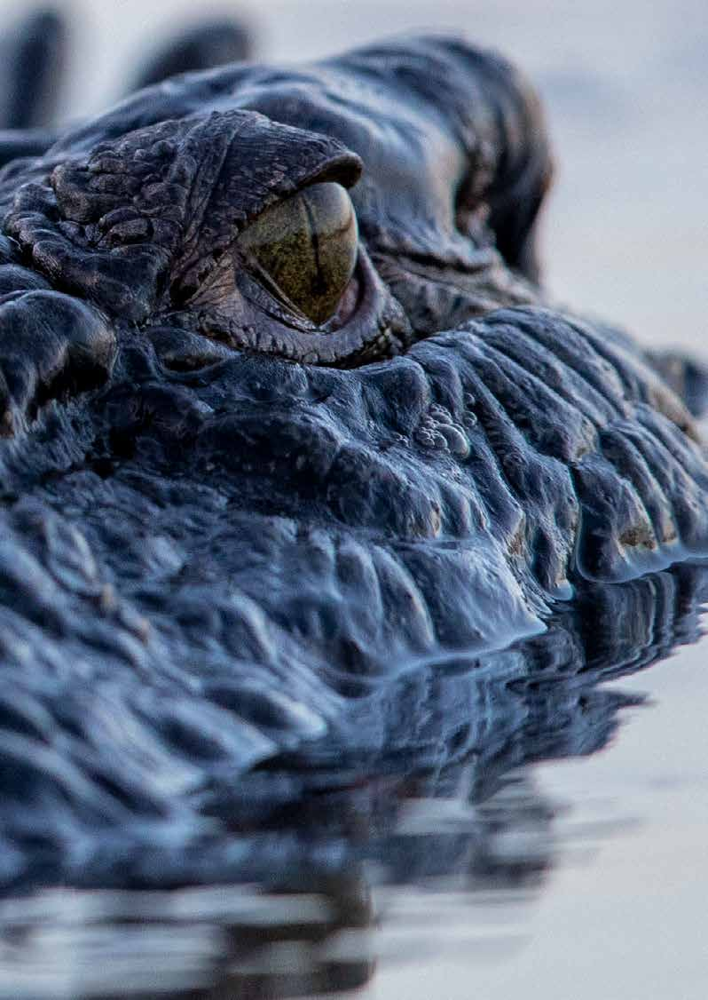

---
## Page 2

MANAGEMENT ACTIONS REDUCE THE 
RISK OF CROCODILE ATTACK BUT CAN 
NEVER GUARANTEE SAFETY.
This document was prepared for the Northern Territory 
Government by the Department of Environment, Parks and 
Water Security
© Northern Territory Government, 2021
You may download, display, print and copy any material in this 
report in unaltered form only for your personal use or for non-
commercial use within your organisation.
Except as permitted above, you must not copy, adapt, 
publish, distribute or commercialise any material contained 
in this report without prior written permission from the 
Northern Territory Government through the Department of 
Environment, Parks and Water Security.
Enquiries should be made to: 
Department of Environment, Parks and Water Security
Email:  	 Communications.DEPWS@nt.gov.au
Web:	
depws.nt.gov.au
Mail: 	
PO Box 496, Palmerston NT 0831
You are licenced to use this publication 
on the terms and conditions set out 
in: Creative Commons Attribution 4.0 
International Public License (CC BY 4.0) at: 
https://creativecommons.org/licenses/by/4.0/legalcode 
If you do not agree to the terms and conditions, you must not 
use this publication.
You are free to copy, communicate and adapt the licensed 
material, provided you abide by the licence terms 
(including Attribution) and attribute the licensed material using 
the statement.

---
## Page 3

Introduction	
4
Purpose	
5
Assessing Risk	
6
Zones	
7
	
The General Management Zone	
8
	
	 Risks posed by crocodiles	
8
	
	 Management response	
9
	
	 Zone Map	
9
	
The Active Removal Zones 	
10
	
	 Risks posed by crocodiles	
10
	
	 Management response	
11
	
	 Zone Map	
11
	
The Barrier and Removal Zones	
12
	
	 Zone Map	
12
	
Crocodile Management Actions	
14
	
Management Actions	
14
Public Education and awareness	
16
	
Be Crocwise messages	
16
	
Stakeholder Management Actions	
17
	
Saltwater Crocodile Safety Signage	
17
Plan Currency and Approvals	
18
Appendix A. History of Crocodile Attacks/Incidents	
19
CONTENTS

---
## Page 4

INTRODUCTION
Saltwater crocodiles live in the Top End of Northern Australia. 
Any body of water in the Top End has the potential to contain 
large and dangerous saltwater crocodiles. The common name 
‘saltwater crocodile’ has created misconceptions that they only 
live in saltwater, however they can thrive in both salt and fresh 
water and can be found in freshwater hundreds of kilometres 
inland. 
The Parks and Wildlife Commission (Parks and Wildlife) 
provides a program of crocodile management and public 
education that is designed to reduce the risk of human/
crocodile interactions that will result in the injury to or fatality 
of people and domestic animals. 
The management program includes not only those areas set 
aside for visitor use in National Parks and Reserves but also 
the broader environment of the crocodile habitat area across 
the Northern Territory (NT) including Darwin Harbour and the 
Katherine River. 
The objectives of the saltwater crocodile management program 
are as follows:
•	
Reduce the likelihood of crocodile attack.
•	
Warn the community of potential presence of 
crocodiles
•	
Educate the community about safe behaviour around 
waterways
•	
Reduce the number of saltwater crocodiles entering 
areas where they could come into contact with 
people.
Crocodiles are culturally and economically important to 
Aboriginal people, contribute to a healthy natural environment, 
and play a significant part in the Territory’s economy through 
tourism, crocodile farming and wild harvesting. 
IMAGE: Saltwater crocodile at Prince Fred Harbour. Photo by Ian Morris
4
Northern Territory Saltwater Crocodile (Crocodylus porosus) Risk Management Framework 2021-2026

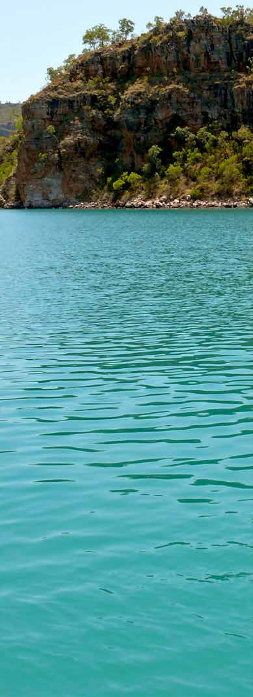

---
## Page 5

GENERAL
MANAGEMENT
BARRIER AND
REMOVAL
PLANNING
ACTIVE
REMOVAL
Areas that are typical habitat for 
crocodiles but are not near a large 
urban centre. Public education is 
carried out and problem crocodiles 
are removed as required.
Public education and awareness 
campaigns in combination with
targeted removal of problem 
crocodiles.
Individual management plans that 
consist of maintenance and 
monitoring of natural/artificial  
barriers, night surveys, trapping 
and public communications and 
interpretive signage.
Significantly reduce the number of 
crocodiles in
close proximity to large urban 
areas regardless of size or 
behaviour with active stakeholder 
engagement and partnerships. 
Applied to areas where recreational 
water activities are supported and 
there are natural/artificial physical 
barriers that are generally effective in 
preventing crocodiles from entering an 
area.
Used in the broader landscape of the 
NT where there are high human 
populations in proximity to areas of 
rivers, harbours, creeks and wetlands 
where crocodiles are frequently found.
ZONES
 ACTIONS
RISK ASSESMENT
PURPOSE
This document outlines the risk management framework that Parks and Wildlife use to guide crocodile management and public 
education aimed at reducing problem human/crocodile interactions.
5
Northern Territory Saltwater Crocodile (Crocodylus porosus) Risk Management Framework 2021-2026

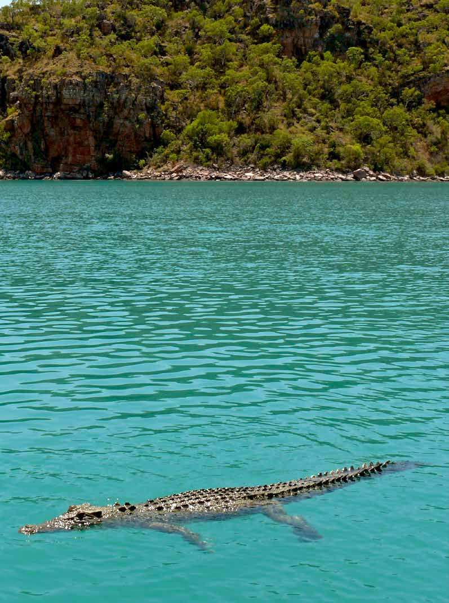

---
## Page 6

ASSESSING RISK
Risk is assessed using the following factors:
•	
the size of the human population in an area
•	
the size of the crocodile population in an area
•	
whether crocodiles are resident or transitory in an 
area 
•	
the viability of various management options in an 
area. 
A visual representation of how risk is assessed is provided in 
Figure 1 below. 
The criteria for determining if there is a significant level of risk 
that requires a management intervention in an area of the NT 
is established by the overall risk to public safety present there. 
For example, with the increase in population in an area, 
the probability of a crocodile attack increases in line with 
the number of people using the waterways even without 
an increase in crocodiles. An increase in human population 
associated with known proximity to a permanent and 
breeding crocodile habitat maximises the risk of a problem           
human/crocodile interaction. 
In response to the varying levels of risk that can be found 
across the northern NT due to the different population 
densities of people and crocodiles, the different way people 
use their waterways, and the public expectations of safety, 
Parks and Wildlife have developed three distinct crocodile 
management zones with specific objectives for each zone.
Figure 1: Risk Determination Tool (Key factors in determining risks to public safety, reproduced 
from the Queensland Crocodile Management Plan 2017, Department of Environment and Science)
Lower 
Risk
HUMAN POPULATION
The number of people in an area of croc country is a factor in determining the degree of 
risk. The higher the number of people the greater the chance of a negative interaction 
with a crocodile.
CROCODILE POPULATION
The number of crocodiles in an area is a factor in determining the degree of risk. The 
higher the number of crocodiles the greater the chance of people being attacked. 
Lower 
Risk
CROCODILE PRESENCE
Crocodiles may be moving through an area (lower risk) or they may be resident and 
regularly hunting and feeding in an area (higher risk).
Lower 
Risk
MANAGEMENT OPTIONS
The management options that are both feasible and effective in an area (such as barriers, 
discouragement, removal) can help decrease the degree of risk in an area.
Lower 
Risk
Higher  
Risk
Higher  
Risk
Higher  
Risk
Higher  
Risk
6
Northern Territory Saltwater Crocodile (Crocodylus porosus) Risk Management Framework 2021-2026

---
## Page 7

ZONES
A ‘general management zone’ is used in those areas that are 
typical habitat for crocodiles but are not near a large urban 
centre. Public education is carried out and problem crocodiles 
are removed as required. 
An ‘active removal zone’ is used where there are high human 
populations in proximity to rivers, harbours, creeks and 
wetlands where crocodiles are frequently found. An urban 
centre close to bodies of water encourages water-based 
recreational activities and management of both human 
behaviours and crocodile numbers is implemented. The 
objective in this zone is to generate the highest possible levels 
of safe behaviours, while also removing a number of crocodiles 
from the environment, therefore lessening the risk. It should 
be noted that the risk profile in these areas cannot be brought 
lower than a medium risk of a problem human/crocodile 
interaction as there will always remain the possibility that a 
crocodile is in the environment.
A ‘barrier and removal zone’ is suited to areas where there 
are physical barriers that are generally effective in preventing 
crocodiles from entering an area. The objective in this zone is 
to use natural barriers and/or install artificial barriers where it 
is feasible to do so, such that swimming holes and pools can 
be surveyed and declared as ‘low risk’ for water recreation 
based on negative survey results. These zones are only applied 
to pools and waterholes on lands managed by Parks and 
Wildlife due to the high level of infrastructure and resourcing 
required to manage crocodile risk in this way.
7
Northern Territory Saltwater Crocodile (Crocodylus porosus) Risk Management Framework 2021-2026

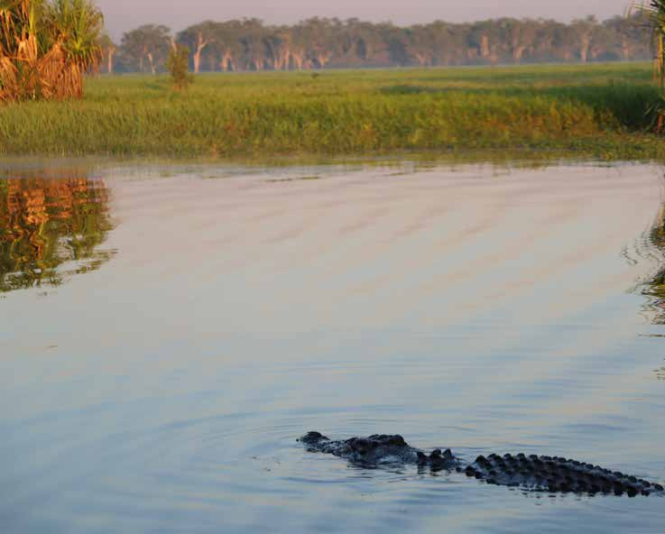

---
## Page 8

Risks posed by crocodiles
The risk of human/crocodile interaction in this zone is variable 
due to the range of habitats and varying numbers of people 
found across the landscape. Large crocodiles or crocodiles 
displaying dangerous behaviour, are often living in this zone 
and the population is completely unmanaged apart from 
removing problem crocodiles that come to the attention of 
authorities. The overall risk is reduced by the low levels of 
human population in many areas that have high crocodile 
densities.
The General Management Zone
This zone includes all land, townships and communities 
across the Top End of the NT where saltwater crocodiles 
may be present. A map of the area is provided in Map 1: 
Northern Territory General Management Zone for Crocodile 
Management.
Parks Australia is responsible for the management of saltwater 
crocodiles in Kakadu National Park and also provide support to 
the township of Jabiru. 
8
Northern Territory Saltwater Crocodile (Crocodylus porosus) Risk Management Framework 2021-2026

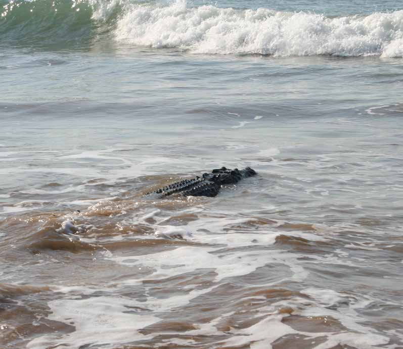

---
## Page 9

K
ak
ad
u
Highway
St
ua
r
t
H
ighway
Victoria
Highway
Hig
hw
ay
B
unti
ne
High
w
ay
Buc
h
an
a
n
Hi
g
h
w
ay
Bu
c
ha
nan
High
w
ay
Bunti
ne
Stuart
Ro
per
Highway
Carpentaria
Highway
Highway
Tabl
ela
n
ds
Batchelor
Adelaide River
Roper Bar
Cape Crawford
Bing Bong
DARWIN
KATHERINE
Jabiru
Alyangula
Nhulunbuy
Mataranka
Pine Creek
Borroloola
Timber
Creek
Elliott
Daly Waters
TIMOR SEA
JOSEPH
BONAPARTE
GULF
BEAGLE GULF
VAN DIEMEN GULF
ARAFURA SEA
GULF OF CARPENTARIA
SIR EDWARD
PELLEW
GROUP
WESSEL
ISLANDS
MELVILLE
ISLAND
BATHURST
ISLAND
KAKADU
NATIONAL
PARK
JUDBARRA /
GREGORY
NATIONAL
PARK
LIMMEN
NATIONAL
PARK
GARIG GUNAK BARLU
NATIONAL PARK
NITMILUK
NATIONAL
PARK
ANINDILYAKWA
INDIGENOUS
PROTECTED AREA
LAYNHAPUY
INDIGENOUS
PROTECTED AREA
STAGE 1 & 2
DHIMURRU
INDIGENOUS
PROTECTED
AREA
BARRANYI
(NORTH
ISLAND)
NATIONAL
PARK
LITCHFIELD
NATIONAL
PARK
MARY
RIVER
NATIONAL
PARK
KEEP RIVER
NATIONAL
PARK
KEEP RIVER
NATIONAL
PARK EXTENSION
(PROPOSED)
WARDDEKEN
INDIGENOUS
PROTECTED AREA
DJELK
INDIGENOUS
PROTECTED AREA
MARRI-JABIN
(THAMURRURR - STAGE 1)
INDIGENOUS
PROTECTED AREA
YANYUWA (BARNI - WARDIMANTHA AWARA)
INDIGENOUS PROTECTED AREA
LIMMEN BIGHT
MARINE PARK
ST VIDGEON
MANAGEMENT
AREA
SOUTH-EAST
ARNHEM LAND
INDIGENOUS
PROTECTED AREA
JUDBARRA /
GREGORY
NATIONAL
PARK
GIWINING / FLORA RIVER
NATURE PARK
ELSEY
NATIONAL
PARK
WARDAMAN
INDIGENOUS 
PROTECTED
AREA
WESTERN AUSTRALIA
NORTHERN TERRITORY
QUEENSLAND
NORTHERN TERRITORY
Management response
The crocodile management response in this zone relies 
primarily on public education in combination with targeted 
removal of problem crocodiles.
A problem crocodile is one that: 
•	
has attacked or has been reported for attempting to 
attack a person
•	
behaves aggressively towards a person
•	
is at a site where it is a potential threat to human 
safety or wellbeing or 
•	
is affecting the productivity of industry or commercial 
enterprises.
While the removal of problem crocodiles from this zone 
reduces the likelihood of attacks from individual crocodiles, the 
chance of a crocodile attack remains high, particularly in areas 
of high quality crocodile habitat. People living in or visiting 
areas in this zone need to stringently practise Be Crocwise 
behaviour to reduce the likelihood of a crocodile attack.   
Zone Map
The map below shows the Northern Territory General 
Management Zone for Crocodile Management.
LEGEND
NT General Management Zone
Park or Reserve
Australian Government and Traditional Owners Managed Park
Indigenous Protected Area
Map 1: Northern Territory General Management Zone for Crocodile Management
9
Northern Territory Saltwater Crocodile (Crocodylus porosus) Risk Management Framework 2021-2026

---
## Page 10

The Active Removal Zones 
The Active Removal Zone consists of four areas as can be seen 
on Maps 2 and 3: Northern Territory Active Removal Zones for 
Crocodile Management.
•	
Darwin Active Removal Zone - Darwin harbour, 
Darwin city, Palmerston and the rural area.
•	
Katherine Active Removal Zone – Along the Katherine 
River from the Nitmiluk National Park boundary 
past the Katherine Township, to the junction of the 
Katherine River and Vampire Creek.
•	
Borroloola Active Removal Zone - A 13 kilometre 
section of the McArthur River adjacent the Borroloola 
Township.
•	
Nhulunbuy Active Removal Zone – The town lagoon 
area and sewerage ponds. 
The Darwin, Katherine and Borroloola Active Removal Zones 
are managed by Parks and Wildlife while the Nhulunbuy Active 
Removal Zone is managed by the Nhulunbuy Corporation. 
Each of these four zones have crocodile management risk 
plans.
Risks posed by crocodiles
The risk of human/crocodile interaction in this zone is high. 
This is due to the significant number of people living in the 
area and the high likelihood of crocodiles entering the area 
from surrounding crocodile habitats. There is a constant 
pressure for increased opportunities around water based 
recreation, particularly in Darwin harbour where people are 
known to paddle, swim, surf, kayak, dive, jet ski and boat in 
the area. These practices, whilst not sanctioned by authorities 
managing waterways and crocodiles, serve to increase the risk 
markedly so that a significant management response has been 
implemented.
K
ak
ad
u
Highway
St
ua
r
t
H
ighway
Victoria
Highway
Hig
hw
ay
B
unti
ne
High
w
ay
Buc
han
a
n
Hi
g
h
w
ay
Buc
ha
nan
High
w
ay
Stuart
Ro
per
Highway
Carpentaria
Highway
Highway
Batchelor
Adelaide River
Roper Bar
Cape Crawford
DARWIN
KATHERINE
Jabiru
Alyangula
Nhulunbuy
Mataranka
Pine Creek
Borroloola
Timber
Creek
Daly Waters
Nguiu
Nauiyu
Wadeye
Bulman
Ngukurr
Warruwi
Belyuen
Beswick
Barunga
Minyerri
Yarralin
Angurugu
D
Yirrkala
Amanbidji
Minjilang
Galiwinku
Gapuwiyak
Umbakumba
Numbulwar
Milikapiti
Gunbalanya
Maningrida
Milingimbi
Pirlangimpi
Ramingining
Milyakburra
Peppimenarti
Nganmarriyanga
Robinson River
OR SEA
PH
ARTE
F
BEAGLE GULF
VAN DIEMEN GULF
ARAFURA SEA
GULF OF CARPENTARIA
SIR EDWARD
PELLEW
GROUP
WESSEL
ISLANDS
MELVILLE
ISLAND
BATHURST
ISLAND
KAKADU
NATIONAL
PARK
JUDBARRA /
GREGORY
NATIONAL
PARK
LIMMEN
NATIONAL
PARK
GARIG GUNAK BARLU
NATIONAL PARK
NITMILUK
NATIONAL
PARK
ANINDILYAKWA
INDIGENOUS
PROTECTED AREA
LAYNHAPUY
INDIGENOUS
PROTECTED AREA
STAGE 1 & 2
DHIMURRU
INDIGENOUS
PROTECTED
AREA
BARRANYI
(NORTH
ISLAND)
NATIONAL
PARK
LITCHFIELD
NATIONAL
PARK
MARY
RIVER
NATIONAL
PARK
VER
L
EEP RIVER
ATIONAL
K EXTENSION
ROPOSED)
WARDDEKEN
INDIGENOUS
PROTECTED AREA
DJELK
INDIGENOUS
PROTECTED AREA
JABIN
RRURR - STAGE 1)
NOUS
CTED AREA
YANYUWA (BARNI - WARDIMANTHA AWARA)
INDIGENOUS PROTECTED AREA
LIMMEN BIGHT
MARINE PARK
ST VIDGEON
MANAGEMENT
AREA
SOUTH-EAST
ARNHEM LAND
INDIGENOUS
PROTECTED AREA
JUDBARRA /
GREGORY
NATIONAL
PARK
GIWINING / FLORA RIVER
NATURE PARK
ELSEY
NATIONAL
PARK
WARDAMAN
INDIGENOUS 
PROTECTED
AREA
QUEENSL
RN TERRITORY
Map 2: Northern Territory Active Removal Zones for Crocodile Management
LEGEND
NT Active Removal Zones
Park or Reserve
Australian Government and Traditional Owners Managed Park
Indigenous Protected Area
Darwin Active 
Removal Zone
Nhulunbuy Active 
Removal Zone
Borroloola Active 
Removal Zone
Katherine Active 
Removal Zone
10
Northern Territory Saltwater Crocodile (Crocodylus porosus) Risk Management Framework 2021-2026

---
## Page 11

Map 3: Insets from map 2 Northern Territory Active Removal Zones for Crocodile Management
Nitmiluk
National
Park
Cutta Cutta Caves
Nature Park
Kintore Caves
Conservation Reserve
0
2
4
1
Kilometres
0
2
1
Kilometres
0
10
5
Kilometres
0 2 4 6 8
1
Kilometres
Berry Springs
Nature Park
Howard Springs
Nature Park
Palmerston
Shoal Bay
Coastal Reserve
Casuarina
Coastal Reserve
Black Jun
e
Conservat
n Rese
Lambell
Conser
Reserv
Belyuen
gl
io
rve
s Lagoon
vation
e
Fogg Dam
Conservation
Reserve
Territory Wildlife Park
Blackmore River
Conservation Reserve
Melacca Swamp
Conservation Area
!(
DARWIN
KATHERINE
Borroloola
Nhulunbuy
Management response
The management objective for this zone is to significantly 
reduce the number of crocodiles in close proximity to large 
urban areas. This is done by implementing a schedule of 
routine trapping and removing animals, patrolling to detect 
and capture crocodiles, and opportunistically catching and 
removing them when reported in the area. All crocodiles that 
are trapped or captured are removed, regardless of size or 
behaviour. 
These actions mitigate the risk to some extent however public 
education remains a key priority. At best, after a number of 
crocodiles are removed from these zones, the risk can only be 
reduced to medium. Crocodiles are wild animals that can be 
difficult to detect and capture, and can swim long distances. 
At any given time, there may be undetected crocodiles already 
within the zone, known crocodiles yet to be removed, and new 
crocodiles entering the zone.
Even when a crocodile has been removed, it leaves a vacated 
territory for another crocodile to fill. People living in or visiting 
areas in this zone need to practice Be Crocwise behaviour to 
reduce the likelihood of a crocodile attack.
Zone Map
The map 2 shows the four  Active Removal Zones with map 3 
showing a inset view of these zones.
11
Northern Territory Saltwater Crocodile (Crocodylus porosus) Risk Management Framework 2021-2026

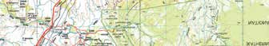

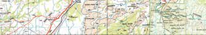

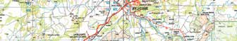

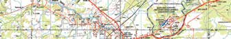

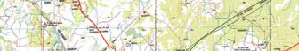

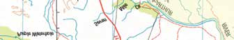

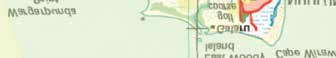

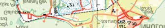

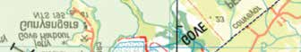

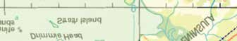

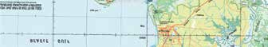

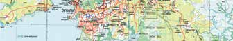

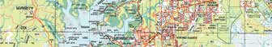

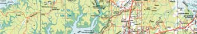

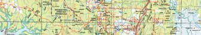

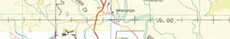

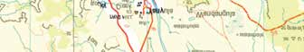

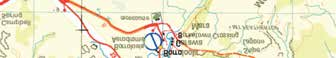

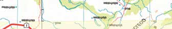

---
## Page 12

The Barrier and Removal 
Zones
The Barrier and Removal Zones comprise 9 parks and reserves 
where recreational water activities are supported (refer Map 
4: Northern Territory Barrier and Removal Zones for Crocodile 
Management). Each park or reserve under this management 
zone has an individual crocodile management risk plan. 
Parks that have swimming sites and areas managed as barrier 
and removal zones are as follows:
•	
Berry Springs Nature Reserve
•	
Butterfly Gorge Nature Park
•	
Elsey National Park
•	
Litchfield National Park
•	
Limmen National Park
•	
Manton Dam Recreation Area
•	
Nitmiluk (Katherine Gorge) National Park
•	
Tjuwaliyn (Douglas) Hot Springs Nature Park
•	
Umbrawarra Gorge Nature Park.
K
ak
ad
u
Highway
St
ua
r
t
H
ighway
Victoria
Highway
Hig
hw
ay
B
unti
ne
High
w
ay
Buc
h
an
a
n
Hi
g
h
w
ay
Bu
c
ha
nan
High
w
ay
Bunti
ne
Stuart
Ro
per
Highway
Carpentaria
Highway
Highway
Tabl
ela
n
ds
Batchelor
Adelaide River
Roper Bar
Cape Crawford
Bing Bong
DARWIN
KATHERINE
Jabiru
Alyangula
Nhulunbuy
Mataranka
Pine Creek
Borroloola
Timber
Creek
Elliott
Daly Waters
Nguiu
Nauiyu
Wadeye
Bulman
Ngukurr
Warruwi
Belyuen
Beswick
Barunga
Minyerri
Yarralin
Angurugu
Daguragu
Yirrkala
Amanbidji
Minjilang
Galiwinku
Gapuwiyak
Umbakumba
Numbulwar
Milikapiti
Gunbalanya
Maningrida
Milingimbi
Kalkarindji
Pirlangimpi
Ramingining
Milyakburra
Peppimenarti
Nganmarriyanga
Robinson River
TIMOR SEA
JOSEPH
BONAPARTE
GULF
BEAGLE GULF
VAN DIEMEN GULF
ARAFURA SEA
GULF OF CARPENTARIA
SIR EDWARD
PELLEW
GROUP
WESSEL
ISLANDS
MELVILLE
ISLAND
BATHURST
ISLAND
KAKADU
NATIONAL
PARK
JUDBARRA /
GREGORY
NATIONAL
PARK
LIMMEN
NATIONAL
PARK
GARIG GUNAK BARLU
NATIONAL PARK
NITMILUK
NATIONAL
PARK
ANINDILYAKWA
INDIGENOUS
PROTECTED AREA
LAYNHAPUY
INDIGENOUS
PROTECTED AREA
STAGE 1 & 2
DHIMURRU
INDIGENOUS
PROTECTED
AREA
BARRANYI
(NORTH
ISLAND)
NATIONAL
PARK
LITCHFIELD
NATIONAL
PARK
MARY
RIVER
NATIONAL
PARK
KEEP RIVER
NATIONAL
PARK
KEEP RIVER
NATIONAL
PARK EXTENSION
(PROPOSED)
WARDDEKEN
INDIGENOUS
PROTECTED AREA
DJELK
INDIGENOUS
PROTECTED AREA
MARRI-JABIN
(THAMURRURR - STAGE 1)
INDIGENOUS
PROTECTED AREA
YANYUWA (BARNI - WARDIMANTHA AWARA)
INDIGENOUS PROTECTED AREA
LIMMEN BIGHT
MARINE PARK
ST VIDGEON
MANAGEMENT
AREA
SOUTH-EAST
ARNHEM LAND
INDIGENOUS
PROTECTED AREA
JUDBARRA /
GREGORY
NATIONAL
PARK
GIWINING / FLORA RIVER
NATURE PARK
WARDAMAN
INDIGENOUS 
PROTECTED
AREA
WESTERN AUSTRALIA
NORTHERN TERRITORY
QUEENSLAND
NORTHERN TERRITORY
 
 
 
 
 
 
 
 
 
LEGEND
NT Barrier and Removal Zone
Park or Reserve
Australian Government and Traditional Owners Managed Park
Indigenous Protected Area
Berry Springs Nature Park
Manton Dam Recreation Area
Butterfly Gorge Nature Park
NITMILUK NATIONAL PARK
LIMMEN NATIONAL PARK
ELSEY NATIONAL PARK
Tjuwaliyn (Douglas) 
Hot Springs Park
Umbrawarra Gorge Nature Park
Litchfield National Park
Map 4: Northern Territory Barrier and Removal Zones for Crocodile Management
Zone Map
The map below shows the nine Northern Territory Barrier and 
Removal Zones for Crocodile Management.
12
Northern Territory Saltwater Crocodile (Crocodylus porosus) Risk Management Framework 2021-2026

---
## Page 13

        ZONES PROVIDE NATURAL OR ARTIFICIAL 
       BARRIERS PREVENTING 
CROCODILES
FROM ENTERING THE AREA
9
FOLLOWING
NEGATIVE SURVEY
RESULTS, THE AREA IS DECLARED 
AS ‘LOW RISK’FOR  
WATER RECREATION
        ZONES PROVIDE NATURAL OR ARTIFICIAL 
       BARRIERS PREVENTING 
CROCODILES
FROM ENTERING THE AREA
9
FOLLOWING
NEGATIVE SURVEY
RESULTS, THE AREA IS DECLARED 
AS ‘LOW RISK’FOR  
WATER RECREATION
13
Northern Territory Saltwater Crocodile (Crocodylus porosus) Risk Management Framework 2021-2026

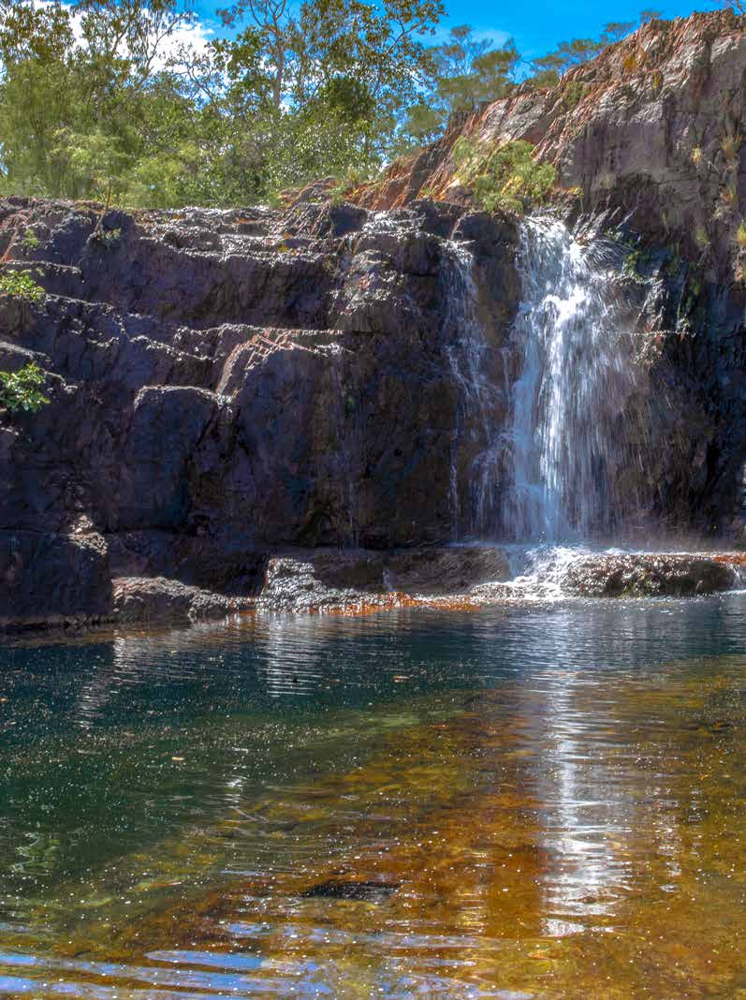

---
## Page 14

CROCODILE MANAGEMENT ACTIONS
Year
Darwin Active 
Removal Zone
Katherine Active 
Removal Zone
Borroloola Active
Removal Zone
Nhulunbuy Active
Removal Zone
Crocs 
caught
Av Size 
cm
Largest 
size cm
Crocs 
caught
Av Size 
cm
Largest 
size cm
Crocs 
caught
Av Size 
cm
Largest 
size cm
Crocs 
caught
Av Size 
cm
Largest 
size cm
2011
244
232
451
4
262
464
2
256
274
-
-
-
2012
273
227
481
2
372
418
0
0
0
-
-
-
2013
186
212
425
4
282
305
6
295
454
-
-
-
2014
248
235
425
1
391
391
1
173
173
-
-
-
2015
251
220
410
1
353
353
19
290
393
-
-
-
2016
223
202
400
3
304
331
3
378
460
-
-
-
2017
349
221
418
4
302
387
4
232
396
-
-
-
2018
330
219
472
6
358
422
5
336
472
11
194
228
2019
211
210
426
0
0
0
6
316
457
18
216
351
Total
2315
25
46
29
Note: The figures in Table 2 are as of 14 January 2020. Data from Parks and Wildlife Crocodile Capture Database.
Management Actions
Parks and Wildlife use a range of management actions to 
reduce the risk of crocodile attack. Some actions are more 
resource intensive than others and it can take time to deploy 
trained staff to more remote locations. Efforts to reduce the 
risk posed by crocodiles include both proactive and reactive 
management actions.
The primary proactive management action the NT Government 
employs is the Be Crocwise Program. Be Crocwise engages 
with the public through a range of mediums including school 
and community presentations, merchandise and social 
media messaging to promote public safety and reduce risky 
behaviour. 
Saltwater crocodiles detected in the Darwin, Katherine 
and Borroloola Active Removal Zones are removed by the 
Crocodile Management Unit, Wildlife Rangers or Rangers and 
recorded in the Parks and Wildlife Crocodile Capture database 
(see Table 2). Saltwater crocodiles captured in the Nhulunbuy 
Active Removal Zone are removed by the Nhulunbuy 
Corporation. In the General Management Zone only problem 
crocodiles are removed. This action may be undertaken by the 
Crocodile Management Unit, Wildlife Rangers, local councils, 
Aboriginal Ranger Groups, Aboriginal Custodians, permitted 
contractors or private land holders.
Parks Australia is responsible for the management of saltwater 
crocodiles in Kakadu National Park and also provide support to 
the township of Jabiru. 
Table 2: Crocodiles caught in the Active Removal Zones over 
the last 9 years (Crocodile Capture Database).
Northern Territory Saltwater Crocodile (Crocodylus porosus) Risk Management Framework 2021-2026
14

---
## Page 15

Other management actions employed are:
•	
Crocodile population surveys – annual surveys to 
indicate population growth and movements.
•	
Monitoring of indicator floats –foam floats with bite 
marks can be an indicator of the presence of saltwater 
crocodiles
•	
Restricting access to waterways through signs, 
barriers and enforcement
•	
Crocodile surveys (day and night) – visual surveys 
conducted during weekly patrols and scheduled night 
surveys to determine crocodile numbers in high risk 
areas
•	
Harpoon capture and removal – generally at the 
end of the wet season or as required when problem 
animals are identified
•	
Permanently placed traps – the annual crocodile 
trapping program involves the placement of 
permanent and seasonal crocodile traps in active and 
barrier removal zones
•	
Mobile trapping – mobile traps are placed when 
crocodiles are sighted in a high risk area or a problem 
crocodile is reported
•	
Shooting – on occasion in high risk locations when 
a problem crocodile cannot be trapped it may be 
humanely shot either from the ground or air.
PARKS AND WILDLIFE USES
PROACTIVE
AND REACTIVE MANAGEMENT
ACTIONS
REDUCING THE 
RISK OF
CROCODILE
ATTACK
SOME ACTIONS ARE MORE RESOURCE
INTENSIVE THAN OTHERS.
PARKS AND WILDLIFE USES
PROACTIVE
AND REACTIVE MANAGEMENT
ACTIONS
REDUCING THE 
RISK OF
CROCODILE
ATTACK
SOME ACTIONS ARE MORE RESOURCE
INTENSIVE THAN OTHERS.
15
Northern Territory Saltwater Crocodile (Crocodylus porosus) Risk Management Framework 2021-2026

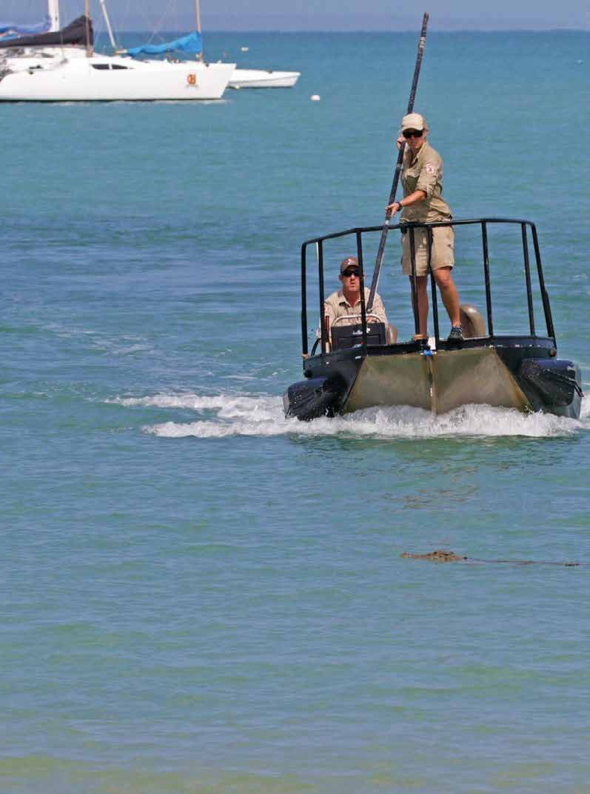

---
## Page 16

PUBLIC EDUCATION 
AND AWARENESS
Be Crocwise messages
Key Be Crocwise messages are developed, reviewed and 
broadcast through various media including social media, 
newspaper, television and radio, education programs and the 
distribution of Be Crocwise materials to Visitor Information 
Centres, schools, pubs, clubs and other places that people 
gather. 
Be Crocwise messages inform the public that: 
•	
Crocodiles can be in any body of water in the Top 
End, including locations they have not been seen 
previously
•	
Crocodiles are difficult to detect, highly mobile, and 
are skilful ambush predators
•	
Removal of problem crocodiles will not eliminate the 
overall risk that crocodiles pose to humans in the Top 
End of the NT
•	
Removal often creates vacant territory that is quickly 
filled by the next most dominant crocodile
•	
It is important to always adhere to safety messages, 
which may be targeted at typical activities undertaken 
in the area. If a crocodile is present in the area, report 
it to the Crocodile Management Unit on telephone 
0419 822 859
•	
No sign means no swim
•	
Stay away from the water’s edge
•	
Take care when fishing either in a boat or on the bank.
CROCS CAN KILL
CROCS CAN KILL
Don’t risk your life
Don’t risk your life
BECROCWISE.NT.GOV.AU
16
Northern Territory Saltwater Crocodile (Crocodylus porosus) Risk Management Framework 2021-2026

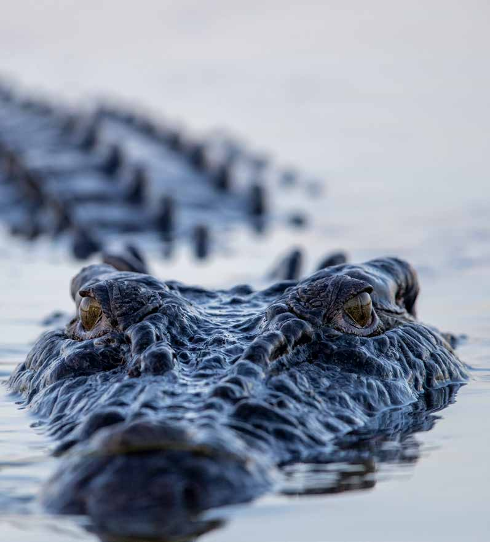

---
## Page 17

Stakeholder Management 
Actions
Local government councils within the Active Removal Zone 
include:
•	
City of Darwin
•	
City of Palmerston
•	
Litchfield Council
•	
Coomalie Community Government Council
•	
Katherine Town Council
•	
East Arnhem Regional Council
•	
Roper Gulf Regional Council
•	
Victoria Daly Regional Council.
Local governments will forward reports of potential problem 
crocodiles to the Crocodile Management Unit. Parks and 
Wildlife work closely with the councils and when there is 
a confirmed sighting they collaborate through the removal 
process.
Parks and Wildlife also meet with community organisations and 
assist in the development and implementation of procedures 
and protocols to respond to the risk before and during events 
held in or near the water. Community organisations such as 
the Darwin Surf Life Saving Club Northern Territory and the 
Darwin Sailing Club have a ‘Crocodile Hazard Procedure’ that 
outlines the controls to minimise the risk of crocodile attack 
during events and to report crocodile sightings.
Saltwater Crocodile Safety 
Signage
Staff will review, update and install signage according to the 
Parks and Wildlife’s 2020 Crocodile Safety Signage Guidelines 
on land owned or managed by Parks and Wildlife. To obtain a 
copy of these Guidelines please contact the Interpretation Unit 
on telephone 8999 3478.
Local governments are responsible for signage elsewhere with 
the key messaging of ‘no sign means no swimming’. Parks 
and Wildlife will assist local governments and others with 
templates for signs and advice regarding placement.
17
Northern Territory Saltwater Crocodile (Crocodylus porosus) Risk Management Framework 2021-2026

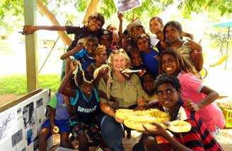

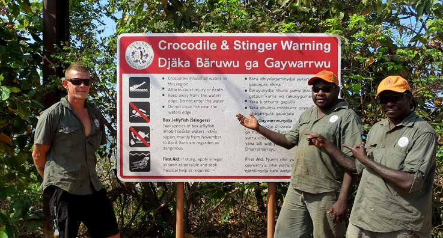

---
## Page 18

PLAN CURRENCY 
AND APPROVALS
This Plan will be reviewed every five years or if there is a 
significant incident that requires a review of the plan.  A revised 
plan will integrate any learnings and population changes that 
have occurred in the interim.
18
Northern Territory Saltwater Crocodile (Crocodylus porosus) Risk Management Framework 2021-2026

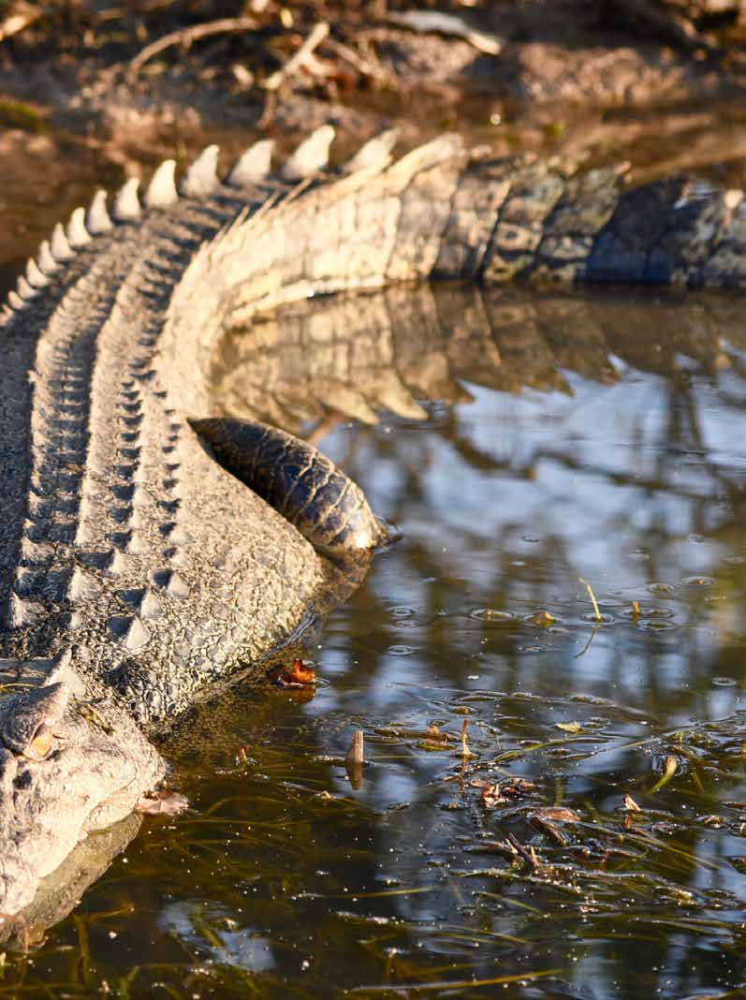

---
## Page 19

Appendix A. History of 
Crocodile Attacks/Incidents
General Management Zone  
Prior to Parks and Wildlife keeping accurate records of attacks, 
there have been various fatalities and injuries across the NT.  
Since 1971: There has been 23 fatalities and 51 injuries 
from saltwater crocodile attacks in the NT which is the area 
encompassed by the General Management Zone. The last 
fatality occurred in October 2018 at a billabong at Gan Gan 
in East Arnhem Land. The most recent attack occurred in April 
2020 at Ngangalala community on the Glyde River in Arnhem 
Land which resulted in an injury.
Active Removal Zones 
Since 1971: Darwin Active Removal Zone - there has been 1 
reported fatality and 5 injuries from saltwater crocodile attack 
in the area covered by this zone. The fatality occurred near the 
Black Jungle Conservation Reserve in March 2009 and the last 
injury occurred in May 2015 to a kite surfer 100 metres off the 
Lee Point beach. 
Katherine Active Removal Zone – there has been no reported 
fatalities or injuries from saltwater crocodile attack in this 
specific zone.
Borroloola Active Removal Zone – there has been 1 reported 
fatality and injury from saltwater crocodile attack in the area 
covered by this zone. The fatality occurred in September 1986 
when the person was swimming. The injury occurred in May 
1985 to a person also swimming.
Nhulunbuy Active Removal Zone - there has been no reported 
fatalities or injuries from saltwater crocodile attacks in this 
specific zone.
Barrier and Removal Zones
Since 1971: There has been 1 reported injury and no fatalities 
from saltwater crocodile attacks in these specific zones. The 
injury occurred in July 2011 at Berry Springs Nature Park to a 
person who approached a 1.5 metre captive escapee saltwater 
crocodile underwater. 
19
Northern Territory Saltwater Crocodile (Crocodylus porosus) Risk Management Framework 2021-2026

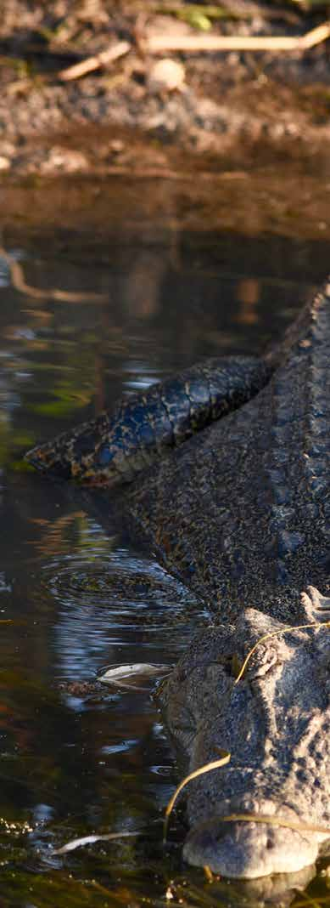

---
## Page 20

20
Northern Territory Saltwater Crocodile (Crocodylus porosus) Risk Management Framework 2021-2026
Department of 
ENVIRONMENT, PARKS AND WATER SECURITY

