# Queensland Cyclone Resilience Building Guidelines (v8 (2021))

> **Source**: Queensland Reconstruction Authority
> **URL**: https://www.qra.qld.gov.au/sites/default/files/2021-11/0321_cyclone_resilience_building_guidelines_v8_web.pdf
> **Licence**: © State of Queensland; emergency-management practitioner reference
> **Retrieved**: 2026-05-07T23:43:34Z
> **SHA-256**: `d22afee11a856c63eac57c872aa26f989b58d2da25d96e868877c33faca2e480`
> *Converted from PDF to Markdown format.*

---
## Page 1

Cyclone Resilient 
Building Guidance 
for Queensland Homes
Get Ready Queensland
Preparing for a stronger, more Resilient Queensland

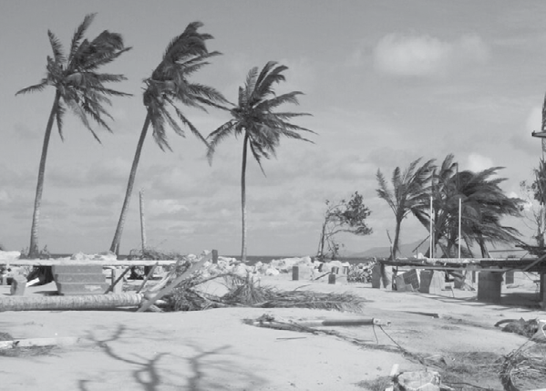

---
## Page 2

2
Cyclone Resilient Building Guidance for Queensland Homes
More information
Visit www.qra.qld.gov.au/Resilient-Homes.
Contact the Queensland Reconstruction Authority 
on 1800 110 841 
Mailing address 
Queensland Reconstruction Authority 
PO Box 15428 
City East Q 4002 
Alternatively, contact the Queensland 
Reconstruction Authority by emailing: 
info@qra.qld.gov.au.
Licence 
This material is licensed by the State of 
Queensland under a Creative Commons 
Attribution (CC BY) 4.0 International licence.
To view a copy of the licence visit:
www.creativecommons.org/licenses/by/4.0/.
The Queensland Reconstruction Authority 
requests attribution in the following manner: 
© The State of Queensland (Queensland 
Reconstruction Authority) 2019. 
Information security 
This document has been classified using the 
Queensland Government Information Security 
Classification Framework (QGISCF).
Document details 
Security classification 
Public
Date of review of security classification
December 2019
Authority
Queensland Reconstruction Authority
Author
Chief Executive Officer
Document status
Final version
Version
1.0
QRA Reference
QRA-2636
Do you need an interpreter?
If you need an interpreter to assist you in 
understanding this document, please call 
13 QGOV (13 74 68).
0321

---
## Page 3

3
Cyclone Resilient Building Guidance for Queensland Homes
Introduction
Cyclones are powerful weather systems that can cause significant damage to the built and 
natural environments. They generate severe winds, strong rain, riverine and flash flooding, 
as well as storm tides. This document provides information about building or modifying 
homes to strengthen their resilience to cyclonic winds.
Using resilient building design can significantly reduce the effort, cost and time to return people to their 
homes and workplaces following natural disasters. It is one of the many ways Queenslanders can build 
their resilience to natural disasters.
This Cyclone Resilient Building Guidance for Queensland Homes (Guide) provides information about 
improving the wind resilience of Queensland homes located in cyclone prone areas. It contains 
information about the impacts of cyclones and guidance for strengthening the wind resilience of new 
and existing homes. 
This Guide is designed for use by homeowners as well as the building, design and construction industry. 
Homes located near beach fronts and tidal creeks also need to withstand storm tide. Further guidance is 
available at www.qra.qld.gov.au/Resilient-Homes and includes:
•	Storm Tide Resilient Building Guidance for Queensland Homes
•	Flood Resilient Building Guidance for Queensland Homes
Improving the resilience of Queensland homes is another way we can work together to make 
Queensland the most disaster resilient state in Australia. 
Get Ready Queensland
It is vital that you understand whether you are able to shelter in your home 
during a cyclone. 
You must evacuate your home if:
•	you live in a storm tide prone area and are directed to leave by 
emergency services
•	you do not have confidence that your home will resist the expected winds.
Seeking shelter at home
Take shelter in a small room with few windows such as the bathroom.
For more information visit www.getready.qld.gov.au/understand-your-risk/
types-natural-disasters/cyclone-and-storm-surge.

---
## Page 4

4
Cyclone Resilient Building Guidance for Queensland Homes
Acknowledgements
This Guide was developed by the Cyclone Testing Station at James Cook University.
Thank you to the following organisations for contributing their expertise in the development 
of this Guide:
•	
Queensland Government
•	
Bureau of Meteorology
•	
Master Builders Queensland
•	
Insurance Council of Australia
•	
Housing Institute of Australia
•	
Bushfire and Natural Hazards Cooperative Research Centre
•	
Local Government Association of Queensland
•	
Queensland Building and Construction Commission
•	
Australian Institute of Building Surveyors
•	
Suncorp Insurance
•	
Cassowary Coast Regional Council
•	
Douglas Shire Council
•	
Hopevale Aboriginal Shire Council
•	
Isaac Regional Council
•	
Livingstone Shire Council
•	
Mackay Regional Council
•	
Rockhampton Regional Council
•	
Townsville City Council
•	
Whitsunday Regional Council.

---
## Page 5

5
Cyclone Resilient Building Guidance for Queensland Homes
Contents
	
Understanding your risk
	
1.	
Introduction to wind resistant housing....................................................................6
	
2.	
Understanding cyclones..........................................................................................8
	
3.	
Impacts from cyclones...........................................................................................12
	
4.	
Understanding your risk........................................................................................22
	
Wind resilient design strategies 
	
5.	
Resilient building design principles.......................................................................25
	
6.	
Building new homes to resist wind........................................................................26
	
7.	
Improving the resilience of existing homes...........................................................27
	
8.	
Repairing or rebuilding wind-damaged homes......................................................33
	
9.	
Resilient building materials and systems..............................................................36
	
Appendices 
	
10. 	 Building approvals, codes and standards.............................................................44
	
11.	
Resources..............................................................................................................46	
	
12.	
Technical resources...............................................................................................47

---
## Page 6

6
Cyclone Resilient Building Guidance for Queensland Homes
1  Introduction to wind resistant housing
This Guide provides information about designing and building wind resilient homes in cyclone 
prone areas, including: 
•	key issues associated with living in or building in a cyclone prone area
•	design and building advice to minimise damage caused by cyclones.
This Guide is non-mandatory and can be considered in line with the Building Assessment 
Provisions contained in the Building Act 1975 and Queensland Development Code Mandatory 
Part (QDC) MP 3.5.
This Guide does not replace the need to evacuate prior to a cyclone. If you live in a cyclone prone 
area it is important to always be prepared in case you need to evacuate quickly. 
For more information visit www.getready.qld.gov.au/understand-your-risk/types-natural-
disasters/cyclone-and-storm-surge.
If you live in, or are planning to build in a cyclone prone area, it is recommended you refer this 
Guide to contractors involved in the design, construction or repair of your home.
1.1 Existing design and building standards for cyclone prone homes
If your home was constructed after the mid-1980s, it should have been designed and built for 
the wind speed specific to its particular location. 
Homes constructed using the correct wind classification and to current codes and standards 
have generally performed well in recent events such as Severe Tropical Cyclone Larry (2006), 
Severe Tropical Cyclone Yasi (2011) and Severe Tropical Cyclone Debbie (2017). However, 
the varying size and intensity of cyclones means that it is not possible to guarantee a home is 
completely cyclone-proof. It is likely that during a severe tropical cyclone most homes will suffer 
at least some minor damage such as lost gutters, damaged awnings and aerials, and some 
water inundation. In general terms, homes built before 1985 usually sustain more damage 
during a cyclone than more recently built homes. This Guide provides valuable information for 
improving the resilience of all homes and reducing damage caused by cyclones. 
Examples of cyclone damage to Queensland homes

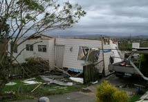

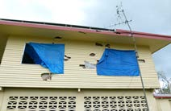

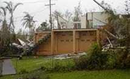

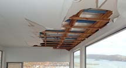

---
## Page 7

7
1.2 Building assessment provisions for building certifiers
The Building Assessment Provisions contained in section 30 of the Building Act 1975 
dictate the laws and other documents for consideration by a building certifier for a building 
development approval to be issued.
These include: 
•	Building Act 1975
•	Building Regulation 2006
•	Queensland Development Code (QDC) MP 3.5 and other relevant parts
•	National Construction Code (Building Code of Australia).
Refer to page 47 for information about building codes and standards for cyclone prone areas.
Finding a licensed professional
Ensure only licensed professionals are involved in the repair or rebuild of your home by checking their 
credentials. Visit the following websites to find a licensed professional in your area: 
Licensed builders, 
tradespersons, and 
building certifiers 
and designers
Queensland Building and 
Construction Commission
www.qbcc.qld.gov.au 
Licensed coastal  
and structural engineers 
Board of Professional  
Engineers Queensland 
www.bpeq.qld.gov.au
Licensed  
architects 
Queensland Board  
of Architects 
www.boaq.qld.gov.au

---
## Page 8

8
Cyclone Resilient Building Guidance for Queensland Homes
2 Understanding cyclones
Cyclones are a part of life for people living in Queensland coastal areas. Homes 
within 50 kilometres of the Queensland coastline north of Bundaberg need to be 
strong enough to withstand winds from severe tropical cyclones. 
2.1 About cyclones
Cyclones are low pressure systems that develop over warm oceans in the tropics, and 
generally intensify over several days. Cyclones produce very strong and potentially destructive 
winds that rotate clockwise around a calm centre (the ‘eye’). Strong winds over the ocean 
can raise the level of waves breaking onto the coast, causing storm tides and inundation of 
coastal areas. 
Cyclones can affect large areas of land, bringing heavy rainfall and potential flooding. They 
start to weaken as they cross the coastline. However, heavy rainfall and winds can continue 
for hundreds of kilometres inland.
Cyclones are often hundreds of kilometres wide. They can travel several hundred kilometres 
and affect thousands of square kilometres of land. The strongest winds are experienced just 
outside the eye, and the peak gust wind speed decreases the further from the edge of 
the eye’s centre. 
Image courtesy of Bureau of Meteorology

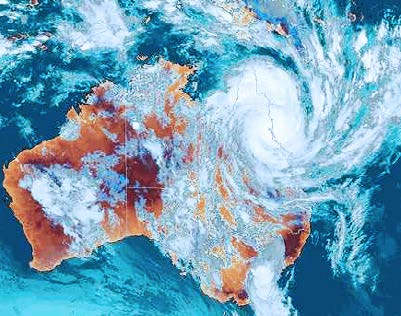

---
## Page 9

9
Cyclone Resilient Building Guidance for Queensland Homes
2.2 Cyclones in Queensland – what to expect
Australia’s cyclone season occurs between November and April each year along the coastlines 
of Queensland, the Northern Territory and Western Australia. In Queensland, the coastal areas 
north from Bundaberg are most susceptible to cyclones. However, cyclones have occurred 
along the entire Queensland coast and the accompanying wind and rain from weakening 
cyclones can affect communities throughout all parts of Queensland.
The Bureau of Meteorology (Bureau) provides up-to-date information about the expected 
path and severity of cyclones that may impact Australia. The Bureau issues different levels 
of warnings as a cyclone forms, intensifies and approaches the coast. You will have time to 
prepare to shelter in your home, or evacuate if you are in a storm tide area, or move to other 
shelter if you are concerned your home is not able to withstand the expected winds.
As a cyclone approaches, the wind and rain gradually increases over several hours. Winds 
caused by the cyclone are powerful enough to break large trees, roll over sea containers and 
blow away unsecured caravans, garden sheds and poorly constructed roofed patios. Slow 
moving cyclones can take many hours to move past a particular location, causing extreme 
wind and rain that lasts up to 12 hours. 
Strong winds associated with cyclones can cause extensive property damage and turn loose 
items into wind-borne debris that can further damage buildings.
Cyclones are strongest in Central and North Queensland (north of Bundaberg) within 50 kilometres of 
the coastline.
 
BUNDABERG

---
## Page 10

10
Cyclone Resilient Building Guidance for Queensland Homes
2.3 Categories of cyclones
The Bureau predicts the severity of a cyclone using a five-category system based on the 
maximum expected gust wind speed at the edge of the eye of the cyclone. The wind speed 
at your home can be different to the wind speeds reported by the Bureau. The five cyclone 
categories are outlined in the table below. 
Cyclone categories from the Bureau of Meteorology
Maximum wind speeds decrease as the eye of the cyclone moves inland. Generally, the wind 
speeds near the eye drop as the cyclone travels inland and wind speeds are reduced further 
from the eye. 
Weakened cyclones frequently pass into non-cyclonic areas, but by then the wind speeds 
are much lower than when they crossed the coastline. For example, Severe Tropical Cyclone 
Yasi was a Category Five cyclone that formed over the Coral Sea and crossed the coastline 
with wind gusts in the Category 4 range. Homes located approximately 50 kilometres from 
the eye of the cyclone experienced winds equivalent to a Category 3 event. As the cyclone 
tracked further inland, the cyclone weakened and gust wind speeds decreased. The media 
referred to Severe Tropical Cyclone Yasi as “Category 5 STC Yasi”, but the majority of homes 
did not experience Category 4 or 5 wind speeds – for example those in Townsville experienced 
Category 1 or 2 wind speeds.
Cyclone 
category
Strongest gust
(km/h)
Typical effect
(indicative only)
One
less than 125 km/h
• minimal damage to homes
• damage to some crops, trees and caravans
• boats may drag their moorings
Two
125-169 km/h
• minor damage to homes
• significant damage to signs, trees and 
caravans
• severe damage to some crops
• risk of power failure
• small boats may break moorings
Three
(severe)
170-224 km/h
• damage to some roofs
• structural damage to older homes that haven’t 
been upgraded and maintained
• destruction of some caravans
• likely power failure
Four
(severe)
225-280 km/h
• significant loss of roofing
• significant structural damage to older homes 
that haven’t been upgraded and maintained
• many caravans destroyed and blown away
• dangerous airborne debris
• widespread power failures
Five
(severe)
greater than 280 km/h
• extremely dangerous with potential for 
widespread damage to buildings

---
## Page 11

11
Cyclone Resilient Building Guidance for Queensland Homes
Estimated maximum gust wind speeds in Queensland from Severe Tropical Cyclone Yasi (2011)
Severe 
Tropical 
Cyclone
Year
Area
Impact
Debbie
2017
Whitsundays
• Airlie Beach (Category 1)
• Proserpine (Category 2)
• Bowen (Category 2 and 3)
Marcia
2015
Rockhampton
• Shoalwater Bay (Category 4)
• Rockhampton (Category 1 and 2)
• Yeppoon (Category 2 and 3)
Yasi
2011
Cassowary Coast
• Cassowary Coast (Category 3 and 4)
• Townsville (Category 1 and 2)
Larry
2006
Innisfail
• Innisfail, Babinda and Kurramine Beach 
(Category 3)
Cyclone categories for recent Queensland events
Cassowary Coast
Townsville

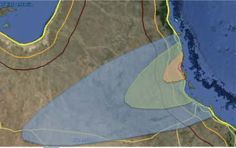

---
## Page 12

12
Cyclone Resilient Building Guidance for Queensland Homes
3 Impacts from cyclones
Strong winds will generate pressures on both the inside and outside of a home, which will 
result in building damage if the structure is not built to withstand those pressures. 
3.1 External wind pressures
Wind applies inward pressure and outward suction to different external surfaces of a home.  
It places pressure on the wall facing the wind (windward wall) and suction on all other walls 
and the roof. Wind pressure tends to push the windward wall into the home, while suction 
tends to pull the other walls and roof outwards and upwards. These pressures act directly on 
the external cladding materials and are transferred by nails, screws or bolts to the structural 
elements underneath them. 
External wind pressures caused by strong winds

---
## Page 13

13
Cyclone Resilient Building Guidance for Queensland Homes
3.2 Internal wind pressures
Openings in the windward wall will allow wind to enter the home, causing high internal 
pressures. The internal pressures push upwards on the underside of the roof, which adds to 
the upward forces caused by suctions on the external roof surfaces. These openings are most 
often windows, doors or holes in cladding that can be caused by:
•	failure of building elements that are not strong enough to withstand the wind loads
•	wind–borne debris that can break windows or doors and fracture wall cladding
•	failure of door and window latches or hinges
•	leaving a door or window open.
Openings on other walls will cause suction on all internal surfaces. The combination of suction 
on internal surfaces and pressure on the windward wall increases the loads on windows and 
other elements on the windward wall. 
Internal pressures with an opening on a side wall
Internal pressures with an opening on windward wall
WIND DIRECTION
Large negative pressure 
(suction) on windward 
edge of upwind roof
Positive pressure 
on windward wall
Large negative internal pressure 
on the walls and roof
Large negative 
pressure (suction) on 
the edge of downward 
roof near ridge
WIND DIRECTION
Large negative pressure 
(suction) on windward 
edge of upwind roof
Positive pressure 
on windward wall
Man-hole blown in 
to ceiling space
Large positive 
internal pressure on 
the walls and roof
Large negative 
pressure (suction) on 
the edge of downward 
roof near ridge

---
## Page 14

14
Cyclone Resilient Building Guidance for Queensland Homes
3.3 Wind loads on homes
Wind pressure on both the inside and outside of a home create forces that must be 
transferred by structural members (e.g. trusses, wall studs) and connections (e.g. straps, 
framing anchors) all the way to the ground. 
The image below illustrates the concept of a continuous chain of structural elements and 
connections that transmit the forces from the roof cladding to the ground. Each link in the 
chain is vital as it only takes one weak connection for cyclonic winds to damage a home. 
Structural elements carry wind loads to the ground through a continuous chain of structural links 
provided by strong connections between each part of the home
WIND DIRECTION
Roof cladding of 
sheeting
Battens
Truss
Wall
Each part
of the
home must
be linked
by strong
connections

---
## Page 15

15
Cyclone Resilient Building Guidance for Queensland Homes
3.4 Wind damage to homes
If there is a weakness in the building structure, wind can lift off all the elements above that 
weakness. This is illustrated in the following sequence of photos taken during investigations 
of damage following cyclones. 
The image below shows a home with roof sheeting that was not properly fixed to the roof 
structure. As a result, the main damage to the home was loss of roof sheeting.
The image below shows a home with the roof sheeting properly fixed to the battens. However, 
the battens were not adequately fixed to the trusses. As a result, cyclone winds lifted the 
battens and roof sheeting from the home.
Roof fasteners were not installed in accordance with manufacturer recommendations. As a result, 
cyclone winds caused loss of roof cladding.
Inadequate batten to rafter connections – a common issue in older homes.

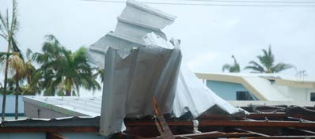

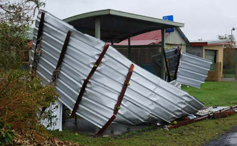

---
## Page 16

16
Cyclone Resilient Building Guidance for Queensland Homes
The images below are of homes with roof sheeting that was properly fixed to the battens
and the battens properly fixed to the trusses. However, the trusses were not correctly 
fixed to the walls enabling cyclone winds to lift the entire roof from both homes, including 
trusses, battens and roof sheeting.
Homes with inadequate roof truss anchorage
Inadequate tie-down through the entire structure.
The key to minimising damage to your home during a cyclone is 
to have a qualified building professional check that the chain of 
connections between the roof cladding and the ground has been 
properly designed and constructed, and that all elements are kept in 
good condition through appropriate inspections and maintenance.
If you have had any damage at all in a previous cyclone, engage a qualified building 
professional to inspect your home. Ask them to clearly list the items that can be 
repaired and those that need to be replaced. 
The image below shows a home where the whole roof was properly connected together, but 
problems existed in the way the walls were fixed to the floor. As a result the wind lifted the 
whole roof and most of the walls.

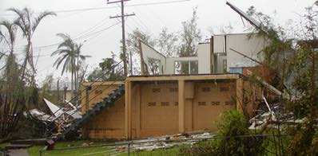

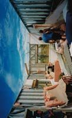

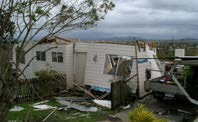

---
## Page 17

17
Cyclone Resilient Building Guidance for Queensland Homes
3.5 Myth busters
There are a number of urban myths around effective cyclone preparation that have been 
disproved following experiences during past cyclone events.
Myth
True or false
Taping an ‘X’ on your window 
will prevent it from breaking.
False – this will not prevent your window from breaking. 
Useful tip – tape a plastic sheet to the edge of the window 
frame on the inside to reduce wind-driven rainwater coming 
into the home. Refer to Section 3.7.
Open windows on the lee 
side and close them on the 
windward side of the home.
False – this would require you to continually monitor the wind 
direction and would put you at risk of injury if debris breaks a 
door or window. 
Useful tip – shelter in a small room with no or small windows to 
keep safe from injury.
Debris screens are only needed 
on the side of the home facing 
the ocean.
False – wind directions often change during a cyclone. 
Useful tip – install debris screens on all windows. Refer to 
debris screens in Section 9.10.
Whirlybirds (small roof top 
ventilators) help keep your 
roof on.
False – whirlybirds can be damaged by wind or debris and 
allow both wind and water to enter into your roof. 
Useful tip – install a close-fitting, heavy duty plastic bag 
around the whirlybird to help minimise damage during a 
cyclone.

---
## Page 18

18
Cyclone Resilient Building Guidance for Queensland Homes
3.6 Debris
Debris from damaged buildings, broken trees or loose objects can be picked up by 
strong winds and become dangerous projectiles, which pose a safety risk and cause 
damage to homes. 
Clean up your property at the start of the cyclone season. 
Remove any loose items in your yard, and securely tie down 
caravans and boats when a cyclone alert is issued.
The images below are examples of damage caused by debris. Debris can be any shape or size, 
from broken roof tiles to small boats, and has the potential to significantly damage homes or 
cause severe injury. Debris can only collide with walls and roofing located on the windward 
side, so people should stay well away from windward walls and windows during a cyclone.
Examples of damage caused by debris during a cyclone
Debris can create openings in the walls and roof of a home. It is therefore important that 
homes in cyclone areas are designed to cope with the increased internal pressure caused by 
damage to openings from debris.

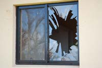

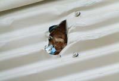

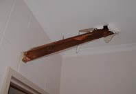

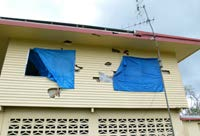

---
## Page 19

19
Cyclone Resilient Building Guidance for Queensland Homes
3.7 Wind-driven rain
Cyclonic winds produce pressure differences between the inside and outside of a home, 
particularly on the windward wall. The pressure difference can force rainwater through gaps 
and spaces that it would otherwise not penetrate. The airflow around and over the home can 
also drag rainwater upwards, therefore flashings that are designed to channel downward-
moving water away from the building are less effective during cyclones. 
Rain entering homes through damaged linings, under flashings or through windows and 
doors can often damage plasterboard wall linings and ceilings, floor coverings and personal 
belongings, even when no structural damage has occurred. 
Significant volumes of water can enter the windward side of undamaged homes as follows:
•	through weep holes in frames of windows and glass sliding doors
•	through worn or damaged seals on windows and doors
•	through windows or glass sliding doors with flexible sashes
•	around flexible, inward opening swinging doors
•	up valley gutters
•	under flashings at the junction of walls and the roof, or walls and balconies, 
or around windows.
The images below are examples of damage caused by rainwater entering homes 
during a cyclone. 
Rainwater bubbling through weep holes in windows
Damage to plasterboard ceiling
Water on timber floor
Mould on ceiling

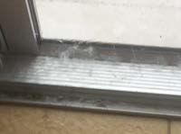

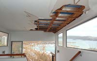

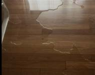

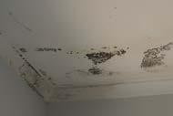

---
## Page 20

20
Cyclone Resilient Building Guidance for Queensland Homes
Do not stand in front of windows to mop up 
water during a cyclone. You could be badly 
injured if wind-borne debris breaks the window.
The best way to reduce water coming through undamaged windows is to tape a plastic sheet 
to the inside of the frame before the cyclone approaches. The tape needs to provide a good 
seal along the edges and across the bottom of the frame.  The plastic sheet should be the 
full width along the window frame and at least 400 mm high. Water that is blown through 
the weep holes can be trapped behind the plastic and drain back out through the sill to the 
outside when there is a break in the wind.
Window with a plastic sheet taped on the edges of the inside of a window
Even minor damage to the surface of your home can allow significant volumes of water in. 
For example:
•	inadequately fastened flashings can be ripped from roofs and cause partial loss of roof 
sheeting, which allows water to enter into the roof space
•	damaged soffits and eaves can allow water blowing up the outside of the windward wall 
to enter the roof space
•	broken windows or doors can allow water to be blown directly inside
•	loss of gutters can allow water to be blown into the roof space.

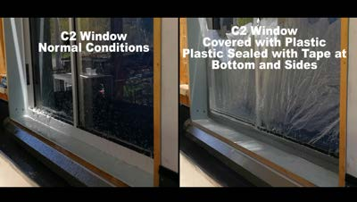

---
## Page 21

21
Cyclone Resilient Building Guidance for Queensland Homes
Electrical wiring needs to be checked and repaired 
or replaced if water has affected cavities and linings. 
An electrician’s certificate may be required before 
power can be reconnected to a home with 
extensive water or structural damage.
Some wall and ceiling linings such as plasterboard are particularly sensitive to water. Water 
that comes into the roof space can pool on the ceiling or soak into insulation. Wet insulation 
holds water in the roof space and can prolong the high humidity conditions that encourage 
the growth of mould. Water can also run down through light fittings, smoke detectors and wall 
cavities, causing damage to plasterboard wall linings.
Water damage can lead to accelerated corrosion of connections and other metal components, 
which could reduce their strength in future events.

---
## Page 22

22
Cyclone Resilient Building Guidance for Queensland Homes
4 Understanding your risk 
All new homes built in Australia must be assigned a wind classification or the engineer must 
calculate design wind pressures. This classification is used by engineers and builders to make 
sure your home is properly designed and constructed. Homes built before the 1990s may not 
have a wind classification.
4.1 Wind loading standards
There are two wind loading standards that can be used in the structural design of homes in 
Australia:
•	AS/NZS 1170.2 – Design actions, Part 2 wind actions. This is a general wind load 
standard used by engineers for most types of buildings. It can be used for all homes 
regardless of size. 
•	AS 4055 – Wind loads for housing. This standard can only be used for one and two 
storey homes. Most homes can be designed using AS 4055. However, if a home has 
three storeys, a large floor area or is an unusual shape, engineers must design your 
home to wind loading standard AS/NZS 1170.2.  
Designing your home for high internal pressures is a sound 
investment in strengthening the wind resilience of your home. It 
is recommended you discuss this with your licensed builder. 
4.2 Wind classifications in cyclone prone areas
Coastal areas north of Bundaberg are classified as Wind Region C. Homes in this area are 
designed to resist a cyclone with winds of 250 kilometres per hour, which the Bureau of 
Meteorology classifies as a mid-category four.
Region B
Region C

---
## Page 23

23
Cyclone Resilient Building Guidance for Queensland Homes
Examples of wind classifications for different locations
Homes in Wind Region C that are designed using AS 4055 have a cyclone classification of C1, 
C2, C3, or C4 depending on the local features at the site such as:
•	proximity to large bodies of water or open country
•	whether or not it is on a hill
•	whether it is surrounded by other buildings. 
Homes built on hillsides or on open terrain are exposed to stronger winds and must be 
designed and built for a higher wind classification than homes built on flatter land surrounded 
by other buildings. 
The Wind Region C classification relates to the wind speed expected at the roof level of the 
home site for a cyclone with gusts of 250 kilometres per hour. C1 and C2 classifications are 
used for less exposed sites and C3 and C4 are used for more exposed (open) sites.
Wind classification categories based on expected wind speeds
Homes located on hilltops can experience much higher wind gusts than those on lower lying 
flat land. As a general rule, the wind classification is related to the view from the home – the 
better the view, the higher the wind classification.
Wind classification
Design site wind speed (Vh)
Bureau measured 
wind speed
m/sec*
km/h
km/h
C1
50
180
250  (Category 4)
C2
61
220
250  (Category 4)
C3
74
267 
250  (Category 4)
C4
86
310
250  (Category 4)
C1
C2
C3
C4

---
## Page 24

24
Cyclone Resilient Building Guidance for Queensland Homes
4.3 Estimating your wind classification
As a general guide, your wind classification can be related to the view from your home 
as follows: 
•	No view – usually C1. This classification is used only for homes situated on flat land that 
is located away from the shoreline and surrounded by many other buildings.
•	Some view – usually C2. This is the most common classification for homes in cyclone 
prone areas in Queensland. It is appropriate for homes with a view past the surrounding 
homes on gently rising ground. It is also used for homes located a street or two away 
from the coastline.  
•	Good view – usually C3.  This classification is used for homes with a view over the 
surrounding streets or out to sea.
•	Really great view – at least C4. This is the highest cyclone wind classification and 
applies to homes built on the tops of hills or on rising land near the coast. An engineer 
may be required to design all structural elements in these homes. 
The wind classification is determined by a trained building professional such as an engineer, 
builder or building certifier. The wind classification is used by all designers and construction 
trades to select appropriate building components such as roofing, structural connections, 
windows or garage doors to resist the wind forces likely to be experienced over the lifetime of 
your home. 
You can improve the wind resistance of your home by asking 
your builder to use the products and details for a higher wind 
classification. For example, if your home is classified as C1, 
request that it be designed and built using C2 details.

---
## Page 25

Cyclone Resilient Building Guidance for Queensland homes 25
5 Resilient building design principles
The National Construction Code provides minimum construction requirements for safe 
housing. If you choose to do more than the minimum requirements for some features, the 
additional cost can be much lower than the cost of replacing the same items on a completed 
home or repairing the damage to floor coverings and linings caused by a cyclone. 
5.1 Resilient building options
Discuss the following options with your builder. Some of these items are in addition to those 
addressed in building codes and standards.
Resilient building options table
Option
Benefit
Consider the water penetration performance 
of different windows with the required wind 
rating. Some materials and systems allow less 
water into a home under severe wind loads 
than others. Consider:
• different window seals
• types and configuration of weep holes.
Reduced water damage  to linings and 
contents
Install additional bolts and stronger hinges to 
entrance doors so they are less likely to blow 
open during a cyclone.
Reduced internal water damage
Strengthen the walls and ceiling of one or two 
rooms located at the centre of the home to 
create a strong compartment that can be used 
for shelter during a cyclone. 
Remember, sheltering inside the home is only 
applicable if you are not located in a storm 
tide zone.
Provides safe shelter in even very severe 
cyclones and in the event the home is 
struck by wind-borne debris
Install additional clips on gutters so that they 
are less likely to blow off during a cyclone. 
Reduced internal water damage and 
reduced repair costs
Install suitable cyclone screens or shutters to 
protect windows from debris.
Protects windows from debris. Shutters can 
also reduce entry of  wind-driven rainwater. 
For homes close to seawater, use components 
and connections that have higher levels of 
corrosion resistance. 
Slower deterioration of building elements 
to maintain the strength of your home
Design for a higher wind classification.
Reduced level of damage in all cyclones

---
## Page 26

Cyclone Resilient Building Guidance for Queensland Homes
26
6 Building new homes to resist wind
When building a new home, your builder must ensure the following:
•	it is designed to current standards
•	it complies with the National Construction Code
•	it has council approval. 
The correct wind classification for your home should be marked on the building plans or 
contract. Homes located in higher exposure areas (e.g. on hills or facing large open bodies 
of water) must be designed to resist larger wind forces and should have a higher wind 
classification as outlined in Section 4 of this Guide.  
Structural connections and details must be selected based on the correct wind classification. 
All windows and garage doors must also be rated to the wind classification shown on 
the plans. 
6.1 Building in storm tide-prone areas
If your site is located close to a shoreline or tidal creek, your home will require additional 
features to minimise damage caused by storm tide. For further information, refer to the Storm 
Tide Resilient Building Guidance for Queensland Homes.

---
## Page 27

Cyclone Resilient Building Guidance for Queensland homes 27
7 Improving the resilience of existing homes
Regular inspection and maintenance of your home is critical to maintaining cyclone resilience. 
Homes built before the mid-1980s are generally at higher risk of damage in cyclones than 
newer homes. If you live in an older home, it is important to seek advice from an engineer or 
builder to identify ways to reduce the vulnerability of your home. A professional will inspect 
and assess the structure of your home and provide recommendations for maintenance or 
upgrades that strengthen the wind resilience of your home during a cyclone. 
The wind classification of your home may not have been determined at the time it was built. 
A building professional can assess your site and determine the wind classification, which 
can then be used to select the appropriate connections, materials and products that will help 
keep you and your family safe in a cyclone. 
The Cyclone Testing Station has several useful videos on building, maintaining 
and renovating homes in cyclone areas. For more information visit www.jcu.edu.au/cyclone-
testing-station/videos.
7.1 Regular inspection and maintenance
Some building materials can deteriorate over time. Examples include:
•	corrosion of steel elements including structural members, straps and connections, or 
concrete reinforcement
•	rot or termite attack in timber. 
The rate of deterioration depends on several factors including proximity to salt spray, 
moisture levels and coating protection on metal elements. Inspection and maintenance of 
key structural elements by a building professional should be undertaken for all homes at the 
following times:
•	after a cyclone has damaged buildings in your community
•	whenever roofing is removed (such as when replacing roof sheeting)
•	every seven to ten years.
Engage a certified building inspector or licensed building 
professional to inspect your home and ask them to clearly list the 
items that can be repaired and those that need to be replaced. 
If an inspection uncovers building elements that do not meet the requirements for the wind 
classification of your home, upgrades should be undertaken to improve wind resistance in 
future events.

---
## Page 28

Cyclone Resilient Building Guidance for Queensland Homes
28
7.2 Structural and general maintenance
The ability of a home to withstand a cyclone can be reduced if building elements have 
corroded or rotted due to lack of building maintenance
The above image shows roof damage from a cyclone as a result of screws becoming corroded, 
making them ineffective against strong winds. Routine roof maintenance should include the 
replacement of corroded fasteners to prevent this type of damage from occurring.
The image below was taken during an inspection of damage following a cyclone. From the 
outside the home appeared to have no damage. However, closer inspection identified that 
many batten-to-rafter connections had started to fail and needed to be upgraded with screws 
or straps to reduce the risk of the roof lifting off in future cyclones. 
Structural inspections will help identify any elements that may not function properly in a 
future cyclone. The following rusted or rotted members should be replaced:
•	structural elements within the roof space such as roofing screws, batten to rafter/truss 
connections and roof to wall connections
•	verandah posts and connections 
•	sub-floor structures, home stumps, sub-floor bracing and steel bolts.
Roof loss caused by corroded roofing screws
Partial failure of batten to rafter connections during a cyclone

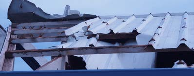

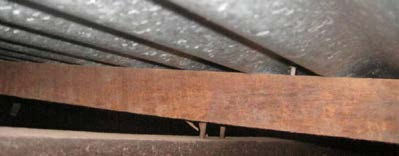

---
## Page 29

Cyclone Resilient Building Guidance for Queensland homes 29
Corrosion at the base of veranda post – the post needed to be replaced, not just painted over.
Rot in part of the sub-floor structure. The timber needs to be replaced, not just painted over. 
Rotten members such as this veranda post may fail under strong wind loads. 
General maintenance activities include:
•	tightening bolts and screws
•	reapplying protective coatings to metal and timber elements so they remain in good 
condition
•	replacing any elements that have broken, been incorrectly installed or have 
deteriorated.

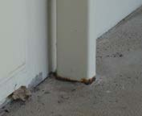

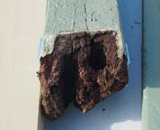

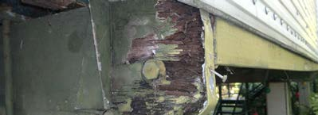

---
## Page 30

Cyclone Resilient Building Guidance for Queensland Homes
30
7.3 Renovations and additions
Most renovations and additions involve removing part of the external and/or internal 
cladding. This provides an opportunity to check exposed structural connections and identify 
any deficiencies. If an inspection identifies deficiencies in an existing part of the home, it is 
important to upgrade this section of the home before continuing with new work. 
Designers and builders will need to check the wind classification of your home in order to 
draw up plans with the correct details for the site. All new building work will require approval 
by council or private builing certifier.
7.4 Replacing roof cladding
When replacing old roof cladding it may be necessary to upgrade the existing roof structure. 
Ask a qualified builder to assess the entire roof structure (e.g. batten to rafter/truss 
connections, and rafter/truss to wall connections) to check whether the tie-downs are 
appropriate for the wind classification of the home, and upgrade if necessary. It would be 
futile to install a new roof if the underlying roof structure is inadequate.
If you are changing the type of roof cladding such as a tiled roof to a sheet roof ask the 
qualified building professional to assess the whole roof structure to ensure it is safe for the 
new roofing material to be installed. Sheet metal roofs are lighter than tile roofs so the net 
uplift is greater. Sheet roofs also require stronger tie-downs for the battens to rafters/trusses 
and rafters/trusses to the walls. 
7.5 Roof upgrades
Common upgrades to improve the resilience of your roof include:
•	replacing rusted or deteriorated roof sheeting or roofing screws
•	replacing deteriorated or split battens
•	replacing nails with screws or straps in batten-to-rafter/truss connections under sheet 
metal roofs
•	replacing skew nails with straps or bolts in rafter/truss to wall connections.

---
## Page 31

Cyclone Resilient Building Guidance for Queensland homes 31
7.6 Garage doors
Older garage doors are vulnerable to damage during cyclones. Where the wind blows a 
garage door in, there is potential for damage to contents in the garage, and in some cases 
the large opening contributes to higher internal pressure that can cause damage to the rest 
of the home. 
Cyclone damage to older garage doors
Since 2015, all new garage doors installed in cyclone areas must comply with AS/NZS 4505. 
These doors have features such as wind locks that make it harder for the doors to blow in.
Garage door upgrade options include:
•	replacing with doors that comply with AS/NZS 4505
•	fitting certified temporary braces that strengthen the existing door.
The Standards Australia Handbook, HB 132.2 Structural upgrading of older houses – 
Part 2: Cyclone Areas, contains useful information for builders and designers about upgrading 
the structural elements of a home.

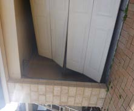

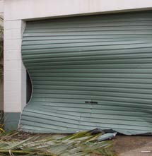

---
## Page 32

Cyclone Resilient Building Guidance for Queensland Homes
32
7.7 Other building upgrades to increase wind resilience
Other work that will improve the resilience of your home includes installing the following:
•	window shutters or screens to protect windows from debris (they need to be rated for 
cyclone debris resistance and have different features from security screens)
•	solid front and back doors with drop bolts and heavy duty hinges
•	cross-bracing for stumps of high-set homes.

---
## Page 33

Cyclone Resilient Building Guidance for Queensland homes 33
8 Repairing or rebuilding wind-damaged homes
8.1 Immediately after the cyclone
Significant clean-up and maintenance checks are needed following a cyclone and will reduce 
the chance of further deterioration in the long term. 
Seek professional advice
Contact your insurance company for assessment of any claims against your policy. 
Contact a qualified building professional for advice on repairs to the roofing, roof 
structure, gutters or flashings. 
Contact a licensed electrician to check electrical wiring if water has come through 
light fittings or penetrated the roof space or wall cavities. 
Dry out your home
Mop up any water that has entered through windows, doors or ceilings and 
dry everything out. Pay particular attention to floor coverings, ceilings, insulation 
and wall linings. 
When it is not raining, open windows to allow air flow to further dry out 
internal spaces.
Open cupboard doors to allow the inside of the cupboards to dry out. Check the 
condition of particleboard in built-in cupboards. If damp, take out heavy items such 
as plates to avoid shelves collapsing. 
If possible, undertake temporary repairs to make the home watertight. Note: in the 
long-term, building approvals will be required for permanent repair.

---
## Page 34

Cyclone Resilient Building Guidance for Queensland Homes
34
8.2 Planning repairs
Repairing a cyclone damaged home requires expert advice from a qualified building 
professional. Replacing like-for-like will not improve the resilience of your home to future 
cyclones. A registered builder can provide you with advice to ensure the repairs or rebuild will 
withstand future cyclones. 
It is important to be aware that although the cyclone may have been a Category 4 at another 
location, the actual wind speeds experienced at the location of your home may have been 
in a lower category range. Any damage that has occurred at wind speeds significantly lower 
than the design wind speed for your home, indicates a structural weakness that needs to be 
addressed as part of the repairs.
Repair checklist
Before commencing repairs, you should discuss the following issues with your builder 
or insurer:
Asbestos – identify if asbestos needs to be safely removed before work commences.
Wind classification – check the wind classification for your home is correct.
Appropriate connections and elements for the wind classification – if elements failed 
because they were not strong enough, they need to be replaced with stronger ones.
Ask the builder to do a thorough inspection of the damaged and undamaged parts of 
your home – where the wind forces damaged only some connections in your home, 
but the same details are repeated throughout the rest of the home, then the remaining 
connections may be susceptible to damage in future events unless they are also 
upgraded. Remember that the wind direction may be different in a future cyclone, and 
may put loads on connections that were not affected during the cyclone that caused 
the original damage.
Check and upgrade the whole structural system if part of the structure is damaged 
–  Partial loss of your home’s structure may mean that elements lower in the home 
were not subjected to the full load. If the damaged elements are replaced with stronger 
ones (e.g. batten to truss connections), but the elements lower in the structure are left 
unimproved (e.g. truss to wall connections), then the weak link may now be lower in 
the building. 
Corrosion resistance – if your home is near saltwater, the fasteners and connectors 
should be of a higher corrosion resistance than normal.
Replacing a damaged garage door – ask for doors that are designed to resist the 
design wind speed suitable for your location. These doors may have wind locks or other 
bracing systems. The wind locks transfer extra load from the ends of the garage doors 
into the tracks and then to mullions in the wall. The walls also need to be strengthened 
to resist this additional load.
Electrical and safety devices – check that Residual Current Devices and other safety 
devices such as smoke detectors are working correctly. 
Even if your home shows no obvious signs of damage from the 
outside, it is wise to arrange for a structural inspection to check 
there is no hidden damage in the roof structure, particularly for 
older homes that have not had recent structural upgrades.

---
## Page 35

35
8.3 Reconstruction
Approval is required if your home requires demolition. Building and planning approval is also 
required before rebuilding. 
The reconstructed home must comply with the current requirements of the National 
Construction Code whilst considering the non-mandatory resilient design principles and 
materials outlined in this Guide. 
Finding a licensed professional
Ensure only licensed professionals are involved in the repair or rebuild of your home by checking their 
credentials. Visit the following websites to find a licensed professional in your area: 
Licensed builders, 
tradespersons, and 
building certifiers 
and designers
Queensland Building and 
Construction Commission
www.qbcc.qld.gov.au 
Licensed coastal  
and structural engineers 
Board of Professional  
Engineers Queensland 
www.bpeq.qld.gov.au
Licensed  
architects 
Queensland Board  
of Architects 
www.boaq.qld.gov.au

---
## Page 36

Cyclone Resilient Building Guidance for Queensland Homes
36
9 Resilient building materials and systems
This section provides information on the structural elements in your home and issues to 
discuss with a builder. 
9.1 Selection of cyclone resilient products and materials
Building products used in cyclone regions must:
•	comply with relevant Australian Standards
•	have the appropriate wind rating for the location of the home
•	be durable enough to perform to the required level in future cyclones e.g. resist 
corrosion, termites and rot.
They should also:
•	minimise the volume of wind-driven rainwater that enters 
your home 
•	withstand water and dry out without deteriorating. 
Building standards and product installation guides provide information about correct 
installation of building elements. A building certifier can check the design and 
construction of your home is in accordance with the relevant standards. 
For existing homes, refer to Section 7 for information about maintaining and renovating 
older homes. For homes built before the mid-1980s, it is important to consult a qualified 
building professional (a builder, engineer, certifier, surveyor) to carefully check the 
connections are strong enough and the members are still serviceable to carry future wind 
loads.
9.2 Roof cladding
During a cyclone, the uplift forces on roof cladding will exceed the weight of the roofing, which 
is why appropriate roofing fasteners are essential.  There are hundreds of roof fasteners in a 
home and each one is important in helping to keep the roof on during a cyclone. 
Manufacturer documentation provides information about the correct type of screws and 
washers required to fix metal cladding into battens for each wind classification. In the case of 
roof tiles, every tile should be secured to the battens by an appropriately rated clip or fixing. 
Do 
you live 
less than one 
kilometre from a 
shoreline?
The National 
Construction Code 
requires homes within 
one kilometre of the 
shoreline to use heavily 
galvanised steel or 
stainless steel structural 
elements that are 
installed in accordance 
with manufacturer 
specifications, 
and should be 
inspected 
regularly.

---
## Page 37

Cyclone Resilient Building Guidance for Queensland homes 37
9.3 Roof battens
Roof battens must be securely anchored to the roof structure to carry all of the forces from 
the roof cladding. Roof battens that are poorly connected to rafters/trusses are a common 
weakness in older homes and are at risk of failure during a cyclone. Higher uplift forces are 
experienced by battens near the edge or the ridge of roofs, and therefore may require stronger 
connections.
Examples of batten to rafter connections appropriate for C1 and C2 wind classifications
9.4 Rafters or trusses
Trusses or rafters must be the correct size, installed at the correct spacing and securely tied 
down to the top of the walls using details that are appropriate for the wind classification of 
that location. Girder trusses (large trusses that support smaller trusses) require even stronger 
tie downs than regular trusses.
9.5 Tie down through walls
Tie-down rods in timber framed construction, steel frame elements and steel reinforcement 
in reinforced masonry construction, transmit uplift forces from the roof down through the wall 
structure to the ground. Wall systems must be correctly anchored to the subfloor, including 
concrete slabs for slab on ground construction. Stronger tie-downs are also required on both 
sides of large openings such as glass sliding doors.
Example of tie-down rods
Roof sheeting batten
One of the two screws 
(nails don’t have the capacity)
Straps with 3 or 4 
nails per leg (refer to 
AS1684.3 for details)
STEEL TIE-DOWN RODS

---
## Page 38

Cyclone Resilient Building Guidance for Queensland Homes
38
9.6 Bracing
Wind pushes on the sides of your home and unless there is adequate bracing in the walls, the 
top can move relative to the bottom of the home. Bracing systems still have to perform even if 
they get wet. Discuss the resilience of different types of bracing panels with your builder.
Bracing elements in walls transmit lateral load from the roof level to the floor. Bracing can 
be provided by bracing panels such as plywood, or by elements such as steel cross-bracing 
straps or timber bracing.
High-set homes require bracing elements between the floor and the ground. The bracing on 
the stumps of high-set homes performs an important role during cyclones and should not be 
removed or modified without having an engineer design an alternative bracing system.
9.7 Wall cladding and linings
External wall cladding must withstand wind pressures and may also be subject to impact 
from wind-borne debris. Discuss the strength and impact resistance of wall cladding with 
your builder.
Internal wall linings may get wet during a cyclone even if there is no structural damage to the 
home. Even minor damage such as loss of flashings or gutters, may cause large volumes of 
water to come into the home. Resilient linings that do not deteriorate when wet, require less 
repair work after cyclones.
9.8 Windows and doors
Windows and doors need to withstand inward wind forces on the windward wall and outward 
forces on the other walls (leeward and side walls). 
All glass needs to be the correct thickness and type for the wind classification. All window 
assemblies must comply with Australian Standards, have the correct wind classification for 
your location and be securely fastened to the building structure. 
A window supplier can provide information about the level of water tightness that various 
window options can provide during a cyclone. Different types of windows deliver different 
levels of resistance to wind-driven rain, which can limit the amount of water that comes into 
your home during a cyclone.
Standard entrance door locks may not be adequate to withstand cyclonic wind loads, 
particularly for double doors. Additional support for external doors such as bolts into the floor 
and head of the door frame may be required.

---
## Page 39

Cyclone Resilient Building Guidance for Queensland homes 39
When ordering doors or windows, it is necessary to indicate the wind classification and 
whether or not the window or door will be close to a corner of the building. This is because 
wind pressures on windows and doors are higher near corners.
A door that had inadequate fixing to the wall frame and inadequate door latches
 
9.9 Garage doors
Garage doors must comply with AS/NZS 4505 and have the correct wind rating for the location 
of the home. In some cases, garage walls may need to be strengthened to withstand the extra 
loads from the wind-rated doors.
Some existing garage doors may not be wind rated, but can be strengthened using 
wind locks or temporary braces that are installed as part of preparing your home for an 
approaching cyclone.

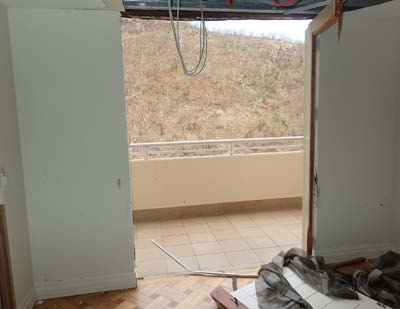

---
## Page 40

Cyclone Resilient Building Guidance for Queensland Homes
40
9.10 Debris protection 
Installing debris shutters or screens on windows and doors can improve the debris resistance 
of your home. It is important to note that debris screens are different from sun screens and 
security screens. Effective debris screens are rated by testing to indicate their resistance to 
impact from debris. 
Shutters and screens are more effective when they are installed with an adequate  space 
between the glass and the screen. Shutters are solid plates that are mounted in front of 
windows and doors. They can absorb some of the energy from wind-borne debris and also 
reduce the volume of water reaching the opening. 
Temporary shutters can be as simple as sheets of plywood securely fastened across 
the window.
Temporary shutters installed before a cyclone
Debris screens are open, grid-like elements that when fitted on windows and glass doors can 
absorb the impact of debris and lessen the chances of glass breaking. They are not effective at 
preventing wind-driven rainwater entry. Debris screens can be permanently fixed screens that 
may double as security screens, or can be temporary fitted before a cyclone.
Fixed debris screens
Products that have a debris rating should have been tested to demonstrate their effectiveness 
against small or medium-sized debris, but this does not guarantee that the home will be 
protected from all debris. It should be noted that extremely large debris will exceed the 
capacity of most screens, and may damage external walls. 
Impact from large debris increases the risk of harm to people who are sheltering inside the 
home. However, strengthening the small rooms where people will shelter during a cyclone 
reduces the risk to occupants. Incorporating plywood and/or sheet metal in the walls and 
ceiling linings of those rooms will strengthen them to resist debris impact. It also increases 
resistance to wind uplift and racking forces, and therefore, provides a strong compartment for 
emergency shelter.

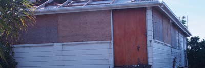

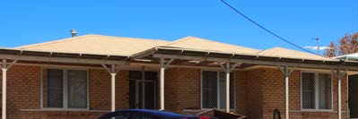

---
## Page 41

Cyclone Resilient Building Guidance for Queensland homes 41
9.11 Footings
Footings connect your home to the ground. They transmit lateral forces and must have 
sufficient weight and be deep enough to resist wind uplift forces. For example, isolated 
footings under verandah posts must be designed to resist the wind uplift forces from the 
section of roof supported by the post.
9.12 Sheds
Sheds are usually light-weight and subject to similar wind pressures as your home. They must 
be designed for the same wind classification as your home, be fastened together securely 
and be anchored to a footing system that can resist the substantial uplift loads. Sheds should 
be designed for internal pressures that may be caused by failure of their windows or doors. 
Poorly tied-down sheds can create wind-borne debris that can damage nearby homes. For 
more information visit www.shedsafe.com.au
9.13 Other outdoor structures 
Outdoor structures and objects such as fences, shade sails, aerials, satellite dishes, solar 
panels, guttering and water tanks will be subjected to significant wind pressures during a 
cyclone. These outdoor objects should be installed and/or constructed to reduce the potential 
for them to become wind-borne debris.
Fences
It is difficult to design fences capable of resisting the lateral forces of wind loads. However, it 
is possible to design the base of the posts of fences so that if they fail, they remain attached 
to the footings. This means that the fence may blow over, but it will not become wind-borne 
debris. Wind forces on open mesh fencing are significantly lower than on paling fences. 
Gutters
Gutters can unclip during heavy winds and as a result water can enter the home. Gutters may 
also become wind-borne debris. The cost of repairing gutters can be substantial if scaffolding 
is required. However, doubling the number of gutter clips will mean it is less likely to be blown 
off your home. 
Damaged gutters following a cyclone

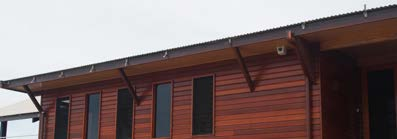

---
## Page 42

Cyclone Resilient Building Guidance for Queensland Homes
42
Window, wall and roof flashings
Flashings are thin sheets of metal that keep out water around windows and the edge of roof 
and wall panels. Wind pressure can rip them off if they are not properly fastened. This allows 
wind-driven rain to damage ceiling and wall linings inside your home. It is important that all 
faces of the flashing are securely fastened with screws.
Damage to flashings (inset shows water damage to ceiling)
Aerials, satellite dishes and solar panels
Aerials, satellite dishes and solar panels attract significant wind loads during cyclones. 
These objects should be fastened to the roof structure through the cladding rather than just 
fastened to the cladding. The connections should be appropriate for the wind classification 
of the home.
Shade sails
Shade sails are not designed to resist cyclonic wind forces and should be taken down as part 
of preparation for an approaching cyclone. Flapping of unsecured shade sails during cyclones 
can cause significant damage to nearby windows and wall cladding.
Rainwater tanks
Full water tanks often have sufficient weight to resist wind forces. However, empty or partially 
full tanks can buckle or overturn. Tank stands and their footings should be appropriately 
designed and constructed for cyclonic wind loads. 
Whirlybirds
Whirlybirds can spin excessively fast during a cyclone, which causes them to change shape or 
blow off the roof. If they are damaged, water can get into the roof space. Installing a close-
fitting, heavy duty plastic bag around the whirlybird as part of preparations for an approaching 
cyclone can help minimise damage during a cyclone. 
Air conditioner units
Single-unit wall or window-mounted air conditioners can let through large volumes of wind-
driven rain. Installing a close-fitting, heavy duty plastic bag around the air conditioner unit as 
part of preparations for an approaching cyclone can help minimise damage during a cyclone.

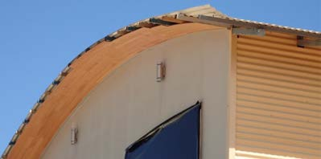

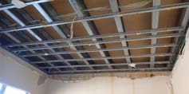

---
## Page 43

---
## Page 44

Cyclone Resilient Building Guidance for Queensland Homes
44
10 Building approvals, codes and standards
Building approvals are required from your local council or private building certifier before 
building a new home or upgrading and repairing an existing home. 
10.1 Planning approvals
Planning approvals are required for most construction work. They determine what uses 
and activities can occur on the land to minimise any potential impact on surrounding 
properties. An application for a planning approval is assessed against your council 
planning scheme. 
10.2 Building approvals
A building development approval  from a local government or private building certifier is 
required for a new home or upgrading and repairing an existing home. A private building 
certifier is required to lodge the approval documents with the relevant local government.
Exemptions apply for minor upgrades that do not affect more than 20 per cent of the 
building’s structural components of the same type. Refer to your local council for advice on 
whether a building approval is required for any planned work on your home. 
Building surveyors assess the plans submitted to council to confirm they comply with the 
relevant codes and standards such as the National Construction Code and Queensland 
Development Code. This ensures that appropriate materials, products and details used in the 
design and construction of your home comply with the necessary standards. 
10.3 Building approval process
A building approval is granted by a building certifier and/or your local council. The role of 
the Building Certifier is to confirm the proposed building complies with the relevant building 
codes and standards before construction can commence. They are also required during 
construction to inspect that the home is being built to the relevant codes and standards.
Homes in areas prone to cyclones should be 
designed in accordance with relevant codes and standards 
as indicated in this Guide. Builders should refer 
to a Building Certifier or local council to confirm the 
individual requirements for your home.  
Ensure all designers, architects, builders and contractors 
are aware of the issues raised in this Guide.

---
## Page 45

Cyclone Resilient Building Guidance for Queensland Homes 45
10.4 Building codes and standards
Australia’s comprehensive and effective building codes and standards include requirements 
that homes are constructed to be strong enough to withstand the wind loads for the area in 
which they are built for your specified design level. New construction, major renovations and 
repairs all require building approval and must comply with the current codes and standards. 
Using the current codes and standards for any repairs or rebuilding after wind damage will 
also give your home the best chance of performing well and safeguarding the lives of you and 
your family during future cyclones. 
The following codes and standards may be used by your designer or builder:
	 1.	
National Construction Code; Volume 2: Building Code of Australia, Class 1 and 
Class 10 Buildings, Australian Building Codes Board, Canberra.
	 2.	
AS/NZS 1170.2 Structural design actions Part 2: Wind actions. Standards Australia, 
Sydney NSW, Australia.
	 3.	
AS 4055 Wind Loads for Housing. Standards Australia, Sydney, NSW.
	 4.	
AS 1684.3 Residential timber-framed construction – Cyclonic areas. Standards 
Australia, Sydney, NSW, Australia. 
	 5.	
HB 39 Installation code for metal roof and wall cladding. Standards Australia, 
Sydney, NSW
	 6.	
AS 2050 Installation of roof tiles. Standards Australia, Sydney, NSW
	 7.	
HB 132.2 Structural upgrading of older homes – Part 2: Cyclone areas. 
Standards Australia, Sydney, NSW 
	 8.	
AS/NZS 4505 Garage doors and other large access doors Standards Australia, 
Sydney, NSW.

---
## Page 46

Cyclone Resilient Building Guidance for Queensland Homes
46
11  Resources 
Cyclone Testing Station Resources for the Community
James Cook University 
www.jcu.edu.au/cyclone-testing-station/education.
Cyclone Testing Station videos on building, maintaining and renovating houses in 
cyclone areas
www.jcu.edu.au/cyclone-testing-station/education/educational-videos. 
Housing and Public Works – Building Legislation and Policy
www.hpw.qld.gov.au/services/building-plumbing.

---
## Page 47

Cyclone Resilient Building Guidance for Queensland Homes 47
12 Technical resources
Queensland specific 
Cyclone Testing Station Resources for the Community
James Cook University 
https://www.jcu.edu.au/cyclone-testing-station/education.
Natural Disaster Resilience Program Storm Tide Hazard Interpolation Series
Department of Environment and Science
www.data.qld.gov.au/dataset/ndrp-storm-tide-hazard-interpolation-series. 
Coastal Hazards and Mapping
Department of Environment and Science
www.qld.gov.au/environment/coasts-waterways/plans/hazards.
Storm tide monitoring sites in Queensland
Department of Environment and Science
www.qld.gov.au/environment/coasts-waterways/beach/storm/storm-sites.
National Committee on Coastal and Ocean Engineering – Publications and resources
Engineers Australia
www.engineersaustralia.org.au/Communities-And-Groups/National-Committees-And-Panels/
Coastal-And-Ocean-Engineering/Publications-Resources.
Queensland Climate Change and Community Vulnerability to Tropical Cyclones – Ocean Hazards 
Assessment – stage 1 report, March 2001
Queensland Government
www.data.longpaddock.qld.gov.au/static/publications/vulnerability-to-cyclones/stage1.pdf. 
Guidances for Responding to the Effects of Climate Change in Coastal and Ocean Engineering
Engineers Australia
www.eabooks.com.au/Guidelines-for-Responding-to-the-Effects-of-Climate-Change-in-Coastal-and-
Ocean-Engineering. 
International
US Geological Survey - National Assessment of Storm-Induced Coastal Change Hazards
https://coastal.er.usgs.gov/hurricanes/. 
US Federal Emergency Management Agency
www.fema.gov/media-library/assets/documents/3293.
FEMA Coastal Construction Manual Volume II US Federal Emergency Management Agency
www.fema.gov/sites/default/files/2020-08/fema55_volii_combined_rev.pdf.

---
## Page 48

More information
Queensland Reconstruction Authority
Web 	
www.qra.qld.gov.au/Resilient-Homes
Email	
info@qra.qld.gov.au
Phone	 1800 110 841

