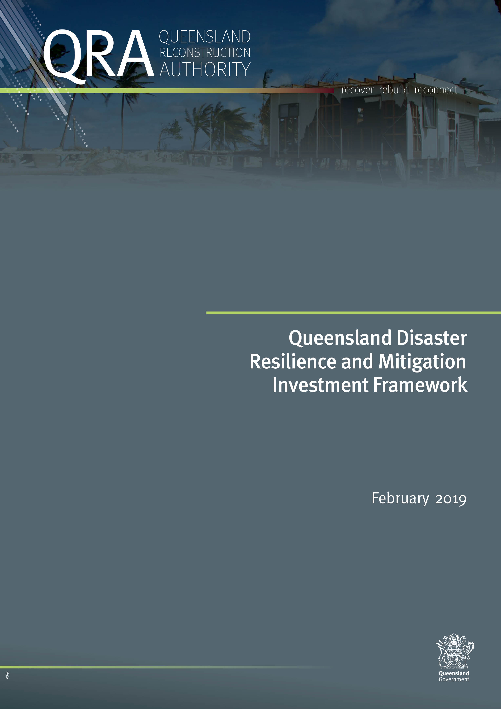
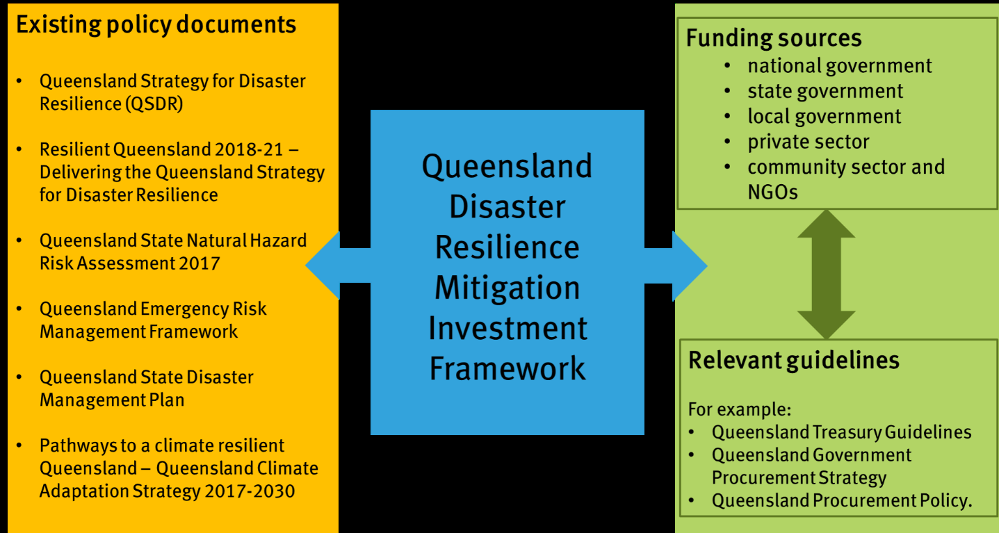
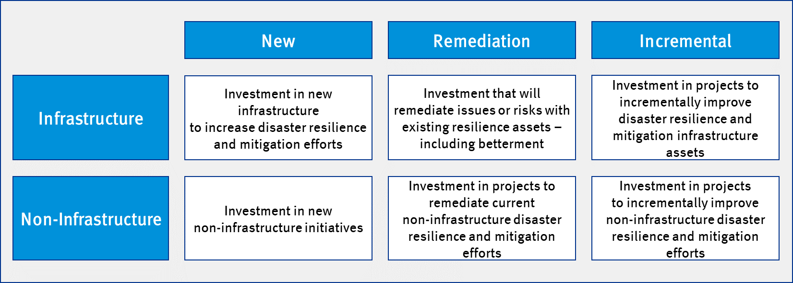
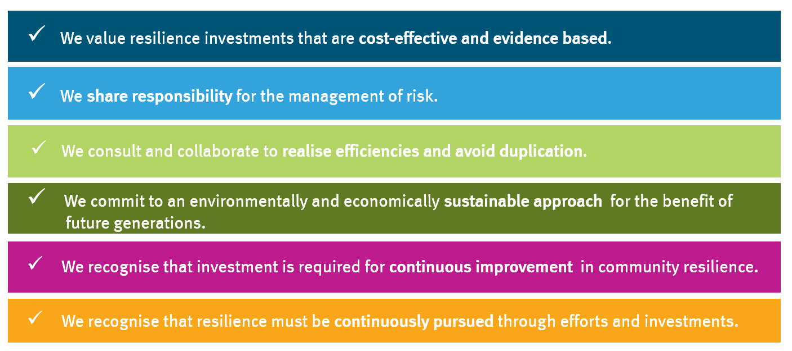
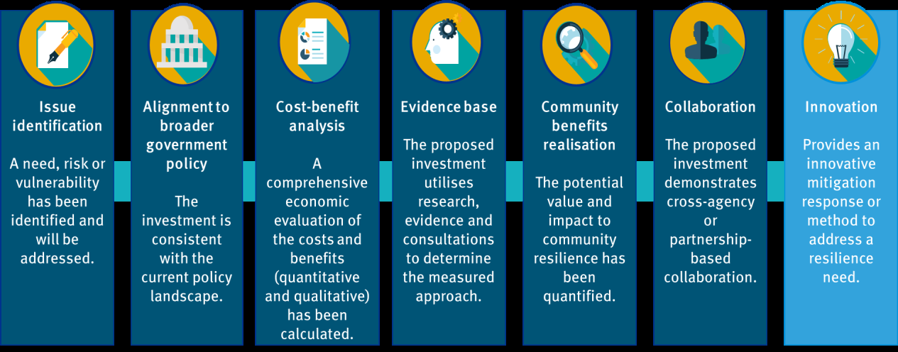
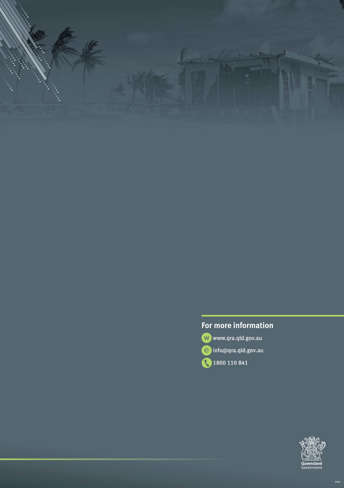

# Queensland Disaster Resilience and Mitigation Investment Framework (February 2019)

> **Source**: Queensland Reconstruction Authority
> **URL**: https://www.qra.qld.gov.au/sites/default/files/2019-01/queensland_disaster_resilience_mitigation_framework_-_february_2019.pdf
> **Licence**: © State of Queensland; emergency-management practitioner reference
> **Retrieved**: 2026-05-07T23:43:27Z
> **SHA-256**: `15e41f0ea5d1400757df3f40c874c03dda21cfc78c7110fd2dbf64e7979ef8fc`
> *Converted from PDF to Markdown format.*

---
## Page 1

---
## Page 2

Queensland Disaster Resilience Mitigation Investment Framework 
February 2019 
 
 
1 | P a g e  
 
Document details 
The Framework was developed by the Queensland Reconstruction Authority (QRA) on behalf of the Queensland 
Government, to provide guidance to public sector agencies, private sector entities and community-based 
organisations in the development of detailed guidelines to determine disaster resilience and mitigation 
investment priorities. 
Security classification 
Public 
Date of review of security classification 
February 2019 
Authority 
Queensland Reconstruction Authority 
Document status 
FINAL 
Version 
1.0 
QRA reference 
QRATF/18/2695 
 
Copyright 
This publication is protected by the Copyright Act 1968. 
© The State of Queensland (Queensland Reconstruction Authority), February 2019. 
Licence 
 
This work is licensed by State of Queensland (Queensland Reconstruction Authority) under a Creative Commons Attribution 
(CC BY) 4.0 International licence.  
To view a copy of this licence, visit www.creativecommons.org/licenses/by/4.0/ 
In essence, you are free to copy, communicate and adapt this annual report, as long as you attribute the work to the State of 
Queensland (Queensland Reconstruction Authority).  
 
Interpreter 
 
The Queensland Government is committed to providing accessible services to Queenslanders from all culturally and 
linguistically diverse backgrounds. If you have difficulty in understanding this report, you can access the Translating and 
Interpreting Services via www.qld.gov.au/languages or by phoning 13 14 50. 
Disclaimer 
While every care has been taken in preparing this publication, the State of Queensland accepts no responsibility for 
decisions or actions taken as a result of any data, information, statement or advice, expressed or implied, contained within. 
To the best of our knowledge, the content was correct at the time of publishing. 
Copies  
Copies of this publication are available on our website at www.qra.qld.gov.au. 
Further copies are available upon request to: 
Queensland Reconstruction Authority 
PO Box 15428 
City East  QLD  4002 
Phone (07) 3008 7200 
info@qra.qld.gov.au

---
## Page 3

Queensland Disaster Resilience Mitigation Investment Framework 
February 2019 
 
 
2 | P a g e  
 
Contents 
1 
Context............................................................................................................................... 3 
2 
Positioning the Framework ................................................................................................... 4 
2.1 
Vision .............................................................................................................................. 4 
2.2 
Purpose ........................................................................................................................... 4 
2.3 
Scope .............................................................................................................................. 5 
Audience .................................................................................................................................... 5 
Application – Investment types ................................................................................................... 5 
Responsibility ............................................................................................................................. 6 
Consultation ............................................................................................................................... 6 
Review ....................................................................................................................................... 6 
2.4 
Guiding principles ............................................................................................................ 6 
3 
Applying the Framework ....................................................................................................... 8 
3.1 
Understanding the key considerations................................................................................ 8 
Issue identification ..................................................................................................................... 8 
Alignment to broader government policy ...................................................................................... 9 
Cost-benefit analysis .................................................................................................................. 9 
Evidence base .......................................................................................................................... 10 
Community benefits realisation ................................................................................................. 10 
Collaboration ............................................................................................................................ 11 
Innovation ................................................................................................................................ 11 
3.2 
Applying the Framework .................................................................................................. 12 
Developing an assessment and prioritisation approach .............................................................. 12 
Assessment of projects and activities ........................................................................................ 12 
Measuring success ................................................................................................................... 12 
Annex 1. Key definitions ........................................................................................................... 13 
Annex 2. Detailed guidance ...................................................................................................... 14 
Key considerations ........................................................................................................... 14 
Other considerations ........................................................................................................ 18

---
## Page 4

Queensland Disaster Resilience Mitigation Investment Framework 
February 2019 
 
 
3 | P a g e  
 
1 
Context 
The Queensland Disaster Resilience and Mitigation Investment Framework (the Framework) provides 
guidance on effective investment decision-making and prioritisation to support disaster resilience 
and mitigation across Queensland. 
The Framework complements existing global, national, state and local policy frameworks, and 
translates the intent of these documents into a pragmatic, consistent approach for disaster resilience 
and mitigation investment across Queensland. 
Recognising Queensland’s significant work already undertaken in disaster resilience and mitigation, 
the Framework has been developed in alignment with the: 
 
Queensland Strategy for Disaster Resilience (QSDR) (QSDR web page)  
 
Resilient Queensland 2018-21 – Delivering the Queensland Strategy for Disaster Resilience 
(Resilient Queensland web page) 
 
Queensland State Natural Hazard Risk Assessment 2017 (.pdf | 16.8MB) 
 
Queensland Emergency Risk Management Framework (link to Disaster Management portal) 
 
Queensland State Disaster Management Plan (.pdf | 7.19MB) 
 
Pathways to a climate resilient Queensland – Queensland Climate Adaptation Strategy 2017-
2030 (pdf | 2.02MB). 
Natural disasters are an unfortunate, but realistic, factor of our modern world. Queensland is 
disproportionately affected by the consequences of these disasters, with the total economic costs of 
natural disasters across the state projected to be $18.3 billion per annum by 20501.  
For Queensland to continue to build on its capability to recover from and adapt to natural disasters, it 
is important that we work together to build resilience and address our vulnerabilities.  
 
 
 
 
                                                     
1 Building resilience to natural disasters in our states and territories, Australian Business Roundtable, 2017.

---
## Page 5

Queensland Disaster Resilience Mitigation Investment Framework 
February 2019 
 
 
4 | P a g e  
 
2 
Positioning the Framework 
2.1 
Vision 
The Framework embraces the guiding principles of the QSDR and will enable the four QSDR 
objectives:  
 
Queenslanders understand their disaster risk 
 
Strengthened disaster risk management 
 
Queenslanders are invested in disaster risk reduction  
 
There is continuous improvement in disaster preparedness, response and recovery.  
Recognising our vulnerabilities and need to be adaptable we invest in Disaster Risk Reduction and 
mitigation to increase our resilience. Therefore in line with the QSDR and Resilient Queensland, the 
Framework is guided by the following vision: 
2.2 
Purpose 
The purpose of the Framework is to:  
 
support decision-makers in the assessment and prioritisation of infrastructure-based 
resilience and mitigation investments and non-infrastructure or community resilience 
 
establish a consistent state-wide approach to recognising how an investment contributes 
value to Queensland’s resilience agenda 
 
guide Queensland Government agencies in the development of strategic and detailed funding 
guidelines for allocation of funding for disaster resilience through investment in disaster risk 
reduction, mitigation and adaptation.   
 
create a targeted approach to building resilience through clear principles for decision-making 
and prioritisation of investments in disaster risk reduction, mitigation and adaptation that can 
be applied across the public, private and community sectors 
 
facilitate progress of investment in disaster risk reduction, mitigation and adaptation by 
acting as both a link and enabler between existing Queensland policy documents, funding 
sources, guidelines, and approaches to investment and procurement 
 
recognise national and international disaster risk reduction, mitigation and adaptation 
approaches, including the: 
- Sendai Framework for Disaster Risk Reduction  
- National Disaster Risk Reduction Framework (NDRRF). 
 
 
To make Queensland the most disaster resilient 
state in Australia, through effective prioritisation of 
disaster resilience and mitigation investment.

---
## Page 6

Queensland Disaster Resilience Mitigation Investment Framework 
February 2019 
 
 
5 | P a g e  
 
The Framework will act as a link between, and an enabler of, a range of existing Queensland policy 
documents, funding sources, guidelines and investment and procurement approaches.  
 
Figure 1. Framework linkages 
 
 
2.3 
Scope 
Audience 
The Framework was developed by the Queensland Reconstruction Authority (QRA) on behalf of the 
Queensland Government.  
The Framework supports the alignment of funding programs with Queensland’s resilience priorities. It 
provides guidance to public sector agencies in the development of guidelines to determine 
investment prioritisation for a specific funding program.  
It provides guidance for a wide range of investments in terms of scale, type of hazard and level of 
disaster risk.    
Application – Investment types 
The Framework has the flexibility to support the assessment and prioritisation of infrastructure-based 
resilience and mitigation investments, as well as non-infrastructure or community resilience 
measures.  
The Framework is applicable to three specific types of investment, as identified below.

---
## Page 7

Queensland Disaster Resilience Mitigation Investment Framework 
February 2019 
 
 
6 | P a g e  
 
Figure 2. Investment types 
 
 
Responsibility 
In line with Queensland Government policy (refer to Figure 1. Framework linkages), there is shared 
responsibility for achieving a resilient Queensland. Success will depend on the collective effort of the 
Queensland and Australian Governments, local governments, businesses, the tertiary sector, 
community groups and individuals. 
It is envisaged that agencies with responsibility for the administration of disaster mitigation and 
resilience funding programs will leverage this Framework in development of funding guidelines. 
Consultation 
The Framework was developed in close consultation with government agencies and other 
stakeholders. It provides both useability and scalability to support the development of detailed 
assessment guidelines across a wide range of strategic investment options.  
Review 
The Framework will be reviewed on an as-needs basis to incorporate amendments that reflect the 
evolving, best practice approaches to disaster resilience and mitigation, related changes in 
government policy and new research, evidence and insights.  
2.4 
Guiding principles 
The Framework is guided by six key principles to articulate the broad intent and direction for 
investment in disaster resilience and mitigation across Queensland. These principles underpin 
considerations for assessing applications for investment.

---
## Page 8

Queensland Disaster Resilience Mitigation Investment Framework 
February 2019 
 
 
7 | P a g e  
 
Figure 3.  
Guiding principles of the Queensland Disaster Resilience and Mitigation Investment Framework

---
## Page 9

Queensland Disaster Resilience Mitigation Investment Framework 
February 2019 
 
 
8 | P a g e  
 
3 
Applying the Framework 
3.1 
Understanding the key considerations 
The Framework includes six key considerations and one additional consideration; innovation. 
Agencies are encouraged to consider how the six key and one additional consideration might be 
weighted within a specific funding program, in order to prioritise investments that support the 
intended outcomes of that funding stream. 
Figure 4. Key and additional considerations 
 
 
Issue identification  
As a precursor for any investment, a needs analysis must be conducted in order to determine the issue 
that will be addressed. As part of this process, a statement of the risk, need or vulnerability must be 
articulated. If a need has not been identified, there is no clear basis for the proposed investment.  
Issue identification considers the following sub-consideration: 
Identified need 
The proposed investment demonstrates that a need has 
been identified and that the investment seeks to address 
this need. For example, the need may be identified by the 
Queensland State Natural Hazard Risk Assessment or be 
endorsed by appropriate, independent research.  
Options analysis 
The proposed investment case considers a range of 
options, including the potential outcome of inaction. 
Applicants must justify the selection of their proposed 
approach on the basis of value to Queensland 
communities, and the extent to which it addresses the 
identified need(s).

---
## Page 10

Queensland Disaster Resilience Mitigation Investment Framework 
February 2019 
 
 
9 | P a g e  
 
Alignment to broader government policy 
This consideration articulates the value of a proposed investment aligning to broader government 
policy objectives. This supports the alignment of investment goals and objectives with the current 
policy landscape.  
This may involve consideration of the alignment of the investment with a range of existing policy 
documentation, including, but not limited to: 
- the Queensland Strategy for Disaster Resilience 2017 
- Resilient Queensland 2018-2021: Delivering the Queensland Strategy for Disaster Resilience  
- the Queensland State Natural Hazard Risk Assessment 2017  
- the Queensland Climate Adaptation Strategy 2017 - 2030 
- policies specifically targeted through the grant or funding scheme in question  
- any other relevant government policy, current at the time detailed funding guidelines are 
developed. 
Cost-benefit analysis 
A comprehensive economic evaluation of the costs (both quantitative and qualitative) and benefits 
associated with a proposed investment should be undertaken in order to determine the most 
economic use of resources.  
Cost-benefit analyses provide a measure of the forecast effectiveness of an investment. In the 
development of detailed assessment and prioritisation guidelines, it is expected that demonstrating 
a viable cost-benefit analysis be considered a minimum standard for all applications, noting that the 
rigour of the analysis is expected to vary according to the attributable cost of a proposed investment.  
While quantifiable measures are of key importance in this methodology, in the context of disaster 
mitigation and resilience, qualitative considerations must also be taken into account. As such, cost-
benefit analysis should consider the following sub-considerations, which have been informed by the 
Queensland Treasury Project Assessment Framework (PAF) Guidance on Cost-Benefit Analysis (July 
2015), and account for the characteristics specific to disaster mitigation and resilience. 
Whole of life costs 
An estimation of the full cost of the investment is clearly 
stated. This must include initial capital outlay as well as 
crucial ongoing costs related to operation and maintenance 
that will be incurred throughout the lifetime of the 
investment.  
Return on investment / timeframe 
/ longevity of assessment 
A detailed assessment of the net profit and outlay costs 
spanning the lifetime of the investment is provided.   
Avoided costs (stakeholders) 
The proposed investment has considered the avoided costs 
to the stakeholders when calculating benefits. 
Qualitative considerations 
The proposed investment takes into account the 
qualitative/intangible costs and benefits (i.e. non-monetary 
costs and benefits) such as social, health or environmental 
impacts, while maintaining rigour as to what is included in 
benefit considerations.  
Scalability and incremental 
investment  
The proposed investment promotes scalable solutions that 
consider and draw on incremental investments to sustain and 
improve existing investments.

---
## Page 11

Queensland Disaster Resilience Mitigation Investment Framework 
February 2019 
 
 
10 | P a g e  
 
Evidence base 
This consideration articulates the value of the use of investigation, research and evidence in 
determining the extent to which an investment demonstrates an informed and measured approach to 
an identified risk. It provides a measurement of the forecast effectiveness of an investment toward 
achieving a general or specific resilience or mitigation outcome.  
In the development of detailed assessment and prioritisation guidelines, it is expected that this 
consideration should receive a relative weighting against other considerations, in line with the value 
of the investment. For example, specific funding programs may weight this consideration more 
heavily for higher cost investments. 
It considers the following sub-considerations: 
Data and research 
The proposed investment is supported by scientific or other 
evidentiary research including relevant modelling. 
Risk & vulnerability 
The proposed investment has identified, analysed, and 
addresses a risk or vulnerability that may arise when a 
natural disaster occurs.  
Alternatively, in the event the proposed investment does not 
address a risk or vulnerability, the investment seeks to 
undertake research to better understand, assess or monitor 
a risk and / or vulnerability.  
Risk mitigation 
The proposed investment provides the opportunity to 
identify a gap or reduce a risk which exists in the current 
state. 
Unintended consequences 
The proposed investment has considered secondary effects 
or externalities (both positive and negative). 
Compliance 
The proposed investment will address the identified risk, 
and in doing so will remain compliant with legislative, 
administrative and ethical requirements.  
Community benefits realisation 
This consideration articulates the value of investments that consider the potential impact of a natural 
disaster event, and then work to mitigate that risk and increase resilience.  
It is expected that this consideration will be more heavily weighted in funding programs that aim to 
target non-infrastructure or social resilience measures. 
It considers the following sub-considerations: 
Community education 
The proposed investment will inform and educate the 
community and individuals, supporting them to improve 
their resilience in an ongoing manner. 
Ongoing capacity building 
The proposed investment will provide continued and 
increased capacity building, by which individuals and 
communities can obtain and/or improve their disaster 
resilience. 
Community, cultural, health and 
environmental benefits 
The proposed investment demonstrates a clear intervention 
that improves the capacity for society to recover from the

---
## Page 12

Queensland Disaster Resilience Mitigation Investment Framework 
February 2019 
 
 
11 | P a g e  
 
impacts of a disaster, and for social, cultural, health and 
environmental benefits to be realised. 
Resilient services  
The proposed investment demonstrates how the capacity of 
local services and infrastructure will be improved, 
supporting ongoing community resilience.  
Collaboration 
This consideration articulates the value of investments that encourage, facilitate and demonstrate 
cross-agency or partnership-based collaboration in the delivery of resilience activities. Further, it 
articulates the value in investments that are considered to have significant long-term benefits in 
supporting the ongoing interoperability of Queensland’s disaster resilience and mitigation effort. 
It considers the following four sub-considerations: 
Interoperability with other 
initiatives 
The proposed investment has appropriately considered 
other, related initiatives, including the extent to which all 
efficiencies have been captured and quantified, and how the 
proposed investment will complement and enhance the 
outcomes. 
Integration with broader 
resilience efforts 
The proposed investment demonstrates that it is in line with 
current interdependencies in disaster related efforts in 
Queensland and reflects that resilience is a shared 
responsibility.  
Organisational engagement 
The proposed investment indicates that relevant 
organisations and partner agencies have been engaged and 
are committed to contribute to the investment where 
relevant. This includes both inter-agency and intra-agency 
engagement and this is reflected through co-contribution.  
Community engagement  
The proposed investment has the support of relevant 
community groups, and consideration has been given to the 
extent to which the investment may encounter support or 
opposition.  
 
Innovation 
The Framework identifies innovation as an additional consideration for disaster resilience and 
mitigation applications, and encourages investments that demonstrate innovative solutions to long-
standing risks.  
While an investment that does not address this consideration should not be disadvantaged, those 
that do should be given particular consideration for funding on the basis that they may introduce new 
methods, approaches and technologies that will enhance the existing landscape.

---
## Page 13

Queensland Disaster Resilience Mitigation Investment Framework 
February 2019 
 
 
12 | P a g e  
 
3.2 
Applying the Framework 
Developing an assessment and prioritisation approach 
In applying the Framework to the development of funding guidelines, the following should be taken 
into account: 
 
The relative weighting of key considerations to support the intended outcomes of the funding 
program, for example, a large infrastructure program may place more weight on the cost 
benefit analysis, while a small, community-based program may place more weight on benefits 
realisation 
 
The relative weighting of key sub-considerations to support the intended outcomes of the 
funding program, for example, a funding program for grassroots community resilience 
activities may place specific emphasis on the sub-factor of ‘social, cultural, health and 
environmental benefits’ under community benefits realisation 
 
The extent to which funding can be specifically allocated to support innovation, for example, 
targeting of investment in projects that demonstrate innovation. 
Assessment of projects and activities 
In the assessment of investment proposals, the following should be taken into account: 
 
The composition of the assessment panel, for example, inclusion of other government 
agencies or local government representatives on the assessment panel  
 
The need to consult across the public, private and community sectors to understand the 
potential impacts of a proposed investment, for example, understanding the impact on the 
private sector of a public-sector initiated funding allocation 
 
The need to ensure and promote transparency and consistency in assessment processes, 
both across and within programs. 
 
The need for funding applications to be scalable, for example, an investment of $10 million 
should require more robust justification than a $10,000 investment. 
Measuring success 
Detailed assessment and prioritisation guidelines for each funding program drawing from the 
Framework should include consideration of how the success of any given investment is measured. 
Outcomes from monitoring and evaluation activities regarding funding allocations should be made 
available across the disaster resilience and mitigation sector, supporting continuous learning and 
improvement on a state-wide level.  
The approach to monitoring and evaluation should be tailored to the intended outcomes of any given 
program or project, and should consider the following questions: 
 
What were the intended outcomes? 
 
Which components were efficiently and effectively implemented / achieved? 
 
Which components could have been improved / achieved differently? 
 
What are the lessons learnt? 
 
Were there any unanticipated consequences (positive or negative)? 
This Framework is intended as a first step to coordinating investment in disaster resilience and 
mitigation. Success will be measured via: 
 
reduced community and economic impacts of disasters (Sendai Framework Monitor online 
management tool) 
 
utilisation of the Framework by funding administrators in the development of program guidelines.

---
## Page 14

Queensland Disaster Resilience Mitigation Investment Framework 
February 2019 
 
 
13 | P a g e  
 
Annex 1. Key definitions 
This Framework adopts key definitions used throughout other Queensland Government disaster 
resilience and mitigation policy and strategy documents, as set out below.  
 
Cost-Benefit Analysis (CBA): ‘A cost-benefit analysis involves a comprehensive economic 
evaluation of all the costs and benefits associated with each proposed project option, 
including financial, environmental and social. The objective is to determine the most 
economic use of resources. Costs and benefits are valued in dollar terms and adjusted for 
market distortions or imputed where the market does not exist as defined by Queensland 
Treasury’.2 
 
Disaster Mitigation: The taking of preventative measures to reduce the likelihood of an event 
occurring or, if an event occurs, to reduce the severity of the event.3 
 
Disaster Risk Reduction (DRR): Disaster risk reduction is aimed at preventing new and 
reducing existing disaster risk and managing residual risk, all of which contribute to 
strengthening resilience and therefore to the achievement of sustainable development.4 
 
Natural Disaster: a natural disaster is a serious disruption in a community, caused by the 
impact of a naturally occurring event that requires a significant coordinated response by the 
State and other entities to help the community recover from the disruption. 
 
Resilience: A system or community’s ability to rapidly accommodate and recover from the 
impacts of hazards, restore essential structures and desired functionality, and adapt to new 
circumstances.5 
 
 
                                                     
2 Queensland Treasury, Project Assessment Framework (PAF) Guidance on Cost-Benefit Analysis, July 2015. 
3 State of Queensland, Resilient Queensland 2018-21, v 1.0, May 2018, referring to Queensland Government, 
Queensland State Disaster Management Plan, last reviewed 2016. 
4 Inspector-General Emergency Management, Queensland Disaster Management Lexicon, v 1.0, last reviewed 
24 August 2018. 
5 (QRA, Queensland Strategy for Disaster Resilience, 2017; and Inspector-General Emergency Management, 
Queensland Disaster Management Lexicon, v 1.0, last reviewed 24 August 2018.

---
## Page 15

Queensland Disaster Resilience Mitigation Investment Framework 
February 2019 
 
 
14 | P a g e  
 
Annex 2. Detailed guidance 
The below provides further guidance on the attributes that funding guidelines may incorporate. These 
are intended as a guide, are not exhaustive and do not represent all factors that may or should be 
considered. 
Key considerations 
Issue identification 
Sub-considerations 
Key attributes 
Identified need 
The proposed investment clearly articulates: 
 
the issue to be addressed 
 
how the need has been identified 
 
the appropriateness of the solution. 
Options analysis 
The proposed investment clearly articulates: 
 
that a range of options have been considered, including the potential 
outcome of inaction 
 
why the chosen option is the most suitable on the basis of addressing 
the identified need(s). 
Alignment to broader government policy 
In the development of funding guidelines, it is suggested that alignment with relevant Government 
policies are clearly articulated.  
Cost-benefit analysis 
Sub-considerations 
Key attributes 
Whole of life costs 
The proposed investment clearly articulates: 
 
that all costs are accounted for, including acquisition costs, 
operation costs, maintenance costs, development costs (if any) and 
disposal costs for the lifetime of the asset 
 
that the objectives and scope of the asset/project have been 
considered in consultation with relevant stakeholders 
 
that all feasible options have been considered and rigorously tested 
against the ‘status quo’ and project constraints have been identified 
and assessed (functional, budgetary, environmental, heritage or 
performance) 
 
that a risk analysis has been conducted and included in the 
estimates 
 
that alternative funding for the asset has been considered 
 
that net present value6 (NPV) has been calculated and a sensitivity 
analysis has been conducted 
 
that the whole of life costs contribute to addressing a need or risk.  
                                                     
6 Net present value - ‘the discounted value of the expected benefits of a project, less the discounted value of the expected costs’ 
Australian Government Department of Finance

---
## Page 16

Queensland Disaster Resilience Mitigation Investment Framework 
February 2019 
 
 
15 | P a g e  
 
Sub-considerations 
Key attributes 
Return on 
investment / 
timeframe / 
longevity of 
assessment 
The proposed investment clearly articulates: 
 
the total cost of the investment over its lifetime 
 
the net revenue and avoided costs that will be realised over the 
lifetime of the investment 
 
any reduction in greenhouse gas emissions over the full life cycle of 
the investment. 
Avoided costs 
(stakeholders) 
The proposed investment clearly articulates: 
 
a detailed assessment comparing the status quo scenario to the 
potential benefits has been conducted 
 
avoided costs have been quantified for the purpose of comparison. 
Qualitative 
considerations 
The proposed investment clearly articulates: 
 
all qualitative and intangible benefits and costs (social, 
environmental and health) have undergone valuation and all 
difficult to quantify values explicitly state assumptions on which the 
estimates were made 
 
shadow pricing has occurred for investments that do not have a 
market price 
Scalability and 
incremental 
investment  
The proposed investment clearly articulates: 
 
that the investment currently exists 
 
why the investment needs additional funding in order to sustain 
itself 
 
that the investment outcomes have been effective in the past and 
therefore, should be continued.  
Evidence base 
Sub-considerations 
Desirable attributes 
Data and research 
The proposed investment clearly articulates: 
 
that the applicant has conducted research related to the 
investment, which may include research into potential or actual 
risks and vulnerabilities, as well as research into the type of 
disasters, the threats they pose and the various ways to mitigate all 
of these 
 
that the research is factually correct and applicable, e.g. direct 
relevance, sample size 
 
that the research is independent and is not subject to any 
intentional or unintentional biases 
 
that the research is consistent with any previous research and 
public information, and if it is inconsistent, that it identifies and 
justifies the cause of this inconsistency 
 
that local knowledge and experience has been considered. 
Risk & vulnerability 
The proposed investment clearly articulates: 
 
that a risk or vulnerability has been identified

---
## Page 17

Queensland Disaster Resilience Mitigation Investment Framework 
February 2019 
 
 
16 | P a g e  
 
Sub-considerations 
Desirable attributes 
 
that the risk or vulnerability, if left unmitigated, is substantial and 
intolerable 
 
that the investment is targeted and will address this risk or 
vulnerability, thereby reducing or eliminating it 
 
that this reduction in risk or vulnerability is substantial 
 
that the investment is one of the most viable methods to address 
the risk or vulnerability. 
Risk mitigation 
The application clearly articulates how the investment will address a 
risk or fill a gap that currently exists. 
Unintended 
consequences  
The proposed investment has considered secondary effects or 
externalities (both positive and negative) if the investment were to be 
implemented.  
Compliance 
The proposed investment clearly articulates: 
 
that a detailed audit of existing policies has been conducted to 
ensure that the investment is compliant with legislative, 
administrative and ethical requirements 
 
if relevant, ethical approvals have been obtained.  
Community benefits realisation  
Sub-considerations 
Desirable attributes 
Community 
education 
The proposed investment clearly articulates: 
 
that a community or other demographic of individuals has been 
identified 
 
that the project provides targeted information and education to this 
community or group of individuals 
 
that the education activity minimises displacement or increases 
self-sufficiency during a disaster 
 
that the education activity and outcomes increases the capacity 
and/or capability of a community or individuals to recover from a 
disaster (risk reduction). 
Ongoing capacity 
building 
The proposed investment clearly articulates: 
 
that the investment increases a community or individuals’ capacity 
to tolerate and/or respond after a disaster event 
 
that this increased capacity to sustain and/or respond is an 
effective and efficient method for handling the disaster risk 
 
that the required input to build the capacity to sustain and/or 
respond is reasonable and proportional 
 
that the increased capacity is on-going, and not simply a one-off 
occurrence. 
Community, health, 
environmental 
benefits 
The proposed investment clearly articulates: 
 
that the investment creates new social, health or environmental 
impacts

---
## Page 18

Queensland Disaster Resilience Mitigation Investment Framework 
February 2019 
 
 
17 | P a g e  
 
Sub-considerations 
Desirable attributes 
 
that these impacts affect a society, a community or individuals 
either directly or indirectly 
 
that the effects of these impacts are positive, and result in the 
betterment of the society, community or individuals. 
Resilient services 
The proposed investment clearly articulates: 
 
how the investment builds the capacity of local services such as 
transport, power, etc. to become more resilient to disaster events  
 
which services will be impacted by this project at the community 
level.  
Collaboration 
Proposed investments may demonstrate collaboration through various means, such as co-funding of 
an investment or collaboration through partnerships between local districts, communities, 
organisations or governments. 
The proposed investment should demonstrate how it contributes to and promotes collaboration. 
Sub-considerations 
Key attributes 
Interoperability with 
other initiatives 
The proposed investment clearly articulates: 
 
the intersection of the investment with other related initiatives 
 
how efficiencies will be realised 
 
how duplication or inefficiencies will be avoided. 
Integration with 
broader resilience 
efforts 
The proposed investment clearly articulates: 
 
how the investment will integrate with the rest of the system 
 
how the investment relates to the current state of disaster resilience 
efforts in Queensland, Australia and globally  
 
how the investment reflects the concept that resilience is a shared 
responsibility 
 
how the investment will assist the other projects in achieving their 
outcomes. 
Organisational 
engagement 
The proposed investment clearly articulates: 
 
which partner agencies have been engaged and whether there are 
relevant capabilities and capacity to be leveraged  
 
agencies that receive benefit or leveraging off the project are 
contributing  
 
if relevant, how partner agencies will work together. 
Community 
engagement 
The proposed investment clearly articulates: 
 
who has been involved in developing the investment approach, and 
who has been engaged to provide relevant input 
 
what opportunities have been provided to stakeholders (including 
the community) to voice concerns or discuss the investment 
 
how the proposed investment is viewed among the stakeholder 
group, with a clear articulation of any negative sentiment and how 
the project will address that.

---
## Page 19

Queensland Disaster Resilience Mitigation Investment Framework 
February 2019 
 
 
18 | P a g e  
 
Other considerations 
Innovation 
Sub-considerations 
Desirable attributes 
Innovation 
The proposed investment should: 
 
outline how the project is innovative, and 
 
demonstrate how it is expected to contribute to disaster resilience 
and mitigation efforts.

---
## Page 20

