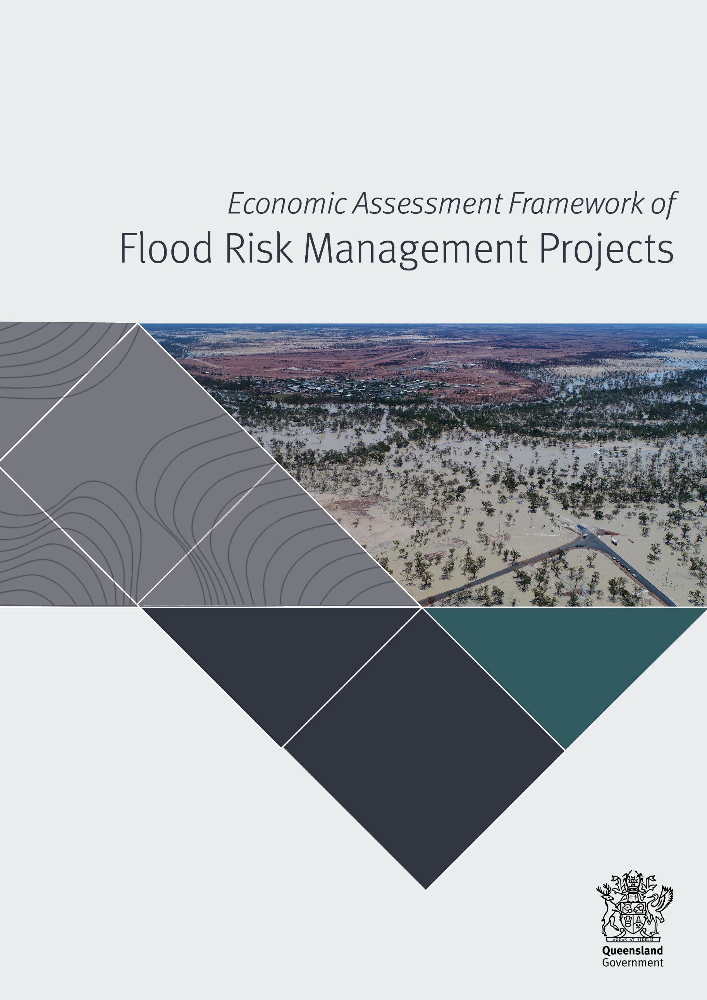
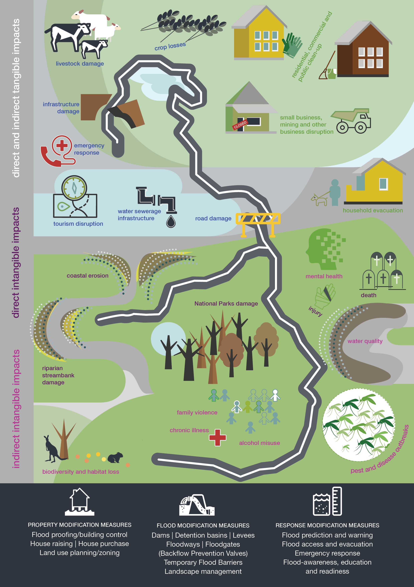
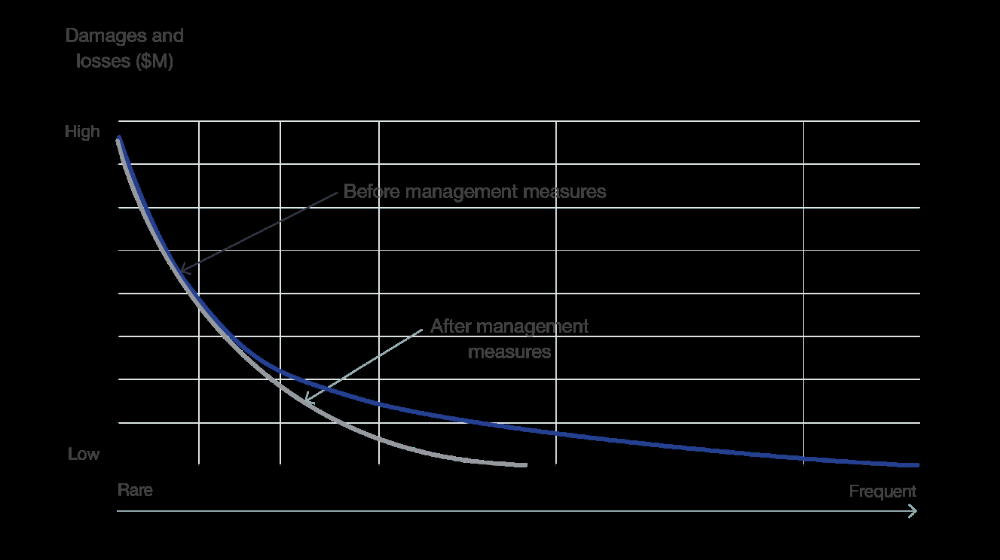
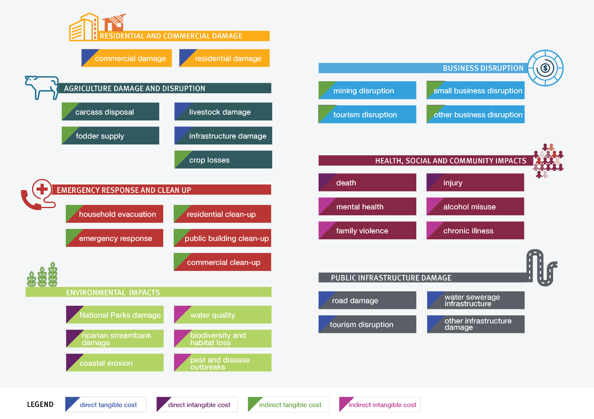
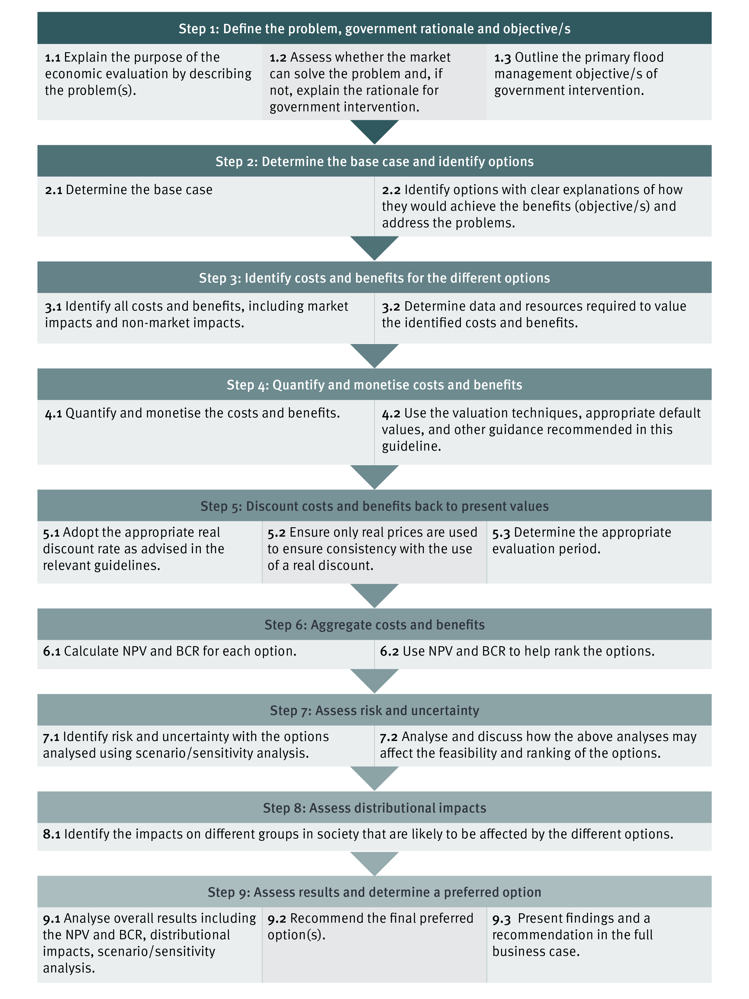

# Economic Assessment Framework of Flood Management Projects (2021)

> **Source**: Queensland Reconstruction Authority
> **URL**: https://www.qra.qld.gov.au/sites/default/files/2021-05/economic_assessment_framework_of_flood_management_projects_2021_0.pdf
> **Licence**: © State of Queensland; emergency-management practitioner reference
> **Retrieved**: 2026-05-07T23:43:44Z
> **SHA-256**: `0f5fe2bb9204d0c498e46a2239c8f5b74d741e5e04f442a5150dcdf6d095e98c`
> *Converted from PDF to Markdown format.*

---
## Page 1

---
## Page 2

____________________________________________________________________________________________ 
Economic Assessment Framework of Flood Risk Management Projects 
ii 
Document details 
Security classification 
Public 
Date of review of security classification 
April 2021 
Authority 
Queensland Reconstruction Authority 
Document status 
Final 
Version 
1.0 
QRA Reference 
DOC/20/64161 
Copyright 
This publication is protected by the Copyright Act 1968. 
© The State of Queensland (Queensland Reconstruction Authority) February 2021. 
Licence 
This work is licensed by State of Queensland (Queensland Reconstruction Authority) under a 
Creative Commons Attribution (CC BY) 4.0 International licence. To view a copy of this 
licence, visit: 
www.creativecommons.org/licenses/by/4.0/ 
 In essence, you are free to copy, communicate and adapt this publication, as long as you 
attribute the work to the State of Queensland (Queensland Reconstruction Authority).  
Interpreter 
The Queensland Government is committed to providing accessible services to 
Queenslanders from all culturally and linguistically diverse backgrounds. If you have 
difficulty in understanding this report, you can access the Translating and Interpreting 
Services via www.qld.gov.au/languages or by phoning 13 14 50. 
Disclaimer 
While every care has been taken in preparing this publication, the State of Queensland 
accepts no responsibility for decisions or actions taken as a result of any data, information, 
statement or advice, expressed or implied, contained within. To the best of our knowledge, 
the content was correct at the time of publishing. 
Copies  
Copies of this publication are available on our website at www.qra.qld.gov.au. Further copies 
are available upon request to: 
Queensland Reconstruction Authority 
PO Box 15428 
City East  QLD  4002 
Phone (07) 3740 1700 
info@qra.qld.gov.au 
www.qra.qld.gov.au

---
## Page 3

 
____________________________________________________________________________________________ 
Economic Assessment Framework of Flood Risk Management Projects 
 
iii 
Acknowledgements 
This Economic Assessment Framework of Flood Risk Management Projects has been delivered as an 
initiative of the Brisbane River Strategic Floodplain Management Plan implementation. This is a resource for 
flood risk practitioners, state and local governments to help improve the robustness and consistency of 
economic assessments supporting decision-making and investment in flood risk management and 
intervention throughout Queensland.  
This Framework was developed by the Brisbane River Strategic Plan Economic Assessment Working Group, 
which included the following members: 
• 
Queensland – Ella Harrison (Chair and co-author), Andy Wyer, Queensland Reconstruction Authority 
• 
New South Wales – Duncan McLuckie, Angela Toniato, Department of Planning, Industry and 
Environment  
• 
Victoria – Mike Edwards, Department of Environment Land, Water and Planning 
• 
Research community – Andrea Keating, RMIT University 
• 
Private practice – Jim Binney, NCEconomics (co-author), Mark Babister, WMAwater, Rhys Thomson, 
RHELM. 
The Framework has also been reviewed by key stakeholders and end users. The working group wishes to 
thank all those involved in the development of this document. 
Disclaimer 
The guidance, methods and approaches discussed in this document are based on current best practice and 
research available at the time of development. This is expected to be a continually improving and 
developing field. Users of this Framework are strongly advised to satisfy themselves that the methods 
employed are appropriate and fit for purpose for the specifics of the project.  
Definitions  
Terms shown in italics throughout this document are defined below 
Term 
Definition applied in this Framework 
Disaster resilient 
communities 
Communities are disaster resilient when (1) they understand the potential disaster risk 
they face; (2) they work together to better manage the disaster risk; (3) they seek new 
opportunities to reduce disaster risk; and (4) they continuously improve how we 
prepare for, respond to and recover from disasters. 
Multi-criteria assessment 
Multi-criteria assessment is a decision-making tool used to evaluate problems when 
one is faced with several different alternatives and expectations and wants to find the 
best solutions with regard to different and often conflicting objectives. 
Return on investment 
Return on investment is a financial metric that is widely used to measure the probability 
of gaining a return from an investment. It is a ratio that compares the gain or loss from 
an investment relative to its cost. It is as useful in evaluating the potential return from a 
stand- alone investment as it is in comparing returns from several investments.  
Net present value 
Net present value (NPV) is the present (current day) value of the benefits and costs 
incorporated into the economic analysis.

---
## Page 4

 
 
 
____________________________________________________________________________________________ 
Economic Assessment Framework of Flood Risk Management Projects 
 
iv 
Contents 
Acknowledgements ...................................................................................................................... iii 
Disclaimer ................................................................................................................................... iii 
Definitions .................................................................................................................................. iii 
Explanatory summary .................................................................................................................... 1 
1. 
Introduction and overview .................................................................................................... 4 
1.1. 
Policy context ....................................................................................................................... 4 
1.2. 
Developing the Framework .................................................................................................... 4 
1.3. 
Purpose and scope ............................................................................................................... 5 
2. 
Key concepts in this Framework ............................................................................................ 8 
2.1. 
Economic assessment versus financial assessment ............................................................... 8 
2.2. 
Damage and losses ............................................................................................................... 8 
2.3. 
Flood risk management in Australia ....................................................................................... 8 
2.4. 
Types of flood damage .......................................................................................................... 9 
2.5. 
Average annual damage ........................................................................................................ 9 
3. 
Principles of economic assessment in floodplain risk management ........................................ 11 
3.1. 
Proportionate assessments .................................................................................................. 12 
3.2. 
Qualify everything ................................................................................................................ 12 
3.3. 
Quantify as much as practicable ........................................................................................... 12 
3.4. 
Focus on the most relevant variables .................................................................................... 12 
3.5. 
Capture full benefits of options ............................................................................................ 13 
4. 
Framework stages .............................................................................................................. 14 
4.1. 
Stage 1: Scope the project .................................................................................................... 14 
4.1.1. Data requirements ..................................................................................................... 14 
4.2. 
Stage 2: Qualify all sources of flood damage ......................................................................... 15 
4.2.1. Select the appropriate tier ..........................................................................................16 
4.3. 
Stage 3: Undertake the quantified assessment .....................................................................16 
4.4. 
Stage 4: Outline assumptions and limitations, undertake sensitivity analysis on parameters 
with high level of uncertainty................................................................................................ 17 
4.5. 
Stage 5: Communicate the results ........................................................................................ 17

---
## Page 5

 
 
 
____________________________________________________________________________________________ 
Economic Assessment Framework of Flood Risk Management Projects 
 
v 
5. 
Quantification methods ...................................................................................................... 18 
5.1. 
Other co-benefits and co-investment opportunities created from flood initiatives .................. 25 
5.2. 
Cost estimation methods .................................................................................................... 25 
5.3. 
Discounting ........................................................................................................................ 26 
5.4. 
Time period for the analysis ................................................................................................ 27 
6. 
Damage parameters in option assessments ......................................................................... 28 
6.1. 
Land-use planning ............................................................................................................... 31 
6.2. 
Building control/resilient design ......................................................................................... 32 
6.3. 
Emergency response ........................................................................................................... 33 
6.4. 
Community awareness and resilience .................................................................................. 34 
7. 
Economic assessment as a tool for decision-making............................................................. 35 
7.1. 
Cost–benefit analysis ......................................................................................................... 35 
7.1.1. Steps of a cost-benefit analysis ................................................................................. 37 
7.1.2. Interpreting the results of a cost-benefit analysis ....................................................... 38 
7.2. 
Cost-effectiveness analysis ................................................................................................. 39 
7.3. 
Common pitfalls of a cost-benefit analysis ........................................................................... 39 
8. 
References ........................................................................................................................ 41 
 
Flood damages qualification form ..................................................................... 42 
 
Non-market valuation techniques ..................................................................... 45 
 
Floor-level survey capture methods ................................................................... 47 
C.1. 
Capture methods ................................................................................................................ 47 
C.2. 
Influence of survey accuracy on flood damage assessments ................................................. 48 
 
Indicative unit values for Tier 1 assessments ..................................................... 50

---
## Page 6

 
 
____________________________________________________________________________________________ 
Economic Assessment Framework of Flood Risk Management Projects 
 
1 
Explanatory summary 
Queenslanders are no strangers to flooding – it is one of our greatest 
natural disaster risks. The impacts of flooding are widespread with 
individuals, communities, businesses and the environment potentially 
impacted, both directly and indirectly.  
Some impacts of flooding are easier to measure and mitigate against than others. We know that investing in 
flood risk mitigation is key to minimising the need for, and cost of recovery. 
The Queensland Government is committed to strengthening disaster resilience so that our communities are 
better equipped to deal with the inevitable challenges we face from floods and other natural disasters.  
What is the problem to be addressed? 
To effectively invest in flood risk mitigation, it is important to be able to quantify all the types of damages 
resulting from floods, and fairly compare a wide range of possible options, from community awareness and 
education activities to building more resilient homes, to ensure targeted investment provides the greatest 
return.  
To date, there has been an absence of state or national guidance on such assessments, leading to a wide 
variety of approaches, methodologies, data and results. This has potentially impeded the necessary 
investment in flood mitigation.  
How does this Framework help?  
This Framework has been developed to bridge that gap and is a first for Queensland. It identifies methods to 
quantify both the tangible costs – physical damage to property, assets, as well as impacts to businesses and 
community disruption – and the intangible costs – such as impacts on mental health, loss of life, injury and 
environmental damage.  
This Framework was developed based on defensible methods, applicable to the Queensland landscape, 
extending the economic framework elements established previously by government to include a wider range 
of damage categories as well as providing methods for assessing a broader array of mitigation options, 
including community awareness and resilience, disaster management and resilient building designs.  
* Source: http://australianbusinessroundtable.com.au/assets/documents/ABR_building-resilience-in-our-states-and-territories.pdf 
 
Queensland incurred 60 per cent of the national economic 
cost of natural disasters over the past decade.  
This cost is estimated at $11 billion per year, including      
$7 billion in flood-related costs.*  
If unmanaged, the impacts of climate change and 
population growth are likely to further exacerbate flood   
risk in Queensland.

---
## Page 7

 
 
____________________________________________________________________________________________ 
Economic Assessment Framework of Flood Risk Management Projects 
 
2 
How can this Framework be applied to projects?  
This Framework outlines various methodologies to quantify damage caused by flooding or the benefits of 
implementing flood risk mitigation activities. The methodologies are used in support of economic 
assessment processes and are underpinned by guiding principles (outlined in Section 3).  
The principles ensure that any economic assessment is proportionate to the project, and that all impacts are 
qualified, and where possible quantified. The principles also point to the need to determine the most relevant 
variables through the economic assessment and to capture the full benefits of potential options.  
Further, the Framework describes a five-stage process for undertaking economic assessment for flood risk 
management (outlined in Section 4) and provides tools to undertake that economic assessment, 
underpinned by the guiding principles mentioned above (refer Figure 1). 
Figure 1: Stages for economic assessment underpinned by guiding principles  
By following this approach and utilising the guidance material within, practitioners have access to the level of 
detail necessary to undertake economic assessment of the various impacts of flooding, ensuring 
consideration is given to the full range of mitigation options.    
This is a key tool for local and state governments, which provides a comprehensive framework to undertake 
consistent and comparable economic assessments. This Framework can be used by practitioners to 
undertake economic assessments, as well as by governments to support decision-making, with the 
knowledge that assessments have been undertaken objectively and consistently.  
 
Stage 1: Scope the project 
Ensure that the work undertaken is proportionate and fit for purpose. 
Stage 2: Qualify all sources of flood damage 
Identify all dominant sources of damage and use a systematic approach to selecting a tier. 
Stage 3: Undertake the quantified assessment 
Identify and quantify the benefits, undertake the quantified assessment for the selected tier across 
the range of scenarios being considered. 
Stage 4: Sensitivity analysis of uncertainties 
To clarify the robustness of the assessment and validity of the chosen response or option. 
Stage 5: Communicate the results 
The information needs to be accessible to a wide range of audiences and concisely summarise the process. 
 
 
 
 
 
Economic 
assessment is 
proportionate  
to the scale  
of the project. 
Qualify all impacts 
to understand flood 
damage  
and inform 
decision-making. 
Quantify as many 
impacts as  
practical, including 
intangible impacts. 
Determine the 
variables which will 
contribute most to 
damage 
calculations. 
Capture the full 
benefits of options. 
 
 
Stages 
Principles

---
## Page 8

 
 
____________________________________________________________________________________________ 
Economic Assessment Framework of Flood Risk Management Projects 
 
3

---
## Page 9

 
 
____________________________________________________________________________________________ 
Economic Assessment Framework of Flood Risk Management Projects 
 
4 
1. 
Introduction and overview   
1.1. Policy context 
In Queensland flooding is one of our greatest natural disaster risks. The Queensland Government is 
committed to strengthening disaster resilience so our communities are better equipped to deal with the 
increasing prevalence of natural disasters, such as flooding. 
The Queensland Strategy for Disaster Resilience (2017) aligns strongly with the National Strategy for 
Disaster Resilience (2011) to build disaster resilient communities across Australia.  
Two of the priority outcomes for achieving more disaster resilient communities identified within the National 
Strategy for Disaster Resilience are: 
• 
using consistent methodologies and frameworks in relevant impact assessments 
• 
costs and benefits associated with hazard management informing risk reduction activities. 
Within this, governments at all levels have a responsibility to identify and implement strategies to manage 
disaster risks. The National Strategy for Disaster Resilience recognises that consistent information on the 
costs and benefits of risk management options, which considers the full impacts on the social, built, 
economic and natural environments, is required to support this. 
Australia’s National Disaster Risk Reduction Framework (2018) guides national, whole-of-society efforts to 
proactively reduce disaster risk in order to minimise the loss and suffering caused by disasters. It is designed 
to leverage the work and progress made across all sectors since the release of the National Strategy for 
Disaster Resilience to better understand and reduce disaster risks, improve resilience, and bolster the 
capability and capacity of communities to withstand natural hazards. 
Traditionally economic assessments for flood management projects in Australia, have focused on the 
tangible damage of flooding, particularly to property. Other impacts of flooding, such as environmental or 
social impacts, are typically considered qualitatively or assessed through a multi-criteria assessment. To date 
the absence of state or national guidance on undertaking such assessments has also led to a wide variety of 
approaches, methodologies, data and results. This creates an unnecessary layer of complexity when seeking 
to compare and prioritise projects within states and across Australia. It can also lead to the underestimation 
of the return on investment resulting from flood risk management projects, due to the incomplete capture of 
benefits.  
This Economic Assessment Framework of Flood Risk Management Projects (herein ‘the Framework’) is a 
key step towards consistent, comparable and complete economic assessments as a tool to support increased 
investment in risk mitigation and disaster resilient communities. 
1.2. Developing the Framework 
This Framework has been developed by a working group, which included membership from three state 
governments, as well as researchers and private flood practitioners. Consultation occurred across relevant 
Queensland state and local government agencies in developing the Framework.  
A substantial literature review was undertaken to inform the development of the Framework. This not only 
looked at current national and international practice on flood economic assessments, but also looked to 
identify emerging practice in methods to assess some of the previously unquantified impacts. From this, a 
comprehensive framework was developed based on defensible methods, applicable to the Queensland 
landscape.

---
## Page 10

 
 
____________________________________________________________________________________________ 
Economic Assessment Framework of Flood Risk Management Projects 
 
5 
1.3. Purpose and scope  
This Framework will improve the robustness and consistency of economic assessments supporting decision-
making and investment in flood risk management intervention. The Framework builds on the Queensland 
Disaster Resilience and Mitigation Investment Framework (2019), which provides high-level guidance on 
effective investment decision-making and prioritisation to support disaster resilience and mitigation across 
Queensland.  
The Framework establishes the recommended approach for undertaking economic assessments for projects 
which may, at some stage, seek state government funding. It has been developed in support of the 
Queensland Framework for Flood Risk Management (QRA, 2021), and is also consistent with the national 
Handbook 7: Managing the Floodplain: A Guide to Best Practice in Flood Risk Management in Australia 
(AIDR, 2017). It has been developed specifically for application in Queensland, though may also be 
appropriate in other states and territories. However, as other jurisdictions have specific guidance relating to 
economic assessments of projects, practitioners should seek agreement to its use from the relevant lead 
agency prior to application outside of Queensland. 
Economic assessments can be used to support issue identification, decision-making and evaluation 
activities. The Framework has been developed to support a range of potential uses including: 
• 
baseline cost estimates, to understand the potential damage caused by flooding in areas 
• 
options assessment, to inform option assessment through the form of cost–benefit analysis (CBA) 
• 
pre-feasibility assessments, to support the development of preferred options and determine the 
viability 
• 
measuring outcomes, as a tool to track the outcomes delivered through intervention. 
There are several policy/program/project cycles that are used across Australia. Many of these include an 
economic assessment as part of the decision-making process. This Framework has been developed for use 
early in the policy/program/project cycle to give a high-level assessment of the overall approach, and 
expected benefits and costs, as shown in Figure 2 below. It is important to note that economic assessments 
can be used at multiple stages within many of the project cycles, depending on the decisions to be made and 
the degree of rigour required, reflecting the interactive nature of project cycles.

---
## Page 11

 
 
____________________________________________________________________________________________ 
Economic Assessment Framework of Flood Risk Management Projects 
 
6 
 
FRAMEWORK 
APPLIED 
STAGE/ GATE 
 
 
Initiate 
Plan 
Procure 
Deliver 
Operate 
Benefits / Close 
Project Decision 
Framework (PDF) 
Local/ 
State 
(Qld) 
Stage 1: 
concept 
selection 
stage 
Stage 2:  pre-
feasibility 
stage 
Stage 3: 
feasibility 
stage 
Stage 4: 
planning 
stage 
 
Stage 5: 
delivery 
stage 
Stage 6: 
operate and 
maintain 
stage 
 
Stage 7: 
abandon 
stage 
Project Assessment 
Framework (PAF) 
State 
(Qld) 
Stage 1: 
strategic 
assessment 
of service 
requirement 
Stage 2: 
preliminary 
evaluation 
Stage 3:  
business 
case 
development 
Stage 4: 
supply 
strategy 
development 
Stage 5: 
source 
supplier/s 
Stage 6: 
establish 
service 
capability 
Stage 7: 
deliver 
service 
Stage 8: 
benefits 
realisation 
 
Infrastructure Investor 
Assurance Framework 
(IIAF) 
State 
(NSW) 
Needs 
confirmation: 
Gate O go / 
no go 
Needs 
analysis: 
Gate 1 
strategic 
options 
Investment 
decision: 
Gate 2 
business 
case 
Procure:  
Gate 3 
readiness for 
market 
Procure: 
 Gate 4 
tender 
evaluation 
Deliver and 
initial 
operation: 
Gate 5 
readiness for 
service 
 
Benefits 
realisation: 
Gate 6 
benefits 
realisation 
 
Infrastructure 
Australia Assurance 
Framework (IAAF) 
National 
Stage 1: 
problem 
identification 
and 
prioritisation 
Stage 2: 
initiative 
identification 
and options 
development 
Stage 3: 
business 
case 
development 
Stage 4: 
business 
case 
assessment 
 
Stage 5: 
post-
completion 
review 
 
 
 
Queensland 
Government’s 
Business Case 
Development 
Framework 
State 
(Qld) 
Stage 1: 
strategic 
assessment 
Stage 2: 
options 
analysis 
Stage 3: 
detailed 
business 
case 
 
 
 
 
 
 
 
 
Preliminary Cost Benefit Analysis may be undertaken per guidelines 
 
Cost Benefit Analysis to be undertaken per guidelines 
 
Cost Benefit Analysis potentially informs decision making 
Figure 2: Potential application of the Framework within policy/program/project cycles 
Using a CBA framework to underpin analysis is fundamental to all of the policy/program/project cycles 
outlined in this document. The key differentiator is not necessarily whether a CBA should be undertaken, but 
how rigorous and comprehensive the CBA should be. This guideline therefore outlines a three-tiered system 
of assessments based on the requirements of decision-makers, data availability and quality, with Tier 1 being 
the least rigorous. These assessments progressively require more detail, more data, more complex analysis 
and greater resources (skills and financial resources). This is outlined in Section 4.2.1.  
As a general guide: 
• 
Tier 1 and 2 level assessments should be sufficient for pre-feasibility, preliminary evaluations, 
smaller project proposals or funding applications, and the initial identification of options 
assessments.  
• 
Tier 3 level assessments are likely to be required for very large projects, policies or programs that 
require changes to regulatory instruments, or controversial policies or projects that have major 
distributional impacts across stakeholder groups.  
In some cases, there are specific requirements. For example, under the Queensland Government’s Business 
Case Development Framework, a detailed business case would include a rigorous CBA for projects with a 
capital investment exceeding $100 million.  
Decision-making on management of natural disasters generally lies in the public sector, as the scale and 
scope of management actions typically benefit the broader community. Management measures to limit the 
impacts of natural hazards on the community need to be considered from a range of perspectives, all of 
which can influence decision-making. These can include the practicality and feasibility of the option (both to 
implement and to manage long term), community attitude and acceptance of the solution, social and cultural 
impacts of the solution, environmental impacts, the potential to gain funding from external sources to 
support implementation of local solutions, and economic assessment.

---
## Page 12

 
 
____________________________________________________________________________________________ 
Economic Assessment Framework of Flood Risk Management Projects 
 
7 
Economic assessments are one of the tools used to support decision-making, but should not be relied on 
exclusively as they are seldom able to capture the full range of considerations. However, when done well, 
they are a powerful tool for highlighting the impacts of flooding, as well as the benefits and costs from 
interventions. Furthermore, they use an approach consistent with the assessment of other public investments 
(e.g. infrastructure), ensuring the relative merits of flood management interventions are considered on an 
equal basis. 
This Framework is not a prescriptive standard. However, it encapsulates current best practice and provides 
pragmatic and robust approaches to economic assessments, and will be applicable to many situations. 
Importantly, this Framework builds on and is complementary to other analytical approaches, tasks and 
consultation undertaken for flood management activities. 
It is intended that this Framework becomes a living document, with periodic revision to include new 
development, approaches and data, as well as feedback from users of the Framework.

---
## Page 13

 
 
____________________________________________________________________________________________ 
Economic Assessment Framework of Flood Risk Management Projects 
 
8 
2. 
Key concepts in this Framework 
2.1. Economic assessment versus financial assessment 
Economic assessment quantifies in monetary terms the social costs and benefits of activities. In the case of 
flood risk management, this could be the impacts of floods occurring, or the consequences of intervention. 
Economic assessment focuses on the society as a whole and is a broad appraisal that includes consideration 
of market (e.g. priced) values such as damage to houses, and non-market values such as the loss of 
recreational amenity values. 
In contrast, financial assessment views investment decisions from the perspective of an organisation, entity 
or individual. It assesses the viability of a project based on the direct effects on the cash flow. It considers 
whether the organisation’s projected income base will be sufficient to cover expenditures and whether the 
financial return is sufficient to make the investment affordable (or commercially viable or profitable).  
This Framework is based on economic principles of valuation and assessment. 
2.2. Damage and losses 
The definition and use of ‘damage’ and ‘loss’ vary depending on the situation to which they are applied. In 
the context of economic assessment, ‘damage’ is a broader concept that includes both the tangible and 
intangible impacts, whereas ‘loss’ is commonly understood as the monetised outcome of direct or indirect 
damage. Losses are always evaluated in monetary terms, whereas damage may also be quantified using 
other metrics or methods.  
2.3. Flood risk management in Australia 
This Framework has been developed in support of wider flood risk management processes in Queensland 
specifically, however it may also be relevant to other states in Australia.1 These processes are documented 
within the Queensland Framework for Flood Risk Management, and the national Handbook 7: Managing 
the Floodplain: A Guide to Best Practice in Flood Risk Management in Australia (Handbook 7).  
 
An understanding of flood likelihood and behaviour is a key input into economic assessments for flood risk 
management. This extract, from Handbook 7, describes what is meant by ‘flood behaviour’, with further 
detail included within the relevant sections of the handbook. 
                                                                
1 Practitioners are advised to seek agreement to its use from the relevant lead agency prior to application outside of 
Queensland. 
Flood behaviour 
For a particular floodplain, flood behaviour can be studied and the likely location, type and scale of effects for 
a range of floods can be determined within reasonable accuracy to inform its management. With floods, it is 
not a matter of if, but when, the flood will occur. Understanding flood behaviour, including potential alterations 
due to changes in climate or catchment development, enables us to assess the likely impact of flooding on the 
community and examine options to manage the risk. 
Flood behaviour depends upon a range of factors, including the source of flooding, catchment and floodplain 
location, size, shape, topography, vegetation, underground geological features and development. Key 
components to adequately understanding flood behaviour include understanding the probability of flooding, 
flow conveyance and storage functions of the floodplain, and the variation in the drivers and degree of flood 
hazard within the floodplain.

---
## Page 14

 
 
____________________________________________________________________________________________ 
Economic Assessment Framework of Flood Risk Management Projects 
 
9 
2.4. Types of flood damage 
The economic assessment of floods focuses on the quantification of the damage caused by a range of flood 
events. This damage can be defined as either tangible or intangible. Tangible damage is that for which a 
monetary value can be easily assigned, while intangible damage is that to which a monetary value cannot 
easily be attributed. 
Damage can be further categorised as either direct or indirect. Direct damage is caused by the direct 
interaction with the floodwaters, causing damage or disruption. Indirect damage is the flow-on effects from 
the flood events, such as loss of economic activity and wages, traffic disruption, and loss of individual and 
community welfare. Some common categories of flood damage are provided in Table 1 below. 
Table 1: Categories of flood damage 
Direct tangible damage 
Indirect tangible damage 
Intangible damage 
Losses incurred as a result of the disaster event 
that have a market value  
Any tangible flow-on effects, not directly caused by 
the natural disaster but arise as a consequence of 
the damage and destruction  
Direct and indirect damage that cannot be easily 
priced 
• 
Property: 
− 
residential 
− 
commercial 
− 
industrial 
− 
public assets 
− 
community infrastructure 
− 
vulnerable facilities 
• 
Transport (damage to assets): 
− 
roads, rail, bridges 
− 
airports, train stations 
 
− 
passenger transport 
− 
active transport facilities along ports 
• 
Agriculture 
• 
Motor vehicles 
• 
Emergency costs 
• 
Alternative accommodation 
• 
Clean-up and rehabilitation 
• 
Business disruption 
• 
Disruption of public services and services 
to the community 
• 
Transport disruptions and indirect costs 
(travel time, delays, vehicle operating 
costs)  
• 
Mortality (loss of Life) 
• 
Morbidity (injury, stress and mental 
health, other flood-related health impacts) 
• 
Environmental values 
• 
Cultural, heritage, social and recreational 
values 
 
2.5. Average annual damage 
Depending on its size (or severity), each flood will cause a different amount of flood damage to a flood-prone 
area. In many years there may be no damage, in some years there will be minor damage (caused by small, 
relatively frequent flood events), and in some years there will be major damage (caused by large, rare flood 
events). 
Average annual damage (AAD) is the average damage per year that would occur in a nominated area over a 
very long period of time. It is the probability-weighted expected damage that is estimated to occur in a given 
year under multiple flood magnitudes. It can be understood using the standard risk equation: 
𝑅𝑅𝑅𝑅𝑅𝑅𝑅𝑅= 𝐸𝐸𝐸𝐸𝐸𝐸𝐸𝐸𝐸𝐸𝐸𝐸𝐸𝐸𝐸𝐸 𝑎𝑎𝑎𝑎𝑎𝑎𝑎𝑎𝑎𝑎𝑎𝑎𝑎𝑎 𝑎𝑎𝑎𝑎𝑎𝑎𝑎𝑎𝑎𝑎𝑎𝑎 𝑑𝑑𝑑𝑑𝑑𝑑𝑑𝑑𝑑𝑑𝑑𝑑 = ෍
(𝐶𝐶𝐶𝐶𝐶𝐶𝐶𝐶𝐶𝐶𝐶𝐶𝐶𝐶𝐶𝐶𝐶𝐶𝐶𝐶𝐶𝐶𝑖𝑖 × 𝐿𝐿𝐿𝐿𝐿𝐿𝐿𝐿𝐿𝐿𝐿𝐿ℎ𝑜𝑜𝑜𝑜𝑜𝑜𝑖𝑖)
𝑛𝑛
𝑖𝑖=1
 
Where: 𝑖𝑖 is the hazard event, 𝑛𝑛 is the number of hazard events, consequence is the damage or loss from a 
hazard event, and likelihood is the probability of a hazard event occurring. 
If the damage associated with various annual events is plotted against their probability of occurrence, the 
AAD is equal to the area under the consequence–probability curve. AAD provides a basis for comparing the 
economic effectiveness of different management measures against floods of all sizes (i.e. their ability to 
reduce the AAD). This is shown in Figure 3 below where the blue line shows the baseline consequence–
probability curve and the grey line shows the consequence-probability curve after management measures are 
implemented. It is the difference in the areas under the curves (change in AAD) that represents the benefits of 
the management actions (i.e. benefits are typically a reduction in future costs or an avoided cost). This can 
then be compared to the costs of implementing the management actions.

---
## Page 15

 
 
____________________________________________________________________________________________ 
Economic Assessment Framework of Flood Risk Management Projects 
 
10 
 
 
 
 
 
 
 
 
 
 
 
 
 
 
Figure 3: Consequence–probability curve – before and after management measures 
AAD is the best practice approach for understanding potential economic impacts of flood hazards and for 
economic analysis of flood risk adaptation options. It is consistent with the framework used by insurance 
companies to value risk (to underpin insurance premiums), and is used widely by the United Nations and    
the World Bank.

---
## Page 16

 
 
____________________________________________________________________________________________ 
Economic Assessment Framework of Flood Risk Management Projects 
 
11 
3. 
Principles of economic assessment in floodplain risk management 
Economic assessments can be used in the consideration of floodplain risk management activities. They seek 
to quantify the damage caused by flooding and the benefits resulting from option implementation, and guide 
the decision-making processes in determining which options should be considered further or prioritised for 
implementation. 
The economic analysis should not be undertaken in isolation from other activities that are typical of 
floodplain risk management assessments, such as mapping, assessments of flood behaviour, identification 
of assets at risk, and consultation. These other activities provide the bulk of the data required to identify and 
parameterise the impacts for inclusion in the economic assessment. The economic analysis should be 
properly informed by and integrated with other analysis. 
The following principles should guide all economic assessments being undertaking as part of floodplain 
management studies, assessment and appraisal. 
 
 
 
 
 
 
 
 
 
 
 
 
 
 
 
 
 
 
 
Figure 4: Guiding principles of economic assessments  
 
 
PROPORTIONATE ASSESSMENTS 
Economic assessments should be proportionate to the stage of  the 
assessment and the scale of the project. 
QUANTIFY AS MUCH AS PRACTICAL 
Economic assessments should value the full range of factors as practicable.  
Low conservative valuation is preferred to no valuation. 
QUALIFY EVERYTHING  
Where quantification is not practical or possible, qualification of the damage   
or benefit should be provided. 
CAPTURE FULL BENEFITS OF OPTIONS 
Resilience measures provide more than simply avoided cost and the full range 
of benefits from option implementation should be quantified. 
FOCUS ON THE MOST RELEVANT VARIABLES 
Economic assessments should place more effort and resources into valuing the 
metrics that are most likely to materially change through option implementation.

---
## Page 17

 
 
____________________________________________________________________________________________ 
Economic Assessment Framework of Flood Risk Management Projects 
 
12 
3.1. Proportionate assessments 
Economic assessments are undertaken to support decision-making. They are just one of the tools used to 
support option analysis and prioritisation. As such, the time and cost invested in undertaking the 
assessments need to be proportionate to the stage of the project, the scale of the issue and the scale of the 
investment being sought.  
To support this, the Framework provides advice on three tiers of approaches, ranging in complexity, data 
requirements and accuracy. Through the process discussed in Section 4, users of this Framework select the 
appropriate tier for each parameter being quantified, based on the requirements of their project and the 
influence that parameter has on the overall assessment.  
3.2. Qualify everything 
The impacts of flooding are wide ranging and highly variable. Many are intangible and not readily 
quantifiable. As such, in many circumstances, it will not be practical or plausible to quantify all the impacts of 
flooding within the economic assessment process. However, it is important that these impacts are captured 
in some form, and this Framework recommends qualification of all flood impacts. 
In support of this, a template is provided (see Appendix A) for considering and qualifying all potential impacts 
of flooding for the study area of a project. The qualification process is an important step in the Framework, 
but can also be used to inform other stages of the decision-making process, such as the multi-criteria 
assessment. 
3.3. Quantify as much as practicable 
Historically, economic assessments for flood projects have focused principally on tangible property damage. 
While this practice captures a significant element of flood damage, and the methodologies for capture are 
readily available, it is increasingly being recognised that flood impacts are far more extensive and costly. 
While recent practice attempts to overcome this shortfall using other tools such as multi-criteria 
assessments, the absence of valuation has inferred a zero cost, leading to the underestimation of flood 
impacts, and hence the benefits of intervention.  
While it is recognised that not every impact can, or should, be qualified, this Framework encourages that as 
many are quantified as practicable within information and resource constraints for the analysis. This provides 
defensible, robust methodologies and data sources to quantify a diverse range of parameters, including 
direct and indirect tangible damage, as well as methods for approximating direct intangible costs and 
benefits as far as reasonably possible.  
3.4. Focus on the most relevant variables 
A key step to informing an economic assessment is to determine which parameters contribute the most to the 
damage calculations or are most likely to materially change with option implementation. It is these to which 
the greatest quantifying effort should be applied.  
As such, this Framework provides guidance on the range of options and corresponding significant variables, 
as well as providing three tiers of assessment, which can be varied for each parameter being considered. For 
those that are identified as being significant, a higher tier (2 or 3) might be selected, which either more 
holistically considers the impacts, or provides a more nuanced and detailed consideration of quantification.

---
## Page 18

 
 
____________________________________________________________________________________________ 
Economic Assessment Framework of Flood Risk Management Projects 
 
13 
3.5. Capture full benefits of options 
Interventions in flood risk management are not just about avoiding damage and harm. They can also enhance 
and catalyse economic activity, community wellbeing and vibrancy, and environmental health. As such, the 
practice of focusing purely on avoided damage in option assessment has again resulted in a trend to 
undervalue flood risk management investment. Where appropriate to the scale and stage of assessment, full 
benefit capture is advocated by this Framework, and tools to support this are contained within.

---
## Page 19

 
 
____________________________________________________________________________________________ 
Economic Assessment Framework of Flood Risk Management Projects 
 
14 
4. 
Framework stages 
The Framework for undertaking economic assessment for floodplain risk management projects in Queensland 
involves a five-stage process: 
 
 
 
 
 
 
 
4.1. Stage 1: Scope the project 
Once the need for an economic assessment has been established, the purpose, scope, scale, available data 
and required accuracy should be defined. This will ensure that the work undertaken is proportionate and fit 
for purpose.  This stage should consider a broad range of factors including: 
• 
the purpose of the assessment and what outcome is sought to be achieved 
• 
the stage of the assessment and how the findings will be used 
• 
the value of the project and, where applicable, the anticipated value of the options being assessed. 
This will determine the appropriate level of investment in undertaking the economic analysis, and 
the required level of certainty of the findings 
• 
what data is currently available, and what would need to be sourced or generated. This is further 
discussed in Section 4.1.1 
• 
the likely funding contributors – this Framework should be applied if public investment is likely, but 
is not necessary for privately funded projects and investigations 
• 
the spatial and temporal bounds of the assessment, which should align with the purpose of the 
assessment. For example, economic assessments supporting local investment decisions should 
remain within the bounds of the local community, and the timescales should align with objectives 
(short, medium or long-term) and, for structural measures, the life of the infrastructure proposed 
• 
whether wider indirect effects are significant and should be included in the assessment. 
4.1.1. Data requirements 
Data requirements can be broken into three categories (Figure 5) – data needed to define the flood likelihood 
and behaviour, data needed to understand the potential consequences, and data needed to quantify (put in 
dollar terms) the benefit/cost.  
FLOOD LIKELIHOOD AND BEHAVIOUR DATA, FOR EXAMPLE: 
• flood extents for a range of flood 
frequencies 
• flood behaviour metrics (e.g. depth, level, 
velocity, timing, hazard) 
• results from climate change or future 
development scenarios 
• observed flood behaviour from previous 
events. 
CONSEQUENCE DATA, DETERMINED SPATIALLY, FOR EXAMPLE: 
• demographic data (e.g. census data) 
• assets at risk (e.g. public infrastructure, motor 
vehicles, building footprints and floor levels) 
• 
land use zoning. 
QUANTIFICATION DATA , FOR EXAMPLE: 
• stage-damage curves (for building 
damage) 
• benefit transfer data (e.g. willingness 
to pay values) 
• value of statistical life 
• 
unit rates, cost estimates, asset life. 
Figure 5: Categories of data requirements 
 
 
5. Communicate the results 
4. Outline assumptions and undertake sensitivity analysis 
3. Undertake quantified assessment 
2. Qualify all parameters 
1. Scope the project

---
## Page 20

 
 
____________________________________________________________________________________________ 
Economic Assessment Framework of Flood Risk Management Projects 
 
15 
4.2. Stage 2: Qualify all sources of flood damage 
An initial qualification of all sources of flood damage is to be undertaken. This process will: 
• 
identify the dominant sources of damage 
• 
confirm existing data availability and identify where further data is required 
• 
facilitate a systematic approach to selecting the preferred quantification methodologies (assessment 
tier) 
• 
be used to inform multi-criteria assessments and other decision-making tools. 
This stage involves a high-level consideration of all the potential sources of flood damage, their likely 
significance in terms of contribution to total damage or potential to change through option consideration, and 
the available data for use in the assessment. Appendix A provides a pro forma to guide this process. 
 
Figure 6: Framework for estimating the social and economic cost of the flood disaster

---
## Page 21

 
 
____________________________________________________________________________________________ 
Economic Assessment Framework of Flood Risk Management Projects 
 
16 
4.2.1.  
Select the appropriate tier 
Part of this stage involves selecting the quantification method to be applied in Stage 3. For many of the 
damage categories, three methods or tiers are presented in this Framework (Figure 7), offering different levels 
of detail and accuracy.  
 
 
 
 
 
 
 
 
 
 
 
Figure 7: Levels of assessment – details and accuracy 
For each parameter that is included in the economic assessment, a tier should be selected that considers: 
• 
available data 
• 
available resources 
• 
potential influence on the decision or process. 
As such, varying tiers can be applied to the same project to optimise the confidence in the outputs with data, 
resources, time, cost and decisions being made. 
4.3. Stage 3: Undertake the quantified assessment  
Stage 3 involves quantifying the identified damage source using the methodology set out for the selected 
level of detail and accuracy (i.e. Tier 1, 2 or 3). Quantification methodologies are set out in Section 5. 
Option assessments also involve quantifying the incremental costs and benefits in the range of scenarios 
being considered. Assessments should be compared against a ‘base case’ (business as usual) to ensure that 
the benefits reflect the incremental reduction in damage and losses. 
Table 5 and Section 6 provide further guidance for option analysis.  
Through this process, the distributional consequences of each option – that is, who benefits (e.g. asset 
owner, area, industry) and who bears the costs – should be identified. 
At this stage, any additional benefits of the option beyond damage avoidance should be identified and 
quantified where appropriate. This is further discussed in Section 5.1. 
 
 
 
•
Minimum level of assessment 
•
Relies on default values rather than study-area specific data 
•
Allows for a ‘count’ of assets where changes cannot be easily quantified 
•
Low input data requirements 
•
Relies on combination of industry-standard values and study-area specific data 
•
Aims to capture relationship between flood event probability and potential damage 
•
Moderate input data requirements 
•
Relies on data specific to the study-area 
•
High degree of detail to allow for greater accuracy in the quantification of benefits/ 
disadvantages and comparison between preferred options 
•
Significant time, effort and cost involved, therefore warranted only where significant 
investment is proposed and probable

---
## Page 22

 
 
____________________________________________________________________________________________ 
Economic Assessment Framework of Flood Risk Management Projects 
 
17 
4.4. Stage 4: Outline assumptions and limitations, undertake sensitivity analysis 
on parameters with high level of uncertainty 
Economic assessments inherently involve assumptions, approximations and uncertainties. As such, where 
there is considerable uncertainty or ambiguity, or where substantial investment is required, sensitivity tests 
on selected parameters should be undertaken. 
Sensitivity testing ultimately clarifies the robustness of the economic assessment results and can reassure 
decision-makers that, despite uncertainty, the chosen response or option is valid. 
These tests must go beyond simple demonstration that the results change through varying the parameters. 
The tests should be used to understand: 
• 
whether the assessment results would materially change if the estimated values or input parameters 
were varied within a credible range (e.g. range for the days of home disposition: 5 days, 10 days, 15 
days) 
• 
the robustness of the assessment parameters (e.g. how far they can vary before the decision 
changes) 
• 
the influence of different parameters (e.g. whether assessment results are weighted towards a 
particular damage category, and whether that is reasonable and representative). 
There are several ways to undertake the sensitivity analysis, ranging from simple manipulation of input 
parameters to determine the impact on the final assessment, through to sophisticated stochastic modelling 
approaches to test the impacts of multiple input variables and assumptions simultaneously through 
approaches such as Monte Carlo simulations. 
4.5. Stage 5: Communicate the results 
Reporting the analysis and results is the final stage of the assessment process. It is important the reporting 
highlights the assumptions and limitations, as well as clearly and concisely summarising the results of the 
assessment. The information needs to be accessible to non-technical audiences while also providing the 
necessary information to those who may require more detail.

---
## Page 23

 
 
____________________________________________________________________________________________ 
Economic Assessment Framework of Flood Risk Management Projects 
 
18 
5. 
Quantification methods 
Flooding results in a diverse set of damage and losses, and therefore a wide range of data and valuation 
approaches are required. This section briefly outlines the different approaches that can be used to quantify 
damage and losses for inclusion within an economic assessment of flooding. The methods and data used will 
depend on the availability of data, the degree of robustness required to convince decision-makers, and the 
level of detail required for the analysis (Tier 1, 2 or 3). 
Table 2, Table 3 and Table 4 provide the quantification methods for each damage category included in this 
Framework. Wherever possible, three options, as described in Figure 7, are provided, but for some categories, 
particularly indirect tangible and intangible damage, this has not been possible at this point in time. This is 
expected to be resolved as research and practice evolves. 
Table 5 provides widely adopted methods for quantifying the costs of several flood mitigation options, with 
further discussion provided in Section 5.2.

---
## Page 24

____________________________________________________________________________________________ 
Economic Assessment Framework of Flood Risk Management Projects 
19 
Table 2: Direct tangible damage – overview of quantification methods (see Appendix D for unit values for Tier 1 ) 
Category 
Description 
Quantification approach – level of detail – direct tangible 
Tier 1 
Tier 2 
Tier 3 
Property – 
residential 
Damage caused to dwellings due to 
external and over-floor inundation. 
Includes all dwelling types. 
Treats structural, internal and 
external  sources of damage 
separately. 
Application of generalised 
stage-damage  curves. 
Floor-level database based 
on gross estimated levels 
(desktop algorithm or gross 
assumptions)* if available.  
* Refer to Appendix C for 
information regarding floor-
level survey methods and 
accuracy. 
Application of generalised adopted 
stage- damage curves. 
Floor-level database based on 
surveyed levels (desktop algorithm, 
mobile laser scanning (MLS), 
airborne laser scanning (ALS) or 
traditional survey – discussed 
further in Appendix C). 
Stage-damage curves derived for 
the study area specifically based 
on historic events or assessments 
from quantity surveyors. 
Floor-level database based on 
surveyed levels (desktop algorithm, 
MLS, ALS or traditional survey). 
Property – 
commercial 
Damage caused to business 
premises due to external and over-
floor inundation. 
Building and contents treated 
separately. 
Application of costs based on 
best available commercial 
stage-damage curves. 
Floor-level database based 
on gross estimated levels 
(desktop algorithm or gross 
assumptions). 
Tier 1 plus greater consideration of 
typology of commercial uses and 
corresponding contents curves. 
Floor-level database based on gross 
estimated levels (desktop algorithm 
or gross assumptions). 
Stage-damage curves derived for 
the study area specifically based 
on historic events or assessments 
from quantity surveyors 
For uses very susceptible to 
damage, greater consideration of 
size cost impacts may be 
warranted. 
Property – 
industrial 
Damage caused to industrial 
premises due to external and over-
floor inundation. 
Application of costs based 
on proportion of best 
available industrial stage-
damage curves.  
Tier 1 with consideration of 
typology, (e.g. hazardous materials). 
Stage-damage curves derived for 
the study area specifically based on 
historic events or assessments 
from quantity surveyors for uses 
very susceptible to damage, greater 
consideration of size cost impacts 
may be warranted. 
Property – 
public assets 
Buildings and facilities that do not 
have commercial uses but provide a 
service/ facility to the community, 
including community halls, 
recreational facilities, parks. 
Provide a count and 
measure of assets affected 
(by type). 
Identify significance (scale 
and or number). 
Obtain indicative values from 
council asset management 
systems, renewals annuity 
assessments or similar. 
Application of factored residential state-adopted stage-damage curves by 
asset type and scale, for example, community halls factored against 
residential buildings of a similar typology (e.g. slab on ground, brick 
construction). 
Cost based on m2/asset type, scaling of residential damage index by
Rawlinson’s or asset owners’ detailed asset management system if 
available. 
This could also include costs such as landscaping and fences. 
Utilities 
Direct damage to properties and 
utilities that provide critical services 
to the (local and/or broader) 
community (electricity, water 
supply, sewerage, 
telecommunications, emergency 
services). 
Provide a count of assets 
affected by type. 
Apply a proportion of residential 
damage. WSDOS (2014) 
recommends critical utility 
damages are taken as 7.5% of 
residential damages, particularly for 
residential areas where the ratio of 
utility assets to the count of 
buildings is relatively constant. 
Survey of historic damage costs to 
affected properties within study 
area. If significant, bespoke 
assessment to be undertaken in 
conjunction with relevant utility.

---
## Page 25

 
 
____________________________________________________________________________________________ 
Economic Assessment Framework of Flood Risk Management Projects 
 
20 
Category 
Description 
Quantification approach – level of detail – direct tangible 
 
 
Tier 1 
Tier 2 
Tier 3 
Community 
services 
infrastructure 
Direct damage to properties that 
provide services to vulnerable 
occupants, such as hospitals, 
education and care facilities. 
Provide a count of assets 
affected by type. 
Obtain indicative values from council 
/ State Government asset 
management systems, renewals 
annuity assessments or similar (by 
asset type). Estimate approximate 
m2 costs and apply to approximate 
area of assets at risk. 
Survey of historic damage costs to 
affected properties within Study 
Area. If significant, bespoke 
assessment to be undertaken in 
conjunction with relevant 
government agency. 
Transport 
(roads, rail and 
bridges) 
Direct damage caused to transport 
infrastructure due to inundation, 
scouring and erosion. 
Note: Where specific values are 
required (e.g. vehicle running 
costs), some transport- specific 
parameter values are available 
from the Australian Transport 
Assessment 
Planning website: www.atap.gov.au/ 
parameter-values/index 
Apply a proportion of 
residential damage. The 
Multi-Coloured Manual 
(2013) recommends road 
damages are taken as 15.9% 
of residential damages. 
Application of Unit Damages per Km 
inundated (DTMR data based on 
recent events). 
Include vehicle operation costs and 
travel time for major diversions. 
Vehicle operating costs c/km are 
available on the ATO website. Travel 
times typically based on average 
weekly earnings reported by the 
ABS. Aggregate estimates based on 
traffic counter data (if available). 
Determination of relationship 
between depth and damage, and 
duration and damage, applied to 
affected infrastructure in the Study 
Area. Apply relationship to known 
asset values. 
Include vehicle operation costs and 
travel time for major diversions. 
Vehicle operating costs c/km are 
available on the ATO website. Travel 
times typically based on average 
weekly earnings reported by the 
ABS. Aggregate estimates based on 
traffic counter data (if available). 
For larger projects where transport 
impacts are likely to be a major 
driver, there is additional detailed 
guidance provided in the Australian 
Transport Assessment and Planning 
(ATAP) Guidelines (2020). 
Transport 
(airports, train 
stations, ports) 
Direct damage to buildings and 
infrastructure at transport 
interchanges. 
Provide a count and broad 
measurement (e.g. ha) of 
assets affected. 
Bespoke based on assets and significance. 
Agriculture 
Livestock, crops, pastures, fences, 
equipment and supporting 
infrastructure (such as packing 
sheds, milling operations and pack 
houses). 
Measure of affected 
agricultural land areas (ha). 
Damages to assets (e.g. fences) 
based on basic unit costs from 
Rawlinson’s (or similar). 
Losses based on reported gross 
value of production for farm type. 
Data is available from Qld DAF, other 
state agriculture departments, or 
industry bodies. 
Tier 2 plus consideration of 
seasonality of floods, are gross 
values of losses to production (if all 
variable input costs already 
incurred) or gross margins (if 
variable costs can be avoided). 
Consider the period of delay until 
production recovers. 
Where possible, include estimated 
repair/ replacement cost of 
infrastructure (e.g. irrigation 
pumps). 
Establish regionally specific 
bespoke models based on above 
parameters.

---
## Page 26

 
 
____________________________________________________________________________________________ 
Economic Assessment Framework of Flood Risk Management Projects 
 
21 
Category 
Description 
Quantification approach – level of detail – direct tangible 
 
 
Tier 1 
Tier 2 
Tier 3 
Motor vehicles 
Vehicles are highly susceptible to 
flood damage, even at shallow 
depths (MCM): 
• 
vehicles generally written off 
if water enters the cabin, due 
to health risks from the water 
itself (e.g. Legionnaires 
disease) as well as damage 
to electricals 
• 
engine damage due to water 
entering via air intake and/or 
exhaust - requires total 
replacement (not cost 
effective – write off) 
• 
consideration of bow waves 
and local surge - damage can 
be caused at even shallower 
depths. 
ABS data for average number of vehicles per household and average vehicle age, applied to residential 
properties in flood affected area. State-wide data available from the ABS 9309.0 - Motor Vehicle Census, 
Australia. State transport agencies may be prepared to provide data at a more granular spatial scale for 
Tier 3 assessments. Average payout for a motor vehicle write off or theft is approximately $8,500/vehicle 
insurancestats.com.au/coverage/motor-syndicate/

---
## Page 27

 
 
____________________________________________________________________________________________ 
Economic Assessment Framework of Flood Risk Management Projects 
 
22 
Table 3: Indirect tangible damages 
Category 
Description 
Quantification approach – level of detail – direct tangible 
 
 
Tier 1 
Tier 2 
Tier 3 
Alternative 
accommodation 
(opportunity cost 
of loss of use) 
Where accommodation is required 
for the duration of the repair and 
recovery phase of a flood event. 
Allowance per residential 
property based on a standard 
number of days multiplied by a 
daily rate.  
Obtain daily rate for short-term 
rental in the areas. 
Tier 1 plus assess range for the 
number of days based on typical 
duration of flooding and 
estimated period for repairs. 
Tier 2 plus modelled duration of 
flooding and clean-up/repair 
period based on probabilistic 
flood damages. 
Business 
Interruption 
Interruption to businesses as a 
result of direct inundation or 
community closures and potentially 
disruptions to supply chains and 
distribution chains (if materially 
impacted). 
Multiplier of direct tangible 
estimates. 
Multiplier of direct tangible 
estimates. 
Local study of impacts based on 
local industry structure and 
turnover (receipts)/ margins for 
each industry. 
Loss of earnings Flooding of residential properties 
may require households to take 
time off work to attend to the 
evacuation and organising repairs. 
This time off work is reflected as a 
loss of earnings. 
Apply Average Weekly earnings 
data (ABS) to workplaces flooded 
(average employees). 
Tier 1 plus a degree of differentiation to reflect the local workforce 
(industries and professions) based on ABS census data. 
Emergency costs Costs incurred by emergency 
services responding to flood events, 
beyond business-as-usual costs. 
This will vary depending on the 
service required, severity of 
flooding, and communities 
impacted. 
Simple flat rate per household 
impacted. 
Detailed analysis of previous floods (scale, prevalence and cost by 
callout type) and the development of predictive models and 
estimates. 
Clean-up costs 
Immediate clean-up works 
following flood event (removal of 
damaged items, washing out mud 
and debris, sanitisation). 
Apply a flat $ amount per 
property based in a 
predetermined number of hours 
(and costs) and an allowance for 
materials. 
Tier 1 plus assess range for the number of days and materials 
required based on estimated flood depth and total area (m2 of   
assets at risk).

---
## Page 28

 
 
____________________________________________________________________________________________ 
Economic Assessment Framework of Flood Risk Management Projects 
 
23 
Table 4: Intangible damages (direct and indirect) – refer Appendix B for further discussions on methods  
 
Category 
Description 
Quantification approach – level of detail – direct tangible 
 
 
Tier 1 
Tier 2 
Tier 3 
Mortality 
Loss of life as a direct result of a flood. Value of a statistical life (VSL) is currently around $4.65 million (2020 dollars). 
Morbidity 
Injury, stress and mental health, other 
health related impacts. 
Available revealed or stated preference studies to avoid or reduce 
flood related health impacts (per household per year). Applied as an 
annual cost, regardless of over-floor flood affectation. 
Revealed or stated preference to 
avoid or reduce flood related 
health impacts (per household 
per year). 
Applied as an annual cost, 
regardless of over-floor flood 
affectation. 
Environ-
mental 
Values relating to biodiversity and 
ecology, e.g. water quality, 
erosion/accretion, amenity. 
Qualitative description. 
Benefit –transfer if appropriate 
data is available. (NB this will 
require specialist advice) 
Revealed or stated preference 
studies. (NB this will require 
specialist advice) 
Cultural/ 
heritage/ 
recreational 
Values relating to society’s personal 
attachment to ‘things’ (e.g. 
monuments, landmarks, 
environmental assets) can be lost or 
reduced as a result of flood damage. 
Qualitative description. 
Benefit –transfer if appropriate 
data is available. (NB this will 
require specialist advice) 
Revealed or stated preference 
studies. (NB this will require 
specialist advice)

---
## Page 29

 
 
____________________________________________________________________________________________ 
Economic Assessment Framework of Flood Risk Management Projects 
 
24 
Table 5: Cost quantification methods. (See Section 6 for further detail) 
Category 
Description 
Quantification approach – level of detail – direct tangible 
 
 
Tier 1 
Tier 2 
Tier 3 
Structural 
Mitigation 
Physical measures, such as levees, 
flood gates and dams, which seek to 
alter the flood behaviour. 
Unit rate method for construction 
costs (see Section 5.2). 
Concept design and quantities, 
gross assumptions regarding 
operational and maintenance 
costs. 
Preliminary / detailed design, 
consideration of life of assets, 
incorporation of operational and 
maintenance costs benchmarked 
from other projects. 
Voluntary 
House Raising 
Voluntary programs which raise 
eligible properties so that the lowest 
habitable floor is flood free to the 
designed event. 
Unit rate per eligible property. Costs are dependent on location and property type In lieu of local data, 
test viability under the following costs assumptions. 
Voluntary 
House 
Purchase 
Voluntary programs where eligible 
properties are purchased typically by 
the state or local council, and the land 
reused for non-occupied purposes 
(e.g. parks, open space, stock 
grazing). 
Median property value by suburb 
(realestate.com.au data, or RP 
data). 
Include an allowance for removal 
costs and other relevant 
transaction costs. 
Valuation by specific property 
using on- line estimation tools 
realestate.com.au. 
Include an allowance for removal 
costs and other relevant 
transaction costs. 
Property valuation survey and 
formal valuations by a registered 
valuer. 
Include an allowance for removal 
costs and other relevant 
transaction costs. 
Refer to Section 6 for discussion on approaches for other mitigation options

---
## Page 30

 
 
____________________________________________________________________________________________ 
Economic Assessment Framework of Flood Risk Management Projects 
 
25 
5.1. Other co-benefits and co-investment opportunities created from flood initiatives 
Many flood policies, plans and projects can result in other co-benefits or opportunities beyond flood 
mitigation. Where possible, these should be identified, scoped and incorporated into the economic 
assessment.  
For example, some flood mitigation actions such as revegetating catchments could improve the natural 
environment, amenity and potential recreation opportunities in addition to flood risk mitigation. Where 
practical, these co-benefits should be valued for incorporation into the economic assessment. Where 
realising these co-benefits is contingent on another action (e.g. another level of government establishing a 
walking track in the revegetated area), the costs of that action should also be included.  
Where a co-benefit is identified, there may be opportunities for co-investment on the flood intervention, 
recognising benefits accruing to multiple entities. While this should not influence the decision on whether 
the project proceeds or not, the valuation of co-benefits identified can form a basis for negotiating co-
investment. 
5.2. Cost estimation methods 
Common sources of unit data include Rawlinsons Construction Cost Guide and other industry standards. 
There are several frameworks available nationally and internationally with regard to cost estimation for 
engineering projects. Like the tiered approach provided in this Framework, they are based on varying 
degrees of complexity and accuracy, with corresponding input costs and time requirements. 
Table 6 summarises three of the most widely adopted systems. 
Table 6: Cost estimation frameworks 
AACE Class  
Estimates (US) 
ANSI Standard  
Classification (US) 
Association of  
Cost Engineers (UK) 
Typical use/ 
end purpose 
Class 5 
Order of magnitude estimate 
(-30/+50) 
Order of magnitude 
(-30/+30) 
Concept screening 
Class 4 
Budget estimate  
(-15/+30) 
Study estimate  
(-20/+20) 
Study or feasibility 
Class 3 
Budget estimate  
(-15/+30) 
Budget estimate  
(-10/+10) 
Budget, authorisation or 
control 
Class 2 
Definitive estimate  
(-5/+15) 
Definitive estimate 
 (-5/+5) 
Control or bid 
Class 1 
Definitive estimate  
(-5/+15) 
Definitive estimate 
 (-5/+5) 
Check estimate or bid 
 
Cost estimates undertaken to support the economic assessments discussed in this Framework would most 
commonly be based on order of magnitude/Class 5 estimates (or better if available). Estimates of this kind 
typically use unit-price approaches based on available historical cost information, which may include 
previous bids, cost curves, catalogues, detailed analyses, vendor quotations or regression analysis. Costs 
are calculated for labour, equipment, materials and, where appropriate, subcontracts, based on the design 
information that is available to the project. Quantities are derived either from unit quantities for similar 
structures where data is available, or through allocating reasonable allowances for specific items, which 
would include the final structure itself as well as allowances for waste, error, breakage.

---
## Page 31

 
 
____________________________________________________________________________________________ 
Economic Assessment Framework of Flood Risk Management Projects 
 
26 
Contingencies are then added to cost estimates to allow for the inherent uncertainties. A basic principle is 
that the amount of contingency always becomes lower as project knowledge and level of development 
increases. For the order of magnitude estimates, contingencies generally vary between 20% and 50%. It is 
prudent to seek some expert advice when determining what contingencies might be most appropriate. 
For more complex assessments (e.g. Tier 3), probabilistic approaches such as Monte Carlo simulations could 
be used. However, it should be noted that the skills required to undertake these assessment are significant. 
5.3. Discounting 
A key concept underpinning economic analysis of projects that have long lives is the time value of money – 
$1 in a year is worth less than $1 today. Within an economic assessment, the time value of money is 
expressed through the process of discounting. The process of discounting enables the direct comparison of 
benefits and costs that accrue in different time periods. Discounting gives greater weight to initial costs and 
benefits, and less weight to those in the future, based on societal preferences. 
Discount rates not including inflation should be used in economic appraisals (called real discount rates), 
with all input costs and benefits presented in present value dollars. State Treasury Guidance on discount 
rates should be used in economic assessment for flood risk management projects. However, as part of the 
robustness assessment, influence of the chosen value on the resulting decisions should be undertaken 
through sensitivity assessment on the chosen rate, and a consistent discount rate should be used for 
assessing all options.  
There is no universally (or in many cases, even nationally) accepted approach to and justification for 
discounting; yet all major economies require discounting as part of economic assessment. In Australia, at 
the federal level, Prime Minister and Cabinet and the Office of Best Practice Regulation recommend a 
constant central rate of 7%, which is the same as the NSW and Queensland Treasuries. Often rates of 4% 
and 10% are used as the ranges for sensitivity analysis. An overview of recommended rates is shown in the 
table below.  
Table 7: Social discount rate recommendations 
Organisation 
Low rate 
Central rate 
High rate 
Queensland Government (Building Queensland (2020)) 
4% 
7% 
10% 
Office of Best Practice Regulation (2016) 
3% 
7% 
10% 
Estimates of social discount rate 
 
6.5% 
 
Productivity Commission (2010) 
3% 
8% 
10% 
Queensland Treasury (2015) 
Case by case basis 
 
Harrison (2010) suggests that if sensitivity testing of the discount rate substantially changes the feasibility 
of the action (e.g. from a positive net present value (NPV) to a negative NPV), then the discount rate should 
be interrogated more closely.

---
## Page 32

 
 
____________________________________________________________________________________________ 
Economic Assessment Framework of Flood Risk Management Projects 
 
27 
5.4. Time period for the analysis 
It is well-accepted that the evaluation period of an economic assessment should take a long-term outlook, 
aligning with sector investments and demands. ‘Long-term’ is not specifically defined, but 30 years is a 
typical period for an analysis. Analyses should not typically exceed 30 years unless robust information is 
available to value benefits and costs into the longer term (European Commission, 2014; Building 
Queensland, 2016). Because the economic life of assets varies, and an asset may need replacing once or 
more over a 30-year period, or alternatively, still have utility past 30 years (commonly known as ‘residual 
value’), analysis should include asset replacement/refurbishment or residual values where applicable. For 
projects that involve climate change, a longer period for the assessment is sometimes taken (e.g. 50 years). 
This effectively means that some long-term impacts are more likely to influence the findings from the 
analysis. 
Where an asset needs to be replaced at least once in the time period used for the economic assessment, the 
replacement cost of that asset should be included at the time in which that cost is incurred. When 
considering the residual value of an asset, a standard accounting depreciation method should be used to 
determine the remaining value of that asset, and then that value should be included as a negative cost (or 
benefit) in the final year of the analysis (e.g. in year 30) (European Commission, 2014).

---
## Page 33

 
 
____________________________________________________________________________________________ 
Economic Assessment Framework of Flood Risk Management Projects 
 
28 
6. 
Damage parameters in option assessments 
Flood mitigation measures can generally be classified into three categories, as shown below.  
 
Each of the above options will have a different influence on the flood damage. Table 8 provides a 
generalisation of the most relevant damage categories for each broad option type. The table is provided to 
assist in identifying the key parameters likely to change in an economic assessment of options.  
 
 
 
PROPERTY MODIFICATION MEASURES modify existing properties, and land use and development controls for 
future new development or redevelopment. This is generally accomplished through such means as flood 
proofing, house raising or sealing entrances, strategic planning such as land use zoning, building regulations 
such as flood-related development controls, or voluntary purchase/voluntary house raising. 
 
RESPONSE MODIFICATION MEASURES modify the response of the community to flood hazard by educating 
flood-affected property owners about the nature of flooding so that they can make better informed decisions. 
Examples of such measures include provision of flood warning, emergency services, and improved awareness 
and education of the community. 
 
FLOOD MODIFICATION MEASURES modify the physical behaviour of a flood including depth, velocity and 
redirection of flow paths. Typical measures include flood mitigation dams, retarding basins, channel 
improvements, levees or defined floodways. Pit and pipe improvement and even pumps may be considered 
where practical.

---
## Page 34

 
 
____________________________________________________________________________________________ 
Economic Assessment Framework of Flood Risk Management Projects 
 
29 
Table 8: Relevant damage categories for each broad option type 
 
DIRECT 
TANGIBLE 
INDIRECT 
TANGIBLE 
DIRECT / INDIRECT 
INTANGIBLE 
Property (Residential, Commercial, Industrial,  
Public Assets, Critical Infrastructure) 
Vulnerable Facilities 
Transport (Roads, Rail, Bridges, Airports, 
Train Stations) 
Agriculture 
Motor Vehicles 
Alternate Accommodation 
Loss of Earning 
Business Interruption 
Emergency Costs 
Clean-up Costs 
Mortality (Loss of life as a direct result  
of a flood) 
Morbidity (Injury, stress and mental health, 
other health related impacts) 
Environmental 
Cultural / Heritage / Recreational 
Dams 
P 
P 
P 
S 
S 
P 
P 
P 
P 
P 
P 
P 
P 
P 
Detention basins 
 
 
S 
S 
S 
S 
S 
S 
S 
S 
S 
S 
S 
S 
Levees 
 
 
 
 
S 
P 
P 
P 
S 
S 
P 
P 
S 
S 
Floodways 
 
 
 
S 
S 
S 
S 
S 
S 
S 
S 
S 
P 
P 
Floodgates (Backflow Prevention Valves) 
S 
S 
P 
S 
S 
S 
S 
S 
S 
S 
S 
S 
S 
S 
Temporary Flood Barriers 
P 
P 
S 
S 
S 
S 
 
P 
S 
S 
S 
S 
 
 
Landscape management 
S 
S 
S 
 
 
 
 
S 
 
 
S 
S 
P 
P 
 
Flood proofing / building control 
P 
P 
S 
 
S 
P 
S 
P 
 
P 
S 
P 
 
S 
House raising 
P 
 
 
 
 
P 
S 
 
P 
P 
S 
S 
 
S 
House purchase 
P 
 
 
 
S 
P 
S 
P 
P 
P 
P 
P 
 
S 
Land use planning / zoning 
P 
P 
P 
P 
S 
P 
P 
P 
P 
P 
P 
P 
P 
P 
Flood prediction and warning 
S 
S 
 
S 
S 
 
 
S 
P 
S 
P 
P 
 
 
Flood access and evacuation 
 
 
S 
 
S 
 
 
 
S 
 
P 
P 
 
 
Emergency response 
 
 
 
 
 
 
 
 
S 
 
P 
P 
 
 
Flood-awareness, education and readiness 
S 
S 
 
 
S 
 
 
S 
S 
 
P 
P 
 
 
 
P 
Primary impact (which can be 
positive or negative) 
S 
Secondary impact (which can be positive 
or negative) 
 
No or very low impact (which can be 
positive or negative)

---
## Page 35

 
 
____________________________________________________________________________________________ 
Economic Assessment Framework of Flood Risk Management Projects 
 
30 
Economic assessments can theoretically be used to analyse land-use planning, building controls, 
emergency response measures and community awareness programs, though they are rarely undertaken. It is 
presumed this is due to the difficulties in identifying and quantifying the benefits, and particularly the costs, 
which can be less apparent than those arising from other interventions.  
The following sections provide guidance on methods to quantify the benefits of these interventions. This 
then provides an understanding of the magnitude of costs that would result in a favourable assessment (i.e. 
costs would need to be less than benefits). While not definitive, it can be used to provide greater certainty in 
qualitative assessments. 
Table 9 identifies the primary beneficiaries of the full range of intervention methods. The benefits (avoided 
impacts) should be quantified using the appropriate methodology contained in Section 5. 
The following sections provide further high-level discussion on each measure. It also includes a brief 
discussion on cost quantification methods that could be employed if a more detailed analysis of the 
measure was warranted.

---
## Page 36

 
 
____________________________________________________________________________________________ 
Economic Assessment Framework of Flood Risk Management Projects 
 
31 
6.1. Land-use planning 
Discussion 
Development of land may occur in a previously undeveloped (greenfield) setting, or through redevelopment 
or intensification of existing developed (brownfield) land. Risk-based land-use planning can be key to 
creating flood resilient communities. Appropriate policies can manage development of flood-prone areas, as 
well as introduce flood resilient building codes, revert built areas to natural landscapes, align appropriate 
land uses with the existing flood hazard, and raise public awareness. In doing so, it has the potential to 
lower the vulnerability (remove vulnerable people or properties from areas that flood), limit the exposure 
(locate development out of areas with high probability of flooding), or change the hazard (‘making room for 
the river’). Although limiting flood risk is the primary aim, land-use planning and zoning can also have other 
benefits such as improving the local environment. 
The main cost resulting from risk-based land-use planning is the ‘loss’ of development opportunity and 
potential economic benefits arising from a particular land use, as well as the actual costs associated with 
drafting and adopting land-use planning artefacts. A high-level overview of the primary potential benefits 
and costs are tabled below (Table 9). 
Table 9: Potential benefits and costs – land-use planning 
 
Benefits 
Costs 
Economic 
• 
Avoid annual expected damage to property due to 
lower exposure, less valuable assets located in the 
area, lower vulnerability 
• 
Avoid flood losses due to business disruption 
• 
Avoid indirect and intangible impacts 
• 
Potential loss of development opportunity, lost 
income/loss of employment (this is the difference 
between the proposed use and the current use) 
• 
Indirect economic impacts (e.g. business losses) 
• 
Administrative/enforcement costs 
Societal 
• 
Prevent human welfare impacts: 
• 
dislocation of population, community disruption, 
fatalities and injuries, indirect health impacts 
• 
Improve awareness and risk perception 
• 
Reconnect Traditional owners with country 
• 
Unequal distribution of impacts 
• 
Loss or damage of artefacts, heritage features and 
properties that are important to the community 
Environmental 
• 
Newly developed or maintained ecosystem 
services due to change land- use patterns (e.g. 
recreational uses, landscapes, habitat and 
biodiversity) 
• 
Nil 
 
Cost quantification 
A practical approach to valuing the suboptimal use of land is to take the difference in the price of the 
original land-use type and the price of the alternative land-use type (capital cost), plus annual costs of the 
use of the land (average agriculture revenues, business venues, rental). Alternatively, costs may be inferred 
from the land value premium attributable to the planning change.

---
## Page 37

 
 
____________________________________________________________________________________________ 
Economic Assessment Framework of Flood Risk Management Projects 
 
32 
6.2. Building control/resilient design 
Discussion 
In parts of the floodplain where the risk to life from flooding is minimal, impacts on built form can be 
mitigated through design and construction methods. The opportunity for built form to assist in mitigating the 
impacts of flooding is increasingly being recognised, including the advancement of methods in wet-proofing. 
In doing so, the time spent away from properties following a flood can be minimised, and the costs and time 
associated with clean-up and repair can be significantly reduced, if not eliminated. 
The costs associated with resilient design vary based on the property type, whether it is implemented 
through retrofit or new build, and the characteristics of the flooding needing to be addressed. Recent 
projects in the Brisbane River floodplain have shown that even when costs may be greater than ‘traditional’ 
cost methods, they are quickly exceeded by the benefits. 
Table 10: Potential benefits and costs – building control 
 
Benefits 
Costs 
Economic 
• 
Reduce building damage costs 
• 
Reduce clean-up costs 
• 
Reduce alternative accommodation costs as 
buildings are quickly re-inhabitable following the 
receding of waters 
• 
Resilient principles may have a higher cost than 
‘traditional’ construction methods (only the cost 
premium should be included in the analysis) 
Societal 
• 
Reduce intangible impacts including mental 
health 
• 
Nil 
Environmental 
• 
Nil 
• 
Nil 
 
Cost quantification 
Quantify the increment costs of flood resilient building methods by cost comparison with ‘traditional’ 
methods. Actual quotes can be obtained, alternatively, building off two recent projects (Brisbane City 
Council Flood Resilient Homes Program, and the work undertaken as part of the Brisbane River Strategic 
Floodplain Management Plan) as a starting point.

---
## Page 38

 
 
____________________________________________________________________________________________ 
Economic Assessment Framework of Flood Risk Management Projects 
 
33 
6.3. Emergency response 
Discussion 
The public costs for emergency services during and after a flood event can be substantial, but are not often 
quantified in an analysis. Where data is available, the costs of increased emergency services activity when 
compared to typical activity provides a reasonable estimate of the costs associated with flooding. Flood risk 
management options have the potential to reduce this future cost. It is important to include these costs 
where possible, as ignoring the costs, or the associated benefits of mitigating these costs, can lead to 
suboptimal decision-making. 
Table 11: Potential benefits and costs – emergency response  
 
Benefits 
Costs 
Economic 
• 
Reduce damage and losses, particularly 
intangible (e.g. productivity) 
• 
Personnel, equipment and time 
Societal 
• 
Reduce human health impacts (e.g. loss of 
life, injury, stress)  
• 
Provide intangible benefits (e.g. sense of 
support/security) 
• 
Potential health and safety impacts on 
emergency personnel 
Environmental 
• 
Nil 
• 
Nil 
 
Cost quantification 
Actual event costs can be obtained from local grant expenditure and emergency responders reporting, which 
can be used to generate costs per impacted property or resident. Alternatively, several recent studies have 
calculated costs as percentage of overall damage, which could be used in the absence of local data.  
Recent examples include The Social and Economic Cost of the North and Far North Queensland 
Monsoon Trough (Deloitte, 2019), which calculated that costs for emergency response and clean up came 
to $109 million for that event (representing approximately 2% of total social and economic costs). This 
comprised $59 million in emergency responses, and $49.9 million in clean up and evacuation costs. Other 
international estimates have been higher – 4% (US), 5% (Germany) and 10% of total costs (UK) have been 
found.

---
## Page 39

 
 
____________________________________________________________________________________________ 
Economic Assessment Framework of Flood Risk Management Projects 
 
34 
6.4. Community awareness and resilience 
Discussion 
A flood-aware community is better able to prepare for, respond to and recover from flood events. Community 
awareness and resilience programs seek to achieve a behavioural change in the community that leads to 
reduced damage from flooding, both intangible and tangible. However, it can be difficult to quantify the 
extent of these reductions, especially as they will vary with each flood, even for the same community. 
Traditional economic assessments have tried to include an allowance for the benefits of flood awareness 
through differentiating between ‘potential’ and ‘actual’ flood damage. 
Table 12: Potential benefits and costs – community awareness  
 
Benefits 
Costs 
Economic 
• 
Reduce damage, particularly intangible, 
but also to property as communities 
prepare themselves for flooding 
• 
Development and ongoing implementation 
costs (note: awareness programs need to be 
sustained, repeated regularly and adapted 
to changing community profiles) 
Societal 
• 
Reduce human health impacts (e.g. loss of 
life, injury, stress)  
• 
Provide intangible benefits (e.g. sense of 
support/security) 
• 
Nil 
Environmental 
• 
Nil 
• 
Nil 
 
Cost quantification 
Costs to implement activities such as campaigns, stalls, newsletters and community events can be used as a 
guide for implementation and assume to occur on an annual basis. Alternatively, costs could be viewed as a 
lack of benefit, in a method similar to generating ‘actual’ and ‘potential’ costs.  
Causal relationships between community awareness programs and flood risk mitigation are difficult to 
quantify, but community awareness programs can be relatively effective. Where the cost of an awareness 
program is known (e.g. $10,000), and the potential damages that could be mitigated through behavioural 
change are also able to be estimated (e.g. $100,000), then the relative behaviour change required to 
achieve a positive benefit–cost ratio can be calculated (i.e. a 10% behaviour change would be required to 
achieve parity in this example). Rates of behaviour change evaluated through other similar programs can 
then be used to estimate the economic viability.

---
## Page 40

 
 
____________________________________________________________________________________________ 
Economic Assessment Framework of Flood Risk Management Projects 
 
35 
7. 
Economic assessment as a tool for decision-making 
Two key economic assessment approaches are most appropriate for decision-making: 
• 
Cost-benefit analysis (CBA), which assesses the long-term benefits and costs, all in monetary terms. 
This approach is more appropriate for larger and more complex assessments, or where competing 
options provide significantly different scopes of benefits (e.g. one option provides flood mitigation 
only, while the other provides flood mitigation and recreational amenity benefits)  
• 
Cost-effectiveness analysis (CEA), where benefits are expressed in physical terms (e.g. number of 
houses protected), while the costs are the life cycle costs of the option. 
Each approach has accepted decision rules that provide robust, transparent and repeatable metrics to 
inform decision-makers. Importantly, both approaches are common in infrastructure investment analysis, 
policy-making and regulatory impact assessments, and are commonly understood by decision-makers.  
7.1. Cost–benefit analysis 
CBA is a comprehensive approach that identifies and values as many relevant benefit streams and costs as 
possible. In the case of flood management: 
• 
benefits are future damage and losses mitigated that are attributable to the option being assessed 
• 
costs are the life cycle costs of implementing the option. 
Projects should also be assessed against a base case (‘business as usual’ or ‘do nothing differently’ case) to 
ensure the analysis only considers the benefits and costs attributable to the proposed intervention (policy, 
program or project). The base case is described in part of Section 7.1.1. CBA has a significant advantage over 
other approaches as it enables comparisons of projects with different types of benefit streams and values. 
CBA has two key decision rules for the assessment and comparison of options: 
• 
the NPV – a present value (all values discounted to present day terms) of the benefits less the 
present value of the costs. For an option to be economically viable, the NPV must be >$0 (i.e. 
benefits exceed costs). The option with the highest NPV provides the greatest net social benefit 
• 
the benefit–cost ratio (BCR) – the ratio of the present value of benefit over the present value of 
costs. For a project to be viable, the BCR must be >1. The project with the highest BCR is considered 
superior, except when comparing mutually exclusive options in which case the NPV should be used. 
The BCR is very useful for comparing options with vastly different budgets. Furthermore, the BCR is 
also very useful for prioritising multiple options, particularly where there is a budget constraint2 
• 
the incremental benefit–cost ratio (IBCR) – an approach that is sometimes used when comparing 
two options. The IBCR calculates the increase in benefit from additional augmentations to the 
selected option (e.g. additional height to a flood levee). This indicator can be extremely useful 
during options analysis. 
The general procedure for the CBA is shown in the figure below. Much of the information and data required 
to conduct the CBA will be drawn from other assessments (e.g. probabilistic damage assessments, option 
cost estimates). 
 
                                                                
2 For comparing mutually exclusive options for the same initiative, the use of BCRs can provide misleading findings 
where projects are of a different scale. Rather, where there are two mutually exclusive options that deliver the same 
outcome, it may be more appropriate to compare them using a CEA framework (see section 7.2).

---
## Page 41

 
 
____________________________________________________________________________________________ 
Economic Assessment Framework of Flood Risk Management Projects 
 
36 
Figure 8: General process for a CBA

---
## Page 42

 
 
____________________________________________________________________________________________ 
Economic Assessment Framework of Flood Risk Management Projects 
 
37 
7.1.1. Steps of a cost-benefit analysis 
The steps to undertake the CBA are outlined in more detail below. 
Step 1: Define the problem, government rationale and objective/s 
This step sets the scene for the CBA and will primarily draw on the analysis undertaken to date, such as 
flood risk assessments. This provides the rationale for the proposed flood intervention. It is always 
worthwhile considering whether a low-cost or market approach could be used to solve or incentivise self-
resilience by entities that may be impacted by flood risk. For example, could the provision of better 
information on flood risks (e.g. an SMS warning system) result in homeowners self-mitigating the 
consequences of flood events by moving furniture and other chattels out of the flood zone when a flood 
event occurred?  
Step 2: Determine the base case and identify options 
The base case is essentially an expression of the likely future risks if nothing is done differently to what is 
already proposed (the blue line in Figure 1). What is expected to happen if nothing is done differently to the 
existing interventions (e.g. planning policies, investments) and what are the estimated risks, benefits and 
costs? It is against this base case that any identified options are assessed. It is important to note that 
options are not necessarily mutually exclusive and that there may be synergies or interdependencies 
between options. When identifying and scoping the options, their performance should be considered 
against the base case. Document the expected changes from the base case incremental to each option, and 
the assumptions underpinning these expected changes. 
Step 3: Identify costs and benefits for the different options 
A structured process should be undertaken to identify costs (capital and operational) and benefits for the 
different options. Costs are typically the financial costs of implementing the flood intervention 
(plan/policy/project).  
The benefits are typically the reduction in future flood damage and losses that can be attributed to the 
intervention. Typical costs that could be reduced are outlined in Section 5.2 of this document. 
Because flood interventions involve benefits and costs across long time periods, it is important to consider 
the temporal aspects of key benefits and costs. This is also the underlying rational for undertaking CBA over 
long time periods (e.g. 30 years). 
Step 4: Quantify and monetise costs and benefits 
There are several different types of benefits and costs that need to be incorporated into a CBA. These are 
outlined in Section 5 and Section 6 of this report. Note that not all benefits and costs will necessarily be 
quantifiable. Furthermore, all sources of information and assumptions should be clearly stated. Examples of 
unit values for some benefits are also provided in Appendix D. 
Step 5: Discount costs and benefits back to present values 
Typically, a CBA is undertaken using a spreadsheet. All future benefits and costs should be discounted to 
present value terms to enable credible comparisons of the options over longer timeframes. This process is 
outlined in Section 5.3 of this document. 
Step 6: Aggregate costs and benefits 
The present value (discounted) benefits should be aggregated and compared to the present value of the 
aggregated costs, and the NPV and BCR should be calculated. This provides the key metrics to assess and 
compare options. See section below on interpreting the aggregated costs and benefits.

---
## Page 43

 
 
____________________________________________________________________________________________ 
Economic Assessment Framework of Flood Risk Management Projects 
 
38 
Step 7: Assess risk and uncertainty 
There will always be variability in the input data used for a CBA and uncertainty underpinning key 
assumptions. Therefore, it is important to undertake sensitivity analysis to test how sensitive your results 
are to change in input data used or assumptions made. This is outlined in section 4.4 of this document. 
Step 8: Assess distributional impacts 
It is also worthwhile considering the distributional impacts of each option (Who benefits and how? Who pays 
the costs and how?). It is worthwhile assessing the distribution of these benefits and costs as this provides 
insight into issues such as stakeholder acceptance of an option, and identifies any opportunities for co-
investment by other parties.  
Step 9: Assess results and determine a preferred option 
In this final step, the results are assessed, interpreted and communicated to decision-makers or investors. 
The communication of the results should outline the process used for the analysis, key data and information 
used, key assumptions made, and any gaps and deficiencies in the analysis. Where not all benefits and 
costs are quantified, it is prudent to qualitatively describe any benefits and costs not incorporated into the 
CBA calculations.  
It is important to note that a CBA does not make the decision – it informs the decision. Most senior decision-
makers will be familiar with concept of CBAs and business cases.  
7.1.2. Interpreting the results of a cost-benefit analysis 
When interpreting the results of a CBA, it is important to consider the key decision rules (NPV and BCR). 
Table 13 below shows the results of a hypothetical CBA and the different insights for decision-makers. 
Consider the below example – when considering BCRs alone, the rank of projects would be Project B, Project 
A and Project C. However, when considering the net benefits achieved by the project, Project C would be 
ranked highest overall – delivering more than seven times the benefits of Project B. 
Table 13: Cost-benefit analysis example  
Project 
Costs 
(present value) 
Benefits 
(present value) 
BCR 
NPV 
Project A 
$10,000 
$30,000 
3.0 
$20,000 
Project B 
$5,000 
$16,000 
3.2 
$9,000 
Project C 
$100,000 
$170,000 
1.7 
$70,000

---
## Page 44

 
 
____________________________________________________________________________________________ 
Economic Assessment Framework of Flood Risk Management Projects 
 
39 
7.2. Cost-effectiveness analysis 
CEA compares the costs of different options with the same or similar outputs. CEA is similar to CBA, except 
that there is no need to value benefits in monetary terms. Rather, benefits are measured in physical 
measurements (e.g. reductions in houses at risk). CEA is most appropriate for: 
• 
comparing and ranking large projects with primarily a single benefit stream 
• 
initial comparison of conventional costs where projects may ‘stack up’ without consideration of a 
broader assessment of benefits. 
CEA is an analytical tool commonly used in infrastructure analysis. There are typically three components to a 
CEA: 
• 
Assess efficacy – for each option, an assessment of efficacy is undertaken (e.g. the count of 
residences that would be protected for each option) based on previous modelling and efficacy 
outlined in previous investigations (e.g. exposure mapping). This draws heavily on typical flood 
modelling approaches and other relevant studies.  
• 
Assess life cycle costs – for each option, an assessment of life cycle costs must be undertaken. 
This includes relevant establishment and capital costs (including opportunity costs of land foregone 
where necessary/possible), annual operation and maintenance costs, and any relevant 
renewal/refurbishment costs. Discounted cashflow analysis is then commonly used to ensure all 
options are assessed in a consistent economic framework. A 30-year timeframe for the analysis is 
usually used. 
• 
Calculate cost-effectiveness and compare options – using this approach enables a relative 
comparison of cost-effectiveness for different options (e.g. $/residence protected) and greater 
insight into the variability in costs across multiple options. Once the cost-effectiveness of individual 
options has been determined, they can be ranked based on their cost-effectiveness. To maximise 
benefits from available financial resources, options are progressively selected until the available 
budget is exhausted, or a specific target is achieved. 
7.3. Common pitfalls of a cost-benefit analysis 
There are several pitfalls associated with undertaking a CBA of flood policies and projects. These are briefly 
outlined below, including options to reduce the risk of this occurring. 
• 
With and without analysis – it is important to ensure the estimation of benefits and costs for the 
proposed policy or project is compared to what would have happened without the policy or project 
(i.e. the incremental benefit or cost). For example, if the cost of building a home is $2,000 m2, but 
the cost of building a flood-resilient home is $2,200 m2, the cost of the flood investment to be 
incorporated into the CBA is $200 m2. When undertaking a CBA, it is worthwhile establishing a 
simple table of benefits and costs with and without the project to help identify and scope the 
incremental benefits and costs. 
• 
Narrow scope of benefits and costs considered – a CBA considers benefits and costs from a 
societal perspective. This includes tangible and intangible benefits and costs, many of which will be 
non-market in nature (i.e. there is not a market value for the benefit or cost). As outlined in Section 
3.5, the scope of the assessment should capture as many benefits and costs as practicable. Section 
5, Section 6 and Appendix D of this Framework discuss the full scope of values that could be 
included in a flood CBA, and provide unit values that should be appropriate for a simple Tier 1 
assessment. Where formal quantification is not undertaken, the benefits and costs should be 
qualitatively identified, scoped and outlined in the CBA report.

---
## Page 45

 
 
____________________________________________________________________________________________ 
Economic Assessment Framework of Flood Risk Management Projects 
 
40 
• 
Avoiding double counting – it is important to avoid double counting benefits. For example, if a 
flood levee was established that resulted in lower flood risk, it would be reasonable to expect house 
insurance premiums to decline (an annual benefit to the householder) and house values to increase 
(capitalising the annual benefit). Within a CBA, these benefits should only be counted once. It is 
worthwhile always checking the logic and calculations to avoid double counting.  
• 
Forecasting and estimation bias – it is important to avoid forecasting and estimation bias through 
inadvertently overstating benefits or understating costs, or through the use of overly optimistic 
assumptions. These potential biases can be reduced through transparent and full disclosure of data 
sources and assumptions made.

---
## Page 46

 
 
____________________________________________________________________________________________ 
Economic Assessment Framework of Flood Risk Management Projects 
 
41 
8. 
References 
Abelson, P & Dalton, T 2018, ‘Choosing the social discount rate for Australia’, The Australian Economic Review, vol. 51, 
no. 1, pp. 52–67. 
Boardman, A, Greenberg, D, Vining, A & Weimer, D 2018, Cost-benefit analysis: concepts and practice, 5th ed, 
Cambridge University Press, UK. 
Commonwealth of Australia 2017, Handbook 7: Managing the floodplain: a guide to best practice in flood risk 
management in Australia, Australian Institute for Disaster Resilience (AIDR).  
Deloitte Access Economics 2019, The social and economic costs of the North and Far North Queensland Monsoon 
Trough, Queensland Reconstruction Authority, Queensland. 
Dobes, L, Leung, J & Argyrous, G 2016, Social cost-benefit analysis in Australia and New Zealand: the state of current 
practice and what needs to be done, ANU Press, Canberra. 
European Commission 2014, Guide to cost-benefit analysis of investment projects: economic appraisal tool for Cohesion 
Policy 2014–2020, European Commission, Belgium. 
Harrison, M 2010, Valuing the future: the social discount rate in cost-benefit analysis, Visiting Research Paper, 
Productivity Commission, Canberra. 
Hutton, G, Rehfuess, E & World Health Organization 2006, Guidelines for conducting cost-benefit analysis of household 
engergy and health interventions, World Health Organization. 
Infrastructure and Transport Ministers 2020, Australian Transport Assessment and Planning (ATAP) Guidelines, Australia. 
Flood Hazard Research Centre 2013, Flood and Coastal Erosion Risk Management: A Manual for Economic Appraisal 
(Multi-Coloured Manual), Middlesex University, UK. 
Office of Best Practice Regulation 2019, Best practice regulation guidance note: value of statistical life, Department of 
the Prime Minister and Cabinet, Australia. 
Rawlinsons 2020, Construction cost guide, 28th ed, Rawlinsons, Australia. 
United States Society on Dams 2012, Guidelines for Construction Cost Estimating for Dam Engineers and Owners, United 
States Society on Dams, US.

---
## Page 47

 
 
____________________________________________________________________________________________ 
Economic Assessment Framework of Flood Risk Management Projects 
 
42 
 Flood damages qualification form 
Project name 
Insert name of project 
Objective 
Purpose of the economic assessment 
Direct tangible 
Damage category 
Description 
Relative magnitude 
of costs 
Assumptions, uncertainties 
and constraints for 
quantification 
To be quantified and chosen 
methodology 
Property:  
Residential 
Where possible, quantify the 
number by flood extent based on 
best available information 
Low/ Medium/ High/ 
Unknown 
List key assumptions, 
uncertainties and constraints if 
quantification were to occur 
Flag if intended for 
quantification (Y/N)  
and select tier of methodology 
(Tier 1 – Tier 3)  
Commercial 
Where possible, quantify the 
number by flood extent based on 
best available information 
Low/ Medium/ High/ 
Unknown 
List key assumptions, 
uncertainties and constraints if 
quantification were to occur 
Flag if intended for 
quantification (Y/N)  
and select tier of methodology 
(Tier 1 – Tier 3)  
Industrial 
Where possible, quantify the 
number by flood extent based on 
best available information 
Low/ Medium/ High/ 
Unknown 
List key assumptions, 
uncertainties and constraints if 
quantification were to occur 
Flag if intended for 
quantification (Y/N)  
and select tier of methodology 
(Tier 1 – Tier 3)  
Public assets 
Where possible, describe assets 
and quantify the number by flood 
extent based on best available 
information 
Low/ Medium/ High/ 
Unknown 
List key assumptions, 
uncertainties and constraints if 
quantification were to occur 
Flag if intended for 
quantification (Y/N)  
and select tier of methodology 
(Tier 1 – Tier 3)  
Critical 
infrastructure 
Where possible, describe assets 
and quantify the number by flood 
extent based on best available 
information 
Low/ Medium/ High/ 
Unknown 
List key assumptions, 
uncertainties and constraints if 
quantification were to occur 
Flag if intended for 
quantification (Y/N)  
and select tier of methodology 
(Tier 1 – Tier 3)  
Vulnerable facilities 
Where possible, describe assets 
and quantify the number by flood 
extent based on best available 
information 
Low/ Medium/ High/ 
Unknown 
List key assumptions, 
uncertainties and constraints if 
quantification were to occur 
Flag if intended for 
quantification (Y/N)  
and select tier of methodology 
(Tier 1 – Tier 3)  
Transport: 
Road, rail, bridges 
Identify relevant assets in 
floodplain affected by varying flood 
extents 
Low/ Medium/ High/ 
Unknown 
List key assumptions, 
uncertainties and constraints if 
quantification were to occur 
Flag if intended for 
quantification (Y/N)  
and select tier of methodology 
(Tier 1 – Tier 3)  
Airports, train 
stations, ports 
Identify relevant assets in 
floodplain affected by varying flood 
extents 
Low/ Medium/ High/ 
Unknown 
List key assumptions, 
uncertainties and constraints if 
quantification were to occur 
Flag if intended for 
quantification (Y/N)  
and select tier of methodology 
(Tier 1 – Tier 3)  
Motor vehicles 
Consider whether motor vehicle 
damage is likely to be significant in 
area and whether there is enough 
warning time and access for cars to 
be moved to high ground 
Low/ Medium/ High/ 
Unknown 
List key assumptions, 
uncertainties and constraints if 
quantification were to occur 
Flag if intended for 
quantification (Y/N)  
and select tier of methodology 
(Tier 1 – Tier 3)  
Agriculture 
Consider whether agricultural uses 
are significant in area, describe 
area/typical use 
Low/ Medium/ High/ 
Unknown 
List key assumptions, 
uncertainties and constraints if 
quantification were to occur 
Flag if intended for 
quantification (Y/N)  
and select tier of methodology 
(Tier 1 – Tier 3)

---
## Page 48

 
 
____________________________________________________________________________________________ 
Economic Assessment Framework of Flood Risk Management Projects 
 
43 
Indirect tangible 
Damage category 
Description 
Relative magnitude 
of costs 
Assumptions, uncertainties 
and constraints for 
quantification 
To be quantified and chosen 
methodology 
Emergency costs 
Consider past events, number of 
people, location of emergency 
providers 
Low/ Medium/ High/ 
Unknown 
List key assumptions, 
uncertainties and constraints if 
quantification were to occur 
Flag if intended for 
quantification (Y/N)  
and select tier of methodology 
(Tier 1 – Tier 3)  
Alternative 
accommodation 
Consider past events, flood 
duration and severity 
Low/ Medium/ High/ 
Unknown 
List key assumptions, 
uncertainties and constraints if 
quantification were to occur 
Flag if intended for 
quantification (Y/N)  
and select tier of methodology 
(Tier 1 – Tier 3)  
Clean up and 
rehabilitation 
Consider past events, flood 
duration and severity 
Low/ Medium/ High/ 
Unknown 
List key assumptions, 
uncertainties and constraints if 
quantification were to occur 
Flag if intended for 
quantification (Y/N)  
and select tier of methodology 
(Tier 1 – Tier 3)  
Business disruption 
Consider past events, flood 
duration and severity 
Low/ Medium/ High/ 
Unknown 
List key assumptions, 
uncertainties and constraints if 
quantification were to occur 
Flag if intended for 
quantification (Y/N)  
and select tier of methodology 
(Tier 1 – Tier 3)  
Disruption of public 
services 
Consider past events, flood 
duration and severity 
Low/ Medium/ High/ 
Unknown 
List key assumptions, 
uncertainties and constraints if 
quantification were to occur 
Flag if intended for 
quantification (Y/N)  
and select tier of methodology 
(Tier 1 – Tier 3)

---
## Page 49

 
 
____________________________________________________________________________________________ 
Economic Assessment Framework of Flood Risk Management Projects 
 
44 
Direct intangible 
Damage category 
Description 
Relative magnitude 
of costs 
Assumptions, uncertainties 
and constraints for 
quantification 
To be quantified and chosen 
methodology 
Mortality (loss of 
life) 
Consider past events, flood hazard 
and probability 
Low/ Medium/ High/ 
Unknown 
List key assumptions, 
uncertainties and constraints if 
quantification were to occur 
Flag if intended for 
quantification (Y/N)  
and select tier of methodology 
(Tier 1 – Tier 3)  
Morbidity (injury, 
stress and mental 
health, other flood-
related health 
impacts) 
Consider past events, flood hazard 
and probability, duration and 
severity 
Low/ Medium/ High/ 
Unknown 
List key assumptions, 
uncertainties and constraints if 
quantification were to occur 
Flag if intended for 
quantification (Y/N)  
and select tier of methodology 
(Tier 1 – Tier 3)  
Environmental 
values 
Consider at-risk assets, impacts 
from flooding 
Low/ Medium/ High/ 
Unknown 
List key assumptions, 
uncertainties and constraints if 
quantification were to occur 
Flag if intended for 
quantification (Y/N)  
and select tier of methodology 
(Tier 1 – Tier 3)  
Cultural, heritage 
and recreational 
values 
Consider at-risk assets, impacts 
from flooding 
Low/ Medium/ High/ 
Unknown 
List key assumptions, 
uncertainties and constraints if 
quantification were to occur 
Flag if intended for 
quantification (Y/N)  
and select tier of methodology 
(Tier 1 – Tier 3)  
 
Indirect intangible 
Damage category 
Description 
Relative magnitude 
of costs 
Assumptions, uncertainties 
and constraints for 
quantification 
To be quantified and chosen 
methodology 
Welfare 
Consider past events 
Low/ Medium/ High/ 
Unknown 
High uncertainty in currently 
available quantification 
methods and readily accessible 
data, not recommended as 
standard for assessments 
unless justified at project level 
N 
Societal function 
 
 
Consider past events 
Low/ Medium/ High/ 
Unknown 
High uncertainty in currently 
available quantification 
methods and readily accessible 
data, not recommended as 
standard for assessments 
unless justified at project level 
N

---
## Page 50

 
 
____________________________________________________________________________________________ 
Economic Assessment Framework of Flood Risk Management Projects 
 
45 
 Non-market valuation techniques 
Often, flooding or flood management options involve impacts that do not have market economic values. These 
will be issue specific. Several possible valuation techniques may be used when seeking to estimate the 
monetary benefits of an option; alternatively, inferring values from studies undertaken elsewhere will be 
required – a technique called ‘benefit transfer’. A summary of the valuation methods is provided in the table 
below.  
Table B.1:. Common economic valuation techniques 
Method 
Based on … 
Example uses … 
Data 
Benefit transfer 
Studies undertaken in 
similar locations for similar 
impacts 
Meta-analysis of previous studies undertaken 
elsewhere, where values are inferred on the 
attributes being valued in the study area (such 
as aesthetic benefits of parks)  
Available data for physical impacts 
and previous economic studies 
Approaches that rely on market approaches or using market values 
Market values 
Actual market transactions 
Where there are established markets (e.g. 
infrastructure costs) 
Estimates of financial costs of each 
option 
Productivity-
based 
Inputs to production of 
commercial goods 
Changes to values of commercial tourism due to 
a disruption to access 
Changed daily visitors, value adding 
from tourism operator 
Replacement 
cost/avoided 
Costs of replacing a service 
or avoiding costs 
Impact on potable water supplies from water 
quality decline 
Marginal costs of different water 
supplies (treatment plant energy and 
chemical costs vs manufactured 
water such as indirect potable 
recycled) 
Non-market approaches 
Hedonic pricing 
Value of goods traded in 
related markets (e.g. 
housing) 
The recreational and aesthetic value of 
improvements in protecting habitat and 
waterway access reflected in property prices 
Impact on property adjacent to river 
Travel cost 
Costs incurred in visiting a 
site 
Valuing tourism, recreation or cultural use of a 
site 
Estimates of visitors (e.g. from traffic 
counters) and data available from 
studies elsewhere 
Stated 
preference 
techniques  
Surveys and community 
willingness to pay to protect 
an asset 
The value of the existence of green space 
Bespoke surveys (very expensive to 
undertake) 
 
Given the complexity of these issues, it may be most appropriate to consult with an internal economist for Tier 1 
assessments and potentially an external expert in Tier 2 and 3 assessments. 
Value types that are affected by flooding and its mitigation, described in terms of changes in final outcomes 
(note: not all outcomes are independent), are described below.

---
## Page 51

 
 
____________________________________________________________________________________________ 
Economic Assessment Framework of Flood Risk Management Projects 
 
46 
Table B.2:. Value types affected by flooding and its mitigation  
Value type 
Event or mitigation outcomes 
Physical health 
 
Change in the number of fatalities 
Change in the number of serious injuries, hospitalisations and minor injuries 
Change in the number of illnesses or diseases 
Change in pain to individuals 
Mental health 
Change in reported cases of grief, stress and anxiety 
Change in the number of self-harm fatalities and hospitalisations 
Ecosystems 
Change in the number of flora and fauna species 
Change in the number of identified endangered species 
Change in the status of identified endangered specifies 
Change in native vegetation coverage 
Change in ecosystem function 
Change in status of identified threatened ecosystems 
Change in carbon storage in vegetation and soils 
Change in number of fauna crossings 
Water quality 
Change in riparian vegetation coverage 
Change in the number of flora and fauna species or populations 
Recreation 
Change in the recreation activity in the area 
Change in the number of walking hours or distance 
Change in the area of land identified as parks or open space 
Amenity 
Change in the scenic amenity in the area 
Safety 
Change in the perceived safety of a dwelling location  
Cultural heritage 
Change in Aboriginal heritage significance 
Change in natural heritage significance 
Impact to sense of place 
Change in the number of cultural artefacts 
Change in the quality of cultural artefacts 
Social disruption 
Breakdown of existing family and support networks 
Change in availability of basic services 
Animal welfare 
Displacement, death or injury to animals

---
## Page 52

 
 
____________________________________________________________________________________________ 
Economic Assessment Framework of Flood Risk Management Projects 
 
47 
 Floor-level survey capture methods 
C.1. Capture methods 
There are several methods available for obtaining floor-level estimates, each with corresponding levels of 
accuracy commonly measured by a confidence percentage of being within a certain tolerance level (for example 
± 0.1 m). A brief discussion of these methods is provided below, ranked by decreasing accuracy (with 
corresponding decreases in time and cost required for capture). 
Traditional survey 
This method offers the highest level of accuracy as a team of surveyors will individually survey the floor level 
and ground level of each property. Floor-level accuracy often exceeds ± 0.075 mm and offers higher accuracy 
collection of other building data (except for approximate building size, which is estimated from the road). This is 
by far the most time consuming and costly method of obtaining the data. 
Mobile laser scanning extraction 
Mobile laser scanning (MLS) involves the capture of new survey and imagery using car-mounted, side-facing 
survey methods. This results in very high accuracy survey points, comfortably within +/- 0.1 mm for surveyed 
levels where there is a direct hit on the floor level. Assumptions need to be made for floor levels that are 
obstructed (i.e. where there is no direct hit from the MLS, or which exceed approximately 30 m from the road). In 
these instances, it is common to assume floor levels based on surrounding window, door or eaves heights.  
Given the extraction of floor levels is done remotely (i.e. not at the time of capture), additional quality assurance 
of the outputs is required to ensure they meet the necessary accuracy targets, which may incur an additional fee 
depending on the sample size.  
Airborne laser scanning extraction 
This method involves using existing airborne laser scanning (ALS) or LiDAR capture and Google Street View to 
extract building eaves heights remotely, from which an assumed floor level is derived based on assumed ceiling 
heights. This method is done using a series of algorithms. As a result of the lower level accuracy survey and 
assumptions required to obtain floor levels from eaves heights, overall floor level accuracy typically varies 
between 0.3–0.5 m for obtained floor levels. Other data is extracted from Google Street View so depends on the 
clarity of the image and how recently the imagery has been updated.  
Given the extraction of floor levels is done remotely (i.e. not at the time of capture) and is based on a number of 
assumptions, additional quality assurance is required of the outputs to ensure they meet the necessary 
accuracy targets, which may incur an additional fee depending on the sample size.  
Desktop extraction 
This method involves utilising existing ALS/LiDAR capture and Google Street View to manually extract building 
floor levels based on a desktop visual inspection of a building. The floor level is recorded as the relative 
difference from the ground, and these point values are then compared with available topographic data. Overall 
floor-level accuracy typically varies between 0.3–1 m for obtained floor levels. Other data is extracted from 
Google Street View so depends on the clarity of the image and how recently the imagery has been updated.  
This method can only be undertaken in areas where LiDAR and building imagery is available.

---
## Page 53

 
 
____________________________________________________________________________________________ 
Economic Assessment Framework of Flood Risk Management Projects 
 
48 
Algorithmic extraction  
Algorithmic capture involves using a combination of python and a GIS-based algorithm. This algorithm uses the 
eaves level and ground level from available LiDAR, and assigns an assumed building type (e.g. slab on ground, 
lowset) based on the difference. For each building type, a floor rise is adopted to estimate the floor level. 
Algorithmic extraction requires LiDAR and building footprints, but is not dependent on Google Street View 
availability.  
Table C.1:. Methodology cost and accuracy comparison 
Capture methodology 
Estimated 
accuracy 
Average cost per 
property 
Limitations 
Traditional survey 
± 0.075 m 
$$$$$ 
Time consuming and costly 
MLS 
± 0.1 m 
$$$ 
Accuracy limitations in heavily vegetated or rural areas where 
a direct floor-level capture is not possible 
ALS 
± 0.3–0.5 m  
$$ 
Less accurate than both traditional and MLS capture. 
Increased accuracy limitations in rural areas and heavily 
vegetated areas where the property cannot be viewed on 
Google Street View  
Desktop extraction 
± 0.5 m 
$ 
Comparable accuracy to ALS methods where recent LiDAR 
and Google Street View are available. Relies on manual 
processing which can be time consuming for large areas 
Algorithmic 
± 0.5 m or more 
$ 
Least accurate methodology but also the least expensive. 
Limitations are that there is no visual verification of the floor 
type and standard floor-rise assumptions are made for each 
floor type  
 
C.2. Influence of survey accuracy on flood damage assessments 
In 2019, the Queensland Reconstruction Authority commissioned the Brisbane River Floor Level Survey Analysis 
(WMA Water) to determine the influence the composite methods of floor-level survey capture had on the flood 
damage estimates undertaken as part of the development of the Brisbane River Strategic Floodplain 
Management Plan (SFMP) (Queensland Government, 2018). 
The floor-level database developed as part of the SFMP is the most extensive floor-level survey database in 
Australia. Developed from the acquisition of more than 200,000 floor-level estimates using MLS, ALS and 
desktop algorithmic extraction, as well as an independent verification survey for 1,000 properties using 
traditional survey (Global Navigation Satellite System and total station shots using datums from local survey 
marks), it provided the unique opportunity to interrogate the influence of accuracy on flood damage 
assessments. 
Findings from the statistical assessment demonstrate that the errors in the SFMP floor-level dataset had up to a 
5% impact on the true total ADD. The impact was comparable for differing capture methods, most likely as a 
result of the similar spread of errors. The largest impact from floor-level survey error on total AAD was seen in 
the more frequently inundated areas of the floodplain (defined as more frequent than 2% Annual Exceedance 
Probability), due to the greater contribution these areas have on AAD calculations.

---
## Page 54

 
 
____________________________________________________________________________________________ 
Economic Assessment Framework of Flood Risk Management Projects 
 
49 
The assessment concluded that higher accuracy survey methods, which are considerably more costly, may not 
be warranted where the outputs are used solely for flood damage assessments, or, if employed, should be 
targeted to areas most at risk.  
The assessment also identified that the error introduced from the flood frequency analysis and stage-damage 
curves provided a more significant contribution to AAD error, with flood frequency analysis uncertainty 
contributing up to 520% impact on AAD.

---
## Page 55

 
 
____________________________________________________________________________________________ 
Economic Assessment Framework of Flood Risk Management Projects 
 
50 
 Indicative unit values for Tier 1 assessments 
Direct tangible damages 
Description 
Quantification approach  
– level of detail 
2020 dollars 
 
 
Tier 1 
Low 
Mid 
High 
Unit 
Source 
Property – Residential 
 
 
 
 
 
 
Damage caused to dwellings due to 
external and over-floor inundation. 
Includes all dwelling types. Treats 
structural, internal and external  
sources of damage separated. 
Application of generalised  
stage-damage curves.  
 $714  
 $1,428 
 $2,142  
 $/m2  From stage damage curves (0.5m over floor slab 
on ground). Natural Capital Economics (2019). 
Bundaberg East Levee Business Case. 
 $918  
 $1,836 
 $2,754 
 $/m2  From stage damage curves (1.5m over floor slab 
on ground). Natural Capital Economics (2019). 
Bundaberg East Levee Business Case. 
$34,969  
 $39,853 
 $75,839 
 $  From stage damage curves (0.5m over floor slab 
on ground). BMT et al (2018) Brisbane River 
SFMP Technical Evidence Report 
 $42,323  
 $49,072 
 $86,434 
 $  From stage damage curves (1.5m over floor slab 
on ground). BMT et al (2018) Brisbane River 
SFMP Technical Evidence Report 
Property – Commercial 
 
 
 
 
 
 
Damage caused to business  
premises due to external and  
over-floor inundation. 
Application of costs based on  
best available commercial  
damage curves. 
 $200  
 $400 
 $600 
 $/m2  From stage damage curves (0.5m over floor 
commercial). Natural Capital Economics (2019). 
Bundaberg East Levee Business Case. 
 
 
 $700  
 $1,400 
 $2,100 
 $/m2  From stage damage curves (0.5m over floor 
commercial). Natural Capital Economics (2019). 
Bundaberg East Levee Business Case. 
Building and contents  
treated separately. 
Floor level database based on  
gross estimated levels (desktop 
algorithm or gross assumptions). 
 $206  
 $418 
 $1,563  
 $/m2  From stage damage curves (0.75m over 
commerical). BMT et al (2018) Brisbane River 
SFMP Technical Evidence Report 
 
 
 $619  
 $1,674 
 $5,246 
 $/m2  From stage damage curves (1.75m over 
commerical). BMT et al (2018) Brisbane River 
SFMP Technical Evidence Report 
Property – Industrial 
 
 
 
 
 
 
Damage caused to industrial  
premises due to external and  
over-floor inundation. 
Application of costs based on 
proportion of best available 
industrial damage curves 
 $150  
 $300 
 $450 
 $/m2  From stage damage curves (0.5m over floor 
industrial). Natural Capital Economics (2019). 
Bundaberg East Levee Business Case. 
 $488  
 $975 
 $1,463 
 $/m2  From stage damage curves (1.5m over floor 
industrial). Natural Capital Economics (2019). 
Bundaberg East Levee Business Case. 
Property – Public assets 
 
 
 
 
 
 
Buildings and facilities that do not 
 have commercial uses but provide a 
service/facility to the community, 
including community halls, recreational 
facilities, parks. 
Provide a count and measure  
of assets affected (by type). 
 $200  
 $400 
 $600 
 $/m2  From stage damage curves (0.5m over floor 
commercial). Natural Capital Economics (2019). 
Bundaberg East Levee Business Case. 
Identify significance 
 (scale and or number). 
 $700  
 $1,400 
 $2,100 
 $/m2  From stage damage curves (1.5m over floor 
commercial). Natural Capital Economics (2019). 
Bundaberg East Levee Business Case. 
Obtain indicative values from 
council asset management systems, 
renewals annuity assessments or 
similar. 
  
  
  
  
  
Utilities 
 
 
 
 
 
 
Direct damage to properties and utilities 
that provide critical services to the (local 
and/or broader) community (electricity, 
water supply, sewerage, 
telecommunications, emergency 
services). 
Provide a count of assets 
 affected by type. 
 
 
 
 
 
Community services infrastructure 
 
 
 
 
 
Direct damage to properties that provide 
services to vulnerable occupants, such 
has hospitals, education and care 
facilities 
Provide a count of assets affected, 
by type.

---
## Page 56

 
 
____________________________________________________________________________________________ 
Economic Assessment Framework of Flood Risk Management Projects 
 
51 
Description 
Quantification approach  
– level of detail 
2020 dollars 
 
 
Tier 1 
Low 
Mid 
High 
Unit 
Source 
Transport (roads, rail & bridges) 
 
 
 
 
 
Direct damage caused to transport 
infrastructure due to inundation, 
scouring and erosion. 
Apply a proportion of residential 
damage. MCM (2013) recommends 
road damages are taken as 15.9% of 
residential damages. 
 
 
 
 
 
Transport (Airports/ Train Stations, Ports) 
 
 
 
 
 
Direct damage to buildings and 
infrastructure at transport interchanges. 
Provide a count and broad 
measurement (e.g. ha) of assets 
affected. 
 
 
 
 
 
Agriculture 
 
 
 
 
 
 
Livestock, crops, pastures, fences, 
equipment. 
Measure of affected agricultural 
land areas (ha). 
 $67  
 $136 
205 
$/ha/pa for 
grazing* 
DPI (2019). Livestock gross margin budgets. 
Department of Primary Industries, NSW. 
Accessed at: 
https://www.dpi.nsw.gov.au/agriculture/budge
ts/livestock (Grazing) 
 $2,664  
 $3,383 
$4,101 
$/ha/pa for 
sugar 
AgMargins (2019). Sugarcane reports. 
AgMargins, QLD Govt. Accessed at: 
https://agmargins.net.au/Reports/Index# 
(Sugar) 
 $2,347  
 $5,970 
$9,594 
$/ha/pa for 
macadamias 
Queensland Government (2018). Macadamia, 
Agbiz tools. Queensland Government. Accessed 
at: 
https://www.publications.qld.gov.au/dataset/a
gbiz-tools-plants-fruits-and-
nuts/resource/30550a45-006a-40b6-8758-
58786db7e526 
Motor vehicles 
 
 
 
 
 
 
Vehicles are highly susceptible to flood 
damage, even at shallow depths (MCM): 
Average insurance  
claim for vehicles. 
 $4,505  
 $9,010 
$13,515  
$/vehicle 
claim 
ISA (2016). Motor Syndicate Data. Insurance 
Statistics Austalia Ltd. Accessed at: 
https://insurancestats.com.au/coverage/motor
-syndicate/ 
Vehicles generally written off if water 
enters the cabin, due to health risks from 
the water itself (e.g. Legionnaires 
disease) as well as damage to electricals; 
 
 
 
 
 
Engine damage due to water entering via 
air intake and/or exhaust - requires total 
replacement (not cost effective - write 
off). 
 
 
 
 
 
Consideration of bow waves and local 
surge - damage can be caused at even 
shallower depths

---
## Page 57

 
 
____________________________________________________________________________________________ 
Economic Assessment Framework of Flood Risk Management Projects 
 
52 
Indirect tangible damages 
Description 
Quantification approach  
– level of detail 
2020 dollars 
 
 
Tier 1 
Low 
Mid 
High 
Unit 
Source 
Alternative Accommodation (opportunity cost of loss of use); event displacement; repair displacement 
Where accommodation is required  
for the duration of the repair and recovery 
phase of a flood event. 
Allowance per residential 
property based on a standard 
number of days multiplied by a 
daily rate. Obtain daily rate for 
short-term rental in the areas 
from Airbnb or similar. 
 $80  
 $240 
 $350 
$/night* AirBnB (2020). Accessed at 
https://www.airbnb.com.au/ 10th June 2020 
 $90  
 $200 
 $310 
$/night* AirBnB (2020). Accessed at 
https://www.airbnb.com.au/ 10th June 2020 
*  for 5 person family in Townsville 
 
Business interruption 
 
 
 
 
 
 
 
Multiplier of direct tangible 
estimates. 
 $113,805  $227,610  $341,415 
Loss of 
stock in 
$/impacted 
business 
NineSquared (2019). Bundaberg 10-Year 
Action Plan, Bundaberg East Levee, 
Economic Appraisal Report. 
 0.6  
 1.3 
 1.9 
Loss of 
value add in 
$/day/m2 
NineSquared (2019). Bundaberg 10-Year 
Action Plan, Bundaberg East Levee, 
Economic Appraisal Report. 
Loss of earnings 
 
 
 
 
 
 
Flooding of residential properties may 
require households to take time off work 
to attend to the evacuation and 
organising repairs. This time off work is 
reflected as a loss of earnings. 
Apply Average Weekly earnings 
data (ABS) to workplaces flooded 
(average employees).  
 $802  
 $1,604 
 $2,405 
$/week ABS (2020). 6302.0 - Average Weekly Earnings, 
Australia, Nov 2019. Australian Bureau of 
Statistics. Accessed at: 
https://www.abs.gov.au/AUSSTATS/abs@.nsf/
DetailsPage/6302.0Nov%202019?OpenDocume
nt 
Emergency costs 
 
 
 
 
 
 
 
Simple flat rate per household 
impacted. 
 $45  
 $3,173 
 $14,018 
$/house/pa*  BTRE (2002). Benefits of flood mitigation in 
Australia. Accessed at: 
https://www.bitre.gov.au/sites/default/files/re
port_106.pdf 
 
 
 
* (5% AEP, 1% AEP, probable maximum flood respectively) 
Clean-up costs 
 
 
 
 
 
 
Immediate clean-up works following flood 
event (removal of damaged items, 
washing out mud and debris, 
sanitisation) 
Apply a flat $ amount per 
property based in a 
predetermined number of hours 
(and costs) and an allowance for 
materials.  
 $6,081  
 $7,257 
 $8,433 
$/property NineSquared (2019). Bundaberg 10-Year Action 
Plan, Bundaberg East Levee, Economic 
Appraisal Report.

---
## Page 58

 
 
____________________________________________________________________________________________ 
Economic Assessment Framework of Flood Risk Management Projects 
 
53 
Intangible damages and losses 
Description 
Quantification approach  
– level of detail 
2020 dollars 
 
 
Tier 1 
Low 
Mid 
High 
Unit 
Source 
Mortality 
 
 
 
 
 
 
Loss of life as a direct result of a flood 
Value of a statistical life (VSL) is 
currently around $4.65 million 
(2020 dollars).  
 0.31  
 0.61  
 0.92  
Deaths/ 
100,000 
people 
(average for 
Queensland) 
Haynes, K. C. (2016). An Analysis of Human 
Fatalities from Floods in Australia 1900-2015. 
Melbourne: Bushfire and Natural Hazards CRC. 
Morbidity 
 
 
 
 
 
 
Injury, stress and mental health, other 
health related impacts 
 
WTP to avoid or reduce flood related 
health impacts (per household per 
year). Applied as an annual cost, 
regardless of over-floor flood 
affectation. 
 
 $227,245   $454,491   $681,736  
AUD per 
person for 
serious injury 
Olesen, L., Löwe, R and Arnbjerg-Nielsen, K. 
(2017). Flood Damage Assessment: Literature 
review and recommended procedure. 
Cooperative Research Centre for Water 
Sensitive Cities, Melbourne, Australia. 
 $7,599  
 $15,198  
 $22,797  
AUD per 
person for 
minor injury 
Olesen, L., Löwe, R and Arnbjerg-Nielsen, K. 
(2017). Flood Damage Assessment: Literature 
review and recommended procedure. 
Cooperative Research Centre for Water 
Sensitive Cities, Melbourne, Australia. 
 $268  
 $537  
 $805  
WTP/house-
hold/pa 
Florec, V, Chalak, M, Hailu, A (2017). 
Integrating intagible values in economic 
analyses of flood mitigation: a case study of 
the Brown Hill and Keswick creeks catchment 
in Adelaide. 
Environmental 
 
 
 
 
 
 
Values relating to biodiversity and 
ecology – water quality, 
erosion/accretion, amenity 
Revealed or stated preference 
studies, or other appropriate 
measure. 
 $3,663  
 $5,690  
 $9,552  
$/ha/pa Mangroves/saltmarshes. Natural Capital 
Economics (2018). Whitsunday Regional 
Council Coastal Hazard Adaptation Strategy 
(CHAS): risk assessment for environmental 
assets. Brisbane, September 2018.  
 
  
 $554  
 $1,696  
 $3,766  
$/ha/pa Coastal forests. Natural Capital Economics 
(2018). Whitsunday Regional Council Coastal 
Hazard Adaptation Strategy (CHAS): risk 
assessment for environmental assets. 
Brisbane, September 2018.  
No loss of water quality (for consumption 
and ecology) 
(NB this will require specialist 
advice) 
  
  
  
    
Cultural / heritage / recreational 
Values relating to society’s personal 
attachment to ‘things’ (e.g. monuments, 
landmarks, environmental assets) can be 
lost or reduced as a result of flood 
damage. 
Revealed or stated preference 
studies 
 $0.88  
 $1.77  
 $2.65  
WTP for 
protection*  
Florec, V, Chalak, M, Hailu, A (2017). 
Integrating intagible values in economic 
analyses of flood mitigation: a case study of 
the Brown Hill and Keswick creeks catchment 
in Adelaide. 
(NB this will require specialist 
advice) 
 $2.48  
 $4.96  
 $7.44  
Per house-
hold/pa**  
Rolfe, J. and Windle, J. (2003), Valuing the 
Protection of Aboriginal Cultural Heritage Sites. 
Economic Record, 79: S85-S95. 
doi:10.1111/1475-4932.00094 
 
 
*  
one monumental tree per household per year 
**  1% increase in the number of Aboriginal cultural heritage sites protected in central Queensland 
(equating to 27 sites)

---
## Page 59

