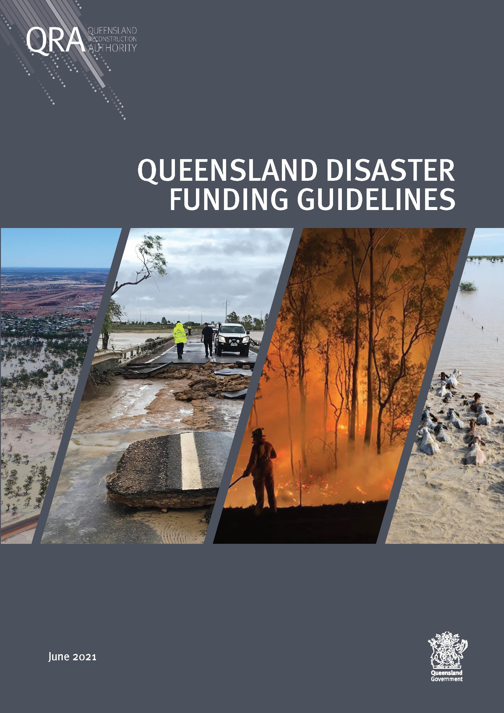

# Queensland Disaster Funding Guidelines (QDFG) (Version 3, December 2024)

> **Source**: Queensland Reconstruction Authority
> **URL**: https://www.qra.qld.gov.au/sites/default/files/2024-12/DOC_23_77361_Attachment_3_WEB_QDFG_Queensland_Disaster_Funding_Guidelines_Version_3_December_2024.pdf
> **Licence**: © State of Queensland; emergency-management practitioner reference
> **Retrieved**: 2026-05-07T23:43:48Z
> **SHA-256**: `bd1f711563dc10ebf7b8c4e41a76b5451b4dc1473ef129a416b5fdc58203532f`
> *Converted from PDF to Markdown format.*

---
## Page 1

---
## Page 2

Queensland Disaster Funding Guidelines –  
Page i 
OFFICIAL 
Document details 
Security classification 
Public 
Date of review of security classification 
December 2024 
Authority 
Queensland Reconstruction Authority 
Document status 
Final 
Version 
3.0 
Reference number 
Version 3 - DOC/23/77361 
Version 2 – refer DOC/20/12192 
Copyright 
This publication is protected by the Copyright Act 1968. 
© The State of Queensland (Queensland Reconstruction Authority) December 2024. 
Licence 
This work is licensed by State of Queensland (Queensland Reconstruction Authority) under a Creative Commons Attribution 
(CC BY) 4.0 International licence. To view a copy of this licence, visit www.creativecommons.org/licenses/by/4.0/. 
In essence, you are free to copy, communicate and adapt the guidelines, as long as you attribute the work to the State of 
Queensland (Queensland Reconstruction Authority).  
Interpreter 
The Queensland Government is committed to providing accessible services to Queenslanders from all culturally and 
linguistically diverse backgrounds. If you have difficulty in understanding this report, you can access the Translating and 
Interpreting Services via www.qld.gov.au/languages or by phoning 13 14 50. 
Disclaimer 
While every care has been taken in preparing this publication, the State of Queensland accepts no responsibility for decisions 
or actions taken as a result of any data, information, statement or advice, expressed or implied, contained within. To the best 
of our knowledge, the content was correct at the time of publishing. 
Review of the Guidelines  
These Guidelines are reviewed by Queensland Reconstruction Authority (QRA) as required, in collaboration with the relevant 
state agencies. Enquiries regarding information contained within these guidelines should be referred to: 
Queensland Reconstruction Authority (QRA) 
PO Box 15428 
City East QLD 4002 
Telephone: 1800 110 841 
Email: info@qra.qld.gov.au   
Copies  
Copies of this publication are available on our website at www.qra.qld.gov.au.

---
## Page 3

Queensland Disaster Funding Guidelines –  
Page ii 
OFFICIAL 
Table of contents 
(NOTE: This table of contents is interactive - click to skip to relevant section) 
Disaster relief and recovery funding arrangements in Queensland .......................................... 1 
About the Guidelines .......................................................................................................... 1 
2.1 
Relationship with prior guidelines ............................................................................................... 1 
2.2 
Disaster Recovery Funding Arrangements .................................................................................... 3 
2.3 
State Disaster Relief Arrangements .............................................................................................. 3 
2.4 
Standard funding assistance measures available under these guidelines .................................... 3 
Principles for assistance ..................................................................................................... 5 
Activation process for Disaster Recovery Funding Arrangements (DRFA) ................................... 6 
4.1 
Overview ..................................................................................................................................... 6 
4.2 
Eligible disaster ........................................................................................................................... 6 
4.3 
Activation requests, approvals and notifications .......................................................................... 7 
4.4 
Area defined for receipt of assistance .......................................................................................... 9 
4.5 
Assistance measures and activation criteria ............................................................................... 10 
4.6 
Acknowledgment of joint Australian Government/state assistance ............................................. 15 
Activation process for State Disaster Relief Arrangements (SDRA) ......................................... 16 
5.1 
Overview ................................................................................................................................... 16 
5.2 
Administering agencies ............................................................................................................. 16 
5.3 
Assistance available .................................................................................................................. 16 
5.4 
Activation of the SDRA and PHAS/CDO assistance measures ...................................................... 16 
5.5 
Area defined for receipt of assistance ........................................................................................ 17 
5.6 
Exclusions ................................................................................................................................. 17 
5.7 
Acknowledgment of state funding assistance ............................................................................. 17 
Personal Hardship Assistance Scheme (PHAS) .................................................................... 18 
6.1 
Overview ................................................................................................................................... 18 
6.2 
Purpose ..................................................................................................................................... 18 
6.3 
Assistance available .................................................................................................................. 18 
6.4 
Emergency Hardship Assistance  (EHA) (Category A) ................................................................... 19 
6.5 
Essential Services Hardship Assistance (ESHA) (Category A) ....................................................... 20 
6.6 
Essential Household Contents Grant (EHCG) (Category A) ........................................................... 21 
6.7 
Structural Assistance Grant (SAG) (Category A) .......................................................................... 22 
6.8 
Income test ................................................................................................................................ 23 
6.9 
Personal and financial counselling ............................................................................................. 23 
6.10 
Employment of a Community Recovery and Resilience Officer..................................................... 23 
6.11 
Administering agency reimbursement requirements .................................................................. 24 
Essential Services Safety and Reconnection Scheme (ESSRS) ............................................... 25 
7.1 
Administering agency reimbursement requirements .................................................................. 26 
Counter Disaster Operations (CDO) .................................................................................... 27 
8.1 
Purpose ..................................................................................................................................... 27 
8.2 
Assistance available .................................................................................................................. 27 
8.3 
Eligibility ................................................................................................................................... 27 
8.4 
Reimbursement requirements .................................................................................................... 32 
Measures for the Reconstruction of Essential Public Assets (REPA) ........................................ 33 
9.1 
Assistance available .................................................................................................................. 33 
9.2 
Eligibility ................................................................................................................................... 34

---
## Page 4

Queensland Disaster Funding Guidelines –  
Page iii 
OFFICIAL 
9.3 
Emergency Works (EWK) (Category B) ......................................................................................... 39 
9.4 
Immediate Reconstruction Works (IRW) (Category B) .................................................................. 41 
9.5 
Reconstruction of Essential Public Assets (REPA) (Category B) .................................................... 43 
Disaster Assistance (Small Business) Loans ........................................................................ 48 
Disaster Assistance (Essential Working Capital) Loans Scheme for Small Business ................. 50 
Disaster Assistance (Primary Producers) Loans ................................................................... 52 
Disaster Assistance (Essential Working Capital) Loans Scheme for Primary Producers ............. 54 
Freight Subsidies for Primary Producers ............................................................................. 56 
14.1 
Administering agency reimbursement requirements .................................................................. 56 
Disaster Assistance Loans for Not-for-profit organisations ................................................... 58 
Essential Working Capital Loans Scheme for Not-for-profit Organisations .............................. 59 
Community Recovery Package ........................................................................................... 60 
17.1 
Community Recovery Fund ......................................................................................................... 61 
17.2 
Disaster Assistance Recovery Grants- Primary Producers ........................................................... 62 
17.3 
Disaster Assistance Recovery Grants - Small Business and Not-for-profit Organisations ............. 65 
Category D Exceptional Assistance Measures ...................................................................... 68 
18.1 
Administering agency - Requests for Exceptional Assistance ...................................................... 69 
18.2 
Administering agency submission and reimbursement process.................................................. 70 
Governance ..................................................................................................................... 71 
19.1 
Certification ............................................................................................................................... 71 
19.2 
Defined time limit ...................................................................................................................... 71 
19.3 
Goods and Services Tax (GST) .................................................................................................... 71 
19.4 
Submission assessment ............................................................................................................ 71 
19.5 
Funding agreement .................................................................................................................... 71 
19.6 
Insurance .................................................................................................................................. 71 
19.7 
Progress reporting ..................................................................................................................... 71 
19.8 
Ad-hoc reporting ........................................................................................................................ 71 
19.9 
Record keeping .......................................................................................................................... 71 
19.10 Procurement .............................................................................................................................. 72 
19.11 Assurance activities ................................................................................................................... 72 
19.12 DRFA acknowledgement ............................................................................................................. 72 
19.13 SDRA acknowledgement ............................................................................................................ 72 
19.14 Further media assistance ........................................................................................................... 72 
APPENDIX 1 – Definitions ......................................................................................................... 73 
APPENDIX 2 – Essential Household Contents Grant breakdown.................................................... 80 
APPENDIX 3 – Acronyms and abbreviations ............................................................................... 81 
APPENDIX 4 – QRA Stakeholders (Machinery of Government Changes November 2024) ................. 82

---
## Page 5

Queensland Disaster Funding Guidelines – December 2024  
Page 1 
OFFICIAL 
Disaster relief and recovery funding arrangements in Queensland 
Queensland is the most disaster affected state in Australia. Disaster events often result in large-scale 
expenditure by governments in the form of financial schemes, loans and grants to assist the recovery and 
reconstruction of impacted communities and essential infrastructure.  
The Queensland Government, via the Queensland Reconstruction Authority (QRA) administers two disaster relief 
and recovery funding programs: 
•
Australian Government Disaster Recovery Funding Arrangements (DRFA), which outline the agreed Australian
Government and state government cost sharing arrangements that may be activated following an eligible disaster 
to provide assistance to impacted community members, small businesses, not-for-profit organisations, primary
producers, local councils and state government agencies. The Australian Government DRFA are published at
www.disasterassist.gov.au. 
•
State Disaster Relief Arrangements (SDRA), a wholly state-funded program that may be activated for all hazards and
provides assistance where personal hardship and distress is experienced following the impact of a disaster event.
The Queensland Government SDRA are published at www.qra.qld.gov.au.
QRA is the lead agency responsible for disaster recovery and resilience policy, with a vision for stronger, safer, 
resilient Queensland communities.  
QRA also works closely with state and local government partners to ensure its support is responsive, relevant, 
accountable and delivers value for money. 
About the Guidelines 
These Queensland Disaster Funding Guidelines Version 3– December 2024 (the Guidelines) detail the DRFA and 
the SDRA assistance measures that may be activated following an eligible disaster to assist individuals, small 
businesses, primary producers, not-for-profit organisations, local governments and state agencies.  
The aim of the Guidelines is to provide: 
•
an overview of the disaster relief and recovery measures administered in Queensland including details of activation,
eligibility, application, delivery, reporting and acquittal requirements under both the DRFA and SDRA within
Queensland 
•
a guide for local governments and state government agencies, not-for-profit organisations, primary producers,
small businesses and the general public, on financial assistance and funding that may be available in the event of a
disaster.
2.1 Relationship with prior Guidelines 
The Guidelines Version 3 replace the previous Guidelines Version 2. Refer Section 2.1.1 – Summary of changes). 
The Queensland Disaster Relief and Recovery (QDRR) Guidelines Version 1 – November 2018, continue to apply to 
events between 1 November 2018 and 30 June 2021.

---
## Page 6

Queensland Disaster Funding Guidelines – December 2024  
Page 2 
OFFICIAL 
2.1.1 Summary of Guideline updates 
Section 
Change 
Application  
Global update to reflect Queensland Government MOG 
changes  
Global update  
Global update to reflect to reflect QRA Minister portfolio 
change (Minister for Fire, Disaster Recovery and 
Volunteers) 
Global update 
Global update to reflect department name change 
(Queensland Fire Department - QFD) 
Global update 
Submission requirements for all assistance measures 
updated to refer to Section 19.1 Certification 
Global update  
4.3.7 
Category C and D - updated eligibility requirement: 
where the state has incurred expenditure for a measure 
prior to the Prime Minister’s agreement, that 
expenditure will be ineligible for cost-sharing under the 
DRFA. 
Applies to all events from 21 October 2024 
6.7 
SAG threshold increased to $80,000 
Applies only to events occurring from 
30 January 2023 onwards 
SAG threshold increased to $50,000 
Applies only to events occurring from  
10 November 2021 to 29 January 2023 
SAG - Eligibility criteria a) clarified 
Clarification - applies to all events 
8.3.1 
CDO - removed extraordinary vector control based on 
eligibility clarification from the Commonwealth that 
vector control is ineligible under Category B and will not 
be cost shared as a CDO measure 
Clarification - applies to all events occurring 
from 1 July 2024 
8.3.6 
CDO - Removed reference to dollar figure in relation to 
low-cost eligibility threshold and included examples 
Clarification - applies to all events 
9.2.3 
CDO - eligibility requirements updated in line with DRFA 
Clarification - applies to all events 
9.2.4 
REPA – Eligible Expenditure - Removed reference to 
uninsured stolen equipment based on eligibility 
clarification from the Commonwealth 
Clarification - applies to all events occurring 
from 1 July 2024 
9.2.6 
CDO - removed reference to dollar figure in relation to 
low-cost eligibility threshold and included examples 
Clarification - applies to all events occurring 
from 1 July 2024 
9.5.5 
REPA – Progress payment claim clarification – 
Applicants may claim progress payments up to 90 per 
cent of the approved Recommended Value or Estimated 
Final Cost where the estimated final cost is lower than 
the Recommended Value. 
Clarification - applies to all events 
9.5.7 
REPA claims for re-damaged assets updated for 
clarification  
Clarification - applies to all events 
9.5.8 
REPA – Clarification of Submission acquittal 
requirements 
Clarification - applies to all events 
12 
Disaster Assistance (Primary Producer) Loans updated in 
line with the Department’s website 
Consistency with delivery agency’s website 
17.2 
DARG – funding cap updated to reflect enhanced DRFA 
arrangements as advised by the Commonwealth 
Applies to all State requests for Category C 
grants made to the Commonwealth from 
21 October 2024 
17.2.1 
DARG – updated to provide examples of agency 
reimbursement requirements 
Clarification - applies to all events

---
## Page 7

Queensland Disaster Funding Guidelines – December 2024  
Page 3 
OFFICIAL 
17.3 
DARG – funding cap updated to reflect enhanced DRFA 
arrangements as advised by the Commonwealth 
Applies to all state requests for Category C 
grants made to the Commonwealth from 
21 October 2024 
18.1 
Category C - Administering agency - requests for 
Extraordinary Assistance updated in line with the 
Commonwealth lines of recovery 
Clarification - applies to all events 
18.2 
Category D - Administering agency submission 
requirements clarified 
Clarification - applies to all events 
2.2 Disaster Recovery Funding Arrangements 
The Australian/state government jointly funded DRFA is administered at the Commonwealth level by the National 
Emergency Management Agency (NEMA). Under the DRFA, four categories of assistance measures are available 
for activation under an eligible disaster, Categories A and B provide standard assistance and Categories C and D 
provide additional relief in exceptional circumstances. 
In Queensland, QRA administers the DRFA assistance measures on behalf of the Queensland Government. Each of 
the Categories are activated separately (refer Section 4 Activation process for DRFA).  
2.3 State Disaster Relief Arrangements 
The intent of the SDRA is to assist in the relief of communities whose wellbeing has been severely affected by a 
natural or non-natural disaster event.  
As a solely Queensland Government funded program, the SDRA is not subject to the Australian Government event 
eligibility requirements and is therefore able to address a wider range of disaster events and circumstances 
where personal hardship exists (refer Section 5 – Activation process for SDRA). 
2.4 Standard funding assistance measures available under these guidelines 
The following standard DRFA and SDRA assistance measures are available under these Guidelines: 
Assistance to 
Assistance measures 
DRFA 
Category 
SDRA 
Contact 
Individuals 
Personal Hardship Assistance 
Scheme 

A 

State department responsible for 
Community Recovery  
Hotline: 1800 173 349 
Website: 
www.communities.qld.gov.au
Essential Services Safety and 
Reconnection Scheme 

B 
Small 
businesses 
Disaster Assistance (Small 
Business) Loans 

B 
State department responsible for 
Small Business via 
Queensland Rural and Industry 
Development Authority (QRIDA) 
Telephone: 1800 623 946 
Website: www.qrida.qld.gov.au 
Disaster Assistance (Essential 
Working Capital) Loans Scheme 

B 
Primary 
producers 
Disaster Assistance (Primary 
Producers) Loans 

B 
State department responsible for 
Agriculture and Fisheries via 
Queensland Rural and Industry 
Development Authority (QRIDA) 
Telephone: 1800 623 946 
Website: www.qrida.qld.gov.au 
Disaster Assistance (Essential 
Working Capital) Loans Scheme 

B 
Freight Subsidies 

B 
State department responsible for 
Agriculture and Fisheries 
Telephone: 13 25 23
Website: www.dpi.qld.gov.au
Not for profit 
organisations 
Disaster Assistance (Not-for-profit 
Organisations) Loans  

B 
State department responsible for 
Community Recovery via 
Queensland Rural and Industry 
Development Authority (QRIDA) 
Telephone: 1800 623 946 
Website: www.qrida.qld.gov.au 
Disaster Assistance (Essential 
Working Capital) Loans Scheme 

B

---
## Page 8

Queensland Disaster Funding Guidelines – December 2024  
Page 4 
OFFICIAL 
Assistance to 
Assistance measures 
DRFA 
Category 
SDRA 
Contact 
Local 
governments 
Counter Disaster Operations  

A/B 

Queensland Reconstruction 
Authority (QRA) 
Telephone: 1800 110 841 
Website:  www.qra.qld.gov.au 
Emergency Works for essential 
public assets 

B 
Immediate Reconstruction Works 
for essential public assets 

B 
Reconstruction of Essential Public 
Assets 

B 
State 
government 
agencies 
Counter Disaster Operations 

A/B 

Queensland Reconstruction 
Authority (QRA)  
Telephone: 1800 110 841 
Website:  www.qra.qld.gov.au 
Emergency Works for essential 
public assets  

B 
Immediate Reconstruction Works 
for essential public assets 

B 
Reconstruction of Essential Public 
Assets 

B

---
## Page 9

Queensland Disaster Funding Guidelines – December 2024  
Page 5 
OFFICIAL 
Principles for assistance 
The assistance measures detailed in the Guidelines aim to provide a ‘safety net’ to those in immediate need and 
who are unable to affect their own recovery.  
Eligibility of expenditure under the Guidelines should not be a consideration when determining whether action 
should be undertaken, or assistance given in response to, or recovery from a disaster event.  
In carrying out eligible measures, state agencies, local governments and communities must act consistently with 
the following Australian Government principles: 
•
Australian and/or state government funding assistance is intended to support eligible response and recovery
measures which complement other strategies such as insurance, mitigation planning and implementation. 
•
Recovery is a shared responsibility for individuals, households, businesses and communities, as well as for all
levels of government where access to capital or appropriate strategies for natural disaster mitigation are
considered.
•
Assistance is not to supplant, or operate as a disincentive for, self-help by way of either access to capital or 
appropriate strategies for natural disaster mitigation or provide compensation.
•
The assistance measures are designed to achieve an efficient allocation of resources.
•
Those affected in the same way by the same eligible disaster should receive the same assistance, within the
limitations of the arrangements within the Guidelines. 
•
The financial exposure to taxpayers (at all levels of government) should be minimised.
While the measures within the Guidelines provide a level of financial support, the primary responsibility for the 
safeguarding and reconstruction of private and public assets remains with the owner.

---
## Page 10

 
Queensland Disaster Funding Guidelines – December 2024  
  
 
Page 6  
OFFICIAL 
 Activation process for Disaster Recovery Funding Arrangements (DRFA)  
4.1 Overview 
Once activated, the Australian and state government jointly funded DRFA provides a range of agreed funding 
assistance measures and cost sharing arrangements to assist in the recovery of individuals, communities, local 
governments and state agencies impacted by an eligible disaster.  
The Australian Government Minister responsible for the DRFA determines the terms and conditions of assistance 
under the DRFA, including loans and subsidies. Category C and D measures can only be activated following a 
written request by the Premier to the Prime Minister and must be approved in writing by the Prime Minister.  
All assistance measures must comply with the DRFA and supplementary clarifications from the Australian 
Government and are subject to Queensland Audit Office and Australian Government audit and acceptance.  
4.2 Eligible disaster  
An eligible disaster as defined by the DRFA, is: 
• 
a natural disaster, or  
• 
a terrorist act for which a coordinated multi-agency response was required, and state expenditure exceeds the 
Australian Government Small Disaster Criterion (SDC). 
A natural disaster is defined as one, or a combination of the following rapid onset events: 
• bushfire 
• tornado 
• storm surge 
• earthquake 
• cyclone 
• tsunami 
• landslide 
• flood 
 
• storm 
• meteorite strike 
 
A terrorist act is defined as an action or a series of actions committed in Australia which the Australian 
Government minister has determined is a terrorist act for the purposes of an eligible disaster under the 
DRFA and has advised the state in writing.  
4.2.1 Exclusions 
Ineligible disasters under the DRFA include: 
• 
drought 
• 
epidemic and pandemics 
• 
events resulting from poor environmental planning, or commercial development, or personal intervention  
• 
frost 
• 
heatwave 
• 
non-natural disasters (excluding terrorist act) 
• 
small natural disasters where eligible state expenditure (on all assistance measures) does not exceed the SDC 
• 
disaster events that do not meet the Australian Government definition of a natural disaster or terrorist act 
• 
disasters where human activity is a significant contributing cause e.g. poor environmental planning, commercial 
development, personal intervention or accidents.

---
## Page 11

 
Queensland Disaster Funding Guidelines – December 2024  
  
 
Page 7  
OFFICIAL 
4.3 Activation requests, approvals and notifications  
The activation of the DRFA should not be a deciding factor when responding to a disaster.  
In accordance with emergency management responsibilities, agencies are required to ensure that they are 
prepared for and are able to respond to natural disasters. Local governments and state agencies should make 
available whatever assistance they deem necessary regardless of whether it is eligible for reimbursement under 
the DRFA. 
4.3.1 Activation of the DRFA  
Activation of the DRFA for an event may occur when the following criteria have been met: 
1. 
the local government area/s has been impacted by an eligible disaster (refer Section 4.2 - Definition of an eligible 
disaster), and 
2. 
the event has required a coordinated multi-agency response, and 
3. 
local governments and/or state agencies require financial assistance to respond to and recover from the event, and  
4. 
the combined estimated total expenditure in responding to the event exceeds the SDC, currently $240,000.  
Note: The combined estimated total expenditure is based on the sum of all eligible expenditure (actual or 
estimated) incurred by those Queensland local governments and state agencies responding to the event, less 
relevant local government’s trigger point contribution (refer Trigger Points).  
QRA, on receipt of an activation request, will coordinate with other responding local governments or state 
agencies to establish the estimated total expenditure (actual or estimated) incurred in responding to the event. 
Agencies are not required to contact other responding agencies to determine if the SDC will be exceeded. 
4.3.2 Activation of category A and B assistance measures  
Activation of Category A and B assistance measures can occur where the requesting local government and/or 
state agency has been impacted by, or responded to an eligible disaster event that has required a coordinated 
multi-agency response and meets all of the following criteria:  
1. 
activation of the DRFA above, and 
2. 
requires financial assistance to respond to and/or recover from the event, and  
3. 
asset damage estimates exceed its trigger point contribution for Reconstruction of Essential Public Assets (REPA) 
assistance measures (local government only). 
A local government’s request for activation of REPA assistance measures requires the local government to have 
eligible expenditure (actual or estimated) that exceeds its trigger point contribution (refer Section 9.2.1 - Trigger 
points). The local government is required to contribute 25 per cent of eligible expenditure on Emergency and 
Reconstruction Works or up to its trigger point amount whichever is lesser. Only the eligible expenditure under 
REPA, excluding the trigger point amount, can be used to calculate the SDC. If the local government does not 
exceed its trigger point, then any REPA and Emergency Works expenditure is unable to be included in the SDC 
calculation. 
4.3.3 Activation timeframe  
Agencies must advise QRA of a potential activation request as soon as possible, to ensure the Australian 
Government DRFA notification timeframe is met. Under the DRFA, QRA must notify the Australian Government of 
an eligible disaster within three months of the disaster occurring. Activation requests received after this time may 
be declined.  
If a local government or stage agency has been impacted by a disaster and is unsure if the disaster meets the 
eligibility and activation requirements, it is recommended the agency contacts QRA as soon as possible to 
discuss potential activation.

---
## Page 12

 
Queensland Disaster Funding Guidelines – December 2024  
  
 
Page 8  
OFFICIAL 
4.3.4 Activation requirements 
To request activation, the local government or state agency is required to: 
• 
outline the impact from the disaster and the coordinated multi-agency response   
• 
detail the relevant Category A and B assistance measure/s sought 
• 
detail any additional activation criteria necessary to activate a specific assistance measure 
• 
provide supporting documentation to assist with detailing the disaster impact to the community, for example, 
situation reports, Local Disaster Management Group meeting minutes, road closure reports and photos.  
Local governments and state agencies may request activation of Counter Disaster Operations (CDO) and REPA 
which automatically activates Emergency Works and Immediate Reconstruction Works. Activation of the 
remaining Category A and B assistance measures must be requested by the relevant state government agency 
(refer Section 4.5.1 Standard assistance (Categories A and B) assistance measures and activation criteria). 
Approval and activation of Category C and D is dependent upon the type of assistance being requested (refer 
Sections 4.5.2 – Special Assistance (Category C) - Community Recovery Package and 4.5.3 – Exceptional 
Circumstance Assistance (Category D)).  
4.3.5 Requesting activation  
Local governments and state agencies can request activation via: 
• 
QRA MARS Portal – log into QRA Management and Reporting System (MARS) Portal, select ‘activations’ and follow 
the steps to enter the details necessary to request activation.  
• 
Email and phone call – for urgent requests, call your RLO to commence the activation request process before 
formally lodging via MARS Portal to provide them authority to lodge an application on behalf of council. 
4.3.6 Activation assessment, approval and notification 
QRA will assess the activation request to determine it meets the definition of an eligible disaster, including 
whether the Australian Government SDC will be cumulatively exceeded by all local government and/or state 
government agencies responding to the event. QRA may seek further information if required to ensure there is 
adequate evidence the disaster meets the Australian Government requirements. 
If QRA determines the disaster meets the definition of an eligible disaster, QRA will request the activation of the 
DRFA for the eligible disaster, approved by the Queensland Minister for Fire, Disaster Recovery and Volunteers. 
Subsequent DRFA approvals can be undertaken for a single disaster, allowing for activation of additional local 
government areas and assistance measures, and extension of the event date range as the situation unfolds and 
further information is gathered on impacted communities. A local government area is activated for DRFA 
assistance measures, not the actual local government, allowing relevant assistance measures to be activated and 
available as required for local government and/or state government agencies responding to the event. 
Following each approval, an activation summary detailing the DRFA eligible disaster, the activated local 
government area/s and the activated assistance measures is:  
• 
distributed to key stakeholders via an email notification  
• 
published at www.qra.qld.gov.au  
• 
published in the MARS Portal for activated agencies.  
For terrorist acts, the Australian Government must first determine the event to be a terrorist act for the purposes 
of an eligible disaster under the DRFA and advise the state in writing.  
For bushfire events, QRA will work with Queensland Fire Department’s State Fire Control Centre (SFCC) to confirm 
a specific fire and is over and above its normal capacity to respond to the event. In extraordinary circumstances, 
QRA may activate the DRFA for a bushfire event prior to confirmation by the Queensland Fire Department. 
For isolated disasters that do not reach the DRFA criteria, the SDRA may apply to assistance measures for 
community response and assistance to individuals (refer Section 5 – Activation process for SDRA). 
4.3.7 Activation of Category C and D measures 
Following a severe disaster and activation of DRFA Category A and/or B assistance measures, exceptional 
disaster assistance recovery grants (Category C), a Community Recovery Package (Category C) and exceptional 
circumstances assistance (Category D) may be considered to support the recovery of the impacted community. 
These are not automatically activated.

---
## Page 13

 
Queensland Disaster Funding Guidelines – December 2024  
  
 
Page 9  
OFFICIAL 
The State is expected to make requests for Category C measures in the first instance prior to requesting 
assistance under Category D.  In exceptional circumstances, where extraordinary need is identified beyond the 
measures available under Category C, Category D assistance may be requested.  
Activation of Category C and D assistance is requested in writing by the Premier of Queensland and approved by 
the Prime Minister. While individual agencies may draft a business case to request activation of a Category C 
and/or D assistance measure, QRA has overall responsibility to progress and coordinate such requests to the 
Premier for application to the Prime Minister. 
It is important to note that any requests for assistance will not be agreed if the state publicly announces a 
measure prior to the Prime Minister’s agreement.  
Where the state has incurred expenditure for a measure prior to the Prime Minister’s agreement, that expenditure 
will be ineligible for cost-sharing under the DRFA. 
All Category C and D measures have capped funding limits, including demand-driven programs. Where the state 
identifies a demand-based measure (i.e. primary producers grants) cannot be delivered within the approved 
capped funding amount, requests to reallocate funding from another package (within aligned eligible events and 
targeting the same recovery sector or domain) must be made prior to any actual overspends. 
Requests for Category C and D assistance to the Prime Minister must include expenditure forecasting utilising the 
approved Commonwealth template. The expenditure forecasting may be the state’s best estimate at the time of 
requesting assistance. Requests for Category C or D assistance that do not provide expenditure forecasting will 
not be agreed. Where the need for Category C or D assistance is identified, please contact your RLO, Recovery and 
Resilience Officer (RRO) or QRA directly to discuss the potential business case and required information (refer 
Section 4.5 – Assistance measures and activation criteria). 
4.4 Area defined for receipt of assistance 
4.4.1 Standard assistance (Category A and B) 
The disaster impacted area considered eligible for receipt of DRFA assistance is approved by the Queensland 
Minister for Fire, Disaster Recovery and Volunteers and provided as an ‘area definition’ which includes the 
geographical boundary, the disaster type, and date range to which activated DRFA assistance measures apply. 
Typically, the area definition will read as follows: 
Communities within [insert geographic area] affected by [insert eligible disaster type i.e. flooding, 
storms, cyclone, etc.)] in/from [insert month or date]. 
4.4.2 Exceptional circumstance assistance (Category C and D) 
The definition of those communities eligible for Category C and D exceptional assistance funding will be agreed 
by the Prime Minister and the Premier for the specified event. 
 
IMPORTANT:  
The ‘activation of the Disaster Recovery Funding Arrangements’ by the Minister provides jointly 
funded Australian/state government financial assistance to communities affected by disasters that 
meet the Australian Government DRFA requirements.  
Activation of the DRFA is unrelated to: 
• 
a ‘declaration of a disaster situation’ under the Queensland Disaster Management Act 2003 
(DMA 2003). The ‘declaration of a disaster situation’ is a formal short-term declaration invoked 
under the DMA 2003, to provide additional powers to the Queensland Police Service and 
Queensland Fire Department prior to, during, and in the immediate wake of the state-declared 
disaster situation 
• 
activation of the Queensland Disaster Management Arrangements (QDMA). The stand-up of local 
disaster management groups may be used to support the request to activate the DRFA but is not 
a mandatory requirement.

---
## Page 14

 
 
Queensland Disaster Funding Guidelines – December 2024 
   
 
 
 
 
 
 
 
 
Page 10  
4.5 Assistance measures and activation criteria  
4.5.1 Standard assistance (Categories A and B) assistance measures and activation criteria  
Category A and B assistance measures are designed to assist those within the community who do not have the resources to provide for their own recovery. For any 
assistance to be an eligible measure it must be carried out to alleviate damage or distress arising as a direct result of an eligible disaster. 
In exceptional circumstances, event-specific exceptions can be sought in agreement with Australian and Queensland governments. 
 
Standard assistance 
measures 
Category 
Purpose and available assistance 
Requesting Agency 
Activation criteria 
Personal Hardship 
Assistance Scheme  
(PHAS) 
A 
To alleviate personal hardship and distress. 
• 
Emergency Hardship Assistance Grant – provides assistance to 
support people directly impacted by an eligible disaster to meet 
their immediate essential needs for food, clothing, medical 
supplies or temporary accommodation.  
• 
Essential Services Hardship Assistance – provides assistance to 
support people directly impacted by an eligible disaster to meet 
their immediate needs where they have experienced the loss of 
one or more essential services for more than five days. 
• 
Essential Household Contents Grant – provides a contribution 
towards replacing or repairing essential household contents, such 
as beds, linen and whitegoods that have been lost or damaged by 
an eligible disaster. 
• 
Structural Assistance Grant – provides a contribution towards 
repairs or replacement of a dwelling damaged by an eligible 
disaster, to return it to a safe, habitable and secure condition. 
State department 
responsible for 
Community Recovery  
State department responsible for 
Community Recovery identifies that local 
service providers have reached their 
capacity to provide a service to people 
identified as experiencing personal 
hardship as a direct result of a disaster, or 
that there are no local service providers to 
assist. 
Essential Services 
Safety and 
Reconnection 
Scheme (ESSRS) 
B 
To assist residents with the inspection and reconnection of essential services 
that have been damaged by an eligible disaster. The scheme provides 
financial assistance to individuals and families as a contribution towards 
safety inspections of and repairs to residential essential services (i.e. 
electricity, gas, water and sewerage) damaged by an eligible disaster. 
State department 
responsible for 
Community Recovery 
State department responsible for 
Community Recovery identifies that local 
service providers have reached their 
capacity to provide a service to people 
identified as experiencing personal 
hardship as a direct result of a disaster, or 
that there are no local service providers to 
assist.

---
## Page 15

 
 
Queensland Disaster Funding Guidelines – December 2024 
   
 
 
 
 
 
 
 
 
Page 11  
Standard assistance 
measures 
Category 
Purpose and available assistance 
Requesting Agency 
Activation criteria 
Counter Disaster 
Operations (CDO) 
A&B 
To assist local governments and state agencies to undertake extraordinary 
activities that alleviate personal hardship and distress, address the 
immediate needs of individuals and protect the general public, immediately 
prior to, during or immediately after an eligible disaster. 
Local government or 
state agency that has 
responded or will 
respond to the 
disaster 
CDO activities are required to be 
undertaken to provide direct assistance to 
an individual and for the protection of the 
general public. 
Reconstruction of 
Essential Public 
Assets (REPA) 
B 
REPA are works undertaken by local governments and state agencies to 
reconstruct damaged essential public assets to pre-disaster function. 
Local government or 
state agency where 
there has been impact 
to its essential public 
assets  
Damage to essential public assets caused 
by the eligible disaster. 
Note: A local government’s eligible damage 
costs must exceed, or be expected to 
exceed, its trigger point amount to be 
eligible to request activation 
Immediate 
Reconstruction 
Works (IRW)- 
Essential Public 
Assets  
B 
To assist state agencies or local governments to immediately and 
permanently reconstruct damaged essential public assets to pre-disaster 
function immediately after the eligible disaster.  
Activated 
automatically under 
REPA  
As per REPA above. 
Emergency Works 
(EW) - Essential 
Public Assets  
B 
To assist local governments and state agencies to undertake urgent activities 
necessary following an eligible disaster to temporarily restore an eligible 
essential public asset to enable it to operate/be operated at an acceptable 
level of efficiency to support the immediate recovery of a community.  
Activated 
automatically under 
REPA 
As per REPA above. 
Disaster Assistance 
(Not-for-profit 
Organisations) Loans  
B 
Concessional interest rate loans to assist not-for-profit organisations whose 
assets have been significantly damaged as a direct result of an eligible 
disaster, and who are unable to repair or replace the damaged assets from 
their own resources. 
State department 
responsible for 
Community Recovery  
State department responsible for 
Community Recovery identifies need based 
on damage assessments and/or 
information gathered. 
Disaster Assistance 
(Primary Producers) 
Loans  
B 
Concessional interest rate loans to assist primary producers whose assets 
have been significantly damaged by an eligible disaster, to recover and return 
to viable operations. 
State department 
responsible for 
Agriculture and 
Fisheries  
 
State department responsible for 
Agriculture and Fisheries identifies need 
based on damage assessments and/or 
information gathered.

---
## Page 16

 
 
Queensland Disaster Funding Guidelines – December 2024 
   
 
 
 
 
 
 
 
 
Page 12  
Standard assistance 
measures 
Category 
Purpose and available assistance 
Requesting Agency 
Activation criteria 
Disaster Assistance 
(Small Business) 
Loans  
B 
Concessional interest rate loans to assist small business operators that have 
been significantly damaged as a direct result of an eligible disaster, to re-
establish normal operations. 
State department 
responsible for Small 
Business  
State department responsible for Small 
Business identifies need based on damage 
assessments and/or information gathered. 
Disaster Assistance 
(Essential Working 
Capital) Loans 
Scheme for Not-for-
profit Organisations 
B 
Concessional interest rate loans to assist not-for-profit organisations that 
have suffered a significant loss of income as a result of an eligible disaster by 
providing the essential working capital required to continue operations. 
State department 
responsible for 
Community Recovery  
State department responsible for 
Community Recovery identifies need based 
on damage assessments and/or 
information gathered. 
Disaster Assistance 
(Essential Working 
Capital) Loans 
Scheme for Primary 
Producers 
B 
Concessional interest rate loans to primary producers who have suffered a 
significant loss of income as a result of an eligible disaster by providing the 
essential working capital required to continue business operations. 
State department 
responsible for 
Agriculture and 
Fisheries  
 
State department responsible for 
Agriculture and Fisheries identifies need 
based on damage assessments and/or 
information gathered. 
Disaster Assistance 
(Essential Working 
Capital) Loans 
Scheme for Small 
Business 
B 
Concessional interest rate loans to assist small businesses that have suffered 
a significant loss of income as a result of an eligible disaster by providing the 
essential working capital required to continue business operations. 
State department 
responsible for Small 
Business  
State department responsible for Small 
Business identifies need based on damage 
assessments and/or information gathered. 
Freight Subsidies for 
Primary Producers 
B 
To assist primary producers impacted by an eligible disaster with the 
transport of livestock, fodder or water for livestock, building, fencing 
equipment or machinery to the primary producer’s home property.  
State department 
responsible for 
Agriculture and 
Fisheries  
 
State department responsible for 
Agriculture and Fisheries identifies need to 
provide freight subsidies assistance.

---
## Page 17

 
 
Queensland Disaster Funding Guidelines – December 2024 
   
 
 
 
 
 
 
 
 
Page 13  
4.5.2 Special Assistance (Category C) - Community Recovery Package 
Special assistance  
Category C 
Category 
Purpose and assistance  
Requesting Agency 
Activation criteria 
Community Recovery 
Fund 
C 
Where a community is severely affected and needs to restore social 
networks, community functioning and community facilities. 
Event-specific Category C relief, recovery and resilience initiatives are 
required to alleviate distress and to accelerate the recovery of those 
communities impacted by the event. 
State department 
responsible for 
Community Recovery  
State department responsible for Community 
Recovery and relevant state agencies identify 
severely affected communities and impacted 
sectors, and that additional assistance is 
required to assist with the recovery, and the 
impact meets the Australian Government 
criteria. 
Note: requires joint agreement between the Prime 
Minister and Premier 
Special Disaster 
Assistance Recovery 
Grants - Small 
Business 
C 
Grants to small business operators who have suffered direct damage 
caused by an eligible disaster. Grants aim to cover the cost of clean-up 
and reinstatement, not to provide compensation for losses. 
State department 
responsible for 
Small Business in 
conjunction with 
State department 
responsible for 
Community Recovery 
State departments responsible for Small 
Business and Community Recovery identify 
that additional financial assistance is required 
to support the recovery of the community from 
a severe event and the impact meets the 
Australian Government criteria. 
Note: requires joint agreement between the Prime 
Minister and Premier 
Special Disaster 
Assistance Recovery 
Grants - Not-for-
profit Organisations 
C 
Grants to not-for-profit organisations who have suffered direct damage 
caused by an eligible disaster. Grants aim to cover the cost of clean-up 
and reinstatement, not provide compensation for losses. 
Special Disaster 
Assistance Recovery 
Grants - Primary 
Producers 
C 
Grants to primary producers who have suffered direct damage caused 
by an eligible disaster. Grants are aimed at covering the cost of clean-
up and reinstatement, but not at providing compensation for losses. 
State department 
responsible for 
Agriculture and 
Fisheries  
 
State department responsible for Agriculture 
and Fisheries identifies that additional financial 
assistance is required to support the recovery 
of the community from a severe event and the 
impact meets the Australian Government 
criteria. 
Note: requires joint agreement between the Prime 
Minister and Premier

---
## Page 18

 
 
Queensland Disaster Funding Guidelines – December 2024 
   
 
 
 
 
 
 
 
 
Page 14  
4.5.3 Exceptional Circumstance Assistance (Category D) 
Exceptional circumstance 
assistance - Category D 
Category  
urpose and assistance  
Requesting 
Agency 
Activation criteria 
Extraordinary Special Assistance  
D 
Category D assistance for 
initiatives carried out to 
alleviate distress or damage 
as a direct result of an eligible 
disaster in circumstances 
which are, in the opinion of 
the Australian Government, 
exceptional   
Dependent upon 
the assistance 
being requested. 
This funding may be requested to meet the circumstances of the event, and where a 
gap or need for exceptional special assistance above and beyond the standard suite of 
DRFA assistance arises. Category D assistance may only be requested in the event 
where extraordinary recovery needs have been identified that cannot be met by other 
programs, including Category A, B and C of the DRFA. 
Note: requires joint agreement between the Prime Minister and Premier

---
## Page 19

 
Queensland Disaster Funding Guidelines – December 2024   
Page 15  
OFFICIAL
4.6 Acknowledgment of joint Australian Government/state assistance 
A prerequisite for all DRFA assistance measures is recognition of the funding contributions of the Australian and 
state governments.  
To comply with this requirement, public advice and media releases should refer to assistance as being “jointly 
funded by the Australian and Queensland governments under the Disaster Recovery Funding Arrangements”. 
Operational messaging and advice, such as road closures and tender advertisements, are excluded from this 
requirement. 
At the point in which the state announces assistance measures under the DRFA, the state must acknowledge the 
Australian Government in a joint media release with the minister or representative, unless otherwise agreed by 
the Australian Government.  
Contact QRA for assistance and approval for any releases media@qra.qld.gov.au or 1800 110 841.

---
## Page 20

 
Queensland Disaster Funding Guidelines – December 2024 
 
   
Page 16  
OFFICIAL 
 Activation process for State Disaster Relief Arrangements (SDRA)  
5.1 Overview 
Activation of the State Disaster Relief Arrangements (SDRA) provides a Queensland Government-funded, all 
hazards, personal hardship financial assistance package to assist Queensland communities recover from a 
disaster event. 
As a wholly state-funded arrangement, the SDRA are not subject to the DRFA event eligibility provisions or the 
SDC and are able to address a wider range of disaster events and circumstances where personal hardship exists.  
Under the SDRA, the definition of a disaster event is determined under the Disaster Management Act 2003. 
5.2 Administering agencies 
The SDRA assistance measures are administered by:  
• 
State department responsible for Community Recovery – Personal Hardship Assistance Scheme (PHAS) 
• 
QRA – Counter Disaster Operations (CDO). 
5.3 Assistance available 
Two assistance measures are available under the SDRA – PHAS and CDO. Once activated, both are administered 
in line with the DRFA eligibility requirements. 
 
Personal Hardship Assistance Scheme 
(PHAS) 
Financial assistance for individuals suffering personal hardship and 
distress as a direct result of a disaster may be available for immediate 
needs, essential household contents and structural assistance. 
Counter Disaster Operations   (CDO) 
Funding for state and local governments to assist with alleviating 
personal hardship and distress, addressing the immediate emergency 
needs of individuals and for the protection of the general public, 
immediately prior to, during, and immediately after an eligible disaster. 
 
5.4 Activation of the SDRA and PHAS/CDO assistance measures 
The state department responsible for Community Recovery has the sole responsibility to request activation of the 
SDRA.  When Community Recovery confirms local service providers have reached their capacity to provide a 
service to people identified as experiencing personal hardship as a direct result of a disaster event, or when there 
are no local service providers to assist in the event of a disaster, Community Recovery can request activation.   
If a local government has identified residents experiencing personal hardship as a direct result of the disaster 
and are seeking activation of the SDRA, they are to advise Community Recovery who will undertake an 
assessment and request activation if required. 
5.4.1 Activation timeframe 
The state department responsible for Community Recovery requests activation as soon as possible after the 
disaster event.   
If a local government or state agency has been impacted by a disaster and is unsure if a disaster meets the 
definition of the SDRA, it is recommended the agency contacts QRA as soon as possible to discuss potential 
activation. QRA will liaise with the state department responsible for Community Recovery to determine if there is 
a need to activate the SDRA. 
5.4.2 Requesting activation 
A request for activation of the SDRA and the PHAS assistance measure for a disaster can only be made by the 
state department responsible for Community Recovery. CDO is automatically included in the request to activate 
SDRA, PHAS, and is unable to be activated without a PHAS request.

---
## Page 21

 
Queensland Disaster Funding Guidelines – December 2024 
 
   
Page 17  
OFFICIAL 
The request will detail the service providers impacted, the area/s to be activated for PHAS, noting requests can 
consist of residents, a single community, a local government area or a number of local government areas.  
Community recovery can request activation via: 
• 
QRA MARS Portal – log into QRA MARS Portal and follow the steps to enter the details necessary to request 
activation 
• 
Email – for urgent requests, call your RLO to commence the activation request process. A formal activation request 
must be lodged by email to your RLO (cc DRFA team DRFA@qra.qld.gov.au) to provide your RLO the authority to 
lodge the activation request in the MARS Portal on your behalf.   
5.4.3 Activation assessment, approval and notification 
QRA will assess the activation request against the SDRA requirements, and where required will seek further 
information to ensure the disaster meets SDRA requirements.  
If QRA determines the disaster meets the SDRA, QRA will progress the SDRA, PHAS/CDO activation request to the 
Director-General, Department of the Premier and Cabinet (DPC) for approval. The Director-General has the 
responsibility to approve the activation with QRA providing direct support. 
Once the SDRA is activated, notification of the activation, assistance measures activated and area defined for 
receipt of assistance are distributed via email to key stakeholders and published at www.qra.qld.gov.au. 
The addition of local government areas or extensions of the timeframes within this definition are activated based 
on need.  
Where subsequent additional information is gathered on the impact to local government areas and the event 
meets the criteria under the DRFA, a request for activation of the DRFA for the event may be progressed by QRA.  
Once activated under the DRFA, the SDRA would then be de-activated for the event.  This process must occur 
within three months of the disaster occurring.  
5.5 Area defined for receipt of assistance 
The area defined for the receipt of PHAS is provided by the state department responsible for Community Recovery 
and may consist of a number of residential properties, a single suburb, a local government area or a number of 
local government areas that have been directly impacted by an eligible disaster. For CDO, the area defined for the 
receipt of assistance will be at the local government area. 
In order to determine disaster affected communities eligible for SDRA funding, the Director-General, DPC will 
approve an ‘area definition’ outlining the geographic boundary, the disaster type and a specific date range to 
which SDRA assistance measures will apply.  
Typically, the area definition will read:  
Communities within [insert geographic area] affected by [insert eligible disaster type i.e. flooding, 
storms, cyclone, etc.] in/from [insert month or date] 
5.6 Exclusions 
The SDRA covers only PHAS and CDO.  
The DRFA and SDRA arrangements cannot be activated at the same time for the same event.  
5.7 Acknowledgment of state funding assistance 
A prerequisite for assistance is recognition of the state funding contribution under the SDRA. To comply with this 
requirement, public advice and media releases should refer to assistance as being “funded by the Queensland 
Government under the State Disaster Relief Arrangements”. 
Contact QRA for assistance and approval for any releases media@qra.qld.gov.au or by phone  
1800 110 841.

---
## Page 22

 
Queensland Disaster Funding Guidelines – December 2024 
 
   
Page 18  
OFFICIAL 
 Personal Hardship Assistance Scheme (PHAS) 
6.1 Overview 
The Personal Hardship Assistance Scheme (PHAS) may be activated under the DRFA Category A or the SDRA  
Activation trigger  
Advice from the state department responsible for community recovery that local service 
providers have reached their capacity to provide a service to people identified as 
experiencing personal hardship as a direct result of a disaster, or that there are no local 
service providers to assist in the event of a disaster. 
Activation requested by  
Community Recovery 
Activation approved by  
DRFA – Minister for Fire, Disaster Recovery and Volunteers  
SDRA – Director-General, DPC  
Administered by  
State department responsible for Community Recovery 
To apply 
QGOV (13 74 68) or www.communities.qld.gov.au.   
6.2 Purpose 
PHAS provides financial assistance to individuals and families directly affected by an eligible disaster who are 
unable to provide for their own recovery from their own resources and would otherwise experience more serious 
hardship. 
PHAS assistance is intended to be an emergency helping-hand to alleviate personal hardship and distress and 
assist in addressing the immediate emergency needs of disaster affected individuals. Assistance is targeted to 
individuals who have a genuine need, rather than those who can support/fund their own relief and recovery. It is 
not to replace all losses, to compensate for losses or to operate as an alternative to insurance, but is to 
contribute to and support an individual’s or family’s own recovery. 
Subject to eligibility, PHAS provides financial assistance contributing towards: 
• 
addressing immediate critical needs (e.g. emergency accommodation) 
• 
addressing hardship arising from loss of an essential service 
• 
replacing or repairing essential uninsured household contents 
• 
repairing uninsured dwellings to a safe, habitable and secure condition 
• 
personal and financial counselling aimed at alleviating personal hardship and distress arising as a direct result of 
the eligible disaster 
• 
employment of a Community Recovery Officer. 
6.3 Assistance available 
PHAS incorporates four grants: 
1. 
Emergency Hardship Assistance Grant (EHA) 
2. 
Essential Services Hardship Assistance (ESHA) 
3. 
Essential Household Contents Grant (EHCG) 
4. 
Structural Assistance Grant (SAG) 
Eligibility criteria specific to each grant are detailed below. Income test criteria apply to the Essential Household 
Contents Grant and the Structural Assistance Grant (refer Section 6.8 – Income Test).  Other criteria may apply and 
applicants should contact the state department responsible for Community Recovery for further information. 
These grants are in addition to the Essential Services Safety and Reconnection Scheme (refer Section 7 – Essential 
Services Safety and Reconnection Scheme) and do not affect the maximum amount payable under this scheme 
and vice versa. However, the Structural Assistance Grant cannot be used for the same purposes of costs claimed 
under the Essential Services Safety and Reconnection Scheme.

---
## Page 23

 
Queensland Disaster Funding Guidelines – December 2024 
 
   
Page 19  
OFFICIAL 
6.4 Emergency Hardship Assistance (EHA) (Category A) 
Purpose   
Emergency Hardship Assistance is a grant available to address the immediate emergency needs of 
individuals and families who are unable to provide for their own recovery from their own resources. 
For example: emergent food, clothing, temporary accommodation or medical supplies. 
Timeframe  
Emergency Hardship Assistance grants are only available for seven days following activation. The 
timeframe may be extended (maximum availability period of 28 days) where necessary and has been 
approved by the Minister responsible for Community Recovery. 
Maximum amounts 
• 
$180 for individuals  
• 
up to $900 for families of five or more 
Eligibility criteria 
Eligible applicants include individuals and families who are unable to provide for their own 
immediate recovery from their own resources. Applicants for this grant are not required to meet 
income test criteria. 
The following are not grounds for receiving Emergency Hardship Assistance: 
a) 
business loss or damage including compensation for loss of income 
b) 
farm or property damage (excluding a principal place of residence) 
c) 
loss of tools of trade 
d) 
isolation within properties 
e) 
loss of essential services for less than five days 
To apply  
Apply directly to the state department responsible for Community Recovery.  
Applicants will be required to complete an application form (online or in person), certifying they are 
suffering hardship and providing proof of identity and proof of residency. Approved grants can be 
paid directly to applicants via electronic funds transfer or debit card.  
Contact the Community Recovery Hotline 1800 173 349 or visit www.communities.qld.gov.au

---
## Page 24

 
Queensland Disaster Funding Guidelines – December 2024 
 
   
Page 20  
OFFICIAL 
6.5 Essential Services Hardship Assistance (ESHA) (Category A) 
Purpose  
Essential Service Hardship Assistance is a grant available for individuals or families who are 
directly impacted by the loss of one or more essential services in their principal place of residence 
for more than five days, are suffering hardship and are unable to provide for their own recovery 
from their own resources.  
Timeframe 
Essential Service Hardship Assistance Grants are only available for seven days following activation. 
The timeframe may be extended (maximum availability period of 28 days) where necessary, and as 
approved by the Minister responsible for Community Recovery.  
Maximum amounts 
• 
$150 for individuals  
• 
up to $750 for families of five (5) or more 
Eligibility criteria 
Grant payments apply only for loss of essential services described below: 
• 
electricity, including generators where property is powered by generators or other power 
supply such as turbine power or solar power, and this is the only source of power to the 
property 
• 
gas, including bottled gas, only when the property is powered by gas only. If there is 
electricity to the property, then loss of gas alone does not qualify for assistance 
• 
water, including water tanks where a property is reliant on tank water, only when 
alternative water is not being supplied 
• 
sewerage, including septic tanks when residents are unable to stay in their home due to 
health and safety issues. 
Applicants for this grant are not required to meet income criteria.  
Applicants are required to provide permission for their details to be cross checked with the 
relevant service provider. 
The following circumstances are not grounds for receiving Essential Services Hardship Assistance: 
a) 
business loss or damage including compensation for loss of income 
b) 
farm or property damage (excluding a principal place of residence) 
c) 
loss of tools of trade 
d) 
isolation within properties 
e) 
loss of essential services for less than five days 
To apply  
Apply directly to the State department responsible for Community Recovery.  
Essential Service Hardship Assistance applicants are required to complete an application form 
(online or in person), certifying they are suffering hardship and providing proof of identity and 
proof of residency.  Approved grants can be paid directly to applicants via electronic funds transfer 
or debit card.  
Contact the Community Recovery Hotline 1800 173 349 or visit www.communities.qld.gov.au

---
## Page 25

 
Queensland Disaster Funding Guidelines – December 2024 
 
   
Page 21  
OFFICIAL 
6.6 Essential Household Contents Grant (EHCG) (Category A) 
Purpose 
The Essential Household Contents Grant is a financial contribution towards the repair or 
replacement of uninsured essential household contents.  
Timeframe 
Timeframes for application and use of the grant are advised by the state department 
responsible for Community Recovery at the time of release of the assistance. 
Maximum grant 
amount: 
• 
$1,765 for an individual  
• 
$5,300 for couples or families  
The grant amount is based on the maximum contribution towards eligible items where the 
grant contribution does not exceed the pre-disaster value of the damaged or lost item (refer 
Appendix 2 – Essential Household Contents Grant breakdown).  
Eligibility criteria 
To be eligible for the Essential Household Contents Grant, applicants must: 
a) 
own the essential household items subject of the grant application in their principal 
place of residence 
b) 
not be insured for household contents (proof of outcome required for applicants who 
have had insurance claims declined) 
c) 
meet the income test criteria (refer Section 6.8 Income test).  
To apply  
Applicants are required to complete an application form providing all the following: 
• 
details of damage 
• 
proof of identity 
• 
proof of income  
• 
proof of insurance application outcome (for applicants who have had insurance 
claims declined).  
The completed form and associated documentation are to be provided directly to Community 
Recovery. A home inspection by Community Recovery staff will be required to validate the 
impact. Approved Essential Household Content Grants can be paid directly to an applicant via 
electronic funds transfer or cheque.  
Contact the Community Recovery Hotline 1800 173 349 or visit www.communities.qld.gov.au

---
## Page 26

 
Queensland Disaster Funding Guidelines – December 2024 
 
   
Page 22  
OFFICIAL 
6.7 Structural Assistance Grant (SAG) (Category A) 
Purpose 
The Structural Assistance Grant is a financial contribution towards the repair of a principal place of 
residence (including caravans and residential vessels) that has been damaged by an eligible 
disaster, to return it to a safe, habitable and secure condition. 
Timeframe 
The grant application timeframe is advised by the State department responsible for Community 
Recovery at the time of release of the assistance.  Once approved, the applicant has 12 months 
from the date the grant is approved to complete the repairs to their dwelling. 
Maximum amounts 
• 
$80,000 - for eligible disaster events occurring from 30 January 2023 
• 
$50,000 - for eligible disaster events occurring from 10 November 2021 to  
29 January 2023 
• 
$10,995 for single adults – for events occurring from 1 July 2021 to November 2021  
• 
$14,685 for couples or families– for events occurring from 1 July 2021 to  
November 2021  
Eligibility criteria 
To be eligible for the Structural Assistance Grant, applicants must meet all the following criteria: 
a) 
own or have a mortgage on the dwelling that is the subject of the grant application, and the 
dwelling is within an eligible area affected by the disaster and has sustained structural 
damage as a result of the disaster 
b) 
have occupied the dwelling as their principal place of residence at the time of the eligible 
disaster  
c) 
not be insured for the damage caused by the disaster (proof of outcome required for 
applicants who have had insurance claims declined) 
d) 
meet the income test criteria (refer Section 6.8 Income test). 
Only repairs to render dwellings safe, habitable, secure and compliant with local government 
regulations are claimable. This excludes repairs to damage that existed prior to the disaster event.  
The grant amount is determined in consultation with Community Recovery following an assessment 
of the dwelling and will not exceed the dwelling’s pre-disaster value. In circumstances where the 
cost of repairs to a caravan or residential vessel exceeds its pre-disaster value, a financial 
contribution may be made towards the purchase of a replacement limited to the lesser of the pre-
disaster value or the maximum grant amount. 
To apply 
Applicants are required to complete an application form providing all of the following: 
• 
details of damage 
• 
proof of identity 
• 
proof of ownership of their dwelling 
• 
proof of income  
• 
proof of insurance application outcome (for applicants who have had insurance claims 
declined).  
Applicants are required to sign and submit a statutory declaration confirming that the financial 
assistance provided for structural repairs to their dwelling will be used exclusively for that 
purpose. 
The completed form and associated documentation are to be provided directly to Community 
Recovery. A home inspection by a representative of Community Recovery is required to identify 
damage caused by an eligible disaster and to prepare a scope of works and estimated cost of 
repairs.  On satisfying all other criteria and receipt of the Statutory Declaration, Community 
Recovery will pay the applicant directly or pay contractors as works are completed. Applicants have 
12 months to complete the repairs to their dwelling from the date of approval. 
Contact the Community Recovery Hotline on 1800 173 349 or visit www.communities.qld.gov.au

---
## Page 27

 
Queensland Disaster Funding Guidelines – December 2024 
 
   
Page 23  
OFFICIAL 
6.8 Income test  
Income tests apply to applications for: 
1. Essential Household Contents Grant  
2. Structural Assistance Grant 
3. Essential Services Safety and Reconnection Scheme  
Income tests are applied to determine those persons who require support to provide for their own recovery or 
would otherwise experience more serious hardship. Grants are only paid to people if their income is below the 
allowable income level. Income includes: 
• 
full time, part time and casual employment (average income over the previous four weeks) 
• 
Centrelink and Veterans Affairs payments 
• 
income from investments (dividends, rental income, annuities, etc.) 
• 
regular income received from superannuation 
• 
interest from any bank (or other financial institution) accounts 
• 
child support payments (received) 
• 
carer’s allowance 
• 
Family Tax Benefits (A or B) 
• 
all other income. 
Applicants are required to provide proof of income such as payslips, Centrelink benefit or Australian Taxation 
Office notice of assessment. 
Annually, the state department responsible for Community Recovery will review the income limits using the 
National Rental Affordability Scheme as a base.  Refer to Communities portfolio website for income test limits.   
6.9 Personal and financial counselling  
To help individuals who are suffering personal hardship and distress as a direct result of an eligible disaster by 
providing them with personal and financial counselling in the immediate aftermath of the eligible disaster 
including: 
a) assessing the financial, personal, emotional and psychological needs of disaster affected individuals and 
families 
b) offering specialised individual or group counselling services to those suffering the effects of the eligible 
disaster 
c) providing information about the range of assistance measures available to disaster affected individuals 
and liaising with disaster assistance delivery agencies 
d) undertaking outreach strategies to provide eligible measures in remote and regional disaster affected 
communities 
e) assisting with disaster related claims to insurance companies 
f) 
providing referrals to specialist financial, legal and psychological services regarding disaster and non-
disaster related matters. 
6.10 Employment of a Community Recovery and Resilience Officer (CRRO) 
Where PHAS has been activated for an eligible disaster, a Queensland state agency (e.g. the state department 
responsible for Community Recovery and/or QRA) may employ one Community Recovery and Resilience Officer 
(CRRO) to work across the relevant activated local government areas to: 
a) identify recovery needs 
b) assist in accessing relevant information and resources to develop community recovery programs 
c) provide community capacity building activities as required. 
The CRRO can provide assistance only in local government areas activated for PHAS under the relevant disaster.  
A CRRO can be employed for a maximum of 12 months full-time or equivalent (e.g. two CRROs for six months 
each, or three CRROs for four months each), within the defined time limit for the relevant disaster.

---
## Page 28

 
Queensland Disaster Funding Guidelines – December 2024 
 
   
Page 24  
OFFICIAL 
Where the need for additional CRRO/s, or an extension of the current CRRO/s is identified, QRA may write to the 
Australian Government requesting approval to employ additional CRROs above the one/s already employed.  The 
state must demonstrate that the nature, scale and circumstances of the relevant disaster (including the number 
of impacted local government areas, known fatalities and injuries of individuals, private properties and/or 
businesses destroyed or damaged), warrant the employment of additional CRRO/s or extension of current 
CRRO/s. 
6.11  Administering agency reimbursement requirements  
Applications for reimbursement of PHAS expenditure require a PHAS submission form, available on request from 
QRA at submissions@qra.qld.gov.au.  
In order to claim reimbursement of eligible expenditure and grant dispersals under the DRFA, the administering 
agency must demonstrate that the submission is for eligible activities and the associated eligible extraordinary 
costs.  
PHAS eligibility requirements align with CDO requirements, detailed under the following sections: 
• 
Eligible expenditure (Section 8.3.3) 
• 
Ineligible expenditure (Section 8.3.5) 
• 
Purchase of new assets required to undertake activities (Section 8.3.6) 
The submission must detail:  
• 
expenditure claimed by grant or account category, expenditure start and end dates and reference numbers as 
evidence of the expenditure or grant in the detailed general ledger or supporting report 
• 
number of grants paid by grant type, date period, locations/activated area 
• 
activities undertaken, including roles/responsibilities undertaken by staff 
• 
breakdown of extraordinary wages claimed such as a payroll report (timesheets to be available on request by QRA 
for sampling) 
• 
evidence of claimed expenditure, linked to the activities, including: 
- 
detailed general ledger/transaction report in editable format to support claimed expenditure 
- 
source documents (e.g. tax invoices) supporting the claimed expenditure must be available on request for 
sampling by QRA and audit 
- 
justification of expenditure as required. 
Note: All amounts claimed must exclude GST and be actual expenditure or grant payments made prior to lodging 
the submission.  
All activities and expenditure lodged for reimbursement must also comply with the department’s financial, 
purchasing and travel policies, and Queensland Government procurement guidelines.  
The administering agency must keep an accurate audit trail of all supporting evidence for seven years from the 
end of the financial year in which the expenditure is claimed by the state (refer Section 19.9 Record keeping).  
Lodge certified submissions via the QRA MARS Portal – log into the MARS Portal and create a draft PHAS 
submission, provide details and attach all supporting evidence. Once reviewed and validated, progress for 
certification and lodgement. Refer Section 19.1 Certification.  
6.11.1 Acquittal timeframe  
The costs of all eligible works or activities undertaken within each financial year (up to 30 June) must be lodged 
with QRA within three months from the end of that financial year (by 30 September), irrespective of when the 
invoice was paid.  Expenditure relating to grant payments must be lodged with QRA within three months from the 
end of financial year when the grant was paid to the client. 
6.11.2 Reimbursement  
One hundred per cent (100%) of eligible PHAS expenditure (excluding GST) is reimbursed on approval.

---
## Page 29

 
Queensland Disaster Funding Guidelines – December 2024 
 
   
Page 25  
OFFICIAL 
 Essential Services Safety and Reconnection Scheme (ESSRS)  
The Essential Services Safety and Reconnection Scheme assistance measure is activated under the DRFA Category B  
Activation trigger  
Activated upon advice from the State department responsible for Community Recovery that there 
are no local service providers, or local service providers have reached their capacity to support 
individuals and families following an eligible disaster.  
Activation requested by  
Community Recovery 
Activation approved by  
Minister for Fire, Disaster Recovery and Volunteers  
Administered by  
Community Recovery 
More information 
QGOV (13 74 68) or www.communities.qld.gov.au.   
Purpose  
The Essential Services Safety and Reconnection Scheme (ESSRS) provides for financial 
contributions towards repair work including: 
• 
replacement and repair of electrical fuse boxes, wiring and other ‘behind-the-wall’ 
electrical equipment that allow electricity to be used in the home (this may include 
generators and solar power systems if this is the main source of electricity) 
• 
replacement and repair of gas, water, hot water (gas or electricity) or sewerage 
connections and other equipment that allow that service to be used in the home. 
The ESSRS provides financial assistance for a safety inspection for each essential service 
needing reconnection and repair work to enable essential service reconnection. 
Timeframe 
Grant application timeframes are advised by Community Recovery at the time of release of the 
assistance.  Once approved, the applicant has 12 months from date the grant is approved to 
complete the repairs to their dwelling. 
Maximum amounts 
The maximum grant amount is $5,000 per household, comprising: 
• 
Inspection: Up to $200 towards a safety inspection for each essential service 
needing reconnection (electricity, gas, water/hot water and sewerage/septic 
system). 
• 
Repair: Up to $4,200 towards repair work needed to reconnect these essential 
services (for example, electrical rewiring).  
Eligibility criteria 
To be eligible the applicant must meet all of the following: 
• 
own the dwelling that is the subject of the grant application 
• 
have occupied the dwelling as their principal place of residence at the time of the 
disaster 
• 
not be insured for the damage caused by the disaster 
• 
have assets significantly damaged 
• 
meet the income criteria (refer Section 6.8 Income test). 
Repair of appliances is not eligible.  
This grant is in addition to the PHAS and does not affect the maximum amount payable under 
that scheme, and vice versa.   
However, this grant cannot be used for the same purposes of costs claimed under the PHAS. 
To apply  
Applicants for the ESSRS must apply to Community Recovery. Applications can be delivered to 
Community Recovery Hubs. 
Applicants are required to: 
• 
complete an application form, providing details of damage, proof of identity, proof of 
income, proof of ownership of their dwelling and proof of insurance application 
outcome, and 
• 
provide evidence from a utility provider (e.g. Energex or local government) that an 
essential service cannot be reconnected to their home without certification from a 
suitably qualified person.

---
## Page 30

 
Queensland Disaster Funding Guidelines – December 2024 
 
   
Page 26  
OFFICIAL 
Assessment of ESSRS applications requires a home inspection by a representative of Community 
Recovery, Department of Energy and Public Works (DEPW) or suitably qualified person.  If a 
suitably qualified person undertakes the inspection, written advice must be provided to the local 
recovery hub or a Community Recovery Regional Office, for approval prior to repair work 
commencing.  
Following approval of an application, payment for essential service safety inspections and 
repairs will be made as follows: 
• 
Essential Services Safety Inspection – Community Recovery will reimburse applicants 
on provision of a receipt for completed works, or a suitably qualified person 
providing an invoice for completed, approved works. 
• 
Essential Services Repairs – Community Recovery will pay the applicant directly upon 
receipt of a quote or invoice for completed, approved work. 
Contact the Community Recovery Hotline 1800 173 349 or visit www.communities.qld.gov.au 
7.1 Administering agency reimbursement requirements  
Submissions must clearly demonstrate that the claim is for eligible activities and the associated eligible 
extraordinary costs.   
ESSRS submissions require an ESSRS Submission Form, available on request from submissions@qra.qld.gov.au. 
The submission needs to detail:  
• 
details of ESSRS grants paid, date period, locations/activated area  
• 
evidence of expenditure, including: 
- 
detailed general ledger or transaction report in editable format to support all claimed expenditure  
- 
source documents (e.g. tax invoices) supporting the claimed expenditure must be available on 
request for sampling by QRA and audit 
Submissions must be certified by an accountable officer on lodgement.  
Note: All amounts claimed must exclude GST and be actual expenditure, paid prior to lodging the submission. 
The State department responsible for Community Recovery must keep an accurate audit trail of all supporting 
evidence for seven years from the end of the financial year in which the expenditure is lodged to the state and the 
claim is acquitted by the Australian Government (refer Section 19.9 Record keeping).  
Contact your QRA RLO for assistance.  
Lodge certified submissions via QRA MARS Portal – log into the MARS Portal and create a draft submission, 
provide details and attach all supporting evidence. Once reviewed and validated progress for certification and 
lodgement. Refer Section 19.1Certification. 
7.1.1 Acquittal timeframe  
Expenditure relating to grant payments must be lodged with QRA within three months from the end of financial 
year when the grant was paid to the client (lodged by 30 September). 
7.1.2 Reimbursement  
One hundred per cent (100%) of eligible ESSRS expenditure (excluding GST) is reimbursed on approval.

---
## Page 31

 
Queensland Disaster Funding Guidelines – December 2024 
 
   
Page 27  
OFFICIAL 
 Counter Disaster Operations (CDO)  
Counter Disaster Operations (CDO) can be activated under either the DRFA Categories A and B or the SDRA 
Activation trigger  
CDO activities are required in preparation for, or in response to, an eligible disaster in order 
to provide direct assistance to individuals to reduce personal hardship and distress or for the 
protection of the general public. 
Activation requested by  
• 
DRFA – An accountable officer in a state agency or local government that has 
responded to the disaster event  
• 
SDRA – The State department responsible for Community Recovery 
Activation approved by  
• 
DRFA – Minister for Fire, Disaster Recovery and Volunteers 
• 
SDRA – Director-General, DPC  
Eligible applicants  
Local governments and state agencies that meet the DRFA definition of an eligible 
undertaking and provide CDO  
Administered by  
QRA 
More information 
QRA  
Phone 1800 110 841 or visit www.qra.qld.gov.au  
8.1 Purpose 
CDO are the activities undertaken by local and state government agencies (agencies) to alleviate personal 
hardship and distress, address the immediate emergency needs of individuals and for the protection of the 
general public, immediately before, during and immediately after an eligible disaster.  
Activities are intended to reduce the need for other forms of assistance under the DRFA or SDRA. 
8.2 Assistance available 
CDO assistance supports agencies through the reimbursement of actual extraordinary expenditure incurred while 
undertaking eligible disaster response CDO activities.   
8.3 Eligibility  
To be eligible to seek reimbursement of CDO expenditure agencies must be able to provide: 
• 
details of the CDO activities undertaken in response to the eligible disaster, and  
• 
evidence of the actual extraordinary expenditure incurred when undertaking those activities. 
Not all activities an agency is requested to do or chooses to undertake as part of its disaster response will be 
eligible under CDO. The eligibility of expenditure should not be a consideration when determining whether to 
undertake disaster response activities. In accordance with emergency management responsibilities, agencies are 
required to ensure that they are prepared for and able to respond to disasters. This assistance measure is not 
intended to fund core disaster response activities which are the responsibility of, and are budgeted for by state 
agencies and local governments. 
In situations where the state and/or local government resources are unable to meet the demands of responding 
to a disaster or disasters, DRFA/SDRA assistance may be sought as a reimbursement of the cost of delivering 
eligible CDO activities. 
The CDO assistance measure falls under two categories: 
• 
Category A: extraordinary CDO activities for the benefit of an affected individual — this measure is intended to 
provide assistance to individuals who are under threat from, or who have been directly affected by an eligible 
disaster - i.e. the CDO activity being undertaken is intended to protect residential properties from an eligible disaster 
and ensure affected residents can return home.  
• 
Category B: extraordinary CDO activities aimed at protecting the general public and ensuring public health and 
safety in public areas —i.e. the community as a whole will benefit from the activity being undertaken.  
• 
 
8.3.1 Eligible activities  
Eligible CDO Category A activities

---
## Page 32

 
Queensland Disaster Funding Guidelines – December 2024 
 
   
Page 28  
OFFICIAL 
Emergency assistance for individuals who have been directly affected by an eligible disaster and are unable to 
meet their immediate emergency needs. 
Eligible CDO activities to help individuals with the removal of disaster related debris from their home to make it 
safe, habitable and accessible, and therefore preventing displacement.  
Note: This measure is not intended to cover non-threatening debris removal activities occurring beyond the 
immediate vicinity of a residential property (i.e. the residential block).  
Eligible activities include: 
a) clean-up activities inside and immediately outside a home 
b) removal of fallen trees and green waste 
c) removal of event related debris (such as mud, damaged furniture and whitegoods) 
d) removal of trees which have become dangerous as a direct result of the eligible disaster 
e) removal and disposal of spoiled perishable food 
f) 
removal of hazardous material (such as asbestos) which has been exposed as a direct result of the eligible 
disaster. If, as a direct result of the eligible disaster, hazardous material that is located immediately 
beyond the residential block is causing potential health and safety risks for the resident(s) it is also 
eligible to be removed 
g) removal of disaster damaged related building material debris (such as tiles, bricks and broken glass)  
h) removal of septic waste 
Eligibility of activities undertaken on the residential property (as listed above) are limited to residents and/or 
volunteers. Agencies can seek reimbursement for these activities undertaken in exceptional circumstances. This 
does not apply to specialised activities undertaken, such as the removal of dangerous trees and hazardous 
material from a residential property.  
Eligible CDO activities to provide assistance to individuals who are under threat from, or who have been directly 
affected by, an eligible disaster include, but are not limited to: 
a) sandbagging and/or the construction of portable temporary levees/flood barriers / to protect residential 
properties 
b) bushfire response activities to directly assist an individual 
c) search and rescue operations 
d) emergency accommodation/shelter, including establishment, management and decommissioning of 
temporary relocatable accommodation – for example, providing short-term accommodation at an 
evacuation centre or through a temporary service provider, such as a hotel 
e) establishment and operation of evacuation and recovery centres  
f) 
transportation for individuals who need to travel to emergency accommodation 
g) evacuation of threatened/affected people (including companion animals) 
h) establishment and operation of evacuation facilities for companion animals (limited to while their owners 
are themselves receiving state or local government assistance, such as residing in an evacuation centre or 
emergency accommodation) 
i) 
emergency food and water at evacuation centres 
j) 
damage assessments on residential properties 
k) establishment, operation and decommission of temporary dumpsites to accommodate eligible debris 
removed from residential properties 
l) 
transportation and disposal of eligible debris from residential properties placed on footpath (refer above) 
m) activities to render damaged or threatened houses safe and habitable, such as tree bracing, tarping 
damaged roofs, structural integrity assessments 
n) residential water safety testing

---
## Page 33

 
Queensland Disaster Funding Guidelines – December 2024 
 
   
Page 29  
OFFICIAL 
o) cleaning and refilling impacted residential potable water systems (impact by an eligible disaster) to ensure 
the residential property is safe and habitable  
p) emptying and cleaning residential septic tanks to make them operational 
q) transportation costs associated with resupply to isolated residents/communities in accordance with 
Queensland Government policy 
r) 
personal and financial counselling as per Section 6.9 Personal and financial counselling. 
Eligible Category B activities  
CDO for the protection of the general public. Eligible CDO activities directly related to responding to the event 
may include, but are not limited to: 
a) traffic management and road closures in order to maintain public health and safety before or during the 
event (excluding when required for emergency or reconstruction works) 
b) sandbagging to mitigate the impact of the disaster on the community (e.g. to protect residential areas, 
public schools and public hospitals or enable an asset to continue to operate and deliver an essential 
service to the community) 
c) sandbagging and/or construction of portable temporary levees/flood barriers to prevent inundation of a 
central business district  
d) establishment and operation of temporary locally positioned operational base camps used by front line 
emergency services personnel to undertake eligible CDO activities 
e) operation of local, district and state incident management teams, incident control centres and disaster 
coordination centres 
f) 
aerial surveillance for coordinating immediate disaster response operations following a disaster, providing 
there is a justified and eligible need such as planning evacuations and resupply 
g) aerial firefighting in the immediate proximity of a community where fire impact is imminent (e.g. 
‘emergency warnings’ are being issued to the community because the fire could impact a residential area 
within six hours) 
h) fire suppression activities to protect the general public 
i) 
construction of fire breaks or other fire containment activities to protect the general public 
8.3.2 Eligible timeframes  
Completion of activities – eligible CDO activities are undertaken immediately before, during and /or immediately 
after an eligible disaster. The activities must be directly linked to the eligible disaster and are not activities 
undertaken to prepare for the disaster season. 
8.3.3 Eligible expenditure 
Expenditure can be considered eligible when: 
• 
expenditure is associated with an eligible CDO activity, and 
• 
expenditure is extraordinary and exceeds the costs the agency could reasonably have expected to incur for these 
purposes, and 
• 
reimbursement is sought within the eligible acquittal timeframes (refer Section 8.4.2 – Acquittal timeframes). 
Extraordinary eligible expenditure may include: 
a) extraordinary wages (above what would normally be incurred) such as overtime, additional allowances and 
backfilling (refer APPENDIX 1 – Definitions), and costs associated with travel expenses, allowances and 
accommodation 
b) employment costs for temporary employees, contractors and/or consultants, including travel expenses, 
allowances, accommodation and associated on-costs such as superannuation entitlements and workers 
compensation 
c) catering  
d) volunteer costs, such as catering, accommodation and travel

---
## Page 34

 
Queensland Disaster Funding Guidelines – December 2024 
 
   
Page 30  
OFFICIAL 
e) engagement of service providers, contractors and interstate personnel 
f) 
publication/printing costs associated with providing disaster specific information 
g) essential transportation costs for personnel, equipment and materials  
h) transportation associated with emergency food or essential supply drops 
i) 
costs associated with providing assistance to evacuated companion animals 
j) 
hire of buildings, including rental charges and power costs for the period the building is required 
k) hire of additional plant and equipment, and operating consumables (fuel, oil, grease etc.). This includes 
aircraft except when used for aerial firefighting, refer r) below 
l) 
operating consumables (fuel, oil, grease etc.) consumed while using internal plant and equipment 
m) operational costs, such as consumables (ropes, sandbags, tarps and non-standard issue personal 
protective equipment). A justifiable need must exist and items must have been used whilst undertaking 
counter disaster operations and not recovered (refer APPENDIX 1 – Definitions) 
n) vehicle or equipment repairs (not covered by insurance) and additional servicing required as a direct 
consequence of undertaking an eligible activity 
o) repair/replacement of equipment/assets damaged while being used to undertake eligible works. 
Reimbursement of the replacement cost is capped at the depreciation associated with undertaking eligible 
works or 50 per cent of the replacement price if depreciation is not captured.  
Note: depreciation is not applicable where there is no residual value to the equipment following 
utilisation, e.g. personal protective equipment or uniforms. 
p) restoring assets directly damaged during eligible CDO activities—for example, repairing fencing that was 
damaged when establishing bushfire containment lines 
q) hire of aircraft to undertake aerial firefighting: 
i. 
‘flying hours charges’ once a state agency’s normal funding allocations have been expended  
ii. 
engaging additional aerial firefighting aircraft (‘call when needed aircraft’)—once all available 
resources under the state’s normal standing arrangements, including under National Aerial 
Firefighting Centre (NAFC), have been expended  
iii. 
transportation and standing costs associated with additional aerial firefighting aircraft  
iv. 
certain operational costs associated with additional aerial firefighting aircraft (such as additional 
fuel, oil, fire retardant and additional maintenance)  
v. 
costs associated with engaging extra pilots to fly additional aerial firefighting aircraft 
vi. 
extraordinary staffing costs 
r) 
resupply to residential properties to replace water that has been used for eligible firefighting activities by 
Queensland Fire Department, Rural Fire Services and/or Queensland Parks and Wildlife Services, or other 
relevant state agency or local government. 
All activities and expenditure lodged must also comply with each applicant’s financial, purchasing and travel 
policies, and Queensland Government procurement guidelines.  
8.3.4 Establishment and operation of state level operation/coordination centres 
Costs associated with the establishment and operation of state level operation/coordination centres, such as the 
State Disaster Coordination Centre (SDCC), may be claimed under the DRFA, when: 
• 
the impact of a disaster reduces the capacity of a response agency to undertake its core business, and  
• 
state operation centre costs are over and above an agency’s budget for normal operations.  
• 
where it can be demonstrated that a particular operational function is directly associated with the delivery of an 
eligible DRFA assistance measure.  
For audit and assurance purposes, appropriate documentation must be kept to demonstrate compliance with 
these requirements, and provided to QRA prior to funding approval of any coordination centre costs.

---
## Page 35

 
Queensland Disaster Funding Guidelines – December 2024 
 
   
Page 31  
OFFICIAL 
8.3.5 Ineligible expenditure 
Ineligible expenditure includes, but is not limited to: 
a) costs that would have been incurred if the event had not occurred 
b) costs the agency could reasonably be expected to incur responding to the disaster event 
c) costs not directly related to the immediate response to the event, including consequential losses (e.g. 
business interruptions, loss of income) 
d) costs which the agency has recovered or may recover from other sources 
e) normal maintenance and administration costs including salaries or wages (day labour) and other ongoing 
administrative expenditure that would have been incurred should the event not have occurred 
f) 
costs of existing temporary employees, agency staff, contractors and/or consultants working under a 
contract that was in place prior to the disaster, that would have been incurred if the event had not occurred 
(extraordinary costs may be eligible) 
g) generic indirect and overhead costs including internal administration costs to the applicant including 
finance, HR, back-office processing and administration 
h) internal plant hire rates for plant owned or ongoing leases (excluding consumables such as fuel) 
i) 
costs reimbursable under other external funding sources (such as private insurance policy, Queensland 
Government Insurance Fund, other Australian Government funding programs) 
j) 
animal welfare assistance (including domestic and non-domestic animals), such as fodder dropping 
operations, excluding companion animals as detailed above 
k) costs associated with evacuated companion animals where their owners have made their own emergency 
accommodation arrangements 
l) 
clean-up of any natural and non-natural vegetation, including natural banks, waterways, rivers, beaches, 
forests and undeveloped public land 
m) activities associated with commercial/industrial/business areas (e.g. clean-up of debris, sandbagging of 
buildings) 
n) clean-up/protection activities of assets of ineligible undertakings 
o) costs associated with preparation of submissions under these Guidelines 
p) aerial surveillance for road restoration inspections. 
8.3.6 Purchase of new assets required to undertake activities 
The purchase of new equipment/asset that has a life that extends beyond the life of the event is generally 
ineligible (excluding purchase of low-cost items such as rakes, shovels etc.).  
Where equipment is unable to be hired and must be purchased to meet operational requirements or it is less 
expensive to purchase, the purchase price less the residual/depreciated value at the end of the operational use 
may be considered eligible. 
Purchases will be assessed based on the information provided by the applicant. Supporting information should 
include: 
a) proof of purchase  
b) operational imperative including priority and timeframe necessitating the purchase 
c) evidence of inability to hire from within the local or district area 
d) cost benefit rationale including a comparison of purchase cost against actual hire costs over a required 
timeframe, and the cost to transport hire equipment plus hire costs versus local purchase cost 
e) residual value of the purchased asset, including warranty period extending beyond the eligible works or 
activities. 
Hire-to-buy (or rent-to-own) arrangements are considered a purchase of a new asset. The eligible expenditure 
incurred in such an arrangement is the lesser of:

---
## Page 36

 
Queensland Disaster Funding Guidelines – December 2024 
 
   
Page 32  
OFFICIAL 
• 
the equivalent hire value (under normal hire arrangements), or 
• 
the incurred cost, minus the depreciated asset value at the conclusion of the eligible works (generally equivalent to 
the asset register value). 
8.4 Reimbursement requirements  
For assistance in preparing a submission and to download the CDO Submission Form, go to Applying for DRFA 
funding  at https://www.qra.qld.gov.au/funding/drfa/applying-drfa-funding.  Refer 19.1 Certification. To claim 
reimbursement of costs directly associated with CDO activities, applicants must be able to: 
• 
demonstrate that the extraordinary CDO activities undertaken were intended to alleviate personal hardship and 
distress, address the immediate emergency needs of individuals and for the protection of the general public  
• 
clearly detail the eligible CDO activities undertaken in response to the eligible disaster 
• 
provide evidence of the eligible extraordinary costs incurred linked to each eligible CDO activity. 
Extraordinary costs are the costs that exceed what the agency could reasonably have expected to incur for these 
purposes. Only the extraordinary CDO costs are considered eligible as supplementary funding, over and above 
normal budget allocations.  
CDO funding submissions require the following:  
• 
details of CDO activities undertaken in response to the eligible disaster (what was undertaken, where 
and why, and actual costs) 
• 
cost linked to an eligible activity and referenced to evidence of expenditure (e.g. cost codes or invoice 
numbers in the general ledger)  
• 
evidence of expenditure supporting the claimed costs: 
- 
detailed general ledger or transaction report displaying all expenditure being claimed 
- 
internal costing/payroll reports for any extraordinary internal plant/payroll costs (timesheets to be 
available for sampling) 
- 
resources required (e.g. staff and roles, and when backfilling the reason and details of the officer 
being backfilled) 
- 
tax invoices for external expenditure (to be available on request for sampling)  
- 
Queensland agency corporate card/travel and accommodation report 
- 
justification of expenditure 
• 
other evidence supporting or justifying the activities, e.g. situation reports providing details of event and 
the state/local government response to the disaster 
• 
reconciliation statement (if the evidence of expenditure differs from the amount claimed).  
• 
Note:  All amounts claimed by the applicant must be paid prior to lodging a claim.  
All activities and expenditure lodged for reimbursement must comply with the applicant’s financial, purchasing 
and travel policies and, where applicable, Queensland Government procurement guidelines.  
All applicants must keep an accurate audit trail of all supporting evidence for seven years from the end of the 
financial year in which the expenditure is lodged to the state, and the claim is acquitted by the Australian 
Government (refer Section 19.9 Record keeping).   
Lodge submissions via the QRA MARS Portal – log into the MARS Portal and follow the steps to create a 
submission, provide all required details above, and attach all supporting evidence. Once reviewed and validated, 
progress for certification and lodgement.  
Contact your QRA RLO for assistance if required. 
8.4.1 Reimbursement 
One hundred per cent (100%) of eligible CDO expenditure (excluding GST) is reimbursed on approval.  
Local government trigger points do not apply to the CDO assistance measure. 
8.4.2 Acquittal timeframes  
To meet the DRFA requirements, all eligible activities undertaken up to 30 June each year are required to be 
lodged with QRA within three months from end of financial year (by 30 September) for assessment. This 
requirement includes lodging all expenditure incurred on the eligible activities undertaken during the financial 
year regardless of when the invoice was paid.

---
## Page 37

 
Queensland Disaster Funding Guidelines – December 2024 
 
   
Page 33  
OFFICIAL 
 Measures for the Reconstruction of Essential Public Assets (REPA)  
 Reconstruction of Essential Public Asset (REPA) assistance measures are only activated under the DRFA Category B 
Activation trigger  
When an eligible disaster causes damage to state or local government eligible essential 
public assets.  
Local government trigger points - a local government’s eligible estimated damage costs must 
exceed its trigger point to be eligible to activate or apply for DRFA REPA, Emergency Works or 
Immediate Reconstruction Works. 
Activation requested by  
An accountable officer or representative of a state agency or local government where there 
has been impact to its eligible essential public assets 
Activation approved by  
Minister for Fire, Disaster Recovery and Volunteers 
An activation of REPA within a local government area also activates:  
• 
Emergency Works for essential public assets  
• 
Immediate Reconstruction Works on essential public assets. 
Eligible applicants  
Local governments and state agencies that meet the DRFA definition of an eligible 
undertaking  
Administered by  
QRA  
More information 
QRA 
Phone 1800 110 841 or visit www.qra.qld.gov.au  
9.1 Assistance available 
REPA assistance provides a safety-net to support local governments and state agencies following eligible 
disasters through three assistance measures:  
1. 
Emergency Works to temporarily repair an essential public asset to enable safe operation 
2. 
Reimbursement of the eligible costs incurred undertaking eligible Emergency Works to temporarily restore an eligible 
essential public asset damaged by an eligible disaster or undertake minor activities such as desilting or debris 
removal to enable it to operate/be operated at an acceptable level of efficiency, completed within the defined time 
limit 
3. 
Immediate Reconstruction Works to permanently reconstruct essential public assets 
4. 
Reimbursement of the actual eligible costs incurred undertaking Immediate Reconstruction Works to permanently 
reconstruct eligible essential public assets damaged by the eligible disaster to their pre-disaster function, completed 
within the defined time limit. 
5. 
Reconstruction of Essential Public Assets to permanently reconstruct essential public assets 
6. 
Reimbursement of the actual eligible costs incurred undertaking restoration works to permanently reconstruct eligible 
essential public assets damaged by the eligible disaster to their pre-disaster function, completed within the defined 
time limit.  
Emergency Works and Immediate Reconstruction Works are commenced and completed prior to approval of 
funding. The eligibility of expenditure related to works should not be a consideration when determining whether 
to undertake essential works.  
REPA can be undertaken following lodgement of a submission with QRA.  REPA works can commence prior to 
receiving approval of funding by QRA. 
9.1.1 Trigger points 
Trigger points are the financial contributions local governments must make towards reconstruction works before 
they are eligible to receive DRFA REPA funding.  
Trigger points apply to each DRFA activated disaster, so local governments may have to contribute numerous 
times in a financial year. A local government’s eligible expenditure for Emergency Works, Immediate 
Reconstruction Works and REPA works, for each eligible disaster must exceed its trigger point in order to be able 
to claim reimbursement under the DRFA. Once this is met, a local government (LG) contributes 25 per cent of its 
eligible expenditure, up to its trigger point contribution, whichever is the lesser.

---
## Page 38

 
Queensland Disaster Funding Guidelines – December 2024 
 
   
Page 34  
OFFICIAL 
Examples: 
LG trigger 
point  
(per disaster) 
Total eligible 
REPA 
expenditure 
incurred 
REPA 
expenditure 
claimable? 
LG  trigger 
point 
contribution 
Comment 
$240,000 
$400,000 
Yes 
$100,000 
LG contributes 25% of its eligible expenditure only– 
the lesser of its trigger point and 25% of claimed 
expenditure 
$240,000 
$5,000,000 
Yes 
$240,000 
LG contributes 25% of eligible expenditure, capped at 
its trigger point 
$240,000 
$150,000 
No 
N/A   
LG is ineligible for REPA as its total eligible REPA 
expenditure ($150,000) did not exceed its trigger 
point. 
Following assessment and approval, 100 per cent (100%) of eligible expenditure on eligible Emergency Works, 
Immediate Reconstruction Works and REPA, less the local government trigger point contribution (if applicable), is 
reimbursed. 
Trigger points for local governments are calculated annually, prior to the disaster season. Current trigger points 
are located at https://www.qra.qld.gov.au/funding/drfa/local-government-trigger-points. 
9.2 Eligibility 
An asset damaged by an eligible disaster must meet the Australian Government’s definition of an essential public 
asset to be eligible for assistance under any of these assistance measures. 
The DRFA defines an essential public asset as a transport or public infrastructure asset of an eligible 
undertaking which, the state considers and the Australian Government agrees, is a necessary part of a 
state’s infrastructure and is integral to the normal functioning of a community. 
9.2.1 Eligible undertakings  
The DRFA defines an eligible undertaking as a body that is either: 
a) a department or other agency of a state government, or 
b) established by or under state legislation for public purposes (for example, a local government), and 
c) in the operation of the asset, provides services free of charge or at a rate that is 50 per cent or less than 
the cost to provide those services.  
This excludes public, commercial or financial undertakings: 
• 
primarily engaged in financial transactions in the market involving both the incurring of liabilities and the 
acquisition of financial asset, and  
• 
primarily engaged in the production of goods and services for sale in the market with the intention of recovering 
costs and include a profit margin. 
9.2.2 Eligible assets 
Assets must meet the Australian Government definition of transport or public infrastructure. 
Transport Infrastructure  
• 
An asset that is an integral part of the state’s infrastructure and is associated with transport, including roads and 
associated infrastructure such as footpaths, bike lanes, pedestrian bridges, bridges, tunnels, culverts and other 
essential components of the infrastructure (e.g. protection or retaining structures, road furniture and drainage).  
• 
Marine transport infrastructure, such as boat ramps, jetties and guidance buoys require case-by-case assessment 
and confirmation from the Australian Government, that the assets are integral to the normal functioning of coastal 
and island communities. 
Public infrastructure  
• 
An asset that is an integral part of a state’s infrastructure and is associated with health, education, justice or 
welfare, including public hospitals, public schools, public housing, prisons/correctional facilities, police, fire and

---
## Page 39

 
Queensland Disaster Funding Guidelines – December 2024 
 
   
Page 35  
OFFICIAL 
emergency services stations, levees, state or local government offices, stormwater infrastructure and river height 
monitoring assets used to deliver flood warnings to communities.  
• 
Water and wastewater infrastructure may be defined as an eligible public asset only when the asset is owned and 
operated by an eligible undertaking and provides services free of charge or at a rate that is 50 per cent or less than 
the cost to provide the services. This may also apply to airports and other assets where the eligible undertaking 
recovers costs. 
For assets not listed, QRA must write to the Australian Government seeking approval to treat the asset as an 
eligible asset for the purposes of reconstruction works under the DRFA.  
Eligibility also hinges on whether the essential public asset: 
• 
has been damaged by the eligible disaster, demonstrated by appropriate evidence 
• 
is to be or has been restored to its pre-disaster function 
• 
is uninsured or insurance is insufficient to cover emergency or permanent reconstruction works, and 
• 
is provided free of charge or at a rate that is 50 per cent or less than the cost to provide the service. 
9.2.3 
Ineligible assets 
The Australian Government considers the following assets ineligible: 
• 
road rest infrastructure (rest-stops) 
• 
pedestrian and cycle paths that are not considered to be transport infrastructure 
• 
fire trails 
• 
sporting, recreational or community facilities  
• 
religious establishments  
• 
memorials  
• 
assets that are damaged due to contributing factors such as, but not limited to, poor design, poor construction or 
inadequate maintenance  
• 
environmental asset clean up and restoration of natural vegetation (such as natural banks, waterways, rivers, 
beaches, forests, undeveloped public land) except where they relate to the immediate protection of an eligible 
public asset 
• 
river walls and sea walls that are not constructed to directly protect an eligible essential public asset   
• 
privately owned infrastructure that may be used for emergency services, e.g. jetties or halls. 
9.2.4 Eligible expenditure 
Expenditure is considered eligible when: 
• 
extraordinary costs are incurred that could normally not be absorbed by, or reasonably managed within, the local 
government or state agency’s financial, human and other resource capacity, and  
• 
costs are directly associated with the delivery of eligible works on eligible essential public assets that have been 
damaged by an activated eligible disaster.  
Eligible costs must be directly related to delivering eligible works and may include: 
a) local government day labour costs (including work crews, plant operators, supervisors, project 
administration activities directly associated with the delivery of eligible works)  
b) state agency staff extraordinary wages associated with backfilling (refer Definitions for further detail on 
Backfilling)  
c) contractor costs for temporary employees, , contractors and/or consultants directly associated with 
delivery of eligible works (including travel expenses, allowances, accommodation and associated on-costs 
such as superannuation entitlements, workers compensation) 
d) investigative techniques (i.e. geotechnical testing) where it is evident that an asset has been directly 
damaged by an eligible disaster, and the investigative techniques are used as part of the restoration works 
(e.g. to determine the extent of that damage and/or identify the reconstruction option) 
e) local government internal plant and equipment hire rates and associated operating consumables (fuel, oil, 
grease, etc.) consumed while undertaking its eligible works 
f) 
materials used while completing eligible works, such as gravel or sand

---
## Page 40

 
Queensland Disaster Funding Guidelines – December 2024 
 
   
Page 36  
OFFICIAL 
g) hire of additional plant and equipment, and operating associated operating consumables (fuel, oil, grease, 
etc.) 
h) repair or additional servicing of existing equipment required while undertaking eligible works  
i) 
replacement of equipment/assets damaged while being used to undertake eligible works. Reimbursement 
of the replacement cost is capped at the depreciation associated with undertaking eligible works or 50% 
of the replacement price if depreciation is not captured.  
Note: depreciation is not applicable where there is no residual value to the equipment following 
utilisation, e.g. personal protective equipment or uniforms. 
j) 
direct costs associated with volunteer organisations 
k) extraordinary project and program management costs (refer Section 9.2.8 – Project management services). 
Actual extraordinary costs associated with program delivery, including associated project delivery costs, are 
eligible. This includes project management costs that specifically relate to the management of the delivery of a 
project in order to efficiently achieve the project objectives.  
Project management costs must be demonstrated through time spent against an individual reconstruction 
project. Extraordinary program management costs relate to the management of a series of related projects to 
obtain benefits and control that would not be available from managing them individually are also eligible. These 
program management costs must be demonstrated through time spent or hours worked against a series of 
related restoration or reconstruction projects.  
9.2.5 Ineligible expenditure  
Ineligible expenditure includes, but is not limited to: 
a) costs that would have been incurred if the event had not occurred 
b) costs associated with backfilling a staff member when the agency has claimed the wages relating to the 
staff member undertaking eligible activities 
c) costs the state or local government could reasonably be expected to incur responding to the disaster event 
(local governments and state agencies are expected to have a reasonable level of human, capital, and 
financial resources to be able to undertake disaster response activities) 
d) non-specific indirect and overhead costs including internal administration costs to the applicant such as 
finance, HR, back-office overheads 
e) profit margins of an eligible undertaking, including (but not limited to) the applicant’s supply or use of 
plant, labour or materials 
f) 
costs that are reimbursable under other external funding sources including insurance, e.g. Queensland 
Government Insurance Fund, works insurance (where possession of site is held by a contractor) or defects 
liability periods  
g) consequential losses subsequent to the actual event (e.g. business interruptions, loss of income, damage 
not directly caused by the event, additional damage after the event) 
h) costs associated with the preparation, reporting and acquittal of DRFA submissions 
i) 
investigative techniques (such as destructive testing of a road, falling weight deflectometer, pavement 
roughness testing or road laser survey) used to prove the existence of damage or the cause of damage to 
an asset 
j) 
costs associated with inspecting/assessing an asset when no event damage is identified 
k) rehabilitation of natural ecosystems 
l) 
replacement of contents of an essential public asset, such as furnishings in a buildings 
m) works undertaken on an ineligible asset. 
9.2.6 Purchase of new assets required to undertake eligible works 
The purchases of a new asset that has a life that extends beyond the life of the reconstruction works is generally 
ineligible (excluding purchase of low-cost items such as rakes, shovels etc.).

---
## Page 41

 
Queensland Disaster Funding Guidelines – December 2024 
 
   
Page 37  
OFFICIAL 
Where equipment is unable to be hired and must be purchased to meet operational requirements or where the 
option of purchasing is less expensive then hiring, the purchase price less the residual/depreciated value at the 
end of the operational use may be considered eligible. 
Purchases will be assessed based on the following supporting information provided by the applicant:  
• 
evidence that the asset is operationally imperative, including priority and timeframe necessitating the purchase 
• 
evidence of inability to hire from within the local or district area 
• 
cost benefit rationale including a comparison of purchase cost against actual hire costs over the duration of the 
eligible works, and the cost to transport hire equipment plus hire costs versus local purchase cost 
• 
residual value of the purchased asset, including warranty period extending beyond the eligible works or activities.  
Hire-to-buy (or rent-to-own) arrangements are considered a purchase of a new asset. The eligible expenditure 
incurred in such an arrangement is the lesser of: 
• 
the equivalent hire value (under normal hire arrangements), or 
• 
the incurred cost, minus the depreciated asset value at the conclusion of the eligible works (generally equivalent to 
the asset register value). 
9.2.7 Deficiencies in control environments or fraud 
When lodging DRFA submissions or progress claims to QRA, all local government and state agency applicants 
must disclose: 
• 
all known instances of material deficiencies in its control environment relevant to procurement of DRFA works, and  
• 
all known instances of non-compliance or suspected non-compliance with laws and regulations, fraud or suspected 
fraud, directly or indirectly associated with its DRFA program submissions.  
Should a deficiency be identified following completion and acquittal of works, the local government or state 
agency must notify QRA as soon as they are legally able. 
9.2.8 Project management services 
Local government and state agency procurement policies apply to the procurement of all plant, labour, materials, 
assets or services. Accordingly, applicable procurement processes must be adhered to for the procurement of 
DRFA related design and/or project management services.  
Contract arrangements will be assessed against the following eligibility requirements: 
Hire as need basis  
The procurement of any Project Management /consultancy services should be on a schedule of rates/rate-per-
hour or day-rate basis to avoid any direct or perceived conflicts of interest.   
Fixed percentage of the Submitted Value 
Project Management services with fee arrangements as a fixed percentage of the submitted value are not 
permitted.  
All fees incurred and claimed under such arrangements will be deemed ineligible. 
Fixed percentage of the Recommended Value 
Project Management services with fee arrangements as a fixed percentage of the Recommended Value are 
generally not permitted. Any persons or company engaged under such an arrangement would be precluded, due 
to conflict of interest, from: 
• 
participating in benchmarking activities 
• 
participating in infield assessments 
• 
procurement activities (plant, labour, materials or services otherwise) whereby the awarded contract is utilised 
within an Estimate Update – Market Price to establish the Recommended Value. 
Where fees are claimed under such an arrangement, additional assurance reviews will be undertaken by QRA. In 
the event that a non-declared and/or non-managed conflict of interest is identified, the project management 
services (or fees for any other service to the same (or related) entity) for the activity in which the conflict is 
identified will be considered ineligible and/or adjusted to account for the assessed financial impact of the 
conflict.

---
## Page 42

 
Queensland Disaster Funding Guidelines – December 2024 
 
   
Page 38  
OFFICIAL 
Where no issues are identified with respect to conflicts of interest, the eligibility of fees for project management 
services (or fees for any other service to the same (or related) entity) incurred under such an arrangement will be 
apportioned (based on the estimation method used to establish the Recommended Value) to align to the actual 
delivered works (excluding de-scoped items or scope removed and claim in a subsequent program due to re-
damage). 
Fixed percentage of the Actual Costs  
Project management services with fee arrangements as a fixed percentage of the Actual Costs are generally not 
permitted. Any persons or company engaged under such an arrangement would be precluded, due to conflict of 
interest, from: 
• 
participating in infield assessments 
• 
participating in design and specification activities 
• 
procurement activities (plant, labour, materials or services otherwise) whereby the awarded contract is utilised 
within an Estimate Update – Market Price to establish the Recommended Value 
• 
superintendent and cost-control activities, including certification of costs or award of variations. 
Where fees are claimed under such an arrangement, additional assurance reviews will be undertaken by QRA. In 
the event that a non-declared and/or non-managed conflict of interest is identified, the project management 
services (or fees for any other service to the same (or related) entity) for the activity in which the conflict is 
identified will be considered ineligible and/or adjusted to account for the assessed financial impact of the 
conflict. 
In all arrangements, conflicts of interest should be avoided where possible.  
Applicants should actively maintain and monitor any perceived or actual conflicts of interest through use of a 
register, ensuring the disclosure of any conflicts of interest by all parties on a regular basis, and detailing the 
management of the conflicts where alternative options are not available or reasonable.

---
## Page 43

 
Queensland Disaster Funding Guidelines – December 2024 
 
   
Page 39  
OFFICIAL 
9.3 Emergency Works (EWK) (Category B) 
Definition 
Emergency works are the urgent activities necessary during and/or following an eligible 
disaster to temporarily restore an essential public asset to enable it to operate/be operated 
at an acceptable level of efficiency to support the immediate recovery of a community.  
Emergency Works take place prior to commencing permanent reconstruction works under the 
REPA measure or prior to, or at the same time as Immediate Reconstruction Works. 
Timeframes 
Completion of works – Emergency Works must be completed within three months from the 
impact of the event, or by exception, from when the essential public asset becomes 
accessible. Information on asset accessibility must be provided to support works undertaken 
more than three months from the event impact. 
Claiming costs – submissions for eligible Emergency Works are to be lodged to QRA within 
three months from the end of the financial year (by 30 September) in which the works were 
commenced and completed.  
Where eligible Emergency Works commence late in one financial year and are completed early 
in the following financial year, submissions are to be lodged by 30 October of the financial 
year in which the works were completed.  
 
9.3.1 Submission requirements  
For assistance in preparing a submission and to download the Emergency Works Submission Form, go to 
Applying for DRFA funding  at https://www.qra.qld.gov.au/funding/drfa/applying-drfa-funding. Emergency 
Works are reimbursed based on the assessment of the actual eligible cost of eligible works completed within the 
eligible timeframe on eligible essential public assets that have been impacted by the activated disaster and are 
located within a REPA-activated local government area.  
Emergency Works submissions must include: 
• 
details of the emergency work activities completed on eligible assets impacted by the activated disaster  
• 
details of the asset name/s and locations where the claimed activity and costs were incurred. Depending on 
the applicant’s finance system, emergency works activity costs may be claimed against multiple 
assets/locations or linked to one asset only 
• 
date range the activities were undertaken, and reasons for activity end dates outside the completion 
timeframe  
• 
evidence demonstrating the event related damage or impact to the claimed eligible assets, and the need for 
the claimed activities. Evidence must be collected after the event and prior to, or while undertaking 
Emergency Works, and may include: 
- 
geospatial data, including satellite images 
- 
visual data, including photographs (JPEG photos including EXIF metadata, including GPS coordinates and 
time/date taken) or video footage 
- 
asset inspection report(s) conducted or verified by a suitably qualified professional, with the appropriate level 
of expertise and experience 
- 
other evidence, as considered necessary to support the submission  
• 
actual cost of each claimed activity and reference to evidence of claimed expenditure (e.g. cost codes or 
invoice numbers in the general ledger)  
• 
evidence of expenditure supporting the claimed costs: 
- 
detailed general ledger or transaction reports displaying all expenditure  
- 
internal costing/payroll reports for any extraordinary internal plant/payroll costs (timesheets to be available for 
sampling) 
- 
resources required (e.g. staff and roles) 
- 
tax invoices for external expenditure (to be available for sampling), and 
• 
other evidence supporting or justifying the activities, e.g. situation reports providing details and the 
state/local government response to the disaster. 
All amounts claimed by the applicant must be incurred prior to lodging a claim.  All works and expenditure lodged 
for reimbursement must comply with the applicant’s applicable procurement processes.  
All applicants must keep an accurate audit trail of all supporting evidence for seven years from the end of the 
financial year in which the expenditure is lodged to the state and the claim is acquitted by the Australian 
Government (refer Section 19.9 Record keeping).

---
## Page 44

 
Queensland Disaster Funding Guidelines – December 2024 
 
   
Page 40  
OFFICIAL 
Certified submissions are to be lodged via QRA MARS Portal – log into the MARS Portal and follow the steps to 
create a draft submission, provide all required details above, and attach all supporting evidence. Once reviewed 
and validated, progress for certification and lodgement.  (refer Section 19.1 Certification) 
Contact your QRA RLO for assistance if required. 
9.3.2 Reimbursement  
Local government trigger point contributions apply to the Emergency Works assistance measure.   
Following assessment and approval, 100 per cent (100%) of eligible expenditure on eligible Emergency Works, 
less the local government trigger point contribution if applicable, is reimbursed.

---
## Page 45

 
Queensland Disaster Funding Guidelines – December 2024 
 
   
Page 41  
OFFICIAL 
9.4 Immediate Reconstruction Works (IRW) (Category B) 
Definition 
Immediate Reconstruction Works are the works carried out to reconstruct an essential public asset 
damaged by an eligible disaster to its pre-disaster function, and where no further reconstruction 
works are required at the damage site.  
Timeframes 
Completion of works – Immediate Reconstruction Works must be completed within three months 
from the impact of the event, or by exception, from the date when the essential public asset 
becomes accessible. Information on asset accessibility must be provided to support works 
undertaken more than three months from the event impact. 
Claiming costs – all submissions for eligible Immediate Reconstruction Works are to be lodged to 
QRA within three months from the end of the financial year in which the works commenced (by 30 
September).  
Where eligible works fall across two financial years (i.e. commence late one financial year and are 
completed early the following financial year) the submission is to be lodged by 30 October.   
9.4.1 Submission requirements  
For assistance in preparing a submission and to download the Immediate Reconstruction Works Submission 
Form, go to Applying for DRFA funding  at https://www.qra.qld.gov.au/funding/drfa/applying-drfa-funding.  
Immediate Reconstruction Works funding submissions must include the following:  
• 
details of the exact location, nature and extent of damage to the asset/s caused by the eligible disaster (GPS 
coordinates and/or chainages, asset details, treatment, quantities) 
• 
the date range works were undertaken, and where applicable details supporting assets that became 
accessible outside the eligible timeframe 
• 
post-event evidence demonstrating the event related damage or impact to eligible essential public assets 
and the Immediate Reconstruction Works claimed. Evidence must be collected after the event and prior to 
undertaking the works, and may include:  
- 
geospatial data, including satellite images 
- 
visual data, including photographs (JPEG including EXIF metadata, GPS coordinates and time/date 
taken) or video footage 
- 
asset inspection report(s) conducted or verified by a suitably qualified professional, with the 
appropriate level of expertise and experience, combined with photographic evidence 
- 
other evidence, as considered necessary to support the submission 
• 
pre-event evidence of the location, nature and pre-disaster condition of the essential public asset (to be 
provided on request by QRA) through one or more of the following most appropriate means: 
Type of pre-event evidence 
Age of evidence 
Geospatial data, including satellite images 
Visual data, including photographs or video footage 
Maintenance records 
Asset registers 
Latest available data but no older than: 
− 
two years before the eligible disaster for state 
agencies 
− 
four years before the eligible disaster for local 
governments 
• 
post-completion photographic evidence (JPEG including EXIF metadata, GPS coordinates and time/date 
taken) demonstrating the completed works detailed in the submission 
• 
evidence of expenditure supporting the actual costs being claimed: 
- 
detailed general ledger or transaction reports displaying all expenditure being claimed 
- 
internal costing/payroll reports for any extraordinary internal plant/payroll costs / resources 
required (e.g. staff and roles), 
- 
tax invoices for external expenditure (to be available for sampling) 
- 
timesheets to be available on request for sampling. 
Note:  All amounts claimed by the applicant must be incurred prior to lodging a claim.  
All works and expenditure lodged for reimbursement must comply with the applicant’s applicable procurement 
processes.  
All applicants must keep an accurate audit trail of all supporting evidence for seven years from the end of the 
financial year in which the expenditure is lodged to the state and the claim is acquitted by the Australian 
Government (refer Section 19.9 Record keeping).

---
## Page 46

 
Queensland Disaster Funding Guidelines – December 2024 
 
   
Page 42  
OFFICIAL 
 
• 
Certified submissions are to be lodged via QRA MARS Portal – log into the MARS Portal and follow the steps to 
create a draft submission, provide all required details above, and attach all supporting evidence. Once reviewed 
and validated, progress for certification and lodgement. Refer 19.1 Certification. 
Contact your QRA RLO for assistance if required. 
9.4.2 Reimbursement 
Local government trigger points apply to Immediate Reconstruction Works.  
Following assessment and approval, one hundred per cent (100%) of eligible expenditure on eligible Immediate 
Reconstruction Works, less the local government trigger point contribution if applicable, is reimbursed.

---
## Page 47

 
Queensland Disaster Funding Guidelines – December 2024 
 
   
Page 43  
OFFICIAL 
9.5 Reconstruction of Essential Public Assets (REPA) (Category B) 
Definition 
Reconstruction of Essential Public Assets (REPA) refers to the permanent reconstruction works 
for an essential public asset that has been directly damaged by an eligible disaster. 
An essential public asset directly damaged by an eligible disaster, or a re-damaged essential 
public asset may be reconstructed to its pre-disaster function. 
Timeframes 
All REPA submissions, including awarded market prices, must be lodged with QRA within nine 
months (by 31 March) following the financial year in which the disaster occurred (unless 
otherwise directed by QRA).  
Post disaster damage evidence must be collected by the earlier of: 
• 
within 12 months after the eligible disaster, or 
• 
within nine months (by 31 March) following the financial year in which the disaster 
occurred. 
Works must be completed within 24 months after the end of the financial year in which the 
disaster occurred. 
Unless otherwise agreed with QRA, final acquittal reports must be lodged with QRA within 
three months after the end of the financial year (by 30 September) in which the works are 
completed. 
9.5.1 Submission requirements 
For assistance in preparing a submission and to download the REPA Submission Form, go to Applying for DRFA 
funding  at https://www.qra.qld.gov.au/funding/drfa/applying-drfa-funding.  
REPA submissions must be lodged to QRA for assessment, approval of eligible scope and establishment of a 
Recommended Value. Submissions must be supported with information and evidence, including: 
• 
details of the damaged assets including asset name, locations (GPS coordinates and/or chainages) nature and 
extent of damage, and proposed treatments and quantities to restore the damage to the asset 
• 
pre-disaster evidence of the location, nature and pre-disaster condition of the essential public asset (to be provided 
on request by QRA) through one or more of the following most appropriate means: 
Type of pre-event evidence 
Age of evidence 
Geospatial data, including satellite images 
Visual data, including photographs or video 
footage 
Maintenance records 
Asset registers 
Latest available data but no older than: 
− 
two years before the eligible disaster for state agencies 
− 
four years before the eligible disaster for local governments 
Inspection report or certification – prepared 
by a suitably qualified professional 
confirming the condition of the asset pre-
disaster  
Undertaken prior to the disaster or at the time of the post disaster 
damage assessment   
• 
post disaster evidence of the exact location, nature and extent of damage to an essential public asset through one or 
more of the following most appropriate means:  
Type of post-event evidence 
Age of evidence 
Geospatial data, including satellite images to further 
support photographic evidence 
Visual data, including photographs or video footage 
(JPEG including EXIF metadata, including GPS 
coordinates and time/date taken) 
Inspection report or certification – prepared by a 
suitably qualified professional and supported by 
photographic evidence (where damage is visible) 
Post disaster damage evidence must be collected as 
soon as reasonably practicable, and by the earliest of: 
− 
within 12 months after the eligible disaster; or 
− 
within nine months (by 31 March) following the 
financial year in which the disaster occurred 
• 
documentation of the selected treatments and quantities to reconstruct the asset at the identified locations 
• 
nomination of a cost estimation method – either benchmark rates or market price  
• 
additional evidence as required to support the proposed works and scope, attached to the submission.

---
## Page 48

 
Queensland Disaster Funding Guidelines – December 2024 
 
   
Page 44  
OFFICIAL 
All applicants must keep an accurate audit trail of all supporting evidence for seven years from the end of the 
financial year in which the expenditure is lodged to the state and the claim is acquitted by the Australian 
Government (refer Section 19.9 Record keeping).  
• 
Certified submissions are to be lodged via QRA MARS Portal – log into the MARS Portal and follow the steps to 
create a draft submission, provide all required details above, and attach all supporting evidence. Once reviewed 
and validated, progress for certification and lodgement. Refer 19.1 Certification. 
Contact your QRA RLO for assistance if required. 
9.5.2 Establishing a direct cost estimate 
Direct cost estimates for REPA projects must be established through benchmark rate or market price as 
outlined below: 
Benchmark rate 
For the purposes of estimating the cost of REPA works, standard treatments and benchmark rates 
can be utilised. Benchmark rates are established on an annual basis for standard REPA treatments 
using local government or state agency specific first principles estimates, and/or validated using 
tenders and actual cost information.  
Applicants should ensure that all relevant information is provided to QRA to support the 
development of benchmark rates.  
Market price 
Market price is the pricing of REPA works by the market for the supply of materials or construction 
by contractors. In developing market prices, applicants must ensure their applicable procurement 
processes are followed in accordance with relevant legislative requirements.  
9.5.3 Approval of a recommended value 
The Recommended Value of a submission will comprise the direct cost estimate for the eligible scope as 
well as pre-determined percentages accounting for indirect costs, including contingency and project 
management. If using benchmark rates, escalation will also apply to the indirect cost build-up. 
Direct costs 
 
Indirect costs 
 
Lodged by applicant 
 
Applied by QRA 
 
Benchmark rate 
or 
Market price 
Contingency 
Project management 
(inclusive of investigations, 
design, project 
management, contract 
administration) 
Escalation 
Following assessment, the applicant will be issued a notification of approved funding, a project funding schedule 
for execution including advance payment details, less the local government’s trigger point contribution, if 
applicable.

---
## Page 49

 
Queensland Disaster Funding Guidelines – December 2024 
 
   
Page 45  
OFFICIAL 
9.5.4 Updating the direct cost estimate (market price update) 
When an applicant seeks to establish a Recommended Value based on a market price, an estimate update with 
the revised direct costs should be lodged with QRA. Market price updates must: 
• 
include a schedule-of-rates for the awarded contracts in a format compatible with Microsoft Excel 
• 
include a schedule-of-rates that identifies direct cost items by asset, or, if applicable, separable portion 
of the asset 
• 
include certification by the accountable officer that applicable procurement processes have been 
followed 
• 
be lodged to QRA within nine months (by 31 March) after the end of the financial year of the event 
(unless otherwise agreed with QRA). 
During assessment, indirect costs will be adjusted by QRA as appropriate to works priced by the market, 
including a reduction in contingency and removal of escalation.  
Actual costs components 
Any actual costs incurred for traffic management prior to the commencement of reconstruction works should be 
included in the submission market price update as an ‘other’ line-item. Actual costs must be supported with 
evidence of expenditure. In exceptional circumstances where holding works are required prior to commencement 
of reconstruction, consult QRA regarding eligibility. No allowances for contingency or escalation will be applied to 
actual cost components. 
Provisional quantities and items 
For general work items within a tender/contract, a limit of accuracy of +/-10 per cent generally applies. 
Provisional quantities are utilised to agree a unit rate where there is a likely rise or fall of the quantity beyond the 
contractual limits of accuracy and what the contractor may then adopt for the unit rate. 
Where provisional quantities have been included in a tender, the quantities directly commensurate with the 
design at the time of assessment, and where representing eligible scope, would be considered eligible. 
Additional quantities associated with potential latent conditions or design uncertainties would be considered to 
form part of the contingency. 
Provisional items are used where scope may be required that is not certain at time of tender. The work 
represented by that provisional item may not be required under the contract, and the contractor shall only be 
entitled to be paid for the item if directed to undertake that work. Limits of accuracy do not apply to provisional 
Items. 
Where provisional Items have been included in a tender, the items directly commensurate with the design at the 
time of assessment, and where representing eligible scope, would be considered eligible. Additional items 
associated with potential latent conditions or design uncertainties would be considered to form part of the 
contingency. 
9.5.5 Progress reporting and progress claims  
Mandatory monthly progress reporting is required throughout project delivery, to ensure applicants update QRA 
on status of reconstruction works, dates and expenditure. Monthly progress reports are prepared in the QRA 
Progress Report Form and lodged through the MARS Portal detailing:  
• 
actual expenditure reported against the Recommended Value by asset 
• 
percentage of scope of works completed at asset level and at site level  
• 
project start and finish dates 
• 
reasons for any variances in scope, cost or time, and 
• 
details of complementary works. 
Once actual expenditure has exceeded the initial submission advance (where applicable), applicants can 
progressively claim expenditure incurred up to 90 per cent of the approved Recommended Value or Estimated 
Final Cost where the estimated final cost is lower than the Recommended Value. 
Claims for expenditure must be lodged with a progress report, a general ledger or transaction report (or similar 
financial document produced from the applicant’s financial system) demonstrating the actual REPA expenditure 
incurred against the Recommended Value of the approved scope of works.

---
## Page 50

 
Queensland Disaster Funding Guidelines – December 2024 
 
   
Page 46  
OFFICIAL 
9.5.6 Variations to an approved Recommended Value  
Following establishment of a Recommended Value through either benchmark or Market Priced, variations to 
increase the approved cost estimate (Recommended Value) are allowed only in the following special 
circumstances:  
• 
geotechnical conditions that could not reasonably have been foreseen or investigated in the design 
period 
• 
previously unidentified indigenous or cultural heritage discoveries  
• 
previously unidentified heritage discoveries 
• 
delays caused by subsequent eligible disaster events 
• 
environmental conditions that could not have reasonably been foreseen (for example: threatened 
species discovery)  
• 
safety threats that could not reasonably have been foreseen (for example, asbestos discovery) 
• 
critical reduction in water availability that could not reasonably have been foreseen or investigated in 
the design period. 
Details of special circumstances and supporting evidence demonstrating the circumstance and why it could not 
reasonably have been accounted for at the time of lodging estimates, must be provided. 
9.5.7 Assets re-damaged by subsequent activated disaster events  
An asset is considered to be re-damaged if, after being damaged by one eligible disaster and prior to the 
commencement or completion of approved REPA works, a subsequent eligible disaster re-damages the asset and 
increases the severity and nature of the damage requiring additional or higher order treatments in the same 
location OR increases the extent of damage.  
Assets lodged for REPA funding to restore damage caused by one event may be re-lodged in a new submission 
under a subsequent eligible event only where: 
• 
damage to the asset caused by the subsequent event requires additional scope and/or higher order 
treatments to restore the asset to pre-disaster function AND 
• 
all proposed REPA scope is supported by damage evidence that has been collected after the subsequent 
event. 
The table below provides the process to be undertaken in each re-damaged asset scenario.  
Re-damaged asset scenario 
Process  
prior event works are not yet 
approved by QRA and works 
have not yet commenced 
 
If prior event REPA works are not yet approved and works have not yet commenced when 
a subsequent eligible disaster causes re-damage, the applicant is to lodge a new REPA 
submission for the re-damaged asset/s under the under the new activated event and 
advise the RLO.  
If the prior event REPA submission has been lodged but not yet approved, it is to be 
withdrawn to remove asset/s that are to be lodged under the subsequent event.  
prior event works are 
approved by QRA but works 
have not yet commenced  
 
If the prior event REPA works are approved but have not yet commenced, or if tenders 
have not yet been awarded when the subsequent eligible disaster causes re-damage, 
then all eligible costs to restore the asset to its pre-disaster function are to be claimed 
under the new eligible event.   
The Recommended Value for re-damaged asset/s approved under the first event is to 
be reduced to zero. 
prior event approved works 
were already underway when 
the subsequent eligible 
disaster caused re-damage  
If the prior event REPA works are in delivery when a subsequent eligible disaster causes 
re-damage, and the re-damage or additional damage is not covered by insurance, the 
cost to restore the asset/s back to the pre-disaster function is to be claimed across the 
two events as follows: 
1. 
First REPA activated event – the eligible actual costs of approved works completed 
up until the date of impact of the subsequent event should be claimed against the 
first event and associated submission time frames. The Recommended Value for 
the asset/s in the first event is to be reduced to the actual eligible expenditure. 
2. 
Subsequent REPA activated event – the eligible cost of works carried out by the 
applicant after the date of impact by the subsequent event is to be lodged under 
the subsequent event and associated submission time frames.

---
## Page 51

 
Queensland Disaster Funding Guidelines – December 2024 
 
   
Page 47  
OFFICIAL 
prior event approved works 
are underway and assets are 
re-damaged by an ineligible 
disaster   
If the prior event REPA works are re-damaged by an event that is not eligible for DRFA-
or REPA activated, then all eligible costs incurred up to the date of the re-damage may 
be reimbursed under the first event.   
 
All costs of works carried out after the date of the impact by the subsequent event will 
be deemed ineligible under the DRFA. 
9.5.8 Submission acquittal  
Following completion of REPA works, applicants are required to lodge an acquittal report. Acquittal reports must 
include: 
• 
final progress report completed in the MARS portal detailing the completed works and any changes in scope 
or quantities for each line in the submission and reasons for any changes. 
• 
final actual costs reported against the approved estimated expenditure 
• 
evidence supporting the final actual claimed expenditure including: 
- 
detailed general ledger or transaction reports in excel format  
- 
internal costing/payroll reports for internal plant/payroll costs claimed to be available for sampling  
- 
source documents such as tax invoices or requisitions to be available for sampling 
- 
timesheets to be available for sampling  
• 
photo evidence representative of the extent of the completed works - (JPG including EXIF metadata, GPS 
coordinates and time/date taken) at treatment, project and asset level.  
The quantity and distribution of photographic evidence of the completed works should be sufficient to enable 
assessment of the treatment type and extents of reconstruction works. It is recommended that additional post 
construction photographic evidence be collected by the applicant for use as pre-disaster evidence should a 
subsequent disaster occur in the following years. 
Following assessment and approval, the final eligible actual expenditure for the completed approved scope of 
works, submitted and delivered according to required timeframes, less the local government trigger point 
contribution (if applicable) is reimbursed. 
9.5.9 Resilience and mitigation funding 
As part of Queensland’s administration of REPA, QRA manages a limited program contingency to enable 
reimbursement of eligible expenditure in instances where the actual eligible expenditure exceeds the 
Recommended Value. 
Following substantial completion of the overall state REPA program for each financial year, any savings or 
efficiencies realised will be reinvested within resilience and mitigation activities and projects throughout 
Queensland. 
Funding will be administered in accordance with the Queensland Disaster Resilience and Mitigation Investment 
Framework and must align with the DRFA efficiencies framework.

---
## Page 52

 
Queensland Disaster Funding Guidelines – December 2024 
 
   
Page 48  
OFFICIAL 
 
Disaster Assistance (Small Business) Loans  
Disaster Assistance (Small Business) Loans are activated under the DRFA Category B  
Activation trigger  
Activation is on the basis of need, determined by damage assessments and/or 
information gathered conducted by the State department responsible for Small 
Business 
Activation requested by  
The state department responsible for Small Business 
Activation approved by  
Minister for Fire, Disaster Recovery and Volunteers 
Eligible applicants  
Small businesses within the activated area whose assets have been significantly 
damaged as a direct result of an eligible disaster and require assistance to continue 
viable operations. 
Administered by  
Delivered by Small Business via QRIDA 
For activation contact  
DESBT on 13 QGOV (13 74 68) or  www.desbt.qld.gov.au 
Once activated, contact  
QRIDA on 1800 623 946 or www.qrida.qld.gov.au. 
Purpose 
The Disaster Assistance (Small Business) Loans are designed to assist small businesses 
whose assets have been significantly damaged as a direct result of an eligible disaster 
to recover. 
The purpose is to provide concessional loans to owners of small businesses who have 
suffered significant damage to buildings, plant and equipment, or stock as a direct 
result of an eligible disaster and require assistance to return to viable operations. Loans 
are available for re-establishing the viable operation of the business by repairing or 
replacing damaged plant and equipment, repairing or replacing buildings, or supplying 
stock to replace lost stock, and/or maintaining the liquidity of the business.  
Timeframe 
The time limit for loan applications is advised by QRIDA at the time of activation of this 
assistance measure.  
Maximum amount 
The maximum loan amount is $250,000 for any one eligible disaster for which the DRFA 
has been activated. 
Eligibility  
Owners of small businesses located in a DRFA activated area may apply for a 
concessional interest rate loan.  
To be eligible, applicants must: 
a) 
be a small business owner who is not a primary producer  
b) 
have been established and operating within the activated DRFA area 
c) 
have sustained substantial damage to buildings, plant, equipment or stock as a 
result of an eligible disaster 
d) 
have taken reasonable precautions to avoid or minimise loss or damage from the 
disaster, for example the applicant has adequate insurance against loss or 
damage from the disaster 
e) 
be responsible for the cost of essential repairs and replacement of the damaged 
assets and as a result has had liquidity severely affected 
f) 
be unable to repair or replace the damaged assets, or return to viable operations 
from their own resources without this assistance 
g) 
be able to demonstrate that they have used up all liquid assets and normal credit 
sources up to normal credit limits.  
Note: This criterion will be assessed in relation to an applicant’s expected cost of 
recovery and projected cash flow shortfalls 
h) 
be able to demonstrate that the business was viable prior to the disaster and the 
assistance will ensure it continues to be viable 
i) 
continue or re-establish the small business within the same location, or within the 
same local government area 
j) 
have not taken excessive risk in performing their farming operations 
k) 
not be in receipt of any other DRFA concessional loans for the same disaster 
event.

---
## Page 53

 
Queensland Disaster Funding Guidelines – December 2024 
 
   
Page 49  
OFFICIAL 
Conditions  
Repayments 
A maximum repayment term of ten years applies.  Provision of interest only payments 
for a period of up to two years may be available if the principal and interest are repaid 
over the balance of the approved term. 
 
 
 
 
 
 
Security 
A loan under the scheme must be secured by the following: 
• 
a mortgage of land and other assets satisfactory to QRIDA 
• 
any other security QRIDA considers necessary including for example, a bill of 
sale or a fixed and floating charge. 
Applications for assistance under the scheme must be made on the appropriate QRIDA 
application form and be accompanied by the documentation stated on the application 
form including security.  
To apply 
Enquiries regarding this assistance measure can be made by contacting QRIDA  
1800 623 946 or www.qrida.qld.gov.au

---
## Page 54

 
Queensland Disaster Funding Guidelines – December 2024 
 
   
Page 50  
OFFICIAL 
 
Disaster Assistance (Essential Working Capital) Loans Scheme for  
Small Business  
Disaster Assistance (Essential Working Capital) Loans Scheme for Small Business is activated under the DRFA Category B 
Activation trigger  
Activation is on the basis of need, determined by assessments and/or information gathered 
conducted by the state department responsible for Small Business. 
Activation requested by  
The state department responsible for Small Business 
Activation approved by  
Minister for Fire, Disaster Recovery and Volunteers  
Eligible applicants  
Small businesses within the activated area that have suffered a significant loss of income as 
a consequence of an eligible disaster and require assistance to continue business 
operations. 
Administered by  
Delivered by Small Business via QRIDA 
For activation contact  
Small Business on 13 QGOV (13 74 68) or  www.desbt.qld.gov.au 
Once activated, contact  
QRIDA on 1800 623 946 or www.qrida.qld.gov.au 
Purpose 
This assistance measure is designed to assist in meeting the needs of small businesses that 
have suffered a significant loss of income as a consequence of an eligible disaster, by 
providing a concessional loan for essential working capital required to continue business 
operations. 
The loan must be used for essential working capital, being the amount required to reasonably 
continue small business operations for the next 12 months or until the next major income is 
received. 
Timeframe 
The time limit for loan applications is advised by QRIDA at the time of activation. 
Maximum amount 
The maximum loan amount is $100,000 for any one eligible disaster for which the DRFA is 
activated. 
Eligibility 
To be eligible, applicants must: 
a) 
be a small business owner, partnership or proprietary company 
b) 
have suffered a significant loss of income as a consequence of an eligible disaster 
c) 
be able to demonstrate the loss of income was directly related to the impact of an 
eligible disaster 
d) 
be able to demonstrate that they have used up all liquid assets and normal credit 
sources up to normal credit limits.  
Note: This criterion will be assessed in relation to an applicant’s expected cost of 
recovery and projected cash flow shortfalls 
e) 
have no reasonable prospects of obtaining commercial finance to carry on the business 
f) 
be able to demonstrate the business operation was viable prior to the disaster and will 
continue to be viable with the assistance provided 
g) 
have been established and operating within the DRFA activated area at the time of the 
eligible disaster 
h) 
will continue or re-establish their operations in the same location or within the same 
local government area 
i) 
have taken reasonable precautions to avoid or minimise loss or damage from the 
disaster, for example the applicant has adequate insurance against loss or damage 
from the disaster 
j) 
have not taken excessive risk in performing their business operations 
k) 
not be in receipt of any other DRFA concessional loans for the same disaster. 
 
Availability of loans under this scheme should not be seen as a disincentive to plan for 
natural disasters through ordinary business continuity practices, including having adequate 
insurance or capital funding arrangements.   
Loans are not intended to compensate small businesses for losses suffered or used to 
improve a business’s capacity or market share. The loan may not be used to replace existing 
assets, equipment, or stock.

---
## Page 55

 
Queensland Disaster Funding Guidelines – December 2024 
 
   
Page 51  
OFFICIAL 
Conditions  
Repayment  
A maximum repayment term of ten years applies.  
Provision of interest only payments for a period of up to two years may be available if the 
principal and interest are repaid over the balance of the approved term. 
Security 
A loan under the scheme must be secured by the following:  
• 
a mortgage of land and other assets satisfactory to QRIDA 
• 
any other security QRIDA considers necessary including for example, a bill of sale, 
or a fixed and floating charge. 
To apply  
Loan applications must be made on the appropriate QRIDA form and be accompanied by the 
documentation stated on the application form.  
Contact QRIDA on 1800 623 946 or www.qrida.qld.gov.au

---
## Page 56

 
Queensland Disaster Funding Guidelines – December 2024 
 
   
Page 52  
OFFICIAL 
 
Disaster Assistance (Primary Producers) Loans  
Disaster Assistance (Primary Producers) Loans are activated under DRFA Category B 
Activation trigger  
Activation is on the basis of need, determined by assessments conducted and/or 
information gathered by the state department responsible for Agriculture and 
Fisheries. 
Activation requested by  
The state department responsible for Agriculture and Fisheries 
Activation approved by  
Minister for Fire, Disaster Recovery and Volunteers 
Eligible applicants  
Primary producers within the activated area whose assets have been significantly 
damaged as a direct result of an eligible disaster and who require assistance to repair 
or replace the damaged assets and return to viable operations.  
Primary producers outside the DRFA activated areas can apply for an Individual 
Disaster Stricken Property (IDSP) Certificate for their property to be assessed for 
assistance. 
Administered by  
Delivered by the Department of Primary Industries via QRIDA 
For activation contact  
Agriculture and Fisheries on 132 523 or  www.daf.qld.gov.au 
Once activated, contact  
QRIDA on 1800 623 946 or www.qrida.qld.gov.au 
Purpose 
The Disaster Assistance Loans Scheme provides concessional loans to primary 
producers whose assets have been significantly damaged as a direct result of an 
eligible disaster. 
Loans are provided for re-establishing the normal operations of the primary 
production enterprise. 
Loan funds are provided to re-establish normal operations, this includes: 
a) 
repairing or replacing damaged plant and equipment 
b) 
repairing or replacing farm buildings 
c) 
purchasing livestock to replace those lost in the disaster 
d) 
meeting carry-on requirements, including: 
i. 
re-planting, restoring or re-establishing areas affected by the eligible 
disaster 
ii. 
sustenance 
iii. 
essential property operations 
iv. 
paying rent or rates. 
Loan funds are not provided to compensate for loss of income suffered as a result of 
the disaster.  
Timeframe 
The time limit for loan applications is advised by QRIDA at the time of activation. 
Maximum amount 
The maximum loan amount is $250,000 for any one eligible disaster for which the 
DRFA is activated. 
Eligibility  
To be eligible for a loan: 
a) 
the applicant must be a primary producer 
b) 
the property where the enterprise is carried on has been significantly damaged 
as direct result of an eligible disaster 
i. 
the property is in the defined disaster area for the disaster 
c) 
if the primary production enterprise involves wild-catch fishing: 
i. 
a boat or equipment used in carrying on the enterprise has been lost or 
significantly damaged as a direct result of the disaster, and 
ii. 
the boat or equipment was in the defined disaster area for disaster 
To be eligible applicants must also: 
a) 
provide adequate security and loans must be secured by: 
i. 
a mortgage of land and other assets satisfactory to QRIDA, and 
ii. 
any other security considered necessary, for example – a Specific Security 
Agreement over plant and machinery, crops, livestock or a General 
Securities Agreement

---
## Page 57

 
Queensland Disaster Funding Guidelines – December 2024 
 
   
Page 53  
OFFICIAL 
b) 
demonstrate the primary production enterprise will be viable with the 
assistance given 
c) 
have taken reasonable precautions to avoid or minimise loss or damage from 
the disaster, for example – adequate insurance 
d) 
have used all liquid assets and all normal credit sources up to normal credit 
limits (this will be assessed in relation to the expected cost of recovery and 
projected cash flow shortfalls) 
e) 
have not taken excessive risks in carrying on the enterprise. 
 
Individual Disaster Stricken Property (IDSP) - primary producers affected by a single 
isolated natural disaster may only be given a loan at a current commercial lending 
rate. Primary producers in receipt of an IDSP may be given a loan at a concessional 
interest rate if QRIDA, in exceptional cases considers the applicant’s circumstances 
are desperate but are financially viable. 
Conditions  
Repayment 
A maximum repayment term of up to ten years applies.  Provision of interest only for a 
period of up to two years may be available if the principal and interest are repaid over 
the balance of the approved term. 
Security 
A loan must be secured by the following:  
• 
a mortgage of land and other assets satisfactory to QRIDA 
• 
any other security QRIDA considers necessary including for example, a bill of 
sale, crop, livestock mortgage or a fixed and floating charge. 
To apply 
Loan applications must be made on the appropriate QRIDA application form and be 
accompanied by the documentation stated on the application form. 
Contact QRIDA on 1800 623 946 or www.qrida.qld.gov.au

---
## Page 58

 
Queensland Disaster Funding Guidelines – December 2024 
 
   
Page 54  
OFFICIAL 
 
Disaster Assistance (Essential Working Capital) Loans Scheme for Primary 
Producers  
Disaster Assistance (Essential Working Capital) Loans Scheme for Primary Producers is activated under DRFA Category B 
Activation trigger  
Activation is on the basis of need, determined by assessments conducted and/or information 
gathered by the state department responsible for Agriculture and Fisheries. 
Activation requested by  
The State department responsible for Agriculture and Fisheries 
Activation approved by  
Minister for Fire, Disaster Recovery and Volunteers  
Eligible applicants  
Primary producers within the activated area who have suffered a significant loss of income as a 
consequence of an eligible disaster, and require working capital assistance to continue business 
operations. 
Administered by  
Delivered by Agriculture and Fisheries via QRIDA 
For activation contact  
Department of Primary Industries on 132 523 or  www.dpi.qld.gov.au 
Once activated, contact  
QRIDA on 1800 623 946 or www.qrida.qld.gov.au 
Purpose 
This loans scheme is designed to assist in meeting the needs of primary producers who have 
suffered a significant loss of income as a consequence of an eligible disaster, by providing a 
concessional loan for essential working capital required to continue business operations.  
The loan must be used for essential working capital, being the amount required to continue 
primary producer operations for the next 12 months or until the next major income is received, and 
may include: 
• 
paying salaries and wages 
• 
paying creditors 
• 
paying rent or rates 
• 
procuring fodder or water for livestock or produce  
• 
procuring alternative transport for livestock and produce 
• 
buying goods, including fuel and other supplies essential to the business. 
Timeframe 
The time limit for loan applications is advised by QRIDA at the time of activation. 
Maximum amount 
The maximum loan amount is $100,000 for any one eligible disaster for which the DRFA were 
activated. 
Eligibility  
Applicants must be in a working occupation of their properties and: 
a) 
be a primary producer 
b) 
have suffered a significant loss of income as a consequence of an eligible disaster 
c) 
be able to demonstrate the loss of income was directly related to the impact of an eligible 
disaster 
d) 
have used up all liquid assets and all normal credit sources up to normal credit limits.  
Note: this criterion will be assessed in relation to an applicant’s expected cost of recovery 
and projected cash flow shortfalls 
e) 
have no reasonable prospects of obtaining commercial finance to carry on the business 
f) 
be able to demonstrate the business operation was viable prior to the disaster and will 
continue to be viable with the assistance provided 
g) 
have been established and operating within the activated DRFA area 
h) 
continue their operations in the same local government area 
i) 
have taken reasonable precautions to avoid or minimise loss or damage from the disaster, 
for example the applicant has adequate insurance against loss or damage from the disaster 
j) 
have not taken excessive risk in performing their farming operations 
k) 
not be in receipt of any other DRFA concessional loans for the same disaster event. 
Assistance under this scheme should not be seen as a disincentive to plan for natural disasters 
through ordinary business continuity practices, including having adequate insurance or capital 
funding arrangements.  Assistance under this scheme is not intended to compensate primary 
producers for losses suffered or encourage primary producers in marginal production areas to 
increase risks in their farming operations. This emergency assistance loan may not be used to 
replace existing assets, equipment, or stock.

---
## Page 59

 
Queensland Disaster Funding Guidelines – December 2024 
 
   
Page 55  
OFFICIAL 
 
Conditions  
Repayment 
A maximum repayment term of ten years applies.  Provision of interest only payments for a period 
of up to two years may be available if the principal and interest are repaid over the balance of the 
approved term. 
Security 
A loan under the scheme must be secured by the following:  
• 
a mortgage of land and other assets satisfactory to QRIDA 
• 
any other security QRIDA considers necessary including for example, a bill of sale, crop 
lien, livestock mortgage or a fixed and floating charge.  
To apply  
 
 
Applications for assistance under the scheme must be made on the appropriate QRIDA application 
form and be accompanied by the documentation stated on the application form. 
Contact QRIDA on 1800 623 946 or www.qrida.qld.gov.au

---
## Page 60

 
Queensland Disaster Funding Guidelines – December 2024 
 
   
Page 56  
OFFICIAL 
 
Freight Subsidies for Primary Producers  
Freight Subsidies for Primary Producers are activated under the DRFA Category B  
Activation trigger  
Activation is on the identification of the need to provide freight subsidies assistance for 
primary producers. 
Activation requested by  
The state department responsible for Agriculture and Fisheries 
Activation approved by  
Minister for Fire, Disaster Recovery and Volunteers 
Eligible applicants  
Primary producers within the activated area whose assets have been significantly damaged as 
a direct result of an eligible disaster. 
Note: Primary producers outside the DRFA activated areas can apply for an Individual Disaster 
Stricken Property (IDSP) Certificate for their property to be assessed for assistance.  
Administered by  
Department of Primary Industries (DPI) 
Contact  
Department of Primary Industries on 13 25 23 or www.dpi.qld.gov.au 
Purpose 
Eligible primary producers can apply for a freight subsidy to move essential materials such 
fodder, building and fencing materials and machinery.  
Dependent on circumstances, concessions could apply for the transporting of: 
a) 
emergency fodder for livestock to the primary producer's home property 
b) 
building, fencing materials, machinery and equipment 
c) 
animals purchased for restocking as a result of the disaster. 
Timeframe 
Applicants have six months from the date of movement to submit their application with DAF.  
Please refer to the individual guidelines including timeframes and eligibility criteria for each 
freight subsidy available on the DAF website at www.daf.qld.gov.au. 
Maximum amount 
A maximum subsidy ceiling of $5,000 will apply to each recipient for each DRFA activated 
disaster. 
The subsidy rate will not exceed 50%.  For road transport, a maximum rate per kilometre may 
also apply. 
Eligibility  
Primary producers must have been significantly damaged as a direct result of an eligible 
disaster to be eligible for a freight subsidy. Please refer to the individual guidelines including 
eligibility criteria for each freight subsidy available on the DAF website at www.daf.qld.gov.au. 
To apply  
Applicants should apply to Department of Primary Industries.   
Applicants are required to complete the required application form for the freight subsidy in 
accordance with the relevant guidelines. 
Telephone:  13 25 23 or www.dpi.qld.gov.au 
14.1 Administering agency reimbursement requirements  
Applications for reimbursement of freight subsidies paid to primary producers will require a Freight Subsidies 
Submission Form, available on request from QRA at Submissions@qra.qld.gov.au. 
The submission needs to detail:  
• 
breakdown of freight subsidies paid: 
- 
date/period of subsidy payments 
- 
breakdown of subsidy payments 
- 
subsidies paid by activated local government area 
• 
evidence of expenditure including  
- 
source documents supporting expenditure (to be available for sampling) 
- 
detailed general ledger or transaction reports in editable format to support all claimed expenditure. 
All submissions must be certified by the accountable officer. Refer 19.1 Certification. 
Note: All amounts claimed must exclude GST and be actual expenditure, paid prior to lodging the submission.

---
## Page 61

 
Queensland Disaster Funding Guidelines – December 2024 
 
   
Page 57  
OFFICIAL 
DPI must keep an accurate audit trail of all supporting evidence for seven years from the end of the financial year 
in which the expenditure is lodged to the state and the claim is acquitted by the Australian Government (refer 
Section 19.9 Record keeping). 
Lodge certified submissions via:  
• 
QRA MARS Portal – log into the MARS Portal and follow the steps to create a draft submission, provide 
details and attach all supporting evidence. Once reviewed and validated progress for certification and 
lodgement.  
• 
Email – complete submission form detailing the necessary information above linked to evidence of 
expenditure. Email the completed form, a scanned certified copy of the form and all supporting evidence 
to: submissions@qra.qld.gov.au, and your QRA RLO. 
14.1.1 Acquittal timeframe 
Submissions for reimbursement of expenditure relating to subsidies paid within a financial year to 30 June, must 
be lodged to QRA within three months from the end of financial year (by 30 September) when the subsidy was 
paid to the client, for acquittal assessment.  
14.1.2 Reimbursement  
100 per cent of eligible expenditure (excluding GST) is reimbursed on approval.

---
## Page 62

 
Queensland Disaster Funding Guidelines – December 2024 
 
   
Page 58  
OFFICIAL 
 
Disaster Assistance Loans for Not-for-profit organisations  
Disaster Assistance Loans for Not-for-profit organisations are activated under the DRFA Category B 
Activation trigger  
Activation is on the basis of need, determined by damage reports provided to and/or 
information gathered by the state department responsible for Community Recovery. 
Activation requested by  
Community Recovery  
Activation approved by  
Minister for Fire, Disaster Recovery and Volunteers  
Eligible applicants  
Not-for-profit organisations within the activated area whose assets have been significantly 
damaged as a direct result of an eligible disaster.  
Administered by  
Delivered by Community Recovery via QRIDA 
For activation contact  
Community Recovery on 137 468 or www.communities.qld.gov.au 
Once activated contact 
QRIDA on 1800 623 946 or www.qrida.qld.gov.au 
Purpose 
The purpose of the assistance is to provide a concessional loan to help not-for-profit 
organisations whose assets have been significantly damaged as a direct result of an eligible 
disaster, and who are unable to repair or replace the damaged assets from their own resources.  
Assistance is available to re-establish normal operations including repairing or replacing 
damaged plant and equipment, repairing or restoring essential premises (including grounds, 
amenities, and infrastructure) and supplying stock for up to one month to replace lost stock 
and maintain liquidity of the operation. Assistance is not intended to compensate not-for-profit 
organisations for loss of income. 
Timeframe 
The time limit for claims is advised by QRIDA at the time of activation of this assistance 
measure. 
Maximum amount 
The maximum loan amount is $100,000 for any one eligible disaster for the DRFA is activated. 
Eligibility  
To be eligible for assistance the applicant must: 
a) 
be a not-for-profit organisation 
b) 
have suffered direct damage as a result of an eligible disaster 
c) 
have been established and operating in a defined DRFA activated area 
d) 
be unable to repair or replace damaged assets or return to normal operations from their 
own resources 
e) 
have used all liquid assets and normal credit sources up to normal credit limits 
f) 
have taken reasonable precautions to avoid or minimise loss and damage 
g) 
be responsible for the cost of repairing or replacing damaged assets 
h) 
demonstrate an ability to repay the loan 
i) 
not be in receipt of any other DRFA concessional loans for the same disaster. 
Conditions  
Repayment 
A maximum repayment term of up to ten years applies. Provision of interest only payments for a 
period of up to two years may be available if the principal and interest are repaid over the 
balance of the approved term. 
Security 
A loan under the scheme must be secured by a mortgage of land and other assets satisfactory 
to QRIDA. 
To apply  
Applications for assistance under the scheme must be made on the appropriate QRIDA 
application form and be accompanied by the documentation stated on the application form. 
Contact QRIDA on 1800 623 946 or www.qrida.qld.gov.au

---
## Page 63

 
Queensland Disaster Funding Guidelines – December 2024 
 
   
Page 59  
OFFICIAL 
 
Essential Working Capital Loans Scheme for Not-for-Profit Organisations  
Essential Working Capital Loans Scheme for Not-for-Profit Organisations is activated under the DRFA Category B 
Activation trigger  
Activation is on the basis of need, determined by damage reports provided to and/or information 
gathered by the state department Responsible for Community Recovery. 
Activation requested by  
 Community Recovery 
Activation approved by  
Minister for Fire, Disaster Recovery and Volunteers 
Eligible applicants  
Not-for-profit organisations that have suffered a significant loss of income as a consequence of 
an eligible disaster and require loan assistance for essential working capital to continue 
operations. 
Administered by  
Delivered by Community Recovery via QRIDA 
For activation contact  
Community Recovery on 137 468 or  www.communities.qld.gov.au 
Once activated contact 
QRIDA on 1800 623 946 or www.qrida.qld.gov.au 
Purpose 
The purpose of assistance under this scheme is to assist in meeting the needs of not-for-profit 
organisations that have suffered a significant loss of income as a consequence of an eligible 
disaster, by providing the essential working capital required to continue operations. 
Timeframe 
The time limit for claims is advised by QRIDA at the time of activation of this assistance measure.  
Maximum amount 
The maximum loan amount is $100,000 for any one eligible disaster for which the DRFA were 
activated. 
Eligibility  
To be eligible for assistance the applicant must: 
a) 
the applicant must be a non-profit organisation; 
b) 
the applicant has suffered direct damage to essential premises, plant, equipment or stock 
as a result of an eligible disaster; 
c) 
the non-profit organisation was carried on in the defined disaster area immediately before 
the eligible disaster: 
d) 
provide security satisfactory to QRIDA; 
e) 
demonstrate an ability to repay the loan; 
f) 
have taken reasonable precautions to avoid or minimise loss or damage from the disaster, 
for example - adequate insurance; 
g) 
be responsible for the cost of repairing or replacing the damaged assets; 
h) 
be unable to repair or replace the damaged assets or return to operations from their own 
resources or without assistance under the scheme; 
i) 
have used all liquid assets and all normal credit sources up to normal credit limits (this will 
be assessed in relation to the expected cost of recovery and projected cash flow shortfalls); 
j) 
have not taken excessive risks in carrying on the non-profit organisation. 
Non-profit organisation means a charity or other not-for-profit entity that is incorporated under 
a law of the Commonwealth or a state, and either: 
a) 
registered under the Australian Charities and Not-for-profits Commission Act 2012 (Cwlth) 
or the Collections Act 1966, or 
b) 
registered or otherwise authorised to raise funds under a law of another state. 
Conditions  
Repayment 
A maximum repayment term of up to ten years applies. Provision of interest only payments for a 
period of up to two years may be available if the principal and interest are repaid over the 
balance of the approved term. 
Security 
A loan under the scheme must be secured to the satisfaction of QRIDA. 
To apply  
Applications for assistance under the scheme must be made on the appropriate QRIDA 
application form and be accompanied by the documentation stated on the application form. 
Contact QRIDA on 1800 623 946 or www.qrida.qld.gov.au

---
## Page 64

 
Queensland Disaster Funding Guidelines – December 2024 
 
   
Page 60  
OFFICIAL 
 
Community Recovery Package  
This package is activated only in exceptional circumstances under the DRFA Category C 
Activation trigger  
Category C assistance measures may be agreed to by the Australian Government when it is 
demonstrated that a community, region or sector has been severely affected by an eligible 
disaster and there is a need for additional assistance to aid with its longer-term recovery. 
In exceptional circumstances, where recovery beyond Category A and B measures is required, 
additional funding may be considered on a case-by-case basis under DRFA Category C. 
Requested by state agency responsible for Community Recovery or the state agency responsible 
for sectors such as Agriculture and Fisheries, Small Business, Tourism and not for profit to QRA 
for Australian Government approval.  
 
Activation approved by  
Activation of measures under the Category C package is by joint agreement between the Prime 
Minister and the Premier, and approval by the Prime Minister. 
Eligible applicants  
To support a holistic approach to the recovery of regions, communities or sectors severely 
affected by an eligible disaster.  
Purpose 
The Community Recovery Package is designed to support a holistic approach to the recovery of 
regions, communities or sectors severely affected by an eligible disaster. The Community 
Recovery Package is intended as a ‘helping hand’ to aid the recovery of communities, regions 
and sectors and are not intended to provide an economic stimulus. 
Assistance available 
Assistance measures under the Community Recovery Package may include: 
a) 
Community Recovery Fund  
b) 
Exceptional Disaster Assistance Recovery Grants – Small Business and Not-for-Profit 
Organisations 
c) 
Exceptional Disaster Assistance Recovery Grants – Primary Producers. 
One or a combination of assistance measures may be implemented to support community 
recovery following the eligible disaster.

---
## Page 65

 
Queensland Disaster Funding Guidelines – December 2024 
 
   
Page 61  
OFFICIAL 
17.1 Community Recovery Fund  
Purpose 
A Category C - Community Recovery Fund (CRF) may be made available where a community is 
severely affected and needs to restore social networks, community functioning and community 
facilities.  
The purpose of the CRF is to assist severely impacted communities with their medium to long-term 
recovery by providing funding for activities/projects aimed at community recovery, community 
development, community resilience and capacity building for the future.   
Activation 
Community Recovery will prepare an event specific business case for progression through QRA to 
the Premier for endorsement.  On endorsement, the business case will be lodged with the 
Australian Government for its decision. 
Activation of this measure is by a joint agreement between the Prime Minister and the Premier. 
Eligibility criteria 
In determining the severity of impact of the event on the region, community or sector, the following 
impacts must be demonstrated in the business case: 
• 
the community is at risk of losing essential businesses as a direct result of the eligible 
disaster  
• 
there is measurable loss or reduction in essential services in the community  
• 
there is measurable loss or damage to essential public assets  
• 
more than five community facilities have been destroyed/damaged and 
• 
more than five community activities have ceased and/or been disrupted.  
The eligibility requirements of endorsed initiatives will be detailed within the event-specific 
guidelines, approved by the Commonwealth/state for each approved initiative. 
Community Recovery Fund Category C initiatives may include, but are not limited to:  
• 
employment of a community development officer(s)  
• 
funding for a range of community activities  
• 
grants to community service organisations providing recovery services  
• 
funding assistance for the restoration and repair of facilities owned by not-for-profit 
organisations  
• 
funding assistance for restoration and repair of community facilities that are ineligible for 
DRFA REPA funding (e.g. recreational and community assets) 
• 
community information and education  
• 
funding for commemorative events and/or memorials  
• 
advocacy and monitoring services  
• 
tourism and small business initiatives  
• 
economic development initiatives  
• 
heritage and cultural sites initiatives  
• 
psychological services for community wide initiatives  
• 
projects for building community resilience 
• 
evaluation of the community recovery fund.  
Environmental initiatives are ineligible for funding under this measure. 
Contact 
Enquiries regarding Community Recovery Fund Category C initiatives can be made by contacting 
the Community Recovery regional offices or www.communities.qld.gov.au, or via the Community 
Recovery Hotline on 1800 173 349.

---
## Page 66

 
Queensland Disaster Funding Guidelines – December 2024 
 
   
Page 62  
OFFICIAL 
17.1.1 Administering agency submission and reimbursement requirements 
Submission requirements will be detailed within the relevant event-specific Category C initiative guidelines, 
approved jointly by the Australian and State governments. 
Delivery agencies will be required to report against each eligible activity detailed within the approved guidelines, 
and the associated costs and delivery timeframes. 
Submissions will require a submission form, available on request from submissions@qra.qld.gov.au 
Submissions should detail: 
• 
costs against the approved grant or initiative account category, start and end dates, and reference numbers to 
evidence of expenditure or grant in the detailed general ledger or supporting report 
• 
works or activities undertaken, including roles/responsibilities undertaken by staff  
• 
breakdown of extraordinary wages claimed, payroll report (timesheets to be available on request by QRA for 
sampling)  
• 
evidence of expenditure claimed, linked to the activities, including: 
- 
detailed general ledger or transaction report in editable format to support all claimed expenditure  
- 
tax invoices for all external expenditure (including community development officers) 
- 
source documents supporting the claimed expenditure must be available on request for sampling by QRA and 
audit 
- 
justification of expenditure as required.  
• 
Submissions must be certified by the accountable officer on lodgement. Refer 19.1 Certification. 
Note: All amounts claimed must exclude GST. All activities and costs claimed for reimbursement must also 
comply with the Organisation’s financial, purchasing and travel policies and state procurement guidelines.  
All applicants must keep an accurate audit trail of all supporting evidence for seven years from the end of the 
financial year in which the expenditure is lodged to the state and the claim is acquitted by the Australian 
Government (refer Section 19.9 Record keeping).  
Lodge certified submissions via QRA MARS Portal - log into the MARS Portal and follow the steps to create a draft 
submission, provide details and attach all supporting evidence. Once reviewed and validated progress for 
certification and lodgement.  
17.1.2 Reimbursement  
Where lodged at commencement of delivery of the Category C initiative, a grant advance of 30 per cent (30%) of 
the total approved submission value (excluding GST) up to the capped amount will be paid on approval. 
At acquittal, 100 per cent (100%) of assessed eligible expenditure (excluding GST) and up to the capped amount 
is reimbursed on approval. 
17.1.3 Acquittal requirements 
Annual acquittal requirement  
All eligible activities undertaken up to 30 June each year are required to be acquitted to QRA within three months 
from end of financial year (by 30 September) for assessment.  
This requirement includes lodging all expenditure incurred on the eligible works/activities undertaken and 
completed during the financial year to 30 June, regardless when the invoice was paid.  
All expenditure relating to grants payments must be lodged to QRA for acquittal assessment by 30 September 
(within three months from end of financial year when the grant was paid to the client). 
 
17.2  Disaster Assistance Recovery Grants- Primary Producers  
Purpose 
Grants are designed to provide short-term targeted assistance for clean-up, removal of debris, 
disposal of deceased livestock and reinstatement following an eligible disaster in cases where 
the impact on the farming sector has been exceptional and this could result in production and 
viability being disrupted beyond the current season. Assistance under this scheme is not 
intended to compensate eligible primary producers for loss of income.

---
## Page 67

 
Queensland Disaster Funding Guidelines – December 2024 
 
   
Page 63  
OFFICIAL 
Activation 
Requested by the state department responsible for Primary Industries. 
Timeframe 
The time limit to apply for and finalise grant applications is six months from the date of 
activation of this assistance measure. 
The timeframe may be extended where necessary based on data collected by Agriculture and 
Fisheries and approved by the Minister of the State department responsible for Agriculture and 
Fisheries. 
Maximum grant amounts 
In determining the severity of impact on the region, community or sector, DPI must 
demonstrate in a business case the following impacts: 
• 
Standard recovery grants (SDARG – Category C) (up to $10,000) to a primary 
producer sector:  
− 
more than 15 per cent of primary producers in the sector are directly affected  
− 
those primary producers affected have incurred losses worth more than 10 per cent of 
the Total Gross Value of Agricultural Production (TGVAP) in the sector, and  
− 
primary producer viability or production in the sector is at risk of disruption beyond 
the current season.  
• 
Exceptional circumstances recovery grants (EDARG – Category C) (up to $25,000) to a 
primary producer sector:  
− 
more than 33 per cent of primary producers in the sector are directly affected,  
− 
those primary producers affected have incurred losses worth more than 20 per cent of 
the TGVAP in the sector, and primary producer viability or production in the sector is 
at risk of disruption beyond the current season  
 
The maximum grant amount available is $25,000 and can be accessed through the 
following: 
− 
initial application/s up to the total amount of $10,000 is available to support an 
initial claim.  
− 
subsequent application/s up to the total amount of $25,000 is available to support 
subsequent claims for which full evidence of payment is required. 
 
In exceptional circumstances, where further support is required, additional funding may be 
requested under DRFA Category D, which is requested by Agriculture and Fisheries and requires 
approval by the Prime Minster.  
Eligibility criteria 
Primary producers may be eligible for recovery grants if they meet all the following criteria:  
• 
derive the majority of their income from and spend the majority of their labour on a 
primary production enterprise, and have an ABN 
• 
suffered direct damage as a result of the eligible disaster, which may include damage 
to farm buildings, crops, pasture, stock, fencing/tools of trade (equipment, plant) 
• 
are responsible for the cost of repair or replacement of the asset 
• 
were conducting business in the community, region or sector requested prior to the 
date of the eligible disaster 
• 
are intending to re-establish the business in the community, region or sector 
requested 
• 
there is no insurance, insurance has been refused, or insurance will not cover these 
costs. 
Eligible expenditure for clean-up and reinstatement may include: 
• 
clean-up: 
− 
equipment and materials to undertake clean-up 
− 
additional labour costs (above and beyond normal wage expenditure) 
• 
removal of debris: 
− 
disposing of damaged goods and injured or dead stock 
− 
cost of disposal 
• 
reinstatement: 
− 
repairs to buildings (other than housing) 
− 
fencing not covered by any other assistance

---
## Page 68

 
Queensland Disaster Funding Guidelines – December 2024 
 
   
Page 64  
OFFICIAL 
− 
reconditioning/repairing essential plant and equipment 
− 
repairing and restoring fields 
− 
salvaging crops, grain or feed 
− 
health maintenance for livestock and poultry 
− 
purchase of fodder (not covered by other assistance) 
− 
replacing lost or damaged plants if the replacement is essential for immediately 
resuming business activities 
− 
replacing dead livestock where evidence of loss is provided to the satisfaction of the 
authority 
− 
purchase or hire/lease costs for equipment to clean a property or equipment  
− 
replacement of essential water used for fire fighting 
− 
water cartage 
− 
payment for tradespeople to conduct safety inspections 
− 
essential repairs to buildings or fittings if the repair or replacement is essential to 
resuming operation of the primary production enterprise. 
In some cases, the primary producer may not be the land owner and both may wish to claim 
assistance. For example, the land owner may be responsible for the restoration of buildings, 
while the primary producer (lessee/share farmer) may be responsible for stock and crops. In 
these cases, a joint claim may be lodged.   
• 
Grant assistance may be subject to audit to verify that the assistance has been used 
in accordance with the application. 
To apply  
Further information on application process and eligibility are available at www.qrida.qld.gov.au 
or 1800 623 946. 
17.2.1 Administering agency reimbursement requirements 
Information regarding the preparation of the business case to request activation of this assistance measure 
should be directed to the state department responsible for Agriculture and Fisheries on 13 25 23. 
Submissions will require a submission form and is available on request from submissions@qra.qld.gov.au. 
Submissions for reimbursement of expenditure will require the following information: 
• 
breakdown of expenditure by grant type, number paid, date period, and activated locations/activated areas 
• 
evidence of expenditure claimed, linked to the grants, including: 
- 
detailed general ledger or transaction report in editable format to support all claimed expenditure at detailed 
recipient level – e.g. recipient primary producer name, application reference, account number, ABN, address of 
impacted property  
- 
source documents (e.g. tax invoices) supporting the claimed expenditure must be available on request for 
sampling by QRA and audit. 
• 
Submissions must be certified by the accountable officer on lodgement. Refer Section 19.1 Certification. 
Note: All amounts claimed must exclude GST and be actual expenditure, paid prior to lodging the submission. 
All applicants must keep an accurate audit trail of all supporting evidence for seven years from the end of the 
financial year in which the expenditure is lodged to the state and the claim is acquitted by the Australian 
Government (refer Section 19.9 Record keeping).  
17.2.2 Lodge certified submissions via QRA MARS Portal – log into the MARS Portal and follow 
the steps to create a draft submission, provide details and attach all supporting 
evidence. Once reviewed and validated progress for certification and lodgement. 
Reimbursement  
100 per cent (100%) of eligible grants expenditure (excluding GST) is reimbursed on approval. 
17.2.3 Acquittal requirements  
All expenditure relating to grants payments must be lodged to QRA for acquittal assessment by 30 September 
(within three months from end of financial year when the grant was paid to the client).

---
## Page 69

 
Queensland Disaster Funding Guidelines – December 2024 
 
   
Page 65  
OFFICIAL 
 
17.3 Disaster Assistance Recovery Grants (DARG) - Small Business and Not-for-profit 
Organisations  
 
Purpose  
Grants are designed to assist eligible small businesses and not-for-profit organisations 
cover clean up and reinstatement costs arising out of direct damage caused by an eligible 
disaster and the community is at risk of losing essential businesses. The grant aims to 
assist businesses and not-for-profit organisations to continue or recommence trading as 
soon as possible where the impact on the area has been particularly severe. Assistance 
under this scheme is not intended to compensate for loss of income. 
Activation   
Business case prepared by: 
• 
the state department responsible for Small Business (for small businesses) 
• 
the state department responsible for Community Recovery (for not-for-profit 
organisations). 
Activation of this measure is by a joint agreement between the Prime Minister and the 
Premier. 
Timeframe 
The time limit to apply for and finalise grant applications is six months from the date of 
activation. The timeframe may be extended where necessary based on data collected by 
Small Business and/or Community Recovery and approved by Small Business and/or 
Community Recovery. 
Maximum grant amounts 
In determining the severity of impact on the region, community or sector, Small Business in 
conjunction with Community Recovery demonstrate the following impacts in a business 
case: 
• 
Standard recovery grants (SDARG – Category C) (up to $10,000) to a small 
business and not-for-profit organisation sector:  
− 
more than 15 per cent of small businesses and not-for-profit organisation in the sector 
are directly affected  
− 
average individual small business and not-for-profit organisation losses of at least 
$45,000, and  
− 
the community is at risk of losing essential businesses and not-for-profit organisations 
as a direct result of the disaster.  
• 
Exceptional circumstances recovery grants (EDARG – Category C) ( up to $25,000) 
to a small business or not-for-profit organisation:  
− 
more than 33 per cent of small businesses and not-for-profit organisation in the sector 
are directly affected 
− 
average individual small business and not-for-profit organisation losses of at least 
$75,000, and  
− 
the community is at risk of losing essential businesses and not-for-profit organisations 
as a direct result of the disaster.  
The maximum grant amount available is $25,000 and can be accessed through the 
following: 
− 
initial application/s up to the total amount of $10,000 is available to support an initial 
claim.  
− 
subsequent application/s up to the total amount of $25,000 is available to support 
subsequent claims for which full evidence of payment is required 
In exceptional circumstances, where further support is required, additional funding may be 
requested under DRFA Category D, which is requested by the Department responsible for 
Small Business or Community Recovery and requires approval by the Prime Minster.

---
## Page 70

 
Queensland Disaster Funding Guidelines – December 2024 
 
   
Page 66  
OFFICIAL 
Eligibility criteria 
Small businesses and not-for-profit organisations may be eligible for grants if they meet the 
following criteria:  
a) 
have suffered direct damage to their premises and/or tools of trade (e.g. equipment, 
plant) and the essential cost of repair or replacement are the applicant’s 
responsibility 
b) 
are intending to re-establish in the community, region or sector requested  
c) 
were conducting business in the community, region or sector requested prior to and 
including the date of the eligible event, and 
d) 
there is no insurance, insurance has been refused, or insurance will not cover these 
costs. 
Eligible expenditure relates only to clean-up and reinstatement costs including: 
• 
clean-up: 
− 
equipment and materials to undertake clean-up 
− 
additional labour costs (above and beyond normal wage expenditure) 
• 
removal of debris: 
− 
carting away damaged goods and material 
− 
cost of disposal 
• 
reinstatement: 
− 
payment for trades people to conduct safety inspections 
− 
essential repairs to buildings and internal fittings if the repair or replacement is 
essential for resuming operation of the small business or non-profit organisation  
− 
purchase or hire/lease costs for equipment essential to the immediate resumption of 
operations 
− 
leasing of temporary premises 
− 
replacement of stock which is essential to the immediate resumption of operations.  
In cases where the owner of the premises is not the owner of the business, and both wish to 
claim assistance, a joint claim may be lodged. For example, the building owner may be 
responsible for the restoration of building and shop fittings, while the business owner may 
be responsible for stock and equipment. In these cases a joint claim may be lodged.  
Grant assistance provided may be subject to audit to verify that the assistance has been 
used in accordance with the application. 
To apply  
Enquiries regarding this assistance measure can be made by contacting QRIDA  
1800 623 946 or www.qrida.qld.gov.au 
17.3.1 Administering agency reimbursement requirements 
Information regarding the preparation of the business case to request activation of this assistance measure 
should be directed to the Department responsible for Small Business (small business) or  for Community 
Recovery (not-for-profit organisations). 
Submissions will require a submission form and is available on request from submissions@qra.qld.gov.au 
Submissions for reimbursement of expenditure will require the following: 
• 
breakdown of expenditure by grant type, number paid, date period, and activated locations/activated areas 
• 
evidence of expenditure claimed, linked to the grants, including: 
− 
detailed general ledger or transaction report in editable format to support all claimed expenditure at detailed 
recipient level – e.g. recipient small business or not for profit name, application reference, account number, ABN, 
address of event impacted property/business  
− 
source documents (e.g. tax invoices) supporting the claimed expenditure must be available on request for 
sampling by QRA and audit. 
Submissions must be certified by the accountable officer on lodgement. Refer Section 19.1 Certification.  All 
amounts claimed must exclude GST and be actual expenditure, paid prior to lodging the submission. 
Small Business and Community Recovery must keep an accurate audit trail of all supporting evidence for seven 
years from the end of the financial year in which the expenditure is lodged to the state and the claim is acquitted 
by the Australian Government (refer Section 19.9 Record keeping).

---
## Page 71

 
Queensland Disaster Funding Guidelines – December 2024 
 
   
Page 67  
OFFICIAL 
Certified submissions are to be lodged via QRA MARS Portal – log into the MARS Portal and follow the steps to 
create a draft submission, provide details and attach all supporting evidence. Once reviewed and validated 
progress for certification and lodgement.  
17.3.2 Reimbursement  
100 per cent (100%) of eligible grants expenditure (excluding GST) is reimbursed on approval. 
17.3.3 Acquittal requirements 
All expenditure relating to grants payments must be lodged to QRA for acquittal assessment by 30 September 
(within three months from end of financial year when the grant was paid to the client).

---
## Page 72

 
Queensland Disaster Funding Guidelines – December 2024 
 
   
Page 68  
OFFICIAL 
 
Category D Exceptional Assistance Measures   
 
Activation trigger  
Activation is by joint agreement between the Prime Minister and the Premier.  
Activation requested by  
Dependent upon the type of assistance. 
Activation approved by  
Activation of measures under the Category D is by a joint agreement between the Prime 
Minister and the Premier, and approval by the Prime Minister. 
Eligible applicants  
Detailed at the time of approval. 
Administered by  
The administering authority is dependent upon the type of assistance made available. 
Contact  
Enquiries regarding this assistance measure can be made by contacting: 
QRA on 1800 110 841 or www.qra.qld.gov.au 
Purpose 
Exceptional Special Assistance measure is an act of relief or recovery carried out to alleviate 
distress or damage in circumstances that are exceptional.  
This funding may be requested to meet the particular circumstances of the event, and where a 
gap or need for exceptional assistance above and beyond DRFA assistance measures approved 
under Categories A, B and C arises. This special assistance measure is available under DRFA 
Category D and is only available in exceptional circumstances. 
Activation request 
Activation of measures under Category D is by a joint agreement between the Prime Minister 
and the Premier, and approval by the Prime Minister. A proposal for Category D assistance 
should be provided to QRA in the form of a written request, supported by a business case, for 
progression to the Prime Minister, via the Premier, as soon as practicable following an eligible 
event.   
Requests for Category C measures must be made prior to requesting assistance under Category 
D.  
Eligibility  
Category D assistance relevant to an eligible disaster must: 
• 
be consistent with the purpose of the DRFA  
• 
be approved by the Prime Minister in writing 
• 
meet any terms and conditions imposed by the Australian Government in writing. 
Decisions to approve Category D measure requests are made on the merits of individual 
situations. No two disasters are the same and the circumstances and needs of affected 
communities will always be different.  
The essence of ‘exceptional circumstances’ is that there is something unusual about 
circumstances of a particular eligible disaster that makes the application of the ordinary rules 
to govern those circumstances inadequate or inappropriate. The eligibility, application process, 
terms and conditions will be developed by the administering authority once the extraordinary 
special assistance is made available. 
The eligibility requirements of approved Category D measures will be detailed within the event 
specific guidelines approved by the Commonwealth/state for each approved initiative.  
Timeframe 
Category D approved activities and/or works must be completed within two years after the end 
of the financial year of the eligible disaster.  
To meet the DRFA requirements, all approved Category D activities completed up to 30 June 
each financial year are required to be lodged to QRA for acquittal within three months from end 
of financial year (by 30 September). 
This requirement applies to all expenditure incurred on eligible works/activities undertaken 
and completed during the financial year, regardless of when the invoice was paid.  
Where a Category D approved infrastructure project is delivered across two financial years, all 
expenditure for the project is to be lodged for acquittal within three months from the end of the 
financial year when works are completed. 
All expenditure relating to grants payments must be lodged to QRA for acquittal assessment by 
30 September (within three months from end of financial year when the grant was paid to the 
client).

---
## Page 73

 
Queensland Disaster Funding Guidelines – December 2024 
 
   
Page 69  
OFFICIAL 
 
18.1 Administering agency - Requests for Exceptional Assistance  
Requests for Exceptional Assistance (Category C and D Business cases) must meet the requirements outlined in 
the DRFA, including: 
a) the nature of the impact of the eligible disaster 
i. 
dates of the eligible disaster 
ii. 
natural disaster type and intensity, e.g., Category five cyclone, one in 100 year flood 
iii. affected locations, including communities/regions 
iv. the communities that have been affected 
v. 
impacts in the following areas e.g.: 
- 
human and social – number of fatalities, disruption to essential services 
- 
built – number of houses damaged/destroyed, damage to transport  
- 
economic – small business closures, agricultural losses, tourism impacts 
- 
environmental – pollution/contamination, impacts on native habitats 
- 
roads and transport 
b) frequency and impacts of natural disasters within affected locations 
c) type and level of assistance already available to support the affected communities/sectors, including 
other eligible measures under the DRFA 
d) additional assistance measures requested to support the specific recovery needs of the affected 
communities and sectors, including: 
i. 
outline of each additional assistance measure required to support the specific recovery needs of 
affected communities/sectors 
ii. 
evidence demonstrating the specific recovery needs of the affected communities/sectors as a 
direct result of the eligible disaster 
iii. detailed information on each additional assistance measure requested, including the intended 
recovery outcomes, administering state agencies and a detailed breakdown of costs for each 
additional assistance measure 
iv. evidence demonstrating that the additional assistance measures requested to support the specific 
recovery needs of the affected communities and sectors, are consistent with the DRFA  
v. 
evidence demonstrating consultation process which has taken place to identify the specific 
recovery needs of the affected communities and sectors supporting the Category D assistance 
request.

---
## Page 74

 
Queensland Disaster Funding Guidelines – December 2024 
 
   
Page 70  
OFFICIAL 
18.2 Administering agency submission and reimbursement process 
 
Submissions under this assistance measure must clearly demonstrate that the claim is for both eligible activities 
delivered in line with the relevant extraordinary disaster DRFA Category D approval and eligible costs associated 
with those activities or works.  
Submission requirements will be detailed in the event specific Category D initiative guidelines.  
Submissions for reimbursement of Category D expenditure may require the following: 
• 
details of expenditure claimed by grant or account category 
• 
details of initiatives or activities undertaken 
• 
breakdown of extraordinary wages claimed 
• 
evidence of expenditure claimed, linked to the initiatives or activities. 
Note: All amounts claimed must exclude GST and be actual expenditure, paid prior to lodging the submission. 
Contact your RLO for the required submission form and assistance in developing the submission data and 
evidence, and lodging submissions/s in the QRA MARS portal.  Refer Section 19.1 Certification.   
All applicants must keep an accurate audit trail of all supporting evidence for seven years from the end of the 
financial year in which the expenditure is lodged to the state and the claim is acquitted by the Australian 
Government (refer Section 19.9 Record keeping). 
18.2.1 Acquittal requirements 
To be eligible for reimbursement under the DRFA, all expenditure relating to Category D measures must be lodged 
to QRA for acquittal by 30 September (within three months from end of financial year when the grant was paid to 
the client, or approved activities or works were completed).

---
## Page 75

 
Queensland Disaster Funding Guidelines – December 2024 
 
   
Page 71  
OFFICIAL 
 
Governance 
19.1 Certification 
All submissions, including progress reports and acquittal reports, must be certified by the applicant in line with 
its delegations through the MARS portal. 
19.2 Defined time limit 
Approved expenditure for eligible disasters under pre-agreed assistance measures can be incurred in the period 
of 24 months after the end of the financial year in which the relevant disaster occurred. 
Applicants should also comply with the time limits detailed under the relevant assistance measure. Extensions 
beyond the defined time limit may be requested by applicants in exceptional circumstances through QRA.  
19.3 Goods and Services Tax (GST) 
When claiming reimbursement of expenditure the amount to be lodged must be the GST exclusive actual cost 
incurred.  
19.4 Submission assessment 
All submissions are assessed in accordance with these guidelines and the Financial Accountability Act 2009 and 
the requirements detailed in these guidelines. 
19.5 Funding agreement 
It is a requirement that all recipients of QRA funding enter into a Head Agreement with QRA. 
Where a recipient is successful in its application for funding, QRA will issue a Project Funding Schedule which, 
when executed by both parties, will be considered a binding Project Funding Agreement under the terms and 
conditions of the Head Agreement.  
The Project Funding Schedule will detail the terms and conditions specific to the approved funding, including 
reference to the relevant funding guidelines that govern the program, funding type and amount, key date and 
milestone schedules, payment claim and reporting requirements. 
19.6 Insurance 
Local governments and state agencies: 
• 
must have adequate capital or access to capital to fund liabilities or infrastructure losses, where possible 
• 
must proactively explore a range of insurance options in the marketplace and assess available options on a cost-
benefit basis 
• 
must exhaust all insurance options prior to accessing DRFA  
• 
must claim on any applicable insurance policy, including business continuity, prior to seeking reimbursement under 
the DFRA. 
19.7 Progress reporting 
All applicants with active programs are required to provide monthly progress reports on the status of works and 
expenditure throughout project delivery, including reporting of submissions in development. Data is to be 
provided to QRA using a template supplied, within the requested timeframe.  
19.8 Ad-hoc reporting 
All agencies/applicants must respond to requests for ad-hoc reporting to QRA, as required. 
19.9 Record keeping 
All agencies must keep an accurate audit trail:  
• 
SDRA records must be available for seven years from the end of the financial year in which the expenditure is 
acquitted to the state.

---
## Page 76

 
Queensland Disaster Funding Guidelines – December 2024 
 
   
Page 72  
OFFICIAL 
• 
DRFA records must be available for seven years from the end of the financial year the claim is acquitted by the 
Australian Government.  
For assurance purposes, the Australian Government may at any time, via QRA, request documentation from 
agencies to evidence the state’s compliance with any aspect of the DRFA. 
This may include, but not be limited to access to project level information, to confirm acquittal in accordance with 
the principles, conditions, and eligibility of the DRFA or SDRA. 
19.10 
Procurement  
The procurement of goods or services must be in accordance with the relevant agency’s procurement policy. 
When procuring goods or services local governments must align with the Local Government Act 2009 and the 
Local Government Regulation 2012 and their own procurement policy. State government agencies must comply 
with the Queensland Procurement Policy. 
If expenditure is in breach of the applicant's procurement standards, then reimbursement of these costs are 
unable to be sought under the DRFA or SDRA. 
19.11 
Assurance activities 
Applicants may be required to provide documentation to support any assurance activities. These assurance 
activities may include, but are not limited to: 
• 
audit 
• 
site inspections  
• 
obtaining relevant documentary evidence to support estimated reconstruction costs and or value for money 
assessments 
• 
verification reviews on measures or projects. 
19.12 
DRFA acknowledgement  
A prerequisite for assistance under the DRFA is acknowledgment of the joint Australian and state governments 
DRFA funding contribution. To comply with this Australian Government requirement, all public advice and media 
releases should refer to the relevant assistance as being “jointly funded by the Australian Government and 
Queensland Government under the Disaster Recovery Funding Arrangements”. Further information is available 
under DRFA media and public acknowledgement requirements on the QRA website. 
The Australian Government must be notified in writing where there is an intention to undertake reconstruction of 
essential public asset projects where an estimated reconstruction cost has been approved (including assets 
owned by local governments).  This notification is undertaken by QRA through quarterly DRFA reporting to the 
Australian Government.  
Prior agreement must be sought with the Australian Government via the QRA on the nature and content of any 
subsequent events, announcements, promotional material or publicity relating to any assistance measure under 
the DRFA. This must be undertaken by applicants and includes but is not limited to: 
• 
media releases regarding any DRFA assistance measures 
• 
essential public asset ceremonies 
• 
media events that include reference to DRFA funding or assistance measures 
• 
plaques and signage at any DRFA funded reconstruction of essential public asset project sites. 
Evidence of acknowledgement of joint Australian Government and state funding must be provided to the 
Australian Government at the time the state lodges a claim.  In order to meet this requirement local governments 
and state agencies must provide QRA with evidence if requested by QRA. 
19.13 
SDRA acknowledgement 
To comply with this requirement, all public advice and media releases should refer to the relevant assistance as 
being “funded by the Queensland Government under the State Disaster Relief Arrangements”.  
19.14 
Further media assistance  
Contact QRA for assistance and approval for any media releases media@qra.qld.gov.au or phone  
1800 110 841.

---
## Page 77

 
Queensland Disaster Funding Guidelines – December 2024 
 
   
Page 73  
OFFICIAL 
APPENDIX 1 – Definitions 
Activation 
The request and approval process for activation of an assistance measure under either the State 
Disaster Relief Arrangements or the jointly funded Australian and State Governments Disaster 
Recovery Funding Arrangements funding assistance due to the effects of an eligible disaster.  
Applicant 
Local government, state department or state agencies applying for reimbursement of funding 
under the DRFA or SDRA. 
Assessment 
The process of determining eligibility and recommended values for a submission which may 
occur at pre-approval, reporting and acquittal. 
Australian 
Government   
The Australian Federal Government.  
Backfilling 
Backfilling refers to costs associated with backfilling of a staff member who has been 
seconded/deployed to undertake eligible activities under the DRFA. 
State agencies: 
Eligible costs could include: 
• 
costs of backfilling state agency employees who have been seconded to assist 
with eligible disaster activities. This is limited to the higher duty component of the 
staff member backfilling, not the salary of the incumbent. 
• 
costs of engaging contractors or state agency employees on a temporary (fixed-
term) basis to backfill, including costs associated with travel expenses, 
allowances, accommodation and associated on-costs such as superannuation 
entitlements, workers compensation. 
Local governments:  
Eligible costs could include: 
• 
costs of backfilling local government employees who have been seconded to assist 
with eligible disaster activities.  This is limited to the higher duty component of the 
staff member backfilling, not the salary of the incumbent. 
• 
costs of engaging contractors or local government employees on a temporary 
(fixed-term) basis to backfill, including costs associated with travel expenses, 
allowances, accommodation and associated on-costs such as superannuation 
entitlements, workers compensation. 
• 
For REPA (including EW and IRW) and any other assistance measure where day labour 
is eligible, claiming of backfilling is ineligible when the day labour component of the 
staff member undertaking the DRFA-eligible activity has been claimed. 
All backfilling must be reasonable and be undertaken in line with the applicant’s recruitment, 
finance and purchasing guidelines. Overtime undertaken by the backfilling staff member to 
complete the non-DRFA work is ineligible. 
Basis for estimate  
Either benchmark estimate or market price. Selected for each line item at the time of lodgement 
of a Reconstruction of Essential Public Asset (REPA) submission form. 
Benchmarking  
QRA’s benchmarking framework used to establish the Direct Cost Estimate for reconstruction of 
damaged assets claimed under the Reconstruction of Essential Public Assets (REPA) assistance 
measure.

---
## Page 78

 
Queensland Disaster Funding Guidelines – December 2024 
 
   
Page 74  
OFFICIAL 
Category A 
measure 
A Category A measure is one or more of the following forms of emergency assistance for 
individuals: 
a) 
emergency food, clothing or temporary accommodation 
b) 
repair or replacement of essential items of furniture and personal effects 
c) 
essential repairs to housing, including temporary repairs and repairs necessary to restore 
housing to a habitable condition 
d) 
demolition or rebuilding to restore housing to a habitable condition 
e) 
removal of debris from residential properties to make them safe and habitable 
f) 
extraordinary counter disaster operations for the benefit of an affected  individual 
g) 
personal and financial counselling 
h) 
employment of a Community Recovery Officer. 
Category B 
measure 
One or more of the following forms of assistance: 
a) 
Counter Disaster Operations for the protection of the general public 
b) 
Emergency Works for essential public assets 
c) 
Immediate Reconstruction Works for essential public assets 
d) 
Essential Public Asset reconstruction works for which the state develops an estimated 
reconstruction cost in accordance with these arrangements 
e) 
concessional interest rate loan to small businesses or primary producers whose assets 
have been significantly damaged as a direct result of an eligible disaster 
f) 
concessional interest rate loan to a needy individual or not-for-profit organisation whose 
assets have been significantly damaged as a direct result of an eligible disaster 
g) 
concessional interest rate loan to a small business, primary producer or a not-for-profit 
organisation which has suffered a significant loss of income as a direct result of an eligible 
disaster 
h) 
freight subsidy to primary producers whose assets have been significantly damaged 
i) 
grant to a needy individual or not-for-profit organisation whose assets have been 
significantly damaged as a direct result of an eligible disaster. 
Category C 
measure 
A community recovery package that is intended to support a holistic approach to the recovery of 
regions, communities or sectors severely affected by an eligible disaster, and may comprise of 
one or more of the following: 
a) 
a community recovery fund in circumstances where a community is severely affected and 
needs to restore social networks, community functioning and community facilities. 
Expenditure from the fund is aimed at community recovery, community development and 
community capacity building, and is administered by the state in close collaboration with 
local government or other community bodies. 
b) 
recovery grants for small businesses and not-for-profit organisations where the business 
sector is severely affected and the community risks losing essential businesses. Grants are 
aimed at covering the cost of clean-up and reinstatement, but not at providing 
compensation for losses. 
c) 
recovery grants for primary producers where the farming sector is severely affected, with 
threats to viability and disruption of production likely to extend beyond the current season. 
Grants are aimed at covering the cost of clean-up and reinstatement, but not at providing 
compensation for losses.  
Category D 
measure 
An act of relief or recovery carried out to alleviate distress or damage in circumstances which are, 
in the opinion of the Australian Government, exceptional. 
Companion animal 
A companion animal includes assistance animals (e.g. guide dogs) and animals normally 
considered as domestic animals (cat, dog, bird).  
It does not include commercial animals or those animals the owner has a business attachment to 
and/or requires a special licence or permit (livestock, racehorses, animals kept for breeding 
purposes). 
Complementary 
works 
Complementary works are additional works undertaken concurrently with approved eligible 
restoration works. The full costs of the additional/complementary works component are to be 
met by the applicant.  When complementary works are delivered concurrently with DRFA funded 
works, they must be outlined within a submission progress reporting and at acquittal.

---
## Page 79

 
Queensland Disaster Funding Guidelines – December 2024 
 
   
Page 75  
OFFICIAL 
Consequential 
losses 
Loss or damage subsequent to the actual event. (e.g. business interruptions, loss of income, 
damage not directly caused by the event). 
Consumable 
resource  
Resources that: 
 
a) 
are low cost e.g. general stationery 
b) 
have a single use or limited number of uses during an event e.g. ropes, sandbags, 
tarpaulins, additional personal protective equipment (PPE) etc. 
c) 
could not be used for any other purpose after the event e.g. due to contamination 
d) 
were purchased based on a justifiable need and are used and not recovered e.g. fuel, oil. 
Community 
Recovery Officer  
One twelve-month full-time equivalent officer per eligible disaster employed by the state to 
work with affected communities to: 
• 
identify recovery needs 
• 
assist in accessing relevant information and resources to develop community 
recovery programs 
• 
provide community capacity building as required. 
Counter disaster 
operations  
This measure is intended to provide assistance to individuals who are under threat from, or who 
have been directly affected by, an eligible disaster. Counter Disaster Operations are activities 
undertaken by local government and state agencies to alleviate personal hardship and distress, 
address the immediate emergency needs and for the protection of the general public, 
immediately prior to, during or immediately after an eligible disaster.   
Defined time limit 
Under the DRFA: 
• 
for Category A and C measures the period of 24 months after the end of the 
financial year in which the relevant eligible disaster occurred (depending on the 
nature and severity of the eligible disaster) 
• 
for Category B Emergency Works and Immediate Reconstruction Works the period of 
three months from the time the essential public asset becomes accessible by the 
state 
• 
for Category B Essential Public Asset reconstruction works the period of up to 12 
months after the end of the financial year in which the relevant eligible disaster 
occurred for estimated reconstruction costs to be established 
• 
for all other Category B measures the period of 24 months after the end of the 
financial year in which the relevant eligible disaster occurred, and 
• 
for Category D measures requested by a state and agreed to by the Australian 
Government —such longer period as the Australian Government specifies. 
Under the SDRA: 
• 
CDO and PHAS - the period of 24 months after the end of the financial year in which the 
relevant eligible disaster occurred. 
Eligible disaster 
A natural disaster (refer definition below) or terrorist act for which: 
• 
a coordinated multi-agency response was required 
• 
state expenditure exceeds the small disaster criterion. 
Eligible measure 
An assistance measure specified in the DRFA, or a cost to the state under the DRFA 
arrangements or the SDRA. 
Eligible 
undertaking 
A body that: 
• 
is one of the following: 
− 
a department or other agency of a state government, or 
− 
established by or under state legislation for public purposes (for example, a local 
government), and 
• 
in the operation of the asset provides services free of charge or at a rate that is 50 per 
cent or less of the cost to provide those services.

---
## Page 80

 
Queensland Disaster Funding Guidelines – December 2024 
 
   
Page 76  
OFFICIAL 
Emergency works 
Works that are urgent activities necessary following an eligible disaster to temporarily 
restore an essential public asset to enable it to operate/be operated at an acceptable level 
of efficiency to support the immediate recovery of a community, and take place: 
• 
prior to the state commencing essential public asset reconstruction works in accordance 
with these arrangements, or 
• 
prior to or at the same time as immediate reconstruction works and where no essential 
public asset reconstruction works are required. 
Essential public 
asset 
An eligible essential public asset is an asset which must be a transport or public 
infrastructure asset of an eligible undertaking which, the state considers and the Australian 
Government agrees, is a necessary part of a state’s infrastructure and is integral to the 
normal functioning of a community. 
Estimate update  
An Estimate Update refers to the process undertaken to change the Recommended Value of an 
approved submission.  
Estimate update types include: 
• 
Market price update  
• 
Scope adjustment  
• 
Re-prosecution 
• 
Change in estimate method.   
Extraordinary 
disaster 
coordination 
centre costs 
Extraordinary Disaster Coordination Centre Costs are the extraordinary costs required to operate 
a state, district, regional or local disaster coordination centre activated in response to an eligible 
event. Cost examples may include: 
a) 
emergency generator hire to run coordination centre and operating consumables (e.g. fuel, 
oil etc.) 
b) 
telecommunication costs for coordination centre 
c) 
hire of office equipment 
d) 
general stationery.  
Extension of time 
(EOT) 
Where Emergency Works, Immediate Reconstruction Works of Reconstruction of Essential Public 
Assets works are unable to be completed within the required timeframe or DRFA defined time 
limit due to exceptional circumstances, applicants may request an Extension of Time to complete 
eligible works. 
Requests must provide the exceptional circumstances that gave rise to the non-compliance with 
the timeframe. 
Farm enterprise 
An activity listed in Division A of the Australian New Zealand Standard Industrial 
Classification 2006 (ANZSIC) 1292.0 (Revision 2.0) published by the Australian Bureau of 
Statistics. 
Financial year 
A period of 12 months commencing on 1 July.  
Habitable 
Refers to a residential property being fit for human habitation, possessing basic amenities in 
working order and not being in substantial disrepair.  
Immediate 
reconstruction 
works 
Immediate reconstruction activities following an eligible disaster to fully reconstruct an 
essential public asset, and where no essential public asset reconstruction works are 
required at the site.

---
## Page 81

 
Queensland Disaster Funding Guidelines – December 2024 
 
   
Page 77  
OFFICIAL 
Natural disaster 
A natural disaster is one, or a combination of the following rapid onset events: 
• 
bushfire 
• 
earthquake 
• 
flood 
• 
storm 
• 
cyclone 
• 
storm surge 
• 
landslide 
• 
tsunami 
• 
meteorite strike 
• 
tornado. 
Natural high level 
disaster mitigation 
principles 
The restoration or replacement of an essential public asset to a more disaster-resilient standard 
(increased level of immunity or level of service) than its pre-disaster standard that has been 
damaged by an eligible disaster. 
Mitigation is the action taken to reduce or eliminate long-term risk to natural hazards. 
Potential mitigation activities are summarised into the following three categories: 
1. 
Planning and Regulations – activities could include: 
• 
assessing, documenting and communicating community risks 
• 
limiting or prohibiting development in high-risk areas 
• 
integrating hazard mitigation into local government planning. 
2. 
Public Infrastructure Projects – activities could include: 
• 
protection of existing structures 
• 
post-disaster mitigation activities 
3. 
Education and Awareness Projects – activities could include: 
• 
increased hazard and risk education awareness. 
Natural disaster 
mitigation 
This principle is consistent with good accountability and provides assurance to communities and 
the general public of the ongoing commitment of all Australian governments to “safeguard” the 
well-being of communities through providing effective levels of disaster prevention and 
protection.  
Measures taken in advance of, or after, a natural disaster aimed at decreasing or eliminating the 
impact of a natural disaster on society and the environment.  
Needy individual 
An individual who is in urgent and genuine need of financial assistance.  
Not-for-profit 
organisation 
An incorporated charity or not-for-profit entity which is registered with the Australian 
Charities and Not-for-profits Commission (ACNC) or an equivalent state regulatory body.  
Primary producer 
An individual, partnership, trust or company which: 
• 
has a right or interest in a farm enterprise 
• 
contributes a part of his, her or its labour and capital to the enterprise 
• 
derives at least 50 per cent of his, her or its income from the enterprise. 
Primary producers are defined as those that are listed under the Australian New Zealand 
Standard Industrial Classification 2006 (ANZSIC) 1292.0 (Revision 2.0) Codes 01 
(Agriculture), 02 (Aquaculture), 03 (Forestry and Logging), 04 (Fishing, Hunting and 
Trapping) and 05 (Agriculture, Forestry and Fishing Support Services). 
Public 
infrastructure 
An asset that is an integral part of a state’s infrastructure and is associated with health, 
education, justice or welfare.

---
## Page 82

 
Queensland Disaster Funding Guidelines – December 2024 
 
   
Page 78  
OFFICIAL 
Residential 
property 
A residential property for the purposes of DRFA/SDRA is a house, caravan and/or residential 
vessel. 
Reconstruction 
The restoration or replacement of an essential public asset. 
Reconstruction of 
essential public 
assets  
Reconstruction works carried out by the state on an essential public asset directly damaged 
by an eligible disaster for which an estimated reconstruction cost has been developed. 
Small business 
A business, other than a farm enterprise, which employs less than 20 people. That is, the 
sum total of all standard hours worked by all employees (whether full-time or part-time) is 
less than the number of standard hours which would be worked by 20 full‑time employees, 
as defined by the Australian Bureau of Statistics. A small business does not include a sole 
trader small business where 50 per cent or less of the sole trader’s income comes from that 
business. 
Small disaster 
criterion 
For the purposes of the DRFA, the amount of $240,000 or an amount published by the 
Australian Government  
State 
The State of Queensland. 
State expenditure 
Total eligible expenditure for eligible disasters within a financial year that a state—or body 
established by or under state legislation for public purposes (for example, a local 
government)—has: 
• 
actually spent on eligible measures, and/or 
• 
established as the Estimated Reconstruction Costs (ERC). 
• 
State expenditure on eligible measures, must be recorded against the financial 
year in which the expenditure is actually spent or incurred as a liability, or 
established as an estimated reconstruction cost by state agencies or relevant 
bodies, not the year in which the state expends cash, conducts an audit, 
submits an audited claim to the Australian Government or reimburses its 
agencies or local governments. 
• 
For the purposes of recording local government expenditure as state 
expenditure, a state incurs a liability at the time the local government 
undertakes an eligible measure or when the state establishes an estimated 
reconstruction cost, and it is at that point that the liability must be recorded by 
the state. 
State expenditure does include: 
• 
the cost to the state of eligible measures in the form of non-monetary assistance 
(for example, goods, waived revenue, free or subsidised services) 
• 
the cost to the state of eligible measures in the form of concessional interest rate 
loans 
• 
certain costs associated with salaries and wages of state budget funded entities or 
agencies to undertake eligible measures under these arrangements, such as: 
− 
overtime for state employees, outside of normal working hours 
− 
employment costs for temporary (fixed-term) employees or contractors 
− 
costs of backfilling state employees who have been seconded to assist with 
eligible disaster activities 
− 
contractors or state employees on a temporary (fixed-term) basis, including 
costs associated with travel expenses, allowances, accommodation and 
associated on-costs such as superannuation entitlements, workers 
compensation.

---
## Page 83

 
Queensland Disaster Funding Guidelines – December 2024 
 
   
Page 79  
OFFICIAL 
Special 
circumstances 
Under the DRFA Special Circumstances means the following: 
• 
geotechnical conditions that could not reasonably have been foreseen or 
investigated in the design period 
• 
previously unidentified indigenous and cultural heritage discoveries 
• 
previously unidentified heritage discoveries 
• 
delays caused by subsequent eligible disaster events 
• 
environmental conditions that could not have reasonably been foreseen (for 
example: threatened species discovery)  
• 
safety threats that could not reasonably have been foreseen (for example: asbestos 
discovery) 
• 
critical reduction in water availability that could not reasonably have been foreseen 
or investigated in the design period. 
Special 
circumstances 
time limit 
The period of 24 months after the end of the financial year in which the relevant eligible 
disaster occurred. 
Terrorist act 
An action or a series of actions committed in Australia which the Minister has determined is 
a terrorist act for the purposes of an eligible disaster under these arrangements. 
Without limiting the matters to which the Minister may have regard in determining whether 
the action or series of actions is a terrorist act, the Minister may have regard to: 
• 
the definition of a terrorist act under section 100.1 of the Criminal Code Act 1995, 
and 
• 
if available, the advice of other Australian Government agencies. 
In the event of one or more acts, the Minister may determine two or more related acts to be a 
single terrorist act. 
Transport 
infrastructure  
An asset that is an integral part of a state’s infrastructure and includes essential public 
assets associated with roads, road infrastructure (including footpaths, bike lanes, and 
pedestrian bridges), bridges, tunnels and culverts.  
Trigger points 
The local government trigger points for DFRA applies for each event for the Reconstruction of 
Essential Public Assets (REPA) assistance measure, which includes Emergency Works (EW) and 
Immediate Reconstruction Works (IRW).   
Eligible damage must exceed a local government’s trigger point in order to be able to seek 
reimbursement for EW, IRW and REPA funding under DRFA. 
Each local government is required to contribute 25% of eligible REPA works (including EW and 
IRW) expenditure up to their maximum calculated trigger point level. For example, if a local 
government trigger point is $200,000, total eligible expenditure must exceed $200,000 to be 
eligible to seek reimbursement. A local government pays 25% of all eligible expenditure for the 
event or up to the trigger point whichever is the lesser. 
Local government trigger points are calculated based on a percentage of net general rates and 
are capped at $2.2 million. Indigenous councils and Torres Shire Council have a nil trigger point 
due to limited revenue sources. 
Trigger points for each council can be found at www.qra.qld.gov.au. 
Value for money 
Value for money is a determination of the outcomes of an individual reconstruction project 
assessed against how it has contributed to the advancement of Government priorities, as well as 
cost and non-cost factors that include, but are not limited to whole-of-life and transaction costs 
and fitness for purpose.

---
## Page 84

 
Queensland Disaster Funding Guidelines – December 2024 
 
   
Page 80  
OFFICIAL 
APPENDIX 2 – Essential Household Contents Grant breakdown 
Essential Household Contents Grant - Eligible Items 
Maximum 
Contribution 
Food 
First adult 18 years and over 
$155 
Subsequent adults 18 years and over 
$105 
Each child under 18 years 
$50 
Cooking utensils  
(includes crockery, cutlery and kitchen appliances such as fry pans and microwave ovens) 
Household limit 
$105 
Bedding  
(individual adults are only eligible for single bed allowance regardless of the size of their previous bed) 
Single mattress 
$135 
Double/queen mattress (couples only) 
$260 
Single sheet set 
$30 
Double/queen sheet set (couples only) 
$40 
Blanket/doona/quilt single 
$30 
Blanket/doona/quilt double/queen (couples only) 
$40 
Household linen 
First adult 18 years and over 
$50 
Subsequent adults 18 years and over 
$25 
Each child under 18 years 
$25 
Furniture  
(individual adults can only qualify for single bed allowance regardless of size of previous bed) 
Single bed 
$135 
Double/queen bed 
$155 
5 piece dining suite 
$225 
7 piece dining 
$340 
Floor coverings 
Per square metre 
$20 
Maximum assistance (14 square metres) 
$280 
Clothing and shoes 
Each adult 18 years and over 
$365 
Each child under 18 years 
$225 
Major appliances/whitegoods 
Refrigerators (fridge-freezers) 
$465 
Non-fixture stove 
$310 
Hot water systems (home owners only – not tenants) 
$340 
Washing machine 
$310 
 *Freezers (standalone) 
$310 
 *Clothes dryer 
$155 
 *Water pumps (to bring water to the home) 
$365 
 *Air conditioners 
$310 
*Item is only considered eligible under specific event and/or location conditions

---
## Page 85

 
Queensland Disaster Funding Guidelines – December 2024 
 
   
Page 81  
OFFICIAL 
APPENDIX 3 – Acronyms and abbreviations 
CDO 
Counter Disaster Operations  
CEO 
Chief Executive Officer 
CRO 
Community Recovery Officer  
DMA 
Disaster Management Act 2003 
DPC 
Department of the Premier and Cabinet 
DRFA 
Disaster Recovery Funding Arrangements 
ERC 
Estimated Reconstruction Cost 
ESSRS 
Essential Services Safety and Reconnection Scheme  
EW 
Emergency Works 
EXIF 
Exchangeable Image File 
GST 
Goods and Services Tax 
IDSP 
Individual Disaster Stricken Property 
IRW 
Immediate Reconstruction Works 
ITR 
Independent Technical Review 
MARS 
Management and Reporting System 
NEMA 
National Emergency Management Agency 
NDRRA 
Natural Disaster Relief and Recovery Arrangements  
PHAS 
Personal Hardship Assistance Scheme 
QDMA 
Queensland Disaster Management Arrangements 
QDRRF 
Queensland Disaster Relief and Recovery Funding Guidelines 
QPS 
Queensland Police Service 
QRA 
Queensland Reconstruction Authority  
QRIDA 
Queensland Rural and Industry Development Authority 
REPA 
Reconstruction of Essential Public Asset 
RLO 
Regional Liaison Officer 
RV 
Recommended Value  
SDC 
Small Disaster Criterion 
SDCC 
State Disaster Coordination Centre 
SDRA 
State Disaster Relief Arrangements 
SOC 
State Operations Centre

---
## Page 86

 
Queensland Disaster Funding Guidelines – December 2024 
 
   
Page 82  
OFFICIAL 
APPENDIX 4 – QRA Stakeholders (Machinery of Government Changes November 
2024) 
DETSI 
Department of Environment, Tourism, Science and Innovation 
DE 
Department of Education 
DEFSDSCS 
Department of Families, Senior, Disability, Services and Child Safety – includes Community 
Services 
DHPW 
Department of Housing and Public Works 
DJ 
Department of Justice – including Attorney-General 
DLGWV 
Department of Local Government, Water and Volunteers – Including Community Recovery 
DNRMMRRD 
Department of Natural Resources and Mines, Manufacturing and Regional and Rural 
Development 
DPC 
Department of Premier and Cabinet – including Office of First Nations Engagement and 
Innovation 
DPI 
Department of Primary Industries – includes state portfolio of Agricultures and Fisheries 
QFD 
Queensland Fire Department 
QH 
Queensland Health 
QPS 
Queensland Police Service 
QT 
Queensland Treasury 
DSROP 
Department of Sport, Racing and Olympic and Paralympic Games 
DSDIOP 
Department of State Development, Infrastructure and Planning 
DTET 
Department of Trade, Employment and Training – including Small Business 
DTMR 
Department of Transport and Main Roads

---
## Page 87

