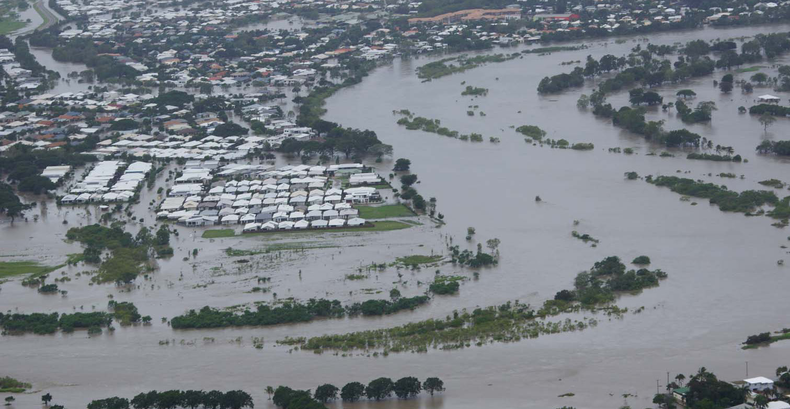
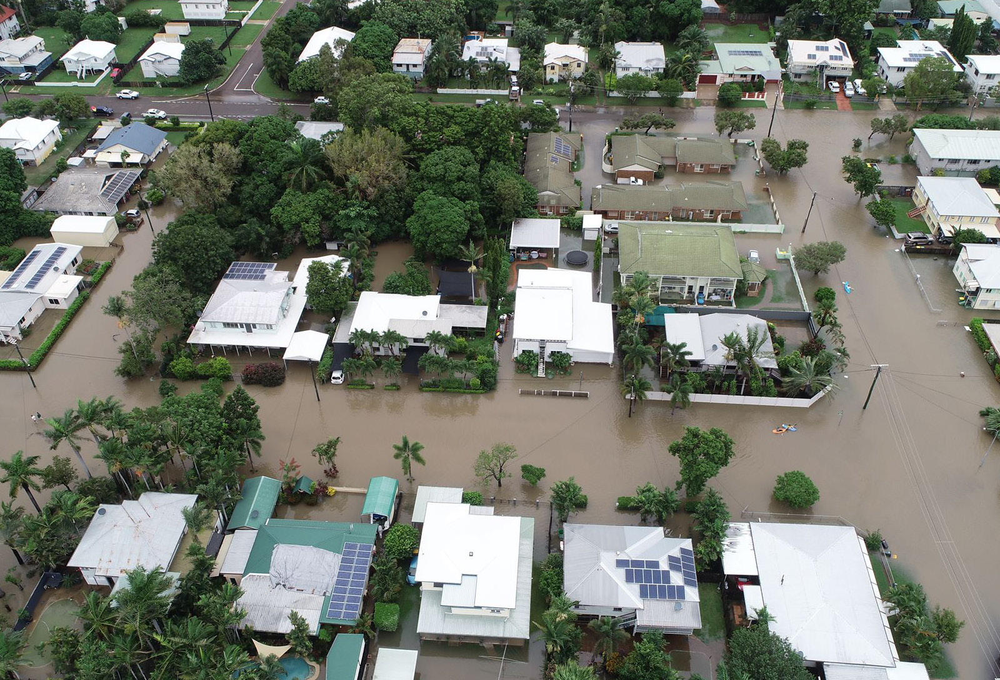
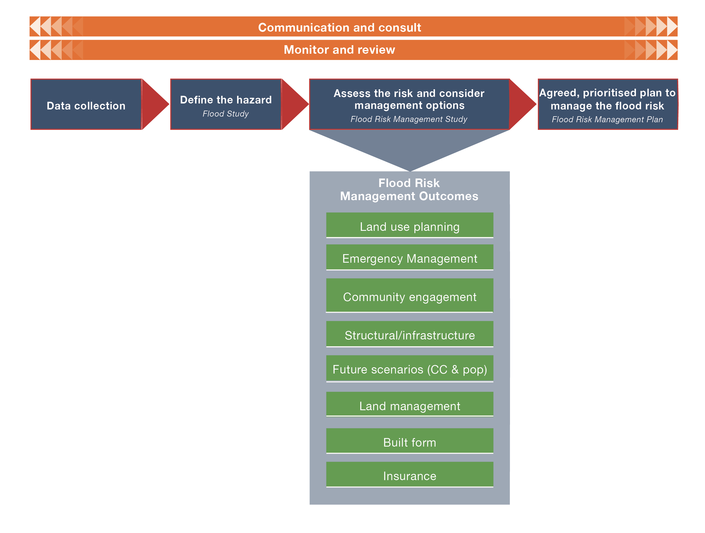

# Queensland Flood Risk Management Framework (QFRMF) (2021)

> **Source**: Queensland Reconstruction Authority
> **URL**: https://www.qra.qld.gov.au/sites/default/files/2021-06/queensland_flood_risk_management_framework_2021_qfrmf_0.pdf
> **Licence**: © State of Queensland; emergency-management practitioner reference
> **Retrieved**: 2026-05-07T23:43:30Z
> **SHA-256**: `401795b26a87ed356e2e4f4b4c1251b2e7ee719f8e1de159bb2f11745667cb3a`
> *Converted from PDF to Markdown format.*

---
## Page 1

Queensland Flood Risk 
Management Framework

---
## Page 2

0590
Document details
Security classification
Public
Date of review of security classification
June 2021
Authority
Queensland Reconstruction Authority
Document status
Final
Version
1.0
QRA Reference
DOC/21/23368 GD/0590
Copyright
This publication is protected by the Copyright Act 1968.
© The State of Queensland (Queensland Reconstruction 
Authority), June 2021.
Licence
This work is licensed by State of Queensland (Queensland 
Reconstruction Authority) under a Creative Commons 
Attribution (CC BY) 4.0 International licence.
To view a copy of this licence, visit www.creativecommons.
org/licenses/by/4.0/
In essence, you are free to copy, communicate and adapt 
this document, as long as you attribute the work to the State 
of Queensland (Queensland Reconstruction Authority). 
Interpreter
The Queensland Government is committed to providing 
accessible services to Queenslanders from all culturally and 
linguistically diverse backgrounds. If you have difficulty in 
understanding this report,  you can access the Translating 
and Interpreting Services via www.qld.gov.au/languages or 
by phoning 13 14 50.
Disclaimer
While every care has been taken in preparing this 
publication, the State of Queensland accepts no 
responsibility for decisions or actions taken as a result of 
any data, information, statement or advice, expressed or 
implied, contained within.To the best of our knowledge, the 
content was correct at the time of publishing.
Copies
Copies of this publication are available on our website at: 
www.qra.qld.gov.au
Further copies are available upon request to:
Queensland Reconstruction Authority
PO Box 15428
City East QLD 4002
Phone (07) 3740 1700
info@qra.qld.gov.au
www.qra.qld.gov.au
2
Queensland Flood Risk Management Framework

---
## Page 3

3
Queensland Flood Risk Management Framework
Contents
Introduction
4
Background	
4
Purpose	
5
Scope and intended audience	
5
Flood risk management
6
Managing the risk of flooding in Queensland	
6
Building capability and capacity
8
Leadership	
8
Governance (roles and responsibilities)	
10
Accountability	
18
Knowledge	
19
Appendix A: The legislative and policy landscape
21
Relevant legislation	
21
Related policies, projects and programs	
24
Appendix B: List of abbreviations
26

---
## Page 4

4
Queensland Flood Risk Management Framework
Introduction
Background
Flooding causes more damage in Queensland than any other natural hazard. Since its establishment in 2011, Queensland 
Reconstruction Authority has administered more than $16.4 billion in disaster recovery funding, with about 85 per cent of 
this flood-related. 
Queensland has repeatedly demonstrated its strong and resourceful capabilities in response and recovery, and these efforts 
are coming under recurrent and sustained pressure. As our population grows and the impacts of a changing climate result 
in an increased frequency of large-scale, destructive flood events, more needs to be done to prepare for and prevent the 
detrimental impacts of flooding on our communities.
In Queensland, governance of flood risk management is based on a collaborative, decentralised model with shared roles 
and responsibilities. Responsibility for flood risk management generally rests with local governments, as they are the 
major service provider to communities and are responsible for managing local development. Governance and flood risk 
management related policies in Queensland are dispersed across various state-level agencies to support decision making 
by local governments. 
In addition, contemporary practices recognise that flood risk management requires a multi-disciplinary, integrated approach 
and aims to harness the skills and knowledge of a wide range of stakeholders. For the governance model to be successful, 
the roles and responsibilities of each stakeholder need to be articulated and understood. Close collaboration between the 
various partners is needed to achieve optimal outcomes. Local governments are the major service provider to communities, 
are responsible for managing local development, and managing disasters through the Local Disaster Management Group. 
The Queensland Flood Risk Management Framework (herein the Framework) sets the direction for flood risk management 
in the state. It builds on and replaces the Strategic Policy Framework for Riverine Flood Risk Management and Community 
Resilience 2017. The Framework aligns with the National Disaster Risk Reduction Framework (2018), the Queensland Strategy 
for Disaster Resilience (2017), and has been developed consistent with the principles of the Queensland Emergency Risk 
Management Framework (2017) (QERMF).
Appendix A provides a further discussion on the existing legislative and policy landscape. 
This Framework was developed by the Queensland Reconstruction Authority (QRA) as the state agency responsible 
for coordinating the development and implementation of whole-of-government policies for managing flood risks, in 
consultation with other relevant Queensland Government agencies.

---
## Page 5

5
Queensland Flood Risk Management Framework
Purpose
The Queensland Strategy for Disaster Resilience (2017) sets the foundations for Queensland to be the most disaster resilient 
state in Australia. To help achieve resilience with respect to managing the impacts of flooding, the Queensland Government 
recognises it needs to: 
•	 better understand our flood risk through the application of consistent, best-practice assessment methodologies
•	 better understand flood risks able to be managed at the local level and the growing residual risks and areas of 
unacceptable risks that need to be managed and mitigated at the state level
•	 manage our growing response and recovery burden through greater investment in preparedness and prevention
•	 consider strategies to gradually reduce the impacts of the legacy flooding issues associated with past planning 
decisions
•	 build capacity and capability for effective flood risk management at all levels.
The purpose of this Framework is to address these needs, by providing clarity and understanding of expectations and 
responsibilities to guide and support decision-making by councils.
Scope and intended audience
This Framework applies to managing floods in urban, rural and remote areas of Queensland, resulting from:
•	 catchment flooding, including rivers and other watercourses, overland flow paths and groundwater systems as a 
result of prolonged or intense rainfall
•	 coastal flooding due to tidal or storm-driven coastal events, including storm surge in lower coastal waterways 
(excluding tsunamis).
The Framework is intended for use by those with roles in understanding and managing flood risks and its consequences on 
the community. This may include emergency management practitioners, flood risk managers, land use planners, engineers, 
hydrologists, infrastructure providers, and policy and decision makers within government and the broader industry.

---
## Page 6

6
Queensland Flood Risk Management Framework
Flood risk management
Flood risk management requires a multi-disciplinary, coordinated approach in order to be successful. The goal is for 
sustainable practices that improve community resilience and provide long-term benefits to the built and natural landscapes. 
Flood risk management involves the full spectrum of stakeholders, from communities and private industry, to local, state 
and national governments and non-government organisations. It includes arrangements about managing the potential 
adverse effects of floods - for example, arrangements for mitigating, preventing, preparing for, responding to and recovering 
from a disaster.
It involves consideration of the full range of management 
options, including the best use of land, design of built 
form, land and water management practices, as well as 
disaster management, community resilience and response 
management, and structural mitigation. 
It is also necessary to acknowledge the alternate cycles of 
drought and floods commonly experienced in Queensland, 
the need and desire for urban and economic growth and 
protection of our habitats and ecosystems.
Management of our floodplains should be based on 
best practice, which promotes tailored, proportionate 
assessment that provides an understanding of 
flood behaviour so that the full range of flood risk to 
the community can be understood and effectively 
communicated. This leads to informed decisions on the 
management of risk, as well as economic investment in 
development and infrastructure on floodplains.
Effective and strategic flood risk management is important 
for the long-term ecological, social and economic 
sustainability of Queensland.
Managing the risk of flooding in Queensland
Governance arrangements, policies and legislation related to flood risk management in Queensland is dispersed across 
various state-level agencies, to support decision making by local governments as the main service provider to communities. 
Legislation dealing with flood risk management in Queensland covers issues ranging from planning and corporate 
responsibility to emergency response. The principal legislation, set out in more detail in Appendix A, are: 
•	 Queensland Reconstruction Authority Act (2011)
•	 Planning Act 2016 (Queensland) 
•	 Disaster Management Act 2003 (Queensland)
•	 Building Act 1975 (Queensland)
•	 Local Government Act 2009 (Queensland)
•	 River Improvement Trust Act 1940 (Queensland).
The flood risk management process promoted in this Framework is built on the national handbook Managing the Floodplain: 
A Guide to Best Practice in Flood Risk Management in Australia (Handbook 7) (AIDR, 2017), involving a staged process that 
leads to flood risk management outcomes, as shown in the following diagram. 
Figure 1: Intergrated flood risk management planning
I
N
T
E
G
R
A
T
E
D
 
C
A
T
C
H
M
E
N
T
 
P
L
A
N
N
I
N
G
Resilient  
buildings
Community awareness 
and resilience
Land use 
planning
Disaster 
management
Current/future 
flood risk
Structural  
mitigation options
Landscape  
management
I
N
T
E
G
R
A
T
E
D
 
C
A
T
C
H
M
E
N
T
 
P
L
A
N
N
I
N
G
Strategic 
Floodplain 
Management 
Plan

---
## Page 7

7
Queensland Flood Risk Management Framework
The process and outcomes can be tailored to apply to the local, regional and state level. In its simplest forms, the process 
involves: 
•	 collecting the necessary data 
•	 defining the flood hazard
•	 assessing the risk, considering options to manage the risk to acceptable levels 
•	 developing an implementation plan to manage the risk. 
The Framework is informed and/or supported by the processes of monitoring and review, and communication and 
consultation. 
The terminology used throughout this document, such as flood study or flood risk management study, is used simply to 
show alignment with national guidelines. It can be altered to suit the scale of the assessment and the objective of the 
works. For example, in some areas, the assessment of flood risk may form part of an overarching all-hazards assessment, 
rather than a discrete process. Furthermore, not all of the stated flood risk management outcomes will be appropriate to all 
locations, or addressed through a single project or assessment. 
Readers of this document should therefore focus on the intent and objectives of the process, tailoring them to their specific 
needs and context.
Figure 2: Flood risk mamangement process

---
## Page 8

8
Queensland Flood Risk Management Framework
Building capability and capacity
The United Nations Office for Disaster Risk Reduction (UNDRR) developed a Strategic Approach to Capacity Development for 
Implementation of the Sendai Framework for Disaster Risk Reduction (May 2019), which provides generalised advice on the 
capacity development roles and responsibilities of various disaster risk reduction stakeholders, and high-level guidance on 
priority areas for action. 
The following areas for building capacity and capability are based on the four domains identified in the UNDRR Strategic 
Approach that generally have the greatest influence on capacity development:
•	 Leadership 
•	 Institutional strengthening and development (Governance)
•	 Accountability
•	 Knowledge 
This Framework uses these four areas as the vehicle to achieving a strong understanding of current and potential future flood 
risk in Queensland, greater investment in preparedness and prevention, and capacity and capability across all flood risk 
management stakeholders.
Leadership
Leadership, according to the UNDRR Strategic Approach, is the ability to influence, inspire and motivate others to achieve 
or even go beyond their goals. It is also the ability to anticipate and respond to change. Leadership is not necessarily 
synonymous with a position of authority, it can also be informal and be held at many levels. Leadership development 
programs, strategic planning exercises, promotion of peer-to-peer mentoring, and identifying and supporting champions of 
change are all measures that support leadership capacity.
BU
IL
T F
OR
M
LA
ND
 U
SE
 P
LA
NN
IN
G
EM
ER
GE
NC
Y 
M
AN
AG
EM
EN
T
ST
RU
CT
UR
AL
 M
IT
IG
AT
IO
N
AN
D 
IN
FR
AS
TR
UC
TU
RE
LA
ND
 M
AN
AG
EM
EN
T
CO
M
M
UN
IT
Y 
EN
GA
GE
ME
NT
AN
D 
AW
AR
EN
ES
S
STATE 
COORDINATION 
OF FLOOD RISK 
MANAGEMENT POLICY
Local Government leadership 
in developing strategies to address local flood 
risk, and action plans for implementation.
Locally relevant solutions 
for flood risk management, drawing 
on the full range of options, supporting flood 
aware and resilient communities.
State agencies 
develop and implement
programs and activities for their 
respective areas aligned with whole 
of government approach. 
Figure 3: State coordination of 
flood risk management policy

---
## Page 9

9
Queensland Flood Risk Management Framework
BRISBANE CITY COUNCIL – FLOOD RESILIENT 
HOMES PROGRAM (PILOT)
This program is designed to help residents prepare 
for and recover from overland flow flooding. This 
voluntary program is currently being trialled in 
locations across the city that have a history of 
this type of flooding. The Flood Resilient Homes 
Program consists of a free in-home service, tailored 
recommendations, and an incentive scheme.
www.citysmart.com.au/floodwise
“The Brisbane River Strategic Floodplain Management Plan 
is an outstanding example of how locally-led, regionally-
focused and state-supported resilience can achieve 
improvements for all parts of the community.” 
(Queensland Resilience Awards 2019)
It is a resource for state and local governments to enable the 
coordinated implementation of flood resilience actions over 
time. Its purpose is to facilitate regionally consistent flood 
risk management outcomes for the region, with flexibility in 
local implementation approaches and processes. It does not 
alter the statutory effect of existing legislation and policy.
FLOOD RISK ASSESSMENT PLANNING EVALUATION AND SCHEME AMENDMENT (FRAPESA) PROJECT
Toowoomba Regional Council embarked on one of the largest and most ambitious bodies of flood risk assessment 
undertaken by a local government in Australia.
It delivered multiple flood studies for 30 townships and the Condamine River catchment, along with comprehensive 
recommendations to better regulate development to protect people, property, infrastructure and the environment from 
flooding.
This project identified areas of flood risk across the region and assisted in putting in place a robust set of planning 
regulations.
Some good practice examples of leadership at different levels in flood risk management in Queensland are included below.
The delivery of flood risk management in Queensland is via a collaborative dispersed model (see Figure 3) . Roles and 
responsibilities (set out in more detail in the following section) are dispersed between and across levels of government, along 
with key actions by industry.
Leadership operates at various levels and functions, including the coordination of strategic policy, implementation and 
reporting. A clear understanding of how leadership operates is essential for the dispersed model to be effective. 
In Queensland, implementation of the dispersed model includes functional areas across and within state agencies and local 
governments.
State agencies supporting leadership and decision-making responsibilities of local governments are:
•	 Queensland Reconstruction Authority (QRA) 
•	 Department of Regional Development, Manufacturing and Water (DRDMW)
•	 Department of State Development, Infrastructure, Local Government and Planning (DSDILGP)
•	 Queensland Fire and Emergency Services (QFES)
•	 Department of Environment and Science (DES)
•	 Department of Energy and Public Works (DEPW)
•	 Department of Transport and Main Roads (DTMR)
•	 Department of Seniors, Disability Services and Aboriginal and Torres Strait Islander Partnerships (DSDSATSIP)
Formal collaboration is managed within the Queensland Resilience Coordination Committee (QRCC).
In accordance with the Queensland Reconstruction Authority Act 2011, one of the main functions of QRA is to coordinate the 
development and implementation of whole-of-government policies for managing flood risks. This sits within QRA’s broader 
remit to provide for appropriate measures to improve the resilience of communities for potential disasters and mitigate 
against potential disasters for affected communities.
This coordination role requires other core agencies to lead the development and implementation of their respective activities 
within the dispersed model approach in Queensland to support decision making by local governments (refer Tables 1 to 7). 
This includes engaging Aboriginal and Torres Strait Islander councils to meet their specific needs in line with the Local Thriving 
Communities reform agenda to embrace local leadership in decision-making. Acknowledging a varying levels of capacity and 
capability of local governments, the activities of the core agencies include the development and implementation of programs, 
policies and guidance material, as well as the administration and allocation for funding programs. Local governments in turn 
are well placed to provide leadership at the local level by using the full suite of instruments available to them.

---
## Page 10

10
Queensland Flood Risk Management Framework
Governance (roles and responsibilities)
Flood risk management extends to a broad range of government and private sectors and stakeholders, and is closely linked 
with many policy directives and other functions of government. Across the board, there is a need for stakeholders to work 
together, as well as integrate flood risk management considerations into their work.
In recognition of the decentralised approach to flood risk management in Queensland, overall governance requires a clear 
articulation of roles, responsibilities and expectations. Governance arrangements are set out in the following tables, and are 
framed around the core stages of the flood risk management process from Handbook 7.
Formal collaboration is managed within the QRCC and reported to the State Disaster Coordination Group (SDCG).
Tables 1 to 6 outline the process of flood risk management, whilst Table 7 details the outcomes sought to be achieved 
through implementation. 
Compliance with the processes outlined below, may be used to demonstrate the need, and support applications, for funding 
in these areas.
Data collection and information provision
Collecting, maintaining, using and sharing the best available information, including post-event data collection and 
information, and outputs from floodplain-specific investigations.
Expectations
All stakeholders:
•	 develop, maintain and make publically available databases of relevant flood information 
•	 invest and maintain the flood warning infrastructure network across the state 
•	 collaborate on the collection of post-event data 
•	 analyse and share historical events data for use in hydrologic and hydraulic model 
calibration and verification, hazard identification and risk assessments 
•	 flood data is publicly available and accessible.
Responsibilities
There are a range 
of stakeholders 
responsible for 
data collection and 
the provision of 
information.
Local governments: 
•	 primary responsibility for data collection and analysis at the local level, including the 
installation and maintenance of flood information network (gauges and supporting 
infrastructure)
•	 publish flood study results 
•	 provide GIS layers of mapped extents on their website, and share with state government 
and ICA. 
DRDMW: 
•	 manage a network of river and rainfall gauges for water resource assessment and 
management purposes, and collect hydrological records and data which contributes to the 
Queensland flood warning network 
•	 publish approved dam emergency action plans 
•	 water planning (modelling for water resource plans and allocations). 
Department of Resources: 
•	 data storage and publication of flood studies, flood maps and other flood information 
prepared by the state and local governments
•	 ensure accessibility of the above and share data with ICA and Geosciences Australia. 
QFES: 
•	 delivery of the Queensland Disaster Management Data Coordination Initiative (QDMDCI) 
•	 undertake damage assessments following events 
•	 oversight of the QERMF Risk Assessment Tool (to be replaced by the Queensland Risk 
Information Portal).
Table 1 – Data collection and information provision

---
## Page 11

11
Queensland Flood Risk Management Framework
Flood study
Understanding flood behaviour, which includes an assessment of a range of potential flood events under current and 
potential future conditions, including climate change; defining the flood function of the area, particularly conveyance and 
storage areas; variation in flood hazard across the floodplain; and the interaction of the flood with the landscape, which can 
isolate areas from flood-free land and result in difficult evacuation situations.
Table 2 – Flood study
Expectations
Flood studies and associated reports and maps will be:
•	 fit for purpose
•	 based on an appropriate study area and not constrained by jurisdictional boundaries
•	 the basis for identifying priority flood risk areas for more detailed assessment in 
accordance with Handbook 7 / Australian Rainfall and Runoff 2019 guidance
•	 made available on local authority websites (GIS and PDF), and shared with the state 
government and Insurance Council of Australia (ICA) under Creative Commons licensing
•	 supported by appropriate guidance provided by the state, including methodologies for 
undertaking flood studies.
DES: 
•	 coastal, vegetation and wetlands monitoring and mapping (base mapping)
•	 data storage of hydrologic models
•	 maintain the Queensland storm tide monitoring network to support disaster planning and 
response
•	 statewide storm tide inundation mapping
•	 undertake post-event storm tide inundation mapping surveys for significant events 
•	 provide climate projection data and maintain the Queensland Future Climate Dashboard. 
Bureau of Meteorology: 
Responsible for flood monitoring and prediction, and for the dissemination of riverine flood 
forecasts and warnings, as per the National Arrangements for Flood Forecasting and Warning. 
These activities include: 
•	 collection and publication of rainfall and river level data 
•	 routine monitoring of flood potential 
•	 issuing and the communication of flood watches and warnings 
•	 owning and maintaining flood warning infrastructure 
•	 maintaining a national database of rainfall/river monitoring metadata required for flood 
warning purposes 
•	 publishing reports on historic and or significant events. 
QRA: 
•	 facilitate best practice flood warning gauge network 
•	 support QFES in undertaking damage assessments following events. 
Dam owners: 
•	 prepare emergency action plans and make available any data that supports flood risk 
management 
•	 publish flood manuals for dams 
•	 prepare flood event reports for prescribed flood mitigation dams in accordance with the 
Water Supply (Safety and Reliability) Act 2008.
Office of the Coordinator-General (OCG):
•	 under the State Development and Public Works Organisation Act 1971, provide assessment, 
evaluation and facilitation of coordinated projects, undergoing an Environmental Impact 
Statement (EIS), including water infrastructure projects, as well as projects that may have 
an impact on, or from flooding, or located within a flood plain 
•	 As part of OCG’s assessment process baseline information and data is collected at the EIS 
stage of a coordinated project assessment.

---
## Page 12

12
Queensland Flood Risk Management Framework
Flood risk management study (FRMS)
Assessment of the risk of flooding informed by the QERMF process by considering the potential hazard, exposure and 
vulnerability of the community and assets, and local tolerability. 
Identifying areas of unacceptable risk, developing and assessing the full range of potential multi-disciplinary management 
options.
Table 3 – Flood risk management study
Expectations
A FRMS will:
•	 be undertaken for priority catchments following the completion of a flood study, consistent 
with Handbook 7 and the QERMF
•	 include assessment of the consequences of flood impact to the community, built 
environment, and natural environment and all potential options to manage residual risk
•	 undertake multi-criteria and economic assessments in accordance with the Framework for 
the Economic Assessment of Flood Management Projects (2021)
•	 include economic assessments that capture the costs and benefits of existing and 
proposed floodplain development and infrastructure and flood mitigation measures 
•	 include assessment of multi-disciplinary strategies/coordination measures for mitigating 
flood impacts
•	 be informed by consultation with local community
•	 seek to achieve flood risk management outcomes (set out in Table 7) and be transparent in 
any trade-offs which may result through the implementation of strategies.
Responsibilities
QRA: 
•	 identify priority catchments/areas to undertake FRMS 
•	 coordinate funding streams that may support delivery of FRMS 
•	 publish and maintain supporting guidelines, including the Framework for the Economic 
Assessment of Flood Management Projects (2021).
QFES: 
•	 facilitate the implementation of the QERMF.
Local governments: 
•	 undertake FRMS in consultation with local community and stakeholders.
DRDMW: 
•	 provide advice when requested on floodplain management and in particular for prescribed 
flood mitigation dams and Category 3 levees.
Responsibilities
DRDMW:
•	 provide technical support and advice on flood studies and flood mapping.
QRA: 
•	 identify priority catchment areas
•	 coordination of funding streams to support delivery of resilience projects.
Local governments:
•	 undertake flood studies for catchments within their area/shared with neighbouring local 
government areas
•	 publish flood study results
•	 provide GIS layers of mapped extents on their website, and share with state government 
and ICA.
DES:
•	 provide technical support and advice on storm tide studies and inundation mapping.

---
## Page 13

13
Queensland Flood Risk Management Framework
Flood risk management plan (FRMP)
Prioritised and agreed plan of actions that will manage the flood risk to acceptable limits. The actions will vary based on the 
scale of the project, the flood hazard, and the community and stakeholder tolerability of risk.
Table 4 – Flood risk management plan
Expectations
A FRMP should include:
•	 a prioritised plan of actions which considers funding, time periods and responsible agents. 
It will seek to achieve flood risk management outcomes (outlined in Table 7) and be 
transparent in the trade-offs which may result through the implementation of strategies
•	 identification and documentation of the residual risks – those which will remain even after 
the full plan is implemented
•	 an outline of the community consultation undertaken to inform priorities
•	 an implementation plan and specified review period 
•	 sufficient information to support a state-wide view on high priority actions.
Responsibilities
Local governments: 
•	 lead FRMP development in collaboration with local community and stakeholders.
QRA:
•	 provide state overview of high priority actions, as informed by local governments.
Communicate and consult
Develop information to aid the understanding and strategic management of flood risk. Provide this information to key end 
users and decision makers in a format that suits their needs and is consistent with the level of flood risks. Consult with 
local community and stakeholder to inform the development of FRMS and FRMP. Inform the community and key groups on 
progress and outcomes of studies, and on management decisions.
Table 5 – Communicate and consult
Expectations
Communication and consultation should be undertaken to:
•	 encourage use of consistent terminology and mapping standards through the provision of 
state guidelines
•	 understand the community and key groups’ priorities and values with regards to integrated 
catchment management
•	 gather information on communities’ suggestions for managing the risk of flooding to their 
area, and gauge their support for a range of potential options
•	 engage with the community and key groups on progress and outcomes of studies, and on 
management decisions
•	 provide information regarding flood risk and management, in accessible formats.
Responsibility
Local governments:
•	 collaborate and consult with, and inform, local communities and stakeholders.
QRA:
•	 prepare supporting guidelines and tools.
QFES:
•	 prepare and roll out community engagement programs.

---
## Page 14

14
Queensland Flood Risk Management Framework
Monitor and review
Monitor and review to ensure the assumptions, methods, data sources, results and reasons for decisions are subject to regular 
checks. These checks also consider changes in our understanding of flooding, its impacts and its management, lessons learnt 
from flood events, and trends in changes of exposure or vulnerability.
Table 6 – Monitor and review
Expectations
Monitoring and review activities should: 
•	 include regular review periods for each completed stage of this Framework
•	 include annual reporting on metrics identified throughout this Framework 
•	 enable continuous improvement in flood risk management through increased efforts in 
prevention and preparation activities.
Responsibilities
Local governments:
•	 determine appropriate review periods, and undertake reviews
•	 monitor the progress of flood risk management in their areas
•	 prepare a natural hazards, risk and resilience evaluation report which demonstrates 
compliance of the local planning instrument with those required and documented in the 
State Planning Policy.
QRA:
•	 produce annual update to QRCC on progress, informed by data provided by identified 
stakeholders.
QFES:
•	 ensure risk assessments and risk management strategies remain current and effective.
Flood risk management outcomes
Tables 1 to 6 outline the process of flood risk management, whilst Table 7 below details the outcomes sought to be achieved 
through the implementation of a range of possible management measures, many of which directly link to commitments 
made in the Queensland Strategy for Disaster Resilience (2017). 
Table 7 – Flood risk management outcomes
Flood Risk 
Management 
Measure and QSDR 
Commitments
Expected outcomes
Responsibilities
Land use planning
Promoting the 
incorporation of 
risk reduction in 
all planning and 
development 
(QSDR, 2017)
•	 Risk-based approach consistent with the State 
Planning Policy, which aligns flood hazard with 
appropriate land uses. 
•	 Planning schemes avoid future development in 
the flood hazard area, or the risk to people and 
property associated with future development in a 
flood hazard area is mitigated to an acceptable or 
tolerable level.
•	 The potential costs and impacts of development 
in a floodplain is understood and communicated 
to state and local the relevant community as 
part of proposing a planning scheme outcome to 
tolerate the risk, where the risk cannot reduced 
further. Climate change is incorporated in land use 
planning decisions, both in terms of opportunities 
to support mitigation and adaptation.
•	 Land use planning looks to avoid unacceptable 
existing risk through land use transition policies, 
where mitigation options are not viable. 
State lead: 
DSDILGP – oversees the framework 
local governments use when making 
or amending planning schemes 
(with technical input consistent with 
systems established by DRDMW).
DSDILGP – provides policy advice to 
assist local government on delivering 
state policy outcomes in planning 
schemes. 
Local governments: responsible for 
land use planning and development 
outcomes and making or amending 
planning schemes that incorporate 
flood risk mitigation considerations.

---
## Page 15

15
Queensland Flood Risk Management Framework
Emergency 
management
Promoting the 
incorporation of 
risk reduction in 
all planning and 
development 
(QSDR, 2017)
•	 FRMS produce information which can be directly 
used by emergency responders and disaster 
managers, across all phases of prevention, 
preparedness, response and recovery (PPRR).
•	 Costs and benefits of options are assessed with 
direct consideration of impacts on emergency 
response and operations.
•	 FRMS review minor, moderate and major 
classifications for all gauges in study area as 
standard practice.
•	 Flood intelligence systems are established and 
maintained.
•	 Flood intelligence and emergency and disaster 
management plans are reviewed after flood events 
and significant changes in the catchment, and 
following the completion of new studies, so that 
plans can be improved.
•	 FRMS develop databases of at-risk assets, shared 
with QFES and local governments.
State lead: QFES – through the 
implementation of the QERMF.
Implemented by local governments.
Community 
engagement
Driving attitudinal 
change and 
behavioural 
change across the 
state, enabling 
Queenslanders to 
anticipate, respond 
and adapt to 
disaster impacts 
(QSDR, 2017)
Providing 
opportunities for 
community-based 
solutions to the 
impact of disasters 
(QSDR, 2017)
Increasing 
community 
awareness and 
preparedness 
for all hazards 
through community 
engagement 
(QSDR, 2017) 
•	 Community contributes to the development 
of the FRMS through active consultation and 
representation on flood management committee 
(or equivalent).
•	 Information produced is accessible, useful and 
understood by a wide range of audiences and 
users.
•	 Local governments provide information to support 
their communities through each stage of prepare-
prevent-respond-recover phases (supported 
through Get Ready Queensland resources).
•	 The best available information on flood risk is 
openly, transparently and inclusively available. It 
promotes community flood resilience and support 
informed decision making.
•	 Use of consistent terminology and mapped 
standards.
•	 Responsibility of the local community and 
individuals to inform themselves about their flood 
risks is highlighted.
State leads: QRA and QFES – 
promoting community awareness and 
resilience through an online resilience 
hub, prepare and rollout community 
engagement programs.
Implemented by local governments.

---
## Page 16

16
Queensland Flood Risk Management Framework
Structural 
mitigation and 
infrastructure
Delivering 
more resilient 
infrastructure and 
transport systems 
(QSDR, 2017)
•	 Structural mitigation measures are used to 
manage areas of existing flood risk where no other 
options are shown to be viable.
•	 Structural mitigation measures are implemented 
with corresponding land use planning controls 
so as not to facilitate inappropriate future 
development.
•	 Structural mitigation measures are assessed for 
their ability to function under future climate and 
population scenarios.
•	 Funding for the implementation of any new 
structural mitigation measures are through 
partnerships, with costs shared amongst 
beneficiaries of the scheme.
•	 New infrastructure, including transport 
infrastructure, considers the impact on potential 
flooding and opportunities to reduce risk to 
existing communities.
•	 Options to better utilise existing infrastructure, 
including transport infrastructure, for flood risk 
management purposes are actively explored.
State leads for structural mitigation 
measures: 
•	 DRDMW - regulation of dams, 
flood storages and Category 
3 levees. 
•	 Local governments, Seqwater, 
Sunwater, DSDILGP - 
construction and operation of 
new and existing flood mitigation 
infrastructure.
•	 DRDMW - urban water security 
planning expertise.
•	 DRDMW - advice when requested 
on floodplain management and 
in particular for prescribed flood 
mitigation dams and Category 
3 levees.
State or local government leads for 
transport infrastructure:
•	 Local governments, DTMR, 
Queensland Rail, port authorities 
- as appropriate.
Planning and implementation by 
appropriate entity.
Future scenarios
Understanding 
the risks associ­
ated with warm­
ing climate with 
improved coastal 
management 
(QSDR, 2017)
Identifying adapta­
tion opportunities 
following disasters 
and in anticipation 
of climate change 
(QSDR, 2017)
•	 Flood risk profile is understood for both current 
and future conditions.
•	 Future conditions include population growth and 
climate change.
•	 All options assessed for current and future 
conditions.
•	 Options do not facilitate further development in 
high risk areas (existing or future).
•	 Options are assessed for the ability to reduce 
greenhouse gas emissions (to support mitigation 
of climate change futures) and adaptation to a 
changing climate.
•	 Land use planning schemes are based on flood 
mapping which include allowances for climate 
change.
State leads: 
•	 DES - provide climate projection 
data, including guidance to local 
governments on appropriate 
climate change scenarios at the 
start of planning studies and 
prior to preparing a Feasible 
Alternative Assessment Report.
•	 DSDILGP - guidance to local 
governments on implementing 
climate change scenarios in 
planning schemes.
•	 QFES - state lead for the 
incorporation of climate change 
and disaster risk (within the 
QERMF).
Planning and implementation by local 
governments.

---
## Page 17

17
Queensland Flood Risk Management Framework
Land management
Understanding the 
risks associated 
with a warming 
climate with 
improved coastal 
management 
(QSDR, 2017)
Supporting the 
ability of our natural 
assets to serve as 
protective buffers 
against disaster 
impacts (QSDR, 
2017)
Furthering the 
understanding 
of the natural 
landscapes to 
reduce the impacts 
and effects of floods 
and bushfires 
(QSDR, 2017)
Building 
partnerships 
across community, 
industry, research 
organisations 
and government 
to improve the 
health of waterways 
and marine areas 
(QSDR, 2017)
•	 Land management practices support flood 
risk management - making space for river, 
reconnecting waterways, revegetation and 
naturalisation.
•	 All benefits are captured, including opportunities 
for flood risk management and climate change 
mitigation and/or adaptation.
•	 Natural assets are recognised and used to mitigate 
the impacts and effects of floods.
Resources
•	 advice on soils, including 
conservation and management
•	 vegetation management advice 
and regulation
•	 storage, maintenance 
and sharing of Resources’ 
environmental and spatial data
DES 
•	 advice and research on climate 
change
•	 advice and research on wetlands
•	 conservation advice and 
regulation
•	 environmental pollution and 
contamination regulation
DRDMW 
•	 levee advice and regulation  
•	 watercourse advice and 
regulation
•	 water resource management and 
regulation
DSDILGP 
•	 planning and development 
advice and regulation
Implemented by:
•	 local governments
•	 natural resources management 
groups
•	 river improvement trusts
•	 regional organisations of 
councils.
Built form
Innovation in urban 
design for living 
with the impacts of 
floods and droughts 
(QSDR, 2017)
•	 Voluntary house raising, voluntary house purchase 
and flood proofing retrofit schemes may be 
a viable option to mitigate flood impacts to 
acceptable levels.
•	 Built form is consistent with identified flood 
hazard.
•	 Impervious areas resulting from development are 
minimised as far as practicable.
Lead: local governments
Supported by State agencies: DEPW, 
DSDILGP. 
Insurance
•	 Premiums are reduced for property owners who 
reduce their building’s vulnerability to flood 
impacts.
•	 Premiums are reduced when mitigation measures 
are in place.
•	 ICA DataGlobe has up-to-date flood information.
Implemented by ICA.
Delivering Value for 
Money
•	 Resilience/mitigation and risk reduction 
investment decisions are based on sound 
economic analysis which demonstrates a net 
benefit to society, using the Framework for the 
Economic Assessment of Flood Management 
Projects (2021).
State lead: QRA 
Implemented by all agencies and local 
governments.

---
## Page 18

18
Queensland Flood Risk Management Framework
Accountability
In the context of this Framework, accountability is the willingness and ability of the organisations identified to take 
responsibility for their actions and work to achieve the expectations and outcomes described. 
The ability of organisations to take responsibility for their actions is linked to effective investment decision-making and the 
availability of resources. 
In Queensland, funding for flood risk management projects comes from a number of funding streams, each with varying 
objectives, project requirements and delivery timescales. It is recognised that this can be confusing for those wishing to 
access financial support.
State funding programs and schemes that support flood risk management projects will:
•	 articulate priorities of funding programs based on achievement against vision
•	 prioritise investment supported by consistent, evidence-based assessments
•	 incentivise co-contributions from beneficiaries
•	 capture the full costs and benefits, through consistent economic assessments
•	 be transparent in the decisions and trade-offs of investment decisions.
Furthermore, the capacity to conduct the required flood risk management activities and make relevant decisions is 
contingent on the existence of accurate and actionable data and information, the knowledge of how to use that information 
for planning purposes. 
As a means to measure our progress towards fostering the most disaster resilient communities in Australia, a range of 
metrics related to the expectations and outcomes will be developed, reviewed and updated progressively. 
QRA will provide updates to the QRCC on progress of these metrics, informed by data and information provided by identified 
stakeholders.

---
## Page 19

19
Queensland Flood Risk Management Framework
Knowledge
Current and future generations of flood risk management professionals need the right skills, knowledge and resources to do 
what is required of them. 
Knowledge has traditionally been fostered at the individual level, but it can also be created and shared within an 
organisation through training and coaching, or outside formal organisational settings through industry bodies or 
communities of practice. 
Relevant existing resources in managing flood risk include:
•	 Queensland Disaster Management Training Framework outlines training to be undertaken by Queensland disaster 
management stakeholders to support the effective performance of each identified role, in accordance with the 
Disaster Management Act 2003.
•	 Managing the Floodplain: A Guide to Best Practice in Flood Risk Management in Australia (Handbook 7) (AIDR, 2017).
•	 Australian Rainfall and Runoff (ARR) is a national guideline document, data and software suite that can be used 
for the estimation of design flood characteristics in Australia. 
•	 Flood Classifications in Queensland (June 2020) is a best practice guide to assist local governments to understand: 
flood classifications, river heights and flood forecasts, different types of gauges, flood warning based on a river 
height, how to determine and set flood classifications, and considerations when reviewing flood classifications.
•	 Guide for Flood Studies and Mapping in Queensland (former Department of Natural Resources and Mines 
(DNRM), 2017) - seeks to assist flood practitioners in Queensland create fit-for-purpose flood studies and 
mapping which encompass best-practice principles. Application of the guide will promote a consistent approach 
to flood studies and mapping throughout the state.
•	 Flood Mapping Implementation Kit (DNRM, 2014) assists a broad range of stakeholders more effectively implement 
the outcomes of flood studies. It aims to increase the use of flood mapping outputs, improving the community’s 
understanding of their exposure to flood risk, and strengthening economic and community resilience.
•	 Natural hazards, risks and resilience – Flood (July 2017) has been prepared to support the implementation of the 
State Planning Policy and the interpretation of the natural hazards, risk and resilience state interest, focussed on 
flooding. 
•	 Flood Resilient Building Guidance for Queensland Homes (April 2019) provides information about resilient design 
and construction options for new and existing homes flood resilient building materials, and systems and economic 
benefits of flood resilient design solutions.
Professional networks - building knowledge and skills at the individual level 
Professional networks, such as peak industry bodies and communities of practice, support professional development 
and build capabilities through providing networking opportunities, training, seminars and conferences, and through 
sharing and/or publishing (technical) resources and facilitating awards, orations and scholarships. 
Some relevant peak industry bodies and community groups include:
•	 Floodplain Management Australia (FMA) - Australia’s leading network of flood professionals, representing 
their members’ interests at state and Commonwealth government levels, promoting public awareness of flood 
issues, and providing professional development for floodplain managers.
•	 National Committee on Water Engineering (NCWE) - the peak representative body for Engineers Australia 
members with an interest in surface water hydrology, hydraulics, water quality, water sensitive urban design 
and water resources.
•	 Planning Institute of Australia (PIA) - Australia’s national body representing planning and the planning 
profession, supporting education, communication and professional development.
•	 Flood Community of Practice - Professionals from a broad range of disciplines with any interest in flood and 
water management.
•	 Environment Institute of Australian and New Zealand Inc (EIANZ) - a not-for-profit, professional association that 
supports environmental practitioners and promotes independent and interdisciplinary discussion.
•	 Engineers Australia’s National Committee on Coastal and Ocean Engineering (NCCOE) - specialised knowledge 
needed to ensure safe and ecologically sustainable development of our nearshore zone, vital ports and 
harbours and valuable offshore resources.

---
## Page 20

20
Queensland Flood Risk Management Framework
•	 Climate Change Adaptation Guidelines in Coastal Management and Planning: Examines possible climate change 
scenarios affecting coastal engineering and provides guidance to coastal engineers, coastal managers and 
planners in responding to the challenges of our changing climate.
•	 Queensland Climate Change and Community Vulnerability to Tropical Cyclones, Ocean Hazards Assessment 
Stage 1: provides a review of technical requirements to undertake storm tide studies, including climate change.
•	 A guide to ‘good practice’ storm inundation mapping and modelling (DES, 2018): aims to provide assistance to 
local governments and others involved in coastal inundation modelling and mapping for the Queensland coast.
•	 Coastal hazard technical guide, Determining coastal hazard areas (former Department of Environment and 
Heritage Protection): This guide provides information about coastal hazards (storm-tide inundation and coastal 
erosion), and guidance for determining areas at risk from coastal hazards, including future risks linked to 
projected sea level rise and an increase in cyclone intensity.
•	 Flood Communication Toolkit (July 2020 - available to councils through the Get Ready Council Hub) provides flood 
messaging for councils and relevant state agencies to use in social media and other communication to improve 
community awareness and resilience to floods for all Queenslanders. 
•	 Building Resilience to Natural Disasters - Collaboration Guide (February 2020) provides guidance on how to 
establish collaborative groups across stakeholders to advance locally-led resilience. It draws on some theory, and 
links activities to Queensland’s disaster resilience policy framework.
•	 Educational videos on understanding flood risk: https://www.qra.qld.gov.au/understand-your-flood-risk
•	 Climate change science resources including a link to the Queensland Future Climate Dashboard can be found 
here: www.qld.gov.au/environment/climate/climate-change/resources/science
Another key aspect of supporting knowledge is effective arrangements for collecting, sharing and the dissemination of 
data. The capacity to conduct the required flood risk management activities and make relevant decisions is contingent 
on the existence of accurate and actionable data and information, along with the knowledge of how to use that data and 
information for planning purposes.

---
## Page 21

21
Queensland Flood Risk Management Framework
Appendix A: The legislative and policy landscape
Relevant legislation
Legislation dealing with flood risk management in Queensland covers issues ranging from planning and corporate 
responsibility to emergency response. The principal legislation is: 
•	 Queensland Reconstruction Authority Act (2011)
•	 Planning Act 2016 (Queensland) 
•	 Disaster Management Act 2003 (Queensland)
•	 Building Act 1975 (Queensland)
•	 Local Government Act 2009 (Queensland)
•	 River Improvement Trust Act 1940 (Queensland).
Queensland Reconstruction Authority Act 2011 
The Queensland Reconstruction Authority Act 2011 (the QRA Act) establishes QRA as the state’s lead agency for disaster 
recovery, resilience and mitigation policy. The main purpose of the QRA Act is to provide for appropriate measures:
•	 to ensure Queensland and its communities effectively and efficiently recover from the impacts of disaster events
•	 to improve the resilience of communities for potential disaster events.
With respect to flood risk management, two of the primary functions of QRA under the QRA Act include: 
•	 to coordinate the development and implementation of whole-of-government policies for managing flood risks
•	 to facilitate mitigating against potential disasters, including the development of a network of flood warning 
gauges that complies with best practice. 
Planning-related legislation
The Planning Act 2016 (the Planning Act) establishes an efficient, effective, transparent, integrated, coordinated, and 
accountable system of land use planning, development assessment and related matters that facilitates the achievement of 
ecological sustainability.
A key feature of the planning legislation is the ability for a local government to prepare a Feasible Alternatives Assessment 
Report (FAAR). This allows local governments to make a planning change to reduce a flood risk which may constitute an 
adverse planning change as outlined under the Planning Act for which compensation may be sought from affected owners 
(i.e. down-zoning, changes to tables of assessment and hazard codes). 
The Planning Act therefore includes specific provisions to allow a local government to make a decision where all feasible 
alternatives to making the planning change have been considered and exhausted. In these cases, a FAAR is to be prepared 
consistent with the Minister’s Guidelines and Rules. 
Completing the process and requirements has two effects: 
1.	 the proposed planning change is no longer defined as an adverse planning change
2.	 compensation provisions available to an affected owner no longer apply relating to the extent of the planning 
change. 
The preparation of a FAAR is intended to provide a clear and transparent process for local government’s assessment of the 
proposed planning change, as it: 
•	 demonstrates the reasoning for the proposed planning change by undertaking a risk assessment for the natural 
hazard and an assessment of feasible alternatives in accordance with any relevant Australian Standard or other 
relevant specifications
•	 will be publicly available through mandatory consultation where property owners will be notified and provided 
the opportunity to provide a formal submission.
This report would supplement the existing requirement for a local government to prepare a natural hazards, risk and 
resilience evaluation report which demonstrates compliance of the local planning instrument with the requirements of the 
State Planning Policy.

---
## Page 22

22
Queensland Flood Risk Management Framework
Disaster management-related legislation
In Queensland, the following key documents explain how disasters should be managed: 
•	 Disaster Management Act 2003 (Queensland) 
•	 Emergency Management Assurance Framework
•	 State Disaster Management Plan
•	 Disaster Management Strategic Policy Framework
•	 Standard for Disaster Management in Queensland.
Floods are one of the multiple hazards that local governments are required by law to manage in their local government area. 
Entities with roles or interests in local disaster management form a Local Disaster Management Group to assist each local 
government to coordinate its efforts. This group is in turn supported by District Disaster Management Groups and the State 
Disaster Management Group as per Queensland’s disaster management arrangements. 
The Disaster Management Act 2003 (the DM Act) articulates disaster management stakeholders must be ready and 
equipped to help the community prevent, prepare, respond to and recover from both natural and man-made disasters. This 
applies to flooding in Queensland. A Prevention, Preparedness, Response and Recovery Disaster Management Guideline 
has been developed to provide guidance to local, district and state disaster management stakeholders with regard to their 
functions, obligations and legislative requirements under the DM Act.
Within Queensland’s disaster management arrangements, local governments – through their respective Local Disaster 
Management Groups – have primary responsibility to manage a disaster at the community level. Accordingly, they are 
responsible for the development and implementation of their Local Disaster Management Plan.
Building-related legislation
The Building Act 1975 (the Building Act) regulates building development approvals, building work, building classification, 
building certifiers and pool safety inspectors. 
The Building Act dictates that buildings must be constructed in accordance with the Building Code of Australia and, where 
Queensland-specific provisions are necessary, the Queensland Development Code (QDC).
The QDC includes Mandatory Part 3.5 - Construction of buildings in flood hazard areas (December 2013). This Part ensures 
that particular buildings located in flood hazard areas:
•	 resist flotation, collapse or significant permanent movement caused by flood water
•	 safeguard occupants and other people against illness or injury caused by flood water affecting buildings 
•	 are protected from backflow
•	 have utilities that are protected from the effects of flood water.
This Part also ensures that a customer dedicated substation is designed or located so its ability to function effectively is not 
affected by flood water.
It is noted that this Part does not apply to a building located, or proposed to be located, on a lot that is subjected to storm 
surge and to significant mudslide or landslide caused by rainfall or runoff. 
Application of this Part is reliant on a local government prescribing a Designated Flood Level for all or part of an area, under 
section 13 of the Building Regulation 2006. 
Local Government Act 2009
The purpose of the Local Government Act 2009 is to provide for:
•	 the way in which a local government is constituted and the nature and extent of its responsibilities and 
powers
•	 a system of local government in Queensland that is accountable, effective, efficient and sustainable.

---
## Page 23

23
Queensland Flood Risk Management Framework
River Improvement Trust Act 1940
The River Improvement Trust Act 1940 provides for the responsible management of river catchment areas through:
•	 planning for and implementing measures that improve the protection, health and resilience of rivers and their 
catchments
•	 repairing, and preventing damage to, rivers and their catchments
•	 restoring natural resilience to flooding and cyclones in rivers and their catchments
•	 protection of water security
•	 improving water quality and river system function in rivers and their catchments.
A River Improvement Trust is a statutory body constituted under this Act which has the power to raise funds, enter land, 
occupy land, enter into contracts and carry out works related to these objectives.

---
## Page 24

24
Queensland Flood Risk Management Framework
Related policies, projects and programs
This Framework is designed to provide clarity and guidance with regards to flood risk management in Queensland. It 
supports the implementation and guidance provided by a wide range of other initiatives, and seeks to inform a consolidated 
approach to achieving our aim of becoming the most disaster resilient state in Australia.
The Framework is developed with links to local, regional, national and international efforts to sustainably manage flood risk, 
the most relevant of which are discussed below.
The Framework builds on and replaces the Strategic Policy Framework for Riverine Flood Risk Management and Community 
Resilience 2017. The Framework aligns with the National Strategy for Disaster Resilience (2011), the Queensland Strategy 
for Disaster Resilience (2017), and has been developed consistent with the principles of the Queensland Emergency Risk 
Management Framework (2017) (QERMF). 
In 2015, the Sendai Framework for Disaster Risk Reduction 2015–2030 (the Sendai Framework) was adopted by Australia and 
other members of the United Nations. The Sendai Framework outlines four global priorities to support countries’ efforts in 
strengthening disaster resilience: 
•	 understanding disaster risk 
•	 strengthening disaster risk governance to manage disaster risk
•	 investing in disaster risk reduction for resilience and enhancing disaster preparedness for effective response
•	 to ‘Build Back Better’ in recovery, rehabilitation and reconstruction. 
The Paris Agreement and the 2030 Agenda for Sustainable Development (including the Sustainable Development Goals 
(SDGs)) were also agreed on in 2015. Both agreements highlight the importance of climate change adaptation and disaster 
risk reduction. The United Nations Office for Disaster Risk Reduction recognises that progress in implementing the Sendai 
Framework supports the global community in meeting the SDGs.
Further, the Ulaanbaatar Declaration of the Asian Ministers for Disaster Risk Reduction (July 2018) calls for greater 
accountability of disaster losses, and alignment of disaster risk reduction and SDGs. It states a commitment to translating 
coherence of global frameworks into policy and practice to achieve resilience at national and local levels across all sectors, 
including by strengthening governance arrangements and by providing practical guidance to ensure effective and efficient 
management of disaster risk. 
These international frameworks set the agenda for the development of key national and state policy frameworks, programs 
and projects, some of which are summarised below.
National Strategy for Disaster Resilience (NSDR), 2011
In response to a number of large scale, devastating natural disasters, the Australia Government released the NSDR 
to support the development of disaster resilient communities, recognising the shared responsibility and behavioural 
changes required to achieve this. NSDR defines resilient communities, high level roles, and the actions and outcomes 
required to achieve widespread disaster resilience.
National Disaster Risk Reduction Framework (NDRRF), 2018
The NDRRF guides national, whole-of-society efforts to proactively reduce disaster risk in order to minimise the loss and 
suffering caused by disasters. It is designed to leverage the work and progress made across all sectors since the release 
of the NSDR to better understand and reduce disaster risks, improve resilience, and bolster the capability and capacity of 
communities to withstand natural hazards.
Guidance for Strategic Decisions on Climate and Disaster Risk, 2019
The National Resilience Taskforce developed a set of interconnected guidance documents (Governance, Vulnerability, 
Scenarios and Prioritisation) to support implementation of the NDRRF. The guidance supports decision makers to 
contextualise the systemic impacts of a changing climate, to be used to inform strategic long-term planning and 
investment decisions. Whilst targeted at large-scale investment and high stakes decisions, it is considered adaptable to 
smaller-scale investments and disaster risk assessments. 
Queensland Strategy for Disaster Resilience (QSDR), 2017
The QSDR sets strategic direction for the realisation of the Queensland Government’s vision to make Queensland the 
most disaster resilient state in Australia. Through the QSDR, the Queensland Government will harness the capabilities of 
its agencies, informed by the experience and knowledge of local governments, communities and individuals, to further 
build the state’s capacity for resilience against all hazards. The QSDR provides an overarching framework to Anticipate, 
Respond and Adapt with four key objectives - Queenslanders understand their disaster risk; strengthened disaster risk 
management; Queenslanders are invested in disaster risk reduction; continuous improvement in disaster preparedness, 
response and recovery.

---
## Page 25

25
Queensland Flood Risk Management Framework
Queensland Emergency Risk Management Framework (QERMF), 2017
The QERMF establishes Queensland's approach to disaster risk management. It provides a risk assessment methodology 
that can be used within disaster management planning at all levels of Queensland's disaster management arrangements. 
The process applies a standardised and internationally recognised approach to the prioritisation, mitigation and 
management of risk. This includes the consistent identification and passage of residual risk between levels of 
Queensland's disaster management arrangements to directly inform planning and resource allocation and to promote 
active communication, cooperation and coordination.
Queensland Disaster Management Data Coordination Initiative (QDMDCI)
The QDMDCI is a QFES-led initiative to improve disaster management data coordination activities across all disaster 
management groups, including all levels of government, non-government organisations and private entities with the aim 
of improving Queenslanders’ ability to better plan, manage and respond to disaster events.
Queensland Disaster Resilience and Mitigation Investment Framework, 2019
QRA developed this Framework to act as the link between policy, funding sources, guidelines and investment and 
procurement approaches, to support the alignment of funding programs in Queensland’s resilience priorities. It provides 
guidance to public sector agencies to determine investment prioritisation for specific funding programs, based on the 
consideration of the prioritisation approach, assessment criteria and measuring success.
State Planning Policy (SPP), 2017 and associated SPP State interest guidance material.
The Queensland Government established the SPP to define the matters of state interest in land-use planning and 
development. State interest in the SPP consists of a state interest statement, state interest policies and, where applicable, 
assessment benchmarks. 
The guidance material provides support for implementation of the SPP with respect to flood hazards, through a risk 
based assessment, and is particularly focused on (although not mandatory) assisting local governments when making 
or amending a local planning instrument and when applying the assessment benchmarks. The SPP guidance material 
is intended to be read in conjunction with the SPP and is not statutory in its effect, nor does it contain any new policy 
requirements.
Queensland Climate Adaptation Strategy (QCAS), 2017–2030
The QCAS sets a framework for managing risks and maximising opportunities resulting from a changing climate. It 
includes four pathways of action, described as People and Knowledge, State Government, Local Government and 
Regions, and Sector and Systems.
Flood Warning Infrastructure Network (FWIN), ongoing
The FWIN is an ongoing program of works lead by QRA, in close collaboration with key stakeholders, including the Bureau 
of Meteorology and local governments, to improve Queensland’s flood warning infrastructure. Comprising more than 
3000 rainfall and river gauges across the state, owned and operated by multiple entities, both private and varying levels 
of government, the FWIN aims to identify priority locations requiring additional infrastructure capability through a locally-
led, regionally coordinated, catchment approach. 
Economic Assessment of Flood Risk Management Projects, 2021 
The economic assessment framework for flood risk management projects supports the NSDR and QSDR through ensuring 
consistent and comprehensive economic assessment to support decision making, particularly with regards to investment 
in flood risk management. 
Prevention Preparedness, Response and Recovery Disaster Management Guideline, 2018
This Guideline has been developed to provide guidance to local, district and state disaster management stakeholders 
with regard to their functions, obligations and legislative requirements under the Disaster Management Act 2003. It 
outlines a comprehensive end-to-end process for the steps to be undertaken through each of the phases of disaster 
management, specifically addressing roles and responsibilities of disaster management stakeholders, prevention 
and mitigation strategies, preparedness arrangements and considerations for planning, the activation of response 
arrangements, the recovery process and financial arrangements.

---
## Page 26

26
Queensland Flood Risk Management Framework
Appendix B: List of abbreviations
DEPW
Department of Energy and Public Works
DES
Department of Environment and Science
DNRM
(former) Department of Natural Resources and Mines
DRDMW
Department of Regional Development, Manufacturing and Water
DSDILGP
Department of State Development, Infrastructure, Local Government and Planning
DSDSATSIP
Department of Seniors, Disability Services and Aboriginal and Torres Strait Islander Partnerships
DTMR
Department of Transport and Main Roads
EIS
Environmental Impact Statement
FAAR
Feasible Alternatives Assessment Report
FRMP
Flood Risk Management Plan
FRMS
Flood Risk Management Study
FWIN
Flood Warning Infrastructure Network
Handbook 7
Managing the Floodplain: A Guide to Best Practice In Flood Risk Management in Australia, 2017
ICA
Insurance Council of Australia
NDRRF
National Disaster Risk Reduction Framework, 2018
NSDR
National Strategy for Disaster Resilience, 20111
OCG
Office of the Coordinator-General
QCAS
Queensland Climate Adaptation Strategy, 2017 - 2030
QERMF
Queensland Emergency Risk Management Framework, 2017
QFES
Queensland Fire and Emergency Services
QRA
Queensland Reconstruction Authority
QRA Act
Queensland Reconstruction Authority Act 2011, version current as at 11 April 2019
QRCC
Queensland Resilience Coordination Committee
QSDR
Queensland Strategy for Disaster Resilience, 2017
RQ
Resilient Queensland, 2018
SDG
Sustainable Development Goals
SPP
State Planning Policy, 2017
SPP Floods
State Planning Policy, state interest guidance material: Natural hazards, risk and resilience – Flood, 2017

---
## Page 27

www.qra.qld.gov.au

