# Queensland Strategy for Disaster Resilience 2022–27 (2022)

> **Source**: Queensland Reconstruction Authority
> **URL**: https://www.qra.qld.gov.au/sites/default/files/2022-09/queensland_strategy_for_disaster_resilience_low_res_web_l-r.pdf
> **Licence**: © State of Queensland; emergency-management practitioner reference
> **Retrieved**: 2026-05-07T23:43:26Z
> **SHA-256**: `d0d02b5d6c778a39065dc1447e43c901fc6b87e102bd08d658b44d567d99dceb`
> *Converted from PDF to Markdown format.*

---
## Page 1

Queensland Strategy for 
Disaster Resilience
2022–2027
Stronger, safer and more resilient communities

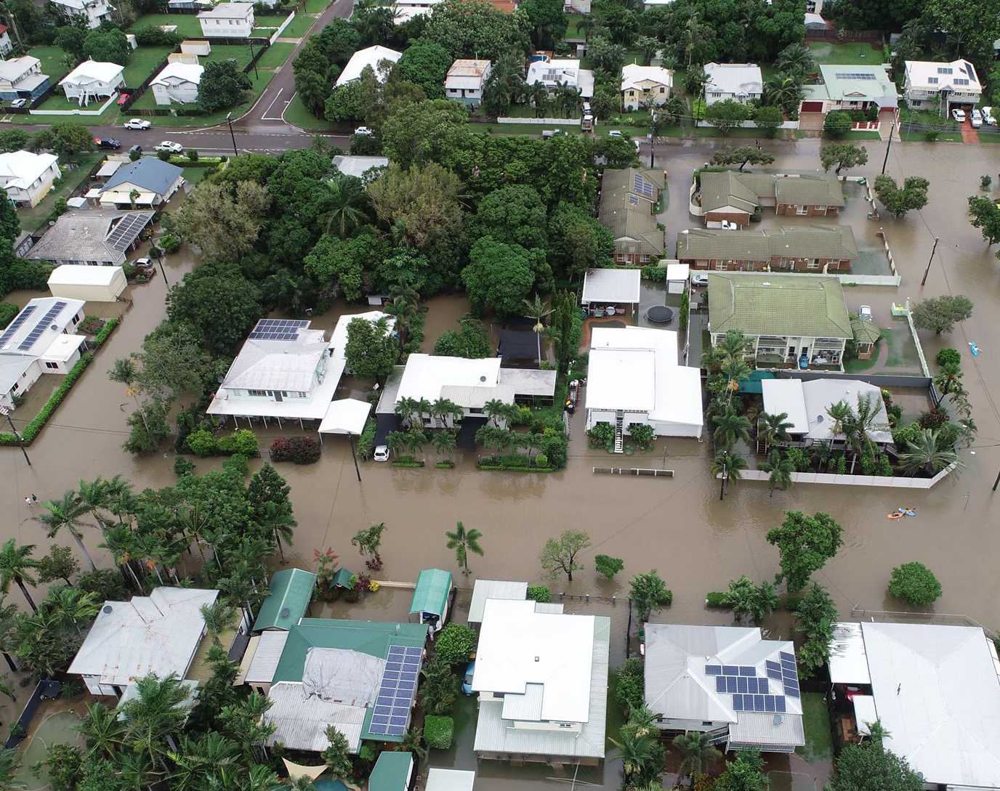

---
## Page 2

Document details
Security classification
Public
Authority
Queensland Reconstruction Authority
Document status
Final
Version
1.0
QRA Reference
QRATF/21/3031 | GD 0698
Copyright
This publication is protected by the Copyright Act 1968. © The 
State of Queensland (Queensland Reconstruction Authority), 
September 2022.
Licence
This work is licensed by State of Queensland (Queensland Reconstruction Authority) 
under a Creative Commons Attribution (CC BY) 4.0 International licence.
To view a copy of this licence, visit www.creativecommons.org/licenses/by/4.0/
In essence, you are free to copy, communicate and adapt this publication, as long 
as you attribute the work to the State of Queensland (Queensland Reconstruction 
Authority).
Interpreter
The Queensland Government is committed to providing accessible 
services to Queenslanders from all culturally and linguistically diverse 
backgrounds. If you have difficulty in understanding this report, you can 
access the Translating and Interpreting Services via www.qld.gov.au/
languages or by phoning 13 14 50.
Disclaimer
While every care has been taken in preparing this publication, the State of 
Queensland accepts no responsibility for decisions or actions taken as a result of any 
data, information, statement or advice, expressed or implied, contained within. To the 
best of our knowledge, the content was correct at the time of publishing.
Copies
Copies of this publication are available on our website at: www.qra.qld.gov.au/qsdr
Further copies are available upon request to:
Queensland Reconstruction Authority
PO Box 15428
City East QLD 4002
Phone (07) 3740 1700
info@qra.qld.gov.au
www.qra.qld.gov.au
Acknowledgements
Resilience is a shared responsibility. The Queensland Strategy for Disaster Resilience 
2022–2027 has been developed in consultation with, and contributions from the 
partner agencies including:
Department of Agriculture and Fisheries
Department of Communities, Housing and Digital Economy
Department of Employment, Small Business and Training
Department of Energy and Public Works
Department of Environment and Science
Department of Premier and Cabinet
Department of Regional Development, Manufacturing and Water
Department of Resources
Department of Seniors, Disability Services and Aboriginal and Torres 
Strait Islander Partnerships.
Department of State Development, Infrastructure, Local Government and Planning
Department of Tourism, Innovation and Sport
Department of Transport and Main Roads
Office of the Inspector-General of Emergency Management
Office of the Coordinator-General
Queensland Fire and Emergency Services
Queensland Health
Queensland Police Service
Queensland Treasury
Bureau of Meteorology.
Design
The design element used in the Queensland Strategy for Disaster Resilience 
2022–2027 is symbolic of a river, while reflecting both the seasonal nature of 
Queensland's disasters, and the surging nature of disaster recovery and resilience 
efforts. The objectives of this Strategy are to ensure that we: understand the 
potential disaster risks we face; work together to better manage disaster risk; 
seek new opportunities to reduce disaster risk; and continually improve how we 
prepare for, respond to and recover from disasters. The five coloured lines represent 
the five functional lines of recovery and resilience (human and social, economic, 
built, environment and roads and transport) and the lead agencies proactively 
implementing the Strategy, by working both together and independently, to 
coordinate and strengthen Queensland's resilience through the strategic priorities 
and actions outlined in this Strategy.
2
2022–2027 Queensland Strategy for Disaster Resilience
Image: Deepwater Central Queensland Bushfires 2018. Courtesy QFES. 
Cover image: Courtesy ADF.

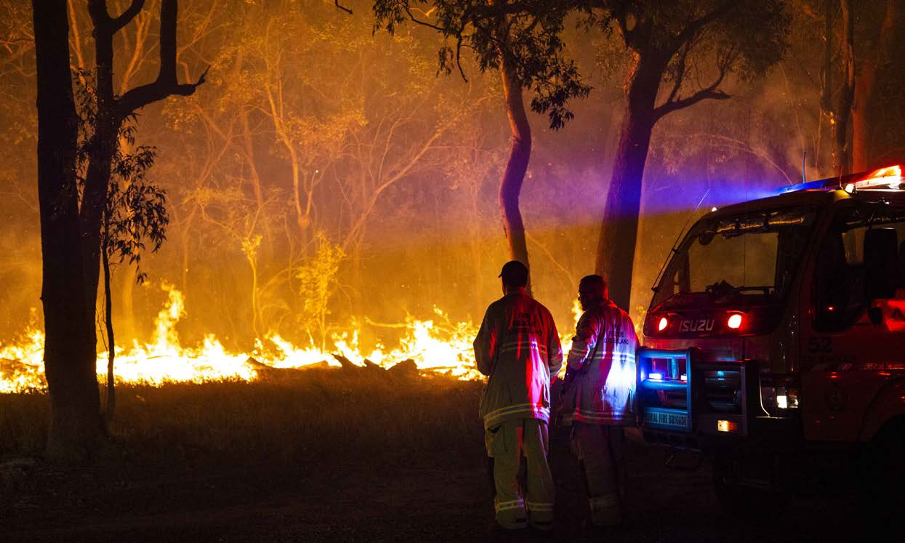

---
## Page 3

3
Queensland Strategy for Disaster Resilience 2022–2027
Foreword
Hon Steven Miles
Deputy Premier, Minister for State Development, Infrastructure, 
Local Government and Planning and Minister Assisting the 
Premier on Olympics Infrastructure
Queenslanders know all too well the impact of 
natural disasters, with Queensland on the frontline of 
bushfires, cyclones, and floods. Since 2011, Queensland 
has experienced more than 97 significant natural 
disasters, with Commonwealth and State recovery and 
reconstruction efforts exceeding $20 billion.
But the cost to our community is far greater. 
We face significant challenges into the future, with 
more extreme weather events and climate change 
amplifying them. This will expose communities to 
previously unknown risks, making it critical to increase 
public understanding of likely impacts and identify 
opportunities to mitigate and reduce future disaster 
risk through continued investment in resilience across 
Queensland.
With this uncertain future environment, it has never 
been more important that we build our state to be more 
resilient. It is critical for us to take deliberate steps to 
enhance cooperation in disaster risk management and 
collaborate to achieve sustainable resilience. 
Using what we have learned over the past decade, the 
Queensland Strategy for Disaster Resilience 2022–2027 
(QSDR) is designed to guide how Queensland can 
continue to strengthen its disaster resilience, guided by 
the local and regional needs of our large and 
diverse state. 
The QSDR sets four key objectives, underpinned by a 
series of strategic commitments and actions, to improve 
Queensland’s resilience to disasters:
•	
Understand risk – applying data to strengthen risk 
reduction understanding, culture and education to 
help Queensland communities become more resilient 
to future disasters 
•	
Work together – increase the role of state-led 
coordination of resilience outcomes by enhancing 
cooperation and working across silos to implement 
whole-of-government activities 
•	
Seek new opportunities – leverage regional, local 
and community knowledge to enhance capability to 
drive best practice in building resilience 
•	
Continuous improvement –clearer, more direct 
connection of funding to risk-based need. 
Disaster resilience requires governments, industry and 
the community to work together to make a real difference 
in addressing systemic challenges and keeping 
Queenslanders safe. 
The QSDR does just that, bringing together a range of 
agencies and sectors to deliver better outcomes for 
Queensland and make us a more resilient state. 
Hon Annastacia Palaszczuk
Premier of Queensland
Minister for the Olympics

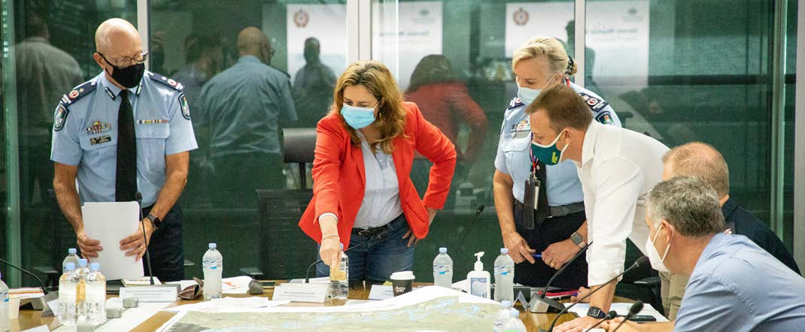

---
## Page 4

4
Queensland Strategy for Disaster Resilience 2022–2027
Acknowledgement of Country
We acknowledge the Traditional Owners 
and Custodians of this Country.
We recognise and honour their ancient 
cultures, and their connection to land, 
sea and community.
We pay our respect to them, their 
cultures, and to their Elders, past, 
present and emerging. 
Image: Brisbane River in flood, 2011. Credit: Shutterstock.

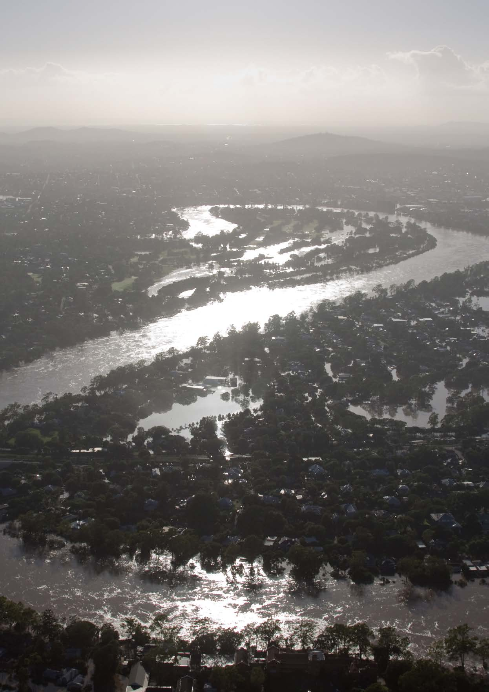

---
## Page 5

5
Queensland Strategy for Disaster Resilience 2022–2027
Contents
Foreword
3
Overview
6
Context 
6
Background 
6
Setting the scene: Resilience in Queensland	
7
The drivers for change
8
Policy alignment
9
Case study: Queensland's Regional Resilience Strategies 
11
Our partners 
12
Governance
13
Disaster risk in Queensland
15
Timeline of natural disasters in Queensland 	
16 
Climate change and future projections of disaster risk
18
Systemic disaster risk
20
Our resilience strengths and challenges
21
A systems approach: Queensland’s resilience narratives
23
Learning from Aboriginal and Torres Strait Islander peoples and community
24
Case studies: Resilience, First Nations peoples and community 
25
Strengthening the lines of resilience	
26
Built
28
Human and social 
30
Environment
32
Economic
34
Roads and transport
36
The Queensland Strategy for Disaster Resilience 2022–2027	
38
Vision, objectives and strategic commitments
40
A renewed focus for resilience
41
Stronger, safer, resilient Queensland communities
41
Objective 1 – We understand the potential disaster risks we face
42
Objective 2 – We work together to better manage disaster risk
44
Objective 3 – We seek new opportunities to reduce disaster risk
46
Objective 4 – We continually improve how we prepare for, respond to, and recover from disasters
48
Delivery and measuring success 
50
References
51

---
## Page 6

6
Queensland Strategy for Disaster Resilience 2022–2027
Context 
The Queensland Government is committed to 
strengthening disaster resilience so our communities are 
better equipped to deal with the increasing prevalence of 
natural disasters.
Queensland is the most disaster affected state in 
Australia having experienced 97 significant disaster 
events since 2011. With disaster events predicted 
to increase, it is crucial for Queensland to have a 
coordinated strategy to better understand, manage and 
reduce disaster risk, and to continually improve how we 
prepare for, respond to and recover from disasters. 
The purpose of the Queensland Strategy for Disaster 
Resilience 2022– 2027 (QSDR) is to provide an 
overarching framework to guide and coordinate the 
delivery of strategic commitments and actions to improve 
the resilience of Queensland communities across 
whole-of-government, with the support of key industry 
stakeholders. 
The vision for the QSDR is ‘Stronger, safer 
and more resilient Queensland communities’.
Four objectives underpin the QSDR:
•	
Objective 1 – We understand the potential 
disaster risks we face
•	
Objective 2 – We work together to better 
manage disaster risk
•	
Objective 3 – We seek new opportunities 
to reduce disaster risk
•	
Objective 4 – We continually improve 
how we prepare for, respond to and recover 
from disasters.
While disasters cannot be prevented, the Queensland 
Government can take steps to better understand the 
risks and use that knowledge to implement targeted 
measures that effectively mitigate disaster-related 
impacts, safeguard communities, reduce recovery and 
reconstruction costs, lessen the likelihood of injury, 
death and damage, and speed up recovery.
Through the updated QSDR, the Queensland Government 
has committed to the continued delivery of programs and 
initiatives that help to build safe, caring and connected 
communities, create jobs and a diverse economy and 
protect the natural environment.
Resilience in Queensland is a shared responsibility. The 
Strategy aims to embed the mandate for collaboration 
across stakeholders to ensure strategic commitments, 
actions and responsibilities are clearly outlined with 
agreed responsible lead agencies for delivery. 
The QSDR aligns with international, national and state 
disaster risk reduction and sustainable development 
strategies, frameworks and legislation including the: 
•	
United Nations Office for Disaster Risk Reduction 
(UNDRR) Sendai Disaster Risk Reduction Framework 
•	
National Disaster Risk Reduction Framework
•	
Royal Commission into National Natural Disaster 
Arrangements
•	
Queensland Disaster Management Arrangements 
(QDMA) 
•	
Queensland Emergency Risk Management Framework 
(QERMF) 
•	
Queensland Climate Adaptation Strategy (QCAS).
Background 
The QSDR was originally developed in 2014, and first 
revised in 2017 to incorporate climate change risk 
and deliver a comprehensive, all-hazards approach to 
building disaster resilience. 
From 2017–2022 resilience initiatives have been 
implemented statewide under Resilient Queensland, the 
implementation plan for the previous QSDR. One of the 
most significant achievements is Queensland’s UNDRR 
commitment to deliver Regional Resilience Strategies that 
ensure all local governments across the state are part 
of a locally-led and regionally-coordinated blueprint to 
strengthen disaster resilience.
In September 2022, it is timely that the QSDR be updated 
to reflect Queensland’s significant progress in resilience 
initiatives, and to reflect our new strategic commitments 
and actions that will strengthen disaster resilience over 
the next five years.
While the abovementioned four QSDR objectives remain 
strong and relevant, the revised QSDR reflects and 
focuses on new strategic commitments and actions to 
be delivered by state agencies to meet local and regional 
resilience needs.
A new direction 
In 2017, the focus of the QSDR was to have a locally-led 
and regionally coordinated approach to understand local 
and regional disaster resilience needs in Queensland.
Now in 2022, to continue to build on this work, the 
Queensland Government is focused on embedding 
disaster resilience activities into business as usual to 
improve disaster resilience and prevent complacency 
setting in once the memory of a recent disaster has 
subsided.
Overview

---
## Page 7

7
Queensland Strategy for Disaster Resilience 2022–2027
Setting the scene: 
Resilience in Queensland
Image: Caption: Flooding, Brisbane, 2022. Courtesy Raw.Exposed.
7
Queensland Strategy for Disaster Resilience 2022–2027

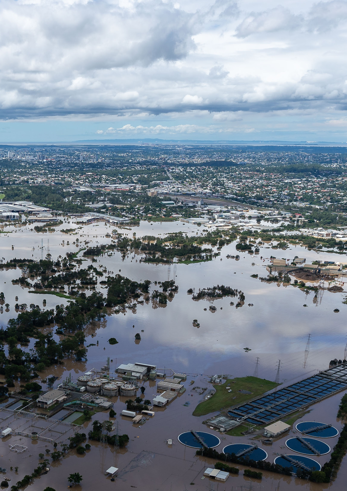

---
## Page 8

8
Queensland Strategy for Disaster Resilience 2022–2027
Image: Flooding, Maryborough, 2022. 
The drivers for change
We are facing unprecedented change in both the current 
and future operating environment with a dynamic 
political, social, economic and policy landscape 
surrounding disaster risk reduction and resilience. This 
is being amplified by natural hazards becoming more 
frequent and intense due to a changing climate. Essential 
services are more interconnected and interdependent 
than ever before, and people and assets are more 
exposed and vulnerable due to cascading shocks and 
stresses. 
While Queensland has made significant investments in 
resilience building activities, momentum is still growing 
to address the financial impacts of a changing climate. As 
it stands, the cost of recovery and responding to natural 
disasters still outweighs funding and efforts expended on 
proactive and strategic resilience measures.
We need to ensure communities have a clear 
understanding of likely impacts and the strategic 
commitments that will help to mitigate and reduce future 
disaster risk through continued investment in resilience 
across Queensland. 
The QSDR 2022-2027 reframes how we will approach and 
strengthen resilience processes, systems and actions in 
Queensland over the next five years. 
Since 2017 when the last QSDR was released, there have 
been significant hazard events, both in Queensland and 
Australia more broadly, including:
•	
record breaking heatwave events from 2018 to now
•	
persistent and prolonged drought across much of 
Queensland
•	
catastrophic bushfires in central and southern 
Queensland in 2018–19
•	
the COVID-19 pandemic which has had a significant 
and ongoing impact on the economy, society, culture, 
health and the environment
•	
repeated and extreme floods, including the Monsoon 
Trough in 2019 and widespread flooding across 
Queensland in 2021–22.
The COVID-19 pandemic and climate change are rapidly 
making it clear that impacts increasingly cascade across 
geographies and sectors. The impacts of these repeat 
disaster events are not only felt by people, but also the 
economy, our infrastructure, and the environment. 
Over the past 10 years, our thinking and practice has 
evolved. What was once a reactive approach to recovery 
in response to events is now proactive and planned, 
taking a systems approach which integrates resilience 
into recovery measures. 
However, we still face significant challenges. Disasters, 
economic loss and the underlying vulnerabilities that 
drive risk, are continuing to increase. Without increased 
action to build resilience to systemic risk, disaster risk 
reduction and sustainable development goals will not 
be reached. This will require transformations in what 
governance systems value and how systemic risk is 
understood and addressed. 
Looking forward, we need our leaders in communities, 
governments and other organisations to consider and 
recommend resilient results when making decisions, 
investments and developing core services, products, 
policies, infrastructure and mitigation.
There are increasing numbers of players in the disaster 
risk reduction and resilience fields and we will need clear 
coordinated leadership and collaborative government 
at all levels. Leaders will require the space to think 
differently and creatively about problems with a systems 
approach supported with the latest technologies and up-
to-date data and information.

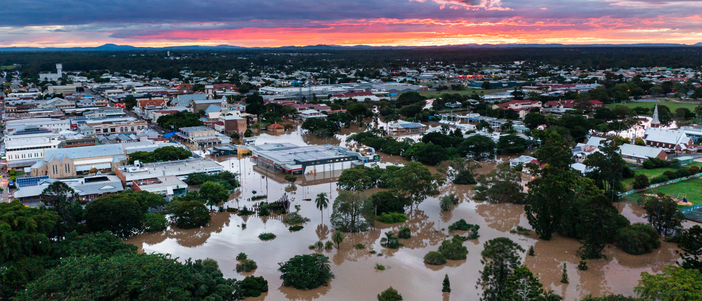

---
## Page 9

9
Queensland Strategy for Disaster Resilience 2022–2027
Policy alignment
The QSDR 2022–2027 has a clear alignment to global, 
national, state, regional and local policy.
Global
The Sendai Framework for Disaster Risk Reduction 2015-
2030 was adopted at the Third United Nations World 
Conference on Disaster Risk Reduction in Sendai, Japan, 
in March 2015.
The Sendai Framework is one of three global agreements 
developed as part of the ‘post 2015 sustainable 
development agenda’. Together with the Sustainable 
Development Goals and the Paris Agreement on Climate 
Change, the Sendai Framework sets the strategic 
approach for how nations should approach disaster 
risk to achieve a substantial reduction of disaster risk 
and losses in lives, livelihoods and health, and in the 
economic, physical, social, cultural and environmental 
assets of persons, businesses, communities and 
countries over the next 15 years.
Unsurprisingly, over the past decade extreme weather 
events, the pandemic, and failure of climate change 
mitigation and adaptation have remained as a central 
feature on the global risk landscape.
In May 2022, the Seventh Session of the Global Platform 
for Disaster Risk Reduction (GP2022) was held to learn 
from the COVID-19 pandemic, evaluate successes and 
challenges in working on disaster risk reduction, and 
to accelerate progress towards disaster resilience and 
sustainable development.
As highlighted during the GP2022, managing complex 
and interconnected risks, such as climate change, 
pandemics, ecosystem degradation, nature and 
biodiversity loss represent some of the most pressing 
global challenges of today. There is significant 
opportunity within innovation, emergent capacities and 
collaboration that can help manage disaster risk. 
National 
The Australian Government leads the nation's policy 
approach to strengthen national resilience to natural 
hazard induced disasters. The National Recovery and 
Resilience Agency, and its predecessors the National 
Resilience Taskforce and Emergency Management 
Australia, have played a significant role in guiding 
disaster recovery and resilience activities through the 
National Strategy for Disaster Resilience, the National 
Disaster Risk Reduction Framework (NDRRF), and the 
National Action Plan – which together provide the 
overarching framework to reduce disaster risk and 
improve Australia’s resilience .
Increasing pro-active and coordinated investments and 
actions in resilience-building is critical to support the 
NDRRF and Action Plans. The second National Action Plan 
is under development and will continue the work towards 
improving Australia's disaster resilience. 
State 
The QSDR aligns with international, national and state 
disaster risk reduction and sustainable development 
agendas with the key state strategies and frameworks 
being the QDMA, QERMF and QCAS.
Queensland’s disaster resilience is built through 
collaborative approaches that are locally-led, regionally 
coordinated and supported by state resources. These are 
guided by local leadership, flexibility and adaptation, 
shared responsibility and prioritisation, with a view to 
resilience becoming business as usual.
Queensland recently achieved its voluntary commitment 
to the UNDRR Sendai Framework for Disaster Risk 
Reduction – delivery of Regional Resilience Strategies 
in Queensland, which enables communities to be aware 
of their disaster risks and aims to reduce disaster risk 
through integrated resilience planning across economic, 
human and social, built, roads and transport and 
environmental lines of resilience.
www.qra.qld.gov.au/qsdr
Regional and local
The Queensland Government is committed to 
strengthening disaster resilience so our communities are 
better equipped to deal with the increasing prevalence 
of natural disasters. As a result of statewide engagement 
over recent years, by the end of 2022, every region across 
Queensland will be part of a locally-led and regionally-
coordinated blueprint to strengthen disaster resilience. 
Image: North West Queensland Flood Warning Infrastructure Network Project.

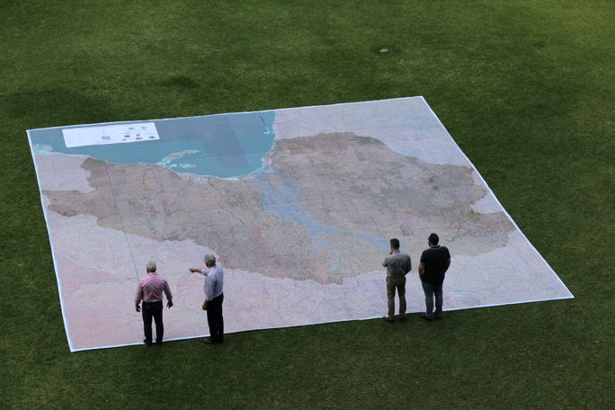

---
## Page 10

10 Queensland Strategy for Disaster Resilience 2022–2027
Image: International meeting in Brisbane to plan for the Asia-Pacific Ministerial Conference for Disaster Risk 
Reduction, November 2019. Courtesy QRA.
Diagram 1: Resilience policy line of sight.

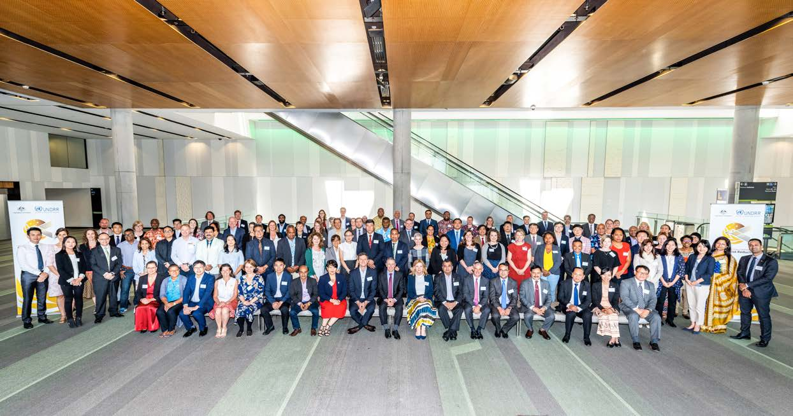

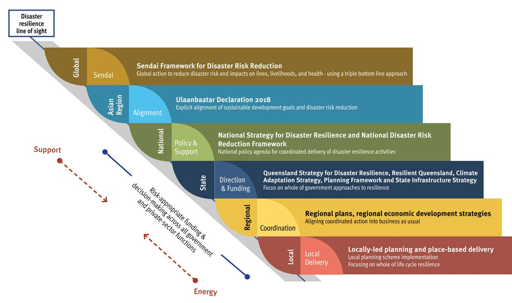

---
## Page 11

11
Queensland Strategy for Disaster Resilience 2022–2027
Case study: Queensland's Regional 
Resilience Strategies 
Resilient Queensland 2018-2021: Delivering the 
Queensland Strategy for Disaster Resilience (2018) 
was developed in consultation with state agencies, the 
private sector and local governments to coordinate the 
statewide delivery of the QSDR 2017. It is a whole-of-
government response to disaster resilience that involves 
better coordination of government policy, information 
management, project delivery and stakeholder 
collaboration. 
In 2022, every region across Queensland will be part 
of a locally-led and regionally-coordinated blueprint 
to strengthen disaster resilience. Under Resilient 
Queensland, a total of 14 resilience regions are identified 
and illustrated in the Resilience Strategy Regions Map 
below. The resilience regions consider District Disaster 
Management Groups (DDMG) areas with a level of 
alignment between the regions and DDMG areas. Due 
to the scope of the resilience strategies being broader 
than disaster management, the resilience regions also 
consider Regional Plan areas, Regional Organisation of 
Councils boundaries and catchment boundaries.
Queensland’s Regional Resilience Strategies are 
supported by detailed local resilience action plans for 
councils that guide implementation of resilience actions 
over time aligned with potential investment pathways to 
Legend
Local Government Areas
Resilience Strategy Regions
Burdekin and Charters Towers Region
Burnett Region
Cape York and Torres Strait Region
Central West Region
Darling Downs Region
Far North Hinterland to Gulf Region
Fitzroy and Capricornia Region
Mackay, Isaac and Whitsunday Region
Mary Region
North West Region
South East Region
South West Region
Townsville and Palm Island Region
Wet Tropics Region
Legend
Local Government Areas
Resilience Strategy Regions
Burdekin and Charters Towers Region
Burnett Region
Cape York and Torres Strait Region
Central West Region
Darling Downs Region
Far North Hinterland to Gulf Region
Fitzroy and Capricornia Region
Mackay, Isaac and Whitsunday Region
Mary Region
North West Region
South East Region
South West Region
Townsville and Palm Island Region
Wet Tropics Region
sustain effort by all stakeholders. Queensland now has a 
list of locally derived actions that can assist shape future 
investment in disaster resilience in Queensland.
The Regional Resilience Strategies and local resilience 
action plans will help to keep Queenslanders safe 
by providing a coordinated approach to identify and 
prioritise disaster resilience actions.
Resilient Queensland has: 
•	
Enabled locals to tell their unique story of disaster 
resilience across each of Queensland’s diverse 
regions
•	
Helped state and federal governments better 
understand what needs to be done to improve 
disaster resilience in Queensland 
•	
Focused attention and effort on planning for disaster 
resilience across all levels of government 
•	
Increased capacity and capability across Queensland 
to identify and address resilience issues 
•	
Supported the coordination and prioritisation of 
future funding against identified needs 
•	
Begun to unlock resilience and mitigation funding to 
address the identified needs
To review each of the Regional Resilience Strategies, 
please visit the QRA webpage www.qra.qld.gov.au/
regional-resilience-strategies.
Image: Flooding, Rockhampton, 2010: Courtesy QRA. 
Queensland's Regional Resilience 
Strategies (Regions and Local 
Government Areas)

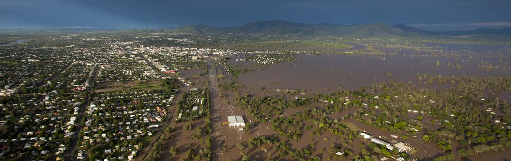

---
## Page 12

12 Queensland Strategy for Disaster Resilience 2022–2027
Image: Courtesy QRA.
Our partners 
Resilience is a shared responsibility and the success 
of the QSDR will depend on the collective effort of 
individuals, communities, businesses, and state 
agencies. Strong well connected networks, together 
with a coordinated collaborative approach to increase 
alignment of effort across the disaster management 
cycle, will provide a primed environment for disaster 
resilience initiatives to take effect.
The lead state agency for coordinating the QSDR is the 
Queensland Reconstruction Authority, under guidance 
of the Queensland Resilience Coordination Committee 
(QRCC). The QRCC is also responsible for overseeing 
the implementation of the Strategy and reports to the 
Queensland Disaster Management Committee (QDMC).
Queensland 
Resilience 
Coordination 
Committee
Everyone has a role to play, and all Queenslanders are 
encouraged to consider what the objectives, strategic 
commitments and actions mean for them and how they 
can contribute to improving overall community resilience.
In Queensland, it is recognised that a collective effort is 
required from all levels of government, businesses and 
the community to build well connected networks. 
Partner agencies for the development and delivery of the 
QSDR are listed in the Acknowledgements (page 2).

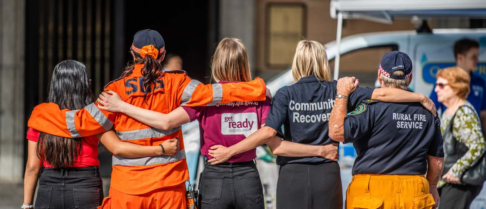

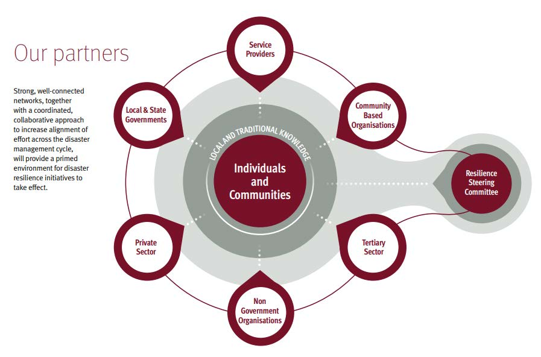

---
## Page 13

13
Queensland Strategy for Disaster Resilience 2022–2027
Image: Bloomfield River near Wujal Wujal. Credit: Shutterstock.
Governance

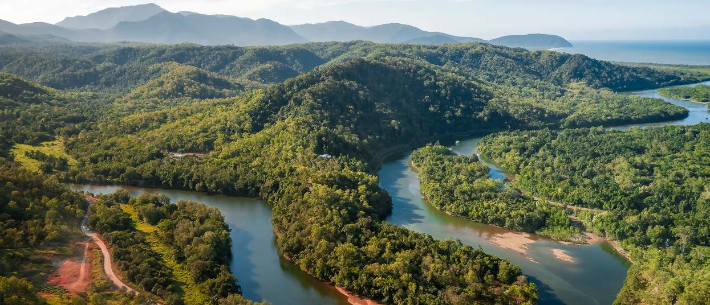

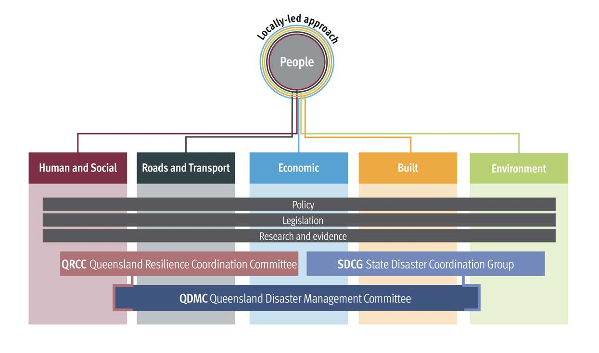

---
## Page 14

14 Queensland Strategy for Disaster Resilience 2022–2027
DRAFT DOCUMENT FOR CONSULTATION – NOT GOVERNMENT POLICY
Image: Cardwell, Cyclone Yasi, February 2011. Courtesy Townsville Bulletin.
14 Queensland Strategy for Disaster Resilience 2022–2027

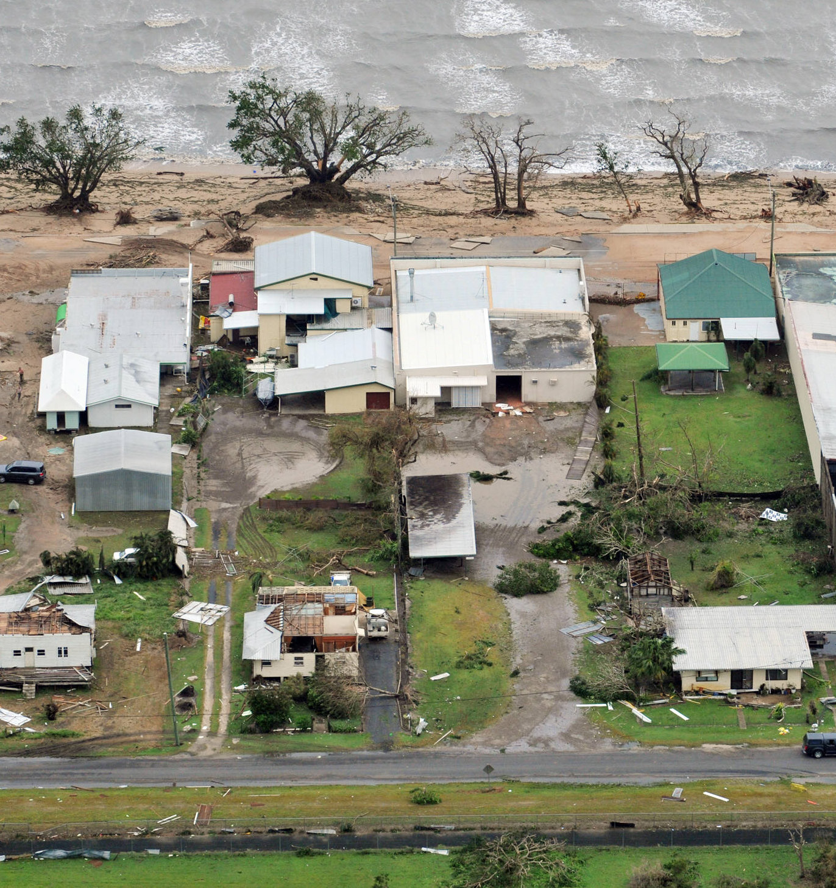

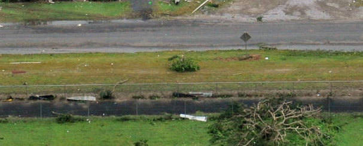

---
## Page 15

15
Queensland Strategy for Disaster Resilience 2022–2027
Disaster risk in Queensland
Queensland spans a very vast and diverse landscape. 
We have 77 local government areas, consisting of rural, 
remote, Aboriginal and Torres Strait Islander, coastal 
and urban communities, with 75 per cent of our total 
population of 5.2 million people living in coastal areas 
and floodplains.
Queensland is vulnerable to a range of hazards including 
tropical cyclones, floods, bushfires, severe weather, heat 
waves and coastal inundation, and has endured more 
than 97 disaster events since 2011. Nearly every town 
in Queensland has been adversely impacted by one or 
more disaster event in that time. Since 2020, the impacts 
from these disaster events has been compounded by the 
ongoing affects of the COVID-19 pandemic on Queensland 
communities ability to recover and build resilience to 
future events.
The State Disaster Risk Report 2021/22 provides a 
comprehensive analysis of the ten hazards that are most 
relevant to the Queensland context, and is used to inform 
the management of risks that these hazards pose. Of 
particular note is that the report equates climate risk with 
disaster risk, and uses cutting-edge climate modelling to 
improve our understanding of present risk.
The report finds that flooding is of the highest priority 
hazard to Queensland due to potentially high impacts 
across the entire State. Other high priority hazards for 
Queensland include:
2. Tropical cyclone
3. Bushfire
4. Severe thunderstorm
5. Heatwave
6. Pandemic
7. Biosecurity incidents
8. Chemical, biological and radiological incidents
9. Earthquake
10. Tsunami
Natural disasters are also increasingly costly in human 
and economic terms. According to the Special Report: 
Update to the economic costs of natural disasters in 
Australia (2021), Queensland has the greatest risk profile 
of any state due to geography and population density and 
is expected to incur the largest increase in costs related 
to natural disasters. Queensland will account for nearly 
40 per cent of the national costs. 
The report found that coastal population centres in 
South-East Queensland will experience some of the 
highest increases in damage costs related to natural 
disasters as they become more exposed to tropical 
cyclones and floods. Additionally, costs in Brisbane 
will also increase as major rivers in this city, alongside 
growing populations, will lead to greater costs associated 
to tropical cyclones and flooding. The estimated costs 
and identification of regions exposed to climate change 
highlight the need for ongoing investment in improving 
disaster resilience. 
An in-depth understanding of the risks posed by different 
hazards can help to coordinate and target investments 
and activities to reduce impacts on some of the most 
vulnerable areas in Queensland. Understanding disaster 
risk within Queensland’s context involves continued 
development, strategic partnerships, and community 
knowledge of exposure and vulnerability. Being a 
state well versed in disasters, local and regional level 
resilience has been embedded through decades of 
experience managing, planning for, and responding to 
disasters. 
Image: STC Debbie 2017 (NASA).

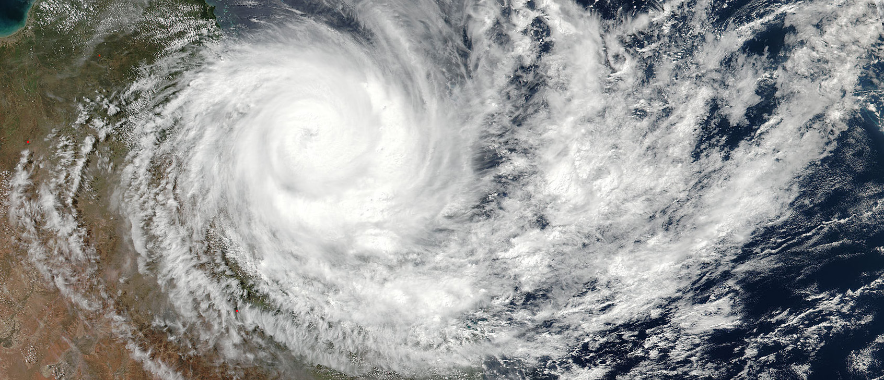

---
## Page 16

16 Queensland Strategy for Disaster Resilience 2022–2027
Timeline of natural disasters in Queensland
Queensland's significant disaster events that have been activated for disaster funding visit are listed 
at: www.qra.qld.gov.au/disaster-funding-activations/activations

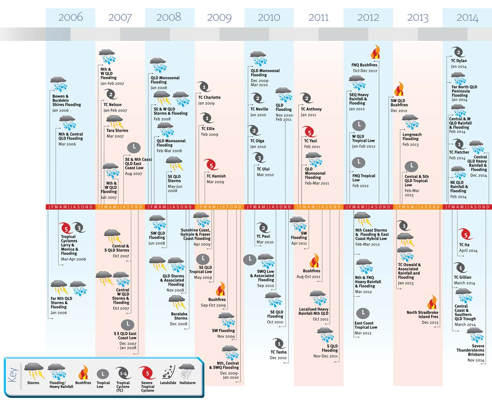

---
## Page 17

17
Queensland Strategy for Disaster Resilience 2022–2027

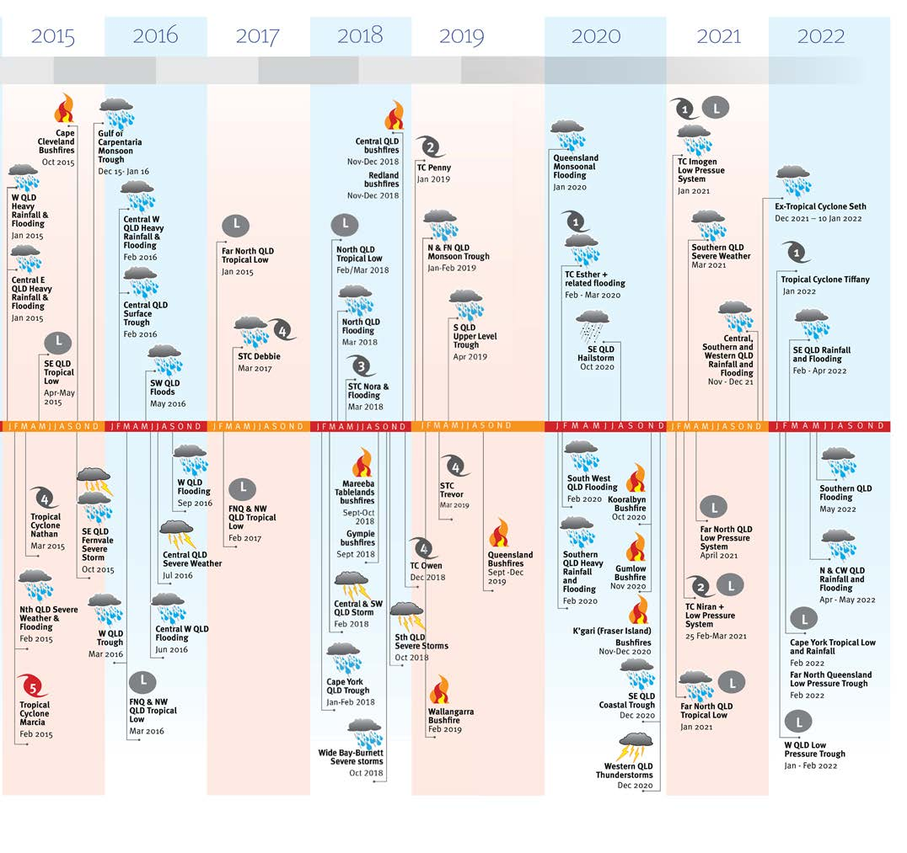

---
## Page 18

18 Queensland Strategy for Disaster Resilience 2022–2027
The Queensland Government is committed to playing 
our part in the global effort to address the impacts of 
climate change and ensure the long-term viability of our 
communities, economy and industries.
Queensland already experiences climate extremes such 
as floods, droughts, heat waves and bushfires however, 
climate change is aggravating the frequency and severity 
of these events, and there is a likelihood of natural 
events to change in the future due to climate change. 
The Queensland Climate Adaptation Strategy (QCAS), 
developed by the Department of Environment and 
Science, provides a clear narrative on the effects that 
climate change can be expected to have on Queensland. 
The future climate projections influencing Queensland’s 
disaster risks are highlighted in the following table.
These anticipated, and unknown changes will bring 
new and likely increasingly intensified threats to 
vulnerable locations. This will have a significant impact 
on ecosystems, life sustaining systems like water 
quality and produce, as well as a multitude of other 
consequences. 
Under the QCAS, the Queensland Government is 
committed to incorporating climate risks into all 
management processes, including disaster management 
processes. Climate risks can be divided into physical 
and transition risks. Physical risks include the impacts of 
acute and chronic disasters, which give rise to financial 
and reputational risks.
The role of the Bureau of Meteorology 
in disaster resilience 
The Bureau of Meteorology (the Bureau) provides 
trusted, reliable and responsive weather, water, 
climate and ocean services for Australia. Its expertise 
and services assist Australians in dealing with the 
harsh realities of their natural environment, including 
drought, floods, fires, storms, tsunami and tropical 
cyclones. The Bureau leads national, regional and 
local community engagement with staff working 
alongside state, territory, local governments and 
emergency service agencies as part of the emergency 
management and disaster mitigation networks. This 
includes the out-posting of Bureau meteorologists 
and other specialists within several combat agencies 
and emergency management centres to provide 
direct access to the Bureau’s expertise – with the 
goal of growing the Australian community’s capacity 
to be more resilient to the impacts of weather, water, 
climate, space and oceans through data, education 
and knowledge building programs, in partnership 
with community-focussed organisations and the 
Emergency Management Sector.
Image: Central Queensland Bushfires, 2018 (NASA).
Resilience, climate risk management and climate 
adaptation are well aligned. A lot can be achieved by 
combining efforts in these areas as climate related 
weather events are the primary driver for Queensland’s 
increasing disaster risk. 
While Queenslanders have an awareness of current and 
known disaster risks, the changing environment brings 
on new, intense and unknown scenarios that have not 
been fully integrated into system planning.
Climate change and future projections of disaster risk

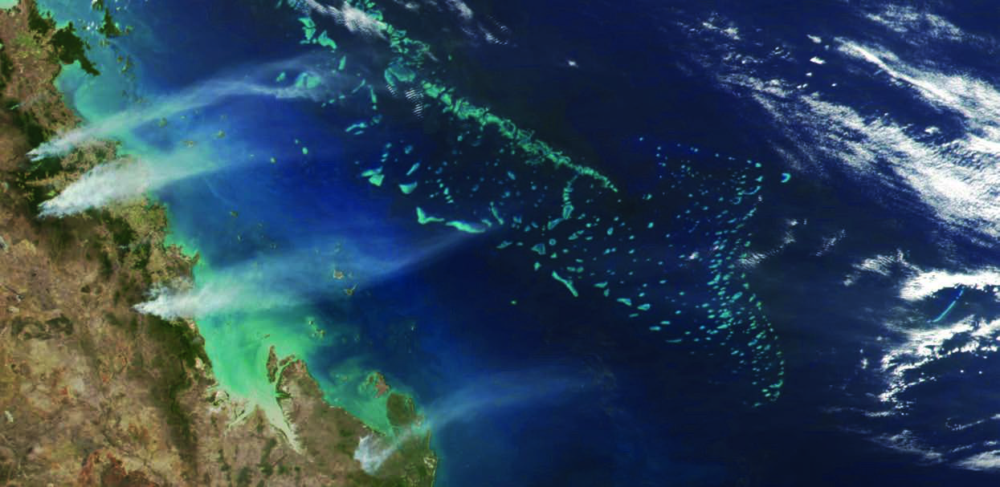

---
## Page 19

19
The following table has been informed by key documents including Regional Resilience Strategies, QCAS, Queensland 
Regional Climate Change Impact summaries and CSIRO's Report of Climate and Disaster Resilience. 
Hazard risks
Future hazard risks 
Flood
Greater, short duration rain extremes associated with flash flooding are projected
Greater risk of landslides as a consequence of high rainfall and severe storm
Bushfire
The likelihood of dangerous bushfire weather has doubled over the past decade – more 
so for southern and eastern Australia
Will likely affect most communities across Queensland in some way 
Cyclone
Climate change may mean fewer cyclones but an increase in the intensity
During cyclones, the increased rainfall and higher storm surge are projected to increase 
the overall impact
Coastal inundation
Australia’s average sea level is projected to rise between 26cm and 82cm by 2090, 
depending on level of global warming reached
Increase in flooding in low-lying coastal areas which may result in erosion, loss of 
beaches, and higher storm surges
Earthquake 
 
Increase in risk of earthquakes of higher magnitudes in Queensland 
An unrealised risk to life and property across Queensland 
Current building standards are not based on possible future increased risk
Heatwave 
Already causes most natural hazard related deaths in Australia compared to all other 
natural hazards combined
Heatwave is projected to increase across Queensland through to 2090, which will affect 
all communities but particularly those in Far North and Western Queensland 
Emergent and long-term risks to life, human habitation and built infrastructure, and 
temperature sensitive industries such as agriculture (particularly pastoral) 
Drought
A long term, increasing stress with complex socio-economic systemic impacts that 
interrelate with episodic shocks like flood or bushfire  
Tsunami
Queensland is exposed to tsunami generated from submarine landslides, earthquakes 
and volcanic eruptions. Increase in risk is due to increased population along the 
Queensland coastline, short warning times for timely evacuation and increased 
inundation due to sea-level risk 
While heatwaves and drought are not currently listed as eligible disasters under the Disaster Recovery Funding 
Arrangements, they have been included to reflect the need to consider how to strengthen resilience activities to 
minimise the impacts of these disaster events on local communities, rather then to reflect legislative change.

---
## Page 20

20 Queensland Strategy for Disaster Resilience 2022–2027
Systemic disaster risk
While there is a link between climate change and 
disasters, there are other factors that contribute to the 
occurrence and the magnitude of disaster impacts – 
these compounding factors make up systemic disaster 
risk. 
Some factors that impact on resilience – such as 
climate change, demographic shifts and a reliance on 
interconnected systems and infrastructure hazards 
- only lead to systemic disaster risk if they intersect 
with an exposed and vulnerable society, and when the 
consequences exceed people’s capacity to cope.The 
changes in climate, and the changing nature of disruption 
and escalating scale of disasters in recent decades are 
underscored by cumulative impacts of chronic stresses 
and changes, as well as acute events. To develop 
resiliency or reduce risk, we must seek to understand 
vulnerability, capacity, exposure of persons and assets, 
hazard characteristics, and the environment.
The best defence against systemic risk is to remove risk 
and transform systems to make them more resilient. 
Policy and personal action can reverse this trend, 
but only if systemic risk is better understood and risk 
reduction action is accelerated. The fundamental 
equation that risk is a function of a hazard event 
combined with vulnerability and exposure has not 
changed. However, systemic risk occurs in today’s 
environment through interconnected digital and physical 
infrastructures, integrated supply chains and factors such 
as urbanisation and increased human mobility. 
One of the most effective ways to avoid worsening 
outcomes is to understand the causes and effects of 
‘cumulative, cascading and compounding’ risk, and take 
collective action across the whole system – communities, 
infrastructure, goods and services, economies and 
natural assets.
Image: Drought, Outback Queensland. Shutterstock.
Diagram 2. How resilience is affected by stresses and shocks

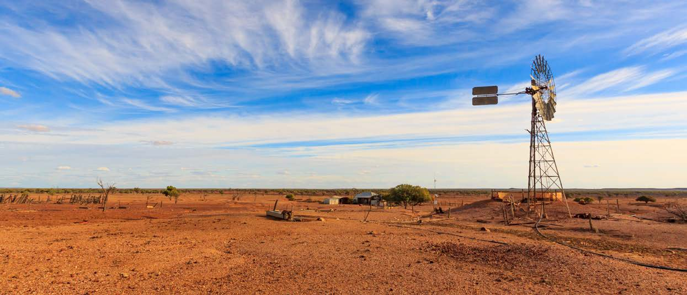

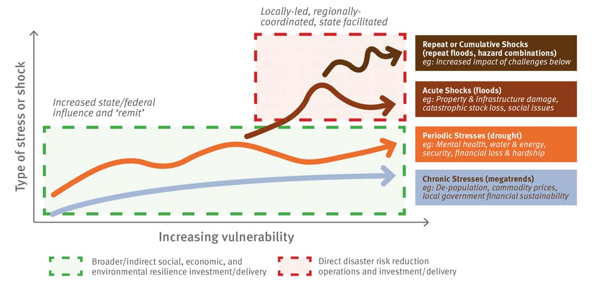

---
## Page 21

21
Queensland Strategy for Disaster Resilience 2022–2027
Strengths
Over the past ten years, our thinking has evolved and 
matured. We have strong relationships with local 
governments and have worked hard to ensure that 
the Queensland Government is a trusted partner in 
supporting communities get back on their feet.
Our approach to locally-led, regionally coordinated and 
state facilitated resilience is showing that communities 
want to contribute to, and drive, their own recovery and 
resilience. We are using data and information more 
effectively to inform planning and decision making, and 
to ensure we have the right capability and capacity when 
planning for disaster events.
Queensland promotes a proactive approach to 
resilience planning, by helping communities to identify 
and match their resilience priorities to investment 
opportunities. Recent reforms to the disaster recovery 
funding arrangements provides opportunity to direct 
reconstruction efficiencies to investment opportunities 
for statewide priority disaster mitigation and resilience 
purposes.
We now have a clear understanding of how to link policy 
and funding to prioritised resilience and risk reduction 
actions so we can make lasting change into the future 
through investment in resilience and mitigation activities. 
This will allow us to make a real difference at the local 
and regional level.
Challenges
A systems approach to disaster resilience is required to 
tackle existing and emerging threats. A key challenge will 
continue to be the need for strengthened cooperation 
between all levels of government, and our partnering 
non-government organisations, private sector and 
academics to build on existing frameworks and research 
to continue to strengthen resilience activities to improve 
overall community resilience. 
Some of the known and emerging challenges are 
highlighted below:
1.	
A narrowing window for preparedness, recovery and 
learning with simultaneous disaster events, creating 
limited time to recover from one event and prepare 
for the next.
2.	 Resilience is often interpreted as returning to 
business-as-usual or maintaining business continuity 
- resilience discussions need to mature beyond this 
comfort zone.
3.	 Stakeholders are anecdotally seeing reductions or 
limitations in economic investment in some regions 
due to disaster risk. 
4.	 Insurance affordability has been emerging for several 
years as a core issue across Queensland for investor 
confidence, cost of living, and settlement viability.
5.	 Capacity and capability – many local governments 
and communities do not have sufficient resources to 
undertake resilience activities. 
Increased disaster resilience is a long-term outcome, 
requiring a coordinated and strategic approach to 
address systemic challenges and build safer, stronger, 
more resilient Queensland communities. 
Image: Bloomsbury Community Recovery Meeting 2018.
Our resilience strengths and challenges

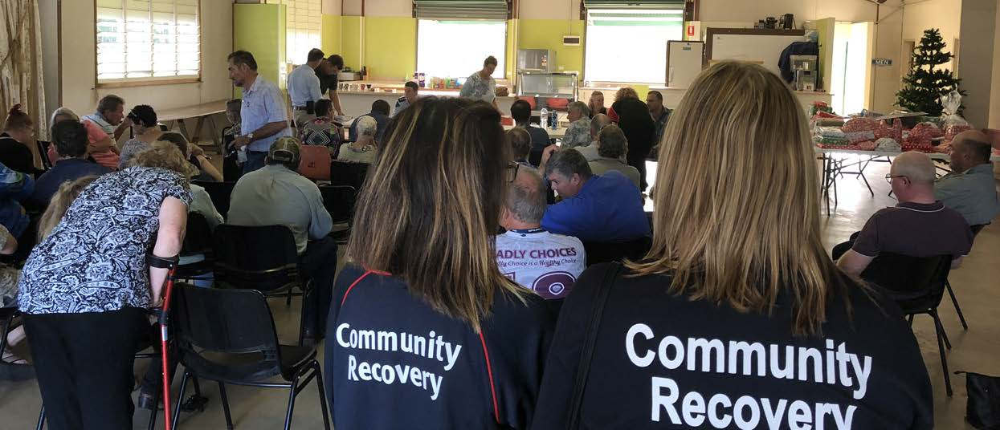

---
## Page 22

22 Queensland Strategy for Disaster Resilience 2022–2027
DRAFT DOCUMENT FOR CONSULTATION – NOT GOVERNMENT POLICY
Image: Binna Burra, Southern Queensland Bushfires, 2019. Courtesy TMR.
22 Queensland Strategy for Disaster Resilience 2022–2027

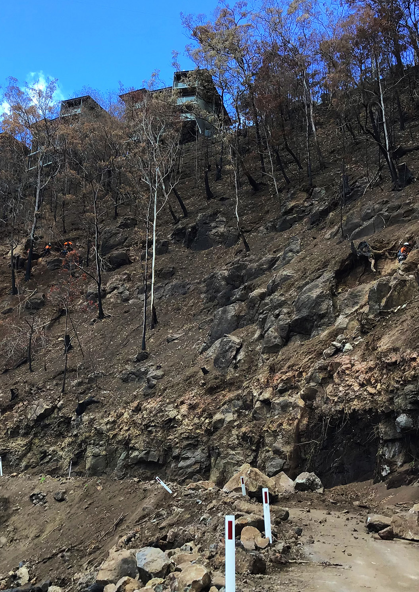

---
## Page 23

23
Queensland Strategy for Disaster Resilience 2022–2027
Establishing a shared language, shared goals and shared 
understanding is critical to coordinating agencies’ efforts 
to build resilience. 
Queensland is adopting a systems approach to build 
resilience and inclusive systems across key narratives.
The following four narratives have been developed to talk 
about the complex systems that need to be understood 
by decision-makers.
Transformational shifts such as climate change, 
population growth, new technologies and supply chain 
disruption effect our ability to cope during disaster events 
and requires collaboration across the lines of recovery 
and resilience to overcome.
These narratives were developed as part of the 
Queensland Resilience, Adaptation Pathways and 
Transformational Approach project (QRAPTA), a 
partnership between the Queensland Government and 
the Commonwealth Scientific and Industrial Research 
Organisation (CSIRO), 
Narrative 1 – Becoming more resilient 
Chronic, periodic and acute stresses combine and 
amplify to create systemic risk, leading to the potential for 
catastrophic disaster. Changing roles, responsibilities and 
approaches to managing chronic, periodic and systemic 
risk will lower risk, and increase capacity to cope.
Narrative 2 – Thinking in systems, not silos
A systems approach is needed – understanding cause 
and effect, points of leverage, and three pathways (‘Doing 
the same’, ‘Doing better’ and ‘Doing differently’) to create 
futures that are disaster-resilient and adaptive to change.
Narrative 3 – Pathways to effect change 
Prioritising resilient activities and establishing 
investment pathways across sectors to be better aligned 
for collective impact. 
Narrative 4 – Changing our practice 
Creating new ways of interacting and governance 
mechanisms for coordinating service delivery across 
sectors. 
QRAPTA recognises that many agencies’ activities, 
irrespective of their particular portfolio responsibilities, 
already contribute to resilience. The QRAPTA project 
provides a process to harmonise these resilience 
activities across agencies and sectors. 
We also know that recovery provides a springboard 
for resilience, so it is essential to consider resilience 
outcomes when delivering recovery activities across the 
whole system – building, human and social, economic, 
environment and roads and transport – to improve overall 
community resilience.
 www.qra.qld.gov.au/qrapta
Image: Fitzroy Resilience Strategy Workshop 2019.
A systems approach: Queensland’s resilience narratives
Diagram 3. ‘A Systems approach: Queensland’s resilience narratives.

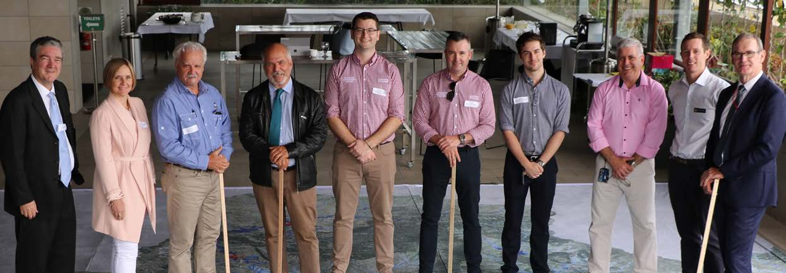

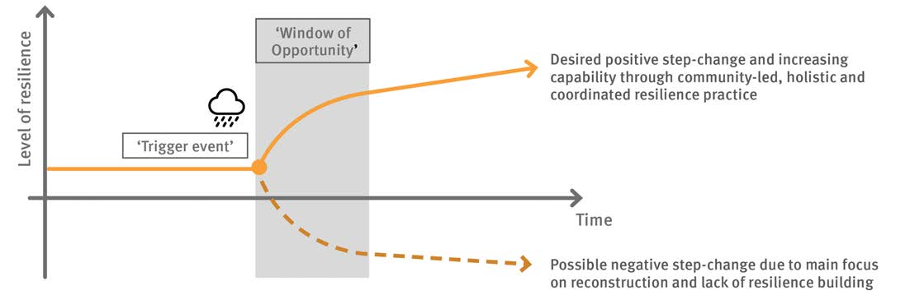

---
## Page 24

24 Queensland Strategy for Disaster Resilience 2022–2027
Aboriginal and Torres Strait Islander peoples communities 
have been leading the way in environmental stewardship 
and disaster management techniques as the oldest 
culture on Earth with 65,000 years of uninterrupted 
development. 
The most resilient cultures have always worked in line 
with nature, rather than disrupt. Despite this, their 
traditional knowledge around living sustainably and 
caring for Country is not well integrated within planning 
and resilience delivery.
There is a growing desire for people and communities to 
care for the environment and live sustainably, but a lack 
of knowledge of what they can do to protect and improve 
their local environments 'is suppressing progress.
There is significant opportunity to build on Aboriginal 
and Torres Strait Islander peoples knowledge, land 
management and disaster management techniques as 
we build nature positive solutions and embed resilience 
within disaster management planning. 
The Royal Commission into National Natural Disaster 
Arrangements highlights the significance of local 
knowledge and recommends key considerations in 
recovery and resilience planning: 
•	
First Nations land management is an example of 
how local knowledge has successfully informed land 
management for tens of thousands of years. 
•	
Draw on a close knowledge of Australia’s landscapes, 
developed from observation, ongoing interaction, 
active custodianship, and adaptation to changing 
circumstances. It is place-based, targeting action 
to the specific circumstances of a place, including 
its environment and customs, and engaging local 
people in development and implementation. 
Techniques and outputs are therefore specific to 
a place or practitioner and differ widely across 
Australia. 
•	
Different landscapes across Australia require 
different regimes depending on the requirements 
of Country, including environmental factors such as 
vegetation type, climate and introduced species.
Today, First Nations land management retains its 
traditional and cultural importance, while adapted 
to changing ecosystems and leveraging various 
technologies. Increasing First Nations and community 
involvement in decision making can help incorporate 
First Nations traditional knowledge to become a critical 
component of designing sustainable and resilient 
solutions for the environment and communities.
In addition to including Aboriginal and Torres Strait 
Islander peoples in disaster management planning, 
it is critical that they are also adequately supported 
and resourced to develop their capacity, resilience and 
leadership during disaster preparedness and recovery to 
improve overall resilience.
Learning from Aboriginal and Torres Strait Islander peoples and community
Image: Sunset, Minjerribah. Credit: Shutterstock.

---
## Page 25

25
Queensland Strategy for Disaster Resilience 2022–2027
Image: Mapoon Land and Sea Rangers monitoring Glyphis river shark. 
Courtesy Mapoon Aboriginal Shire Council.
Case study: Fire Management on Minjerribah
Quandamooka Yoolooburrabee Aboriginal Corporation 
was recognised in the 2018 Get Ready Queensland 
Resilient Australia Awards Community Award category 
for developing the Minjerribah (North Stradbroke Island) 
Bushfire Management Plans, in partnership with QRA.
Incorporating traditional burning techniques on 
Minjerribah is making a difference in the local community 
and environment. 
Watch the video Traditional burning techniques used to 
build bushfire resilience on Minjerribah. 
Case study: Wujal Wujal Resilience Awards
Elders and Vulnerable Person's project ensures 
vulnerable and elderly members of the Wujal Wujal 
community are disaster ready by approaching 
preparedness in a way that is easily understandable and 
accessible to Traditional Owners.
English is not the first language of many of Wujal Wujal’s 
elderly residents and much is lost in translation. That's 
why council created disaster preparedness resources in 
Kuku Yalanji that are culturally appropriate.
Case study: Mapoon Land and Sea Rangers 
Mapoon Shire’s ongoing collaboration with Partners Rio 
Tinto has resulted in the ability to deliver a very important 
research program significant to the Mapoon River and 
Ecosystems. This program also allows training of new and 
upcoming Rangers of the importance of researching and 
monitoring endangered species.
The effort Land and Sea Rangers have applied to this 
project means that a better understanding of the 
movements, habitat and breeding cycles of these animals 
and why this contribution is extremely imperative in 
Caring for Country.
Case study: ATSIAP Get Ready! Senior 
Secondary State Final Challenge
In 2022, the Department of Education's Aboriginal and 
Torres Strait Islander Aspirations Program (ATSIAP) Senior 
Secondary state final challenge was themed "Get Ready! 
Disaster risk and preparedness in our community." The 
challenge provided the students with a unique and 
rich learning experience by providing opportunities to 
investigate solutions for real world disaster resilience 
challenges. 
60 Queensland state high school students in Years 
10-12 teamed up to develop a communication plan and 
campaign material to inform a target audience in their 
local community about risks, preparedness and disaster 
resilience.
Students participated in regional webinars, interviews 
with local disaster experts including the Queensland 
Reconstruction Authority and the Get Ready Queensland 
team, local councils, State Emergency Services, 
Queensland Police Service, Queensland Fire and 
Emergency Services, to inform their communication plan.
Case studies: Resilience, First Nations peoples and community

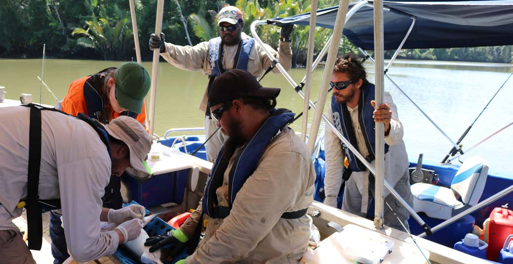

---
## Page 26

Image: Flooding, Brisbane, 2022. Courtesy RAW.Exposed.
Strengthening the 
lines of resilience
26 Queensland Strategy for Disaster Resilience 2022–2027

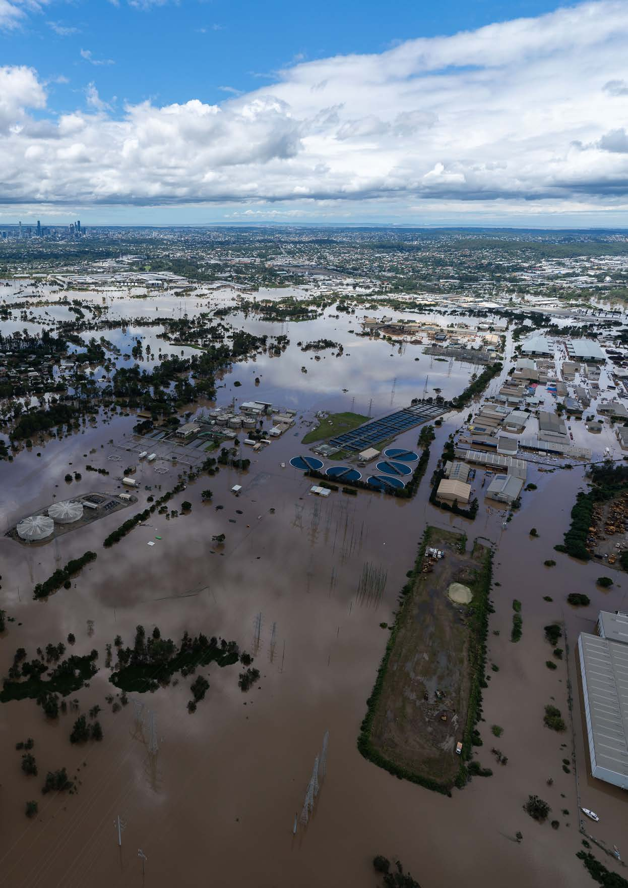

---
## Page 27

27
27
Queensland Strategy for Disaster Resilience 2022–2027
Image: FLOOD-EX21 brought more than 100 leaders including mayors, councillors, council representatives and experts from local, state and federal 
agencies together to exercise and demonstrate recovery and resilience planning for an extraordinary Brisbane River flood scenario.
The multi-dimensional and cross-disciplinary approach of 
the QSDR aims to strengthen and reinforce the five lines 
that contribute to systems-based resilience and their 
potential for future planning. These lines are:
•	
Built
•	
Human and social
•	
Economy
•	
Roads and transport
•	
Environment.
Community 
resilience
Human and social
Environment
Built
Economy
Roads and 
Transport
Figure 3. The five lines of resilience.
Strengthening the lines of resilience
Trends, stresses and shocks
We have learned a lot about what resilience really means to the people and places of Queensland, how stresses and 
shocks can affect existing levels of resilience, and how future events and trends will impact the ability to remain 
resilient.
People have told us the health of the underlying social, economic and environmental systems in an area affect its 
disaster resilience.
Our communities that are under sustained pressure from chronic and periodic stresses will be less likely to cope in the 
long term.
Without change, something will make these systems break – whether it is the chronic or periodic stress, or episodic 
shocks like floods.

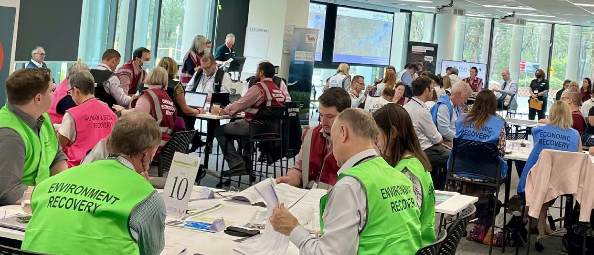

---
## Page 28

28 Queensland Strategy for Disaster Resilience 2022–2027
Built
Resilient structures play a critical role in supporting 
communities to withstand, respond to, and recover from 
natural disasters. Planning for resilient structures has the 
potential to significantly reduce disaster costs. Ensuring 
infrastructure systems perform well under a changing 
climate, and in the face of other threats and challenges, 
will be essential to success given the increasing 
frequency and scale of disaster events.
Queensland leads the nation in building resilience in 
its communities through flagship betterment programs. 
Betterment allows local governments and state agencies 
to rebuild damaged essential public assets to a more 
resilient standard to help them withstand the impacts of 
future natural disasters. 
Of equal importance, the lives of those living in 
disaster-affected communities are improved when 
essential infrastructure withstands weather events, 
enabling communities to remain connected or return 
to functionality quickly in the immediate aftermath of a 
disaster.
Trends, stresses and shocks
Trends
Transformative forces that could change a region 
including: 
•	
climate change
•	
major infrastructure projects 
•	
critical raw material shortages
•	
increasing need for infrastructure solutions to 
address climate and disaster risks.
Stresses
Long term situations or circumstances (which may be 
periodic or chronic) that weaken the potential of a given 
system and deepen vulnerability including:
•	
ageing infrastructure
•	
limited telecommunications infrastructure
•	
energy reliability in regional areas
•	
infrastructure end of life management
•	
urban heat island impacts. 
Shocks
Sudden events with an important and often negative 
impact on the vulnerability of a system and its parts 
including: 
•	
direct property impacts from hazards – private and 
public assets
•	
direct infrastructure damage – one-off and recurrent 
damage
•	
time taken to return to service.
Opportunities and future planning 
Improved collaboration across government, construction 
and infrastructure sectors will enable assets to be built to 
withstand current and future disaster risks, with a focus 
on:
•	
retrofitting and achieving a baseline of resilience for 
public built assets
•	
consistent and accessible essential service delivery
•	
improved infrastructure resilience – roads, water, 
sewer, energy, and telecommunications
•	
enhanced and maintained flood warning network
•	
strengthened water security – town supply and dams
•	
heatwave management plans and urban design heat 
initiatives
•	
sustained implementation of existing mitigation and 
risk reduction plans
•	
updated building codes which are appropriate for 
the hazard environment i.e. update Queensland 
Development Codes.
Image: Brisbane afternoon storm. Shutterstock.

---
## Page 29

Built case studies
Case study: Resilient Homes Fund
A total of $741 million has been allocated for the Resilient 
Homes Fund (RHF), on a 50:50 cost share basis between 
the Queensland and Commonwealth governments under 
the DRFA.
The Fund was established following the 2021–22 high-
risk weather season, which saw thousands of homes 
inundated across the south of the state following the 
significant flooding events.
The RHF is a nation-leading program never before 
delivered on this scale within Australia. It has the 
potential to significantly enhance Queensland’s 
household resilience to flooding, which poses the 
greatest risk to the state.
For eligible homeowners, the RHF will consider options 
specific to circumstances that could help improve 
resilience to future flooding.
These options include repair and retrofitting using flood-
resilient design options, house raising, or in some cases 
the voluntary buy-back of high-risk properties where no 
other viable flood resilient measures or alternative exists.
The Department of Energy and Public Works is leading 
the rollout of the resilient household rebuild and raising 
programs and will liaise directly with homeowners 
regarding the rollout of these programs.
The Queensland Reconstruction Authority is leading 
the voluntary home buy-back program, in consultation 
with local governments and the Department of State 
Development, Infrastructure, Local Government and 
Planning.
Local councils will play an important role in implementing 
the RHF, given their profound understanding of their 
communities and the intrinsic risks faced by some 
residents.
The RHF will be a gamechanger for homeowners and 
communities and will leave a legacy of resilience and 
reduced risk for future generations of Queenslanders.
www.qra.qld.gov.au/resilient-homes
Case study: Resilient building guidance for 
Queensland homes 
Resilient building guidance for Queensland homes 
improve how we prepare for, respond to and recover from 
disasters.
A suite of resilient building guidance for Queensland 
homes is freely available for Queenslanders to improve 
how we prepare for, respond to and recover from 
disasters, including flood, bushfire, cyclones and storm 
tide.
Using resilient building design can significantly reduce 
the effort and time to return people to their homes and 
workplaces following these natural disasters.
Resilient design and construction can also reduce long-
term costs for home owners associated with disaster 
damage and insurance premiums. It not only reduces 
the physical and financial costs, but also the social and 
emotional impacts of disasters.
Following extensive rainfall and flooding in early 2022, 
Design Guidance for Flood Resilience Homes was 
released in June 2022 to help the community understand 
how homes could be improved to achieve greater flood 
resilience. The guidelines provide information on flood 
risks, flood resilient building design approaches and 
resilience strategies for different house types.
The Cyclone and Storm Tide Resilient Building Guidance 
for Queensland Homes relates to Queensland homes 
located within 50 kilometres of the coastline north of 
Bundaberg. The Storm Tide Resilient Building Guidance 
for Queensland Homes builds on the cyclone guide 
to incorporate storm tide considerations for northern 
Queensland homes located within 100 to 200 metres of 
an open shoreline.
The Bushfire Resilient Building Guidance was developed 
by the Queensland Government in partnership with the 
CSIRO to help improve the bushfire resilience of both new 
and existing homes. The guidance provides information 
on best-practice building and landscaping measures that 
use tailored, site-specific solutions to adapt buildings for 
bushfire resilience.
www.qra.qld.gov.au/resilient-homes
29
Queensland Strategy for Disaster Resilience 2022–2027
 Flooding, Rockhampton, 2010. Courtesy QRA.

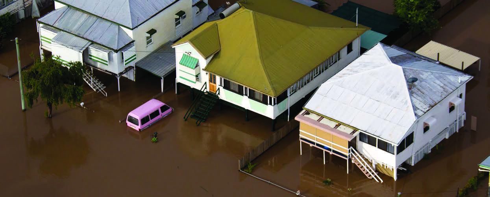

---
## Page 30

30 Queensland Strategy for Disaster Resilience 2022–2027
Human and social 
Disasters are a recurring fact of life in Queensland, and 
disaster events can have both immediate and long-
lasting impacts on the health and wellbeing of people, 
communities, and economies. A key finding from 
the Royal Commission into National Natural Disaster 
Arrangements 2020 was that concurrent and consecutive 
hazard events increase the pressure on exposed and 
vulnerable communities. Some communities will have to 
cope with the effects of multiple hazard events at once, 
with the prospect of being affected by further hazard 
events before the recovery efforts have been completed. 
This can cause increased stress on individuals, which has 
been shown to lead to or exacerbate ailments ranging 
from mental illness, domestic violence, substance abuse 
and post-traumatic stress disorders. 
People with disability and seniors are twice as likely to 
be injured and experience social isolation as a result of 
natural disasters. The Royal Commission into Violence 
Abuse Neglect and Exploitation of People with Disability 
recommended that agencies responsible for planning 
and implementing responses for “future emergencies 
establish and implement formal mechanisms for 
consulting with and involving people with disability and 
disability representative organisations in planning and 
giving effect to the responses”. As such, when planning 
for disaster events, it is critical to identify mechanisms 
to engage with people with disability, carers and seniors 
to increase their resilience and assist them to recover, 
and to implement person-centred approaches to 
managing risk will be required for individuals who may be 
particularly vulnerable.
The Queensland Government is helping Queenslanders to 
adapt and cope with a changing climate through a range 
of programs, such as: 
•	
public safety campaigns aimed at helping 
Queensland communities prepare for disasters
•	
disaster recovery funding arrangements aimed at 
community wellbeing
•	
Birdie’s Tree resources to support the mental health 
and resilience of people affected by natural disasters.
Trends, stresses and shocks 
Trends
Transformative forces that could change a region 
including: 
•	
climate change
•	
regional and remote population decline
•	
demographic shifts
•	
increasing mental health issues
•	
changes in how information is shared /disseminated.
Stresses 
Long term situations or circumstances (which may be 
periodic or chronic) that weaken the potential of a given 
system and deepen vulnerability including:
•	
periodic and long-term drought
•	
influences of compounding/ cumulative events on 
mental health
•	
availability of in-region healthcare
•	
limited affordable housing availability.
Shocks
Sudden events with an important and often negative 
impact on the vulnerability of a system and its parts 
including: 
•	
life safety
•	
impacts on long-term wellbeing
•	
risk awareness across multiple hazards and impacts 
to life / livelihood
•	
public health impacts – heat, air quality and food.
Opportunities and future planning 
It is critical to find new and improved ways of reducing 
the exposure of communities to disaster events and 
increase the capacity of communities to prepare for and 
recover from impacts, through:
•	
consistent and accessible essential service delivery
•	
improving collective understanding of hazard 
impacts and risks and consistency in services
•	
enhanced information and knowledge sharing 
platforms and processes 
•	
person-centred emergency preparedness and 
community-based resilience plans 
•	
social wellbeing and population retention and 
expansion programs.
 
Image: Sandbagging in Townsville, Monsoon Trough 2019.

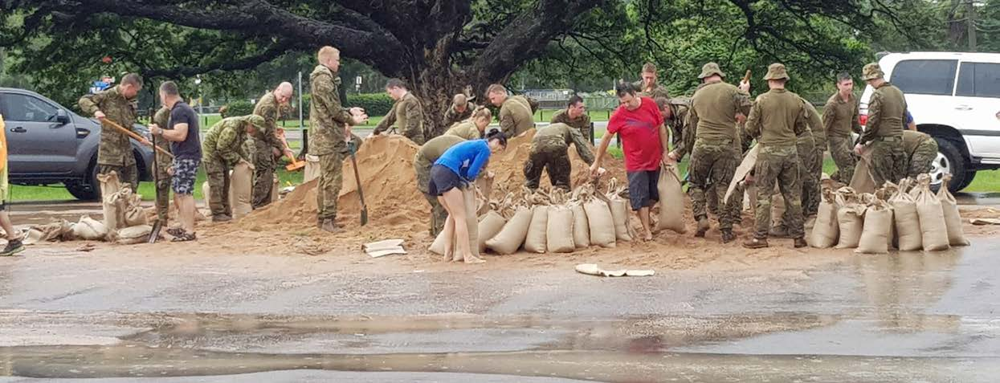

---
## Page 31

Image: Cairns Regional Council and Deaf Services Queensland working together to 
improve disaster resilience communication. Courtesy Get Ready Queensland.
Human and social case studies
Case study: Birdie’s Tree books assist children 
to be more resilient to natural disasters
Natural disasters like storms, cyclones, floods or fire can 
be very frightening and upsetting for babies and young 
children. Playing a therapeutic game or reading a story 
with a caring adult can help a young child work through 
the scary experiences and ‘big feelings’. 
Birdie’s Tree is a suite of resources to help babies and 
young children, their parents and families prepare for, 
cope with and recover from natural disasters.
Birdie’s Tree was first developed by the Queensland 
Centre for Perinatal and Infant Mental Health (QCPIMH) in 
2011.
Following Cyclone Yasi, the Lockyer Valley flash floods, 
and widespread flooding throughout Queensland, infant 
mental health clinicians noticed an increase in young 
children presenting with symptoms of post-traumatic 
stress, including behavioural difficulties and emotional 
disturbance.
The Birdie’s Tree resources are designed to help young 
children understand severe weather events, learn words 
to express ‘big feelings’ (like scared, worried, sad, angry 
and lonely, as well as cosy, safe, happy, patient and 
kind), and feel reassured through their relationships with 
parents and other caring adults.
The Birdie’s Tree resources are free at the Birdie’s Tree 
website:
www.childrens.health.qld.gov.au/natural disaster-
recovery/
Case study: Cairns Regional Council working 
with Deaf Services Queensland to improve 
disaster resilience
Cairns Regional Council has been working closely with 
their deaf community to find ways to better communicate 
information about natural hazards and preparing for 
disasters.
This work has included tailoring emergency alerts 
specifically for the deaf community during times of 
disaster to ensure information reaches this highly 
vulnerable part of the community.
Sioux Campbell from Cairns Regional Council sat down 
with Sue Frank and Wayne Reynolds from Deaf Services 
Queensland to reflect on their experiences working 
together to make disaster risk information and warnings 
more accessible to the deaf community.
Videos of these conversations are available on the Get 
Ready Queensland website. 
In Part 1 of the conversation, hear about the lessons 
learned from engaging the deaf community about their 
needs, and reflections on what has been working well, 
including for Indigenous community members with 
hearing impairments.
In Part 2 of the conversation, hear about some of the 
challenges deaf people face interpreting mainstream 
communications as a result of English being their second 
language. The panel discusses how messages need to be 
adapted to have greater meaning for the deaf community 
and examples of how this is being achieved in Cairns.
www.getready.qld.gov.au/prepare-disaster-disability
31
Queensland Strategy for Disaster Resilience 2022–2027

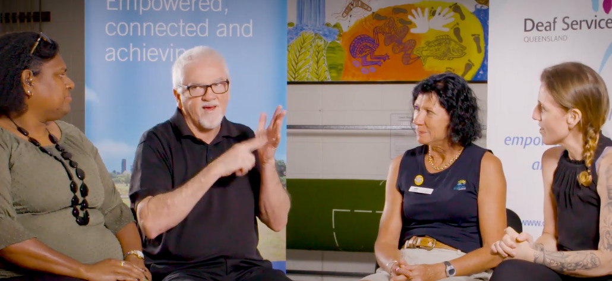

---
## Page 32

32 Queensland Strategy for Disaster Resilience 2022–2027
Environment
Queensland landscapes and ecosystems have been 
shaped by adaptation and evolution through millennia 
of natural phenomena, including flood, drought, fire and 
cyclones. Our environment is affected by a mix of complex 
human-caused threats (such as invasive species, land 
clearing, urbanisation and natural resource use), which 
has reduced the state’s natural resilience to large-scale 
natural events and man-made disasters. This, coupled 
with climate risks, means that our environment and 
natural resources are more vulnerable to environmental 
incidents and disasters than ever before. 
Queensland Government is focused on strengthening 
the capacity of the natural environment to respond to a 
disturbance or on-going change by resisting damage and 
recovering quickly. The following programs are in place to 
help achieve this:
•	
Queensland Climate Adaptation Strategy and Sector 
Adaptation Plans to develop priority actions for 
managing key climate risks
•	
Drought and Climate Adaptation Program 
•	
State-of-the-art climate science and information 
platform to ensure government, industry and 
community.
It is important to note that climate adaptation initiatives 
do not only support resilience of the natural environment, 
but is also a key consideration for strengthening 
resilience across all five lines of resilience.
Trends, stresses and shocks 
Trends 
Transformative forces that could change a region 
including: 
•	
climate change
•	
high rates of land clearing 
•	
significant loss of native flora and fauna
•	
restoring environmental stewardship
•	
protection of coastal systems.
Stresses 
Long term situations or circumstances (which may be 
periodic or chronic) that weaken the potential of a given 
system and deepen vulnerability including:
•	
water resource availability
•	
impact of some carbon farming methods on regional 
/remote communities
•	
waste and water management that is compliant with 
standards
•	
biodiversity and ecosystem health.
Shocks
Sudden events with an important and often negative 
impact on the vulnerability of a system and its parts 
including: 
•	
pest and weed outbreak
•	
waste and landfill access for disposal of event waste
•	
direct environmental degradation – erosion, siltation, 
scouring and biodiversity loss.
Opportunities and future planning 
There is a global movement and support for embedding 
environmental and climate resilience within disaster risk 
reduction efforts by: 
•	
regional management of pest and weeds pre and 
post event
•	
support ongoing maintenance of environmental 
recovery works to improve overall resilience of sites
•	
continued investment in natural resource 
management and landscape restoration 
•	
bushfire management plans
•	
embedding First Nations ecological knowledge into 
decision making. 
Image: Fire management at Bringalily State Forest. Courtesy QFES.

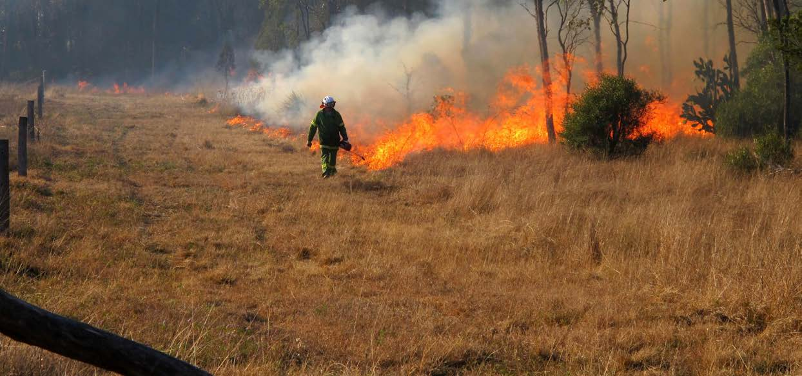

---
## Page 33

33
Queensland Strategy for Disaster Resilience 2022–2027
Environment case studies
Case study: Walking the Landscape
Walking the Landscape helps develop a whole-of-
landscape understanding to improve evidence-based 
decision making for the sustainable management 
and restoration of ecological systems. It incorporates 
available knowledge on landscape components e.g. 
groundwater dependent ecosystems, lacustrine wetland, 
riparian vegetation, and processes e.g. hydrological, 
geological. The framework coordinated by the Department 
of Environment and Science integrates existing scientific 
information with local knowledge about how catchments 
work.
Case study: Statewide Assessment of Flood Risk
The Statewide Assessment of Flood Risk will provide a 
prioritised assessment of flood risk across Queensland 
at the local government level. Ten criteria have been 
established to assess the risk of flooding and consider 
available data and known flood behaviour assessments, 
exposure, vulnerability and existing management 
strategies, weighted based on priority as agreed with 
stakeholders. Applying a multi-criteria approach, an 
assessment provides a relative flood risk ranking for each 
local government area. Final rankings provide guidance 
on where key areas of risk are located and what can be 
done to better manage flood risk in Queensland. The 
Statewide Assessment of Flood Risk being coordinated 
by Queensland Reconstruction Authority will be a critical 
tool in developing the long-term investment plan for flood 
risk management, identifying gaps, investment need and 
priority to ensure sustainable flood risk management in 
Queensland.
Case study: Understanding and designing 
for extreme heat in Cairns
The Queensland State Heatwave Risk Assessment 2019 
(SHRA) represents the most comprehensive analysis 
of future climate risk undertaken for a natural hazard 
risk assessment in Queensland. To better understand 
urban heat in Cairns and the impacts it has on people 
living and working in the central business district 
(CBD), 75 real-time temperature and humidity sensors 
were installed across the CBD. The project informs how 
Council communicates heatwave risk to the public and 
informs development of new planning and urban design 
initiatives to mitigate urban heat. 
Case study: Our Resilient Coast
QCoast2100 was established in 2016 to provide funding, 
tools and technical support to enable all Queensland 
coastal local governments to progress the preparation of 
plans and strategies to address climate change related 
coastal hazard risks over the long-term. Our Resilient 
Coast is a long-term strategy to manage coastal changes 
and build resilience to the coastal hazards of erosion, 
storm tide inundation and permanent sea level rise over 
the next 80 years along the coastline of the Isaac region. 
The issues identified by the Coastal Hazard Adaptation 
Strategy go to the heart of community values and 
concerns, including their personal investment in their 
homes and properties. A resilient future for the Isaac 
coast depends on the community and Council taking 
strategic actions now to impacts of coastal hazards 
on our valued places and assets, and development of 
management strategies that preserve these places and 
assets, and build community resilience.
Case study: Fitzroy Regional Drought 
Resilience Plan
The Queensland Department of Agriculture and Fisheries 
has partnered with the Rural Economies Centre of 
Excellence to lead the consultation to work with regional 
communities and develop Regional Drought Resilience 
Plans (RDRPs) to prepare regional communities for and 
manage future drought risks. The plans are funded 
jointly by the Australian and Queensland Governments 
and focuses on five regions which includes the Fitzroy 
and Capricornia to develop community-led and owned 
plans. The plans identify actions to prepare regional 
communities for future droughts, with a sharp focus on 
agricultural sector and allied industries. The RDRPs 
provide an evidence base and priority actions regions 
can use to compile applications for small grants from 
the Future Drought Fund and other funding sources.
33
Queensland Strategy for Disaster Resilience 2022–2027
image: Rivers and mangroves in front of Hinchinbrook Island. Credit: Shutterstock.

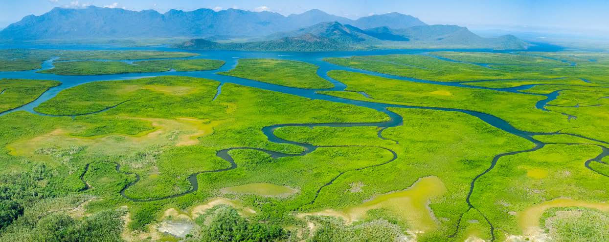

---
## Page 34

34 Queensland Strategy for Disaster Resilience 2022–2027
Economic
Queensland councils and communities have an in depth 
understanding of the inherent connections between 
economic development and the socio-economic 
resilience of a place. Economic development in a local 
community or region supports the resilience of that 
community. Without a functioning economy, it is hard to 
be resilient. 
The economic line of resilience has been the least funded 
of the lines of resilience historically as there has been a 
focus on the provision of services or assets that catalyse 
economic development through others rather than 
spurring it directly. However, this is starting to change 
through the most recent flood events, with a stronger 
focus on economic resilience through the Disaster 
Recovery Funding Arrangements Category C and D funding 
packages. 
Trends, stresses and shocks 
Trends
Transformative forces that could change a region 
including: 
•	
cost of living
•	
growing regional tourism
•	
increased digital enterprises
•	
emerging markets like hydrogen and renewables
•	
insurance availability and affordability
•	
transitioning to a low carbon economy
•	
globalisation and increased opportunity to access 
markets.
Stresses
Long term situations or circumstances (which may be 
periodic or chronic) that weaken the potential of a given 
system and deepen vulnerability including:
•	
skilled and non-skilled workforce availability in 
regional and remote areas
•	
small business continuity and long-term risk 
management behaviours
•	
construction and housing supply costs / barriers. 
Shocks
Sudden events with an important and often negative 
impact on the vulnerability of a system and its parts 
including: 
•	
small business continuity and long-term risk 
management behaviours
•	
supply chain interruptions due to infrastructure 
failure
•	
access to quarry, raw and construction materials post 
event
•	
core local or regional employers leaving.
Opportunities and future planning
An increasing focus on economic resilience, both longer-
term preventative policy and shorter-term recovery 
planning, can support and drive improvements in return 
to service in an area to assist with:
•	
building long term economic stability 
•	
resilience through diversification and catalyst 
projects
•	
improved insurance outcomes
•	
transitioning to a circular and low carbon economy 
•	
transparent collaboration between public and private 
sectors.
Image: 2022 flooding Brisbane. Courtesy RAW.Exposed.

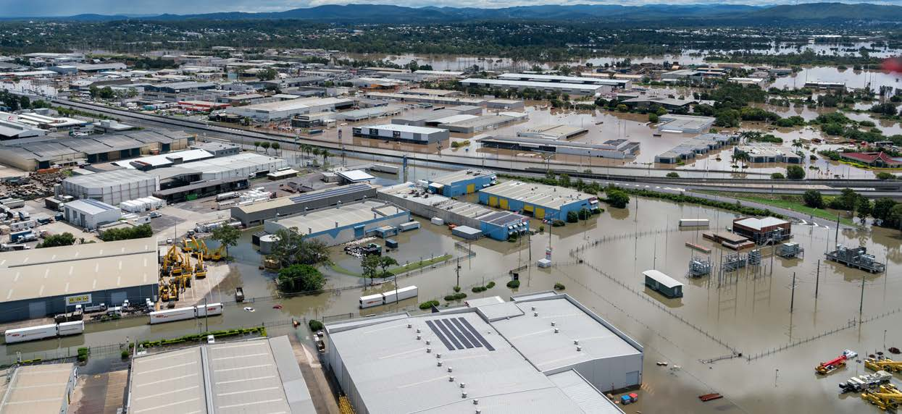

---
## Page 35

Image: Flooding Rockhampton, 2017. Courtesy Rockhampton Regional Council.
Economic case studies
Case study: Economic Assessment Framework 
of Flood Risk Management Projects
To effectively invest in flood risk mitigation, it is 
important to be able to quantify all the types of damages 
resulting from floods, and fairly compare a wide range of 
possible options to ensure targeted investment provides 
the greatest return.
The Economic Assessment Framework of Flood Risk 
Management Projects (2021) is a resource to support 
Queensland’s flood risk practitioners, state and local 
governments to:
•	
undertake consistent and comparable economic 
assessments of flood risk mitigation
•	
make informed decisions for investment in flood risk 
management and intervention
•	
build a case for increased investment in risk 
mitigation and disaster resilient communities
•	
use recommended methods to quantify a wide range 
of tangible and intangible damages
•	
understand the methodologies to quantify the 
benefits of implementing flood risk mitigation 
activities, including non-structural options such as 
community awareness and education, building more 
flood resilient homes, and investing in emergency 
management, allowing for a fair comparison of 
potential options.
The Framework describes a five-stage process for 
undertaking economic assessment for flood risk 
management and provides the tools to undertake an 
economic assessment.
The methodologies outlined in the Framework are used 
to support economic assessment processes and are 
underpinned by guiding principles.
The Framework has been delivered an initiative of 
the Brisbane River Strategic Floodplain Management 
Plan implementation, and was developed through a 
collaborative process with other state governments, 
universities, private practitioners and key stakeholders. 
www.qra.qld.gov.au/EA-flood-risk
Case study: Essential Goods Supply Committee
The COVID-19 pandemic caused significant health, 
community, and economic impacts around the world. 
Consumer behaviours with respect to grocery acquisition 
at the onset of the pandemic resulted in community 
concern about access to food and other essential 
supplies as purchasing outstripped distribution and 
restocking efforts. 
As the Omicron variant spread rapidly across Queensland 
in January 2022, there were severe impacts on our 
essential workforce, with all industries dealing with the 
challenges of depleted resources both in terms of staff 
and supply chains. High levels of absenteeism caused 
disruptions across multiple supply chains including 
distribution centres, processing facilities and essential 
retail outlets such as supermarkets. It was critical 
that Queensland’s food and processing supply chains 
remained open.
In response, the Essential Goods Supply Committee 
(EGSC) was established to actively engage with industry 
to ensure there was a strong workforce to move more 
products and produce to warehouses, from warehouses 
to stores and from stores to homes including in our most 
isolated communities.
The Department of State Development, Infrastructure, 
Local Government and Planning via the EGSC, worked in 
partnership with major supermarkets and distribution 
centres to allow asymptomatic and fully vaccinated 
close contacts to return to work and thereby ensure that 
critically essential roles remained filled to keep supply 
chains working.
The EGSC also convened during the South East 
Queensland Rainfall and Flooding event during February 
and March 2022. The EGSC connected essential retailers 
with emergency agencies and transport and utility 
providers, enabling immediate access to information 
about road and rail outages to support critical re-supply 
actions.
35
Queensland Strategy for Disaster Resilience 2022–2027

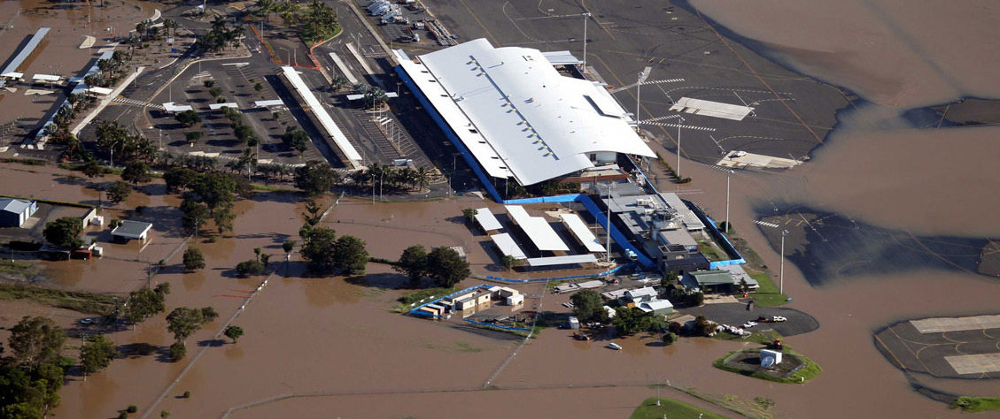

---
## Page 36

36 Queensland Strategy for Disaster Resilience 2022–2027
Roads and transport
Road and transportation infrastructure plays an important 
role in critical emergencies such as natural disasters and 
extreme events. The functional loss of transportation 
facilities negatively impacts the disaster management 
process and can significantly delay the evacuation and 
recovery process. 
Road infrastructure costs are greater than just the 
initial cost of construction. Maintenance is a significant 
proportion of the cost of infrastructure over its lifetime. 
It is estimated that half of the $16 billion spent on 
roads each year by local, state and federal governments 
is spent on maintenance and repairs. There are 
opportunities to improve resilience when planning 
and investing in infrastructure maintenance. New 
infrastructure projects should include resources to help 
maintain and enhance resilience as part of proposed 
maintenance programs.
The Queensland Government has several programs 
that have a focus on building more resilient road and 
transport networks, including:
•	
the Repeat Events and Dollar Index (REDI) online 
application to help Queensland councils understand 
their risk, costs and repeat damage from natural 
disaster events
•	
road improvements to minimise flood damage and 
reduce road closure, such as the Inland Freight Route 
Upgrades 
•	
Queensland Betterment Programs to improve asset 
utility during and after natural disasters. 
Trends, stresses and shocks 
Trends
Transformative forces that could change a region 
including: 
•	
climate change
•	
'build it back better' infrastructure replacement post 
event
•	
improved freight access through innovative 
solutions.
Stresses
Long term situations or circumstances (which may be 
periodic or chronic) that weaken the potential of a given 
system and deepen vulnerability including:
•	
continued lower levels of road standard/service and 
immunity. 
Shocks
An increasing focus on economic resilience, both longer-
term preventative policy and shorter-term recovery 
planning, can support and drive improvements in return 
to service in an area to assist with:
•	
direct infrastructure damage – one-off and recurrent 
damage 
•	
time taken to return to service.
Opportunities and future planning
To reduce disaster impacts and rapidly recover the road 
and transport network to a desired level of functioning 
after a disaster event a focus on the below is needed:
•	
strategic prioritisation and delivery of physical 
and digital infrastructure networks to improve 
connectivity
•	
innovative freight opportunities to improve time to 
return to service
•	
improving connectivity and access to help our 
regions connect during a disaster event
•	
innovation in materials, technology and science, 
underpinned by investment in research, can provide 
resilient solutions. 
Image: 2022 flood damage at Lowry Court, Gold Coast. Courtesy QRA.

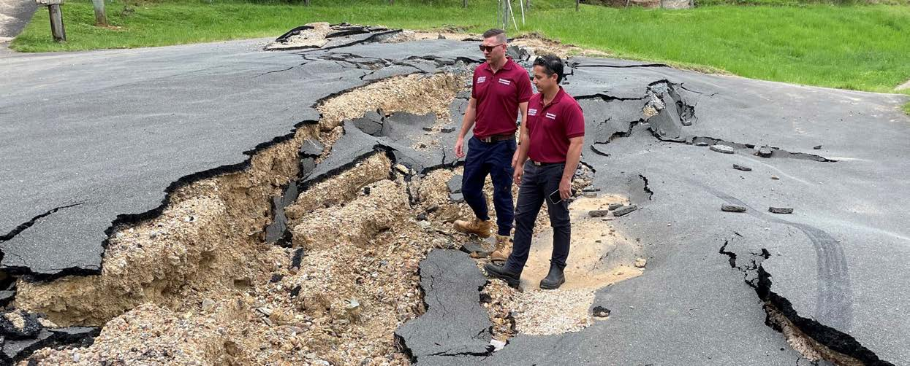

---
## Page 37

37
Queensland Strategy for Disaster Resilience 2022–2027
Roads and transport case studies
Case study: Aurukun Entry Road – 
Betterment Saves
Aurukun Shire Council’s betterment project involved 
installing gravel to infill scoured sections of Aurukun 
Access Road and stabilising the shoulders and 
embankments to improve accessibility and protect the 
road. Council targeted the higher risk locations for these 
upgrade works along an eight-kilometre section of the 
road. Since the works were delivered to seal the road, it 
has been impacted by eight severe weather events and 
it has remained undamaged and functional. Access to 
Aurukun as remained open following these events and it 
has also avoided reconstruction costs in the vicinity of 
$7 million.
Case study: Sealing the Outback Way
The Australian Government has committed $330 million 
to upgrade key sections of the Outback Way, the 2800 
kilometre route that links Laverton in Western Australia 
with Winton in Queensland via Alice Springs in the 
Northern Territory. Sealing the Outback Way will improve 
the interjurisdictional transport network by increasing 
connectivity and reducing travel times, in addition 
to cutting costs for freight operators and enhancing 
economic opportunities for the cattle, mining and tourism 
industries. Recent studies demonstrate the benefit to 
stock health by travelling on sealed roads. 
Case study: Resilient infrastructure – 
Betterment
The Queensland Betterment Fund has been a success 
story for this state in building stronger and more resilient 
infrastructure in the face of repeated natural disasters.
Betterment allows local governments to rebuild essential 
public assets to a more resilient standard that helps them 
withstand the impacts of future disasters.
Upfront investment in stronger infrastructure and more 
resilient communities saves money for all levels of 
government in the long-term.
Image: Aurukun Access Road works. Courtesy Aurukun Shire Council.
The Betterment Fund is a great example of all levels of 
government working together to improve the resilience of 
our communities.
www.qra.qld.gov.au/betterment
Case study: Repeat Events and Dollars Index 
(REDI) application 
REDI is a web-based interactive mapping application 
developed to help Queensland councils better 
understand their risk, costs and repeat damage from 
natural disaster events.
The REDI application uses data to provide a calculation 
that considers repeat damage from natural disasters. This 
data is represented in a ‘heat map’ that identifies and 
highlights the most frequent and most costly damage 
sites. 
The application helps councils identify priority works 
and make informed decisions when it comes to future 
investment in stronger and more resilient infrastructure.
www.qra.qld.gov.au/REDI
Case study: A better transport network 
Flooding in 2011 and 2013 saw significant damage to the 
bridges and causeways throughout the Somerset region. 
The damage caused important transport infrastructure 
to be offline for months. Somerset Regional Council has 
embarked on a campaign of betterment to enhance the 
resilience of the more than 1,500 km of roads, footpaths 
and kerbs and channels. Examples include the George 
Bell Crossing on Ivory Creek Road and the Ted Skinner 
Crossing on Esk Crows Nest Road, where Council replaced 
sections of the causeways with bridges, at a cost of 
around $3.2 million. Other betterment activities in the 
region have included upgrading bridges from vulnerable 
timber structures to prestressed concrete bridges. During 
the 2021-22 rainfall and flooding events, instead of being 
faced with completely destroyed causeways, restricting 
movement for months, Council was able to rapidly 
restore access to these roads. Once silt and debris had 
been cleared, the roads and underlying structures were 
inspected and found to have withstood this major 
flood event.

---
## Page 38

38 Queensland Strategy for Disaster Resilience 2022–2027
The Queensland 
Strategy for Disaster 
Resilience 2022–2027
Image: Burdekin, North Queensland. Credit: Shutterstock.

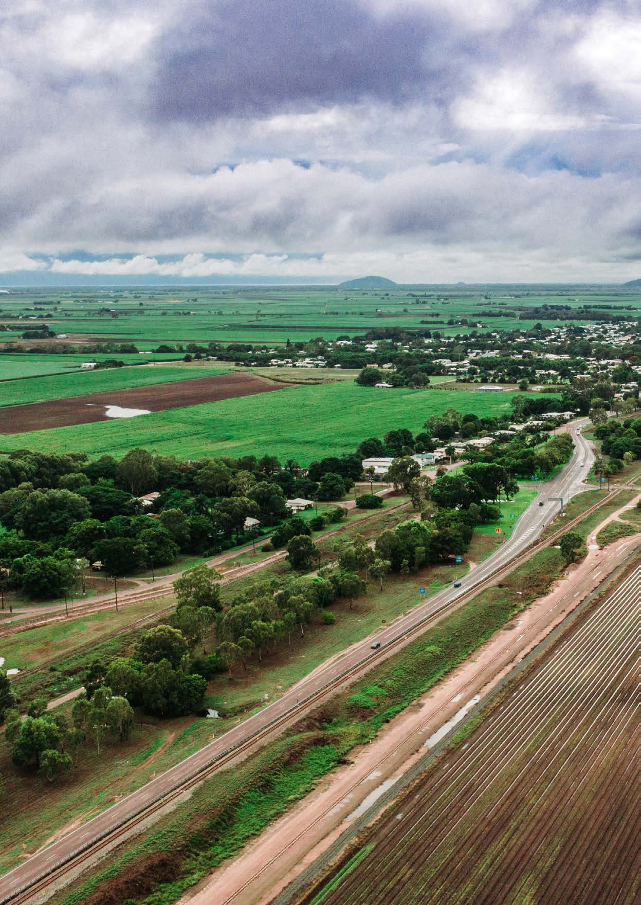

---
## Page 39

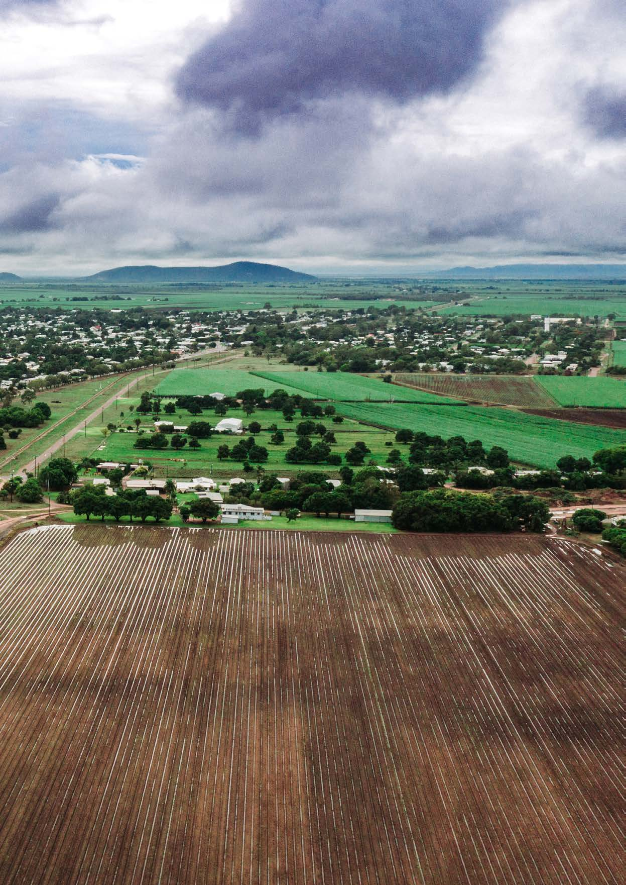

---
## Page 40

40 Queensland Strategy for Disaster Resilience 2022–2027
Vision
The vision for the QSDR is 'Stronger, safer and more 
resilient Queensland communities'. 
The Queensland Government is committed to 
strengthening disaster resilience so our communities are 
better equipped to deal with the increasing prevalence of 
hazards and systemic challenges caused by reoccurring 
disaster events. 
Objectives
Four key objectives underpin this strategy with new 
and ongoing strategic commitments identified through 
Resilient Queensland supporting delivery at the local, 
regional and state level:
•	
Objective 1 – We understand the potential disaster 
risks we face
•	
Objective 2 – We work together to better manage 
disaster risk
•	
Objective 3 – We seek new opportunities to reduce 
disaster risk
•	
Objective 4 – We continually improve how we prepare 
for, respond to and recover from disasters
Vision, objectives and strategic commitments
Image: Sunrise, Roma. Credit: Shutterstock.
Strategic commitments 
The QSDR outlines a series of strategic commitments 
described for each of the objectives.
Through consultation with partners, the QSDR reflects the 
strategic commitments, actions and lead agencies that 
will strengthen disaster resilience over the next five years. 
The tables in this section of the QSDR outline objectives, 
describe what success looks like, outline new and current 
strategic commitments and actions with lead agencies 
and partners identified alongside indicative timeframes. 
While a timeframe has been specified for actions, ones 
which have a 'tick' in each column or a 'tick' in the '5+' 
years column indicates that this is an ongoing or long-
term action to strengthen disaster resilience.
Lead agencies will be responsible for the delivery, 
monitoring, evaluation and reporting of actions with 
support from the partner agencies identified.

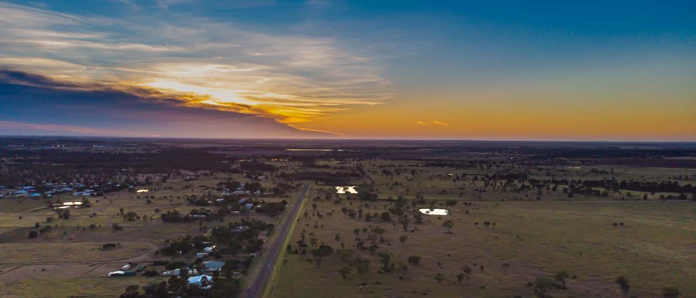

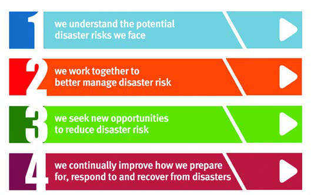

---
## Page 41

41
Queensland Strategy for Disaster Resilience 2022–2027
Disaster resilience is defined as "a system or 
community’s ability to rapidly accommodate and 
recover from the impacts of hazards, restore essential 
structures and desired functionality, and adapt to new 
circumstances".
Resilience can mean different things to different people. 
To address our known risks, manage uncertainty, and 
be ready for any events that may occur in the future, 
the overarching goal is increased resilience. In a truly 
resilient world, the complex interactions of our systems 
are known and anticipated, and all key stakeholders 
and sectors are playing an active role in disaster risk 
reduction.
To support our vision of 'Stronger, safer, and more 
resilient Queensland communities', and build on the 
strategic commitments within Resilient Queensland, 
we have identified four new strategic commitments to 
enhance disaster and community resilience and continue 
to support local and regional needs:
1.	
Embed disaster risk reduction and resilience 
into decision making
Better decision-making is key to preventing and reducing 
disaster risk. Decisions taken at multiple levels by 
different actors – whether local, state or industry – affect 
our disaster risk. Failing to adequately consider future 
risks in early decisions facilitates further risk creation, 
on top of risks already embedded in society and the 
landscape. More attention needs to be spent on learning 
from our past experiences through implementation of 
a lessons management process so that we can better 
prevent and mitigate future disasters. We also need to 
consider how to embed resilience into planning, policies, 
systems and services.
2.	 Address systemic disaster risk by coordinating 
	
across stakeholders and sectors
Disaster risk reduction and climate adaptation policies 
need to be developed together to comprehensively 
address systemic disaster risk. Queensland is committed 
to driving a coordinated effort to build disaster resilience 
and embed consideration for systemic disaster risk 
across and within many sectors.
3.	 Enhance risk reduction and capacity building 	 	
	
programs
Capacity development is a central strategy for reducing 
disaster risk. Using knowledge, innovation and education 
to build a culture of safety and resilience at all levels 
requires supporting and building technical capacity to 
assess impact and vulnerability, improve monitoring and 
evaluation, and promote community-based education. 
4.	 Align investment pathway opportunities to 
	
local needs
On top of the immediate consequences of disasters, 
challenges can be far reaching into the future. Disasters 
can trigger long-term issues in terms of reduced 
education and workforce participation, adverse effects 
on mental health and wellbeing and disruptions to 
baseline services. To address these issues at the local 
and regional level, there is a need to focus on aligning 
investment pathways to meet the needs of local councils 
and communities to build long-term resilience to future 
disasters.
These commitments will support future Queensland 
communities to be able to anticipate, resist, absorb, 
recover, transform and thrive in response to shocks and 
stresses, to realise positive economic, social, built and 
environmental outcomes. 
Queensland can no longer afford to be reactive to 
disasters. We must be proactive, considered and direct to 
reflect the changing landscape.
Image: Yeppen Floodplain Crossing, Bruce Highway following Ex-
Tropical Cyclone Debbie 2017. Courtesy TMR.
A renewed focus for resilience
Stronger, safer and more resilient Queensland communities

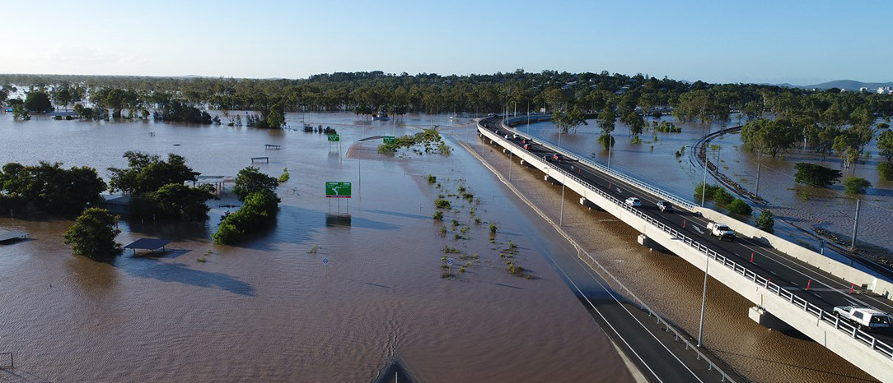

---
## Page 42

42 Queensland Strategy for Disaster Resilience 2022–2027
Risk information is the foundation for effective disaster 
risk management, as it helps tell the story of what, 
when, and where a disaster might happen, how severe it 
could be, and who would be most affected. If we do not 
understand disaster risk, we cannot manage it.
As Queensland has a considerable number of hazards 
and risks, which will become more frequent and 
severe with a changing climate, ongoing efforts and 
Strategic commitments 
Description
C1.1 Embed disaster risk reduction, 
mitigation and resilience into 
decision making
Strengthening governance has been identified as essential to reduce disaster 
risk. Embedding resilience into all decision making provides an opportunity 
to deal with issues systemically rather than in a siloed manner, to ensure 
community resilience is at the centre of everything we do.
C1.2 Drive attitudinal, cultural and 
behavioural change across the 
state, enabling Queenslanders to 
anticipate, respond and adapt to 
disaster impacts
Improving access to real-time information about disaster impacts will 
enable Queenslanders to make informed decisions to prepare and respond 
to risk in their communities. This includes engaging with young people to 
ensure information is delivered through channels that young people access 
information from (e.g. social media, radio, text messages).
C1.3 Understand the risks 
associated with a changing climate
Establishing a comprehensive disaster and climate risk management 
approach will be key in making a shift towards integrated plans and policies, 
supported by shared risk understanding, to reduce vulnerability and enhance 
capacity and resilience across the state.
C1.4 Increase community awareness 
and preparedness for all hazards 
through community engagement
Harnessing the best of what does and doesn’t work and encouraging a 
culture of community involvement will help Queenslanders to understand 
their disaster risk and be more prepared. 
C1.5 Initiate research and evaluation 
projects to promote the positive 
trajectory of building resilience in 
Queensland
Undertaking extensive research with key actors to identify the factors 
contributing to the vulnerability of communities to various disaster risks and 
suggest specific measures to incorporate into long-term resilience planning.
Image: Get Ready Queensland schools visit with meteorologist Tony Auden. Courtesy QRA.
Objective 1 – We understand the potential disaster risks we face
contemporary thinking and strategies to understand 
current and future disaster risks is vital in making critical 
decisions to reduce disaster risk and avoid the creation of 
disaster risk in the future. 
While Queensland has undertaken considerable work to 
understand its risk, this work is ongoing and will require 
the adaptation of policies to meet the challenges from 
emerging and future hazards.

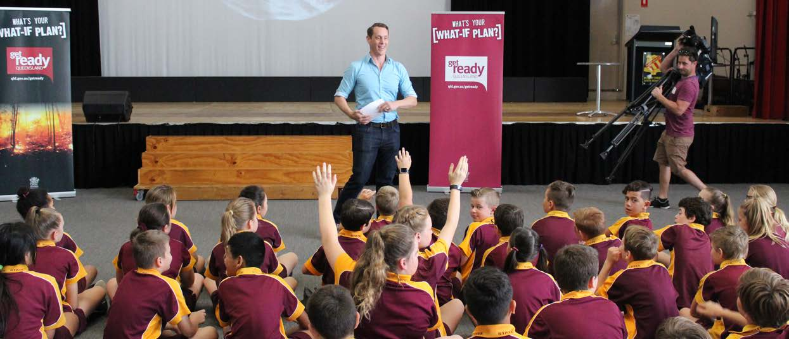

---
## Page 43

Objective 1 – We understand the potential disaster risks we face
Describing success
Having a clearer understanding of potential risks empowers us all to make informed decisions so that we can better prevent, prepare and respond, and minimise recovery efforts. 
We are resilient when:
•	
we have access to real-time information about disaster events and impacts to assist communities to understand local risk
•	
we continuously update, share and release natural hazard risk information across stakeholders to raise awareness 
•	
we find ways to engage with hard-to-reach and vulnerable people such as those from non-English speaking backgrounds
•	
we build systemic disaster risk reduction considerations into our governmental decision making
•	
our community makes risk-informed personal, financial and household decisions every day 
New Commitments
Actions
Sector
Lead/s
Partners
1-2 yrs
3-4 yrs
5+ yrs
C1.1
Embed disaster risk reduction, 
mitigation and resilience into 
decision making
A1.1.1
Explore opportunities to formalise lines of resilience into decision making and governance structures (in consultation with relevant state agencies) to 
increase the role of state-led delivery of resilience outcomes
All
QRA
State agencies
Current Commitments
Actions
Sector
Lead/s
Partners
1-2 yrs
3-4 yrs
5+ yrs
C1.2
Drive attitudinal, cultural and 
behavioural change across the 
state, enabling Queenslanders 
to anticipate, respond and 
adapt to disaster impacts
A1.2.1
Strengthening relationships with partners and key stakeholders with a renewed focus on a collective approach to promoting preparedness and 
resilience 
Human and 
Social
QRA
DCHDE
Councils 
A1.2.2
Improve the information and intelligence systems that support decision-making in emergencies for both disaster practitioners and the community by 
harnessing available data, providing more granular and local information, and integrating systems (including disaster dashboards)
All
QFES 
QRA
DCHDE
DES
DEPW
DAF
Councils
DTMR and DoR
A1.2.3
Distribute human and social disaster management and awareness information in languages other than English and in accessible formats catering for 
a diversity of cultures and abilities throughout the regions, and using methods suitable for transient populations including tourists and visitors. 
Human and 
Social
QFES
QRA
Councils
C1.3
Understand the risks associated 
with a changing climate 
A1.3.1
Undertake investigations on the long-term impacts of multiple hazards on settlements across Queensland – via integrated multi-hazard assessments
Building
QRA
DEPW
Councils
DES
QFES
A1.3.2
Queenslanders understand the risks a changing climate presents to communities, businesses and the natural environment, and the economic 
opportunities for new sustainable industries 
Environment
/Economic
DES
DAF
QFES
DSDILGP
Councils 
A1.3.3
Queenslanders have access to the best available science, near real-time monitoring of hazards, impact forecasting information, and risk assessments 
and tools to support adaptation decisions
Environment
DES
DAF
QFES
DSDILGP
Councils
A1.3.4
Prepare and continuously update risk studies, disaster management plans and risk awareness portals across all hazards
All
QRA
QFES
DSDILGP
Councils
A1.3.5
Continue to develop and implement the Queensland Emergency Risk Management Framework (QERMF) to better understand hazard risk, exposure, 
and vulnerability
All
QFES
Councils
C1.4
Increase community awareness 
and preparedness for all 
hazards through community 
engagement
A1.4.1
Coordinate and administer annual Get Ready Queensland program providing total $2 million in state funding to help local governments strengthen 
resilience of their communities
All
QRA 
Councils
A1.4.2
Coordinate all-hazards, resilience building campaigns and initiatives to help Queenslanders prepare for natural disasters (Public Safety Campaigns 
and Get Ready)
All
QRA
QFES
Councils
Community 
groups
A1.4.3
Support local governments to understand their baseline disaster resilience maturity to strategically plan for more effective community engagement 
activities by developing and implementing a disaster resilience maturity matrix tool
All
QRA
DSDILGP
DES
Councils
A1.4.4
Queensland implementation of the Australian Warning System to deliver a comprehensive approach to emergency warnings 
All
QRA
QFES
Disaster 
Management 
partner agencies
C1.5
Initiate research and evaluation 
projects to promote the positive 
trajectory of building resilience 
in Queensland
A1.5.1
Lead continuous improvement in emergency management in Queensland through forward-thinking research activities to meet challenges faced by 
Queensland
All
IGEM
QRA
DES
QFES
Councils 
Research sector
For resilience initiatives currently being delivered and previously delivered under the QSDR visit www.qra.qld.gov.au/QSDR
43

---
## Page 44

44 Queensland Strategy for Disaster Resilience 2022–2027
The release of the National Strategy for Disaster 
Resilience in 2011 was the first step in a long-term 
planning approach to disaster management in Australia 
and it cemented the concept of shared responsibility as a 
vital element in creating disaster resilient communities. 
Since then, there has been ongoing efforts at the state 
and national level to coordinate how we best prepare for, 
and respond to, disasters. 
While individuals and communities have a role to play in 
disaster resilience and risk reduction, governments and 
industry must take coordinated action to reduce disaster 
Strategic commitments 
Description
C2.1 Address systemic disaster risk 
by coordinating across stakeholders 
and sectors
Understanding current and future risks, and the role and responsibilities 
of key stakeholders involved in various aspects of resilience, is required to 
address systemic challenges and make informed decisions to reduce the 
impact of stresses and shocks on our system.
C2.2 Develop locally-led and 
community-based solutions to the 
impacts of disasters
Ensuring that recovery and resilience planning places both community 
need and value at their heart to deliver better outcomes for communities to 
strengthen resilience.
C2.3 Build partnerships across 
community, industry, research 
organisations and government to 
better manage disaster risk and 
strengthen resilience 
Working collaboratively with key partners, community groups and Aboriginal 
and Torres Strait Islander peoples to ensure that post-disaster activities result 
in greater resilience both physically and institutionally.
C2.4 Implement the Queensland 
Flood Risk Management Framework
Ensuring the governance of flood risk management in Queensland is based on 
a collaborative, decentralised model with shared roles and responsibilities.
Objective 2 – We work together to better manage disaster risk
risks within their control to limit adverse impacts on 
communities. A systems-based approach to resilience 
and recovery is required to tackle existing and emerging 
threats. 
A key challenge will continue to be the need for 
strengthened cooperation between all levels of 
government, partners, private sector and academics to 
build on existing frameworks for resilience and establish 
risk ownership in Queensland. In a truly resilient future, 
all actors and sectors play an active role in disaster risk 
reduction. 
Image: Working together to better manage disaster risk. Courtesy of QRA.

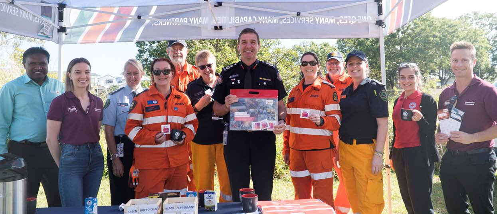

---
## Page 45

45
Objective 2 – We work together to better manage disaster risk
Describing success
Actions
When it comes to disaster risk, we have found people most value their safety and security, the opportunity to thrive and prosper, and the reliable and continuous operation of critical infrastructure despite the stresses or shocks that 
may occur. We can always work better together to coordinate and concentrate our efforts to protect and enhance these values. 
We are resilient when:
•	
our community is involved in disaster preparedness activities that meet local needs
•	
cross sector and cross border collaboration ensures evidence of local vulnerability and risk is used to inform our decision 
making in providing baseline services of government 
•	
we encourage, promote, and facilitate shared responsibility for all Queenslanders in building disaster resilience
•	
we utilise individual capabilities and capacities to ensure everyone understands the role they play in contributing to the 
resilience of our community
New Commitments
Actions
Sector
Lead/s
Partners
1-2 yrs
3-4 yrs
5+ yrs
C2.1
Address systemic disaster 
risk by coordinating across 
stakeholders and sectors
A2.1.1
Advocate for government investment in and consistent delivery of programs and initiatives to improve access and reliability of whole-of-
government services in regional, remote and rural areas (including health, mental health, education, transport and telecommunications) to 
reduce the impact of long-term stresses and repeat shocks  
All
QRA
DCHDE
QH
DoE
Councils
Community groups
A2.1.2
Identify and understand current and future risk using a scenario based approach to use this knowledge to inform decision making and 
community engagement - including strengthening of local and district disaster management plans to incorporate direct, indirect and 
systemic risks 
All
QFES
Councils
A2.1.3
Incorporate outcomes of hazard risk assessments into regional land use and infrastructure plans and support Councils to reflect this in 
local planning schemes where appropriate
Building and 
Environment
QRA
DES
DSDILGP
QFES
Councils
DAF
Current Commitments
Actions
 Sector
Lead/s
Partners
1-2 yrs
3-4yrs
5+ yrs
C2.2
Develop locally-led and 
community-based solutions to 
the impacts of disasters
A2.2.1
Assist Councils to understand their baseline resilience levels and how to enhance resource allocation to meet resilience needs 
All
QFES
QRA
Councils
A2.2.2
Encourage knowledge and information sharing by improving public availability and awareness of hazard mapping and risk resources 
(including through the Queensland Disaster Resilience Alliance, Queensland Government Disaster Management Site and Future Climate 
Dashboard)
All
QFES
DES
Councils
Community groups
QRA
A2.2.3
Continue environmental stewardship programs that protect and enhance Country, including natural resource management, land restoration 
and biosecurity programs, the Indigenous Land and Sea Ranger program, and other initiatives that incorporate First Nations knowledge, and 
ongoing proper management of State and private lands that conserves their significant natural and cultural values.  
Environment
DoR 
DES
DAF
Councils
Community groups
QFES
C2.3
Build partnerships across 
community, industry, research 
organisations and government 
to better manage disaster risk 
and strengthen resilience 
A2.3.1
Build public-private partnerships (ie. Insurance agencies) to develop recommendations to make homes more resilient to all hazards
Building
QRA
Insurance
QFES
A2.3.2
Partner with special interest , community services and community groups to enhance support to vulnerable community members
All
DCHDE
Councils
Community groups
A2.3.3
Support Indigenous local councils to complete adaptation planning as part of a wider climate change program for remote communities
Environment
DSDSATSIP
DES
DSDILGP
Councils
Community groups
A2.3.4
Work in partnership with insurance, not for profit and community groups to harness existing capabilities in ‘on the ground’ resilience 
building 
All
QRA
Councils
Community groups
Insurance
A2.3.5
Work with First Nations councils to develop regional waste management plans, including the identification of actions to reduce disaster risk 
from legacy waste (e.g. abandoned vehicles, metals) and options to avoid future accumulation.
Environment
DES
Councils
A2.3.6
Continue to implement the QCoast2100 program aimed at assisting local councils impacted by coastal hazards to be proactive in 
adaptation planning to implement mitigation measures
Environment
DES
Councils
C2.4
Implement the Queensland 
Statewide Assessment of Flood 
Risk
A2.4.1
Develop and implement a 10-year investment plan for flood risk management in Queensland, including the development of a Statewide 
Assessment of Flood Risk Tool to establish a systems approach to prioritising needs and investments in flood management
All
QRA
Councils
DRDMW
DoR
QFES
DES
DSDILGP
A2.4.2
Continue implementation of the Brisbane River Strategic Floodplain Management Plan
All
QRA
Councils
DoR
DES
QPS
DTMR
DSDILGP
QFES
DEPW
For resilience initiatives currently being delivered and previously delivered under the QSDR visit www.qra.qld.gov.au/QSDR

---
## Page 46

46 Queensland Strategy for Disaster Resilience 2022–2027
Increased resilience can be achieved through learning, 
innovation and developing skills and resources, both at 
the community and operational level that can be applied 
to respond to a wider range of disasters.
The convergence of science and technology is of great 
importance for mitigating disaster risk. The effectiveness 
of science and technology innovations in disaster risk 
Strategic commitments 
Description
C3.1 Enhance risk reduction, 
mitigation and capacity building 
programs drawn from local need
Recognising that coordinated and cooperative efforts across stakeholders 
is required to enhance local, regional and state capability and capacity to 
withstand and recover from emergencies and disasters.
C3.2 Deliver more resilient 
infrastructure to enhance connectivity 
and supply chain resilience
Utilising data and evidence to ensure there is improved planning for, 
response to and recovery from infrastructure failure through ongoing 
investments in resilient infrastructure.
C3.3 Protect and enhance the natural 
environment through effective land 
use planning
Enhancing the resilience of existing and future communities through 
effective land use planning in areas that are subject to, or potentially 
subject to, hazards.
C3.4 Promote the incorporation of 
risk reduction in all planning and 
development
Developing concrete commitments to reduce vulnerability, build capacity 
and promote resilience to disasters using a place-based approach.
C3.5 Encourage innovation in urban 
area design for living with the 
impacts of disasters
Ensuring infrastructure can function during adverse conditions and quickly 
recover to acceptable levels of service after an event which is fundamental 
to the wellbeing of communities.
C3.6 Further the understanding and 
management of natural landscapes 
to reduce the impacts and effects of 
disaster events
Focusing on environmental improvements through mechanisms such 
as natural resource management groups, government programs, and 
community-led efforts.
C3.7 Build greater individual and 
business resilience and preparedness
Encouraging partnerships and sharing ideas to ensure communities and 
businesses can face challenges caused by disaster and climate risks and 
come back stronger. 
Image: Flood resilient home, Courtesy QRA.
Objective 3 – We seek new opportunities to reduce disaster risk
reduction has been proven in many cases, including 
early warning systems and innovations in construction to 
enhance the resilience of buildings and infrastructure.
The Sendai Framework for Disaster Risk Reduction 
encourages investment in innovation and technology 
in disaster risk management to address gaps, 
interdependencies, social challenges, and disaster risks.

---
## Page 47

47
Objective 3 – We seek new opportunities to reduce disaster risk
Describing success
Having a big picture view of the interrelated and systemic nature of risk and a long-term commitment to disaster risk reduction helps us identify innovative opportunities for making our communities, infrastructure and environment 
stronger and more adaptable to future stresses and shocks. 
We are resilient when:
•	
we incorporate resilience into everyday activities
•	
we take a proactive approach to resilience building, rather than a reactive one, an ensure resilience is a key consideration in 
long-term planning
•	
we have clear knowledge of the risk reduction and mitigation requirements / priorities across the state 
•	
we understand how to link policy and funding to prioritised actions to progressively improve certainty of resourcing and 
delivery 
•	
we collaborate locally and regionally on long-term risk reduction and resilience to plan for future generations, the economy 
and the environment
New Commitment
Actions 
Sector
Lead/s
Partners
1-2 yrs 3-4 yrs 5+ yrs
C3.1
Enhance risk reduction, 
mitigation and capacity 
building programs drawn 
from local need
A3.1.1
Continue to support local councils and communities in the implementation of Local Resilience Action Plans and Regional Resilience Strategies
All
QRA
Councils
Community groups
A3.1.2
Further investigate partnerships with the private sector on investment opportunities in risk reduction and pilot innovative delivery mechanisms to 
achieve long-term adaptation and risk reduction
All
QRA 
DEPW
Council
Community groups
Insurance
A3.1.3
Support existing work of non-government entities (not-for-profit, community and private sector) in community capacity building programs and 
enhance linkage to state, regional and local resilience needs and priorities (with a focus on engaging with organisations that assist people 
experiencing or at risk of homelessness and poverty) 
Human & 
Social 
DCHDE
QH
Community groups
NDIA
A3.1.4
Improve the resilience of small and medium businesses through targeted activities and harnessing learnings from responding to and recovering 
from disaster events
Economic
DESBT
DAF
DES
Councils
DSDILGP
DRDMW
A3.1.5
Explore opportunities to invest in sustainable infrastructure and economic catalysts to create economic stability and resiliency to extreme weather 
events, particularly in regional areas 
Economic /
Building
DSDILGP
DES
DTIS
Councils
DRDMW
Current Commitment
Actions
Sector
Lead/s
Partners
1-2 yrs 3-4 yrs 5+ yrs
C3.2
Deliver more resilient 
infrastructure to enhance 
connectivity and supply 
chain resilience
A3.2.1
Continue to administer the Queensland Betterment Program and identify and address repeated road impact hotspots 
Roads & 
Transport
QRA
Councils
A3.2.2
Utilise best available data and evidence throughout the infrastructure lifecycle (planning, designing, constructing, maintaining and disposing) to 
better understand and respond to disaster and emergency risks and opportunities to strengthen infrastructure resilience
Building
QFES
QRA
DJAG
QPS
QCS
DCYJMA
DES
None
C3.3
Protect and enhance 
the natural environment 
through effective land 
use planning 
A3.3.1
Develop, preserve and enhance green and blue infrastructure to mitigate the effects of climate change 
Building
DSDILGP
DEPW
DES
DTMR
Councils
C3.4
Promote the 
incorporation of risk 
reduction in all planning 
and development
A3.4.1
Design and deliver resilience programs that are place-based, reflecting local priorities and community characteristics that expand beyond traditional 
hazards to embed resilience and climate change adaptation
All
QRA
DSDILGP
DEPW
Councils
Community groups
C3.5
Encourage innovation 
in urban area design for 
living with the impacts of 
natural disasters 
A3.5.1
Increase awareness of resilient building guidance 
Building
QRA
DEPW
QFES
DSDILGP
A3.5.2
Effectively deliver the Resilient Homes Fund designed to support Queenslanders whose homes were impacted by flooding to raise, repair, retrofit or 
have their home voluntarily bought back 
Building
DEPW
QRA
Councils
DSDILGP
A3.5.3
Incorporate climatic design and urban heat reduction considerations into public realm design when funding local projects such as streetscape 
revitalisation or public space upgrades 
Building
DEPW
QH
Councils
DES
C3.6
Further the 
understanding and 
management of natural 
landscapes to reduce the 
impacts and effects of 
natural disasters
A3.6.1
Explore opportunities to invest in the sustainable stewardship of natural assets (whether in public or private ownership) including increasing the 
capacity and capability of landowners to sustainably manage healthy historical heritage places, land and waterways
Environment
DES
DAF
DoR
Councils
QFES
A3.6.2
Collaborate with fire authorities, State land management agencies, First Nations groups, neighbours and lessees on a landscape-scale approach to 
protective fire management and risk mitigation that builds resilience within the landscape to help reduce adverse impacts of large-scale, severe bushfires
Environment
QFES
DES
Councils
DoR
C3.7
Build greater individual 
and business resilience 
and preparedness
A3.7.1
Enable and empower individuals, households, organisations, and businesses to build their resilience, paying particular attention to those people 
and groups who may be disproportionately affected by disasters
All
QRA
DES 
DCHDE
Councils
Community groups
A3.7.2
Uphold environmental regulation by monitoring environmental risks through a range of assessment, compliance, investigation and enforcement 
activities, to ensure environmental best practice and resilience to natural disasters
Environment
DES
Councils
For resilience initiatives currently being delivered and previously delivered under the QSDR visit www.qra.qld.gov.au/QSDR

---
## Page 48

48 Queensland Strategy for Disaster Resilience 2022–2027
Continuous improvement increases the effectiveness 
of response, recovery and resilience efforts by ensuring 
we are able to routinely identify strengths, areas for 
improvement, potential best practices, and critical 
issues.
The practice of continuous improvement involves regular 
evaluation of processes and arrangements to ensure 
they remain relevant, efficient, effective, and flexible. 
Disaster management stakeholders, researchers, 
educators, policy makers and the community have a 
joint responsibility to ensure continuous improvement 
initiatives are shared across the disaster management 
sector to promote innovation, efficiency, and efficacy.
Image: Flood warning camera, Wujal Wujal, 2022. Courtesy QRA.
Strategic commitments 
Description
C4.1 Align investment pathway 
opportunities to local needs
Prioritising local and regional needs by facilitating the delivery of 
coordinated funding and on-the-ground assistance to strengthen 
community disaster resilience.
C4.2 Identify adaptation opportunities 
following disasters and recognising the 
impacts of climate change
Establishing a disaster management system that is scalable to 
accommodate increases in current and future disaster risks and the 
increasing numbers of people and properties located in disaster 
impacted areas and identify opportunities to lessen impacts.
C4.3 Drive continuous improvement in 
disaster management in Queensland 
via assurance frameworks and 
accompanying Strategy performance 
measures
Developing a cycle of monitoring, evaluation and reporting to support a 
learning culture for continuous improvement.
Objective 4 – We continually improve how we prepare for, respond to, and 
recover from disasters
Recent disaster events have highlighted a critical 
need to link resilience policy outcomes more clearly 
to tangible funding opportunities. Currently, there 
is insufficient investment in disaster risk reduction 
measures, especially in investing in prevention. Both 
public and private investment in disaster risk prevention 
and reduction through structural and non-structural 
measures tailored to local need are essential to enhance 
the economic, social, health and cultural resilience of 
Queensland.

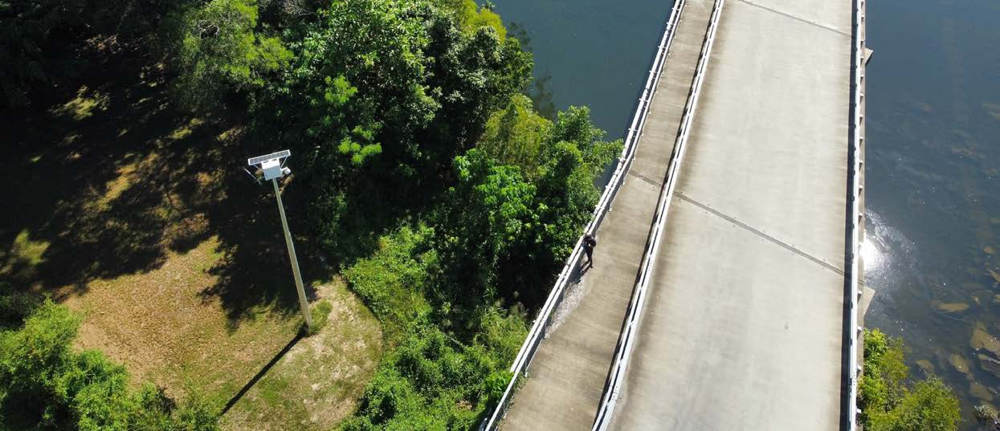

---
## Page 49

49
Objective 4 – We continually improve how we prepare for, respond to and recover from disasters
Describing success
Learning from past events and how they have impacted us as Queenslanders enables us to anticipate what’s next, improve our current practices, and adjust where required to dynamic and uncertain circumstances. 
We are resilient when:
•	
our disaster management systems are scalable and resourced to anticipate and respond to changing needs 
•	
we are on a journey of continuous improvement to reduce existing risk and anticipate future events and their impacts 
•	
we work across disciplines and organisations to proactively plan for resilience of people, property and place 
•	
we embrace a culture of ongoing improvement through regular monitoring and information sharing
•	
we priortise investments in innovative resilience building activities that align to long-term planning and objectives to strengthen resilience over time
New Commitment
Actions
Sector
Lead/s
Partners
1-2 yrs 
3-4 yrs
5+ yrs
C4.1
Align investment pathway 
opportunities to local 
priorities
A4.1.1
Review funding arrangements and opportunities to provide more streamlined, sustainable, and targeted resilience 
activities for communities, environments and places in need
All
QRA
DSDILGP
Councils
DAF
A.4.1.2
Develop and implement the Disaster Recovery Funding Arrangements Efficiencies Framework to develop a clearer 
and more direct connection of funding to need
All
QRA
Councils
Current Commitments
Actions
Sector
Lead/s
Partners
1-2 yrs 
3-4 yrs
5+ yrs
C4.2
Identify adaptation 
opportunities following 
disasters and recognising 
the impacts of climate 
change
A4.2.1
Direct public and private capital to finance new and/or adapt existing infrastructure that can increase resilience and 
measure the socio-economic and environmental outcomes of investments 
Building 
/ Roads 
&Transport
QRA
DEPW
Councils
DSDILGP
A4.2.2
Explore opportunities to address gaps in recovery, resilience and mitigation policy, particularly in light of climate 
change adaptation, where feasible
All
QFES
DES
DEPW
QRA
A4.2.3
Transfer resilience and capacity building practices developed following certain hazard events (such as recent 
bushfires) to other hazards and situations (such as flooding) through a lessons learned process 
All
QRA
DEPW
DAF
Councils
A4.2.4
Take opportunities to improve asset resilience in upgrade and renewal processes
Building
DEPW
DSDILGP
Councils 
DTMR
QRA
C4.3
Drive continuous 
improvement in disaster 
management in Queensland 
via assurance frameworks 
and accompanying Strategy 
performance measures.
A4.3.1
Work with agencies to implement a monitoring, evaluation and reporting framework that includes lessons 
management to measure progress against resilience strategic commitments 
All
QRA
IGEM
A4.3.2
Explore opportunities to advance resilience in long term regional planning
Building
DSDILGP
DEPW
Councils
QRA
For resilience initiatives currently being delivered and previously delivered under the QSDR visit www.qra.qld.gov.au/QSDR

---
## Page 50

50 Queensland Strategy for Disaster Resilience 2022–2027
Delivery
The Queensland Reconstruction Authority (QRA) is the 
lead agency responsible for disaster resilience policy and 
will work with all stakeholders, with a commitment to 
collaborative policy development for the implementation 
of the QSDR and the delivery of resilience initiatives.
The Queensland Resilience Coordination Committee 
(QRCC) was established in 2018 as the key governance 
body to identify and promote resilience initiatives in 
Queensland and assist in coordinating available funding 
to address priorities.
The QRCC is also responsible for overseeing the 
implementation of the QSDR, reporting to the QDMC 
through a leadership board, comprised of the Chief 
Executives of key Queensland Government agencies. The 
QDMC is established under the Disaster Management Act 
2003 and assumes the state-level role for the strategic 
direction of disaster management and decision-making.
The successful delivery of effective resilience measures 
will be supported by key partners across the not-for-
profit, insurance and tertiary sector to ensure decision-
making is informed by a solid evidence base.
Implementation and measuring 
success 
Successful implementation of strategic commitments and 
resilience actions will be developed following a program 
of consultation with lead and partner agencies - in 
conjunction with disaster management arrangements. 
The QRA will monitor and evaluate the effectiveness of 
the QSDR and provide six monthly reporting to the QRCC 
and QDMC on progress.
A set of tailored indicators will be employed to measure 
progress made over time towards developing increased 
levels of resilience. The indicators will be established via 
consultation with key stakeholders and sectors to ensure 
the unique characteristics of Queensland communities 
are considered when capturing successes and evaluating 
the effectiveness of resilience initiatives. 
The indicators will support current, evidence-based 
decision making and the identification of opportunities 
to enhance preparedness, response and recovery from 
all hazard impacts. They will allow the benefits of proven 
initiatives to be measured, with learnings shared with all 
communities across the state. 
The following diagram provides a recommended model of 
monitoring, evaluation and reporting. 
Image: 737 water bomber Central Queensland Bushfires November 2018. 
Delivery and measuring success 
QSDR 2022-2027
Monitoring and Reporting
Input
Resources required to 
create outputs e.g. local 
and regional knowledge, 
people, funding, 
capacity
Output
Strategic commitments 
and actions to enhance 
resilience (6 monthly 
reports to QRCC)
Outcome 
1-5 years
Strengthened disaster 
resilience underpinned 
by research, knowledge, 
data and 
assessment
Impact
Improved community 
resilience in Queensland 
(after or despite shocks 
and stresses

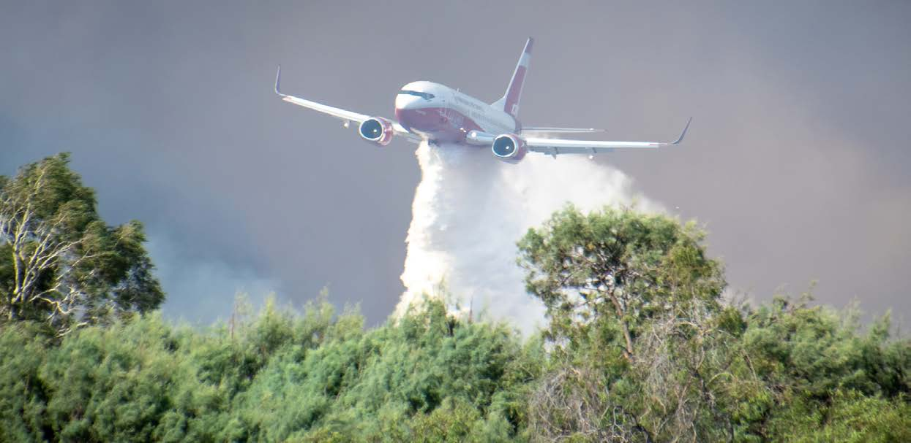

---
## Page 51

51
Queensland Strategy for Disaster Resilience 2022–2027
Image: Flooding. Courtesy Queensland Museum.
CSIRO, 2020, Climate and Disaster Resilience 
Technical Report 
CSIRO, 2020, Disaster-resilient and adaptive 
to change – narratives to support co-ordinated 
practice and collective action in Queensland
Deloitte, 2021, Special report: Update to the 
economic costs of natural disasters in Australia 
Disability-Inclusive Disaster Risk Reduction and 
Emergency Situations
Queensland Climate Adaptation Strategy (QCAS)
Queensland Emergency Risk Management 
Framework
Queensland Fire and Emergency Services, 2019, 
Earthquake Risk Assessment
Queensland Strategy for Disaster Resilience 2017
Queensland State Disaster Management Plan
Queensland State Natural Hazard Risk Assessment 
2017
National Disaster Risk Information Services 
Capability Pilot project outcomes report, 2020
National Disaster Risk Reduction Framework
National Resilience Taskforce, 2019, Guidance on 
Vulnerability,
Resilient Queensland 2018-2021: Delivering the 
Queensland Strategy for Disaster Resilience (2018)
Royal Commission into National Natural Disaster 
Arrangements Report, 2020 
State Infrastructure Strategy, 2022
The State of Queensland, QCoast2100, 2016-21
The State of Queensland, 2022, The Drought and 
Climate Adaptation Program
United Nations Office for Disaster Risk Reduction 
(UNDRR) Sendai Disaster Risk Reduction Framework
Image: Flooding. Courtesy Queensland Museum.
(Back cover): Flooding, Rockhampton, 2010. Courtesy QRA.
References

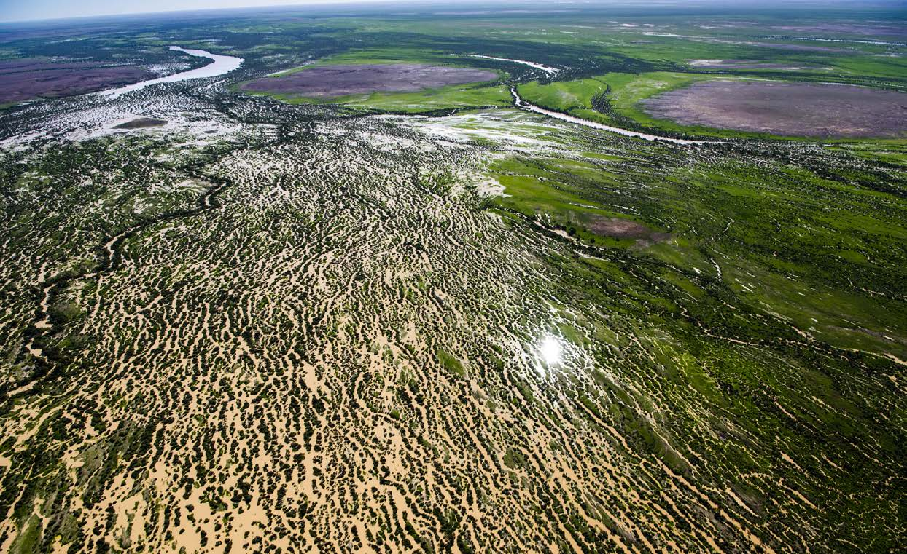

---
## Page 52

www.qra.qld.gov.au/QSDR

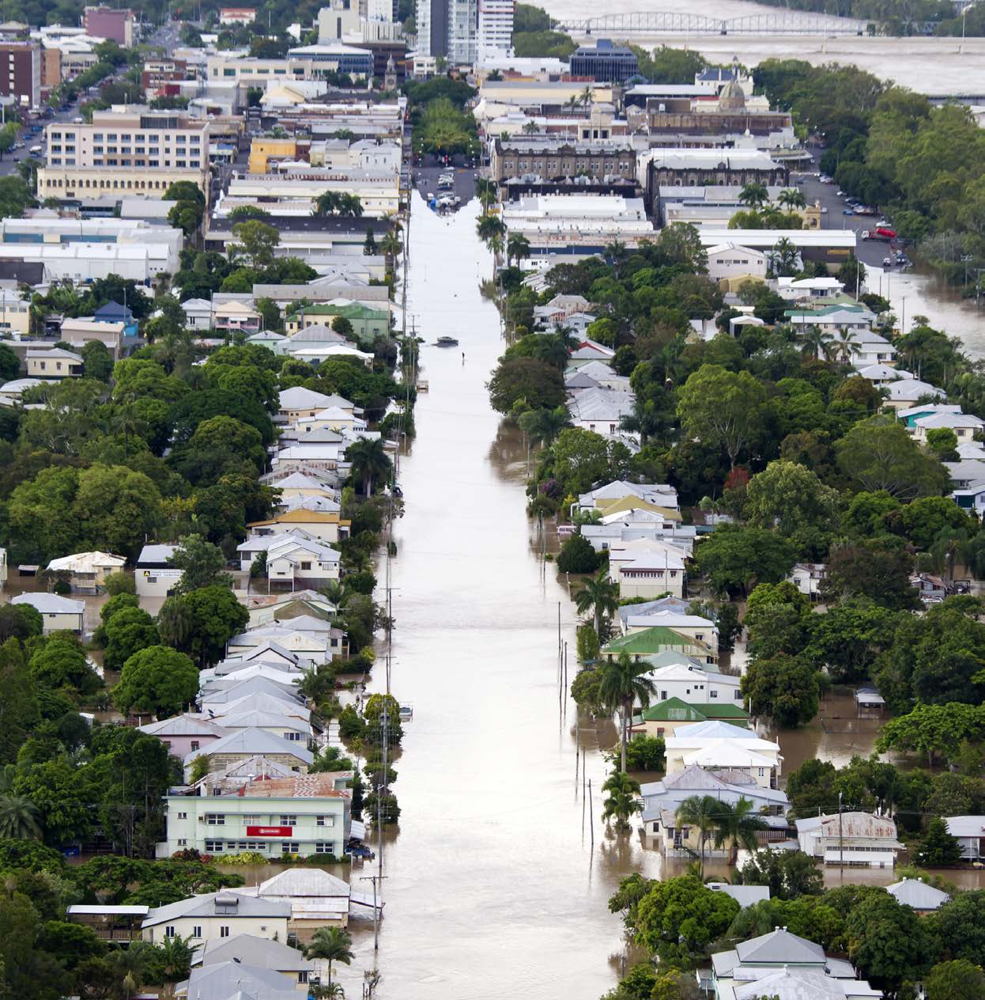

