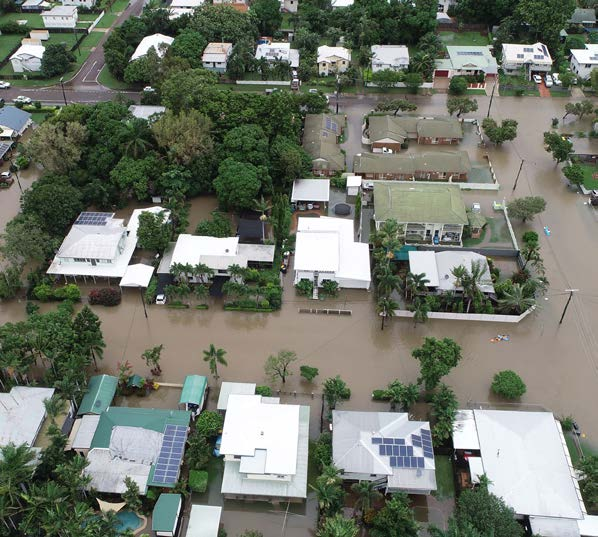
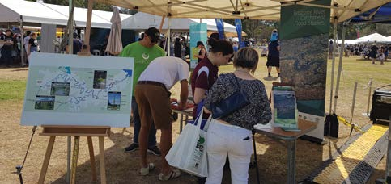
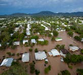
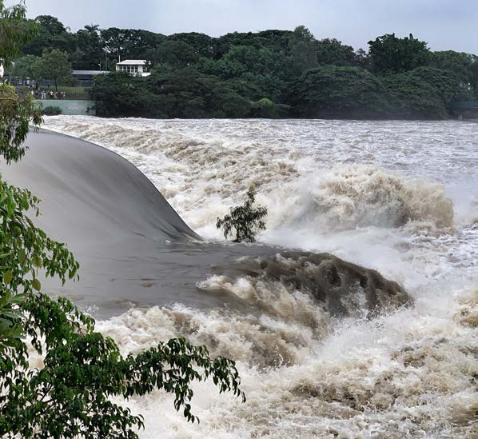

# Regional Guideline for Flood Awareness Mapping and Communication (2021)

> **Source**: Queensland Reconstruction Authority
> **URL**: https://www.qra.qld.gov.au/sites/default/files/2021-01/regional_guideline_for_flood_awareness_mapping_and_communication_2021.pdf
> **Licence**: © State of Queensland; emergency-management practitioner reference
> **Retrieved**: 2026-05-07T23:43:46Z
> **SHA-256**: `076fab392ccc6b3fb043f65bdc4b3d71b4ea67b9e3da7ee5bcaead7120aaa148`
> *Converted from PDF to Markdown format.*

---
## Page 1

Regional Guideline for 
Flood Awareness Mapping 
and Communication
Brisbane River Catchment

---
## Page 2

Document details
Security classification
Approved
Date of review of security classification
December 2020
Authority
Queensland Reconstruction Authority
Document status
Final
Version
1.1
QRA reference
DOC/20/40980
Copyright
This publication is protected by the 
Copyright Act 1968.
© The State of Queensland (Queensland 
Reconstruction Authority) October 2020.
Licence
This work is licensed by State of 
Queensland (Queensland 
Reconstruction Authority) under 
a Creative Commons Attribution (CC BY) 4.0 
international licence. To view a copy of this licence, 
visit: http://www.creativecommons.org/
licenses/by/4.0/ 
In essence, you are free to copy, communicate 
and adapt this Brisbane River Strategic 
Floodplain Management Plan, as long as you 
attribute the work as follows.
Attribution
This guideline has been developed as part of the 
Phase 4 (Implementation) of the Brisbane River 
Catchment Studies, through the collaborative 
efforts of the Queensland Reconstruction 
Authority, Brisbane City Council, Ipswich City 
Council, Lockyer Valley Regional Council and 
Somerset Regional Council.
Interpreter
The Queensland Government is 
committed to providing accessible 
services to Queenslanders from all 
culturally and linguistically diverse 
backgrounds. If you have difficulty in 
understanding this report, you can access 
the Translating and Interpreting Services via 
www.qld.gov.au/languages or by phoning 
13 14 50.
Disclaimer
While every care has been taken in preparing this 
publication, the State of Queensland accepts no 
responsibility for decisions or actions taken as 
a result of any data, information, statement or 
advice, expressed or implied, contained within. 
To the best of our knowledge, the content was 
correct at the time of publishing.
Copies 
Copies of this publication are available on our 
website at www.qra.qld.gov.au.
Further copies are available upon request to:
Queensland Reconstruction Authority
PO Box 15428
City East QLD 4002
Phone (07) 3008 7200
info@qra.qld.gov.au
www.qra.qld.gov.au
0592
2
Regional Guideline for Flood Awareness Mapping and Communication

---
## Page 3

3
Regional Guideline for Flood Awareness Mapping and Communication
Contents	
	
	
	
	
	
	
	
	
	
	
Introduction	
4
Why is this guideline needed?	
4
Principles	
	
5
Intended users	
5
What is a flood aware and resilient community?	
5
Flood awareness mapping	
6
Source of flooding	
6
Describing flood impacts	
7
Categorising flood events	
8
Mapping Symbology	
10
Base data on Flood Awareness Maps	
10
Access and location of Flood Awareness Maps	
10
Website design considerations	
11
Property-scale flood Information	
12
Content 	
12
Place-based installations	
13
Types 	
13
Locations 	
13
Information	
14
Community facing language and messaging	 	
	
	
	
15
Key messaging across region	
15
Glossary of terms	
16

---
## Page 4

4
Regional Guideline for Flood Awareness Mapping and Communication
Introduction	 	
	
	
	
	
	
	
	
	
	
This document has been prepared to provide guidance to deliver regionally consistent flood 
awareness information in support of community engagement and awareness activities in the Brisbane 
River catchment. 
The guideline is the deliverable of the Brisbane River Catchment Strategic Floodplain Management 
Plan action CAR2.3, which allocated the Queensland Reconstruction Authority to:
In strong collaboration with local governments, develop regional guidance for delivering consistency 
in the local provision of online flood awareness mapping, property-scale flood information, place-
based installations, and community facing language and messaging.
Whilst developed specifically for the Brisbane River Catchment, the guideline has purposefully been 
developed with consideration for state-wide application. It is produced as a “living document”, 
intended for ongoing monitoring and review to ensure alignment with best practice, developments 
and innovation. 
Why is this guideline needed?
In developing the Brisbane River Catchment Strategic Floodplain Management Plan (the Strategic 
Plan), community survey responses clearly identified that residents in the Brisbane River catchment 
seek information from more than one local government area. 
Prior to this guideline, councils within the catchment developed and implemented their own methods 
for communicating flood risk and building flood awareness. Whilst there are similarities across the 
campaigns, key aspects including the flood events used in messaging, formats and methods for 
making information available, language and key messaging varied, creating unnecessary complexities 
for the community. The project partners agreed that regionally consistent principles are required for: 
•	 flood awareness mapping
•	 property level information
•	 place based installations
•	 community facing language and messaging.

---
## Page 5

Tailored to local requirements: it is not expected that each 
council will apply all the content and features discussed in 
this guideline, however those which are adopted should be 
consistent with these guidelines.
Simplicity: whilst the science of understanding, defining and 
assessing flood behaviour can be complicated, communication of 
key information must be targeted and simplistic.
Consistency: the guideline seeks to ensure consistent information 
is provided and communicated to the communities of floodplains, 
irrespective of the geographic area where they live.
5
Regional Guideline for Flood Awareness Mapping and Communication
Intended users
Representatives of councils and local authorities are encouraged to use this guideline to assist in the 
production and provision of flood awareness information for their communities.
What is a flood aware and resilient community?
The purpose of flood awareness communication is to create awareness and prompt action to prevent 
and reduce the impacts of flooding on communities within a floodplain. 
The Strategic Plan defines a flood aware and resilient community as being:
•	 informed and aware of their flood risk
•	 appropriately prepared
•	 adaptable.
Principles	
This guideline has been prepared based on the following key principles.

---
## Page 6

6
Regional Guideline for Flood Awareness Mapping and Communication
Source of flooding
This guideline focuses on flooding of rivers, specifically the Brisbane River, however, recognises local 
authorities experience flooding from various sources. Whilst from the community’s perspective “water 
is water”, flooding from different sources typically exhibit different behaviours which affects the 
impacts to the community.
These behaviours relate to different characteristics of floods, such as the volume of water, how fast 
the floods rise and recede, how fast the water flows, how long the flood lasts and the areal extent of 
flooding.
Generalised relative behaviours are discussed below, assuming the chance of a flood occurring from 
each different source is the same or similar. 
For the purposes of flood awareness mapping, experience indicates that overland flow should be 
differentiated from other sources as the characteristics are significantly different. 
Unless a clear distinction is required, river, creeks and coastal flooding can be classified in the same 
manner.
Flood awareness mapping		
	
	
	
	
	
	
Source
General Characteristics
Large Riverine 
Catchments
Rainfall can build up over hours, days or weeks. The runoff from this rainfall flows across and 
then down gutters, drains, gullies, creeks and rivers and may create significant floods that 
inundate large areas of land for varying periods of time. With more time to react, flood warning 
is more effective for these types of floods.
Small River/Creek 
Catchments
Heavy, intense rainfall can occur suddenly, and the quickly rising floods caused by this can 
occur within minutes or hours after the rainfall. Referred to as flash floods, there is often 
limited time to react, and these events can be difficult to predict and manage in real time.
Coast
Large tides and storm surges can flood coastal areas. The affected area can be widespread, 
however there is usually the opportunity for effective flood warning with these events.
Overland flow
In urbanised areas, the formal drainage network is usually designed only to manage small, 
frequent rainfall events. When these are exceeded, water flows along the low points of the 
topography, often across private property and roads. These events are very hard to predict, 
with little to no warning time. They often occur at the same time as other types of flooding or 
can be independent events.
Table 1: Generalised characteristics of floods by source

---
## Page 7

7
Regional Guideline for Flood Awareness Mapping and Communication
7
Describing flood impacts
Flood awareness maps produced for areas within the Brisbane River catchment will be categorised 
into four areas based on the following agreed impact statements.
•	
High Impact - Comprises areas of deep and fast flowing water which pose a potential high risk 
to life and / or likely failure of buildings during a flood event. Typically, these areas are part of 
or immediately adjacent to the river or direct tributaries which experience frequent flooding. 
Alternatively, the areas may flood less frequently however due to the characteristics of the flood 
waters, pose a high risk due to the risk to life and property
•	
Moderate Impact - Generally, areas where the river breaks out and into low lying broader 
floodplains. These areas are predominately flood storage areas, filling and temporarily holding 
flood water during an event. Relatively frequently affected by flood but typically areas of deeper 
water with lower velocity. Durations of flooding and depth can vary depending on what part of the 
catchment.
•	
Low Impact - Often described as ‘flood fringe’. Areas either relatively frequently inundated with 
low level sheet or overland flow or deeper slow flowing water in larger, infrequent events
•	
Other areas of the floodplain - Identifies all other areas of the floodplain that have the potential, 
albeit very low likelihood, to be affected by extreme flooding events. A flood in these areas is the 
most extreme and infrequent event that could occur in the catchment.

---
## Page 8

8
Regional Guideline for Flood Awareness Mapping and Communication
0.0
0.0
0.5
1.0
1.5
2.0
2.5
3.0
3.5
4.0
4.5
1.0
2.0
3.0
4.0
5.0
H6 - unsafe for vehicles and people. 
All building types considered vulnerable to failure
H5 - unsafe for vehicles and people. All buildings 
vulnerable to structural damage. 
Some less robust building types vulnerable 
to failure.
H4 - unsafe for 
people and vehicles
H2 - unsafe for small vehicles.
H1 - generally safe for people, vehicles  
and buildings
H3 - unsafe for 
vehicles and children 
and the elderly
5.0
Depth (m)
Velocity (m/s)
Flood hazard (horizontal axis) is determined by both the flood depth and flood velocity, as 
recommended by Australian Disaster Resilience Guideline 7-3 Flood Hazard, reproduced below.
AEP
HI
H2
H3
H4
H5
H6
1 in 100K
HR5
HR5
HR5
HR5
HR5
HR5
1 in 2000
HR5
HR5
HR4
HR4
HR4
HR4
1 in 500
HR5
HR4
HR4
HR3
HR3
HR3
1 in 100
HR4
HR4
HR3
HR2
HR2
HR2
1 in 50
HR4
HR3
HR2
HR2
HR1
HR1
1 in 20
HR3
HR2
HR2
HR1
HR1
HR1
1 in 10
HR2
HR1
HR1
HR1
HR1
HR1
Categorising flood events
The flood events which form the basis of each impact category shown on the flood awareness maps is 
determined by each local council, based on the detailed understand of their creek and river systems. 
For the areas defined by the Brisbane River Flood Study, the Potential Hydraulic Risk (PHR) matrix is 
the agreed basis from which the categories will be derived.
The PHR as agreed in the development of the Strategic Plan is shown below. It groups areas of the 
floodplain based on a combination of the likelihood of floods occurring (in increasing likelihood on 
the vertical axis), and the flood hazard exhibited by the flood events (by increasing hazard category 
on the horizontal axis). Further detail can be obtained from the Brisbane River SFMP Technical 
Evidence Report (BMT, 2018).

---
## Page 9

Flood probability (vertical axis) is expressed in terms of Annual Exceedance Probability (AEP), which 
refers to the probability of a flood of the nominated size or larger occurring in any given year. For 
example, a 1 per cent AEP flood describes an event that has a 1 in 100 chance of being equalled or 
exceeded in any year. The PHR includes flood events ranging from the 1 in 10 AEP to the 1 in 100,000 AEP. 
The PHR was determined through grouping flood likelihoods and hazards into five bands of similar and 
relative ‘risk’. It represents the risk resulting from the likelihood of the flood occurring and the depths 
and velocities of the floodwaters only, independent of the actual use or development of the land. As 
such it presents only part of the actual flood risk.
Through the PHR, the floodplain is grouped into categories ranging HR1 (highest potential risk) to 
HR5 (lowest potential risk).  Each council has the discretion to select the appropriate matrix cells used 
to map the agreed impact categories which best reflects the local context. At a minimum however, the 
following will be used:
•	 High Impact HR1, with consideration of components of HR2 as appropriate
•	 Moderate Impact HR3, with consideration of components of HR2 as appropriate 
•	 Low Impact HR4, with consideration of component of HR5 as appropriate
•	 Other areas of the floodplain, all remaining cells (HR5).
9
Regional Guideline for Flood Awareness Mapping and Communication
Hazard
Vulnerability
Classification
Classification limit
(D and V in combination)
m²/s
Limiting still water
(D)
m
H1
D*V<0.3
0.3
2.0
H2
D*V<0.6
0.5
2.0
H3
D*V<0.6
1.2
2.0
H4
D*V<1.0
2.0
2.0
H5
D*V<4.0
4.0
4.0
H6
D*V>4.0
-
-
Table 2: Combined hazard curves - vulnerability thresholds classification limits

---
## Page 10

Mapping Symbology
Flooding categories
The colour scheme for the impact categories of flooding is provided below. Research1 has shown that 
the commonly used shades of blue can be hard to differentiate and confusing to interpret. As such it 
is recommended that the traffic light colours are used. The scheme includes patterned symbology for 
the low and medium impact categories, which considers accessibility for colour blindness. 
Suggested colours (with RGB numbers) and patterns are shown below. For high impact areas, Councils 
may choose either red or pink.
Base data on Flood Awareness Maps
Flood awareness maps should be presented on council cadastres, with street names and suburbs 
labelled. The option to also show aerial imagery should be considered.
The ability to zoom and pan should also be available, however, it is up to the discretion of the 
councils as to the appropriate scale permitted through the mapping. 
Access and location of Flood Awareness Maps
Online
Flood awareness maps should be made available on council websites and titled ‘Flood Awareness Maps’. 
They should be located within the area of the website which hosts information about water, not on a 
standalone section of the website.
The maps should be accessible on mobile and desktop and function across a wide range of browsers.
Councils should consider offering training sessions for their communities to assist those who are 
unfamiliar with web-based interfaces and mapping.
Offline
Not everyone has access to or feels sufficiently skilled to access information from the internet. In 
Queensland, it is estimated that approximately 25 per cent of the population is without internet 
connection at home. Proportionally this falls higher in the rural areas than urban areas. 
Councils should considers mean to provide flood awareness information in print form, for distribution 
or to be access in public places, such as council offices, and libraries.
Category
Colour
Pattern
Low impact
R78 G178 B101
Moderate impact
R247 G240 B86
High impact
R220 
G5 
B12
R211 
G93 
B144
N/A
Other areas of the floodplain
R123 G175 B222
N/A
Table 3: Flood Awareness Mapping colours and symbology
10
Regional Guideline for Flood Awareness Mapping and Communication
1 Public Dialogues on Flood Risk Communication Evaluation Report SC120010R2, Environment Agency UK, 2015

---
## Page 11

Website design considerations
Research2 has shown that users rarely click through subsequent pages of data. It is therefore 
necessary for the highest priority messaging to be conveyed on the landing page. At a minimum this 
should include:
•	 agreed messaging regarding the purpose and content of the flood awareness map 
•	 the agreed definition of flood categorisation
•	 a link to Frequently Asked Questions (see Key Messages of this report).
It is important to avoid duplication of content. Outward links to appropriate sites should be included, 
rather than reproducing material within the flood awareness maps. Council may wish to provide other 
information including: 
•	 link to emergency dashboards 
•	 direct link to council planning scheme mapping
•	 link to the Bureau of Meteorology flood warning site
•	 historical flood information.
The design of the websites should encourage users to move beyond the landing page and provide the 
latest information for repeat visits.
Encouraging repeat visits
As the data used to develop flood awareness maps is regularly updated, it is important to encourage 
users to regularly visit the site. The following methods can be used to encourage repeat visits:
•	 ensuring the site loads quickly and is easy to navigate
•	 providing a mobile version
•	 refreshing the content regularly
•	 providing links to other areas of the site
•	 enabling direct feedback through the site
•	 providing end dates on downloadable content
•	 ensuring phone number, emergency info, and time-sensitive info is prioritised.
Encouraging users to access further information
Beyond the prioritised information on the landing page, it is important for users to be able to access 
more detailed information without having to click through numerous pages. The following methods 
may assist users to easily find the information they are looking for:
•	 Provide all related information on a page and encourage users to scroll rather than click through 
numerous links. 
•	 Make it easy to navigate back to the original landing site and keep the navigation menu easily 
accessible.
•	 Create no more than three or four levels of information.
•	 The most important information on any page should stand out as the most visually prominent. 
Use colours and size contrast to differentiate primary and supporting details.
•	 Users scan pages for information. The first two or three words of the sentence are key to 
conveying information and ensuring users continue to read.
11
Regional Guideline for Flood Awareness Mapping and Communication
2 Brisbane City Council Flood Maps Analytics

---
## Page 12

Property-scale flood Information	
	
	
	
	
	
Property scale flood information is intended to provide communities with specific information about 
their home, schools, workplaces and surroundings but can also support other council functions, such 
as land use planning.
Property level information should be accessible through the Flood Awareness Map. Ideally, 
information should be available for all properties in the local government area not just those directly 
affected by flooding. This allows council to provide further information to residents whose property 
may not be directly impacted, but are isolated during an event, for example. 
The webpage should allow users to save a copy of the information via a downloadable pdf or an 
email link.
Councils may wish to consider ways to encourage residents to access the page. For example, including 
QR scanner codes on rates notices, linking directly to the relevant property page information.
Content 
The follow information should be provided at the property scale, where available.
•	 lowest recorded ground level within the lot boundary
•	 lowest known habitable floor level
•	 a detailed description of the flood category the property falls within
•	 design flood levels for a range of events. where possible this should be linked to the minor, 
moderate and major gauge classifications
•	 historical flood levels
•	 closest gauge for which warnings would be issued
•	 correlation of gauge heights with flood information at site
•	 information regarding any flood-liable access routes in the immediate vicinity
•	 local area high point / refuge area.

The information should be supported by interpretative notes, which includes the source and accuracy 
of data provided and explanatory notes of key terms, consistent with the key messages (see page 15).
The property-scale information should again reinforce the desired responses before, during and after 
flood events, and link through to the primary providers of this information, for example:
•	 Council Disaster Dashboards
•	 Bureau of Meteorology active flood warnings bom.gov.au/qld/warnings/flood/index.shtml 
•	 Queensland Government’s Get Ready Queensland getready.qld.gov.au
•	 Queensland Government’s Disaster Recovery qld.gov.au/community/disasters-emergencies/
recovery-after-disaster.
12
Regional Guideline for Flood Awareness Mapping and Communication

---
## Page 13

Types 
Place-based installations are intended to act 
as flood awareness and information tools, 
conveying information about past events and 
potential flood impacts, at local points of 
interest. They include permanent installations, 
including flood markers, plaques, statues, 
and educational signage, temporary “pop-up” 
installations, and virtual installations.
The intention of installations are to maintain 
awareness in the community of the potential 
flood risk. Ideally permanent installations 
would feature on flood awareness mapping, 
creating connectivity between both sources of 
information.
Regional collaboration on the design, funding 
and procurement of such installations is 
encouraged.This would not only reinforce the 
catchment-based perspective of the Brisbane 
River, but would also assist in reinforcing the 
connectivity of communities and the messaging, 
across the catchment.
New Rockhampton flood marker. abc.net.au/
news/2013-10-29 flood marker/5053578
Locations 
Local communities’ primary objection to the use of place-based installations is the perceived impact 
on property values. As such, permanent installations should be located away from residential areas, 
but within accessible community spaces such as parks and recreational areas that have a history of 
flooding.
The design should incorporate mechanisms to deter vandalism. It is also important to be sensitive to 
the local impacts of past flood events, for example locations which incurred a loss of life, or acts of 
heroism.
Place-based installations	 	
	
	
	
	
	
	
13
Regional Guideline for Flood Awareness Mapping and Communication

---
## Page 14

Tully (QLD) flood markers, Logan. 
landscapeaustralia.com/articles/tully-memorial-flood-markers/#img-2
Information
Place based installations in the Brisbane River catchment should be designed to convey:
•	 magnitude of historical events, and areas of repeated flooding
•	 information about the Brisbane River catchment to incorporate information beyond a single 
local government area
•	 appropriate warnings and links to gauge information.
14
Regional Guideline for Flood Awareness Mapping and Communication

---
## Page 15

A Resilient Queensland initiative to provide comprehensive 
and consistent flood messaging for all Queenslanders.
for Queensland councils and state agencies
Flood Communication Toolkit
Key messaging across region
The Flood Communication Toolkit hosted 
on the Queensland Government’s Get 
Ready Queensland Council Hub provides 
comprehensive and consistent flood messaging 
for all Queenslanders. 
The Toolkit is designed for Queensland councils 
and relevant state agencies to communicate 
with the general public. The aim of the Flood 
Communication Toolkit is to increase community 
awareness and resilience to floods. The toolkit 
includes ready-to-use messages with images, 
graphics and tiles that are co-branded with 
council logos appropriate for social media. The 
suite of resources allows councils to pick and 
choose the material that is relevant to their 
communities. Resources in the Toolkit may 
also be used across other platforms such as 
disaster dashboards, community noticeboards, 
electronic billboards, emails, and text 
messages.
Councils can add to or amend the provided 
text to include localised information during 
a disaster event, to promote a council flood 
related project, a Get Ready Queensland 
initiative, or a related council event, web link 
or disaster dashboard.
Community facing language and messaging	 	
	
	
15
Regional Guideline for Flood Awareness Mapping and Communication

---
## Page 16

Annual Exceedance Probability
The chance that a flood will reach or exceed a particular level in 
any given year. For example a 1% (1 in 100) AEP event. 
Brisbane River Catchment Flood 
Studies
The full package of investigations of the Brisbane River carried 
out on behalf of the Queensland Government since 2013, 
covering data collection (Phase 1), hydrologic and hydraulic 
modelling (Phase 2 – Flood Study), the Technical Evidence 
Report and Strategic Floodplain Management Plan (Phase 3), 
and Implementation (Phase 4).
Community Resilience
A community’s ability to rapidly accommodate and recover from 
the impacts of hazards, restore essential structures and desired 
functionality, and adapt to new circumstances. Community 
resilience is closely linked to the awareness of the community 
regarding flooding and the potential for impacts and damages 
from different sizes of events.
Floodplain
An area of land this is subject to inundation by floods up to and 
including the probable maximum flood event – that is flood-
prone land.
Flood behaviour
The characteristics of a flood, such as the areal extent which is 
inundated, the volume of water, how fast the water flows, how 
fast the flood rise and recede, how long the floods last.
Flood conveyance
Where the vast majority of flood water flows through a floodplain 
and is typically deep and fast flowing during large flood events. 
Even partial blockage of flood conveyance areas would like 
cause significant redistribution of flood flow, or significant 
increase in flood levels.
Flood fringe
Parts of the floodplain that are farthest from the main river 
channel and flood conveyance areas. It is the remainder of the 
floodplain once flood conveyance and flood storage areas have 
been defined. Removal of flood fringe areas from the floodplain 
would have little overall impact on flood behavior.
Flood risk
The potential risk of flooding to people, their social setting, 
and their built and natural environment. The degree of risk 
varies with circumstances across the full range of floods 
and is determined from the probability of flooding and the 
consequences it causes.
Flood storage
Parts of the floodplain that fill up with floodwaters during a 
flood and temporarily detain the floodwaters, thereby slowing 
the progress of the flood and potentially lowering peak levels 
downstream.
Glossary of terms		
	
	
	
	
	
	
	
	
16
Regional Guideline for Flood Awareness Mapping and Communication

---
## Page 17

Gauge classifications
The Bureau uses a three tiered classification scheme that 
defines flooding as minor, moderate, or major at key river height 
stations. Each classification is defined by water level that causes 
certain impacts upstream and downstream of the station. These 
levels have been determined based on standard descriptions 
of flood effects, historical data, and relevant local information. 
The classifications are revised from time to time by the Bureau’s 
partner agencies and affected communities.
Habitable floor
Consistent with Building Code of Australia, Volume 2, Part 1.1, 
for residential properties the habitable floor areas are used for 
normal domestic activities and 
(a) Include a bedroom, living room, lounge room, music room, 
television room, kitchen, dining room, sewing room, study, 
playroom, family room, home theatre and sunroom
(b) Exclude a bathroom, laundry, pantry, lobby, clothes drying 
room, vehicle parking area or storage.
For other land uses, a habitable area refers to that used for 
offices or to store valuable possessions susceptible to flood 
damage in the event of a flood.
Potential Hydraulic Risk
A combination of the likelihood of a flood event and the hazard 
level occurring. This is defined over a broad spectrum of 
likelihoods and hazards via a two-dimensional risk matrix. 
This represents the flood risk independent of use or occupancy 
of the land.
17
Regional Guideline for Flood Awareness Mapping and Communication

---
## Page 18

