# State Guideline — Flood Evacuation Route Improvements (May 2021)

> **Source**: Queensland Reconstruction Authority
> **URL**: https://www.qra.qld.gov.au/sites/default/files/2021-07/state_guideline_flood_evacuation_route_improvements_may_2021_-_double_page.pdf
> **Licence**: © State of Queensland; emergency-management practitioner reference
> **Retrieved**: 2026-05-07T23:43:42Z
> **SHA-256**: `93a29405af8e709f03cd20017c5820c22631cd74bd983361edb999506e564ee1`
> *Converted from PDF to Markdown format.*

---
## Page 1

May 2021
State guideline: 
Flood evacuation route 
improvements

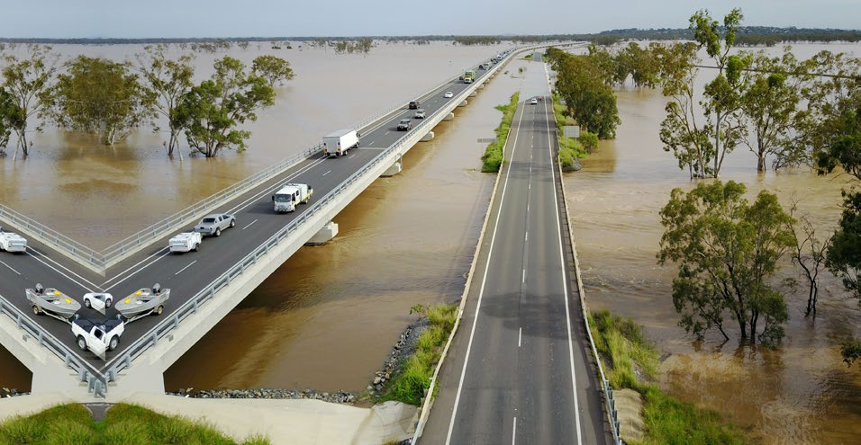

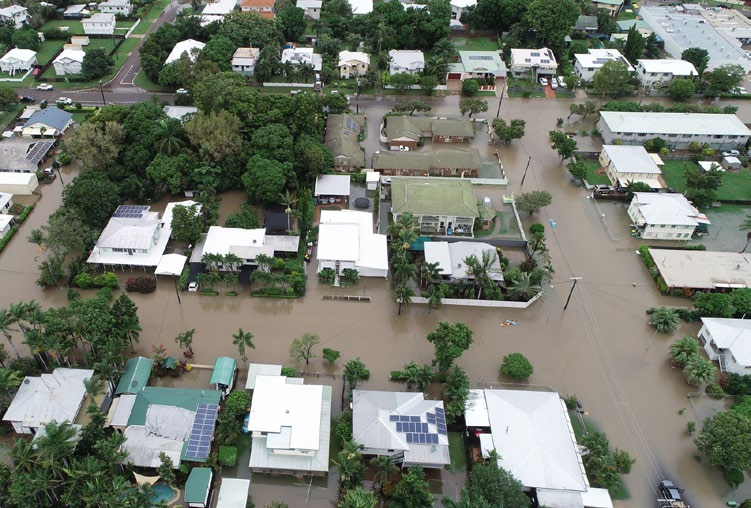

---
## Page 2

Translating and interpreting assistance
The Queensland Government is committed to providing accessible services to 
Queenslanders from all cultural and linguistic backgrounds. If you have 
difficulty understanding this publication and need a translator, please call the 
Translating and Interpreting Service (TIS National) on 13 14 50 and ask them 
to telephone the Queensland Department of Transport and Main Roads on 13 
74 68.
Copyright
This publication is protected by the Copyright Act 1968. © State of Queensland, 2020.
License
The material in this work is licensed by the Department of Transport 
and Main Roads under a Creative Commons Attribution 4.0 
International licence (CC BY 4.0), with the exception of:
	ƒ the Queensland Coat of Arms
	ƒ this department’s logo
	ƒ any third party material, and
	ƒ any material protected by a trademark.
More information on the CC BY licence is set out as follows:
	ƒ Creative Commons website– www.creativecommons.org
	ƒ Attribution 4.0 international (CC BY 4.0)– 
https://creativecommons.org/licenses/by/4.0/ 
Attribution
The CC BY licence is a standard form licence agreement that allows you to copy and 
redistribute the material in any medium or format, as well as remix, transform, and 
build upon the material, on the condition that you provide a link to the licence, you 
indicate if changes were made, and you attribute the material as follows:
© State of Queensland (Department of Transport and Main Roads) Draft State Guideline: 
Flood Evacuation Route Improvements, May 2021, is licensed under CC BY 4.0.
Enquiries about the use of any material in this publication can be sent to the 
department at: copyright@tmr.qov.au.
Cover photo: Yeppen Floodplain Crossing, Bruce Highway following  
Ex-Tropical Cyclone Debbie
Photo Credits:
All photo credits Transport and Main Roads,  except:
	ƒ page iv, photo courtesy of Maranoa Shire Council, Matthew Taylor
	ƒ page 2, photo courtesy of Queensland Reconstruction Authority (QRA)
	ƒ page 4, photo courtesy of Australian Defence Force (ADF)
	ƒ page 15, photo courtesy of Queensland Fire and Emergency Services
	ƒ page 33, photo coutesy of Tablelands Regional Council
	ƒ page 39, photo courtesy of QRA
	ƒ page 52, photo courtesy of QRA
	ƒ page 55, photo courtesy of QRA
	ƒ page 57, photo courtesy of QRA.
ii
State guideline: Flood evacuation route improvements  |  May 2021

---
## Page 3

Acknowledgements
Development of the guideline was led by the Department of Transport and Main Roads (TMR) in partnership with the 
Queensland Reconstruction Authority (QRA). BMT Commercial Australia were engaged as technical consultants with 
additional advice provided by Ethos Urban and Veitch Lister Consulting. 
The guideline was developed in collaboration with a Project Reference Group comprising representatives from local 
governments and state government agencies.
The guideline was peer reviewed by:
	ƒ Associate Professor Matthew Burke,  
Griffith University
	ƒ Ben Patterson, Royal HaskoningDHV,  
New South Wales
	ƒ Jaap-Jeroen Flikweert, Royal HaskoningDHV,  
United Kingdom
	ƒ Stein Grodum, TransGroup Australia.
Important contributions were made by all parties involved in the development of the guideline.
Disclaimer
Planning and development for flood mitigation and recovery, including flood evacuation routes, is complex and is unique 
to local regions and environments. 
The information provided in the guideline has been provided to support users in identifying ‘fair and reasonable’ 
improvements to flood evacuation routes and improving evacuation.  The information in the guideline is not intended 
to be exhaustive and neither TMR nor QRA make any representations or warranties about the accuracy, reliability, 
completeness or suitability for any particular purpose of the information contained in the guideline.  Neither TMR nor 
QRA will be liable for any loss or damage suffered by users, caused by any error, inaccuracy, incompleteness or other 
similar defect in the information in the guideline.
Compliance with the guideline is not evidence that TMR or QRA will endorse any development, contribute to any 
development, commit to its own development or grant, or consider granting, funding in any capacity to any user of this 
guideline or other entity.
Acknowledgement of Country
We acknowledge the Aboriginal peoples and Torres Strait Islander peoples as the  
Traditional Owners and Custodians of this Country. We recognise and honour their ancient 
cultures, and their connection to land, sea and community. We pay our respect to them, 
their cultures, and to their Elders, past, present and emerging.  
Yeppen floodplain bridges, Rockhampton
iii
State guideline: Flood evacuation route improvements  |  May 2021

---
## Page 4

Maranoa
iv
State guideline: Flood evacuation route improvements  |  May 2021

---
## Page 5

Contents
Preface. .  .  .  .  .  .  .  .  .  .  .  .  .  .  .  .  .  .  .  .  .  .  .  .  .  .  .  .  .  .  .  .  .  .  .  .  .  .  .  .  .  .  .  .  .  .  .  .  .  .  .  .  .  .  .  .  .  .  .  .  .  .  .  .  .  .  .  .  .  .  .  .  1
Background . .  .  .  .  .  .  .  .  .  .  .  .  .  .  .  .  .  .  .  .  .  .  .  .  .  .  .  .  .  .  .  .  .  .  .  .  .  .  .  .  .  .  .  . . . . . . . . . . . . . . . . . . . . . . . . . . . . . . . . . . . . . . . . . . . . . 1
Guideline purpose. .  .  .  .  .  .  .  .  .  .  .  .  .  .  .  .  .  .  .  .  .  .  .  .  .  .  .  .  .  .  .  .  .  .  .  .  .  .  .  .  . . . . . . . . . . . . . . . . . . . . . . . . . . . . . . . . . . . . . . . . . . . 1
Relationship with evacuation planning. .  .  .  .  .  .  .  .  .  .  .  .  .  .  .  .  .  .  .  .  .  .  .  .  .  .  .  .  .  .  .  .  . . . . . . . . . . . . . . . . . . . . . . . . . . . . . . . . . . 1
What is excluded from the guideline?. .  .  .  .  .  .  .  .  .  .  .  .  .  .  .  .  .  .  .  .  .  .  .  .  .  .  .  .  .  .  .  .  . . . . . . . . . . . . . . . . . . . . . . . . . . . . . . . . . . . 1
How to use this guideline. .  .  .  .  .  .  .  .  .  .  .  .  .  .  .  .  .  .  .  .  .  .  .  .  .  .  .  .  .  .  .  .  .  .  .  .  .  . . . . . . . . . . . . . . . . . . . . . . . . . . . . . . . . . . . . . . . . 1
Part A: Introduction and principles . .  .  .  .  .  .  .  .  .  .  .  .  .  .  .  .  .  .  .  .  .  .  .  .  .  .  .  .  .  .  .  .  .  .  .  .  .  .  .  .  .  .  .  .  .  .  .  .  .  2
A1.	
Guiding principles and assessment process. .  .  .  .  .  .  .  .  .  .  .  .  .  .  .  .  .  .  .  .  .  .  .  .  .  .  .  . . . . . . . . . . . . . . . . . . . . . . . . . . . . . . 2
A1.1	 Fair and reasonable evacuation route improvements. .  .  .  .  .  .  .  .  .  .  .  .  .  .  .  .  .  .  .  .  .  .  .  .  .  .  .  . . . . . . . . . . . . . . . . . . . . . . . . . . . 2
A1.2	 Guiding principles. .  .  .  .  .  .  .  .  .  .  .  .  .  .  .  .  .  .  .  .  .  .  .  .  .  .  .  .  .  .  .  .  .  .  .  .  .  .  .  .  .  .  . . . . . . . . . . . . . . . . . . . . . . . . . . . . . . . . . . . . . . . . . . . 2
A1.3	 Assessment process. .  .  .  .  .  .  .  .  .  .  .  .  .  .  .  .  .  .  .  .  .  .  .  .  .  .  .  .  .  .  .  .  .  .  .  .  .  .  .  .  . . . . . . . . . . . . . . . . . . . . . . . . . . . . . . . . . . . . . . . . . . . 4
A2.	 Stakeholders, governance and consultation. .  .  .  .  .  .  .  .  .  .  .  .  .  .  .  .  .  .  .  .  .  .  .  .  .  .  .  . . . . . . . . . . . . . . . . . . . . . . . . . . . . . . 6
A2.1	 Stakeholder engagement. .  .  .  .  .  .  .  .  .  .  .  .  .  .  .  .  .  .  .  .  .  .  .  .  .  .  .  .  .  .  .  .  .  .  .  .  .  .  . . . . . . . . . . . . . . . . . . . . . . . . . . . . . . . . . . . . . . . . . 6
A2.2	 Establishing governance arrangements . .  .  .  .  .  .  .  .  .  .  .  .  .  .  .  .  .  .  .  .  .  .  .  .  .  .  .  .  .  .  .  .  .  . . . . . . . . . . . . . . . . . . . . . . . . . . . . . . . . . 7
A2.3	 Relationship with road infrastructure planning and delivery. .  .  .  .  .  .  .  .  .  .  .  .  .  .  .  .  .  .  .  .  .  .  .  .  . . . . . . . . . . . . . . . . . . . . . . . . . 7
A2.4	 Community consultation. .  .  .  .  .  .  .  .  .  .  .  .  .  .  .  .  .  .  .  .  .  .  .  .  .  .  .  .  .  .  .  .  .  .  .  .  .  .  .  .  . . . . . . . . . . . . . . . . . . . . . . . . . . . . . . . . . . . . . . . . 7
A3.	 Pre-assessment data collation. .  .  .  .  .  .  .  .  .  .  .  .  .  .  .  .  .  .  .  .  .  .  .  .  .  .  .  .  .  .  .  .  .  . . . . . . . . . . . . . . . . . . . . . . . . . . . . . . . . . . . 8
A3.1	 Flood studies. .  .  .  .  .  .  .  .  .  .  .  .  .  .  .  .  .  .  .  .  .  .  .  .  .  .  .  .  .  .  .  .  .  .  .  .  .  .  .  .  .  .  .  .  . . . . . . . . . . . . . . . . . . . . . . . . . . . . . . . . . . . . . . . . . . . . . . 8
A3.2	 Flood risk assessment. .  .  .  .  .  .  .  .  .  .  .  .  .  .  .  .  .  .  .  .  .  .  .  .  .  .  .  .  .  .  .  .  .  .  .  .  .  .  .  .  . . . . . . . . . . . . . . . . . . . . . . . . . . . . . . . . . . . . . . . . . 10
A3.3	 Evacuation capability assessments (ECA). .  .  .  .  .  .  .  .  .  .  .  .  .  .  .  .  .  .  .  .  .  .  .  .  .  .  .  .  .  .  .  .  . . . . . . . . . . . . . . . . . . . . . . . . . . . . . . . . 11
A3.4	 Community consultation. .  .  .  .  .  .  .  .  .  .  .  .  .  .  .  .  .  .  .  .  .  .  .  .  .  .  .  .  .  .  .  .  .  .  .  .  .  .  .  . . . . . . . . . . . . . . . . . . . . . . . . . . . . . . . . . . . . . . . . 12
A3.5	 Other useful information. .  .  .  .  .  .  .  .  .  .  .  .  .  .  .  .  .  .  .  .  .  .  .  .  .  .  .  .  .  .  .  .  .  .  .  .  .  .  .  . . . . . . . . . . . . . . . . . . . . . . . . . . . . . . . . . . . . . . . . 12
A3.6	 Review collated data. .  .  .  .  .  .  .  .  .  .  .  .  .  .  .  .  .  .  .  .  .  .  .  .  .  .  .  .  .  .  .  .  .  .  .  .  .  .  .  .  .  . . . . . . . . . . . . . . . . . . . . . . . . . . . . . . . . . . . . . . . . . 12
Part B: Assessment process. .  .  .  .  .  .  .  .  .  .  .  .  .  .  .  .  .  .  .  .  .  .  .  .  .  .  .  .  .  .  .  .  .  .  .  .  .  .  .  .  .  .  .  .  .  .  .  .  .  .  .  .  .  .  14
B1.	
Understand the evacuation problem. .  .  .  .  .  .  .  .  .  .  .  .  .  .  .  .  .  .  .  .  .  .  .  .  .  .  .  .  .  .  . . . . . . . . . . . . . . . . . . . . . . . . . . . . . . . . 14
B1.1	 Investigating the evacuation problem. .  .  .  .  .  .  .  .  .  .  .  .  .  .  .  .  .  .  .  .  .  .  .  .  .  .  .  .  .  .  .  .  .  . . . . . . . . . . . . . . . . . . . . . . . . . . . . . . . . . . 14
B1.1.1	 Why has flood evacuation been identified as a problem for this location, and what is the problem? . .  .  . . . 14
B1.1.2	 What is acceptable to the community?. .  .  .  .  .  .  .  .  .  .  .  .  .  .  .  .  .  .  .  .  .  .  .  .  .  .  .  .  .  .  . . . . . . . . . . . . . . . . . . . . . . . . . . . . . . 15
B1.1.3	 What is the flood risk?. .  .  .  .  .  .  .  .  .  .  .  .  .  .  .  .  .  .  .  .  .  .  .  .  .  .  .  .  .  .  .  .  .  .  .  .  .  . . . . . . . . . . . . . . . . . . . . . . . . . . . . . . . . . . . . . 15
B1.1.4	 What is the source of flooding that affects the area?. .  .  .  .  .  .  .  .  .  .  .  .  .  .  .  .  .  .  .  .  .  .  .  .  . . . . . . . . . . . . . . . . . . . . . . . . 16
B1.1.5	 What is the flood immunity of the area, and what is the flood immunity of associated  
evacuation infrastructure?. .  .  .  .  .  .  .  .  .  .  .  .  .  .  .  .  .  .  .  .  .  .  .  .  .  .  .  .  .  .  .  .  .  .  .  . . . . . . . . . . . . . . . . . . . . . . . . . . . . . . . . . . . . 16
B1.1.6	 What is the nature of the flood behaviour, including flood hazard and timing?. . . . . . . . . . . . . . . . . . . . . . . . . .16
B1.1.7	 Is there sufficient warning time available for evacuation?. .  .  .  .  .  .  .  .  .  .  .  .  .  .  .  .  .  .  .  .  .  . . . . . . . . . . . . . . . . . . . . . . 17
B1.1.8	 What are the constraints to evacuation?. .  .  .  .  .  .  .  .  .  .  .  .  .  .  .  .  .  .  .  .  .  .  .  .  .  .  .  .  .  . . . . . . . . . . . . . . . . . . . . . . . . . . . . . 17
B1.2	 Define the evacuation problem. .  .  .  .  .  .  .  .  .  .  .  .  .  .  .  .  .  .  .  .  .  .  .  .  .  .  .  .  .  .  .  .  .  .  .  .  . . . . . . . . . . . . . . . . . . . . . . . . . . . . . . . . . . . . . 17
B1.3	 Service need and desired outcome. .  .  .  .  .  .  .  .  .  .  .  .  .  .  .  .  .  .  .  .  .  .  .  .  .  .  .  .  .  .  .  .  .  .  . . . . . . . . . . . . . . . . . . . . . . . . . . . . . . . . . . . 17
B2.	 Identify potential options. .  .  .  .  .  .  .  .  .  .  .  .  .  .  .  .  .  .  .  .  .  .  .  .  .  .  .  .  .  .  .  .  .  .  . . . . . . . . . . . . . . . . . . . . . . . . . . . . . . . . . . . . . 18
B2.1	 Resolving the evacuation problem. .  .  .  .  .  .  .  .  .  .  .  .  .  .  .  .  .  .  .  .  .  .  .  .  .  .  .  .  .  .  .  .  .  .  .  . . . . . . . . . . . . . . . . . . . . . . . . . . . . . . . . . . . 18
B2.2	 Consultation. .  .  .  .  .  .  .  .  .  .  .  .  .  .  .  .  .  .  .  .  .  .  .  .  .  .  .  .  .  .  .  .  .  .  .  .  .  .  .  .  .  .  .  . . . . . . . . . . . . . . . . . . . . . . . . . . . . . . . . . . . . . . . . . . . . . . 20
B2.3	 Design flood immunity for linear infrastructure. .  .  .  .  .  .  .  .  .  .  .  .  .  .  .  .  .  .  .  .  .  .  .  .  .  .  .  .  . . . . . . . . . . . . . . . . . . . . . . . . . . . . . . . 20
(continued on next page)
State guideline: Flood evacuation route improvements  |  May 2021
v

---
## Page 6

Contents (continued)
B3.	 Options assessment. .  .  .  .  .  .  .  .  .  .  .  .  .  .  .  .  .  .  .  .  .  .  .  .  .  .  .  .  .  .  .  .  .  .  .  .  . . . . . . . . . . . . . . . . . . . . . . . . . . . . . . . . . . . . . . . 29
B3.1	 Assessment criteria. .  .  .  .  .  .  .  .  .  .  .  .  .  .  .  .  .  .  .  .  .  .  .  .  .  .  .  .  .  .  .  .  .  .  .  .  .  .  .  .  . . . . . . . . . . . . . . . . . . . . . . . . . . . . . . . . . . . . . . . . . . . 29
B4.	 Stage one: Option feasibility assessment. .  .  .  .  .  .  .  .  .  .  .  .  .  .  .  .  .  .  .  .  .  .  .  .  .  .  .  .  . . . . . . . . . . . . . . . . . . . . . . . . . . . . . 30
B4.1	 Feasibility indicator assessment. .  .  .  .  .  .  .  .  .  .  .  .  .  .  .  .  .  .  .  .  .  .  .  .  .  .  .  .  .  .  .  .  .  .  .  . . . . . . . . . . . . . . . . . . . . . . . . . . . . . . . . . . . . . 30
B4.2	 High level cost estimate. .  .  .  .  .  .  .  .  .  .  .  .  .  .  .  .  .  .  .  .  .  .  .  .  .  .  .  .  .  .  .  .  .  .  .  .  .  .  .  . . . . . . . . . . . . . . . . . . . . . . . . . . . . . . . . . . . . . . . . 31
B4.3	 Determining outcomes of the option feasibility assessment. .  .  .  .  .  .  .  .  .  .  .  .  .  .  .  .  .  .  .  .  .  .  .  . . . . . . . . . . . . . . . . . . . . . . . . 31
B4.3.1	 Eliminating or progressing to MCA. .  .  .  .  .  .  .  .  .  .  .  .  .  .  .  .  .  .  .  .  .  .  .  .  .  .  .  .  .  .  .  . . . . . . . . . . . . . . . . . . . . . . . . . . . . . . . . 31
B4.3.2	Redefining options. .  .  .  .  .  .  .  .  .  .  .  .  .  .  .  .  .  .  .  .  .  .  .  .  .  .  .  .  .  .  .  .  .  .  .  .  .  . . . . . . . . . . . . . . . . . . . . . . . . . . . . . . . . . . . . . . . . 32
B4.3.3	Is more information required?. .  .  .  .  .  .  .  .  .  .  .  .  .  .  .  .  .  .  .  .  .  .  .  .  .  .  .  .  .  .  .  .  . . . . . . . . . . . . . . . . . . . . . . . . . . . . . . . . . . . 32
B5.	
Stage two: multi-criteria assessment (MCA). .  .  .  .  .  .  .  .  .  .  .  .  .  .  .  .  .  .  .  .  .  .  .  .  .  .  .  . . . . . . . . . . . . . . . . . . . . . . . . . . . . . 33
B5.1	 Assessment against MCA criteria. .  .  .  .  .  .  .  .  .  .  .  .  .  .  .  .  .  .  .  .  .  .  .  .  .  .  .  .  .  .  .  .  .  .  . . . . . . . . . . . . . . . . . . . . . . . . . . . . . . . . . . . . . 34
B5.1.1	 Safety. .  .  .  .  .  .  .  .  .  .  .  .  .  .  .  .  .  .  .  .  .  .  .  .  .  .  .  .  .  .  .  .  .  .  .  .  .  .  .  .  .  .  .  . . . . . . . . . . . . . . . . . . . . . . . . . . . . . . . . . . . . . . . . . . . . . . 34
B5.1.2	 Economic. .  .  .  .  .  .  .  .  .  .  .  .  .  .  .  .  .  .  .  .  .  .  .  .  .  .  .  .  .  .  .  .  .  .  .  .  .  .  .  .  .  . . . . . . . . . . . . . . . . . . . . . . . . . . . . . . . . . . . . . . . . . . . . 36
B5.1.3	 Environmental and cultural heritage impact. .  .  .  .  .  .  .  .  .  .  .  .  .  .  .  .  .  .  .  .  .  .  .  .  .  .  .  . . . . . . . . . . . . . . . . . . . . . . . . . . . . 37
B5.1.4	 Social. .  .  .  .  .  .  .  .  .  .  .  .  .  .  .  .  .  .  .  .  .  .  .  .  .  .  .  .  .  .  .  .  .  .  .  .  .  .  .  .  .  .  .  . . . . . . . . . . . . . . . . . . . . . . . . . . . . . . . . . . . . . . . . . . . . . . 38
B5.1.5	 Flood behaviour/impact. .  .  .  .  .  .  .  .  .  .  .  .  .  .  .  .  .  .  .  .  .  .  .  .  .  .  .  .  .  .  .  .  .  .  .  . . . . . . . . . . . . . . . . . . . . . . . . . . . . . . . . . . . . . 40
B5.1.6	 Additional constraints. .  .  .  .  .  .  .  .  .  .  .  .  .  .  .  .  .  .  .  .  .  .  .  .  .  .  .  .  .  .  .  .  .  .  .  .  .  . . . . . . . . . . . . . . . . . . . . . . . . . . . . . . . . . . . . . 41
B5.2	 MCA weighting. .  .  .  .  .  .  .  .  .  .  .  .  .  .  .  .  .  .  .  .  .  .  .  .  .  .  .  .  .  .  .  .  .  .  .  .  .  .  .  .  .  .  . . . . . . . . . . . . . . . . . . . . . . . . . . . . . . . . . . . . . . . . . . . . . 42
B5.3	 Sensitivity testing of criteria weighting. .  .  .  .  .  .  .  .  .  .  .  .  .  .  .  .  .  .  .  .  .  .  .  .  .  .  .  .  .  .  .  .  . . . . . . . . . . . . . . . . . . . . . . . . . . . . . . . . . . 43
B6.	 Financial and economic assessments. .  .  .  .  .  .  .  .  .  .  .  .  .  .  .  .  .  .  .  .  .  .  .  .  .  .  .  .  .  .  . . . . . . . . . . . . . . . . . . . . . . . . . . . . . . 44
B6.1	 Cost estimation. .  .  .  .  .  .  .  .  .  .  .  .  .  .  .  .  .  .  .  .  .  .  .  .  .  .  .  .  .  .  .  .  .  .  .  .  .  .  .  .  .  .  . . . . . . . . . . . . . . . . . . . . . . . . . . . . . . . . . . . . . . . . . . . . . 44
B6.2	 Cost-benefit analysis. .  .  .  .  .  .  .  .  .  .  .  .  .  .  .  .  .  .  .  .  .  .  .  .  .  .  .  .  .  .  .  .  .  .  .  .  .  .  .  .  . . . . . . . . . . . . . . . . . . . . . . . . . . . . . . . . . . . . . . . . . . 44
B7.	
Reviewing outcomes of the assessment process. .  .  .  .  .  .  .  .  .  .  .  .  .  .  .  .  .  .  .  .  .  .  .  .  .  . . . . . . . . . . . . . . . . . . . . . . . . . . . 45
Part C: Implementation. .  .  .  .  .  .  .  .  .  .  .  .  .  .  .  .  .  .  .  .  .  .  .  .  .  .  .  .  .  .  .  .  .  .  .  .  .  .  .  .  .  .  .  .  .  .  .  .  .  .  .  .  .  .  .  .  .  . 46
Glossary. .  .  .  .  .  .  .  .  .  .  .  .  .  .  .  .  .  .  .  .  .  .  .  .  .  .  .  .  .  .  .  .  .  .  .  .  .  .  .  .  .  .  .  .  .  .  .  .  .  .  .  .  .  .  .  .  .  .  .  .  .  .  .  .  .  .  .  .  .  .  47
Acronyms. .  .  .  .  .  .  .  .  .  .  .  .  .  .  .  .  .  .  .  .  .  .  .  .  .  .  .  .  .  .  .  .  .  .  .  .  .  .  .  .  .  .  .  .  .  .  .  .  .  .  .  .  .  .  .  .  .  .  .  .  .  .  .  .  .  .  .  .  .  50
References. .  .  .  .  .  .  .  .  .  .  .  .  .  .  .  .  .  .  .  .  .  .  .  .  .  .  .  .  .  .  .  .  .  .  .  .  .  .  .  .  .  .  .  .  .  .  .  .  .  .  .  .  .  .  .  .  .  .  .  .  .  .  .  .  .  .  .  .  51
Appendix A – Intersection with other guidance. .  .  .  .  .  .  .  .  .  .  .  .  .  .  .  .  .  .  .  .  .  .  .  .  .  .  .  .  .  .  .  .  .  .  .  .  .  .  53
Appendix B - Understanding flood risk management and evacuation . .  .  .  .  .  .  .  .  .  .  .  .  .  .  .  .  .  .  .  .  55
Evacuation. .  .  .  .  .  .  .  .  .  .  .  .  .  .  .  .  .  .  .  .  .  .  .  .  .  .  .  .  .  .  .  .  .  .  .  .  .  .  .  .  .  .  .  . . . . . . . . . . . . . . . . . . . . . . . . . . . . . . . . . . . . . . . . . . . . . 55
Flood risk management. .  .  .  .  .  .  .  .  .  .  .  .  .  .  .  .  .  .  .  .  .  .  .  .  .  .  .  .  .  .  .  .  .  .  .  .  .  .  . . . . . . . . . . . . . . . . . . . . . . . . . . . . . . . . . . . . . . . . 56
Flood risk. .  .  .  .  .  .  .  .  .  .  .  .  .  .  .  .  .  .  .  .  .  .  .  .  .  .  .  .  .  .  .  .  .  .  .  .  .  .  .  .  .  .  .  . . . . . . . . . . . . . . . . . . . . . . . . . . . . . . . . . . . . . . . . . . . . . . 56
Flood studies. .  .  .  .  .  .  .  .  .  .  .  .  .  .  .  .  .  .  .  .  .  .  .  .  .  .  .  .  .  .  .  .  .  .  .  .  .  .  .  .  .  .  . . . . . . . . . . . . . . . . . . . . . . . . . . . . . . . . . . . . . . . . . . . . 57
Appendix C - Evacuation route signage. .  .  .  .  .  .  .  .  .  .  .  .  .  .  .  .  .  .  .  .  .  .  .  .  .  .  .  .  .  .  .  .  .  .  .  .  .  .  .  .  .  .  .  .  .  61
Permanent evacuation route signage . .  .  .  .  .  .  .  .  .  .  .  .  .  .  .  .  .  .  .  .  .  .  .  .  .  .  .  .  .  .  .  .  . . . . . . . . . . . . . . . . . . . . . . . . . . . . . . . . . . 61
Temporary evacuation route signage. .  .  .  .  .  .  .  .  .  .  .  .  .  .  .  .  .  .  .  .  .  .  .  .  .  .  .  .  .  .  .  .  . . . . . . . . . . . . . . . . . . . . . . . . . . . . . . . . . . . 61
State guideline: Flood evacuation route improvements  |  May 2021
vi

---
## Page 7

List of Figures
Figure 1	 Assessment process . .  .  .  .  .  .  .  .  .  .  .  .  .  .  .  .  .  .  .  .  .  .  .  .  .  .  .  .  .  .  .  .  .  .  .  .  .  .  . . . . . . . . . . . . . . . . . . . . . . . . . . . . . . . . . . . . . . 5
Figure 2	 Flood hazard categories (AIDR 2017c). .  .  .  .  .  .  .  .  .  .  .  .  .  .  .  .  .  .  .  .  .  .  .  .  .  .  .  .  .  .  . . . . . . . . . . . . . . . . . . . . . . . . . . . . . . . . 9
Figure 3	 Hierarchy of responses. .  .  .  .  .  .  .  .  .  .  .  .  .  .  .  .  .  .  .  .  .  .  .  .  .  .  .  .  .  .  .  .  .  .  .  .  . . . . . . . . . . . . . . . . . . . . . . . . . . . . . . . . . . . . . 18
Figure 4	 Assessment criteria. .  .  .  .  .  .  .  .  .  .  .  .  .  .  .  .  .  .  .  .  .  .  .  .  .  .  .  .  .  .  .  .  .  .  .  .  .  . . . . . . . . . . . . . . . . . . . . . . . . . . . . . . . . . . . . . . . 29
Figure 5	 Five stages of evacuation. .  .  .  .  .  .  .  .  .  .  .  .  .  .  .  .  .  .  .  .  .  .  .  .  .  .  .  .  .  .  .  .  .  .  .  . . . . . . . . . . . . . . . . . . . . . . . . . . . . . . . . . . . . 55
Figure 6	 Flood Risk Management Process. .  .  .  .  .  .  .  .  .  .  .  .  .  .  .  .  .  .  .  .  .  .  .  .  .  .  .  .  .  .  .  . . . . . . . . . . . . . . . . . . . . . . . . . . . . . . . . . . 56
List of Tables
Table 1	
Guiding principles. .  .  .  .  .  .  .  .  .  .  .  .  .  .  .  .  .  .  .  .  .  .  .  .  .  .  .  .  .  .  .  .  .  .  .  .  .  .  . . . . . . . . . . . . . . . . . . . . . . . . . . . . . . . . . . . . . . . . 3
Table 2	
Potential stakeholders . .  .  .  .  .  .  .  .  .  .  .  .  .  .  .  .  .  .  .  .  .  .  .  .  .  .  .  .  .  .  .  .  .  .  .  .  . . . . . . . . . . . . . . . . . . . . . . . . . . . . . . . . . . . . . . 6
Table 3	
Definitions of flood hazard categories (AIDR 2017c). .  .  .  .  .  .  .  .  .  .  .  .  .  .  .  .  .  .  .  .  .  .  .  .  . . . . . . . . . . . . . . . . . . . . . . . . . . 9
Table 4	
Level (availability and quality) of data. .  .  .  .  .  .  .  .  .  .  .  .  .  .  .  .  .  .  .  .  .  .  .  .  .  .  .  .  .  .  . . . . . . . . . . . . . . . . . . . . . . . . . . . . . . . 13
Table 5	
Summary of potential evacuation route improvement options. .  .  .  .  .  .  .  .  .  .  .  .  .  .  .  .  .  .  .  .  . . . . . . . . . . . . . . . . . . . . 21
Table 6	
Feasibility indicators. .  .  .  .  .  .  .  .  .  .  .  .  .  .  .  .  .  .  .  .  .  .  .  .  .  .  .  .  .  .  .  .  .  .  .  .  . . . . . . . . . . . . . . . . . . . . . . . . . . . . . . . . . . . . . . . 30
Table 7	
Scoring of flood impact targeted indicator based on flood level impacts. .  .  .  .  .  .  .  .  .  .  .  .  .  .  .  .  . . . . . . . . . . . . . . . . 41
Table 8	
Pairwise method – Criteria weighting. .  .  .  .  .  .  .  .  .  .  .  .  .  .  .  .  .  .  .  .  .  .  .  .  .  .  .  .  .  . . . . . . . . . . . . . . . . . . . . . . . . . . . . . . . . 42
Table 9	
Intersection with other guidance. .  .  .  .  .  .  .  .  .  .  .  .  .  .  .  .  .  .  .  .  .  .  .  .  .  .  .  .  .  .  .  .  . . . . . . . . . . . . . . . . . . . . . . . . . . . . . . . . . 53
Table 10	 Considerations for flood sources. .  .  .  .  .  .  .  .  .  .  .  .  .  .  .  .  .  .  .  .  .  .  .  .  .  .  .  .  .  .  .  . . . . . . . . . . . . . . . . . . . . . . . . . . . . . . . . . . 58
Figures and tables
State guideline: Flood evacuation route improvements  |  May 2021 vii

---
## Page 8

Yeppen Floodplain Crossing, Bruce Highway following Ex-Tropical Cyclone Debbie.
viii State guideline: Flood evacuation route improvements  |  May 2021

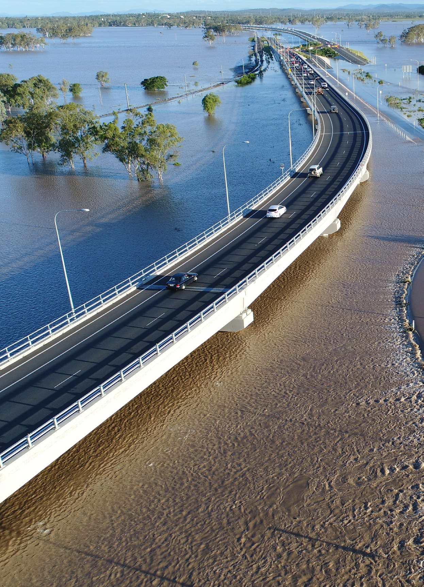

---
## Page 9

Preface
Background
The Brisbane River Strategic Floodplain Management 
Plan (BRSFMP) represents the third phase of the Brisbane 
River Catchment Flood Study, which was developed in 
response to recommendations from the Queensland 
Flood Commission of Inquiry. This guideline delivers on 
BRSFMP Action FM12.3 which requires the development 
of state guidelines to support the identification of ‘fair 
and reasonable’ flood immunity for evacuation routes.  
The guideline undertakes a broader approach to the 
action by supporting the identification of ‘fair and 
reasonable’ evacuation route improvements. This 
includes a range of options beyond improvements to 
the flood immunity of evacuation routes such as flood 
warning systems, evacuation centres, road upgrades to 
improve capacity or resilience, new roads, and levees. 
This approach ensures that low cost options, which may 
achieve similar outcomes to larger infrastructure projects, 
are included. 
Guideline purpose 
The guideline outlines an options assessment process 
to support the identification of ‘fair and reasonable’ 
flood evacuation route improvements to inform decision 
making. The guideline may be used to inform flood risk 
management activities particularly when identifying and 
assessing options.
Users of the guideline may include local governments, 
state agencies and Queensland’s disaster management 
groups, supported as needed by suitably qualified 
or experienced persons. This recognises that the 
governance of flood risk management in Queensland 
is based on a collaborative, decentralised model with 
shared roles and responsibilities (QRA, 2021b). Please 
see Queensland Flood Risk Management Framework for 
further guidance on roles and governance.
The guideline is a non-mandatory, state-wide guideline 
developed to consider different flood risk profiles 
(flooding types, size, severity, duration and exposure) 
and support flexible implementation of options by 
entities who vary in resource capability and funding 
capacity.
Relationship with evacuation planning
Evacuation planning is the development of plans or 
arrangements to co-ordinate and execute evacuation, 
if required, when a flood event occurs. Evacuation 
plans or arrangements are developed based on existing 
measures and infrastructure, such as existing evacuation 
centres and routes. Further information on evacuation 
planning can be found in Evacuation: Responsibilities, 
Arrangements and Management – Manual.1.190, 
Evacuation Planning - Handbook 4 and Flood Emergency 
Planning for Disaster Resilience Handbook.
In contrast, the identification of evacuation route 
improvements is a process of identifying new or improved 
infrastructure or measures to improve evacuation 
capability and resolve evacuation constraints. 
Evacuation plans and the identification of evacuation 
route improvements are undertaken separately. 
However, evacuation plans may need to be revised to 
consider changes to evacuation planning resulting from 
evacuation route improvements. 
What is excluded from the guideline?
This guideline does not provide guidance, or a 
recommended process, for:
	ƒ evacuation capability assessments (ECAs)
	ƒ economic assessments for flood risk management 
projects or
	ƒ evacuation planning.
The guideline may be applied to new development, 
however, this is not the intended purpose and specific 
guidance has not been provided. Further information 
about managing flood risks for new development 
is provided in the State Planning Policy (SPP) and 
associated guidance material, Queensland Urban 
Drainage Manual and the Road Drainage Manual. 
The guideline does not address flooding as a result 
of dam failure. Please refer to the Guideline for failure 
impact assessment of water dams for further information. 
How to use this guideline
The guideline is divided into three parts:
	ƒ Part A: Introduction and principles – provides a brief 
overview of the assessment process and discusses 
the supporting guiding principles, information on 
identifying stakeholders and pre-assessment data 
collation
	ƒ Part B: Assessment process – outlines the process 
for identifying and assessing options
	ƒ Part C: Implementation – provides information to 
assist with option implementation. 
The guideline is supported by the State guideline: Flood 
evacuation route improvements – Worked example and 
State guideline: Flood evacuation route improvements 
– Supporting tool which assist in understanding and 
implementing the assessment process. 
Users unfamiliar with flood risk management can find 
further resources and information in Appendices A and B. 
1
State guideline: Flood evacuation route improvements  |  May 2021

---
## Page 10

Part A: Introduction and principles
A1.	 Guiding principles and assessment process
A1.1	 Fair and reasonable evacuation 
route improvements
Evacuation is a hazard mitigation strategy and a risk 
reduction activity that lessens the effects of flooding on 
a community (Queensland Fire and Emergency Services 
(QFES), 2018b). An evacuation route improvement 
must, first and foremost, reduce risk to life by improving 
evacuation capability. 
For an evacuation route improvement to be ‘fair and 
reasonable,’ it needs to be fit-for-purpose and respond 
to the local circumstances and scale of the evacuation 
problem. This includes matters such as constraints in 
the evacuation network, alignment with existing flood 
risk management measures, meeting the needs of the 
community and being reasonable with respect to the 
scale of the evacuation problem. 
To be ‘fair and reasonable’ an improvement also needs 
to be pragmatic, considering and balancing a number 
of determining factors beyond risk mitigation, such as 
social, economic, environmental, and flood behaviour 
factors (for example, value for money, level of community 
acceptance and impacts from changed flood behaviour). 
A1.2	 Guiding principles
The guiding principles shown in Table 1, support and 
complement the process outlined in the guideline. 
These principles are based on the national best-
practice approach to flood risk management outlined 
in Managing the Floodplain: A Guide to Best Practice 
in Flood Risk Management in Australia - Handbook 
7 (Australian Institute for Disaster Resilience (AIDR) 
Handbook 7) (AIDR 2017d). 
The Ross River in Flood, Townsville, February 2019
2
State guideline: Flood evacuation route improvements  |  May 2021

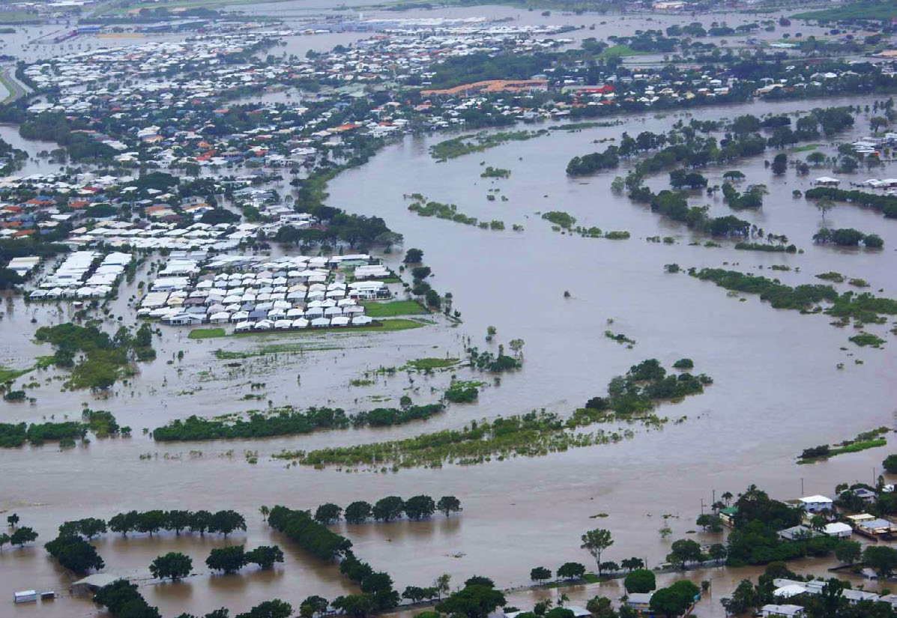

---
## Page 11

Adopt a risk based approach
Understand and respond to flood risk 
	ƒ Evacuation route improvements respond to the level of risk posed to a community. 
	ƒ A risk-based approach aligns with current best-practice flood risk management and 
recognises that a standards-based approach may not be fair and reasonable.  
	ƒ The full range of flood risk is considered by assessing multiple flood events, including  
rare events. 
Support with evidence
Support decisions with a sufficient level of information 
	ƒ The nature, scale and factors contributing to the evacuation problem are understood  
in detail.   
	ƒ Identification of evacuation route improvements is supported by robust, fit-for-purpose 
data, including information sourced from flood risk assessments, ECAs and flood studies.  
Coordinate and consult with stakeholders
Engage and consult with stakeholders early and throughout the process
	ƒ Community consultation is undertaken to understand the nature of the evacuation problem 
and support for potential options.   
	ƒ A collaborative partnership between local governments, state agencies or other 
stakeholders is promoted which recognises different roles and responsibilities.  
	ƒ Early and ongoing engagement is undertaken with stakeholders responsible for resourcing, 
implementing or delivering potential options.
Optimise existing infrastructure
Optimise the existing evacuation route network 
	ƒ Consider:
	
– a broad range of options including non-infrastructure options and options that improve 
existing infrastructure 
	
– low cost options over high cost infrastructure options that achieve similar outcomes 
(Department of Infrastructure Local Government and Planning (DILGP), 2016)
	
– combining options to improve effectiveness.
 
Recognise that all flood risk cannot be eliminated
Recognise residual risk always exists
	ƒ The development and consideration of potential options recognises that living on flood-
prone land has an inherent risk and that a residual risk always remains after a preferred 
option has been delivered.  
	ƒ The development and consideration of potential options recognises that evacuation route 
improvements are only one measure to mitigate flood risk and need to be considered as 
part of a broader flood risk management process.  
Table 1 - Guiding principles
3
State guideline: Flood evacuation route improvements  |  May 2021

---
## Page 12

A1.3	 Assessment process
The options assessment process outlined in this 
guideline (see Figure 1) is one method to assess and 
compare options against assessment criteria. The 
assessment process is a decision support tool for the 
identification of ‘fair and reasonable’ flood evacuation 
route improvements by providing information on the 
effectiveness and efficiency of options based on their 
benefits, impacts, cost and constraints. 
Following stakeholder identification and data collation, 
options are identified and assessed using the following 
process:
	ƒ Understand the evacuation problem – 
evacuation issues are investigated before 
defining the evacuation problem, service need 
and desired outcomes
	ƒ Identify potential options – potential options are 
identified (long list)
	ƒ Options assessment – options are assessed 
through the following stages:
	
– Stage one: option feasibility assessment – high 
level assessment of all relevant potential options 
to eliminate options that are not practical or 
feasible to create a short list of options
	
– Stage two: multi-criteria assessment (MCA) 
– detailed assessment of short-listed options 
against criteria and targeted indicators
	
– Financial and economic assessments – financial 
and economic assessment of short-listed options
In summary
The options assessment 
process provides a method 
to assess and compare 
options. The level of detail 
required to assess options 
depends on the evacuation 
problem, scale and type of 
options being assessed. 
	ƒ Review outcomes – assessment outcomes are 
reviewed to identify a preferred option or a 
combination of options. Where no options are 
suitable or further refinement is required, options 
can be redefined before repeating the assessment 
process. 
The level of detail required for each assessment depends 
on the evacuation problem, the scale and the type of 
options being assessed. For example, where options are 
non-infrastructure, small scale or low cost, options are 
assessed through each stage of the process, however, 
detailed studies or assessments may not be necessary to 
inform the process. 
ADF deploys ‘The Chinook’ to aid recovery , 
Townsville, February 2019
4
State guideline: Flood evacuation route improvements  |  May 2021

---
## Page 13

 Figure 1 - Assessment process
Identify potential 
options 
(Output – Long list)
Stage 1 
Option feasibility 
assessment 
(Output – Short list)
Stage 2 
Multi-criteria 
assessment
Financial and 
economic assessments
Review outcomes
Preferred option/s
Understand the  
evacuation problem
Options 
assessment
Redefine options 
or collect further 
information
5
State guideline: Flood evacuation route improvements  |  May 2021

---
## Page 14

Local government stakeholders
	ƒ Floodplain managers
	ƒ Asset managers
	ƒ Disaster managers
	ƒ Civil designers
	ƒ Transport and infrastructure planners
	ƒ Community development and engagement officers
Other stakeholders
	ƒ Local Disaster Management Group 
	ƒ TMR
	ƒ QRA
	ƒ State department/agency responsible for planning 
(to determine impacts on future development) 
	ƒ Dam operators (where dam releases are a potential 
source of flooding)
	ƒ Government landowners (e.g. state department/ 
agency responsible for parks or forests where 
evacuation may be required through a state-owned 
park) 
	ƒ Major community groups, such as chambers of 
commerce, environmental groups, etc. (where  
there is interest in the evacuation problem or 
proposed option)
	ƒ District Disaster Management Group
	ƒ Police and emergency service agencies 
	ƒ Bureau of Meteorology
	ƒ State department/agency responsible for seniors 
and disability services to inform considerations for 
vulnerable people)
	ƒ Adjacent council (where there is, or could be, 
shared use of evacuation infrastructure)
	ƒ Significant private entities such as mine owners/
operators (where there is, or could be significant 
use of private evacuation infrastructure)
	ƒ Large land holders and employers 
	ƒ Others as appropriate
Table 2 - Potential stakeholders
A2.	 Stakeholders, governance and consultation
A2.1	 Stakeholder engagement
Identifying and engaging stakeholders is critical to the assessment process, as stakeholders can provide valuable local 
knowledge and expertise when investigating the evacuation problem and identifying and assessing potential options. 
It is intended that stakeholders who have a responsibility or consequence in relation to resourcing, implementation or 
delivery of potential options are engaged throughout the process. Engaging with these stakeholders ensures policies, 
planning, and funding requirements related to an option’s delivery are considered. Failing to engage with these 
stakeholders may result in difficulties implementing preferred options. 
Undertaking early and ongoing liaison with stakeholders ensures that: 
	ƒ the practicality and/or impacts of potential options  
are identified
	ƒ preferred options align with other floodplain 
management measures and forward-planning for 
infrastructure and future development
	ƒ potential issues are identified early, avoiding 
unnecessary rework
	ƒ changes or opportunities due to new information are 
communicated
	ƒ funding sources to deliver an option can be identified. 
Following each stage of the assessment process, review the stakeholder list to ensure appropriate advice and input for 
options is obtained. A list of potential stakeholders is provided in Table 2. The Queensland State Disaster Management 
Plan and the Queensland Flood Risk Management Framework contain roles and responsibilities for disaster and flood 
risk management that may also assist in identifying stakeholders. The list of stakeholders in Table 2 is provided as an 
example only and is not intended to be exhaustive. There may be other stakeholders who may be engaged based on 
local circumstances. 
6
State guideline: Flood evacuation route improvements  |  May 2021

---
## Page 15

A2.2	 Establishing governance 
arrangements
To promote a proactive and coordinated approach, 
establish governance arrangements with key 
stakeholders, including agencies represented on disaster 
management groups, affected government landowners, 
relevant infrastructure providers and stakeholders 
responsible for delivering or implementing potential 
options. 
These arrangements should support decision making 
throughout each stage of the assessment process, 
including when weighting and scoring MCA criteria (stage 
two: MCA). This approach supports users in considering 
the organisational requirements of potential options, 
including compliance with internal policies, priorities and 
processes for committing resources.
A2.3	 Relationship with road 
infrastructure planning and delivery
The identification and assessment of evacuation 
route improvements involving new or upgraded 
road infrastructure requires coordination with road 
infrastructure stakeholders. Facilitating engagement 
with these stakeholders is important as they often 
operate under different processes and/or in separate 
organisations to floodplain management processes. 
Road infrastructure stakeholders provide valuable 
input on the practicalities of road infrastructure options 
when assessing and identifying evacuation route 
improvements. Similarly, when road infrastructure 
stakeholders are planning and delivering infrastructure, 
engaging floodplain management stakeholders ensures 
projects take into account impacts to flood evacuation 
route functions. Engagement between these two 
groups assists in identifying if projects may be altered 
to incorporate evacuation benefits and to ensure any 
changes to flood behaviour do not affect the performance 
of flood evacuation routes. 
A2.4	 Community consultation 
Community consultation is an integral part of the 
assessment process as effective evacuation requires 
community acceptance and a willingness to cooperate 
and respond in an emergency. An understanding of 
how certain sections of the community are more or less 
vulnerable, resilient or tolerant to the effects of flooding 
also ensures that selected improvement options are fit-
for-purpose and meet the needs of the community.
The nature of the community and scale of the evacuation 
problem informs the degree of community consultation 
required. It is important that all relevant sections of the 
community are represented as communities, even in 
small towns, are not homogeneous. 
Outside of the assessment process, community 
education may be undertaken following the selection of 
a preferred option, particularly where the option requires 
behavioural change from the community (for example, 
use of a new evacuation route, understanding flood 
warning systems, etc.).
Refer to AIDR’s Community Engagement for Disaster 
Resilience for information on principles and practices 
for community engagement for disaster resilience in 
Australia. Community Recovery and the International 
Association for Public Participation also provide 
resources to support community consultation for 
vulnerable groups (https://www.qld.gov.au/community/
disasters-emergencies/supporting-people-with-
vulnerabilities).
In summary
Stakeholder and community engagement is critical to the assessment 
process. Implement early and ongoing engagement and establish 
governance arrangements with key stakeholders such as those required 
to provide resources to deliver or implement options. 
7
State guideline: Flood evacuation route improvements  |  May 2021

---
## Page 16

A3.	 Pre-assessment data collation
Before identifying options, collate data to inform the assessment process. Data can be collated from flood studies, flood 
risk assessments, ECAs, economic assessments, records of historic floods and through stakeholder and community 
consultation. Note, further information may need to be collated to assess options during the assessment process. For 
example, ecological assessments may be required for the detailed assessment of options which may result in impacts to 
vegetation and habitat. 
The following sections outline key information for the assessment process and potential considerations for determining 
if further studies are warranted.
Available data needs to be evaluated and/or validated at appropriate stages 
throughout the assessment process and additional data collected if considered 
necessary. 
A3.1	 Flood studies
Flood studies are a key resource for the assessment 
process. Where unavailable, some assessment may 
also be undertaken with, or supplemented by, historic 
flood information. Details of the flood study process are 
provided in Appendix B. Outputs from flood studies can 
vary and may be determined by the age of the model, 
the original intent of the flood study and (potentially) 
the project budget. Consider the following flood study 
outputs for the assessment process:
	ƒ Understanding of flood source: Consider what type 
of flooding affects the location of the evacuation 
problem and if the available flood data was 
intended to describe this source of flooding. Users 
may consider multiple flood sources simultaneously 
(that is, the joint probability of coincident flooding 
occurring), however, many flood studies assess 
different flooding sources in separate studies. 
If considering multiple flood sources, users 
may consider the dominant flood source while 
recognising additional limitations that may be 
imposed due to other sources.
	ƒ A full range of flood events: Aim to have access to 
flood model results for a full range of flood events, 
including events larger than those experienced 
in the past, to ensure the assessment process is 
informed by an understanding of the full spectrum 
of flood risk. Some flood events may be historic 
events with records of various sizes rather than 
design events. Typically a full range of flood events 
includes:
	
– a ‘defined flood event’ (usually the 1 per cent 
annual exceedance probability (AEP) flood event 
or the event generally used to define planning 
levels)
	
– several more frequent and less frequent flood 
events
	
– a probable maximum flood (PMF). 
	ƒ Various flood output types: These may be in 
mapped or digital format and typically include 
flood levels or depths, flood velocity and flood 
hazard. For recent flood studies, it is preferable for 
flood hazards to be categorised in accordance with 
recommendations from AIDR Handbook 7, shown 
in Figure 2 and Table 3. Flood hazard categories are 
used in flood studies to determine the variation 
and magnitude of hazard across flood-prone land 
and are an important tool for understanding risk. 
However, mapped hazard categories should not 
be used to determine if areas are safe or trafficable 
during an event and further investigations may need 
to be undertaken. 
	ƒ Climate change mapping representing one or more 
future climate scenarios. This information can help 
users understand how changes in rainfall intensity 
and sea levels might influence flooding in the 
future. 
	ƒ Timing information is valuable in understanding 
how much flood warning time is available. Flood 
warning time is the time available from the first 
sign of a flood to when properties or evacuation 
routes begin to be inundated. Timing information 
also assists in understanding which sections of the 
community or evacuation routes are inundated first 
and how long flooding is likely to persist (affecting 
flood isolation). Timing information includes 
available warning time, time available to undertake 
evacuation (discussed further in section A3.3) and 
the duration of isolation. Duration of isolation is 
determined by considering a number of factors 
including the likely duration of road inundation, 
road closure (including clean-up, inspection, 
etc.) and average annual time of closure (AATOC) 
(discussed further in the Road Drainage Manual). 
Consider timing information for a range of flood 
event sizes and flood onset patterns (where data 
is available). If possible, there is value in linking 
timing information to levels on reference stream 
8
State guideline: Flood evacuation route improvements  |  May 2021

---
## Page 17

H6
H5
H4
H3
H2
H1
5.0
4.5
4.0
3.5
3.0
2.5
2.0
1.5
1.0
0.5
0.0
0.0	
1.0	
2.0	
3.0	
4.0	
5.0
Velocity (m/s)
Depth (m)
Flood hazard 
category
Description*
Depth-velocity 
limit
Upper velocity 
limit
Depth  
limit
H1
Generally safe for vehicles, people and buildings
≤ 0.3 m2/s
2 m/s
≤ 0.3 m
H2
Unsafe for small vehicles
≤ 0.6 m2/s
2 m/s
≤ 0.5 m
H3
Unsafe for vehicles, children and the elderly
≤ 0.6 m2/s
2 m/s
≤ 1.2 m
H4
Unsafe for vehicles and people
≤ 1.0 m2/s
2 m/s
≤ 2.0 m
H5
Unsafe for vehicles and people
All building types vulnerable to structural damage
≤ 4.0 m2/s
4 m/s
≤ 4.0 m
H6
Unsafe for vehicles and people
All building types considered vulnerable to failure
> 4.0 m2/s
N/A
> 4.0 m
Table 3 - Definitions of flood hazard categories (AIDR 2017c)
*Mapped hazard categories should not be used to determine if areas are safe or trafficable during an event.
Figure 2 - Flood hazard categories (AIDR 2017c)
9
State guideline: Flood evacuation route improvements  |  May 2021

---
## Page 18

gauges to tie in with standard disaster management 
and flood warning practices. Note, timing 
information is typically the least certain output from 
flood models, but also one of the most valuable 
inputs in evacuation planning.
	ƒ Flood impact assessment modelling and mapping 
may need to be obtained if potential evacuation 
route improvement options are likely to modify 
flood behaviour. Impact assessments may consider 
the change in peak flood levels, velocity, hazard 
and timing for a range of flood events and the type 
of land uses likely to be affected by changes in 
flood behaviour. If modelling and mapping are not 
obtained, users may not fully understand potential 
adverse flood impacts due to changes to existing 
flood behaviour.
A3.2	 Flood risk assessment
The level of flood risk to an affected population 
comprises many components including flood behaviour, 
frequency, exposure and the nature of the community 
(see Appendix B). A flood risk assessment assesses 
these components to identify the level of risk to the 
affected population. Risk assessments should align with 
AIDR Handbook 7 and the Queensland Emergency Risk 
Management Framework – Risk Assessment Process 
Handbook. Consider the following outputs from flood risk 
assessments for the assessment process:
	ƒ understanding of flood behaviour, including the 
flood velocity, depth, duration and hazard, for a 
range of flood sizes (see section A3.1), including 
information about flood timing
	ƒ the number of people likely to be isolated, 
inundated or require evacuation in each flood event 
size (isolation might include loss of access due to 
inundated roads or being fully surrounded by water)
	ƒ the characteristics of the affected population likely 
to be isolated, inundated or require evacuation in 
each flood event size. This should consider both 
demographic attributes (such as age, mobility, 
ability to receive flood warnings, etc.) and 
institution-scale vulnerabilities (such as schools, 
childcare, aged care, hospitals, detention facilities, 
etc.)
	ƒ flood immunity of evacuation infrastructure, 
including evacuation routes and evacuation centres. 
When considering the immunity of an evacuation 
route, the immunity of the overall route is limited by 
the lowest immunity at any point along the route, 
as once this point is closed, the evacuation route 
is closed. Also consider if different areas have 
different immunities, which may influence phasing 
of evacuation for evacuation planning
	ƒ the duration of isolation for a range of different 
flood events and any other information which may 
contribute to inundation or isolation risk, such as 
potential loss of service and access to essential 
goods
	ƒ any existing risk management measures which may 
alter the flood risk, such as flood warning systems
	ƒ a flood risk map which visually identifies levels of 
risk affecting different locations. 
The above information is intended to be considered for 
both existing conditions and future climate conditions. 
In addition, consider changes to development patterns 
and population increases, particularly where there is 
potential for high growth. 
10
State guideline: Flood evacuation route improvements  |  May 2021

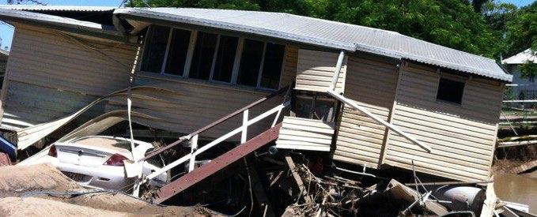

---
## Page 19

A3.3	 Evacuation capability 
assessments (ECA)
An ECA is the process of developing an evacuation 
timeline to determine if safe evacuation is possible. 
Where safe evacuation is not possible for a full range of 
flood events, an ECA can help to identify and understand 
constraints in the evacuation plan and infrastructure. 
ECAs are one of the key references to help users 
understand evacuation problems and assess potential 
improvements to evacuation routes. ECAs may be 
undertaken as part of a standard flood risk management 
study to inform a complete understanding of flood risk or 
as a standalone study.
ECAs can range from very simple to complex. The 
simplest forms are an acknowledgement of a problem 
based on a past flood and assessment of the constraints 
that may have caused the problem. The most complex 
forms can include traffic and behavioural modelling. It is 
intended that users consider the scale and complexity 
of their evacuation problem and determine a fit-for-
purpose approach which is sufficient to determine the 
effectiveness of evacuation for a range of potential flood 
sizes and to identify constraints in the evacuation plan 
and infrastructure.
There is currently no standardised approach to the 
ECA process or established guidance. However, when 
undertaking an ECA, consider the key factors that 
may influence each stage of the evacuation process 
discussed in Appendix B. Evacuation Planning 
– Handbook 4 and Evacuation: Responsibilities, 
Arrangements and Management – Manual.1.190 
also provide information to further understand the 
evacuation process. Additionally, the New South Wales 
State Emergency Service has published conference 
papers on their suggested ‘timeline’ approach to 
evacuation planning which may assist in framing the 
evacuation problem and incorporating industry-standard 
assumptions (see Opper et at., 2010). 
To inform the assessment process, the primary output 
required from an ECA is an understanding of constraints 
in the evacuation plan and/or infrastructure. This may be 
informed by the following data:
	ƒ time required for responsible authorities to make 
flood predictions, decide to evacuate and issue 
warnings
	ƒ total time needed for evacuation which includes 
time for the community to accept and respond to 
warnings and time needed for vehicle movements. 
When determining time needed for evacuation, 
consider the ability to evacuate the most vulnerable 
members of the community including groups who 
have limited access to motor vehicles, and the road 
capacity for evacuation routes, including feeder and 
linking roads
	ƒ time available before routes are cut off by flood 
waters, including the time available following the 
issuing of warnings
	ƒ flood immunity of evacuation infrastructure 
including safer locations and evacuation centres
	ƒ sufficiency of resources, services and essential 
goods available for evacuees at safer locations and 
evacuation centres for the duration of the shelter 
phase
	ƒ where shelter-in-place (either at the household 
or community scale) forms part of evacuation 
planning, whether sufficient resources are available 
to support the duration of the shelter phase 
	ƒ time of road closure (affecting both isolation 
and return to the community) which includes 
consideration of road inundation and road closure, 
including the resilience of infrastructure (for 
example: are bridges likely to withstand flood 
impacts? Will high velocity waters cause scour and 
require lengthy road repairs?). 
Undertaking an ECA for a range of flood event sizes 
identifies which constraints are critical for different 
flood events. Similarly, consider if the community, 
or parts of the community, have different evacuation 
needs according to various risk parameters including 
flood behaviour and community attributes such as 
vulnerability, resilience and tolerance to flooding. 
Additionally, consider if some of the stages of the flood 
evacuation timeline may be impacted by things such 
as time of day (for example, flood evacuation may 
take longer during the night). These risk factors are 
critical considerations when developing and testing an 
evacuation plan through the ECA process.
Findings from an ECA should be captured in the Local 
Disaster Management Plan (LDMP) or evacuation  
sub-plan.
Bundaberg, 2013
11
State guideline: Flood evacuation route improvements  |  May 2021

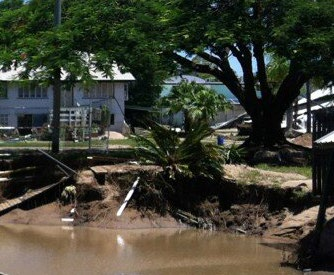

---
## Page 20

A3.4	 Community consultation
As discussed in section A2.4, community consultation 
can provide valuable information to understand the 
evacuation problem and ensure options are fit-for-
purpose for the community they intend to service. 
Information derived from community consultation 
required to inform the assessment process may include:
	ƒ community vulnerability, including vulnerability 
related to age (both older and younger), ability to 
receive and understand flood warnings and ability 
to evacuate independently. Vulnerability may occur 
at the individual/household scale or be associated 
with certain types of institutions, such as schools, 
hospitals, aged care, childcare, detention facilities 
etc.
	ƒ community tolerance to flooding and isolation, such 
as consideration of how long community members 
might be prepared to be isolated at either a property 
or community scale
	ƒ community resilience to flooding and ability to 
recover from flooding, including consideration of 
community support networks, socio-economic 
position, insurance, etc. Resilience of individuals 
or households is linked to broader community 
resilience, including support structures in the 
community and the ability for businesses to recover 
and recommence trading.
A3.5	 Other useful information
In addition to the above sources of information, 
consultation with stakeholders and an understanding 
of LDMPs, including evacuation sub-plans, and flood 
warning infrastructure will also be relevant. Other 
information which can inform the assessment process 
may include:
	ƒ information related to historic floods. This may 
include flood records, flood marks, community 
experience, etc. It is also useful to have an 
estimate of the AEP of historic floods so that 
magnitude is understood
	ƒ economic assessments which identify the 
economic impact of the evacuation problem 
based on tangible and intangible damages. This 
may inform the level of investment that might 
be justified to resolve the evacuation problem. 
Guidance on economic assessments is provided 
in the Economic Assessment Framework of Flood 
Risk Management Projects
	ƒ if a flood risk assessment has not been 
completed, census data and other information 
about the population (for example, vulnerability) 
and the existence of vulnerable institutions (such 
as aged care facilities, etc.) helps in defining 
current flood risk.
A3.6	 Review collated data
Some of the information described in the previous 
sections may not be available and the quality of data may 
vary. Reduced quality or availability of data may affect 
confidence in assessment results. If a comprehensive 
understanding of the evacuation problem is not 
achievable with the existing information, it may be 
necessary to collect additional data. To determine if 
further studies or information is required, refer to Table 4 
and consider if the level (availability and quality) of data 
may be sufficient or fit-for-purpose considering the scale 
of the evacuation problem.
In summary
Flood studies, flood risk 
assessments, evacuation 
capability assessments and 
community consultation 
are key resources for the 
assessment process. The level 
(availability and quality) of 
data should be fit-for-purpose 
to the evacuation problem, 
scale and type of options 
being assessed. 
Water level marker indicating flooding 
depth on the Flinders Highway
12
State guideline: Flood evacuation route improvements  |  May 2021

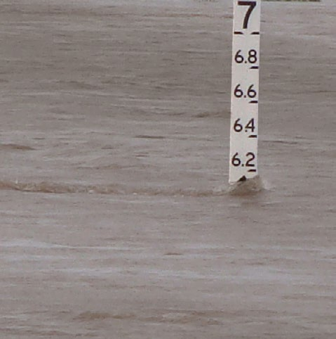

---
## Page 21

Table 4 – Level of data availability and quality
These considerations are provided as a guide only and are not intended to be exhaustive or determinative.
Level of data availability and quality
Data type
High level of data
Medium level of data
Flood study
Range of flood events
Full range of design flood events from 
frequent to the PMF event
Small range of flood events
Information on timing
Time series data available for all 
design flood events and recorded 
information from historic events
Time series data available for some 
design events or reliable upstream 
gauge data with recorded historic 
events
Flood immunity
Sufficient design flood event 
information to determine flood 
immunity at all locations of interest 
Enough information to determine 
flood immunity in some locations, 
but not all
Flood risk assessment
Population at risk
Full flood risk assessment that has 
determined the population at risk
No flood risk assessment but 
available information on populations 
at risk
Flood risk to properties 
and infrastructure
Full flood risk assessment that has 
determined flood risk to properties 
and infrastructure
No flood risk assessment, but 
information available on properties 
and infrastructure at risk
Community vulnerability 
assessment
Desktop assessment of individual 
and institution vulnerabilities 
supplemented by community 
consultation
Desktop assessment of individual 
and institution vulnerabilities
Evacuation capability assessment
Evacuation capability 
assessment (ECA)
ECA completed for full suite of design 
flood events. Good understanding of 
constraints for various flood events
ECA completed for at least one 
design flood event or large historic 
flood event. Some understanding 
of constraints in the evacuation 
network
Community/stakeholder consultation 
Stakeholder/ community 
input and opinion
Project-specific community 
consultation undertaken and have 
a good gauge on community and 
stakeholder views
Some incidental understanding of 
community and stakeholder views 
(e.g. those expressed after a historic 
event)
Other information 
Economic assessment
Flood damages assessment 
undertaken using full suite of design 
flood events, with consideration of 
direct, indirect and intangible flood 
damages
General understanding of expected 
property and infrastructure damages 
and ability to fully cost potential 
options for comparison on cost
State guideline: Flood evacuation route improvements  |  May 2021 13

---
## Page 22

Part B: Assessment process
This section outlines the process for options identification and assessment: understanding the evacuation problem, 
identifying potential options, options assessment and reviewing the outcomes to select a preferred option. The guideline 
is supported by the State guideline: Flood evacuation route improvements – Worked example and State guideline: Flood 
evacuation route improvements – Supporting tool  which assist in understanding and implementing the assessment 
process. 
B1.	 Understand the problem
Potential options cannot be identified without firstly understanding the evacuation problem that the options need to 
resolve. A comprehensive understanding of the evacuation problem is critical to identify potential options that are 
fit-for-purpose and respond to local circumstances. This process brings together information from pre-assessment data 
collation and consultation with stakeholders and the community. 
B1.1	 Investigating the evacuation 
problem
This section provides a number of questions that can 
assist in understanding the evacuation problem.  
B1. 1. 1	 Why has flood evacuation been 
identified as a problem for this location, and 
what is the problem? 
Consider the reasons why flood evacuation has been 
identified as a problem, such as:
	ƒ during a recent flood event existing evacuation 
procedures and/or routes were not adequate
	ƒ changes to urban development or road/rail 
infrastructure have constrained evacuation 
capability and increased risk to life
	ƒ a comprehensive flood study or flood risk 
management study has been undertaken and 
shown that there is considerable risk that was 
previously not understood
	ƒ a flood risk management study and/or ECA has 
identified evacuation as a problem.
It is also important to consider the nature of the 
evacuation problem which may be due to inundation 
and/or isolation risks.
Hinchinbrook, 2014
14
State guideline: Flood evacuation route improvements  |  May 2021

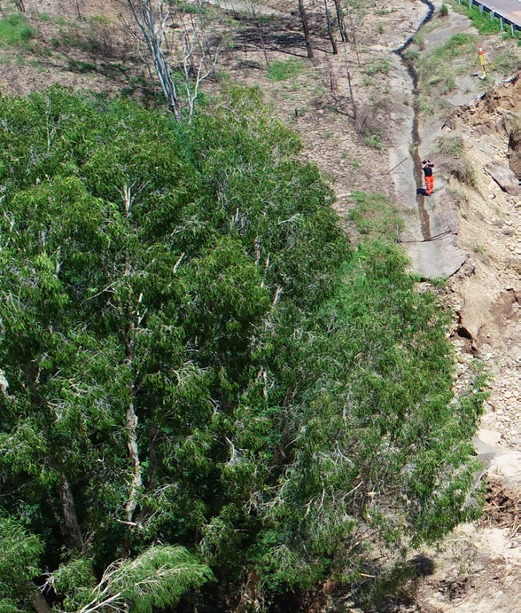

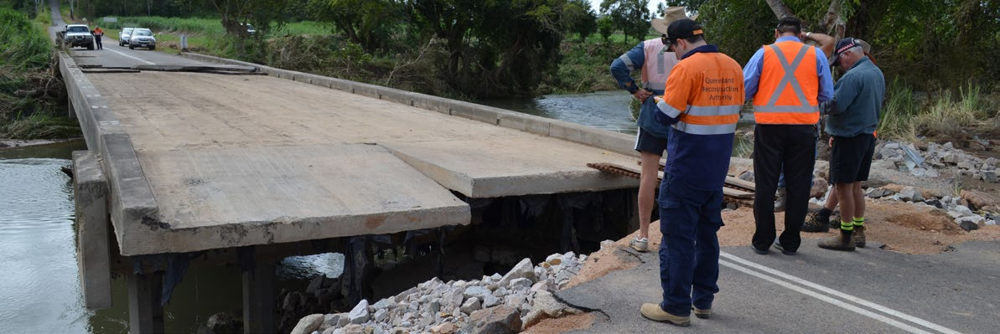

---
## Page 23

B1. 1. 2	 What is acceptable to the community? 
It is important to understand what level of residual risk is 
acceptable to the community. For example, communities 
each have different tolerabilities to the duration of 
isolation and the level of resourcing available during 
isolation. 
Communities are not homogeneous and may not have 
a uniform approach to flood risk and its management. 
Consultation should ensure that all relevant sections 
of the community are represented and that a complete 
understanding of community acceptability is developed. 
It is worth noting that 100 per cent community 
acceptability may be difficult to achieve. 
B1.1.3	 What is the flood risk? 
Understanding the flood risk (as discussed in Appendix 
B) is fundamental to fully understanding the evacuation 
problem. The following questions may help articulate 
the level of risk for an area, how the risk is spatially 
distributed, the number of people at risk of inundation 
and/or isolation, and the characteristics of the at-risk 
population:
	ƒ What areas are at risk of inundation and in what size 
flood events? What is the probability of inundation 
for different areas?
	ƒ What is the timing of inundation? Are some areas 
inundated earlier in an event allowing less time for 
evacuation?
	ƒ How many people are likely to be inundated in each 
flood event size?
	ƒ How many people are likely to be isolated in 
each flood event size and what is the duration 
of isolation? Note that some areas may become 
isolated in smaller floods, then subsequently 
inundated in larger floods.
	ƒ What are the characteristics of the affected 
population likely to be inundated and/or isolated 
in each flood event size? This may consider both 
demographic attributes (such as age, mobility, 
ability to receive flood warnings, etc.) and 
institution-scale vulnerabilities (such as schools, 
childcare, aged care, hospitals, detention facilities, 
etc.). Statistics that indicate access to a car or 
vehicle may also be useful to determine the ability 
of people to evacuate. 
	ƒ Is there any other information that may contribute to 
inundation or isolation risk, such as potential loss 
of services or insufficient essential goods to sustain 
the duration of isolation?
	ƒ Are there any existing risk management measures 
which may alter the flood risk, such as flood warning 
systems?
Collate the above information to gain an understanding 
of the spatial variation in risk across the community in 
terms of hazard and demographics.
Alice River Bridge, 2019
15
State guideline: Flood evacuation route improvements  |  May 2021

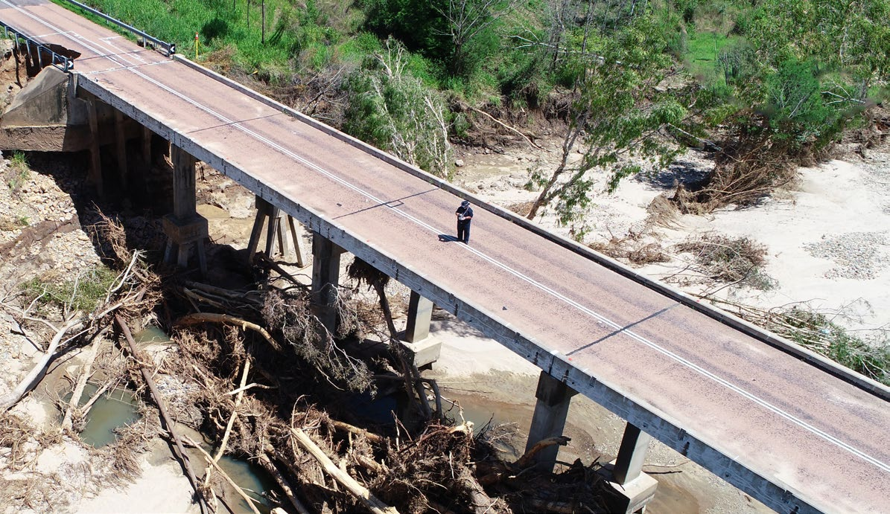

---
## Page 24

B1. 1. 4	 What is the source of flooding that 
affects the area?
There are several possible sources of flooding described 
in Table 10 (see Appendix B). Refer to this table to assist 
in determining the flood mechanism (or mechanisms) 
and relevant considerations for evacuation.  
Based on the sources of flooding, evacuation may 
not be possible and sheltering in place may be more 
appropriate. 
B1. 1. 5	 What is the flood immunity of the 
area, and what is the flood immunity of 
associated evacuation infrastructure? 
Flood immunity is generally established through flood 
studies, though it may also be assessed in a flood risk 
management study and/or an ECA. Immunity needs to 
be determined for essential evacuation infrastructure, 
including evacuation centres and the evacuation route 
network. The flood immunity of the subject area also 
needs to be identified to determine if sheltering in place 
is viable, for example, to identify if a community is likely 
to be isolated or if they are also at risk of inundation. 
All sections of the evacuation route network should 
be considered, including feeder roads which may link 
properties to major evacuation routes, as evacuation 
routes are limited by the lowest immunity at any point 
along the route. Once the point with the lowest immunity 
is closed, the evacuation route is closed.
Not all areas have the same flood immunity and 
communities may require staged evacuation or a variety 
of evacuation route improvement options to address 
the localised risk. Understanding the variation in flood 
risk across an area assists in identifying and prioritising 
locations for evacuation route improvements.
B1. 1. 6	What is the nature of the flood 
behaviour, including flood hazard and 
timing? 
Flood hazard and flood behaviour are key elements of 
flood risk. They provide an indication of how an event 
might unfold, the timing and relative sequencing of 
inundation and the hazard posed to the community from 
flood waters. Consider flood management infrastructure, 
such as dams and levees, in the overall risk assessment 
as they may also influence the flood behaviour. Also 
consider general flood behaviour, including the source 
of inundation in the area and/or evacuation route and if 
flood behaviour is influenced by hydraulic controls. For 
example:
	ƒ Does the water rise slowly from a waterway? 
	ƒ Does inundation occur suddenly due to levee 
overtopping or flash flooding? 
	ƒ Is there a combination of these behaviours?
	ƒ What is the duration of flooding?
	ƒ What are the hydraulic controls? Are there weirs 
or hydraulic structures that affect the behaviour of 
flood water?
	ƒ Is the flood-prone land wide and/or are there areas 
of narrower, more confined flow?
	ƒ What is the timing of the different sources of 
flooding? Is coincident flooding an issue?
Coincident flooding is when flooding occurs from 
more than one source at the same time, such as at the 
confluence of a river and a creek. For example, the river 
flood may be more significant, but the creek may flood 
faster due to a smaller catchment size. This may lead to 
the closure of evacuation routes before the main river 
flood arrives. 
If coincident flooding is possible in the subject area, a 
flood study that considers coincident flooding may be 
undertaken (aligned with guidance within Australian 
Rainfall and Runoff: A Guide to Flood Estimation). 
Alternatively, users may prioritise the flood source with 
the highest risk if it is understood that most evacuation 
problems are caused by that source. The evacuation 
problem can be overly complicated to resolve if an option 
must solve every potential source of flooding. Ultimately, 
different solutions may be required for each flood source.
It is also important to consider the uncertainty that 
comes with estimating flood behaviour, hazard and 
timing. Engage experienced flood engineers/scientists to 
consider a range of possible flood behaviours to gain a 
better understanding of flood risk, rather than focussing 
on a single design event.
Flooded causeway McLeod River, 
Mulligan Highway, 2014
16
State guideline: Flood evacuation route improvements  |  May 2021

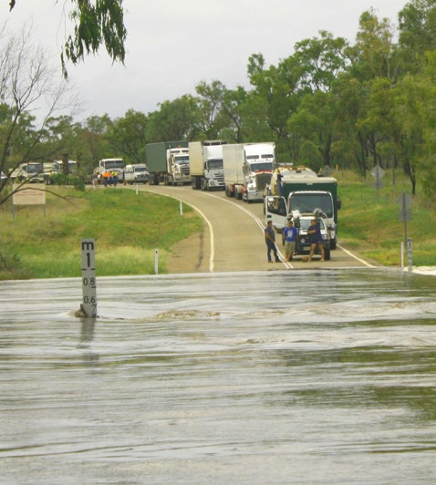

---
## Page 25

B1. 1. 7	 Is there sufficient warning time 
available for evacuation? 
It is critical to determine if there is sufficient warning 
time for the at-risk population to evacuate (this may 
be determined by applying information from an ECA). 
Sufficient warning time is required for estimating the 
severity of a possible flood based on information 
available, deciding on a strategy for evacuation, issuing 
warnings, mobilising resources, and evacuating the 
population at risk. 
B1. 1. 8	What are the constraints to 
evacuation? 
Evacuation constraints are typically identified through 
an ECA, although constraints may also be identified 
through flood risk management studies or from historic 
evacuations. For example, users may consider the 
following:
	ƒ Is the ability to evacuate impacted by a lack of 
warning time? 
	ƒ Is the ability to evacuate impacted by current 
disaster management planning or warning systems?
	ƒ Is evacuation impacted by low community 
engagement, participation and/or response to 
warnings?
	ƒ Are there effective evacuation planning processes 
but the current evacuation route is submerged too 
early in the flood event? Or does the evacuation 
route have insufficient capacity for the number of 
people requiring evacuation to evacuate in time?
	ƒ Is there insufficient time to evacuate due to the 
need to assist vulnerable sectors of the community?
	ƒ Is there a feasible evacuation destination? Is 
evacuation feasible at all or should shelter in place 
be considered as a solution?
	ƒ Will future population growth and development 
further contribute to current evacuation constraints?
B1.2	 Define the evacuation problem
Following investigation of the issues, consider the 
following when defining the evacuation problem:
	ƒ The nature of the problem: Determine if the risk to 
life is due to inundation and/or isolation risks. 
	ƒ The scale of the problem: Determine the 
significance of the evacuation problem based on 
the level and type of flood risk. This information can 
be obtained from the flood risk assessment and 
the factors which make up flood risk (see Appendix 
B). Where an economic assessment has been 
undertaken, include the economic impact of the 
evacuation problem when defining the scale. 
	ƒ Contributing factors: Determine the factors 
causing the evacuation problem. For example, this 
may include an inability to evacuate due to time 
available before routes are inundated or insufficient 
warning time, the duration of isolation, access to 
essential goods and services during periods of 
isolation, community vulnerability or tolerance 
to isolation, flood behaviour and/or low flood 
immunity of infrastructure. 
If the definition of the evacuation problem is unclear, 
consider if further information should be collected before 
proceeding with the options assessment process. 
B1.3	 Service need and desired 
outcome 
Typically, in options assessment frameworks, the service 
need and desired outcome need to be defined to identify 
and assess potential options. For evacuation route 
improvements, the primary service need and desired 
outcome is to reduce risk to life. Regardless of whether an 
option reduces isolation time or improves the ability to 
evacuate, it must have the effect of reducing risk to life.  
 
In summary
Investigate the key issues to comprehensively understand the evacuation 
problem. This assists in identifying options that are fit-for-purpose and 
respond to local circumstances. 
17
State guideline: Flood evacuation route improvements  |  May 2021

---
## Page 26

B2.	Identify potential options
Based on an understanding of the evacuation problem, identify a long list of options which may resolve the defined 
evacuation problem and may achieve the service need and desired outcome. 
To appropriately assess options, ensure they are clearly defined by their location and key design considerations (such as 
design flood immunity) which are likely to have a material effect on cost, scope or impact. 
A range of potential evacuation route improvement options and considerations are outlined in detail in Table 5 (page 21). 
These options may be standalone or combined to proceed as a single option through the assessment process. For 
example, an option may include a new evacuation centre and improvements to the flood immunity of an evacuation 
route to facilitate access. Non-infrastructure options may also be combined with infrastructure options to improve 
performance. Options for evacuation route improvements may include:
	ƒ community awareness, preparedness and 
resilience
	ƒ disaster management planning
	ƒ implementing new, or improving existing, flood 
warning systems
	ƒ shelter in place
	ƒ building new, or improving existing, building/s 
for use as an evacuation centre
	ƒ relocating high-risk communities
	ƒ improving existing road to increase resilience
	ƒ improving condition of, or access to, existing road
	ƒ improving existing road to increase evacuation 
capacity (widen road)
	ƒ improving flood immunity of an existing road 
(raise road)
	ƒ building new road/s
	ƒ building new, or improving existing, structural 
flood mitigation options.
The options in this guideline are provided as examples only and are not intended to be an exhaustive list. Other options 
may be identified specific to the evacuation problem and local circumstances. Note, ‘road’ is used as a general term and 
may include ungazetted or unsealed roads. 
Contraflow is not discussed in this guideline as it is generally considered difficult to implement by emergency planners. 
However, if it is selected as a potential option, the relevant police and emergency services agencies should be engaged 
early to confirm if the option is compatible with their contraflow access requirements.  
B2.1	 Resolving the evacuation problem
The ability of an option to resolve the evacuation problem is one of the key considerations when determining the long list 
of potential options. The assessment process assists in determining the benefits, impacts, constraints and costs of each 
option to identify which is preferred for progression and ultimately implementation. However, to ensure all options are 
explored at this stage of the process, identify a wide range of solutions to the evacuation problem. 
                    Increasing preference
1.  Reform 
Improving service performance through an amendment of existing 
institutions and laws.
2.  Better use 
Improving service performance by influencing demand (i.e. not 
building new capacity).
3.  Improve existing 
Improving service performance through relatively (compared to 
new) low cost capital works that augments existing infrastructure.
4.  New 
Construction of new infrastructure.
Figure 3 - Hierarchy of 
responses (DILGP, 2016)
18
State guideline: Flood evacuation route improvements  |  May 2021

---
## Page 27

When identifying potential options, consider solutions 
which address each stage of the evacuation process. 
For example, evacuation problems related to time 
constraints, such as time available before routes 
inundate, can be resolved by solutions other than 
improving the immunity of evacuation routes. This may 
include: 
	ƒ at the decision to evacuate stage, new or 
improved flood warning systems may enable 
the early identification of flood impacts which 
can achieve additional time for members of the 
community to evacuate
	ƒ at the warning stage, improved disaster 
management planning can achieve efficiencies in 
communicating warnings and appropriate actions 
to the community
	ƒ at the withdrawal stage, improving community 
awareness, preparedness and resilience, can 
improve the amount of time it takes for the 
community to accept and respond to warnings 
	ƒ at the shelter stage, new evacuation centres 
can be provided in locations that have 
better access or require less time for vehicle 
movements. 
In addition, consider how options may improve the return 
stage of evacuation. Improving the resilience of a road 
can ensure that it is able to withstand flood impacts and 
re-open earlier after flood waters recede, facilitating the 
return of evacuees back to the flood affected area. 
Users may also consider low cost and non-infrastructure 
options which may achieve similar outcomes as high cost 
infrastructure projects. 
The hierarchy of responses (see Figure 3), adapted from 
the State Infrastructure Plan – Part A: Strategy generally 
reflects how potential options may be considered so 
they align with the strategic direction of government 
investment policy (TMR, 2019a) and the guideline’s 
principle of optimising existing infrastructure.
	ƒ options which facilitate evacuation to a 
node in the network that provides access 
to a number of different safer locations or 
evacuation facilities
	ƒ building resilience into the design and 
engineering of options to ensure they are 
able to withstand impacts during and after 
flood events
	ƒ the community capability and tolerability for 
potential options. For example:
	ƒ is the community likely to respond 
appropriately to warnings and 
notifications?
	ƒ is the option suitable for the community? 
(e.g if a four wheel drive track is a 
potential option, does the community 
have access to the appropriate vehicles)
	ƒ options that can provide benefits in addition 
to improved evacuation capability (e.g road 
infrastructure options can provide improved 
road network efficiency and evacuation 
centres can be used for other community or 
recreational purposes)
	ƒ for areas at risk of isolation, options which 
facilitate evacuation, reduce isolation risks 
(e.g by providing for essential goods or 
services) or reduce the duration of isolation.
When identifying potential options  
other considerations include:
Burke River, Boulia
19
State guideline: Flood evacuation route improvements  |  May 2021

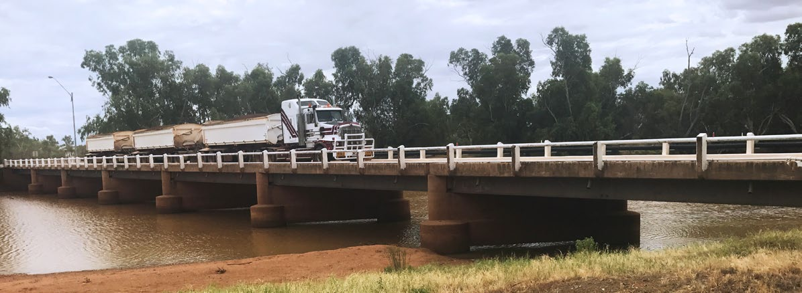

---
## Page 28

In summary
Identify a wide range of 
options which address 
the evacuation problem 
and meet the service 
need and desired 
outcome. Clearly define 
options by including 
location and key design 
considerations. 
Condamine River, Victoria St, Warwick, January 2011
B2.2	 Consultation
Consult with a wide range of stakeholders when 
identifying potential options. Flood risk management 
stakeholders and infrastructure providers can provide 
expert, local knowledge and advice on potential or 
planned projects that could be altered to incorporate 
evacuation benefits. For example, if there is a planned 
road upgrade to improve general network efficiency, a 
potential option may be identified which incorporates 
flood immunity improvements into the upgrade. These 
projects can deliver multiple benefits, which may assist 
in business cases or obtaining funding. Early engagement 
is important to ensure these options can be identified 
before a project is too far developed to alter. 
B2.3	 Design flood immunity for linear 
infrastructure
When defining linear infrastructure options, identify the 
design flood immunity. The design flood immunity will 
have an impact on the assessment results and the ability 
of an option to address the evacuation problem. 
Design flood immunity significantly impacts several 
critical factors in evacuation including the amount of 
time available before routes become inundated, length 
of isolation and level of residual risk (that is, the risk that 
remains after an option is delivered). It is important to 
be aware that risk can never be completely eliminated, 
and any option or design flood immunity has a level of 
residual risk that needs to be considered. 
The design flood immunity determines the time 
available before the road is inundated and the duration 
of inundation. The design flood immunity of the entire 
evacuation route, including any feeder roads, also needs 
to be considered as immunity of the route is limited by 
the most constrained location at any point. 
The design flood immunity may be difficult to identify 
prior to assessing options due to the need to balance a 
number of determining factors including risk mitigation, 
standards, affordability and environmental and flood 
behaviour factors (for example, high immunity may 
be difficult to achieve in existing urban areas due to 
engineering and environmental constraints). 
Therefore, include similar options with broadly different 
design flood immunities which are likely to result in 
materially different costs, scope or impacts, such as a 
frequent and infrequent event. For example, two options 
may be included to raise the same road, one to achieve 
a 5% AEP immunity and another to achieve a 1% AEP 
immunity. 
Following the assessment process, further refinements to 
the design flood immunity of potentially suitable options 
can be made in the design stage or by repeating the 
assessment process. 
20
State guideline: Flood evacuation route improvements  |  May 2021

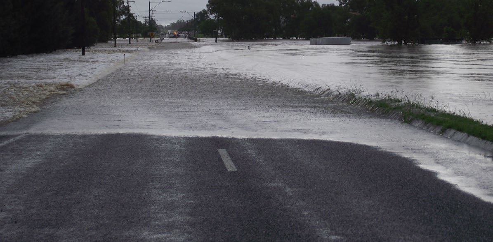

---
## Page 29

Table 5 - Summary of potential evacuation route improvement options
The options and considerations in Table 5 are provided as examples only and are not intended to be an exhaustive 
list.  The relevance and feasibility of each option is unique to the user and are to be determined after the user 
assesses the evacuation problem and criteria. Considerations for each option are categorised under the assessment 
criteria (see section B3.1). 
Option: Community awareness, preparedness and resilience
What is it?
	ƒ measures to improve the community’s awareness of flood risk, evacuation procedures and 
overall flood resilience 
	ƒ measures range from provision of information (e.g. via letterbox drops, online) to 
development of household evacuation plans and broader resilience measures such as 
community network building
How can it improve 
evacuation capability?
	ƒ reduces the evacuation timeline by increasing organisation and mobility
	ƒ improves broader community awareness, preparedness and resilience to flooding, beyond 
the evacuation context
	ƒ improves the amount of time it takes for the community to accept and respond to warnings
Considerations 
Safety
	ƒ not highly effective if insufficient warning 
time available
Economic
	ƒ low cost
Environmental and cultural heritage 
impact
	ƒ negligible environmental and cultural 
heritage impacts
Social
	ƒ requires community engagement to be 
effective
Flood behaviour/impact
	ƒ does not impact flood behaviour
Additional constraints
	ƒ unlikely to have technical or physical 
constraints
Option: Disaster management planning
What is it?
	ƒ development or review of plans and procedures to plan, prepare, respond to and recover 
from flooding, typically captured in a LDMP or evacuation sub-plan
	ƒ may include aspects of flood warning, evacuation procedures, assembly points, traffic 
management, shelter-in-place, etc.
How can it improve 
evacuation capability?
	ƒ addresses evacuation constraints by implementing plans and procedures
	ƒ supports more efficient evacuation
	ƒ improves broader flood (and disaster) outcomes, beyond the evacuation context
Considerations 
Safety
	ƒ improves management of risk 
Economic
	ƒ low cost, may be captured under standard 
business costs
Environmental and cultural heritage 
impact
	ƒ negligible environmental and cultural 
heritage impacts
Social
	ƒ depending on the plan, it may require a 
specific community response
Flood behaviour/impact
	ƒ does not impact flood behaviour
Additional constraints
	ƒ unlikely to have technical or physical 
constraints
(continued on next page)
21
State guideline: Flood evacuation route improvements  |  May 2021

---
## Page 30

Option: Implementing new, or improving existing, flood warning systems
What is it?
	ƒ the ‘total flood warning system’ includes all aspects of flood warning from monitoring and 
prediction of flooding to review of the warning delivery
	ƒ flood warning systems can range from relatively simple paper-based systems which link 
rainfall or stream gauge triggers to actions, to complex and highly automated systems which 
undertake real-time flood modelling
	ƒ flood warning systems typically include one or more rain or stream gauges and procedures 
linked to forecast or recorded values at those gauge locations. The distribution of flood 
warnings can be through a range of media including flood sirens, door knocking, text 
messages, phone calls, television, newspapers, internet and radio
How can it improve 
evacuation capability?
	ƒ increases time available to evacuate by predicting flood impacts earlier
	ƒ increases community confidence in evacuation messages by linking actions to data
	ƒ reduces flood risk
Considerations 
Safety
	ƒ may not provide sufficient warning 
time to be useful in flash flooding 
situations
	ƒ flood warning based on forecast data 
is less reliable than warnings based on 
recorded data (but does provide more 
warning time)
Economic
	ƒ usually low cost
	ƒ implementation can be staged
Environmental and cultural heritage impact
	ƒ negligible environmental and cultural heritage 
impacts 
Social
	ƒ requires community engagement and cooperation 
to respond to flood warnings
Flood behaviour/impact
	ƒ does not impact flood behaviour
Additional benefits or constraints
	ƒ unlikely to have technical or physical constraints
Option: Shelter in place
What is it?
	ƒ measures to facilitate shelter in place by ensuring locations are appropriate to shelter in 
during a flood
	ƒ is an alternative, or in addition, to evacuation where individuals shelter within their homes, 
workplace or with family/friends, if considered safe to do so (QFES, 2018b)
	ƒ may include flood proofing of buildings, ensuring that sufficient resources are available to 
support shelter in place (e.g. continuity of services, food drops) and house raising
	ƒ may be applied at the household scale or at a larger scale to support flood island areas 
(neighbourhood scale)
How can it improve 
evacuation capability?
	ƒ reduces isolation risk
	ƒ provides an alternative approach to protect human life where evacuation may be more 
dangerous than sheltering in place
Considerations 
Safety
	ƒ if isolated for a significant amount 
of time, emergency access may be 
needed
	ƒ not suitable for high hazard areas 
where there is a risk of building failure
	ƒ not suitable for locations where there 
are significant inundation risks (where 
properties may become inundated 
over floor)
	ƒ may be less suitable for highly 
vulnerable communities
Economic
	ƒ low cost, depending on scale of retrofit required
Environmental and cultural heritage impact
	ƒ negligible environmental and cultural heritage 
impacts 
Social
	ƒ benefits from community engagement and requires 
cooperation
Flood behaviour/impact
	ƒ does not impact flood behaviour
Additional benefits or constraints
	ƒ unlikely to have technical or physical constraints
Table 5 - Summary of potential evacuation route improvement options (continued)
(continued on next page)
22
State guideline: Flood evacuation route improvements  |  May 2021

---
## Page 31

Table 5 - Summary of potential evacuation route improvement options (continued)
Option: Building new, or improving existing, building/s for use as an  
evacuation centre
What is it?
	ƒ develop infrastructure for use as an evacuation centre
	ƒ may involve developing a new building or providing for essential goods, utilities and services 
to facilitate the use of an existing building for use as an evacuation centre
How can it improve 
evacuation capability?
	ƒ improves evacuation by providing a location for a population to evacuate to, that does not 
have access constraints and has high flood immunity 
	ƒ reduces isolation risk by providing essential goods and utilities
Considerations 
Safety
	ƒ the design flood immunity of the building 
influences the level of residual risk
	ƒ a high design flood immunity is required 
to ensure it is likely to be safe to shelter 
for most flood events
	ƒ need to ensure there are no isolation 
risks and residents can evacuate to the 
evacuation centre
	ƒ determine how long the community is 
willing to stay in the evacuation centre if 
isolated
Economic
	ƒ can be moderate or high cost
Environmental and cultural heritage 
impact
	ƒ may require clearing of vegetation or 
habitat to accommodate development  
	ƒ depending on location and scale, may 
have cultural heritage impacts
Social
	ƒ may provide additional benefits if used for other 
community or recreational purposes
Flood behaviour/impact
	ƒ may have minor flood impacts
Additional constraints
	ƒ may have physical or technical constraints 
including availability of flood-free sites to 
accommodate the development
	ƒ Queensland Urban Drainage Manual, planning 
schemes and the SPP and associated guidance 
material – may contain flood immunity 
standards that will need to be adhered to
Bundaburg, 2013
(continued on next page)
23
State guideline: Flood evacuation route improvements  |  May 2021

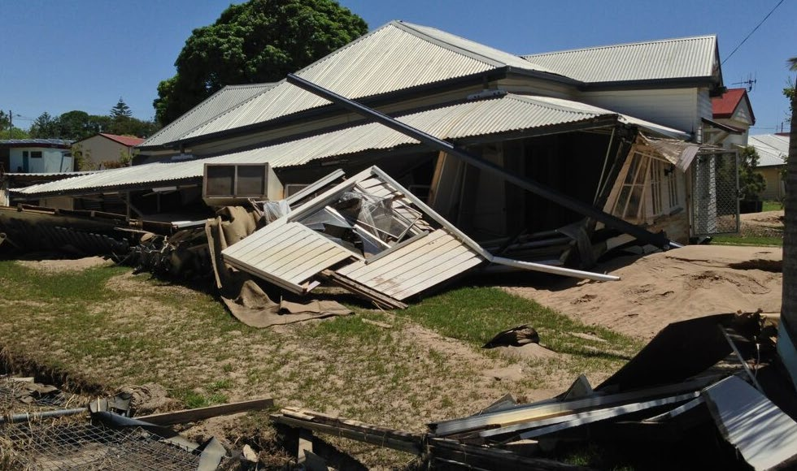

---
## Page 32

Options: Relocating high-risk communities
What is it?
	ƒ relocation of high-risk community to an area with lower flood risk
How can it improve 
evacuation capability?
	ƒ reduces flood risk by reducing exposure to flood hazard and isolation
	ƒ reduces the need for evacuation or reduces evacuation demand
	ƒ may provide more warning time, depending on availability of sufficiently flood immune 
infrastructure in the relocation area
Considerations 
Safety
	ƒ the flood immunity of the relocation area 
influences the level of residual risk
Economic
	ƒ moderate to high cost
Environmental and cultural heritage impact
	ƒ may have environmental impacts
	ƒ depending on location and scale may have 
cultural heritage impacts
Social
	ƒ needs significant community engagement and 
support
Flood behaviour/impact
	ƒ may cause flood impacts (though should be 
reduced compared to development in current 
location)
Additional benefits or constraints
	ƒ may be broader land use planning 
considerations
Option: Improving existing road to increase resilience
What is it?
	ƒ an existing road can be made more resilient to inundation impacts through, for example, 
improved capacity of cross-drainage structures or use of resilient material
	ƒ may include improving resilience of pavement or other design features for inundation to 
reduce time required for post-inundation repairs (and reducing overall time of closure)
	ƒ may include improvement to road maintenance such as ensuring roads critical for evacuation 
are clear and in good order before flood season
	ƒ Natural Disaster Program Design and Eligibility Guidelines contains further guidance on 
improving resilience of roads
How can it improve 
evacuation capability?
	ƒ may reduce time of closure due to reduced repair time required after inundation
	ƒ may extend time available for evacuation
	ƒ may achieve route flood immunity
	ƒ may reduce or eliminate isolation for a given flood immunity
Considerations 
Safety
	ƒ depending on the method for improving 
resilience, there may be no additional 
evacuation time or capacity as an 
outcome of the option
	ƒ may reduce duration of isolation due to 
reduced repair time after inundation
	ƒ the design flood immunity of the road 
influences the level of residual risk
Economic
	ƒ usually moderate cost to implement, 
depending on the size and number of 
crossings 
	ƒ can be delivered in a staged approach as 
iterative improvements as part of routine 
maintenance
	ƒ can reduce costs to repair the road from 
flood damages and reduce business costs 
by reducing the overall time of closure, for 
example, if used as a freight route
Environmental and cultural heritage impact
	ƒ may have environmental impacts
	ƒ depending on location and scale may have 
cultural heritage impacts
Social
	ƒ If considering improved resilience or 
maintenance to reduce overall closure time, 
consider the requirements of the community 
(e.g. being isolated for a short period may 
be acceptable if the community is currently 
isolated for a long period)
Flood behaviour/impact
	ƒ may cause flood impacts by altering flood 
conveyance
Additional constraints
	ƒ Often a route has several ‘vulnerable’ points. 
Consider how many crossings would need to 
be upgraded in total to achieve evacuation.
Table 5 - Summary of potential evacuation route improvement options (continued)
(continued on next page)
24
State guideline: Flood evacuation route improvements  |  May 2021

---
## Page 33

Option: Improving condition of, or access to, existing road
What is it?
	ƒ condition of, or access to, an existing road is improved to enable its use as an evacuation route
	ƒ may include negotiations with land holders to improve public access or improving the 
condition of a road to enable trafficability by motor vehicles
How can it improve 
evacuation capability?
	ƒ creates a new evacuation route with an existing road
Considerations 
Safety
	ƒ can reduce risk by improving the ability to 
evacuate
	ƒ the design flood immunity of the road 
influences the level of residual risk
	ƒ effectiveness depends on location and 
design including capacity, resilience, and 
flood immunity level
Economic
	ƒ likely to have a lower cost than building a 
new road
Environmental and cultural heritage impact
	ƒ may have environmental impacts
	ƒ depending on location and scale, may have 
cultural heritage impacts
Social
	ƒ agreements with land holders may be 
required where public access is limited
	ƒ the community must be able to understand 
and use the evacuation route during flood 
events
Flood behaviour/impact
	ƒ may cause flood impacts by altering flood 
conveyance
Additional constraints
	ƒ location and design of the existing road may 
have physical and technical constraints
Option: Improving existing road to increase evacuation capacity (widen road)
What is it?
	ƒ widening roads to increase capacity and reduce evacuation congestion
	ƒ may include addition of another formal lane, or improvements to the road shoulder to enable 
use as a temporary lane during evacuation
How can it improve 
evacuation capability?
	ƒ increases road capacity to reduce congestion and reduce the time needed for evacuation
Considerations 
Safety
	ƒ widening reduces time required for 
evacuation but is unlikely to delay the 
inundation of the route. Therefore, the 
design flood immunity of the road must 
also be considered
	ƒ if the capacity issues are across an entire 
route rather than in a single location, there 
may be extensive upgrades needed, or 
issue may be moved to a different location
Economic
	ƒ usually moderate cost
Environmental and cultural heritage impact
	ƒ may have environmental impacts
	ƒ depending on location and scale, may have 
cultural heritage impacts
Social
	ƒ may require community agreement in 
chosen upgrade locations
	ƒ may provide additional benefits by reducing 
non-evacuation congestion
Flood behaviour/impact
	ƒ may cause flood impacts by altering flood 
conveyance
Additional constraints
	ƒ location and design of the existing road may 
have physical and technical constraints
Table 5 - Summary of potential evacuation route improvement options (continued)
(continued on next page)
25
State guideline: Flood evacuation route improvements  |  May 2021

---
## Page 34

Option: Improving flood immunity of an existing road (raise road) 
What is it?
	ƒ raise part or all of a road to increase flood immunity
	ƒ depending on the situation, increased immunity may be achieved through additional cover or 
could require more substantive design and construction effort
	ƒ may or may not include an increase in waterway area (depending on flood impacts)
How can it improve 
evacuation capability?
	ƒ extends time available for evacuation
	ƒ may achieve route flood immunity
	ƒ reduces or eliminates isolation for a given flood immunity
Considerations 
Safety
	ƒ the design flood immunity of the road 
influences the level of residual risk
	ƒ consider the intended use of the route, if 
it is to reduce isolation time rather than 
for evacuation, it is important that it is a 
practical route for the community to use 
when other routes are cut off
	ƒ often a route has several ‘vulnerable’ points 
- consider how much road would need to be 
upgraded in total to achieve evacuation
Economic
	ƒ usually moderate to high cost
	ƒ can reduce business costs as routes remain 
open for longer and are not as frequently 
inundated in smaller more frequent floods 
than its design flood immunity
	ƒ implementation can be staged
Environmental and cultural heritage impact
	ƒ may have environmental impacts
	ƒ depending on location and scale may have 
cultural heritage impacts
Social
	ƒ can improve access to services by reducing 
the overall time of closure of a road caused 
by flooding
Flood behaviour/impact
	ƒ may cause flood impacts by altering flood 
conveyance 
Additional constraints
	ƒ may have physical or technical constraints 
e.g. sufficient space to achieve required 
embankments
Table 5 - Summary of potential evacuation route improvement options (continued)
Haack Rd bridge, Scenic Rim, 2017
(continued on next page)
26
State guideline: Flood evacuation route improvements  |  May 2021

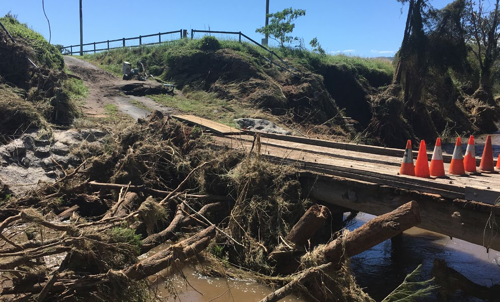

---
## Page 35

Option: Building new road/s
What is it?
	ƒ building a new road to provide new evacuation route infrastructure
How can it improve 
evacuation capability?
	ƒ depending on location and design, a new road can resolve or bypass constraints in the 
evacuation network
	ƒ may increase time available before routes inundate by being:
	ƒ designed or located to achieve a higher immunity than existing routes
	ƒ located in an area where flood waters rise more slowly
	ƒ located in an area that is flood free
	ƒ may provide additional capacity to relieve bottlenecks in the network  
	ƒ may provide access to a node in the evacuation route network that facilitates access to safer 
locations and evacuation centres
Considerations 
Safety
	ƒ can reduce risk by improving the ability 
to evacuate
	ƒ the design flood immunity of the road 
influences the level of residual risk
	ƒ effectiveness depends on location and 
design including capacity, resilience 
and design flood immunity level
Economic
	ƒ likely to be high cost
	ƒ may reduce business operation costs, 
e.g. by providing an alternative freight 
route when the main route has been 
inundated
Environmental and cultural heritage 
impact
	ƒ may have impacts to fauna connectivity 
or require clearing of vegetation and 
habitat
	ƒ depending on location and scale, may 
have cultural heritage impacts
Social
	ƒ consider location and any objections from the 
community
	ƒ may improve access to services during smaller 
more frequent flood events
	ƒ can have additional benefits by improving the 
efficiency of the road network during daily use 
(e.g. provides alternative route to access locations 
for non-evacuation purposes) 
Flood behaviour/impact
	ƒ may cause flood impacts by altering flood 
conveyance
	ƒ location of new infrastructure should consider 
existing flood behaviour, nature of flood-prone 
land, etc.
	ƒ important to consider flood behaviour when 
determining where effective evacuation routes 
can be situated
Additional constraints
	ƒ potential for various other constraints such 
as engineering, construction and approval 
constraints
Table 5 - Summary of potential evacuation route improvement options (continued)
 Jimboomba Creek flooding, Camp Cable Road, Jimboomba
(continued on next page)
27
State guideline: Flood evacuation route improvements  |  May 2021

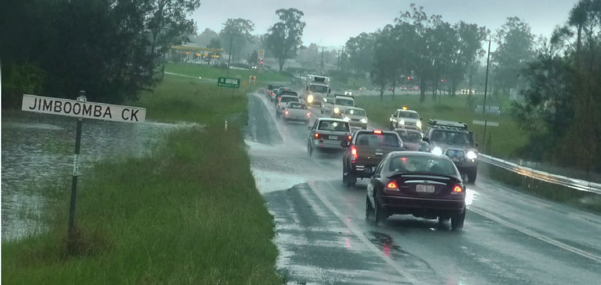

---
## Page 36

Option: Building new, or improving existing, structural flood mitigation options
What is it?
	ƒ constructing new, or improving existing, structural flood mitigation options, such as levees, 
dams, detention basins, etc.
How can it improve 
evacuation capability?
	ƒ increases time for evacuation by reducing the inundation area or changing the flood 
behaviour affecting a route
Considerations
Safety
	ƒ the design flood immunity influences the 
level of residual risk
	ƒ potential for catastrophic flooding if a 
structure such as a dam or levee fails
Economic
	ƒ new structures are likely to be high cost 
and improvements to existing structures 
are likely to be moderate cost, depending 
on the scale and nature of existing works
	ƒ may reduce property damage by reducing 
the inundation area or by changing flood 
behaviour
Environmental and cultural heritage impact
	ƒ depending on nature and scale, likely 
environmental impacts 
	ƒ depending on location and scale, may have 
cultural heritage impacts
Social
	ƒ may not provide any additional benefits as it 
only addresses flood hazard
Flood behaviour/impact
	ƒ likely to impact flood behaviour (may be 
beneficial in some locations)
	ƒ may reduce inundation in some areas but 
increase in others, a high level of consultation 
is likely to be required
Additional constraints
	ƒ engineering, construction and approvals 
may impose additional constraints to be 
addressed
Table 5 - Summary of potential evacuation route improvement options (continued)
Burdekin Shire, 2020
28
State guideline: Flood evacuation route improvements  |  May 2021

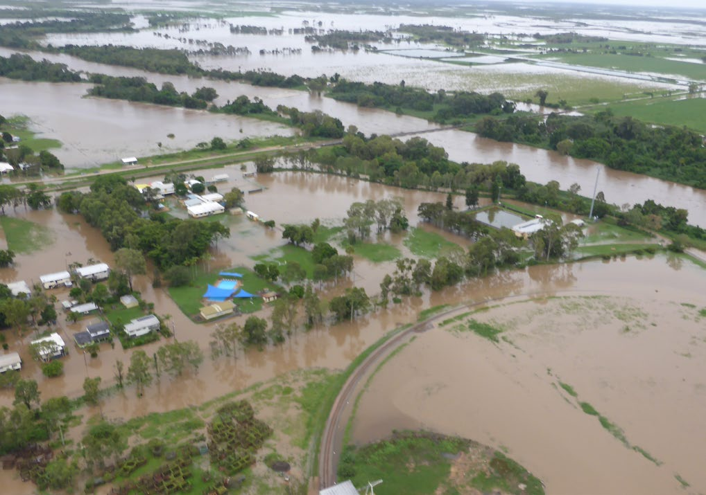

---
## Page 37

B3.	 Options assessment
The options assessment phase comprises an options feasibility assessment (stage one), followed by an MCA (stage two) 
and financial and economic assessments. The options feasibility assessment eliminates impractical options to generate 
a short list for more detailed options assessment. Note, not all assessments stages require the same level of detail for 
assessment as discussed in section A1.3.
B3.1	 Assessment criteria
The assessment process in this guideline is based on the six criteria outlined in Figure 4. 
Safety
An essential criterion for 
evacuation route improvements 
which measures risk to life  
 
 
Flood behaviour/impact
Considers adverse flood 
impacts from changes in flood 
behaviour
Economic
Considers the economic 
benefits of an option and  
its cost
 
Additional constraints
Considers other technical and 
physical constraints 
Environmental and  
cultural heritage
Considers environmental and 
cultural heritage impacts such 
as impacts to vegetation and 
habitat 
 
Social
Considers the community’s 
support for an option and 
additional benefits it may 
provide
Assessment criteria
Figure 4 - Assessment criteria
The ‘flood behaviour/impact’ criterion 
considers whether an option is likely to 
cause adverse flood impacts due to changes 
to existing flood behaviour. This criterion is 
important as flood impacts may affect the 
feasibility of an option or require expensive 
mitigation to minimise unacceptable 
impacts. Whilst the criteria in Figure 4 are 
also considered in more detail in the stage 
two MCA, consideration of flood behaviour 
and impacts at the option feasibility stage 
of the assessment process can help refine 
options to ensure they are located in areas 
that reduce adverse impacts.   
Flood impacts may be more likely if an 
option requires construction in a high flood 
hazard area or across significant flood-prone 
land. Impacts can be mitigated by blocking 
as little of the waterway as possible (high 
bridge, limited piers, limited embankment), 
however, this may make an option cost 
prohibitive. 
Infrastructure corridors (new or upgraded) 
across wide areas of flood-prone land are 
likely to require significant cross-drainage 
to manage unacceptable changes to flood 
behaviour (such as concentration of flow 
and increases in flood levels upstream) as 
a result of the significant width of flow that 
must be directed under the infrastructure in 
events up to, and including, its design flood 
immunity. 
Experienced flood engineers/scientists or 
floodplain managers may be required to 
investigate flood impacts and mitigation 
requirements. 
Considering flood behaviour/impact criterion
29
State guideline: Flood evacuation route improvements  |  May 2021

---
## Page 38

B4.	Stage one: Option feasibility assessment
The option feasibility assessment in this guideline is an initial screening process to eliminate impractical or unfeasible 
options and generate a short list to progress to stage two. Users assess options against feasibility indicators before 
conducting a high-level cost estimate. 
Stakeholder engagement is critical at this stage (such as engaging with agencies that may have a responsibility in 
relation to resourcing, operation or delivery of potential options) as stakeholders can provide valuable feedback on the 
practicality and feasibility of options.  
B4.1	 Feasibility indicator assessment
Using the feasibility indicator assessment in this guideline, options are assessed against the feasibility indicators shown 
in Table 6. For this high-level assessment, users assess each option as either having ‘met’ or ‘not met’ a feasibility 
indicator while considering local circumstances and evacuation problem specific variables. Where there is not enough 
information, note this as the response for review at the end of this assessment stage (see section B4.3.3). 
Table 6 - Feasibility indicators
Feasibility indicators
Response
Met
Not met
More 
information 
required
The option is likely to reduce risk to life for the affected 
population
The option is unlikely to cause significant environmental or 
cultural heritage impacts that are unable to be mitigated
The community supports the option and is likely to respond 
(can be determined through community consultation)
The option is unlikely to cause adverse significant flood 
impacts that cannot be mitigated (high level assessment, 
based on judgement, considering location of option and known 
flood behaviour)
The option is physically and technically feasible when 
considering engineering, constructability or legal constraints
Thomson River Cruises, Longreach
30
State guideline: Flood evacuation route improvements  |  May 2021

---
## Page 39

B4.2	 High level cost estimate
Following the feasibility indicator assessment, prepare 
a high-level cost estimate for each option to determine 
affordability. High level cost estimates can be undertaken 
most simply by comparison to similar previous projects. 
However, where unavailable, consider preliminary or 
concept engineering design to estimate cost. 
Determine if the cost is practical considering the scale of 
the evacuation problem, budgets, potential funding and 
delivery program. When determining cost practicalities, 
liaise with stakeholders or organisations that may 
be responsible for committing resources to deliver a 
potential option to determine if it would qualify for 
funding or investment under their programs, processes, 
practices and policies. Identify if there are any additional 
benefits to improved evacuation capability as it may 
assist an option qualifying for funding, particularly if it 
can be delivered in conjunction with another project. 
B4.3	 Determining outcomes of the 
option feasibility assessment
Review the results of the option feasibility assessment to 
determine the outcome for each option and create a short 
list of options to progress to the stage two MCA. In this 
guideline, outcomes for each option are as follows:
	ƒ Eliminate or progress to MCA – Eliminate unfeasible 
options and progress feasible options. 
	ƒ Redefine options – Redefine an option by 
combining with other options, altering or staging 
before re-assessing the redefined option. 
	ƒ Collect further information – If an outcome cannot 
be determined due to a lack of information, consider 
collecting further information to re-assess. 
B4. 3. 1	Eliminating or progressing to MCA
All options should reduce risk to life (and satisfy the ‘risk 
to life’ feasibility indicator) to be considered feasible. 
For other feasibility indicators, local circumstances and 
priorities determine whether to eliminate an option or 
progress an option to the stage two MCA. 
When preparing a high-level 
cost estimate, it is essential to 
engage with the likely owner 
and operator of the potential 
option. This assists in identifying 
maintenance, operation and 
other whole-of-life costs. 
Cattle Creek Bridge on the Bruce Highway, Ingham
31
State guideline: Flood evacuation route improvements  |  May 2021

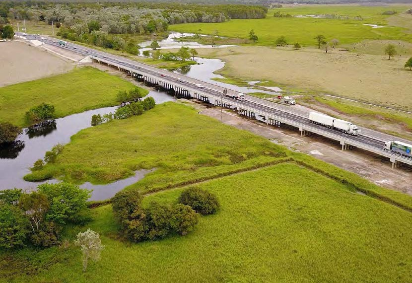

---
## Page 40

In summary
The stage one: option 
feasibility assessment 
should eliminate 
impractical or unfeasible 
options to generate 
a short list for more 
detailed assessment. 
B4. 3. 2	Redefining options
Options may be redefined to improve performance, 
address any feasibility indicators or overcome cost 
limitations. Options can be altered by revising location or 
design or combining it with other options into a suite of 
measures.
Options may also be staged to spread the cost over a 
longer period to alleviate affordability limitations. If 
considering a staged road upgrade approach, consider 
the relative flood immunity or AATOC for different sections 
of the route and consider prioritising upgrades to the 
most frequently inundated sections. If construction of 
an option is to be staged, it is important to preserve and 
protect the corridor for future delivery of the later stages 
of the option. 
Once options are redefined, repeat the options feasibility 
assessment. For staged options, assess each stage to 
ensure each is practical and provides benefits (this also 
applies to the stage two MCA to ensure each stage is 
comparatively assessed against other options). 
Redefining options can help 
address constraints identified 
in the feasibility assessment. 
For example, the cost of a 
bridge may be reduced by 
optimising the alignment. 
B4. 3. 3	Is more information required? 
If some of the feasibility indicators cannot be determined 
due to a lack of information, options can be eliminated 
if ultimately, they are not feasible. Similarly, there may 
be strong support for an option, or users may feel they 
have sufficient confidence in the outcome of the overall 
assessment to justify progressing that option, on the 
basis that the feasibility indicators (excluding the 
community support feasibility indicator) will be assessed 
in more detail in the stage two MCA. Where an outcome 
cannot be determined, consider the approximate cost of 
obtaining additional information and whether investment 
is justified to support further assessment.
Yeppen crossing and roundabout, Bruce Highway  
(Benaraby - Rockhampton) Tropical Cyclone Oswald  
and associated rainfall and flooding, 2013
32
State guideline: Flood evacuation route improvements  |  May 2021

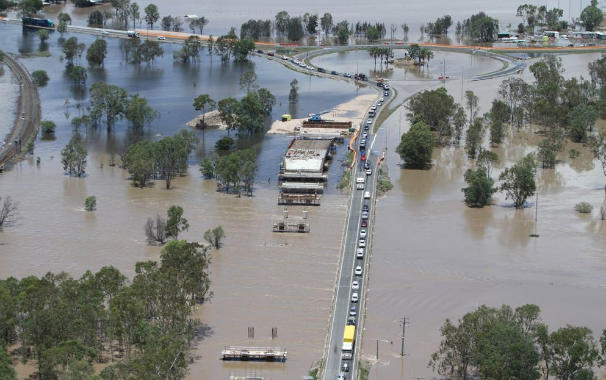

---
## Page 41

B5.	 Stage two: multi-criteria assessment (MCA)
The MCA is a detailed assessment of the short-listed 
options against targeted indicators for each criterion. 
Each criterion in this guideline comprises one or more 
targeted indicators against which the options are scored. 
The scoring is based on a scale from one to five, with one 
being the lowest score (indicates an option provides the 
lowest benefit) and five the highest (indicates an option 
provides the highest benefit). 
The level of detail required to assess the targeted 
indicators varies depending on the type of options being 
assessed, local circumstances and the scale of the 
evacuation problem. Additional studies, consultation or 
engagement of a suitably qualified or experienced person 
may be required to determine an appropriate score for a 
targeted indicator. Alternatively, in some circumstances, 
detailed studies may not be required for assessment. 
For example, if assessing only non-infrastructure options 
which do not require significant investment to deliver, 
detailed studies may not be required.  
Consider local priorities and desired outcomes when 
scoring against the targeted indicators. For example, 
scores for the ‘flood behaviour/impact’ targeted indicator 
may be impacted by local policies regarding changes to 
flood behaviour. 
Note, there are some limitations to an MCA approach 
(such as the potential for subjectivity and double 
counting of benefits and impacts) which may affect 
a balanced comparison of options. The MCA in this 
guideline has been developed to limit these issues. 
However, users should remain alert to MCA limitations 
during assessments, especially when weighting criteria, 
scoring options and interpreting results. 
Once complete, it is important to review MCA scores to 
determine if the results accurately represent the benefits, 
impacts and constraints of each option. Where options 
achieve similar scores, review any data or resources 
which have informed the assessment, including studies 
and stakeholder feedback, to discriminate between the 
two options. Under these circumstances, scores should 
not be amended to differentiate between two similarly 
scored options and a more detailed review should be 
undertaken. 
Flooding near Malanda
33
State guideline: Flood evacuation route improvements  |  May 2021

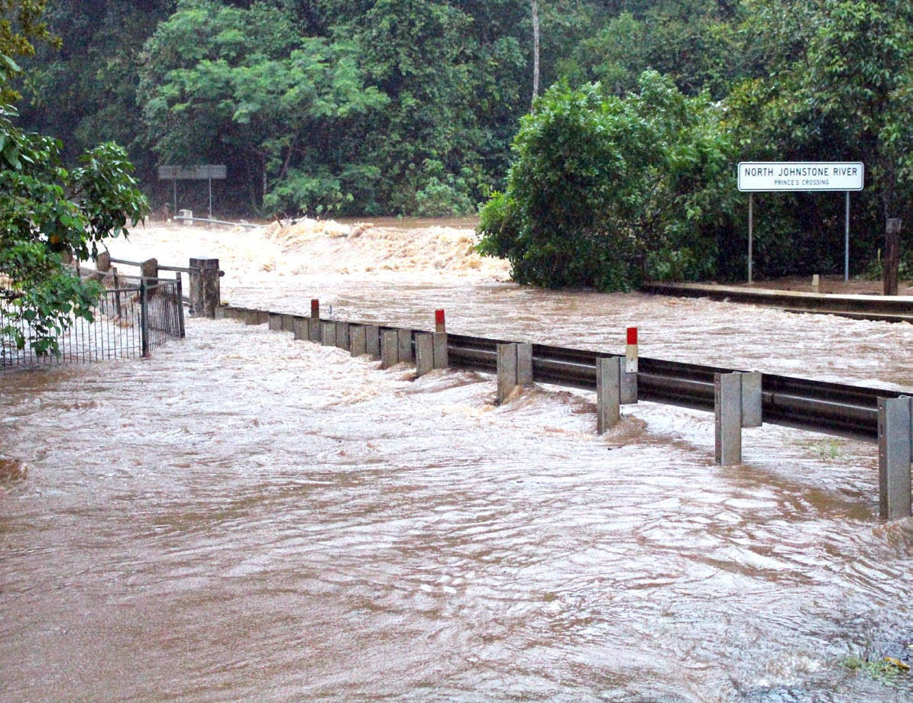

---
## Page 42

B5.1 Assessment against MCA criteria
B5. 1. 1	 Safety
The MCA safety criterion considers three targeted indicators: 
1.	 ability to evacuate to safer locations or evacuation centres
2.	 population at risk
3.	 isolation duration and risk. 
Assessment of the safety criterion may require input from an experienced floodplain manager or flood engineer/scientist, 
except where risk has been identified as low for an option.
Ability to evacuate to safer locations or evacuation centres
This targeted indicator measures the ability of the at-risk population to evacuate to safer locations or evacuation centres 
following implementation of an option. To determine this capability, several factors can be considered, as outlined in 
Timeline modelling of flood evacuation operations including:
	ƒ time for responsible authorities to make flood predictions, decide to evacuate and issue warnings
	ƒ time for the community to accept and respond to warnings
	ƒ total time needed for evacuation, which may include consideration of the road capacity for evacuation routes, 
including feeder and linking roads
	ƒ time needed for vehicle movements, which can be influenced by the type and number of vehicles (including 
emergency service vehicles) using routes and the capacity of routes
	ƒ time available before routes are cut off by flood waters, including the time available following the issuing of 
warnings. 
To fully understand the variability in time available before routes are inundated, assess the time for a range of flood 
events. For infrastructure options with an assigned flood immunity, assess flood events larger than the design flood 
immunity to determine the residual risks.
Consider the vulnerability and mobility of the community when determining the time needed for evacuation. Assistance 
may be needed to evacuate more vulnerable sectors of the community or where there is low vehicle ownership. Also 
consider that some stages of the evacuation may be impacted by time of day (for example, evacuations may take longer 
during the night). 
Targeted indicator
Description
Ability to evacuate to safer locations 
or evacuation centres
Measure of the ability of the at-risk population to evacuate 
to safer locations or evacuation centres
Score descriptors
1 (LOWEST)
2
3
4
5 (HIGHEST)
Insufficient ability to 
evacuate
Some ability to 
evacuate
Sufficient ability to 
evacuate
Substantial ability to 
evacuate
Very substantial 
ability to evacuate
34
State guideline: Flood evacuation route improvements  |  May 2021

---
## Page 43

Population at risk
This targeted indicator measures risk to life following implementation of an option. This can be assessed by using a full 
flood risk assessment that examines the level of hazard and the probability and consequence of that hazard occurring 
(see Appendix B). Alternatively, this targeted indicator can be simplified to calculate the number of people at risk of 
inundation or isolation for a range of flood events, both before and after option implementation, and annualised.
Isolation duration and risk
This targeted indicator measures risk to life due to isolation following implementation of an option. This can be 
determined by considering the likelihood and number of people likely to be isolated and the community’s tolerability 
and vulnerability to isolation. When assessing this targeted indicator, isolation risks at the location where the community 
is being evacuated also needs to be considered. 
Determine the community’s tolerability to isolation based on how long the population is prepared to be isolated. 
Determine the vulnerability of the population by considering the duration of isolation, the need for, and access to, 
essential goods and services such as medical supplies and the potential for interaction with flood waters. Measure 
isolation duration by assessing the likely length of isolation for a range of flood events, before annualising the time. 
Isolation risk may be high where isolation persists for a significant duration, essential services are cut-off or isolated 
members of the community require medical attention. 
Cloncurry River Bridge, Cloncurry Shire
Targeted indicator
Description
Population at risk
Measure of risk to life
Score descriptors
1 (LOWEST)
2
3
4
5 (HIGHEST)
Extreme risk
High risk
Medium risk
Low risk
Very low risk
Targeted indicator
Description
Isolation duration and risk
Measures risk to life due to isolation
Score descriptors
1 (LOWEST)
2
3
4
5 (HIGHEST)
Extreme risk to life 
due to isolation
High risk to life due to 
isolation
Medium risk to life 
due to isolation
Low risk to life due to 
isolation
Very low risk to life 
due to isolation
35
State guideline: Flood evacuation route improvements  |  May 2021

---
## Page 44

B5. 1. 2	Economic
The MCA economic criterion considers two targeted indicators:
1.	 economic growth and investment
2.	 damages and costs (including property, assets and operations).  
Assessment of the economic criterion may require expert input (such as an economist) except where risk is identified as 
low for an option (for example, small-scale projects or where construction is not required in flood-prone land).
Economic growth and investment 
This indicator measures potential economic growth and investment as a consequence of increased flood resilience and 
can be determined by assessing the potential for future development, investment and population growth as a result 
of mitigating flood risks. For example, an option may alleviate concerns in communities with known flooding issues, 
stimulate population growth and encourage investment in business and development. These benefits can be important 
in regional areas to promote economic growth.  
Damages and costs (property, assets and operations)
This targeted indicator measures the reduction in flood damages and costs to property and business following 
implementation of an option. Damages to property may be measured by considering the financial cost of damages to 
infrastructure, buildings and other assets as well as business costs, including those related to the impact of road closure 
on business operations (for example, lack of access to services and supplies). To measure these costs, consider the 
reduction in AATOC of an important route and the costs associated with the closure. Further information on quantification 
methods for flood damages to property and business can be found in the Economic Assessment Framework of Flood Risk 
Management Projects.  
Targeted indicator
Description
Damages and costs (property,  
assets and operations)
Measure to determine reduction in flood damages and 
costs to property and business
Score descriptors
1 (LOWEST)
2
3
4
5 (HIGHEST)
No reduction in flood 
damages and costs
Minor reduction in 
flood damages and 
costs
Moderate reduction 
in flood damages 
and costs
Significant reduction 
in flood damages 
and costs
Very significant 
reduction in flood 
damages and costs
Targeted indicator
Description
Economic growth and investment
Measure to determine potential economic growth and 
investment as a result of increased confidence in flood 
resilience
Score descriptors
1 (LOWEST)
2
3
4
5 (HIGHEST)
No potential 
economic growth 
and investment
Minor potential 
economic growth 
and investment
Moderate potential 
economic growth 
and investment
Significant potential 
economic growth 
and investment
Very significant 
potential economic 
growth and investment
36
State guideline: Flood evacuation route improvements  |  May 2021

---
## Page 45

B5. 1. 3	Environmental and cultural heritage impact
There are three targeted indicators in this guideline for the environmental and cultural heritage impact criterion:
1.	 overall impact on fauna connectivity (fish passage/fauna movement)
2.	 overall impacts to vegetation and habitat
3.	 impacts on cultural heritage.
When assessing these targeted indicators, consider relevant policies, legislation and approvals. Assessment may require 
input from an experienced environmental engineer, scientist, ecologist or cultural heritage specialist. The Queensland 
Government Development Assessment Mapping System or local government planning schemes may help identify areas 
subject to environmental or cultural heritage constraints. 
Overall impact on fauna connectivity (fish passage/fauna movement)
This targeted indicator measures the impact on fauna movement following implementation of an option. Fish passage 
and other fauna movement can be impacted by development, particularly within a waterway or on a previously 
undeveloped site. Determine the scale of impact on fauna connectivity and incorporate mitigation into the option so that 
it can be assessed based on the residual impact. Also, consider any change to design for mitigation in the financial and 
economic assessment stage (see section B.6). 
Overall impacts to vegetation and habitat
This targeted indicator measures the impact of an option on vegetation and habitat, including loss of vegetation, 
loss of habitat, impact to endangered species (both flora and fauna), scour and sediment loss and impact on sites of 
environmental significance. Determine the scale of impact on vegetation and habitat and incorporate mitigation into the 
option so that it can be assessed based on the residual impact. Also consider any change to design for mitigation in the 
financial and economic assessment stage (see section B.6). 
Targeted indicator
Description
Overall impact on fauna 
connectivity (fish passage/
fauna movement)
Measure of impact on fauna connectivity caused by an option
Score descriptors
1 (LOWEST)
2
3
4
5 (HIGHEST)
Significant negative 
impact to fauna 
connectivity
Moderate negative 
impact to fauna 
connectivity
Minor negative 
impact to fauna 
connectivity
Negligible impact to 
fauna connectivity
Positive impact to 
fauna connectivity
Targeted indicator
Description
Overall impacts to vegetation and 
habitat
Measure of impacts to vegetation and habitat 
Score descriptors
1 (LOWEST)
2
3
4
5 (HIGHEST)
Significant negative 
vegetation and 
habitat impacts
Moderate negative 
vegetation and 
habitat impacts
Minor negative 
vegetation and 
habitat impacts
Negligible vegetation 
and habitat impacts
Positive vegetation 
and habitat impacts
37
State guideline: Flood evacuation route improvements  |  May 2021

---
## Page 46

Impacts on cultural heritage
This targeted indicator measures the impact of an option on cultural heritage sites and requires consideration of relevant 
cultural heritage policies. Determine the scale of impact on cultural heritage sites and incorporate mitigation into the 
option so that it can be assessed based on the residual impact. Also consider any change to design for mitigation in the 
financial and economic assessment stage (see section B.6). 
B5. 1. 4	Social
The MCA social criterion in this guideline is assessed against two targeted indicators:
1.	 disruption to daily life
2.	 additional community benefits. 
Community consultation may be required to assess the targeted indicators.  
Disruption to daily life
This targeted indicator measures the improvement in the community’s ability to access, during or after a flood event, 
locations that are important to a community’s daily life (but would not contribute to causing a risk to life if restricted). 
These locations may include places of work, friends, family and recreational facilities. Consider the community’s 
resilience, as tolerability towards disruptions may vary. 
This targeted indicator should be clearly distinguished from the ‘isolation duration and risk’ targeted indicator in the 
safety criterion. For example, an option may score highly in the ‘isolation duration and risk’ targeted indicator by reducing 
the amount of time access is restricted to medical services (essential service), however, it may not score highly in this 
targeted indicator if access is restricted to workplaces in the town’s central business district (non-essential services). 
Targeted indicator
Description
Disruption to daily life
Measure of improvements in the ability of a population 
to go about daily life during or after a flood event. For 
example, being able to access services, recreational 
facilities and visit friends and family
Score descriptors
1 (LOWEST)
2
3
4
5 (HIGHEST)
No improvement in 
disruption to daily 
life
Minor improvement 
in disruption to daily 
life
Moderate 
improvement in 
disruption to daily life
Significant 
improvement in 
disruption to daily life
Very significant 
improvement in 
disruption to daily life
Targeted indicator
Description
Impact on cultural heritage sites
Measure of impact on cultural heritage sites
Score descriptors
1 (LOWEST)
2
3
4
5 (HIGHEST)
Very significant 
cultural heritage 
impacts
Significant cultural 
heritage impacts
Moderate cultural 
heritage impacts
Minor cultural 
heritage impacts
No cultural heritage 
impacts
38
State guideline: Flood evacuation route improvements  |  May 2021

---
## Page 47

Additional community benefits
This targeted indicator considers the benefits an option may provide the community in addition to improvements in 
evacuation capability or flood mitigation. These additional benefits may include improved road network efficiency 
or capacity for future planned development due to new or upgraded roads, or additional recreational or community 
facilities provided as part of a new evacuation centre. Consultation with stakeholders and the community can inform the 
identification of additional community benefits.  
Townsville suburbs inundated, February 2019
Targeted indicator
Description
Additional community benefits
Measure to capture any benefits in addition to improved 
evacuation capability
Score descriptors
1 (LOWEST)
2
3
4
5 (HIGHEST)
No additional 
community benefits
Minor additional 
community benefits
Moderate additional 
community benefits
Significant additional 
community benefits
Very significant 
additional community 
benefits
39
State guideline: Flood evacuation route improvements  |  May 2021

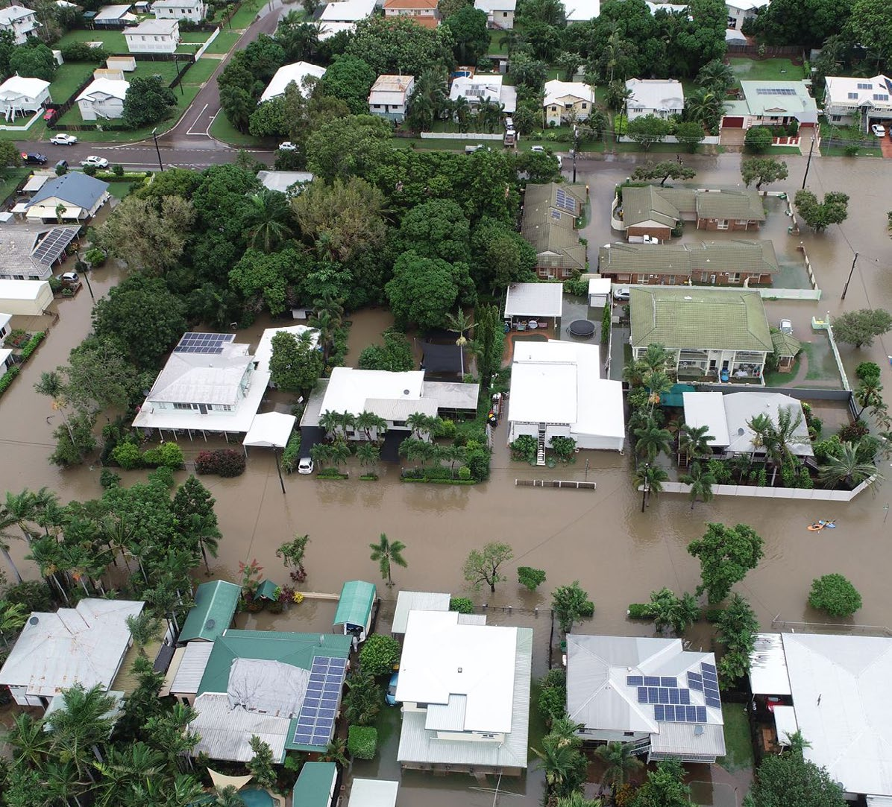

---
## Page 48

B5. 1. 5	Flood behaviour/impact
Assessment of the ‘flood behaviour and impact’ MCA criterion requires a detailed assessment of adverse flood impacts 
due to changes in flood behaviour and may require an experienced flood engineer/scientist or floodplain manager. The 
flood behaviour/impact criterion in this guideline is assessed against one targeted indicator, flood impacts. 
Flood impacts
Consider the level of constraint for each option due to potential or modelled adverse flood impacts and the likelihood 
that each constraint can be mitigated. Include all potential mitigation measures to ensure the assessment of the option 
is based on residual impact. Also consider any changes made to the design for mitigation in the financial and economic 
assessment stage (see section B.6).
The significance of flood impacts can be informed by assessing a number of factors, including flood level impacts 
and changes in duration of inundation, flow distribution and velocities. Details of these factors, including suggested 
acceptable limits adapted from the draft Austroads Guide to Road Design Part 5, are provided below (Note, the 
acceptable limit is a score of three or higher, with no other flood impact factors considered):
	ƒ Flood level impacts: the change in peak flood level for a range of flood events. Table 7 (adapted from the draft 
Austroads Guide to Road Design Part 5: Drainage – General Hydrology Considerations) below provides suggested 
thresholds for scoring against flood level impacts.
	ƒ Change in duration of inundation: the change in duration of inundation for a range of flood events. Generally, a 
change of time of inundation of less than 10% is acceptable but it is important to consider local conditions, for 
example crop resilience.
	ƒ Change in flow distribution: the diversion of flow from one location to another, or increased flow in one location and 
corresponding decreased flow in another location. Generally, a change in distribution of less than 10% is acceptable 
but consider local conditions such as water supply issues.
	ƒ Change in velocities: A change in peak flow velocities of less than 10% is generally acceptable but consider local 
conditions.
To measure this targeted indicator, conduct a flood impact assessment using hydraulic modelling. Consider the 5% 
AEP and 1% AEP flood events as a minimum standard, as well as other flood events relevant to the option under 
consideration. Larger events such as the 0.05% AEP or PMF may be used as part of the flood impact assessment to 
provide an additional understanding of changes in flood behaviour and residual risk.  Given their low likelihood, these 
events may not contribute to the scoring of the flood impact criteria, unless the impacts are identified as severe (for 
example, if a large number of properties would be impacted).  
For the suggested thresholds for flood level impacts included in Table 7, a score of 3 or higher should not be assigned 
for the flood level impact threshold unless the option also achieves acceptable changes to duration of inundation, flow 
distribution and velocities (as suitable for the area of interest).
Consider all local requirements or sensitivities to flood impacts and behaviour along with the suggested measures 
provided in this guideline.  
Targeted indicator
Description
Flood impacts
Measure of adverse flood impacts due to changes in flood 
behaviour caused by an option
Score descriptors
1 (LOWEST)
2
3
4
5 (HIGHEST)
Very significant 
adverse flood impacts 
Significant adverse 
flood impacts 
Moderate adverse 
flood impacts 
Minor adverse flood 
impacts 
Negligible flood 
impacts 
40
State guideline: Flood evacuation route improvements  |  May 2021

---
## Page 49

Table 7 - Scoring of flood impact targeted indicator based on flood level impacts
The flood level impacts in Table 7 may be generally acceptable but users should consider local conditions and adapt the 
thresholds accordingly.
Location
Suggested flood impact thresholds (flood level impact in mm)
1 (lowest)
2
3*
4*
5 (highest)*
General (e.g. general rural 
landholdings, open space, non-
habitable structures, industrial 
yard areas)
>400mm 
200-400mm 
100-200mm 
50-100mm 
Less than 
50mm 
Sensitive receivers (e.g. 
residential buildings, commercial 
buildings, emergency services/
hospitals)
>30mm 
20-30mm 
15-20mm 
10-15mm 
Less than 
10mm 
* This score should only be selected if acceptable changes to duration of inundation, flow distribution and velocities  
are also achieved.
B5. 1. 6	Additional constraints
The additional constraints MCA criterion is assessed against one targeted indicator, engineering/construction 
constraints. Input may be required from a suitably qualified and experienced person, such as a civil, geotechnical or 
structural engineer. 
Engineering/construction constraints
This targeted indicator measures the level of technical and physical constraints that may impact on the delivery of an 
option. These constraints may include geotechnical issues, site constraints, site availability, access and material storage 
location issues, difficulties in sourcing materials or traffic and structural considerations. To assess this targeted indicator, 
consider the level of constraint and incorporate mitigation so that options can be assessed based on the residual 
impact. Also consider any changes made to the design for mitigation in the financial and economic assessment stage 
(see section B.6).
Wyaga Creek, Gore Highway
Targeted indicator
Description
Engineering/construction 
constraints
Measure of any other constraints to the engineering 
design and construction of an option
Score descriptors
1 (LOWEST)
2
3
4
5 (HIGHEST)
Very significant 
evidence of potential 
engineering or 
constructability 
issues
Significant evidence 
of potential 
engineering or 
constructability 
issues
Moderate evidence of 
potential engineering 
or constructability 
issue
Minor evidence of 
potential engineering 
or constructability 
issues
No evidence of 
potential engineering 
or constructability 
issues
41
State guideline: Flood evacuation route improvements  |  May 2021

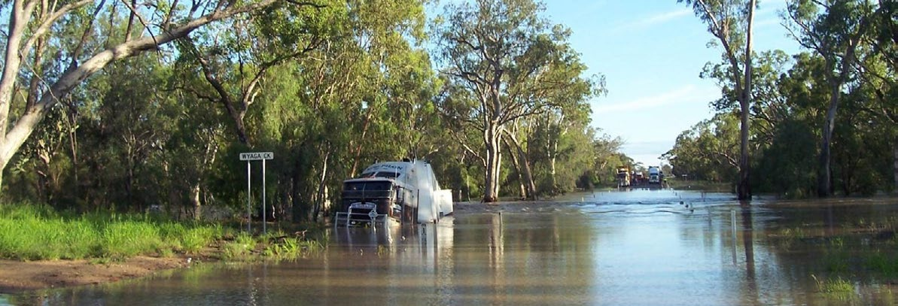

---
## Page 50

B5.2	 MCA weighting
The MCA in this guideline allows for weightings to 
be assigned to each criterion to capture the relative 
importance of each contributing decision factor and issue 
to decision makers. Weightings are intended to capture 
the relative importance of issues to decision makers 
and are most effective when developed in conjunction 
with project stakeholders. Community input might also 
be used to shape weightings, however, community 
involvement in the direct process of weighting selection 
may be challenging. It is also important to recognise that 
the weighting process can be limited by personal biases 
which may be addressed by ensuring stakeholders 
involved in weighting clearly understand the significance 
of the criteria and targeted indicators. 
Weightings are assigned as a percentage which add up to 
100 percent and are expressed by:
	ƒ criterion weighting – assigned weightings to each 
criterion
	ƒ targeted indicator weighting – determined by 
dividing the assigned criterion weighting by the 
number of targeted indicators within the criterion. 
The overall score of each option is determined by 
totalling the weighted scores for each targeted indicator. 
The weighted scores are calculated by multiplying the 
targeted indicator weighting by its score. If specific 
criteria weighting is not applied, distribute weightings 
evenly amongst the criteria before calculating the 
weighted scores. For an example of how overall scores 
are calculated, refer to the State guideline: Flood 
evacuation route improvements – Worked example. 
There are numerous valid approaches to the selection of 
weightings and the decision to apply weightings such as:
	ƒ rank sum
	ƒ rank reciprocal
	ƒ rank order centroid
	ƒ pairwise.
The selection of an approach is at the user’s discretion. 
See Smarter Solutions – Multi-Criteria Analysis Tool – 
User Guide for further information.
Pairwise is a ranking tool used to assign priorities to 
multiple options. The pairwise method has been adopted 
for this guideline as it is transparent, easy to understand 
and well suited to an assessment of this level of detail. To 
avoid bias, ensure all key stakeholders are represented 
and have the opportunity to provide input into the 
pairwise process. 
An overview of the pairwise method is provided below 
and is used in the supporting worked example.  
Firstly, compare each criterion to the other criteria and 
decide which is more important. This is usually done in a 
matrix similar to Table 8 below.
Once relative importance has been determined, ranking 
is based on the occurrence of each criterion in the table, 
plus one, converted to a percentage. The weightings must 
total 100 per cent.
Stakeholder engagement is 
important when determining 
weightings to ensure they are 
not limited by personal biases. 
Table 8 - Pairwise method – Criteria weighting
Criteria
A
B
C
D
E
F
Occurrence  
+1
Criteria 
Weighting
A
-
A
C
A
A
A
5
23.81%
B
-
-
C
D
B
B
3
14.29%
C
-
-
-
C
C
F
5
23.81%
D
-
-
-
-
D
D
4
19.05%
E
-
-
-
-
-
E
2
9.52%
F
-
-
-
-
-
-
2
9.52%
Total
21
100%
42
State guideline: Flood evacuation route improvements  |  May 2021

---
## Page 51

In summary
The stage two: MCA is a detailed assessment of the short-listed options. 
Each option is scored against six criteria which are comprised of one or 
more targeted indicators. Scores can be weighted to capture the importance 
of each criterion and sensitivity testing can be conducted to detect bias 
towards particular options.  
B5.3	 Sensitivity testing of criteria weighting
To assess the robustness of the final ranking against the assigned weightings, conduct a sensitivity analysis. Sensitivity 
testing typically involves adjusting the weighting of criteria to identify the impact on the results. Various methods 
of sensitivity testing can be applied to an MCA to detect bias towards particular options and to enable a balanced 
comparison of options. Methods for sensitivity testing include:
	ƒ stepwise testing method – determines how much the 
criteria weighting must change to alter the highest 
scoring option
	ƒ thresholding – changes the proportional weightings 
of each criteria by increasing and reducing weighting 
by 50 per cent and 25 per cent, whilst the weighting of 
other criteria remains proportionally unchanged
	ƒ balanced assessment - applies equal weighting 
among all criteria
	ƒ applying a 40 per cent weighting to each criterion 
and distributing weightings equally among remaining 
criteria
	ƒ adding cost as a criterion and weighting heavily to 
influence results. This is useful if weighted scores are 
close between options. 
Damage to road at Elliott River Bridge on 
Goodwood Road, Wide Bay Burnett
43
State guideline: Flood evacuation route improvements  |  May 2021

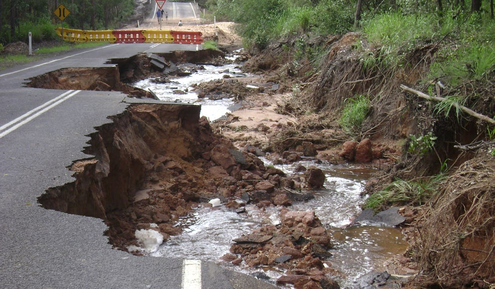

---
## Page 52

B6.	Financial and economic assessments
Financial and economic assessments are key decision 
support tools to support the options assessment 
process. Financial assessments consider investment 
decisions from the perspective of an organisation, 
entity or individual, assessing the viability of a project 
based on the direct effects on cash flow (QRA, 2021a).  
Economic assessments seek to quantify the damages 
caused by flooding and the benefits resulting from option 
implementation (QRA, 2021a).
Cost estimations and cost benefit analyses (CBAs) 
are economic assessment methodologies which can 
provide valuable information to compare options. The 
level of detail and use of these methodologies can be 
fit-for-purpose for the scale of the evacuation problem 
and type of options being assessed (for example, CBAs 
may only be required for large projects that warrant the 
investment). However, at a minimum, conduct a cost 
estimation to understand the level of investment required 
to deliver different options.  See below for further 
guidance on both methodologies.  
B6.1	 Cost estimation
Comparing MCA scores of options against their cost can 
assist in identifying the efficiency of options in resolving 
the evacuation problem. When conducting a cost 
estimate, assess both upfront capital cost and whole-
of-life costs, including ongoing operating, maintenance, 
refurbishments, rehabilitation and disposal costs. 
Include the cost of mitigating potential impacts and 
constraints that may have been identified in the MCA 
stage, and consider how the cost aligns with budgets, 
potential funding and the scale of the evacuation 
problem. When conducting cost estimates consult with 
stakeholders who may be responsible for committing 
resources to implement or deliver a potential option. 
For information on cost estimation methods refer to 
the Economic Assessment Framework of Flood Risk 
Management Projects.  
B6.2	 Cost-benefit analysis
CBAs are an economic assessment method to support 
decision making which assesses the long-term value of 
benefits and costs in monetary terms (QRA, 2021a). In 
a CBA, the project case (option) is assessed against the 
base case (business as usual) to determine the marginal 
benefits gained from investing in the project throughout 
the assessment period (life of the asset). 
Included in CBAs are Benefit Cost Ratios (BCRs) and Net 
Present Value (NPV). BCRs provide a ratio of the benefits 
to costs and NPVs measure the absolute net economic 
gain by subtracting costs from benefits. Typically, for 
a project to be deemed viable it must achieve a BCR 
greater than one and a positive NPV. It is likely to be rare 
for evacuation route improvements to achieve these 
thresholds given the difficulty or sensitivity of quantifying 
risk to life benefits. Therefore, BCRs and NPVs should be 
used to compare the economic performance of options 
and not for the purposes of determining if an option is 
suitable for investment. 
When conducting a CBA for an evacuation route 
improvement, capture both flood and non-flood related 
costs and benefits (for example, improved network 
efficiency may be a non-flood related benefit of a road 
upgrade option). Further information on how to conduct 
a CBA for flood management projects is provided in 
the Economic Assessment Framework of Flood Risk 
Management Projects. CBAs should be conducted by a 
suitably qualified or experienced person.
In summary
Financial and economic 
assessments such as 
cost estimations and cost 
benefit analyses are key 
decision support tools.
Ross River - Aplins Weir overtopped, Townsville, 2019
44
State guideline: Flood evacuation route improvements  |  May 2021

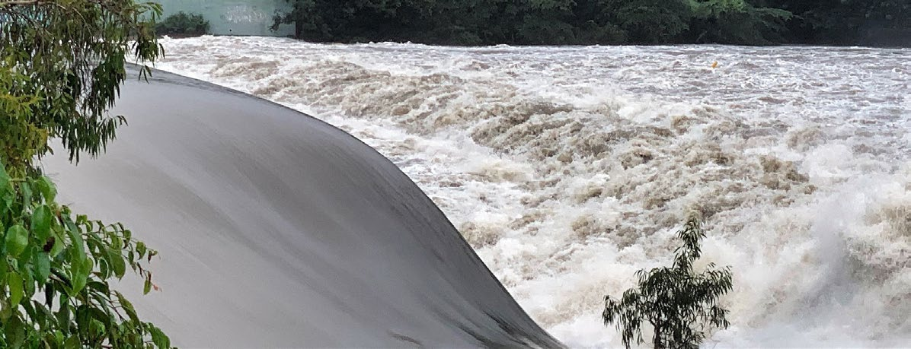

---
## Page 53

B7.	 Reviewing outcomes of the assessment 
process
The options assessment process provides information 
on the effectiveness and efficiency of options based on 
their benefits, impacts, cost and constraints to support 
decision making. Review the outcomes of the assessment 
to determine which evacuation route improvement(s) is 
most ‘fair and reasonable’.  Other information may also 
need to be considered before committing to a preferred 
option(s). Consider the following when reviewing the 
outcomes of the assessment process: 
	ƒ Do the options sufficiently address the evacuation 
problem, service need and desired outcomes?
Review options to ensure they resolve the 
evacuation problem and meet the service need 
and desired outcomes (for example, reduce risk to 
life). An option may score favourably in the MCA, 
however, it may not reduce the length of isolation 
or improve the ability to evacuate enough to resolve 
the evacuation problem. 
	ƒ Was it possible to appropriately capture all 
benefits, impacts, costs and constraints in the 
assessment process? 
Intangible issues, such as reduction in mental 
health impacts, may be difficult to quantify but can 
be an important driver in option selection.
	ƒ Should scores for a targeted indicator eliminate an 
option, irrespective of the overall MCA score? 
In all cases, low scores for targeted indicators in the 
safety criterion should eliminate an option. Scores 
for other targeted indicators may also eliminate an 
option due to the significance of the impact. For 
example, an option may achieve a high overall MCA 
but is eliminated due to cultural heritage impacts. 
	ƒ How do the MCA results compare with the economic 
and financial assessments? 
Consider cost estimates and the results of economic 
and financial assessments with the MCA scores. 
Where CBAs have been conducted, it is important 
to be aware BCRs and NPVs have limitations in 
quantifying and monetising benefits for safety and 
risk to life. For evacuation route improvements, 
BCRs and NPVs are valuable for comparative 
purposes to indicate which option has the greater 
economic performance. In general, if two options 
have similar BCRs, the option with the highest MCA 
score is usually more preferable.
	ƒ Is the cost of each option affordable and 
commensurate with the scale of the evacuation 
problem? 
Review the feasibility of options based on their costs 
when considering budgets or funding availability 
and consider if proposed options warrant the 
required investment. Throughout the process, 
engage and consult agencies, stakeholders or 
organisations who may be required for delivery or 
ongoing operations. 
Following the review, if a clear preferred option or options 
cannot be identified, options can be continually refined 
or further information collated before repeating the 
assessment process. 
In summary
In summary, to support the 
identification of ‘fair and 
reasonable’ evacuation 
route improvements, 
review the outcomes of 
the assessment process. 
Other information may 
also need to be considered 
before committing to an 
option. 
State guideline: Flood evacuation route improvements  |  May 2021 45

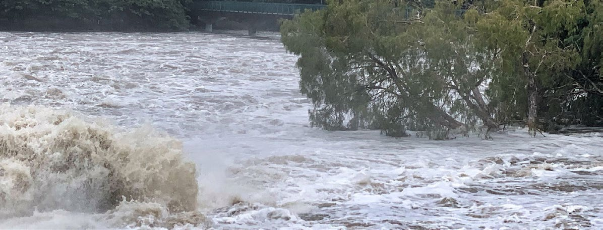

---
## Page 54

Part C: Implementation 
Further approvals and agreements may need to be 
obtained and the scheduling of the project may 
be dependent on the priorities of the organisation 
responsible for delivery. The implementation process 
commences once the preferred option is ready to be 
considered for investment. 
The implementation process is influenced by local 
policies, practices and processes; however, it typically 
follows the steps described below:
	ƒ Business case: Development of a business case to 
identify the merit of the option and seek funding. 
	ƒ Implementation plan: Development of a roadmap to 
implement the option.
	ƒ Implementation: Delivery of the option.
The following are key considerations for implementation 
of the preferred option/s as a result of the assessment: 
	ƒ Prior to, and during, implementation, engage 
relevant stakeholders, including the owner(s) 
of the relevant infrastructure and assets and 
decision makers responsible for funding and 
implementation. Once the preferred option has 
been agreed with these stakeholders, refer the 
option to the infrastructure owner(s) to progress or 
capture in forward planning and prioritisation. If a 
project requires delivery by another agency, asset 
owner, or internal area, it may need to be transferred 
to them for progression.
	ƒ When developing a business case, consider that 
evacuation route improvements may not have direct 
tangible economic benefits, so place emphasis on 
quantifying the likely reduction in risk to life and 
other intangible economic benefits. The evacuation 
problem, options analysis, preferred option, 
project benefits and way forward need to be clearly 
communicated to support a strong business case.
	ƒ Establish governance arrangements with clear roles 
and responsibilities, including identification of the 
project owner, sponsor and the project management 
arrangements to ensure accountability for the 
project is clear.
	ƒ Once a preferred option has been implemented, 
inform stakeholders responsible for executing 
evacuation arrangements. The option may also be 
captured in an LDMP or evacuation sub-plan.
	ƒ If contemplating evacuation route signage to 
support a measure, liaise with TMR, police and 
emergency services agencies to confirm evacuation 
route signage requirements (see Appendix C).
Toowoomba
46
State guideline: Flood evacuation route improvements  |  May 2021

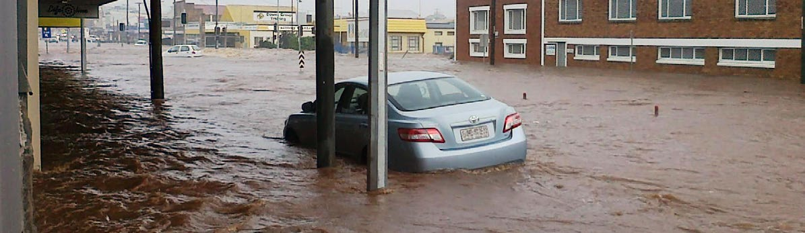

---
## Page 55

Term
Definition
Acceptable risk
The extent to which a disaster risk is deemed acceptable or tolerable depends on existing social, 
economic, political, cultural, technical and environmental conditions. A sub term of disaster risk. 
Also known as tolerable risk (Inspector-General Emergency Management, 2018). 
Annual Exceedance 
Probability 
The chance that a flood will reach or exceed a particular level in any given year. For example, a 1% 
(1 in 100) AEP (QRA, 2019a).
Assembly Point
A designated location specifically selected as a point which is not anticipated to be adversely 
affected by a hazard (QFES, 2018b). 
Average Annual Time 
of Closure (AATOC)
The expected average time per year of closure of the road caused by flooding. It is expressed as 
time per year (DTMR, 2019b).  
Benefit Cost Ratio
Ratio of the present value of benefit over the present value of costs (QRA, 2021a).
Brisbane River 
Catchment Flood 
Studies
The full package of investigations of the Brisbane River carried out on behalf of the Queensland 
Government since 2013 covering data collection, hydrological and hydraulic modelling, the 
Strategic Floodplain Management Plan and Local Floodplain Management Plans (QRA, 2019a). 
Capability
The ability to achieve a desired effect in a specific environment/context (QFES, 2018b).
Coastal/storm surge 
flooding
Flooding as a result of the rising of the sea due to a storm (typically a low pressure weather 
system, such as a cyclone) and which may be exacerbated by wind waves or other coastal 
processes, such as erosion.
Community
A group with a commonality of association and generally defined by location, shared experience, 
or function.
A social group which has a number of things in common, such as shared experience, locality, 
culture, heritage, language, ethnicity, pastimes, occupation, workplace, etc. (QFES, 2018b).
Community 
resilience
A community’s ability to rapidly accommodate and recover from the impacts of hazards, restore 
essential structures and desired functionality and adapt to new circumstances. Community 
resilience is closely linked to the awareness of the community regarding flooding and the 
potential for impacts and damages from different sizes of events (QRA, 2019a). 
Controlled releases 
from a dam (flooding 
source) 
Flow in a waterway due to a controlled dam release which exceeds the capacity of the channel and 
results in water overtopping the channel banks. 
Cost Benefit 
Analysis
An economic assessment methodology to support decision making which assesses the long-term 
benefits and costs in monetary terms (QRA, 2021a). 
Creek flooding
Flooding within creeks and small river systems where floods increase and break out of the channel 
banks.
Disaster
A serious disruption in a community, caused by the impact of an event, that requires a significant 
coordinated response by the state and other entities to help the community recover from the 
disruption (QFES, 2018b). 
Disaster 
Management Group
Means the state group, a district group or a local group (QFES, 2018b). 
District Disaster 
Management Group 
(DDMG)
The group established under section 22 of the Disaster Management Act 2003. The DDMG 
provides whole-of-government planning and coordination capacity to support local governments 
in disaster management and operations (QFES, 2018b). 
Evacuation
The planned movement of persons from an unsafe or potentially unsafe location to a safer 
location and their eventual return (QFES, 2018b).
Evacuation centre
A building located beyond a hazard to provide temporary accommodation, food and water until it 
is safe for evacuees to return to their homes or alternative temporary emergency accommodation 
(QFES, 2018b).
Glossary
(continued on next page)
47
State guideline: Flood evacuation route improvements  |  May 2021

---
## Page 56

Term
Definition
Evacuation facilities
Describe a variety of sites which may need to be established to accommodate people during an 
evacuation. Categories of evacuation facilities comprise:
	ƒ evacuation centre
	ƒ public cyclone shelter*
	ƒ place of refuge* (QFES, 2018b). 
* Note, public cyclone shelter and place of refuge are specifically for cyclones. 
Evacuation  
sub-plan
An appendix to a disaster management plan, evacuation sub-plans provide further detailed 
arrangements, methods and protocols relating to evacuation activities undertaken by the disaster 
management groups and their member agencies.
Evacuation route
A designated road, not anticipated to be adversely affected by the hazard, to be used for travel to a 
safer location (QFES, 2018b).
Essential goods
Essential goods are considered to include: 
	ƒ basic foodstuffs, basic cleaners 
	ƒ disinfectants, etc. to enable communities to maintain adequate hygiene practices
	ƒ baby foods, formula feeds for babies and nappies 
	ƒ foodstuffs to meet special dietary requirements
	ƒ medicines and medical supplies, water purification tablets/treatments
	ƒ dried pet foods
	ƒ fuels for essential activities
	ƒ batteries
	ƒ other goods deemed necessary to maintain the physical and/or psychological welfare of the 
inhabitants of isolated communities (see QFES, 2018b for detailed definition).
Exposure 
The land use and population that exists within the floodplain, and hence is exposed to flood 
hazards (QRA, 2019a).  
Flood conveyance
Where the vast majority of flood water flows through a floodplain and is typically deep and fast 
flowing during big flood events. Even partial blockage of flood conveyance areas would likely cause 
significant redistribution of flood flow or significant increase in flood levels (QRA, 2019a). 
Floodplain
An area of land that is subject to inundation by floods up to and including the probable maximum 
flood event – that is, flood-prone land (AIDR, 2017d).
Flood-prone land
Land susceptible to flooding by the Probable Maximum Flood event. Flood-prone land is 
synonymous with the floodplain (AIDR, 2017d). 
Hydraulic behaviour
Where and how flood waters flow across a floodplain. This includes flood depths, levels, velocities 
and flows (QRA, 2019a). 
Hydrologic and 
hydraulic models
Computer modelling of rainfall and surface runoff to simulate real world flood conditions and 
therefore estimate likely flood extents and flood behaviour for theoretical future conditions and 
events. These models are calibrated to historical events to ensure they provide an adequate 
representation of actual conditions (QRA, 2019a). 
Immunity / Flood 
Immunity
The probability of the storm event for which flood extents do not exceed above or encroach 
beyond defined limits. Expressed as either an Annual Exceedance Probability (AEP) or a number of 
Exceedances per Year (EY). 
Likelihood
The chance of something happening whether defined, measured or determined objectively or 
subjectively, qualitatively or quantitatively and described using general terms or mathematically. 
(Standards Australia/ Standards New Zealand Standard Committee, 2009)
Localised flooding/
overland flow
Flooding generated from rainfall occurring over a local area only. Localised flooding is concentrated 
in small creeks and ephemeral waterways, while overland flow is the surface runoff following 
rainfall, concentrated in natural lower lying areas and swales across the landscape. Flooding is 
usually ‘flashy’ with peaks occurring shortly after rainfall (QRA, 2019a).
Local Disaster 
Management Group
The group established under section 29 of the Disaster Management Act 2003, in place to 
support Local Government in the delivery of disaster management services and responsibilities in 
Preventing, Preparing for, Responding to and Recovering from Disaster Events (QFES, 2018b). 
Glossary (continued)
(continued on next page)
48
State guideline: Flood evacuation route improvements  |  May 2021

---
## Page 57

Term
Definition
Local Disaster 
Management Plan 
(LDMP)
A plan prepared under section 57 of the Disaster Management Act 2003 that documents 
arrangements to manage disaster planning and operations within the local government area of 
responsibility (QFES, 2018b).  
Net Present Value 
(NPV)
A present value (all values discounted to present day terms) of the benefits less the present value of 
costs (QRA, 2021a).
Phases of disaster 
management
Prevention, Preparedness, Response and Recovery. 
Preparedness
The taking of preparatory measures to ensure that, if an event occurs, communities, resources and 
services are able to cope with the effects of the event (QFES, 2018b). 
Prevention
The taking of preventative measures to reduce the likelihood of an event occurring or, if an event 
occurs, to reduce the severity of the event (QFES, 2018b). 
Probable Maximum 
Flood (PMF)
The PMF is the largest flood that could conceivably occur at a particular location, usually estimated 
from probable maximum precipitation and, where applicable, snow melt, coupled with the worst 
flood-producing catchment conditions. 
Generally, it is not physically or economically possible to provide complete protection against this 
event. The PMF defines the extent of flood-prone land – that is, the floodplain.
The extent, nature and potential consequences of flooding associated with a range of events 
rarer than the flood used for designing mitigation works and controlling development, up to and 
including the PMF event, should be addressed in a floodplain risk management study (AIDR, 2017d).
Recovery
The taking of appropriate measures to recover from an event, including the action taken to support 
disaster-affected communities in the reconstruction of infrastructure, the restoration of emotional, 
social, economic and physical wellbeing, and the restoration of the environment (QFES, 2018b). 
Residual risk
The risk that remains in unmanaged form, even when effective disaster risk reduction measures are 
in place, and for which emergency response and recovery capacities must be maintained (Inspector-
General Emergency Management, 2018).
Response
The taking of appropriate measures to respond to an event, including action taken and measures 
planned in anticipation of, during, and immediately after an event to ensure that its effects are 
minimised and that persons affected by the event are given immediate relief and support (QFES, 
2018b). 
Riverine flooding
Flooding within large river systems where floods increase and break out of the riverbanks to 
inundate adjacent floodplains. Flooding is generated from rainfall across the broad catchment area. 
It may take many hours, or even days, for peak flood levels to occur as rainfall slowly drains from the 
catchment (QRA, 2019a).
Safer location
A variety of designated locations which are not anticipated to be adversely affected by the hazard. 
Categories of safer locations comprise:
	ƒ shelter in place
	ƒ friends and family
	ƒ neighbourhood safer places*
	ƒ assembly points (QFES, 2018b).
*Neighbourhood safer places are specifically for bushfire hazards.
Shelter in place
An alternative or in addition to evacuation where individuals shelter within their homes, workplace 
or with family/friends if considered safe to do so (QFES, 2018b).
Tolerability
Tolerability is the community’s readiness to bear the risk of flooding, after risk treatment. Risk 
tolerance can be influenced by legal or regulatory requirements, as well a community’s awareness 
and experience of floods, knowledge of previous flooding history, what type of uses are exposed, 
extent of social and community cohesiveness. A range of demographic and socio-economic 
characteristics of a community may also affect current and future community views on flood risk 
(QRA, 2019a). 
Tangible/intangible 
damages
Tangible damages are flood damages that can be measured in economic terms such as financial loss. 
Intangible damages cannot be directly linked to financial measures and include impacts such as 
stress and anxiety, as well as loss of life (QRA, 2019a). 
Vulnerability 
A measure of the sensitivity of the land use and/or population exposed to flooding. Vulnerability 
can relate to physical, socioeconomic, mobility or flood-awareness factors (QRA, 2019a). 
Glossary (continued)
49
State guideline: Flood evacuation route improvements  |  May 2021

---
## Page 58

Acronyms
AATOC
Average annual time of 
closure
AEP
Annual exceedance 
probability
AIDR
The Australian Institute of 
Disaster Resilience
BRSFMP
Brisbane River Strategic 
Floodplain Management 
Plan
BCR
Benefit cost ratio
CBA
Cost benefit analysis
DILGP
Department of Infrastructure 
Local Government and 
Planning
ECA
Evacuation capability 
assessment
LDMP
Local Disaster Management 
Plan
MCA
Multi-criteria assessment
NPV
Net present value
PMF
Probable maximum flood
QFES
Queensland Fire and 
Emergency Services
QRA
Queensland Reconstruction 
Authority
SPP
State Planning Policy
TMR
Department of Transport and 
Main Roads
Carpentaria Normanton flooding, 2019
50
State guideline: Flood evacuation route improvements  |  May 2021

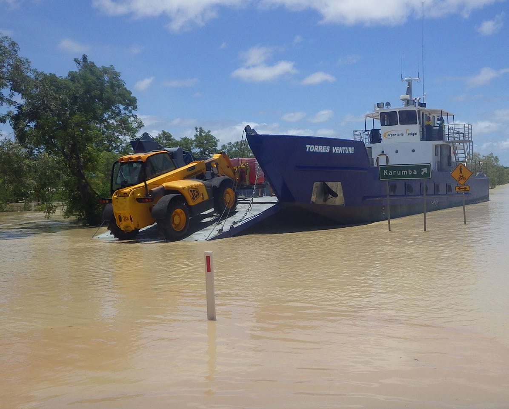

---
## Page 59

References
Australian Institute for Disaster Resilience (AIDR). (2017a). Assessing Options and Service Levels for Treating Existing 
Risk - Guideline 7-6.
Australian Institute for Disaster Resilience (AIDR). (2017b). Evacuation Planning – Handbook 4.
Australian Institute for Disaster Resilience (AIDR). (2017c). Flood Hazard – Guideline 7-3.
Australian Institute for Disaster Resilience (AIDR). (2017d). Managing the Floodplain: A Guide to Best Practice in Flood 
Risk Management in Australia – Handbook 7. 
Australian Institute for Disaster Resilience (AIDR). (2020a). Community Engagement for Disaster Resilience.
Australian Institute for Disaster Resilience (AIDR). (2020b). Flood Emergency Planning for Disaster Resilience.
Austroads. (2020). ‘Guide to Road Design Part 5: Drainage – General and Hydrology Considerations’ – Unpublished 
Draft Update. 
Ball, J., Babister, M., Nathan, R., Weeks, B., Weinmann, E., Retallick, M., & Testoni, I. (2019). Australian Rainfall and 
Runoff: A Guide to Flood Estimation. Commonwealth of Australia.
Department of Infrastructure, Local Government and Planning (DILGP). (2016). State Infrastructure Plan – Part A: 
Strategy.
Department of Infrastructure, Local Government and Planning (DILGP). (2017a). State Planning Policy – July 2017.
Department of Infrastructure, Local Government and Planning (DILGP). (2017b). State Planning Policy – state interest 
guidance material - Natural hazards, risks and resilience – Flood – July 2017.
Department of Natural Resources, Mines and Energy (DNRME). (2018). Guideline for Failure Impact Assessment of 
Water Dams.
Department of Transport and Main Roads (DTMR). (2011). Cost-Benefit Analysis Manual – Road Projects.
Department of Transport and Main Roads (DTMR). (2019a). Network Optimisation Framework.
Department of Transport and Main Roads (DTMR). (2019b). Road Drainage Manual.
Department of Transport and Main Roads (DTMR). (2019c). Smarter Solutions – Multi-Criteria Analysis Tool – User 
Guide.
Department of Transport and Main Roads (DTMR). (2019d). Traffic and Road Use Management Manual Volume 3 – 
Signing and Pavement Marking. 
Department of Transport and Main Roads (DTMR). (2020). Natural Disaster Program Design and Eligibility Guidelines. 
Department of Transport and Main Roads (DTMR). (2020). Queensland Manual of Uniform Traffic Control Devices. 
Haines, P., Dearnley, C., Wallace, S., Ramilo, N., Rodgers, B., Filer, B., Monhartova, P., Kime, S., McGuire, S., Corkill, 
D., Doyle, B., Jordan, A., Markar, S., Guse, H., Yeo, D., Bridson, W., Granger, K., Rogencamp, G. (2018). Technical 
Evidence Report Brisbane River Strategic Floodplain Management Plan. Brisbane: BMT Eastern Australia Pty Ltd.
Inspector-General Emergency Management (IGEM). (2018). Queensland Disaster Management Lexicon.
Institute of Public Works Engineering Australia Queensland. (2017). Queensland Urban Drainage Manual.
Opper, S., Cinque, P., & Davies, B. (2010). Timeline modelling of flood evacuation operations. First International 
Conference on Evacuation Modelling and Management Vol 3, 175-187.
Queensland Disaster Management Committee. (2018). Queensland State Disaster Management Plan.
Queensland Fire and Emergency Services (QFES). (2015a). Tropical Cyclone Storm Tide Warning Response System 
Handbook.
Queensland Fire and Emergency Services (QFES). (2018a). Evacuation: Responsibilities, Arrangements and 
Management – Manual 1.190. 
(continued on next page)
51
State guideline: Flood evacuation route improvements  |  May 2021

---
## Page 60

(continued from previous page)
Queensland Fire and Emergency Services (QFES). (2018b). Queensland Prevention, Preparedness, Response and 
Recovery Disaster Management Guideline. Brisbane: Queensland Government.
Queensland Fire and Emergency Services (QFES). (2018c). Queensland Emergency Risk Management Framework – 
Risk Assessment Process Handbook (QERMF). Brisbane: Queensland Government.
Queensland Floods Commission of Inquiry. (2012). Queensland Floods Commission of Inquiry: Final Report.
Queensland Reconstruction Authority (QRA). (2019a). Brisbane River Strategic Floodplain Management Plan. 
Queensland Reconstruction Authority (QRA). (2019b). Queensland Disaster Resilience and Mitigation Investment 
Framework. 
Queensland Reconstruction Authority (QRA). (2021a). Economic Assessment Framework of Flood Risk Management 
Projects.
Queensland Reconstruction Authority (QRA). (2021b). Queensland Flood Risk Management Framework.
Queensland Treasury. (2015). Project Assessment Framework – July 2015.
Standards Australia / Standards New Zealand Standard Committee. (2009). ISO 31000:2009 Risk management – 
Principles and guidelines. 
Charters Towers Road underwater, Townsville, February 2019
52
State guideline: Flood evacuation route improvements  |  May 2021

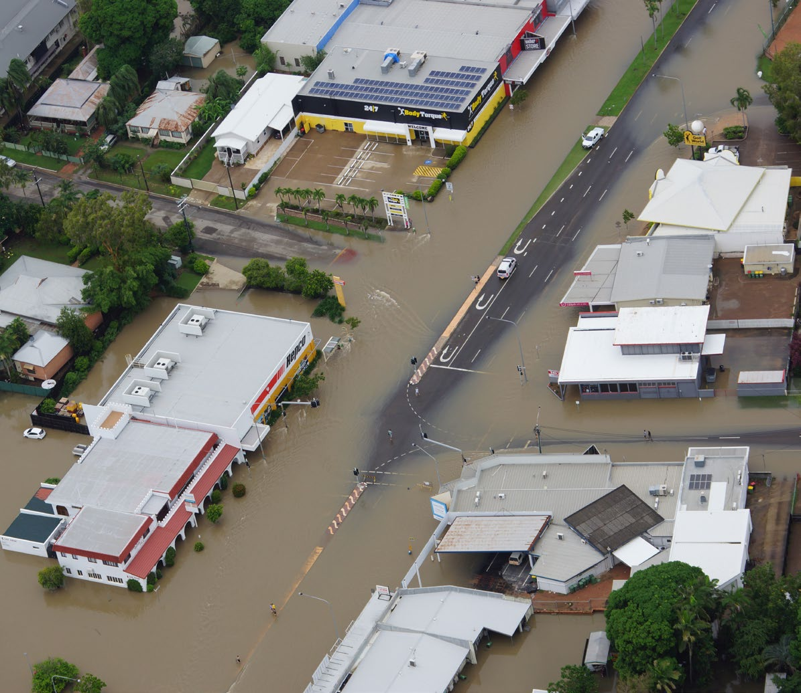

---
## Page 61

Publication
Author/publisher 
and date
Scope and access location
Evacuation Planning –  
Handbook 4
AIDR (2017b)
Incorporates guidelines and considerations for developing 
community evacuation plans underpinned by an all-hazards 
approach. 
https://knowledge.aidr.org.au/media/5617/aidr-evacuation-
planning-handbook.pdf
Managing the Floodplain: A Guide 
to Best Practice in Flood Risk 
Management in Australia
AIDR (2017d)
National guideline on the identification and management of 
flood risk.
https://knowledge.aidr.org.au/media/3521/adr-handbook-7.
pdf
Community Engagement for 
Disaster Resilience Handbook
AIDR (2020a)
Presents nationally agreed principles of community 
engagement for disaster resilience and provides high-level 
guidance to support those who engage with communities at 
all phases of disaster. 
https://knowledge.aidr.org.au/resources/handbook-
community-engagement/
Flood Emergency Planning for 
Disaster Resilience 
AIDR (2020b)
Provides guidance on the development and application of 
flood emergency plans for community safety.
https://knowledge.aidr.org.au/media/8266/aidr_
handbookcollection_flood-emergency-planning_2020.pdf
Australian Rainfall and Runoff:  
A Guide to Flood Estimation
Ball et. al (2019)
National guidance document used for the estimation of 
design flood characteristics in Australia.
http://www.arr-software.org/pdfs/ARR_190514.pdf
State Planning Policy – July 2017 
and associated guidance material
DILGP (2017a)
The SPP defines matters of state interest in land use-
planning and development. 
The guidance material provides support for implementation 
and interpretation of the SPP including for the natural 
hazards, risk and resilience state interest (floods). The 
guidance material is intended to be read in conjunction with 
the SPP and is not statutory in effect, nor does it contain any 
new policy requirements. 
https://planning.dsdmip.qld.gov.au/planning/better-
planning/state-planning/state-planning-policy-spp
Network Optimisation Framework
TMR (2019a)
TMR framework to help prioritise consideration of low-cost 
and non-infrastructure solutions or network optimisation 
solutions within the departments planning and investment 
process.
https://www.tmr.qld.gov.au/business-industry/Business-
with-us/Getting-the-most-out-of-existing-infrastructure
Road Drainage Manual
TMR (2019b)
Guidance on the planning, design, construction, 
maintenance and operation of road drainage infrastructure. 
https://www.tmr.qld.gov.au/business-industry/Technical-
standards-publications/Road-drainage-manual
Appendix A – Intersection with other 
guidance
Key documents which support and intersect with this guideline at the date of publication are provided in Table 9 below.
Table 9 - Intersection with other guidance
(continued on next page)
53
State guideline: Flood evacuation route improvements  |  May 2021

---
## Page 62

Table 9 - Intersection with other guidance (continued)
Publication
Author/publisher 
and date
Scope and access location
Queensland State Disaster 
Management Plan
Queensland 
Disaster 
Management 
Committee (2018)
Outlines how Queensland will prevent, prepare, respond 
to and recover from disasters by outlining the principles, 
frameworks, arrangements, roles and responsibilities for 
disaster management in Queensland. 
https://www.disaster.qld.gov.au/cdmp/Documents/
Queensland-State-Disaster-Management-Plan.pdf
Evacuation: Responsibilities, 
Arrangements and Management 
Manual – M1. 190
QFES (2018a)
Part of the suite of non-mandatory tool kit items supporting 
the Disaster Management Guideline. Provides guidance 
on the responsibilities, arrangements and management of 
evacuation in Queensland. 
https://www.disaster.qld.gov.au/dmg/st/Documents/
M1190-Evacuation-Manual.pdf
Queensland, Prevention, 
Preparedness, Response and 
Recovery Disaster Management 
Guideline
QFES (2018b)
Provides flexible, good practice suggestions and information 
to those responsible for implementing disaster management 
practices. 
https://www.disaster.qld.gov.au/dmg/Documents/QLD-
Disaster-Management-Guideline.pdf
Queensland Emergency Risk 
Management Framework  
(QERMF) – Risk Assessment 
Process Handbook
QFES (2018c)
Provides a risk assessment methodology that can be 
used within disaster management planning at all levels of 
Queensland’s disaster management arrangements. 
https://www.disaster.qld.gov.au/qermf/Documents/QERMF-
Risk-Assessment-Process-Handbook.pdf
Brisbane River Strategic 
Floodplain Management Plan 
QRA (2019a)
Provides a framework for a consistent approach to managing 
flood risk across the floodplain. It is a significant regional 
plan that considers current and future flood risk, disaster 
management, mitigation infrastructure, community 
resilience, building guides, land use planning and landscape 
management. 
https://www.qra.qld.gov.au/brcfs
Queensland Disaster Resilience 
and Mitigation Investment 
Framework 
QRA (2019b)
Provides guidance on effective investment decision-
making and prioritisation to support disaster resilience and 
mitigation across Queensland. 
https://www.qra.qld.gov.au/sites/default/files/2019-01/
queensland_disaster_resilience_mitigation_framework_-_
february_2019.pdf
Economic Assessment Framework 
of Flood Risk Management 
Projects
QRA (2021a)
Establishes a framework for Queensland-based flood risk 
management projects to undertake economic assessments 
for risk management options. 
www.qra.qld.gov.au
Queensland Flood Risk 
Management Framework
QRA (2021b)
The framework articulates the roles and responsibilities of 
agencies and entities that share responsibility to manage 
flood risk in Queensland. 
www.qra.qld.gov.au
Project Assessment Framework
Queensland 
Treasury (2015)
Framework used across government to ensure a common, 
rigorous approach to assessing projects at critical stages 
in their lifecycle, from the initial assessment of the service, 
through to delivery. 
https://www.treasury.qld.gov.au/programs-and-policies/
project-assessment-framework/
54
State guideline: Flood evacuation route improvements  |  May 2021

---
## Page 63

Appendix B - Understanding flood  
risk management and evacuation
Evacuation
Evacuation is a hazard mitigation strategy and a risk reduction activity that lessens the effects of a disaster on a 
community (QFES, 2018b). It involves the movement of people to a safer location and their subsequent safe return (QFES, 
2018b). An evacuation involves five stages as described in Figure 5.
Decision to evacuate: Decision makers analyse event intelligence and 
assess the necessity to evacuate people exposed to a range of hazards.
Warning: Notification of event conditions and appropriate actions 
required are conveyed to the public.
Withdrawal: Exposed people move or are moved from a dangerous or 
potentially dangerous area to a safer location.
Shelter: Refuge and basic needs for evacuees are provided in evacuation 
facilities and safer locations.
Return: The disaster area is assessed and managed, with a planned 
return of evacuees.
Decision to 
evacuate
Withdrawal
Shelter
Return
Warning
Figure 5 - Five stages of evacuation
Police remind motorist – If it’s flooded, forget it, 
Townsville, 2019
55
State guideline: Flood evacuation route improvements  |  May 2021

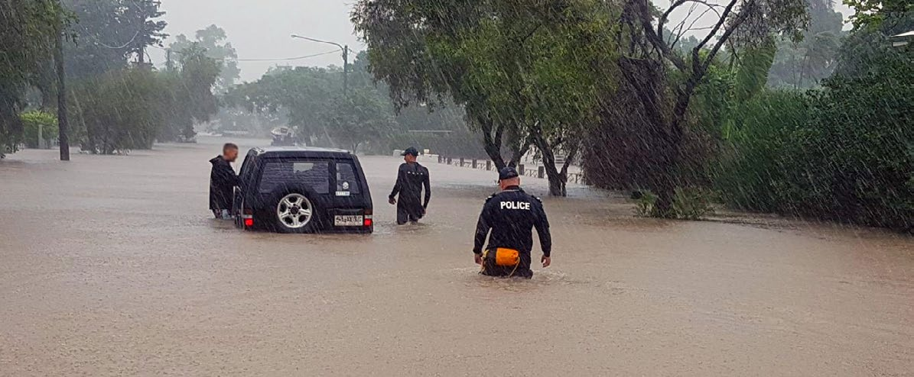

---
## Page 64

Flood risk management
Effective flood risk management requires an integrated, multi-disciplinary approach using a suite of implementation 
tools. In Australia, AIDR Handbook 7 is regarded as the national guide for floodplain management. 
The broader flood risk management process (shown in Figure 6) encompasses flood investigation stages from data 
collection and flood studies through to floodplain management plan implementation. Sometimes the term ‘flood risk 
management’ is used to apply to the final two stages only.
Flood studies generate flood maps that help to describe likely flood behaviour in a particular area under certain 
circumstances. This information may be used, in conjunction with information about land use and community attributes 
to understand flood risk. Floodplain management studies assess the scale and nature of flood risk and consider 
various options to manage the flood risk to an acceptable risk. Floodplain management plans provide a roadmap for 
implementing preferred risk management options.
    Flood risk management process
Data 
collection
Floodplain
management studies 
and plans
Plan 
implentation
Flood 
studies
Figure 6 - Flood risk management process
Flood risk 
Risk is defined as the combination of the likelihood of 
the hazard occurring, together with the consequence of 
the hazard occurring. Likelihoods can range from very 
frequent to very rare, while consequences can range from 
insignificant to catastrophic. 
Flood risk is determined by considering many 
components:
	ƒ flood behaviour, including the flood velocity, 
depth, duration and hazard (generally described 
as a combination of depth and velocity), and flood 
speed of onset (that is, how quickly flooding evolves 
following rainfall)
	ƒ flood frequency, including very small and regular 
floods up to extremely rare and large floods
	ƒ flood exposure of people, property, infrastructure 
and agriculture
	ƒ nature of the community, including community 
vulnerability, resilience and tolerance.
Flood risk can occur from both inundation and isolation 
(as well as the secondary effects of inundation and 
isolation, such as loss of essential services).
There are three main approaches to the management of 
flood risk:
	ƒ Reducing flood risk at the community scale with 
structural works. Structural mitigation alters flood 
behaviour to reduce risk. However, it is often 
expensive and must be hydraulically assessed to 
ensure works do not cause unacceptable impacts 
elsewhere in flood-prone land. Examples of these 
works may include dams, levees, floodgates, 
temporary barriers and detention basins. At a broad 
scale, landscape management activities such as 
revegetation, re-engaging flood-prone land and 
naturalisation of waterways also have potential 
to reduce flood risk through modification of flood 
behaviour.
	ƒ Reducing flood risk at property scale with mitigation 
works. These may include residential property 
buyback/voluntary purchase schemes, house 
raising, flood proofing buildings or improving built 
design.
	ƒ Treating residual risk at the community scale. 
Measures to treat residual risk primarily focus on 
disaster management and community awareness 
and resilience. Examples of these risk treatments 
may include flood warning systems, emergency 
response plans or community education programs.
Although not addressed in this guideline, future flood risk 
to new development may best be managed by avoiding 
56
State guideline: Flood evacuation route improvements  |  May 2021

---
## Page 65

or minimising the consequences of flooding. This is most 
effectively achieved through a risk-based approach to 
land use planning, which takes into consideration both 
current and future climate conditions and future urban 
growth plans. 
Flood studies
In addition to historic flood events, flood studies seek to 
better define the nature and extent of a flood evacuation 
problem by undertaking flood modelling and mapping to 
understand flood behaviour.  The information from flood 
studies can be subsequently translated to flood risk. The 
flood modelling process, which produces flood maps, is 
a standardised process guided in Australia by Australian 
Rainfall and Runoff: A Guide to Flood Estimation. 
However, there can be significant differences in flood 
studies due to the accuracy and level of detail in the flood 
model used. 
All flood models are coarse simplifications of very 
complex processes. Users should be aware of limitations 
in the model and its outputs to understand if it is 
fit-for-purpose to inform ECAs and evacuation route 
improvement options assessment. Information about 
model limitations and confidence may be provided in the 
flood study report or may need to be supplemented by 
discussion with flood modelling specialists. 
Flood maps are generally created for a range of design 
flood events representing theoretical flood events 
based on rainfall probabilities (for example, the 1% AEP 
event, previously referred to as the 100-year average 
recurrence interval or ‘1 in 100 flood’). Comprehensive 
flood studies typically model and map a range of design 
flood events ranging from very frequent (smaller) floods, 
such as the 20% AEP (‘1 in 5 flood’) up to the PMF.  A PMF 
is a hypothetical flood estimate relevant to a specific 
catchment whose magnitude is such that there is 
negligible chance of it being exceeded. Flood maps may 
also be available for historic flood events. 
As a minimum, flood mapping shows flood extents 
(where the flood waters reach), however most flood 
studies also produce flood levels and/or depths 
(to understand how deep flood waters are at a 
certain location), velocity and hazard. Flood hazard 
is a combination of velocity and depth and may be 
categorised in various ways. Flood timing information is 
also generated in flood models, however, it is not always 
provided as part of standard flood study handovers and 
may need to be requested. This information is extremely 
valuable when undertaking evacuation planning to 
understand how much flood warning time may be 
available, the pattern that flooding might follow as it 
inundates the community, and how long flooding is likely 
to persist (affecting flood isolation). Measuring warning 
time for a variety of events is valuable as timing may vary 
for different events. Warning time can be determined in 
several ways: 
	ƒ For flood waters rising from a waterway where there 
is an available upstream gauge, warning time can 
be determined by measuring the time it takes for a 
flood wave to travel from the gauge to the area of 
interest based on recorded data. 
	ƒ For flood waters rising from a waterway and there is 
no appropriate gauge, flood study timing outputs 
from a variety of events can provide guidance on 
warning time available.
	ƒ For flooding due to overland flow or flash flooding, 
where an evacuation trigger is defined on rainfall 
forecast and radar, warning time can be determined 
by the time available between becoming aware of 
the risk and inundation by flood waters. 
	ƒ For storm surges it can difficult to predict their arrival 
and scale. For large storm tides caused by tropical 
cyclones, the Bureau of Meteorology provides 
forecasts and warnings regarding tropical cyclone 
storm tides which, where possible, are issued at 
least 24 hours prior (QFES, 2015a).
Modern flood studies also typically consider climate 
change and produce flood maps representing one or 
more future climate scenarios. This information can help 
users understand how changes in rainfall intensity and 
sea levels might influence flooding in the future.
Flooding can be caused by various mechanisms or 
sources and sometimes by multiple sources (either 
separately or concurrently). Table 10 describes the 
various sources of flooding and how typical attributes 
might influence evacuation planning.
Rocky Ned Road, Fredricksfield, 2020
57
State guideline: Flood evacuation route improvements  |  May 2021

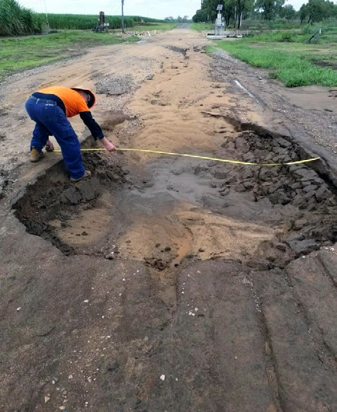

---
## Page 66

Source of 
flooding
Flood mechanism
Typical attributes
Considerations for evacuation 
Riverine 
flooding 
Flooding within large river 
systems where floods 
increase and break out of 
the riverbanks to inundate 
adjacent floodplains. 
Flooding is generated from 
rainfall across the broad 
catchment area (QRA, 
2019a). 
Flood behaviour can be more 
predictable than overland flooding.
Riverine flooding can present 
a range of flood behaviours 
(relating to velocity, depth, hazard) 
depending on local topography 
and size of flood.
It may take many hours, or even 
days, for peak flood levels to occur 
as rainfall slowly drains from the 
catchment. 
Flooding in larger, flatter 
catchments will generally persist 
for longer.
Often some flood warning time 
available, depending on the size 
of the catchment leading to the 
waterway (smaller catchments have 
less potential warning time).
Major waterways are likely to have 
stream gauges which support 
disaster management measures 
linked to key flood heights.
Isolation can be an issue for 
some catchments where flooding 
persists.
Riverine flood models are more 
likely to be calibrated to historic 
flood data and present a higher 
level of confidence than overland 
flood models.
Creek  
flooding
Flooding within creeks 
and small river systems 
where floods increase and 
break out of the channel 
banks.
Flood behaviour can be more 
predictable than overland flooding.
The small catchment size can 
produce flash flooding, which is 
typically more dangerous than 
flooding observed in large riverine 
catchments. Flood behaviour 
depends on local topography and 
size of flood.
Small catchments will typically 
produce short duration floods 
which have a fast onset and only 
persist for a few hours.
Small catchments are unlikely to 
have much warning time available.
Many small creeks do not have 
stream gauges.
Evacuation may be more 
dangerous than sheltering in 
place or remaining in place, due 
to dangerous flood conditions on 
roads.
Prolonged isolation is not likely to 
be an issue.
Creek flood models may be 
calibrated (if historic flood data 
exists). Calibrated models present 
a higher level of confidence than 
uncalibrated models.
Table 10 - Considerations for flood sources
(continued on next page)
58
State guideline: Flood evacuation route improvements  |  May 2021

---
## Page 67

Table 10 - Considerations for flood sources (continued)
Source of 
flooding
Flood mechanism
Typical attributes
Considerations for evacuation 
Controlled 
releases 
from a dam
Flow in a waterway due 
to controlled dam release 
exceeds the capacity of 
the channel and water 
overtops the banks of 
the channel. This results 
in the land surrounding 
the channel becoming 
submerged.
Flood behaviour can be more 
predictable than overland flooding 
or other riverine or creek flooding.
Flooding can present a range 
of flood behaviours (relating to 
velocity, depth, hazard) depending 
on local topography and size and 
duration of releases.
Often some flood warning time 
available, depending on the 
urgency of the releases.
The flood magnitude that will result 
from the dam release is often 
understood.
Localised 
flooding/
overland 
flow
Flooding generated from 
rainfall occurring over a 
local area only. Localised 
flooding is concentrated 
in small creeks and 
ephemeral waterways, 
while overland flow is the 
surface runoff following 
rainfall, concentrated in 
natural lower lying areas 
and swales across the 
landscape (QRA, 2019a).
Patterns of flooding are tied 
to storm patterns and can be 
somewhat unpredictable.
Runoff often travels along 
roadways.
Flooding is typically shallow and 
high velocity.
Flooding is usually ‘flashy’ with 
peaks occurring shortly after 
rainfall.
Short or negligible flood warning 
times make it challenging to initiate 
evacuation. 
Locations at risk of overland flood 
do not typically have stream 
gauges.
Evacuation may be more dangerous 
than staying put, due to dangerous 
flood conditions on roads.
Prolonged isolation is not likely to 
be an issue.
Overland flood models generally 
have a lower level of confidence 
than riverine models due to 
absence of historic flood data.
Coastal/
storm surge
The rising of the sea due 
to a storm (typically a low 
pressure weather system, 
such as a cyclone). May 
be exacerbated by wind 
waves or other coastal 
processes, such as 
erosion.
Flooding can be highly hazardous 
due to depth, velocity and wave 
action, however hazardous 
behaviour is typically limited to a 
narrow coastal strip.
Can worsen riverine flooding by 
increasing downstream water 
levels and preventing rivers from 
draining.
Causes of major surges, such as 
cyclones, are often known days 
in advance, allowing for early 
evacuation.
For storm surge only flooding, 
evacuation is generally only 
required for small areas.
Prolonged isolation is generally not 
an issue.
Dam failure
While dam failure is a source of flooding, it is not covered in this guideline as it is already addressed 
the Guideline for failure impact assessment of water dams. 
Burke River, Boulia
59
State guideline: Flood evacuation route improvements  |  May 2021

---
## Page 68

Yeppen Floodplain Crossing, Bruce Highway
60
State guideline: Flood evacuation route improvements  |  May 2021

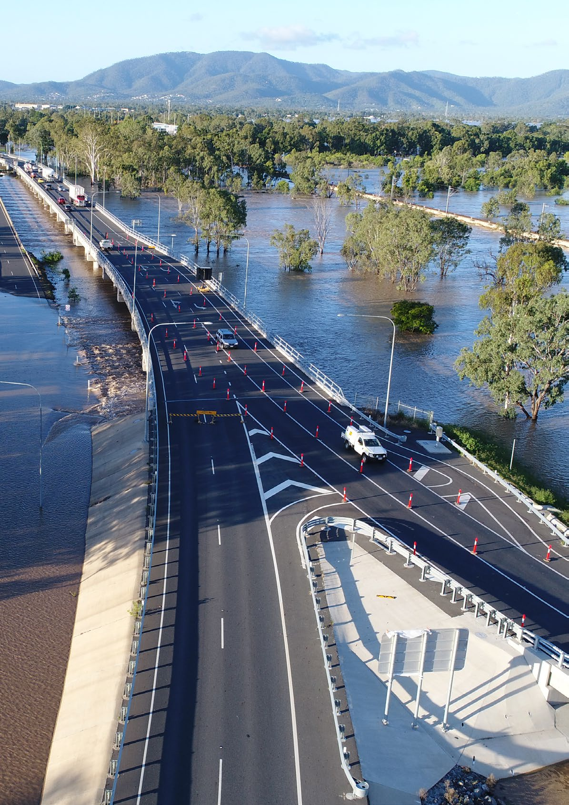

---
## Page 69

Appendix C - Evacuation route signage
If considering evacuation route signage to support an option, liaise with TMR, and Queensland police and emergency 
service agencies to confirm requirements. Users should consider the following:
	ƒ clear delineation and visibility of the evacuation route and signage is very important
	ƒ consider target audience and traffic volumes. Seasonal populations such as tourists, seasonal workers and other 
temporary visitors may be unfamiliar with the road network and may be better diverted to a major road
	ƒ evacuation route signage information should be succinct
	ƒ evacuation route signage should confirm the emergency radio station
	ƒ education and signage about evacuations and evacuation routes, including education of seasonal populations, 
may be required
	ƒ whether heavy and oversize vehicles are appropriate for proposed route, in terms of their dimensions and weight.
This is intended to provide examples only and is not an exhaustive list.
Permanent evacuation route signage
Permanent flood evacuation route signage is appropriate for routes which are likely to be safe for all flood events. When 
developing permanent signage, refer to the requirements in the Queensland Manual of Uniform Traffic Control Devices 
(https://www.tmr.qld.gov.au/business-industry/Technical-standards-publications/Manual-of-uniform-traffic-control-
devices). 
When developing permanent flood evacuation route signage, consider the risks of using permanent signage. Consult 
with the community and seek endorsement from the relevant Local and District Disaster Management Groups. 
The Transport Operations (Road Use Management) Act 1995 requires that all permanent traffic control signs be ‘officially 
approved’. Refer to the Queensland Manual of Traffic Control Devices Part 1: General introduction and index signs for 
officially approved standard signage and approval procedures for circumstances where no suitable standard sign exists. 
Contact TMR’s traffic and engineering team for further information. 
TMR’s Traffic and Road Use Management Manual Volume 3 - Signing and Pavement Marking (Part 9) discusses 
permanent diversion route signage and may be appropriate for principles relating to permanent evacuation signage 
(https://www.tmr.qld.gov.au/business-industry/Technical-standards-publications/Traffic-and-Road-Use-Management-
manual/Volume-3).
Temporary evacuation route signage
When developing temporary signage, refer to requirements in the Queensland Manual of Uniform Traffic Control Devices.  
TMR’s Manual of Uniform Traffic Control Devices Part 3: Traffic Control for Works on Roads provides guidance on 
temporary signage (see guidance for detour signs and multi-message sign plates – traffic diversion signs). 
61
State guideline: Flood evacuation route improvements  |  May 2021

---
## Page 70

Notes
62
State guideline: Flood evacuation route improvements  |  May 2021

---
## Page 71

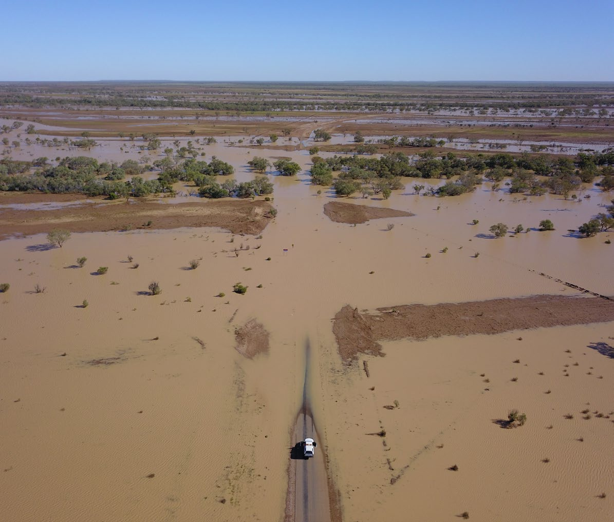

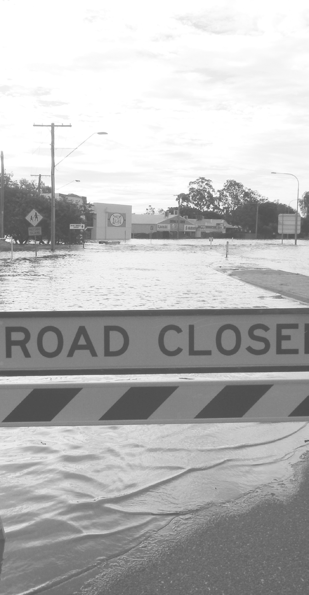

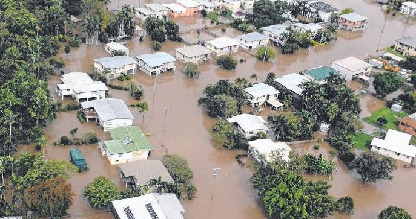

---
## Page 72

Diamantina Developmental 
Road between Bedourie and 
Boulia, 2019

